物学、药学、医学、农学等的重要基础。

200 多年来，人们不仅从动物、植物、微生物等生命体中分离得到了数量庞大的天然有机化合物，而且还通过实验室合成，创造出无数自然界中没有的新化合物。这些不同来源的有机化合物中很多已成为药物、染料、材料、农作物保护剂、日用化学品等的主要组分，为人类文明作出了巨大贡献。

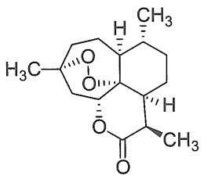

chemical

Molecular structure of a steroid derivative with methyl and ester functional groups

青蒿素

抗疟药

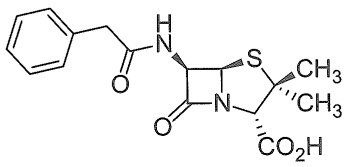

chemical

Chemical structure of a heterocyclic compound with phenyl, carbonyl, amide, and thioether groups

青霉素G

抗生素

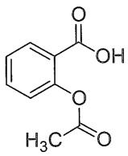

阿司匹林

解热镇痛药

元素周期表中有 118 种元素，但构成有机化合物的元素为数很少，除了碳和氢之外，常见的元素还有氮和氧，以及磷、硫、卤素等。虽然涉及的元素不多，但由这些元素组成的化合物的数目非常庞大。迄今为止，人类已知化合物的数量超过 1.5 亿，其中大部分是有机化合物，而且数量每天都在增加。

作为本书后续各章的知识铺垫，下面将以原子轨道理论和分子轨道理论为基础，从官能团、共价键本质、分子几何构型和电子离域等方面讨论有机化合物的结构，以及结构与性质的关系，尽可能使读者树立“结构决定性质”的科学观。

## 1.2 官能团

如上所述，有机化合物数目极其庞大，它们的反应和制备方法也特别多，因此对有机化合物进行合理分类是非常必要的。通常的分类方法有三种:第一种方法是按照组成分类，如只含碳和氢元素的烃类化合物，含氮、氧、硫的杂环化合物，含金属的金属有机化合物等；第二种方法是按照碳链骨架分类，如开链化合物、环状化合物等；第三种方法是按照官能团分类。在这三种方法中官能团分类法最常用，下面将重点介绍有机化合物中的官能团。

官能团（functional group）是指有机分子中具有特征性质的基团（如 C=C、OH 等）或原子（如卤原子），发生化学反应时，不同分子中的相同官能团一般具有相同或相似的反应性，而不同的官能团则不具备这种特征性质。由此可见，当我们学习有机化合物性质时，实际上是在学习官能团的性质，含有某种官能团的化合物就应该具备这种官能团的基本化学性质，因此，从认识官能团开始学习有机化学很有意义。

烷烃类化合物中只含有碳和氢两种元素，且所有的化学键都是单键，它们不含任何官能团，本书第三章将讨论这类化合物的结构与性质。含碳碳双键、碳碳叁键和苯环官能团的化合物依次称为烯烃（alkene）、炔烃（alkyne）和芳香烃（arene）。碳碳双键和碳碳叁键的化学性质特征是容易发生亲电加成反应，同样含有碳碳双键的芳香烃具有芳香性，它们不易发生亲电加成反应，而容易发生亲电取代反应，可见官能团与有机化合物的性质密切相关。

表1-1选列了有机化合物中一些常见官能团，以及含这些官能团的化合物类型。各类有机化合物的性质就是由相应的官能团决定的。本书大体上按照表1-1中列出的官能团顺序，讨论各类有机化合物的结构、性质和制备。

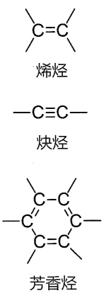

chemical

Three types of alkenes: ethylene, propylene, and benzene, labeled in Chinese.

表 1-1 有机化合物中一些常见官能团

<table><tr><td>化合物类型</td><td>官能团的结构和名称</td><td>示例</td></tr><tr><td>卤代烃</td><td>—X (X=F, Cl, Br, I) 卤原子</td><td> $CH_3Cl$  氯甲烷</td></tr><tr><td>烯烃</td><td>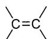 烯基</td><td> $CH_2=CH_2$  乙烯</td></tr><tr><td>炔烃</td><td>—C≡C— 炔基</td><td>HC≡CH 乙炔</td></tr><tr><td>芳香烃</td><td>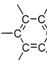 C— 苯基</td><td> $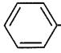 -CH_3$  甲苯</td></tr><tr><td>醇和酚</td><td>—OH 羟基</td><td> $CH_3CH_2OH$  乙醇 $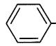 -OH$  苯酚</td></tr><tr><td>醚</td><td>—OR 烃(烷)氧基</td><td> $CH_3CH_2OCH_2CH_3$  乙醚 $CH_3CH_2SH$  乙硫醇</td></tr><tr><td>硫醇和硫酚</td><td>—SH 疇基</td><td> $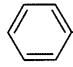 -SH$  苯硫酚</td></tr><tr><td>硫醚</td><td>—SR 烃(烷)硫基</td><td> $CH_3SCH_3$  二甲硫醚</td></tr><tr><td>醛</td><td>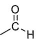 甲酰基, 醛基</td><td> $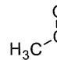$  $\begin{array}{c} \text{ } \\ \text{ } \end{array}$  $\begin{array}{c} \text{ } \\ \text{ } \end{array}$  $\begin{array}{c} \text{ } \\ \text{ } \end{array}$ 乙醛</td></tr><tr><td>酮</td><td>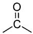 羰基</td><td> $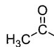$  $CH_3$  丙酮</td></tr><tr><td>羧酸</td><td>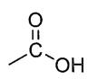 羧基</td><td> $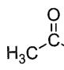$  $\begin{array}{c} \text{ } \\ \text{ } \end{array}$  $\begin{array}{c} \text{ } \\ \text{ } \end{array}$  $\begin{array}{c} \text{ } \\ \text{ } \end{array}$ 乙酸</td></tr><tr><td>酸酐</td><td>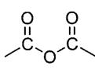 酸酐基</td><td> $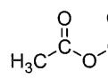$  $\begin{array}{c} \text{ } \\ \text{ } \end{array}$  $\begin{array}{c} \text{ } \\ \text{ } \end{array}$  $\begin{array}{c} \text{ } \\ \text{ } \end{array}$  $\begin{array}{c} \text{ } \\ \text{ } \end{array}$ 乙酸酐</td></tr><tr><td>酰卤</td><td>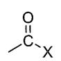 卤甲酰基</td><td> $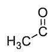$  $\begin{array}{c} \text{ } \\ \text{ } \end{array}$  $\begin{array}{c} \text{ } \\ \text{ } \end{array}$  $\begin{array}{c} \text{ } \\ \text{ } \end{array}$ 乙酰氯</td></tr><tr><td>酯</td><td>[k5C2] 酯基, 烃(烷)氧羰基</td><td> $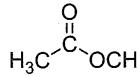$  $\begin{array}{c} \text{ } \\ \text{ } \end{array}$  $\begin{array}{c} \text{ } \\ \text{ } \end{array}$  $\begin{array}{c} \text{ } \\ \text{ } \end{array}$  $\begin{array}{c} \text{ } \\ \text{ } \end{array}$  乙酸乙酯</td></tr><tr><td>酰胺</td><td>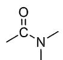 氨甲酰基</td><td> $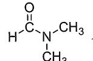$  $N,N-$ 二甲基甲酰胺</td></tr><tr><td>腈</td><td>—C≡N 氰基</td><td> $CH_3CN$  乙腈</td></tr><tr><td>胺</td><td>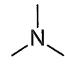 氨基</td><td> $CH_3CH_2NH_2$  乙胺 $(CH_3CH_2)_3N$  三乙胺</td></tr><tr><td>硝基化合物</td><td> $\begin{array}{c} \text{ } \\ \text{ } \\ \text{ } \end{array}$  $\begin{array}{c} \text{ } \\ \text{ } \\ \text{ } \end{array}$ 硝基</td><td> $CH_3CH_2NO_2$  硝基乙烷</td></tr></table>

需要指出的是，在2017版中国化学会《有机化合物命名原则》中使用了“特性基团”（characteristic group）术语代替“官能团”，二者之间是有区别的。首先，“特性基团”是指加在母体氢化物上的杂原子和基团，这些杂原子和基团等同于“官能团”，但母体氢化物是指无分叉的无环结构和环状结构，且仅连有氢原子的化合物，其中包括烯烃、炔烃和芳香烃，因此“特性基团”并不包括烯基、炔基和苯基等重要官能团。其次，“官能团”的应用场景是有机化合物的化学性质和波谱性质等，而“特性基团”的应用场景是有机化合物的系统命名。

## 1.3 共价键:价键理论

## 1.3.1 经典化学键理论（路易斯结构）

1858年，德国化学家凯库勒和英国化学家库珀等提出了“价键”概念，并首次用短线“-”来表示“键”。他们认为有机分子由原子通过键结合而成。由于当时所发现的化合物中一个氢原子只与一个其他原子结合，氢就选作“价”的单位。元素的价数就是能够与该元素的一个原子结合的氢原子个数。此外，分子中碳原子之间可以互相结合。从那时起，人们开始用短线来表示化学键，但并不清楚这个短线的物理意义，即化学键的本质。

## 1. 通过共用电子对实现八隅体稳定结构

20 世纪初，在物理学家发现了电子并阐明了原子结构的基础上，美国化学家路易斯（G. N. Lewis）等人于 1916 年提出了价键的电子理论。当时，人们已经认识到原子核外的电子是分层排列的，层数越小，电子越靠近原子核，能量越低。电子填入电子层时，电子成对更稳定。对于一些常见的原子，除第一周期元素外，外层有 8 个电子的结构最稳定。这些关于原子核外电子结构的半经验规律，很快被路易斯等人用来建立化学键理论。他们认为，原子外层电子的相互作用是原子能够结合在一起的原因。相互作用的外层电子从一个原子转移到另一个原子，形成离子键；两个原子如果共用外层电子，则形成共价键。通过电子的转移或共用，参与成键的原子的外层电子都能够拥有惰性气体的八电子稳定结构，从而达到成键饱和状态，这个以元素周期表为基础的规律称为“八隅体规则”（octet rule）。这样一来，以前用于表示价键的短线就代表了两个原子之间的共用电子对。

碳是构成所有有机化合物的主要元素之一，因此，我们必须对碳的电子结构有所了解。碳处于元素周期表中第二周期ⅣA族，其核外有6个电子，其中4个电子处于价电子层，常称为价电子（valence electron），在与其他元素成键时，它既不易失去电子，也不易得到电子，而是通过其价电子和其他元素的价电子形成共享电子对而成键的。因此，有机化合物分子中的化学键主要是共价键（covalent bond），以共价键结合是有机分子的基本特征，这和以离子键结合的离子型化合物（如NaCl）相比有显著差异。

## 2. 路易斯结构式

路易斯是如何用电子对来表示共价键和分子结构的？以双原子分子 $\mathrm{H}_{2}$ 和 $\mathrm{Cl}_2$ 的共价单键为例，路易斯用圆点“·”来表示电子，也称为电子点，氢原子核外只有一个电子，两个氢原子通过共用两个电子（即电子对）形成一个共价单键，从而达到成键饱和状态。第三周期的氯原子有7个价电子，其中有3对成对的电子，剩余一个单个电子，两个氯原子各提供一个电子组成电子对，从而通过共用这个电子对而获得八隅体结构，形成Cl-Cl单键。这种用电子点图表示分子中化学键的结构式称为路易斯结构式（Lewis structure）。

$$
\mathrm{H} \cdot + \cdot \mathrm{H} \longrightarrow \mathrm{H}: \mathrm{H} \quad : \ddot {\mathrm{Cl}} \cdot + \cdot \ddot {\mathrm{Cl}}: \longrightarrow : \ddot {\mathrm{Cl}}: \ddot {\mathrm{Cl}}:
$$

碳的价电子数为 4，因此它可与 4 个氢原子通过共用 4 个电子对而获得八隅体结构，形成甲烷分子。氧有 6 个价电子，只需得到 2 个共享电子，即可达到八隅体结构，因此在甲醇中氧分别与碳和氢共用一对电子，碳原子则分别与氧和 3 个氢共用一对电子，氧上还有两对未共用的电子，称为孤对电子（lone-pair electron）。

除了两电子的单键之外，原子间还可形成四电子键和六电子键，以获得八隅体结构。在

$$
\begin{array}{c} \text {H} \\ \text {H}: \stackrel {\cdot \cdot} {\mathrm{C}}: \text {H} \\ \text {H} \\ \text {甲烷} \\ \text {H}: \stackrel {\cdot \cdot} {\mathrm{C}}: \stackrel {\cdot \cdot} {\mathrm{O}}: \text {H} \\ \text {H} \\ \text {甲醇} \end{array}
$$

乙烯和乙炔分子中就存在这样的多电子键，乙烯中两个碳原子共用了4个（两对）电子，构成双键，乙炔中两个碳原子共用了6个（三对）电子，构成了叁键。

经典的路易斯结构式全部采用电子点表示电子对，当分子较大时书写起来相当烦琐。现在常用简化方式书写，成键电子对用短线表示，一条短线表示单键，两条短线表示双键，三条短线表示叁键；孤对电子则仍需用电子点表示。例如:

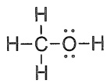

甲醇

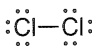

氯

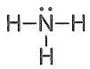

氨

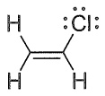

氯乙烯

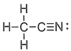

乙腈

在路易斯结构式中，成键电子对可以来自同一个原子。在此情况下，结构式中将出现形式电荷（formal charge）。氧原子的价电子数为6，化合价为2，在臭氧分子路易斯结构式中三个氧原子都达到八隅体结构，但右端的氧原子是得到了2个电子才获得八隅体结构的，这2个电子全部来自中间的氧原子，可以理解为中间的氧原子“额外”给出了一个电子，故带有1个正电荷，而右端氧原子“额外”得到了一个电子，所以带有1个负电荷。叠氮酸分子的路易斯结构式中也存在这样的形式电荷。

形式电荷是可通过简单的计算来确定的，计算时共享的成键电子计半数，孤对电子计全数，如果这两个数字之和与非成键原子的价电子数有差别，则这个差别就是形式电荷数。计算公式如下:

$$
\text {形式电荷数} = \text {价电子数} - \text {孤对电子数} - \frac {\text {成键电子数}}{2}
$$

以上述臭氧分子为例，氧原子的价电子数为 6，中间氧原子的孤对电子数为 2，成键电子数为 6（来自 3 个共价键），因此其形式电荷数为

$$
\text {形式电荷数} = 6 - 2 - \frac {6}{2} = + 1
$$

右端氧原子的孤对电子数为 6，成键电子数为 2（来自 1 个共价键），因此其形式电荷数为

$$
\text {形式电荷数} = 6 - 6 - \frac {2}{2} = - 1
$$

## 3. 八隅体结构的例外

第二周期中硼元素的化合物硼烷的路易斯结构中只有6个电子，这不符合八隅体规则，很不稳定。如果它与氢负离子共享两个电子，形成硼氢负离子，则是稳定的。

第二周期后的元素中，往往会有超出8个电子的情况，常见于含硫、磷、氯、溴、碘的化合物中。例如，硫酸中硫原子的价电子数为12，而磷酸中磷原子的价电子数为10。这种现象被称为价层扩充（valence-shell expansion）。当然，我们也可以写出符合八隅体规则的路易斯结构式，但这个结构式是偶极结构，式中要有形式电荷。后来的原子轨道理论揭示了这一现象的本质，而且这两组结构可以看作两个极限结构，即共振结构（详见1.6.1小节）。

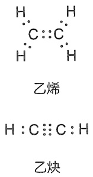

chemical

Chemical structure of ethylene (乙烯) and ethylene (乙炔) showing carbon chain with hydrogen atoms

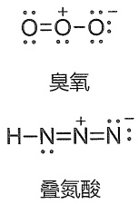

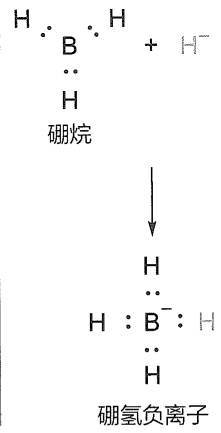

chemical

Chemical reaction diagram showing protonation of hydrogen to form an argon and argon ion

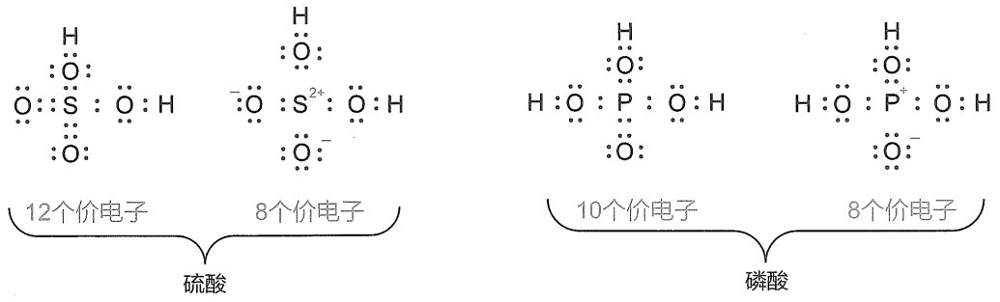

## 1.3.2 原子轨道

路易斯的经典化学键理论虽然用共用电子对概念解释了化学键的物理意义，但这种基于经验规律的理论仍然没有回答化学键的本质问题。20世纪20年代，原子物理学家已经掌握了很多有关原子结构的信息，发现了核外电子绕核运动的一些基本规律，如波粒二象性和不确定性（如位置-动量不确定性、能量-时间不确定性等）。不确定性属于概率问题，具有量子特征。量子力学——一种关于电子绕核运动的理论建立之后，人们开始用波函数来描述电子在某个时刻的状态，称为波动方程，这种偏微分方程的解称为原子轨道（atomic orbital）。原子轨道理论是现代化学键理论的基础。

## 1. 原子轨道的层级

由量子力学推导出来的波动方程有一系列的解，称为波函数。原子轨道就是单原子的波函数，它包含了三个量子化参数，即主量子数（n）、角量子数（l）和磁量子数（m），它们分别决定了电子的能量、角动量和方位，三者统称为量子数。每个轨道都有一组不同的量子数，且最多可容纳两个电子。

主量子数（n）取值为1，2，3，4，…，用于描述原子中电子层（电子出现概率最大区域）离核的远近。n=1，代表第一层电子层，离核最近；n=2，代表第二层电子层，以此类推，n值越大，电子离核越远。

## 2. 原子轨道的类型与形状

角量子数用于描述同一电子层中的不同电子亚层（包括s、p、d轨道等），它们体现了原子轨道的三维图像，可简单地理解为电子以90%概率出现的空间区域，这些区域没有明显的边界，呈现混沌状，常用“电子云”（electron cloud）来形容。角量子数l=0、1、2的轨道依次称为s、p、d轨道，表现出的轨道形状轮廓如图1-1所示。s轨道呈球形，p轨道呈哑铃形，d轨道则呈四叶草形。图中的符号“+”和“-”代表波函数的相位（phase），通常用不同颜色或不同填充方式来表示这个符号。在后续章节中会发现这个符号很重要，一个化学键能否形成，一个反应能否发生，都与这个符号有关。需要指出的是，“+”和“-”不代表电子在该区域出现的概率，但在“+”和“-”交界处电子出现的概率（常称为电子密度）为零，此处称为节点或节面（node）。

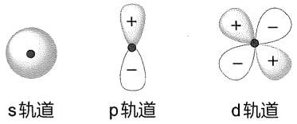

图 1-1 s、p 和 d 轨道形状轮廓图

1s 轨道最靠近原子核，没有节面，能级最低。2s 轨道的形状与 1s 轨道的形状相同，都是球形，但比 1s 轨道大且有一个球面状的节面，节面处波函数的符号改变（见图 1-2）。

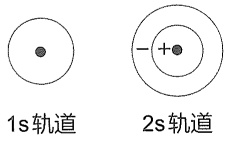

图1-2 1s和2s轨道二维图

三个能量相同的（称为“简并的”）2p轨道能级紧随2s轨道，其轨道对称轴在x、y、z方向相互垂直，依次标记为 $2p_{x}$ 、 $2p_{y}$ 和 $2p_{z}$ 轨道（见图1-3）。每个轨道上符号相反的两瓣被垂直于轨道对称轴并通过原子核的节面所分隔。

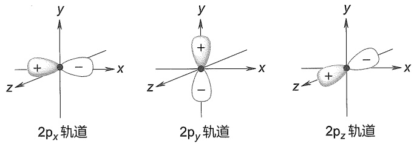

图1-3 三个简并的 $\mathbf{p}$ 轨道形状三维图

## 3. 原子轨道的能级图与电子排布原则

图 1-4 是从 1s 到 3d 能级的原子轨道近似能级图, 这张图提供了关于有机化合物中常见原子（C、H、N 和 O）的电子构型、轨道相对能级和各能级最多容纳电子数的信息。不同原子的核外电子数不同, 它们按照一定的规则在轨道中分布。这些规则可概括为以下三个基本原则:

原则 1 在基态下，电子尽可能占据能量最低的原子轨道，使整个原子能量最低。只有当低能级轨道填满后，电子才填入高一级能级的轨道。这个原则称为能量最低原理。

原则 2 每个原子轨道最多容纳两个电子，且自旋（即自旋角动量）相反。这个原则称为泡利不相容原理（Pauli exclusion principle）。如图 1-4 所示，常用竖直向上和向下的一对箭头来表示由两个自旋方向相反电子组成的电子对（electron pair）。

原则 3 对于简并轨道（如 3 个 p 轨道和 5 个 d 轨道），每个轨道首先填充一个自旋相同的电子，填满后再填充自旋相反的电子。这个原则称为洪德定则（Hund's rule）。

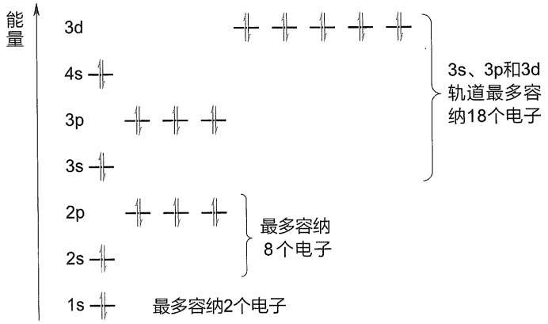

text_image

能量
3d
4s
3p
3s
2p
2s
1s
最多容纳2个电子
3s、3p和3d轨道最多容纳18个电子
最多容纳
8个电子

图1-4 原子轨道近似能级图

按照上述规则和图 1-4，我们可以比较容易地写出原子的电子构型。一些常见元素原子的电子构型和化合价见表 1-2。

表 1-2 一些常见元素原子的电子构型和化合价

| 原子 | 核外电子数 | 电子构型 | 价电子数 | 化合价 |
| --- | --- | --- | --- | --- |
| H | 1 | $1s^1$ | 1 | 1 |
| He | 2 | $1s^2$ | 2 | 0 |
| C | 6 | $1s^22s^22p^2$ | 4 | 4 |
| N | 7 | $1s^22s^22p^3$ | 5 | 3 |
| O | 8 | $1s^22s^22p^4$ | 6 | 2 |
| F | 9 | $1s^22s^22p^5$ | 7 | 1 |
| Ne | 10 | $1s^22s^22p^6$ | 8 | 0 |
| Ar | 18 | $1s^22s^22p^63s^23p^6$ | 8 | 0 |
| P | 15 | $1s^22s^22p^63s^23p^3$ | 5 | 3、5 |
| S | 16 | $1s^22s^22p^63s^23p^4$ | 6 | 2、4、6 |

元素周期表中第一到第三周期的最后一个元素分别为氦、氖和氩，它们的所有原子轨道都被电子填满，达到了最多可容纳电子数的饱和状态，不需要通过得失电子（形成分子或离子）来稳定，因此是最稳状态。氖和氩的最外层轨道均有8个电子，这与曾经提出的“八隅体”经验规则非常符合。氢原子核外只有一个电子，分布在1s轨道，要达到像氦一样的饱和状态则需要得到一个电子，碳、氮、氧、氟要达到饱和状态则依次需要得到4、3、2、1个电子，这些数字显然与经典的化合价概念相符合（如表1-2所示）。

第三周期的磷和硫都有空的 3d 轨道，它们可以接受更多电子，超越八隅体结构。这就解释了硫酸和磷酸路易斯结构中的价层扩充现象（见 1.3.1 小节）。

需要指出的是，由于不同元素的电负性不同（见1.8.1小节），不同原子的核对核外电子的束缚力不同，它们的相同名称原子轨道（如2s或2p）的能级是不同的。图1-5给出了氢、碳、氮和氧四种原子价电子轨道的能级关系。从图中可以看出，碳、氮和氧原子的2p与2s轨道能级差依次增大（分别为 $8.8\mathrm{eV}$ 、 $12.4\mathrm{eV}$ 和 $16.5\mathrm{eV}$）。此外，随电负性的增大，氢、碳、氮和氧的s轨道能级依次降低，碳、氮和氧的p轨道能级也依次降低，且氧的2s与2p轨道能级同时低于氢的1s轨道能级。

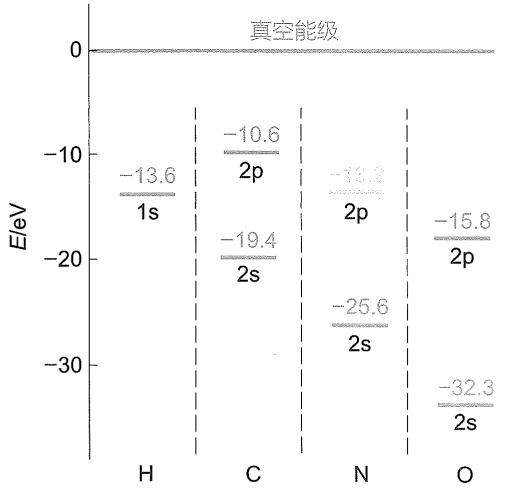

bar

| Element | Energy Level (eV) |
| :--- | :--- |
| H | -13.6 |
| C | -10.6 |
| C | -19.4 |
| C | -25.6 |
| N | -13.2 |
| N | -25.6 |
| O | -15.8 |
| O | -32.3 |

图1-5 氢、碳、氮和氧四种原子价电子轨道的能级关系

综上所述，原子轨道理论从本质上解释了为什么8电子（第二周期元素）和2电子（第一周期元素）结构是稳定的，为什么碳是四价的，氮是三价的，而氧是二价的等一系列科学问题。

## 1.3.3 价键理论

20 世纪 30 年代，著名化学家鲍林（L. Pauling）和物理学家斯莱特（J. C. Slater）将量子力学的原理与化学的直观经验相结合，创立了价键理论（valence bond theory），在经典化学键理论中引入了原子轨道理论、σ 键和 π 键、杂化轨道理论、共振论等一系列新概念。

## 1. 轨道重叠与电子配对形成共价键

价键理论认为，共价键的形成是成键原子的原子轨道（电子云）相互重叠和自旋反平行的两个电子配对的结果。自旋反平行的两个电子在轨道重叠区域内运动，为两个原子所共有，并与两个原子核相互吸引，体系能量降低。以双原子分子 $\mathrm{H}_{2}$ 为例，如图1-6所示，两个氢原子的1s轨道相互重叠，形成H-H共价键，组成氢分子。与两个氢原子相比，氢分子的能量降低了 $436\mathrm{kJ / mol}$，也就是说，形成一个H-H键可释放出 $436\mathrm{kJ / mol}$ 的能量。

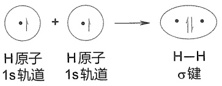

chemical

Chemical reaction diagram showing hydrogen bonding between H atoms in 1s轨道 and σ键

图1-6 由氢原子组成 $\mathbb{H}_2$ 分子的轨道重叠示意图

价键理论的核心思想是原子间相互接近轨道重叠，原子间共用自旋相反的电子对使能量降低而成键。共价键具有两个特点，即饱和性和方向性。饱和性是指一个原子能够参与的化学键数目是有一定限制的。例如，氢原子核外只有一个电子，只能共享一对电子参与成键，因此氢只能形成一个共价键。方向性是指两个原子成键时必须沿着一定方向彼此接近，两个原子轨道相互重叠，重叠程度越大，形成的共价键越牢固。

## 2. 价层电子对互斥理论

对于多原子分子，价键理论也能够处理任意两个成键原子之间的化学键。然而，多原子分子存在键角和立体构型问题，例如，甲烷（$\mathrm{CH}_4$）分子中四个C-H键之间的夹角是多少？对于这个问题，价键理论最初是依赖价层电子对互斥（valence shell electron pair repulsion, VSEPR）理论来回答的。

价层电子对互斥理论认为，多原子分子中某一中心原子的空间构型取决于其价电子层中电子对的排斥作用，分子的构型总是采取电子对相互排斥力作用最小的结构，为了减少价电子对之间的排斥力，电子对间应尽量互相远离。

按照 VSEPR 理论，中心原子用 M 表示，与之结合的原子用 A 表示，其数目用 n 表示，孤对电子用 E 表示，其数目用 m 表示，则围绕中心原子的等价结构可表示为  $MA_{n}E_{m}$ ，等价电子对数等于  $(n+m)$ 。在计算电子对数目时，若两个原子之间存在双键或叁键，每个重键等价于一个电子对。

为尽可能减小等价电子对之间的排斥作用，它们应尽可能在以 M 为中心的球面彼此分开。这样一来，A 和 E 在中心原子周围的分布就会形成直线结构、平面结构或多面体结构。

若中心原子有孤对电子，中心原子往往作为分子或原子团几何结构的顶点，若中心原子没有孤对电子，则中心原子位于几何结构的中心。例如，甲烷（$\mathrm{CH}_4$）分子中，$n = 4$，$m = 0$，碳原子的等价电子对数等于4。按照VSEPR理论，甲烷分子应该具有正四面体结构，四个氢原子位于四面体的4个顶点，碳原子则位于四面体的中心，所有H-C-H键角都是 $109.5^{\circ}$。如图1-7(a)所示，甲烷中心碳原子的“电子对构型”与实际分子结构完全一致。

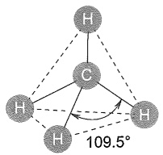

chemical

Molecular structure diagram showing a central carbon atom bonded to three hydrogen atoms, with bond angle labeled as 109.5°

(a)

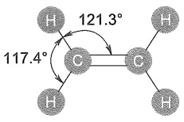

(b)

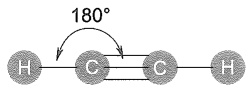

(c)

图1-7 用VSEPR理论预测的甲烷(a)、乙烯(b)和乙炔(c)的分子结构

VSEPR 理论认为，当结合原子（A）包含不同的原子或基团时，径向半径较大的结合原子或基团占据较大的空间，这将导致多面体一定程度上变形。乙烯（ $CH_{2}=CH_{2}$ ）分子中的两个碳原子是等同的，对于任意一个碳原子，存在两种不同的结合原子，n=3（注意双键等价于一个电子对），m=0，碳原子的等价电子对数等于3。按照 VSEPR 理论，乙烯分子中任意一个碳原子的电子对构型应为稍微变形的平面三角形，C-C-H 和 H-C-H 键角都应接近  $120^{\circ}$ （实际键角分别为  $121.3^{\circ}$  和  $117.4^{\circ}$ ），整个分子的结构应为长方形，C=C 键处于长方形的中心，四个氢则处于四个顶点 [见图 1-7(b)]。同理，我们可以预测出乙炔具有线形结构 [见图 1-7(c)]，因为该分子中任意一个碳原子的等价电子对数为 2（注意叁键等价于一个电子对，故 n=2）。

根据VSEPR理论，结合原子（A）和孤对电子（E）占据的空间并不完全相等。孤对电子仅属于中心原子，在全等顶点中占据相对较大的空间，这会在一定程度压缩结合原子的空间，从而导致多面体构型出现一定变形。水分子和氨分子中心原子O和N均有孤对电子，水分子有两个H原子，O原子有两对孤对电子， $n = 2$ ， $m = 2$ ，而氨分子有3个H原子，N原子有一对孤对电子， $n = 3$ ， $m = 1$ ，这两个分子中心原子的等价电子数都是4，它们的“电子对构型”都应该接近正四面体，但水分子中两对孤对电子占据了两个顶点，并在一定程度上压缩了H-O-H键角，使其偏离 $109.5^{\circ}$ （实测值为 $104.5^{\circ}$ ），分子具有三角形结构，O原子占据了其中一个顶点[见图1-8(a)]。与水分子相似，氨分子中H-N-H键角也要稍微偏离 $109.5^{\circ}$ （实测值为 $107.5^{\circ}$ )，呈三角锥结构，N原子占据了其中一个顶点[见图1-8(b)]。

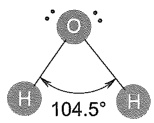

(a)

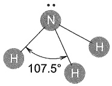

(b)

图 1-8 用 VSEPR 理论预测的水（a）和氨（b）的分子结构

## 1.3.4 杂化轨道理论

虽然上述 VSEPR 理论可以解释和预测很多分子的键角和空间构型，但它缺乏理论基础。

甲烷分子具有四面体结构，中心碳原子的价电子构型为 $2\mathrm{s}^2 2\mathrm{p}^2$ ，其中两个已配对电子在2s轨道，另外两个电子在两个2p轨道上，这些轨道的能量和形状都不同，空间排布也不能满足四面体结构，这就难以用价键理论来解释为何可以形成四个共价键，而且是四个完全相同的C-H键。针对分子空间构型的问题，鲍林于1931年提出了杂化轨道（hybrid orbital）理论。该理论认为，原子核外的价电子在形成化学键的过程中会发生必要的杂化。由于原子各亚层轨道中电子能量相差不大，故波函数可以线性组合——杂化为新的轨道，称为杂化轨道。杂化轨道的能量与空间分布与原来的原子轨道颇为不同，但各杂化轨道是完全相同的，且它们一般呈现空间对称排布。杂化轨道理论用量子力学的数学模型解释了分子的空间构型问题，所得结论与VSEPR理论基本一致。

## 1. $\mathfrak{sp}^3$ 杂化轨道

根据杂化轨道理论，碳原子的2s轨道和三个2p轨道可杂化成四个相同的原子轨道，标记为 $sp^{3}$ 杂化轨道（符号p的上标“3”代表有三个p轨道参与了杂化）。如图1-9(a)所示，在成键之前，一个2s电子被激发到空的2p轨道上（这两个轨道能级差较小，激发所需能量可通过成键释放能量来补偿），半充满的2s轨道和三个半充满的2p轨道线性组合，形成四个等价的 $sp^{3}$ 杂化轨道，其中各有一个电子占据，且能量相同。每个 $sp^{3}$ 杂化轨道都包含1/4的2s轨道和3/4的2p轨道。鉴于2s轨道的对称性，当它与2p轨道叠加时，会同时使波函数的一个波瓣增大，另一个波瓣减小，故 $sp^{3}$ 杂化轨道形状如图1-9(b)所示。四个 $sp^{3}$ 杂化轨道的节面均通过碳原子核，在以原子核为中心的球形空间对称分布，即正四面体分布，四个杂化轨道伸向四面体的四个顶点，轨道对称轴之间的夹角均为 $109.5^{\circ}$ 。这种空间分布符合能量最低原则，成键后四个轨道中电子对之间的排斥作用最小。

如图1-10所示，在形成甲烷分子时，按照轨道最大重叠原则，每个 $\mathfrak{sp}^3$ 杂化轨道上大的一瓣与氢原子的1s球形轨道重叠，四个 $\mathfrak{sp}^3$ 杂化轨道上的电子和四个氢原子中1s轨道上的电子配对形成四个共价键，即形成甲烷分子的四个C-H键。这些C-H键绕键轴旋转任意角度，

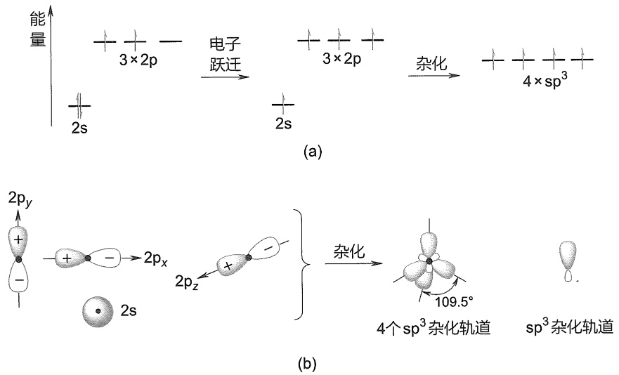

图 1-9 碳原子的  $sp^{3}$  杂化轨道

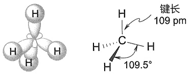

chemical

Molecular structure and bond angle diagram of a carbon-carbon (C=C) complex with labeled bond lengths and angles

图1-10 由碳原子的4个 $\mathfrak{sp}^3$ 杂化轨道和4个氢原子的1s轨道形成甲烷分子

杂化轨道理论是一种基于理论模型和假设来解释分子电子结构的数学手段，它给出的物理图像直观易懂，在粗略探讨分子静态结构和化学键性质时很有效，也可对有机反应的细节进行适当定性分析，但它把共价键定域化在成键原子之间，强调电子配对概念，没有把分子的电子运动视为整体考虑，因而还不能反映电子运动的真实情况。

其轨道空间分布没有任何变化，具有这种轴对称性的共价键标记为  $\sigma$  键。通过杂化轨道所形成的甲烷分子符合正四面体结构，四个氢原子处于正四面体的四个顶点，碳原子则位于正四面体的中心，H-C-H 键角为  $109.5^{\circ}$ 。

在形成乙烷分子时，两个碳原子各用一个  $sp^{3}$  杂化轨道较大的一瓣沿键轴“头对头”同相位重叠(见图1-11)，这样的重叠方式符合最大重叠原则，由此形成的 C-C 键也具有与 C-H 键相同的轴对称性，故称为 C-C σ 键。其余六个  $sp^{3}$  轨道分别与六个氢原子的 1s 轨道重叠，形成六个 C-H σ 键。实测乙烷分子的 C-C-H 键角为 111.2°，稍微偏离正四面体的 109.5°。

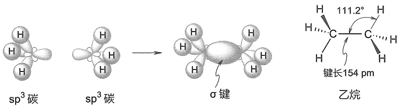

chemical

Reaction mechanism diagram showing sp³ carbon conversion to ethane with σ bond and 111.2° bond angle

图 1-11 由两个  $sp^{3}$  杂化碳原子形成乙烷分子的碳碳  $\sigma$  键

## 2. $\mathbf{sp}^2$ 杂化轨道

乙烯分子具有平面结构，且存在碳碳双键。在这样的平面结构中，碳原子采用 $\mathfrak{sp}^2$ 杂化方式成键。如图1-12所示，碳原子的2s轨道和两个2p轨道杂化成三个能量相等且节面通过原子核的 $\mathfrak{sp}^2$ 杂化轨道，其形状与 $\mathfrak{sp}^3$ 杂化轨道相似。这三个 $\mathfrak{sp}^2$ 杂化轨道采取平面三角形的空间对称分布，较大的波瓣伸向三角形的三个顶点，轨道对称轴之间的夹角均为 $120^{\circ}$ 。如果参与杂化的两个p轨道为 $2\mathrm{p}_x$ 和 $2\mathrm{p}_y$ ，则未参与杂化的 $2\mathrm{p}_z$ 轨道垂直于三个 $\mathfrak{sp}^2$ 杂化轨道平面，其节面通过碳原子核。

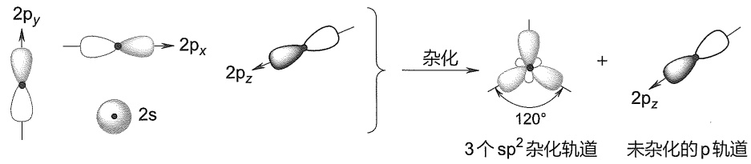

chemical

Diagram illustrating the hybridization of sp² and p orbitals in a molecular system, showing electron density states and orbital angles.

图 1-12 碳原子的  $sp^{2}$  杂化轨道

在形成乙烯分子时，按照最大重叠原则，两个碳原子各用一个  $sp^{2}$  轨道沿键轴“头对头”同相位重叠（见图 1-13），形成 C-C σ 键。两个未参与杂化的 p 轨道则以“肩并肩”方式同相位重叠（图中用虚线表示），如此重叠形成的键其轨道空间分布呈镜像对称（面对称），标记为 π 键。剩下的四个  $sp^{2}$  轨道分别与四个氢原子的 1s 轨道重叠，形成四个 C-H σ 键。实测乙烯分子的 H-C-H 键角为 117.4°，C-C-H 键角为 121.3°，均稍微偏离正三角形的 120°。

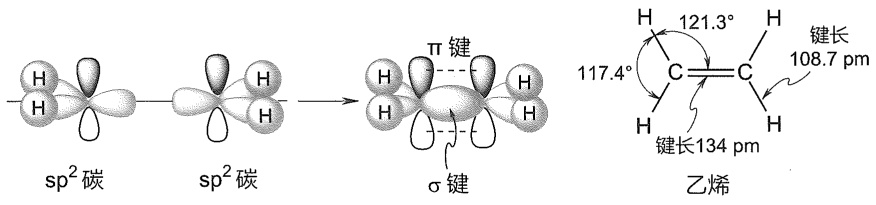

chemical

Reaction mechanism diagram showing sp² carbon and σ bond formation on ethylene with bond angles and bond lengths

图1-13 由两个 $\mathfrak{sp}^2$ 杂化碳原子形成乙烯分子的碳碳 $\sigma$ 键和 $\pi$ 键

从轨道重叠效率看，“头对头”重叠的程度要比“肩并肩”重叠的程度大，因此在  $\sigma$  键中，两个原子核之间的电子分布更多。对于同一个双键或叁键， $\sigma$  键的能量要低于  $\pi$  键的能量。换言之， $\sigma$  键比  $\pi$  键更稳定，更强。

## 3. sp 杂化轨道

乙炔具有线形结构，其碳碳叁键是由两个碳原子的 sp 杂化轨道重叠形成的。如图 1-14 所示，碳原子的 2s 轨道和一个 p 轨道杂化形成两个 sp 轨道，它们的节面均通过原子核，并采取对称的线形空间排布方式。两个未参与杂化的 p 轨道相互垂直，同时也与两个 sp 杂化轨道垂直。

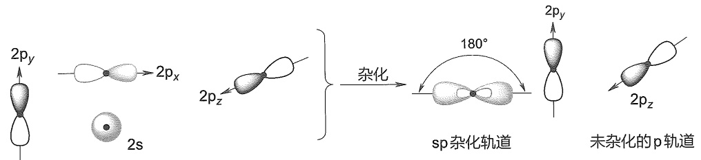

flowchart

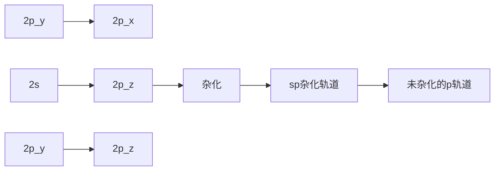

图1-14 碳原子的sp杂化轨道

与乙烯类似，在形成乙炔分子时，两个碳原子各用一个 sp 轨道沿轴线方向“头对头”重叠（见图 1-15），形成 C-C σ 键。两组相互垂直的未参与杂化的 p 轨道则通过“肩并肩”的方式重叠（图中用虚线表示），形成两个 π 键。剩下的两个 sp 轨道分别与两个氢原子的 1s 轨道重叠，形成两个 C-H σ 键。

chemical

Reaction mechanism diagram showing sp carbon and σ键 formation with π键, including bond angles and bond lengths

图1-15 由两个sp杂化碳原子形成乙炔分子的碳碳 $\sigma$ 键和 $\pi$ 键

## 4. 氮和氧原子的杂化轨道

含有氮、氧、硫等杂原子的化合物的路易斯结构式中存在孤对电子，它们的结构亦可用杂化轨道来描述。氮原子的电子构型为 $1\mathrm{s}^2 2\mathrm{s}^2 2\mathrm{p}^3$ ，可见它只需要得到3个电子形成3个共价键即可达到八隅体稳定结构。在氨分子中，氮原子以 $\mathfrak{sp}^3$ 杂化方式形成与碳原子类似的四面体结构，其中3个 $\mathfrak{sp}^3$ 杂化轨道中各有一个电子占据，它们分别与3个氢原子1s轨道重叠成键，剩余一个 $\mathfrak{sp}^3$ 杂化轨道则被孤对电子占据（见图1-16）。氨分子中H-N-H键角为 $107.3^{\circ}$ 非常接近四面体构型。

图 1-16 氨分子和水分子的结构

如图1-16所示，水分子的结构也可以用氧原子的 $\mathrm{sp}^3$ 杂化来解释。然而，与碳原子相比，氧原子的2s和2p轨道能量差别较大（见图1-5），杂化所需要的能量较大，而氧与氢成键的数目较少，成键所释放出的能量不足以弥补杂化所需要的能量，所以氧原子的 $\mathrm{sp}^3$ 杂化是不利的。实际上，水分子中氧原子可以用未杂化的原子轨道进行成键，即氧原子的两个单占2p轨道分别与能量相近的氢原子1s轨道重叠，形成两个O-H键，两对孤对电子分别占据一个2p轨道和2s轨道，$104.5^{\circ}$ 的H-O-H键角可用VSEPR理论来解释（注意:无论是否杂化，决定键角的因素都是库仑定律——电子互斥）。基于同样原因，用杂化轨道理论来处理卤原子的成键也是不合理的。

## 1.4 共价键:分子轨道理论

分子轨道理论（molecular orbital theory）是美国化学家马利肯（R. S. Mulliken）和德国物理学家洪德（F. Hund）在1932年提出的一种描述多原子分子中电子运动状态的方法，此后经不断完善和发展，已成为重要的现代化学键理论之一。与价键理论用原子轨道的重叠和电子配对成键来解释共价键的方法不同，分子轨道理论强调分子的整体性，认为分子中的电子围绕整个分子运动，电子不属于某个原子轨道，而是属于整个分子的分子轨道。因此，分子轨道理论能够更好地说明多原子分子的结构，解决许多价键理论不能回答的问题。

## 1.4.1 原子轨道线性组合法

分子轨道常用原子轨道线性组合法导出，因此它与原子轨道类似，也有大小、形状和能级。以最简单的双原子分子 $\mathrm{H}_{2}$ 为例，两个氢原子的1s轨道（相位可以是“+”，也可以是“-”）通过两种方式组合形成两种分子轨道:一种是两个原子轨道波函数同相位相加（同相组合），另一种则是反相位相加（反相组合）。如图1-17(a)所示，同相位相加得到的分子轨道波函数在两核之间大大增强（非重叠区域保持不变），呈椭圆形，且能量降低，称为成键轨道（bonding orbital）。反相位相加时，两个符号不同的1s轨道波函数在两核之间重叠区域相互抵消为零，从而形成节面，能量升高，这样形成的分子轨道称为反键轨道（anti-bonding orbital）。成键轨道绕键轴旋转任意角度，其空间分布无变化，故标记为 $\sigma$ 轨道；反键轨道也具有相同对称性，标记为 $\sigma^{*}$ 轨道（“\*”表示反键）。如图1-17(b)所示，电子在分子轨道中的填充须遵循能量最低原理、泡利不相容原理和洪德定则，氢分子的两个电子填充在能量低的成键轨道上，而反键轨道是空的。由于电子填充在 $\sigma$ 轨道，这样形成的键称为 $\sigma$ 键。此外，两个电子的总能量降低了，所以H-H键的形成是有利的。

chemical

Diagram showing electron pair generation in a membrane, with reverse and parallel combination reactions

(a)

text_image

能量
反键轨道(σ*轨道)
1s
成键轨道(σ轨道)
能量下降

(b)

图 1-17 氢分子轨道的形成（a）与能级（b）示意图

由原子轨道组合成分子轨道，不仅适合于1s轨道，也适合于其他原子轨道。如图1-18所示，如果两个2p轨道沿键轴“头对头”重叠，同相重叠形成成键轨道，反相重叠形成反键轨道。这两个分子轨道绕键轴旋转任意角度其空间分布都不改变（具有轴对称性），故分别标记为 $\sigma$ 轨道和 $\sigma^{*}$ 轨道。如果两个2p轨道相互平行叠加，即“肩并肩”重叠，也可形成成键轨道和反键轨道，成键轨道空间分布是对称的，标记为 $\pi$ 轨道，反键轨道标记为 $\pi^{*}$ 轨道。两个电子填充在能量低的 $\pi$ 轨道，故这样形成的共价键称为 $\pi$ 键。

flowchart

图1-18 $\sigma$ 键和 $\pi$ 键的分子轨道形成示意图

## 1.4.2 成键三原则

由原子轨道组合形成分子轨道时必须遵从“成键三原则”，即对称性匹配原则、能量近似原则、最大重叠原则。

原子轨道是有一定对称性的，只有对称性相同的原子轨道，才能组合成分子轨道，这一原则称为“对称性匹配原则”。那么什么样的原子轨道对称性是匹配呢？我们可将两个原子轨道的角度分布图进行两种对称性操作:一种是“旋转”，另一种是“反映”。“旋转”操作是绕键轴（设为 $x$ 轴）旋转 $180^{\circ}$，“反映”操作是用包含键轴的某一平面（$xy$ 或 $xz$）进行反映（照镜子）。如此操作后轨道的空间分布（包括形状及波瓣符号）没有发生改变的，称为旋转或者反映操作“对称”（symmetry）；若有所改变，则称作“反对称”（antisymmetry）。若两个原子轨道的旋转和反映两种对称性操作均为对称的或反对称的，这两个轨道的对称性就是“匹配”的。

s 轨道是球形的，对于旋转和反映两个操作均为对称的，所以两个 s 轨道能够组合成分子轨道，形成  $\sigma$  键。p 轨道的两个波瓣符号不同， $p_{x}$  轨道对于旋转和反映两个操作均为对称的， $p_{y}$  和  $p_{z}$  轨道对于旋转和反映两个操作均为反对称的，故 s 轨道与  $p_{x}$  轨道、 $p_{y}$  轨道与  $p_{z}$  轨道、两个  $p_{x}$  轨道、两个  $p_{y}$  轨道、两个  $p_{z}$  轨道都是对称性匹配的。

在对称性匹配的原子轨道中，只有能量相近的原子轨道才能组合成有效的分子轨道，而且能量越相近越好，这个原则称为“能量近似原则”。此外，对称性匹配的原子轨道重叠

由量子化学本征方程计算得到的本征波函数是离域分子轨道，又称正则分子轨道，轨道图形无法直接与特定化学键对应。由于有机化学更多关注的是特定共价键，人们从应用目的出发对分子轨道做了各种定域化处理，发展出定域分子轨道。定域分子轨道法允许将杂化轨道理论的成键解释转化为分子轨道的语言，将分子轨道与特定化学键直接关联起来。图1-20和图1-21所示乙烷和乙烯的C-C键分子轨道属于杂化轨道与分子轨道混合的定域分子轨道。定域分子轨道所缺失的对分子整体电子结构的认识，常用共振、共轭、超共轭等离域概念来补丁。

程度越大，组合出的分子轨道能量越低，形成的键越牢固，这就是“最大重叠原则”。

## 1.4.3 甲烷、乙烷和乙烯的分子轨道

按照分子轨道理论，C-C 键和 C-H 键都是离域的，即使是最简单的甲烷分子，四个等价 C-H 键实际上是四个成键分子轨道的统计平均结果。如图 1-19 所示，理论计算给出的甲烷成键轨道分为两组:能量最低的一组是由 4 个氢原子 1s 轨道和碳原子 2s 轨道组合的分子轨道  $\psi_{1}$ ，另一组是由氢原子 1s 轨道与三重简并的碳原子 2p 轨道组合的三重简并分子轨道  $\psi_{2}$ 、 $\psi_{3}$  和  $\psi_{4}$ 。 $\psi_{1}^{*}\sim\psi_{4}^{*}$  为相应的反键轨道。理论计算得到的两组成键分子轨道的能量差约为 10 eV，与光电子能谱实测值吻合，这个结果是用价键理论无法解释的。

图 1-19 甲烷的分子轨道能级（左）和相位示意图（右）

乙烷有 2 个碳原子和 6 个氢原子，它的分子轨道要复杂一些，除了 6 个碳氢键 σ 轨道和 σ\* 轨道之外，还有碳碳键的 σ 轨道和 σ\* 轨道，它们由两个 sp³ 杂化轨道组合而成。图 1-20 仅给出了乙烷分子中 C-C 键的分子轨道能级。

flowchart

图1-20 乙烷分子中C-C键的分子轨道能级示意图

乙烷和乙烯的分子轨道图

乙烯的分子轨道要比乙烷的再复杂一些，除了4个碳氢键的成键轨道和反键轨道外，还有碳碳 $\sigma$ 键和 $\pi$ 键的成键轨道与反键轨道。如图1-21所示，两个碳原子各用一个 $\mathrm{sp}^2$ 杂化轨道以“头对头”重叠的方式组合成 $\sigma$ 轨道和 $\sigma^{*}$ 轨道，两个未参与杂化的2p轨道则通过“肩并肩”重叠方式组合成  $\pi$  轨道和  $\pi^{*}$  轨道，4 个电子填充在能量较低的  $\sigma$  轨道和  $\pi$  轨道，从而形成碳碳  $\sigma$  键和  $\pi$  键。

chemical

Energy level diagram showing electronic states and spin configurations for 2p orbitals with H atoms in 1s orbital

图1-21 乙烯分子中 $\mathbf{C} - \mathbf{C}\sigma$ 键和 $\pi$ 键的分子轨道能级示意图

从乙烯的分子轨道能级图可以直观地看出，碳碳键  $\sigma$  轨道的能量要比  $\pi$  轨道的低。这意味着  $\sigma$  键要比  $\pi$  键强，打断  $\pi$  键需要的能量比打断  $\sigma$  键需要的少（前者约为 260 kJ/mol，后者约为 350 kJ/mol）。

## 1.4.4 休克尔分子轨道法

对于大多数有机化合物，它们的分子轨道要比乙烯分子的复杂得多，而且原子越多越复杂，因此上述轨道群方法的应用受到较大限制。1931年，休克尔（E. Hückel）提出了一种用简化的近似分子轨道模型处理共轭分子中 $\pi$ 电子的方法，称为休克尔分子轨道法（Hückel molecular orbital method）。

在烯烃、芳香烃等分子中，参与成键的碳原子都在同一平面上，碳原子间依赖 $\sigma$ 分子轨道连接在一起，形成分子的骨架，每个碳原子都有一个垂直于分子平面的 $p$ 轨道，它们以“肩并肩”的方式组合成 $\pi$ 分子轨道。休克尔认为，$\pi$ 轨道能级与 $\sigma$ 轨道能级相差较大（如图1-21所示），可以相互独立地简化处理，即 $\pi$ 电子在 $\sigma$ 键构成的分子骨架上运动，占据一系列的 $\pi$ 分子轨道。例如，我们可以把图1-21中乙烯分子的两个 $\sigma$ 键分子轨道去掉，而只保留由两个 $2p$ 轨道组合成的 $\pi$ 成键轨道和反键轨道，这就是乙烯的休克尔分子轨道（见图1-22）。

休克尔分子轨道法是一种简化的分子轨道处理方法，在有机化学中得到广泛应用。本书中有关共轭体系的分子轨道均采用休克尔分子轨道模型。

chemical

Energy level diagram of π orbital showing π* and π orbitals with energy levels labeled

图1-22 乙烯的休克尔分子轨道

## 1.5 有机分子的结构

## 1.5.1 分子结构的表示方式

## 1. Kekulé 式、结构简式和键线式

在用短线代替成键电子对的简化路易斯结构式中，同时省去孤对电子的结构式称为Kekulé式（Kekulé formula）。丙烷、异丙醇和苯的Kekulé式如侧栏所示。

通常将 Kekulé 式中的短线省去，使得分子结构式的表示进一步简化，多重键以及连接取代基与主链的键可以保留，也可以省去。这种表示方式称为结构简式或缩写式（condensed

定域分子轨道法吸收了价键理论的优点，结果直观明确，图形简单，容易与化学现象相联系。但不要忘记定域分子轨道不是本征波函数，不能描述分子整体行为，用于解释电子光谱、电离能等由单个电子运动所确定的分子性质是不合适的。

chemical

Three chemical structures of ethane: acrylonitrile, isobutyl acetate, and benzene

