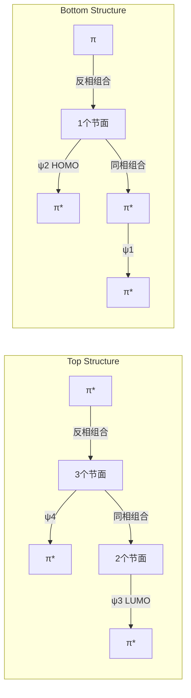
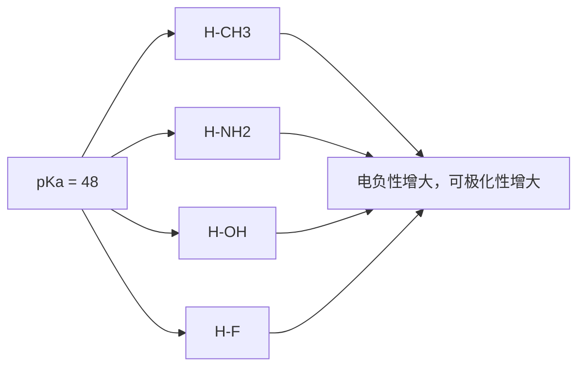
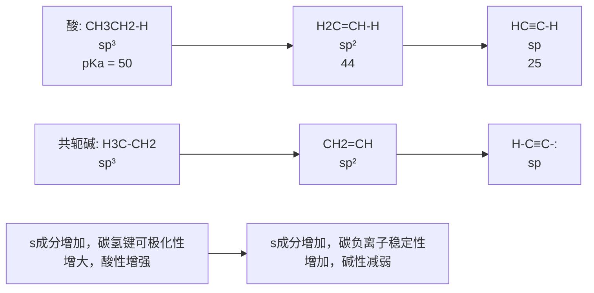

<details>
<summary>chemical</summary>

Three organic molecular structures: orthoethanol, benzene chloride, and 2-ethylamine
</details>

formula）。例如，异丁烷、乙烯、乙炔和甲醇可表示如下:


<details>
<summary>chemical</summary>

Chemical structures of ethylene and methanol with labeled substituents:异丁烷, 乙烯, 乙炔, 甲醇
</details>

键线式（line-bond formula）又称骨架结构（skeletal formula）。键线式中只保留共价键，而省去碳原子及与碳相连的氢原子，但杂原子及与杂原子相连的氢原子不能省去。在画长链分子的键线式时通常将骨架画成锯齿状。例如，正戊醇、氯苯和二乙胺的结构可用侧栏所示结构式表示。

## 2. 楔形式

上述 Kekulé 式、结构简式和键线式是不能体现分子立体结构的，对于具有四面体碳的有机分子，常用楔形式（wedge-dash notation）来表达它们的立体结构。在楔形结构式中，用传统的短线表示与纸共平面的键，用虚楔形线表示指向纸面下方的键，而用实楔形线表示指向纸面上方的键。例如，下图为 2-氯丁烷的楔形式，其中连接氯原子的键为虚楔形线（楔形线的大头指向氯原子），表示氯原子在纸面下方，链接氢原子的键为实楔形线（大头指向氢原子），表示氢原子在纸面上方。这种方法是目前最常用的分子结构表示方式之一。


<details>
<summary>chemical</summary>

Chemical structure of 2-chloro-1,2-dimethane with labeled cross-sections for dihedral and tetrahedral orientations
</details>

## 1.5.2 有机分子结构基本参数

所有分子都有一定的几何构型，我们可以用一组参数来定量描述分子的结构，主要包括键长（bond length）、键角（bond angle）和键能（bond energy）。键长和键角用以描述分子的几何构型，键能则体现键的强度（bond strength），这些参数是了解共价键性质、讨论分子结构与性质关系的重要依据。

键长是两个成键原子的平均核间距。以 $\mathrm{H}_{2}$ 为例，当两个氢原子相互作用时，能量将随核间距的变化而变化（如图1-23所示）。随着两个自由的氢原子逐渐靠近，能量下降到波谷，此时两个氢原子的核间距为 $74~\mathrm{pm}$ 。两个氢原子继续靠近，两个核之间相互排斥，使能量迅速上升。能量达到波谷时（能量最低状态）的核间距 $74~\mathrm{pm}$ 就是H-H键的平衡键长。

键长与成键原子的半径、电负性、杂化类型及键的数目等因素有关。原子半径越小，键长越小。例如，碳原子的半径要比氢原子的大得多，故乙烷分子中 C-C 键（154 pm）和 C-H 键（109 pm）的键长都要比 H-H 键键长（74 pm）大很多。键的数目越多，键长越小，如乙烷、乙烯和乙炔分子中 C-C 键（154 pm）、C=C 键（134 pm）和 C≡C 键（120 pm）依次变短。


<details>
<summary>bubble</summary>

| Feature | Value |
| --- | --- |
| Minimum Energy (Energy) | 74 pm |
| Total Energy Difference | 436 kJ/mol |
</details>

图1-23 两个氢原子相互作用时能量和核间距之间的相互关系

键能是衡量化学键强弱的物理量。对于双原子分子，键能等于键的解离能（bond dissociation energy，BDE），即 $1\mathrm{mol}$ 气态分子解离成气态原子所吸收的能量。图1-23中核间距为 $74~\mathrm{pm}$ 时氢分子与两个自由氢原子的能量差 $436\mathrm{kJ / mol}$ 就是H-H键的键能。对于多原子分子，键能则为某一特定分子中所有特定类型化学键的键解离能的平均值。有机化合物中通常含有多个共价键，每一个共价键在分子中都不是孤立的，受其他键的影响，同一类型共价键的键长和键能在不同分子中可能稍有不同，通常取其平均值。

键能与键长以及分子本身的稳定性密切相关，键长越小，键越强，键能就越大。例如，乙烷、乙烯和乙炔分子中 C-C 键（347 kJ/mol）、C=C 键（611 kJ/mol）和 C≡C 键（837 kJ/mol）的键能随键长变短而依次增强。

大多数有机化合物中共价键的键能在 100\~900 kJ/mol 范围内。表 1-3 选列了一些常见共价键的平均键长和键能数据。

表 1-3 一些常见共价键的平均键长和键能

| 键型 | 键长/pm | 键能/(kJ·mol-1) | 键型 | 键长/pm | 键能/(kJ·mol-1) |
| --- | --- | --- | --- | --- | --- |
| C-H | 109 | 414 | C-I | 212 | 218 |
| C-C | 154 | 347 | C=C | 134 | 611 |
| C-N | 147 | 305 | C≡C | 120 | 837 |
| C-O | 143 | 360 | C=O | 123 | 695 |
| C-F | 142 | 485 | C=N | 127 | 615 |
| C-Cl | 177 | 339 | C≡N | 116 | 892 |
| C-Br | 191 | 285 | O-H | 96 | 463 |

键角是两个相邻共价键之间的夹角，它是反映分子空间结构的基本参数。分子中中心原子的电子对排布决定了分子的标准键角，但组成相似的分子不一定有相同的键角，绝大多数分子的键角偏离标准键角。如甲烷分子中任意一个 H-C-H 键角为  $109.5^{\circ}$ （见图 1-10），而乙烷分子中 H-C-H 键角为  $117.4^{\circ}$ （见图 1-11）。

影响分子键角偏离的因素很多，但主要因素是中心原子价层电子对的类型和成键原子的电负性。当中心原子价层电子对中存在孤对电子时，孤对电子对成键电子对有较大的排斥作用，这可导致键角变小。这是因为成键的共用电子对受两个原子核吸引，比较集中在键轴位置，而孤对电子没有被共享，只受中心原子核的吸引，电子云体积比较大，使它比成键电子对更强烈地排斥相邻电子对。在图1-16所示的氨分子结构中，虽然氮原子采取了 $sp^{3}$ 杂化，但由于孤对电子占据了一个 $sp^{3}$ 杂化轨道，它对成键电子对产生较大排斥，导致H-N-H键角被压缩到 $107.3^{\circ}$，从而偏离标准的 $109.5^{\circ}$ 。

## 1.6 电子离域:共振和共轭效应

多原子分子中的电子并非完全局限在两个成键原子核之间，而是在一定范围内分布于多个原子核之间。常用“定域”（localized）和“离域”（delocalized）来表示电子的这两种状态。电子离域是一种普遍现象，它能够改变分子（也包括离子和自由基）中电子、电荷的分布，增加分子的稳定性, 从而影响分子的物理性质和化学性质。分子中由于轨道相互作用(重叠), $\pi$ 电子或非键电子在多个原子之间离域, 导致电子云分布更为均匀, 键长平均化, 结构更为稳定, 这种电子效应称为共轭 (conjugation)。电子的离域运动使得一个分子可能会在多种电子构型 (共振结构) 之间相互转换, 并达到平衡, 这种动态现象称为共振 (resonance)。常用共振结构来表示共轭, 下面首先介绍共振论。

## 1.6.1 共振结构


A


B


C


<details>
<summary>chemical</summary>

Chemical reaction diagram showing cyclohexane reacting with a benzene to form a substituted cyclohexane ring
</details>


共振杂化体

在书写路易斯式时，对于同一个分子可能会画出多个符合规则的路易斯结构式。以碳酸根离子（$\mathrm{CO}_3^{2-}$）为例（见侧栏），A、B和C式都符合路易斯结构式的规则，它们的差别只是其中电子、负电荷和双键的位置不同，问题是哪一种能够代表碳酸根离子的真实结构？碳酸根离子的实际情况是，所有的碳氧键都具有双键性质，且键长都相同，所有的氧原子带有相同数量的负电荷，即2/3个负电荷，整个结构是完全对称的。所以A、B和C式中任何一种都不能代表碳酸根离子的真实结构。

苯和其他芳香烃类化合物也存在类似问题。通常把苯的结构画成单双键交替的六元环，然而，真实的苯环骨架并没有单双键之分，所有碳碳键的键长都是 139 pm。

为了解决这一困惑，1931年化学家鲍林（L. Pauling）提出了共振论（resonance theory）。共振论认为，当一个分子（也包括离子和自由基）的结构不能用一种路易斯式正确表示时，可以用多种路易斯式来表示，这些路易斯式称为共振式（resonance formula）或极限式，相应的结构称为共振结构（resonance structure）或极限结构。分子的真实电子结构是这些共振结构线性组合（杂化）的结果，称为共振杂化体（resonance hybrid），任何单一的共振式都不能代表分子的真实电子结构。

书写共振式时，在共振式之间用双箭头关联，以表示它们的共振关系，用弯箭头表示电子对离域（偏移）的方向，用鱼钩表示单个电子离域的方向，所有的共振式用方括号括起来，以表示它们之间是通过移动一个电子或电子对就可互换的特性。共振杂化体则采用虚实线表示离域的化学键。苯的共振式和共振杂化体如侧栏所示。

如果共振杂化体中原子带部分正电荷或部分负电荷，常用“$\delta+$”或“$\delta-$”来标记。如果正电荷或负电荷的数目是明确的，则用具体的数字加符号来表示，例如:


<details>
<summary>chemical</summary>

Chemical reaction diagram showing the formation of a monomeric complex with electron transfer and radical bond formation
</details>

从这个共振杂化体可以看出，碳酸根离子中三个碳氧键完全等价，两个负电荷平均分散在三个氧原子上。

共振论使用了“共振能”概念来体现共振所导致的能量变化。共振能是指共振杂化体与最稳定的共振结构之间的能量差，它可以通过量子化学方法进行计算，其经验值可通过热化学方法或从氢化热的测定中推导出，在此不作深入讨论。以下仅介绍与能量有关的一些经验规律:

（1）共振杂化体的能量总是低于任何一个单独共振结构的能量，而不同共振结构对共振杂化体的贡献不一定相同；共振结构越稳定，对共振杂化体的贡献就越大。
（2）参与共振的共振结构数目越多，共振杂化体越稳定。

（3）电荷分离将导致共振结构稳定性降低；电荷分离后所有原子都具有完整价电子层（第二周期原子符合八隅体规则）的共振结构式较稳定，负电荷在电负性较大原子上的共振结构也较稳定。例如，N,N-二甲基甲酰胺分子可写出如下3个合理的共振结构，其中第一个没有电荷分离，最稳定，对共振杂化体贡献最大；第二个和第三个都有电荷分离，且电子都离域到电负性较大的氧原子上，但第二个存在不符合八隅体规则的碳原子（只有6个价电子），故最不稳定；共振杂化体中氧原子带部分负电荷，氮原子则带部分正电荷。


N,N-二甲基甲酰胺

（4）结构等同（或等价）的共振式能量相同，贡献相同；结构等同的共振式越多，杂化体越稳定。例如，乙酸根离子可写出以下三个共振结构，其中第一和第三个属于等同结构，共振杂化体中一个负电荷平均分配给两个氧原子，整个结构具有面对称性和轴对称性。


从上面的例子可以看出，有些不符合八隅体规则的结构也是合理的共振结构，只是它们的贡献较小而已。换言之，所有符合共振结构原则的（合理的）结构式都是真实结构的潜在贡献者。因此，在书写共振结构时一定要清楚哪些是主要贡献者。以下是正确书写共振结构的主要原则和规范:

（1）共振是同一分子不同共振结构之间的相互转换，从一个共振式转换为另一共振式时只允许 $\pi$ 电子和非键电子（如孤对电子和未成对电子）移动，而不允许原子核位置改变。
（2）遵守价键规则，第二周期元素价电子数不超过8，完全符合路易斯结构式规则的共振结构最重要。如上述乙酸根离子的三个共振式中，第一和第三个是等同的，它们的所有原子都符合八隅体规则，故最稳定；第二个共振式中碳原子上只有6个电子，最不稳定。
（3）所有的共振结构式必须具有相同数目的成对电子或未成对电子，净的电荷数也要保持相同。例如，戊二烯基正离子所有共振式都保持4个离域电子和一个正电荷，戊二烯基自由基所有共振式都保持5个离域电子，其中一个是未成对电子。请注意:在烯丙基自由基共振中，表示单个电子移动的符号是“鱼钩”，而不是弯箭头。


（4）对于双键和叁键，电荷分离时，正、负电荷优先分布在与电负性一致的原子上，即负电荷处于电负性较大的原子上。如甲醛的共振式中，从第一个向第二个共振时，电荷分离，电子移向电负性较大的氧原子上，故第二个共振式中氧原子带负电荷，碳原子带正电荷。如果电子反向偏移，则得到极不合理的“氧正离子”共振式。不遵守电负性原则的电荷分离贡献很小，一般忽略不计。


<details>
<summary>chemical</summary>

Chemical reaction equation showing oxidation of alkenes into a brominated alkene and its decomposition into monomers
</details>

## 1.6.2 $\pi -\pi$ 共轭

在前文中，我们讨论了乙烯分子中 $\pi$ 键，可知乙烯双键中两个 $\pi$ 电子是定域在两个碳原子之间的。如果分子中含有两个双键，且它们被一个单键隔开，其 $\pi$ 键和分子整体结构如何？以最简单的丁-1,3-二烯为例来讨论这个问题。如图1-24所示，与乙烯相似，丁-1,3-二烯分子中每个碳原子都为 $\mathrm{sp}^2$ 杂化，所有的碳原子处于同一平面，所有的p轨道都垂直于这个平面，且“肩并肩”形成一个大 $\pi$ 键（图中用虚线表示），其中有4个 $\pi$ 电子。在这个体系中，$\pi$ 电子不局限于某一个双键，而是离域在两个双键的四个碳原子之间。这种由单双键交替构成的、电子在多个原子间离域的平面结构称为共轭体系（conjugation system）。像丁-1,3-二烯这样由两个双键组成的共轭体系称为共轭二烯，以此类推，由多个双键组成的共轭体系称为共轭多烯。由于产生离域的电子全部来自 $\pi$ 轨道，通常把这种共轭作用称为 $\pi -\pi$ 共轭。


图1-24 丁-1,3-二烯的分子结构

与孤立双键体系相比，共轭体系中的双键和单键键长趋于平均化，分子的能量降低，稳定性增大，物理性质和化学性质大多与孤立双键体系不同。如上述丁-1,3-二烯分子中C2-C3键的键长为 $146\mathrm{pm}$，明显比乙烷的C-C键键长（$154\mathrm{pm}$）短，具有部分双键的性质。这种由电子离域而导致结构与性质改变的效应称为共轭效应（conjugated effect）。共轭效应是一种重要的电子效应，它能够影响分子（也包括离子、自由基等）的结构、稳定性和反应性。在以后的章节中，我们会经常用到共轭效应这一概念。

可以用共振结构来表示丁-1,3-二烯的共轭作用。如下是比较重要的5个共振式，其中最稳定的是无电荷分离的A式，其他都存在电荷分离，其中B式和D式等价，C式和E式等价，它们是相对比较重要的，对真实结构有一定贡献；C式和E式中C2-C3键是双键，这就解释了真实结构中C2-C3键具有部分双键特征的原因。


<details>
<summary>chemical</summary>

Reaction mechanism diagram showing hydrogen bonding and rearrangement steps between compounds E, D, A, B, and C
</details>

根据共振论，共振结构越多，共振杂化体越稳定，丁-1,3-二烯分子因共振而稳定。为了进一步了解共轭效应的本质，下面将用分子轨道理论来分析丁-1,3-二烯的  $\pi-\pi$  共轭作用。

根据休克尔分子轨道法,可以通过两个孤立  $\pi$  键分子轨道的线性组合来产生丁-1,3-二烯的分子轨道。如图 1-25 所示，两个孤立  $\pi$  键有两个  $\pi$  轨道和两个  $\pi^{*}$  轨道，两个能量相同且对称性匹配的  $\pi$  轨道组合成两个新的分子轨道（分别用波函数符号  $\psi_{1}$  和  $\psi_{2}$  标记），同样，两个能量相同且对称性匹配的  $\pi^{*}$  轨道也能够组合成两个新的分子轨道（分别用波函数符号  $\psi_{3}$  和  $\psi_{4}$  标记），这 4 个新分子轨道的能级从  $\psi_{1}$  到  $\psi_{4}$  均依次升高。4 个电子填充在能量低的  $\psi_{1}$  和  $\psi_{2}$  轨道，这两个轨道均是成键轨道， $\psi_{3}$  和  $\psi_{4}$  均为反键轨道。能量最高的成键轨道（ $\psi_{2}$ ）称为最高已占轨道（highest occupied molecular orbital, 简称 HOMO）；能量最低的反键轨道（ $\psi_{3}$ ）称为最低空轨道（lowest unoccupied molecular orbital, 简称 LUMO）。化学反应就发生在 HOMO 和 LUMO 轨道中，它们被称为前线分子轨道（frontier molecular orbital）。在以后的章节中，我们会应用这些概念。

需要指出的是，在形成分子轨道时，参与组合的各原子轨道对分子轨道的贡献是用比例来体现的，这个比例称为轨道系数（coefficients）。轨道系数的大小是通过量化计算获得的，常用原子轨道波瓣图形的大小来表示。如图1-25所示，$\psi_{1}$ 和 $\psi_{4}$ 中间的两个p轨道系数最大，而 $\psi_{2}$ 和 $\psi_{3}$ 两端的两个p轨道系数最大。考虑到成键三原则，轨道系数概念在预测和解释有机反应区域选择性方面有重要应用。


<details>
<summary>flowchart</summary>


</details>

图1-25 丁-1,3-二烯的分子轨道示意图

从图1-25可以看出，能量最低的 $\psi_{1}$ 轨道没有节面。随着能量升高，从 $\psi_{2}$ 轨道到 $\psi_{3}$ 和 $\psi_{4}$ 轨道依次出现1、2和3个节面。没有节面意味着电子连续处在 $\psi_{1}$ 轨道中，并分布在四个碳原子之间，因而 $\psi_{1}$ 轨道中所有碳原子之间都有成键作用（bonding interaction），净的成键数为 $+3$ 。在 $\psi_{2}$ 轨道中，C1和C2之间以及C3和C4之间有成键作用，但在C2和C3之间有一个节面，存在反键作用（antibonding interaction），所以 $\psi_{2}$ 轨道净的成键数为 $2 - 1 = 1$ 。以此类推，空的 $\psi_{3}$ 轨道净的成键数为-1，而 $\psi_{4}$ 轨道中净的成键数为-3。


苯乙烯


丁烯炔


丙烯腈


丙烯醛


环己烯酮


硝基乙烯

键长


氯乙烯

在两个已占轨道（$\psi_{1}$ 和 $\psi_{2}$）中，C1和C2之间以及C3和C4之间都有成键作用，但在$\psi_{2}$中C2和C3之间有反键作用，这就抵消了一部分$\psi_{1}$中C2和C3之间的成键作用。之所以是部分抵消，而不是完全抵消，是因为$\psi_{2}$中C2和C3的轨道系数小于$\psi_{1}$中C2和C3的轨道系数。这就解释了丁-1,3-二烯中C2-C3键具有部分双键特征的原因。

除了共价键的成键之外，分子轨道能级图还能帮助我们理解有机化合物的稳定性和反应性。例如，丁-1,3-二烯分子的两个离域轨道 $\psi_{1}$ 和 $\psi_{2}$ 的总能量低于两个乙烯分子成键轨道（$\pi$ 轨道）的总能量，这个能量差称为离域能（delocalization energy，DE），这就意味着共轭的丁-1,3-二烯在热力学上要比孤立二烯体系稳定。丁-1,3-二烯的HOMO能级高于乙烯的HOMO能级，因此在与亲电试剂发生亲电加成反应时，丁二烯要比乙烯活泼。这些预测都与事实相符。

除了共轭双烯和共轭多烯之外，苯环、碳氧双键、碳碳叁键、碳氮叁键等含有 $\pi$ 键的官能团都可形成 $\pi-\pi$ 共轭体系，如苯乙烯、丁烯炔、丙烯腈、丙烯醛、环己烯酮和硝基乙烯分子中均存在单双键或叁键交替结构，均属于 $\pi-\pi$ 共轭体系。

许多共轭多烯是维护人体健康不可缺少的营养素， $\beta-$ 胡萝卜素就是其中之一，它也是人体内维生素A的重要来源之一。 $\beta-$ 胡萝卜素分子的共轭体系由11个双键和22个 $\pi$ 电子构成。


<details>
<summary>chemical</summary>

Chemical structure of β-lactam, labeled as β-lactamene
</details>

## 1.6.3 p-π共轭

如果与  $\pi$  键相连的某一原子具有一个与  $\pi$  轨道平行的 p 轨道，那么这个 p 轨道就可与  $\pi$  轨道共轭，形成 p- $\pi$  共轭体系。例如，氯乙烯分子中氯原子的 p 轨道与两个双键碳原子的 p 轨道平行，能够重叠形成 “三原子四电子” 的共轭大  $\pi$  键，这种共轭体系称为 p- $\pi$  共轭。

从氯乙烯的共振结构可以预测其 C-Cl 键具有部分双键特征，实测 C-Cl 键的键长为 169 pm，这与氯乙烷中 C-Cl 键键长（177 pm）相比，明显变短了。


<details>
<summary>chemical</summary>

Chemical reaction diagram showing hydrogen bonding between a chlorinated alkene and a chloride ion
</details>

烯丙基正离子和烯丙基负离子也是典型的 $p-\pi$ 共轭体系，其中碳原子全部为 $sp^{2}$ 杂化，三个未杂化的 $p$ 轨道“肩并肩”形成 $\pi$ 键。从两个等同的共振结构可以看出，烯丙基正离子的 $\pi$ 轨道具有面对称性，正电荷平均分配给两端两个碳原子；烯丙基负离子的结构也与烯丙基正离子相似。


烯丙基正离子


<details>
<summary>chemical</summary>

Chemical reaction diagram showing protonation of a carbocation with an alkene
</details>


烯丙基负离子


<details>
<summary>chemical</summary>

Chemical reaction diagram showing hydrogen bonding between a carbonyl compound and an alkene
</details>

烯丙基正离子的休克尔分子轨道是由三个碳原子的2p轨道组合成的。如图1-26所示，$\psi_{1}$ 轨道由三个2p轨道同相组合而成，净的成键数为 $+2$ ，能量最低。$\psi_{2}$ 轨道有一个节面，正好处在2位碳原子上，净的成键数为0，能量与2p轨道能量接近。$\psi_{3}$ 轨道由三个2p轨道反相组合而成，有两个节面，两个反键，净的成键数为-2，能量最高。两个电子填充到 $\psi_{1}$ 轨道，因此 $\psi_{1}$ 为HOMO，$\psi_{2}$ 为LUMO。与2p轨道相比，两个电子填充的 $\psi_{1}$ 轨道能量降低了，这个能量差就体现了共轭稳定化作用。


<details>
<summary>text_image</summary>

能量
3个2p轨道
2个电子
2个节面
ψ₃
ψ₂ LUMO
节面
ψ₁ HOMO
</details>

图 1-26 烯丙基正离子的分子轨道示意图

烯丙基负离子的分子轨道与烯丙基正离子的相似，只是有4个电子，其中两个填充到 $\psi_{1}$ 轨道，另外两个填充到 $\psi_{2}$ 轨道，因此 $\psi_{2}$ 为HOMO，$\psi_{3}$ 为LUMO（见图1-27）。与2p轨道相比，两个电子填充的 $\psi_{1}$ 轨道能量降低了，因此共轭作用也稳定了烯丙基负离子。


<details>
<summary>text_image</summary>

能量
3个2p轨道
4个电子
2个节面
ψ₃ LUMO
ψ₂ HOMO
节面
ψ₁
</details>

图1-27 烯丙基负离子的分子轨道示意图

## 1.6.4 常见基团的共轭效应

在上述氯乙烯 $\mathrm{p - }\pi$ 共轭体系的例子中，氯原子上的孤对电子离域到碳碳双键的 $\pi$ 轨道，导致2位碳原子带部分负电荷，电子密度增大，氯原子表现出给电子作用。在硝基乙烯的 $\pi -\pi$ 共轭体系中，从共振结构不难看出负电荷集中在硝基氧原子上，正电荷集中在2位碳原子，碳碳双键电子密度降低，硝基表现出吸电子作用。

不同的基团（或原子）在共轭体系中扮演的角色不同，有的给电子（如氯原子），有的吸电子（如硝基）。通常把给电子的效应称为正效应，给电子共轭效应用“+C”表示（C是conjugation的第一个字母），与之相反，吸电子的效应称为负效应，吸电子共轭效应用“-C”表示。


<details>
<summary>chemical</summary>

Molecular structure diagram showing a protonated nitrogen-containing heterocycle with oxygen and hydrogen atoms
</details>

硝基乙烯

```csv
常见+C基团:
O⁻, OH, OR
NH₂, NHR, NR₂
SH, SR
F, Cl, Br, I
常见-C基团:
NO₂, SO₃H
C=O, CO₂H, CO₂R
CN
```

共轭效应是一种重要的电子效应，区分 “+C” 和 “-C” 很有意义，它能够帮助我们更好地理解有机分子的电子密度和电荷分布情况、反应活性和区域选择性等。侧栏中列举了一些常见给电子和吸电子共轭效应的基团（或原子）。

## 1.7 电子离域:超共轭效应

上一节中我们讨论了因电子离域而产生的共轭效应，涉及 $\pi$ 轨道之间或者 $\pi$ 轨道与 $p$ 轨道之间相互作用。根据分子轨道理论，只要在空间上能够满足轨道重叠的条件，满占的 $\sigma$ 轨道也可与空的 $\pi^{*}$ 轨道、空的或单占的 $p$ 轨道相互作用，形成新的分子轨道，电子在新轨道能量有所降低，体系更加稳定。这种稳定化作用称为超共轭（hyperconjugation）。超共轭效应比上述共轭效应一般要弱得多，因为这些轨道之间重叠是不充分的，相互作用比较弱。从本质上看，这种稳定化作用是 $\sigma$ 电子离域的结果，因而有人把它归属为共轭效应的一种，称为 $\sigma-$ 共轭（$\sigma-$ conjugation）。与共轭效应类似，我们可根据参与超共轭作用的轨道类型，将超共轭效应分为 $\sigma-\sigma$ 超共轭、$\sigma-\pi$ 超共轭、$\sigma-p$ 超共轭、$n-\sigma$ 超共轭等。作为入门章节，本节仅简单介绍 $\sigma-\pi$ 和 $\sigma-p$ 超共轭。

## 1.7.1 $\sigma -\pi$ 超共轭

丙烯分子中存在 $\sigma -\pi$ 超共轭作用。如图1-28所示，当双键的 $\mathrm{sp}^2$ 杂化碳与 $\mathrm{sp}^3$ 杂化碳原子相连时，满占的C-H $\sigma$ 成键轨道可以与空的 $\mathrm{C = C}\pi$ 反键轨道（$\pi^{*}$ 轨道）重叠，组合出新的分子轨道，两个电子填充到新轨道，能量降低，分子的稳定性增加，这种作用称为 $\sigma -\pi$ 超共轭效应。另一种标记超共轭类型的方法则更加清晰，如上述 $\sigma -\pi$ 超共轭可表示为$\sigma (\mathrm{C - H})\rightarrow \pi^{*}(\mathrm{C - C})$ ，其中 $\sigma (\mathrm{C - H})$ 代表 $\mathrm{C - H}\sigma$ 轨道， $\pi^{*}(\mathrm{C - C})$ 代表 $\mathrm{C = C}\pi^{*}$ 轨道，箭头指明了电子离域的方向。图1-28中只显示了一个C-H键的超共轭，但C-C键是可自由旋转的，而甲基碳上有三个C-H键，故丙烯的超共轭作用可标记为 $3\times \sigma (\mathrm{C - H})\rightarrow \pi^{*}(\mathrm{C - C})$ 。

$\sigma (\mathrm{C - H})\rightarrow \pi^{*}(\mathrm{C - C})$ 超共轭效应弱化了烯丙基位C-H键，这与丙烯的烯丙基C-H键解离能（BDE）比乙烷C-H键解离能小的事实相符。

$$
\mathrm{H} _ {2} \mathrm{C} = \mathrm{CHCH} _ {2} - \mathrm{H}
$$

$$
\text{BDE} = 359 \text{ kJ/mol}
$$

$$
\mathrm{CH} _ {3} \mathrm{CH} _ {2} - \mathrm{H}
$$

$$
\mathrm{BDE} = 423 \mathrm{kJ/mol}
$$


图1-28 丙烯的 $\sigma -\pi$ 超共轭效应（a）及分子轨道能级变化示意图（b）

需要指出的是，虽然超共轭效应稳定了 $\mathrm{C = C}$ 键，但它的电子密度增加了，HOMO的能级升高了（图1-28中没有画出 $\mathrm{C = C}$ 键的HOMO，即 $\pi$ 轨道）。据此可以预测，在与亲电试剂发生反应时，丙烯的反应活性应该比乙烯的反应活性高，这与事实相符合（详见第五章）。类似的效应也见于甲苯的亲电取代反应（见第六章）。

## 1.7.2 σ-p 超共轭

$\sigma - p$ 超共轭常见于碳正离子和碳自由基体系。乙基碳正离子中的 $\sigma - p$ 超共轭效应和分子轨道能级变化见图1-29，中心碳原子为 $\mathrm{sp}^2$ 杂化的平面三角形结构（类似于乙烯碳原子），未杂化的 $p$ 轨道是空的，甲基的 $\mathrm{C - H}\sigma$ 轨道能够与中心碳原子空的 $p$ 轨道重叠，$\sigma$ 电子离域到空的 $p$ 轨道，形成的新轨道能量降低，从而产生稳定化作用。甲基的3个C-H键都可参与超共轭效应，所以，乙基碳正离子的超共轭作用可标记为 $3 \times \sigma (\mathrm{C - H}) \rightarrow \mathfrak{p}(\mathrm{C})$。


图1-29 乙基碳正离子的 $\sigma -\mathfrak{p}$ 超共轭效应（a）及分子轨道能级变化示意图（b）

由于存在 $3 \times \sigma(\mathrm{C}-\mathrm{H}) \rightarrow \mathrm{p}(\mathrm{C})$ 超共轭效应，乙基碳正离子要比无超共轭效应的甲基碳正离子（$^+\mathrm{CH}_3$）稳定得多，而有 $6 \times \sigma(\mathrm{C}-\mathrm{H}) \rightarrow \mathrm{p}(\mathrm{C})$ 和 $9 \times \sigma(\mathrm{C}-\mathrm{H}) \rightarrow \mathrm{p}(\mathrm{C})$ 超共轭效应的异丙基正离子和叔丁基正离子更稳定。实际上迄今还没直接证据证明甲基碳正离子的存在。碳正离子是许多重要有机反应的活性中间体，因此理解它们的稳定性至关重要，有关内容将在第四章和第五章中讨论。

## 1.7.3 超共轭效应的简单表示方式

虽然分子轨道能够帮助我们理解共轭和超共轭效应，特别是能量变化情况，但分子轨道图形比较复杂，初学者不易掌握。根据国际纯粹与应用化学联合会（IUPAC）的建议，超共轭效应可以采用“双键-无键”共振式（double bond-no bond resonance）来表示，也可用弯箭头表示 $\sigma$ 电子离域的方向。例如，乙基正离子的 $\sigma - p$ 超共轭可表示为


<details>
<summary>chemical</summary>

Chemical reaction diagram showing protonation and rearrangement of a carbocation intermediate with hydrogen bonding
</details>

双键-无键共振式不仅简单明了，而且能够体现超共轭的本质，与分子轨道理论分析所得主要结论一致，如能直观地给出哪些键被加强、哪些键被弱化的信息。从上式中，我们可以获悉乙基正离子的C1-C2键被加强了（有部分双键特征），而C2-H键被弱化了，这与第五章中将要讨论的E1消除反应（中间体为碳正离子）的事实相符合。


甲基锂


氯甲烷


## 1.8 共价键的极化和诱导效应

## 1.8.1 共价键的极性

对于相同原子形成的共价键，其成键电子对处于两原子中间，正、负电荷中心重叠，这样的共价键称为非极性共价键。不同原子形成共价键时，由于各元素的电负性（electronegativity）不同，原子吸引电子的能力不同，电子偏向电负性较大的原子一端，从而导致键的极化（bond polarization），使电负性较大的原子带有部分负电荷，另一原子带部分正电荷，正、负电荷中心不重叠，这样的共价键称为极性共价键。常用  $\delta+/\delta-$  标记极性共价键电荷分布情况，用箭头表示电子对偏移的情况，箭头方向是从带部分正电荷原子指向带部分负电荷原子。例如，甲基锂中的 C-Li 键和氯甲烷中的 C-Cl 键的极性可表示如侧栏中结构式所示。

键的极性与成键原子的电负性差值有关，差值越大，极性越大。当两个原子的电负性差值大于等于2时，可以发生电子的完全转移，而不是共享，从而形成离子键。如钠的电负性为0.9，氯的电负性为3.0，钠失去一个电子成正离子，氯得到一个电子成负离子，最终形成离子型氯化钠。表1-4列出了一些常见元素的电负性数据。

表 1-4 一些常见元素的电负性

<table><tr><td colspan="7">H</td></tr><tr><td colspan="7">2.1</td></tr><tr><td>Li</td><td>Be</td><td>B</td><td>C</td><td>N</td><td>O</td><td>F</td></tr><tr><td>1.0</td><td>1.5</td><td>2.0</td><td>2.5</td><td>3.0</td><td>3.5</td><td>4.0</td></tr><tr><td>Na</td><td>Mg</td><td>Al</td><td>Si</td><td>P</td><td>S</td><td>Cl</td></tr><tr><td>0.9</td><td>1.2</td><td>1.5</td><td>1.8</td><td>2.1</td><td>2.5</td><td>3.0</td></tr><tr><td>K</td><td>Ca</td><td></td><td>Ge</td><td>As</td><td>Se</td><td>Br</td></tr><tr><td>0.8</td><td>1.0</td><td></td><td>1.8</td><td>2.0</td><td>2.4</td><td>2.8</td></tr><tr><td></td><td></td><td></td><td></td><td></td><td></td><td>I</td></tr><tr><td></td><td></td><td></td><td></td><td></td><td></td><td>2.5</td></tr></table>

常用键的偶极矩（dipole moment，简称键矩）来衡量共价键的极性大小，用符号  $\mu$  表示。 $\mu$  等于正负电荷中心之间的距离（d）与电荷（q）的乘积，单位是德拜（Debye，用 D 表示， $1\ D = 3.34 \times 10^{-30}\ C \cdot m = 0.208$  单位正、负电荷分开 0.1 nm）。

$$
\mu = q \times d
$$

键矩是矢量，有方向性，常用符号“↔”表示，箭头由正电荷中心指向负电荷中心。H-F键的键矩可表示如侧栏所示。

碳的电负性随着杂化轨道的类型不同而略有不同。碳的杂化轨道由2s和2p轨道组成，s轨道呈球形对称，能级较低，电子在球形轨道内运动，受核束缚较大，而p轨道有一通过核的节面，能级较高，电子在舒展的两个叶瓣内运动，受核束缚较小。因此，杂化轨道中s成分越多，核对电子的束缚越大。碳原子的sp、 $sp^{2}$ 和 $sp^{3}$ 杂化轨道中s成分依次为50%、33%和25%，它们的电负性大小顺序为 $C_{sp}>C_{sp^{2}}>C_{sp^{3}}$ 。

## 1.8.2 分子的偶极矩

分子的极性大小用偶极矩表示。对于双原子分子，其键矩就是分子的偶极矩。对于多原子分子，分子的偶极矩是各键矩的矢量和。氯甲烷中 C-Cl 键是极性共价键，键矩由 C 指向 Cl，分子偶极矩是三个 C-H 键键矩和一个 C-Cl 键键矩的矢量和（1.87 D），属于极性分子。四氯化碳为四面体对称分子，各键矩的矢量和为零，分子的偶极矩等于 0，是非极性分子。甲烷与四氯化碳类似，四个 C-H 键的键矩均由 H 指向 C，分子偶极矩是四个 C-H 键的键矩矢量和，这个值也等于 0，故甲烷属于非极性分子。由于碳和氢的电负性相差很小，绝大多数烷烃都为非极性分子，或者极性极弱。

下面列举了在气相条件下测得的卤代甲烷分子的偶极矩数据。从氯甲烷到溴甲烷和碘甲烷，随着卤原子电负性的减小，分子的偶极矩依次减小。为什么氟甲烷没有遵循这个顺序而成为例外？注意键矩的定义。虽然氟的电负性最大，但氟原子半径最小，C-F键的键长（142 pm）比C-Cl键的键长（177 pm）短得多，故C-F键的键矩比C-Cl键的小。碘甲烷中虽然C-I键最长，但碘的电负性小，所以C-I键的键矩小，整个分子的偶极矩最小。


$\mu = 1.82 \mathrm{D}$


$\mu = 1.87 \mathrm{D}$


$\mu = 1.79 \mathrm{D}$


$\mu = 1.64 \mathrm{D}$


## 1.8.3 诱导效应

分子中不同原子（或基团）电负性的差异不仅使某个共价键极化，而且由此产生的极性共价键还能进一步诱导邻近的共价键，使其发生极化，这种电子效应称为诱导效应（inductive effect，用 I 表示）。诱导效应的本质是静电作用，是永久性的，其特征是电子偏移沿着  $\sigma$  键传递，而且随着碳链的增长而迅速减弱，直至消失。

第八章中我们将讨论核磁共振波谱，这种分析技术提供的重要信息之一是有机化合物分子中不同碳或氢原子的化学位移，而化学位移与核外电子密度直接相关，电子密度越大，化学位移值越小；反之亦然。下面以乙烷和氯乙烷的核磁共振碳谱化学位移为例，来讨论诱导效应是如何发生的。乙烷分子的两个碳原子是等价的，化学位移为6.5，我们以它为参照值。氯乙烷分子由于氯的电负性较大，C-C1键被极化，其中的 $\sigma$ 电子偏移到氯原子一边，导致C1核周围电子密度降低，因此C1的化学位移增大到40。因C1的电子密度降低而带部分正电荷时，静电作用使得C1-C2键也随之极化，电子向C1偏移，导致C2核周围电子密度降低，但降低幅度有所减少，所以C2的化学位移（19）小于氯乙烷C1的化学位移（40），但大于乙烷碳原子的化学位移（6.5）。这就是氯原子的吸电子诱导效应。

下面以丁酸及其氯代衍生物的酸性为例，进一步讨论诱导效应的特征。酸性强弱的定量指标是  $pK_{a}$ ， $pK_{a}$  值越小，酸性越强（相关理论将在下一节详细讨论）。以丁酸的酸性 ( $pK_{a}=4.82$ ) 为参照，当丁酸 2 位被氯取代，由于氯原子的吸电子诱导效应，C1-C2 键极化，并进一步传递到羟基的 O-H 键，使 O-H 极性共价键的极化度增大，电子更偏向氧原子，从而酸性增强 ( $pK_{a}=2.86$ )。当氯取代在 3 位时，传递链增开了一个  $\sigma$  键，氯的吸电子诱导效应减弱，3-氯丁酸的酸性 ( $pK_{a}=4.05$ ) 比 2-氯丁酸明显减弱。当氯取代在 4 位时，传递链再多一个  $\sigma$  键，诱导效应进一步减弱，4-氯丁酸的酸性 ( $pK_{a}=4.52$ ) 仅略微强于丁酸的酸性。


碳的化学位移:6.5


C1的化学位移:40

C2的化学位移:19


$\mathrm{p}K_{\mathrm{a}} = 4.82$


$pK_{a}=2.86$


$pK_{a}=4.05$


$pK_{a}=4.52$

诱导效应的强弱和方向与原子或基团及其电负性有关。在比较各种原子或基团的诱导效应时，以C-H键中氢原子为标准（规定氢原子 $I = 0$），如果原子或基团（Y）的吸电子能力比氢的强，C-Y键电子云偏向Y，则Y具有吸电子诱导效应，用-I表示；若Y的吸电子能力比氢的弱，则Y具有给电子诱导效应，用+I表示。

诱导效应能改变分子骨架电子密度分布，从而改变分子的物理性质和化学性质。例如，分子的共价键或官能团振动吸收频率、核磁共振化学位移、酸性和碱性、反应速率和选择性等，都会一定程度受到诱导效应的影响。在后续章节中，我们会经常用到诱导效应来讨论这些问题。

## 1.9 酸性和碱性

## 1.9.1 Brønsted-Lowry 酸碱理论

Brønsted 和 Lowry 在 1923 年提出的质子理论认为，凡是能够给出质子的物质都是酸（acid），凡是能够接受质子的物质都是碱（base）。酸（HA）给出质子后形成的负离子（A⁻）称为共轭碱（conjugated base），而碱（B⁻）获得质子后形成的物种（HB）称为共轭酸（conjugated acid）。酸是质子的给体，碱则是质子的受体。

$$
\begin{array}{c c c c}\mathrm{HA} \rightleftharpoons \mathrm{H} ^ {+} + \mathrm{A} ^ {-}&\mathrm{B} ^ {-} + \mathrm{H} ^ {+} \rightleftharpoons \mathrm{HB}\\\text {酸}&\text {共轭碱}&\text {碱}&\text {共轭酸}\end{array}
$$

酸与碱反应生成相应的共轭碱和共轭酸:

$$
\begin{array}{c c c c c}\mathrm{HA}&+&\mathrm{B} ^ {-} \rightleftharpoons \mathrm{A} ^ {-}&+&\mathrm{HB}\\\text {酸}&&\text {碱}&\text {共轭碱}&\text {共轭酸}\end{array}
$$

强酸解离为质子和共轭碱的过程是有利的，其逆反应是不利的。相反，弱酸解离为质子和共轭碱的过程是不利的，其逆反应则是有利的。在酸碱平衡反应中，强酸（如HCl）与弱碱（如甲醇）、强碱（如丁基锂）与弱酸（如甲醇）以及强酸与强碱的反应都是有利的，弱酸（如甲醇）与弱碱（如水）的反应则是不利的，而其逆反应是有利的。由强酸形成的共轭碱是弱碱，由强碱形成的共轭酸是弱酸；相反，由弱酸形成的共轭碱则是强碱，由弱碱形成的共轭酸则是强酸。

$$
\begin{array}{c c c c c c} \mathrm{HCl} & + & \mathrm{CH} _ {3} \mathrm{OH} & \longrightarrow & \mathrm{Cl} ^ {-} & + & \mathrm{CH} _ {3} ^ {+} \mathrm{OH} _ {2} \\ \text {强酸} & & \text {弱碱} & & \text {弱碱} & & \text {强酸} \\ \mathrm{C} _ {4} \mathrm{H} _ {9} \mathrm{Li} & + & \mathrm{CH} _ {3} \mathrm{OH} & \longrightarrow & \mathrm{C} _ {4} \mathrm{H} _ {1 0} & + & \mathrm{CH} _ {3} \mathrm{OLi} \\ \text {强碱} & & \text {弱酸} & & \text {弱酸} & & \text {强碱} \\ \mathrm{CH} _ {3} \mathrm{OH} & + & \mathrm{H} _ {2} \mathrm{O} & \longleftarrow & \mathrm{CH} _ {3} \mathrm{O} ^ {-} & + & \mathrm{H} _ {3} \mathrm{O} ^ {+} \\ \text {弱酸} & & \text {弱碱} & & \text {强碱} & & \text {强酸} \end{array}
$$

## 1.9.2 $K_{\mathrm{a}}$ 和 $\mathrm{p}K_{\mathrm{a}}$

酸性通常是在稀的水溶液中测量的。在此条件下，酸与水反应达到平衡，其平衡常数 $(K)$ 用下式表示:

$$
\begin{array}{c c c c c}\mathrm{HA} +&\mathrm{H} _ {2} \mathrm{O}&\stackrel {{K}} {{\rightleftharpoons}}&\mathrm{A} ^ {-}&+\\\text {酸}&\text {碱}&&\text {共轭碱}&\text {共轭酸}\end{array}\quad \mathrm{H} _ {3} \mathrm{O} ^ {+}
$$

$$
K = \frac {[ \mathrm{A} ^ {-} ] [ \mathrm{H} _ {3} \mathrm{O} ^ {+} ]}{[ \mathrm{HA} ] [ \mathrm{H} _ {2} \mathrm{O} ]}
$$

在稀的水溶液中，酸对 $\mathrm{[H_2O]}$ 的影响可以忽略， $[\mathrm{H}_2\mathrm{O}]$ 被认为是个常数，于是将酸的解离常数（dissociation constant） $K_{\mathrm{a}}$ 定义为

$$
K _ {\mathrm{a}} = K [ \mathrm{H} _ {2} \mathrm{O} ] = \frac {[ \mathrm{A} ^ {-} ] [ \mathrm{H} _ {3} \mathrm{O} ^ {+} ]}{[ \mathrm{HA} ]}
$$

酸性的强弱用  $pK_{a}$  来定量表示，它是  $K_{a}$  的负对数:

$$
\mathrm{p} K _ {\mathrm{a}} = - \lg K _ {\mathrm{a}}
$$

按照上式， $K_{\mathrm{a}}$ 值越大， $\mathrm{pK_a}$ 值越小，酸性越强；反之， $K_{\mathrm{a}}$ 值越小， $\mathrm{pK_a}$ 值越大，酸性越弱。通常将 $\mathrm{pK_a}$ 小于1的酸定义为强酸， $\mathrm{pK_a}$ 大于4的酸定义为弱酸。一些常见酸的 $\mathrm{pK_a}$ 值见表1-5。需要指出的是，从文献中查到的绝大多数 $\mathrm{pK_a}$ 值是通过实验测量得到的，少数无法通过实验获得的 $\mathrm{pK_a}$ 值是通过合理计算获得的。通常情况下， $\mathrm{pK_a}$ 值指的是在稀的水溶液中测得的，但文献中也有一些化合物的 $\mathrm{pK_a}$ 值是在有机溶剂（如DMSO）中测定的。由于溶剂效应差异较大，在不同溶剂中测得的 $\mathrm{pK_a}$ 值不可用于比较不同化合物的酸性。

表 1-5 一些常见酸的  $pK_{a}$  值

| 酸 | $pK_a$ | 酸 | $pK_a$ |
| --- | --- | --- | --- |
| HI | -5.2 | $CH_3CO_2H$ | 4.7 |
| $H_2SO_4$ | -5 | HCN | 9.2 |
| HBr | -4.7 | $NH_4^+$ | 9.3 |
| HCl | -2.2 | $CH_3SH$ | 10 |
| $H_3O^+$ | -1.7 | $H_2O$ | 14.0* |
| $HNO_3$ | -1.4 | $CH_3OH$ | 15.5 |
| $CH_3SO_3H$ | -1.2 | $NH_3$ | 35 |
| HF | 3.2 | $CH_4$ | 48 |

\*由于溶剂化物种与纯溶剂的标准态不同，水（纯溶剂）与其他酸（稀溶液）的 $\mathrm{pK_a}$ 值不应直接比较（J. Chem. Educ., 2017, 94, 690-695）。此外，目前使用的大多数有机化学教材中水的 $\mathrm{pK_a}$ 值为15.7，这是严格按照上述 $\mathrm{pK_a}$ 计算公式（以 $[\mathrm{H}_2\mathrm{O}] = 55.5\mathrm{mol / L}$ 计算）得到的数值。

$pK_{a}$ 值不仅能够定量描述酸的酸性，而且还能够体现其共轭碱的碱性。对于有机碱的碱性，常用其共轭酸的 $pK_{a}$ 数据。这样做是合理的，因为在水溶液中 $pK_{a}$ 与描述碱性的 $pK_{b}$ 之间存在如下关系（相关公式推导在此不作赘述）:

$$
\mathrm{p} K _ {\mathrm{a}} + \mathrm{p} K _ {\mathrm{b}} = 1 4
$$

由此可见，共轭酸的 $\mathrm{pK_a}$ 值越小，碱的碱性越弱；反之，共轭酸的 $\mathrm{pK_a}$ 值越大，碱的碱性越强。

## 1.9.3 影响有机化合物酸碱性的主要因素

在 1.8.3 小节中我们列举了诱导效应对有机酸酸性的影响。实际上影响化合物酸碱性的因素很多，有分子结构本身的内因，也有一些外在因素。一方面，按照上述酸碱平衡方程，酸分子（HA）中 A-H 键极化程度越大，质子越容易解离出去，酸性就越强；另一方面，共轭碱（A⁻）越稳定，平衡越有利于质子解离方向，酸性也就越强。基于这两方面原因，影响酸碱性的主要因素有元素的电负性、原子杂化轨道类型、电子效应、空间位阻等，这些都属于分子的内在因素。通常情况下，外在因素如溶剂化作用、温度等对酸碱性的影响也是不可忽视的。我们将在后续章节中深入讨论这些因素。

## 1. 电负性对酸碱性的影响

对于元素周期表中同一周期元素组成的酸，从左到右随元素电负性的增大，A-H键的可极化性增大，酸性增强。如甲烷、氨、水和HF的酸性依次增强，而其共轭碱（$\mathrm{CH}_3$、$\mathrm{NH}_2$、$\mathrm{HO}^-$ 和 $\mathrm{F}^-$）的碱性依次减弱。


<details>
<summary>flowchart</summary>


</details>

元素周期表同一族元素组成的氢卤酸的酸性从 HF 到 HCl、HBr 和 HI 依次增强，这看似与卤原子的电负性大小顺序相反，但不要忘记可极化性也与键长有关（请回顾键矩的计算公式），HF、HCl、HBr 和 HI 的氢卤键键长依次增大。


<details>
<summary>text_image</summary>

H-F H-Cl H-Br H-I
pKa = 3.2 -2.2 -4.7 -5.2
氢卤键键长增大，可极化性增大
卤原子电负性减小
</details>

尽管 C-H 键的极性很小，烃类化合物仍能表现出不同强度的酸性。烷烃的  $pK_{a}$  一般大于 50。随着碳原子的杂化轨道 s 成分增多，C-H 键可极化性增大，酸性增强。例如，乙烷、乙烯和乙炔随碳原子杂化轨道 s 成分的增多，C-H 键可极化性依次增大，相应共轭碱稳定性也依次增大，酸性依次增强，而相应的共轭碱的碱性则依次减弱。烷基负离子碱性最强，其等价试剂如丁基锂（ $C_{4}H_{9}Li$ ）是常用的强碱。


<details>
<summary>flowchart</summary>


</details>

## 2. 电子效应对酸碱性的影响

在 1.8.3 小节中给出过一个诱导效应对酸性影响的例子，下面仅介绍共轭效应对酸性的影响。在乙醇和乙酸中解离的键都是 O-H 键，但乙酸要比乙醇的酸性强得多。这是因为乙醇的共轭碱为乙氧基负离子，而乙酸的共轭碱是乙酸根负离子，其负电荷可因共轭效应而分散在两个氧原子上，因此这个共轭碱要比乙氧基负离子稳定。共轭碱越稳定，平衡应向质子解离方向偏移，故酸性增强。与酸性相反，乙氧基负离子是强碱，而乙酸根是弱碱。


<details>
<summary>chemical</summary>

Chemical reaction equation showing protonation of aldehyde with water under different conditions, including equilibrium and product formation
</details>

## 1.9.4 路易斯酸碱理论

路易斯酸碱理论（Lewis theory of acids and bases）是由美国物理化学家路易斯提出的一种广义酸碱理论。该理论认为，凡能接受电子对的物质（包括分子、离子或原子团）都称为酸，凡能给出电子对的物质（分子、离子或原子团）都称为碱。酸是电子对的受体，碱是电子对的给体，它们也称为路易斯酸和路易斯碱。酸碱反应的实质是碱提供电子对与酸形成配位键，反应产物称为酸碱配合物。可以看出，该理论的本质是电子对的得失，故又称酸碱电子理论。

有机化学中常用的路易斯酸主要涉及以下三种类型:

（1）未满足八电子结构的中性分子，如硼烷（主要以二聚体即乙硼烷形式存在）、三氟化硼、三氯化铝等，其中硼和铝的价层电子数为6。硼烷常用作亲电试剂，三氟化硼和三氯化铝常用作路易斯酸催化剂。
（2）正离子，如碳正离子、酰基正离子、硝酰正离子等，它们都是亲电取代反应的活性亲电物种。


<details>
<summary>chemical</summary>

Three chemical structures of acrylonitrile: acrylonitrile, ethyl acrylonitrile, and nitroacrylonitrile with their respective substituents labeled.
</details>

（3）金属离子，如钠离子、锂离子、汞离子等， $Hg^{2+}$ 是亲电试剂，也用作路易斯酸催化剂。

有机化学中常用作亲核试剂的路易斯碱范围非常大，主要包括:

（1）负离子，如卤离子（ $X^{-}$ ）、氢氧根（ $HO^{-}$ ）、烷氧基负离子（ $RO^{-}$ ）、碳负离子（ $R^{-}$ ）、氨基负离子（ $NH_{2}^{-}$ ）等。
(2) 带有孤对电子的中性分子, 包括氨、胺 (如三乙胺)、醇、醚、硫醇、硫醚、吡啶等。
（3）含有  $\pi$  键的中性分子，如烯烃和芳香烃及其衍生物等。

在路易斯酸和路易斯碱反应中，碱提供电子对，酸接受电子对，形成酸碱配合物。例如，硼烷不稳定，通常以乙硼烷形式存在，然而硼烷与二甲硫醚形成的配合物很稳定，它的四氢呋喃溶液可作为化学试剂储存、运输和使用。