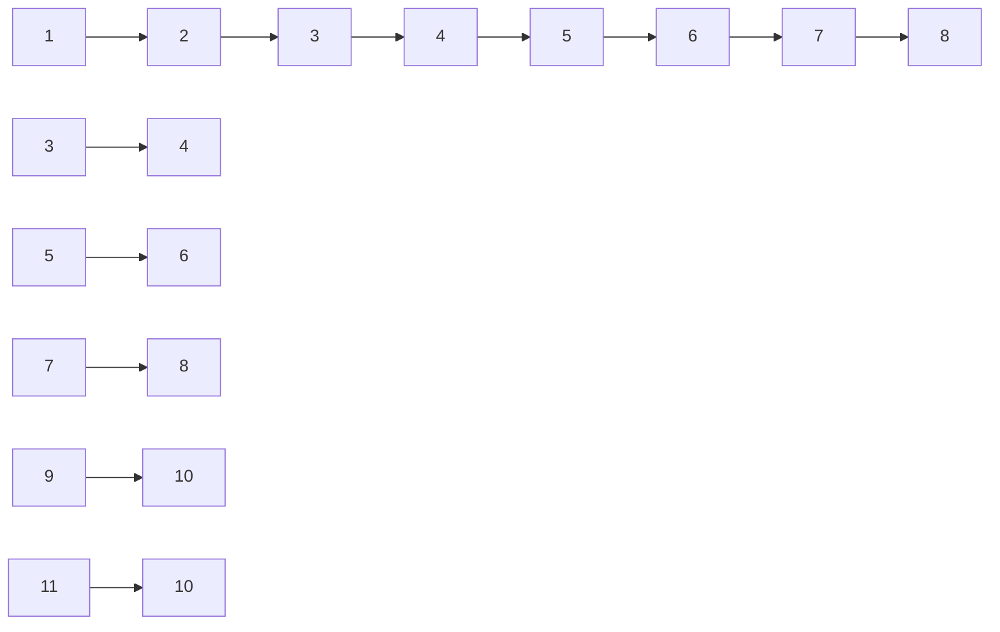
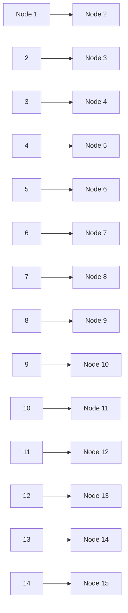

13. 下列哪些化合物不是内消旋化合物？

(A)

(B)

(C)

(D)

(E)

14. 吗啡是由德国化学家泽尔蒂纳 1806 年从鸦片中分离出来的生物碱。吗啡及其衍生物是临床解除剧烈疼痛的主要药物，是全世界使用量最大的强效镇痛剂。但其最大缺点是易成瘾。下图给出了吗啡的结构。请找出所有的立体中心并标注构型（R 或 S）。

本章习题
参考答案

chemical

Complex organic molecule structure with hydroxyl, methoxy, and amide functional groups

吗啡

(本章编者 张扬会、杨泽鹏、李燕)

## 第三章

## 烷烃

3.1 烷烃的同分异构现象 …… 67
3.2 烷烃的命名 69
3.3 链烷烃的结构与构象 …… 75
3.4 链烷烃的物理性质 …… 76
3.5 链烷烃的化学性质 77
3.6 链烷烃的来源、制备与用途 …… 79
3.7 环烷烃 81
3.8 化学反应平衡与反应速率 83
习题 92

分子中只有碳和氢两种元素组成的有机化合物称为烃，也称碳氢化合物（hydrocarbon）。根据传统的有机化合物的分类方法，烃又被分为链状烃和环状烃。链状烃是指分子中碳原子之间以链状的方式相连接形成的烃，也称链烃或脂肪烃。而环状烃则是指分子中碳原子之间以首尾相连的方式成环形成的烃，也称环烃，包括脂环烃和芳香烃。

根据链烃分子中碳原子之间的成键方式，链烃可以分为饱和烃和非饱和烃。饱和烃又称烷烃（alkane），包括饱和脂肪烃和饱和脂环烃，即链烷烃（acyclic alkane）和环烷烃（cycloalkane）。非饱和烃包括烯烃（alkene）、炔烃（alkyne）和芳香烃（aromatic hydrocarbon）等。

链烷烃的通式为  $C_{n}H_{2n+2}$ ，其中 n 代表碳原子的数量。这类烷烃分子中的碳原子通过碳碳单键相连，其余价键都与氢结合。环烷烃分子中至少含有一个环状结构，这种结构通过碳碳单键形成，单环烷烃的通式为  $C_{n}H_{2n}$ 。环烷烃可以根据环的大小进一步细分为小环（三、四元环）、普通环（五至七元环）、中环（八至十一元环）和大环（十二元环以上）。按照环的结合方式分类，两个环共用一个碳原子的称为螺环烷烃；两个环共用两个及两个以上碳原子的称为桥环烷烃。

## 3.1 烷烃的同分异构现象

最简单的烷烃是甲烷（methane），分子式是  $CH_{4}$ ；其次是乙烷（ethane），分子式是  $C_{2}H_{6}$ ；再次是丙烷（propane），分子式是  $C_{3}H_{8}$ 。由此可以看出，随着烷烃分子中碳原子数目的增加，氢原子的数目也呈现有规律性的增加，即每增加一个碳原子，同时增加两个氢原子，相邻分子间的分子组成相差一个  $CH_{2}$ 。因此，可以用通式  $C_{n}H_{2n+2}\left(n\geqslant1\right)$  来表示烷烃这一系列化合物的分子组成。

这些结构相似、在分子组成上相差一个或若干个  $CH_{2}$  的化合物，能够组成一个系列，我们将这个系列称作烷烃的同系列，这个系列中的化合物互称为同系物，其中  $CH_{2}$  称为系列差。甲烷、乙烷和丙烷的结构式和结构模型分别表示如下:

chemical

Three molecular structures showing hydrogen bonding and carbon atoms in a cyclic system

由上面的结构式不难看出，当分子中碳原子数目增加到4个及4个以上时，碳和碳原子之间的连接就会出现多种方式。例如，分子式为  $C_{4}H_{10}$  的丁烷（butane）就存在直链和支链两种碳架结构，它们的结构式分别如下:

chemical

Two identical molecular structures with carbon and hydrogen atoms, likely representing a polymer or organ structure.

有机分子中各原子的结合称为分子的结构，分子的结构包括构造、构型和构象三个层次。化合物具有相同的分子式，但具有不同的结构和性质的现象称为同分异构现象（isomerism）。具有同分异构现象的化合物互称为同分异构体（isomer）。具有相同分子组成的化合物，可以具有不同的原子连接方式，这种现象称为构造异构（constitutional isomerism）。有机化合物的构造异构多种多样，包括碳架异构、位置异构、官能团异构和互变异构等。其中，由碳原子之间相互连接方式不同而引起的构造异构是最基本的，也是最常见的，这种异构现象常称为碳架异构。例如，分子式为  $C_{5}H_{12}$  的戊烷（pentane）的碳架异构同分异构体有三种:

随着烷烃分子中碳原子数目的增加，其碳架异构体的数量也随之增加，而且会变得越来越复杂。如果把戊烷的三种同分异构体分别标记为a，b和c，那么，异构体a只是碳原子和碳原子之间相互依次连接起来，没有任何支链；异构体b出现了一个支链；异构体c则出现了两个支链。从戊烷的三种同分异构体中可以发现，一个碳原子可以分别与另外一个、两个、三个或四个碳原子相连，形成四种不同类型的碳原子。为了区分这几种类型的碳原子，将与一个碳原子相连的碳称为伯碳（或者一级碳，primary carbon），用 $1^{\circ}\mathrm{C}$ 表示，伯碳上所连的氢称为伯氢（primary hydrogen），用 $1^{\circ}\mathrm{H}$ 表示；与两个碳原子相连的碳称为仲碳（secondary carbon），用 $2^{\circ}\mathrm{C}$ 表示，仲碳上所连的氢称为仲氢（secondary hydrogen），用 $2^{\circ}\mathrm{H}$ 表示；与三个碳原子相连的碳称为叔碳（tertiary carbon），用 $3^{\circ}\mathrm{C}$ 表示，叔碳上所连的氢称为叔氢（tertiary hydrogen），用 $3^{\circ}\mathrm{H}$ 表示；与四个碳原子相连的碳称为季碳（quaternary carbon），用 $4^{\circ}\mathrm{C}$ 表示。

同时，我们也可以看出，在烷烃分子中伯碳和三个氢原子相连接，由一个碳原子和三个氢原子相连组成的原子团表示为“$\mathrm{CH}_3$”，称为甲基（methyl），它也可以被理解为从甲烷分子中去掉一个氢原子后剩余的部分。仲碳和两个氢原子相连，由碳原子和两个氢原子相连组成的原子团可以表示为“$\mathrm{CH}_2$”，将 $-\mathrm{CH}_2-$ 称为甲叉基（methanediyl或methylene），与其相似的 $\mathrm{H}_2\mathrm{C} =$ 称为甲亚基（methylidene）。叔碳和一个氢原子相连接，碳原子和一个氢原子相连接组成的原子团， $\mathrm{CH}-$ 称为甲爪基（methanetriyl），与之相似的 $\equiv \mathrm{CH}$ 称为甲次基（methylidyne），-CH=称为甲基亚基（methanylylidene）。在这里，我们将从烷烃分子中去掉一个氢原子后所剩余的部分，称为烷基（alkyl），其通式为 $\mathrm{C}_n\mathrm{H}_{2n + 1}-$ ，常用“R-”表示。

## 3.2 烷烃的命名

随着烷烃分子中碳原子数目的增加以及同分异构体数目的增多, 烷烃的命名显得尤为重要。烷烃的命名方式通常有两种, 一种是普通命名法, 另一种是系统命名法。

## 3.2.1 链烷烃的普通命名法

普通命名法也叫习惯命名法，就是用甲、乙、丙、丁、戊、己、庚、辛、壬和癸来分别表示碳原子数目从一到十的烷烃名称，碳原子数目从十一开始就用十一、十二、十三等数字依次来表示，并将其称为“某烷”。这种命名方法通常只适合于含有碳原子数目较少和结构较为简单的烷烃。

在上述戊烷的三种同分异构体中，分子中碳原子的数目都是五个，它们在结构上的区别在于是否含有支链以及含有支链数目的不同。因此，为了区分这些同分异构体，我们将不含有任何支链的戊烷称为正戊烷（n-pentane）；含有一个支链的戊烷称为异戊烷（isopentane）；含有两个支链的戊烷称为新戊烷（neopentane），分别用正（n-）、异（iso-）和新（neo-）词头来加以区分。

分子中含有碳原子数目较少和结构较为简单的烷烃能够通过这种方法进行命名和区分。但是，随着烷烃分子中碳原子数目的增多，异构体的数目和分子结构的复杂程度都会显著增加（如表 3-1 所示）。

表 3-1 不同烷烃分子同分异构体的数目

| 分子式 | 名称 | 同分异构体的数目 | 分子式 | 名称 | 同分异构体的数目 |
| --- | --- | --- | --- | --- | --- |
| $CH_4$ | 甲烷 | 1 | $C_8H_{18}$ | 辛烷 | 18 |
| $C_2H_6$ | 乙烷 | 1 | $C_9H_{20}$ | 壬烷 | 35 |
| $C_3H_8$ | 丙烷 | 1 | $C_{10}H_{22}$ | 癸烷 | 75 |
| $C_4H_{10}$ | 丁烷 | 2 | $C_{11}H_{24}$ | 十一烷 | 159 |
| $C_5H_{12}$ | 戊烷 | 3 | $C_{15}H_{32}$ | 十五烷 | 4347 |
| $C_6H_{14}$ | 己烷 | 5 | $C_{20}H_{42}$ | 二十烷 | 366319 |
| $C_7H_{16}$ | 庚烷 | 9 | $C_{40}H_{82}$ | 四十烷 | 62491178805831 |

这时，如果再继续使用习惯命名法命名烷烃，显然会遇到一些问题，故必要用另一种命名方法来命名烷烃，即系统命名法。

## 3.2.2 链烷烃的系统命名法

系统命名法采用的是国际上通用的 IUPAC（International Union of Pure and Applied Chemistry）命名法。结合这个命名的原则和中文构词习惯，我国制定了有机化合物系统命名法。根据中国化学会《有机化合物命名原则》(2017)，烷烃的系统命名包括以下原则和步骤。

chemical

Structural formulas of diisocyanate chains with labeled hydrogen atoms and bonds

（1）确定主链。选择链烷烃分子中最长的碳链作为主链，根据主链碳原子数目的多少称其为“某烷”，而连接在主链以外的部分均称为支链。如上述戊烷的三种同分异构体a、b和c分子中的最长碳链分别有5,4和3个碳原子，而在戊烷这三种同分异构体中只有b和c含有支链，且分别含有一个和两个支链。
（2）主链编号。对主链上的碳原子进行编号，从主链上距离支链最近的一端将主链碳原子按照阿拉伯数字从小到大的顺序依次进行编号，即“最低位次规则”，支链在分子结构中所在的位置就是其所连接的主链碳原子的序号。

当支链距离主链两端的碳原子距离相同时，编号使用“最低位次组规则”。具体为，当支链从不同方向编号存在几种不同编号可能时，选择使取代基具有“最低位次”的编号，即各组数字由小及大排列，由首位开始，顺序依次比较取代基在几种编号系列中的位次至分出大小，小者位次组优先，取此系列的编号为主链编号。另外，如果备选的位次组相同，则以取代基英文字母的先后依次排序编号。

（3）组名。烷烃的系统名由“取代基名+主链烷烃名”组成。在命名时，如主链上含有相同取代基，用阿拉伯数字逐一注明取代基所在的位置，阿拉伯数字之间用逗号隔开，同时，还要用大写数字（二、三等）表示相同取代基的数目，并且用“-”连接阿拉伯数字和取代基的数目，然后是取代基的名称和某烷。

例如，戊烷的同分异构体 b 中，无论是按照横向选择还是从下至上进行选择，主链都是含有四个碳原子，即只含有一个主链，按照系统命名法规则（1）应该将其称为“丁烷”。而支链所在位置的确定，如果从左边开始给主链碳原子进行编号，那么支链就应该连接在主链的第三个碳原子上，这显然违背了命名原则（2）。因为，支链距离主链右端的碳原子最近，即支链连接在主链碳原子右端第二个碳原子上。因此，戊烷同分异构体 b 按照系统命名法的正确命名应该是 2-甲基丁烷。

在戊烷的同分异构体 c 中，无论怎么选择主链，其主链都只含有三个碳原子，因而，应将其称为“丙烷”。但其主链上含有两个支链，且两个支链距离主链两端碳原子的距离相同，无论从哪一端给主链碳原子进行编号，支链都是连接在主链第二个碳原子上。所以，戊烷同分异构体 c 按照系统命名法命名是 2,2-二甲基丙烷。

如下所示，癸烷（decane）的一种同分异构体，其分子中含有十个碳原子。根据上述命名原则，其主链含有七个碳原子，同时还含有三个支链，而且每个支链都是一个甲基。从支链距离主链两端碳原子的情况来看，有两个支链都连接在距离主链两端的第二个碳原子上，但是，如果从主链的右端给其碳原子进行编号，那么支链就分别连接在主链2,3和6号碳原子上；如果从主链的左端给其碳原子进行编号，那么支链就分别连接在主链序号为2,5和6的碳原子上。按照系统命名法最低位次组规则，这一烷烃的正确命名是2,3,6-三甲基庚烷，而不是2,5,6-三甲基庚烷。

以上讨论的是结构简单的链烷烃的命名，下面给出结构较为复杂的链烷烃的命名。

如果主链碳原子上连接有不同取代基, 将取代基的名称按照基团的英文名称由首字母开始, 按照字母顺序由 A 到 Z 依次比较, 命名时排在前的先列出, 依次写出取代基的名称。

取代基的命名，主要有如下 3 种方法:

（a）普通命名法是按俗名后加“基”的方式进行，英文名称则使用-yl替代烷烃命名中的-ane后缀。如异丙基(isopropyl)、正丁基(n-butyl)、仲丁基(sec-butyl)、异丁基(isobutyl)、叔丁基(tert-butyl)以及新戊基(neopentyl)等，“正”字常省略。
（b）系统命名法以游离碳原子为碳链起点，选取最长的碳链为取代基母体，并给予编号1，母体上的支链作为取代基。取代基母体英文名称，使用后缀-yl代替相应烷烃的-ane后缀。如叔丁基按此方法可命名为1,1-二甲基乙基，其英文名称为1,1-dimethylethyl。
（c）系统命名方法还可以以包含游离碳原子的最长碳链为母体，并给予含游离碳原子尽可能小的编号，命名时在后缀“基”前加位次的编号，取代基母体上的其他支链按取代基处理。在英文名称中，使用-yl后缀代替取代基母体名称后缀-ane中的e。如叔丁基按此方法可命名为2-甲基丙-2-基，英文命名为2-methylpropan-2-yl。

一般而言，取代基的命名方法的选择应以“从简”为原则。

常见的甲基、乙基、丙基和丁基按照丁基（butyl）、乙基（ethyl）、甲基（methyl）、丙基（propyl）的顺序列出。需要注意的是，表示相同取代基个数的二、三、四词缀 di、tri、tetra 等不在取代基排序时考虑，但是被置于括号内作为单一取代基名称之中的 di、tri 等要考虑参与排序，如（1,1-dimethylpropyl）就要放在 ethyl 之前；如果取代基英文名称完全相同，位次数字小的放在前面，如 1-methylpropyl 放在 2-methylpropyl 之前。表 3-2 给出了常见取代基的中英文命名。

表 3-2 常见取代基的中英文命名

<table><tr><td>取代基</td><td>方法</td><td>中文命名</td><td>英文名称(缩写)</td></tr><tr><td> $CH_3^-$ </td><td>(a)</td><td>甲基</td><td>methyl(Me)</td></tr><tr><td> $CH_3CH_2^-$ </td><td>(a)</td><td>乙基</td><td>ethyl(Et)</td></tr><tr><td> $CH_3CH_2CH_2^-$ </td><td>(a)</td><td>丙基</td><td>propyl(Pr)</td></tr><tr><td rowspan="2"> $CH_3CH_2CH_2CH_2^-$ </td><td>(a)</td><td>丁基</td><td>butyl(Bu)</td></tr><tr><td>(a)</td><td>异丙基</td><td>isopropyl</td></tr><tr><td rowspan="3"> $CH_3CH(CH_3)^-$ </td><td>(b)</td><td>1-甲基乙基</td><td>1-methylethyl</td></tr><tr><td>(c)</td><td>丙-2-基</td><td>propan-2-yl</td></tr><tr><td>(a)</td><td>仲丁基</td><td>sec-butyl</td></tr><tr><td rowspan="2"> $CH_3CH_2CH(CH_3)^-$ </td><td>(b)</td><td>1-甲基丙基</td><td>1-methylpropyl</td></tr><tr><td>(c)</td><td>丁-2-基</td><td>butan-2-yl</td></tr><tr><td rowspan="3"> $CH_3CH(CH_3)CH_2^-$ </td><td>(a)</td><td>异丁基</td><td>isobutyl</td></tr><tr><td>(b)</td><td>2-甲基丙基</td><td>2-methylpropyl</td></tr><tr><td>(a)</td><td>叔丁基</td><td>tert-butyl</td></tr><tr><td rowspan="2"> $(CH_3)_3C^-$ </td><td>(b)</td><td>1,1-二甲基乙基</td><td>1,1-dimethylethyl</td></tr><tr><td>(c)</td><td>2-甲基丙-2-基</td><td>2-methylpropan-2-yl</td></tr><tr><td> $CH_3(CH_2)_3CH_2^-$ </td><td>(a)</td><td>戊基</td><td>pentyl</td></tr><tr><td rowspan="3"> $(CH_3)_2CHCH_2CH_2^-$ </td><td>(a)</td><td>异戊基</td><td>isopentyl</td></tr><tr><td>(b)</td><td>3-甲基丁基</td><td>3-methylbutyl</td></tr><tr><td>(a)</td><td>叔戊基</td><td>tert-pentyl</td></tr><tr><td rowspan="2"> $CH_3CH_2C(CH_3)_2^-$ </td><td>(b)</td><td>1,1-二甲基丙基</td><td>1,1-dimethylpropyl</td></tr><tr><td>(c)</td><td>2-甲基丁-2-基</td><td>2-methylbutan-2-yl</td></tr><tr><td rowspan="2"> $(CH_3)_3CCH_2^-$ </td><td>(a)</td><td>新戊基</td><td>neopentyl</td></tr><tr><td>(b)</td><td>2,2-二甲基丙基</td><td>2,2-dimethylpropyl</td></tr></table>

注:表格中按方法（a）命名的俗名在《有机化合物命名原则》（2017）中均可使用。英文取代基中，斜体字部分的字母不参与排序；iso-, neo-等字头参与排序。

根据以上命名规则，下面化合物的正确名称应该是6-乙基-2,3-二甲基辛烷。该烷烃是主链含有八个碳原子的取代辛烷（octane），主链上含有的两个甲基和一个乙基作为支链。

chemical

Structural formula of a branched alkane with carbon and hydrogen atoms labeled

6-乙基-2,3-二甲基辛烷

下面是十八烷（octadecane）的一种同分异构体，其主链是含有十个碳原子的烷烃，在主链2和7号碳原子上分别连有一个甲基和两个甲基，而主链C6上却连接一个较为复杂的取代基，按照上述命名原则，该烷烃的正确命名是6-(1,2-二甲基丙基)-2,7,7-三甲基癸烷。

chemical

Chemical structure of a branched alkane with numbered carbon positions

6-(1,2-二甲基丙基)-2,7,7-三甲基癸烷

一种含有支链的取代庚烷的结构式如下，符合上述命名规则的名称有三种。

chemical

Structural formula of a branched alkane with methyl and ethyl substituents

(a) 4-叔丁基-2,3-二甲基庚烷

4-tert-butyl-2,3-dimethylheptane

(b) 4-(1,1-二甲基乙基)-2,3-二甲基庚烷

4-(1,1-dimethylethyl)-2,3-dimethylheptane

(c) 2,3-二甲基-4-(2-甲基丙-2-基)庚烷

2,3-dimethyl-4-(2-methylpropan-2-yl)heptane

如果在选择主链时，出现两个或多个含有相同碳原子的主链，以选择含有最多取代基数目的碳链作为主链，编号遵循最低位次组规则。

下面是十三烷（tridecane）的一种同分异构体，在选择主链时，就出现了两条八个碳原子的主链。如果按照(i)方式选择主链，则在主链2、3和7号碳原子上共连接有四个取代基；如果按照(ii)方式选择主链，则在主链3和7号碳原子上共连接两个取代基。根据命名原则，正确的命名应该选择前者，即这一烷烃的正确名称是3-乙基-2,2,7-三甲基辛烷。

chemical

Chemical structure of a branched alkane with labeled carbon positions and substituents

(i)方式选择主链

(正确选择)

chemical

Structural formula of a branched alkane with methyl and hydrogen substituents

(ii)方式选择主链

(错误选择)

总的来说，命名链烷烃的步骤为

（1）选择主链。①最长的碳链；②取代基数目最多的链；③所有取代基的数字位次组最低的链。
（2）按照编号规则和最低位次组原则，对主链进行编号。
（3）将取代基的名称按照英文字母先后顺序，依次写出取代基的名称。
（4）将表示基团位次的阿拉伯数字插入代表它们的名称之前。
(5) 写出化合物的完整名称。

## 3.2.3 环烷烃的命名

## 1. 单环烷烃的命名

单环环烷烃的分子通式是  $C_{n}H_{2n}(n \geqslant 3)$ ，其命名与链烷烃的命名基本相同，只是在烷烃的名称前加一个“环”字。如果环上连有两个或两个以上的取代基，首先要求取代基编号遵循最低位次组规则，如果备选的位次组相同，则以取代基英文字母的先后依次排序编号。

下面分别是环丙烷、环丁烷、环戊烷和环己烷的结构简式和键线式。

chemical

Structural formulas of five organic molecules: tetrahydrofuran, cyclohexane, cyclopropyl, and cyclohexene with attached alkyl chains.

下面取代环烷烃的命名分别是

甲基环丙烷

1,2,3,4-四甲基环丁烷

1-甲基-3-丙基环戊烷

1-乙基-4-甲基环己烷

chemical

Chemical structure of a substituted cyclohexane with methyl and ethyl groups

1-乙基-3,5-二甲基环己烷

1,3-二环己基丙烷

这些化合物中，1-乙基-4-甲基环己烷中乙基和甲基分别编在1和4号位，因为ethyl排序优先于methyl，所以，书写时乙基在前，甲基在后，其名称为1-乙基-4-甲基环己烷，而不是1-甲基-4-乙基环己烷。1,3-二环己基丙烷的命名以丙烷作为母体，环己基作为取代基。

在单环烷烃分子中，由于碳环结构的存在，在一定程度上限制了环上碳碳单键的自由旋转。当碳环上连有取代基时，就存在顺反异构现象。如1,2-二甲基环丙烷就有顺式和反式两种异构体存在（见侧栏）。

随着环上碳原子数目的增加和取代基的增多，环烷烃顺反异构体的数量也会相应地增多。如 1,2,3,4-四甲基环丁烷就有四种顺反异构体。

顺-1,2-二甲基环丙烷

反-1,2-二甲基环丙烷

然而，当相同的取代基连在同一个碳原子上时，可能的顺反异构体的数量就会减少。

## 2. 桥环烷烃的命名

桥环烷烃是指环与环之间共用两个或多个碳原子的多环烷烃，共用的碳原子称为桥头碳，两个桥头碳之间可以是一根键或者碳链，称为桥。例如，二环[1.1.0]丁烷中，两个环共用两个碳原子（C1和C3为桥头碳，C1-C3键为桥）；二环[3.2.1]辛烷中，两个环共用三个碳原子（C1和C5为桥头碳，C1-C8-C5键为桥）。

二环[1.1.0]丁烷
bicyclo[1.1.0]butane

二环[3.2.1]辛烷
bicyclo[3.2.1]octane

text_image

主桥
8 10 11
7
6
5
次桥
9 1 2 3 4
3

三环[4.3.2.0$^{2,5}$]十一烷
tricyclo[4.3.2.0$^{2,5}$]undecane

三环[2.2.1.0^{2,6}]庚烷
tricyclo[2.2.1.0^{2,6}]heptane

2,7,7-三甲基二环[2.2.1]庚烷
2,7,7-trimethylbicyclo[2.2.1]heptane

桥环烷烃的命名步骤如下:

（1）确定母体烃的名称。根据成环碳原子的数目而定。
（2）确定环数。环数等于把化合物切开成开链烃的最少切割次数。
（3）确定主环。碳原子数最多的环为主环。
（4）确定主桥。主环内最长的桥是主桥，其他桥是次桥。若最长的桥有两个或多个时，要选择较对称地分割主环的桥为主桥。
（5）编号。从主桥的一个桥头开始编号，沿碳原子多的一半到另一个桥头，再编另一半到起点。环编完后，接着编长桥上的碳原子，再编次桥上的碳原子。
（6）确定方括号内的数字，标明结构。在方括号内，依次写上主桥两侧的碳原子数，不包括桥头碳，先多后少，主桥的碳原子数，各次桥的碳原子数。次桥的碳原子数的右上方要写上环与次桥相连的碳原子编号。
（7）写出母体的名称。“环数 + 带有数字的方括号 + 母体烃名称”三部分共同组成桥环烷烃母体的名称。

若有取代基，取代基的编号和名称放在母体前；如果分子中有手性碳原子，标出其立体构型。

对于一些结构复杂的桥环烷烃，常用俗名，如立方烷和金刚烷。

(2S)-2-甲基二环[2.2.2]辛烷

(2S)-2-methylbicyclo[2.2.2]octane

五环[4.2.0.0^{2,5}.0^{3,8}.0^{4,7}]辛烷

pentacyclo[4.2.0.0^{2,5}.0^{3,8}.0^{4,7}]octane

立方烷

三环[3.3.1.1^{3,7}]癸烷

tricyclo[3.3.1.1^{3,7}]decane

金刚烷

## 3. 螺环烷烃的命名

单环之间共用一个碳原子的多环烷烃为螺环烷烃，共用的碳原子称为螺原子。

螺[5.5]十一烷

spiro[5.5]undecane

螺[2.4]庚烷

spiro[2.4]heptane

flowchart

二螺[2.1.4^{5}.2^{3}]十一烷

dispiro[2.1.4$^{5}$.2$^{3}$]undecane

flowchart

三螺[2.2.2.2^{9}.2^{6}.3^{3}]十六烷

trispiro[2.2.2.2$^{9}$.2$^{6}$.3$^{3}$]hexadecane

螺环烷烃的命名步骤如下:

（1）确定母体烃的名称。根据成环碳原子的数目确定母体烃的名称。
（2）确定螺数。根据螺原子的个数分为单螺、二螺、三螺等。
（3）编号。编号从较小环中与端螺原子相邻的碳原子开始，沿多环的边使所有的螺原子位号都尽可能小的路径编号。
（4）标明结构。确定方括号内的数字，顺着环的编号次序，用数字表明螺原子之间的碳原子数目，依次写在方括号内。对于含三个及以上螺原子的螺环体系，每当一个螺原子被再次涉及时，则将该螺原子的编号以上标方式标注在与其再次相连时的链原子数目上。
（5）写出母体的名称。“螺数+带有数字的方括号+母体烃名称”三部分共同组成母体的名称。

同样，若有取代基，取代基的编号和名称放在母体前；如果分子中有手性碳原子，标出其立体构型。

chemical

Chemical structure of a cyclohexane derivative with labeled carbon positions and functional groups

(1R,3S,4S,6S,7R)-1-乙基-1,3,7-三甲基二螺[3.1.5^{6}.2^{4}]十三烷

(1R,3S,4S,6S,7R)-1-ethyl-1,3,7-trimethyldispiro[3.1.5$^{6}$.2$^{4}$]tridecane

当桥环、螺环烃类化合物的备选位次组相同时，同样遵守最低位次组规则。另外，当同时存在碳链和碳环时，选取含尽可能多取代基的碳链（环）为主链（环），其次兼顾取代基的位次小和英文字母顺序排前规则。

chemical

Chemical structure of a cyclohexane derivative with labeled carbon positions and substituent CH2CH3

2-乙基-5-甲基二环[2.2.1]庚烷

2-ethyl-5-methylbicyclo[2.2.1]heptane

chemical

Chemical structure of a cyclohexane derivative with labeled carbon positions

1,1-二乙基-4,4,7-三甲基螺[4.4]壬烷

1,1-diethyl-4,4,7-trimethylspiro[4.4]nonane

## 3.3 链烷烃的结构与构象

甲烷和乙烷的结构见 1.3.4 小节。在链烷烃分子中，碳原子均采取  $sp^{3}$  杂化，呈现四面体构型，轨道对称轴夹角为  $109^{\circ}$ 。这就决定了烷烃分子中的碳碳键不是直线形排布的，而是呈

锯齿状排布。

链烷烃的构象分析见 2.1.1 小节。

## 3.4 链烷烃的物理性质

烷烃的物理性质一般随着相对分子质量的增加而呈现规律性变化（表3-3）。

表 3-3 烷烃的物理性质

| 名称 | 结构式 | 熔点/°C | 沸点/°C | 相对密度(20°C) |
| --- | --- | --- | --- | --- |
| 甲烷 | $CH_4$ | -182 | -164 | 0.466(-164°C) |
| 乙烷 | $CH_3CH_3$ | -172 | -88.6 | 0.572(-100°C) |
| 丙烷 | $CH_3CH_2CH_3$ | -187.1 | -42.1 | 0.5853(-45°C) |
| 丁烷 | $CH_3CH_2CH_2CH_3$ | -138.4 | -0.5 | 0.5788 |
| 戊烷 | $CH_3(CH_2)_3CH_3$ | -129.7 | 36.1 | 0.6262 |
| 己烷 | $CH_3(CH_2)_4CH_3$ | -95 | 68.9 | 0.6603 |
| 庚烷 | $CH_3(CH_2)_5CH_3$ | -90.6 | 98.4 | 0.6837 |
| 辛烷 | $CH_3(CH_2)_6CH_3$ | -56.8 | 125.7 | 0.7025 |
| 壬烷 | $CH_3(CH_2)_7CH_3$ | -51 | 150.8 | 0.7176 |
| 癸烷 | $CH_3(CH_2)_8CH_3$ | -29.7 | 174.1 | 0.73 |
| 十一烷 | $CH_3(CH_2)_9CH_3$ | -25.6 | 195.9 | 0.7402 |
| 十二烷 | $CH_3(CH_2)_{10}CH_3$ | -9.6 | 216.3 | 0.7484 |
| 十三烷 | $CH_3(CH_2)_{11}CH_3$ | -5.5 | 235.4 | 0.7564 |
| 十四烷 | $CH_3(CH_2)_{12}CH_3$ | 5.9 | 253.7 | 0.7628 |
| 十五烷 | $CH_3(CH_2)_{13}CH_3$ | 10 | 270.6 | 0.7685 |
| 十六烷 | $CH_3(CH_2)_{14}CH_3$ | 18.2 | 287 | 0.7733 |
| 十七烷 | $CH_3(CH_2)_{15}CH_3$ | 22 | 301.8 | 0.778 |
| 十八烷 | $CH_3(CH_2)_{16}CH_3$ | 28.2 | 316.1 | 0.7768 |
| 十九烷 | $CH_3(CH_2)_{17}CH_3$ | 32.1 | 329.7 | 0.7774 |
| 二十烷 | $CH_3(CH_2)_{18}CH_3$ | 36.8 | 343 | 0.7886 |

烷烃的沸点随着相对分子质量的增加而升高。在室温下，在烷烃同系列化合物中，前四种烷烃都是气体，从戊烷开始变为液体，而到了十八烷以上就变为固体了。非极性分子的沸点与分子间的范德华力大小有关。而烷烃是典型的非极性分子，所以，烷烃分子之间的吸引力主要是范德华力。对正烷烃来说，随着相对分子质量的增加，分子之间的接触面积增大，从液体转变为气体，所需要的能量也增多，所以，烷烃的沸点呈现上述的变化规律（图3-1）。化合物的熔点高低除了与分子间作用力有关外，也与分子在晶格中的排列有关，分子的对称性越好，其晶格能越大，熔点越高。正烷烃中，含偶数碳原子的分子的对称性比含奇数碳原子的分子的对称性好，烷烃的熔点随相对分子质量的增加而呈现规律性升高，并且偶数烷烃的熔点升高得略多一些（图3-2）。烷烃的密度都小于水的密度，但随着相对分子质量的增加，其密度也随之增大。烷烃分子没有极性或者仅有很微弱的极性，所以，烷烃不溶于水或其他强极性溶剂中，易溶于乙醚、氯仿、四氯化碳和苯等弱极性溶剂中。

line

| 碳原子数 | \(沸点/{}^{\circ}C\) |
| --- | --- |
| 1 | ~-165 |
| 2 | ~-90 |
| 3 | ~-40 |
| 4 | ~0 |
| 5 | ~35 |
| 6 | ~70 |
| 7 | ~100 |
| 8 | ~125 |
| 9 | ~150 |
| 10 | ~175 |
| 11 | ~200 |
| 12 | ~220 |
| 13 | ~240 |
| 14 | ~255 |
| 15 | ~275 |
| 16 | ~290 |
| 17 | ~305 |
| 18 | ~320 |
| 19 | ~335 |
| 20 | ~345 |

图 3-1 直链烷烃的沸点与碳原子数的关系

line

| 碳原子数 | 偶数碳原子 \((熔点/{}^{\circ}C)\) | 奇数碳原子 \((熔点/{}^{\circ}C)\) |
| --- | --- | --- |
| 1 | ~-180 | ~-180 |
| 2 | ~-170 | ~-170 |
| 3 | ~-190 | ~-190 |
| 4 | ~-140 | ~-140 |
| 5 | ~-130 | ~-130 |
| 6 | ~-95 | ~-95 |
| 7 | ~-90 | ~-90 |
| 8 | ~-55 | ~-55 |
| 9 | ~-50 | ~-50 |
| 10 | ~-30 | ~-30 |
| 11 | ~-25 | ~-25 |
| 12 | ~-10 | ~-10 |
| 13 | ~-5 | ~-5 |
| 14 | ~5 | ~5 |
| 15 | ~10 | ~10 |
| 16 | ~15 | ~15 |
| 17 | ~20 | ~20 |
| 18 | ~25 | ~25 |
| 19 | ~30 | ~30 |
| 20 | ~35 | ~35 |

图3-2 直链烷烃的熔点与碳原子数的关系

烷烃同分异构体的沸点也存在一些规律性变化（表 3-4）。在同分异构体中，随着支链的增多，沸点呈现下降的趋势。这主要是支链的增多使得分子间的吸引力即范德华力被削弱，从而导致沸点降低。

表 3-4 烷烃同分异构体的沸点

| 名称 | 结构简式 | 沸点/°C |
| --- | --- | --- |
| 正丁烷 | $CH_3CH_2CH_2CH_3$ | -0.5 |
| 异丁烷 | $(CH_3)_2CHCH_3$ | -10.2 |
| 正戊烷 | $CH_3(CH_2)_3CH_3$ | 36.1 |
| 异戊烷 | $(CH_3)_2CHCH_2CH_3$ | 27.9 |
| 新戊烷 | $C(CH_3)_4$ | 9.5 |
| 正己烷 | $CH_3(CH_2)_4CH_3$ | 68.9 |
| 2-甲基戊烷 | $CH_3(CH_2)_2CH(CH_3)CH_3$ | 60.3 |
| 3-甲基戊烷 | $CH_3CH_2CH(CH_3)CH_2CH_3$ | 63.3 |
| 2,2-二甲基丁烷 | $CH_3CH_2C(CH_3)_2CH_3$ | 49.7 |
| 2,3-二甲基丁烷 | $CH_3CH(CH_3)CH(CH_3)CH_3$ | 58.0 |

## 3.5 链烷烃的化学性质

物质结构决定其化学性质。烷烃同系列化合物具有相似的化学结构，因而也就具有相似的化学性质。从烷烃的化学结构可以看出，烷烃分子中仅含有碳碳单键和碳氢键，其键能都较大，而且，烷烃是没有极性的分子，极化度极小。因此，一般情况下，烷烃的化学性质比较稳定，不易发生化学反应。但在一些特定条件下，烷烃可以和一些试剂发生化学反应。

## 3.5.1 卤化反应（自由基取代反应）

烷烃分子中的氢原子被卤素原子所取代的反应称为卤化反应。显然，若被氯原子或溴原子所取代，则称为氯化反应或溴化反应。卤素与烷烃的取代反应生成一卤代产物和多卤代产物。卤素与烷烃反应的活性顺序是  $F_{2} > Cl_{2} > Br_{2}$ ，碘通常不与烷烃反应。除氟外，氯和溴在室温黑暗处与烷烃很难发生反应，但在日光或紫外光照射下，或者在高温条件下，氯和溴易与烷烃发生取代反应，有时发生剧烈反应，甚至发生爆炸。例如，甲烷和氯气在光或热的条件下，首先生成一氯甲烷和氯化氢。

$$
\mathrm{CH} _ {4} + \mathrm{Cl} _ {2} \xrightarrow {\text {漫射光}} \mathrm{CH} _ {3} \mathrm{Cl} + \mathrm{HCl} \text {一氯甲烷}
$$

然而，甲烷和氯气的取代反应很难停留在一取代反应上，生成的一氯甲烷会继续和氯气反应，常常会生成四种取代产物的混合物。

$$
\begin{array}{l} \mathrm{CH} _ {3} \mathrm{Cl} + \mathrm{Cl} _ {2} \xrightarrow {\text {漫射光}} \mathrm{CH} _ {2} \mathrm{Cl} _ {2} + \mathrm{HCl}   \text {二氯甲烷} \\ \mathrm{CH} _ {2} \mathrm{Cl} _ {2} + \mathrm{Cl} _ {2} \xrightarrow {\text {漫射光}} \mathrm{CHCl} _ {3} + \mathrm{HCl}   \text {三氯甲烷} \\ \mathrm{CHCl} _ {3} + \mathrm{Cl} _ {2} \xrightarrow {\text {漫射光}} \mathrm{CCl} _ {4} + \mathrm{HCl} \text {四氯甲烷（四氯化碳} \\ \end{array}
$$

在强日光的照射下，甲烷和氯气就会发生剧烈的反应，甚至发生爆炸，同时生成碳和氯化氢。

$$
\mathrm{CH} _ {4} \quad + \quad 2 \mathrm{Cl} _ {2} \xrightarrow {\text {强日光}} \quad \mathrm{C} \quad + \quad 4 \mathrm{HCl}
$$

实验表明，甲烷和氯气的取代反应是按照自由基反应历程进行的，反应涉及自由基中间体，属于自由基取代反应。所谓反应历程就是指实现反应物到产物的转化所经历的途径。更为详细的反应历程讨论见3.8.4小节。

## 3.5.2 氧化反应

烷烃在空气中完全燃烧，生成二氧化碳和水，并放出大量的热。烷烃在空气中完全燃烧的反应通式为

$$
\mathrm{C} _ {n} \mathrm{H} _ {2 n + 2} + (3 n + 1) / 2 \mathrm{O} _ {2} \xrightarrow {\text {点燃}} n \mathrm{CO} _ {2} + (n + 1) \mathrm{H} _ {2} \mathrm{O} + \text {热量}
$$

例如，甲烷在空气中充分燃烧生成二氧化碳和水，同时放出大量的热。

$$
\mathrm{CH} _ {4} + 2 \mathrm{O} _ {2} \xrightarrow {\text {点燃}} \mathrm{CO} _ {2} + 2 \mathrm{H} _ {2} \mathrm{O} + \text {热量}
$$

从烷烃的这个性质来讲，烷烃的燃烧可以产生大量的热能，也就是说，烷烃是重要的能源原料。但同时，烷烃大量燃烧所产生的二氧化碳是一种温室气体，对全球气候变化产生重要影响。另外，甲烷自身也是温室气体的主要来源之一。

在一般情况下，烷烃不易被氧化剂氧化。

## 3.5.3 异构化反应

烷烃的异构化反应是指适当条件下，如催化剂作用、加热等，使直链烷烃转化为其支链烷烃同分异构体的反应。异构化反应是可逆的，反应受热力学平衡控制。在石油工业中，异构化反应常用于将炼厂气中的正丁烷转化为异丁烷，也用于轻石脑油中正戊烷、正己烷的异构化以提高汽油的辛烷值。

$$
\mathrm{CH} _ {3} \mathrm{CH} _ {2} \mathrm{CH} _ {2} \mathrm{CH} _ {3} \xrightarrow [ \text {AlBr} , \mathrm{HBr} , 27 ^ {\circ} \mathrm{C} ]{\text {AlBr} , \mathrm{HBr}} \mathrm{CH} _ {3} \mathrm{CH} _ {3} - \mathrm{CH} - \mathrm{CH} _ {3} \quad 20 \% \quad 80\%
$$

## 3.5.4 裂解反应

在高温和没有氧气的条件下，烷烃分子中的碳碳键和碳氢键发生断裂而生成相对分子质量较小的分子，这种变化称为烷烃的裂解反应。这个反应在石油工业中是非常重要的，可以产生相对分子质量较小的烯烃和烷烃。例如，丙烷的热裂解反应，主要产生乙烯、丙烯、甲烷和氢气。

$$
\begin{array}{c} \mathrm{H} - \mathrm{C} - \mathrm{C} - \mathrm{C} - \mathrm{H} \\ \mathrm{H} - \mathrm{C} - \mathrm{C} - \mathrm{C} - \mathrm{H} \end{array} \xrightarrow {\text {高温}} \begin{array}{c} \mathrm{H} - \mathrm{C} - \mathrm{C} = \mathrm{C} - \mathrm{H} + \mathrm{H} _ {2} \\ \mathrm{H} - \mathrm{C} - \mathrm{C} - \mathrm{C} - \mathrm{H} \end{array} \xrightarrow {\text {高温}} \begin{array}{c} \mathrm{H} - \mathrm{C} = \mathrm{C} - \mathrm{H} + \mathrm{CH} _ {4} \\ \mathrm{H} - \mathrm{C} - \mathrm{C} - \mathrm{H} \end{array}
$$

## 3.6 链烷烃的来源、制备与用途

大量的烷烃主要存在于天然气和石油中，天然气和沼气的主要成分就是甲烷。沼气主要是由腐烂的植物经微生物作用而产生的。石油是烷烃的主要来源，由于地域的不同，石油的成分也会有所差异，但其主要成分都是烷烃和环烷烃的混合物。

石油通常是呈淡黄色、褐色或黑色的黏稠液体，未经过任何处理的石油称为原油（crude oil）。通过对原油进行分馏等处理后就可以得到一系列不同的石油产品（表3-5）。

表 3-5 石油产品及主要用途

| 名称 | 主要成分 | 沸程/°C | 主要用途 |
| --- | --- | --- | --- |
| 天然气 | $C_1 \sim C_4$ | 40 | 燃料 |
| 石油醚 | $C_5 \sim C_8$ | 30~120 | 溶剂 |
| 汽油 | $C_7 \sim C_{12}$ | 70~200 | 发动机燃料 |
| 煤油 | $C_{12} \sim C_{16}$ | 200~270 | 燃料 |
| 柴油 | $C_{16} \sim C_{18}$ | 270~340 | 发动机燃料 |
| 润滑油 | $C_{16} \sim C_{20}$ | >300 | 润滑机器等 |
| 液体石蜡 | $C_{18} \sim C_{24}$ | 液体 | 缓泻剂 |
| 凡士林 | $>C_{20}$ | 半固体 | 软膏基质 |
| 固体石蜡 | $C_{25} \sim C_{34}$ | 固体 | 蜡烛等 |
| 沥青 | $C_{30} \sim C_{40}$ | 残渣 | 铺路材料等 |

在石油加工的过程中，可以产生一系列含碳原子数目较少的烷烃。烷烃的主要用途是作为燃料提供热能和在化工生产过程中生产所需要的化工产品。

烷烃的主要来源是石油和天然气，但是，要想从石油和天然气中分离得到纯的某种烷烃却十分困难。因此，就有必要通过一些特定的反应来制备所需要的烷烃，下面介绍几种常用的制备烷烃的方法。

## 3.6.1 Wurtz 反应

这一反应是通过卤代烃和金属钠合成烷烃。常用的卤代烃是溴代烷或碘代烷，例如:

$$
2 \mathrm{CH} _ {3} \mathrm{CH} _ {2} \mathrm{CH} _ {2} \mathrm{Br} \xrightarrow {\mathrm{Na}} \mathrm{CH} _ {3} \mathrm{CH} _ {2} \mathrm{CH} _ {2} \mathrm{CH} _ {2} \mathrm{CH} _ {2} \mathrm{CH} _ {3} + 2 \mathrm{NaBr}
$$

实验证明，伯卤代烃在此反应中的反应活性较好，能以较理想的产率得到对应的烷烃。但是，如果要使用混合的卤代烃来进行这个反应，就会得到混合的烷烃。所以，要想制备单一的烷烃，就必须使用一种卤代烃原料来进行反应。例如，使用氯甲烷和氯乙烷进行Wurtz反应，就得到三种混合的烷烃。

$$
\mathrm{CH} _ {3} \mathrm{Cl} + \mathrm{CH} _ {3} \mathrm{CH} _ {2} \mathrm{Cl} \xrightarrow {\mathrm{Na}} \mathrm{CH} _ {3} \mathrm{CH} _ {3} + \mathrm{CH} _ {3} \mathrm{CH} _ {2} \mathrm{CH} _ {3} + \mathrm{CH} _ {3} \mathrm{CH} _ {2} \mathrm{CH} _ {2} \mathrm{CH} _ {3}
$$

由上述反应可知，Wurtz 反应仅适用于制备对称的烷烃。

## 3.6.2 Corey-House 反应

Corey-House 反应克服了 Wurtz 反应的局限性，可以使用不同烷基的卤代烷来制备所需要的烷烃。这是在 20 世纪 60 年代由 Corey 和 House 各自研究出来的合成方法。

$$
\mathrm{RX} + \mathrm{Li} \xrightarrow [ \text {或THF} ]{\text {乙醚}} \mathrm{RLi} \xrightarrow {\mathrm{CuI}} \mathrm{R} _ {2} \mathrm{CuLi}
$$

$$
\mathrm{R} _ {2} \mathrm{CuLi} + \mathrm{R} ^ {\prime} \mathrm{X} \longrightarrow \mathrm{R} - \mathrm{R} ^ {\prime} + \mathrm{RCu} + \mathrm{LiX}
$$

上式中 R 和  $R'$  可以相同，也可以不同。如果 R 和  $R'$  是相同的，就可以得到对称的烷烃；如果不相同，则能够得到不对称的烷烃。

同样，要以较好的产率得到所要制备的烷烃，卤代烷应该是伯卤代烷。而  $R_{2}CuLi$  中的 R 可以是伯、仲或叔烷基。

$$
\mathrm{CH} _ {3} \mathrm{Cl} + \mathrm{Li} \xrightarrow {\text {乙醚}} \mathrm{CH} _ {3} \mathrm{Li} \xrightarrow {\mathrm{CuI}} (\mathrm{CH} _ {3}) _ {2} \mathrm{CuLi}
$$

$$
(\mathrm{CH} _ {3}) _ {2} \mathrm{CuLi} + \mathrm{CH} _ {3} \mathrm{CH} _ {2} \mathrm{CH} _ {2} \mathrm{CH} _ {2} \mathrm{CH} _ {2} \mathrm{I} \longrightarrow \mathrm{CH} _ {3} \mathrm{CH} _ {2} \mathrm{CH} _ {2} \mathrm{CH} _ {2} \mathrm{CH} _ {2} \mathrm{CH} _ {3} + \mathrm{CH} _ {3} \mathrm{Cu} + \mathrm{Lil}
$$

## 3.6.3 烯烃的氢化

在某些金属催化下，烯烃和氢气反应可以生成相应的烷烃。这种类型的反应称为催化氢化。

$$
\mathrm{RCH} = \mathrm{CH} _ {2} \xrightarrow {\mathrm{Pt} , \mathrm{H} _ {2}} \mathrm{RCH} _ {2} - \mathrm{CH} _ {3}
$$

## 3.6.4 卤代烃的还原反应

多数卤代烃在锌粉和酸的作用下，可以得到相对应的烷烃。如 2-溴丁烷在锌粉和酸的作用下反应得到正丁烷。

$$
\mathrm{CH} _ {3} \mathrm{CH} _ {2} \mathrm{CHBrCH} _ {3} \xrightarrow {\mathrm{Zn,H} ^ {+}} \mathrm{CH} _ {3} \mathrm{CH} _ {2} \mathrm{CH} _ {2} \mathrm{CH} _ {3}
$$

除此之外，还有其他制备烷烃的方法，将在后续的章节中陆续介绍。

## 3.7 环烷烃

## 3.7.1 物理性质

环烷烃的物理性质与烷烃的相似，熔点、沸点和密度都随分子中碳原子数目的增加而升高或增大，只是环烷烃的熔点、沸点和相对密度均比同碳原子数目烷烃的要高一些(表3-6)。

表 3-6 环烷烃的物理性质

| 化合物 | 熔点/°C | 沸点/°C | 相对密度a | 化合物 | 熔点/°C | 沸点/°C | 相对密度 |
| --- | --- | --- | --- | --- | --- | --- | --- |
| 环丙烷 | -127.6 | -33 | 0.676b | 丙烷 | -187.1 | -42.1 | 0.5853d |
| 环丁烷 | -80 | 12.6 | 0.7038c | 正丁烷 | -138.4 | -0.5 | 0.5788 |
| 环戊烷 | -93.2 | 49.3 | 0.7457 | 正戊烷 | -129.7 | 36.1 | 0.6262 |
| 环己烷 | 6.5 | 80.7 | 0.7786 | 正己烷 | -95 | 68.9 | 0.6603 |
| 环庚烷 | -12 | 118.5 | 0.8093 | 正庚烷 | -90.6 | 98.4 | 0.6837 |
| 环辛烷 | 14.8 | 148 | 0.8349 | 正辛烷 | -56.8 | 125.7 | 0.7025 |
| 环壬烷 | 9.7 | 178.4 | 0.8534 | 正壬烷 | -51 | 150.8 | 0.7176 |
| 环癸烷 | 9.5 | 201 | 0.8575 | 正癸烷 | -29.7 | 174.1 | 0.73 |

$a 20^{\circ}C; b -33^{\circ}C; c 0^{\circ}C; d -45^{\circ}C.$

## 3.7.2 化学性质

环烷烃的一些化学性质与烷烃的很相似,包括与卤素发生卤化反应,以及在空气中燃烧,生成二氧化碳和水,并放出大量的热。

chemical

Chemical reaction equations showing chlorination and bromination steps of cyclohexane under light

另外，环丙烷和环丁烷的化学性质有其特殊性，即环丙烷和环丁烷能够发生加成开环反应。例如，在催化剂作用下，环丙烷和环丁烷能够和氢气发生加成反应，分别生成丙烷和丁烷。

chemical

Two chemical reaction equations showing hydrogenation of alkenes under different Ni/temperature conditions

环丙烷在室温下就能和溴发生加成反应，生成1,3-二溴丙烷；环丁烷在加热的条件下与溴发生加成反应，生成1,4-二溴丁烷。

chemical

Two bromination reactions of 1,3-dimethylpropene and 1,4-dimethylpropene with heating steps

环丙烷和环丁烷还可以与氢碘酸发生开环反应。