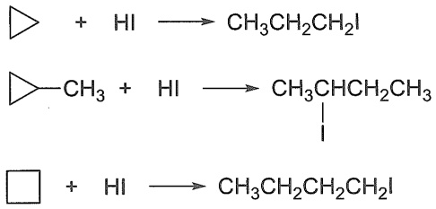

chemical

Three chemical reaction equations showing hydrolysis of aldehydes with hydrogen peroxide to form aldehyde and alkene products

由环烷烃的一系列开环反应可知，三元环的开环活性最高。随着环内碳原子数的增多，开环反应越来越难以发生。

## 3.7.3 环烷烃的稳定性

大量实验事实表明环烷烃的稳定性与环的大小有关，三元环最不稳定，四元环比三元环稍稳定一些，五元环和六元环比较稳定。

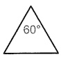

环丙烷

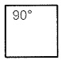

环丁烷

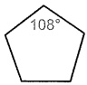

环戊烷

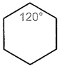

环己烷

为了从结构上对这一事实给出较为合理的解释，1885年Baeyer提出了张力学说。他假定成环碳原子都在同一平面上，且成环后形成特定的键角。环丙烷分子呈正三角形，键角为$60^{\circ}$，环丁烷呈正四边形，键角为$90^{\circ}$，环戊烷呈正五边形，键角为$108^{\circ}$，环己烷呈正六边形，键角是$120^{\circ}$。

饱和碳原子  $sp^{3}$  杂化轨道成键后正常键角为  $109.5^{\circ}$ ，环烷烃的键角与正常键角比较，均存在一定的角度偏差。为了满足平面正多边形的内角要求，成环的键必须向内或向外“屈挠”，“屈挠”的程度越大，体系越不稳定。这种对成环的键进行压缩而产生的张力称为 Baeyer 张力或角张力，与键角变形的程度成正比。环的键角偏离正常键角  $109.5^{\circ}$  越大，则环中张力越大，环越不稳定，所以环丙烷不如环丁烷稳定，环戊烷和环己烷比较稳定。Baeyer 张力学说比较直观地说明了环的稳定性与环大小的关系，对于初步认识环烷烃性质很有帮助。但是，Baeyer 张力学说是建立在成环碳原子都在同一平面这一假定基础上的，与实际情况并不完全相符。

燃烧热（heat of combustion）是指在标准状态（298 K，0.1 MPa）下，1 mol 物质完全燃烧生成二氧化碳和水时所放出的热量，用  $\Delta H_{c}$  表示。燃烧热数据可以表示分子内能的相对大小，燃烧热越高，物质的内能越高，稳定性越差。从环烷烃的燃烧热数据可以判断环状化合物的稳定性。烷烃化合物燃烧时，每增加一个  $CH_{2}$ ，就增加 658.6 kJ/mol 燃烧热，这个数值称为系差热，即为烷烃的每个  $CH_{2}$  完全燃烧放出的热量。环烷烃的通式为  $C_{n}H_{2n}$ ，因此环烷烃分子中每个  $CH_{2}$  的燃烧热为  $\Delta H_{c}/n$ ，烷烃是没有张力的化合物，所以环烷烃的  $CH_{2}$  的燃烧热与 658.6 kJ/mol 差值即是每个  $CH_{2}$  由于环张力所产生的能量，称为张力能（strain energy），总的张力能即为  $n(\Delta H_{c}/n - 658.6)$  kJ/mol。这个数值越大，表示环的稳定性越差。表 3-7 列出了一些环烷烃的燃烧热和张力能数值。

表 3-7 一些环烷烃的燃烧热和张力能

单位: $\mathrm{kJ}\cdot \mathrm{mol}^{-1}$

| 环烷烃 | $\Delta H_{c}$ | 每个$CH_{2}$燃烧热($\Delta H_{c}/n$) | 每个$CH_{2}$张力能($\Delta H_{c}/n-658.6$) | 总张力能$n(\Delta H_{c}/n-658.6)$ |
| --- | --- | --- | --- | --- |
| 环丙烷 | 2091.6 | 697.1 | 38.5 | 115.5 |
| 环丁烷 | 2744.1 | 686.0 | 27.6 | 110.4 |
| 环戊烷 | 3320.1 | 664.0 | 5.4 | 27.0 |
| 环己烷 | 3951.7 | 658.6 | 0 | 0 |
| 环庚烷 | 4636.7 | 662.4 | 3.8 | 26.5 |
| 环辛烷 | 5310.3 | 663.8 | 5.2 | 41.5 |
| 环壬烷 | 5981.0 | 664.6 | 6.0 | 53.6 |
| 环癸烷 | 6635.8 | 663.6 | 5.0 | 50.0 |
| 环十四烷 | 9220.4 | 658.6 | 0 | 0 |
| 环十五烷 | 9984.7 | 659.0 | 0.38 | 5.7 |
| 正烷烃 | — | 658.6 | — | — |

从上述数据看，环丙烷和环丁烷的总张力能较大，故稳定性差，易开环。环戊烷和环庚烷的总张力能不太大，比较稳定，环己烷是无张力化合物。环辛烷以上的环烷烃有时也存在张力能，数值比环丙烷和环丁烷的小，也较稳定。

## 3.7.4 环烷烃的构象

环烷烃的构象分析见 2.1.2 小节。

## 3.7.5 环烷烃的来源、制备与用途

环烷烃及其衍生物广泛地存在于自然界中。石油中常含有五、六元环烷烃，如环己烷和甲基环己烷等。在动植物中，则广泛存在着结构较为复杂的环烷烃。

环烷烃的制备方法通常是将链状的化合物连接成环状的化合物，或将环状化合物转化成相应的环烷烃。例如，将苯和萘经过氢化反应就能得到环己烷和十氢化萘。

环烷烃是重要的能源原料，也是制备一些化学和化工产品的重要原料。

## 3.8 化学反应平衡与反应速率

化学热力学（chemical thermodynamics）:探讨化学反应中能量的变化。热力学控制反应进行完全的程度。化学动力学（chemical kinetics）:探讨化学反应中反应物和产物浓度变化的速率及其影响控制因素等规律。动力学描述反应进行完全的速率。

## 3.8.1 化学平衡

化学平衡由化学变化的热力学控制:一个可逆反应在一定温度下达到平衡时，它的平衡常数（equilibrium constant）K就是产物浓度乘积与反应物浓度乘积之比。例如:

$$
\mathrm{A} + \mathrm{B} \iff \mathrm{C} + \mathrm{D} \quad K = \frac {[ \mathrm{C} ] [ \mathrm{D} ]}{[ \mathrm{A} ] [ \mathrm{B} ]}
$$

原则上所有的化学反应都有可逆性，只是程度上有区别。Gibbs自由能（$G$）是为探讨热力学过程进行的方向（正、逆）和限度，而人为引入的一个热力学状态函数。标准Gibbs自由能变 $\Delta G^{\ominus}$ 是 $\Delta H^{\ominus}$ 与 $T\Delta S^{\ominus}$ 两项综合的结果，$\Delta G^{\ominus}$ 与体系的化学键强度变化（焓变 $\Delta H^{\ominus}$）和能量弥散程度（熵变 $\Delta S^{\ominus}$）都有关，即

$$
\Delta G ^ {\ominus} = \Delta H ^ {\ominus} - T \Delta S ^ {\ominus}
$$

T 为反应时的热力学温度 $(T/K = t/^{\circ}C + 273)$ 。

而平衡常数又与 $\Delta G^{\ominus}$ 有关，根据热力学原理，平衡常数可表示为

$$
\Delta G ^ {\ominus} = - R T \ln K ^ {\ominus} = - 2. 3 0 R T \lg K ^ {\ominus}
$$

$$
K ^ {\ominus} = 1 0 ^ {- \Delta G ^ {\ominus} / 2. 3 0 R T}
$$

R 为摩尔气体常数  $(8.314 \times 10^{-3} \, \text{kJ} \cdot \text{mol}^{-1} \cdot \text{K}^{-1})$ 。通过对反应  $\Delta G^{\ominus}$  的计算，可以很容易预测反应平衡。图 3-3 展示了化学反应中  $\Delta G^{\ominus}$  的两种情况。如果  $\Delta G^{\ominus} < 0$ ，则反应是放能的，K > 1，从反应物生成产物方向的平衡是有利的。如果  $\Delta G^{\ominus} > 0$ ，则反应是吸能的，K < 1，生成产物方向的平衡是不利的。

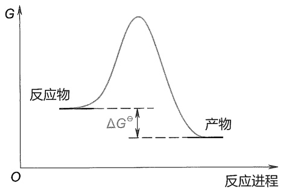

line

| Category | Value |
| --- | --- |
| 反应物 | Baseline |
| 产物 | Baseline |

放能反应: $\Delta G^{\ominus}<0$

从左到右平衡有利

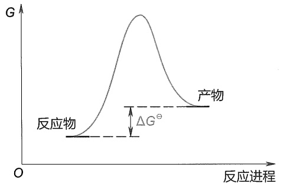

line

| Category | Value |
| --- | --- |
| 反应物 | Baseline |
| 产物 | Peak value |

吸能反应: $\Delta G^{\ominus}>0$

从左到右平衡不利

图3-3 $\Delta G^{\ominus}$ 与反应平衡的关系示意图

## 3.8.2 反应速率

化学动力学主要研究化学反应的速率以及影响速率的各种因素，如分子结构、浓度、温度、压力、介质和催化剂等。反应速率（reaction rate）是在单位时间内反应物浓度（或生成物浓度）的变化。

$$
\mathrm{A} \longrightarrow \mathrm{B} + \mathrm{C} \quad \text {速率} = - \frac {\mathrm{d} [ \mathrm{A} ]}{\mathrm{d} t} = \frac {\mathrm{d} [ \mathrm{B} ]}{\mathrm{d} t} = \frac {\mathrm{d} [ \mathrm{C} ]}{\mathrm{d} t} = k _ {1} [ \mathrm{A} ]
$$

在速率方程中，因为反应物A的浓度随时间减少，故出现负号。方括弧表示反应物或产物的浓度。其中，$-\frac{\mathrm{d}[\mathrm{A}]}{\mathrm{d}t}$ 代表反应物的消耗速率，$\frac{\mathrm{d}[\mathrm{B}]}{\mathrm{d}t}$ 和 $\frac{\mathrm{d}[\mathrm{C}]}{\mathrm{d}t}$ 代表产物的生成速率。在化学反应的速率方程中，物质A的浓度项方次为反应对A的级数，所有浓度项方次的代数和为该反应的总级数，简称反应级数。通常所说的反应级数是指反应的总级数。所以上面的反应是一级反应，$k_{1}$ 是一级反应速率常数，单位为 $\mathrm{s}^{-1}$ 。而下面的两个反应是二级反应和三级反应:

$$
\begin{array}{l} \mathrm{A} + \mathrm{B} \longrightarrow \mathrm{C} + \mathrm{D} \quad \text {速率} = k _ {2} [ \mathrm{A} ] [ \mathrm{B} ] \quad \text {二级反应} \\ 2 \mathrm{A} + \mathrm{B} \longrightarrow \mathrm{C} + \mathrm{D} \quad \text {速率} = k _ {3} [ \mathrm{A} ] ^ {2} [ \mathrm{B} ] \quad \text {三级反应} \\ \end{array}
$$

化学动力学主要观察反应物或产物的浓度随时间的变化, 用各种方法跟踪反应物的消失或产物的出现, 就可以测定某一反应的反应速率常数。对于某一特定反应, k 仅是反应温度的函数, 与反应物浓度无关。

用波谱分析可以快速而有效地连续监测浓度的改变, 测定旋光度可以跟踪溶液中旋光物质的反应情况, 连续 pH 测定可以监测  $H^{+}$  的生成或消耗等。只要有测定反应物或产物浓度的方法, 就可以测定反应速率常数和反应的级数。

那么动力学的理论根据是什么呢？

1889年，Arrhenius提出了一个经验公式，总结了反应速率与温度之间的变化规律:

$$
\text {速率常数} k = A \mathrm{e} ^ {- E _ {\mathrm{a}} / R T}
$$

A 称为指前因子， $e^{-E_{a}/RT}$  为能量概率（e 为自然对数的底数， $E_{a}$  为活化能，R 为摩尔气体常数，T 为热力学温度）。一般情况下，温度每升高  $10^{\circ}C$ ，反应速率将增加 2\~3 倍。

Arrhenius 提出，反应物分子需要获取一定的能量，转化成活化分子，互相碰撞才能发生反应，他将这个能量称为活化能（activation energy） $E_{a}$ 。通过测量反应速率随温度的变化，就可以计算出反应所需的活化能。这个公式从实验测量所得的参数出发，其适用范围很广。但是在微观层面，对于反应发生的具体过程，以及这个公式内的指前因子，Arrhenius 并没有给出详细的描述或解释。

## 3.8.3 过渡态理论

Eyring 和 Polanyi 在 20 世纪 30 年代提出过渡态理论（transition state theory），从分子层面指出了活化能的含义。过渡态理论强调分子相互作用的状态，并将活化能与过渡态联系起来。反应不是通过简单碰撞就能发生的，而是需要反应物分子之间形成过渡态活化络合物。反应物分子达到过渡态所需要的能量，即为活化能。而对于复杂反应，每一个过渡态都有相对应的活化能。

## 1. 活化能与反应过渡态

在反应物相互接近的反应进程中，出现一个能量比反应物与产物均高的势能最高点，与此势能最高点相对应的结构称为过渡态（transition state, TS），用“$^{+}$”表示。过渡态是基元反应中经历最高势能的结构，旧键逐渐断裂，新键正在生成。活化能 $E_{a}$ 是反应物分子形成活化络合物的能量，该活化络合物即为过渡态。活化能还有另一种解释:分子间要相互接近、碰撞，才能发生反应，但当分子间接近到一定程度，就会有排斥力，因此存在一个能垒。发生反应时必须提供能量，克服这个能垒，迫使分子进一步接近至碰撞才能发生反应，克服这个能垒所必需的最低能量，就是活化能。另外，过渡态理论中还引入了热力学概念，用 Gibbs 活化自由能 $\Delta G^{\ddagger}$ 指代反应活化能，以考虑焓变与熵变。

过渡态极不稳定，寿命非常短（飞秒数量级），它只是反应进程中一个中间阶段的结构，不能分离得到:

$$
\begin{array}{c}\mathrm{A} + \mathrm{BC} \longrightarrow [ \mathrm{A} - - \mathrm{B} - - \mathrm{C} ] ^ {\ddagger} \rightarrow \mathrm{AB} + \mathrm{C}\\\text {反应物} \quad \text {过渡态} \quad \text {产物}\end{array}
$$

如反应物A接近BC，要与BC成键而未完全形成，BC之间的键开始伸长而未断裂，这种反应物到过渡态之间的键的变化，迫使势能上升；当势能到达活化能这个数值时，反应物到达过渡态；这时 A 与 B 之间进一步结合成键，B 与 C 之间的键进一步削弱、断键，势能下降，释放能量，得到产物。 $\Delta H$  为反应前后体系势能的变化，如图 3-4 所示。活化能和焓变的大小决定了反应的动力学特征和热力学特征。

以反应进程（自左向右，左边为反应物，右边为产物）为横坐标，以反应体系在反应过程中的势能为纵坐标来作图，这种图称为反应势能图。图3-4为只包含一步反应的反应势能图，图3-5为包含两步反应的反应势能图。

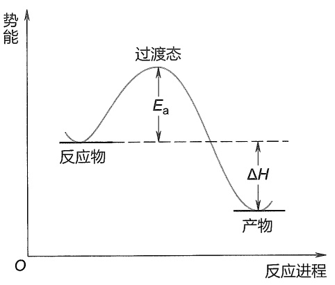

line

| 阶段 | 势能 |
| --- | --- |
| 反应物 | ~初始值 |
| 过渡态 | ~峰值 |
| 产物 | ~初始值 |

图3-4 一步反应的反应势能图

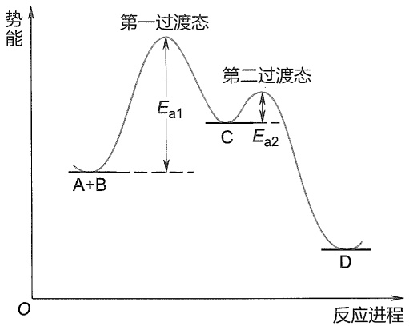

line

| 阶段 | 峰值 (E) |
| --- | --- |
| 第一过渡态 | Ea1 |
| 第二过渡态 | Ea2 |

图3-5 二步反应的反应势能图

活性中间体（reactive intermediate）是与过渡态经常一同出现的另一个概念。它指的是连续多步反应中的一个中间不稳定产物，是局部势能的低点，活性中间体可以分离表征和光谱鉴定。而过渡态则是反应进行得到产物或中间体所经过的势能最高点，极不稳定，一般为分子振动尺度寿命，很难用光谱表征。

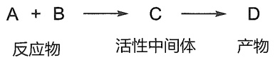

如图3-5所示，上述A和B反应，在反应进程中首先经过第一过渡态，形成活性中间体C，活性中间体处在势能谷底中，为稳态物种，所以活性中间体C有一定的寿命，可以通过一些方法测出它的存在。从活性中间体C形成产物D时，又需经过第二过渡态。这两个过渡态相应的活化能分别为 $E_{\mathrm{a1}}$ 和 $E_{\mathrm{a2}}$ ，其中到达第一过渡态的活化能较高，即第一步反应速率常数小，反应比第二步进行得慢，而慢的一步是反应决速步。

## 2. 热力学控制与动力学控制

如果同样的反应物 $\mathrm{A + B}$，可以通过两种途径分别生成 $\mathrm{C + D}$ 或 $\mathrm{E + F}$，会产生图3-6中的两种情况。对图3-6（a）来说，与生成 $\mathrm{C + D}$ 相比，生成 $\mathrm{E + F}$ 的路径活化能较高，反应 $\Delta G$ 较大，因此，生成 $\mathrm{E + F}$ 的路径在动力学、热力学上都是不利的；而生成 $\mathrm{C + D}$ 的路径在动力学、热力学上都是有利的。如果两种反应的势能变化类似图3-6（b），生成 $\mathrm{E + F}$ 的路径相比生成 $\mathrm{C + D}$ 的路径，虽然反应活化能较低，但是 $\Delta G$ 较大。这时，生成 $\mathrm{E + F}$ 的路径是动力学有利的，实验中低温下倾向于生成 $\mathrm{E + F}$；生成 $\mathrm{C + D}$ 的路径是热力学有利的，实验中高温下倾向于生成 $\mathrm{C + D}$。当活化能是产物选择性的主要控制因素时，反应表现为动力学控制，相应的产物称为动力学产物；当 $\Delta G$ 是产物选择性的主要控制因素时，反应表现为热力学控制，相应的产物称为热力学产物。

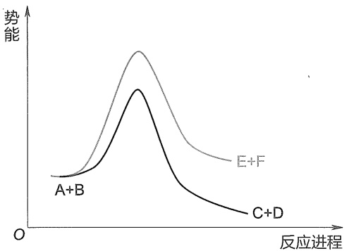

line

| 反应进程 | E+F (势能) | C+D (势能) |
| --- | --- | --- |
| A+B | ~低值 | ~低值 |
| 中间区域 | ~高值 | ~中等值 |
| 高区间 | ~中值 | ~低值 |

(a)

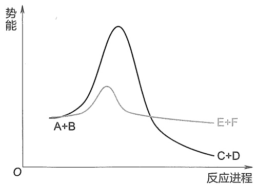

line

| 反应进程 | A+B (势能) | E+F (势能) | C+D (势能) |
| --- | --- | --- | --- |
| 初始 | ~低值 | ~低值 | ~低值 |
| 中间峰值 | ~中等值 | ~高值 | ~最高值 |
| 结束 | ~较低值 | ~较低值 | ~最低值 |

(b)

图3-6 A+B生成 $\mathbf{C} + \mathbf{D}$ 或 $\mathbf{E} + \mathbf{F}$ 的反应势能图

## 3. Hammond 假说

上面讨论了过渡态在决定反应速率方面起着很重要的作用，因此了解有关过渡态结构的信息十分必要，但过渡态只能短暂存在，很难通过实验来测定。George S. Hammond 把过渡态与反应物、活性中间体、产物关联起来，提出了 Hammond 假说（Hammond's hypothesis），即“在简单的一步反应（基元反应）中，过渡态的结构、能量与反应物或产物中能量较高的那边类似”，如图 3-7 所示。用反应势能变化可以表示这个假说。

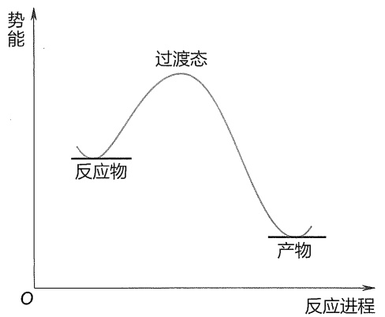

line

| 阶段 | 势能趋势 |
| --- | --- |
| 反应物 | 低 |
| 过渡态 | 高 |
| 产物 | 低 |

(a) 在放热反应中过渡态结构与反应物近似

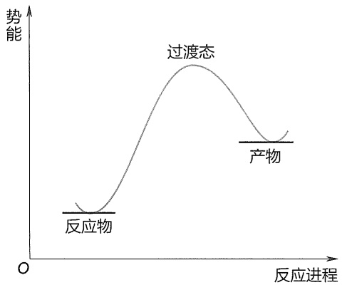

line

| 阶段 | 势能趋势 |
| --- | --- |
| 反应物 | 低 |
| 过渡态 | 高 |
| 产物 | 中等 |

(b) 在吸热反应中过渡态结构与产物近似

图3-7 Hammond假说势能图

图3-7(a)是放热反应，过渡态的能量接近反应物的能量，其结构也与反应物结构近似；图3-7(b)是吸热反应，过渡态的能量与产物的能量比较接近，其结构也近似产物的结构。在吸热反应中，需要对反应物的结构进行较大的改组，使其接近具有较高能量的过渡态，这就需要较高的活化能，因此反应速率较慢；而放热反应只需要较低的活化能，反应速率较快。

Hammond 假说在比较类似的化合物进行同类反应时适用:

对于自由基、离子型多步反应，一般而言，若反应过程中生成不稳定的自由基或碳正/负离子，势能比较高，此类反应中，过渡态结构比较接近这些不稳定中间体的结构。另外，类似化合物进行同类反应，若中间体稳定，就表现为它的势能低，过渡态势能也低，活化能相对较低，则反应活性高，反应速率快。例如，对能量类似的A和C，可以分别发生A到B和C到D的转化（图3-8）。同是 $\Delta G > 0$ 的反应，但是B比D更稳定，过渡态 $\mathrm{TS}_{\mathrm{AB}}$ 比 $\mathrm{TS}_{\mathrm{CD}}$ 稳定，活化能 $E_{1}$ 比 $E_{2}$ 低，因此A到B比C到D更快。

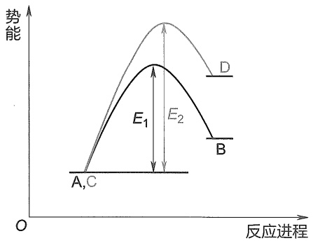

line

| 反应进程 | 路径 (D) | 路径 (B) |
| --- | --- | --- |
| A, C | 0 | 0 |
| E1 | — | — |
| E2 | — | — |

图3-8 $\mathrm{A}\rightarrow \mathrm{B}$ 和 $\mathbf{C}\rightarrow \mathbf{D}$ 的反应势能图

## 3.8.4 烷烃的自由基取代反应历程

甲烷氯化的自由基取代反应历程如下:

首先，氯气分子在光的照射下，均裂为两个氯原子，即氯自由基。

$$
\mathrm{Cl} - \mathrm{Cl} \xrightarrow {\text {光}} 2 \mathrm{Cl} \cdot \quad \text {链引发}
$$

生成的氯原子是极其活泼的，很容易从甲烷分子中获得一个氢原子而生成氯化氢，同时产生甲基自由基。产生的甲基自由基同样也非常活泼，其与氯气分子作用，生成一氯甲烷和氯自由基。

$$
\left. \begin{array}{l} \mathrm{Cl} \cdot + \quad \mathrm{CH} _ {4} \longrightarrow \mathrm{CH} _ {3} \cdot + \mathrm{HCl} \\ \mathrm{CH} _ {3} \cdot + \mathrm{Cl} _ {2} \longrightarrow \mathrm{CH} _ {3} \mathrm{Cl} + \mathrm{Cl} \cdot \end{array} \right\} \text {链传递}
$$

这样循环下去，甲烷和氯气反应逐渐转化为一氯甲烷和氯化氢。

事实上，这样的循环反应不可能无限地循环下去，当自由基和自由基相互碰撞并结合在一起时，就生成了分子，从而使得自由基逐渐减少，直至消失。

$$
\left. \begin{array}{c c c c} \mathrm{Cl} \cdot & + & \mathrm{Cl} \cdot & \longrightarrow \mathrm{Cl} _ {2} \\ \mathrm{CH} _ {3} \cdot & + & \mathrm{CH} _ {3} \cdot & \longrightarrow \mathrm{CH} _ {3} \mathrm{CH} _ {3} \\ \mathrm{CH} _ {3} \cdot & + & \mathrm{Cl} \cdot & \longrightarrow \mathrm{CH} _ {3} \mathrm{Cl} \end{array} \right\} \text {链终止}
$$

从上面的分析可知，该反应过程经历了光照下由氯分子产生氯原子的阶段，然后是由氯原子所引发产生新的自由基的阶段，最后是自由基被消耗并不再产生的阶段，以上三个过程分别称为自由基取代反应历程的链引发、链传递和链终止。

在光照或加热等条件下，分子中共价键可以发生均裂而形成自由基。在一些自由基反应中，加入 BPO、DTBP、TBHP 或 AIBN 等可以促进  $\sigma$  键的均裂。BPO 等过氧化合物中的 O-O 键的键能比较弱，AIBN 易分解出氮气，它们在光照或加热等条件下较易产生自由基，作为自由基引发剂，引发后续的自由基反应。

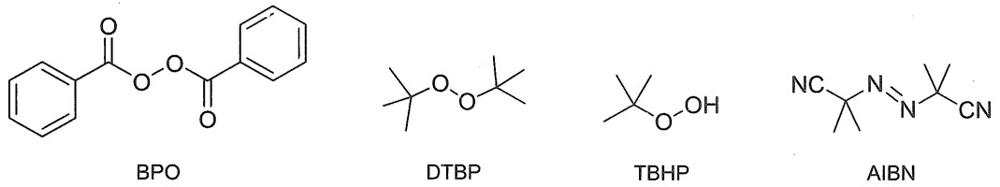

甲烷氯化反应中每一步的反应热如下所示:

(1) $\mathrm{Cl - Cl}\xrightarrow{\text{光}} 2\mathrm{Cl}\cdot$ $\Delta H = +243\mathrm{kJ / mol}$
(2) $\mathrm{Cl} \cdot +\mathrm{CH}_4 \longrightarrow \mathrm{CH}_3 \cdot +\mathrm{HCl} \quad \Delta H = [(+435) - (+431)] \mathrm{kJ/mol} = +4 \mathrm{kJ/mol}$
(3) $\mathrm{CH}_3\cdot +\mathrm{Cl}_2\xrightarrow{\Delta H} \mathrm{CH}_3\mathrm{Cl} + \mathrm{Cl}\cdot$ $\Delta H = [(+243) - (+349)]\mathrm{kJ / mol} = -106\mathrm{kJ / mol}$

反应(1)要吸收大量的能量（243 kJ/mol）才能使  $Cl_{2}$  均裂形成  $Cl^{\bullet}$，引发  $CH_{4}$  分子发生反应，这个能量可以通过光照或高温供给。反应(2)只需吸收+4 kJ/mol 的热量，使  $CH_{4}$  与  $Cl^{\bullet}$  反应产生  $CH_{3}^{\bullet}$  和 HCl，但此反应需要克服 16.7 kJ/mol 的活化能 ( $E_{a1}$ ) 才能越过势能最高点，形成  $CH_{3}^{\bullet}$  和 HCl，这个势能最高点的结构  $\left[\overset{\delta\cdot}{\mathrm{Cl}}\cdots\mathrm{H}\cdots\mathrm{CH}_{3}\right]^{\ddagger}$  称为过渡态 I， $\delta^{\bullet}$  表示带有部分自由基。反应(3)放热 106 kJ/mol，但也需要 8.3 kJ/mol 的活化能 ( $E_{a2}$ ) 才能越过第二个势能最高点，形成  $CH_{3}Cl$  和  $Cl^{\bullet}$，第二个势能最高点的结构  $\left[\overset{\delta\cdot}{\mathrm{CH}_{3}}\cdots\mathrm{Cl}\cdots\mathrm{Cl}\right]^{\ddagger}$  称为过渡态 II。(2)+(3)两步反应是放热反应，共放出热 102 kJ/mol，因此从反应热看，反应是可以进行的。由于形成过渡态 I 的活化能比形成过渡态 II 的活化能高，因此反应(2)是慢步骤，是甲烷氯化反应的决速步。自由基与甲烷反应的能量变化曲线如图 3-9 所示。

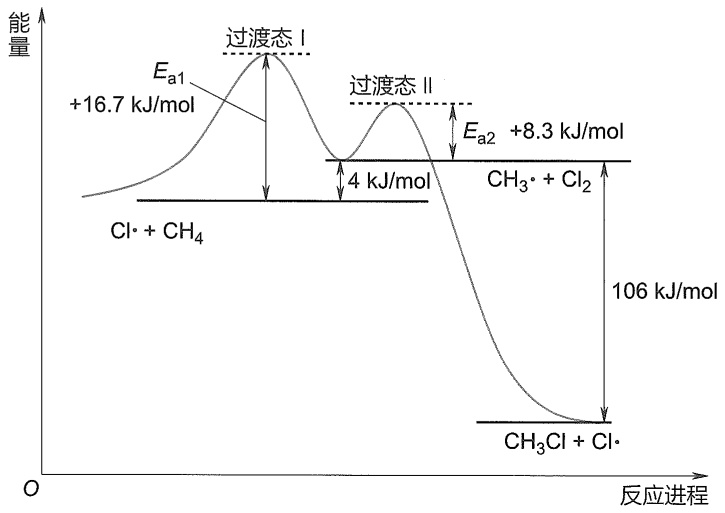

line

| Process | Activation Energy (kJ/mol) |
| --- | --- |
| Ea1 (Process I) | +16.7 |
| Ea2 (Process II) | +8.3 |
| Activation Energy (Ea1) | 4 |
| Activation Energy (Ea2) | 8.3 |
| Activation Energy (Total) | 106 |

图 3-9 甲烷氯化反应链传递过程能量曲线

对于(2)+(3)的总反应  $CH_{4} + Cl_{2} \longrightarrow CH_{3}Cl + HCl$ ，已知  $\Delta G = -2.30RT\lg K$ ，且  $\Delta G = \Delta H - T\Delta S$ ，为了计算出 K 的数值，需要有熵变  $\Delta S$  的值。一般而言，对于反应前后分子数相同的反应，可以近似假定  $\Delta S$  约等于零。因此， $\Delta G \approx \Delta H \approx -5.70\lg K (298\mathrm{K})$ ， $K \approx 10^{18}$ 。也就是说，反应平衡明显向右移动。

值得注意的是，$\mathrm{H - CH_2Cl}$ 中C-H键的键能比 $\mathrm{CH}_4$ 中的低，从热力学角度来说，反应不能停留在 $\mathrm{CH}_3\mathrm{Cl}$，将继续进行直到生成 $\mathrm{CCl_4}$，但是由于 $\mathrm{CH}_4$ 反应得到 $\mathrm{CCl_4}$ 需要同一个分子与氯自由基发生四次碰撞，概率很低，从动力学角度来说是困难的，因此可以通过控制氯自由基的浓度和反应时间等条件，控制反应得到的主要产物为一氯代物。

甲烷与 $\mathrm{F}_2$ 、 $\mathrm{Cl}_2$ 、 $\mathrm{Br}_2$ 、 $\mathrm{I}_2$ 反应的总反应热 $\Delta H$ 以及(2)和(3)步反应的反应热、(2)步反应的活化能数据列于表3-8。

表 3-8 甲烷与不同卤素反应相关的反应热及(2)步反应的活化能 ${E}_{\mathrm{a}1}$

<table><tr><td rowspan="2">反应过程</td><td colspan="4"> $\Delta H/(kJ·mol^{-1})$ </td><td colspan="4"> $E_{a1}/(kJ·mol^{-1})$ </td></tr><tr><td>F</td><td>Cl</td><td>Br</td><td>I</td><td>F</td><td>Cl</td><td>Br</td><td>I</td></tr><tr><td> $CH_4 + X· \longrightarrow CH_3· +HX$ (2)</td><td>-134</td><td>+4</td><td>+69</td><td>+138</td><td>+5.0</td><td>+16.7</td><td>+78</td><td>+140</td></tr><tr><td> $CH_3· +X_2 \longrightarrow CH_3X +X·$ (3)</td><td>-293</td><td>-106</td><td>-100</td><td>-84</td><td></td><td></td><td></td><td></td></tr><tr><td> $CH_4 +X_2 \longrightarrow CH_3X +HX$ </td><td>-427</td><td>-102</td><td>-31</td><td>+54</td><td></td><td></td><td></td><td></td></tr></table>

对于溴化反应，其链传递过程能量曲线如图 3-10 所示。可以注意到，相比氯化反应，链传递的反应活化能  $E_{a1}$  明显增高，这也是溴化反应活性不如氯化反应的一个重要原因。其总过程仍旧是个放热反应，因此还能够自发进行。

对于氟化反应（图 3-11），情况比较特殊，氟化反应链传递过程的两个反应全都是放出能量的，而且放热能量很大，这导致其反应没有明显能垒，很容易自发进行，难以控制，反应会非常迅速且剧烈，以至于反应失控发生爆炸。

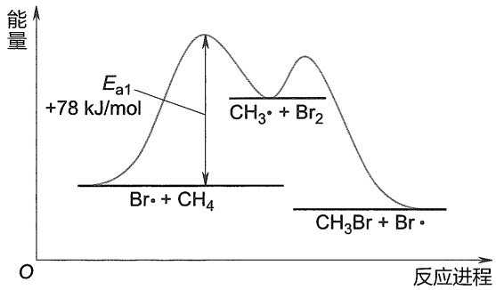

line

| Component | Activation Energy (kJ/mol) |
| --- | --- |
| Ea1 | +78 |
| CH3• + Br2 | N/A |
| Br• + CH4 | N/A |
| CH3Br + Br• | N/A |

图 3-10 甲烷溴化反应链传递过程能量曲线

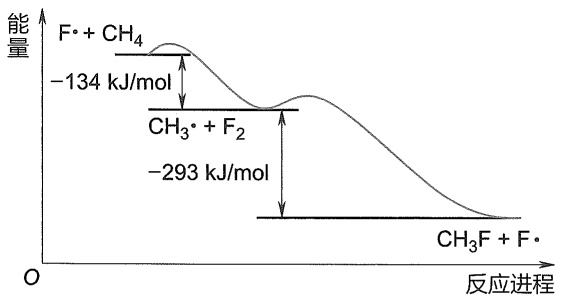

line

| Reaction Intermediate | Energy Change (kJ/mol) |
| --- | --- |
| F• + CH4 | -134 |
| CH3• + F2 | -293 |

图 3-11 甲烷氟化反应链传递过程能量曲线

对于碘化反应（图 3-12），情况则恰恰相反，由于  $\Delta H$  正值（+138 kJ/mol）太大，导致整个链传递过程是吸热的（+54 kJ/mol）， $E_{a1}$  能垒很高且无法通过反应放热弥补，因此该反应无法进行，但是逆反应则相对有利。

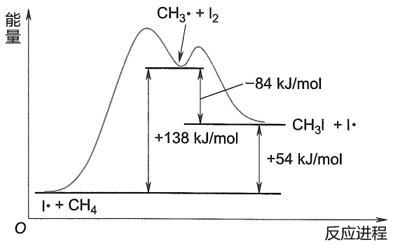

line

| Reaction | Energy Change (kJ/mol) |
| --- | --- |
| CH3• + I2 | -84 |
| CH3I + I• | +138 |
| CH3I + I• | +54 |

图 3-12 甲烷碘化反应链传递过程能量曲线

从上述反应热、活化能的数据及链传递反应能量曲线图可以看出，四种卤素与甲烷反应活性顺序为: $F_{2}>Cl_{2}>Br_{2}>I_{2}$ 。氟与甲烷反应时，两步反应都放出大量的热，反应过于剧烈，难以控制；而碘与甲烷的反应为吸热反应，且第(2)步反应的活化能较大，故反应难以进行。因此，甲烷的卤化反应通常是指氯化反应或溴化反应。

其他烷烃与卤素的反应也是自由基取代反应，含碳数越多的烷烃，取代产物越复杂。例

如，丙烷与氯气反应的两种一氯代产物的比例如下:

$$
\mathrm{CH} _ {3} - \mathrm{CH} _ {2} - \mathrm{CH} _ {3} + \mathrm{Cl} _ {2} \xrightarrow [ 2 5 ° C ]{\text {光}} \mathrm{CH} _ {3} - \mathrm{CH} _ {2} - \mathrm{CH} _ {2} + \mathrm{CH} _ {3} - \mathrm{CH} - \mathrm{CH} _ {3} 4 3 \% \quad 5 7\%
$$

丙烷分子中，有6个等价的伯氢，2个等价的仲氢，如果氢的活性一样，则两种一氯代烃的产率，理论上为 $6:2 = 3:1$ ，但实际上为 $43:57 = 1:1.33$ ，这说明在室温下氯化时，各类氢的反应活性是不同的。

如果定义:氢的相对活性 $=$ 产物的数量 $\div$ 被取代的等价氢的个数。则

$$
\frac {\mathrm{仲氢的相对活性}}{\mathrm{伯氢的相对活性}} = \frac {5 7 / 2}{4 3 / 6} \approx \frac {4}{1}
$$

即仲氢与伯氢的相对反应活性为 4:1。

异丁烷一氯代产物的比例如下:

$$
\mathrm{CH} _ {3} - \stackrel {\mathrm{CH} _ {3}} {\mathrm{CH}} - \mathrm{CH} _ {3} + \mathrm{Cl} _ {2} \xrightarrow [ 2 5 ^ {\circ} \mathrm{C} ]{\text {光}} \mathrm{CH} _ {3} - \stackrel {\mathrm{CH} _ {3}} {\mathrm{C}} - \mathrm{CH} _ {3} + \mathrm{CH} _ {3} - \stackrel {\mathrm{CH} _ {3}} {\mathrm{CH}} - \mathrm{CH} _ {2} - \mathrm{Cl}
$$

异丁烷有 9 个伯氢，1 个叔氢。它们的相对活性比值如下:

$$
\frac {\mathrm{叔氢的相对活性}}{\mathrm{伯氢的相对活性}} = \frac {3 6 / 1}{6 4 / 9} \approx \frac {5}{1}
$$

即叔氢的反应活性为伯氢的 5 倍。

所以，室温下氯化反应中三种氢的相对反应活性为  $3^{\circ}H:2^{\circ}H:1^{\circ}H=5:4:1$ 。

溴化反应时（光照，150 °C），三种氢的相对反应活性为  $3^{\circ}H:2^{\circ}H:1^{\circ}H=1700:80:1$ 。例如:

$$
\mathrm{CH} _ {3} - \stackrel {\mathrm{CH} _ {3}} {\mathrm{CH}} - \mathrm{CH} _ {3} + \mathrm{Br} _ {2} \xrightarrow [ 1 5 0 ^ {\circ} \mathrm{C} ]{\text {光}} \mathrm{CH} _ {3} - \stackrel {\mathrm{CH} _ {3}} {\mathrm{C}} - \mathrm{CH} _ {3} + \mathrm{CH} _ {3} - \stackrel {\mathrm{CH} _ {3}} {\mathrm{CH}} - \mathrm{CH} _ {2}
$$

从上面的例子可知，卤素和烷烃进行的取代反应，在卤素与同一种烷烃反应时，不同的卤素表现出不同的反应活性。同样，不同的烷烃和同一种卤素进行的取代反应，也具有不同的反应活性。这主要与生成的自由基的稳定性有一定关系，越容易生成的自由基越稳定，也就越容易发生取代反应。几种自由基的稳定性顺序为

$$
\begin{array}{c} \mathrm{CH} _ {3} \\ \mathrm{H} _ {3} \mathrm{C} - \underset {\mathrm{CH} _ {3}} {\overset {\cdot} {\mathrm{C}}} \cdot \end{array} > \begin{array}{c} \mathrm{H} _ {3} \mathrm{C} - \underset {\mathrm{CH} _ {3}} {\overset {\cdot} {\mathrm{C}}} \mathrm{H} \end{array} > \begin{array}{c} \mathrm{H} _ {3} \mathrm{C} - \dot {\mathrm{CH}} _ {2} \end{array} > \begin{array}{c} \dot {\mathrm{CH}} _ {3} \end{array}
$$

由此可以看出，叔、仲和伯氢原子的反应活性顺序是  $3^{\circ} > 2^{\circ} > 1^{\circ}$ 。

几种常见烷烃中伯氢、仲氢、叔氢 C-H 键的解离能（kJ·mol $^{-1}$ ）为:H-CH $_{3}$ （435），H-C $_{2}$ H $_{5}$ （410），H-CH(CH $_{3}$ ) $_{2}$ （395），H-C(CH $_{3}$ ) $_{3}$ （381）。C-H 键的解离能越低，所对应的烷基自由基就越稳定，该自由基也就越易生成。烷基自由基中心碳原子采取 sp $^{2}$ 杂化，其稳定性亦可用 σ-p 超共轭来解释（见 1.7.2 小节）。

在自由基取代反应中，反应活性的增加与选择性的降低密切相关。对于反应性较高的卤素，如氟和氯，对不同类型的 C-H 键的区分能力远低于活性较低的溴（表 3-9）。因此，在烷烃的自由基取代反应中溴具有高选择性，氯仅具有中等选择性，而氟则几乎不具有选择性。

表 3-9 卤化反应中四种不同类型的烷基 C-H 键的相对反应性

| C-H键 | F·(25°C,气态) | Cl·(25°C,气态) | Br·(150°C,气态) |
| --- | --- | --- | --- |
| $CH_3$-H | 0.5 | 0.004 | 0.002 |
| $RCH_2$-H | 1 | 1 | 1 |
| $R_2CH$-H | 1.2 | 4 | 80 |
| $R_3C$-H | 1.4 | 5 | 1700 |

## 习题

1. 写出己烷  $C_{6}H_{14}$  五种异构体的结构式。
2. 写出符合下列条件的  $C_{5}H_{12}$  的结构式。

（1）只含有伯氢，没有仲氢或叔氢。
(2) 只含有一个叔氢。
（3）只含有伯氢和仲氢而没有叔氢。

3. 用系统命名法命名下列化合物。

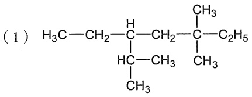

chemical

Chemical structure of a branched alkane with methyl and ethyl substituents

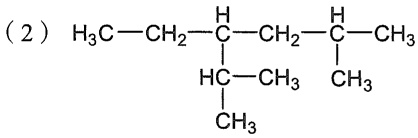

chemical

Chemical structure of a branched alkane with methyl and hydrogen substituents

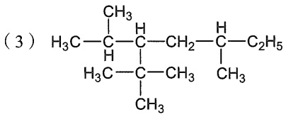

chemical

Chemical structure of a branched alkane with methyl and ethyl substituents

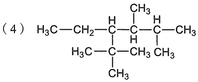

chemical

Chemical structure of a branched alkane with methyl and hydrogen substituents

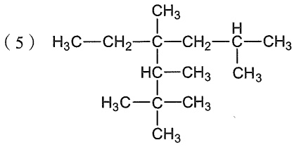

chemical

Chemical structure of a branched alkane with methyl and hydrogen substituents

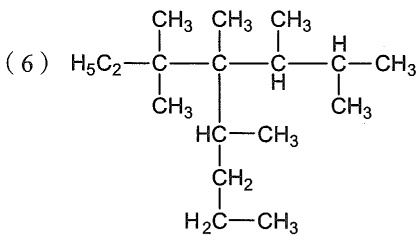

chemical

Chemical structure of a polyene compound with methyl and hydrogen substituents

4. 用系统命名法命名下列化合物。

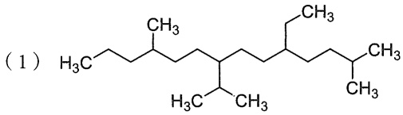

chemical

Chemical structure of a branched alkane with methyl and hydrogen substituents

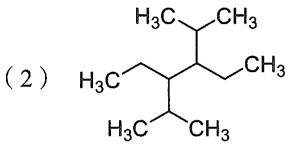

chemical

Chemical structure of a substituted cyclohexane with methyl and hydrogen atoms

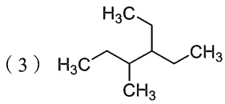

chemical

Chemical structure of a branched alkene with methyl substituents and labeled as (3)

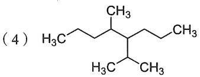

chemical

Chemical structure of a branched alkene with methyl substituents and double bond

(5)

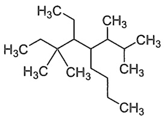

chemical

Chemical structure of a cyclohexane derivative with methyl and ethyl substituents

(6)

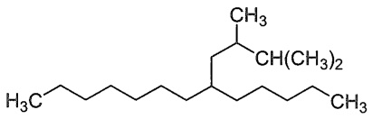

chemical

Chemical structure of a branched alkene with methyl and ethyl substituents

(7)

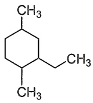

(8)

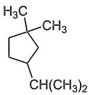

(9)

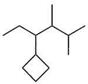

(10)

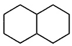

(11)

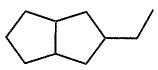

(12)

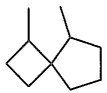

5. 写出下列化合物的结构式。

（1）顺-1,2-二羟基环丙烷

(2) 反-1,3-二溴环丁烷

（3）顺-1,3-二甲基环戊烷

（4）顺-1,2-二甲基环丁烷

(5) 反-1,2-二溴环戊烷

(6) 反-1,2-二氯环丙烷

6. 写出下列化合物的结构式。

(1) 3-乙基-2,4-二甲基己烷
(2) 2,2,3,4-四甲基戊烷
（3）含有一个支链甲基和相对分子质量为86的烷烃
（4）相对分子质量为 100，同时含有伯、叔、季碳原子的烷烃

7. 将下列烷烃按照沸点由高到低的顺序排序。

(1) a. 2-甲基戊烷

b. 正己烷

c. 正庚烷

d. 正十二烷

(2) a. 正戊烷

b. 异戊烷

c. 新戊烷

8. 写出下列化合物在室温下进行光照发生一氯取代反应时所得产物的结构简式。

(1) 2,2-二甲基丙烷

(2) 丙烷

(3) 正戊烷

(4) 2,3-二甲基丁烷

9. 写出下列反应的产物。

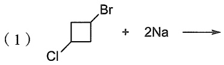

chemical

Chemical reaction equation showing bromide reacting with 2Na to form a bromo-substituted alkene

(2)

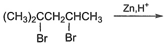

(3)

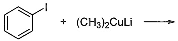

(4)

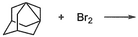

(5)

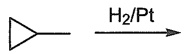

(6)

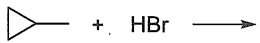

10. 写出新戊烷在光照下溴化产生溴代新戊烷的反应机理。
11. 在下列反应中，选用  $Cl_{2}$  和  $Br_{2}$  哪一种卤化试剂比较合适？为什么？

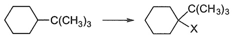

12. 甲烷和氯气通常需要加热到 $250^{\circ}\mathrm{C}$ 以上才能反应，但加入少量（$0.02\%$）四乙铅 $[\mathrm{Pb}(\mathrm{C}_2\mathrm{H}_5)_4]$ 后，则在 $140^{\circ}\mathrm{C}$ 就能发生反应，试解释之，写出反应机理，并画出链传递反应的过渡态。（提示:

Cl–Cl 键和 C–Pb 键的解离能分别为 242 kJ/mol 和 205 kJ/mol。)

13. 在光照下，烷烃与二氧化硫和氯气反应，烷烃分子中的氢原子被氯磺酰基（$-\mathrm{SO}_2\mathrm{Cl}$）取代，生成烷基磺酰氯:

$$
\mathrm{R} - \mathrm{H} + \mathrm{SO} _ {2} + \mathrm{Cl} _ {2} \xrightarrow [ \text {常温} ]{\text {光}} \mathrm{R} - \mathrm{SO} _ {2} \mathrm{Cl} + \mathrm{HCl}
$$

本章习题
参考答案

此反应称为氯磺酰化反应，亦称 Reed 反应。工业上常利用此反应由高级烷烃生产烷基磺酰氯和烷基磺酰钠（R-SO₂ONa）（它们都是合成洗涤剂的原料）。此反应与烷烃的氯化反应相似，也是按自由基取代机理进行的。试参考烷烃卤化的反应机理，写出烷烃（用 R-H 表示）氯磺酰化的反应机理。

14. 在烷烃的卤化反应中添加某种自由基抑制剂会使反应几乎完全停止。一个例子是 $\mathrm{I}_2$ 对甲烷氯化反应的抑制作用。通过计算解释这种抑制作用发生的可能过程。（相关的 $\Delta H$ 数据见本章表3-8。）

(本章编者 邢国文、米学玲)

## 第四章

## 卤代烃

4.1 卤代烃的分类 …… 95
4.2 卤代烃的结构与物理性质 …… 95
4.3 卤代烃的亲核取代反应 …… 96
4.4 卤代烷的消除反应 …… 109

4.5 卤代烷亲核取代反应和消除
反应的竞争 …… 116
4.6 卤代烃与金属的反应……119
习题 123

## 4.1 卤代烃的分类

烃类分子中的氢原子被卤素原子取代后的化合物称为卤代烃（halohydrocarbon）。通常使用分子简式RX表示，其中X为卤素F、Cl、Br和I。根据分子中所含卤素原子数目的不同，可以将卤代烃分为一卤代烃、二卤代烃、三卤代烃和多卤代烃。按卤素原子相连烃基的结构不同，可以分为饱和碳相连的卤代烃（包含 $C_{sp^{3}}-X$ 键）和不饱和碳相连的卤代烃（包含 $C_{sp^{2}}-X$ 键）。对于不饱和碳相连的卤代烃，卤素原子与烯基相连的称为烯基卤代烃（alkenyl halide）；卤素原子与芳基相连的称为芳基卤代烃（aryl halide）。饱和碳相连的卤代烃，如果卤素原子所连碳原子处于碳碳双键或芳基的 $\alpha$ 位，则称为烯丙基卤代烃（allylic halide）或苄基卤代烃（benzylic halide）。此外，饱和卤代烃中的一卤代烃按照与卤素相连碳原子的级数，分为一级卤代烃、二级卤代烃和三级卤代烃，这三种卤代烃也可以分别叫作伯卤代烃、仲卤代烃和叔卤代烃。卤代烃（RX）的化学性质既与卤素原子（X）的种类有关，又与R基团的结构（电子、位阻因素等）密切相关。

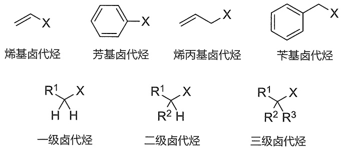

chemical

Chemical structures of four types of hexadiene derivatives with R1, R2, R3 substituents and their corresponding Chinese names

## 4.2 卤代烃的结构与物理性质

烃分子中氢原子被卤素原子取代后，分子结构会发生相应的改变。以甲烷、一氟甲烷、一氯甲烷、一溴甲烷和一碘甲烷的分子结构来对比（表4-1）。相比于甲烷的C-H键，卤代甲烷中的C-X键的键长要长得多，并且按照氟、氯、溴、碘的顺序依次增加，这与卤素原子半径的顺序一致。键角方面，由于中心碳原子采取 $\mathrm{sp}^3$ 杂化，所以∠H-C-X键角接近

109.47°，略微偏小一些。偏小的程度与 C-X 键键长有关，C-X 键越长，∠H-C-X 键角越小。甲烷的 C-H 键键能是 438.9 kJ/mol，是常规意义上的惰性键。相比而言，C-Cl、C-Br、C-I 键键能都远小于 C-H 键键能，因此卤代烃（氟代烃除外）很多情况下具有较活泼的反应性。值得注意的是，C-F 键键能显得“异常”，459.4 kJ/mol 的键能使 C-F 键甚至比 C-H 键还要惰性。氟代烃的这种特殊稳定性使其在药物化学、农药、材料等领域有着广泛的应用价值。

卤素的电负性均强于碳原子，原子电荷表明 $\mathrm{CH}_3\mathrm{X}$ 分子中碳原子带 $\delta+$ 电荷，X带 $\delta-$ 电荷。因此C-X具有极性，这也导致了 $\mathrm{CH}_3\mathrm{X}$ 分子都有较强的偶极矩。同时由于C-X的存在，卤代烃具有可极化性，其可极化性顺序是 $\mathrm{RI} > \mathrm{RBr} > \mathrm{RCl} > \mathrm{RF}$ （与卤素周期数顺序一致，卤素外层电子主量子数 $n$ 越大，离核越远，越容易变形）。可极化性越强的分子，在外界条件下越容易发生形变以适应分子的成键、断键所需的电子和空间需求，因而RCl、RBr和RI都易于进行反应而转变成其他化合物，并且通常情况下RCl、RBr和RI三者的反应活性逐渐增强。

表 4-1 甲烷、一氟甲烷、一氯甲烷、一溴甲烷和一碘甲烷的分子结构参数

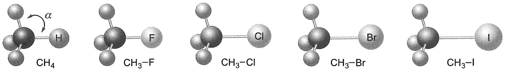

chemical

Molecular structure diagrams showing hydrogen bonding and bromide bond interactions with labeled atoms

| 化合物* | 甲烷 | 一氟甲烷 | 一氯甲烷 | 一溴甲烷 | 一碘甲烷 |
| --- | --- | --- | --- | --- | --- |
| 键长/pm | C-H 109 | C-F 138 | C-Cl 178 | C-Br 194 | C-I 213 |
| 键角 | $\angle H-C-H$= 109.47° | $\angle H-C-F$= 108.92° | $\angle H-C-Cl$= 108.49° | $\angle H-C-Br$= 107.87° | $\angle H-C-I$= 107.59° |
| 键能**/(kJ·mol-1) | C-H 438.9 | C-F 459.4 | C-Cl 367.4 | C-Br 287.2 | C-I 237.8 |
| APT原子电荷 | C (-0.016)H (+0.004) | C (+0.568)F (-0.504) | C (+0.285)Cl (-0.283) | C (+0.213)Br (-0.219) | C (+0.129)I (-0.122) |
| 偶极矩/D | 0 | 1.8449 | 1.9397 | 1.9459 | 1.7115 |
| 可极化性/a.u. | 0 | 15.178 | 24.956 | 32.161 | 41.776 |

\*分子结构及参数均为气态下通过密度泛函理论（DFT）在M062X-def2TZVP方法下计算得到的。

\*\*键能数据来自 ibond 2.0 数据库。

## 4.3 卤代烃的亲核取代反应

有机分子中的原子或基团被亲核试剂取代的反应称为亲核取代反应（nucleophilic substitution），习惯用  $S_{N}$  表示。反应的一般式为

(1) 负离子型亲核试剂

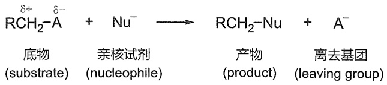

flowchart

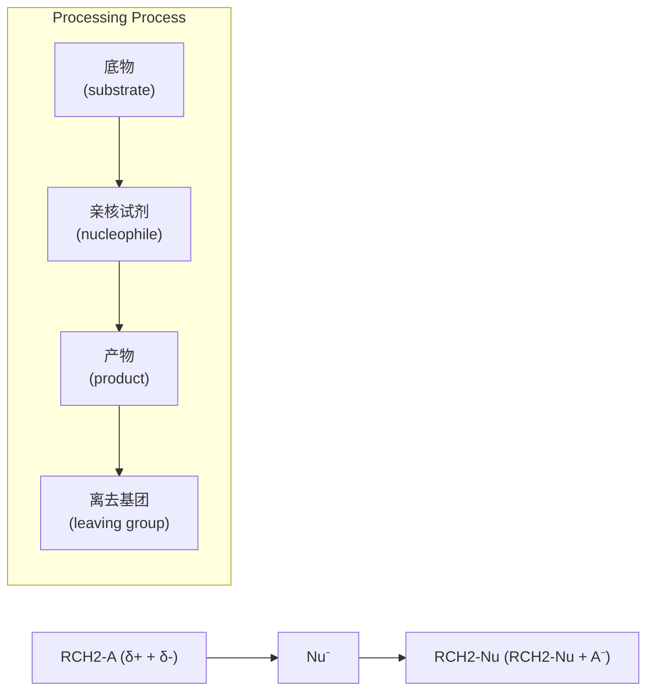

(2) 中性亲核试剂

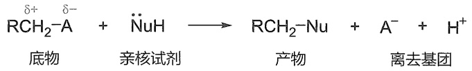

chemical

Chemical reaction equation showing nucleophilic addition of RCH₂-A to Nusseltic acid and H⁺, with examples for base material, neutralizing agent, product, and cleavage.

其中，$\mathrm{RCH}_2 - \mathrm{A}$ 为反应底物；$\mathrm{Nu}^-$ 是有亲核性质负离子，称为亲核试剂；$\mathrm{A}^-$ 是反应后离开的基团，称为离去基团；$\mathrm{RCH}_2$-Nu则是发生取代后生成的产物。底物中连接着离去基团的碳原子称为反应中心碳原子，该碳原子往往带有部分正电荷（$\delta+$），因此电性上匹配亲核试剂的负电荷。当然，并不是亲核试剂必须是负离子才行，带有孤对电子的中性分子也能作为亲核试剂参与亲核取代反应。不过反应过程中会产生等当量的质子（$\mathrm{H}^+$），因此这种情况下，外加一当量的碱，往往能够促进反应向右发生。

根据反应机理，可以将亲核取代反应分为三类:双分子亲核取代反应（ $S_{N}2$ ）、单分子亲核取代反应（ $S_{N}1$ ）和邻基参与亲核取代反应。

## 4.3.1 双分子亲核取代反应（ $S_{N}2$ ）

决速步骤有两个物种参与的亲核取代反应称为双分子亲核取代反应，用  $S_{N}2$  表示，其中 S 表示取代反应，N 表示亲核，2 表示双分子参与了决速步骤。除了一些特殊情况（如溶剂解取代反应）， $S_{N}2$  反应往往表现出二级反应动力学特征。

## 1. $S_{\mathrm{N}}2$ 反应机理

以溴甲烷和氢氧化钠水溶液反应生成甲醇为例讨论（图4-1）。该反应的反应速率既与溴甲烷的浓度成正比，也与 $\mathrm{HO}^{-}$ 浓度成正比，其动力学速率方程为 $v = k[\mathrm{CH}_3\mathrm{Br}][\mathrm{HO}^-]$ 。基于该速率方程给出的 $\mathrm{S_N2}$ 反应机理为:亲核试剂从离去基团的背面进攻反应中心碳原子（位阻最小原则），随着亲核试剂的不断靠近，离去基团逐渐远离，该过程中体系的能量不断升高。直到形成了一个过渡态，该过渡态下新键（C-OH）尚未完全形成，旧键（C-Br）也尚未完全断裂，亲核试剂OH、中心碳原子以及离去基团Br三者处在一条直线上（轨道最大重叠原则）。此刻，中心碳原子上另外三个键也由扇形逐渐变成平面形。该过渡态下能量达到最高点，该极值能量与起始物的能量差称为活化能（$E_{\mathrm{a}}$）。到达过渡态后，亲核试剂进

图 4-1  $S_{N}2$  反应势能图