一步靠近中心碳原子，而离去基团继续远离，体系能量逐渐降低。直到最后 C-OH 键完全形成，C-Br 键完全断裂，取代反应随之完成，产物和反应物之间的能量差为反应焓变。因为控制反应速率一步是双分子的，需要两个物种的碰撞，因此这个反应是双分子亲核取代反应。

## 2. $\mathrm{S_N2}$ 反应的立体化学

从以上的反应机理可以看出，经历一次  $S_{N}2$  反应后，中心碳原子的手性中心进行了一次立体化学反转。通过实验手段可以证实该结果。光学纯的(R)-构型氘代溴丙烷与 NaOH 溶液发生取代反应后，理论上可得到100% 构型反转的(S)-构型氘代丙醇。

$$
\mathrm{HO} ^ {-} + \underset {\text {Et}} {\overset {\mathrm{D}} {\rightleftharpoons}} \mathrm{Br} \xrightarrow {\mathrm{S} _ {\mathrm{N}} 2} \mathrm{HO} \underset {\text {Et}} {\overset {\mathrm{D}} {\rightleftharpoons}} \mathrm{H} + \mathrm{Br} ^ {-}
$$

## 3. 分子内亲核取代反应

当发生亲核取代反应的亲核基团与离去基团在同一个分子内，且两者均在比较合适的位置时，则有可能发生分子内 $\mathrm{S_N2}$ 成环反应，形成环状化合物。（1）当形成五元环或六元环时，过渡态基本不存在环张力，活化能较低，反应容易发生。（2）三元环成环时虽然有环张力，但是亲核基团和离去基团处于邻近位置，容易接近，因此动力学上亲核取代反应也容易发生。（3）四元环成环时，键角为 $88^{\circ}$ 左右，大大偏离 $\mathrm{sp}^3$ 杂化正常键角 $109.5^{\circ}$，成环张力大，很难进行成环反应。（4）形成七元环或八元环时，虽然没有角张力，但是分子内 $\mathrm{S_N2}$ 反应相比分子间 $\mathrm{S_N2}$ 反应并没有动力学上的优势，往往需要较低的反应浓度来提高分子内 $\mathrm{S_N2}$ 反应的选择性。由于此时分子间 $\mathrm{S_N2}$ 反应速率方程为 $v = k[\text{底物}]^2$，低浓度下的分子间 $\mathrm{S_N2}$ 反应速率大大降低；但是分子内 $\mathrm{S_N2}$ 反应速率方程为 $v = k[\text{底物}]$，低浓度反应条件对其反应速率影响不及分子间 $\mathrm{S_N2}$ 反应的影响。

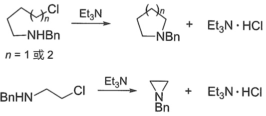

<details>
<summary>chemical</summary>

Chemical reaction equations showing chlorination and cyclization of a bis-naphthalene derivative with ethylamine under different conditions
</details>

## 4.3.2 单分子亲核取代反应（ $S_{N}1$ ）

决速步骤只有一个物种参与的亲核取代反应称为单分子亲核取代反应，用  $S_{N}1$  表示，其中 1 表示单分子参与了决速步骤。

## 1. $\mathrm{S_N1}$ 反应机理

以叔丁基溴和氢氧化钠水溶液反应生成叔丁醇为例讨论（图4-2）。该反应的反应速率只与叔丁基溴的浓度成正比，而与 $\mathrm{HO}^{-}$ 的浓度无关，其动力学速率方程为 $v = k[\mathrm{BuBr}]$ 。基于该速率方程给出的 $\mathrm{S_N1}$ 反应机理为:通过C-Br键的不断伸长，底物体系能量逐渐升高。继而达到一个C---Br键快要断裂却未完全断裂的过渡态，此刻体系能量达到第一个极值。接着C---Br键进一步拉伸，由于溶剂对带电荷物种的溶剂化作用，体系能量逐渐降低，直到异裂成活性中间体——叔丁基碳正离子和 $\mathrm{Br}^{-}$ 。此后生成的叔丁基碳正离子不断与体系中的 $\mathrm{HO}^{-}$ 接近，先需克服溶剂化作用，导致体系能量逐渐升高，直到达到一个C---OH快要形成却未完全形成的第二个过渡态，体系能量达到第二个极值。最后C---OH进一步缩短直到形成稳定的 C-OH 键，取代反应随之完成。整个  $S_{N}1$  反应包含两个基元步骤，途经两个过渡态，其中决定反应速率的是活化能最高的第一步的过渡态，即 C-Br 解离这一步，这一步只涉及一个物种，因此这个反应是单分子亲核取代反应。

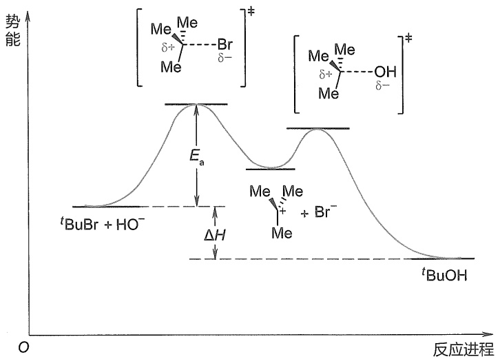

<details>
<summary>line</summary>

| 反应进程 | 势能 (tBuBr + \(HO^{-})\) | 势能 (tBuOH) |
| --- | --- | --- |
| 峰值位置 | 左侧峰值 | 右侧峰值 |
| 电位差 (\(E_a\)) | 左侧峰值 | 右侧峰值 |
| 前期电位差 (\(\Delta H\)) | 左侧峰值 | 右侧峰值 |
| 其他电位差 (\(E_0\)) | 左侧峰值 | 右侧峰值 |
</details>

图4-2 $\mathrm{S_N1}$ 反应势能图

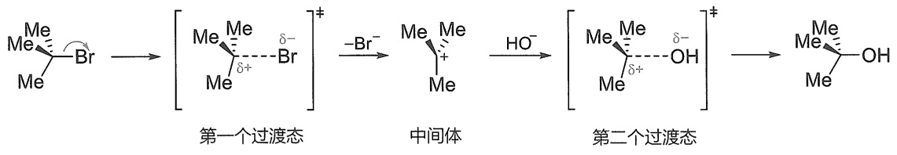

<details>
<summary>flowchart</summary>


</details>

## 2. $S_{N}1$ 反应的立体化学

从以上的反应机理可以看出  $S_{N}1$  反应过程中底物途经了碳正离子中间体，该碳正离子中心碳原子采取  $sp^{2}$  杂化，为平面结构。此后亲核物种从碳正离子平面两侧以相同的概率靠近得到产物。因此，光学纯的烷基卤代物发生  $S_{N}1$  反应后，会得到一对外消旋体。通过实验手段可以证实该结果。

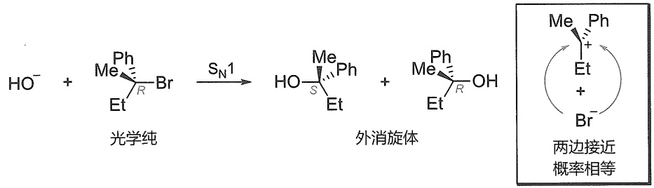

<details>
<summary>chemical</summary>

Chemical reaction equation showing photochemical synthesis of ethyl bromide from hydroxide and monomer, followed by the formation of a disulfide product with two adjacent stereoisomers.
</details>

## 3. $S_{\mathrm{N}}1$ 反应过程中的碳正离子重排

由于  $S_{N}1$  反应经历碳正离子，因此碳正离子在接受亲核试剂进攻之前，有可能发生重排而生成更稳定的碳正离子，再接受亲核试剂进攻，得到重排后的亲核取代反应产物。正常取代产物与重排取代产物的比例取决于重排过程的驱动力。

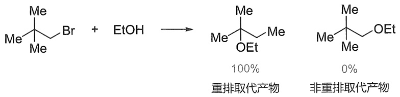

<details>
<summary>chemical</summary>

Chemical reaction equation showing bromination of a bromoalkene with ethanol to form two products: 100% reagent and 0% non-reagent
</details>

1-溴-2,2-二甲基丙烷的醇解反应按照 $\mathrm{S_N1}$ 机理发生，得到的全部是重排取代产物。因为伯碳正离子重排成叔碳正离子的驱动力很大。

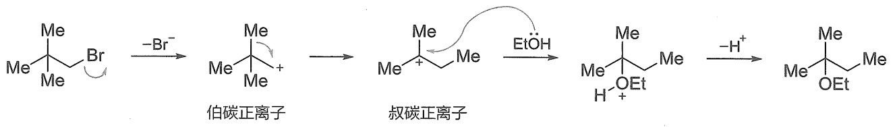

<details>
<summary>chemical</summary>

Reaction pathway showing bromination and oxidation of a bromoalkene to form ethyl ester, with reagents labeled in Chinese.
</details>

## 4.3.3 邻基参与亲核取代反应

构型翻转和外消旋化分别是  $S_{N}2$  和  $S_{N}1$  反应最典型的立体化学特征。但是在一些取代反应中，能够立体专一性地得到构型保持的产物，这些结果既不能用  $S_{N}2$  机理也不能用  $S_{N}1$  机理来解释。例如，在氧化银的作用下，(S)-2-溴丙酸与稀的氢氧化钠溶液反应，得到构型完全保持的产物(S)-2-乳酸。该反应实际上涉及一类重要的取代反应历程——邻基参与。

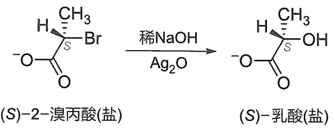

研究表明以上反应的机理如下:$\mathrm{Ag^{+}}$ 对卤素有很强的亲和力，在 $\mathrm{Ag^{+}}$ 的协助下底物中 $\mathrm{COO^{-}}$ 先从离去基团Br的背面进攻中心碳原子，发生一次分子内 $\mathrm{S_N2}$ 过程，形成 $\alpha$-内酯。接下来，由于环张力的影响，内酯环容易开环，亲核试剂 $\mathrm{HO^{-}}$ 再从内酯环的O-C键背面进攻中心碳原子，发生一次分子间 $\mathrm{S_N2}$ 过程，得到最终的取代产物。整个过程相当于发生了两次 $\mathrm{S_N2}$ 反应，因此得到的是构型保持的产物。在这里，$\mathrm{COO^{-}}$ 作为邻近基团参与了反应，最后它又恢复到原状，因此把这种过程称为邻基参与。

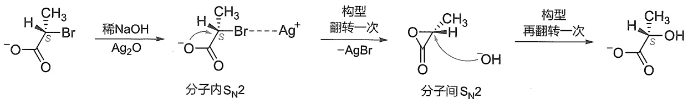

<details>
<summary>flowchart</summary>

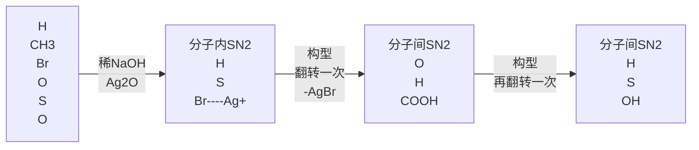
</details>

实验结果表明，邻基参与的亲核取代反应速率比没有邻基参与的类似反应速率要快很多，因此邻基参与反应有时又称为邻基促进反应。这是因为，邻基参与的取代反应决速步骤在第一步分子内  $S_{N}2$  过程，邻近基团在分子内进攻中心原子比外加亲核试剂要容易很多（熵效应有利），导致活化能要低很多，所以能够加速取代反应速率。

邻基参与反应的另一个特征是有可能产生重排产物。如下面这个邻基参与反应中，先形成高张力的五元并氮杂三元环正离子，此后  $HO^{-}$  或  $Cl^{-}$  从 C2 位点进攻，断裂张力最大的 N-C2 键，最终开环得到重排产物。值得注意的是，整个反应过程也是立体专一性的。

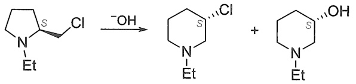

<details>
<summary>chemical</summary>

Chemical reaction equation showing chlorination of a pyridine derivative with ethyl chloride to form a substituted pyridine product
</details>

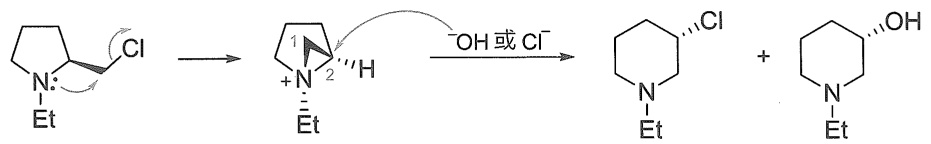

<details>
<summary>chemical</summary>

Chemical reaction mechanism showing chlorination and hydrolysis steps of a heterocyclic compound
</details>

邻基参与反应的第一步是分子内  $S_{N}2$  过程，因此空间上要求参与的邻近基团一定能够与离去基团达到反式共平面的构象关系。在开链化合物中往往可以通过 C-C σ 键的旋转达到这种构象；环状化合物由于构象的限制，有时很难达到反式共平面，这种情况下就不能发生邻基参与。

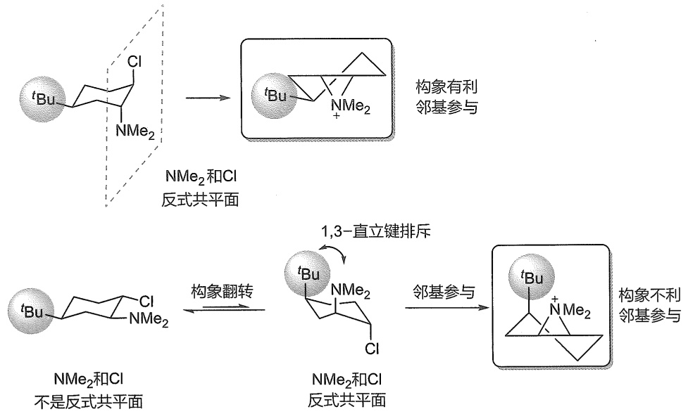

对于邻基参与的基团，除了上面几例中提到氧原子、氮原子等带有孤对电子的杂原子（基团）外，邻近的双键能够通过提供 $\pi$ 键进行邻基参与。

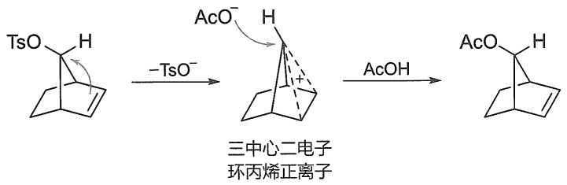

<details>
<summary>chemical</summary>

Reaction mechanism showing acetylation of a cyclohexane derivative with TsO⁻ and AcOH to form a cyclohexane product
</details>

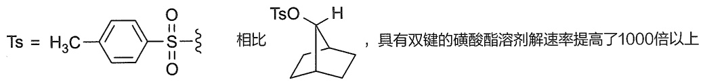

<details>
<summary>chemical</summary>

Chemical structure and Chinese text describing the synthesis of a sulfonate derivative with double键磷酸酯溶剂
</details>

芳基也可以通过提供芳环上的  $\pi$  键发生邻基参与，邻基参与的效率与芳环上的取代基有很大关系，给电子基团能够大大加速邻基参与。

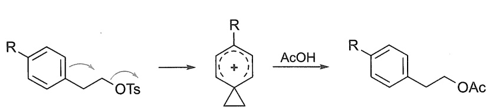

<details>
<summary>chemical</summary>

Chemical reaction mechanism showing transformation of a substituted benzene derivative with OTs and AcOH under acidic conditions
</details>

| R | 收率/% |
| --- | --- |
| NO2 | 0 |
| CF3 | 0 |
| CI | 0 |
| H | 38 |
| CH3 | 71 |
| OCH3 | 94 |

## 4.3.4 影响亲核取代反应的因素

影响亲核取代反应的主要因素有烷基的结构、离去基团的离去性、亲核试剂的亲核性及溶剂的作用。

## 1. 烷基结构的影响

烷基的结构对亲核取代反应速率的影响主要体现在空间效应和电子效应两个方面。

对于  $S_{N}2$  反应，烷基结构的空间效应是影响反应的主要因素。由于  $S_{N}2$  反应的决速步骤是亲核试剂从离去基团的背面进攻中心碳原子，中心碳原子周围的空间位阻必然会对亲核试剂的进攻产生阻碍，形成的过渡态也越发拥挤，活化能变高从而降低反应速率。对比溴甲烷中心碳原子不同取代程度的底物在 NaI 丙酮溶液下的  $S_{N}2$  卤素交换反应，取代基越多，相对反应速率就越低。

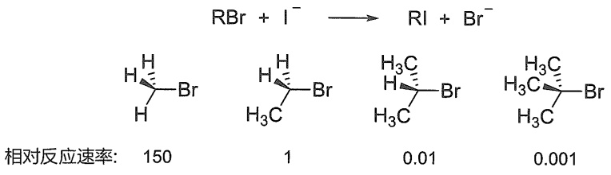

<details>
<summary>chemical</summary>

Reaction equation showing brominated alkene with iodide and bromide ions, yielding relative reaction rates
</details>

甚至是中心碳原子的  $\beta$  位引入位阻也能一定程度上降低  $S_{N}2$  的反应速率。例如，溴乙烷及  $\beta$  位不同程度取代的卤代烃的相对反应速率如下:

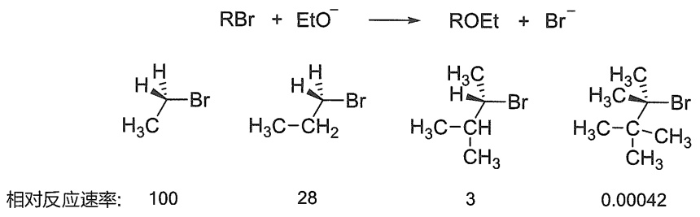

<details>
<summary>chemical</summary>

Reaction equation showing bromination and esterification of a brominated alkene with ethoxy group, yielding relative reaction rates.
</details>

对于 $\mathrm{S_N1}$ 反应，烷基结构的电子效应和空间效应都能大大影响反应的速率。这是因为 $\mathrm{S_N1}$ 反应的决速步骤是C-X异裂成碳正离子，与碳正离子稳定性有关的电子效应和空间效应都将影响到该过程的过渡态能量高低（Hammond假说）。例如，从电子效应上看，三级碳正离子超共轭效应最大，正电荷最易分散，因此最稳定最容易形成。二级碳正离子次之，一级碳正离子稳定性最差，最难形成。从空间效应上看，形成碳正离子是中心碳原子从较为拥挤的 $\mathfrak{sp}^3$ 杂化转化成相对不太拥挤的 $\mathfrak{sp}^2$ 杂化的过程，对大位阻的卤代烃，这种位阻缓解的效果更为明显，故而有利于解离。这种有助于卤代烃解离的空间效应，又称为空助效应（steric help effect）。由于过渡态结构无法精确获得，以上是从中间体碳正离子的稳定性上分析得到的结论。我们也可以对比 $\mathrm{CH_3Br}$ 和'BuBr的结构数据，从底物的结构上定性地看出大位阻R基团如何在电性因素和位阻因素上影响C-Br解离。相比 $\mathrm{CH_3Br}$，'BuBr具有更长的C-Br键键长和更强的C-Br键电荷分离属性[中心碳原子 $\mathrm{C}(\delta +) = +0.452$ ，离去基团 $\mathrm{Br}(\delta -) = -0.364]$；显然这两个因素均有利于C-Br的异裂解离。

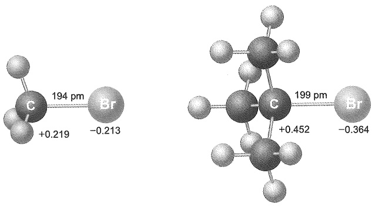

<details>
<summary>chemical</summary>

Molecular structure diagrams showing bromine (Br) and carbon (C) atoms with bond lengths and charges at 194 pm and 199 pm
</details>

由此可见，对于 $\mathrm{S_N1}$ 反应过程，电子效应和空间效应的影响是一致的。卤代烃 $\mathrm{S_N1}$ 反应活性顺序是:三级卤代烃 $>$ 二级卤代烃 $>$ 一级卤代烃。例如，溴代烃在甲酸水溶液中水解的$\mathrm{S_N1}$ 反应相对速率如下:

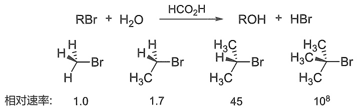

<details>
<summary>chemical</summary>

Reaction equation showing bromination and hydrolysis of a bromoalkane derivative with water under HCO₂H conditions, yielding products at different relative rates.
</details>

将烷基结构对  $S_{N}1$  和  $S_{N}2$  反应的影响综合起来分析，可以得出一般性规律:一级卤代烃容易发生  $S_{N}2$  反应，三级卤代烃容易发生  $S_{N}1$  反应，二级卤代烃介于两者之间，可以发生  $S_{N}1$  反应，也可以发生  $S_{N}2$  反应，或者二者兼而有之，这取决于具体反应条件。

此外，还需要注意一些特定结构的卤代烃:

（1）苄基型卤代烃（$\mathrm{PhCH_2X}$）和烯丙基型卤代烃（$\mathrm{H_2C=CHCH_2X}$）。一方面，这两类卤代烃对应的苄基碳正离子和烯丙基碳正离子由于 $p-\pi$ 共轭效应非常稳定，故而发生 $\mathrm{S_N1}$ 反应的活性非常高。另一方面，由于 $\mathrm{S_N2}$ 反应过渡态中心碳原子近乎呈 $\mathrm{sp^2}$ 杂化，这种 $p-\pi$ 共轭效应在 $\mathrm{S_N2}$ 过程中也能体现，故而这两种卤代烃发生 $\mathrm{S_N2}$ 反应的活性也非常高。具体优先发生 $\mathrm{S_N1}$ 还是 $\mathrm{S_N2}$ 还要依据其他因素及反应条件所决定。一般情况下，位阻越大的苄基型卤代烃和烯丙基型卤代烃越倾向于发生 $\mathrm{S_N1}$ 反应，而位阻越小的苄基型卤代烃和烯丙基型卤代烃越倾向于发生 $\mathrm{S_N2}$ 反应。
（2）当卤素直接与烯烃或芳烃相连时，卤素的 p 轨道能够与  $\pi$  键发生  $p-\pi$  共轭，从而使 C-X 键具有部分双键的性质，键能高，X 基团不易离去。因此导致乙烯型和芳基型卤代烃不易发生亲核取代反应。
（3）卤素与桥头碳相连的卤代烃，由于中心碳原子受到桥的限制，既无法通过构型翻转发生 $\mathrm{S_N2}$ 反应，也难以形成碳正离子的平面结构，故 $\mathrm{S_N1}$ 反应也难以发生。

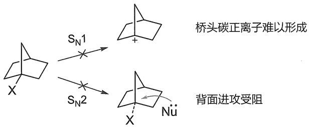

<details>
<summary>chemical</summary>

化学反应示意图，展示桥头碳正离子形成与背面进攻受阻的反应路径
</details>

## 2. 离去基团的影响

C-X 键的断裂无论在  $S_{N}1$  还是  $S_{N}2$  反应中都在决速步骤中, 因此离去基团的离去能力越强，对  $S_{N}1$  和  $S_{N}2$  反应都越有利。通常 HX 的酸性越强，对应共轭碱  $X^{-}$  的碱性越弱，从而  $X^{-}$  的离去性越强。对卤素而言， $X^{-}$  的离去性趋势顺序是  $I^{-} > Br^{-} > Cl^{-} > F^{-}$ ，因此卤代烃的亲核取代活性顺序是 RI > RBr > RCl > RF。

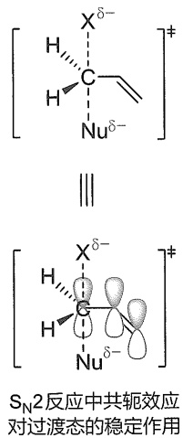

<details>
<summary>chemical</summary>

S₂N₂反应中核能效的化学结构示意图，展示电子与质子结合的反应
</details>

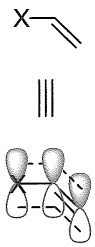

烯基型卤代烃中的
p-π共轭效应

$\mathrm{HO}^{-}$ 的碱性很强，不是一个好的离去基团，因此醇的亲核取代反应一般很难发生。在酸性条件下将醇R-OH质子化后，离去基团变成 $\mathrm{H}_2\mathrm{O}$，可以显著增强离去基团的离去性。所以，仲醇、叔醇以及苄醇、烯丙醇是能够在较强酸性条件下发生 $\mathrm{S_N1}$ 反应的。值得注意的是，由于酸性条件下，带孤对电子的亲核试剂会发生质子化，从而失去（或者大大减弱）其亲核性，这时即使是伯醇在酸性条件下也不能发生 $\mathrm{S_N2}$ 反应。

为了实现伯醇、仲醇发生  $S_{N}2$  反应的可能性，一种常见的策略是用活化基团对 R-OH 的羟基进行活化得到 R-OG，增强离去基团的离去性。最常见的活化基团是磺酸酯，对应的离去基团是磺酸根负离子。磺酸根负离子的碱性很弱（共轭酸磺酸的酸性很强），同时负离子能够有效被酸根中几个氧原子分散，因此是非常优异的离去基团。常用的磺酸酯有对甲苯磺酸酯（R-OTs）、甲磺酸酯（R-OMs）和三氟甲磺酸酯（R-OTf）。具体内容在 7.2.3 小节讨论。

## 3. 亲核试剂的影响

在  $S_{N}1$  反应中，反应速率只取决于 R-X 的解离，而与亲核试剂无关。因此亲核试剂的性质对  $S_{N}1$  反应的活性影响很小。在  $S_{N}2$  反应中，亲核试剂的亲核性越强，浓度越大，则反应速率越快。

亲核试剂的亲核性由亲核试剂的碱性和可极化性综合决定。所谓可极化性是指极性物种在外界电场影响下，物种中的电荷分布产生相应变化的能力，通常情况下电荷的变化由电子云的重新排布所致，因此可极化性有时也称为电子云的可变形性。同一周期的元素，从左至右原子核电荷增多，原子半径变小，原子核对外层电子的约束力变大，因此原子的可极化性减弱。而同一族元素，从上到下原子序数增大，外层电子离核变远，可极化性增强。同一周期的元素，从左至右碱性和可极化性都逐渐减弱，两者一致，因此亲核性也逐渐减弱。具有相同亲核原子的负离子亲核试剂，亲核性与碱性一致，如亲核性顺序  $EtO^{-} > HO^{-} > C_{6}H_{5}O^{-} > CH_{3}CO_{2}^{-}$ 。相同亲核原子的负离子和中性分子，前者碱性和可极化性都大于后者，亲核性也强于后者。

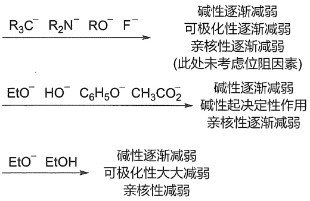

<details>
<summary>flowchart</summary>

```mermaid
graph LR
  A["R3C⁻ R2N⁻ RO⁻ F⁻"] -->|"碱性逐渐减弱\n可极化性逐渐减弱\n亲核性逐渐减弱\n此处未考虑位阻因素"| B["EtO⁻ HO⁻ C6H5O⁻ CH3CO2⁻"]
  B -->|"碱性逐渐减弱\n碱性起决定性作用\n亲核性逐渐减弱"| C["EtO⁻ EtOH"]
  C -->|"碱性逐渐减弱\n可极化性大大减弱\n亲核性减弱"| D[""]
```
</details>

同一族元素，由上至下碱性减弱，但是可极化性增强，试剂的亲核性在非质子偶极溶剂中（如DMF、DMSO）中，亲核性与其碱性是一致的。但在质子化溶剂（如EtOH）中，负离子亲核试剂能够与溶剂形成氢键，碱性越强，形成的氢键也越强，氢键包裹溶剂后会导致亲核试剂亲核性大大减弱。因此质子化溶剂中，亲核性顺序是 $\mathrm{I}^{-} > \mathrm{Br}^{-} > \mathrm{Cl}^{-} > \mathrm{F}^{-}$ 。

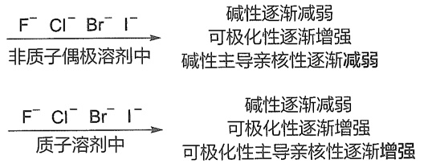

<details>
<summary>flowchart</summary>

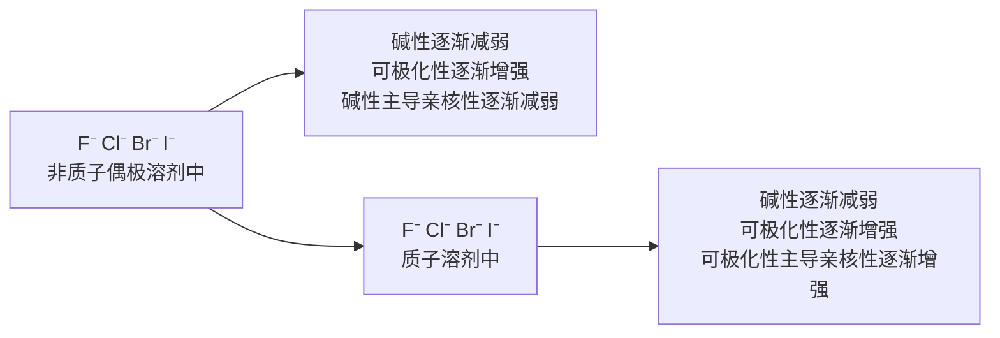
</details>

最后，亲核试剂的位阻也能影响亲核试剂的亲核性，如系列试剂的亲核性顺序与其碱性相反，主要是位阻因素导致的。

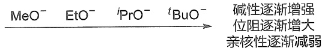

<details>
<summary>flowchart</summary>

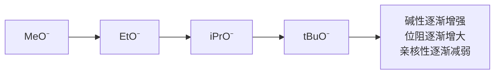
</details>

## 4. 溶剂的影响

按照溶剂性质，可以将溶剂简单划分为三类。

(1) 质子溶剂。能够与负离子形成很强氢键的溶剂，如水、醇类、脂肪酸类等。
（2）非质子偶极溶剂。这类溶剂具有很强的相对介电常数（通常 $\varepsilon > 20$）和偶极矩。这类溶剂的结构特征是偶极负端裸露于分子外部，偶极正端藏于分子内部，如六甲基磷酰胺（HMPA）、二甲亚砜（DMSO）、乙腈、$N,N-$二甲基甲酰胺（DMF）、硝基甲烷、丙酮等。

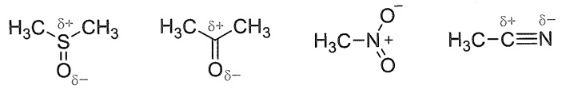

<details>
<summary>chemical</summary>

Chemical structure of a sulfonamide compound with dimethylamino groups and an oxygen bridge
</details>

（3）非极性溶剂。这类溶剂不能给出质子，相对介电常数和偶极矩都较小。绝大多数有机溶剂都属于这一类，包括很多无极性或较低极性的溶剂，如二氯甲烷、四氢呋喃、乙酸乙酯、氯仿、乙醚、苯、甲苯、二氧六环、环己烷等。

通常情况下,质子溶剂可以通过与离去基团形成氢键降低活化能,因此有利于 $S_{N}1$ 反应。对于 $S_{N}2$ 反应,这种质子化溶剂化作用依然存在,但是质子溶剂还能与亲核试剂形成氢键降低其亲核性。因此,质子溶剂对于 $S_{N}2$ 反应的影响需要考虑两方面的综合结果。

极性越大的非质子偶极溶剂对于  $S_{N}1$  反应是有利的，因为  $S_{N}1$  反应在形成过渡态时，卤代烃由原来极性较小的底物，变成了电荷分离程度更大、极性更大的过渡态，非质子极性溶剂能够通过偶极-偶极相互作用稳定过渡态，有利于  $S_{N}1$  反应。

在  $S_{N}2$  反应中，若亲核试剂是中性的，类似的偶极-偶极稳定化作用也存在，因此非质子偶极溶剂也是有利于  $S_{N}2$  反应的。但是，若亲核试剂是带负电荷的， $S_{N}2$  机理形成过渡态时，由原来电荷很集中的亲核试剂变成了电荷较为分散的过渡态，整体上极性溶剂对负离子亲核试剂的溶剂化效果比对过渡态的效果更明显，因此不利于  $S_{N}2$  反应。

## 4.3.5 亲核取代反应相关的人名反应

亲核取代反应是有机合成里面最重要的反应之一。在有机化学的发展过程中，一些著名的化学家发展了一系列和亲核取代相关的反应，后人常常以其名字命名。下面列举一些亲核取代反应相关的人名反应，进行简单介绍。

## 1. Finkelstein 卤素交换反应

Finkelstein 等人发展了卤代烃的卤素交换反应。该反应利用亲核性  $I^{-} > Br^{-} > Cl^{-}$  以及

NaI、NaBr、NaCl 在丙酮中的溶解度依次降低的性质，可以将一级和二级卤代烃中的氯和溴转变成碘，氯转化为溴。反应机理为典型的  $S_{N}2$  历程，通过 NaX 在丙酮中溶解度的差异，促进反应不断向右进行。该反应为从廉价易得的烷基氯化物或溴化物制备价格昂贵、活性更高的烷基碘代物提供了可靠的工具。

$$
\mathrm{R} - \mathrm{X} \quad \xrightarrow [ \text {丙酮、回流} ]{\mathrm{NaX} ^ {\prime}} \quad \mathrm{R} - \mathrm{X} ^ {\prime}
$$

$X = \mathrm{Cl},\mathrm{Br},\mathrm{OMs},\mathrm{OTs};R = 1^{\circ}$ 和 $2^{\circ}$ 烷基、烯丙基、苄基如果 $X = \mathrm{Cl}$ ，则 $X^{\prime} = \mathrm{Br}$ 或者I；如果 $X = \mathrm{Br}$ ，则 $X^{\prime} = I$

反应机理:

$$
\mathrm{I} ^ {-} \xrightarrow [ \mathrm{R} ]{\mathrm{H}} \mathrm{Br} \longrightarrow \left[ \begin{array}{c c c} \delta^ {-} & \mathrm{H} & \mathrm{H} \\ \mathrm{I} ^ {- -} & \mathrm{R} & \mathrm{Br} \end{array} \right] ^ {\ddagger} \longrightarrow \mathrm{I} ^ {-} \mathrm{R} + \mathrm{Br} ^ {-}
$$

## 2. Appel 反应

相对于卤代烃，醇的来源广泛，价格低廉，并且性质稳定。但是醇的反应性不及卤代烃丰富。将醇直接转化成卤代烃在有机合成中具有重要价值。Appel等人发展了 $\mathrm{Ph}_3\mathrm{P} / \mathrm{CCl}_4$ 和$\mathrm{Ph}_3\mathrm{P} / \mathrm{CBr}_4$ 体系，可以高效地将伯醇或仲醇中的OH转化成Cl或Br。

$$
\underset { \begin{array}{c} X = \mathrm{Cl}, \mathrm{Br} \end{array} } {\overset {\mathrm{OH}} {\longrightarrow}} + \mathrm{CX} _ {4} + \mathrm{Ph} _ {3} \mathrm{P} \quad \longrightarrow \quad \underset { \begin{array}{c} R ^ {\prime} \\ R ^ {\prime} \end{array} } {\overset {\mathrm{X}} {\longrightarrow}} + \mathrm{HCX} _ {3} + \mathrm{Ph} _ {3} \mathrm{PO}
$$

反应机理:

$$
\begin{array}{l} \mathrm{Ph} _ {3} \mathrm{P}: \xrightarrow {\text {Cl}} \mathrm{CCl} _ {3} \quad \stackrel {\mathrm{S} _ {\mathrm{N}} 2} {\Longleftrightarrow} \quad \bar {\mathrm{CCl}} _ {3} + \mathrm{Ph} _ {3} \stackrel {+} {\mathrm{P}} - \mathrm{Cl} \\ \text {R} ^ {\ddot {\mathrm{OH}}} \text {R} ^ {\prime} + \text {Ph} _ {3} \overset {+} {\mathrm{P}} - \text {Cl} \xrightarrow [ \begin{array}{c} - \mathrm{HCCl} _ {3} \\ \mathrm{S} _ {\mathrm{N}} 2 \end{array} ]{\mathrm{CCl} _ {3}} \text {R} ^ {\mathrm{O}} \overset {+} {\mathrm{PPh} _ {3}} \xrightarrow [ \mathrm{Cl} ^ {-} ]{\mathrm{S} _ {\mathrm{N}} 2} \text {R} ^ {\mathrm{Cl}} \text {R} ^ {\prime} + \text {Ph} _ {3} \mathrm{P} = \mathrm{O} \\ \end{array}
$$

烷氧基三苯基季磷离子

该反应一共经历了三次 $\mathrm{S_N2}$ 历程。首先，路易斯碱 $\mathrm{Ph_3P}$ 以 $\mathrm{S_N2}$ 反应的途径进攻 $\mathrm{CCl_4}$ 的氯原子（注意不是碳原子），形成 $\mathrm{Ph_3P^+ - Cl}$ 物种和三卤化碳负离子（$\mathrm{Cl_3C^-}$）。前者的 $\mathrm{P^+}$ 中心具有很好的亲氧性，容易接受底物醇中羟基的进攻，同时 $\mathrm{Cl_3C^-}$ 作为强碱能够攫取醇上的质子，促进这一步的发生，该过程是一个类似的 $\mathrm{S_N2}$ 过程（经过五价磷中心，但非 $\mathrm{P - Cl}$ 的背面进攻），形成高活性烷氧基三苯基季鳞离子。该物种包含的 $\mathrm{O - P^+Ph_3}$ 是一个极其优异的离去基团，接受 $\mathrm{Cl^-}$ 的 $\mathrm{S_N2}$ 取代，生成构型翻转的氯代烃及副产物三苯氧膦（$\mathrm{Ph_3PO}$）。

当使用  $CBr_{4}$  作为卤代试剂时，通过类似的机理则生成溴代烃。

用醇制备碘代烃，一般不使用 $\mathrm{CI}_4$ 作为碘化试剂，而是使用更为廉价常见的碘单质并且添加外源碱（$\mathrm{Ph}_3\mathrm{P} / \mathrm{I}_2$ /咪唑体系）。因为 $\mathrm{Ph}_3\mathrm{P}$ 可以直接进攻 $\mathrm{I}_2$ 生成 $\mathrm{Ph}_3\mathrm{P}^+ -\mathrm{I}$ 和 $\mathrm{I}^-$，只不过 $\mathrm{I}^-$ 碱性太弱，不利于后续的攫氢，需要添加外源碱（咪唑最常用）来促进碘化反应。

$$
\mathrm{R} ^ {\mathrm{OH}} \mathrm{R} ^ {\prime} + \mathrm{I} _ {2} + \mathrm{Ph} _ {3} \mathrm{P} + \left[ \begin{array}{c} \mathrm{H} \\ \mathrm{N} \\ \mathrm{N} \end{array} \right] \longrightarrow \mathrm{R} ^ {\mathrm{I}} \mathrm{R} ^ {\prime} + \left[ \begin{array}{c} \mathrm{H} \\ \mathrm{N} \\ \mathrm{N} \\ \mathrm{H} \end{array} \right] \mathrm{I} ^ {-} + \mathrm{Ph} _ {3} \mathrm{PO}
$$

## 3. Mitsunobu 反应

由于 $\mathrm{HO}^{-}$ 离去性很低，通常情况下醇难以直接发生亲核取代反应。1967年，Mitsunobu报道了在偶氮二甲酸二乙酯（DEAD）和三苯基膦（$\mathrm{PPh}_3$）作用下仲醇被羧酸取代合成酯的新方法。当底物为手性的仲醇时，与羟基相连的碳原子的构型会发生翻转。经过多年的研究和发展，伯醇和仲醇在偶氮二甲酸二乙酯（DEAD）和三苯基膦（$\mathrm{PPh}_3$）作用下与亲核试剂发生的取代反应称为Mitsunobu反应，其中的H-Nu可以为碳、氧、氮、硫等相关的几类亲核试剂。这类反应被广泛应用在有机合成，特别是天然产物的合成中。其反应可表示为

$$
\mathrm{R} ^ {\mathrm{OH}} \mathrm{R} ^ {\prime} + \mathrm{H} - \mathrm{Nu} + \mathrm{EtO} _ {2} \mathrm{C} ^ {\mathrm{N=N}} \stackrel {\mathrm{CO} _ {2} \mathrm{Et}} {\mathrm{N}} + \mathrm{PPh} _ {3} \xrightarrow {\text {溶剂}} \boxed {\mathrm{R} ^ {\mathrm{Nu}} \mathrm{R} ^ {\prime}} + \mathrm{EtO} _ {2} \mathrm{C} ^ {\mathrm{CO} _ {2} \mathrm{Et}} + \mathrm{Ph} _ {3} \mathrm{PO}
$$

反应机理:

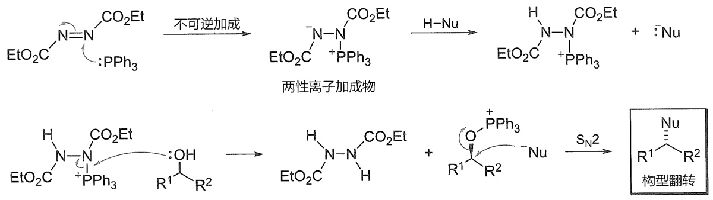

该反应充分体现了  $S_{N}2$  反应的性质:① 羟基本身不是一个好的离去基团，原因是其碱性较强，离去能力差，该反应将羟基转化为好的离去基团（ $O-P^{+}Ph_{3}$ ），为  $S_{N}2$  反应创造了重要条件；② 该反应在有机合成中常用于制备构型翻转的产物，立体专一性地将醇转化为构型翻转的醇、胺、酯等。

## 4. Payne 重排

1935 年, Kohler 和 Bickel 报道了环氧醇在催化量的碱作用下异构化成另一环氧醇。1962 年, Payne 报道了室温下的氢氧化钠水溶液足以引起环氧醇异构化平衡得到另外的环氧醇, 他发现这种转化具有普遍性, 并将其称为 “环氧迁移”。我们将碱作用下 $\alpha, \beta-$ 环氧醇异构化成另一 $\alpha, \beta-$ 环氧醇的过程称为 Payne 重排。Payne 重排具有立体专一性, 机理实验证明反应是个可逆反应, 通过分子内 $S_{N}2$ 取代反应进行, 形成热力学上更稳定的环氧醇。Payne 重排其反应可表示为

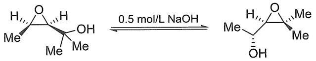

<details>
<summary>chemical</summary>

Chemical reaction showing dehydration of a diol compound with 0.5 mol/L NaOH to form a hydroxy ester intermediate
</details>

反应机理:

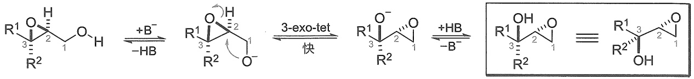

<details>
<summary>chemical</summary>

Chemical reaction mechanism showing hydrogen bonding and ring-opening formation of a cyclic alcohol product
</details>

该反应是热力学驱动的，反应是一个平衡的过程，反应物将转化为能量更低的产物。值得注意的是该反应的立体化学，该反应是一个分子内的  $S_{N}2$  亲核取代反应，因此得到构型翻转的产物。

## 5. Arbuzov 反应

亚磷酸三烷基酯与卤代烷作用生成烷基磷酸酯和新的卤代烷的反应称为Arbuzov反应（又称Michaelis-Arbuzov反应），它是由德国化学家A.Michaelis和俄国化学家A.Arbuzov在20世纪初发现的一种制备有机磷类化合物的经典反应。除了三烷基亚磷酸酯之外，亚膦酸酯和次亚膦酸酯亦可发生该反应。Arbuzov反应按照两步连续的 $\mathrm{S_N2}$ 机理进行，因此一级卤代烷、烯丙基卤代物和苄基卤代物通常容易发生反应，而三级卤代烷和大部分二级卤代烷则不易发生反应。

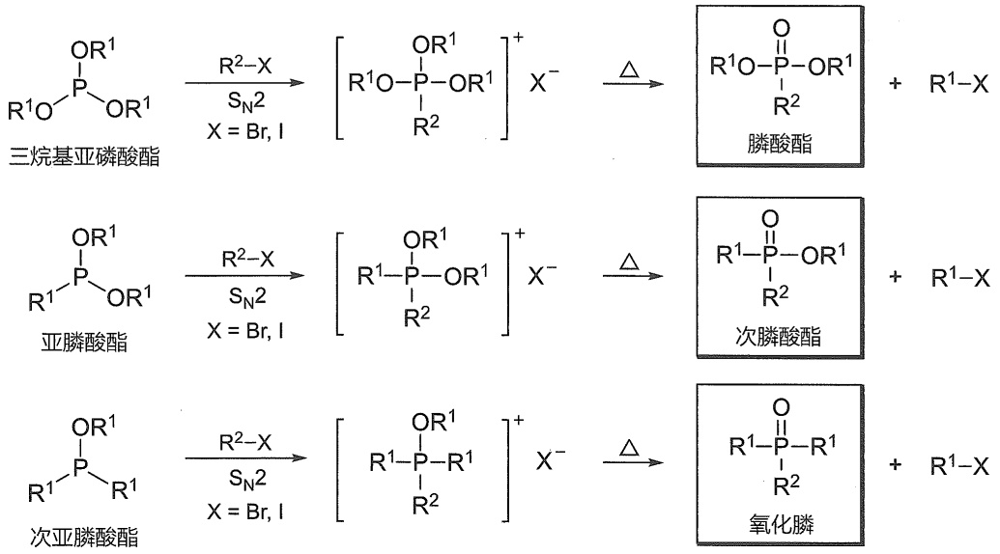

反应机理:

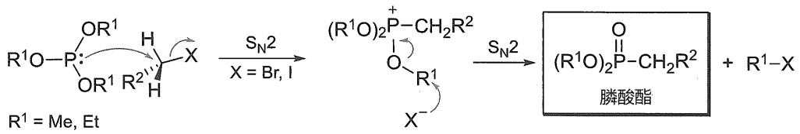

<details>
<summary>chemical</summary>

Reaction mechanism showing phosphorus-containing compound with R¹ substituent and phenylalanine, involving bromine and iodide groups
</details>

该反应利用了三配位磷上孤对电子的亲核性, 膦类化合物作为亲核试剂, 是对卤代烃  $S_{N}2$  亲核取代的一个经典反应。同时反应的产物为 HWE（Horner-Wadsworth-Emmons）反应的原料, 因此在合成中具有广泛应用。

## 4.4 卤代烷的消除反应

在卤代烷分子中，由于 C-X 键有极性，卤素 X 的吸电子作用（-I 效应）可以沿着碳链传递，不仅  $\alpha-C$  上具有部分正电荷， $\beta-C$  也带有更少量的正电荷，从而使  $\beta-C$  上的氢原子具有一定的酸性。因此，卤代烷在强碱作用下会失去一分子卤化氢，生成烯烃，这就是卤代烷的  $\beta-$  消除反应（elimination reaction），简称 E 反应。例如，氯代烷在氢氧化钠的乙醇溶液中加热，发生消除反应，生成烯烃。

$$
\mathrm{R} ^ {2} \xrightarrow [ \beta ]{\mathrm{H}} \mathrm{Cl} ^ {\mathrm{R} ^ {1}} + \mathrm{NaOH} \xrightarrow [ \Delta ]{\mathrm{C} _ {2} \mathrm{H} _ {5} \mathrm{OH}} \mathrm{R} ^ {2} \xrightarrow [ ]{\mathrm{C}} \mathrm{R} ^ {1} + \mathrm{H} _ {2} \mathrm{O} + \mathrm{NaCl}
$$

按照反应历程的不同,卤代烷消除反应分为单分子消除反应(E1)、双分子消除反应(E2)和通过底物共轭碱进行的消除反应（E1cb）。

## 4.4.1 双分子消除反应（E2）

## 1. E2 反应机理

溴乙烷与乙醇钠在乙醇溶液中发生消除反应，生成乙烯。

$$
\mathrm{CH} _ {3} \mathrm{CH} _ {2} \mathrm{Br} + \mathrm{NaOC} _ {2} \mathrm{H} _ {5} \xrightarrow [ \triangle ]{\mathrm{C} _ {2} \mathrm{H} _ {5} \mathrm{OH}} \mathrm{H} _ {2} \mathrm{C} = \mathrm{CH} _ {2} + \mathrm{C} _ {2} \mathrm{H} _ {5} \mathrm{OH} + \mathrm{NaBr}
$$

生成烯烃的速率与溴乙烷浓度和乙氧基负离子浓度成正比:

$$
v = k _ {\mathrm{E2}} [ \mathrm {CH_ {3} CH_ {2} Br} ] [ \mathrm {CH_ {3} CH_ {2} O^ {-}} ]
$$

动力学速率表达式说明，消除反应的速率取决于两种反应物的浓度，是双分子反应，为二级动力学反应。反应过程中，乙氧基负离子进攻溴乙烷 $\beta -\mathrm{C}$ 上的氢原子， $\mathrm{C}^{\alpha}$ -Br键及 $\mathrm{C}^{\beta}$ -H键的断裂和 $\pi$ 键的形成同步进行，这与 $\mathrm{S_N2}$ 反应类似，为一步完成的双分子机理，两种反应物都出现在决定反应速率的过渡态中:

$$
\mathrm{CH} _ {3} \mathrm{CH} _ {2} \mathrm{O} ^ {-} \xrightarrow {\mathrm{H}} \mathrm{CH} _ {2} - \mathrm{CH} _ {2} \xrightarrow {\mathrm{Br}} - \left[\begin{array}{c}\mathrm{CH} _ {3} \mathrm{CH} _ {2} \stackrel {\delta^ {-}} {\mathrm{O}} - - \mathrm{H}\\\mathrm{CH} _ {2} = - \mathrm{CH} _ {2}\\\beta\end{array}\right] ^ {\ddagger} \rightarrow \mathrm{H} _ {2} \mathrm{C} = \mathrm{CH} _ {2} + \mathrm{C} _ {2} \mathrm{H} _ {5} \mathrm{OH} + \mathrm{Br} ^ {-}
$$

过渡态

由此可见  $C^{\alpha}-Br$  键和  $C^{\beta}-H$  键越容易断裂，E2 反应越容易进行。反应活性规律总结如下:

（1）含相同烷基的一卤代烷 E2 反应活性顺序为 RI > RBr > RCl > RF。说明决速步骤涉及 C$^{a}$-X 键的断裂，离去基团 X 越易离去，反应越易进行。
（2）烷基结构不同的卤代烷 E2 反应活性顺序为  $R_{3}CX > R_{2}CHX > RCH_{2}X$ 。这是因为 E2 反应过渡态中  $\pi$  键已部分形成，过渡态具有类烯烃的结构特征，双键上取代基越多越稳定，反应越易进行。
（3）试剂碱性越强， $C^{\beta}-H$ 键越易断裂，反应越易进行。

实验表明, 在 E2 反应中显示出同位素效应。例如, 化合物  $C_{6}H_{5}CH_{2}CH_{2}Br$  和  $C_{6}H_{5}CD_{2}CH_{2}Br$在相同条件下发生消除反应的速率比为  $v_{H}/v_{D} \approx 7$ ，说明决速步骤同样涉及了  $C^{\beta}-H$  键的断裂，为双分子消除反应机理提供了有力的证据。

## 2. E2 反应的区域选择性

一卤代烷分子中如有两种或两种以上不同的 $\beta$-H原子时，消除反应具有区域选择性，生成不同结构烯烃的比例不同。几个同时进行的消除反应，哪个反应的速率快，生成的烯烃在产物中的比例就较大。19世纪初，俄国化学家Saytzeff从大量实验结果中归纳总结出卤代烷消除反应的区域选择性规则:主要消除含氢较少的 $\beta$-C原子上的氢原子，生成双键碳原子上取代基较多的烯烃，这一规则称为Saytzeff规则（英文名也常翻译为Zaitsev，中文名翻译为札依采夫）。例如:

$$
\mathrm{H} _ {3} \mathrm{C} \xrightarrow [ \beta ]{\mathrm{HC}} \mathrm{CH} _ {\mathrm{Br}} \xrightarrow [ \beta ]{\mathrm{H}} \xrightarrow [ \Delta ]{\mathrm{KOH} , \mathrm{C} _ {2} \mathrm{H} _ {5} \mathrm{OH}} \mathrm{CH} _ {3} \mathrm{CH} = \mathrm{CHCH} _ {3} + \mathrm{CH} _ {3} \mathrm{CH} _ {2} \mathrm{CH} = \mathrm{CH} _ {2} \text {丁-2-烯} 81 \% \quad \text {丁-1-烯} 19
$$

Saytzeff 规则是卤代烷  $\beta-$  消除反应的区域选择性规律，通常把  $\beta-$  消除反应产生的双键碳原子上连有较多取代基的烯烃称为 Saytzeff 烯烃，而把消除反应产生的双键碳原子上连有较少取代基的烯烃称为 Hofmann 烯烃。

碱的体积对E2反应的区域选择性有很大影响，碱的烷氧基体积增大，生成Saytzeff烯烃的比例减小，而Hofmann烯烃的比例增大。

$$
\begin{array}{c} \mathrm{H} _ {3} \mathrm{C} - \mathrm{C} - \mathrm{C} - \mathrm{CH} _ {3} + \mathrm{RO} ^ {-} \\ \mathrm{Br} \end{array} \longrightarrow \begin{array}{c} \mathrm{H} _ {3} \mathrm{C} - \mathrm{C} - \mathrm{C} - \mathrm{CH} _ {3} + \mathrm{H} _ {3} \mathrm{C} - \mathrm{C} - \mathrm{CH} _ {2} \\ \mathrm{CH} _ {3} \mathrm{CH} _ {2} \mathrm{O} ^ {-} \\ (\mathrm{CH} _ {3}) _ {3} \mathrm{CO} ^ {-} \\ \mathrm{CH} _ {3} \mathrm{CH} _ {2} (\mathrm{CH} _ {3}) _ {2} \mathrm{CO} ^ {-} \\ (\mathrm{CH} _ {3} \mathrm{CH} _ {2}) _ {3} \mathrm{CO} ^ {-} \end{array}
$$

在环状体系中，E2 反应取向一般遵循立体化学的要求，而在刚性桥环体系中不可能通过正常的消除反应在桥头碳上引入一个双键。

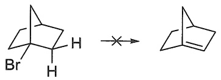

<details>
<summary>chemical</summary>

Chemical reaction showing brominated cyclohexane reacting with a halogen to form a fused bicyclic product
</details>

这是由于环的刚性使 E2 反应发展出来的两个 p 轨道彼此几乎呈直角，因而不能有效重叠。而对于较大的环或较柔顺的体系，有可能通过足够的扭转而发生消除，引入一个双键。例如:

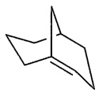

双环[3.3.1]壬-1-烯

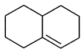

双环[4.4.0]癸-1-烯

## 3. E2 反应的立体化学

E2 反应过渡态的轨道图形（B 代表碱 Base）如下所示:

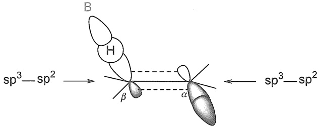

<details>
<summary>chemical</summary>

Molecular orbital diagram showing sp³-sp² and sp³-sp² orbitals with labeled angles α, β, H, B
</details>

由此可见， $C^{\alpha}-Br$ 键及 $C^{\beta}-H$ 键的断裂和 $\pi$ 键的生成是同时进行的，随着反应的进行， $\alpha-C$ 和 $\beta-C$ 逐渐由 $sp^{3}$ 杂化转变为 $sp^{2}$ 杂化，而 $\alpha-C$ 与卤素相连和 $\beta-C$ 与 $\beta-H$ 相连的 $sp^{3}$ 杂化轨道则逐渐转变为p轨道，并在侧面重叠，形成 $\pi$ 键。两个p轨道的轴互相平行时才能有效地重叠。

因此，在E2反应中，只有 $\mathrm{H - C^{\beta} - C^{\alpha} - X}$ 四个原子在同一平面上，才能通过过渡态中有效重叠生成 $\pi$ 键。能满足这一几何要求的只有重叠式和交叉式两种构象:

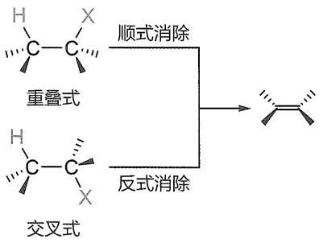

<details>
<summary>chemical</summary>

Chemical reaction diagram showing reversible and reverse conversion of cyclohexane to cycloalkene
</details>

有两个明显的理由可以认为反式消除占优势:① 由于碱提供的一对电子进入 $\mathrm{C}^{\beta}-\mathrm{H}$ 键的反键轨道，C-H键断裂，$\beta-\mathrm{C}$ 以孤对电子的形式存在极不稳定。因此，$\beta-\mathrm{C}$ 的孤对电子急于成键以释放能量。当C-X键旋转到一定角度（即C-X键的反键轨道与 $\beta-\mathrm{C}$ 孤对电子的p轨道在一个平面时），$\beta-\mathrm{C}$ 孤对电子填充到C-X键的反键轨道，C-X键断裂，$\beta-\mathrm{C}$ 与$\alpha-\mathrm{C}$ 的p轨道肩并肩重叠形成 $\pi$ 键。② 以稳定的交叉式构象反应比以能量高的重叠式构象反应有利。

大量实验事实表明一般情况下 E2 反应为反式消除。因此，E2 反应对反应物的构象有一定要求，一般要满足  $H-C^{\beta}-C^{\alpha}-X$  四个原子共平面，且  $C^{\alpha}-X$  键和  $C^{\beta}-H$  键位于  $C^{\alpha}-C^{\beta}$  键的两侧（简称反式共平面）。所以，对于按 E2 进行消除的反应物，首先必须写出  $\beta-H$  和离去基团反式共平面的构象，称为消除构象，才能得出正确产物。

例如，前面已提到，由于E2反应的区域选择性，2-溴丁烷和碱反应主要生成丁-2-烯。那么，它的立体选择性如何呢？即产物中 $(Z)$ -丁-2-烯多还是 $(E)$ -丁-2-烯多？可以根据E2反应对反应物的立体化学要求进行判断。2-溴丁烷有两种交叉构象能够满足 $\mathrm{H - C^{\beta} - C^{\alpha} - Br}$ 四个原子共平面的要求，消除溴化氢后分别生成 $(Z)$ -丁-2-烯和 $(E)$ -丁-2-烯。在构象(I)中两个甲基处于对位交叉的位置，相距较远，在过渡态中只有甲基和氢原子之间的范德华作用力。在构象(Ⅱ)中两个甲基处于邻位交叉的位置，相距较近，在过渡态中存在两个甲基之间的范德华作用力，能量比(I)的高，因此生成 $(E)$ -丁-2-烯的活化能比生成 $(Z)$ -丁-2-烯的低，反应速率较快，从而 $(E)$ -丁-2-烯的产率高。事实的确如此，2-溴丁烷在消除反应中生成的

“Z/E 命名法”是准确表达双键构型的系统命名方法，详细定义见5.1.1小节。

$(E)$ -丁-2-烯的产率为 $(Z)$ -丁-2-烯的3倍。

$$
\mathrm{CH} _ {3} \mathrm{CH} _ {2} \mathrm{CHCH} _ {3} + \mathrm{CH} _ {3} \mathrm{ONa} \xrightarrow {\mathrm{CH} _ {3} \mathrm{OH}} \mathrm{CH} _ {3} \mathrm{CH} _ {2} \mathrm{CH} = \mathrm{CH} _ {2} + \begin{array}{c} \mathrm{H} _ {3} \mathrm{C} \\ \mathrm{H} \end{array} \stackrel {{\mathrm{C}}} {{=}} \mathrm{C} \stackrel {{\mathrm{H}}} {{\mathrm{CH}} _ {3}} + \begin{array}{c} \mathrm{H} _ {3} \mathrm{C} \\ \mathrm{H} \end{array} \stackrel {{\mathrm{C}}} {{=}} \mathrm{C} \stackrel {{\mathrm{CH}} _ {3}} {\mathrm{H}} (E) - \text {丁-2-烯} \quad (Z) - \text {丁-2-烯}
$$

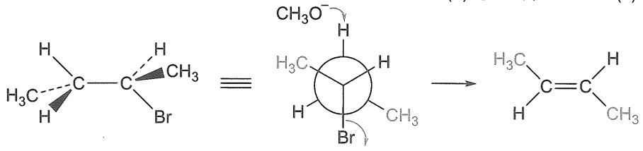

<details>
<summary>chemical</summary>

Chemical reaction diagram showing cycloaddition of a brominated alkene with methyl groups and an ester group
</details>

(Ⅰ)

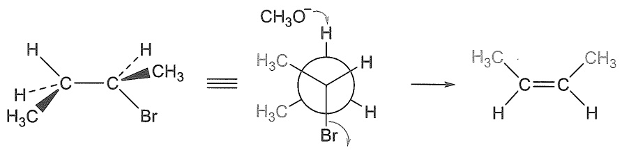

<details>
<summary>chemical</summary>

Chemical reaction diagram showing bromination of a cyclohexane derivative with methyl and ethyl substituents
</details>

(II)

如果选择性消除的 $\beta$-H 只有一个，则反式消除的结果是只有一种构型的烯烃产生。因为此时只有一种对位交叉构象能够满足 $\mathrm{H}-\mathrm{C}^{\beta}-\mathrm{C}^{\alpha}-\mathrm{X}$ 四个原子共平面，且 $\mathrm{H}-\mathrm{C}$ 键和 $\mathrm{C}-\mathrm{X}$ 键满足反式的要求。例如，$((2S,3S)-3-$ 溴丁-2-基)苯消除溴化氢生成 $(E)-$ 丁-2-烯-2-基苯，而 $((2S,3R)-3-$ 溴丁-2-基)苯消除溴化氢生成 $(Z)-$ 丁-2-烯-2-基苯。

$$
\text {(2S,3S)-3-溴丁-2-基苯} \quad \equiv \quad \text {旋转} \quad \text {碱} \quad \text {(E)-丁-2-烯-2-基苯}
$$

$$
\text { ((2S,3R)-3-溴丁-2-基苯 } \quad \equiv \quad \text { (2S,3R)-3-溴丁-2-基苯} \quad \stackrel {\text {旋转}} {=} \quad \text { (2S,3R)-3-溴丁-2-基苯} \quad \xrightarrow {\text {碱}} \quad \text {(Z)-丁-2-烯-2-基苯}
$$

简单环状化合物的E2反应与链状化合物遵循同样的立体化学规律。例如，对卤代环己烷来说，为了实现 $\mathrm{H - C^{\beta} - C^{\alpha} - X}$ 四个原子共平面，且 $\mathrm{C}^{\alpha} - \mathrm{X}$ 键和 $\mathrm{C}^{\beta} - \mathrm{H}$ 键处于反式共平面的立体化学要求，两个相邻的消除原子必须处于 $a$ 键。因此，判断卤代环己烷的E2消除产物，与链状化合物一样，必须经过构象分析才能得到正确结果。例如，反-1-氯-2-甲基环己烷经历E2反应后得到反Saytzeff规则的烯烃。

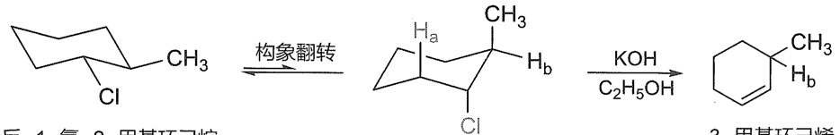

<details>
<summary>chemical</summary>

Chemical reaction pathway showing transformation of a chlorinated cyclohexane derivative to a cyclohexene derivative using carboxylic acid and hydroxymethyl ether
</details>

反-1-氯-2-甲基环己烷

3-甲基环己烯

构象分析如下:反-1-氯-2-甲基环己烷的稳定构象是两个取代基都处于环己烷 $e$ 键，但该稳定构象不满足E2反应的立体化学要求，因为C1与任何一个 $\beta -\mathrm{H}$ 以及相应的碳原子都不处于同一平面。要达到反式共平面的要求，环必须扭转成被消除原子处于环己烷 $a$ 键的构象。翻转构象虽然不是稳定构象，但容易进行E2反应，称为消除构象。由消除构象看出，按照E2反应的立体化学要求只能得到反Saytzeff规则的烯烃。

另举一例:顺-1-溴-4-叔丁基环己烷和反-1-溴-4-叔丁基环己烷在消除反应中生成同一产物4-叔丁基环己-1-烯，但前者的反应速率为后者的500倍，如何解释这一现象？

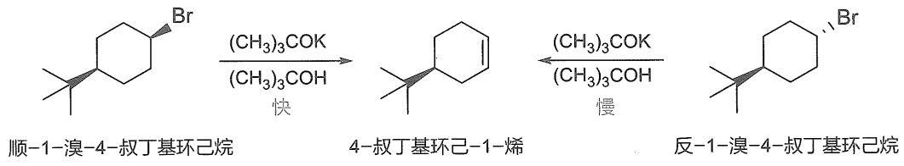

<details>
<summary>chemical</summary>

Chemical reaction pathway showing bromination of cyclohexane to 4-tert-butylbenzene, followed by slow conversion to cyclohexane
</details>

构象分析如下:对于顺-1-溴-4-叔丁基环己烷，稳定构象是溴原子处于 $a$ 键，恰好满足E2反应的立体化学要求，即顺-1-溴-4-叔丁基环己烷的消除构象和稳定构象一致，此时消除反应容易发生。对于反-1-溴-4-叔丁基环己烷，稳定构象(I)中溴原子处于 $e$ 键，必须将环扭转成消除原子处于 $a$ 键的构象(Ⅱ)才有利于E2反应，但这时大体积的叔丁基处于 $a$ 键，过渡态能量升高，反应速率较慢。

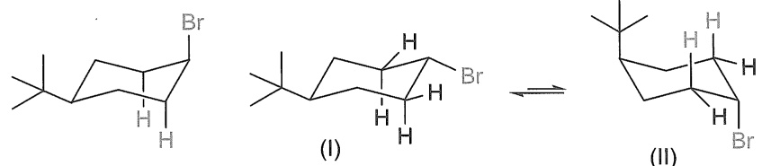

顺-1-溴-4-叔丁基环己烷

反-1-溴-4-叔丁基环己烷

某些分子  $\beta-H$  和离去基团具有顺式重叠构象的刚性结构，在这种情况下也可以发生顺式消除反应，但是反应速率较慢。例如:

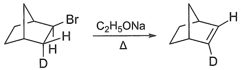

<details>
<summary>chemical</summary>

Chemical reaction showing brominated cycloaddition under C2H5ONa and Δ conditions
</details>

## 4.4.2 单分子消除反应（E1）

## 1. E1 反应的机理

大多数卤代烷在强碱存在下的消除反应是按 E2 机理进行的。但在无碱或弱碱存在情况下，叔卤代烷的消除反应一般是按 E1 机理进行的。例如，叔丁基溴在乙醇溶液中的溶剂解反应，除了生成取代产物叔丁基乙基醚，还生成消除产物异丁烯。

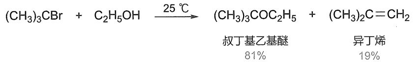

<details>
<summary>chemical</summary>

Chemical reaction equation showing conversion of (CH₃)₃CBr to (CH₃)₃COC₂H₅ under 25°C, with yields for叔丁基乙基醚 and 异丁烯
</details>

该消除反应按 E1 机理分两步进行。