第一步:与  $S_{N}1$  反应相似，叔丁基溴生成叔碳正离子中间体。

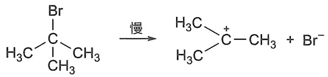

chemical

Chemical reaction showing bromination of a bromocyclohexane derivative with bromide ion

第二步:乙醇作为碱进攻  $\beta-H$ ，发生消除反应生成烯烃。

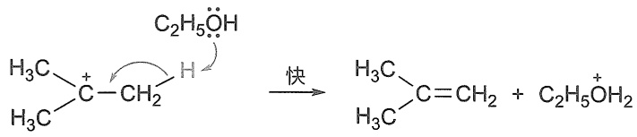

chemical

Chemical reaction equation showing acetylation of a hydrocarbon with ethylene oxide to form an acetaldehyde and ethylene oxide

反应的决速步骤是叔丁基溴解离生成碳正离子中间体的一步，消除  $\beta-H$  是快反应，反应速率只与叔卤代烷的浓度成正比，是动力学一级反应。通过碳正离子进行的消除反应，称为单分子消除，简称 E1。

由于生成了碳正离子，E1反应中常有重排产物生成，这也是E1反应经历碳正离子机理的重要证据。和 $\mathrm{S_N1}$ 反应类似，在发生E1反应时产生的碳正离子也可以发生重排，生成更稳定的碳正离子。例如，2-溴-3,3-二甲基丁烷在乙醇中的溶剂解，消除产物主要是2,3-二甲基丁-2-烯，这是由于生成的二级碳正离子不稳定，特别容易通过烷基邻位迁移（或称1,2-迁移）重排为三级碳正离子。

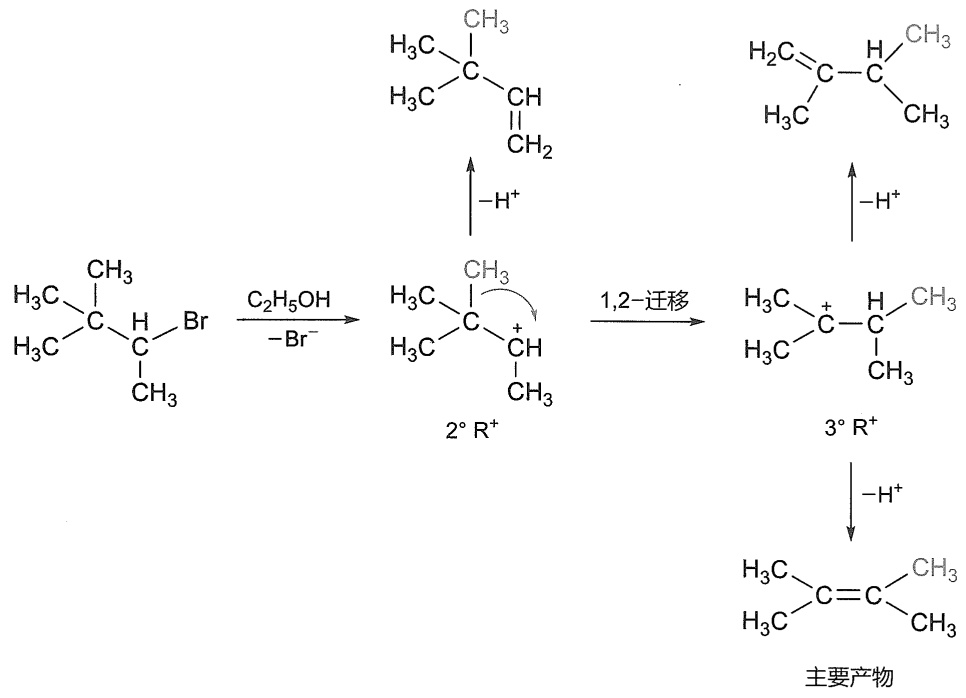

chemical

Reaction mechanism diagram showing bromination and rearrangement of a brominated alkene to form 2° R+ and 3° R+, with reagents and conditions labeled.

## 2. E1 反应的区域选择性

E1 反应中第一步生成碳正离子是反应的决速步骤，第二步消除  $\beta-H$  的过渡态稳定性决定了消除反应的区域选择性。以 2-溴-2-甲基丁烷的 E1 反应为例（图 4-3），消除  $\beta-H$  所形成的过渡态中有部分双键形成，消除含氢较少（取代较多） $\beta-$ 碳上的氢生成的过渡态比消除含氢较多（取代较少） $\beta-$ 碳上的氢生成的过渡态具有更强的超共轭作用，从而能量低，较稳定，反应速率快。此外，生成的产物 Saytzeff 烯烃（多取代烯烃）比 Hofmann 烯烃（末端烯烃）稳定，因此得到的主要产物是多取代烯烃。

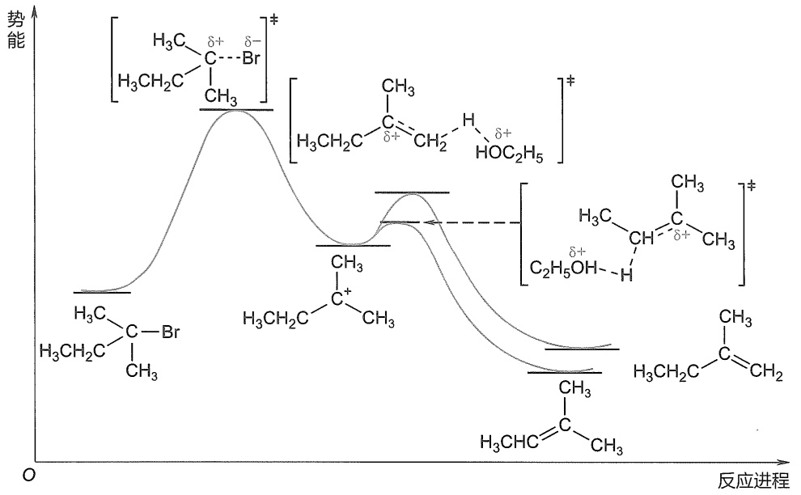

chemical

反应进程示意图，展示多键离子结构与势能变化

图 4-3 2-溴-2-甲基丁烷 E1 反应势能图

卤代烷消除反应的机理取决于  $C^{\alpha}-X$  键断裂和  $C^{\beta}-H$  键与 C-X 键协同消除 HX 的相对速率。在强碱存在下，多数卤代烷的消除一般按 E2 机理进行。易生成碳正离子的卤代烷，易发生 E1 反应。例如，叔卤代烷在极性溶剂中溶剂解反应按 E1 机理进行。

E1 反应与 E2 反应的比较如表 4-2 所示。

表 4-2 E1 反应与 E2 反应的比较

|  | E1 | E2 |
| --- | --- | --- |
| 动力学 | 一级反应$v = k_1[RX]$ | 二级反应$v = k_2[RX][B^-]$ |
| 反应机理 | 通过$R^+$中间体进行的两步反应 | 一步进行的协同反应 |
| 反应速率 | RI > RBr > RCl | RI > RBr > RCl |
| 反应取向 | 符合 Saytzeff 规则 | 符合 Saytzeff 规则或 Hofmann 规则 |
| 立体化学 | 无立体选择性 | $C^\alpha-X$键和 $C^\beta-H$键须反式共平面 |
| 碱 | 弱碱 | 强碱 |
| 竞争反应 | $S_N1$和重排 | $S_N2$ |

## 4.4.3 单分子共轭碱消除反应（E1cb）

在卤代烷分子中当离去基团的离去能力比较弱（如 F、OH、OR 等），且  $\beta-H$  的酸性比较强时，消除反应可能会按照如下两步进行:首先，碱夺取  $\beta-H$  形成碳负离子中间体（即底物的共轭碱），这是反应的决速步骤；然后，在负离子的推动下离去基团离去，生成烯烃。这种通过底物共轭碱碳负离子进行的消除反应称为单分子共轭碱消除反应，简称 Elcb，cb 代表共轭碱（conjugated base）。

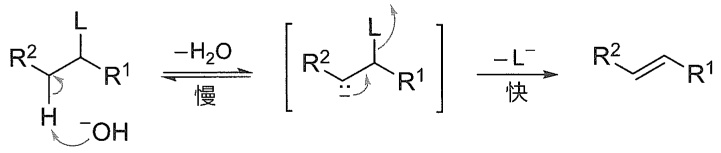

chemical

Reaction mechanism diagram showing slow and fastly activated cycloaddition of a ketone with R1 substituent

发生 E1cb 反应的关键是负离子中间体的形成。 $\beta-H$  的酸性越强，产生的负离子（共轭碱）越稳定，反应越快。所以，E1cb 反应一般需要  $\beta-C$  连有吸电子基（如卤原子、羰基等）。

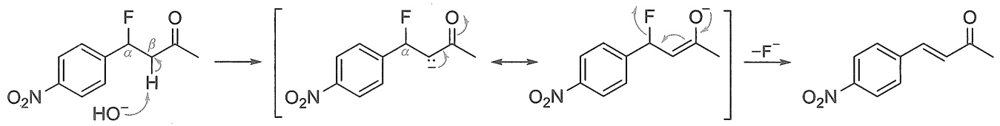

chemical

Chemical reaction mechanism showing fluorination and deprotonation steps of a fluorinated aromatic compound

E1cb 反应常见于 $\beta$-羟基羰基化合物脱水生成 $\alpha, \beta$-不饱和羰基化合物的转化中。在这个过程中，碳负离子的负电荷可共振到羰基氧原子上，形成更稳定的烯醇负离子中间体，因此消除更为容易。

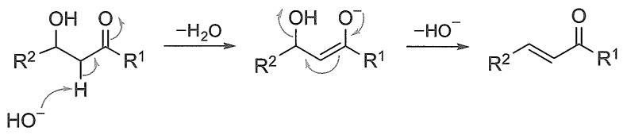

chemical

Organic reaction mechanism showing dehydration of a ketone to form an aldehyde, with electron transfer and hydrolysis steps

邻二卤代烷在金属锌或镁作用下，按照 E1cb 反应机理进行，失去卤原子生成烯烃。

$$
\begin{array}{c} \mathrm{X} \\ \mathrm{CH} _ {2} - \mathrm{CH} _ {2} \\ \mathrm{X} \end{array} \xrightarrow {\text {Zn或Mg}} \quad \mathrm{H} _ {2} \mathrm{C} = \mathrm{CH} _ {2} + \mathrm{ZnX} _ {2}
$$

碘化物和邻二卤代烷反应，也可以使邻二卤代烷失去卤原子，生成烯烃。若用反-1,2-二溴环己烷与碘化物反应，可以顺利得到环己烯；但用顺-1,2-二溴环己烷，则不发生反应。这表明邻二卤代烷的消除反应是立体选择性的反式消除。

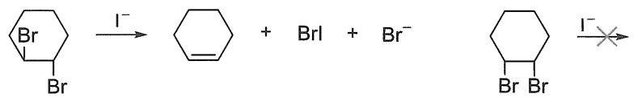

chemical

Chemical reaction equation showing brominated cyclohexane reacting with iodide to form a brominated cyclohexane derivative, then halide to yield iodide product

## 4.5 卤代烷亲核取代反应和消除反应的竞争

卤代烷的亲核取代反应和消除反应在相同反应体系和条件下可能相互竞争，导致反应产物不单一。例如，2-溴丙烷在乙醇中反应，既有取代产物又有消除产物，取代产物为主要产物；当反应体系中加入碱性试剂乙醇钠时，则消除产物为主要产物。

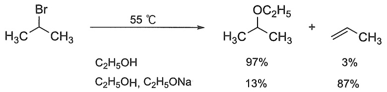

chemical

Organic reaction scheme showing bromination of a bromoalkene to form a ketone, with yield percentages for different products

以 2-溴丙烷和乙醇钠反应为例:乙氧基负离子的亲核性能够使其有效进攻 2-溴丙烷电子密度较低的 2 位碳原子，即通过  $S_{N}2$  反应历程得到 2-乙氧基丙烷；同时，乙氧基负离子的碱性（见 4.3.3 小节有关亲核试剂碱性的讨论）亦足够和 2-溴丙烷  $\beta-C$  上具有一定酸性的氢作用（见 4.4 节双分子消除反应的讨论），从而发生 E2 反应得到丙烯。从实验结果看，消除反应产物占 87%，取代反应产物占 13%。

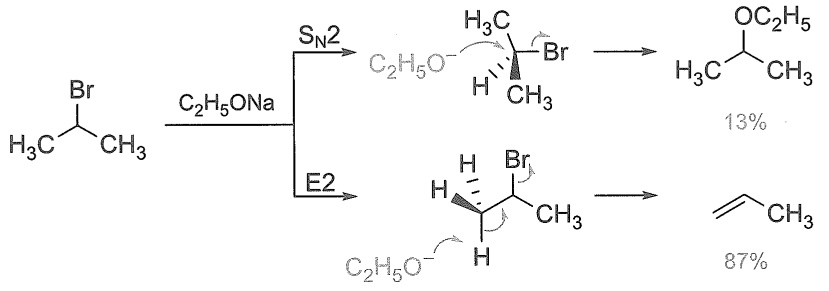

chemical

Organic reaction mechanism showing bromination and deprotection steps with reagents and yields

类似地，在 2-溴丙烷和乙醇反应时，虽然经历了包含碳正离子为中间体的反应历程，但也能观察到亲核取代反应（ $S_{N}1$ ）和消除反应（E1）的竞争。

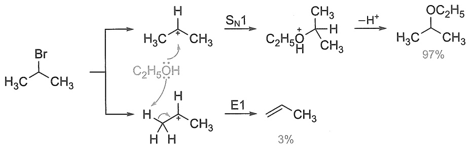

chemical

Organic reaction mechanism showing bromination and deprotection steps with reagents and yields

鉴于发展专一性化学转化的重要性，理解竞争反应的调控因素非常必要。本节将讨论影响亲核取代反应和消除反应的一些主要因素，为我们预测反应大致按哪个特定途径进行，提供一些简单的指导原则。

## 4.5.1 亲核试剂的影响

在 4.3.3 小节的讨论中提及，亲核试剂的亲核性由亲核试剂的碱性和可极化性决定。随着亲核试剂的碱性增强，它们和卤代烷  $\beta-C$  上具有一定酸性的氢之间越容易发生作用，消除反应作为竞争反应的可能性增加。因此，一些碱性弱（通常指比氢氧化物碱性弱）但亲核能力强的亲核试剂，包括  $I^{-}$ 、 $Br^{-}$ 、 $RS^{-}$ 、 $N_{3}^{-}$ 、 $RCOO^{-}$  和  $NH_{3}$  等，主要和卤代烷发生取代反应。这些亲核试剂与一级或二级卤代烷反应时，以  $S_{N}2$  反应为主，而与三级卤代烷作用时，则以  $S_{N}1$  反应为主。例如，2-溴丁烷与  $I^{-}$  和  $CH_{3}COO^{-}$  只发生  $S_{N}2$  反应，消除反应几乎没有竞争的可能性。

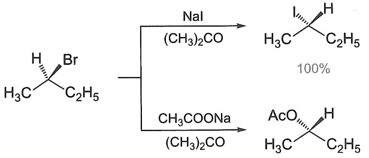

chemical

Chemical reaction scheme showing alkylation of a brominated alkene with NaI and CH3COONa under 100% conditions

100%

弱亲核试剂（例如水或者醇）只与二级和三级卤代烷才发生明显的反应，且以  $S_{N}1$  历程的取代反应为主要途径，单分子消除反应（E1）为次要反应。例如，2-溴丙烷和乙醇在  $55^{\circ}C$  进行反应，取代反应产物 2-乙氧基丙烷的产率高达 97%。

大空间位阻的强碱，如叔丁醇钾和二异丙基氨基锂（LDA）等，通常在溶剂中表现出很弱的亲核性。这是因为上述试剂亲核位点（氧负离子或氨基负离子）的大部分被大体积取代基和抗衡阳离子共同包裹。而卤代烷 $\beta -\mathrm{C}$ 上的氢原子由于空间位阻小，可以和大空间位阻的强碱发生作用。因此，大空间位阻强碱和卤代烷反应时主要发生消除反应。例如，在叔丁醇中，1-溴丁烷在叔丁醇钾存在下发生反应，消除产物丁-1-烯占 $85\%$ 。

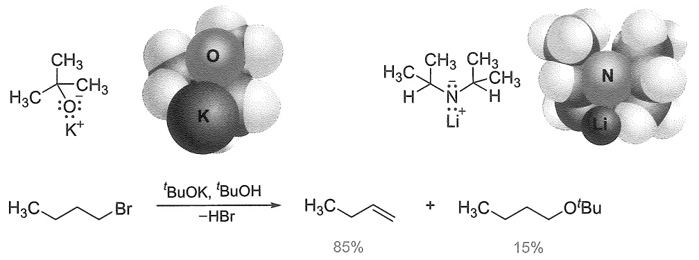

chemical

Chemical reaction scheme showing bromination of a potassium anion with tBuO and tBuOH under acidic conditions to form a 85% product and 15% product.

## 4.5.2 卤代烷结构的影响

强碱性亲核试剂有利于通过 E2 机理与卤代烷发生消除反应，从而造成亲核取代反应和消除反应的竞争；此外， $S_{N}2$  反应的速率和卤代烷中心碳原子周围的空间位阻密切相关。为了使讨论更加简洁，本小节仅考察在这些能发生  $S_{N}2$  反应的强碱性亲核试剂存在下，卤代烷的结构如何影响  $S_{N}2$  和 E2 的竞争反应。

以乙醇钠和不同结构的溴代烷反应为例:一级卤代烷1-溴丙烷和乙醇钠主要通过 $S_{N}2$ 历程生成乙基丙基醚；当溴代烷中心碳原子的β位引入甲基时，空间位阻的增加降低了 $S_{N}2$ 反应速率，E2反应产物2-甲基丙烯的产率明显增加；进一步以空间位阻更大的2-溴丙烷为原料时，E2反应产物比例进一步增加。可见，在强碱性亲核试剂条件下，随着卤代烷中心碳原子空间位阻的增大，消除反应比取代反应更容易发生。

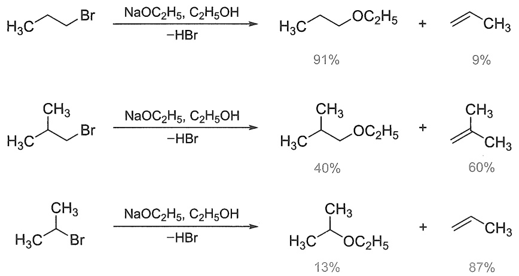

chemical

Three-step organic reaction scheme showing bromination and deacetylation steps with yields for different products

三级卤代烷即使在高浓度强碱性亲核试剂中，也只发生消除反应。

## 4.5.3 溶剂的影响

溶剂对反应的影响因素较为复杂。溶剂的极性大，有利于电荷集中的过渡态而不利于电荷分散的过渡态，因此增加溶剂的极性，一般有利于 $\mathrm{S_N2}$ 反应，而不利于E2反应。以卤代烷的 $\mathrm{S_N2}$ 和E2反应为例，在 $\mathrm{S_N2}$ 反应中，过渡态的电荷分布比较集中；E2反应中，过渡态的电荷分布比较分散，因此极性溶剂有利于 $\mathrm{S_N2}$ 反应。

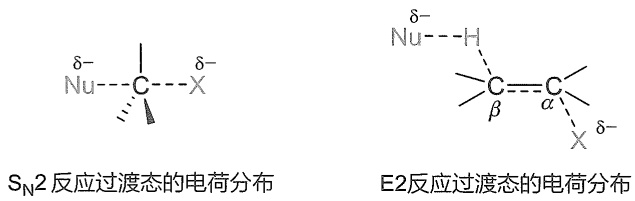

## 4.5.4 反应温度的影响

与取代反应相比，卤代烷的消除反应导致反应体系中的粒子数和混乱度增加，是熵增加的过程。因此，提高反应温度对消除反应更为有利。

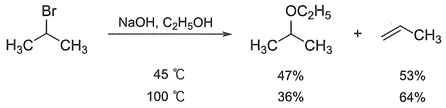

chemical

Organic reaction scheme showing bromination of a bromo-substituted alkene under NaOH and C2H5OH conditions, yielding products with different yields at specified temperatures.

## 4.6 卤代烃与金属的反应

卤代烃可以与许多金属反应生成金属原子直接与碳原子相连的一类化合物，称为有机金属化合物（organometallic compound），常用 R-M 表示，M 代表金属原子。由于碳原子的电负性比金属原子的电负性大得多，所以 C-M 键中碳原子带有负电荷，金属带有正电荷，R-M 是一类亲核能力很强的含碳亲核试剂，也是强碱。金属有机化合物可以通过卤代烃与金属单质直接反应制备，或者通过金属试剂与另一种金属的盐类化合物发生交换反应获得。有机金属化合物的种类很多，M 可以是 Mg、Li、Na、Cu、Zn、Cd、Hg、Al 等金属，下面介绍几种常见的有机金属化合物。

## 4.6.1 有机镁化合物

有机镁化合物又称为格氏试剂（Grignard reagent），由法国化学家格利雅（V. Grignard）于1901年发现，格氏试剂在有机合成中具有广泛的应用。

格氏试剂是指在醚溶剂中由镁与卤代烃反应形成的卤化烷基镁的溶液。卤素可以是碘、溴或氯，取代基既可以是烷基，也可以是芳基，但基团中不能包含任何与格氏试剂反应的官能团。

$$
\mathrm{RX} + \mathrm{Mg} \xrightarrow {\text {无水乙醚}} \mathrm{RMgX}
$$

制备格氏试剂的溶剂都是醚类，常用乙醚（$\mathrm{Et}_2\mathrm{O}$）或四氢呋喃（THF），有时也会使用

二醚，如 1,4-二噁烷（dioxane）、乙二醇二甲醚（dimethoxyethane，DME）等。

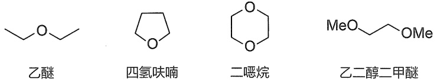

chemical

Four organic molecular structures: ethyl ether, quinone, diisopropyl ether, and 2-methoxybenzaldehyde

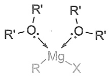

醚类溶剂在格氏试剂的制备中有重要作用，两分子醚可以与格氏试剂形成配合物（见边栏）。

形成的配合物使有机镁更稳定，并能够溶于醚。

格氏试剂的生成涉及镁对 C-X 键的插入，这一步镁的氧化态发生改变，使之从 Mg(0) 变为 Mg(Ⅱ)。因此，反应称为氧化插入反应或氧化加成反应，这是一个许多金属都能够参与的普遍过程，如 Mg、Li、Cu 和 Zn 等。Mg(Ⅱ) 比 Mg(0) 更为稳定，使得反应得以顺利发生。

乙烯型和芳基型卤代烃不活泼，制备格氏试剂需提高反应温度。

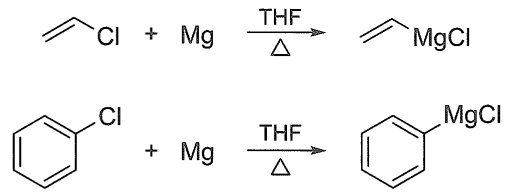

chemical

Two organotoluene reaction equations showing magnesium-catalyzed transformation with THF and Δ conditions

烯丙型和苄基型卤代烃较活泼，制备这类格氏试剂需要严格控制低温条件，否则会发生偶联反应。

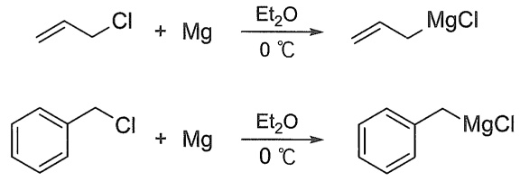

chemical

Two organotoluene derivatives under different conditions: MgCl and MgCl at 0°C, showing oxidation steps with ethylamine.

格氏试剂的基本反应类型主要包括以下三种。

（1）格氏试剂与活泼氢的反应。格氏试剂可以与水、醇、羧酸、末端炔等分子中的活泼氢反应，生成相应的烃。

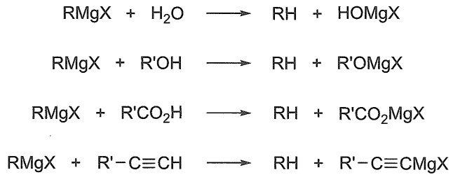

chemical

Chemical reaction equations showing the formation of various alcohols and their derivatives from RMgX and H2O

可以利用该反应，向格氏试剂中加入重水，将同位素氘原子引入有机化合物中。

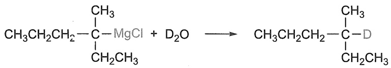

chemical

Chemical reaction equation showing the formation of a dimeric alkene from aniline and magnesium chloride

（2）格氏试剂与二氧化碳或氧气的反应。格氏试剂可以与二氧化碳或氧气发生亲核加成反应，生成增加一个碳原子的羧酸或同碳数的过氧化合物。可以利用格氏试剂与二氧化碳反应来制备羧酸。

$$
\begin{array}{l} \mathrm{RMgX} \xrightarrow {\mathrm{CO} _ {2}} \mathrm{RCOOMgX} \xrightarrow {\mathrm{H} _ {2} \mathrm{O}} \mathrm{RCOOH} \\ \mathrm{RMgX} \xrightarrow {\mathrm{O} _ {2}} \mathrm{ROOMgX} \xrightarrow {\mathrm{RMgX}} \mathrm{ROMgX} \xrightarrow {\mathrm{H} _ {2} \mathrm{O}} \mathrm{ROH} \\ \end{array}
$$

因此，制备格氏试剂需要在无氧、无活泼氢和无二氧化碳条件下进行。

（3）格氏试剂与活泼卤代烃的偶联反应。格氏试剂可以与活泼卤代烃发生偶联反应，可以用来增长碳链。实际上是格氏试剂作为亲核试剂，与卤代烷发生亲核取代反应。

$$
\mathrm{CH} _ {2} \mathrm{MgCl} + \mathrm{CH} _ {2} \mathrm{Cl} \xrightarrow [ 30 ^ {\circ} \mathrm{C} ]{\mathrm{Et} _ {2} \mathrm{O}} \mathrm{CH} _ {2}
$$

此外，格氏试剂可以作为亲核试剂，与醛、酮等发生亲核加成反应，生成相应的醇（详见醛酮部分）。

## 4.6.2 有机锂化合物

有机锂试剂，通式为 RLi（R 为烷基、烯基、炔基、芳基等），常用的有机锂试剂包括正丁基锂、甲基锂、苯基锂等。

与格氏试剂的形成一样，有机锂试剂可以通过类似的氧化插入反应，由金属锂和卤代烷制取，反应除生成有机锂试剂，还生成卤化锂。相比格氏试剂，有机锂化合物更为活泼，溶解性能比格氏试剂好，除能溶于乙醚外，还可以溶解于烷烃、石油醚等非极性溶剂中，但价格较贵，使用时两者可以相互补充其不足之处。

一卤代烷与金属锂的反应需要在低温下进行，生成有机锂化合物，例如:

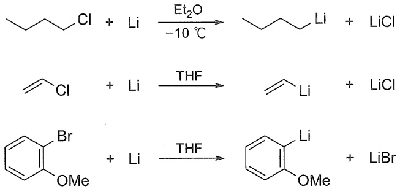

不活泼的卤苯可以在乙醚中与金属锂反应:

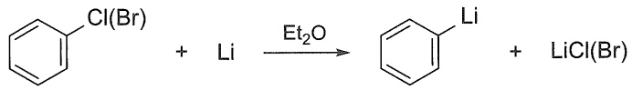

chemical

Chemical reaction equation showing lithium-catalyzed cyclization of benzene to form a lithium salt

同样需要注意的是，制备有机锂化合物也需要使用干燥的试剂和仪器，并且隔绝空气。

有机锂试剂与格氏试剂性质类似，且更为活泼，碱性更强，其中烷基锂的碱性最强。例如，丁基锂与二异丙基胺反应，生成丁烷和二异丙基氨基锂（LDA），后者是有机合成中常用的强碱性试剂。

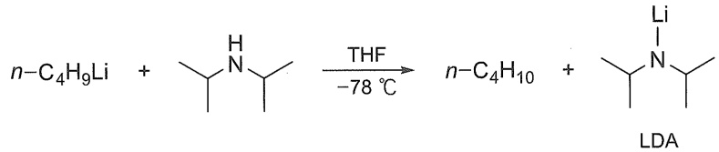

chemical

Chemical reaction equation showing the synthesis of LDA from n-C4H9Li and n-C4H10 under THF at -78°C

## 4.6.3 有机铜锂化合物

有机铜锂化合物一般是指二烃基铜锂化合物。它由两分子烃基锂在乙醚（或四氢呋喃）溶液中，在低温下，氮气或氩气氛围中与卤化亚铜（如碘化亚铜）反应得到，生成的二烃基铜锂溶于醚。在这个反应中，首先烃基锂与等物质的量的亚铜盐形成烃基铜，后者再与等物质的量的烃基锂形成二烃基铜锂。

$$
\mathrm{RLi} + \mathrm{CuX} \longrightarrow \mathrm{RCu} + \mathrm{LiX}
$$

$$
\mathrm{RLi} + \mathrm{RCu} \longrightarrow \mathrm{R} _ {2} \mathrm{CuLi}
$$

二烃基铜锂是一种非常有用的试剂，可以与卤代烷反应用于构建新的碳碳键而合成长链烃类化合物。

$$
\mathrm{R} _ {2} \mathrm{CuLi} + \mathrm{R} ^ {\prime} \mathrm{X} \longrightarrow \mathrm{R} - \mathrm{R} ^ {\prime} + \mathrm{RCu} + \mathrm{LiX}
$$

二烃基铜锂不仅可以和烯丙型和苄基型卤代烃发生交叉偶联反应，也可以和一级卤代烃、二级卤代烃，甚至与不活泼的烯基卤代烃和芳基卤代烃发生反应，生成各种烃类化合物，例如:

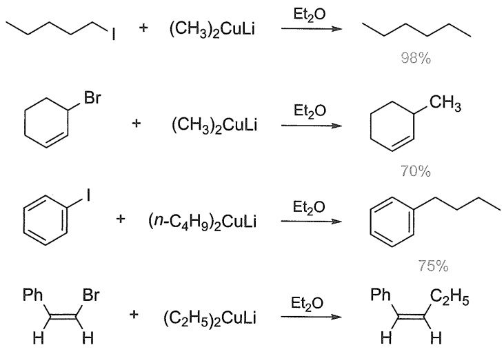

chemical

Organic synthesis reaction scheme showing conversion of alkyne to alkene using ethyl ether and ethylene, with yields indicated for each step.

## 4.6.4 卤代烃参与的偶联反应简介

格氏试剂、有机锂、有机铜锂等有机金属化合物的 C-M 键为离子键（如烷基钠和炔化钠）或极化了的共价键。由于碳原子的电负性大于金属的电负性，与金属相连的碳原子带有负电性，具有很强的亲核性。因此，有机金属化合物可以作为亲核性试剂，参与对卤代烃的亲核取代反应，例如:

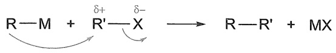

chemical

Chemical reaction equation showing transformation of R-M with δ+ and δ- groups to product R-R' + MX

反应时，有机金属化合物带负电性的烃基部分进攻卤代烃中带正电性的碳原子，实现了有机金属化合物的烃基和卤代烃中的烃基通过 C-C 键连接起来，形成了碳链增长的烃，这类反应称为卤代烃与有机金属化合物的偶联反应（coupling reaction），是制备高级烃类化合物的重要方法。格氏试剂、有机锂化合物和二烃基铜锂很容易发生偶联反应。

$$
\begin{array}{l} \mathrm{CH} _ {3} \mathrm{CH} _ {2} \mathrm{CH} _ {2} \mathrm{Br} + \mathrm{CH} _ {3} \mathrm{CH} _ {2} - \mathrm{C} \equiv \mathrm{CMgBr} \longrightarrow \mathrm{CH} _ {3} \mathrm{CH} _ {2} - \mathrm{C} \equiv \mathrm{C} - \mathrm{CH} _ {2} \mathrm{CH} _ {2} \mathrm{CH} _ {3} \\ \text {Cl} + \left(\mathrm{CH} _ {3}\right) _ {2} \mathrm{CuLi} \longrightarrow \text {CH} _ {3} + \mathrm{CH} _ {3} \mathrm{Cu} + \mathrm{LiCl} \\ \end{array}
$$

75%

此外，一级卤代烃与炔基钠可通过  $S_{N}2$  反应发生偶联，从而制得高级炔烃。

$$
\mathrm{H} _ {3} \mathrm{C} \underset {\mathrm{CH} _ {3}} {\overset {\mathrm{Br}} {\mathrm{C}}} + \mathrm{C} _ {2} \mathrm{H} _ {5} - \mathrm{C} \equiv \mathrm{CNa} \longrightarrow \mathrm{H} _ {3} \mathrm{C} \underset {\mathrm{CH} _ {3}} {\overset {\mathrm{C}} {\mathrm{C}}} = \mathrm{C} _ {2} \mathrm{H} _ {5}
$$

习题

1. 比较下列化合物在碘化钠-丙酮溶液中反应的速率大小。

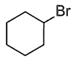

(a)

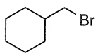

(b)

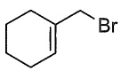

(c)

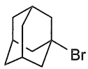

(d)

2. 比较下列化合物与乙醇的硝酸银溶液反应的速率大小。

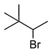

(a)

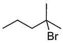

(b)

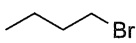

(c)

3. 比较下列化合物 E1 反应的速率大小。

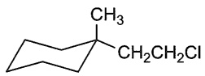

(a)

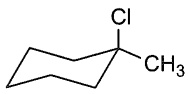

(b)

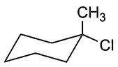

(c)

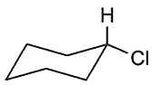

(d)

4. 下列哪种卤代烷难以发生 E2 反应?

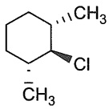

(a)

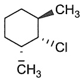

(b)

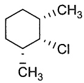

(c)

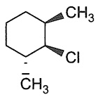

(d)

5. 下式为 $(2S,3S)-2,3-$ 二溴丁烷的结构式，写出其稳定的锯架式和纽曼投影式。

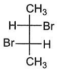

6. 写出下列化合物在  $KOH/C_{2}H_{5}OH$  中的消除反应产物。

(1) $(2S,3S)-2,3-$ 二溴丁烷

(2) $(2S,3R)-2,3-$ 二溴丁烷

(3) $(2S, 3R)-2-$ 溴-3-氘丁烷

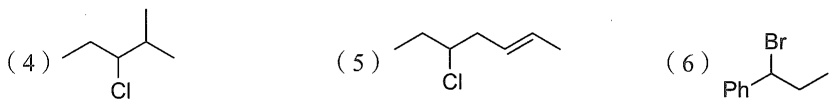

7. 完成下列反应，写出反应的主要产物，如有立体异构体，须标明产物的立体构型。

(1)  $\mathrm{Br}\begin{array}{c}C_{2}H_{5}\\|\\CH_{3}\\|\\CH(CH_{3})_{2}\end{array}\xrightarrow[\Delta]{C_{2}H_{5}OH}$

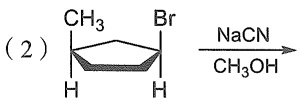

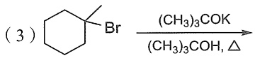

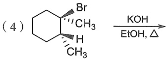

chemical

Chemical reaction showing brominated cyclohexane reacting with KOH/EtOH/Δ to form a fused ring system

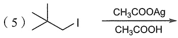

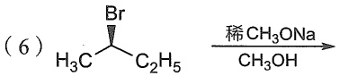

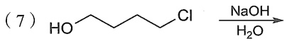

chemical

Chemical reaction scheme showing bromination of a cyclohexene derivative using magnesium and ethyl ether under basic conditions

8. 为下列反应提出合理的可能机理。

本章习题
参考答案

（本章编者 资伟伟、汤平平、惠新平、武全香、刘强、马宝春）

## 第五章

## 烯烃与炔烃

5.1 烯烃和炔烃的命名 …… 125
5.2 烯烃的热力学稳定性与氢化热 … 129
5.3 烯烃与 Brønsted 酸的亲电加成
反应 …… 131
5.4 烯烃的自由基加成反应 …… 138
5.5 烯烃亲电加成反应中邻基参与效应的影响——1,2-迁移与环镝离子 … 140

5.6 烯烃的协同加成反应 …… 150
5.7 烯烃的亲核加成/亲核取代反应 … 160
5.8 炔烃的反应 161
5.9 烯烃和炔烃的主要来源及制备 … 168
5.10 联烯 170
习题 171

在第四章里，我们学习了常见极性 $\sigma$ 键化合物——卤代烃的性质。本章将涉及具有另一类典型化学键 $\pi$ 键的化合物——烯烃与炔烃的性质。“肩并肩”成键的 $\pi$ 键与“头碰头”成键的 $\sigma$ 键相比，重叠程度低，因此一般认为 $\pi$ 键拥有更高的反应性。从分子轨道理论分析，$\pi$ 键成键轨道能量比 $\sigma$ 键成键轨道能量高。对于不饱和化合物，基态时 $\pi$ 键的成键轨道和反键轨道通常是其分子轨道的HOMO轨道和LUMO轨道，这也说明 $\pi$ 键拥有更高的反应性。烯烃和炔烃，作为经典的 $\pi$ 键化合物，具有极其丰富的反应模式。烯/炔的反应几乎囊括了基础有机化学中所有的反应类型，包括加成反应、消除反应、取代反应、协同反应、分步反应；亲电反应、亲核反应、自由基反应、有机金属反应等；涉及几乎所有常见的活性中间体，包括碳正离子、碳负离子、自由基、卡宾、有机金属中间体等。深入理解烯/炔的性质与反应有助于后续章节的学习与理解。

## 5.1 烯烃和炔烃的命名

## 5.1.1 烯烃的命名

烯烃可分为单烯烃和多烯烃，也可分为开链烯烃和环烯烃。由于碳碳双键的形成，烯烃较同碳数的烷烃含有较少的氢原子，每增加一个双键，分子中氢原子就减少两个。含有一个碳碳双键的开链烯烃的分子通式为  $C_{n}H_{2n}$ ，与单环环烷烃是同分异构体，其差别在于分子中原子连接方式和顺序的不同，属于构造异构。虽然从分子式计算的单环环烷烃和含一个 C=C 双键的开链烯烃的不饱和度都为 1，但通常不饱和烃是指含有  $\pi$  键的烯烃、炔烃和芳香烃，并不包括环烷烃。

## 1. 单烯烃的命名

单烯烃的 IUPAC 命名原则与烷烃类似，但也有所不同，具体命名原则如下:

（1）直链烯烃依据碳链长度命名为“某烯”（十碳以内）或“某碳烯”（十个碳以上）。

2017年以前，有机化合物的中文命名主要是依照1980年制订的《有机化学命名原则》，中英文命名在规则上略有不同。2017年后中国化学会制订新的命名规则，基本实现了中英文命名的统一。

英文名的词尾统一为“-ene”。双键的位次加在词尾烯的前面。例如:

$$
\mathrm{CH} _ {3} \mathrm{CH} _ {2} \mathrm{CH} = \mathrm{CH} _ {2}
$$

丁-1-烯

but-1-ene

$$
\mathrm{CH} _ {3} \mathrm{CH} = \mathrm{CHCH} _ {3}
$$

丁-2-烯

but-2-ene

一个结构可能有几种不同的名称（标准名和非标准名），但一个名称对应唯一的有机化合物结构，是命名用于交流的基本要求。

务必加上双键编号，因为“丁烯”这个名称可能是丁-1-烯或丁-2-烯，违背了一个名称只能写出唯一一个结构式的命名核心原则。

（2）有支链的烯烃，在含双键碳链为最长碳链时，选此碳链命名为“某烯”（十碳以内）或“某碳烯”（十个碳以上），并给双键以尽可能小的位次。

$$
\mathrm{CH}_3\mathrm{CH} = \mathrm{CH}\overset{\mathrm{CH}_3}{\mathrm{CH}}\mathrm{CH}_3
$$

4-甲基戊-2-烯

4-methylpent-2-ene

$$
\begin{array}{c} \mathrm{CH} _ {2} \mathrm{CH} _ {3} \\ \mathrm{CH} _ {3} \stackrel {\mathrm{I}} {\mathrm{C}} = \mathrm{CHCH} _ {2} \mathrm{CH} _ {2} \mathrm{CH} _ {2} \mathrm{CH} _ {3} \end{array}
$$

3-甲基辛-3-烯

3-methyloct-3-ene

当含双键的碳链不是最长碳链时，优先选择最长碳链作为母体，即使该最长碳链不含双键，例如:

正确的命名为:4-乙烯基辛烷

4-vinyloctane

当支链以双键与母体相连，则使用“某亚基”来表示，例如:

正确的命名为:3-甲亚基己烷

3-methylenehexane

（3）如果从两个方向给主链编号，双键编号相同，则选取使取代基编号最小的方向进行编号。例如:

正确的母体名和取代基编号为:

2,5-二甲基辛-4-烯

2,5-dimethyloct-4-ene

（4）环状单烯烃的双键编号默认为1，可省略双键的编号。双键的哪个碳标记为1-位，则依据使取代基编号尽可能小的原则。例如:

3-乙基环戊烯
3-ethylcyclopentene

4,5-二甲基环己烯
4,5-dimethylcyclohexene

6-乙基-1-甲基环己烯
6-ethyl-1-methylcyclohexene

1,5-二甲基环己烯
1,5-dimethylcyclohexene

iso-, cyclo-等涉及基团结构本身的前缀，在首字母规则中按前缀首字母算；di-, tri-等表达数量的前缀则不纳入首字母的考量。

与烷烃命名一样，取代基的列出顺序以英文字母顺序而定，取代基编号相同时，给先列出的基团以小编号。例如:

3-异丙基-1-甲基环戊烯
3-isopropyl-1-methylcyclopentene

4-乙基-7-甲基癸-5-烯
4-ethyl-7-methyldec-5-ene

（5）$\pi$ 键的成键模式限制了两个碳之间的 $\sigma$ 键的自由旋转，因为这种旋转会导致 $\pi$ 键的断裂与重构，从而导致烯烃立体异构体的产生（图5-1）。

chemical

π键断裂反应示意图，展示顺式异构体与反式异构体的化学结构变化

图 5-1 双键的旋转受限与烯烃的顺反异构

命名时还需要对顺反式异构体进行双键构型的标识。简单的邻二取代烯烃，如丁-2-烯，可以用“cis-”或“trans-”来表示其构型，即两个相同取代基处于双键碳原子的同侧为 $cis-$；处于双键碳原子的异侧为 $trans-$。

cis-丁-2-烯

cis-but-2-ene

trans-丁-2-烯

trans-but-2-ene

三取代烯烃和四取代烯烃不能简单地用 cis-或 trans-来命名。如 3-乙基己-2-烯的双键碳连接了四个不同的基团，则难以确定两个构型异构体哪个是顺式（cis-），哪个为反式（trans-）。

3-乙基己-2-烯

cis- or trans-?

3-乙基己-2-烯

cis- or trans-?

IUPAC 命名原则采用 “Z/E 命名法” 准确表达双键构型:首先使用次序规则确定双键碳原子上的四个取代基的优先顺序。如果 A > C，B > D（读作 “A 优先于 C，B 优先于 D”），即两个双键碳原子上的优先基团处于双键的同侧，则命名为 “Z” 型。如果 A > C，而 B < D，即两个双键碳原子上的优先基团处于双键的异侧，则命名为 “E” 型。

若 A>C

B>D

为"Z"型

若 A>C

B<D

为"E"型

因此，上述3-乙基己-2-烯的两个异构体的构型分别为（Z）和（E）:

(Z)-3-乙基己-2-烯

(Z)-3-ethylhex-2-ene

(E)-3-乙基己-2-烯

(E)-3-ethylhex-2-ene

前述第（4）条原则中使用的实例，4-乙基-7-甲基癸-5-烯的完整命名如下:

(E)-4-乙基-7-甲基癸-5-烯

(E)-4-ethyl-7-methyldec-5-ene

在讲述第（3）条原则的实例中，2,5-二甲基辛-4-烯的双键构型也是 $E$ 型，其完整的命名如下:

要注意 Z、E 等构型在表达时通常使用斜体来表示。

(E)-2,5-二甲基辛-4-烯

(E)-2,5-dimethyloct-4-ene

以下是两个双键构型为 Z 型的实例。

(Z)-3,6-二甲基辛-3-烯

(Z)-3,6-dimethyloct-3-ene

(Z)-2,5,6-三甲基庚-3-烯

(Z)-2,5,6-trimethylhept-3-ene

## 2. 多烯烃的命名

多烯烃的 IUPAC 命名原则如下:选取最长碳链为母体主链,并给双键以尽可能小的编号,称为“某几烯”。英文命名中以“diene”或“triene”等词尾表示。例如:

由于 diene 或 triene 不再是元音开头，根据英语习惯，表碳链长度的词缀恢复成正常表达（对比 butene 和 butadiene）。

chemical

Structural formulas of propadiene and its derivatives with Chinese names and substituent variations

(2E,5E,9E)-4,6,8-三甲基十一碳-2,5,9-三烯

(2E,5E,9E)-4,6,8-trimethylundeca-2,5,9-triene

## 5.1.2 炔烃的命名

炔烃的IUPAC命名原则与烯烃类似:当最长碳链只含有一个碳碳叁键时，命名为“某炔”或“某碳炔”（十碳以上），英文的词尾为“yne”，叁键的位次加在词尾之前，且给碳碳叁键以尽可能小的编号。如果从主链的两个方向编号，叁键的编号相同，则采用使取代基位次最小的编号。若最长碳链不含碳碳叁键，则将含碳碳叁键部分作为取代基命名。例如:

5-甲基庚-2-炔

5-methylhept-2-yne

2-甲基辛-4-炔

2-methyloct-4-yne

4-乙炔基辛烷

4-ethynyloctane

与双键/叁键直接相连的碳受不饱和键的影响，具有特别的反应性或谱学性质，因此常有专门的名称——烯丙基（allyl）和炔丙基（propargyl），请注意它们与丙烯-1-基、丙炔基的区别。

$$
- \mathrm{CH} = \mathrm{CHCH} _ {3} \quad \mathrm{CH} _ {2} = \mathrm{CHCH} _ {2} - \quad \mathrm{HC} \equiv \mathrm{C} - \mathrm{CH} _ {2} - \quad - \mathrm{C} \equiv \mathrm{C} - \mathrm{CH} _ {3}
$$

丙烯-1-基

propen-1-yl

烯丙基

allyl

炔丙基

propargyl

丙炔基

propynyl

## 5.2 烯烃的热力学稳定性与氢化热

与烷烃类似，烯烃的稳定性也可以根据燃烧热和生成热数据进行判断。不过，由于烯烃的化学活泼性主要表现在 $\pi$ 键的加成反应，因此，烯烃的稳定性更常用氢化热来判断，这样有助于比较不同烯烃中 $\pi$ 键的稳定性。氢化热（heat of hydrogenation）是指 $1\mathrm{mol}$ 烯烃在标准条件下完全氢化所放出的热量。表5-1中列出了一些烯烃的氢化热。

氢化反应断开一个 C-C π 键和一个 H-H σ 键而生成两个 C-H σ 键，反应是放热的。放热越多，表示双键越不稳定。从表 5-1 数据可以分析不同类型双键的稳定性顺序:单取代双键 < 偕二取代双键和顺式二取代双键 < 反式二取代双键 < 三烷基取代双键和四烷基取代双键。烃基取代更多的烯烃热力学往往更稳定，主要原因是烃基与双键之间的 σ-π 超共轭效应（见 1.7 节）的稳定化作用。

chemical

Molecular orbital diagram showing σ-π superconjugate and π*键 with labeled hydrogen atoms and bond formula C-CH=CH2

表 5-1 标准条件下一些烯烃的氢化热

chemical

Chemical reaction diagram showing hydrogenation of alkenes to form alkanes, with R' and R'' substituents on alkenes

| 化合物 | $\Delta H/(kJ·mol^{-1})$ | 化合物 | $\Delta H/(kJ·mol^{-1})$ |
| --- | --- | --- | --- |
| = | -137.3 |  | -223.9 |
|  | -126.0 |  | -128.9 |
|  | -126.8 |  | -110.5 |
|  | -126.8 |  | -118.5 |
|  | -126.8 |  | -110±0.4 |
|  | -118.9 |  | -103±0.8 |
|  | -119.3 |  | -239.0 |
|  | -119.7 |  | -226.5 |
|  | -115.5 |  | -254.5 |
|  | -112.6 |  | -253.2 |
|  | -111.3 |  | -295 |

与燃烧热/生成热不同，具有不同分子式的烯烃，可以用氢化热来比较其热力学稳定性。

热力学数据可在 NIST 数据库中查询。