烯烃分子的空间效应也会影响其热力学稳定性，顺式二取代烯烃的稳定性不及反式二取代烯烃。这是因为顺式烯烃的两个烃基在空间上过于拥挤而产生了范德华斥力（图5-2）。实验测得(Z)-丁-2-烯双键碳原子的键角 $\angle C = C - C$ 为 $127^{\circ}$，大于正常 $\mathfrak{sp}^2$ 杂化轨道夹角，这也是范德华斥力存在的证据。

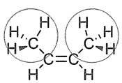

(Z)-丁-2-烯

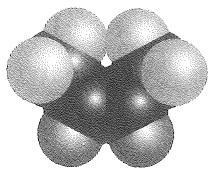

chemical

Molecular structure diagram showing a five-membered ring with shading and symmetry

图5-2 (Z)-丁-2-烯的结构与比例模型图

比较环丙烯、环丁烯、环戊烯和环己烯的氢化热，可以看出环丙烯和环丁烯势能增高，稳定性降低，特别是环丙烯，其氢化热数值几乎是一般双键的两倍。这是因为双键碳原子用 $sp^{2}$ 杂化轨道成键，使得小环的环张力进一步增大。

表 5-1 数据还显示:不同类型的二烯烃稳定性不同。累积二烯烃的稳定性小于孤立二烯烃的稳定性，而孤立二烯烃的稳定性又小于共轭二烯烃的稳定性。例如，戊-2,3-二烯不及戊-1,4-二烯稳定，戊-1,4-二烯不及戊-1,3-二烯稳定。图 5-3 直观地表示出了这种差异，共轭二烯烃戊-1,3-二烯的氢化热比孤立二烯烃戊-1,4-二烯的低 28.0 kJ/mol，而累积二烯烃戊-2,3-二烯的则高出 40.5 kJ/mol。

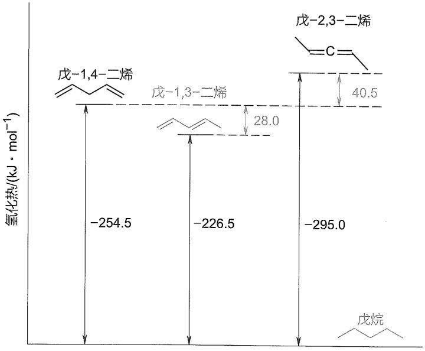

other

| Compound | Enthalpy \((kJ \cdot mol^{-1})\) |
| :--- | :--- |
| 戊-1,4-二烯 | -254.5 |
| 戊-1,3-二烯 | -226.5 |
| 戊-2,3-二烯 | -295.0 |
| 戊烷 | N/A |

图 5-3 戊-1,4二烯、戊-1,3-二烯和戊-2,3-二烯的氢化热对比

共轭二烯烃热力学稳定性主要源于两个  $\pi$  键的  $\pi-\pi$  共轭效应。

累积二烯烃的氢化热与炔烃比较接近，两个相互垂直的  $\pi$  键不但不产生共轭，还因为同种电荷互斥作用分别降低彼此的重叠程度，因此热力学稳定性低于相应的孤立二烯。

$$
\mathrm{H} _ {2} \mathrm{C} = \mathrm{C} = \mathrm{CH} _ {2} + 2 \mathrm{H} _ {2} \xrightarrow {\mathrm{Pt}} \mathrm{CH} _ {3} \mathrm{CH} _ {2} \mathrm{CH} _ {3} \quad \Delta H = - 2 9 5. 1 \mathrm{kJ/mol}
$$

$$
\mathrm{H} _ {3} \mathrm{C} - \mathrm{C} \equiv \mathrm{CH} + 2 \mathrm{H} _ {2} \xrightarrow {\mathrm{Pt}} \mathrm{CH} _ {3} \mathrm{CH} _ {2} \mathrm{CH} _ {3} \quad \Delta H = - 2 9 2. 6 \mathrm{kJ/mol}
$$

以丙二烯为例，分子中的 C2 为 sp 杂化，C1-C2 和 C2-C3 两个  $\pi$  键相互垂直，无法发生共轭，而连接在 C1 和 C3 上的氢原子分别处在两个相互垂直的平面上（图 5-4）。这种结构特征使得丙二烯型分子可能存在手性异构体（详见第二章立体化学）。

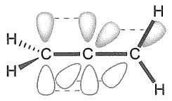

图5-4 累积二烯烃的两个 $\pi$ 键示意图

## 5.3 烯烃与 Brønsted 酸的亲电加成反应

$\sigma$ 键电子云处于共享该电子对的两个原子之间，而 $\pi$ 键电子云处于组成共价键原子平面的上下两方，从电子效应上看，原子核对 $\pi$ 键电子云的束缚较弱，从空间效应上看，$\pi$ 键电子云处于相对暴露位置，容易接受外来试剂的进攻。当作为亲电试剂的缺电子物种靠近 $\pi$ 键时，容易夺取一对 $\pi$ 电子，与其中一个双键碳形成 $\sigma$ 键，同时另一个双键碳形成碳正离子。反应体系里相对富电子的亲核试剂物种受正负电荷的吸引作用很快与碳正离子结合，形成另一个 $\sigma$ 键，这是烯烃发生亲电加成反应的一般模式。

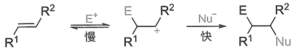

chemical

Reaction mechanism diagram showing slow and fast electron transfer of a carbocation intermediate to form a Ru complex

E= 亲电试剂 (electrophile); Nu= 亲核试剂 (nucleophile)

质子（在溶液体系中通常以溶剂合质子等形式存在）是典型的缺电子物种，可作为亲电试剂与烯烃发生亲电加成反应。下面以 Brønsted 酸与烯烃的亲电加成反应为典型例子，讲述烯烃亲电加成反应的一些基本性质与特点。

## 5.3.1 烯烃与HX加成反应机理与反应活性

以烯烃与氯化氢的加成为例，由于氯原子的电负性较大，H-Cl键的电子云偏向氯原子。反应中，带部分正电荷的氢原子与烯烃的 $\pi$ 键结合，H-Cl键进一步极化断裂，从而形成碳正离子和氯负离子。然后碳正离子和氯负离子结合形成加成产物。不难发现，从形式上，该反应是上一章学习的E1反应的逆反应，在E1反应中，氯离子的离去形成碳正离子是速率较慢的决速步骤，质子的消去是快步骤；而在烯烃亲电加成反应中，质子的加成是速率较慢的决速步骤，氯离子与碳正离子的结合是快步骤。通过图5-5所示的反应势能曲线图我们能更好地理解该反应的特点。

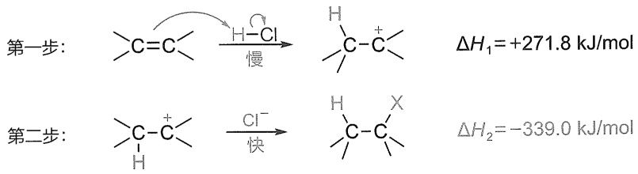

chemical

Two-step chemical reaction equations showing chlorination and cyclization steps with enthalpy values

根据 Brønsted 酸碱理论，能与  $H^{+}$ 反应的烯烃是 Brønsted 碱，而能通过 E1 反应释放  $H^{+}$ 的碳正离子可以看作 Brønsted 酸。

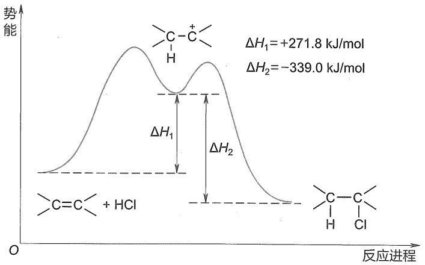

line

| State | Enthalpy Change \((\Delta H)\) |
| --- | --- |
| \(\Delta H1\) | +271.8 kJ/mol |
| \(\Delta H2\) | -339.0 kJ/mol |

图 5-5 烯烃与 HCl 加成的反应势能曲线图

第一步生成碳正离子的吸热反应需要断裂 C-C  $\pi$  键和 H-Cl  $\sigma$  键两个共价键，形成一个 C-H  $\sigma$  键，是整个亲电加成的决速步骤。有三个主要因素影响着这个决速步骤的反应速率:

（1）断裂 H-X 键的难易程度:质子越容易解离，越容易发生与烯烃的亲电加成。根据氢卤酸的酸性强弱顺序，其反应活性顺序是 HI > HBr > HCl >> HF。事实上，由于 H-F 键太难以解离，烯烃与 HF 一般不能发生亲电加成反应。
（2）烯烃的富电子程度:烯烃越富电子，亲核性也就越强，越容易与质子发生反应。
（3）生成的碳正离子的稳定性:根据 Hammond 假设，第一步反应过渡态的结构应该与其产物碳正离子相似，因此形成的碳正离子越稳定，过渡态能量越低，反应越容易发生。

在这里，后两个影响因素受底物结构的影响往往是一致的，烯烃连接的给电子基团既能使烯烃更富电子，也能使形成的碳正离子更稳定。如乙烯与氯化氢的加成活性低于丁-2-烯与氯化氢的加成活性，因为乙烯与氯化氢的加成经过的活性中间体是 $1^{\circ}$ 碳正离子，丁-2-烯与氯化氢的加成经过 $2^{\circ}$ 碳正离子，$2^{\circ}$ 碳正离子的稳定性高于 $1^{\circ}$ 碳正离子的稳定性。

$$
\begin{array}{l} \mathrm{CH} _ {2} = \mathrm{CH} _ {2} \xrightarrow {\mathrm{HCl}} \mathrm{CH} _ {3} - \stackrel {+} {\mathrm{CH}} _ {2} \xrightarrow {\mathrm{Cl} ^ {-}} \mathrm{CH} _ {3} - \mathrm{CH} _ {2} \mathrm{Cl} \\ \mathrm{CH} _ {3} \mathrm{CH} = \mathrm{CHCH} _ {3} \xrightarrow {\mathrm{HCl}} \mathrm{CH} _ {3} \mathrm{CH} _ {2} \stackrel {+} {\mathrm{CHCH}} _ {3} \xrightarrow {\mathrm{Cl} ^ {-}} \mathrm{CH} _ {3} \mathrm{CH} _ {2} \stackrel {\mathrm{I}} {\mathrm{CHCH}} _ {3} \\ \text {1°碳正离子} \\ \text {2°碳正离子} \end{array}
$$

## 5.3.2 烯烃与HX在气相和溶液相中的亲电加成反应

烯烃与 HCl 和 HBr 的反应可以在气相中进行，也可以在溶液中进行。在气相中，极性分子卤化氢的带部分正电荷的氢原子逐渐接近烯烃的  $\pi$  键，先形成 C-H  $\sigma$  键，另一个双键碳原子成为碳正离子（图 5-6）。

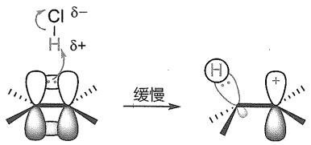

chemical

Hydrogen bonding diagram showing electron movement in a molecule with chloride and hydrogen atoms

图 5-6 烯烃与 HCl 在气相反应形成 C-H σ 键和碳正离子

在溴乙烯的反应中，后两个影响因素是不完全一致的，吸电子的溴取代基使烯烃反应活性变低，但溴却能通过 $p-\pi$ 共轭稳定碳正离子。

碳正离子和卤素负离子形成后，由于在气相中没有任何溶剂化稳定作用，很快结合生成加成产物。如丁-2-烯与氯化氢在气相的反应，经过碳正离子，得到2-氯丁烷。

$$
\mathrm{CH} _ {3} \mathrm{CH} = \mathrm{CHCH} _ {3} \xrightarrow [ \text {慢} ]{\mathrm{H} - \mathrm{Cl}} \mathrm{CH} _ {3} \mathrm{CH} _ {2} ^ {+} \mathrm{CHCH} _ {3} \xrightarrow [ \text {快} ]{\mathrm{Cl} ^ {-}} \mathrm{CH} _ {3} \mathrm{CH} _ {2} \mathrm{CHCH} _ {3}
$$

氯化氢和溴化氢溶解在水溶液中就转化为盐酸和氢溴酸，因此，在水溶液中主要是以质子（或水合质子）和卤负离子的形式存在:

$$
\mathrm{H} _ {2} \ddot {\mathrm{O}}: + \mathrm{H} - \ddot {\mathrm{Cl}}: \Longleftrightarrow \mathrm{H} _ {3} \stackrel {+} {\mathrm{O}}: +: \ddot {\mathrm{Cl}}:
$$

在水溶液中，亲电加成反应的第一步反应速率大大快于在气相中的反应速率。因为气相中需要断裂 H-X σ 键，才能进行加成形成碳正离子和卤负离子，能量上很不利；而在水溶液中，已经形成的质子容易与双键发生加成反应，并且水的存在还能通过溶剂化作用稳定加成后形成的碳正离子和卤负离子。

$$
\mathrm{CH} _ {3} \mathrm{CH} = \mathrm{CHCH} _ {3} + \mathrm{H} _ {3} \mathrm{O} ^ {+} + \mathrm{Cl} ^ {-} \longrightarrow \mathrm{CH} _ {3} \mathrm{CH} _ {2} \stackrel {+} {\mathrm{CHCH}} _ {3} + \mathrm{H} _ {2} \mathrm{O} + \mathrm{Cl} ^ {-}
$$

不过在水溶液中反应也带来了竞争反应。

$$
\mathrm{CH} _ {3} \mathrm{CH} _ {2} ^ {+} \mathrm{CHCH} _ {3} + \mathrm{H} _ {2} \mathrm{O} + \mathrm{Cl} ^ {-} \xrightarrow [ \mathrm{Cl} ]{\mathrm{CH} _ {3} \mathrm{CH} _ {2} \mathrm{CHCH} _ {3}} \mathrm{CH} _ {3} \mathrm{CH} _ {2} \mathrm{CHCH} _ {3} \xrightarrow [ \mathrm{OH} _ {2} ^ {+} ]{\mathrm{H} _ {2} \mathrm{O}} \mathrm{CH} _ {3} \mathrm{CH} _ {2} \mathrm{CHCH} _ {3}
$$

在烯烃与质子加成形成碳正离子后，体系中存在两种亲核试剂，分别是卤素负离子和水。碳正离子既可与卤素负离子反应，也可与水反应。尽管卤素负离子带负电荷，其亲核性比水强，但是在水溶液中水是大量存在的，而且卤素负离子的外层被溶剂化的水分子包围，会阻碍卤素负离子与碳正离子的结合。因此，竞争的结果是生成卤代烃和醇两种加成产物。

如果希望制备的主要产物是卤代烃，则可以采用中等极性溶剂如醋酸进行反应，并且避免水的存在。在醋酸溶液中 HX 的反应活性为 HI > HBr > HCl。

$$
\mathrm{C} = \mathrm{C} \xrightarrow [ \text {HOAc} ]{\mathrm{H-X}} \mathrm{C} - \mathrm{C}
$$

## 5.3.3 烯烃与HX加成反应的区域选择性

非对称的烯烃与卤化氢和水发生亲电加成反应有两种可能的加成方向。如丁-1-烯与氯化氢反应可能得到1-氯丁烷和2-氯丁烷，实验结果以2-氯丁烷为主要产物。

$$
\mathrm{CH} _ {2} = \mathrm{CHCH} _ {2} \mathrm{CH} _ {3} \xrightarrow {\mathrm{H} - \mathrm{Cl}} \begin{array}{c c} \mathrm{CH} _ {2} \mathrm{CH} _ {2} \mathrm{CH} _ {2} \mathrm{CH} _ {3} & + \mathrm{CH} _ {3} \mathrm{CHCH} _ {2} \mathrm{CH} _ {3} \\ \mid & \mid \\ \text {Cl} & \text {Cl} \\ 1 - \text {氯丁烷} & 2 - \text {氯丁烷} \\ \text {次要产物} & \text {主要产物} \end{array}
$$

根据以上亲电加成反应机理，生成碳正离子的一步为决速步骤，形成碳正离子越稳定，反应速率越快，因此氯负离子与更稳定的碳正离子相连的产物是主要产物。在上述例子中，丁-1-烯与质子反应后可以得到 $1^{\circ}$ 碳正离子或 $2^{\circ}$ 碳正离子，其中 $2^{\circ}$ 碳正离子更稳定，因此主要产物是2-氯丁烷。

$\mathrm{H^{+}}$ 在溶液体系里一般是以溶剂合质子或溶剂化质子的形式存在的。因此，溶剂与 $\mathrm{H^{+}}$ 的结合能力对烯烃与HX的亲电加成反应的活性往往也有较大影响。

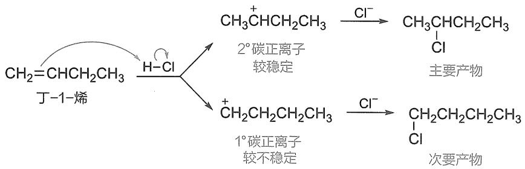

flowchart

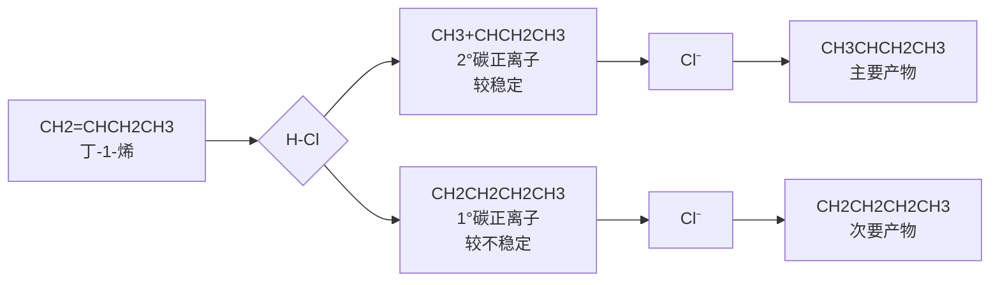

先从实验结果中总结经验规则，再逐渐形成更完善的理论，是有机化学学科发展的常态。我们应该全面、辩证地理解这些经验规则，而不能陷入孤立、片面、静止的认识。

1869 年，Markovnikov 根据大量实验结果发现了一个重要的规律:当卤化氢与非对称烯烃加成时，卤素原子（带负电荷，为试剂的亲核部分）加在烯烃含氢较少的碳原子上。该规律被称作马氏规则（Markovnikov rule）。现在人们清楚了碳正离子及其稳定性规律，可以从本质上更好地理解马氏规则，其实是亲电试剂与烯烃的加成，倾向于形成更加稳定的碳正离子。给电子基团可以稳定缺电子的碳正离子，而烃基可以通过  $\sigma-p$  超共轭呈现出给电子效应，因此烃基取代越多的碳正离子往往越稳定，从而体现出氢越少（取代越多）的碳越倾向于连接亲核试剂的规律。

但如果烯烃连接的是吸电子基团，由于吸电子基团与碳正离子相连不稳定，亲核试剂会倾向于连接在取代更少的碳上，得到所谓“反马氏规则”的结果，例如:

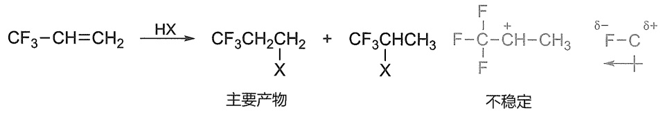

chemical

Chemical reaction equation showing conversion of CF3-CH=CH2 to a mixture with X and F groups, then to stable products or products.

## 5.3.4 烯烃与HX加成反应的立体化学

丁-2-烯与卤化氢的加成由于经过碳正离子中间体，碳正离子的平面结构使卤素负离子可以从碳正离子平面的两个方向进攻，因此最终得到外消旋产物（图5-7）。这是一般烯烃的亲电加成反应的立体化学特征。

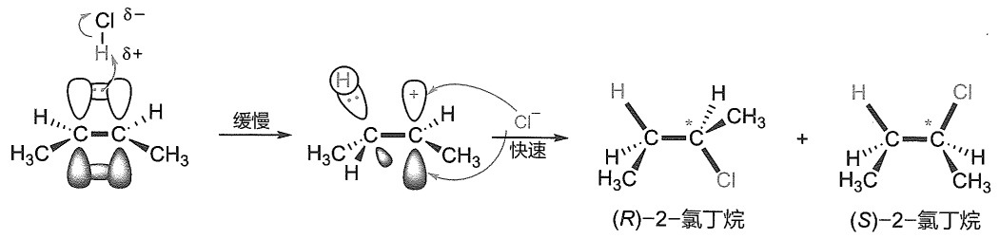

chemical

Reaction mechanism diagram showing chlorination and cyclization of alkyne to form (R)-2-chloro-2-methylbutane and (S)-2-chloro-2-methylbutane

图 5-7 丁-2-烯与 HCl 加成形成外消旋产物过程

环己烯衍生物的加成反应一般得到反式为主的产物。因为碳正离子相邻的 C-H 往往处在 a 键上（有利于  $\sigma-p$  超共轭稳定碳正离子），将对卤负离子进攻碳正离子产生位阻影响，从而使得卤负离子更多地从 a 键氢的相反的方向进攻，得到反式为主的产物。此外，a 键反式加成的过渡态中  $\sigma(\mathrm{C}-\mathrm{H})\rightarrow\sigma^{*}(\mathrm{C}-\mathrm{Br})$  超共轭的稳定作用也使其动力学优先。

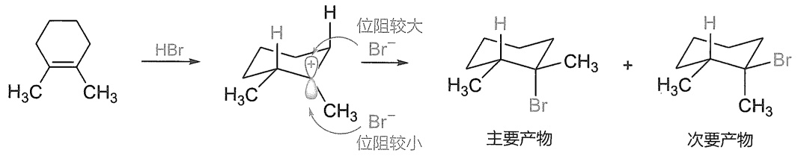

chemical

Chemical reaction pathway showing bromination of a cyclohexane derivative with HBr, followed by reduction to bromide and subsequent product formation

## 5.3.5 烯烃与水和醇的亲电加成

与卤化氢不同，水和醇的酸性较弱，难以解离出质子，因此与烯烃的第一步加成反应需要较高的活化能，常规条件下难以发生。一般烯烃与水或醇的亲电加成反应需要强酸催化，强酸与水分子反应形成水合质子，如5.3.2小节所述，溶剂条件下烯烃很容易和水合质子发生亲电加成反应，形成碳正离子，进而水分子作为亲核试剂与碳正离子反应，得到加成产物。硫酸是常用的酸催化剂之一。因为硫酸的共轭碱 $\mathrm{HSO_4^-}$ 是一种亲核性比水或醇更弱的亲核试剂，不会影响水或醇与碳正离子的结合。相比而言，由于卤素负离子的亲核性与水相当，若使用氢卤酸（HX）作催化剂，卤负离子会参与反应竞争，产物将是卤代烃与醇的混合物。

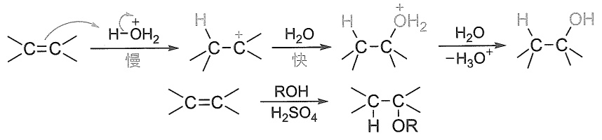

chemical

Reaction pathway of aldehyde showing slow and fast oxidation to form aldehyde with OR group, followed by ROH/H2SO4 formation

较高浓度的硫酸在低温下还能直接与烯烃发生加成反应，得到硫酸氢酯，硫酸氢酯在加水稀释和加热的条件下可以水解得到醇，这是烯烃的间接水合法。

$$
\mathrm{C} = \mathrm{C} <   + \mathrm{H} _ {2} \mathrm{SO} _ {4} \xrightarrow {0 ^ {\circ} \mathrm{C}} \mathrm{C} - \mathrm{C} <   \mathrm{H} \quad \mathrm{OSO} _ {2} \mathrm{OH} \xrightarrow [ \Delta ]{\mathrm{H} _ {2} \mathrm{O}} \mathrm{C} - \mathrm{C} <   \mathrm{H} \quad \mathrm{OH}
$$

烯烃与水或醇加成反应的机理、区域选择性及立体化学特征类似于烯烃与HX的加成反应。由于反应经过碳正离子，如果在反应中形成新的手性碳原子，则将得到一对对映异构体。例如，苯乙烯与水反应得到外消旋的1-苯基乙-1-醇。

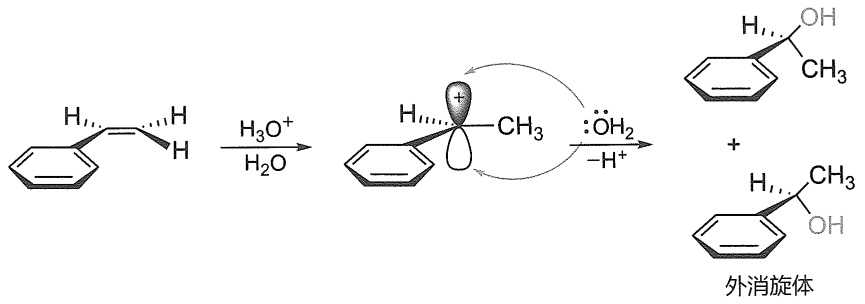

chemical

Reaction mechanism of ethyl alcohol showing oxidation, hydrolysis, and dehydration steps

## 5.3.6 共轭烯烃的1,2-和1,4-加成

二烯烃中，孤立二烯烃的性质与烯烃没有明显差异，上述有关烯烃的反应及其特点同样适合于孤立二烯烃。共轭二烯烃的双键之间存在共轭作用，因此，在亲电加成反应中表现出特殊的性质。当共轭二烯烃与一分子亲电试剂反应时，往往可以得到两种加成产物。如丁-1,3-二烯与一分子溴化氢反应可以得到3-溴丁-1-烯或1-溴丁-2-烯。

$$
\mathrm{CH} _ {2} = \mathrm{CH} - \mathrm{CH} = \mathrm{CH} _ {2} \xrightarrow [ 1 \text {equiv.} ]{\mathrm{HBr}} \begin{array}{c} \mathrm{H} \\ \mathrm{CH} _ {2} - \mathrm{CH} - \mathrm{CH} = \mathrm{CH} _ {2} \\ 1, 2 - \text {加成产物} \end{array} + \begin{array}{c} \mathrm{H} \\ \mathrm{CH} _ {2} - \mathrm{CH} = \mathrm{CH} - \mathrm{CH} _ {2} \\ 1, 4 - \text {加成产物} \end{array}
$$

以上两种加成产物分别称为 1,2-加成产物（1,2-addition product，也称为直接加成产物）和

1,4-加成产物（1,4-addition product，也称为共轭加成产物）。注意，1,2-加成产物和1,4-加成产物指的是共轭二烯烃的四个 $\mathrm{sp}^2$ 碳的编号，而不是整个分子的碳链编号。

烯烃与溴化氢加成中，第一步是形成碳正离子。共轭二烯烃所形成的碳正离子是烯丙型碳正离子。在这个离子中，碳正离子与相邻的双键共轭。从共振结构可以看出，第二步碳正离子与溴负离子结合的位置有两个，因此有可能形成1,2-加成和1,4-加成两种产物。

丁-1,3-二烯质子化形成的碳正离子有两个极限共振式，二者对体系能量的贡献是不同的。因为一个是 $2^{\circ}$ 烯丙型碳正离子，一个是 $1^{\circ}$ 烯丙型碳正离子，显然前者较稳定。因此，生成1,2-加成产物的速率较快，是动力学控制（kinetic control），相应的产物为动力学产物（kinetic product）。当反应温度较低时，反应不可逆进行，则动力学产物为主要产物。

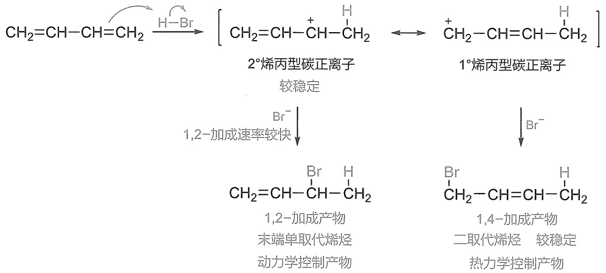

flowchart

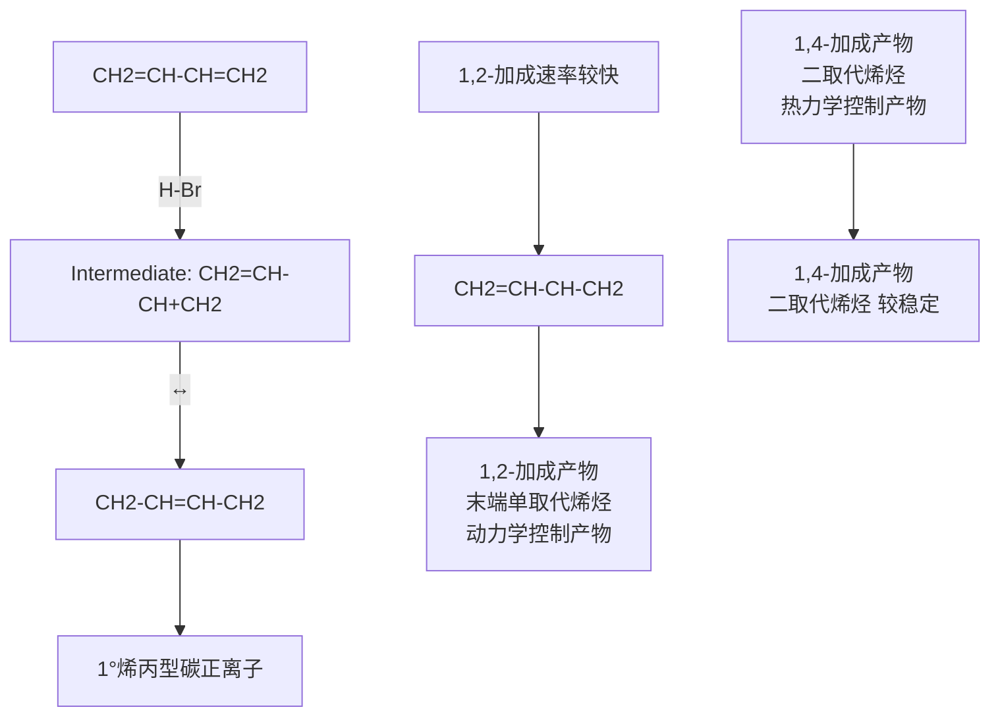

此外，比较两种产物的结构可以发现，丁-1,3-二烯的1,2-加成产物是单取代烯烃，而1,4-加成产物是二取代烯烃。根据烯烃的稳定性顺序可知，1,4-加成产物更稳定，即能量更低。在反应温度较高的情况下，反应的主要产物将是能量较低的稳定产物，即反应为热力学控制（thermodynamic control），相应的产物为热力学产物（thermodynamic product）。

从丁-1,3-二烯的1,2-加成和1,4-加成反应势能曲线图（图5-8）可以清楚地看出动力学控制和热力学控制的区别。

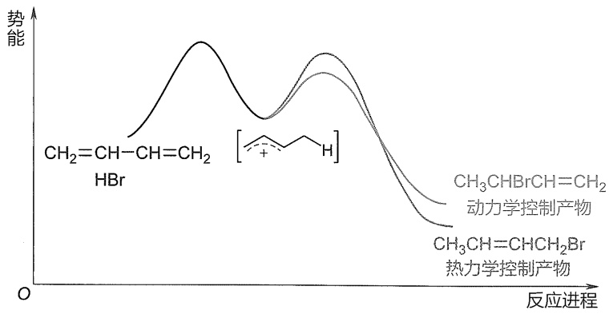

line

| 反应进程 | 动力学控制产物 (势能) | 热力学控制产物 (势能) |
| --- | --- | --- |
| 初始阶段 | ~高值 | ~中值 |
| 中间阶段 | ~低值 | ~高值 |
| 结束阶段 | ~低值 | ~低值 |

图5-8 动力学控制与热力学控制的反应势能曲线图

需要注意的是，反应一般只有存在可逆的情况下才可能产生热力学控制。当反应不可逆进行时，反应由动力学控制。这种关系可以由图 5-9 表示。

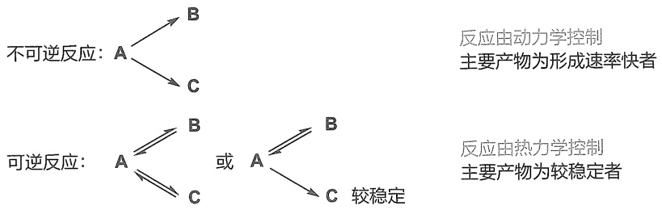

flowchart

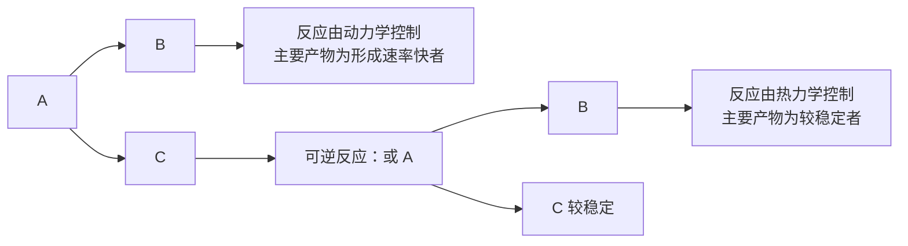

图 5-9 热力学控制和动力学控制图解

除了可逆的情况外，如果动力学产物 B 可以通过其他路径转化成热力学产物 C，也可以得到热力学控制的产物。

有些反应在较温和的条件下是不可逆的，而在较激烈的条件下是可逆的。对于这样的反应通常有一个温度转化点，低于这个温度是不可逆的，而高于这个温度反应就成为可逆反应。这个温度点随反应的不同而不同。例如，45℃时丁-1,3-二烯与氯化氢加成反应以动力学因素控制为主，但是丁-1,3-二烯与溴化氢反应已经属于热力学控制。这是因为C-Cl键键能高于C-Br键键能，要使反应可逆则需要更高的能量，即需要更高的反应温度。

实际上，并非所有共轭二烯烃的1,2-加成产物都是动力学控制，或1,4-加成产物都是热力学控制的。究竟哪种产物是动力学控制，哪种产物是热力学控制，主要取决于共轭二烯烃的结构。如4-甲基戊-1,3-二烯与溴化氢反应的1,2-加成产物为热力学产物，而1,4-加成产物为动力学产物。

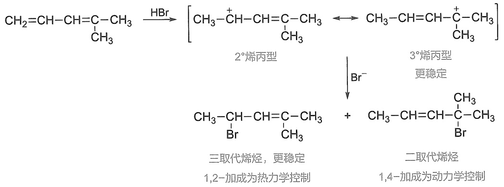

flowchart

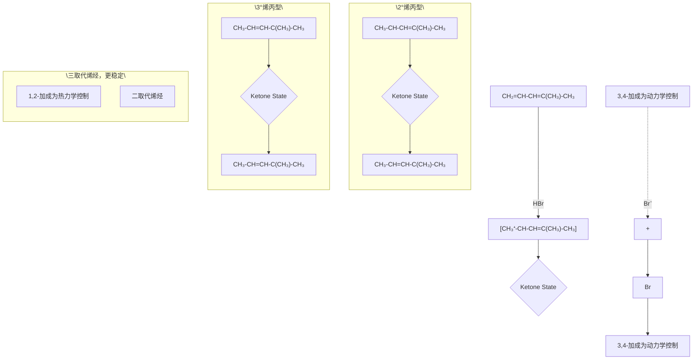

又如，己-2,4-二烯与氯化氢的加成反应，1,2-加成和1,4-加成产物稳定性基本相同，而且活泼中间体碳正离子的两个极限共振式能量也相等，所以无论反应条件怎样改变，都得到等量的两种加成产物。

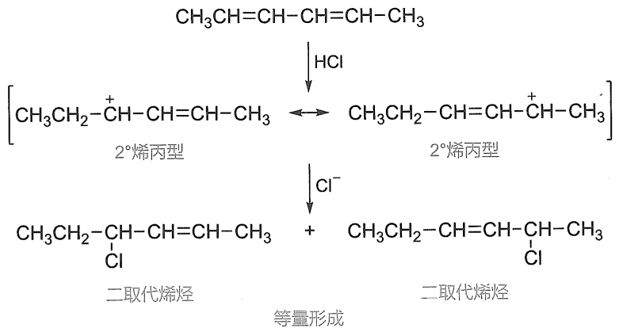

chemical

Chemical reaction equation showing the formation of two取代烯烃 from 2° diene and chloroform under HCl and chloride conditions

即使单体完全相同，聚合物也会因为分子量的不同，以及分子链的缠绕、堆叠等模式的不同，而在宏观性质上表现出很大的差异。相关知识也形成了一门新的学科:高分子化学。

高分子化合物的性质

## 5.3.7 烯烃的正离子聚合反应

在酸性反应体系中，如果亲核物种的亲核性很弱，无法及时与碳正离子偶联，而体系中又存在高浓度的烯烃原料，碳正离子会与烯烃发生亲电加成反应，进而引发烯烃聚合反应。在该反应中，酸催化剂的共轭碱作为一种亲核物种，会和碳正离子反应从而使聚合反应终止，因此需要使用足够强的酸，其共轭碱的碱性与亲核性足够弱（比烯烃弱），才能使碳正离子倾向于与烯烃继续发生聚合反应。此外，反应体系也需要足够干净，以免含有亲核性的杂质与碳正离子反应而使聚合反应终止。以聚丙烯为例，质子酸或Lewis酸会与烯烃发生亲电加成反应形成碳正离子，进而继续与烯烃加成，形成更长碳链的碳正离子。每一步反应的区域选择性都符合马氏规则，碳正离子会与丙烯的端位碳相连，形成更稳定的2°碳正离子。立体选择性上，聚烯烃主链上会形成不同立体取向的甲基取代，在高分子化学中这些立体构型的分布情况被称作“等规度”。不同等规度的聚丙烯在宏观性质有很大差异。

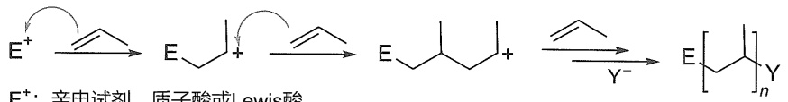

chemical

Reaction mechanism diagram showing protonation and deprotonation steps of a polymer with E⁺, acetylamine, and Lewis acid

$E^{+}$ :亲电试剂，质子酸或Lewis酸

## 5.4 烯烃的自由基加成反应

与烯烃的亲电加成反应类似，当自由基物种靠近烯烃时，容易与其中一个双键碳以  $\sigma$  键相连，同时在另一个双键碳上形成碳自由基，然后该碳自由基会通过攫氢或自由基偶联等方式形成另一个  $\sigma$  键。这是烯烃发生自由基加成反应的基本模式。

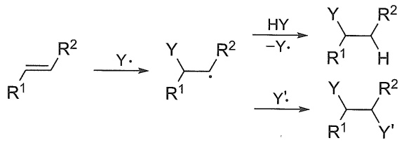

chemical

Reaction mechanism showing transformation of alkyne R¹–R² to alkyne R¹–R² via intermediates Y· and Y′, with HY and -Y· modifications indicated

人们在研究烯烃与溴化氢加成反应时，发现在过氧化物存在下，反应能够得到反马氏规则的加成产物。如:

$$
\begin{array}{c} \mathrm{H} _ {3} \mathrm{C} \\ \mathrm{H} _ {3} \mathrm{C} \end{array} \stackrel {{\mathrm{C}}} {{=}} \mathrm{CH} _ {2} \xrightarrow [ \text {ROOR} ]{\mathrm{HBr}} \begin{array}{c} \mathrm{H} _ {3} \mathrm{C} \\ \mathrm{H} _ {3} \mathrm{C} \end{array} \stackrel {{\mathrm{C}}} {{-}} \mathrm{CH} _ {2}
$$

过氧化物能诱导 HBr 产生溴自由基，进而使反应以自由基加成，而不是亲电加成的模式进行，从而产生了与常规亲电加成不一样的区域选择性结果。该反应机理如下所示，过氧化物在光照或加热条件下容易产生烷氧基自由基，烷氧基自由基从体系中的溴化氢夺氢，生成醇（ROH），同时产生了溴自由基。溴自由基对烯烃进行加成形成碳自由基，碳自由基又从溴化氢中夺取氢原子而回馈体系一个溴自由基，如此使自由基的链增长反应不断进行，直到反应结束。

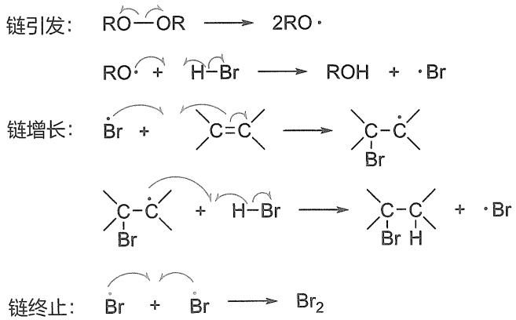

flowchart

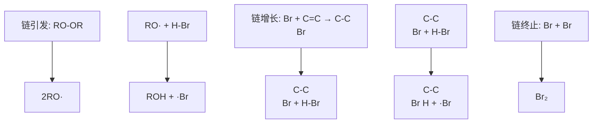

在上述反应中，活性中间体碳自由基的形成是决定反应活性的关键步骤。由于自由基的稳定性顺序是 $3^{\circ} > 2^{\circ} > 1^{\circ}$，因此溴优先加在含氢较多的双键碳原子上，从而得到反马氏规则的加成产物。碳自由基的稳定性与碳正离子的稳定性顺序是类似的，但由于亲电加成是质子先与烯烃作用，而自由基加成则是溴自由基先与烯烃作用，H和Br加成的顺序正好相反，导致两者产生相反的区域选择性。

烯烃自由基加成的立体化学则由双键和碳自由基的平面结构所决定，加成试剂可以从平面的两面进攻，因此当反应中只形成一个新的手性碳原子时，将得到一对对映异构体（即外消旋体）。

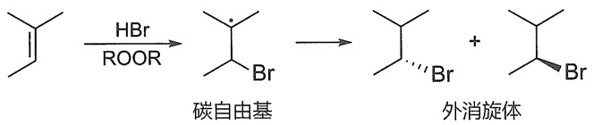

chemical

Chemical reaction equation showing carbon自由基 formation and its deprotonation into an external bromide

如果反应形成两个手性碳，则可能按照顺式（syn）和反式（anti）两种加成方式进行反应，分别得到两对对映异构体。例如:

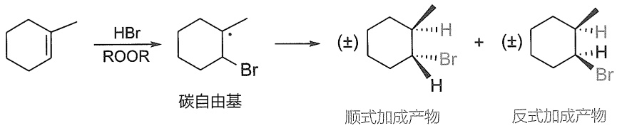

chemical

Reaction pathway showing carbon自由基 formation and its conversion to cyclohexane and cyclohexane products

烯烃与溴化氢的亲电加成和自由基加成的区域选择性不同，为合成提供了两种选择。另外，并不是所有卤素都能发生该类反应，从反应机理来看，该反应引发的关键是烷氧自由基攫取卤化氢中的氢形成卤素自由基，这一步既涉及氢卤键的断裂，又可以看成负一价的卤素被氧化成零价的过程，因此受到氢卤键强度和卤素氧化还原能力的影响，例如烯烃与氯化氢在过氧化物的存在下一般就不能发生自由基加成。

如果体系中没有 HBr 等氢供体或自由基猝灭剂，且烯烃的浓度较大，自由基引发剂也能直接与烯烃发生自由基加成反应，形成碳自由基会继续与体系中的烯烃原料反应，最终得到烯烃聚合的产物。自由基聚合与碳正离子聚合是两种常见的合成聚烯烃的反应策略。

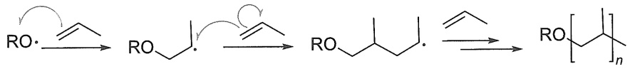

chemical

Chemical reaction sequence showing RO-CH2 conversion to a cyclic aldehyde intermediate

需要自由基引发剂形成RO·

利用自由基加成反应能实现丰富多样的烯烃的官能团化或双官能团化。在基础有机化学课程中仅以自由基氢溴化为例介绍。

烯烃自由基加成

符号（±）表示一对对映异构体。也可将楔形式换成等宽的粗线与虚线来表示相对构型。由于Br与碳自由基也有一定的邻基参与作用，产物往往以反式加成产物为主。

## 5.5 烯烃亲电加成反应中邻基参与效应的影响——1,2-迁移与环镝离子

## 5.5.1 碳正离子重排与邻基参与效应

烯烃的亲电加成反应经过碳正离子中间体，因此也可能发生类似于 $S_{N}1$ 和E1反应中的分子重排反应。如3,3-二甲基丁-1-烯与氯化氢反应中，甲基迁移的重排产物是主要产物，而3-甲基丁-1-烯与氯化氢的反应主要得到负氢迁移的重排产物。前者发生甲基迁移及后者发生负氢迁移都将得到更加稳定的碳正离子，这正是重排反应发生的动力所在。

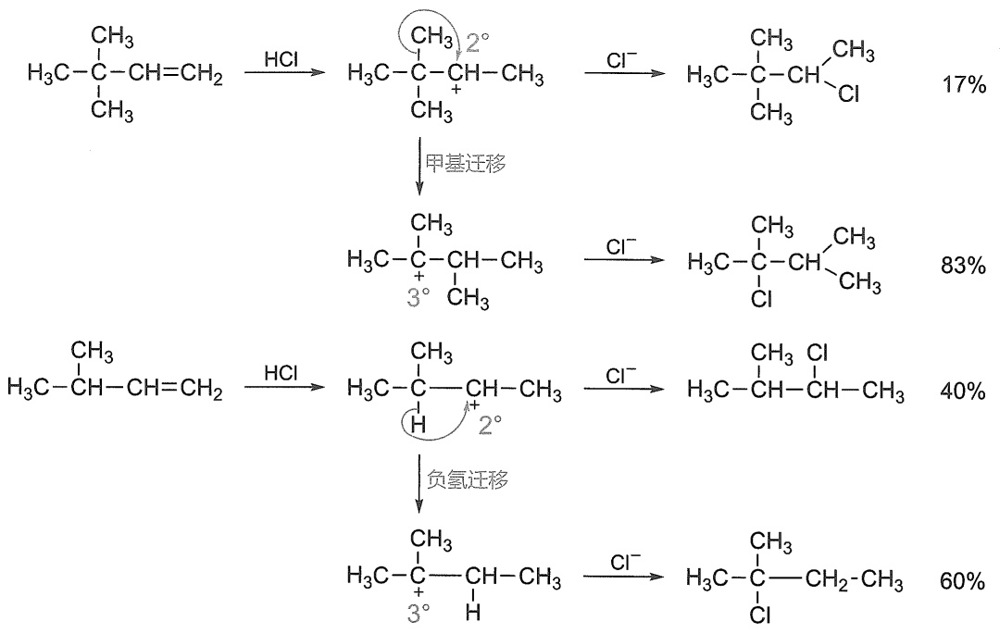

flowchart

碳正离子作为缺电子的高活性物种，容易吸引周围环境中的富电子物种，使自身得到稳定。分子中不与碳正离子直接相连的富电子基团，虽然无法直接通过给电子的诱导效应或共轭效应使碳正离子稳定，但可以通过邻基参与作用（见第四章）使碳正离子稳定。碳正离子重排反应可以看作 C-H 键或 C-C 键的  $\sigma$  键成键电子对受到碳正离子的吸引，产生邻基参与作用的结果。

经邻基参与作用发生的重排与 C-Cl 键的形成是一对竞争反应。邻基参与作用是分子内反应，比分子间反应更有优势，然而，氯负离子比发生重排的氢或甲基更富电子，与碳正离子结合的活性更高。因此，上述例子中，可以同时得到重排和未重排两种产物。

可以预见，使用比氯负离子亲核性更弱的亲核试剂时，能得到更大比例的重排产物。此外，受该竞争的影响，在常规反应中，碳正离子重排反应往往只发生一次，新的碳正离子就会与亲核试剂结合得到最终产物。

由于碳正离子寿命短，很难观测表征，人们对碳正离子的认识在很长时间里只是停留在纯粹的理论推测阶段，$\sigma$ 键邻基参与作用形成的非经典碳正离子（图5-10）在提出之初一直未能被主流化学所接受。直至美籍匈牙利化学家Olah在进行超强酸研究时，发现碳正离子可以在超强酸溶液中稳定存在，并可以通过核磁共振谱等手段进行表征，从而证实了非经典碳正离子的存在。Olah因对碳正离子研究的贡献获得了1994年的诺贝尔化学奖。超强酸的

2013 年，Scholz 课题组得到了非经典碳正离子化合物的晶体，并利用单晶 X 射线衍射最终证实了其结构。

非经典碳正离子单晶结构

共轭碱是亲核性非常弱的物种，因此碳正离子在超强酸溶液中几乎不会受到与亲核试剂偶联的竞争反应影响，可以发生多次邻基参与作用与重排，直至其最稳定的状态。

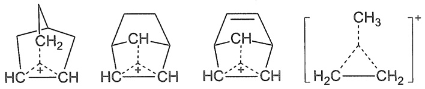

chemical

Three organic molecular structures with labeled CH groups and stereochemistry indicators

图 5-10 非经典碳正离子

当分子中的合适位置存在具有孤对电子的基团时，碳正离子会通过静电吸引作用与之相连，形成镝离子，亲核试剂对镝离子开环反应，得到最终的加成产物。根据环系的稳定性，容易发生邻基参与作用的模式是形成三元环，五元环或六元环镝离子中间体。

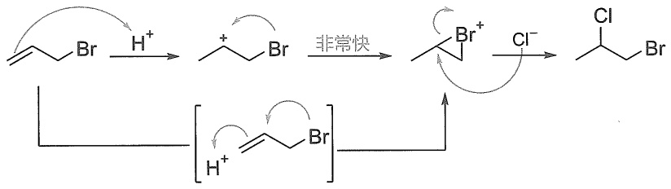

flowchart

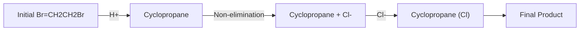

## 5.5.2 烯烃与卤素或次卤酸的亲电加成反应

卤素和次卤酸是另一类可以与烯烃发生加成反应的亲电试剂。其中次卤酸（XOH）是卤素溶解在水中形成的，因此，反应条件也经常表示为卤素加水 $\left(\mathrm{X}_{2}+\mathrm{H}_{2}\mathrm{O}\right)$ 。通常，容易与烯烃发生亲电加成的卤素主要有溴和氯；碘不够活泼，较难与烯烃加成；而氟则太活泼，不仅发生加成，还会与C-H键发生取代反应，形成复杂的混合物。相应地，次卤酸在这里主要指次溴酸和次氯酸。

亲电试剂卤素和次卤酸与烯烃反应分别形成邻二卤代烃和邻卤代醇。

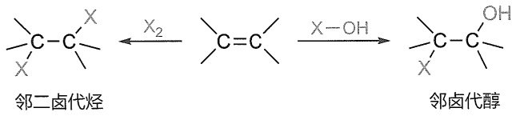

chemical

Chemical reaction diagram showing conversion of alkene dihydroxide to alkene diol using ethylene oxide

## 1. 烯烃与卤素加成的实验事实

在研究烯烃与卤素的反应时发现,在不同的介质中烯烃与溴反应得到不同的产物。例如:

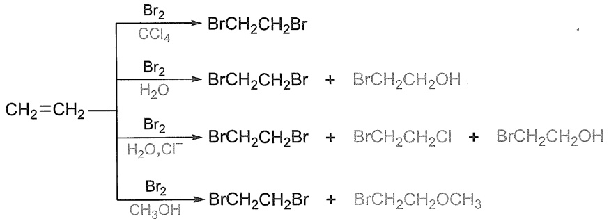

chemical

Chemical reaction equation showing bromination of alkyne to form various brominated alcohols and chloroalkanes

以上反应的每个产物都至少含有一个溴，而另一个取代基则随反应介质中存在的亲核试剂不同而不同。这一实验事实说明该反应是分步进行的。烯烃的碳原子可能先结合一个溴（根据电性分析，应该是溴正离子），然后结合体系中的亲核试剂形成加成产物。在不同的溶剂及体系中，存在着不同的亲核试剂，因此分别得到不同的产物。

不同的烯烃与溴加成的反应速率不同，以下列出了一组烯烃与溴加成的相对反应速率:

| 乙烯 | 丙烯 | 苯乙烯 | 异丁烯 | 2,3-二甲基丁-2-烯 | 溴乙烯 |
| --- | --- | --- | --- | --- | --- |
| 1 | 2 | 3.4 | 10.4 | 14 | &lt; 0.04 |

以上数据显示:双键碳上连接的烷基或苯基越多，则烯烃发生加成反应的速率越快。可见，该反应属于亲电加成反应。因为烷基和苯基均是给电子基团，随着烷基和苯基的增多，其给电子作用增加了烯烃 $\pi$ 键电子密度，亲核性能增强，反应活性增大。当双键碳上连有溴时，反应速率减慢。这是因为溴原子电负性较大，对双键碳具有吸电子诱导效应，虽然溴原子同时对双键具有给电子的共轭效应，但前者占优势，因此总体表现为吸电子效应。这种吸电子作用降低了 $\pi$ 键电子密度，使反应速率降低。

烯烃与溴反应，往往得到反式加成（anti-addition）产物。如环戊烯与溴加成只得到反-1,2-二溴环戊烷的一对对映异构体，而没有发现顺-1,2-二溴环戊烷。这一实验事实难以用碳正离子机理加以解释。

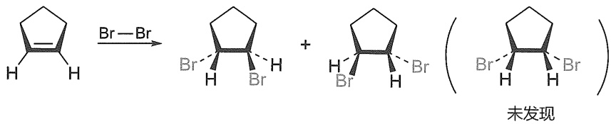

chemical

Chemical reaction equation showing bromination of a cyclohexane derivative with bromine, yielding a cyclohexane product and its unknown state.

## 2. 烯烃与卤素加成的反应机理

基于前述实验事实，1937年，Kimball和Koberts提出了三元环溴镝离子为反应活泼中间体的反应机理。烯烃与溴正离子作用后会形成碳正离子，与5.5.1小节提到的邻基参与效应类似，带有孤对电子的溴很快会经过正负电荷静电作用与碳正离子靠近，形成环溴镝离子，由于成环反应速率比C-Cσ键旋转速率更快，烯烃与溴正离子形成环溴镝离子可以认为是协同过程。

形成环溴鎓离子中间体后，亲核试剂溴负离子或氯负离子，水或醇等均只能从溴鎓离子的背面进攻（类似于 $S_{N}2$ 反应，从C-Br键的背面C-Br $\sigma^{*}$ 反键轨道的位置进攻，得到构型翻转的产物），反应得到高选择性的反式加成产物。

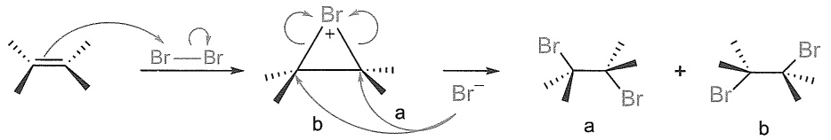

chemical

Chemical reaction mechanism showing bromination and deprotection steps with labeled intermediates a and b

环溴鎓离子

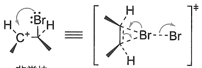

chemical

Chemical reaction equation showing bromination of a bromo-substituted alkene with a cyclopentadienyl group

非常快

该反应机理对以上反应事实都能给出好的说明，现在已经被广泛接受。

与非经典碳正离子的争论类似，在环溴鎓离子提出很多年后，Olah利用超强酸对正离子的稳定作用，制备了能稳定存在的环溴鎓离子二氧化硫溶液，为环溴鎓离子的存在提供了有力的实验证据。

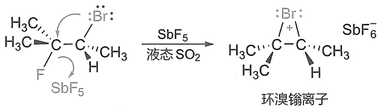

chemical

Reaction mechanism of ethylene sulfide ion showing bromination and sulfonation steps

cis-丁-2-烯与溴的加成反应生成一对等量的对映体，而 trans-丁-2-烯与溴的加成反应则生成了内消旋体，这些实验事实也为环溴镝离子的机理提供了证据。

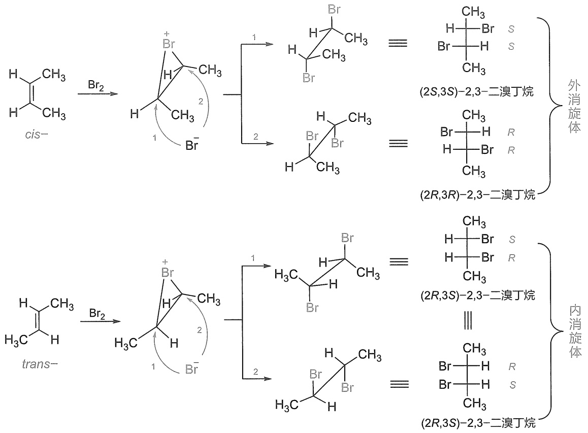

氯与烯烃在非极性溶剂中加成的立体选择性不高，例如，1-苯丙烯与氯加成得到68%的顺式加成（syn-addition）产物和32%的反式加成（anti-addition）产物。

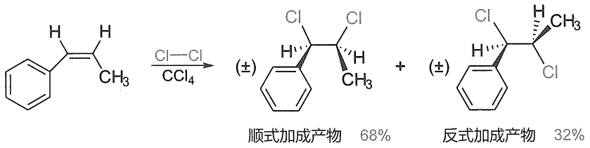

chemical

Chemical reaction equation showing chlorination of toluene with CCl4, followed by addition of 68% and 32% to form cyclohexyl alcohols

这可能是由于氯原子的电负性比溴的电负性大，且原子半径又比溴的小，相应的环氯镝离子的稳定性不及环溴镝离子，当底物如1-苯丙烯可以形成较稳定的碳正离子时，与氯的反应更倾向以碳正离子历程进行。此时，由于Cl-C1断裂后所形成的氯负离子与碳正离子形成离子对，使得反应主要以顺式加成的方式进行。

实际上，当形成的碳正离子比较稳定时，与溴的加成也未必完全按照溴鎓离子机理进行。例如，顺-1-苯丙烯加溴，生成83%的反式加成产物和17%的顺式加成产物，而反-1-苯丙烯加溴，生成73%的反式加成产物和27%的顺式加成产物。

在极性溶剂中，或在体系中加入 Lewis 碱添加剂，可以通过溶剂化作用或配位作用减弱氯鎓离子的缺电子性使其变得更稳定，从而使反应更倾向于以氯鎓离子的历程进行，得到高选择性的反式加成产物。

Lewis 碱促进的
烯烃亲电加成

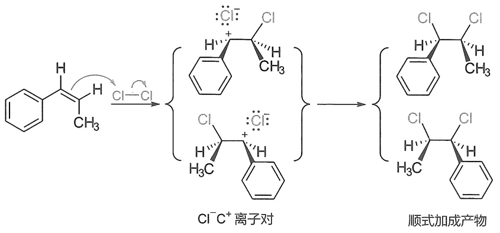

chemical

Chemical reaction diagram showing chlorination of a benzene derivative with chloride counterion to form a triphenyl compound, then converted to a monomer

## 3. 烯烃与次卤酸加成的区域选择性

次卤酸 HOX（X = Cl, Br, I）具有一个卤素与羟基相连的结构 X-OH，由于氯、溴和碘的电负性比氧的电负性小，X-O 键中的卤素原子带部分正电荷。与上述烯烃与卤素的反应类似，烯烃与次卤酸加成同样是以亲电反应的模式分步进行的，第一步形成的碳正离子同样可能受相邻卤素基团的邻基参与效应影响，形成三元环卤鎓离子，进而具有反式加成的立体选择性特征。

与卤素加成略有不同的是，由于加成的两个基团不同，反应会存在区域选择性问题。正如前面5.3.2小节所述，烯烃的亲电加成反应中，亲电试剂与烯烃的结合倾向于形成更稳定的碳正离子，因此在烯烃与次卤酸的加成中，羟基总是倾向于与能形成更稳定碳正离子的碳原子相连（符合马氏规则）。这种理论推测也得到了实验结果的广泛验证。如1-甲基环己烯与次氯酸的反应中，带正电荷的氯原子加成到双键上，有两种加成方向，一种是加成到含氢较多的双键碳原子上，形成 $3^{\circ}$ 碳正离子，另一种是加成到含氢较少的双键碳原子上，形成$2^{\circ}$ 碳正离子。由于 $3^{\circ}$ 碳正离子比 $2^{\circ}$ 碳正离子稳定，卤素加成到含氢较多的双键碳原子上产物为主要产物。

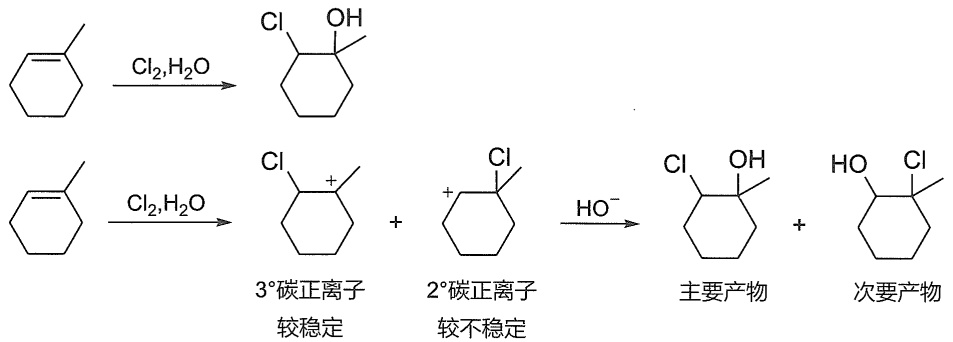

flowchart

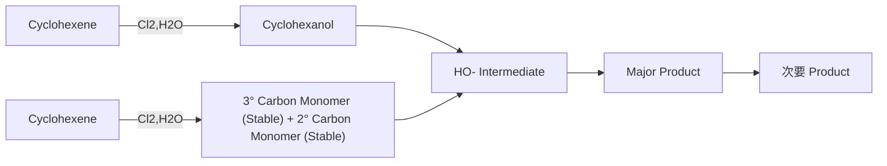

有趣的是，经历环卤镝离子机理反应的区域选择性同样符合马氏规则。这是因为三元环卤镝离子的两个碳卤键并不是等同的。能形成更稳定碳正离子的碳，其碳卤键键能更低，更容易断裂，因此在亲核试剂对环镝离子加成开环时优先被进攻。

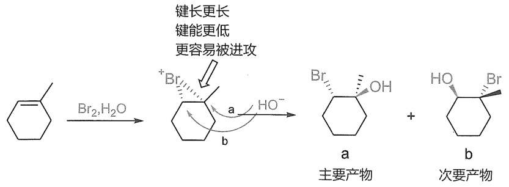

chemical

Chemical reaction pathway showing bromination and hydrolysis of cyclohexene to form secondary products, with labeled steps a and b

## 4. 环己烯类化合物与溴的加成反应

环己烯类化合物（其较稳定构象为半椅式，详见第二章立体化学）与溴的加成同样经历环溴镝离子，生成反式加成产物。此外，受到环系的立体结构限制，环己烯类化合物与溴的加成还具有一些开链烯烃加成不同的立体选择性规律。

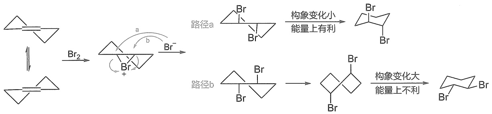

flowchart

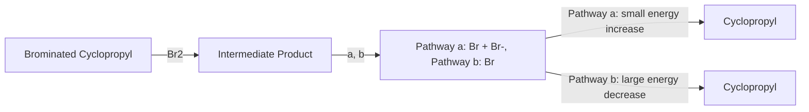

环己烯的较稳定构象为半椅式构象，当与溴发生加成反应时，首先形成环溴镝离子，然后是溴负离子从环溴镝离子的背面进攻，得到反式共平面的双溴取代产物，同时环系朝着更稳定的椅式构象转化。与一般开链烯烃加成反应不同，此反应中影响立体选择性的主要因素是反应过程中构象变化的能量。路径a构象变化小，能量上更有利。路径b需要作较大的构象改变，能量上不利。这种规律在反应机理研究中被称作“构象最小改变原则”，常用于分析环系的立体选择性特点。

如果是特定构型的取代环己烯与溴加成，结果将生成不等量的非对映异构加成产物。如 $(S)$ -4-甲基环己烯与溴加成主要得到 $(1R,2R,4S)-1,2-$ 二溴-4-甲基环己烷， $(1S,2S,4S)-1,2-$ 二溴-4-甲基环己烷是次要产物；而 $(R)$ -4-甲基环己烯与溴加成主要得到 $(1S,2S,4R)-1,2-$ 二溴-4-甲基环己烷， $(1R,2R,4R)-1,2-$ 二溴-4-甲基环己烷是次要产物。

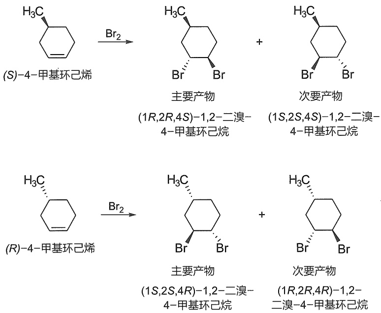

构象最小改变原则

以 $(R)$ -4-甲基环己烯为例，其与溴进行加成反应的立体化学变化过程如下: