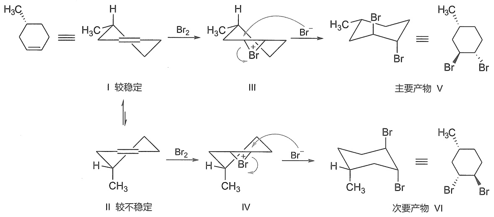

<details>
<summary>chemical</summary>

Reaction mechanism diagram showing cyclohexene derivatives with bromination and bromination steps, including intermediates I–VI
</details>

(R)-4-甲基环己烯的两个半椅式构象能量不同，其中甲基在 $e$ 键的半椅式构象I能量较低，是较稳定构象。I经过环溴镝离子Ⅲ得到双直立键反式加成的主要产物(1S,2S,4R)-1,2-二溴-4-甲基环己烷V。甲基在 $a$ 键的较不稳定构象II经过环溴镝离子IV将得到双直立键反式加成的次要产物(1R,2R,4R)-1,2-二溴-4-甲基环己烷VI。这种由于反应物具有特定的构型，反应物中原有的手性中心使得反应中经过的两种活性中间体具有不同的能量，从而得到不等量的非对映异构体的现象在有机反应中是普遍存在的，称为手性诱导合成。

## 5.5.3 烯烃的羟汞化-脱汞反应

烯烃的羟汞化-脱汞反应如下式所示:

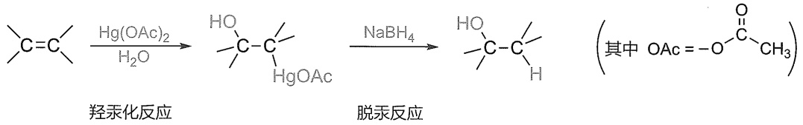

<details>
<summary>chemical</summary>

Chemical reaction pathway showing acetylation and deprotonation steps of a cyclic alkene
</details>

与烯烃与溴正离子形成环溴鎓离子类似，可以预见，其他带有孤对电子的正离子物种与烯烃发生亲电加成反应时也可能通过类似的作用形成环鎓离子，烯烃与汞正离子作用形成汞鎓离子就是其中的经典例子。

醋酸汞在溶液中可分解形成  ${}^{+}$ Hg(OAc)，在上述第一步的羟汞化反应中，是由  ${}^{+}$ Hg(OAc) 作为 Lewis 酸加成到烯烃碳碳双键上形成一个类似于环溴鎓离子的三元环汞鎓离子（mercuronium ion bridge），然后，亲核试剂水从环汞鎓离子的背面进攻含氢较少的碳生成符合马氏规则的羟汞加成产物。

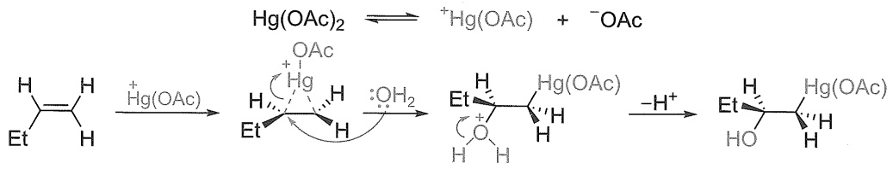

<details>
<summary>chemical</summary>

Reaction mechanism showing hydrogenation and dehydration steps of a cyclic compound with Hg(OAc)2 and OAc groups
</details>

得到的羟汞化产物在硼氢化钠（$\mathrm{NaBH}_4$）作用下去汞得到醇。

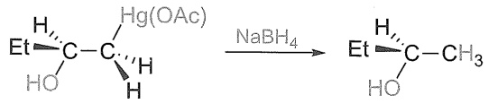

<details>
<summary>chemical</summary>

Chemical reaction showing hydrogenation of ethyl acetate to form ethyl acetone under sodium borane gas
</details>

由于亲电试剂  ${}^{+}$ Hg(OAc) 可以从双键平面的上下两方进行加成，因此，实际得到的加成产物是一对对映异构体。如上例完整的反应式如下所示:

$$
\begin{array}{c} \mathrm{H} \\ \mathrm{Et} ^ {\prime} \end{array} \mathrm{C} = \mathrm{C} ^ {\prime} \xrightarrow [ (2) \mathrm{NaBH} _ {4} ]{\text {(1)} \mathrm{Hg(OAc)} _ {2}} \quad \begin{array}{c} \mathrm{H} \\ \mathrm{Et} ^ {\prime} \xrightarrow [ \mathrm{HO} ]{\text {H}} \mathrm{C} - \mathrm{CH} _ {3} + \mathrm{H} _ {3} \mathrm{C} - \mathrm{C} ^ {\prime} \xrightarrow [ \mathrm{OH} ]{\text {H}} \mathrm{Et} \end{array}
$$

烯烃通过羟汞化-脱汞反应可以得到与酸催化反应的区域选择性相同的醇。但是反应中没有碳正离子的形成，因此避免了重排副反应的发生。如3,3-二甲基丁-1-烯直接酸催化加水只能得到2,3-二甲基丁-2-醇，得不到预期的3,3-二甲基丁-2-醇，但改用羟汞化-脱汞方法就可以得到单一的3,3-二甲基丁-2-醇。

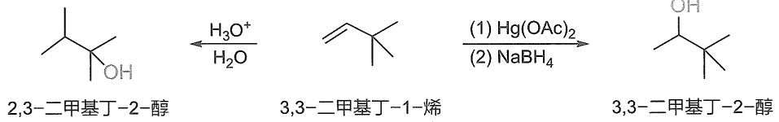

<details>
<summary>chemical</summary>

Chemical reaction pathway showing conversion of aldehyde to aldehyde and aldehyde using hydrogen peroxide and sodium borohydride
</details>

## 5.5.4 烯烃与卡宾的加成——环丙烷的合成

卡宾（carbene）是一种电中性的六电子活性中间体，其碳原子通常采取  $sp^{2}$  杂化。卡宾通常有两类结构，一种称为单线态卡宾，另一种称为三线态卡宾。

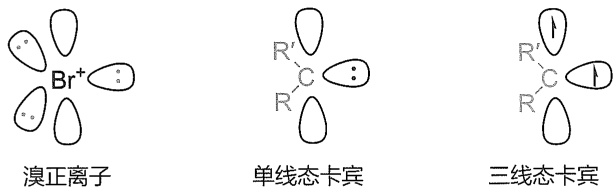

<details>
<summary>chemical</summary>

三种形态的化学结构式：溴正离子、单线态卡宾和三线态卡宾
</details>

单线态卡宾可以看成碳正离子与碳负离子在同一个碳上的特殊的双亲性的电中性结构。从结构上分析，我们不难看出卡宾与“溴正离子”类似，属于同时具有空轨道和孤对电子的物种，烯烃能通过亲电加成反应进攻其空轨道，形成电荷分离的1,3-偶极子，并非常快地完成正负离子偶联环化，形成环丙烷类产物。由于正负离子偶联速率比单键旋转速率要快得多，分子构象尚未发生任何改变，因此可以认为烯烃进攻卡宾的空轨道与环化反应是同时发生的，得到立体专一性的顺式加成产物。

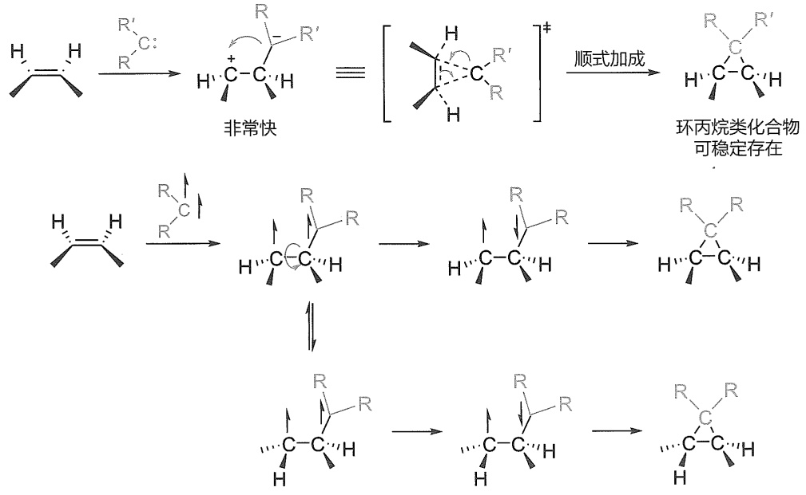

<details>
<summary>chemical</summary>

Reaction mechanism diagram showing cycloaddition and rearrangement of cyclohexane derivatives with R groups
</details>

碳-金属键的性质受不同金属元素影响其性质可能差异巨大，烷基锂、烷基格氏试剂等有机金属试剂中的C-Li键和C-Mg键很活泼，能与活泼氢剧烈反应，转化成C-H键，但C-Hg键却十分稳定，需要硼氢化钠还原才能转化成C-H键。参考文献:J. Am. Chem. Soc, 1966, 88, 993.

除了常规的单线态卡宾外，还有一种反电子态卡宾，其拥有一个空的  $sp^{2}$  杂化轨道和一对填在 p 轨道的孤对电子。


反电子态卡宾

三线态卡宾的结构在 p 轨道和  $sp^{2}$  杂化轨道中各有一个单电子，具有双自由基的结构特点。三线态卡宾也能与烯烃发生自由基加成反应，经过 1,3-双自由基中间体，再通过自由基偶联得到环丙烷类产物。由于两个自旋方向相同的单电子无法直接反应，需要转化为自旋相反的两个电子再反应，在偶联环化形成环丙烷的过程中，C-C 键可以有足够时间发生自由旋转，因此三线态卡宾与烯烃的环丙烷化反应的立体选择性往往较低。

多卤代烷在碱作用下发生 $\alpha$-消除是制备卡宾的主要方法。如氯仿在氢氧化钾或叔丁醇钾的作用下，首先脱去质子得到三氯甲基负离子（$\mathrm{CCl}_3$），该负离子不稳定，再脱去一个氯负离子就得到二氯卡宾（图5-11）。二卤卡宾一般为单线态结构，即中心碳原子采取 $\mathfrak{sp}^2$ 杂化，其中两个 $\mathfrak{sp}^2$ 杂化轨道与卤原子成键，一个被孤对电子占据，还有一个垂直于三个 $\mathfrak{sp}^2$ 杂化轨道的空 $\mathfrak{p}$ 轨道与相邻卤原子的 $\mathfrak{p}$ 轨道重叠。卤素具有吸电子诱导效应，可以稳定单线态卡宾中的 $\mathfrak{sp}^2$ 杂化轨道的孤对电子；更重要的是，卤素具有给电子共轭效应，能很好地稳定单线态卡宾的空 $\mathfrak{p}$ 轨道，这种双重的稳定作用使二氯卡宾具有较好的稳定性，能运用于有机反应之中。类似地，具有吸电子诱导效应和强给电子共轭效应的氮原子也能构成稳定的氮杂环卡宾结构。

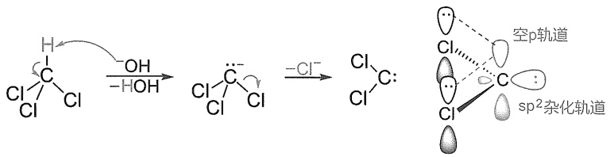

<details>
<summary>chemical</summary>

Chemical reaction mechanism showing hydrolysis of a chlorinated alkene with sp² radical and sp² hybridization
</details>

图 5-11 二氯卡宾的形成及结构

二卤卡宾与烯烃的加成是立体专一的顺式加成。例如:

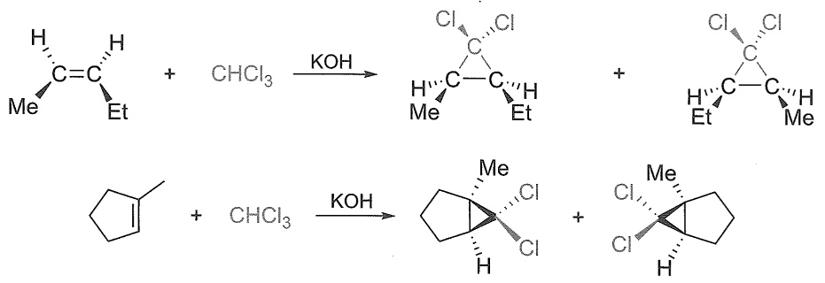

<details>
<summary>chemical</summary>

Chemical reaction scheme showing chlorination and deprotection steps of a cyclohexane derivative using CHCl3 catalyst
</details>

制备环丙烷的最常用方法之一是 Simmons-Smith 反应。这个反应中并不形成游离的卡宾（:CH₂），而是形成与卡宾类似的具有双亲性（既亲电又亲核）的类卡宾（carbenoid）物种。二碘甲烷在 Zn 作用下生成碘化碘甲基锌 I-CH₂-Zn-I，该有机金属物种既拥有一个亲电性的 C-I 键（C⁺I⁻），又拥有一个亲核性的 C-Zn 键（C⁻Zn⁺），是一个典型的类卡宾试剂，能与烯烃发生环丙烷化反应。由于卡宾结构的不稳定性，大部分卡宾都无法直接用于常规有机合成反应中，而许多构建三元环的反应，常利用双亲性的类卡宾试剂来完成。

$$
\mathrm{CH} _ {2} \mathrm{I} _ {2} + \mathrm{Zn(Cu)} \xrightarrow {\text {醚}} \boxed {\delta -} \mathrm{CH} _ {2} + \mathrm{Zn-I} \text {相当于} [: \mathrm{CH} _ {2} ]
$$

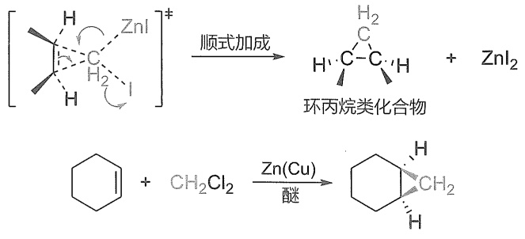

<details>
<summary>chemical</summary>

Chemical reaction equation showing zinc-catalyzed cyclization of a zwitterionic compound with ethylbenzene and chloroform, followed by Zn(Cu) catalysis to form a cyclohexylated alkane.
</details>

## 5.5.5 烯烃的环氧化反应

烯烃可以被过氧酸氧化成环氧化物，这是合成环氧化合物的重要方法之一。常用的过氧酸有间氯代过氧苯甲酸（m-chloroperoxybenzoic acid，缩写为 m-CPBA）。环氧化物还能通过亲核开环反应转化为多种官能团化合物。从过氧酸的结构分析，酰氧基可以作为带负电性离去基团，而羟基上的氢可以以质子的形式离去，因此过氧酸也可以看作一种氧宾的类似物，与类卡宾能与烯烃发生环丙烷化反应类似，过氧酸作为氧宾类似物能与烯烃发生环氧化反应，与环丙烷化反应类似，环氧化反应也是立体专一性的顺式加成。

$$
\mathrm{RCH} = \mathrm{CH} _ {2} + \boxed {\substack {\delta^ {-} \\ \mathrm{R} - \mathrm{C} - \mathrm{O}}} \mathrm{O} \begin{array}{c} \delta^ {+} \\ \mathrm{H} \end{array} \longrightarrow \boxed {\substack {\delta^ {-} \\ \mathrm{RCH} - \mathrm{CH} _ {2}}} + \boxed {\substack {\delta^ {-} \\ \mathrm{R} - \mathrm{C} - \mathrm{OH}}} \text {or} \text {and} \text {or}
$$

此外，过氧酸中的过氧键（O-O 键）比较容易断裂，与 Br-Br 键类似，烯烃的环氧化反应与烯烃与溴单质加成形成环状溴鎓离子的机理也有类似的地方（见 5.5.2 小节），也是一种立体专一性的顺式加成。

$$
\text {H} \xrightarrow {\text {O}} \left[ \begin{array}{c} \mathrm{O} \\ \mathrm{H} \end{array} \right] ^ {\ddagger} \xrightarrow {\text {顺式加成}} \text {H}
$$

由于反应属于亲电加成反应，双键上电子密度越高，环氧化速率就越快，因此，多取代烯烃的反应活性较高。如果一个分子中有多个双键，电子密度高的双键将优先进行环氧化反应。例如:

$$
\text {Cyclohexene} + \underset {\text {R-COOH}} {\overset {\text {O}} {\longrightarrow}} \xrightarrow {\text {1 equiv.}} \text {Cyclohexene} + \underset {\text {R-COOH}} {\overset {\text {O}} {\longrightarrow}}
$$

由于环氧化的顺式加成选择性，(Z)-戊-2-烯的生成 cis-环氧产物，而(E)-戊-2-烯生成 trans-环氧产物。

烯烃的环氧化反应是最早实现不对称催化的反应之一，早在20世纪80年代就被实现，其发明者Sharpless也因此获2001年诺贝尔化学奖。华人科学家史一安利用果糖衍生的催化剂也实现了一类更具普适性的利用无机过氧盐Oxone实现的不对称环氧化反应。


不对称环氧化

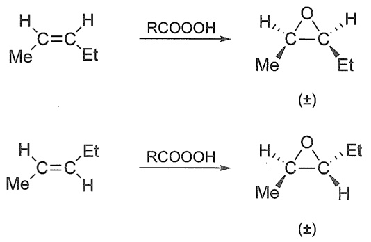

<details>
<summary>chemical</summary>

Two chemical reaction equations showing esterification using RCOOOH to form a cyclic ketone with (±) substituent
</details>

## 5.6 烯烃的协同加成反应

协同加成反应一般是指没有经历明显的中间体，只经过一个过渡态的反应过程。协同反应中，旧化学键的断裂和新化学键的生成几乎是同时发生的，因此往往具有较好的立体选择性。其实，分步反应与协同反应并没有那么泾渭分明。实际上，真正严格意义上的协同反应是极少的，只要分步反应的速率足够快，快到分子构象来不及改变就完成，就可以得到等同于协同反应的产物，一般就能认为反应是协同发生的。另外，分步反应中随着底物结构的改变与条件的改变，使中间体的稳定性降低到一定程度，也有可能使原来的分步反应向协同反应转变。上一章我们学习的E1反应与E2反应就有类似的情况。

前述 5.5 节中提到的碳正离子重排就可以被看成协同的过程, 迁移基团与烯烃的成键和连接亲电试剂的成键处于反式共平面, 属于典型的反式加成（类似于 5.6.6 小节中的  $Ad_{E}3$  历程）。

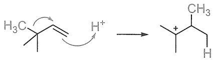

<details>
<summary>chemical</summary>

Chemical reaction diagram showing cycloaddition of a carbocation with protonated hydrogen to form a methyl group
</details>

前述提到的许多邻基参与作用的历程都可以被看成协同过程。如烯烃形成溴鎓离子（见5.5.2小节）或汞鎓离子（见5.5.3小节）、烯烃与单线态卡宾的环丙烷化反应（见5.5.4小节）、烯烃与过氧化物的环氧化反应（见5.5.5小节）一般都被认为是[1+2]协同过程，具有顺式加成的高立体选择性。下面介绍几类经典的烯烃协同加成反应，这些反应分别经历[2+2]四元环过渡态、[3+2]五元环过渡态及[4+2]六元环过渡态，也都具有顺式加成的立体选择性特征。

## 5.6.1 硼烷加成

烯烃与硼烷加成生成三烷基硼烷的反应称为硼氢化反应（hydroboration）。

硼原子只有三个价电子，可以形成含有三个共价键的中性分子。由于外层未达到8个电子的稳定构型，硼烷 $\mathrm{BH}_3$ 是一个高度缺电子的分子，常作为Lewis酸与富电子体系配位。正是由于这种缺电子特点，硼烷通常以二聚体乙硼烷（diborane）的形式存在。乙硼烷（$\mathrm{B}_2\mathrm{H}_6$）是能独立存在的最简单的硼烷，为气体，无色，有毒，在空气中能自燃。两个硼烷通过各自的一个B-Hσ键与另一个硼烷分子中硼原子的空轨道重叠，形成两个B-H-B桥键，结合成乙硼烷分子。这种B-H-B桥键由三个原子共享两个电子形成，因此又称为三中心二电子键，如图5-12所示。

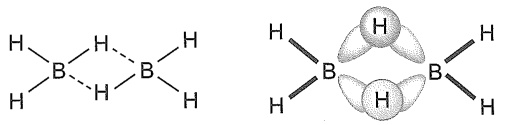

<details>
<summary>chemical</summary>

Two molecular structures showing boron (B) atoms bonded to hydrogen (H) atoms, with one structure featuring two H-bonds and the other showing a central atom bonded to two H-bonds.
</details>

图 5-12 乙硼烷的三中心二电子键结构

乙硼烷与硼烷间存在一个平衡，其中硼烷含量较少。乙硼烷通常在二甲硫醚或者四氢呋喃中保存及使用，以甲硼烷-醚的络合物（$\mathrm{R}_2\mathrm{O} \rightarrow \mathrm{BH}_3$）的形式存在。

$$
\mathrm{B} _ {2} \mathrm{H} _ {6} \rightleftharpoons \mathrm{BH} _ {3}
$$

硼烷与烯烃能定量地进行加成反应。例如，乙硼烷与乙烯在  $0^{\circ}$ C 时，即可发生加成反应，生成三乙基硼。

$$
3 \mathrm{H} _ {2} \mathrm{C} = \mathrm{CH} _ {2} + 1 / 2 \mathrm{B} _ {2} \mathrm{H} _ {6} \xrightarrow {0 ^ {\circ} \mathrm{C}} (\mathrm{CH} _ {3} \mathrm{CH} _ {2}) _ {3} \mathrm{B}
$$

三乙基硼的形成是通过三步反应完成的。首先乙硼烷的一个硼氢键对一分子乙烯加成，当乙烯过量时，硼烷的第二个和第三个硼氢键进行类似的反应，最后生成三乙基硼。

$$
\mathrm{H} _ {2} \mathrm{C} = \mathrm{CH} _ {2} + 1 / 2 (\mathrm{H} - \mathrm{BH} _ {2}) _ {2} \longrightarrow \mathrm{CH} _ {3} \mathrm{CH} _ {2} - \mathrm{BH} _ {2}
$$

$$
\mathrm{H} _ {2} \mathrm{C} = \mathrm{CH} _ {2} + \mathrm{CH} _ {3} \mathrm{CH} _ {2} \mathrm{BH} - \mathrm{H} \longrightarrow (\mathrm{CH} _ {3} \mathrm{CH} _ {2}) _ {2} \mathrm{BH}
$$

$$
\mathrm{H} _ {2} \mathrm{C} = \mathrm{CH} _ {2} + (\mathrm{CH} _ {3} \mathrm{CH} _ {2}) _ {2} \mathrm{B} - \mathrm{H} \longrightarrow (\mathrm{CH} _ {3} \mathrm{CH} _ {2}) _ {3} \mathrm{B}
$$

与非对称烯烃加成时，硼原子倾向于加到含氢较多的双键碳原子上得到形式上反马氏规则的产物。从电子效应考虑，氢的电负性（2.2）比硼的电负性（2.0）略大，硼氢键的极化情况如下所示:

$$
\delta + \stackrel {+} {\mathrm{B}} - \mathrm{H} \delta -
$$

所以，与 Brønsted 酸类亲电试剂不同，硼烷是一种负氢试剂，硼原子是缺电子的亲电试剂位点，氢原子是富电子的亲核试剂位点。在烯烃与硼烷的加成反应中，硼作为亲电试剂加成到电子密度较高的双键碳原子，即带有部分负电荷的含氢较多的碳原子上，而氢作为亲核试剂加到相对更缺电子的碳原子上，这种加成取向与符合马氏规则的其他烯烃亲电加成从本质上来看是类似的，虽然形式上得到所谓“反马氏规则”产物。

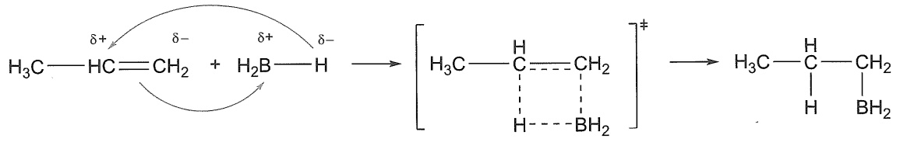

<details>
<summary>chemical</summary>

Chemical reaction equation showing hydrogen bonding between a carbon-carbon alkene and an amino acid, producing a tertiary alcohol product.
</details>

从空间效应考虑，该加成反应经历了一个四元环的过渡态，属于协同反应，硼原子和氢原子是从碳碳双键的同一侧加到两个双键碳原子上的，这种加成方式称为顺式加成。在协同反应的过程中，硼烷加成倾向于形成空间位阻更小的过渡态，将硼（即后续氧化后所得羟基）加到位阻较小的烯烃碳原子上。例如:

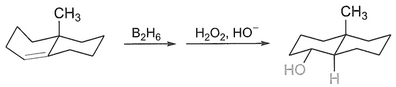

<details>
<summary>chemical</summary>

Chemical reaction pathway showing transformation of a cyclohexane derivative under B2H6 and H2O2/HO- conditions
</details>

碳硼键在过氧化氢中的水解经历了一个四配位硼的立体专一的1,2-迁移历程。


硼烷双氧水
水解机理

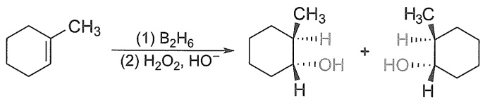

<details>
<summary>chemical</summary>

Chemical reaction equation showing cyclohexane reacting with B₂H₆ and H₂O₂ to form a cyclohexane derivative, then hydrolysis to yield a cyclohexane product.
</details>

烯烃经硼氢化的产物烷基硼，若用过氧化氢的氢氧化钠水溶液处理，则被氧化同时水解而生成醇。例如:

$$
(\mathrm{CH} _ {3} \mathrm{CH} _ {2}) _ {3} \mathrm{B} \xrightarrow [ \mathrm{NaOH} , \mathrm{H} _ {2} \mathrm{O} ]{\mathrm{H} _ {2} \mathrm{O} _ {2}} 3 \mathrm{CH} _ {3} \mathrm{CH} _ {2} \mathrm{OH} + \mathrm{H} _ {3} \mathrm{BO} _ {3}
$$

$$
(\mathrm{CH} _ {3} \mathrm{CH} _ {2} \mathrm{CH} _ {2}) _ {3} \mathrm{B} \xrightarrow [ \mathrm{NaOH} , \mathrm{H} _ {2} \mathrm{O} ]{\mathrm{H} _ {2} \mathrm{O} _ {2}} 3 \mathrm{CH} _ {3} \mathrm{CH} _ {2} \mathrm{CH} _ {2} \mathrm{OH} + \mathrm{H} _ {3} \mathrm{BO} _ {3}
$$

烯烃的硼氢化反应及烷基硼烷在碱性条件下的氧化水解反应联合起来称为硼氢化-氧化反应（hydroboration-oxidation），总的结果是得到醇。但要注意，这里水合的氢和羟基不是来源于水分子，而是分别来自硼烷和过氧化氢分子。反应的特点是顺式加成，产物醇从形式上看是反马氏规则产物。所以，这种烯烃间接水合制备醇的方法是直接酸催化水合反应和羟汞化-脱汞反应的重要补充。

烷基硼和羧酸（RCOOH）作用生成烷烃，该反应称为烷基硼的还原反应。

$$
(\mathrm{CH} _ {3} \mathrm{CH} _ {2} \mathrm{CH} _ {2}) _ {3} \mathrm{B} + 3 \mathrm{RCOOH} \longrightarrow 3 \mathrm{CH} _ {3} \mathrm{CH} _ {2} \mathrm{CH} _ {3} + \mathrm{B} (\mathrm{OCOR}) _ {3}
$$

该反应与烯烃的硼氢化反应结合在一起，总称为硼氢化-还原反应（hydroboration-reduction），是将烯烃还原成烷烃的一种方法。例如:

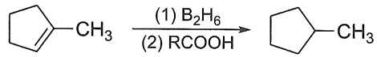

## 5.6.2 催化氢化

催化氢化是最早实现不对称催化的反应，也是在工业上使用最多的不对称催化反应，Knowles 教授与 Noyori 教授因其在不对称催化氢化上的贡献获 2001 年诺贝尔化学奖。


2001 年诺贝尔
化学奖

烯烃与氢气混合，在常温常压下不发生反应，高温时反应也很慢。但在适当的催化剂的作用下，烯烃与氢加成生成相应的烷烃，所以也称为催化氢化或催化加氢（catalytic hydrogenation），是还原反应。常用的非均相催化剂为铂（Pt）、钯（Pd）、镍（Ni）等金属，工业上常用的催化剂有雷尼镍（Raney Ni）和5%或10%钯碳（Pd/C）。雷尼镍的价格比铂和钯低廉，且活性适中。

$$
\mathrm{R} - \mathrm{HC} = \mathrm{CH} _ {2} + \mathrm{H} _ {2} \xrightarrow {\text {催化剂}} \mathrm{R} - \mathrm{CH} - \mathrm{CH} _ {2} \quad \begin{array}{c c} & \text {I} \\ & \text {H} \end{array}
$$

氢的加成多数是顺式加成。例如:

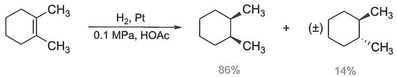

<details>
<summary>chemical</summary>

Chemical reaction equation showing hydrogenation of a cyclohexane with platinum catalyst under pressure and HOAc conditions
</details>

一般认为的催化氢化历程如下:烯烃和氢气分子分别吸附在催化剂的表面上，烯烃与催化剂配位。催化剂的作用使氢分子发生 $\mathrm{H - H}\sigma$ 键的断裂，形成两个相对较弱的 $\mathrm{H - M}$ （金属）键。活化的氢原子离开催化剂表面，从烯烃的同面加成到双键上，生成两个 $\mathrm{C - H}\sigma$ 键，得到烷烃分子。烷烃脱离催化剂表面，发生反应的催化剂表面又可以继续活化新的氢分子和烯烃分子，继续加氢反应（图5-13）。

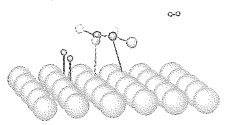

(1)

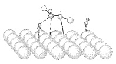

(II)

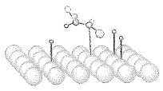

(III)

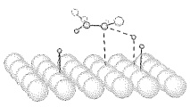

(IV)

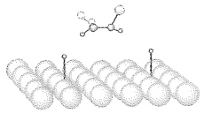

(V)

图 5-13 催化氢化过程示意图

双键碳原子上所连的取代基越少，越有利于烯烃在催化剂表面的吸附。因此，烯烃的相对氢化速率顺序为乙烯 $>$ 一取代乙烯 $>$ 二取代乙烯 $>$ 三取代乙烯 $>$ 四取代乙烯。

从能量上分析，催化剂的作用在于降低了反应的活化能（ $E_{a}$ ），大大加速了反应的进行（图5-14）。烯烃的加氢反应是一个放热反应，因为在反应过程中生成两个新的碳氢σ键所放出的能量，比断裂一个H-Hσ键和一个C-Cπ键所吸收的能量要大。通过键能的估算，1 mol烯烃打开π键加氢饱和时，大约放热120 kJ·mol $^{-1}$ ，即氢化热（ $\Delta H$ ）。

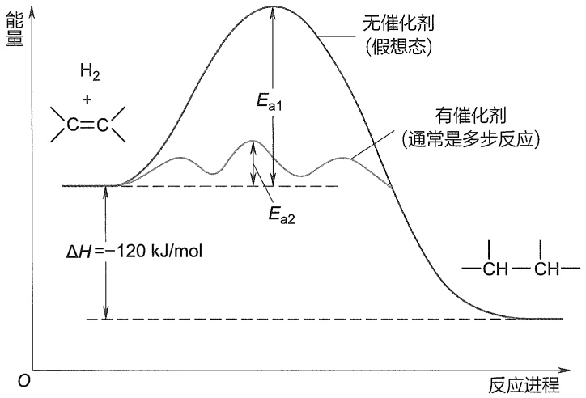

<details>
<summary>line</summary>

| Feature | Description |
| --- | --- |
| Y-axis | Energy |
| X-axis | Reaction进程 |
| Curve 1 | 无催化剂 (假想态) |
| Curve 2 | 有催化剂 (通常是多步反应) |
| Energy Difference \((\Delta H)\) | -120 kJ/mol |
</details>

图 5-14 烯烃催化加氢能量曲线图

不同金属实现催化氢化的机理并不完全相同，一般根据金属是否与底物配位分为内球机理与外球机理。


催化氢化机理

不同结构的烯烃，其氢化热并不完全相同，我们可以利用氢化热的不同，研究和比较不同烯烃的相对稳定性（详见 5.2 节）。

烯烃的催化氢化反应在工业上和研究工作中都具有重要意义。例如，饱和脂肪酸可以呈规则的锯齿形紧密排列，形成晶体。由于分子间存在较大的范德华力，因此有相对高的熔点，且熔点随着相对分子质量的增加而升高。由饱和脂肪酸形成的甘油三酯在室温下多为脂。不饱和脂肪酸由于刚性顺式双键的存在，其碳链不能像饱和脂肪酸那样紧密结合，而是弯曲成一定角度，降低了分子间作用力，因而熔点降低。所以，一般由不饱和酸形成的甘油三酯在室温下多为油。由于多元不饱和油脂容易被氧化而导致发臭，在油脂工业中，常把含有不饱和键的油脂氢化处理，使液态的油转化为固态的脂，以改进油脂的性质，方便存储和运输。但是，氢化反应的问题在于所使用的催化剂会导致不反应的双键发生异构化，形成自然界中存在的反式烯烃。越来越多的研究结果表明反式脂肪会增加罹患心血管疾病的风险。

## 5.6.3 双羟化

碱性的、稀的、冷的  $KMnO_{4}$  水溶液作氧化剂，可以将烯烃氧化成邻二醇:

$$
\mathrm{H} _ {2} \mathrm{C} = \mathrm{CH} _ {2} \xrightarrow [ \text {冷, OH} ^ {-} ]{\mathrm{KMnO} _ {4} \text {水溶液}} \mathrm{H} _ {2} \mathrm{C} - \mathrm{CH} _ {2} \quad \begin{array}{c c} & \mathrm{OH} \\ & \mathrm{OH} \end{array}
$$

一般来说，与共价键相关的变化都可以使用有机化学理论进行分析，例如此处对高锰酸钾键合方式与反应机理的分析，能加深我们对无机物高锰酸钾的认识。

早在 20 世纪 80 年代，Sharpless 就利用金鸡纳碱作为手性配体实现了烯烃的不对称双羟化反应。


Sharpless 双羟化

四氧化锇易挥发且剧毒,不便操作,常用锇酸钾 $\left[\mathrm{K}_{2}\mathrm{OsO}_{2}(\mathrm{OH})_{4}\right]$ 原位生成四氧化锇进行反应。

[3+2]环加成反应是周环反应的一种。周环反应将在第十三章深入学习。

反应具有立体专一性，生成的产物为顺式邻二醇。一般认为该反应经历了高锰酸钾与烯烃的[3+2]环加成反应和随后的Mn-O键水解:

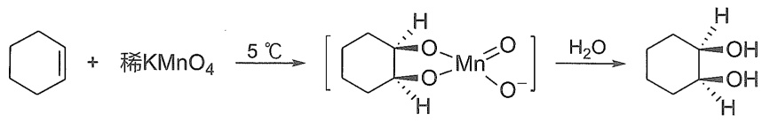

<details>
<summary>chemical</summary>

Chemical reaction equation showing copper complex formation from benzene and potassium nitrate under 5°C catalyst
</details>

生成的二元醇容易进一步氧化，反应难以控制，因此产率不高。但烯烃的氧化可以使高锰酸钾的紫色溶液褪色，生成的二氧化锰为褐色沉淀。利用此反应，通过颜色的变化，可以检验烯烃化合物的存在。

$$
3 \mathrm{R} - \mathrm{CH} = \mathrm{CH} _ {2} + 2 \mathrm{KMnO} _ {4} + 4 \mathrm{H} _ {2} \mathrm{O} \xrightarrow {\mathrm{HO} ^ {-}} 3 \mathrm{R} - \underset {\text {OH}} {\mathrm{CH}} - \underset {\text {OH}} {\mathrm{CH} _ {2}} + 2 \mathrm{MnO} _ {2} + 2 \mathrm{KOH}
$$

四氧化锇（$\mathrm{OsO_4}$）在反应性和可控程度上都是比高锰酸钾更优的烯烃双羟化试剂，由于相似相溶原理，中性分子四氧化锇在有机溶剂中的溶解度比离子化合物高锰酸钾高得多，产率往往也比使用高锰酸钾高。但由于分子内仅有共价键，无离子键，分子间作用较弱，四氧化锇的熔、沸点较低（熔点 $40.6^{\circ}\mathrm{C}$，沸点 $130^{\circ}\mathrm{C}$），具有强烈刺激性气味和毒性，且价格昂贵，不宜大规模使用。目前较经济的方法是用当量的 $\mathrm{H_2O_2}$ 及催化量的 $\mathrm{OsO_4}$。$\mathrm{OsO_4}$ 与烯烃反应后的还原产物 $\mathrm{OsO_3}$ 可以在体系中被 $\mathrm{H_2O_2}$ 原位再氧化回 $\mathrm{OsO_4}$，反应可以多次循环，直至完成。

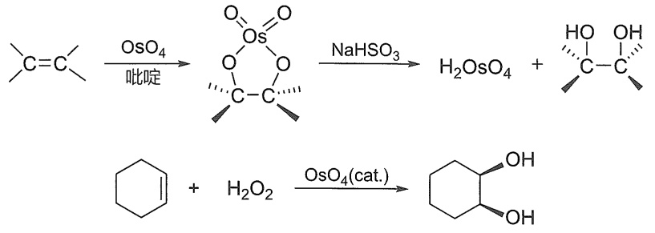

<details>
<summary>chemical</summary>

Chemical reaction pathway showing osmium-catalyzed transformation of a sulfonate ester to cyclohexene and its subsequent hydrolysis
</details>

## 5.6.4 臭氧化反应

臭氧是一种高活性的氧化剂，三个氧原子呈折线形排布。臭氧会和烯烃迅速发生[3+2]环加成反应形成一级臭氧化物，由于一级臭氧化物的不稳定性和[3+2]环加成反应的可逆性，一级臭氧化物会发生重排得到二级臭氧化物。将含有 $6\% \sim 8\%$ 臭氧的氧气在低温下通入液体烯烃或烯烃的非水溶液（一般以四氯化碳或石油醚作溶剂），臭氧迅速而定量地与烯烃作用，生成糊状的臭氧化物（ozonide），称为臭氧化反应（ozonation reaction）。

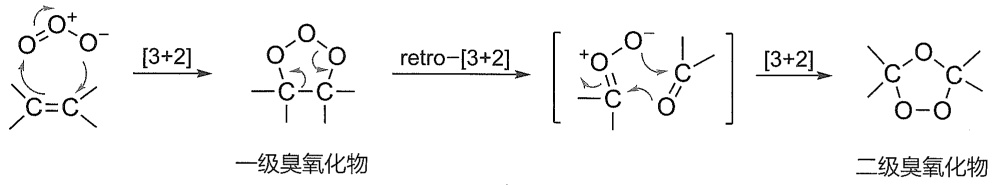

<details>
<summary>flowchart</summary>

```mermaid
graph LR
  A["C=C"] -->|[3+2]| B["O-C-O-"]
  B -->|retro-["3+2"]| C["C-O-C-"]
  C -->|[3+2]| D["C-O-C-O-"]
  D --> E["二级臭氧化物"]
```
</details>

臭氧化物在游离状态下不稳定，容易发生爆炸，一般不必从反应溶液中分离，可以直接进行水解，得两分子羰基化合物和过氧化氢。为了避免羰基化合物中醛的继续氧化，通常要加入还原剂（锌粉或二甲硫醚），或在催化剂存在下（如铂或钯-碳酸钙）直接加氢分解。

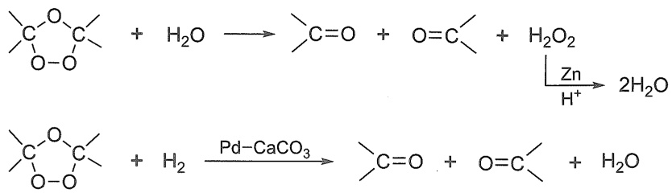

不同的烯烃经臭氧化，再水解或还原，可以得到不同的醛或酮。

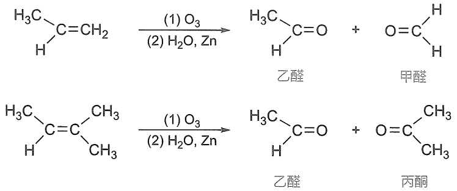

烯烃分子中，有 $= \mathrm{CH}_2$ 基时生成甲醛；有 $=\mathrm{CHR}$ 基时生成醛；而有 $\mathrm{R}^{1}\mathrm{R}^{2}\mathrm{C} =$ 基时得到的是酮。烯烃经臭氧化-水解反应所得的羰基化合物保持了原来烯烃的部分碳架结构特征，因此通过测定反应生成产物的结构，就可反推出原来烯烃的结构。例如:

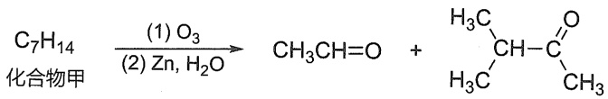

<details>
<summary>chemical</summary>

Chemical reaction equation showing conversion of compound C7H14 to a chiral alcohol using (1) O3 and (2) Zn/H2O
</details>

则化合物甲为: $CH_{3}CH=C\begin{array}{c}CH_{3}\\ \backslash\\ CH(CH_{3})_{2}\end{array}$

烯烃的臭氧化反应可用于合成一些特殊的醛、酮，尤其是环烯烃的臭氧化反应可以得到双官能团化合物，用于缩合反应构建所需环状分子。有时也用于合成一些特殊的羧酸。例如，利用油酸臭氧化反应制备壬二酸:

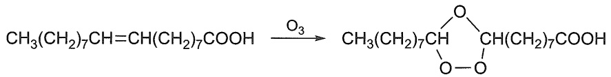

<details>
<summary>chemical</summary>

Chemical reaction equation showing conversion of a diester to a ketone using methanol (O3)
</details>

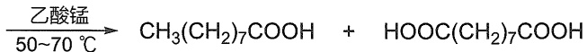

<details>
<summary>flowchart</summary>

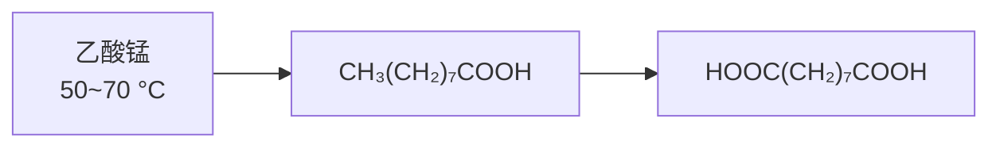
</details>

壬酸

壬二酸

壬二酸主要用于制造一系列重要工业原料，如壬二腈（尼龙-9的中间体）、壬二酸二辛酯（增塑剂）和聚壬二酸酐（绝缘材料）等。

此外，臭氧化反应是大气中有机物降解的重要过程之一。在大气中，烯烃的臭氧化反应可以将自然界植被排放的烯烃（异戊二烯、萜类化合物等）转化为较为稳定的化合物，起到净化空气的作用。

## 5.6.5 Diels-Alder 反应

共轭二烯与含有双键或叁键的化合物反应，生成六元环状化合物，该反应称为双烯合成反应（diene synthesis reaction），如丁-1,3-二烯与乙烯反应生成环己烯。其中丁-1,3-二烯称为双烯体（diene），乙烯称为亲双烯体（dienophile），双烯体和亲双烯体是双烯合成中原料

臭氧非常活泼，只能现做现用。最近，化学家利用光激发硝基化合物，形成激发态的硝基化合物与烯烃发生[3+2]环加成，并进一步断裂，可以得到与臭氧化分解一样的产物。


硝基苯光解替代
臭氧解

Diels-Alder反应是周环反应的一种。周环反应将在第十三章深入学习。

的基本结构单元。反应经过协同的机理进行，双烯和亲双烯体中的双键逐渐断裂，而它们之间慢慢形成新的化学键，并在原双烯结构中形成一个新的双键。该反应在一定条件下是可逆的，在合适的条件下，六元环产物能重新开环得到双烯体和亲双烯体。

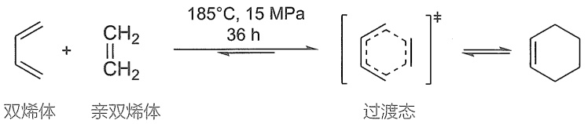

<details>
<summary>chemical</summary>

Reaction mechanism showing double-bonded and triple-bonded products forming a cyclohexene intermediate with 185°C, 15 MPa pressure, and 36 h duration
</details>

1928 年，德国化学家 Diels 和 Alder 在研究丁-1,3-二烯和顺丁烯二酸酐的相互作用时发现了该反应，因此又称为 Diels-Alder 反应，简称 D-A 反应。该反应为合成六元环化合物提供了简便的方法，产率高，立体专一性和区域选择性高，是有机合成中的一个重要反应。因此，Diels 和 Alder 共同获得了 1950 年诺贝尔化学奖，以表彰他们在有机合成领域里作出的杰出贡献。

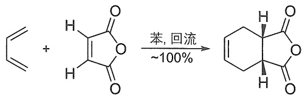

<details>
<summary>chemical</summary>

Chemical reaction equation showing cycloaddition of styrene to form a cyclic ketone under benzene and hydroxyl conditions
</details>

关于反电子需求的 D-A 反应，可参考文献 Nat. Catal., 2021, 4, 892-900.

一般认为，在 Diels-Alder 反应中，电子由双烯体的 HOMO 流向亲双烯体的 LUMO，HOMO 和 LUMO 能级差越小，反应越容易发生。因此，具有给电子基团的双烯体（HOMO 能级增高）和吸电子基团的亲双烯体（LUMO 能级降低）将有利于反应进行，如丙烯醛中的甲酰基的吸电子作用，使得 Diels-Alder 反应能更加顺利地进行。后续研究中人们发现吸电子基团的双烯体和给电子基团的亲双烯体也能顺利进行 Diels-Alder 反应，称为反电子需求的 Diels-Alder 反应（inverse electron demand Diels-Alder reactions, iEDDA）。

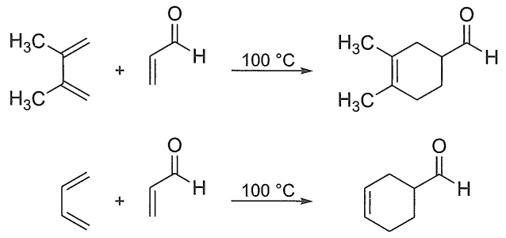

<details>
<summary>chemical</summary>

Two organic reaction equations showing ketone formation under 100°C conditions
</details>

另外，双烯体需要满足一定的立体结构要求。共轭二烯烃的两个双键共轭导致 C2-C3 具有部分双键性质，因此，绕 C2-C3 σ 单键的旋转比一般烷烃中的 C-C σ 单键需要更高的能量，使得开链共轭二烯烃有两种构象形式:s-反式和 s-顺式。s 表示单键，共轭的两个双键在 C2-C3 σ 单键的异侧称为 s-反式（s-trans），在同侧则称为 s-顺式（s-cis）。如:

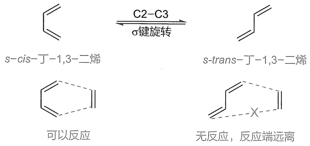

<details>
<summary>chemical</summary>

Reaction mechanism showing s-cis-丁-1,3-benzene and s-trans-丁-1,3-benzene under σ键旋转, with corresponding chemical structures for reaction and inhibition.
</details>

Diels-Alder 反应是协同反应，只有 s-cis 共轭二烯烃，或者是在反应条件下可转变成 s-cis 构象的双烯体才能反应。由于环的限制而无法转变为 s-cis 的双烯体将不能发生 Diels-Alder 反应；若双烯的末端有大位阻取代基，则会由于位阻而影响反应的顺利进行。

可用的双烯体:

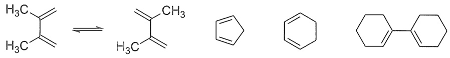

<details>
<summary>chemical</summary>

Chemical reaction equation showing cycloaddition of cyclohexane to form cyclohexene and cyclohexylbenzene
</details>

不可用的双烯体:

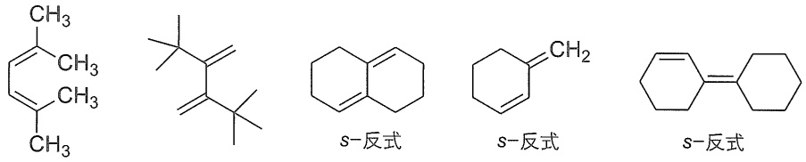

<details>
<summary>chemical</summary>

Structural formulas of methyl and ethylbenzene derivatives with s-alkyl side chains
</details>

可用的亲双烯体:

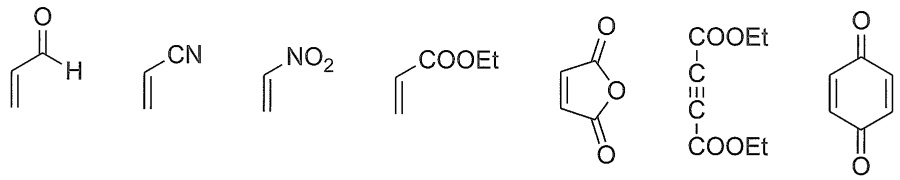

<details>
<summary>chemical</summary>

Structural formulas of various organic compounds including aldehyde, amide, nitro, carboxylic acid, and benzene
</details>

Diels-Alder 反应是区域选择性反应。当双烯体与亲双烯体上均有取代基时，从反应式看，可能生成两种不同的反应产物。实验证明，两个取代基处于相邻位或相对位的产物占优势。共振式对烯烃电荷分布的描述能很好地解释这种区域选择性。

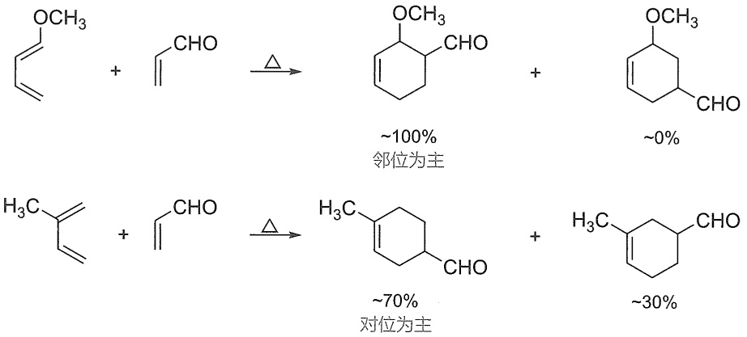

Diels-Alder 反应是立体专一性的顺式加成反应,参与反应的亲双烯体在反应过程中顺反关系保持不变。例如，丁-1,3-二烯与顺丁烯二酸二乙酯反应生成顺式产物，与反丁烯二酸酸二乙酯反应生成反式产物。

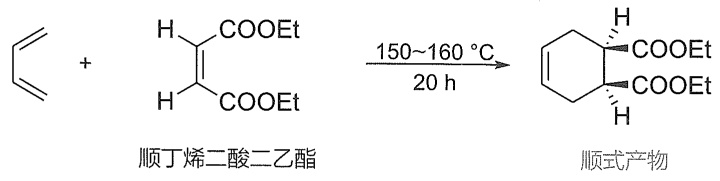

<details>
<summary>chemical</summary>

Chemical reaction equation showing conversion of styrene to cyclohexene using acetic acid under 150–160°C for 20 hours
</details>

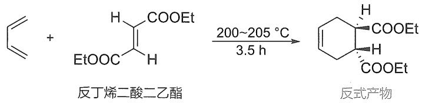

<details>
<summary>chemical</summary>

Chemical reaction equation showing the synthesis of a cyclohexanone derivative from styrene and ethyl acetate under specified conditions
</details>


D-A 反应的区域选择性与共振式

对于取代的双烯体，双烯体中环内侧的两个基团加成后在同一侧，而环外侧的两基团在环的另外一侧。例如，trans,trans-己-2,4-二烯在进行Diels-Alder反应后，原料中双烯体中的两个甲基处于半环结构的外侧，则产物中两个甲基处于顺式的位置；而cis,trans-己-2,4-二烯的两个甲基分别处于半环结构的内外侧，产物中的两个甲基则处于反式位置。

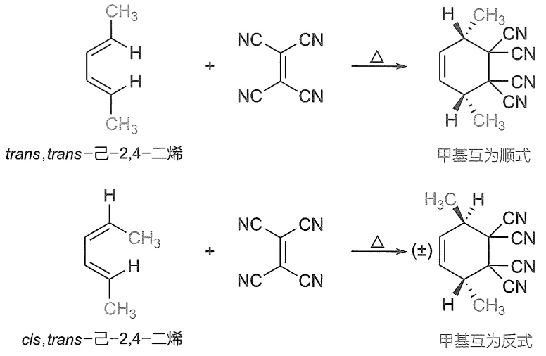

<details>
<summary>chemical</summary>

Chemical reaction equations showing conversion of trans-己-2,4- and cis-己-2,4- to 甲基互为顺式 and reverse forms
</details>

运用分子轨道理论能更好地理解D-A反应，详见后续周环反应的章节。

对于活性较高的底物，无须加热，室温下就能反应。例如环戊二烯因为环结构将两个双键固定为 $s-$ 顺式，在室温下就能自发缓慢发生Diels-Alder反应，因此市售的环戊二烯几乎都以二聚体的形式存在，使用前需要加热蒸馏解聚，现蒸现用。

环戊二烯二聚的 Diels-Alder 反应体现出一类新的立体选择性:内型/外型选择性。其中亲双烯体中未参加反应的双键相距双烯体结构较近的过渡态（Ⅰ）形成的是内型（endo）产物。内型结构的定义是，双烯体中新生成的双键与亲双烯体中除双键外的基团处于双烯体和亲双烯体形成化学键连线的同侧。另外一个相反的过渡态（Ⅱ）则生成的是外型（exo）产物。由于过渡态（Ⅰ）中存在次级轨道作用，比过渡态（Ⅱ）稳定，而外型加成的产物因空间位阻更小而热力学更稳定。所以，生成内型产物是动力学控制过程，而生成外型产物为热力学控制过程。这个反应中，虽然升高温度可以促使热力学控制产物生成，但也增加了二聚体解聚的逆反应速率，因此，一般认为内型产物为二聚环戊二烯的主要结构。

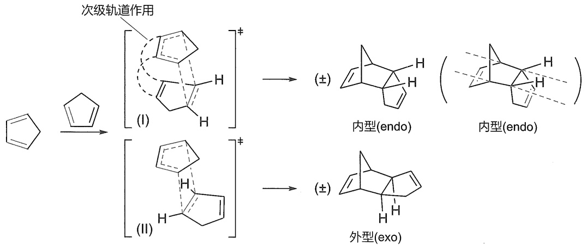

<details>
<summary>chemical</summary>

Reaction mechanism diagram showing cyclohexene conversion to cyclopentane via secondary orbitals and enantiomers
</details>

在其他反应中，一般低温下动力学产物也是反应的主要产物，例如:

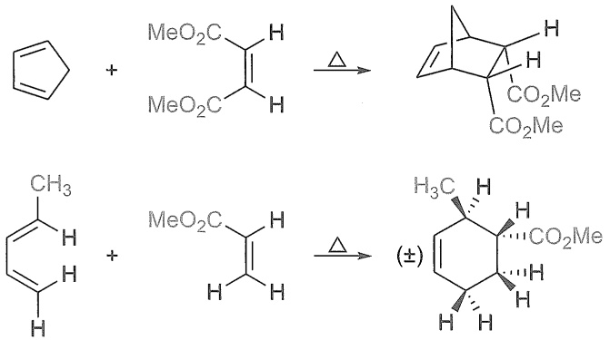

## 5.6.6 亲电加成反应的三分子历程

当烯烃与HX加成时，若可能的反应中间体是不太稳定的碳正离子，则反应可能不按照双分子亲电加成（addition-electrophilic-bimolecular，$\mathrm{Ad_E2}$）机理进行，而是按照三分子亲电加成（addition-electrophilic-termolecular，$\mathrm{Ad_E3}$）机理进行。例如，2-甲基丁-1-烯、2-甲基丁-2-烯、1-甲基环戊烯、环戊烯与HX的加成反应，都遵照 $\mathrm{Ad_E3}$ 机理进行。对于这些反应的动力学的研究表明，总的反应是三级动力学，HX的反应级数为二级，即反应速率 $= k[\text{底物}][\mathrm{HX}]^2$，说明反应的过渡态包含两个HX分子和一个底物分子。

在  $Ad_{E}3$  机理中，烯烃与两种试剂反应，一种试剂与 C=C 形成  $\pi$  络合物，表现为亲电性；另一种试剂表现为亲核性。

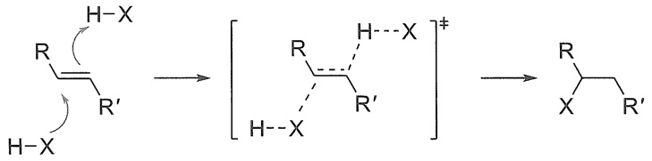

<details>
<summary>chemical</summary>

Chemical reaction mechanism showing hydrogen bonding between a cyclohexane derivative and a substituted alkene with H-X and R' groups
</details>

$\mathrm{Ad}_{\mathrm{E}}3$ 历程的特征是反式加成，从形式上看是E2反应的逆反应。反应虽然不生成游离的碳正离子，但区域选择性与常规亲电加成类似，能形成更稳定碳正离子的烯基碳倾向于与H相连，而另一个碳倾向于与X相连。

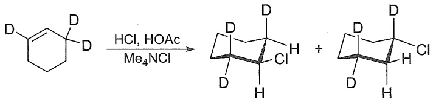

<details>
<summary>chemical</summary>

Chemical reaction equation showing deprotection of a cyclohexadiene derivative under HCl/HOAc and Me4NCl conditions
</details>

一般而言，强酸、稳定的碳正离子及弱亲核试剂一般倾向于  $Ad_{E}2$  机理，反之则倾向于  $Ad_{E}3$  机理。使用极性比较小的溶剂或高浓度卤素（第二个卤素分子帮助第一个卤素分子极化），反应倾向于按照  $Ad_{E}3$  机理进行。 $Br_{2}$  和  $I_{2}$  与烯烃的加成反应，可能按  $Ad_{E}3$  机理进行，但是  $Cl_{2}$  的加成只能按  $Ad_{E}2$  机理进行，因为 Br 和 I 原子可采用较高的配位数与  $\pi$  键络合，而 Cl 原子不能。

炔烃与HX的亲电加成反应如果按照 $\mathrm{Ad_E2}$ 机理进行，反应的中间体是烯基正离子，其稳定性不高，难以生成。研究表明，炔烃与HX反应的主要机理可能是 $\mathrm{Ad_E3}$ 机理。一些实验现象可以证明这个机理的存在，例如丁-2-炔与HCl形成的 $\pi$ 络合物经过了单晶结构的表征，反应往往观察到反式加成产物，且很少有重排的产物生成。

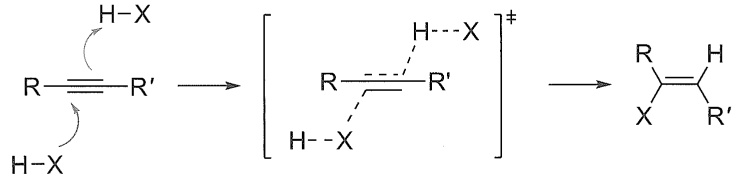

<details>
<summary>chemical</summary>

Chemical reaction mechanism showing hydrogen bonding between R and its derivatives with H-X and H-X substituents
</details>

利用正逆反应等逻辑将更多的反应联系在一起，有利于更全面地理解有机反应的机理。

除了经典反式加成的  $Ad_{E}3$  外，也有一些顺式加成  $Ad_{E}3$  的情况，底物也不一定局限于难以形成稳定碳正离子的物种，如 J. Am. Chem. Soc., 2020, 142: 12865-12877.

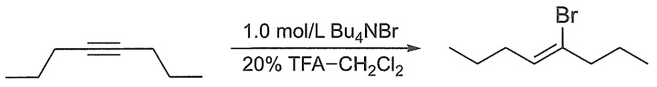

<details>
<summary>chemical</summary>

Organic reaction scheme showing bromination of a ketone to form a brominated alkene using Bu4NBr and TFA-CH2Cl2 catalysts
</details>

## 5.7 烯烃的亲核加成/亲核取代反应

一方面，一般烯烃的缺电子性并不强；另一方面，亲核试剂进攻烯烃后产生的碳负离子较不稳定，所以一般烯烃并不能发生亲核加成反应，需要引入使碳负离子稳定的元素才能使反应发生。其中，最常见的情况之一是 C=C 键与吸电子基团直接相连，一方面，吸电子基团使烯烃更缺电子；另一方面，受亲核试剂进攻后，吸电子基团能很好地稳定住形成的碳负离子。常见的这类烯烃包括  $\alpha,\beta-$  不饱和酮、 $\alpha,\beta-$  不饱和酯、丙烯腈、丙炔酮、丙炔酸酯、硝基烯烃等。详见亲核试剂对  $\alpha,\beta-$  不饱和羰基化合物发生 1,4-加成反应，即 Michael 加成反应部分（见第十一章）。


<details>
<summary>chemical</summary>

Chemical reaction equation showing conversion of EWG to a carbonyl compound under Nussel-elimination
</details>

除了连接吸电子基团外，在将要形成的碳负离子的  $\beta$ -位（烯丙位）预留一个离去基团，通过类 E1cb 消除（参看第四章中卤代烃的消除反应）使负离子转化成稳定的烯烃，也能推动反应进行。


<details>
<summary>chemical</summary>

Chemical reaction equation showing ethylene oxide reacting with ethyl ether to form a substituted alkene, with X⁻ and Cl, Br, I, OAc groups attached
</details>

如上图所示，在与烯丙基卤素的反应中，亲核试剂乙氧基负离子倾向于对烯烃进攻，然后使双键移位，同时离去基团离去，形成一个双键移位的烯丙基醚。在该历程中由于负离子一旦形成便马上发生消除反应，所以一般认为反应以协同反应的方式进行。这种亲核取代反应历程也是一种双分子历程，但与常规的 $S_{N}2$ 反应不同，又被称作 $S_{N}2'$ 反应。在烯丙基卤素化合物与亲核试剂的亲核取代反应中， $S_{N}2$ 与 $S_{N}2'$ 是竞争反应，因此烯丙基卤素通常会有1-位取代和3-位取代两种亲核取代模式，具体选择性取决于底物的结构、亲核试剂的种类等因素，一般来说，离去基团离去性较差或位阻太大阻碍 $S_{N}2$ 反应时，会更倾向于以 $S_{N}2'$ 途径反应。在共轭二烯与溴发生的亲电加成反应中，1,4-加成产物就可以看作以 $S_{N}2'$ 模式对溴镝离子开环的过程。


<details>
<summary>chemical</summary>

Chemical reaction mechanism showing bromination and rearrangement steps with labeled reagents and conditions
</details>

在烯烃的两个碳上分别连接吸电子基团和离去基团，能同时运用上述的两种策略，推动反应的进行。如下图所示，亲核试剂先进攻缺电子的烯烃，形成与吸电子基团相连的碳负离

不难发现，加成反应与消除反应可以组合成取代反应，不妨利用这个逻辑，把更多的反应模式联系起来。

子，随后该碳负离子与卤代烃发生 E1cb 消除反应，得到形式上烯基卤化物的亲核取代反应。该反应也被称作  $S_{N}V$  （nucleophilic vinylic substitution）反应。


<details>
<summary>chemical</summary>

Chemical reaction scheme showing conversion of a substituted cyclohexane derivative to an ester using ester group and substituent X
</details>

## 5.8 炔烃的反应

烯烃的特性基团是碳碳双键，而炔烃的特性基团是碳碳叁键。叁键由一个 $\sigma$ 键和两个$\pi$ 键组成，因此炔烃也是非常活泼的化合物。其最典型的反应是叁键中的 $\pi$ 键打开，随后形成 $\sigma$ 键，而生成加成产物。

## 5.8.1 与卤素的亲电加成

炔烃的碳碳叁键含有 $\pi$ 键，因此炔烃与烯烃相似，也可以受亲电试剂的进攻进行一系列亲电加成反应。但是，炔烃和烯烃的加成反应存在两个显著的差异。第一是炔烃进行亲电加成反应的活性不及烯烃，因此，在与很多亲电试剂的反应中，往往需要应用比烯烃反应更强的催化剂或更剧烈的反应条件。此外，由于炔烃有两个 $\pi$ 键，可以与两分子的亲电试剂进行分步加成。常见的亲电试剂有卤素、卤化氢、硫酸及一些无机酸等。

烯/炔烃的亲电加成反应中，烯烃的反应的活性更高，原因是sp杂化的碳原子含有更大比例的s轨道，电负性高于 $\mathrm{sp}^2$ 杂化的碳原子，从而使炔烃表现出对 $\pi$ 电子更强的吸引力，降低 $\pi$ 电子作为亲核试剂进攻亲电试剂的能力。此外，炔烃与亲电试剂反应后形成的乙烯型碳正离子相对不稳定，也使炔烃发生亲电加成的活性比烯烃的低。


<details>
<summary>flowchart</summary>


</details>

烯烃可使 $\mathrm{Br}_2$ 的 $\mathrm{CCl_4}$ 溶液立即褪色，而炔烃则需要几分钟后才能使之褪色，因此可以用 $\mathrm{Br}_2$ 的 $\mathrm{CCl_4}$ 溶液的缓慢褪色来检验碳碳叁键的存在。而当分子中既有叁键又有双键时，一当量的卤素单质会优先加成到双键上，得到叁键保留的卤代产物。在立体选择性方面，炔烃与一当量的溴加成能得到高立体选择性的反式加成产物，一般认为其机理与烯烃的反应类似，也经历了溴鎓离子的中间体。


<details>
<summary>chemical</summary>

Two organic reaction equations showing bromination of alkenes with ethyl halides, producing alkene derivatives
</details>

不妨先回忆一下之前学习的烯烃的相关反应，推测一下炔烃是否也有对应的反应模式。