由于 Cl-Cl 键比 Br-Br 键更难解离，炔烃与氯发生的亲电加成反应一般需要加催化剂（如  $FeCl_{3}$ 、 $SnCl_{2}$ ）促进氯单质的异裂，同时又要在溶剂稀释（溶液相反应）或氮气稀释（气相反应）条件下进行，以防反应过于剧烈而产生其他副反应。在氯过量的条件下，炔烃的加成产物二氯烯烃可以继续与氯发生加成反应得到四氯代产物。碘与炔烃加成比较困难，乙炔通常只能加一分子碘而生成反-1,2-二碘乙烯。

## 5.8.2 与卤化氢的亲电加成和自由基加成反应

炔烃与卤化氢的加成也比烯烃困难，一般也需要加入催化剂来促进氢卤键的异裂，才能使反应以较快速率进行。以苯丙炔与氯化氢的加成反应为例，炔烃与第一分子氯化氢发生加成反应可以得到氯代烯烃产物，一般认为该步反应经历了 $\mathrm{Ad_E3}$ 的协同加成历程（见5.7.6小节），得到区域选择性符合马氏规则的反式加成产物。控制HCl的量和反应速率可以使反应停留在只与一分子卤化氢反应的阶段，这也是制备卤代烯烃的方法之一。在过量HCl存在下，中间产物氯乙烯能继续与第二分子氯化氢发生亲电加成反应，得到同碳的二卤代产物，称为偕二卤代物（geminal dihalide）。

$$
\mathrm{Ph} - \mathrm{C} \equiv \mathrm{C} - \mathrm{CH} _ {3} \xrightarrow {\mathrm{HCl}} \begin{array}{c} \mathrm{Ph} \\ \mathrm{Cl} ^ {\prime} \end{array} \mathrm{C} = \mathrm{C} \begin{array}{c} \mathrm{H} \\ \mathrm{CH} _ {3} \end{array} \xrightarrow {\mathrm{HCl}} \begin{array}{c} \mathrm{Ph} \\ \mathrm{Cl} ^ {\prime} \end{array} \mathrm{C} - \mathrm{CH} _ {2} - \mathrm{CH} _ {3}
$$

从反应性上看，卤代烯烃继续与第二分子的卤化氢发生加成反应时，由于双键碳原子上卤素原子的吸电子作用，使得其 $\pi$ 键电子密度比一般烯烃的低，因此，进行第二次亲电加成反应的活性也随之降低。从区域选择性上看，与碳正离子相连的卤素原子的p轨道孤对电子与碳正离子的空p轨道形成 $\pi$ 键来使其稳定，因此加成反应倾向于经历与卤素相连的碳正离子中间体（图5-15，中间体Ⅱ），生成偕二卤代产物。

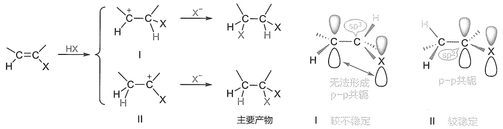

chemical

Reaction mechanism diagram showing hydrogenation and stabilization of a carboxylic acid derivative, with labeled intermediates I and II

图 5-15 卤代烯烃与第二分子 HX 加成形成碳正离子稳定性分析

可以用共振结构表示连卤素碳正离子的 $\pi$ 键作用:

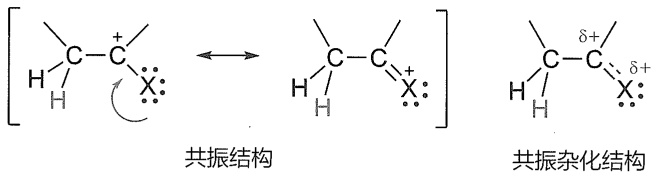

chemical

Chemical reaction diagram showing the transformation of a cyclic alkene into a tetramethylcyclohexane derivative via coordination with hydrogen atoms, labeled as '共振结构' and '共振杂化结构'.

给/吸电子效应是相对的，具体与什么基团相连，会影响基团的给/吸电子性质。

该例子充分展示了给电子与吸电子效应的相对性。卤原子与烯烃相连时，吸电子诱导效应大于给电子共轭效应，卤素主要体现为吸电子作用，降低烯烃的亲电反应活性；而当卤原子与碳正离子相连时，由于碳正离子本身是缺电子基团，呈吸电子性，此时卤素主要体现为给电子共轭作用，能稳定碳正离子，最终形成偕二卤代产物。

当有过氧化物存在时，溴化氢与炔烃的加成反应也同样是按自由基加成反应历程进行的，遵循反马氏规则。例如:

$$
\mathrm{CH} _ {3} \mathrm{CH} _ {2} \mathrm{CH} _ {2} \mathrm{C} \equiv \mathrm{CH} \quad \xrightarrow [ \text {ROOR} ]{\mathrm{HBr}} \quad \mathrm{CH} _ {3} \mathrm{CH} _ {2} \mathrm{CH} _ {2} \mathrm{CH} = \mathrm{CHBr}
$$

过氧化物效应一般限于溴化氢。因为氯化氢产生氯原子（自由基）比较困难，而碘化氢虽然容易生成碘原子，但其活性不足以与双键或叁键进行自由基加成。因此，氯化氢和碘化氢与烯烃和炔烃的加成一般不存在过氧化效应。

## 5.8.3 炔烃的羟汞化反应

由于发生亲电加成反应的活性比烯烃低，炔烃在酸催化下一般很难发生直接水合反应。但炔烃的羟汞化反应却比烯烃更高效。反应机理与烯烃的羟汞化过程类似。即 $^{+}\mathrm{Hg(OAc)}$ 作为亲电试剂，与炔烃形成一个环汞镝离子，然后水分子从背面进攻环汞镝离子中含氢较少的碳原子，生成羟汞化烯烃。与烯烃的反应不同，与炔相连的碳汞键不需要硼氢化钠还原，只需要在酸的作用下就能发生C-H键替换，生成烯醇。因此反应不需要当量的汞离子，只需要催化量的汞离子在酸性条件下就能使反应进行完全。烯醇分子中的羟基直接连在双键上不稳定，在酸性条件下容易发生分子重排，羟基上的氢原子作为质子转移到另一个双键碳原子上，而碳氧之间形成双键，即变为较稳定的酮式。因此，炔烃与水的加成反应一般都停留在与一分子水加成的阶段。这种重排称为烯醇式-醛（酮）式互变异构（keto-enol tautomerism）。

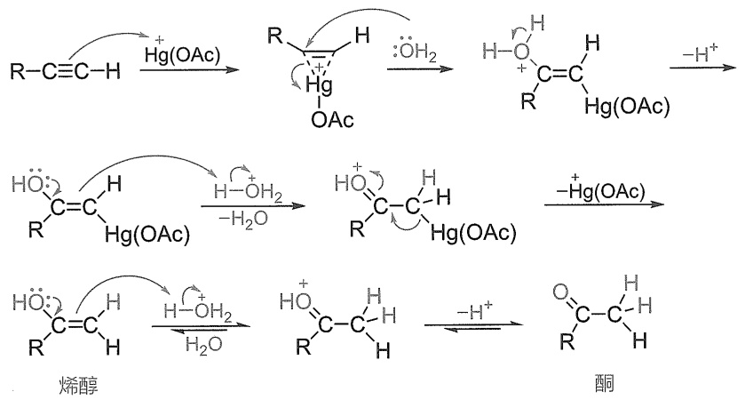

chemical

Reaction mechanism diagram showing hydrogenation and dehydration steps of a ketone to form an alcohol, with labeled intermediates and reagents.

炔烃水合反应遵循马氏规则，称为 Kucherov（库切洛夫）反应。只有乙炔可以得到乙醛，这是工业上生产乙醛的方法之一；其他末端炔烃都生成甲基酮（$\mathrm{RCOCH_3}$）；叁键在中部的非对称炔烃则形成两种酮的混合物。例如:

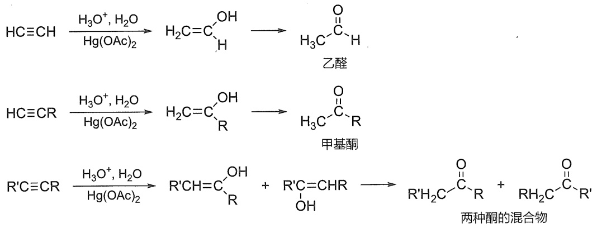

flowchart

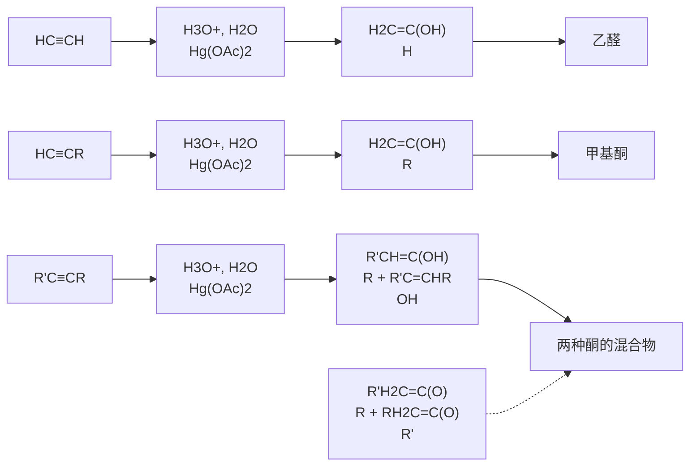

如果 $\mathrm{RC} \equiv \mathrm{CR}'$ 中 $\mathrm{R}$ 为一级烃基，$\mathrm{R}'$ 为二级或三级烃基，则由于汞离子体积比较大，空间位阻作用使得汞离子主要加成在与一级烃基 R 相连的叁键碳原子上，即中间体
 $\ce{R-C=C(R')C(OH)-R'}$  比  $\ce{HO-C=C(R')-R'}$  稳定，最终加成产物以  $\ce{RH2C=CC(=O)-R'}$  为主。

## 5.8.4 炔烃的硼氢化反应

炔烃与硼烷也反应，得到形式上的反马氏规则加成的烯基硼，再通过 C-B 键氧化形成烯醇中间体，最后生成产物醛或酮。例如:

$$
\mathrm{R} - \mathrm{C} \equiv \mathrm{CH} \xrightarrow {\mathrm{B} _ {2} \mathrm{H} _ {6}} (\mathrm{RCH} = \mathrm{CH}) _ {3} - \mathrm{B} \xrightarrow [ \mathrm{HO} ^ {-} ]{\mathrm{H} _ {2} \mathrm{O} _ {2}} \mathrm{RCH} = \stackrel {\mathrm{OH}} {\mathrm{CH}} \rightleftharpoons \mathrm{RCH} _ {2} \mathrm{CHO}
$$

由于硼氢化反应在形式上是反马氏规则的，因此与汞盐存在下的直接水合不同，只要是叁键在端位的炔烃，硼氢化反应生成的最后产物就是醛。而汞盐存在下的直接水合只有乙炔可以得到醛，其他炔烃都只生成酮。

$$
\mathrm{H} _ {3} \mathrm{C} - \mathrm{C} \equiv \mathrm{CH} \xrightarrow [ (2) \mathrm{H} _ {2} \mathrm{O} _ {2} , \mathrm{HO} ^ {-} ]{(1) \mathrm{B} _ {2} \mathrm{H} _ {6}} \mathrm{CH} _ {3} \mathrm{CH} _ {2} \mathrm{CHO}
$$

炔烃与乙硼烷反应先生成烯基硼，烯基硼再与羧酸反应生成 Z 型烯烃，该反应称为炔烃的硼氢化-还原反应，它为从炔烃转化为顺式烯烃提供了一种好方法。例如:

$$
\mathrm{H} _ {3} \mathrm{C} - \mathrm{C} \equiv \mathrm{C} - \mathrm{CH} _ {3} \xrightarrow {\mathrm{B} _ {2} \mathrm{H} _ {6}} \left(\underset {\mathrm{H}} {\overset {\mathrm{H} _ {3} \mathrm{C}} {\rightleftharpoons}} \underset {\mathrm{H}} {\overset {\mathrm{CH} _ {3}} {\rightleftharpoons}}\right) _ {3} \mathrm{B} \xrightarrow [ 0 ^ {\circ} \mathrm{C} ]{\mathrm{CH} _ {3} \mathrm{COOH}} \underset {\mathrm{H}} {\overset {\mathrm{H} _ {3} \mathrm{C}} {\rightleftharpoons}} \underset {\mathrm{H}} {\overset {\mathrm{CH} _ {3}} {\rightleftharpoons}}\left. \right)
$$

## 5.8.5 炔烃的催化氢化与 $\mathrm{Na - NH_3}$ 还原

与烯烃相似，炔烃也可以进行催化氢化。由于碳碳叁键含有两个 $\pi$ 键，因此，既可以与一分子氢加成得烯烃，也可以与两分子氢加成生成相应的烷烃。

$$
\mathrm{H} _ {3} \mathrm{C} - \mathrm{C} \equiv \mathrm{C} - \mathrm{CH} _ {3} \xrightarrow [ \mathrm{Pt} ]{\mathrm{H} _ {2}} \begin{array}{c} \mathrm{H} _ {3} \mathrm{C} \\ \mathrm{H} \end{array} \xrightarrow [ \mathrm{H} ]{\mathrm{CH} _ {3}} \xrightarrow [ \mathrm{Pt} ]{\mathrm{H} _ {2}} \mathrm{CH} _ {3} \mathrm{CH} _ {2} \mathrm{CH} _ {2} \mathrm{CH} _ {3}
$$

反应停留在哪一步取决于所用催化剂。因为在催化氢化中，炔烃在催化剂表面吸附作用较快，它的吸附阻止了烯烃在催化剂表面的吸附，而催化氢化主要是靠催化剂表面的吸附作用，因此炔烃更容易进行催化氢化，即炔烃比烯烃具有较大的反应活性。

利用叁键和双键在氢化反应活性上的差异，可以选择适当的催化剂，并控制一定的条件，使炔烃的氢化停留在烯烃阶段。如Lindlar（林德拉）催化剂或P-2催化剂，就是常用的选择性氢化催化剂。Lindlar催化剂是将沉积在碳酸钙上的金属钯用喹啉或乙酸铅处理，毒化了钯，使其活性降低；P-2催化剂是用硼氢化钠还原乙酸镍得到的硼化镍（$\mathrm{Ni}_2\mathrm{B}$）。使用这两种催化剂主要生成顺式烯烃。例如:

$$
\begin{array}{l} \mathrm{H} _ {3} \mathrm{C} - \mathrm{C} \equiv \mathrm{C} - \mathrm{CH} _ {3} \xrightarrow [ \text {Lindlar Pd} ]{\mathrm{H} _ {2}} \begin{array}{c} \mathrm{H} _ {3} \mathrm{C} \\ \mathrm{H} \end{array} \begin{array}{c} \mathrm{CH} _ {3} \\ \mathrm{H} \end{array} \\ \mathrm{H} _ {3} \mathrm{C} - \mathrm{C} \equiv \mathrm{C} - \mathrm{CH} _ {3} \xrightarrow [ \mathrm{Ni} _ {2} \mathrm{B} ]{\mathrm{H} _ {2}} \begin{array}{c} \mathrm{H} _ {3} \mathrm{C} \\ | \\ \mathrm{H} \end{array} = \begin{array}{c} \mathrm{CH} _ {3} \\ | \\ \mathrm{H} \end{array} \\ \end{array}
$$

若用强的催化剂，则炔烃氢化直接得到烷烃，而难以停留在烯烃阶段。例如，二苯乙炔用Lindlar催化剂加氢可停留在顺-1,2-二苯乙烯阶段；如果催化剂没有毒化，则产物是1,2-二苯乙烷。

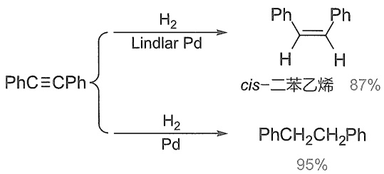

chemical

PhC≡CPh conversion reaction scheme using cis-2-methylbenzene catalyst, yielding cis-2-methylbenzene at 87% and PhCH2CH2Ph at 95%

由于叁键和双键在氢化反应活性上的差异，在烯炔分子中同时含有叁键和双键，催化氢化首先加氢到叁键上，而双键仍可保留。

炔烃在液氨中用金属锂或钠进行还原，得到的主要是反式烯烃，正好与催化氢化形成互补的二取代烯烃的合成方法。例如:

$$
\mathrm{H} _ {3} \mathrm{C} - \mathrm{C} \equiv \mathrm{C} - \mathrm{CH} _ {3} \xrightarrow [ \text {液NH} _ {3} ]{\mathrm{Na}} \begin{array}{c} \mathrm{H} \\ \mathrm{H} _ {3} \mathrm{C} \end{array} = \begin{array}{c} \mathrm{CH} _ {3} \\ \mathrm{H} \end{array}
$$

## 5.8.6 氧化反应

碳碳双键和叁键的活泼性还表现为容易被氧化。氧化产物因氧化剂和氧化条件的不同而不同。氧化时不仅  $\pi$  键可以打开，当条件强烈时， $\sigma$  键也可以断裂。

与烯烃相似，炔烃也能与高锰酸钾发生[3+2]环加成反应，但由于生成的中间体不稳定，无法像烯烃一样停留在双羟化的阶段，而是会进一步氧化得到叁键断裂的产物，生成二氧化碳或羧酸。炔烃的结构不同，则氧化产物各异。一般 $\equiv \mathrm{CH}$ 被氧化为 $\mathrm{CO}_{2}$，而 $\equiv \mathrm{CR}$ 基则被氧化为RCOOH。如将乙炔通入高锰酸钾水溶液，则高锰酸钾的紫色逐渐消失，被还原为褐色二氧化锰沉淀，与此同时碳碳叁键断裂，乙炔被氧化成二氧化碳和水。通过鉴定氧化产物的结构可确定叁键位置。

$$
\mathrm{R} - \mathrm{C} \equiv \mathrm{C} - \mathrm{R} ^ {\prime} \quad \xrightarrow [ \mathrm{HO} ^ {-} ]{\mathrm{KMnO} _ {4}} \quad \mathrm{RCOOH} + \quad \mathrm{R} ^ {\prime} \mathrm{COOH}
$$

通常叁键在氧化反应上也比双键活性差，如在同一化合物中既有叁键又有双键，在氧化时首先双键氧化而叁键仍可保留。

炔烃也能发生臭氧化反应，经历烯烃臭氧化类似的[3+2]环加成-重排-水解的历程，得到叁键氧化断裂的产物羧酸，通过臭氧化而后水解也可以用于推断炔烃的结构。

$$
\mathrm{R} - \mathrm{C} \equiv \mathrm{C} - \mathrm{R} ^ {\prime} \xrightarrow [ (2) \mathrm{H} _ {2} \mathrm{O} ]{(1) \mathrm{O} _ {3}} \mathrm{RCOOH} + \mathrm{R} ^ {\prime} \mathrm{COOH}
$$

除了能与 $\mathrm{O_3}$ 发生[3+2]环加成反应外，烯/炔烃也能与叠氮化合物（$\mathrm{RN_3}$）发生[3+2]环加成反应，得到三氮唑类杂环。在这类反应中，炔烃表现出比烯烃更高的反应活性，尤其是在铜离子催化下，端炔与叠氮化合物能快速反应，该反应也被称作第一代点击化学反应（click reaction），广泛应用于化学生物学等研究中。

炔烃亲核性较弱，因此无法像烯烃那样直接与过氧化物发生环氧化反应。

卡宾能与炔烃发生反应形成环丙烯类化合物，但反应活性要比烯烃的环丙烷化低得多。

## 5.8.7 Diels-Alder 反应

与烯烃类似，炔烃也能作为亲双烯体与共轭二烯发生[4+2]环加成反应，生成环己二烯，且由于炔烃比烯烃更缺电子，炔烃作为亲双烯体的反应活性比类似结构的烯烃更高。此外，

不妨思考一下，烯烃也能与碱金属发生类似还原吗？富电子烯烃还是缺电子烯烃更容易反应？

炔烃的电子质子还原

“点击化学”
相关的三位科学家获 2023 年诺贝尔化学奖。

2023年诺贝尔
化学奖
点击化学

四嗪 D-A 反应
点击化学

含炔基的双烯体参与的 D-A 反应

不像环己烯产物只能发生一种逆 D-A 反应，产物环己二烯可以有两种不同的逆 D-A 反应的路径，除了能通过逆 D-A 反应重新分解为原料二烯烃和炔烃外，还能通过另一个逆 D-A 反应路径，得到一种新的炔烃和一种新的 s-顺式二烯烃。

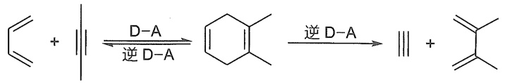

chemical

Chemical reaction equation showing D-A conversion to cyclohexane and subsequent D-A elimination

该策略被用在多种合成中，如 1,2,4,5-四嗪类化合物与高张力炔烃发生点击反应，炔烃依次经过 D-A 反应与逆 D-A 反应，取代了四嗪中的两个氮原子，形成吡嗪。

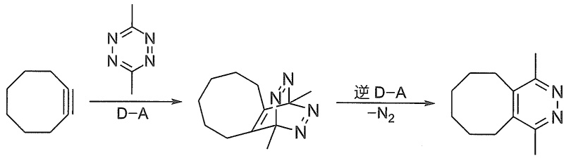

chemical

Chemical reaction pathway showing transformation of cyclohexyl to pyridine via D-A and N2 elimination steps

## 5.8.8 聚合反应

炔烃在一定条件下，也可以打开  $\pi$  键自相加成而发生聚合反应。但与烯烃不同，一般不易聚合为高聚物。在不同的催化剂和不同的反应条件下，可以聚合生成二聚、三聚或四聚的链状化合物。例如:将乙炔通入氯化亚铜氯化铵的强酸性溶液中，则发生双分子聚合，生成乙烯基乙炔。

$$
2 \mathrm{HC} \equiv \mathrm{CH} \xrightarrow [ \mathrm{NH} _ {4} \mathrm{Cl} ]{\mathrm{CuCl}} \mathrm{H} _ {2} \mathrm{C} = \mathrm{CH} - \mathrm{C} \equiv \mathrm{CH}
$$

乙烯基乙炔

聚乙炔介绍

乙烯基乙炔是重要的化工原料，它与 HCl 加成生成氯丁橡胶单体——2-氯丁-1,3-二烯。乙炔还可以在高温下三聚成环状结构；或者在稀土催化剂等的作用下聚合成聚乙炔。

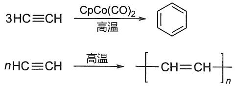

chemical

Two-step chemical reaction scheme showing conversion of 3HC≡CH to nHC≡CH under CpCo(CO)2 and high-temperature conditions

聚乙炔

## 5.8.9 炔氢的酸性和特性反应

直接连在叁键碳原子上的氢叫炔氢（$\equiv \mathrm{C - H}$），与乙烯氢或烷基上的伯、仲、叔氢比较，较为活泼。由于sp杂化碳原子的电负性较大，故在 $\equiv \mathrm{C - H}$ 中，C-H键极化程度较大，电子云偏向碳原子一端，使氢原子带部分正电荷，容易以质子的形式离去，具有一定酸性（$\mathrm{pK_a}$ 约为25，比水酸性弱）。

碱金属锂、钠或钾等能与炔烃分子中的活泼氢作用，取代氢而生成金属炔化合物，也叫金属炔化物，同时放出氢气。

$$
\mathrm{RC} \equiv \mathrm{CH} \xrightarrow {\mathrm{Li}} \mathrm{RC} \equiv \mathrm{CLi}
$$

另外，正丁基锂也可以与炔氢交换，用于制备炔锂。例如:

$$
\mathrm{R} - \mathrm{C} \equiv \mathrm{CH} + n - \mathrm{C} _ {4} \mathrm{H} _ {9} \mathrm{Li} \longrightarrow \mathrm{R} - \mathrm{C} \equiv \mathrm{CLi} + n - \mathrm{C} _ {4} \mathrm{H} _ {9} - \mathrm{H}
$$

炔钠或炔锂可以与卤代烃（一般为伯卤代烃）发生  $S_{N}2$  反应，在炔烃中引入烃基而得到一系列炔烃的同系物。

$$
\mathrm{R} - \mathrm{C} \equiv \stackrel {- +} {\mathrm{C}} \mathrm{Na} + \mathrm{R} ^ {\prime} - \stackrel {\rightarrow} {\mathrm{X}} \longrightarrow \mathrm{R} - \mathrm{C} \equiv \mathrm{C} - \mathrm{R} ^ {\prime} + \mathrm{NaX}
$$

炔钠或炔锂还能与醛酮进行亲核加成反应，生成炔醇（详见第九章醛酮）。这些反应的产物中既有碳碳叁键又有羟基，能进行多种反应，是有机合成的重要原料。

$$
\mathrm{R} - \mathrm{C} \equiv \mathrm{C} ^ {- +} \xrightarrow {\mathrm{R} ^ {\prime} \mathrm{C} = \mathrm{O}} \mathrm{R} - \mathrm{C} \equiv \mathrm{C} - \mathrm{C} - \mathrm{O} ^ {-} \xrightarrow {\mathrm{H} _ {2} \mathrm{O}} \mathrm{R} - \mathrm{C} \equiv \mathrm{C} - \mathrm{C} - \mathrm{OH}
$$

端炔的活泼氢还可以被一些重金属取代而生成金属衍生物。例如，将乙炔通入银氨溶液或氯化亚铜氨溶液中，则生成白色的乙炔银沉淀或棕红色的乙炔亚铜沉淀。

$$
\mathrm{HC} \equiv \mathrm{CH} + \mathrm{Ag} \left(\mathrm{NH} _ {3}\right) _ {2} ^ {+} \mathrm{OH} ^ {-} \longrightarrow \mathrm{AgC} \equiv \mathrm{CAg} \downarrow
$$

$$
\mathrm{HC} \equiv \mathrm{CH} + \mathrm{CuCl} _ {2} + \mathrm{NH} _ {3} \cdot \mathrm{H} _ {2} \mathrm{O} \longrightarrow \mathrm{CuC} \equiv \mathrm{CCu} \downarrow
$$

这些反应非常灵敏而且现象明显，因此常用于鉴别具有活泼氢的炔烃。另外，由于这些金属衍生物容易在盐酸、硝酸等作用下分解为原来的炔烃，所以也用于分离和提纯具有 $-C\equiv CH$ 结构的炔烃。

值得注意是，这些重金属炔化物与轻金属炔化物（炔钠和炔锂等）不同，潮湿时比较稳定，而干燥时极不稳定，遇撞击或受热容易发生爆炸。因此，在反应之后这些重金属炔化物必须及时用稀硝酸分解，以免发生危险。

## 5.8.10 炔烃的亲核加成反应

受 sp 杂化碳原子电负性的影响，炔烃比烯烃更难给出电子与亲电试剂反应，但接受亲核试剂的进攻却比烯烃容易得多。

在适当的条件下，端炔可与氢氰酸、醇、酸等含有活泼氢的试剂发生亲核加成，形成乙烯型负离子，从而生成多种取代烯烃。

例如，乙炔与氢氰酸在氯化铵-氯化亚铜水溶液中发生加成反应，生成丙烯腈。

$$
\mathrm{HC} \equiv \mathrm{CH} + \mathrm{HCN} \xrightarrow [ \mathrm{NH} _ {4} \mathrm{Cl} ]{\mathrm{CuCl}} \mathrm{CH} _ {2} = \mathrm{CHCN}
$$

反应中，碳碳叁键与亚铜离子配位，增强了炔烃的亲电性。由氢氰酸产生氰根负离子（$\mathrm{CN}^{-}$）作为亲核试剂进攻叁键的端碳原子，生成碳负离子，后者再与质子结合生成加成产物。

在碱的存在下，乙炔与醇进行加成反应生成乙烯基醚，反应需要较高温度和一定压力。反应历程一般认为是在碱催化下，甲氧基负离子进攻炔碳的亲核加成反应。

$$
\mathrm{HC} \equiv \mathrm{CH} + \mathrm{CH} _ {3} \mathrm{OH} \xrightarrow [ \text {加压} ]{20 \% \mathrm{KOH}} \mathrm{CH} _ {2} = \mathrm{CHOCH} _ {3}
$$

如果用羧酸代替醇，则可以与乙炔加成生成羧酸乙烯酯，醋酸乙烯酯是制备维尼龙的主要原料，醋酸与乙炔的亲核加成正是其主要合成方法之一。

由于炔氢酸性比炔丙氢酸性更强，内炔在强碱作用下会发生炔基移位反应，最终生成端炔。

炔烃移位反应

炔酰胺缩合剂
介绍

$$
\mathrm{HC} \equiv \mathrm{CH} + \mathrm{CH} _ {3} \mathrm{COOH} \xrightarrow [ \text {加热} ]{\text {催化剂}} \mathrm{CH} _ {2} = \mathrm{CHOCOCH} _ {3}
$$

碳碳叁键上连接烷氧基等给电子基团时，受 $\mathrm{p - }\pi$ 共轭给电子效应的影响，共轭体系增大，使得炔基醚的LUMO轨道能级降低，亲核试剂的HOMO轨道电子更容易流向该轨道，从而发生亲核加成反应。例如，乙基乙炔醚与羧酸的反应性比普通炔烃更强，无须高温加热就能与羧基反应形成烯醇酯。将炔醚换成炔酰胺后，与羧基的亲核加成反应无须催化剂，能直接在室温快速反应得到产物。这类羧基与炔基加成的产物可以用于酰胺的合成中。

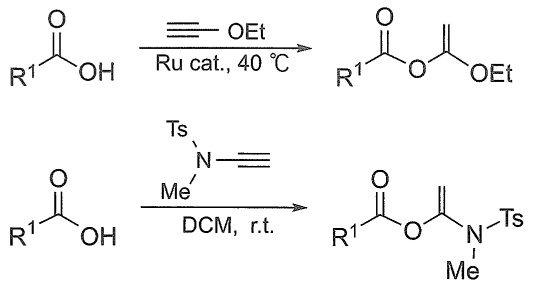

chemical

Two-step organic synthesis reaction scheme: Ru-catalyzed transformation followed by deprotection to form a thioamide derivative.

## 5.9 烯烃和炔烃的主要来源及制备

## 5.9.1 烯烃和炔烃的主要来源

大量的烯烃主要来源于石油裂解，尤其是乙烯、丙烯等低级烯烃目前在工业上主要通过高温裂解高沸点馏分得到。部分通过分离直接蒸馏石油所得的炼厂气获得，但数量有限。原料不同或裂解条件不同，得到各种烯烃的比例也不同。此外，将从天然气中得到的乙烷、丙烷、丁烷等进行高温裂化也可获得乙烯、丙烯。

乙炔是有机合成的重要原料，工业上可用煤、石油或天然气作为原料生产乙炔。电石法是最古老但迄今为止仍在工业上普遍使用的乙炔合成方法。焦炭和石灰在高温电炉中反应，得到碳化钙（电石）。需要乙炔时，在现场使电石与水反应，即得到乙炔。

$$
\begin{array}{l} \mathrm{CaO} + 3 \mathrm{C} \xrightarrow {1 8 0 0 \sim 2 1 0 0 ^ {\circ} \mathrm{C}} \mathrm{CaC} _ {2} + \mathrm{CO} \\ \mathrm{CaC} _ {2} + 2 \mathrm{H} _ {2} \mathrm{O} \longrightarrow \mathrm{Ca(OH)} _ {2} + \mathrm{HC} \equiv \mathrm{CH} \end{array}
$$

电石法虽然生产工艺比较简单，但是成本高、能耗大，许多发达国家已逐步采用廉价的天然气作为生产乙炔的原料。甲烷在 $1500^{\circ}\mathrm{C}$ 的电弧中经极短时间（$0.01\sim 0.1\mathrm{s}$）加热后通过一系列的反应生成乙炔，这是一个强烈的吸热过程。因此，在生产工艺上经常是同时让一部分甲烷被氧化（加入氧气），由此过程产生的热量来供给甲烷合成乙炔所需要消耗的大量热量。所以此法又叫作甲烷的部分氧化法，反应产物包括乙炔、一氧化碳和氢气。

$$
5 \mathrm{CH} _ {4} + 3 \mathrm{O} _ {2} \longrightarrow \mathrm{C} _ {2} \mathrm{H} _ {2} + 3 \mathrm{CO} + 6 \mathrm{H} _ {2} + 3 \mathrm{H} _ {2} \mathrm{O}
$$

在天然气资源丰富的国家，此方法的成本较低，适宜大规模生产。等离子法是近期发展的一种用石油和极热的氢气一起热裂制备乙炔的新方法，即把氢气在3500～4000℃的电弧中加热，然后部分离子化的等离子体氢（正负离子相等）与汽化的石油气反应，生成乙炔、乙烯（二者的总产率在70%以上）以及甲烷和氢气。

由于乙炔的生产成本相当高，近几十年来，许多使用乙炔为原料生产化学品的合成路线逐渐改用其他原料（特别是乙烯或丙烯）的生产路线。

## 5.9.2 烯烃的制备

烯烃实验室制备的关键是如何引入双键，常用的方法有两种，一种是在已有的分子骨架上构筑 C=C 双键；另一种是在构筑 C=C 双键的同时，构建整个分子骨架。本节主要介绍前者，后一种方法以后再详解。

## 1. 醇脱水

醇和酸（如硫酸、磷酸、草酸）一起加热，脱去一分子水而生成烯烃。例如:

$$
\begin{array}{c} \mathrm{H} _ {2} \mathrm{C} - \mathrm{CH} _ {2} \\ | - - - | - - - \\ \mathrm{H} \quad \mathrm{OH} \end{array} \xrightarrow [ \text {或} \mathrm{Al} _ {2} \mathrm{O} _ {3} , 3 6 0 ^ {\circ} \mathrm{C} ]{\mathrm{H} _ {2} \mathrm{SO} _ {4} , 1 7 0 ^ {\circ} \mathrm{C}} \mathrm{H} _ {2} \mathrm{C} = \mathrm{CH} _ {2} + \mathrm{H} _ {2} \mathrm{O}
$$

硫酸在反应中既是脱水剂又是催化剂。将醇蒸气在高温下通过氧化铝等催化剂也得到烯烃。

## 2. 卤代烷脱卤化氢

此反应一般在乙醇溶液中进行。在强碱（常用氢氧化钾和氢氧化钠）存在下，卤代烷脱去一分子卤化氢而得烯烃。例如:

$$
\begin{array}{c} \mathrm{CH} _ {3} \mathrm{CH} _ {2} - \mathrm{CH} - \mathrm{CH} _ {2} + \mathrm{KOH} \xrightarrow {\text {乙醇}} \mathrm{CH} _ {3} \mathrm{CH} _ {2} \mathrm{CH} = \mathrm{CH} _ {2} + \mathrm{KCl} + \mathrm{H} _ {2} \mathrm{O} \\ \mathrm{H} \quad \mathrm{Cl} \\ \mathrm{CH} _ {3} - \mathrm{CHCH} _ {2} \mathrm{CH} _ {3} \xrightarrow [ \text {醇} ]{\text {KOH}} \mathrm{CH} _ {3} - \mathrm{CH} = \mathrm{CH} - \mathrm{CH} _ {3} \\ \mathrm{Br} \end{array}
$$

## 3. 邻二卤化物脱卤反应

除上面两种方法外，邻二卤代物在金属 Zn、Mg 等作用下，失去两个卤原子可生成烯烃，此方法叫作还原消除反应(reduction elimination)。反应按照 E1cb 机理进行(详见第 4.4.3 节)。这个还原消除反应结合烯烃与卤素的加成反应，组成了双键保护和脱保护的一种办法。

$$
\begin{array}{c} \mathrm{H} _ {3} \mathrm{C} - \mathrm{CH} - \mathrm{CH} - \mathrm{CH} _ {3} + \mathrm{Zn} \longrightarrow \mathrm{CH} _ {3} \mathrm{CH} = \mathrm{CHCH} _ {3} + \mathrm{ZnBr} _ {2} \\ | \\ \mathrm{Br} \quad \mathrm{Br} \end{array}
$$

## 4. 炔烃的还原反应

炔烃在 Lindlar 催化剂的作用下可部分氢化，优先生成顺式烯烃；或者在液氨中用金属钠还原炔烃，则主要生成反式烯烃。

## 5.9.3 炔烃的制备

炔烃的实验室制备主要有两个途径:一是在已有的分子骨架上构筑 C≡C 键；二是由乙炔和末端炔烃的金属炔化物制备炔的同系物。

## 1. 由烯烃或二卤代烃制备

在碱性条件下，邻二卤代烷或偕二卤代烷首先失去一分子卤化氢生成乙烯基卤代烃，然后在强碱、高温等更加剧烈的条件下，再失去一分子卤化氢生成炔烃。 $NaNH_{2}$ 、NaOH或KOH为常用的碱，石油醚或醇是常用的溶剂。

$$
\begin{array}{c} \mathrm{R-CH-CH-R} \\ \stackrel {{\downarrow}} {{X}} \quad \stackrel {{\downarrow}} {{X}} \end{array} \xrightarrow {\text {KOH, EtOH}} \begin{array}{c} \mathrm{R-CH=C-R} \\ \stackrel {{\downarrow}} {{X}} \end{array} \xrightarrow {\text {NaNH} _ {2}} \begin{array}{c} \mathrm{R-C} \equiv \mathrm{C-R} \end{array}
$$

## 2. 由金属炔化物制备炔烃

这类反应称为炔烃的烷基化反应，是制备炔烃的重要方法之一。乙炔或末端炔烃可以与金属钠或氨基钠作用得到炔钠，炔钠是很好的碳负离子供给源，作为强亲核试剂可以与伯卤代烷发生取代反应得到碳链增长的炔烃。常用的金属炔化物有炔化钠、炔化锂、炔基格氏试剂，卤代烃主要是一级卤代烃（二级、三级卤代烃在碱性条件下易发生消除反应）。例如:

$$
(\mathrm{CH} _ {3}) _ {3} \mathrm{CCH} _ {2} \mathrm{CHCl} _ {2} \xrightarrow [ \mathrm{NH} _ {3} ]{3 \mathrm{NaNH} _ {2}} (\mathrm{CH} _ {3}) _ {3} \mathrm{CC} \equiv \mathrm{CNa} \xrightarrow {\mathrm{RX}} (\mathrm{CH} _ {3}) _ {3} \mathrm{CC} \equiv \mathrm{CR}
$$

偕二氯化物

$$
\mathrm{CH} _ {3} \left(\mathrm{CH} _ {2}\right) _ {7} \mathrm{CH} - \mathrm{CH} _ {2} \mathrm{Br} \xrightarrow [ \mathrm{NH} _ {3} ]{3 \mathrm{NaNH} _ {2}} \mathrm{CH} _ {3} \left(\mathrm{CH} _ {2}\right) _ {7} \mathrm{C} \equiv \mathrm{CNa} \xrightarrow {\mathrm{RX}} \mathrm{CH} _ {3} \left(\mathrm{CH} _ {2}\right) _ {7} \mathrm{C} \equiv \mathrm{CR}
$$

邻二溴化物

## 5.10 联烯

## 5.10.1 联烯的结构

联烯（allene）是一种累积二烯烃，丙-1,2-二烯是最简单的联烯。如图5-4所示，丙-1,2-二烯的两个端位碳原子采取 $sp^{2}$ 杂化，中间的碳原子采取sp杂化；边上的两个碳原子与氢原子分别形成两个 $\left(\mathrm{C}_{\mathrm{sp}^{2}}-\mathrm{H}_{1\mathrm{s}}\right)\sigma$ 键，三个不饱和碳原子形成的两个 $\left(\mathrm{C}_{\mathrm{sp}^{2}}-\mathrm{C}_{\mathrm{sp}}\right)\sigma$ 键在一条直线上；此外，未参与杂化的碳原子p轨道在两个碳原子之间形成两个相互垂直的 $\left(\mathrm{C}_{2\mathrm{p}}-\mathrm{C}_{2\mathrm{p}}\right)\pi$ 键；这样，丙-1,2-二烯的碳氢原子处于相互垂直的两个平面上。

联烯的衍生物中，由于另外两个 $\pi$ 键所在的平面相互垂直，如果每个 $\mathfrak{sp}^2$ 杂化碳原子上的两个基团各不相同，即 $\mathrm{R}^{1}\neq \mathrm{R}^{2},\mathrm{R}^{3}\neq \mathrm{R}^{4}$，则该结构就具有手性。化合物1,3-二苯基-1,3-二(α-萘基)丙-1,2-二烯是第一种人工合成的具有手性的联烯衍生物（见第二章）。

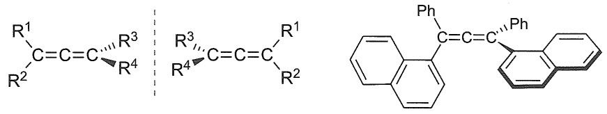

chemical

Chemical structures of substituted benzene derivatives with R groups and phenyl substituents

## 5.10.2 联烯的反应

联烯是一类高活性的反应物，许多联烯的结构本身就无法稳定存在，容易转化成共轭烯烃或炔烃，丙二烯很容易通过氢转移转化成丙炔。烃基取代能较好地稳定住联烯的结构，多取代联烯在室温下具有较好的稳定性。

联烯的亲电加成反应涉及两个 C=C 键的化学选择性，加成的区域选择性、产物烯烃的 Z/E 选择性及新形成手性碳的对映选择性等。常规反应通常会得到多种产物，合成价值不高。但在底物中引入合适的邻基参与元素能高选择性地得到单一的产物。亲核加成反应方面，亲核试剂一般倾向于进攻 sp 杂化的碳原子，形成更稳定的碳负离子，由于烯丙基碳负离子存在不同的共振式，因此产物常伴有双键移位的发生。我国化学家麻生明院士在联烯化学方面开展了许多引领性的研究。

联烯化学性质

联烯的双键迁移反应

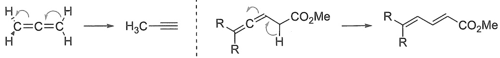

chemical

Chemical reaction mechanism showing cycloaddition of a ketone to form an alkene with CO2Me group

联烯的亲电加成反应

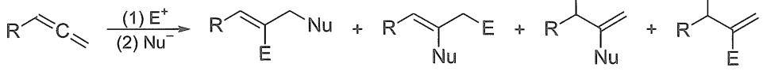

chemical

Chemical reaction equation showing nucleophilic substitution of a carbonyl compound with E⁺ and Nu⁻ ions

联烯的亲核加成反应

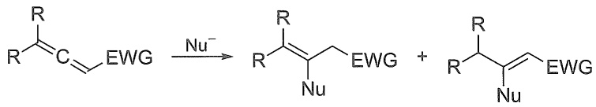

chemical

Chemical reaction equation showing the formation of a chiral amine from an enone using Nussel-elimination

习题

1. 给出下列化合物的中文系统名和英文 IUPAC 名称。

(1)  $CH_{3}CH=CHCH_{3}$ 

$CH_{3}$

(2)  $CH_{3}CH_{2}C=C-CHCH_{3}$ 

 $CH_{3}$   $CH_{3}$

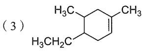

(4)

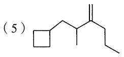

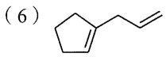

(7)

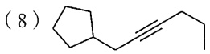

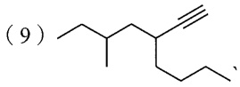

2. 试说明累积二烯烃中三个双键原子碳是否使用同样的杂化轨道成键。

3. 判断下列各组化合物的氢化热高低。

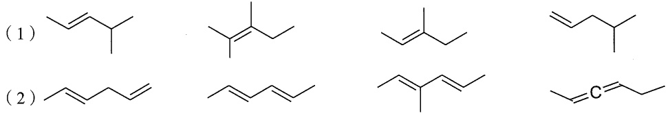

4. 写出下列化合物与 HBr 反应的主要产物。

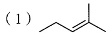

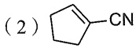

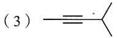

(4)  $CH_{3}OCH=CH_{2}$

(5)  $(\mathrm{CH}_{3})_{3}\stackrel{+}{\mathrm{N}}-\mathrm{CH}=\mathrm{CH}_{2}$

(6) $\mathrm{CF}_3\mathrm{CH} = \mathrm{CHCl}$

5. 预测下列化合物在硫酸催化下与水反应的可能产物，画出反应中的碳正离子，分析判断主要产物的构型。

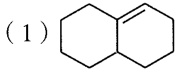

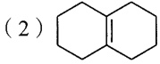

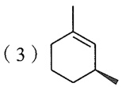

6. 写出下列加成反应的1,2-和1,4-加成产物，并分析哪个是热力学控制，哪个是动力学控制。

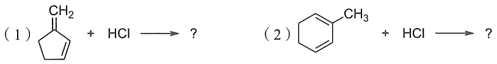

7. 共轭二烯与 HBr 发生亲电加成反应时可能会有 1,2- 和 1,4- 两种加成模式，指出下列亲电加成反应中哪个是热力学控制产物，哪个是动力学控制产物，并简述理由。

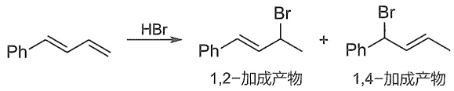

chemical

Chemical reaction equation showing hydrogenation of a diene to form 1,2- and 1,4- alcohols

8. 烯烃可以与质子发生亲电加成反应，因此烯烃与碳正离子可以看成一对 Brønsted 酸碱对:

$$
\mathrm{H} _ {2} \mathrm{C} = \mathrm{CH} _ {2} \xrightarrow [ - \mathrm{H} ^ {+} ]{\mathrm{H} ^ {+}} \mathrm{H} _ {3} \mathrm{C} - \stackrel {{+}} {\mathrm{CH}} _ {2 _ {\circ}}
$$

试比较下列三个碳正离子的 Brønsted 酸性的强弱。

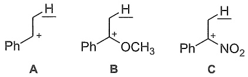

9. 下列反应主要产物是 A、B、C 中的哪个？试画出反应机理并说明原因。

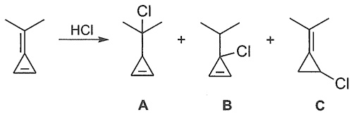

chemical

Chemical reaction showing chlorination of a ketone under HCl to form products A, B, and C

10. 完成下列反应，并写出其化学反应机理。

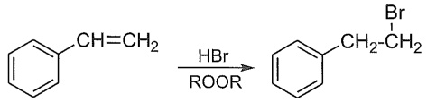

chemical

Chemical reaction equation showing bromination of a benzene derivative using HBr in ROOR solvent

11. 解释下列实验结果。

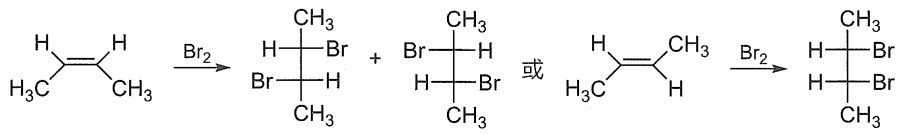

chemical

Chemical reaction equation showing bromination and rearrangement of a cyclohexane derivative

12. 写出 $(R) - 3-$ 甲基环己烯与下列试剂作用的产物，准确表示产物的构型。如果有多种可能的产物，请指出其主要产物。

(1)  $Br_{2}$ ; (2) HCl; (3)  $H_{3}O^{+}$ ; (4) 浓硫酸; (5)  $B_{2}H_{6}$ ,  $Et_{2}O$ ; (6)  $\mathrm{Hg(OAc)}_{2}$ ;
(7)  $Br_{2}$ ,  $HO^{-}$ ,  $H_{2}O$ ; (8)  $CHCl_{3}$ , KOH; (9) HBr,  $(t-BuO)_{2}$ ; (10)  $CH_{2}I_{2}$ ,  $\mathrm{Zn(Cu)}$ .

13. 写出下面反应的机理。

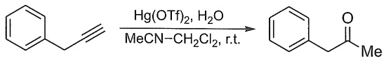

chemical

Chemical reaction equation showing benzene ring reacting with Hg(OTf)2 and H2O to form a ketone

14. 给下列反应提供合理的机理。

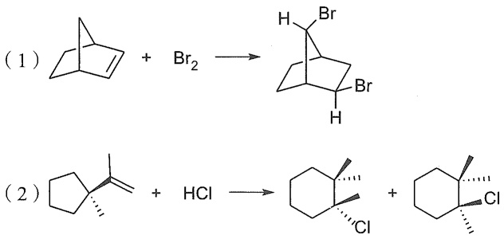

15. 与溴镝离子历程类似，在烯烃的硫三氟甲基化历程中也经历了镝离子历程，如下所示:

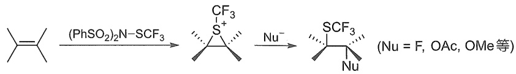

chemical

Chemical reaction scheme showing sulfonation of a sulfonamide derivative using (PhSO₂)₂N-SCF₃ and Nusselium ion to form a sulfonamide product with Nusselium ions.

试写出下列反应的产物，并解释区域选择性与立体选择性。

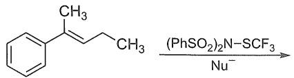

chemical

Chemical reaction equation showing benzene ring reacting with (PhSO₂)₂N-SCF₃ under condition Nu⁻

16. 利用手性催化剂 $\mathrm{R}^*\mathrm{SeR}$ 与氯鎓离子相互作用，可以使烯烃的亲电加成反应实现高立体选择性的控制。

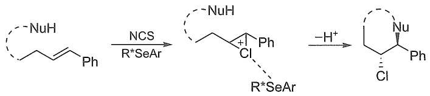

chemical

Organic reaction mechanism showing NCS-mediated cyclization of a chiral amine to form a substituted cycloaddition intermediate with H+ ion

回答下列问题:

（1）催化剂 $\mathrm{R}^{*}\mathrm{SeR}$ 能与 $\mathrm{Cl}^{+}$作用，根据Lewis酸碱作用理论，$\mathrm{Cl}^{+}$与该催化剂分别属于Lewis酸还是Lewis碱？
（2）解释反应的区域选择性与立体选择性。
17. 下列亲电加成反应主产物是哪一个？画出反应中间体的纽曼投影式，用构象分析说明生成主要产物的原因。

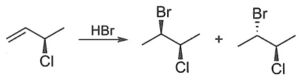

chemical

Chemical reaction equation showing bromination of a chloroalkene to form a brominated alkane and a brominated alkene

18. 下列亲电加成反应主产物是哪一个？画出反应中间体的扭船式构象，用构象分析说明生成主要产物的原因。

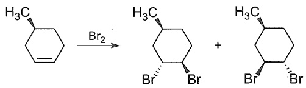

chemical

Chemical reaction showing bromination of a cyclohexene derivative with Br₂ to form a cyclohexane derivative and another cyclohexane derivative

19. 碳正离子作为亲电试剂可以对烯烃加成，试为以下反应提出合理的反应机理。（提示:第一步是环溴镝离子开环形成碳正离子。）

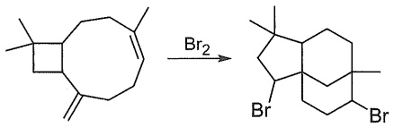

chemical

Chemical reaction showing bromination of a cyclohexane derivative with Br₂ group

20. 分子里相邻的基团有时会通过邻基参与效应影响反应，试写出下列烯烃与 HBr 发生亲电加成的反应机理。

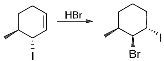

chemical

Chemical reaction showing bromination of a cyclohexene derivative with HBr to form a brominated cyclohexane product

21. 下列烯烃的亲电氯化反应可以进一步诱发串联环化反应，实现比较少见的萘胺的去芳构化，试写出下列反应的机理。

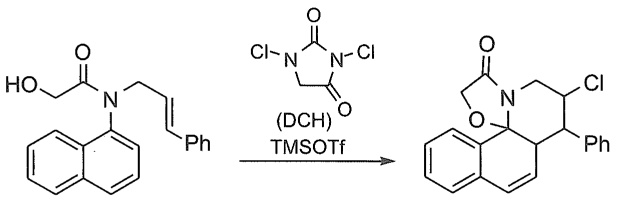

chemical

Chemical reaction showing conversion of a naphthalene derivative to a fused heterocyclic compound using chloroacetamide and TMSOTf reagent

提示:DCH / TMSOTf = Cl $^{+}$

22. 请解释下列反应的立体化学，为什么两个氢原子在环的同侧，且都朝上？

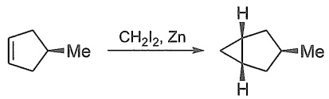

chemical

Chemical reaction showing zirconium complex formation from cyclopentene with methyl and hydrogen substituents

23. 结合本章学习的烯烃亲电加成和第四章学习的E1反应，可以推测苯环的亲电取代反应机理如下:

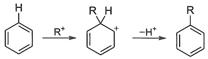

chemical

Chemical reaction pathway showing hydrogenation and reduction steps of a substituted benzene derivative

试结合烯烃的亲电加成反应，写出下列反应的机理。

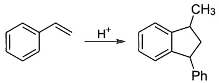

chemical

Chemical reaction showing hydrogenation of a substituted benzene derivative to form a fused bicyclic compound with methyl and phenyl groups

24. 邻基参与作用能让常规的反应产生新的变化。烯丙基化合物 A 在与溴单质发生亲电加成反应时，因邻基参与作用，得到了苯氨基迁移的产物，试画出下列反应的反应机理。

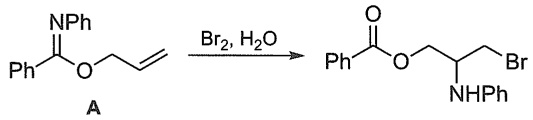

chemical

Chemical reaction converting compound A to a brominated ester with NHPh and Br group

25. 写出下面反应的机理。

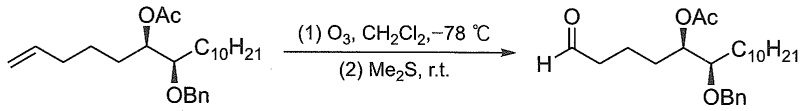

chemical

Organic reaction scheme showing conversion of a ketone to a ketone with acetyl group under specified conditions

26. 写出下面反应的产物和机理。

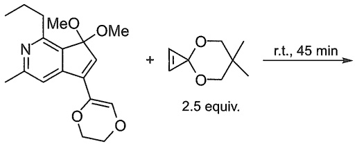

chemical

Chemical reaction equation showing a complex with methoxy and ester groups reacting with a cyclohexyl ether under room temperature for 45 minutes

27. 设计下列合成所需的条件，并且写出反应机理。

28. 某化合物的分子式为  $C_{5}H_{10}$ ，它能吸收 1 分子氢，与  $KMnO_{4}/H_{2}SO_{4}$  作用生成 1 分子含有 4 个碳原子的羧酸，经臭氧化还原水解后得到两个不同的醛，试推测此化合物可能的构造式。此烯烃有没有顺反异构呢？

29. 给出经臭氧化，锌粉水解后生成下列产物的烯烃的结构。

(1)  $CH_{3}CHO$  和 HCHO

(2)  $CH_{3}CH_{2}COCH_{3}$  和  $CH_{3}CH_{2}CHO$
(3)  $CH_{3}CHO$ ,  $CH_{3}COCH_{3}$  和  $OHCCH_{2}CHO$
30. 不饱和羰基化合物通过烯醇互变可以形成二烯醇，这类二烯醇可以与醛或活泼酮发生类似于Diels-Alder反应的[4+2]环加成反应，试用共振式分析下列反应式中化合物I和II的电子分布，并推测反应主要产物是A还是B。

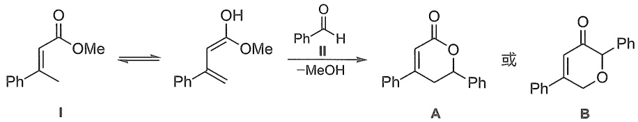

chemical

Chemical reaction scheme showing transformation of compound I to products A and B under formaldehyde and methanol conditions

31. 写出 2,2-二甲基己-3-炔和 2,4-二甲基己-3-炔分别与下列试剂反应的产物。

(1) $\mathrm{H}_3\mathrm{O}^+$, $\mathrm{Hg}^{2+}$; (2) 1.0 equiv. $\mathrm{Br}_2$; (3) 1.0 equiv. HBr; (4) 2.0 equiv. HBr;
(5) A.  $B_{2}H_{6}$ ,  $Et_{2}O$ , B.  $H_{2}O_{2}$ ,  $HO^{-}$
32. 指出 $(E)$-戊-2-烯和2-甲基己-3-炔在下列条件下是否发生反应，如果发生，写出反应产物。
(1) $\mathrm{H}_2 / \mathrm{Ni}$; (2) $\mathrm{Na - NH_3(liq.)}$; (3) Lindlar 催化剂; (4) $\mathrm{KMnO_4 / HO^-}$; (5) $\mathrm{KMnO_4}$, $\mathrm{H^{+} / \Delta}$; (6) $m$-CPBA;
(7) A.  $O_{3}$ ; B.  $H_{2}O_{2}$ ; (8) A.  $O_{3}$ ; B. Zn,  $H_{2}O$ ; (9) A.  $O_{3}$ ; B.  $H_{2}O$ ; (10)  $OsO_{4}/H_{2}O_{2}$

说明:（7）和（8）对烯烃，（9）对炔烃。

33. 嘧啶与炔烃混合加热能生成多取代的吡啶。试给出下列反应的可能机理。

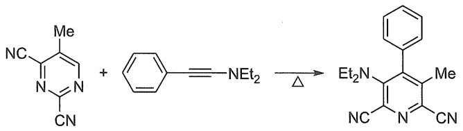

chemical

Chemical reaction equation showing the synthesis of a substituted pyridine derivative from cyano and benzene derivatives

（本章编者 朱庭顺、汪波、赵晓丹、赵蓓、袁丹）

本章习题
参考答案

## 第六章

## 芳香烃

6.1 芳烃的分类、命名和结构 …… 176
6.2 芳香性和休克尔规则 …… 180
6.3 芳烃的亲电取代反应 191
6.4 芳香亲电取代反应的定位效应 … 208

6.5 芳香亲核取代反应 216
6.6 芳烃的氧化还原反应 …… 225
习题 230

芳香烃（aromatic hydrocarbon），又名芳烃（arene），是一类具有特殊稳定性且含有环状共轭体系的碳氢化合物，如苯分子。苯及其衍生物称为苯系芳烃（benzenoid），其最初是从树木和植物中提取的芳香树脂中分离出来的，因此这些化合物因其愉悦的气味而被描述为“芳香性”的（aromatic）。随着有机化学的发展，化学家发现许多苯的衍生物实际上是无味的，“芳香性”更多是指一类具有特殊稳定离域键的特性。芳烃具有的这种特殊稳定性称为芳香性（aromaticity）。最常见具有芳香性的化合物是含苯环的化合物，而不含苯环的芳烃称为非苯芳烃（non-benzenoid），共轭环内含有杂原子（氧、氮、硫）的芳烃称为芳香杂环化合物（aromatic heterocycle）。芳烃虽然含有单键、双键和碳环，但它们的化学性质与烷烃、烯烃、炔烃及脂环烃都有很大区别，如不易发生不饱和烃所特有的加成和氧化反应，而容易发生取代反应。本章主要讨论现代芳香性的定义与芳烃的典型取代反应。对非苯芳烃只做简单介绍，而芳香杂环化合物将在第十二章讨论。

## 6.1 芳烃的分类、命名和结构

## 6.1.1 芳烃的分类

根据所含苯环的数目和联结方式的不同，苯系芳烃可以分为单环芳烃和多环芳烃两大类。单环芳烃是指分子中只含有一个苯环的芳烃，如苯、甲苯、氯苯和硝基苯等。

多环芳烃（polycyclic aromatic hydrocarbon, PAH）指分子中含有两个或多个苯环的芳烃。根据苯环的连接方式不同，多环芳烃又可分为联苯、多苯脂肪烃和稠环芳烃三类。

（1）联苯类化合物:多个苯环以单键直接相连的化合物，如联苯等。
（2）多苯脂肪烃类化合物:苯环之间相隔一个及一个以上  $sp^{3}$  杂化碳原子的化合物，如二苯甲烷、三蝶烯和杯芳烃等。
（3）稠环芳烃类化合物:两个或多个苯环共用两个相邻碳原子稠合而成的化合物，如萘、蒽、菲、苯并芘等。

含有苯环的物质在动物和植物中都很常见。植物可以从二氧化碳、水和无机材料中合成苯环。动物不能合成它，但依赖某些芳香族化合物来生存，因此必须从食物中获取。如苯丙氨酸、酪氨酸、色氨酸等必需氨基酸，以及维生素 K、B2（核黄素）和 B9（叶酸）都含有苯环。许多重要的药物分子也含有苯环，见图 6-1。

chemical

Complex organic molecule structure with benzene, chloro, and amino groups

氨氯地平
(治疗高血压及心脏病药物)

chemical

Chemical structure of a chlorinated pyridine derivative with 2H3PO4 counterion

磷酸氯喹
(抗疟疾药物)

chemical

Chemical structure of a complex organic molecule with cyclohexanone, chloro, and hydroxyl groups

恩格列净
(治疗糖尿病药物)

chemical

Complex organic molecule structure with multiple functional groups including carboxylic acid, hydroxyl, and amide linkages

利福平
(抗结核药物)

地蒽酚
(抗牛皮癣药物)

图 6-1 常见含苯环的药物分子

多环芳烃大多是致癌物，例如苯并[a]芘就是强致癌化合物之一，它存在于煤焦油中，也从香烟烟雾、汽车尾气和木炭烤牛排中分离出来。每千克体重只需要几毫克苯并[a]芘，就可以诱发实验动物癌症。

苯并[a]芘

## 6.1.2 苯系芳烃的命名

## 1. 常见母体氢化物

芳烃的命名一般以苯为母体氢化物，苯甲醛、苯胺、苯酚和苯甲酸等作为俗称，在命名时还常用作官能性母体氢化物，若有取代基则称为某苯甲醛、某苯胺、某苯酚、某苯甲酸等。此外，联苯、萘、蒽和菲等也可作为母体氢化物。其中萘和蒽的1,4,5,8位置相同，亦称为 $\alpha$ 位，2,3,6,7位置相同，称为 $\beta$ 位，而蒽和菲中的9,10位置相同，称为 $\gamma$ 位。

苯
benzene

苯胺
aniline

苯酚
phenol

苯甲醛
benzaldehyde

苯甲酸
benzoic ácid

联苯
1,1'-biphenyl

萘
naphthalene

蒽
anthracene

菲
phenanthrene

## 2. 无特性基团的芳烃命名

若芳烃苯环上没有特性基团，一般以芳烃为母体，读作某（基）苯（联苯、萘、蒽等），