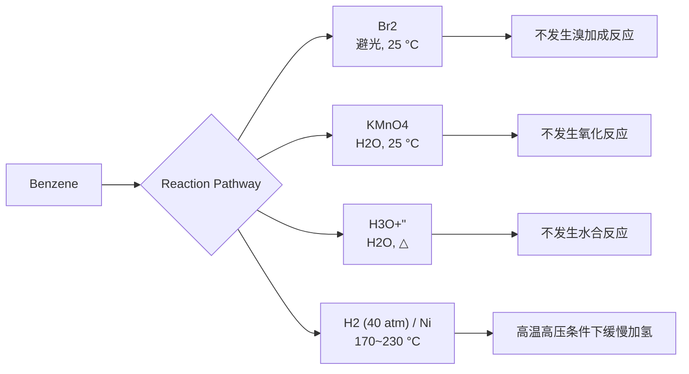
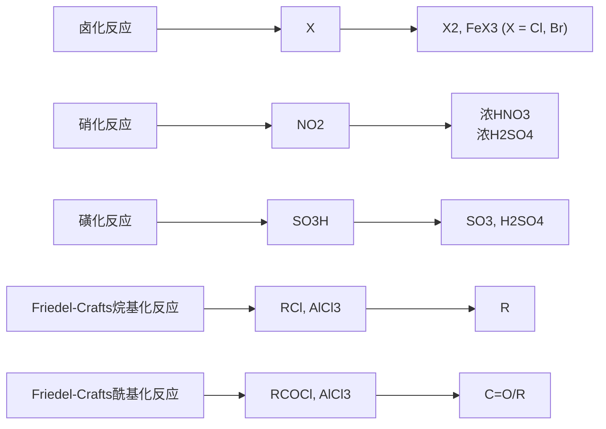
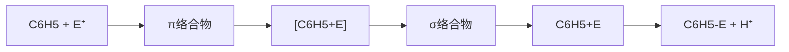

例如硝基 $\left(-NO_{2}\right)$ 、亚硝基 $\left(-NO\right)$ 、卤素 $\left(-X\right)$ 、简单烃基等作取代基。

硝基苯
nitrobenzene

溴苯
bromobenzene

乙苯
ethylbenzene

乙烯苯或苯乙烯(俗称)
styrene

chemical

Chemical structure of a nitro-substituted benzene derivative with two benzene rings and numbered positions

4,4'-二硝基联苯
4,4'-dinitro-1,1'-biphenyl

1-甲基-8-硝基萘
1-methyl-8-nitronaphthalene

1-溴-8-乙烯基蒽
1-bromo-8-vinylanthracene

此处要注意，烃基取代苯的命名取决于烃基的大小。如果烃基小于苯环（烃基的碳原子数为6或更少），则烃基为取代基，如异丙苯。如果烃基大于苯环（烃基的碳原子数为7或更多），则苯基为取代基，如1-苯基庚烷、1-苯基萘。当苯环被认为是取代基时，苯基可缩写为Ph（希腊语phi），用于表示 $C_{6}H_{5}$ 单元。

异丙苯
cumene

1-苯基庚烷
1-phenylheptane

1-苯基萘
1-phenylnaphthalene

若芳烃苯环上没有特性基团，但支链含有特性基团，应以含特性基团的支链为母体氢化物，苯基为取代基，而不管支链碳原子数比芳香环碳原子数多还是少。

苯乙酮
acetophenone

1-萘乙酮
1-(naphthalen-1-yl)ethan-1-one

chemical

Chemical structure of a naphthalene derivative with a carboxylic acid substituent

2-(蒽-1-基)乙酸
2-(anthracen-1-yl)acetic acid

## 3. 有特性基团的芳烃命名

若芳烃苯环上有特性基团，且苯环上有多种取代基，应首先选择最优特性基团。特性基团的优先顺序如表6-1所示，排在前面的为特性基团，排在后面的为取代基。

单环芳烃编号时，把特性基团所在位作为1位，单环芳烃的母体氢化物依次用阿拉伯数字编号，或用邻（ortho-，简写为o-）、间（meta-，简写为m-）、对（para-，简写为p-）等字表示。

表 6-1 特性基团的优先顺序

| 优先次序 | 基团 | 官能团名 | 英文名 | 优先次序 | 基团 | 官能团名 | 英文名 |
| --- | --- | --- | --- | --- | --- | --- | --- |
| 1 | -COOH | 酸 | -oic acid | 8 | -CO- | 酮 | -one |
| 2 | -SO3H | 磺酸 | -sulfonic acid | 9 | -OH | 酚、醇 | -ol |
| 3 | -C(O)O(O)C- | 酸酐 | -anhydride | 10 | -NH2 | 胺 | -amine |
| 3 | -COOR | 酯 | -oate | 11 | -OR | 醚 | -ether |
| 4 | -COX | 酰卤 | -oyl chloride | 12 | -C≡C- | 炔 | -yne |
| 5 | -CONH2 | 酰胺 | -amide | 12 | -C=C- | 烯 | -ene |
| 6 | -CN | 腈 | -nitrile | 12 | -R | 烷 | -ane |
| 7 | -CHO | 醛 | -al |  |  |  |  |

间二甲苯
(1,3-二甲苯)

对二甲苯
(1,4-二甲苯)

邻二甲苯
(1,2-二甲苯)

对氯苯酚
4-chlorophenol

对氨基苯磺酸
4-aminobenzenesulfonic acid

间溴苯甲醛
3-bromobenzaldehyde

其他多取代单环芳烃必须用阿拉伯数字编号，应尽量使其他取代基的编号较小。例如:

3-羟基-5-甲基苯甲酸
3-hydroxy-5-methylbenzoic acid

chemical

Chemical structure of 2-methoxybenzoic acid, showing nitro and hydroxyl groups on a benzene ring

2,4,6-三硝基苯酚
2,4,6-trinitrophenol

联苯类或稠环类化合物应在保证特性基团编号最小的情况下，依次考虑主体特性基团最多、取代基最多、最低次序规则和取代基英文字母顺序规则，选择其中的一个苯环优先编号。

chemical

Chemical structure of a flavonoid compound with two benzene rings and a carboxylic acid group

4'-甲基-[1,1'-联苯]-4-甲酸
4'-methyl-[1,1'-biphenyl]-4-carboxylic acid

chemical

Chemical structure of a naphthalene derivative with hydroxyl groups and numbered carbon positions

[1,1'-联萘]-2,2'-二酚
[1,1'-binaphthalene]-2,2'-diol

chemical

Chemical structure of a fused-ring compound with numbered carbon atoms and carbonyl group

蔥-9,10-二醌
anthracene-9,10-dione

chemical

Chemical structure of a brominated benzene derivative with hydroxyl and numbered carbon positions

2,7-二溴菲-9-磺酸
2,7-dibromophenanthrene-9-sulfonic acid

下列化合物常用 “萘” 或 “蒽” 加 “氢化” 的方法来命名，加氢的位置编号和数目置于 “氢化” 之前，氢化的 “化” 字通常可省略，例如:

1,4-二氢萘
1,4-dihydronaphthalene

4a,9,9a,10-四氢蒽
4a,9,9a,10-tetrahydroanthracene

## 6.2 芳香性和休克尔规则

## 6.2.1 苯的结构和稳定性

## 1. 苯的凯库勒结构

苯是最简单的芳香烃。自从 Michael Faraday 在 1825 年从伦敦照明气管中剩余的油状残留物中分离出苯以来，它就被认定为一种高度不饱和的烃。但却不会像烯烃、炔烃和二烯烃等不饱和烃一样容易发生亲电加成反应和氧化反应。例如，溴可以亲电加成到乙烯上形成二溴化物，但在类似条件下苯却是惰性的。苯在镍催化下加氢还原时最终确实能形成具有六元环的环己烷，但是需要高温高压的反应条件。

flowchart

苯确实会与溴发生反应，但只有在路易斯酸催化剂（如三溴化铁）存在的情况下。而且，它不是通过亲电加成而是通过取代反应形成一元取代的溴苯。

chemical

Chemical reaction equation showing bromination of benzene with bromide to form a brominated benzene and hydrogen bromide

苯的一元取代反应产物只有一种，说明六个碳原子和六个氢原子的地位是等同的。根据以上事实，1865年 August Kekulé 提出了苯的单、双键相间的环状结构式，其表现形式与环己-1,3,5-三烯相同。但苯的凯库勒结构式不能说明溴苯进一步取代得到的邻溴二取代苯产物结构式只有一种，而且不能说明下面苯的氢化热小于环己-1,3,5-三烯的氢化热。

chemical

苯的Kekulé结构式与邻溴二取代苯产物结构式对比图

## 2. 苯的稳定性和氢化热

环己烯催化加氢反应的氢化热（$\Delta H$）为 $-120\mathrm{kJ / mol}$。苯在标准条件下通常对加氢反应稳定，但在苛刻条件（高压和高温）下，苯也会发生加氢反应，并与3当量的氢分子反应生成环己烷。因此，我们可能预期该反应的氢化热为 $-360\mathrm{kJ / mol}$。但实际上，苯的氢化热仅为 $-208\mathrm{kJ / mol}$。苯的氢化热与环己-1,3,5-三烯的氢化热相差 $152\mathrm{kJ / mol}$，如图6-2所示。苯实际释放的热量与基于凯库勒结构计算的热量之间的差值称为苯的离域能。由此，我们说苯具有相对稳定性，这一性质是芳香烃所特有的，是芳香性分子的重要特征。

other

| Reaction | Enthalpy Change (kJ/mol) |
| --- | --- |
| Cyclohexene + H2 | -120 |
| Cyclohexene + 2H2 | -230 |
| Cyclohexene + 3H2 | -360 |
| Benzene + 3H2 | -208 |

图6-2 环己烯、环己-1,3-二烯、环己-1,3,5-三烯（假设）和苯的氢化热

## 3. 苯的共振结构

20世纪30年代，随着量子力学的应用和实验手段的进步，人们对苯的结构有了进一步的认识。苯的相对稳定性其实可以用共振论来解释。根据共振论，苯的真实结构其实是下面两种凯库勒结构I和Ⅱ的杂化体。共振式I和Ⅱ的碳碳键之间既没有纯单键也没有纯双键，而是介于单键和双键之间。由于苯环的共振降低了苯分子的能量，从而增加了它的稳定性。苯的共振结构可通过在六元环内画一个圆来表示，如结构式Ⅲ所示，这个圆被理解为代表6个π电子，它们离域在环上的6个碳周围。

chemical

Chemical reaction diagram showing conversion of cyclohexane to cyclohexene via a cyclopentene ring

X 射线衍射及傅里叶变换光谱分析实验证据也证实了这一点。苯的分子是平面的，其所有的碳碳键键长都是 1.39 Å，介于碳碳单键键长（1.47 Å）和碳碳双键键长（1.34 Å）之间，键角都是 120°，如图 6-3 所示。

原子力显微镜给单个并五苯分子拍照,直观地看到了苯环平面正六边形的结构,如图 6-4 所示。

chemical

Molecular structure diagram showing bond lengths and 120° angles for a carbon-carbon hybridization compound

图 6-3 苯环平面结构图  
(只显示了  $\sigma$  键)

图6-4 原子力显微镜下的并五苯分子

根据杂化轨道理论，苯分子中所有碳原子和氢原子都在同一平面上且化学键键角都是 $120^{\circ}$，说明6个碳原子均采取 $\mathrm{sp}^2$ 杂化，互相重叠形成6个C-C σ键，每个碳原子各以一个$\mathrm{sp}^2$ 杂化轨道与氢原子的1s轨道重叠形成6个C-H σ键。每个碳原子还有一个垂直于σ键平面的p轨道，每个p轨道上有1个p电子，6个平行的p轨道彼此重叠，形成一个闭合的环状大π键，如图6-5(a)所示。环状π电子流［图6-5(b)]是芳香性的又一个重要特征，可通过第八章的核磁共振技术观测到。

chemical

Molecular orbital diagram showing hydrogen bonding and bond formation between H1s-Csp² and Csp²-Csp²

(a)

natural_image

Circular wireframe structure with six protruding pins, resembling a mechanical or optical component (no text or symbols)

(b)

图6-5 苯的离域大 $\pi$ 键

彩图 6-5(b)

## 4. 苯的分子轨道

根据分子轨道理论, 苯的 6 个 p 轨道线性组合成 6 个  $\pi$  分子轨道, 其中 3 个是成键轨道, 另 3 个是反键轨道。其中  $\pi_{2}$  和  $\pi_{3}$ 、 $\pi_{4}^{*}$  和  $\pi_{5}^{*}$  分别是简并轨道, 该能级称为简并能级。在基态时, 苯的 6 个 p 电子成对填入 3 个成键轨道, 所有能量低的成键轨道全部充满电子, 所以苯分子是稳定的，体系能量较低，如图 6-6 所示。

text_image

原子轨道(6个p轨道)
反键分子轨道
成键分子轨道
势能
π₁
π₂
π₃
π₄*
π₅*
π₆*

图6-6 苯的分子轨道和能级示意图

苯分子的大 $\pi$ 键可以看作3个 $\pi$ 成键轨道叠加的结果，3个成键轨道的 $\pi$ 电子云分布在环平面的上下，所以6个碳原子中每相邻的2个碳原子之间的 $\pi$ 电子密度都相等，苯的C-C的键长完全平均化。

## 5. 芳香过渡态

环状六电子体系的相对稳定性可以解释我们前面学过的 Diels-Alder 反应、烯烃和四氧化锇的加成反应及臭氧化反应的第一步。这些反应都是通过三对电子的复杂协同运动而进行的。在这三个反应过程中，都出现了一个过渡态，其中六个电子在  $\pi$  轨道（或具有  $\pi$  特性的轨道）中环状重叠。这种电子排布与苯中的电子排布类似，并且比按顺序键断裂和键形成的电子排布在能量上更有利。这样的过渡态也被称为芳香过渡态。

chemical

三种化学反应示意图：Diels-Alder反应、烯烃和四氧化锇的加成反应以及臭氧化反应

## 6.2.2 芳香性、反芳香性和非芳香性

芳烃苯环上的6个p轨道形成了一个大 $\pi_{6}^{6}$ 键，6个 $\pi$ 电子均匀地分布其中。这种环状闭合共轭体系， $\pi$ 电子高度离域，如果要破坏这个共轭体系，需要提供较大的能量。因此，苯环上发生加成或氧化反应会破坏苯环的闭合共轭体系，能量上很不利，故很难发生，但容易发生取代反应。苯分子这种特殊的结构稳定性及化学反应性能，称为芳香性（aromaticity）。

是不是具有环状闭合共轭体系的分子都具有芳香性呢？例如，环丁二烯和环辛四烯:

chemical

Chemical reaction diagram showing bond length and electron movement between a 1.346 Å bond and a cyclohexane ring

实际上两者都不具备芳香稳定性。特别是具有矩形结构的环丁二烯，极其不稳定，它在$-238^{\circ}\mathrm{C}$ 通过自身Diels-Alder反应二聚，再在热解条件下生成环辛四烯，表现出反芳香性(anti-aromaticity)。虽然经过多年多次失败的尝试，1965年得克萨斯大学的R.Peit和他的同事合成出稳定的环丁二烯的金属配合物——三羰基环丁二烯合铁，由于铁原子可提供2个电子，所以三羰基环丁二烯合铁具有芳香性。

chemical

Chemical reaction equation showing ferrocene formation using Fe(CO)3 catalyst under 238°C to form a benzene product

环辛四烯具有烯烃的典型化学性质。它很容易与卤素和氢卤酸发生亲电加成反应，以及与温和的氧化剂和还原剂发生氧化还原反应，表现出非芳香性（non-aromaticity）。环辛四烯$\pi$ 电子数为8，看起来具有反芳香性。但由于反芳香性意味着体系能量较高，稳定性较差，为避免反芳香性，环辛四烯采用了一种非平面的几何形状。

chemical

Chemical structure showing a cyclopentane ring and its corresponding molecular structure with two fused rings

我们接下来将面临一个问题:“芳香性的基本判断规则是什么？”换句话说，不饱和的环状共轭多烯具备什么结构特征，才会具有较大的离域能，不发生烯烃的典型加成反应，而是发生取代反应？

## 6.2.3 休克尔规则与Frost环规则

## 1. 休克尔规则

对比苯、环丁二烯和环辛四烯的结构特征，我们不难发现，环状闭合共轭体系的存在并不是芳香性的唯一要求，环中离域电子的数量也很重要。我们已经注意到，芳香性需要奇数的电子对。苯共有六个  $\pi$  电子，即三对电子。由于电子对数是奇数，苯具有芳香性。相比之下，环丁二烯和环辛四烯都有偶数个电子对（分别是两对和四对），并不具有芳香稳定性。

要求电子对数为奇数是芳香性判断标准——休克尔（Hückel）规则的基础。1931年，德国物理学家Erich Hückel根据分子轨道理论进行了一系列的数学计算。他的计算表明，“具有 $4n+2$ 个 $\pi$ 电子的单环共轭体系具有芳香性”，n为整数（0，1，2，3，4，…）。

休克尔规则的基本要素为:① 分子中具有单环体系；② 环上每个原子参与共轭；③ 分子是平面或几乎平面的，使环上所有 p 轨道有连续或几乎连续的轨道重叠；④ 共轭体系  $\pi$  电子数为  $4n + 2$ 。

接下来，我们将要思考以下问题:为什么芳香分子会有不同数量的离域 $\pi$ 电子？休克尔规则为何能准确预测芳香性？休克尔规则之所以有效，是因为只有含有 $4n + 2$ 个 $\pi$ 电子（并满足其他三个芳香性判断标准）的分子才会具有像苯那样的分子轨道排列。当只有最低分子轨道和在其上方的所有成键简并轨道被填满，而且没有非键轨道和反键轨道电子填充时，就会形成“闭壳层（closed shell）”的结构，该分子就具有芳香性而稳定，就像稀有气体因其填满了的电子壳层而稳定一样。但如果分子不是环状的，或没有 $\mathfrak{p}$ 轨道，或不是平面的，则 $\mathfrak{p}$ 轨道之间没有强烈重叠而具有非芳香性，如(Z)-己-1,3,5-三烯、环辛四烯和环庚-1,3,5-三烯。

chemical

Chemical structures of (Z)-己-1,3,5-三烯, 环辛四烯, and 环庚-1,3,5-三烯 with corresponding molecular formulas

如果分子中的  $\pi$  电子是 4n 个，则分子具有反芳香性，非常不稳定，如环丁二烯。

$$
\text {H} \equiv \text {C}_6\text{H}_4
$$

环丁二烯仅在极低温度下才能被观察到。其显著的反应活性可通过其快速参与 Diels-Alder 反应得以体现，它既可以作为双烯体（下图左），又可以作为亲双烯体（下图右）。

chemical

Organic reaction scheme showing cycloaddition of a ketone to form a fused bicyclic product under light and heat

## 2. 多边形规则与 Frost 圆环

休克尔规则的量化计算太复杂，我们可以用多边形规则来简便理解休克尔规则。多边形规则又叫Frost环规则，是美国西北大学A.A.Frost教授在1953年提出的。这是一种不需要通过量化计算来判断环状闭合共轭体系的分子轨道相对能量的方法。该方法将具有正多边形环状分子放入半径为 $2\beta$ 的圆，一个顶点向下，并确保正多边形所有顶点都与圆相交，与圆相交顶点标记为分子轨道的位置，如图6-7所示。在圆的中心画一条水平线，中心线是能量较高的非键轨道（若存在），位于中心线下方的为能级较低的成键分子轨道，而位于中心线上方的则是能量较高的反键分子轨道。总的分子轨道数等于多边形的顶点数。例如，苯环有六个顶点，共有六个分子轨道，六个 $\pi$ 电子完全填充于三个相对能量较低的成键轨道，非常稳定。

text_image

反键轨道(3个)
中心线
2β
成键轨道(3个)

图 6-7 苯的  $\pi$  分子轨道 Frost 圆环

利用 Frost 环规则的书写方法，我们很容易写出三至八元环环状闭合共轭体系的分子轨道多边形图，如图 6-8 所示。从图 6-8 所示  $\pi$  电子填充情况可以看出，成键分子轨道的数量始终为奇数（1、3 或 5）。而当分子中所有  $\pi$  电子在成键分子轨道中填充满形成闭壳层结构时，分子就具有芳香性。根据环的大小，成键分子轨道相应会容纳 2、6 或 10 个  $\pi$  电子。这也解释了为什么芳香化合物具有  $4n + 2$  个  $\pi$  电子。

scatter

| n | Energy Level |
| --- | --- |
| 3 | \(\pi* (\)Reverse Orbit), \(\pi\) (Non-Reverse Orbit) |
| 4 | \(\pi* (\)Reverse Orbit), \(\pi\) (Non-Reverse Orbit) |
| 5 | \(\pi* (\)Reverse Orbit), \(\pi\) (Non-Reverse Orbit) |
| 6 | \(\pi* (\)Reverse Orbit), \(\pi\) (Non-Reverse Orbit) |
| 7 | \(\pi* (\)Reverse Orbit), \(\pi\) (Non-Reverse Orbit) |
| 8 | \(\pi* (\)Reverse Orbit), \(\pi\) (Non-Reverse Orbit) |

图6-8 三至八元环环状闭合共轭体系的分子轨道多边形图

## 6.2.4 芳香化合物的芳香性

## 1. 苯系芳烃

苯系芳烃如单环芳烃和多环芳烃都含有一个或多个苯环，由于苯环上有 $4n + 2$ 个 $\pi$ 电子，符合休克尔规则，而具有芳香性。

联二苯叉(基)
biphenylene

萘
naphthalene

蒽
anthracene

菲
phenanthrene

对三联苯
1,1':4',1"-terphenyl

芘
pyrene

苯并[a]芘
benzo[a]pyrene

chemical

Molecular structure of naphthalene, a polycyclic aromatic hydrocarbon

二苯并[a,l]芘
dibenzo[a,l]pyrene

由于休克尔规则只适用于单环共轭体系，格拉斯大学的ErichClar于1972年提出了 $\pi-$ 六隅体（$\pi-$ sextet）规则，将芳香性的判断由单环共轭体系扩展到多环芳烃。该规则认为芳香性是苯系芳烃六元环的局部属性，芳香性 $\pi-$ 六隅体是指具有芳香性的 $6\pi$ 电子的共轭环状体系。在一个稠环芳烃体系所有可能的共振式中，具有最大数目孤立的芳香性 $\pi-$ 六隅体最能代表整个体系的性质。换言之，决定稠环稳定性的是体系中最多不连续的具有单双键交替的苯环个数。我们先用菲来举例子。图6-9中的两种共振式1和2，分别具有一个和两个 $\pi-$ 六隅体。2号结构即Clar结构，它能最好地反映菲的实际特性。Clar用带圆圈的正六边形表示一个 $\pi-$ 六隅体，而不属于 $\pi-$ 六隅体的双键则单独画出。

再如，芘有 16 个  $\pi$  电子，属于 4n 结构，按照休克尔规则具有反芳香性。但芘有两种共振式结构，其中 2 号结构是 Clar 结构，具有两个芳香性  $\pi-$  六隅体，其稳定性大于只有一个芳香性  $\pi-$  六隅体的 1 号结构的稳定性。

chemical

Chemical structures of two naphthalene derivatives showing their structural changes and conversions to Clar.

图 6-9 菲（左图）和芘（右图）的  $\pi$ -六隅体（Clar 结构）

## 2. 非苯芳烃

不像环丁二烯和环辛四烯，某些较大的环状共轭多烯是具有芳香性的。它们都有一个共同点:包含 $4n + 2$ 个 $\pi$ 电子，并且它们以共平面来离域。第一个环状共轭多烯是1956年由Sondheimer制备的，它是环十八碳-1,3,5,7,9,11,13,15,17-九烯，含有18个 $\pi$ 电子（$4n + 2$，其中 $n = 4$）。为了避免使用这样烦琐的名字，Sondheimer引入了一个更简单的命名体系来命名环状共轭多烯，[n]轮烯（[n]annulenes），其中 $n$ 表示 $\pi$ 电子的数目。但根据休克尔规则判断单环的轮烯芳香性也有一定局限性。例如，$4n + 2$ 规则仅适用于 $n < 5$ 的平面单环共轭烯烃，[26]轮烯就没有芳香性。[10]轮烯虽然符合 $4n + 2$ 的休克尔规则，但[10]轮烯1,6位两个氢原子由于空间位阻的影响，使得环上的10个碳原子无法共平面，碳原子的p轨道不能有效地重叠，分子是非芳香性的。德国化学家Vogel发现用一个桥接的亚甲基取代[10]轮烯内部的两个具有位阻的氢后，尽管桥头碳处的p轨道与相邻位置p轨道之间并不是最优的重叠，但由此得到的分子符合休克尔规则而具有芳香性。

chemical

五种不同化学结构式下，包括[10]至[26]轮烯及其对应的芳香性与非芳香性名称

反芳香性或非芳香性的轮烯或共轭烯烃也可以通过双电子氧化和还原转化为具有芳香性的离子。利用 Frost 环规则，我们很容易判断得出图 6-10 所示非苯芳烃离子具有芳香性。

chemical

Chemical reaction equation showing chlorination of a cyclohexane derivative with SbCl5 and H-SbCl6⁻

chemical

Chemical reaction equation showing hydrogen bonding between a benzene ring and an isopropyl group

$pK_{a}=16$

chemical

Chemical reaction equation showing bromination and reduction of a cyclohexene derivative to form a substituted cyclohexane with electron transfer arrows

图 6-10 具有芳香性的非苯芳烃离子

例如，环戊二烯负离子特别稳定，因为它具有芳香性。环戊二烯负离子具有6个 $\pi$ 电子，其中2个孤电子占据一个2p轨道，同时所有2p轨道连续共轭，这符合芳香性的休克尔规则判断标准。环戊二烯负离子的稳定性也解释了环戊二烯的显著酸性。二茂铁（ferrocene）是由两个环戊二烯负离子与 $\mathrm{Fe}^{2+}$ 形成的夹心面包型配合物。由于环戊二烯负离子具有芳香性，故二茂铁也具有芳香性，可以发生经典的芳香亲电取代反应，如6.3.5小节所示的Friedel-Crafts酰基化反应。

chemical

Chemical reaction equation showing iron-catalyzed transformation of a ferrocene derivative with (CH3CO)2O and -CH3COOH groups

非芳香性的环辛四烯用金属钾处理后，得到环辛四烯双负离子，其结构是平面的八角形结构，C-C键键长为1.40 Å，接近苯中的1.397 Å键长。环辛四烯本身有8个π电子，其双负离子一共有10个电子，符合 $4n+2$ 规则，也具有芳香性，所以容易制备。

chemical

Chemical reaction equation showing benzene reacting with K, THF under double electron addition to form a 2-oxo bridge and 2 K⁺ ion

美国芝加哥大学的 Platt 为拓展休克尔规则来预测多环芳烃的芳香性，于 1954 年提出了周边修正法。根据该方法，多环芳烃的路易斯结构中的双键尽量处在环周边上，忽略环中间的桥键，再计算剩下的  $\pi$  电子数，如果满足  $4n + 2$  规则，则具有芳香性，如图 6-11 所示。

chemical

Chemical structures of azulene, hydropyrene, and pentalene showing their respective芳香性和反芳香性 groups

图 6-11 Platt 周边修正法预测多环芳烃的芳香性

该方法可以预测多环非苯芳烃的芳香性，例如薁这个稠环化合物，若忽略中间桥单键只有 10 个  $\pi$  电子，符合  $4n+2$  规则，具有芳香性。类似的还有二氢芘，而戊搭烯具有反芳香性。通过薁的共振式也可看出，五元环为具有芳香性的环戊二烯负离子，七元环为具有芳香性的环庚三烯正离子，两端非苯芳烃离子都具有芳香性，因此整个分子具有芳香性。类似如下图富瓦烯类化合物，该化合物具有以下共振式，两端离子都具有芳香性，因此整个分子具有芳香性。

需要注意的是，虽然 Platt 周边修正法能解释一些多环非苯芳烃的芳香性，但对一些由偶数个碳原子构成的多环非苯芳烃的芳香性预测性不强。1984 年，Glidewell 和 Lloyd 对 Clar 规则扩展到具有任意偶数个碳原子环的多环非苯芳烃。Glidewell-Lloyd 规则证实，多环共轭系统中  $\pi$  电子的总数量倾向于形成最小的  $4n + 2$ ，并避免形成最小的 4n 个  $\pi$  电子。

依据 Platt 周边修正法，图 6-12 中的联二苯(叉)基有 8 个或 12 个  $\pi$  电子，不具有芳香性。但实际上，联二苯(叉)基具有芳香性。根据 Glidewell-Lloyd 规则，图中蓝色共振结构（含有两个  $6\pi$  电子环状结构）比黑色共振结构（含有一个小的  $4\pi$  电子环状结构和两个大的  $4\pi$  电子环状结构）更合理。

图 6-12 多环共轭体系的不同共振结构，蓝色共振结构符合 Glidewell-Lloyd 规则

## 3. 芳香杂环化合物

含杂原子芳香体系（heteroaromatics）的研究始于呋喃、吡咯、吡啶等简单稳定的芳香化合物，其芳香性源自氧、氮原子提供 $\pi$ 电子数不唯一的特异性。休克尔规则也可用于芳香杂环化合物的芳香性判断。吡啶、吡咯、呋喃和噻吩都是 $6\pi$ 电子的闭环共平面的共轭体系，也具有芳香性。其中吡啶氮上只有一个电子参与共轭，吡咯、呋喃、噻吩都有两个孤电子参与共轭。这些芳香化合物均能够发生亲电取代反应，详细情况将在第十二章介绍。

吡啶
pyridine

吡咯
pyrrole

呋喃
furan

噻吩
thiophene

chemical

Molecular structure diagram showing a central nitrogen atom bonded to multiple oxygen atoms and one lone pair

chemical

Molecular structure diagram showing nitrogen (N) and hydrogen (H) atoms in a branched arrangement

## 4. Möbius 芳香化合物

休克尔型 $\pi$ 芳香族分子是平面的，具有 $4n + 2$ 个共轭 $\pi$ 电子（$n$ 为整数），而莫比乌斯（Möbius）芳香族分子具有一个扭曲 $\pi$ 体系，类似于 Möbius 环，如图 6-13(a) 所示。Möbius 芳香性存在于具有 Möbius 带的环状共轭化合物中。Heilbronner 和 Craig 分别从理论上描述了环烯结构[图6-13(b)]的Möbius芳香性和有机金属体系[图6-13(c)]的Möbius芳香性。

text_image

(a) Möbius环
(b) Heilbronner-Möbius
(c) Craig-Möbius
d_yz
π-conjugation
Hückel MO

图 6-13 Möbius 芳香性

在单环 Möbius 芳香化合物中，闭壳芳香电子构型含 4n 个  $\pi$  电子。2003 年，Ajami 等人第一次合成出稳定的 Heilbronner-Möbius 芳香化合物，这是在此领域研究中里程碑式的发现。其思路是将两个苯环稠连在大环体系中，加强了  $\pi$  电子的离域效应，另外空间上的位阻效应进一步使 Möbius 结构稳定。具体制备过程如图 6-14 所示。

chemical

Chemical reaction pathway showing the formation of a fused bicyclic organic compound from an enone and a polycyclic aromatic hydrocarbon.

图 6-14 Möbius 体系化合物的合成

随后的 X 射线衍射分析也证实了产物的独特结构。图 6-15 所示为 Möbius 体系和正常休克尔体系的结构。

1982 年，Roper 等利用  $\mathrm{Os(CO)(CS)(PPh_{3})_{3}}$  和两个乙炔分子反应合成了第一种 Craig-Möbius 型金属苯——锇杂苯，如图 6-16 所示。苯中的 C、H 原子被 Os 原子取代。锇杂苯六元环具有较好的平面性及键的离域性，占据的锇  $d_{xz}$  轨道与碳环的  $3\pi$  空轨道之间的反馈  $\pi$  键相互作用，使得环上离域  $\pi$  电子数满足 Hückel 的  $4n+2$  规则，化合物具有芳香性，但与苯和吡啶相比，其芳香性较弱。

chemical

Molecular structures labeled (a) and (b), showing atom numbering, bond angles, and a phosphorus-containing heterocycle structure.

图6-15 Möbius体系的结构（a）及相应的休克尔体系的结构（b）

图 6-16 铢杂苯

夏海平等人在 2013 年报道了一类新型的 Craig-Möbius 芳香性金属杂戊搭炔（metallapentalyne），这种化合物的有机母体戊搭炔（pentalyne）是休克尔反芳香性的。然而，当桥头碳替换为金属锇时，化合物表现出很强的芳香性。

chemical

Chemical reaction equation showing conversion of pentalyne to metallapentalyne using bridge carbon replacement and chlorination

需要指出的是，尽管距离 Faraday 首次分离出苯已近 200 年，但全新的芳香体系仍然不断涌现，“芳香性”的定义和内涵还在不断丰富。人们通过理论和实验研究总结了一些芳香性的规律，发展出 Hückel- $\pi$  芳香性、Möbius- $\pi$  芳香性、 $\sigma$  芳香性、 $\gamma$  芳香性和螺芳香性等，但众多理论学家、实验学家在“芳香性”相关主题上的争论却从未停止，这也正是芳香化学的魅力之所在。

## 6.3 芳烃的亲电取代反应

在烯烃和炔烃中，不饱和碳原子上的氢原子很难被其他原子或原子团所取代。但是，带有苯环的芳香族化合物由于具有芳香性而使芳环上的氢原子容易被其他原子或原子团取代。不过苯环上的氢原子取代反应同烷烃中氢原子的取代反应不同。在烷烃中，烷烃的氢原子氯代反应经过自由基中间体，而在芳环上的取代反应，通常是与缺电子的正离子或其他 Lewis 酸等亲电试剂（electrophilic reagent，简写为 E）的反应。因此，我们把芳香族化合物芳环上发生的氢原子取代反应叫芳香族亲电取代反应（electrophilic aromatic substitution，EAS）。

chemical

Chemical reaction equation showing formation of a substituted benzene derivative with HX group

典型的芳香族亲电取代反应如图 6-17 所示。

flowchart

图 6-17 典型的芳香族亲电取代反应

## 6.3.1 苯环上的亲电取代反应机理

在芳环上进行的亲电取代反应，一般经过两个步骤。首先是苯环的  $\pi$  电子和亲电试剂$\mathrm{E}^{+}$ 相互作用形成 $\pi$ 络合物，然后 $\pi$ 络合物中亲电试剂 $\mathrm{E}^{+}$ 进一步从苯环的 $\pi$ 电子体系获得两个电子，$\mathrm{E}^{+}$ 与苯环上一个碳原子以 $\sigma$ 键连接形成具有碳正离子特征的中间体，称为 Wheland 中间体，这与烯烃的亲电加成反应的第一步质子化反应类似。该碳正离子中间体因具有三个共振式而共振稳定，也被称为 $\sigma$ 络合物，这是因为亲电试剂 $\mathrm{E}^{+}$ 通过一个新的 $\sigma$ 键与苯环相连。$\sigma$ 络合物已被 Ohla 等人在超强酸（如 $\mathrm{HF - SbF_5}$、$\mathrm{FSO_3H - SbF_5}$）条件下获得。在 $\sigma$ 络合物中，苯环上的一个碳原子由 $\mathrm{sp}^2$ 杂化转化为 $\mathrm{sp}^3$ 杂化，苯环的闭合共轭体系被破坏了，由于去芳构化而失去了芳香性，因此，此步反应是决速步骤。为了恢复芳香性，$\sigma$ 络合物中 $\mathrm{sp}^3$ 杂化的碳原子上失去一个质子，芳构化得到芳香性保持的苯环取代产物，如图 6-18 所示。由于这一步 C-H 键的断裂是一个非常快的步骤，因此芳香亲电取代反应通常很少或没有检测到动力学同位素效应（kinetic isotope effect, KIE）。

flowchart

图 6-18 芳香族亲电取代反应机理

为了简便起见，芳香族亲电取代反应历程通常省去形成  $\pi$  络合物的一步，其反应的能量曲线如图 6-19 所示。 $\sigma$  络合物生成这一步的反应活化能较高，反应速率比较慢，它是决定整个反应速率的一步。

line

| 反应进程 | 惯能 (势能) |
| --- | --- |
| 慢 | ~低值 |
| 快 | ~高值 |

图 6-19 苯亲电取代反应的能量曲线示意图

## 6.3.2 卤化反应

苯与溴的反应性不如烯烃，烯烃在室温下与溴反应迅速，得到加成产物。例如，环己烯反应生成反-1,2-二溴环己烷，该反应的放热量约为 121 kJ/mol。

chemical

Chemical reaction equation showing bromination of a cyclohexene derivative with bromine under heat change ΔH = -121 kJ/mol

但溴与苯的加成反应是吸热的，因为它失去芳香性而不稳定，在正常情况下，不会得到加成产物。

chemical

Chemical reaction equation showing bromination of a substituted benzene derivative with Br₂ under heat

但苯与溴在铁或铁盐的催化下，苯环上的氢可被溴原子取代生成相应的溴代苯，该取代反应由于放热而容易发生。苯与 $\mathrm{Cl}_2$ 的取代反应也类似。

实际生产中用铁粉作催化剂，卤素与铁发生如下反应:

$$
2 \mathrm{Fe} + 3 \mathrm{Br} _ {2} \longrightarrow 2 \mathrm{FeBr} _ {3}
$$

然后铁盐作为 Lewis 酸使卤素分子极化而形成络合物，从而使卤素成为一个更强的亲电试剂。苯环向末端溴原子提供一对电子，形成 σ 络合物。σ 络合物再失去一个质子形成卤苯。例如，溴苯的生成机理如下所示:

苯在氯化铁存在下的氯化反应机理与溴化反应的机理类似。

由于氟与苯的反应性太强，直接氟化只能得到较低的单氟取代产物。1-氯甲基-4-氟-1,4-二氮杂双环[2.2.2]辛烷二(四氟硼酸)盐 $\mathrm{F - TEDA - BF_4}$ 是一种新型选择性氟化剂，其中一个氟原子与一个带正电荷的氮结合，可以提供形式上的氟正离子（$\mathrm{F}^{+}$）。在三氟甲磺酸（TfOH）存在下，甲苯可以发生单氟化反应。

chemical

Chemical reaction equation showing fluorination of a benzyl alcohol using BF4⁻ counterion to form a fluorinated aromatic compound with TFOH solvent

产物比3:1; 产率82%