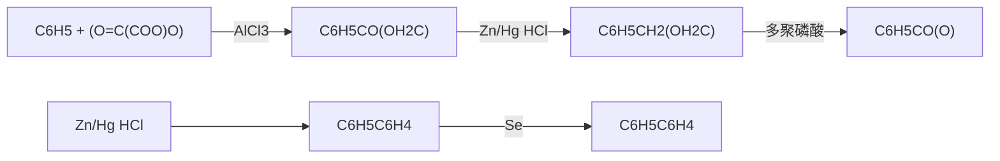

目前在售的药品中有超过 20% 的药品含有氟，销售额前 100 种在售药物中更达 30%。例如，用于治疗 2 型糖尿病的西格列汀、抗抑郁药氟西汀（百忧解）和用于降低胆固醇的他汀类药物阿托伐他汀（立普妥）就是较为典型的例子。

chemical

Chemical structure of a fluorinated heterocyclic compound with trifluoromethyl and amine substituents

西格列汀

Sitagliptin

(Januvia)

chemical

Chemical structure of a substituted benzene derivative with F3 and NHCH3 groups

氟西汀

Fluoxetine

(Prozac)

与氟相反，碘与苯本身不反应，苯的碘化需要一种酸性氧化剂，如硝酸。硝酸在反应中被消耗掉，所以它是一种试剂（一种氧化剂），而不是一种催化剂。

chemical

Chemical reaction equation showing benzene reacting with 1/2 l₂ and HNO₃ to form a benzene derivative with 85% yield, then using NO₂ and H₂O

碘化反应可能涉及碘正离子（$\mathrm{I}^{+}$）作为亲电试剂。碘正离子是由硝酸氧化碘而产生的。

$$
\mathrm{H} ^ {+} \quad + \quad \mathrm{HNO} _ {3} \quad + \quad 1 / 2 \mathrm{I} _ {2} \quad \longrightarrow \quad [ \mathrm{I} ^ {+} ] \quad + \quad \mathrm{NO} _ {2} \quad + \quad \mathrm{H} _ {2} \mathrm{O}
$$

常见的酸性氧化剂还有过氧化氢（ $H_{2}O_{2}$ ）或铜盐（ $CuCl_{2}$ ），这些氧化剂通过将 $I_{2}$ 氧化为更强的亲电试剂来加速碘化反应，就像碘正离子一样。

$$
\mathrm{I} _ {2} + \mathrm{H} _ {2} \mathrm{O} _ {2} \longrightarrow 2 \mathrm{H} - \mathrm{O} - \mathrm{I} \quad \text {或} \quad \mathrm{I} _ {2} + \mathrm{CuCl} _ {2} \longrightarrow \mathrm{I} - \stackrel {+} {\mathrm{I}} - \stackrel {-} {\mathrm{Cu}} _ {\mathrm{Cl}} ^ {\mathrm{Cl}} = [ \mathrm{I} ^ {+} ]
$$

chemical

Organic reaction scheme showing copper-catalyzed cyclization of benzene to form a substituted benzene product, with 65% yield indicated

芳香亲电卤化反应在许多自然界分子的生物合成中经常见到，特别是海洋生物分子。一个例子发生在人类的甲状腺中，甲状腺素是一种参与调节生长和代谢的激素。在甲状腺素的生物合成过程中，酪氨酸首先被甲状腺过氧化物酶碘化，然后由两个碘化的酪氨酸分子偶联。亲电的碘化剂是一种能生成碘正离子的次碘酸，它是由碘离子与 $\mathrm{H}_2\mathrm{O}_2$ 氧化形成的。

芳香亲电卤化反应还用于工业上苯酚的生产。苯酚可用于合成阿司匹林、制造酚醛树脂（用于台球黏合剂和塑料），还可以生产染料和除臭剂。工业上生产苯酚的化学工艺是由德国化学家 Raschig 在 1891 年首次使用的 Raschig-Hooker 工艺。该工艺的主要步骤是先用苯、盐酸和氧气生产氯苯，随后将氯苯水解为苯酚。第一步使用氯化铜或氯化铁催化剂，并将苯和盐酸暴露在 200～250 °C 的空气中。在第二步中，将所得氯苯引入 450 °C 的蒸汽中，经过硅催化的水解反应，得到苯酚和氯化氢。

chemical

Chemical reaction showing oxidation of a dihydroxybenzene derivative to form a cyclic product, with Chinese text indicating enzymatic oxidation by cysteine.

酪氨酸

3,5-二碘酪氨酸

chemical

Chemical structure showing a molecule with hydroxyl, methoxy, and amino groups connected via an ester linkage to a carboxylic acid group

甲状腺素

chemical

Chemical reaction equation showing chlorination of benzene with HCl and 1/2 O₂ under CuCl₂ at 523 K to form a chlorinated benzene derivative with H₂O and Si at 723 K.

然而，该反应需要非常高的温度和非常酸性的环境，并伴随氯化氢蒸气产生以及巨大的能量消耗，这使其被更为绿色的异丙苯工艺（Hock重排反应）所替代。

## 6.3.3 硝化反应

以浓硝酸和浓硫酸（或称混酸）与苯共热，苯环上的氢原子被硝基（ $-NO_{2}$ ）取代，生成硝基苯。该方法可用于在芳环上引入一个硝基。

chemical

Nitration reaction equation of benzene

硝化反应中的亲电试剂是硝酰正离子  $NO_{2}^{+}$ ，它是按下式产生的:

chemical

Chemical reaction mechanism showing sulfonation and dehydration steps between nitric acid and sulfuric acid

苯的硝化反应按如下历程进行:

chemical

Nitration reaction mechanism of benzene showing oxidation and elimination steps

硝基苯在上述条件下不容易进一步硝化。如果增加硝酸的浓度并提高反应温度，苯的硝化反应可得到间二硝基苯。

chemical

Nitration reaction equation of benzene under sulfuric acid catalyst in 100°C

芳香环的亲电硝化在自然界中不发生，但在工业中尤为重要。因为生成的硝基苯用金属（Fe或Zn）和盐酸处理后，还可以被还原为苯胺。但在这些酸性条件下，产生的氨基被质子化生成铵离子（$\mathrm{ArNH_3^+}$）。因此，反应必须用碱（如NaOH），以去除额外的质子并再生氨基。这一过程为我们提供了一种在苯环上引入氨基的一般方法。而苯胺是许多染料和药物工业合成的关键原料。我们将在第十二章中讨论胺类化合物的相关反应。

chemical

Chemical reaction equation showing nitration of nitrobenzene to form aniline under Fe/HCl and NaOH conditions

## 6.3.4 磺化反应

苯与浓硫酸共热得到苯磺酸，苯环上的氢原子被磺酸基取代了。芳香磺酸是强酸，其酸性强度与硫酸相当，常用作有机酸催化剂，如对甲苯磺酸（TsOH）。

chemical

Chemical reaction equation showing benzene reacting with sulfuric acid to form a sulfonate group, yielding 56% product

目前认为，磺化反应中一般是  $HSO_{3}^{+}$  或  $SO_{3}$  作为亲电试剂。虽然  $SO_{3}$  不是正离子，但它是一种缺电子试剂。 $SO_{3}$  中的 S 原子可以带部分正电荷。因此，反应历程如下:

与卤化反应和硝化反应不同的是，磺化反应是一个可逆反应。这一反应既可以正向进行，也可以逆向进行，具体取决于反应条件。在强酸环境中，磺化反应更易发生；而在热的稀酸水溶液中，脱磺化反应更占优势。

chemical

Chemical reaction equation showing condensation of benzene with sulfuric acid under 30–50°C to form sulfoxide and then to form benzene under 180°C with water.

磺化反应和脱磺化反应经历了相同的  $\sigma$  络合物，苯磺化反应及其逆反应的势能示意图见图 6-20。

磺化反应之所以可逆，是因为生成的 $\sigma$ 络合物脱去质子和脱去 $\mathrm{SO}_3$ 两步的活化能（$E_{\mathrm{a1}}$ 和 $E_{\mathrm{a2}}$）相差不大。而在硝化反应和卤化反应中，从相应的 $\sigma$ 络合物脱去 $\mathrm{NO}_2^+$ 或 $\mathbf{X}^+$ 的活化能大于脱去 $\mathrm{H^{+}}$ 的活化能，反应速率相差很大。因此，反应实际上是不可逆的。由于磺化反应可逆，有时会引入磺酸基作为保护基，暂时阻断其所在位置发生芳香亲电取代反应；

或者将其作为导向基，影响与之相关的另一取代反应的位置。当不再需要磺酸基时，再将其脱磺化去除。该性质将被用于稍后多取代芳香化合物的合成。

line

| Reaction Stage | Activation Energy (Ea1) | Oxidation/Activation Energy (Ea2) |
| --- | --- | --- |
| Phenyl sulfonate + SO3 | High | Low |
| Phenyl sulfate + SO3H | Low | High |

图6-20 苯磺化反应及其逆反应的势量示意图

除了顺序相反外，脱磺酸基反应遵循与磺化反应相同的反应机理。脱磺化反应的亲电试剂是质子，质子加入苯环形成 $\sigma$ 络合物，然后 $\mathrm{SO}_3$ 离去得到芳香化苯环。过量的水可将生成的 $\mathrm{SO}_3$ 通过水合成硫酸，使其从平衡中去除。

$$
\text {C}_6\text{H}_5\text{SO}_3^-\text{CH} + \text{H}^+ \rightleftharpoons \left[ \text{C}_6\text{H}_4\text{S}(\text{O})_2\right]\rightleftharpoons \text{C}_6\text{H}_4\text{CH} + \text{SO}_3\quad (\text{SO}_3 + \text{H}_2\text{O} \rightleftharpoons \text{H}_2\text{SO}_4)
$$

与去磺酸基反应类似, 如果一个苯环进攻氘离子 $\left(\mathrm{D}^{+}\right)$ 而不是一个质子, 也可以生成 $\sigma$ 络合物, 并最终生成苯的氘代产物。

$$
\text {C}_6\text{H} \xrightarrow{\text{H}} \text{D-O-D} \quad \Longleftrightarrow \left[ \text{C}_6\text{H} \xrightarrow{\text{D}} \text{O-D} \right] \Longrightarrow \text{C}_6\text{H} + \text{H-O-H}
$$

该实验通过在重水  $D_{2}O$  中加入  $SO_{3}$  生成  $D_{2}SO_{4}$ ，很容易完成苯的氘代。该反应是可逆的，重水的量决定了达到反应平衡时产物中 D 与 H 的比例。大大过量的重水使苯的六个氢都被置换为氘，从而合成出一种常见的核磁共振溶剂氘代苯（ $C_{6}D_{6}$ ）。

chemical

Chemical reaction diagram showing oxidation of a diene to form a benzene derivative under D2SO4/D2O conditions

苯磺酸不容易进一步磺化，需要在更高的温度下才能继续磺化，产物为间苯二磺酸。

chemical

Chemical reaction equation showing benzene reacting under sulfuric acid (H₂SO₄) under 200–230°C to form a benzene derivative with water.

间苯二磺酸

磺化反应常用于洗涤剂的合成。长支链烷基苯被磺化成相应的磺酸，然后转化为它们的钠盐。由于这种洗涤剂不易生物降解，它们已被更多环境可接受的替代品所取代。

chemical

Chemical reaction equation showing sulfonation of benzene to form sulfonyl and sodium hydroxide

苯磺酸钠与五氯化磷或氯化亚砜反应可以制备苯磺酰氯。

chemical

Chemical reaction equation showing sulfonation of a benzene derivative with sodium counterion under PCl5 and POCl3 conditions

此外，苯与氯磺酸（ClSO\_{3}H）也可以发生氯磺化反应制备苯磺酰氯。

chemical

Chemical reaction equation showing phenol reacting with 2ClSO3H to form a sulfonamide salt, followed by acidification and sulfuric acid formation

苯磺酰氯非常活泼，与胺反应可以合成许多磺胺类药物，例如广谱抗菌药磺酰嘧啶。

chemical

Chemical structure of磺酰嘧啶 (Hypoxanthine) with labeled substituents

## 6.3.5 Friedel-Crafts 反应

在前面的章节中，我们已经看到各种亲电试剂（$\mathrm{Br}^{+}$、$\mathrm{Cl}^{+}$、$\mathrm{NO}_{2}^{+}$和$\mathrm{SO}_{3}$）可与苯发生芳香亲电取代反应。下面，我们将讨论含碳亲电试剂的芳香亲电取代反应。1877年，Friedel和Crafts在芳香溶剂中尝试通过戊基碘与$\mathrm{AlCl}_{3}$反应来合成戊基氯时，偶然发现苯可以与卤代烃和羰基化合物等发生亲电取代反应。Friedel-Crafts反应主要有两种类型:Friedel-Crafts烷基化反应和Friedel-Crafts酰基化反应。Friedel-Crafts反应也是有机化学中由C-H键转化成C-C键最重要的反应之一。

## 1. Friedel-Crafts 烷基化反应

由于苯不是一种强的亲核试剂，很难和卤代烃发生  $S_{N}2$  反应制备烷基苯。

chemical

Chemical reaction equation showing benzene reacting with R-Cl to form a substituted benzene ring

但在无水  $AlCl_{3}$  或其他路易斯酸（ $BF_{3}$ ）或 Brønsted 酸（ $H_{2}SO_{4}$ 、 $H_{3}PO_{4}$ ）催化剂作用下，苯可以和卤代烃、烯烃、醇反应生成烷基苯。这是一种在苯环上引入一个烷基的好方法。例如:

chemical

Chemical reaction equation showing benzene reacting with RCl under basic conditions to form a substituted benzene product

chemical

Two-step organic synthesis reaction scheme showing benzene reacting with chloroalkyl chloride under water, followed by hydroxylation and subsequent fluorination to yield phenol and aldehyde.

Friedel-Crafts 烷基化反应的亲电试剂可以是  $1^{\circ}$ 、 $2^{\circ}$  和  $3^{\circ}$  卤代烃、烯丙基或苄基卤代烃。芳烃与  $2^{\circ}$  和  $3^{\circ}$  卤代烃发生 Friedel-Crafts 烷基化反应，其反应中间体是烷基正离子，它是在  $AlCl_{3}$  的作用下产生的。烷基正离子能够被苯进攻，生成一个具有共振稳定的  $\sigma$  络合物。中间体  $\sigma$  络合物发生去质子化反应，从而得到烷基取代苯。

chemical

Chemical reaction mechanism showing aluminum-catalyzed cyclization of benzene with alkyne and chloride ions

甲基卤代烃和  $1^{\circ}$  卤代烃的反应中间体是  $R-\overset{+}{X}-\bar{A}IX_{3}$

Step 1. 卤代烃活化

$$
\mathrm{RCH} _ {2} - \mathrm{X} + \mathrm{AIX} _ {3} \quad \Longleftrightarrow \quad \mathrm{RCH} _ {2} - \stackrel {\delta^ {+}} {\mathrm{X}} - \bar {\mathrm{AIX}} _ {3}
$$

Step 2. 亲电进攻

chemical

Chemical reaction equation showing benzene reacting with a hydrogenated alkene to form a substituted cyclohexane derivative with aldehyde and aluminum ion.

Step 3. 质子离去

chemical

Chemical reaction equation showing alkylation of a substituted benzene derivative with alkenes and alkyl groups

但 3 碳及以上 1°卤代烃容易发生碳正离子重排反应。

chemical

Organic reaction pathway showing bromination, reduction, and hydrogenation steps with yields for different alcohols

分子内的 Friedel-Crafts 烷基化反应可以在苯环周围增加一个新的环。

chemical

Chemical reaction equation showing chlorination of a benzene derivative using AlCl3 under CS2, CH3NO2 (s�剂) at 25°C for 72 hours to yield tetralin with 31% yield.

Friedel-Crafts 烷基化反应还存在以下局限性:

（1）在选择卤代烃时，卤代烃不能是卤苯或乙烯基卤，因为其生成的碳正离子稳定性差，不会发生 Friedel-Crafts 反应。

chemical

Chemical reaction diagram showing benzene ring reacting with chloroalkyl chloride to form aldehyde, with no reaction observed

（2）烷基化反应产物中芳环上增加了烷基，而烷基是给电子基团，使产物比反应物更容易发生烷基化反应。因此，烷基化反应产物往往是多取代产物。这个问题通常可以通过选择有利于单烷基化的反应条件来避免，例如在反应过程中加入过量的苯，则可主要得到一取代产物。

chemical

Chemical reaction equation showing benzene reacting with acetaldehyde under BF3 at 60°C to yield two substituted benzene products with yields of 24% and 14%.

为什么吸电子取代基会导致苯环不容易发生Friedel-Crafts反应？

（3）Friedel-Crafts 烷基化反应只对苯、带给电子取代基的苯衍生物和卤代苯有效。当芳环上连有强吸电子基或  $-NH_{2}$ 、-NHR、 $-NR_{2}$  时难发生 Friedel-Crafts 反应。例如，硝基苯、苯甲酸和苯基酮等都不会发生 Friedel-Crafts 反应。芳香胺也难发生 Friedel-Crafts 反应，因为它可以和  $AlCl_{3}$  生成具有强吸电子性的络合物。

chemical

Chemical reaction scheme showing nitration and reduction reactions of benzene derivatives with AlCl3 catalyst

Friedel-Crafts 烷基化反应通过在芳烃分子上添加烷基, 成为生产各种工业产品重要反应之一, 如苯和乙烯进行酸催化反应生成乙苯。乙苯的生产规模巨大, 每年达数百万吨。它是苯乙烯的前体分子, 用于生成聚苯乙烯。异丙苯、二甲苯和甲苯均可通过 Friedel-Craft 烷基化反应生产。例如, 对二甲苯是用于生产涤纶聚对苯二甲酸乙二醇酯（PET）的重要的前体分子。

## 2. Friedel-Crafts 酰基化反应

在发现 Friedel-Crafts 烷基化反应后，Friedel 和 Crafts 又将卤代烃扩展至酰氯，发现增加  $AlCl_{3}$  的量，可以使苯环上增加一个酰基，这也是合成芳香酮的重要方法。Friedel-Crafts 酰基化反应除了酰卤，还有酸酐甚至羧酸。和 Friedel-Crafts 烷基化不一样， $AlCl_{3}$  作为路易斯酸不是催化剂量，一般要大于 1 当量。此外  $BF_{3}$  等路易斯酸和  $H_{2}SO_{4}$ 、 $H_{3}PO_{4}$  等质子酸也能参与反应。

chemical

Chemical reaction equations showing the synthesis of a ketone from benzene and aldehyde under different conditions

其中酰氯很容易用二氯亚砜（$\mathrm{SOCl}_2$）或五氯化磷（$\mathrm{PCl}_5$）与羧酸反应制备:

chemical

Two-step organic reaction scheme showing acid-catalyzed cyclization of acetaldehyde and benzyl alcohol under sulfuric acid, with yields indicated for each step.

Friedel-Crafts 酰基化反应中的亲电试剂是酰基正离子，它是在  $AlCl_{3}$  作用下产生的。首先酸酐与  $AlCl_{3}$  形成酰基正离子亲电试剂。与烷基氯化物不同，酸酐含有两种亲核位点，即碳氧单键上氧原子和碳氧双键上氧原子。为什么不是碳氧单键上的氧原子进攻缺电子的铝原子？原来，碳氧单键上氧原子受两边羰基的吸电子共轭效应的影响，电子密度不及碳氧双键上氧原子的电子密度，因此碳氧双键上氧原子更容易亲核进攻缺电子的铝原子，然后脱去一个乙酰基与氯化铝络合物，得到乙酰正离子。乙酰正离子遵循芳烃亲电取代反应的一般机理，得到芳香酮产物。

和分子内的 Friedel-Crafts 烷基化反应类似，分子内的 Friedel-Crafts 酰基化反应也可以在苯环周围增加一个新的环。

chemical

Chemical reaction pathway showing aldehyde-catalyzed cyclization of a benzene derivative with dichloromethane under AlCl3 and HCl conditions

与 Friedel-Crafts 烷基化反应对比，Friedel-Crafts 酰基化反应有以下三个不同的反应特点:

（1）没有重排产物。与 Friedel-Crafts 烷基化的反应中间体碳正离子不同，Friedel-Crafts 酰基化的反应中间体是酰基正离子，不能发生重排，因此，Friedel-Crafts 酰基化反应没有重排产物。利用 Friedel-Crafts 酰基化反应这一特点，结合羰基的还原反应，我们可以由苯直接制备没有重排的烷基苯。

chemical

Organic synthesis reaction sequence showing alkylation of benzene with dichloroalkyl chloride, followed by reduction to pentaene using hydrogen and palladium catalysts.

此处的羰基还原反应，还可以采用第九章中 Clemmensen 还原或 Wolff-Kishner-黄鸣龙还原方法。

chemical

Chemical reaction equation showing conversion of a benzyl alcohol to two substituted benzene derivatives under different conditions

（2）与 Friedel-Crafts 烷基化反应不同，Friedel-Crafts 酰基化反应没有多元取代产物。Friedel-Crafts 酰基化反应后的产物有酰基取代基，是强吸电子基，不能进一步酰基化，只保留在一取代。

chemical

Organic reaction pathway showing benzene reacting with aldehyde under different conditions to form a ketone, which is not detected by the reaction.

（3）催化剂 $\mathrm{AlCl}_3$ 通常要过量，这是因为氯化铝可以和产生的芳香酮形成络合物。因此在该反应中需要大于1当量的 $\mathrm{AlCl}_3$ 。在反应结束时，一般要加入水来破坏络合物，并产生游离的芳香酮。

需要注意的是，与 Friedel-Crafts 烷基化反应相同的是，当芳环上连有强吸电子基时也难发生 Friedel-Crafts 酰基化反应。例如，要以苯为原料合成间硝基正丁苯:

chemical

Multi-step organic synthesis reaction scheme involving benzene, chloroacetate, and nitrobenzene derivatives under various conditions

若先进行硝化反应，则后面 Friedel-Crafts 酰基化反应难进行。若先 Friedel-Crafts 酰基化，再进行硝化反应，最后进行 Clemmensen 还原反应，则主要产物为间硝基正丁苯。

chemical

Chemical reaction equation showing nitrobenzene reacting with chloroacetate under AlCl3 to form no reaction

当芳环连有 $-NH_{2}$ 、-NHR、 $-NR_{2}$ 时，由于氮原子具有较强碱性和亲核性，在酰基化反应中，苯胺不仅可以和 $AlCl_{3}$ 生成具有强吸电子性的络合物，而且还存在着氨基酰基化和芳环酰基化的竞争反应。若氮原子上没有氢原子，三级芳香胺可以直接进行Friedel-Crafts酰基化反应，而一级、二级芳香胺需要将氨基保护后再进行Friedel-Crafts酰基化反应。

chemical

Chemical reaction pathway showing nucleophilic addition of benzene and acetone to form a diamine, followed by acidification and hydrolysis to form an amino group.

## 6.3.6 Haworth 反应

Haworth 反应是芳烃和丁二酸酐发生 Friedel-Crafts 酰基化反应，然后羰基经 Clemmensen 还原和分子内的 Friedel-Crafts 酰基化反应制备四氢萘酮的反应。该反应将 Friedel-Crafts 酰基化反应用于在苯环上引入一个六元环。

flowchart

四氢萘酮可继续用 Clemmensen 还原羰基后，再用硒加热脱氢得到多环芳烃——萘，同样也可用该方法进一步合成蒽、菲等稠环化合物。

chemical

Chemical reaction pathway showing conversion of a fused-ring ketone to a fused-ring ketone using C6H6, AlCl3, H2SO4, Zn(Hg)/HCl, and Se/Δ reagents

## 6.3.7 Blanc 氯甲基化反应

在无水  $ZnCl_{2}$  催化下，芳烃与甲醛和 HCl 反应，得到氯甲基取代产物。氯甲基化反应很重要，因为苄基氯很活泼，芳环上的氯甲基容易转化为羟甲基( $-CH_{2}OH$ )、氰甲基( $-CH_{2}CN$ )、羧甲基( $-CH_{2}COOH$ )、氨甲基( $-CH_{2}NH_{2}$ )等。当芳环上有强吸电子基时，此类反应难发生。

chemical

Chemical reaction equation showing benzene reacting with HCHO and HCl under ZnCl₂ to form a substituted benzene ring

Blanc 氯甲基化反应在酸性环境下进行，以氯化锌作为催化剂。苯环亲核进攻质子化的甲醛，然后伴随芳香环的重新构建，生成苄醇。在反应条件下，苄醇很容易被转化为苄基氯。反应的机理如下:

chemical

Reaction mechanism showing hydrolysis of acetic acid to form a benzene derivative, followed by chlorination

在氯化锌存在下，苯和苄基氯容易进一步发生 Friedel-Crafts 烷基化反应生成二苯甲烷。苯酚、苯胺等非常活泼的芳烃容易进一步与产物苄基氯/苄醇发生 Friedel-Crafts 烷基化反应，因此也不适合用作这类反应的底物。

chemical

Chemical reaction equation showing chlorination of benzene with zinc chloride to form a substituted benzene derivative

## 6.3.8 Gattermann-Koch 反应

等量 CO 与 HCl 的混合气体，在无水  $AlCl_{3}$ 、CuCl 或  $TiCl_{4}$  等 Lewis 酸存在下与芳烃反应生成芳香醛，此反应称为 Gattermann-Koch 反应。这是一种在芳环上引入甲酰基的重要方法。

chemical

Organic reaction equation showing benzene reacting with CO and HCl under AlCl3/CuCl catalyst to form a substituted benzene product with 46% yield.

其反应机理如下:

chemical

Chemical reaction equation showing alkylation of CO and HCl to form a malonate and aldehyde ion

chemical

Chemical reaction equation showing phenol reacting with H-C≡O to form a ketone and HCl

但此类反应仅适用于烷基苯的甲酰化，单取代的烷基苯在进行甲酰化时，几乎全部生成对位产物。苯胺的化学性质太活泼，易在该反应条件下与生成的芳醛缩合成三芳基甲烷衍生物。同时该反应也不适用于苯胺、苯酚和苯酚醚。

## 6.3.9 Reimer-Tiemann 反应

Reimer-Tiemann 反应是苯酚类化合物和氯仿在强碱 NaOH 水溶液中反应，在羟基的邻位或对应引入一个醛基（-CHO）的过程。该反应是 1876 年由 Reimer 和 Tiemann 发现的，但只有苯环上富电子的酚类（实际上是酚基负离子）才能发生此反应，例如烷基、烷氧基取代的苯酚、卤代苯酚、萘酚等可在上述反应条件下发生甲酰化。

chemical

Chemical reaction equation showing hydrolysis of phenol under CHCl3 and H3O+ conditions, yielding hydroxyl alcohol with 20%-35% yield and 8%-12% yield

这个反应是一个典型的芳香亲电取代反应，亲电试剂是二氯卡宾（$\mathrm{:CCl_2}$），它可由氯仿和 $\mathrm{NaOH}$ 反应原位生成。碱首先从氯仿中拔除一个氢原子，生成三氯碳负离子。该碳负离子通过 $\alpha-$ 消除反应失去一个氯离子形成二氯卡宾。然后苯酚上氢被碱拔除，使电子离域到环的邻位和对位，与二氯卡宾发生如下亲电取代反应:

请思考对甲酰基苯酚生成的反应机理。

由于二氯卡宾能与烯烃和胺反应，分别生成二氯环丙烷和异氰，因此，Reimer-Tiemann 反应不适合含有这些官能团的底物。邻甲酰基产物在 Reimer-Tiemann 反应中通常占主导地位，但当该位置已被取代时，会得到对甲酰基苯酚。芳香族化合物的直接甲酰化可以通过 Gattermann-Koch 反应完成。然而，就操作的易用性和安全性而言，Reimer-Tiemann 反应是最有利的路线。

## 6.3.10 Fries 重排反应

Fries 重排反应是指酚酯在 Lewis 酸（如  $AlCl_{3}$ 、 $ZnCl_{2}$ 、 $FeCl_{3}$ ）或 Brønsted 酸（如 HF、甲磺酸）催化下重排为邻位或对位酰基酚的反应。该反应由德国化学家 Fries 首先报道。重排可以在硝基苯、硝基甲烷等溶剂中进行，也可以不用溶剂直接加热进行。脂肪或芳香羧酸的酚酯都可以发生重排。因取代基影响反应，底物一般不含有位阻大的基团。和苯的 Friedel-Crafts 酰基化一样，当酚的芳环上有间位定位基存在时，重排一般不能发生。该反应是在酚的芳环上引入酰基的重要方法，酚酯的制备可以采用第九章中芳基酮的 Baeyer-Villiger 氧化反应。

chemical

Chemical reaction scheme showing esterification of benzaldehyde to form aldehyde and its hydroxylated product under different conditions

例如:

Fries 重排反应机理究竟是分子间反应还是分子内反应至今仍未完全清楚,一个接受较广的机理是涉及酰基正离子的机理。该机理中,首先是酚酯的羰基氧原子与路易斯酸性的铝原子进行配位,而不是酚上氧原子,因为这个氧原子比酚上氧原子更富电子。这也导致酚酯上 C-O 键极化,从而导致酚上氧原子重排到铝原子上,C-O 键断裂,产生酚基铝化物和酰基正离子。酰基正离子接下来在苯酚的邻位或对位发生类似芳香亲电取代反应,得到共振稳定的  $\sigma$  络合物，再经水解得到羟基芳酮产物，具体反应机理如下:

chemical

Chemical reaction mechanism showing step 1 and step 2 of aluminum-catalyzed cyclization with alkyne and phenyl groups

苯酚邻位酰基化:

chemical

Multi-step organic synthesis reaction scheme showing aluminum-catalyzed transformation of a benzyl alcohol with R-C≡O+ to form a substituted benzene derivative via step 3 and step 4, followed by step 5 using water.

苯酚对位酰基化:

chemical

Multi-step organic synthesis reaction scheme showing aluminum-catalyzed transformation of a chlorinated benzene derivative with R-C≡O+ and water to form an aldehyde intermediate

邻对位未取代的苯酚酯重排产物为邻、对位混合产物。通过改变反应条件，如温度，溶剂或催化剂可以使混合产物中某一异构体为主要产物。一般来说，低温有利于对位产物的生成，高温有利于邻位产物的生成。例如:

chemical

Chemical reaction scheme showing conversion of a benzyl alcohol to two substituted phenolic compounds under different AlCl3 conditions

在低温条件下，Fries 重排反应受动力学控制，生成对位产物在动力学上更有利。而在高温条件下，Fries 重排反应受热力学控制，因为邻位产物能与铝形成更稳定的双齿配合物。

Fries 重排也可以在没有催化剂的情况下进行，但需要有紫外光的存在。产物仍然是邻或对羟基芳酮。这种类型的 Fries 重排称为 “光 Fries 重排”。光 Fries 重排产率很低，很少用于合成。不过苯环上连有间位定位基时仍然可以进行光 Fries 重排。

chemical

Fluorination reaction mechanism of benzaldehyde under UV light, showing intermediate and product formation steps

研究显示，光Fries重排会导致天气炎热时塑料瓶的降解，由聚对苯二甲酸乙二酯（PET）制成的塑料瓶在 $40^{\circ}\mathrm{C}$ 左右和波长为 $310\mathrm{nm}$ 的紫外光照射下会发生光Fries重排而降解。

## 6.4 芳香亲电取代反应的定位效应

## 6.4.1 单取代芳烃亲电取代反应的定位效应

在单环芳烃的亲电取代反应中，当苯环上没有取代基时，新进入的取代基可以进入苯环的任一位置。1895年，Holleman等从大量实验事实中归纳发现，当单取代苯经历芳香亲电取代反应时，新进入基团的位置（定向）和反应速率（活性）由苯环上已有的取代基决定，这就是单取代芳烃亲电取代反应的定位效应（orientation effect）。

## 1. 定位基团

当已有一个取代基 G 的取代苯进行亲电取代反应时，第二个取代基进入苯环的位置和速率常常取决于苯环上原有取代基的性质。因此，把苯环上第一个取代基 G 称为定位基。第二个取代基进入苯环时，有三个不同的位置可供选择:进入定位基 G 的邻位、对位或间位。表 6-2 列出了一些单取代苯的硝化反应实验结果。

表 6-2 单取代苯的硝化反应实验结果

chemical

Chemical reaction equation showing benzene ring reacting with nitrobenzene under sulfuric acid and temperature to form a substituted benzene ring with nitro group

<table><tr><td rowspan="2">定位基G</td><td colspan="3">产物含量/%</td><td rowspan="2">定位基G</td><td colspan="3">产物含量/%</td></tr><tr><td> $o^-$ </td><td> $m^-$ </td><td> $p^-$ </td><td> $o^-$ </td><td> $m^-$ </td><td> $p^-$ </td></tr><tr><td colspan="4">致活邻对位定位基</td><td colspan="4">致钝间位定位基</td></tr><tr><td> $-CH_3$ </td><td>63</td><td>3</td><td>34</td><td> $-\overset{+}{N}(CH_3)_3$ </td><td>2</td><td>87</td><td>11</td></tr><tr><td>-OH</td><td>50</td><td>0</td><td>50</td><td> $-NO_2$ </td><td>7</td><td>91</td><td>2</td></tr><tr><td> $-NHCOCH_3$ </td><td>19</td><td>2</td><td>79</td><td> $-CO_2H$ </td><td>22</td><td>76</td><td>2</td></tr><tr><td colspan="4">致钝邻对位定位基</td><td>-CN</td><td>17</td><td>81</td><td>2</td></tr><tr><td>-F</td><td>13</td><td>1</td><td>86</td><td> $-CO_2CH_3$ </td><td>28</td><td>66</td><td>6</td></tr><tr><td>-Cl</td><td>35</td><td>1</td><td>64</td><td> $-COCH_3$ </td><td>26</td><td>72</td><td>2</td></tr><tr><td>-Br</td><td>43</td><td>1</td><td>56</td><td>-CHO</td><td>19</td><td>72</td><td>9</td></tr><tr><td>-I</td><td>45</td><td>1</td><td>54</td><td></td><td></td><td></td><td></td></tr></table>

从表 6-2 不难发现，对不同的单取代苯进行同一亲电取代反应时，就反应产物比例进行

分析，有两大类定位基:

一类是邻对位定位基（o,p-director），又称第一类定位基，包括与苯单键相连，且含有孤电子或负离子的原子，如-OH、卤素等；还包括含有 $\pi$ 电子的基团，如烯基、苯基等；具有给电子效应的烷基也属于邻对位定位基。

另一类是间位定位基（m-director），又称第二类定位基，包括与苯环相连的原子有极性双键或叁键的取代基，如  $-NO_{2}$ 、-COR、-CN 等；与苯环相连的是带正电荷的原子或强的吸电子基，如  $-CF_{3}$ 、 $-\overset{+}{N}(CH_{3})_{3}$  等。

## 2. 反应活性

苯环上取代基除了可以影响亲电取代反应的定位外，还可以影响亲电取代反应的速率。表 6-3 给出了单取代苯硝化反应的相对反应速率。

表 6-3 单取代苯硝化反应的相对反应速率

<table><tr><td>取代苯</td><td>相对反应速率</td></tr><tr><td></td><td>24.5</td></tr><tr><td></td><td>1.0</td></tr><tr><td></td><td>0.033</td></tr><tr><td></td><td> $6 \times 10^{-8}$ </td></tr></table>

我们可以看出，苯环上连有给电子的取代基可以加速亲电取代反应，而吸电子取代基可以降低反应速率。加速亲电取代反应的取代基，称为致活基团（activating group），降低亲电取代反应速率的取代基，称为致钝基团（deactivating group）。氨基、羟基、烷氧基和烷基等取代基是典型的邻对位取代基，因为具有给电子共轭效应和超共轭效应，会使得苯环上电子密度增大，导致亲电取代反应速率加快，是致活邻对位取代基。卤素也是典型的邻对位取代基，具有吸电子诱导效应和给电子共轭效应，由于反应活性主要受吸电子诱导效应的影响，会使苯环上电子密度减小，导致亲电取代反应速率降低，是致钝邻对位定位基。硝基、磺酸基、氰基和羰基等取代基是典型的间位定位基，具有吸电子诱导效应和共轭效应，会使苯环上电子密度减小，导致亲电取代反应速率降低，是致钝间位定位基。因此，取代芳烃的定位基又可细分为以上三类。根据表6-3，亲电取代反应速率顺序如下:

致活邻对位定位基芳烃 $>$ 苯 $>$ 致钝邻对位定位基芳烃 $>$ 间位定位基芳烃

同一类定位基的定位能力大小也不同，三类定位基的反应活性顺序如下:

flowchart

This diagram illustrates the chemical reaction pathways of a benzene derivative, showing how different functional groups (NO2, SO3H, COOH, CH, Cl, F) are converted into various intermediates and products.

