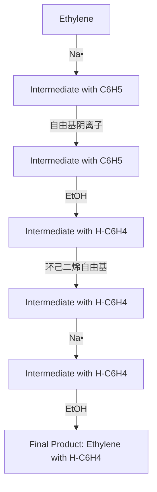
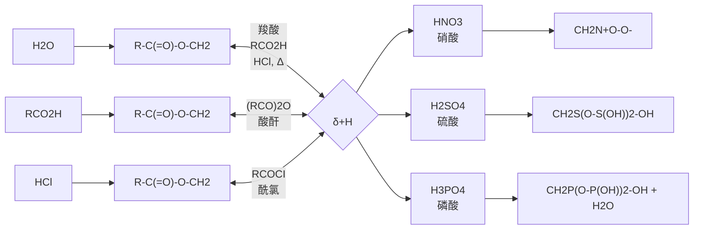
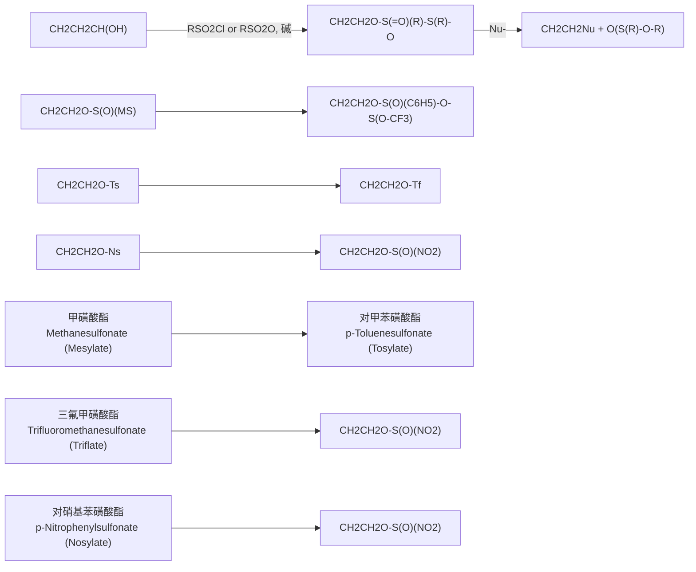

chemical

Chemical reaction showing conversion of a substituted benzene derivative to a carboxylic acid using KMnO4 catalyst

工业上对苯二甲酸可用于生产聚酯纤维（涤纶），全球每年约有1.18亿吨的对苯二甲酸是通过Co(Ⅲ)盐催化对二甲苯的空气氧化来生产的。

chemical

Chemical reaction showing oxidation of a benzene derivative to a hydroxybenzoic acid using O₂ in Co(III)

如果控制反应条件，可以氧化烷基苯制备醛、酮、酚等。例如，异丙苯空气氧化制备苯酚和丙酮是很有用的工业生产过程。

chemical

Organic reaction pathway showing oxidation of a benzene derivative under O₂ and H₂SO₄ conditions

其中异丙苯可在气相条件下由苯和丙烯通过 Friedel-Crafts 烷基化反应形成,苯和丙烯在磷酸催化下被压缩到 30 atm，温度为 250 °C 可以生成异丙苯。异丙苯工艺由 Hock 和 Lang 于 1944 年发现。异丙苯工艺生产的苯酚浓度接近 99.99%（质量分数），总杂质含量仅为 60 ppm（0.006%）。

其反应过程为

chemical

Reaction pathway of benzene derivatives showing oxidation, hydrolysis, and reagent formation steps

异丙苯在空气中被氧化为过氧化氢异丙苯（CHP），过氧化氢异丙苯在酸性介质中质子化，然后发生Hock重排反应，苯基迁移到相邻氧的氧原子上，同时离去一分子水，产生了共振稳定的符合八隅律的碳正离子中间体。该步骤的协同机理类似于Baeyer-Villiger氧化反应的机理，以及硼氢化-氧化过程的氧化步骤。生成的碳正离子随后被水亲核进攻，形成类似第九章醛酮水合反应中的半缩醛结构。水合质子向醚的氧原子上转移一个质子后，离子分解为苯酚和丙酮。

## 2. 芳环上的氧化反应

目前，工业上超过 90% 的苯酚采用异丙苯工艺生产，但是该工艺存在收率低、能耗高及丙酮副产物等问题。且异丙苯需以苯为原料通过 Friedel-Crafts 烷基化后才能制备。有没有直接从苯制备苯酚的方法呢？生命体内有一种细胞色素 P450 酶，可以直接将苯环羟基化为苯酚，它是一类含铁原卟啉Ⅸ活性中心和半胱氨酸残基轴向配体的血红素蛋白（图 6-23）。

chemical

Chemical reaction scheme showing phenyl ether reacting with P450BM3 and PFCs under NADPH/O2 conditions to form a fluorinated aromatic compound.

图6-23 细胞色素P450酶的完整结构（左）和活性位点的化学结构（右）

（左:蓝带部分为蛋白质部分，中心球棍模型为活性位点的血红素）

芳环在特殊条件下也能发生氧化开环反应。例如，在高温及  $V_{2}O_{5}$  催化下，苯被空气氧化为顺丁烯二酸酐（俗称马来酸酐），此法已用于工业生产。

chemical

Chemical reaction equation showing benzene reacting with oxygen to form a cyclic ketone under V2O5 and 400-450°C conditions

萘被氧化破裂一个环，得到邻苯二甲酸酐，已实现工业化。邻苯二甲酸酐是合成树脂、增塑剂、染料等的重要原料。

chemical

Chemical reaction equation showing benzene reacting with O₂ under V₂O₅ at 400–450 °C to form a fused bicyclic ketone product

稠环芳烃在一定的条件下，可被氧化成醌。

chemical

Two organic reaction equations showing conversion of naphthalene to coumarin derivatives using CrO3/HOAc and K2Cr2O7/H2SO4 under specified conditions

## 6.6.2 催化氢化

环己烷片段广泛存在于药物、农药和天然产物中。由于芳环的官能化比环己烷的官能化容易得多，有很多取代环己烷是通过对应芳烃的还原反应得到的。由于存在共振稳定化，苯环的催化氢化比烯烃的催化氢化要困难得多，使用商业可得的雷尼镍、Pd/C、Rh/C等催化剂催化氢化苯环时通常需要高温和/或高压条件。

chemical

Chemical reaction equation showing benzene reacting with hydrogen to form a cyclohexane under platinum catalysis at 175°C

北京大学余志祥等人发现，只需要将商业可得的钯碳和铑催化剂（如 $Rh(nbd)Cl_{2}$ 等）联合使用，无需额外的催化剂制备步骤，即可在常温、1 atm  $H_{2}$ 的条件下将多种官能团化的芳香化合物氢化为对应的环己烷衍生物。

chemical

Rhodium-catalyzed cyclization reaction of benzaldehyde with H2 under palladium catalyst and 25°C conditions

蒽和萘在一定条件下，也能发生部分催化加氢和完全催化加氢。

chemical

Nitration reaction pathway of naphthalene to 9,10-2-hydroxybenzene using nickel catalyst and acrylonitrile reagent

芳烃的催化氢化也是去芳构化反应中的一种。去芳构化，顾名思义，就是设法将官能团直接与芳香骨架发生反应，破坏原有的芳香性，从而将一个平面的分子转换为具有立体结构的分子。芳烃还有一个典型的去芳构化反应，即 Birch 还原。

## 6.6.3 Birch 还原

在第五章中，我们知道快可以通过溶解金属部分还原来制备烯烃。芳烃也可以被碱金属/液氨部分还原为环己-1,4-二烯衍生物，被称为 Birch 还原。例如，苯被还原成环己-1,4-二烯:

Birch 还原是一种溶解性金属还原，其机理类似于在第五章中研究的炔烃还原机理。通过碱金属的电子转移和醇的质子转移，形成环己-1,4-二烯。环己-1,4-二烯的形成优于更稳定的共轭环己-1,3-二烯，这主要是由于自由基阴离子中间体中的电子-电子排斥将优先使非键电子尽可能彼此远离，形成环己-1,4-二烯。

flowchart

当芳环上有给电子取代基时，与给电子取代基相连的碳原子不被还原，而且主要是1-取代环己-1,4-二烯还原产物。这主要是由于给电子取代基是供电子的，会使自由基阴离子中间体不稳定。

例如，苯甲醚的Birch还原可生成1-甲氧基环己-1,4-二烯，这是一种可以被稀酸水解为环己-2-烯酮的化合物。该方法提供了一种合成环己-2-烯酮的有效方法。

chemical

Chemical reaction equation showing methylation of benzyl alcohol with Li under ammonia and ethanol conditions to form a ketone

但当苯环上有吸电子取代基时，与吸电子取代基相连的碳原子被还原，而且主要产物为3-取代环己-1,4-二烯。这主要是由于吸电子效应容易稳定自由基阴离子中间体。

chemical

Chemical reaction equation showing conversion of a benzene derivative to a cyclohexanone under Na, CH3OH and NH3 conditions

萘也可以在碱金属/液氨条件下还原为 1,4-二氢萘。

chemical

Chemical reaction equation showing the synthesis of 1,2-二氢萘 from naphthalene under Na/C₂H₅OH/NH₃ conditions

其反应机理与苯的 Birch 还原机理类似:

chemical

Chemical reaction pathway showing electron transfer and ethanol addition steps leading to a fused ring system

芳烃不仅在工业上有广泛的应用，如作为合成聚酯纤维、药物、香料和染料的原料，在科学研究中也是重要的研究对象。芳烃的亲电取代反应、亲核取代反应和氧化还原反应等都是有机化学中的经典反应类型。随着科学技术的不断进步，芳烃的合成和应用领域还在不断拓展，如去芳构化反应、金属催化的交叉偶联和芳烃 C-H 官能团化反应等。此外，芳烃在材料科学、药物化学、生物化学等领域的应用也在不断深化，展现出广阔的发展前景。总之，芳烃作为一类重要的有机化合物，其化学性质和反应机理的研究具有重要的理论意义和应用价值。

## 习题

1. 用系统命名法命名下列化合物。

chemical

Five organic molecular structures labeled (1) through (5), including chlorinated benzene, hydroxyl, carboxylic acid, methyl, sulfonate, and hydroxymethylbenzene.

2. 写出下列化合物与溴单质发生亲电取代反应的产物。

3. 请完成下列反应。

4. 以下列初始原料合成目标化合物。

chemical

Two-step organic reaction sequence showing bromination and oxidation steps

chemical

Two-step organic reaction sequence showing bromination of a benzene derivative to form a brominated benzene product

5. 推测下列反应的机理。

chemical

Chemical reaction scheme showing LDA-mediated cyclization of compound (10) to form (11) with reagents and conditions

6. 萜和甾体类化合物是一类广泛存在的天然产物，其中不少表现出优秀的生物活性。它们的共同点是都具有包含连续多手性中心的复杂多环骨架结构。在自然界中，这类复杂骨架通过质子化酶催化的碳正离子引发多烯环化反应来构建。请为下列多烯环化反应提供合理的反应机理并预测原料3在相同反应条件下的主要产物。

chemical

Chemical reaction showing conversion of compound 1 to compounds 2 and 3 under acidic conditions

7. Birch 还原可以将芳香化合物转化为环状烯烃类化合物，具有广泛的用途，然而其需要使用活泼的金属锂，同时反应会有氢气作为副产物，这些因素限制了反应的规模化运用。为此，Baran 课题组发展了电化学促进的 Birch 还原反应（Science, 2019, 363: 838-845），根据所学的知识，推测下列化合物在 Birch 还原下的产物。

chemical

Four organic substituted phenolic compounds: 1,3-dimethylbenzene, 4-methoxybenzene, and 5-trifluorobenzene

8. 2019 年，Ritter 教授发展了将芳烃碳氢键直接转化为噻蒽鎓盐的方法:

chemical

Chemical reaction equation showing the synthesis of a fluorinated sulfonamide from benzene and a sulfonamide under TFAA/HBF4·OEt2 conditions

与常规的卤化过程相比，芳基噻蒽鎓盐的区域选择性大大提高，并在后期官能团化中显现出强大的反应活性，可以进行大量的转化反应。噻蒽鎓盐的引入过程与芳基的亲电取代反应较为类似，请指出下列化合物引入噻蒽鎓盐的反应位点。

chemical

Four chemical structures of substituted benzene derivatives: 1, 2, 3, and 4

9. 如下 Friedel-Crafts 酰基化反应，除了少量目标产物 A 之外，还往往伴有副产物 B 和 C，并且 C 为主要产物。请解释 A、B 和 C 的产生机制，并推测 C 中苯环上两个官能团的引入顺序。

$\mathrm{AlCl}_3$ 苯

A

B

C

10. 结合芳香性的定义，为以下实验现象提供合理的解释。

（1）化合物 A 的酸性（ $pK_{a}$  14）明显强于化合物 B 的酸性（ $pK_{a}$  22）

A

B

（2）该化合物中 C=C 双键的旋转能垒只有 14 kcal/mol。

11. 预测下列结构哪些具有芳香性，哪些是非芳香性，哪些具有反芳香性。

(1)

(2)

(3)

(4)

(5)

(6)

(7)

(8)

(9)

12. 葵子麝香是一种人造麝香，其香味与天然麝香近似，是天然麝香的代用品，化学名称叫 1-(叔丁基)-2-甲氧基-4-甲基-3,5-硝基苯，结构式为

若以间甲基苯甲醚为原料则有两种可能的合成路线:①先叔丁基化，然后硝化；②先硝化，然后进行叔丁基化。你认为应选择哪一条合成路线？为什么？

13. Thomson 等报道了一类木脂素类化合物的立体选择性全合成，其中关键步骤如下:

chemical

Chemical reaction scheme showing synthesis of a fused bicyclic compound from aniline derivative under PhI(OTf)2/TFA conditions, yielding a product via PROVIDE A MODEL.

A

chemical

Chemical structure of a substituted benzene derivative with methoxy and methyl groups

B

+

chemical

Complex organic molecule structure with methoxy and methyl substituents

8:1 d.r.

C

请提供合理的模型来解释中间体A到Friedel-Crafts烷基化产物的立体化学选择性。

14. Norrby 等基于大量实验数据的机器学习开发出了一类芳香亲电取代反应位点预测工具。该模型预测出以下两种取代苯环进行芳香亲电取代反应的位点可能性，如下图所示，请评价该工具预测的合理性。

chemical

Chemical structure of a substituted cyclohexene with 43% and 2% yield labels

15. 氮杂环卡宾（NHCs, N-heterocyclic Carbenes）是一类非常独特的有机小分子催化剂，可以“诱降”醛类等化合物，使其“变节”，生成 Breslow 中间体，由亲电性转变为亲核性，从而实现羰基官能团的极性反转，如下所示:

chemical

Chemical reaction showing radical reactivity of a carbonyl compound to form a Breslow intermediate

亲电活性

亲核活性

在 Suzuki 等报道的 Termicalcicolanone A 的全合成中，包含了这样一步 NHC 催化的芳香亲核酰基化反应，请根据上述 NHC 的催化模式，推测该反应发生的机理:

chemical

Chemical reaction equation showing fluorinated aromatic compound reacting with methoxy-substituted benzene derivative under iodide and formaldehyde conditions

16. Pictet-Spengler 反应是  $\beta$ -芳基乙胺与醛或酮在酸催化下发生的环化缩合反应，广泛应用于四氢异喹啉的构建。

chemical

Acid-catalyzed reaction of a substituted benzene derivative with amine and alkene to form a fused bicyclic product

Padwa 等在 Erythrina 类生物碱的合成中，应用 Pictet-Spengler 反应构建了环 C，请解释该反应的区域选择性，并推测该反应的发生机制。

本章习题
参考答案

chemical

Chemical reaction showing PPA (polypropylene) reacting with CO2Me to form a fused bicyclic compound with labeled atoms A, B, C, D.

（本章编者 赵万祥、刘强、汪兆丰、陶忠林、李滔）

## 第七章

## 醇、酚和醚

7.1 醇的结构和物理性质 …… 235
7.2 醇的化学性质及反应 …… 237
7.3 碳正离子及其重排反应 …… 245
7.4 醇的制备 250
7.5 醚的制备 253
7.6 醚的反应……257
7.7 醚的应用……262
7.8 酚 264
习题 271

醇类在生产和生活中有着广泛的应用，涉及基础化工、医药、农业等领域。常见的醇类包括甲醇、乙醇、乙二醇、丙三醇等。甲醇是一种基本有机原料，可作为生产甲醛、甲酸甲酯、醋酸、甲胺等化学品的原材料；甲醇也是一种重要的能源，可用作燃料或替代燃料，如甲醇汽油和柴油。乙醇俗称酒精，在医疗领域被用作消毒剂，是透明可燃的液体，工业上常用作溶剂、反应原料及汽车燃料。乙二醇俗称甘醇，可用作汽车的防冻液，也是合成涤纶的主要原料。丙三醇俗称甘油，具有很强的吸水性，可用作日用化妆品的原料，也可以用于合成三硝酸甘油酯（一种主要的炸药成分）。

醇存在于很多天然药物中，醇的氢键作用利于药物结合蛋白质的特定位点，水溶性利于药物对细胞膜的穿透。例如紫杉醇（paclitaxel），分子式为  $C_{47}H_{51}NO_{14}$ ，作为一种高效、低毒、广谱的天然抗癌药物，在临床上已经广泛用于乳腺癌、卵巢癌和部分头颈癌和肺癌的治疗。紫杉醇作为一种具有抗癌活性的二萜生物碱类化合物，其新颖复杂的化学结构、广泛而显著的生物活性、全新独特的作用机制、奇缺的自然资源使其受到了植物学家、化学家、药理学家、分子生物学家的极大青睐，成为20世纪下半叶举世瞩目的抗癌明星和研究重点。

## 7.1 醇的结构和物理性质

## 7.1.1 醇的结构和分类

脂肪烃分子中的氢原子或芳香烃侧链上的氢原子被羟基取代后的化合物称为醇。羟基（hydroxyl group）是醇（alcohol）的官能团。

根据醇分子中所含羟基的数目，可将醇分为一元醇、二元醇、多元醇。含两个以上羟基的醇统称为多元醇。根据羟基所连碳原子级数不同，可将醇分为伯醇、仲醇或叔醇。醇的系统命名应选择含有羟基的最长碳链为主链，编号时使羟基的位次最小，多元醇选择含有多羟基的最长碳链作主链。

chemical

五种不同化学物质的结构式，包括乙醇、乙二醇、丙三醇、正丙醇、异丙醇和叔丁醇

醇羟基中的氧原子采取  $sp^{3}$  杂化，其中一个  $sp^{3}$  杂化轨道与氢原子的 1s 轨道形成  $\sigma$  键，一个与相邻碳原子的  $sp^{3}$  杂化轨道形成  $\sigma$  键，剩余两个  $sp^{3}$  杂化轨道由氧原子的两对孤对电子分别占据。由于氧原子采取了相同的杂化形式，醇与水的结构相似，醇亦可以看作水中的一个氢原子被烷基取代的化合物。以甲醇为例，C-O-H 键角为  $108.9^{\circ}$ ，近似于水分子的 H-O-H 键角  $104.5^{\circ}$ ；甲醇的偶极矩也与水类似，表现出较大的极性，常用作极性质子型溶剂（图 7-1）。

chemical

Molecular orbital diagrams showing bond angles and distances between oxygen and carbon atoms

图 7-1 水分子和甲醇分子的结构对比

## 7.1.2 醇的物理性质

羟基极大地影响了醇的物理性质。由于羟基可作为氢键供体或受体，醇分子之间可形成氢键，醇比相同骨架的烷烃有着更高的熔点和沸点。醇的同系物的沸点随着分子中碳原子数目的增多而升高，对于直链饱和一元醇，每增加一个  $CH_{2}$ ，沸点升高 18\~20℃。低级一元饱和醇在常温常压下为无色液体，含 4\~11 个碳原子的醇为油状液体，高级醇为无色固体。与烷烃类似，具有更多支链的醇的异构体具有更低的熔点和沸点。

除此之外，多元醇中羟基越多，其与周围分子可以形成的氢键也越多，熔点和沸点也更高。

羟基也可与水分子形成氢键，这影响了醇在水中的溶解度。甲醇、乙醇等低级一元饱和醇与乙二醇、丙三醇等多元醇均可与水任意比例互溶。随着碳链增长，醇在水中的溶解度不断降低。高级醇在室温下几乎不溶于水。

醇在强酸中溶解度较大，因为醇能与酸形成锌盐（oxonium salt），增加了溶解度。

氧的电负性大于碳和氢的电负性，C-O 键和 O-H 键都是极性键，因此醇是极性分子，偶极矩在 2 D 左右，甲醇的偶极矩为 1.7 D。

常见醇的物理性质见表 7-1。

表 7-1 常见醇的物理性质

| 醇 | 化学式 | IUPAC名称 | 熔点/°C | 沸点/°C | 相对密度 |
| --- | --- | --- | --- | --- | --- |
| 甲醇 | $CH_3OH$ | methanol | -97 | 64.7 | 0.792 |
| 乙醇 | $CH_3CH_2OH$ | ethanol | -115 | 78.4 | 0.789 |
| 乙二醇 | $HOCH_2CH_2OH$ | 1,2-ethanediol | -16 | 197 | 1.113 |
| 正丙醇 | $CH_3(CH_2)_2OH$ | 1-propanol | -126 | 97.2 | 0.804 |
| 异丙醇 | $(CH_3)_2CHOH$ | 2-propanol | -88.5 | 82.3 | 0.786 |
| 烯丙醇 | $H_2C=CHCH_2OH$ | 2-propen-1-ol | -129 | 97 | 0.855 |
| 丙二醇 | $HOCH_2CH_2CH_2OH$ | 1,3-propanediol |  | 215 | 1.06 |
| 丙三醇 | $HOCH_2CH(OH)CH_2OH$ | 1,2,3-propanetriol | 18 | 290 | 1.261 |
| 正丁醇 | $CH_3(CH_2)_3OH$ | 1-butanol | -90 | 117.8 | 0.81 |
| 异丁醇 | $(CH_3)_2CHCH_2OH$ | 2-methyl-1-propanol | -108 | 107.9 | 0.802 |
| 二级丁醇 | $CH_3CH_2CH(CH_3)OH$ | 2-butanol | -114 | 99.5 | 0.808 |
| 叔丁醇 | $(CH_3)_3COH$ | 2-methyl-2-propanol | 26 | 82.5 | 0.789 |
| 正戊醇 | $CH_3(CH_2)_4OH$ | 1-pentanol | -79 | 138 | 0.817 |
| 环戊醇 | 环-$C_5H_9OH$ | cyclopentanol |  | 140 | 0.949 |
| 正己醇 | $CH_3(CH_2)_5OH$ | 1-hexanol | -52 | 155.8 | 0.82 |
| 环己醇 | 环-$C_6H_{11}OH$ | cyclohexanol | 24 | 161.5 | 0.962 |
| 苯甲醇 | $PhCH_2OH$ | phenylmethanol | -15 | 205 | 1.046 |
| 二苯甲醇 | $Ph_2CHOH$ | diphenylmethanol | 69 | 298 |  |
| 三苯甲醇 | $Ph_3COH$ | triphenylmethanol | 162.5 |  |  |

## 7.2 醇的化学性质及反应

醇羟基氧原子的电负性较大，O-H键容易异裂释放一个质子，体现其酸性；氧原子周围电子密度较大，可结合质子表现出碱性，也可与亲电试剂发生反应体现亲核性；氧原子的吸电子诱导效应使 $\alpha-C$ 具有正电性，可接受亲核试剂进攻；氧原子的吸电子诱导效应导致 $\alpha-H$ 具有一定酸性，可被氧化。

## 7.2.1 醇羟基的酸性

醇羟基中氧的电负性大于氢的电负性，共用的电子对偏向氧，因此O-H键可以异裂给出质子。醇的酸性与和氧相连的烷基的电子效应以及空间位阻相关。相连烷基的位阻越大，醇的酸性越弱。在溶液中，醇的酸性强弱顺序为甲醇 $>$ 伯醇 $>$ 仲醇 $>$ 叔醇。若醇的烷基上有吸电子基团，则醇的酸性增强。因为吸电子基团的诱导效应分散了醇负离子的负电荷，使醇的共轭碱更稳定，解离平衡更利于给出质子。例如，乙醇的 $\mathrm{pK_a}$ 为16，三氟乙醇（TFE）的$\mathrm{pK_a}$ 为12.5，六氟异丙醇（HFIP）的 $\mathrm{pK_a}$ 为9.3。当羟基直接连接芳香体系时，氧上的负电荷可以通过共轭效应离域，因此酚类化合物酸性通常强于脂肪醇的酸性（苯酚 $\mathrm{pK_a = 9.95}$）。

醇的酸性可以在与碱金属的反应中体现，金属钠可以与醇中的氢原子发生置换反应得到醇钠。反应的产物醇盐一般具有强碱性。醇盐也常用作亲核试剂:醇钠与卤代烃反应生成醚的反应称为Williamson醚合成法。因为醇的解离程度低于水，钠在醇中反应的剧烈程度也要比在水中更低。在实验室中，重蒸干燥溶剂过程中剩余的钠丝通常用冷的异丙醇猝灭，因为其酸性适中，反应可控。常见的强碱（如NaH、LDA、格氏试剂）能和醇羟基反应得到醇盐。

chemical

Chemical reaction equation showing hydrogenation of a cyclic ether with sodium salt to form an oxygenated alkene and water.

醇盐

## 7.2.2 醇的亲核性

醇的亲核性来源于羟基氧原子上的孤对电子，因此醇在酸性和碱性（醇盐形式）条件下均能表现出亲核性。醇可作为亲核试剂与含氧无机酸、酸酐和酰氯发生酯化反应，与酯发生酯交换反应，对极性不饱和键（醛、酮、 $\alpha,\beta-$ 不饱和羰基化合物、异氰酸酯等）进行亲核加成反应，与含易离去基的分子（卤代烃、磺酸酯等）发生亲核取代反应。伯醇与羧酸通过加成-消除机理或酰基阳离子机理发生的酯化反应也可体现醇的亲核性。例如，硫酸、磷酸等多元酸与乙醇1:1反应可以得到硫酸氢乙酯、磷酸单乙酯，而在醇过量的反应中，酸结构中其余羟基可以被全部酯化，生成硫酸二乙酯、磷酸三乙酯。

flowchart

## 7.2.3 醇羟基的取代

与卤代烃不同，醇类化合物不能在碱性条件下直接被亲核试剂取代，原因有两方面:

（1）醇羟基在碱性条件下首先体现酸性，会直接与亲核试剂发生酸碱中和，产生的醇负离子更难被亲核取代。
（2）亲核取代的难易程度受离去基团的离去性能影响，而离去性能与离去基团的碱性负相关，碱性越强，离去能力越弱，亲核取代反应越难发生。直接取代醇羟基须离去强碱性的氢氧根负离子（$\mathrm{pK_a = 15.7}$），因此直接对醇羟基发生亲核取代相对困难，需要将其转化为更好的离去基团。

chemical

Chemical reaction mechanism showing nucleophilic substitution with sodium and oxygen groups

对醇羟基进行取代，一种简单可行的思路是酸性条件下的亲核取代:以氢卤酸为例，醇的氧原子具有 Lewis 碱性，可以结合酸提供的质子将氢氧根离去基团转化成中性的水分子（共轭酸  $H_{3}O^{+}$  酸性强， $pK_{a} = -1.7$ ），更容易离去，促进卤素离子的亲核取代。相比之下溴代烃取代产生的溴离子碱性很弱（共轭酸 HBr 酸性强， $pK_{a} = -9$ ）。

chemical

Chemical reaction equation showing hydrogenation of a chlorinated alkene to form an aldehyde and water

在氢卤酸和醇制备卤代烃的反应中，醇的活性因结构而异:烯丙醇、苯甲醇、叔醇 > 仲醇 > 伯醇；酸的强度对反应速率也有影响:HI > HBr > HCl >> HF。

然而实际生产中用醇制备卤代烃不常采用强酸条件，其原因有两方面:

（1）伯醇以  $S_{N}2$  机理为主，反应速率慢，需要外加剧烈条件，限制了底物适用性。
(2) 仲醇、叔醇以 $S_{N}1$ 机理为主, 反应速率快, 但伴随副反应, 如消除和碳正离子重排。

尽管如此，醇在强酸性条件下的反应特性可以用于鉴别伯、仲、叔醇。其中最为著名的是于1930年发明的Lucas试剂。该试剂为浓盐酸和无水氯化锌的混合物。将三种醇分别加入上述试剂中，叔醇立即反应放热，生成氯代烷导致溶液分层；仲醇在几分钟内反应分层，但放热不明显；伯醇需加热才能反应。

伯醇、仲醇用  $SOCl_{2}$  氯化，用  $PBr_{3}$  溴化，用红磷和碘单质原位生成  $PI_{3}$  进行碘化。醇的卤化反应能将羟基转化为更好的离去基团，应用于亲核取代反应。

chemical

Chemical reaction scheme showing dehydration of a diol to chloroalkyl chloride, bromoalkyl bromide, and iodide using SOCl₂ and PBr₃

醇和亚硫酰氯  $SOCl_{2}$  的反应伴随着两种气体的生成，不仅有利于平衡向氯代烃移动，提高反应产率，而且反应体系中最终不存在其他副产物，便于纯化。实际操作通常使用过量  $SOCl_{2}$ （bp = 79 °C）并保持微沸。

chemical

Chemical reaction equation showing chlorination of an aldehyde with sulfonate and pyridine under acidic conditions

该反应中醇对亚硫酰氯亲核进攻，脱掉一分子氯化氢得到氯代亚硫酸酯中间体。通过这一反应，醇羟基被转化为更易离去的氯代亚硫酸酯，并解离成紧密离子对。与  $S_{N}1$  机理不同的是，紧密离子对分解出  $SO_{2}$  的同时，氯离子结合碳正离子，生成构型保持的产物。实验证明，低温下可以从反应体系分离得到氯代亚硫酸酯中间体，并且对中间体再次加热可以得到构型保持的氯代烃，从而为上述机理提供了实验证据。该结果如同在氯代亚硫酸酯分子内发生了亲核取代，因此称为  $S_{N}i$  (i = intramolecular) 机理。

chemical

Chemical reaction mechanism showing sulfonation and deprotonation steps with reagents like HCl, SO2, and SNIi

紧密离子对

在反应中加入弱亲核试剂吡啶（或三级胺）可以得到构型翻转的产物。这一结果是吡啶对氯代亚硫酸酯发生取代反应产生的氯离子，与活性中间体发生  $S_{N}2$  反应导致的。

chemical

Reaction mechanism showing sulfonation and deprotonation steps with reagents like HCl, N-methylbenzene, and SO2(g)

$\mathrm{SOBr}_2$ 不稳定，所以溴代试剂常用 $\mathrm{PBr}_3$ ，其反应机理也是通过醇羟基对杂原子的亲核取代，将其转化为良好的离去基团- $\mathrm{OPBr}_2$ 。产物 $\mathrm{HOPBr}_2$ 的两个溴原子还可以继续和醇反应，因此反应中醇和 $\mathrm{PBr}_3$ 的化学计量比是 $3:1$ 。

chemical

Reaction mechanism diagram showing phosphorus-catalyzed cyclization of a phosphonium compound with hydroxyl and bromoalkyl groups

对于碘化反应，$\mathrm{PI}_3$ 不能长时间稳定存在，所以通常用红磷和碘单质原位生成。磷的化合物也可用于氯化反应，但 $\mathrm{PCl}_5$ 和醇 $1:1$ 反应产生的 $\mathrm{POCl}_3$ 不能继续发生氯化反应，原子经济性不如 $\mathrm{SOCl}_2$ 。实际操作中，易重排的伯、仲醇用 $\mathrm{PX}_3$ 卤化的温度须低于 $0^{\circ}\mathrm{C}$ 以避免副反应。

$$
\mathrm{CH} _ {\mathrm{O}} ^ {-} \mathrm{H} \xrightarrow {\mathrm{PCl} _ {5}} \mathrm{CH} _ {\mathrm{Cl}} + \mathrm{HCl} + \mathrm{POCl} _ {3}
$$

以上方法仅能将醇转化为卤代烃，实际应用中如需对醇进行多样的官能团转化（diversification），通常用醇和磺酰氯（或磺酸酐）制备较稳定的磺酸酯（sulfonate），从而将羟基转化为好的离去基团（虚线框所示）磺酸根 $\mathrm{RSO}_3^-$ （共轭酸 $\mathrm{MeSO}_3\mathrm{H}\mathrm{pK_a} = -2.6$），并能和多种亲核试剂发生取代反应。磺酸酯的结构多样，可以通过改变硫原子上的取代基调节反应活性。常用的磺酸酯包括甲磺酸酯（R-OMs）和对甲苯磺酸酯（R-OTs）。

flowchart

硫原子上连接吸电子基团使磺酸根离子更稳定，从而增强离去性能，如 $\mathrm{TfO}^{-}$（$\mathrm{CF_3SO_3^-}$，三氟甲烷磺酸根，共轭酸 $\mathrm{TfOHpK_a = -14}$），因此三氟甲磺酸酯（R-OTf）、对硝基苯磺酸酯（R-OpNs）可以作为更活泼的中间体发生亲核取代。但磺酸酯作为高活性的亲电试剂，可以对遗传物质中的含氮碱基（亲核试剂）进行烷基化，因此具有强致癌性（碘甲烷亦然），实际操作须注意防护。

chemical

Chemical reaction pathway showing sulfonation of an enol to form a sulfonamide, followed by subsequent enzymatic reactions with reagents and conditions.

醇转化为磺酸酯再进行亲核取代虽需两步反应，但优势在于由同一中间体发散合成多种取代产物。例如用叠氮化钠进行取代，得到的叠氮化合物可进一步还原成胺；用氰化钠取代得到腈，可进一步还原为增长一个碳的脂肪胺；用碘化钠取代可以得到碘代烃；用弱亲核试剂如焦磷酸盐也能得到取代产物。转化过程中，伯、仲醇底物通常经历 $\mathrm{S_N2}$ 途径，得到立体专一的构型翻转产物，常用于手性分子合成。磺酸酯用 $\mathrm{LiAlH_4}$ 还原可以得到烷烃；在强碱存在下（如醇钠），则消除得到烯烃。磺酸酯的转化丰富了醇在有机合成中的应用。

## 7.2.4 醇的消除反应

醇可以发生分子内消除，脱一分子水得到烯烃。在酸性条件下对醇进行质子化脱水，然而该条件下通常发生碳正离子重排，因为碳正离子的  $\alpha-$  去质子化相对较慢。酸性条件下脱水由易到难的顺序为叔醇 > 仲醇 > 伯醇，且区域选择性符合 Saytzeff 规则，生成连有较多取代基的反式烯烃或共轭烯烃，主要得到稳定的热力学产物。

为防止发生重排，应选用无碳正离子生成的途径。前文提到，醇由酯化反应得到的磺酸酯是良好的离去基团，在碱性条件下通过E2机理进行消除，可得到未重排的烯烃。除磺酸酯外，更常用的体系是三氯氧磷 $\mathrm{POCl}_3$ -吡啶，在温和条件下，对大位阻的仲、叔醇脱水。该反应的机理如下:醇的氧原子进攻 $\mathrm{POCl}_3$ ，亲核取代生成二氯磷酸酯（dichlorophosphate），二氯磷酸根离去性能良好，能在弱碱吡啶存在下发生E2反应。

chemical

Chemical reaction scheme showing phosphorus-catalyzed cyclization of a diol to form a chlorinated ester, with pyridine and E2 reagents indicated

二氯磷酸酯