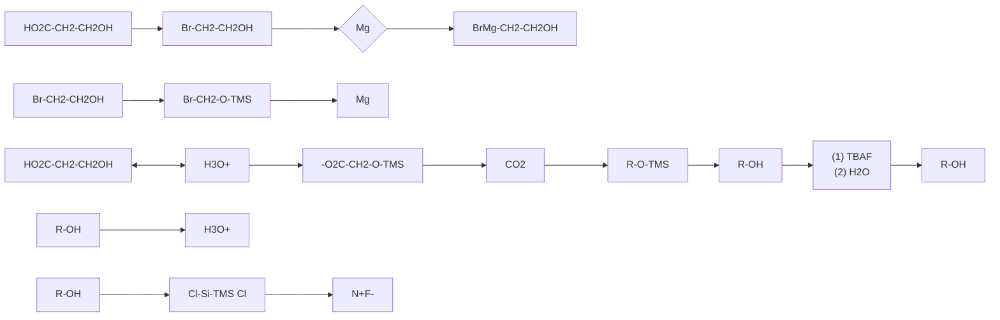
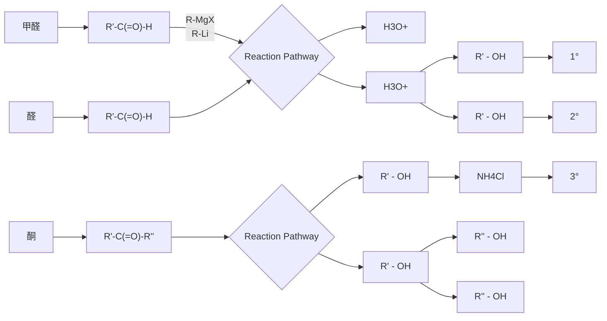
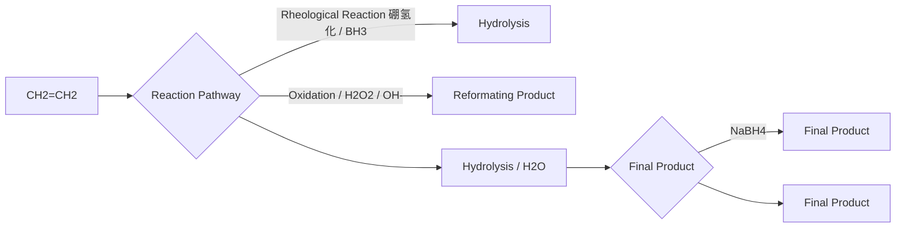
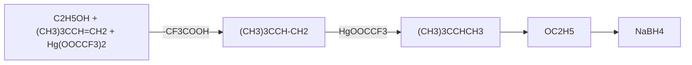

该反应受去质子化步骤的位阻控制，主要生成取代较少的烯烃，因此不符合 Saytzeff 规则。该体系不适用于位阻较小的伯醇，因为氯离子  $S_{N}2$  反应与 E2 反应存在竞争。

## 7.2.5 醇的氧化反应

醇羟基的取代反应可以用于合成多种化合物，但局限于氧化态相同的官能团。表7-2总结了常见官能团的氧化态，表中从左到右的化合物转化通常经历了脱氢或加氧，碳原子的氧化态升高，发生了氧化反应。例如，乙烷-乙烯-乙炔的转化、甲醇-甲醛-甲酸-二氧化碳的转化、甲烷-氯甲烷-二氯甲烷-氯仿-四氯化碳的转化、乙胺-乙醛亚胺-乙腈的转化，每步都经历了氧化反应。不同结构的醇可以被选择性地氧化为醛、酮或羧酸。

表 7-2 常见有机化合物的碳原子氧化态

<table><tr><td rowspan="2">化合物</td><td colspan="9">C氧化态</td></tr><tr><td>-4</td><td>-3</td><td>-2</td><td>-1</td><td>0</td><td>+1</td><td>+2</td><td>+3</td><td>+4</td></tr><tr><td>烃类</td><td> $CH_4$ </td><td> $CH_3CH_3$ </td><td> $H_2C=CH_2$ </td><td>RHC=CHRHC≡CH</td><td> $R_2C=CR_2RC≡CR$ </td><td></td><td></td><td></td><td></td></tr><tr><td>卤代烃</td><td></td><td></td><td> $CH_3X$ </td><td> $CH_3CH_2X$ </td><td> $CH_2X_2$ </td><td> $CH_3CHX_2$ </td><td> $CHX_3$ </td><td> $CH_3CX_3$ </td><td> $CX_4$ </td></tr><tr><td>含氧化合物</td><td></td><td></td><td> $CH_3-OH$ </td><td> $CH_3CH_2-OH$ </td><td> $(CH_3)_2CH-OH$  $H_2C=O$ </td><td> $CH_3CH=O$ </td><td> $(CH_3)_2C=O$  $HCO_2H$ </td><td> $CH_3CO_2H$ </td><td>O=C=O</td></tr><tr><td>含氮化合物</td><td></td><td></td><td> $CH_3-NH_2$ </td><td> $CH_3CH_2-NH_2$ </td><td> $CH_2=NH$ </td><td> $CH_3CH=NH$ </td><td> $HC≡N$ </td><td> $CH_3C≡N$ </td><td>RN=C=NR</td></tr></table>

常见氧化剂包括高价金属氧化物，如铬酸（$\mathrm{Cr}^{\mathrm{VI}}$）、铬酐（$\mathrm{CrO_3}$）-吡啶络合物（$\mathrm{Cr}^{\mathrm{VI}}$）、高锰酸钾（$\mathrm{Mn}^{\mathrm{VII}}$）、二氧化锰（$\mathrm{Mn}^{\mathrm{IV}}$）、四乙酸铅（$\mathrm{Pb}^{\mathrm{IV}}$）；也包括高氧化态的主族化合物，例如次氯酸钠（$\mathrm{Cl}^{\mathrm{I}}$）、高碘酸盐（$\mathrm{I}^{\mathrm{VII}}$）、Dess-Martin 试剂（DMP）（$\mathrm{I}^{\mathrm{V}}$）、二甲亚砜（$\mathrm{S}^{\mathrm{IV}}$）。

仲醇在酸性条件下能被重铬酸盐氧化成酮，形式上可以理解为醇的氧原子上一对电子转移到  $Cr^{VI}$  上（蓝色所示），且碳原子和氧原子上各失去一个质子。反应机理如下:醇和原位生成的铬酸发生配体交换得到铬酸酯，脱一分子水，不涉及氧化还原；亚铬酸根是好的离去基团，带走醇的氧原子上一对电子被还原，同时对醇  $\alpha-$  去质子化，发生 1,2-消除生成酮。

chemical

Reaction mechanism showing oxidation of a chromium complex to form a ketone and an aldehyde

伯醇在酸性条件下能被重铬酸盐氧化得到羧酸，氧化过程中先生成醛，然后进一步氧化成酸；仲醇氧化得到酮，在此条件下比较稳定；叔醇没有 $\alpha$-H不能被氧化。因此可以用清澈的铬酸水溶液鉴定醇:伯、仲醇可以被氧化并产生 $\mathrm{Cr}^{\mathrm{III}}$ ，体系变为不透明的蓝绿色；叔醇及烯烃、炔烃不反应，溶液保持橙黄色。但剧烈条件下，过量铬酸会断裂双键成酮或酸。

chemical

Reaction equation showing oxidation of aldehyde to form acetic acid and ketone under Na2Cr2O7/H2SO4 conditions

铬酸水溶液对醇的氧化反应在合成中的应用有限，因其氧化能力较强，对官能团的选择性差，多数有机分子也难溶于水。而且该条件下无法得到醛，因此后续发展了多种温和的高价铬试剂，用于伯醇氧化成醛，仲醇氧化成酮。其中最常用的 PCC(pyridinium chlorochromate) 试剂研制于 1975 年，又称 Corey-Suggs 试剂。该试剂具有酸性，不吸潮，易溶于有机溶剂，可在温和条件下（通常为室温）氧化伯醇成醛、仲醇成酮，且双键、叁键不受影响。实际操作中需加入硅藻土（celite）吸附反应产生的铬盐，后处理通常只需过滤后蒸干溶剂。

与铬的氧化物类似，强氧化剂  $KMnO_{4}$  的水溶液在碱性条件下能氧化伯醇成羧酸盐；仲醇能在该条件下被氧化成酮，但容易进一步氧化断裂碳碳键，因此合成中应用有限。而高锰酸钾与硫酸锰新制的  $MnO_{2}$ ，能在室温下选择性氧化烯丙醇，生成共轭烯醛/烯酮。

chemical

Chemical reaction showing oxidation of a steroid derivative with MnO2 to form a fused ring system

高价金属氧化物用于醇氧化反应的主要缺点在于大量产生剧毒的重金属盐，不利于环保。近年来相对清洁廉价的主族元素氧化剂得到了广泛应用。家用漂白剂（bleach）作为一种廉价易得的化工原料，也是常用的氧化剂，其主要成分为次氯酸钠水溶液，可以在中性条件下氧化伯醇成醛、仲醇成酮。相比于PCC试剂，NaOCl更适用于氧化对酸敏感的底物，且反应副产物为氯化钠水溶液，属于对环境友好的绿色化学方法。卤族元素中，碘的高氧化态化合物作为氧化剂也得到了充分发展，其中最常用于醇氧化的是研制于1983年的五价碘试剂Dess-Martin Periodinane（DMP），能氧化伯醇成醛、仲醇成酮。

chemical

Chemical reaction equation showing oxidation of aldehyde to ketone under NaOCl and DMP conditions

DMP 氧化反应机理与铬酸氧化类似:伯醇和五价碘发生配体交换，五价碘离去并带走伯醇氧原子上的一对电子，被还原为三价碘（蓝色所示），同时乙酸根从碘中心离去，并结合伯醇的  $\alpha-H$ ，醇的 C-O 键上发生 1,2-消除得到醛。DMP 氧化反应的副产物包括两分子乙酸，因此对酸敏感的底物需要在反应体系中额外加入缚酸剂。DMP 氧化对底物具有优越的选择性，伯醇和仲醇同时存在的情况下先氧化伯醇，原因在于五配位的碘中心较为拥挤，其配体交换受位阻影响较大。DMP 氧化的优势在于条件温和、操作简易、反应迅速，而且对水不敏感，体系里额外加入一当量水能促进氧化反应。

chemical

Reaction mechanism showing DMP-mediated oxidation of a ketone to form a醛 intermediate

氧化反应在20世纪70年代发展迅速，其中包括多种用二甲亚砜作氧化剂的策略。二甲亚砜（dimethyl sulfoxide，DMSO）作为一种廉价、低毒、沸点较高的极性非质子溶剂，对大部分极性有机物有良好的溶解性，在化工行业中广泛用作反应介质。DMSO因为分子中的四价硫而具有氧化性，而且DMSO存在电荷分离的极性共振式，其氧原子具有亲核性。Swern氧化报道于1978年，通过加入DMSO、草酰氯和三级胺，可以在低温下氧化伯醇成醛、仲醇成酮，因其原料易得、反应温和而沿用至今，常作为替代PCC的较环保氧化方法。

chemical

Chemical reaction equation showing conversion of aldehyde to ketone under DMSO and Et3N conditions at 78°C

Swern 氧化的机理如下:DMSO 对草酰氯进行亲核加成-消除，释放的氯离子和硫亲电中心发生  $S_{N}2$  反应，生成氯代硫镝离子（chlorosulfonium ion）；醇对氯代硫镝离子亲核取代生成烷氧基硫镝离子（alkoxysulfonium ion），该中间体被三级胺去质子化，生成硫叶立德（sulfurylide）；硫叶立德通过五元环过渡态分子内消除二甲硫醚（DMS）得到羰基。实验中反应体系须严格控温，以减少副反应。DMS 气味难闻，后处理时须在通风橱内操作。

如需氧化对酸敏感的仲醇，可以采用反应条件为碱性的 Oppenauer 氧化:仲醇在催化量的异丙醇铝存在下，可以被羰基化合物（如丙酮、二苯甲酮等）氧化成酮，反应机理如下:仲醇对异丙醇铝发生配体交换，随后络合一分子酮经历环状过渡态的负氢转移。因为各步基元反应均可逆，通常需要通过加入过量酮实现平衡向仲醇氧化的方向移动。伯醇在该条件下可以被氧化成醛，但存在羟醛缩合副反应，应用较少。

chemical

Chemical reaction mechanism showing aluminum-aluminum complex formation and dehydration steps with reagents labeled

多元醇具有醇的共性，还能发生独特的氧化反应，例如邻二醇与高碘酸水溶液反应，可以氧化裂解成醛、酮。反应机理为邻二醇与高碘酸形成五元环状酯中间体，并分解成醛、酮和碘酸根。邻二醇和高碘酸反应的化学计量比为 $1:1$ 。相邻羟基的三元醇经过一分子高碘酸氧化裂解得到相应的 $\alpha-$ 羟基醛或酮后，还能继续反应，与另一分子高碘酸形成五元环状酯中间体，最终得到一分子酸和两分子醛、酮。多元醇的反应以此类推，反应消耗的高碘酸当量等于多元醇分子断裂的C-C键数量。这一规律可用于推断未知多元醇的结构。类似结构的 $\alpha-$ 羟基酸、 $\alpha-$ 氨基醇、 $\alpha-$ 氨基酮、 $\alpha-$ 二酮都可以发生该反应。四乙酸铅的醋酸溶液可以通过形成环状酯中间体发生类似的氧化反应，可与高碘酸作为互补，用于多元醇的结构分析。

chemical

Chemical reaction equation showing the synthesis of a cyclic ester from poly(1,2-dimethyl)ol and its isocyanate under acidic conditions

## 7.2.6 醇羟基的保护

在合成中为了防止醇羟基发生各种副反应，可采取不同的策略对其进行保护，考虑到易于脱除的特性，主要用到的保护基有如下四类:醚类、硅醚类、缩醛类、酯类。多元醇可以考虑与苯甲酮或丙酮形成缩酮实现保护。其中硅基保护的策略最为常见。在弱碱存在下，醇可以对三甲基氯硅烷（chlorotrimethylsilane，TMSC1）进行硅原子上的 $\mathrm{S_N2}$ 反应，得到相对惰性的三甲基硅基醚，掩蔽了醇羟基的酸性和亲核性。TMS保护基在较强的酸性水溶液中或氟离子存在下可以发生脱保护，释放出自由羟基的醇。

flowchart

## 7.3 碳正离子及其重排反应

## 7.3.1 碳正离子的结构特性和产生方式

19 世纪中期化学家对有机反应的理解局限于简单反应,例如 Auguste Laurent 提出了“最小结构变化”原则来解释取代反应中亲核试剂占有了原先离去基的位置、消除反应中碳骨架保持不变等现象。然而 19 世纪末发现的两类碳正离子的重排反应改变了原有的观点:Fittig 于 1860 年发现的频哪醇（pinacol）重排，以及 1899 年发现的 Wagner-Meerwein 重排。

碳正离子（carbocation）是带正电荷的三价碳原子的原子团，其中带正电荷的碳原子采取  $sp^{2}$  杂化，3 个  $\sigma$  键构成平面三角形。中心碳原子上还有一个空的 p 轨道垂直于该平面。碳正离子是缺电子的亲电试剂，可以被亲核试剂进攻，大多不能稳定存在，因此在反应中通常作为高能量的中间体。

$\sigma - p$ 超共轭

p-π共轭

n-p相互作用

相邻基团的电子云能以三种形式与碳正离子的空轨道交叠，分散正电荷稳定碳正离子:

（1）烷基碳正离子的 C-H 键能与空的 p 轨道产生 σ-p 超共轭效应，所连烷基取代越多，超共轭效应越强，碳正离子越稳定: $R_{3}C^{+}>R_{2}CH^{+}>RCH_{2}^{+}>CH_{3}^{+}$ 。
（2）与共轭体系相连的碳正离子可以通过 $p-\pi$ 共轭使电子离域，增强稳定性，因此烯丙基碳正离子和苄基碳正离子比烷基碳正离子稳定。而环丙甲基正离子比苄基正离子稳定，因为环丙基的弯曲轨道类似 $\pi$ 键，与碳正离子的p轨道充分交叠。中心碳原子所连共轭体系或环丙基越多，碳正离子越稳定。共轭体系连有给电子基团时，碳正离子更稳定: $p-CH_{3}PhCH_{2}^{+}>PhCH_{2}^{+}$ 。
(3) 直接与杂原子相连的碳正离子与杂原子上的孤对电子发生 n-p 相互作用, 提高稳定性。

碳正离子的空 p 轨道能量较高，而轨道能量越相近，相互作用越强，因此三种相邻基团与空的 p 轨道作用强弱为  $n > \pi > \sigma$ ，与 n 非键轨道  $>\pi$  成键轨道  $>\sigma$  成键轨道的能量顺序一致。

产生碳正离子的方式通常有三种:① 化学键异裂直接离子化，如溴代烃中溴离子离去产生碳正离子。② 带正电荷的亲电试剂对不饱和键的加成，如质子与烯烃反应得到碳正离子。③ 通过其他正离子转化，如伯胺氧化成重氮盐，分解释放  $N_{2}$  得到碳正离子。

酸性条件下醇的E1反应通常经历碳正离子中间体:醇羟基被质子化，转变为好的离去基团 $\mathrm{H}_2\mathrm{O}$，并通过C-O键异裂得到碳正离子中间体，$\beta -\mathrm{C}$ 去质子化并给出一对电子，生成烯烃。酸性条件下脱水的反应速率顺序为叔醇 $>$ 仲醇 $>$ 伯醇，与生成的碳正离子稳定性相关。

chemical

Hydrolysis reaction mechanism of ethanol to form aldehyde and water, with H+ and -H+ conditions

$3^{\circ}$ 碳正离子

消除产物烯烃存在顺反异构体的情况下，主产物为 E 型。在碳正离子  $\alpha-$  去质子化的过渡态中，C-H 键必须和碳正离子空的 p 轨道重叠才能给出一对电子生成 C=C 双键，对过渡态的构象分析可知，生成 Z-烯烃的过渡态有额外的烷基排斥作用，能量更高，因此生成 E-烯烃的过渡态更有利。

chemical

Chemical reaction equation showing oxidation of an aldehyde to form a methyl group and its subsequent formation from a substituted alkene

## 7.3.2 碳正离子的重排反应

在酸性条件下，3,3-二甲基丁-2-醇转化为2,3-二甲基丁-2-烯的现象无法用常规的E1机理解释，为此Wagner和Meerwein提出了碳正离子重排机理:不稳定的碳正离子会发生重排，得到一个更稳定的碳正离子。3,3-二甲基丁-2-醇脱水生成 $2^{\circ}$ 碳正离子，在邻位为季碳时，$\alpha-$ 甲基发生[1,2]-烷基迁移，生成更稳定的 $3^{\circ}$ 碳正离子，随后去质子化生成四取代的烯烃产物。反应体系酸性越强，越容易得到重排产物，因为碳正离子的 $\alpha-$ 去质子化更慢，碳正离子的寿命更长，有充分时间发生重排。

chemical

Reaction mechanism diagram showing hydrogenation and rearrangement steps of 3,3-dimethylbutan-2-ol and 2,3-dimethylbut-2-ene to form 2° and 3° carbon monomers with water and electron transfer.

[1,2]-迁移属于周环反应，遵循 Woodward-Hoffmann 规则:[1,2]-迁移反应经过的过渡态为拐角-质子化的环丙烷，为 2 电子的环状过渡态，由迁移基团的 σ 成键轨道和碳正离子空的 p 轨道发生重叠形成，具有休克尔芳香性，因此发生同面（suprafacial）迁移。若迁移基团有手性，则迁移过程中构型保持。

chemical

Chemical reaction mechanism showing [1,2]-迁移过渡态，拐角-质子化的环丙烷

频哪醇重排是邻二醇特有的反应，在酸性条件下脱水重排得到醛或酮。反应机理与Wagner-Meerwein重排类似，经历羟基质子化离去生成碳正离子，但重排的驱动力不再是生成更稳定的碳正离子:频哪醇重排的碳正离子发生[1,2]-迁移时，正电中心从6电子的碳转移到 $\alpha-$ 羟基，变为8电子的氧，生成比碳正离子更稳定的锌盐离子，经去质子化得到产物醛或酮。

chemical

Chemical reaction pathway showing the conversion of cyclohexanol to phenol via sulfuric acid and sodium chloride, involving intermediates like 6e⁻ and [1,2]-

若底物为不对称取代的邻二醇，不同羟基离去可能得到两种产物，反应对二者的选择性与羟基离去生成的碳正离子稳定性正相关。例如，1,1-二苯基乙二醇在酸性条件下可以重排得到醛或酮的产物，连有苯基取代的叔醇脱水得到 $3^{\circ}$ 碳正离子，稳定性大于伯醇脱水生成的 $1^{\circ}$ 碳正离子，因此主要产物为 $3^{\circ}$ 碳正离子经过[1,2]-H迁移得到的醛。

chemical

Chemical reaction equation showing conversion of 3° and 1° carbon monomers to form a mixture of main and secondary products

若生成的碳正离子的 $\alpha$-取代基不同，迁移基团的优先级取决于基团给电子的能力:

$$
\mathrm{H} > \text {苯基} > \text {叔烷基} > \text {仲烷基} > \text {伯烷基} > \text {甲基}
$$

若  $\alpha-$  取代基为不同取代的芳基，迁移速率与芳香体系的富电子程度正相关:

| R | MeO | Me | Ph | H | Cl |
| --- | --- | --- | --- | --- | --- |
| 相对迁移速率 | 500 | 16 | 12 | 1 | 0.7 |

实际合成中，为避免受不同羟基离去的区域选择性影响产率，可采用Tiffeneau-Demjanov重排，用亚硝酸氧化 $\alpha-$ 氨基醇得到重氮盐（diazonium），将氨基转化为好的离去基团 $N_{2}$ ，从而在特定位点产生碳正离子。该反应常用于氨甲基取代的4\~8元环脂肪醇，经扩环重排得到多一个碳的环酮产物。若底物不对称，则产物分布受基团迁移顺序控制。

flowchart

若氨基位于环内，可以通过重排得到缩环产物。但环状结构的构象不能发生自由旋转，而[1,2]-迁移反应可以与基团离去的步骤协同发生，因此仅当迁移基团和离去基团处于反式共平面（antiperiplanar）时，重排速率最快，此情境下的产物分布受底物空间构型控制。

报道于 1963 年的 Meinwald 重排通过类似机理发生: 酸性条件下环氧化合物开环得到  $\alpha-$  羟基-碳正离子，并重排成锌盐，去质子化后得到醛或酮产物。T-D 重排与 Meinwald 重排虽不属于邻二醇的反应，但因机理相似，称为类频哪醇重排（pinacol-type rearrangement）。

chemical

Chemical reaction mechanism showing protonation and deprotonation steps of a cyclohexanone derivative

一般情况下，碳正离子为平面结构，亲核试剂能从其任意一面进攻，因此手性碳原子经 $S_{N}1$ 反应，会发生外消旋化（racemization）并得到两种互为对映异构体的产物。若底物带有两个及两个以上手性中心，且其中一个手性碳原子经 $S_{N}1$ 反应，会得到一对非对映体的混合物，这种转化称为差向异构化（epimerization）。

然而对于邻基参与的碳正离子反应，手性构型有时得以保留。例如，手性的反式邻碘环己醇分子，在酸性条件下生成环状碘镝离子（iodonium）并发生构型翻转，该中间体与亲核试剂发生 $S_{N}2$ 反应构型再次翻转，最终得到构型保持的取代产物。其他有孤对电子的基团如Br、N、S、碳碳双键等，若空间构型适合，也能产生类似的邻基效应。

chemical

Chemical reaction pathway showing chlorination and structural rearrangement steps of a cyclohexane derivative

## 7.4 醇的制备

## 7.4.1 还原反应

氢化铝锂、硼氢化钠、硼烷、活泼金属等还原剂可以将醛、酮、羧酸衍生物还原成醇。其中氢化铝锂可以直接还原酯到伯醇，也可还原醛、酮。而硼氢化钠相对温和，不与酯反应，可用于选择性还原醛到伯醇、还原酮到仲醇。

chemical

Reaction mechanism diagram showing alkene and aldehyde converting to carbonyl compounds under LiAlH4 and NaBH4 conditions

## 7.4.2 亲核试剂对含氧亲电试剂加成

常见的金属有机化合物如格氏试剂和有机锂试剂能通过极性的  $\sigma$  键电子与亲电试剂反应，其中的正电荷集中于金属，负电荷集中于碳原子，可等效于碳负离子作亲核试剂。此类亲核试剂能对亲电的羰基化合物发生加成反应，得到的烷氧基卤化镁或烷氧基锂中间体可经酸化后处理得到相应的醇。

chemical

Reaction mechanism showing hydrogenation of a ketone to form lithium using MgX and Li, with H3O+ as intermediate

格氏试剂和有机锂试剂都具有强碱性和还原性，因此在制备及使用过程中，反应体系应处于严格的无水无氧条件，否则会猝灭试剂。若羰基化合物的酸性强于亲电性，加入格氏试剂或有机锂试剂只能发生去质子化而无法得到醇，如1,3-二羰基化合物。

chemical

Organic synthesis reaction pathway showing chlorination, bromination, and deprotection steps with MgCl and D2O reagents

格氏试剂和有机锂试剂通过对醛酮的加成，可以得到结构多样的醇，比金属有机试剂原有的烃基增加一个碳原子。与甲醛反应得到增加一个碳原子的伯醇；与醛反应在增加一个碳原子的基础上得到仲醇；与酮反应得到叔醇。实际操作中，反应通常用盐酸猝灭，但叔醇产物容易脱水发生消除或取代，因此金属有机试剂与酮的反应用氯化铵溶液猝灭。

flowchart

金属有机试剂也能与羧酸衍生物反应。格氏试剂与酯 1:1 加成，消除烷氧基负离子得到中间产物酮，但酮比酯活泼，再和另一分子格氏试剂反应，猝灭后最终产物为叔醇。产物中季碳上的两个取代基完全相同，都来自格氏试剂。实验中若按格氏试剂与酯 1:1 投料，则原料剩余一半不反应，最终得到酯和叔醇的混合物，因此和酯的反应通常加入两当量格氏试剂。

chemical

Reaction mechanism diagram showing esterification and deprotection steps with reagents and conditions

格氏试剂和有机锂试剂能对环氧化合物进行开环加成，与环氧乙烷反应得到增加两个碳原子的伯醇。不对称取代的环氧乙烷反应存在区域选择性，先进攻位阻小的一侧，得到仲、叔醇。

chemical

Chemical reaction equation showing oxidation of a cyclic oxime to form a hydroxylated alkene using MgX and Li ions

逆合成分析是设计合成路线的常用思维方式。对于特定结构的醇，通过金属有机化合物对含氧亲电试剂的加成规律，可以逆向分析由何种原料进行制备。伯醇若设计为烃基结构上增加一个碳原子的醇，可以切断成来自金属有机试剂的烃基和来自甲醛的羟甲基；若能视为增加两个碳原子的醇，可以切断成来自金属有机试剂的烃基和来自环氧乙烷的羟乙基。仲醇通常切断衍生化羟甲基一侧的取代基，来自金属有机试剂，衍生化的羟甲基来自醛。叔醇若含重复取代基，可在衍生化羟甲基上切断两个重复取代基，来自金属有机试剂，衍生化羟甲基来自酯。不对称取代的叔醇一般切断为酮和金属有机试剂的组合。

逆合成分析需要考虑反应的可行性,例如对  $\beta-$  羟基酯逆合成分析所得的原料是 1,3-二羰基化合物和格氏试剂的组合，实际情况二者发生酸碱中和反应，得不到亲核加成产物；采取硼氢化钠选择性还原更活泼的酮羰基更为合理（蓝色箭头所示）。

chemical

Chemical reaction equations showing oxidation of a ketone to form methyl and sodium borohydrate under Me-MgI and NaBH4 conditions

## 7.4.3 烯烃水合

酸性条件下烯烃水合可以得到醇，但经历碳正离子中间体常有重排产物，立体选择性较差。不对称烯烃原料通常用硼氢化-氧化转化为反马氏规则的醇产物，或用羟汞化-还原转化为符合马氏规则的支链化产物。

flowchart

## 7.5 醚的制备

## 7.5.1 醚的基本知识

醇的羟基上的氢原子被烃基取代的化合物称为醚，醚类化合物都含有醚键（C-O-C）。根据醚分子中烃基是否相同，可以分为对称醚（简单醚、单醚）和非对称醚（混合醚、混醚）。

| $CH_3CH_2\text{O}CH_2CH_3$ | $CH_3\text{O}CH_2CH_3$ |
| --- | --- |
| 乙醚对称醚 | 乙基甲基醚非对称醚 |

根据两个烃基结构的不同，醚又可以分为脂肪醚和芳香醚，脂肪醚又可以分为饱和脂肪醚和不饱和脂肪醚。

<table><tr><td>CH3CH2CH2OCHCH3</td><td>CH3OCH=CH2</td><td rowspan="2">苯(基)甲(基)醚(茴香醚)芳香醚</td></tr><tr><td>异丙基丙基醚饱和脂肪醚</td><td>甲基乙烯基醚不饱和脂肪醚</td></tr></table>

含有多个氧的环醚因形如皇冠，被称为冠醚。

对于简单烷基的醚，在命名时常采用普通命名法，即在醚字的前面写出烃基的名称。对称醚通常在相同的烃基前写上“二”字，然后再写醚字，有时“二”也可省略不写；非对称醚的命名则按两个烃基英文名字母顺序依次列出；芳香混合醚的命名把芳环写在前面（先芳后脂）；不饱和醚先写出饱和烃基，再写出不饱和烃基。

$CH_{3}\bigcirc CH_{3}$

(二)甲(基)醚

二苯(基)醚

苯(基)乙(基)醚

$C_{2}H_{5}\bigcirc CH=CH_{2}$

乙基乙烯基醚

在常温下，除甲醚和乙甲醚为气体外，其余的大多数醚是无色有特殊气味的液体，相对密度小于1，易燃。醚的沸点比相应的异构体醇的沸点低得多，与相对分子质量相近的烷烃相近，易挥发，原因是醚分子中没有羟基，不能形成分子间氢键。

醚可通过它的氧原子与水分子的氢原子形成氢键，因此醚在水中有一定的溶解度，与同碳数醇的溶解度相近，比烷烃的溶解度大。而四氢呋喃和1,4-二氧六环等环醚因氧原子裸露在外面，可以和水形成氢键，故能与水混溶。乙醚只能微溶于水，而多数有机物易溶于乙醚，故常用乙醚从水溶液中萃取易溶于乙醚的物质。例如，屠呦呦利用乙醚的低沸点和溶解性，从黄花蒿中提取了青蒿素，这项工作于2015年10月获得诺贝尔生理学或医学奖。

## 7.5.2 威廉森合成法

用醇钠和卤代烷在无水条件下生成醚的反应称为威廉森（Williamson）合成法。

$$
\mathrm{RONa} + \mathrm{R} ^ {\prime} \mathrm{X} \longrightarrow \mathrm{ROR} ^ {\prime} + \mathrm{NaX}
$$

除了用卤代烷以外，醇钠与硫酸酯和磺酸酯反应也可以用于合成醚。

$$
\mathrm{RONa} + \mathrm {R^{\prime} OSO_ {2} Ph} \longrightarrow \mathrm {ROR^{\prime}} + \mathrm {NaOSO_ {2} Ph}
$$

芳香醚可以用苯酚与卤代烷、硫酸酯或磺酸酯在氢氧化钠的水溶液中制备。

chemical

Chemical reaction equation showing phenol reacting with ROSO2Ph under NaOH/H2O conditions to form phenol and NaOSO2Ph

使用 Williamson 合成法既可以合成对称醚，也可以合成不对称醚。在合成不对称醚时，反应物可以有两种搭配，要选择有利于生成醚的搭配。例如，制备叔丁基甲基醚时，可以选择叔丁醇钠和碘甲烷反应，可以顺利得到叔丁基甲基醚，反应式如下:

$$
(\mathrm{CH} _ {3}) _ {3} \mathrm{CO} ^ {-} \mathrm{Na} ^ {+} + \mathrm{CH} _ {3} \mathrm{I} \xrightarrow {\mathrm{S} _ {\mathrm{N}} 2} (\mathrm{CH} _ {3}) _ {3} \mathrm{COCH} _ {3} + \mathrm{NaI}
$$

如果选用甲醇钠和叔丁基溴反应，由于叔丁基溴的空间位阻很大，不利于 $S_{N}$ 反应，有利于发生E2反应，因此主要产物是烯烃，反应式如下:

$$
(\mathrm{CH} _ {3}) _ {3} \mathrm{CBr} + \mathrm{CH} _ {3} \mathrm{ONa} \xrightarrow {\mathrm{E2}} (\mathrm{CH} _ {3}) _ {2} \mathrm{C} = \mathrm{CH} _ {2} + \mathrm{CH} _ {3} \mathrm{OH} + \mathrm{NaBr}
$$

若一个分子内同时存在卤原子和羟基，可以在强碱性条件下发生分子内  $S_{N}$  反应，生成环醚。例如:

chemical

Chemical reaction equation showing hydroxylation of a chloroalkane to form a cyclohexyl ether, with RONa and S_N2 molecules

如果卤原子和羟基在相邻的两个碳上，同时又处于反式位置，即符合分子内 $S_{N}2$ 反应的立体化学要求，可以通过 Williamson 合成法生成环氧乙烷的衍生物。由于氧负离子必须从背面进攻，因此下图的第一式得到反式产物，第二式得到顺式产物。

chemical

Chemical reaction mechanism showing bromination of a carboxylic acid derivative with hydrogen bonding

反-2,3-环氧丁烷

chemical

Chemical reaction mechanism showing bromination of a carbonyl compound to form a cyclic alkene with water and hydrogen atoms

顺-2,3-环氧丁烷

又如，环己烯和次氯酸加成，产物中的 -Cl 和 -OH 处于反式，在碱的作用下，生成的  $O^{-}$  可以从 C-Cl 键的背面进攻碳原子，得到取代的环氧乙烷。

chemical

Organic reaction pathway showing chlorination and deprotection steps with HOCl, NaOH, and S_N2⁻ counterion

若 -Cl 和 -OH 处于顺式，在碱的作用下，不能发生  $S_{N}2$  反应，只能发生 E2 反应得到烯醇，再经过互变异构，得到羰基化合物。例如:

chemical

Chemical reaction mechanism showing chloroacetate reacting with ethyl ether to form a cyclohexene derivative

冠醚的一个常用的制备方法，也是通过 Williamson 合成法。例如，二缩三乙二醇和 1,2-二(2-氯乙氧基)乙烷可以在 KOH 的作用下合成 18-冠-6。

chemical

Chemical reaction equation showing the synthesis of 18-6-crown ether from 2-benzobenzoyl alcohol and 1,2-(2-methyl-oxymethyl)ethane

## 7.5.3 醇分子间失水

在浓硫酸的作用下，两个相同的醇分子通过分子间失水可以制得对称醚:

$$
2 \mathrm{ROH} \xrightarrow {\text {浓} \mathrm{H} _ {2} \mathrm{SO} _ {4}} \mathrm{ROR} + \mathrm{H} _ {2} \mathrm{O}
$$

一级醇的分子间失水是通过  $S_{N}2$  反应机理进行的:在浓硫酸的作用下，醇分子的羟基质子化，形成质子化的乙醇锌盐:接着另一分子乙醇的氧原子亲核进攻锌盐的  $\alpha-$  碳原子，水分子离去，得到二乙基锌盐:最后再失去质子得到醚。

chemical

Enzymatic reaction mechanism showing protonation and dehydration steps with reagents and conditions

在实际应用中，伯醇制醚产率高，仲醇制醚产率低，叔醇的反应无法分离得到醚，如果蒸馏，最后得到烯烃。 $2^{\circ}\mathrm{ROH}$ 和 $3^{\circ}\mathrm{ROH}$ 的反应通常按 $\mathrm{S_N1}$ 反应机理进行。

chemical

Chemical reaction equations showing acid-catalyzed hydrolysis of (CH3)3COH and (CH3)3COH2 to form (CH3)2C=CH2, with叔丁基醚 (no separation)

蒸馏可以制得烯烃

利用叔醇容易生成碳正离子的性质，使用叔醇和伯醇的混合物，在酸催化作用下，可以脱水生成叔烷基伯烷基混醚。例如，甲醇和叔丁醇的混合物在硫酸的作用下可以生成叔丁基甲基醚。

$$
(\mathrm{CH} _ {3}) _ {3} \mathrm{COH} + \mathrm{CH} _ {3} \mathrm{OH} \xrightarrow {15 \% \mathrm{H} _ {2} \mathrm{SO} _ {4}} (\mathrm{CH} _ {3}) _ {3} \mathrm{COCH} _ {3}
$$

该反应也可以用于二醇分子内脱水，生成五元环醚或六元环醚。

chemical

Organic reaction pathway showing hydroxylation of aldehyde to form a cyclic alcohol with sulfuric acid and hydrogen peroxide, followed by oxidation to yield 90% product.

## 7.5.4 烯烃的烷氧汞化-去汞法

这是一个相当于烯烃加醇的制醚反应。

flowchart

该反应遵循马氏规则，氢加在含氢较多的碳上，烷氧基加在含氢较少的碳上，但是中间要经过加汞盐再还原去汞的步骤。此方法不会发生消除，比Williamson合成法的限制小；但是空间位阻太大时不易络合，所以，不能用于制备叔丁醚。

## 7.5.5 Ullmann 反应

二芳醚的合成通常采用Ullmann反应。该反应需要铜粉或亚铜盐作为催化剂，酚钠和卤代芳烃反应得到二芳基醚，这是一种形成 C-O 键的偶联反应，反应一般在非质子强极性溶剂中进行，以提高氧负离子的亲核性。

chemical

Chemical reaction equation showing bromination of phenol with ethyl bromide under copper catalysis

## 7.6 醚的反应

脂肪醚分子中的氧原子杂化方式为  $sp^{3}$  杂化，C-O-C 间有一定角度，因此醚不是线形分子，有极性。氧原子的两对孤对电子分别占据一个  $sp^{3}$  杂化轨道，另外两个  $sp^{3}$  杂化轨道分别与两个烃基碳的  $sp^{3}$  杂化轨道形成 σ 键。醚的化学性质相对稳定，在碱性介质中尤为稳定，在常温下，不与一般的氧化剂、还原剂、碱和活泼金属等发生反应。但在酸性条件下，醚可发生反应。

## 7.6.1 醚的自动氧化

化学物质和空气中的氧在常温下温和地进行氧化，而不发生燃烧和爆炸，这种反应称为自动氧化。乙醚及其他醚与空气长时间接触，或经光照后， $\alpha-$ 碳上的 H 会慢慢被氧化，生成不易挥发的过氧化物。

chemical

Chemical reaction equation showing acetylation of a ketone with oxygen under air

多数自动氧化是通过自由基机理进行的。

链引发: $R\cdot + O_{2} \longrightarrow ROO\cdot$

$$
\mathrm{ROO} \cdot + \left(\mathrm{CH} _ {3}\right) _ {2} \mathrm{CHOCH} _ {3} \longrightarrow \mathrm{ROOH} + \left(\mathrm{CH} _ {3}\right) _ {2} \dot {\mathrm{COCH}} _ {3}
$$

链增长: $(\mathrm{CH}_{3})_{2}\dot{\mathrm{CO}}\mathrm{CH}_{3} + \mathrm{O}_{2} \longrightarrow (\mathrm{CH}_{3})_{2}\underset{\mathrm{OO}^{\cdot}}{\mathrm{CO}}\mathrm{CH}_{3}$

$$
\begin{array}{c} \left(\mathrm{CH} _ {3}\right) _ {2} \mathrm{COCH} _ {3} + \left(\mathrm{CH} _ {3}\right) _ {2} \mathrm{CHOCH} _ {3} \\ \text {OO} ^ {\cdot} \end{array} \longrightarrow \begin{array}{c} \left(\mathrm{CH} _ {3}\right) _ {2} \mathrm{COCH} _ {3} + \left(\mathrm{CH} _ {3}\right) _ {2} \dot {\mathrm{CO}} \mathrm{CH} _ {3} \\ \text {OOH} \end{array}
$$

过氧化物不稳定，也不易蒸发，加热时可能发生爆炸。因此，醚的存放应尽量避免暴露在空气中，应在深色玻璃瓶中避光、密封保存于阴凉处。在蒸馏醚之前，一定要检查是否含有过氧化物。有两种常用的检验过氧化物的方法:（1）用湿润的KI-淀粉试纸检验，如醚中有过氧化物存在，KI会被氧化为 $\mathrm{I}_2$ ，使淀粉试纸变蓝。（2）加入 $\mathrm{FeSO_4}$ 和KSCN溶液与醚一起振摇，如醚中有过氧化物存在，$\mathrm{Fe}^{2+}$ 会被氧化为 $\mathrm{Fe}^{3+}$，而与 $\mathrm{SCN^-}$ 作用生成血红色络合物。除去醚中的过氧化物的方法是加入适量的亚硫酸钠（$\mathrm{Na_2SO_3}$）或新配制的硫酸亚铁（$\mathrm{FeSO_4}$）溶液，振摇，使过氧化物分解。为了防止过氧化物的形成，市售的无水乙