醚中加有  $0.05\mu g\cdot g^{-1}$  二乙氨基二硫代甲酸钠作抗氧剂。

## 7.6.2 形成锌盐

由于醚分子中的氧原子上带有孤对电子, 可看作 Brønsted 碱, 能接受质子, 生成二级锌盐。但醚接受质子的能力很弱, 必须在强酸的作用下才能生成锌盐。

$$
\mathrm{CH} _ {3} \mathrm{CH} _ {2} - \ddot {\mathrm{O}} - \mathrm{CH} _ {2} \mathrm{CH} _ {3} + \mathrm{H} _ {2} \mathrm{SO} _ {4} \quad \Longleftrightarrow \quad \mathrm{CH} _ {3} \mathrm{CH} _ {2} - \ddot {\mathrm{O}} - \mathrm{CH} _ {2} \mathrm{CH} _ {3} + \mathrm{HSO} _ {4} ^ {-}
$$

醚的锌盐很不稳定，只能存在于冷的强酸中，遇水很快分解为原来的醚。乙醚也能吸收当量的氯化氢，生成锌盐。如果把形成的锌盐与胺的乙醚溶液放在一起，可析出胺的盐酸盐，这是制备铵盐的一种方法。

$$
\mathrm{CH} _ {3} \mathrm{CH} _ {2} \mathrm{OCH} _ {2} \mathrm{CH} _ {3} \xrightarrow {\mathrm{HCl(g)}} \mathrm{CH} _ {3} \mathrm{CH} _ {2} \stackrel {+} {\mathrm{O}} \mathrm{CH} _ {2} \mathrm{CH} _ {3} \mathrm{Cl} ^ {-} \xrightarrow {\mathrm{RNH} _ {2}} \mathrm{RNH} _ {3} \stackrel {+} {\mathrm{Cl}} \Bigg \downarrow + \mathrm{CH} _ {3} \mathrm{CH} _ {2} \mathrm{OCH} _ {2} \mathrm{CH} _ {3}
$$

醚上的氧原子还可作为 Lewis 碱，与 Lewis 酸如  $BF_{3}$  和  $AlCl_{3}$  等作用，形成锌盐（配合物），如三氟化硼或三氯化铝乙醚配合物。三氟化硼是气体，它是一种常用的催化剂。市售三氟化硼是三氟化硼-乙醚配合物的溶液，在使用和运输时较为方便。

$$
\begin{array}{l} \mathrm{CH} _ {3} \mathrm{CH} _ {2} - \ddot {\mathrm{O}} - \mathrm{CH} _ {2} \mathrm{CH} _ {3} + \mathrm{BF} _ {3} \longrightarrow \mathrm{C} _ {2} \mathrm{H} _ {5} - \stackrel {\bullet} {\mathrm{O}} \rightarrow \mathrm{BF} _ {3} \equiv (\mathrm{C} _ {2} \mathrm{H} _ {5}) _ {2} \mathrm{O} \rightarrow \mathrm{BF} _ {3} \\ \mathrm{CH} _ {3} \mathrm{CH} _ {2} - \ddot {\mathrm{O}} - \mathrm{CH} _ {2} \mathrm{CH} _ {3} + \mathrm{AlCl} _ {3} \longrightarrow \mathrm{C} _ {2} \mathrm{H} _ {5} - \stackrel {{\ddot {\mathrm{O}}}} {{\underset {\mathrm{C} _ {2} \mathrm{H} _ {5}} {\longrightarrow}}} \mathrm{AlCl} _ {3} \equiv (\mathrm{C} _ {2} \mathrm{H} _ {5}) _ {2} \mathrm{O} \rightarrow \mathrm{AlCl} _ {3} \\ \end{array}
$$

若将乙醚与三氟化硼形成的二级锌盐和氟代烷反应，还可以形成三级锌盐:

$$
\mathrm{R} _ {2} \mathrm{O} \rightarrow \mathrm{BF} _ {3} + \mathrm{R} ^ {\prime} \mathrm{F} \longrightarrow \left[\begin{array}{c}\mathrm{R}\\\mathrm{O} ^ {+} - \mathrm{R} ^ {\prime}\\\mathrm{R} ^ {\prime}\end{array}\right] \mathrm{BF} _ {4} ^ {-}
$$

三级锌盐极易分解出烷基正离子，并与亲核试剂反应，所以是一种很有用的烷基化试剂。例如:

$$
\mathrm{ROH} + \left(\mathrm{CH} _ {3} \mathrm{CH} _ {2}\right) _ {3} ^ {+} \mathrm{O} \bar {\mathrm{BF}} _ {4} \longrightarrow \mathrm{ROCH} _ {2} \mathrm{CH} _ {3} + \mathrm{CH} _ {3} \mathrm{CH} _ {2} \mathrm{OCH} _ {2} \mathrm{CH} _ {3} + \mathrm{HBF} _ {4}
$$

## 7.6.3 醚的碳氧键断裂反应

醚与氢碘酸一起加热时，酸与醚先形成锌盐，然后发生  $S_{N}1$  或  $S_{N}2$  反应，接着醚键会发生断裂，生成醇和碘代烷。在过量酸存在下，所产生的醇也转化成碘代烷。例如:

$$
\begin{array}{l} \mathrm{CH} _ {3} \mathrm{OCH} _ {3} + \mathrm{HI} (1 \mathrm{mol}) \longrightarrow \mathrm{I} ^ {-} + \mathrm{H} _ {3} \mathrm{C} - \stackrel {\text {+}} {\mathrm{O}} - \mathrm{CH} _ {3} \quad \xrightarrow {\mathrm{S} _ {\mathrm{N}} 2} \mathrm{CH} _ {3} \mathrm{I} + \mathrm{CH} _ {3} \mathrm{OH} \\ \quad \quad \quad \quad \quad \quad \quad \quad \quad \quad \quad \quad \quad \quad \quad \quad \quad \quad \quad \quad \quad \quad \quad \quad \quad \quad \quad \quad \quad \quad \quad \quad \quad \quad \quad \quad \quad \quad \text {过量HI} \\ (\mathrm{CH} _ {3}) _ {3} \mathrm{COCH} _ {3} + \mathrm{HI} (1 \mathrm{mol}) \xrightarrow {- \mathrm{I} ^ {-}} (\mathrm{CH} _ {3}) _ {3} \mathrm{C} - \stackrel {\text {+}} {\mathrm{OCH}} _ {3} \quad \xrightarrow {\mathrm{S} _ {\mathrm{N}} 1} (\mathrm{CH} _ {3}) _ {3} \mathrm{C} ^ {+} + \mathrm{CH} _ {3} \mathrm{OH} \\ \quad \quad \quad \quad \quad \quad \quad \quad \quad \quad \quad \quad \quad \quad \quad \quad \quad \quad \quad \quad \quad \quad \quad \quad \quad \quad \quad \text {过量HI} \\ (\mathrm{CH} _ {3}) _ {3} \mathrm{Cl} + \mathrm{H} _ {2} \mathrm{O} \end{array}
$$

其他氢卤酸也可以发生类似的反应。HX 的反应活性顺序:HI > HBr > HCl。HI 常用于断裂醚键，或用  $KI/H_{3}PO_{4}$  代替 HI；HBr 需要较高浓度和反应温度；HCl 断裂醚键的效果较差。

混合醚 C-O 键断裂的顺序为:三级烷基 > 二级烷基 > 一级烷基 > 甲基 > 芳基。

$$
\mathrm{CH} _ {3} \mathrm{OCH} _ {2} \mathrm{CH} _ {3} + \mathrm{HI} (1 \mathrm{mol}) \xrightarrow {\mathrm{S} _ {\mathrm{N}} 2} \mathrm{CH} _ {3} \mathrm{I} + \mathrm{CH} _ {3} \mathrm{CH} _ {2} \mathrm{OH}
$$

对于单芳基醚，由于芳基与氧原子形成  $p-\pi$  共轭效应，Ar-O 键具有部分双键的性质，比较牢固，不易断裂，醚键总是优先在脂肪烃基的一侧断裂，生成苯酚和卤代烃。二芳醚 Ar-O-Ar 的醚键较稳定，不能被酸断裂。

$$
\mathrm{C} _ {6} \mathrm{H} _ {5} - \mathrm{O} - \mathrm{CH} _ {2} \mathrm{CH} _ {3} + \mathrm{HI} \longrightarrow \mathrm{C} _ {6} \mathrm{H} _ {5} - \mathrm{OH} + \mathrm{CH} _ {3} \mathrm{CH} _ {2} \mathrm{I}
$$

酚的烷基化和芳基醚断裂反应相结合使用，可以在反应中保护酚羟基。例如:

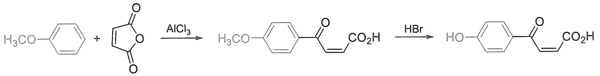

chemical

Chemical reaction equation showing the synthesis of a ketone from benzaldehyde and aldehyde under AlCl3 and HBr conditions

环醚与氢卤酸作用，醚键断裂生成卤代醇，可进一步卤化生成二卤代烃。例如:

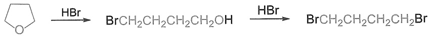

chemical

Chemical reaction sequence showing bromination and hydrolysis steps of a cyclohexane derivative

不对称的环醚开环，生成两种产物的混合物。

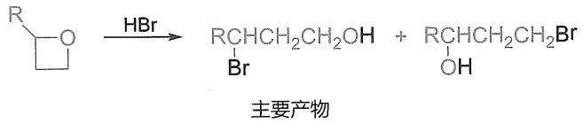

chemical

Chemical reaction equation showing bromination of a cyclohexanone under HBr to form an alcohol and bromoalkene

苄基醚在钯催化下氢化，可以发生脱苄基反应（不需要强酸）。

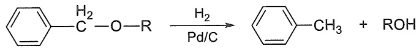

chemical

Chemical reaction equation showing reduction of a benzene derivative to form a pentafluorohydrin derivative and alcohol

## 7.6.4 1,2-环氧化合物的开环反应

一般情况下，环醚具有和链状醚类似的性质。常见的环醚如四氢呋喃、1,4-二氧六环等，因其惰性，被广泛用作有机反应中的溶剂，但它们仍然具有醚类化合物的反应特点，例如，在强酸性条件下会发生碳氧键的断裂。

具有三元环的环醚被称作环氧化合物（epoxide 或 oxirane），这是一类十分特殊的环醚类化合物，受三元环的环张力影响，具有十分丰富的反应活性。

环氧乙烷是最简单的环氧化合物，又被叫作氧化环乙烯，这一命名来自其英文名称ethylene oxide。这一命名方式（对应烯烃的氧化物）也普遍适用于环氧化合物的命名，如氧化丙烯（propylene oxide）、氧化环己烯（cyclohexene oxide）等。环氧乙烷被用于合成大宗工业原料乙二醇，后者被广泛应用于汽车抗冻剂、飞机发动机制冷剂及生产各种聚酯。工业上，环氧乙烷可以由乙烯与空气或氧气通过氧化银催化剂在高温下制得，但该方法不适用于合成其他环氧化合物。

$$
\begin{array}{c c c} \mathrm{H} _ {2} \mathrm{C} = \mathrm{CH} _ {2} & \xrightarrow [ \mathrm{Ag} _ {2} \mathrm{O} ]{\mathrm{O} _ {2}} & \mathrm{H} _ {2} \mathrm{C} - \mathrm{CH} _ {2} \\ \text {乙烯} & 3 0 0 ^ {\circ} \mathrm{C} & \text {环氧乙烷} \end{array}
$$

在烯烃章节中已经讲过，环氧化合物可以由烯烃与过氧酸（peroxyacid）反应得到。其中，最常用的过氧酸是间氯过氧苯甲酸（m-chloroperoxybenzoic acid，m-CPBA）。基于类似的氧化策略，通过发展四氧化锇和手性配体作为催化剂，Sharpless教授发展了高效的不对称环氧化反应及双羟化反应，并因此荣获了2001年诺贝尔化学奖。除此之外，烯烃与次卤酸发生亲电加成反应得到反式卤代醇，再进一步在碱性条件下发生分子内亲核取代反应，也可以得到环氧化合物。

与一般的醚不同，环氧乙烷与环丙烷相似，存在着有张力的三元环，性质非常活泼，而且环中有氧原子，具有极性键，反应活性更高。

## 1. 酸性条件下的环氧开环

由于氧原子电负性大，且受三元环环张力的影响，环氧化合物易于在酸性条件下发生碳氧键断裂而开环，相比普通醚类化合物碳氧键断裂所需的强酸性条件，常温条件下采用稀酸即可实现环氧的开环，例如环氧与稀酸水溶液反应得到邻二醇类产物，与氢卤酸反应得到对应的反式邻卤取代醇。

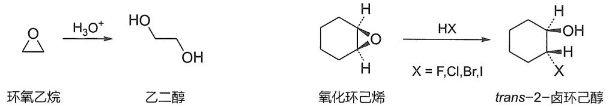

chemical

Chemical reaction pathway showing oxidation of ethyl ether to trans-2-hexyl isocyanate using H3O+ and HX under conditions X = F, Cl, Br, I

酸性条件下环氧开环的机理遵循如下历程:氧原子首先发生质子化，变成了一个较易离去的基团，然后体系内的亲核物种如  $HO^{-}$ 、 $X^{-}$ 等从相邻碳的反面进攻（类似于烯烃与液溴反应中的环状溴镝离子被进攻的历程），从而得到反式的邻二取代产物。从该历程可以判断酸性条件下环氧开环的区域选择性。氧原子被质子化后可加剧碳氧键的极化，从而导致相邻碳上带有部分正电荷，具备了碳正离子的特征，因此，能够生成更稳定碳正离子的碳更易被亲核进攻。

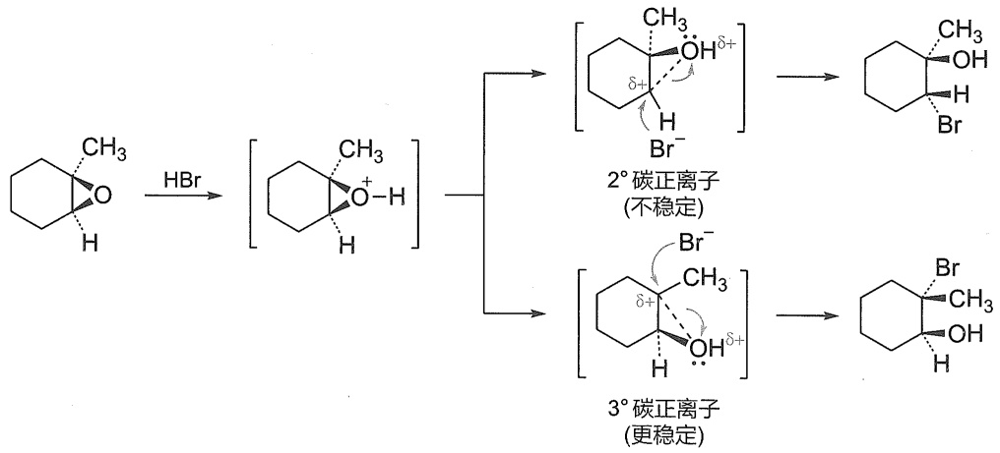

flowchart

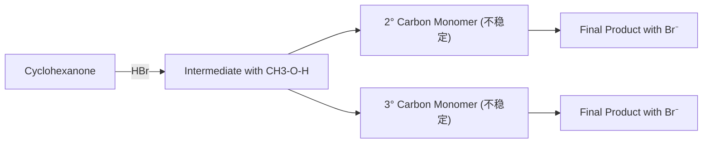

在酸催化下，1,2-环氧丙烷能与多种亲核试剂反应，导致环氧打开得到开环产物，开环时主要在C-O键发生选择性断裂。

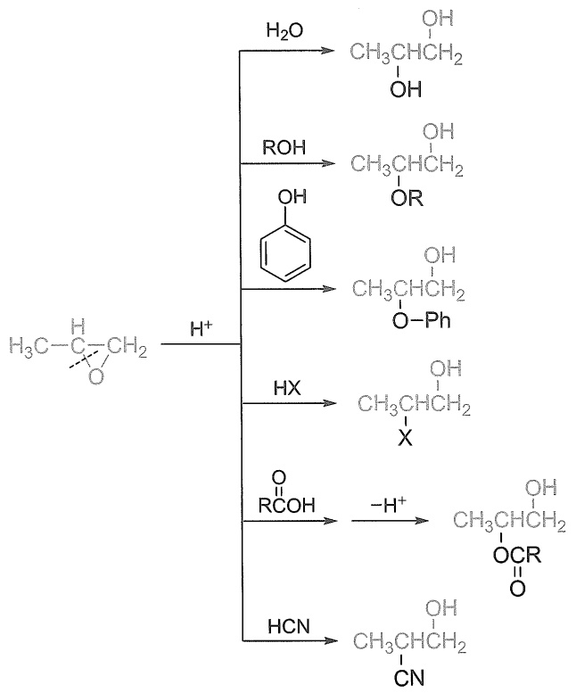

chemical

Chemical reaction pathway showing oxidation of a ketone to form a carboxylic acid derivative via intermediates like phenyl, hydroxyl, and acrylate

1,2-环氧丙烷也可以和乙硼烷反应，生成对应的醇。由于硼烷中硼的性质和质子酸类似，因此，硼烷中的负氢转移到取代基较多的环碳原子上。

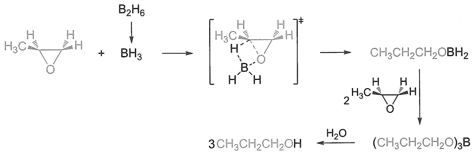

chemical

Chemical reaction mechanism showing boron-containing compound reacting with B2H6 to form a boron-containing intermediate, then rearranging to form an aldehyde and then to produce (CH3CH2CH2O)3B.

特殊的 1,2-环氧化合物也可以发生 C-C 键的断裂。近年来，我国科学家发现二羰基化合物衍生的环氧化合物实现了 Lewis 酸催化的选择性 C-C 或 C-O 键断裂开环。

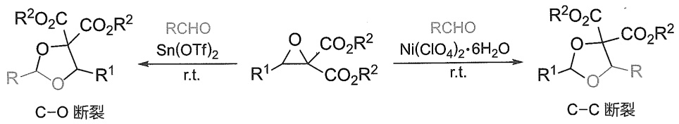

chemical

Chemical reaction pathway showing C-O and C-C cleavage steps with RCHO reagents

## 2. 碱性条件下的环氧开环

环氧在碱性条件下也可发生开环。在该类反应中，亲核试剂直接进攻与氧原子相邻的碳原子，氧原子充当一个离去基团，促使碳氧键断裂。例如，在较高温度下，羟基负离子可直接进攻环氧化合物，促使碳氧键断裂，通过进一步质子化，得到邻二醇类产物。其他常见的亲核试剂，如 $\mathrm{NaCN}$ 、 $\mathrm{NaN_3}$ 、 $\mathrm{NaOEt / EtOH}$，以及金属试剂，如格氏试剂、烷基锂试剂等，均可以与环氧发生碱性条件下的开环反应。碱性条件下的环氧开环反应是一个典型的 $\mathrm{S_N2}$ 反应，因此，亲核试剂倾向于进攻位阻小的相邻碳原子。

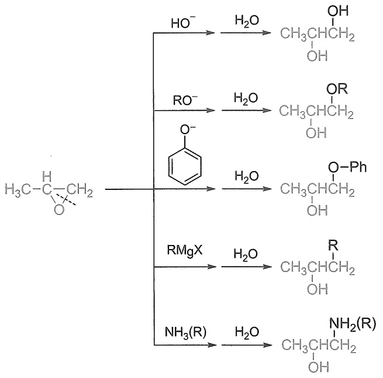

chemical

Chemical reaction pathway showing hydrolysis of a ketone to form various alcohols and products including phenyl, RMgX, and amine groups

1,2-环氧丙烷也可以在  $LiAlH_{4}$  作用下还原，生成对应的醇，产物和硼烷的反应正好有不同的区域选择性。

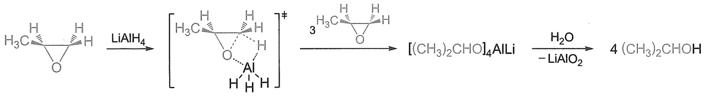

chemical

Chemical reaction pathway showing aluminum complex formation from aldehyde and lithium iodide, followed by reduction to alkali metal

## 7.7 醚的应用

## 7.7.1 工业用途

醚是一种常用的优良有机溶剂，但由于低级醚的高度挥发性，使用时须注意防火。

相对分子质量较低的醚具有麻醉作用，可作为外科手术的麻醉剂，如乙醚。安氟醚和异氟醚等含氟吸入麻醉药具有很多独特的优点，没有致癌、致畸、致突变等不良作用，对生物降解有抗力，因而是一类理想的吸入麻醉药。

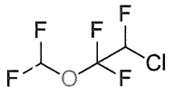

安氟醚

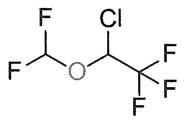

异氟醚

环氧乙烷是生产乙二醇的主要原料。一般在加压或酸性条件下，将环氧乙烷和水一起加热即可制得乙二醇。

$$
\begin{array}{c} \bigtriangledown \\ \mathrm{O} \end{array} + \mathrm{H} _ {2} \mathrm{O} \xrightarrow {\mathrm{H} ^ {+}} \begin{array}{c} \mathrm{OH} \\ \mathrm{CH} _ {3} \mathrm{OH} \end{array}
$$

环氧乙烷在催化剂如四氯化锡及少量水存在下聚合成聚乙二醇，水溶性良好，是生产聚氨酯的原料。聚氨酯可制备人造革、泡沫塑料、医用高分子材料等。

$$
n \bigtriangledown_ {\mathrm{O}} \xrightarrow {\mathrm{SnCl} _ {4}} \xrightarrow {\mathrm{H} _ {2} \mathrm{O}} \mathrm{HO} (\mathrm{CH} _ {2} \mathrm{CH} _ {2} \mathrm{O}) _ {n} \mathrm{H}
$$

聚乙二醇

用油溶的酚引发环氧乙烷的开环聚合，可得到非离子性的表面活性剂，可用作洗涤剂、乳化剂、分散剂等。

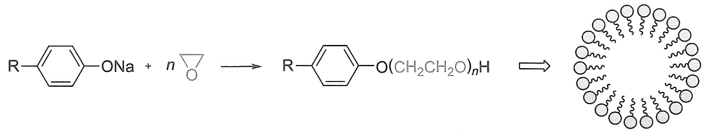

chemical

Chemical reaction equation showing the formation of a cyclic amide from an enolate and n-oxide intermediate

## 7.7.2 冠醚

冠醚是20世纪60年代合成得到的含有多氧大环的醚类化合物，其结构是由重复的乙二醚结构（$-\mathrm{OCH}_2\mathrm{CH}_2-$）单元形成的环。因其形状类似皇冠，所以称为冠醚（crown ether）。冠醚的命名的通式记为X-冠-Y，X表示冠醚环的总原子数目，Y则表示冠醚环中氧原子数。冠醚的发现被认为是超分子化学的开端。常见冠醚及其结构见图7-2。

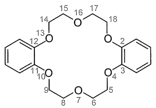

chemical

Chemical structure of a cyclic organic molecule with numbered atoms and substituents

二苯并-18-冠-6

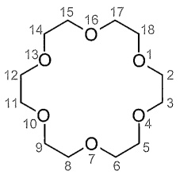

chemical

Circular molecular structure with numbered atoms and bonds, likely representing a cyclic or ring system

18-冠-6

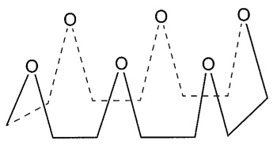

natural_image

Abstract geometric line drawing with interconnected shapes and dashed lines (no text or symbols)

18-冠-6的立体结构

图 7-2 常见冠醚及其结构

1967 年，Pederson 第一次发现了冠醚，这一发现开创了超分子化学的新领域，并为后续的研究提供了重要的基础。随后 Cram 和 Lehn 也开始了对超分子化学的研究。从此之后，超分子化学作为一门新兴的交叉学科快速发展起来。1987 年，Pedersen、Lehn、Cram 三位化学家被授予诺贝尔化学奖，以表彰他们在超分子化学理论方面的开创性工作。

natural_image

Portrait of an elderly man wearing glasses and a suit (no visible text or symbols)

C. J. Pederson

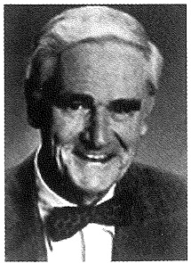

natural_image

Portrait of an elderly man in formal attire with a bow tie (no visible text or symbols)

D. J. Cram

natural_image

Portrait of a man wearing glasses and a turtleneck (no text or symbols visible)

J. M. Lehn

冠醚最大的特点是分子具有特殊的大环孔状结构，在冠醚中的氧原子具有孤对电子，因此这些氧原子可以与金属离子结合形成配合物。冠醚环的大小不同，中间的空腔大小不同，因此对不同半径的金属离子具有较高的络合选择性，就可以结合不同的金属离子。如12-冠-4可以结合锂离子，15-冠-5可以结合钠离子，而18-冠-6可以结合钾离子（图7-3），形成稳定的络合物，冠醚这种性质可用于金属离子混合物的分离。

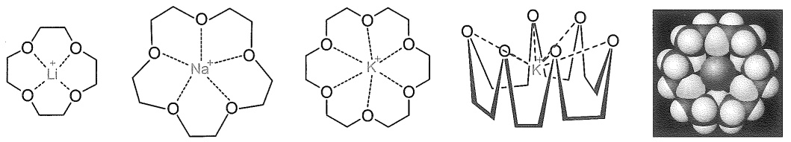

chemical

Molecular structures of lithium, sodium, potassium, and nickel complexes with atomic labels and bonding patterns

图 7-3 冠醚与碱金属离子络合

冠醚环上具有亲油性的亚甲基排列在环外侧，因此冠醚能溶于有机溶剂。所以，冠醚的另一个用途是在有机合成中作为相转移催化剂（phase transfer catalyst），使非均相反应得以顺利进行，提高收率。许多无机盐易溶于水，不溶或难溶于有机溶剂；相反大多数有机物可溶于有机溶剂而难溶于水。因此，如果有一种催化剂能穿过两相之间的界面，并能把反应试剂（例如 $\mathrm{CN}^{-}$）从水相转移到有机相中，使其与底物迅速反应，并将生成的另一种负离子带回到水相中，那么反应的速率能显著提高。催化剂在反应过程中没有消耗，只起到了重复转送负离子的作用，这种催化剂就被称作相转移催化剂，这样的过程被称为相转移催化（phase transfer catalysis, PTC）。采用PTC最经典的反应就是固体盐或其水溶液和溶于非极性溶剂中的有机物的反应，例如:

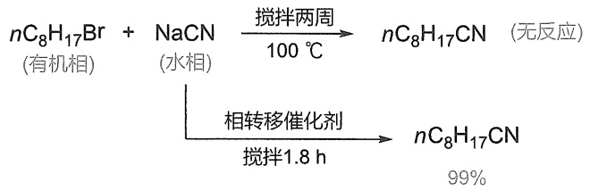

chemical

Reaction equation showing synthesis of nC8H17CN under different conditions: organic phase, water phase, and reaction with catalyst

除了亲核取代反应以外，在氧化反应中也可以使用冠醚作为相转移催化剂。例如，用 $\mathrm{KMnO_4}$ 氧化甲苯时，由于 $\mathrm{KMnO_4}$ 不溶于有机溶剂，所以反应困难。当加入18-冠-6后，通过冠醚络合 $\mathrm{K}^+$，将 $\mathrm{MnO_4^-}$ 带入有机溶剂中，使反应在同一相中进行，能加速反应的进行。

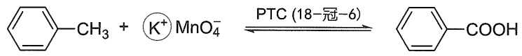

chemical

Chemical reaction equation showing potassium ion reduction to carboxylic acid using PTC (18-crown-6)

但冠醚价格昂贵，且毒性较大，使用后难回收，因此其应用受到一定程度的限制。除此之外，常用的相转移催化剂还包括四级铵盐、四级磷盐、硫盐等。这些催化剂相对来说比较容易合成，近年来得到了极大的发展，人们还开发出一系列手性的相转移催化剂，实现了很多反应的不对称催化。我国科学家在这方面也作出了巨大的贡献。

## 7.8 酚

酚是羟基连接在芳香环上的化合物,一元酚的通式为 ArOH。最简单的酚是苯酚(phenol),熔点  $41^{\circ}C$ ，沸点  $182^{\circ}C$ ，因为它首先是从煤焦油里得到的，因此又称为石炭酸。酚分子中酚羟基与苯环上  $sp^{2}$  杂化的碳原子相连，氧原子也主要采取  $sp^{2}$  杂化，氧上两对孤对电子，一对占据  $sp^{2}$  杂化轨道，另一对占据未参与杂化的 p 轨道，p 轨道电子正好能与苯的大  $\pi$  键体系发生重叠（图 7-4），在此  $p-\pi$  共轭体系中，氧原子的 p 轨道电子云向苯环偏移，p 轨道电子云的偏移导致了氢氧之间的  $\sigma$  键电子云进一步向氧原子偏移，从而使氢离子较易离去。因此，此  $p-\pi$  共轭体系既增加了苯环上的电子密度，又增强了羟基上氢原子的解离能力，使得酚类化合物具有一定的酸性。

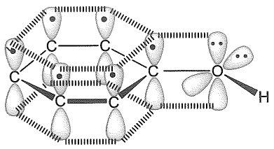

chemical

Molecular structure diagram showing carbon and oxygen atoms with hydrogen bonding, likely representing a coordination compound or molecular framework.

图 7-4 苯酚分子中的  $p-\pi$  共轭示意图

酚类分子中由于羟基和芳环两者直接相连，相互影响，使酚羟基在性质上与醇羟基有显著差异，表现出更强的酸性。此外，酚的芳环受羟基的影响，也比相应的芳烃更易发生亲电取代反应。

## 7.8.1 酚羟基的反应

## 1. 酸性

酚的酸性较醇强，它能溶于氢氧化钠、氢氧化钾溶液生成相应的钠盐或钾盐，而醇不能。大多数酚的 $\mathrm{pK_a}$ 都在10左右，但比碳酸（$\mathrm{pK_a = 6.38}$）弱。将 $\mathrm{CO_2}$ 通入酚钠盐的水溶液中，可以使酚重新游离出来。由于酚能溶解于碱，又能用酸将其游离出来，因此可用此法分离酚类化合物。

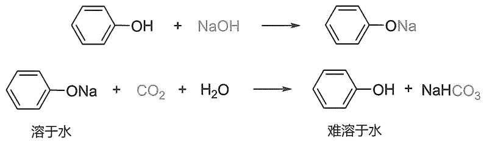

chemical

Two-step chemical reaction equations showing hydrolysis of phenol and sodium hydroxide to form sodium hydroxide and water, respectively.

苯环上连有不同取代基时，酚的酸性不同。若苯环上连有吸电子基团，酚的酸性增强。如对硝基苯酚的酸性比苯酚的酸性强600倍，这是因为硝基具有吸电子诱导效应和吸电子共轭效应，可使酚羟基负离子的负电荷离域到硝基的氧原子上，从而使硝基苯酚负离子更加稳定。

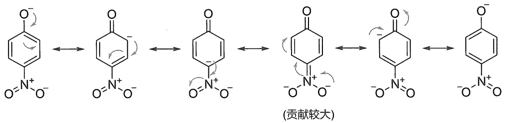

chemical

Reaction mechanism diagram showing oxidation and reduction steps of a benzene derivative with nitro groups

当硝基位于酚羟基的邻位，负电荷也可以离域到硝基的氧原子上，使酸性增强。但是，当硝基位于酚羟基的间位时，不能通过共轭效应使负电荷离域到硝基的氧原子上，只有硝基的吸电子诱导效应产生影响。因此，间硝基苯酚的酸性虽也比苯酚的强（强40倍），但远不如硝基在酚邻位或对位的大。

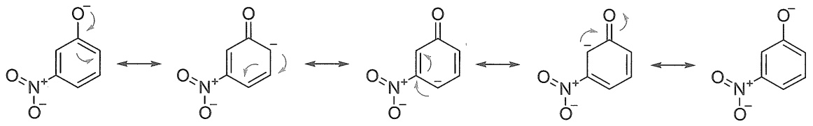

chemical

Reaction mechanism diagram showing the formation of a benzene derivative from aniline and its subsequent amine intermediate

苯环上硝基越多，吸电子作用越强，酚的酸性越强。二硝基苯酚的酸强度与羧酸差不多，2,4,6-三硝基苯酚（苦味酸）为强酸，酸强度与一些无机酸的酸性相近。

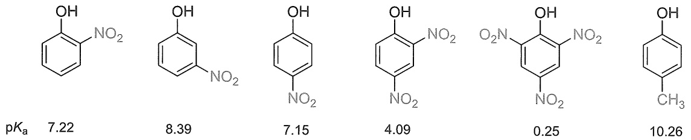

chemical

Six nitrobenzene molecular structures with pKa values labeled below each, showing variations in hydroxyl and methoxy groups.

与之相反，当苯环上有给电子基团时，此类酚化合物的酸性比苯酚的酸性弱。这主要是由于给电子基团增加了苯环上的电子密度，负电荷较难离域到苯环上，使得酚负离子不稳定，即酚羟基不易解离释放质子，所以酸性比苯酚的弱。除电子效应外，取代基的空阻效应也会影响酚的酸性。例如，2,4,6-三新戊基苯酚的酸性极弱，可能是因为两个邻位的大基团阻碍了溶剂对酚羟基解离所起的溶剂化作用。此外，若酚羟基邻位的取代基能与其形成分子内的氢键作用，也会使得酚羟基的酸性减弱，如邻硝基苯酚的酸性要比对硝基苯酚的弱。

## 2. 醚化反应和 Claisen 重排

酚和醇相似，能够烷基化成醚，但酚不能像醇那样在酸性条件下分子间脱水成醚，主要原因是苯正离子不稳定，不易生成。因此，酚醚一般是由酚在碱性溶液中与卤代烃作用或烷基磺酸酯作用生成的，即Williamson醚合成法。在碱性溶液中，酚以酚负离子形式存在，作为亲核试剂向卤代烃或烷基磺酸酯进攻，经 $\mathrm{S_N2}$ 反应合成芳香醚。

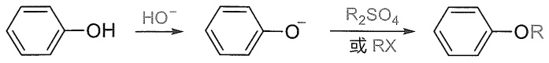

chemical

Chemical reaction pathway showing hydroxyl radical conversion to ester and subsequent ring-opening under basic conditions

芳基烃基醚和脂肪醚相似，对碱稳定，且不易被氧化，但可被氢碘酸或三溴化硼分解，烷氧键断裂，生成相应的酚。芳基醚由于氧与芳环的碳原子发生 $p-\pi$ 共轭，C-O具有部分双键的性质，一般难断裂。将酚的烃基化反应和芳基烃基醚被氢碘酸或三溴化硼分解的反应结合使用，可以在反应中保护酚羟基。

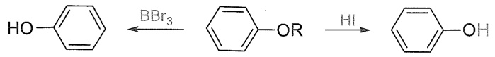

chemical

Chemical reaction pathway showing bromination and hydrolysis steps of a benzene derivative

1912 年，克莱森（Claisen）发现了以他的名字命名的 Claisen 重排反应。当年他同时报道了烯丙基芳基醚在  $200\;^{\circ}C$  下可以重排为烯丙基苯酚，以及 3-烯丙氧基丁-2-烯酸乙酯在  $NH_{4}Cl$  下蒸馏，可以生成 2-乙酰基戊-4-烯酸乙酯。此后，烯丙基乙烯基醚类衍生物在加热条件下重排成相应的  $\gamma,\delta-$  不饱和羰基化合物的反应称为 Claisen 重排。

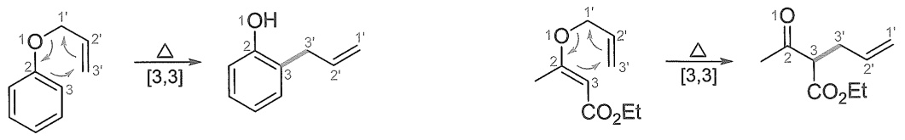

chemical

Organic reaction pathway showing conversion of a benzene derivative to a cyclohexane derivative via methanol and ester intermediates, followed by a ketone formation.

交叉反应实验及同位素标记研究证明，Claisen重排是分子内重排，反应是经过环状过渡态进行的。当两个邻位都被占据时，烯丙基迁移至对位，这个反应经历了两次[3,3]C迁移。

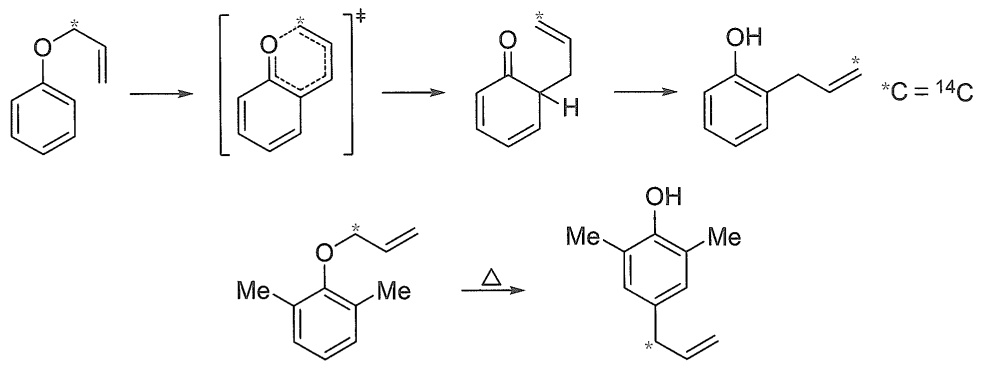

chemical

Organic reaction pathway showing transformation of a benzene derivative to a substituted cyclohexane derivative via methylene and hydroxyl groups, with C=14C as reference.

Claisen 重排具有普遍性，在醚类化合物中，如果存在烯丙氧基与碳碳双键相连的结构，就有可能发生 Claisen 重排，即脂肪族的 Claisen 重排。

## 3. 酯化反应和 Fries 重排

酚与醇不同，醇与羧酸可以很容易地在酸催化下直接发生酯化作用，而酚由于氧上孤对电子参与了 $p-\pi$ 共轭，导致其亲核能力降低，因此须在碱（碳酸钾、吡啶、三乙胺）或质子酸（硫酸、磷酸）的催化作用下，与酰氯或酸酐反应才能形成酯。酚可以与无机酰氯反应得到相应的酯，如苯酚和三氯氧磷反应可以得到磷酸三苯酚酯（一种增塑剂）。酚也可以与有机酰氯或酸酐反应得到酯，如阿司匹林就是用水杨酸和乙酸酐反应来合成的。

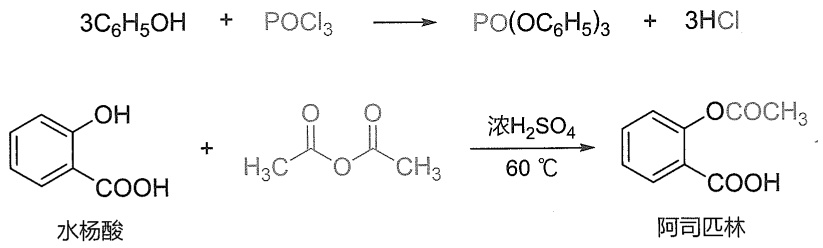

chemical

Chemical reaction equation showing the synthesis of aryl halocyanate from phenol and acetic acid under sulfuric acid catalysis

20 世纪初，Fries 发现了以他的名字命名的 Fries 重排反应。他将乙酸苯酚酯和氯乙酸在  $AlCl_{3}$  作用下加热，分离得到了邻、对位乙酰化产物和氯乙酸苯酚酯。此后，将酚酯与 Lewis 酸或 Brønsted 酸一起加热，发生酰基重排生成邻羟基或对羟基芳酮的混合物的反应统称为 Fries 重排，它是由酚制备邻位或对位酰基酚的一种实用方法。

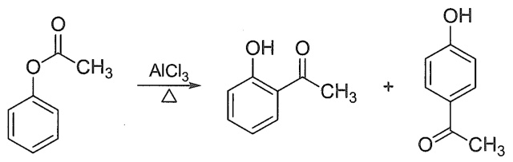

chemical

Chemical reaction equation showing aldehyde reacting with benzaldehyde under aluminum chloride to form a mixture of two phenolic compounds

## 4. 与三氯化铁的显色反应

大多数酚与三氯化铁溶液发生颜色反应。不同的酚所产生的颜色也不同，常见的有紫、蓝、绿、棕等颜色（表7-3），这个特性常用于酚的鉴定。例如:

$$
\begin{array}{r l} 6 \mathrm{C} _ {6} \mathrm{H} _ {5} \mathrm{OH} & + \quad \mathrm{FeCl} _ {3} \longrightarrow \mathrm{H} _ {3} [ \mathrm{Fe} (\mathrm{OC} _ {6} \mathrm{H} _ {5}) _ {6} ] + 3 \mathrm{HCl} \\ & \text {紫色} \end{array}
$$

表 7-3 各类酚与三氯化铁反应所显颜色

| 酚 | 与$FeCl_{3}$显色 |
| --- | --- |
| 对甲苯酚 | 蓝色 |
| 间甲苯酚 | 蓝紫色 |
| 对苯二酚 | 暗绿色 |
| 邻苯二酚 | 深绿色 |
| 间苯二酚 | 蓝紫色 |
| 连苯三酚 | 淡棕红色 |
| $\alpha$-萘酚 | 紫红色 |
| $\beta$-萘酚 | 绿色 |

## 7.8.2 酚芳环上的亲电取代反应

酚羟基上 p 电子与苯环的  $\pi$  体系共轭作用使羟基邻、对位的电子密度增大，所以酚羟基的邻、对位亲核能力很强，使得酚类化合物很容易在邻、对位发生亲电取代反应，在多数情况下反应可以不用 Lewis 酸催化。

## 1. 卤化反应

由于酚羟基是强的邻对位活化基团，苯酚在室温下与溴水反应立即生成2,4,6-三溴苯酚白色沉淀，而苯的卤化反应必须在Lewis酸的催化下才能进行。若溴水过量，则生成2,4,4,6-四溴环己二烯酮黄色沉淀。

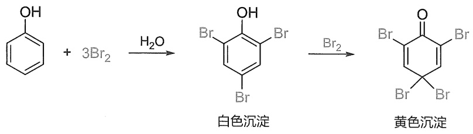

chemical

Chemical reaction equation showing bromination of benzene with 3Br₂, producing white and yellow brominated products

此反应很灵敏，溶液中含有  $10 \mu g/g$  的苯酚都可以检测出来。因此，此反应可用作苯酚的鉴别和定量测定。

## 2. 硝化及亚硝化反应

由于酚羟基对苯环的活化作用，在室温时，用稀硝酸即可使苯酚硝化，生成邻硝基苯酚和对硝基苯酚的混合物。因苯酚易被氧化，产率不高。邻硝基苯酚因形成分子内氢键，使得其分子间及与水形成氢键的能力降低，因此其沸点相对较低，在水中的溶解度也较小，所以可用水蒸气蒸馏法蒸出，从而使它与对硝基苯酚分离。

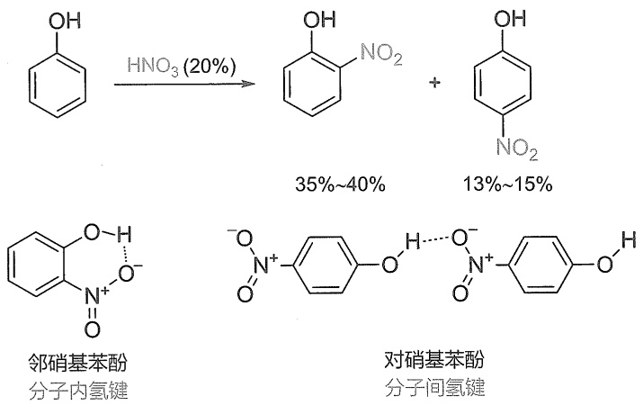

chemical

Nitration reaction equation of benzene under HNO3 catalysis to form nitrobenzene and nitrophenol, with corresponding molecular structures for邻硝基苯酚 and 对硝基苯酚.

## 3. 磺化反应

苯酚与浓硫酸在较低的温度（15～25℃）下很容易发生磺化反应。但苯酚的磺化反应发生在对位或邻位主要受反应温度的影响。随着反应温度升高，苯酚的磺化反应主要发生在对位，因为4-羟基苯磺酸比2-羟基苯磺酸稳定。即高温有利于生成热力学稳定的产物。继续加热磺化，可得到4-羟基苯-1,3-二磺酸。

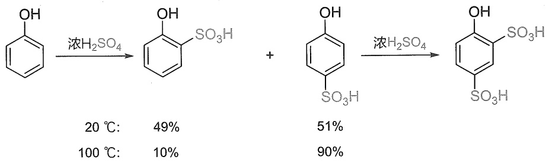

chemical

Two-step organic synthesis reaction scheme showing benzene hydrolysis under concentrated sulfuric acid and temperature variations

## 4. Friedel-Crafts 反应

由于酚羟基的活化作用酚很容易发生 Friedel-Crafts 反应，在较弱的催化剂作用下就可以进行。例如:

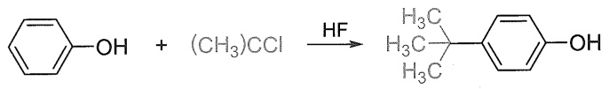

chemical

Chemical reaction equation showing hydrolysis of a benzene derivative with (CH3)CCl under HF to form a substituted benzene alcohol

苯酚在浓硫酸或无水氯化锌的作用下与邻苯二甲酸酐发生 Friedel-Crafts 反应生成酚酞，酚酞为无色固体，是常用的重要指示剂，其溶液 pH<8.5 时为无色液体，当 pH>9 时生成电子离域范围更大的粉红色的共轭双负离子。

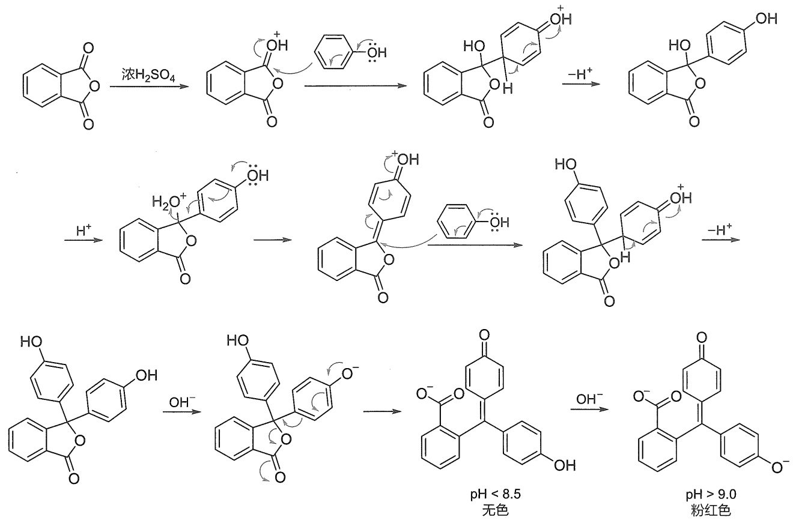

flowchart

This image displays a multi-step organic synthesis pathway for the synthesis of polyphenol derivatives under various conditions, including sequential reactions with different pH levels and solvent environments.

7.8.3 酚的制备

## 1. 异丙苯法

工业上合成苯酚的最主要方法是:苯与丙烯通过 Friedel-Crafts 反应得到异丙苯，异丙苯经空气氧化生成氢过氧化异丙苯，后者在强酸或强酸性离子交换树脂作用下分解生成苯酚和丙酮。这个反应是工业上生产苯酚和丙酮的重要方法。

$$
\mathrm{Ph} - \mathrm{H} + \mathrm{H} _ {2} \mathrm{C} = \mathrm{CH} - \mathrm{CH} _ {3} \xrightarrow {\mathrm{AlCl} _ {3}} \mathrm{Ph} - \underset {\mathrm{H}} {\overset {\mathrm{CH} _ {3}} {\mathrm{C}}} - \mathrm{CH} _ {3} \xrightarrow {\mathrm{O} _ {2}} \mathrm{Ph} - \underset {\mathrm{OOH}} {\overset {\mathrm{CH} _ {3}} {\mathrm{C}}} - \mathrm{CH} _ {3} \xrightarrow [ \mathrm{H} ^ {+} ]{\mathrm{H} _ {2} \mathrm{O}} \mathrm{Ph} - \mathrm{OH} + \underset {\mathrm{H} _ {3} \mathrm{C}} {\overset {\mathrm{O}} {\mathrm{C}}} - \mathrm{CH} _ {3}
$$

## 2. 卤代芳烃水解

卤代芳烃很难发生水解反应，一般需要高温、高压和催化剂的作用下才能反应。但是，当卤原子的邻位或对位连有很强的吸电子基团时，可以发生水解反应（芳香亲核取代反应），工业上常用此方法制备吸电子基取代的苯酚。

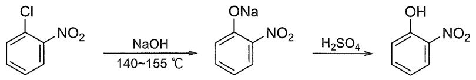

chemical

Nitration reaction equation of benzene

## 3. 碱熔法

芳基磺酸盐和无水氢氧化钠（钾）在高温下作用，磺酸基被羟基取代的反应即为碱熔反应。在此反应中，芳环上-X、-NO₂、-COOH等基团将受影响。

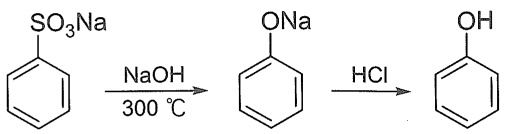

chemical

Chemical reaction sequence showing sulfonation of benzene to form sodium and then hydrolysis under HCl

## 4. 重氮盐水解

重氮盐水解可生成酚，这是一个普遍的制备苯酚的方法。

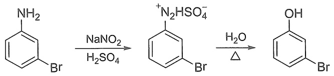

chemical

Chemical reaction pathway showing bromination of aniline under sodium nitric oxide and sulfuric acid conditions, followed by hydrolysis to yield brominated benzene derivative

习题

1. 在 $4\beta$-Acetoxyprobotyane- $9\beta, 15\alpha$-diol 的首次不对称全合成中，涉及多步基于醇的官能团转化，请画出产物和中间体的结构。

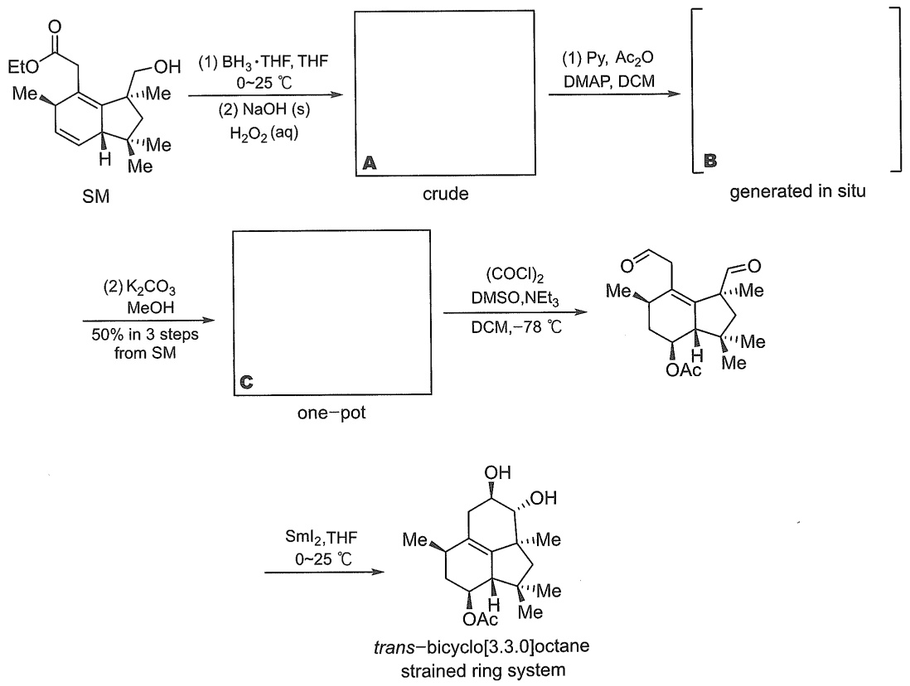

2. Kopsinitarine E 的全合成中涉及基于醇的官能团转化步骤，请写出产物和中间体结构。

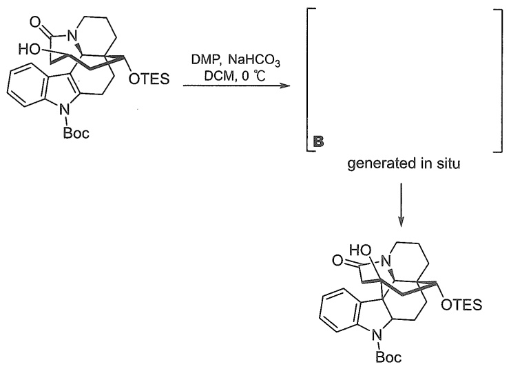

chemical

Chemical reaction scheme showing DMP/NaHCO3 in DCM at 0°C producing compound B from OTES and Boc protecting groups

3. (+)-Ineleganolide 的全合成中涉及基于醇的官能团转化步骤，请写出产物和中间体结构。

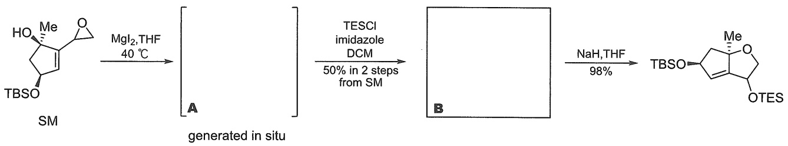

chemical

Chemical reaction scheme showing SmC-protected aldehyde to form a ketone, followed by TESCI-imidazole and NaH/THF reagents

4. Calophyline A 的全合成中涉及基于醇的官能团转化步骤, 请写出产物和中间体结构, 以及 $\mathbf{A} \rightarrow \mathbf{B}$ 的机理。

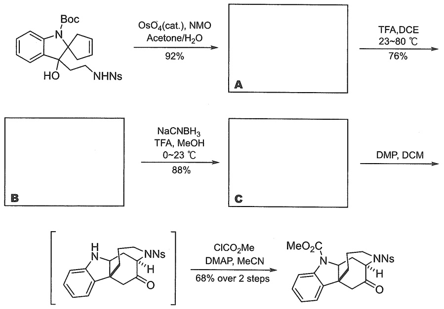

chemical

Multi-step organic synthesis reaction scheme showing transformation of compound A and B to products C and DMP via intermediate C, with reagents and conditions labeled.

5. 后期官能团化（late-stage functionalization）是近年来用于全合成的重要方法。去氧胆酸的醇衍生物经过以下转化可以得到产物 A，请根据分子式推测 A 的结构。

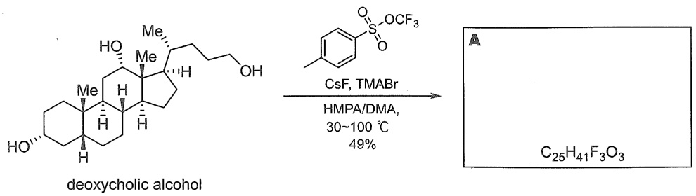

chemical

Chemical reaction scheme showing deoxycholic alcohol reacting with a sulfonamide derivative under CsF/TMABr conditions to form a final product A and C25H41F3O3

6. Bryostatin 1 的全合成中涉及以下转化，请推测产物 A 的结构。

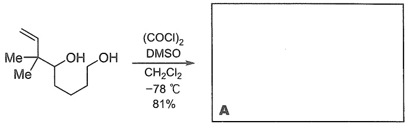

chemical

Chemical reaction scheme showing conversion of a diol to a ketone under specified conditions

7. Guignardones 的全合成中涉及下列转化，请写出产物 B 和 C 的结构，并推测中间体 A、D 及反应机理，根据空间构型对反应的立体选择性给出解释。

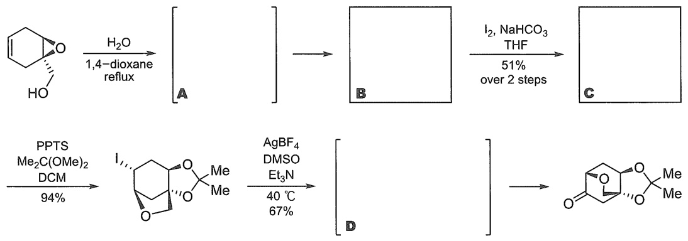

flowchart

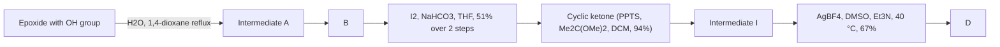

8. Longiborneol 的全合成中涉及下列转化，已知桥头碳的碳正离子非常不稳定，且 PIDA 是一种高价碘氧化剂，请写出产物和中间体的结构及反应机理，并根据原料的空间构型对反应的立体选择性给出解释。

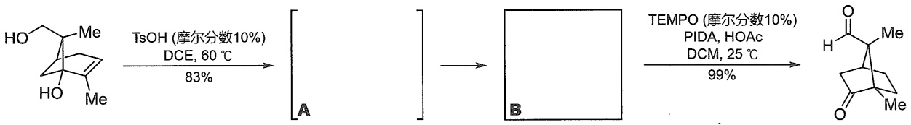

chemical

Chemical reaction scheme showing conversion of a cyclohexane derivative to a ketone using TsOH and TEMPO under specified conditions

9. 完成反应:

chemical

Chemical reaction equation showing hydroxybenzene reacting with methoxybenzene to form a bromo-phenyl ester under NaH in dry DMF conditions

10. 完成反应: