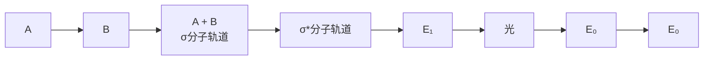

》解 谱图中质荷比最大的峰 $m/z$ 106与基峰 $m/z$ 91相差15，脱除了一个甲基，丢失合理，确定 $m/z$ 106峰为分子离子峰。$m/z$ 91峰是烷基取代苯 $\alpha$-裂解产生的特征峰，而 $m/z$ 77、65、51和39是苯环特征系列峰，苯基质量数77，与106相差29，是一个乙基。因此，推断此化合物是乙苯。其裂解机理如下:

chemical

Reaction pathway showing conversion of benzene derivative to substituted cyclohexane and then to a pyridine derivative via intermediates m/z 91, 65, 39, 77, and 51

对比乙苯的沸点与已知沸点相同，确定化合物是乙苯。

»例 8-6 戊酸的质谱图见图 8-8，请给出主要谱峰的裂解机理。

spectrogram

| m/z | R/% |
| --- | --- |
| 27 | ~12 |
| 29 | ~15 |
| 38 | ~3 |
| 41 | ~15 |
| 45 | ~12 |
| 53 | ~3 |
| 55 | ~10 |
| 60 | 100 |
| 68 | ~3 |
| 73 | ~38 |
| 74 | ~5 |
| 83 | ~3 |
| 87 | ~3 |

图8-8 戊酸的质谱图

》解 戊酸主要质谱裂解机理如下:

chemical

Chemical reaction converting compound m/z 102 to m/z 74 with oxidation state H₂C=C-OH and CH₃ group

## 8.2 紫外-可见光谱

紫外-可见光谱是最早应用于有机结构鉴定的物理方法之一，也是一种常用的快速、简便的分析方法。在确定有机化合物的共轭体系、生色基和芳香性等方面独具优势。目前，紫外-可见光谱已被广泛应用于化学、化工、生物、食品、环境等众多学科领域。

紫外-可见光谱是分子吸收紫外-可见光区（200～800 nm）的电磁波而产生的吸收光谱，又称为电子吸收光谱。

紫外-可见光可分为3个区域:远紫外区（10～200 nm）、紫外区（200～400 nm）、可见区（400～800 nm）。其中远紫外区又称真空紫外区，由于氧气、氮气、水、二氧化碳等对这个区域的紫外光有强烈的吸收，因此，对该区域的光谱研究较少。一般的紫外光谱仪都包括紫外光区和可见光区两部分，测试范围在200～800 nm，有的加宽至190～1000 nm，也有的与近红外或红外光谱联用。

## 8.2.1 紫外-可见光谱图

在紫外-可见光谱图中，纵坐标为吸光度 $A$ （仪器直接测得）、摩尔吸光系数 $\varepsilon$ 或 $\lg \varepsilon$ （由计算所得），横坐标为波长 $\lambda (\mathrm{nm})$ ，峰最高处的波长记为 $\lambda_{\mathrm{max}}$ ， $\lambda_{\mathrm{max}}$ 处对应的摩尔吸光系数 $\varepsilon$ 值是该样品的 $\varepsilon_{\mathrm{max}}$ ，如图8-9所示。吸收强度次于 $\lambda_{\mathrm{max}}$ 的波峰称为次峰；在吸收峰旁有时会有肩峰，用 $\lambda_{\mathrm{sh}}$ 表示；相邻两峰之间的最低点称为波谷，用 $\lambda_{\mathrm{min}}$ 表示；在吸收曲线短波处呈现吸收趋势但并未成峰的部分称为末端吸收。在紫外光谱图中， $\lambda_{\mathrm{max}}$ 取决于跃迁时的能级差，能级差越大，吸收光波的能量也越大， $\lambda_{\mathrm{max}}$ 就越小。$\varepsilon$ 值对应于跃迁的概率，跃迁概率越大，$\varepsilon$ 也越大。

line

| Feature | Description |
| --- | --- |
| Y-axis | \(\epsilon\) or lgε or A |
| X-axis | \(\lambda\) |
| Peak 1 | 峰谷 |
| Peak 2 | 吸收峰 |
| Shoulder Peak | 肩峰 |
| Peak 3 | 峰谷 |
| Secondary Peak | 次峰 |

图 8-9 紫外-可见光谱图

## 8.2.2 紫外-可见光谱的基本原理

## 1. 基本原理

紫外-可见光谱是外层价电子吸收相应能量的电磁波发生跃迁而产生的。以A-B双原子组成的分子为例，分子轨道可以看作由对应的原子轨道线性组合而成。以双原子分子A-B的 $\sigma$ 键来说，一个分子轨道能量低，为成键分子轨道，称为 $\sigma$ 分子轨道；另一个分子轨道能量高，为空的反键分子轨道，称为 $\sigma^{*}$ 分子轨道。A-B分子处于基态时，成键电子分布在能量低的 $\sigma$ 分子轨道，对应能量为 $E_0$ 。当分子受紫外光照射时，吸收一定能量的紫外光，若此能量恰好等于基态 $E_0$ 与高能态 $E_{1}$ 的差值，电子从 $E_0$ 跃迁至 $E_{1}$，产生紫外光谱，如图8-10所示。

flowchart

图 8-10 价电子跃迁示意图

## 2. 电子跃迁类型

有机化合物的外层电子主要有三种:形成单键的 $\sigma$ 电子、形成不饱和键的 $\pi$ 电子及杂原子上未成键的 n 电子。当吸收紫外-可见光后，电子从基态的 $\sigma$、$\pi$ 或 n 轨道跃迁到反键轨道 $\sigma^{*}$ 或 $\pi^{*}$，可能发生 $\sigma \rightarrow \sigma^{*}$、$\sigma \rightarrow \pi^{*}$、$\pi \rightarrow \sigma^{*}$、$n \rightarrow \sigma^{*}$、$\pi \rightarrow \pi^{*}$、$n \rightarrow \pi^{*}$ 等跃迁，其中，$\pi \rightarrow \sigma^{*}$ 和 $\sigma \rightarrow \pi^{*}$ 跃迁是禁阻的，不易发生。因此，有机化合物有以下四种电子跃迁:$\sigma \rightarrow \sigma^{*}$、$n \rightarrow \sigma^{*}$、$\pi \rightarrow \pi^{*}$、$n \rightarrow \pi^{*}$，跃迁所需能量按照以上次序依次递减，吸收波长依次增大，如图 8-11 所示。

text_image

σ*
π*
n
π
σ

图 8-11 电子跃迁能级示意图

## 3. 紫外-可见光谱常用术语

（1）生色团（chromophore） 分子中某一基团或体系，在紫外-可见光区产生吸收而出现谱带，这一基团或体系即为生色团。有机化合物中，典型的生色团有烯键、羰基、羧基、酯基、硝基、偶氮基及芳香体系等。生色团的结构特征是含有  $\pi$  电子，少数情况是含有原子半径较大的杂原子。
（2）助色团（auxochrome） 分子中某一基团或体系在紫外-可见光区内不一定有吸收，但与生色团相连时可以使生色团的吸收带向长波方向移动，且吸收强度也相应增加，这一基团或体系称为助色团。助色团常含有 n 电子，常见助色团有 -OH、-Cl、-NH₂、-NO₂、-SH 等。

（3）红移（red shift）与蓝移（blue shift） 吸收峰向长波方向移动的现象称为红移；吸收峰向短波方向移动的现象称为蓝移。
（4）增色效应（hyperchromic effect）与减色效应（hypochromic effect）使吸收带强度增加的作用称为增色效应，使吸收带强度减弱的作用称为减色效应。

## 4. 紫外-可见光谱吸收带

（1）R 带（Radikalartin 德文，基团型的） R 带为  $n \rightarrow \pi^{*}$  跃迁引起的吸收带，产生该吸收带的化合物一般含有  $p-\pi$  共轭体系等生色团，如  $-NO_{2}$ 、-C=O、-CHO 等。R 带的特征是强度弱  $\varepsilon < 100 (\lg \varepsilon < 2)$ ， $\lambda_{max}$  一般在 270 nm 以上。下面是两种化合物的 R 带:

$$
\begin{array}{l l l l} \mathrm{CH} _ {3} \mathrm{CHO} & \lambda_ {\max} ^ {\text {heptane}} & 2 9 1 \mathrm{nm} & \varepsilon 1 1 \\ \mathrm{CH} _ {2} = \mathrm{CH-CHO} & \lambda_ {\max} ^ {\text {EtOH}} & 3 1 5 \mathrm{nm} & \varepsilon 1 4 \end{array}
$$

（2）K 带（Konjugierte 德文，共轭的） K 带为  $\pi\rightarrow\pi^{*}$  跃迁引起的吸收带。K 带的特点是吸收峰强度大， $\varepsilon\geqslant10000(\lg\varepsilon\geqslant4)$ 。孤立不饱和键的  $\pi\rightarrow\pi^{*}$  吸收带一般在真空紫外区，难以看到，但随着共轭双键增加，吸收谱带发生红移，且强度增强。
（3）芳香化合物的吸收带 芳香化合物有三个  $\pi\rightarrow\pi^{*}$  跃迁的吸收峰，即一个 B 带（benzene band，苯型谱带）和两个 E 带（ethylene band，乙烯型谱带），如图 8-12 所示。

line

| \(\lambda/\)nm | \(lg\epsilon\) |
| --- | --- |
| 180 | ~4.8 |
| 200 | ~3.7 |
| 210 | ~3.8 |
| 220 | ~0.7 |
| 230 | ~1.2 |
| 240 | ~1.6 |
| 250 | ~2.3 |
| 260 | ~2.1 |
| 270 | ~1.0 |
| 280 | ~0.2 |

图 8-12 苯的紫外吸收光谱图

B 带由苯的  $\pi\rightarrow\pi^{*}$  跃迁和振动效应的重叠所引起，为一宽峰并出现若干小峰，在 230～270 nm，中心在 254 nm 处， $\varepsilon\approx250$ 。苯环被取代后，精细结构消失或部分消失。因此，B 带常用来识别芳香化合物。
E 带分为  $E_{1}$  和  $E_{2}$  带。 $E_{1}$  带为苯环的特征谱带，该谱带处于真空紫外区， $\lambda_{max} \approx 184 \, nm$ ， $\varepsilon > 10^{4}$ 。当苯环上有助色团时， $E_{1}$  带向长波方向移至  $200 \sim 220 \, nm$ 。 $E_{2}$  带是由苯环中共轭二烯的  $\pi\rightarrow\pi^{*}$  跃迁所产生的，有精细结构，与  $E_{1}$  带相重叠， $\lambda_{max}\approx203\ nm,\quad\varepsilon=7400$ 。当苯环引入生色团与苯环共轭时， $E_{2}$  带将红移至  $220\sim250\ nm,\quad\varepsilon>10^{4}$ ，此时亦称为 K 带。

## 8.2.3 紫外-可见光谱的影响因素

影响紫外-可见光谱的主要因素有共轭效应、超共轭效应、空间效应及外部影响因素等。

## 1. 共轭效应

随着  $\pi-\pi$  共轭体系增加，HOMO 能级升高，LUMO 能级降低， $\pi\rightarrow\pi^{*}$  跃迁所需能量减小，最大吸收波长红移。

$p-\pi$ 共轭对紫外-可见吸收光谱的影响与 $\pi-\pi$ 共轭不同。以羰基 $n\rightarrow\pi^{*}$ 跃迁为例:酸、酯等化合物中羰基与杂原子氧上的未成对电子发生 $p-\pi$ 共轭，使得n轨道能量降低， $\pi^{*}$ 轨道能量升高， $n\rightarrow\pi^{*}$ 跃迁所需能量升高，其谱带发生蓝移；并且将RCOOH转变为 $RCOO^{-}$ 时，由于氧负离子与羰基发生 $p-\pi$ 共轭，所以蓝移更多。

## 2. 超共轭效应

超共轭效应对  $\pi\rightarrow\pi^{*}$  跃迁与  $n\rightarrow\pi^{*}$  跃迁的影响不同。

对于  $\pi\rightarrow\pi^{*}$  跃迁，当连接在双键碳原子上的氢被含  $\alpha-$  氢的烷基取代时，由于  $\sigma-\pi$  超共轭效应， $\pi\rightarrow\pi^{*}$  跃迁吸收峰向长波方向移动。

例如:

$$
\begin{array}{l} \mathrm{CH} _ {2} = \mathrm{CHCOCH} _ {3} \quad 2 1 9 \mathrm{nm} (\pi \rightarrow \pi^ {*}) \\ \mathrm{CH} _ {3} \mathrm{CH} = \mathrm{CHCOCH} _ {3} \quad 2 2 4 \mathrm{nm} (\pi \rightarrow \pi^ {*}) \\ (\mathrm{CH} _ {3}) _ {2} \mathrm{C} = \mathrm{CHCOCH} _ {3} \quad 2 3 5 \mathrm{nm} (\pi \rightarrow \pi^ {*}) \\ \end{array}
$$

对于  $n \rightarrow \pi^{*}$  跃迁，由于超共轭效应，使  $\pi$  轨道能级降低，相应的  $\pi^{*}$  轨道能级升高，致使  $n \rightarrow \pi^{*}$  跃迁需要较高的能量，吸收波长发生蓝移。例如，化合物甲醛、乙醛和丙酮相比，最大吸收波长依次减小。

$$
\begin{array}{l} \mathrm{HCHO} \quad 3 0 4 \mathrm{nm} (\mathrm{n} \rightarrow \pi^ {*}) \\ \mathrm{CH} _ {3} \mathrm{CHO} \quad 2 8 9 \mathrm{nm} (\mathrm{n} \rightarrow \pi^ {*}) \\ \mathrm{CH} _ {3} \mathrm{COCH} _ {3} \quad 2 8 0 \mathrm{nm} (\mathrm{n} \rightarrow \pi^ {*}) \\ \end{array}
$$

## 3. 空间效应

影响紫外-可见光谱的空间效应主要包括位阻效应、邻位效应、跨环效应及顺反异构效应等。

例如，反式苯丙烯酸，最大吸收波长为 273 nm，而顺式苯丙烯酸的最大吸收波长为 264 nm。因此，顺反异构对紫外吸收波长有一定的影响。一般情况下，反式异构体的最大吸收波长大于顺式异构体的最大吸收波长。

联苯分子中，随着邻位取代基增多，空间拥挤造成连接两个苯环的单键扭转而使两个苯环不在同一平面，不能发生有效共轭，所以最大吸收波长蓝移。

chemical

Five aromatic compounds with corresponding λmax/nm and εmax values, including a labeled peak at 227 nm

## 4. 外部影响因素

溶剂效应:溶剂对紫外光谱的影响很复杂，极性不同的溶剂可以引起谱带形状的改变。在非极性溶剂中，紫外光谱图有一些精细的结构，而在极性溶剂中，由于溶剂和溶质的分子间作用力增强，精细结构便会消失，变为平滑的吸收谱带。

溶剂对吸收谱带的另一重要影响是改变 $\lambda_{\mathrm{max}}$ ，这种影响对 $\mathrm{n}\rightarrow \sigma^{*}$ 、 $\mathrm{n}\rightarrow \pi^{*}$ 和 $\pi \rightarrow \pi^{*}$ 跃迁是不同的。通常随着溶剂极性的增加， $\mathrm{n}\rightarrow \sigma^{*}$ 和 $\mathrm{n}\rightarrow \pi^{*}$ 跃迁谱带向短波方向移动，而 $\pi \rightarrow \pi^{*}$ 跃迁谱带向长波方向移动。发生 $\mathrm{n}\rightarrow \sigma^{*}$ 和 $\mathrm{n}\rightarrow \pi^{*}$ 跃迁的分子都含有非键 $\mathbf{n}$ 电子，基态极性比激发态大，因此基态能够与溶剂之间产生较强的作用，能量下降较大；而激发态能量下降较小，所以跃迁能量增加，吸收波长向短波方向移动，即发生蓝移。而发生 $\pi \rightarrow \pi^{*}$ 跃迁的分子，其激发态的极性比基态强，溶剂使激发态的能级降低得比基态多，使 $\pi \rightarrow \pi^{*}$ 跃迁所需能量变小，吸收峰发生红移，如图8-13所示。

chemical

Energy level diagrams of perovskite solvents showing n-type and c-type electronic states with energy differences ΔEn and ΔEp

图8-13 $\mathbf{n}\rightarrow \pi^{*}$ 跃迁和 $\pi \rightarrow \pi^{*}$ 跃迁的溶剂效应

$\mathrm{pH}$ 的影响:有些有机化合物（如羧酸、酚和胺）在不同 $\mathrm{pH}$ 介质中结构不同，吸收峰的位置及强度也相应不同。如与苯比较，在苯胺或苯酚分子中，由于 $\mathrm{p - \pi}$ 共轭效应，导致苯胺或苯酚的 $\mathrm{E}_2$ 带发生红移，且强度增加。当苯胺在酸性溶液中转变为铵正离子时，由于氨基的 $\mathbf{n}$ 电子与质子结合，不再与苯环共轭，吸收带蓝移至与苯相同的位置。苯酚转化成酚氧负离子时，增加了一对可以发生 $\mathrm{p - \pi}$ 共轭的电子对，结果酚的吸收波长红移，强度增加。再加入盐酸，吸收峰又回到原处。

chemical

Chemical reaction equations showing the formation of substituted benzene derivatives under different λmax (E2) values

## 8.2.4 各类化合物的紫外吸收光谱

## 1. 饱和烃及其含杂原子的简单化合物

饱和烃的原子间都以 $\sigma$ 键相连，$\sigma \rightarrow \sigma^{*}$ 跃迁需要吸收较大的能量，因此，光谱一般出现在远紫外区。当含有O、S、N、X等杂原子时，可以产生较低能量的 $n \rightarrow \sigma^{*}$ 跃迁和 $\sigma \rightarrow \sigma^{*}$ 跃迁（表8-2）。

表 8-2 含杂原子饱和烃衍生物的吸收光谱

| 化合物 | $\lambda_{\text{max}} (\sigma \to \sigma^{*})/\text{nm}$ | $\lambda_{\text{max}} (\text{n} \to \sigma^{*})/\text{nm}$ |
| --- | --- | --- |
| $CH_3Cl$ | 154~164 | 174 |
| $CH_3OH$ | 150 | 183 |
| $CH_3NH_2$ | 173 | 213 |
| $CH_3I$ | 150~210 | 258 |
| $N(CH_2CH_3)_3$ | — | 227 |

## 2. 烯类化合物

单烯烃类化合物除了 $\sigma$ 键外还有 $\pi$ 键，$\pi$ 能级比 $\sigma$ 能级高，而 $\pi^{*}$ 能级比 $\sigma^{*}$ 能级低，因此 $\pi \rightarrow \pi^{*}$ 跃迁所需能量比 $\sigma \rightarrow \sigma^{*}$ 跃迁所需能量低，波长较长，但其仍在远紫外区，一般仪器观察不到。但随着共轭体系的延伸，吸收光谱会红移至紫外可见区，且吸收强度也逐渐增强。

烯类化合物的紫外吸收光谱有以下特点:

（1）当连接在双键碳原子上的氢被含  $\alpha-$  氢的烷基取代时，由于  $\sigma-\pi$  超共轭效应，吸收峰向长波方向移动。
（2）顺反异构体中反式吸收比顺式吸收波长长。
（3）分子含多个孤立双键的吸收为各独立双键吸收谱带的加和。
（4）共轭双键使谱带发生红移（图 8-14）。
（5）环状烯烃中，吸收光谱与双键所处的位置有关，当双键处于环外时，吸收峰明显向长波移动（表8-3）。

line

| \(\lambda/\)nm | \(lg\epsilon (n=3)\) | \(lg\epsilon (n=4)\) | \(lg\epsilon (n=5)\) |
| --- | --- | --- | --- |
| 200 | ~3.0 | ~3.3 | ~3.3 |
| 210 | ~3.2 | ~3.4 | ~3.4 |
| 220 | ~3.4 | ~3.1 | ~3.5 |
| 230 | ~3.7 | ~3.1 | ~3.6 |
| 240 | ~4.1 | ~3.4 | ~3.2 |
| 250 | ~4.4 | ~3.8 | ~3.0 |
| 260 | ~4.5 | ~4.2 | ~3.2 |
| 270 | ~4.6 | ~4.4 | ~3.6 |
| 280 | ~4.4 | ~4.7 | ~4.0 |
| 290 | ~3.1 | ~4.9 | ~4.2 |
| 300 | — | ~4.5 | ~4.5 |
| 310 | — | ~4.9 | ~4.8 |
| 320 | — | ~4.2 | ~4.7 |
| 330 | — | ~3.5 | ~5.0 |
| 340 | — | — | ~5.1 |
| 350 | — | — | ~4.2 |
| 360 | — | — | ~3.5 |
| 370 | — | — | ~2.9 |

图8-14 共轭多烯体系的紫外光谱

表 8-3 环状烯烃 $\pi \rightarrow \pi^{*}$ 跃迁的紫外吸收

<table><tr><td colspan="2">化合物骨架</td><td> $\lambda_{\text{max}}/\text{nm}$ </td><td> $\varepsilon$ </td></tr><tr><td rowspan="3"></td><td rowspan="3"></td><td>183</td><td>6800</td></tr><tr><td>191</td><td>10200</td></tr><tr><td>206</td><td>11200</td></tr></table>

## 3. 羰基化合物

对于羰基类化合物，有 $\sigma$ 电子、$\pi$ 电子和 n 电子，存在着四种跃迁:$\sigma \rightarrow \sigma^{*}$、$\pi \rightarrow \pi^{*}$、$n \rightarrow \sigma^{*}$、$n \rightarrow \pi^{*}$。非共轭羰基化合物的三种跃迁（$\sigma \rightarrow \sigma^{*}$、$n \rightarrow \sigma^{*}$、$\pi \rightarrow \pi^{*}$）一般 $\lambda_{\max}$ 小于 $200 \mathrm{~nm}$，在真空紫外区，观察不到；而 $n \rightarrow \pi^{*}$ 跃迁，其吸收谱带在 $270 \sim 300 \mathrm{~nm}$ 附近，呈现低强度（$\varepsilon = 10 \sim 20$）吸收的宽谱带。

## 4. 芳香化合物

芳香化合物有三个吸收带: $E_{1}$ 、 $E_{2}$  和 B 带，在仪器上能看到的是  $E_{2}$  的末端吸收和强度小的 B 带。

当苯环上连有助色团时，由于助色团 -OH、 $-NH_{2}$ 、-X 等的 n 电子与苯环发生  $p-\pi$  共轭，使  $E_{2}$  带和 B 带均发生红移，B 带的强度增大，失去精细结构。当苯环上带有生色团取代基时，除 B 带明显地发生红移且吸收强度增加外，体系中还增加了  $\pi$  和  $\pi^{*}$  分子轨道，因而产生新的 K 带，这种 K 带通常与  $E_{2}$  带合并。

对于多核芳香类化合物（如萘、蒽等），随着共轭体系增大，谱带逐渐红移，并且吸收强度增强。

## 5. 不饱和含氮化合物

亚氨基化合物、偶氮化合物和硝基、亚硝基化合物具有与羰基相似的电子结构。当它们不与其他基团共轭时，$\pi \rightarrow \pi^{*}$ 跃迁的 $\lambda_{\max}$ 小于 $200\mathrm{nm}$，$\mathrm{n} \rightarrow \pi^{*}$ 跃迁的 $\lambda_{\max}$ 大于 $200\mathrm{nm}$。如亚胺类化合物的 $\lambda_{\max} \approx 244\mathrm{nm}$，偶氮化合物的 $\lambda_{\max} \approx 360\mathrm{nm}$，硝基衍生物的 $\lambda_{\max} \approx 275\mathrm{nm}$。

## 8.2.5 紫外-可见光谱法的应用

紫外-可见光谱常用于物质纯度的检查、定量分析和结构鉴定，特别适用于不饱和有机化合物的鉴定，以此推断未知物共轭体系、芳香性和生色基等，近年来紫外-可见光谱在很多方面的研究与应用十分活跃，在实际工作中取得了较好的结果。

## 1. 骨架的推定

未知化合物与已知化合物的紫外吸收光谱（峰的个数、形状、 $\lambda_{max}$  和  $\varepsilon$ ）一致时，可以认为两者具有同样或类似的生色团，根据这个原理可以推测未知化合物的骨架。

»例 8-7 维生素 $\mathrm{K}_{1}(\mathrm{A})$ 有如下吸收带:$\lambda_{\max} = 249 \mathrm{~nm} (\lg \varepsilon = 4.28)$，$260 \mathrm{~nm} (\lg \varepsilon = 4.26)$，

$325\mathrm{nm}\left(\lg \varepsilon = 3.38\right)$ 。这与1,4-萘醌的吸收带 $\lambda_{\max} = 250\mathrm{nm}\left(\lg \varepsilon = 4.6\right), 330\mathrm{nm}\left(\lg \varepsilon = 3.8\right)$ 相似，因此，把 A 与几种已知的 1,4-萘醌化合物的光谱进行比较，结果发现 A 与 2,3-二烷基-1,4-萘醌 B 的吸收带很接近，A 的骨架就是这样阐明的。

chemical

Chemical structure of a substituted benzene derivative with a long alkyl chain and multiple methyl groups

A

B

## 2. 测定相对分子质量

在特定条件下，也可用紫外-可见光谱来测定相对分子质量。例如，当无紫外吸收或在某一波长处吸收很小的未知化合物与某一试剂加成形成衍生物，而在某一波长处试剂本身的摩尔吸光系数与这一衍生物近似相等，可以用下式求出未知化合物的相对分子质量 M:

$$
\varepsilon = \alpha_{1\mathrm{cm}}^{1\%}\times (M + M^{\prime}) / 10
$$

$$
M = (10 \times \varepsilon / \alpha_ {\mathrm{1cm}} ^ {1 \%}) - M'
$$

式中  $\varepsilon$  为摩尔吸光系数； $\alpha_{1cm}^{1\%}$  为百分吸光系数； $M'$  为试剂的相对分子质量。

尽管这种方法有一定误差，有时偏差也比较大，但如果在没有其他方法时，也不失为一种好的测定相对分子质量的方法。

## 3. 定性分析

紫外-可见光谱吸收峰少，虽不能单独鉴别未知化合物，但可用比较参比光谱与被测物光谱的方法来推测某种物质存在的可能性，或确定某种共轭体系。如两种化合物紫外光谱中峰的个数、形状相同，且峰的  $\lambda_{max}$  、  $\varepsilon$  相同，表示两种化合物可能一样，或有相同的共轭体系。

## 4. 定量分析

在紫外-可见光区（200～800 nm）有吸收的物质才可以用紫外-可见光谱做定量分析， $\varepsilon$ 值越大越有利于紫外定量分析。

利用紫外-可见光谱进行定量分析的方法很多，如在进行单组分的定量测定时，可选用绝对法、标准对照法、吸光系数法、标准曲线法等。进行多组分混合物的测定而不经预先分离，可采用等吸收点作图法、y参比法、解联立方程法、多波长作图法等。可根据具体测定的对象和目的来选择合适的方法。

在波谱分析中，由于使用方便，准确度比其他波谱分析高，在定量分析中紫外-可见光谱用途最广泛。但需要指出的是，常规紫外-可见分光光度法对多组分同时测定是比较困难的。

紫外-可见光谱定量分析的依据是 Lambert（朗伯）-Beer（比尔）定律。常用的标准曲线法步骤如下:

（1）将待测样品组分的标准样配成一定梯度浓度的溶液，作紫外光谱图（A- $\lambda$  或  $\varepsilon-\lambda$ ），找出  $\lambda_{max}$ 。
（2）将波长固定在  $\lambda_{max}$  处（注意:若测定波长  $\lambda_{max}$  受样品中其他杂质干扰，要设法避开，重新找测定波长），测定一系列不同浓度待测样品组分的标准样溶液的吸光值。以溶液浓度 c 为横坐标，吸光值 A 为纵坐标，绘制标准工作曲线。
（3）未知样品用相同溶剂配成合适浓度的溶液，在  $\lambda_{max}$  处测定其吸光值  $A_{未}$ 。
（4）在标准工作曲线上找出对应 $A_{未}$ 的浓度，再计算未知样品中待测组分的含量。

## 8.3 红外光谱

红外光谱是研究分子振动和转动跃迁的光谱分析方法。几乎所有含共价键的化合物都会有红外吸收。当一束具有连续波长的红外光通过化合物时，化合物分子中某个基团的振（转）动频率与红外光的频率相同时，分子就会吸收能量由原来的基态振（转）动能级跃迁到能量较高的振（转）动能级，从而产生红外吸收（分子振动和转动能级示意图见图8-15）。红外光谱法就是根据分子的红外吸收信息来推测分子中某种官能团的存在与否以及官能团的邻近基团，进而推测物质分子结构和鉴别化合物的分析方法。由于转动能级的激发只需要很低的能量 $[\Delta E$ （振动跃迁） $\gg \Delta E$ （转动跃迁)]，所以分子中基团在发生转动能级跃迁时必然发生转动能级跃迁，最终导致红外光谱是由很多距离很近的线组成的吸收谱带，而不是一条条尖锐的谱线。

text_image

v₃
v₂
v₁
转动能级
v₀
振动能级

图 8-15 分子振动能级和转动能级示意图

## 8.3.1 红外光谱图

红外区可分为近红外、中红外和远红外三个区域。近红外区的波长范围为 $0.75\sim 2.5\mu \mathrm{m}$ 对应的波数范围在 $13333\sim 4000~\mathrm{cm}^{-1}$；中红外区的波长范围为 $2.5\sim 25\mu \mathrm{m}$，对应的波数范围在 $4000\sim 400~\mathrm{cm}^{-1}$；远红外区的波长范围为 $25\sim 100\mu \mathrm{m}$，对应的波数范围在 $400\sim 100~\mathrm{cm}^{-1}$。其中在近红外和远红外区只有很少化合物会产生吸收，因此红外光谱主要研究的是化合物在中红外区吸收产生的谱图。中红外区又分成两部分，即官能团区:$3700\sim 1333~\mathrm{cm}^{-1}$，用于确认官能团的存在与否；指纹区:$1333\sim 650~\mathrm{cm}^{-1}$，用于确认分子的精细结构，如几何异构、同分异构及取代类型等。

红外光谱图的纵坐标是透光率 T，用百分数表示， $T = I/I_{0} \times 100\%$ ，其中 I 和  $I_{0}$  分别是辐射光的透过强度和入射强度。红外光谱图的横坐标常用波长或波数表示。波长（ $\lambda$  表示）的单位是  $\mu m$ ；波数（ $\tilde{\nu}$  或  $\sigma$  表示），单位是  $cm^{-1}$ 。波长和波数可以按下式互换:

$$
\tilde {\nu} (\mathrm{cm} ^ {- 1}) = 1 / \lambda (\mathrm{cm}) = 1 0 ^ {4} / \lambda (\mu \mathrm{m})
$$

## 8.3.2 红外光谱的基本原理

## 1. 分子的振动和吸收频率

分子中基团吸收红外光发生振动能级的跃迁产生红外光谱。分子的振动分为伸缩振动和变形振动两类。伸缩振动是键长变化而键角不变的振动，用字母 v 来表示。可分为对称伸缩振动  $v^{s}$  和不对称伸缩振动  $v^{as}$  。变形振动是键长不变而键角改变的振动方式，可分为面内变形振动和面外变形振动。面内变形振动又可分为面内摇摆振动  $\rho$  和剪式振动  $\delta$  。面外变形振动又可分为面外摇摆振动  $\tau$  和扭曲振动  $\omega$  。下图以亚甲基（ $-CH_{2}-$ ）为例说明可能的振动方式（图中 “+” “-” 表示两个相反的振动方向）。

对称伸缩振动

不对称伸缩振动

面内摇摆振动

剪式振动

面外摇摆振动

扭曲振动

双原子分子的伸缩振动可以看作两个原子在键轴方向的简谐振动。根据经典力学，简谐振动符合胡克（Hooke）定律。振动频率、原子质量和键力常数之间的关系为

$$
v = \frac {1}{2 \pi} \sqrt {\frac {K}{\mu^ {\prime}}} \tag {8-6}
$$

用波数表示上述关系式为

$$
\tilde {\nu} = \frac {1}{2 \pi c} \sqrt {\frac {K}{\mu^ {\prime}}} \tag {8-7}
$$

式中 c 为光速；K 为键力常数； $\mu'$  为折合原子质量， $\mu' = \frac{m_{1} m_{2}}{m_{1} + m_{2}}$ 。

用相对原子质量（M）代替原子质量（m，单位 g） $(m=M/N_{\mathrm{A}})$ ，再将常数  $\pi$ 、 $c(3\times10^{10}\mathrm{~cm/s})$  和  $N_{A}$ （阿伏伽德罗常数  $6.02\times10^{23}$ ）的数值代入式（8-7），同时将键力常数 K 中的  $10^{5}$  代入。 $\sqrt{10^{5}N_{A}}/2\pi c\approx1307$ ，得到简化公式:

$$
\tilde {\nu} \approx 1 3 0 7 \sqrt {\frac {K}{\mu}} (\mathrm{cm} ^ {- 1}) \tag {8-8}
$$

式中 $\mu$ 为折合相对原子质量，$\mu = \frac{M_1M_2}{M_1 + M_2}$；$K$ 取键力常数表中去掉 $10^5$ 剩下的系数部分。

可以看出，基团的伸缩振动吸收谱带的位置由 K 和  $\mu$  决定。原子质量越小，振动越快，频率越高。K 值与键长和键能有关，它基本反映了原子相连键的强度，键长越短，键能越大，K 值越大。需要指出的是，由于周围的化学环境和测试条件不同，基团的伸缩振动吸收谱带的频率会有所位移，而不是固定在某个位置出峰。也就是说，基团的吸收不是固定在某一个频率，而是在一个范围内波动。表 8-4 列出了部分常见化学键的力常数。

表 8-4 部分常见化学键的力常数

| 化学键 | $K/(10^{5}dyn·cm^{-1})$ | 化学键 | $K/(10^{5}dyn·cm^{-1})$ |
| --- | --- | --- | --- |
| H-C- | 4.7~5.0 | C-O | 5.0~5.8 |
| H-C= | 5.1 | C=O | 12~13 |
| H-C≡ | 5.9 | H-O | 7.8 |
| C-C | 4.5~5.6 | H-N | 6.5 |
| C=C | 9.5~9.9 | C≡N | 16~18 |
| C≡C | 15~17 |  |  |

## 2. 分子的振动自由度

一个分子中每个原子在空间的位置要由三个坐标来确定，由 $N$ 个原子组成的分子就需要$3N$ 个坐标，也就是有 $3N$ 个运动自由度。由于分子是一个整体，分子本身作为一个整体有三个平动自由度和三个转动自由度（线形分子有两个转动自由度），因而分子振动自由度的数目等于 $3N - 6$ 个（线性分子的振动自由度为 $3N - 5$ 个）。理论上，每个振动自由度都对应一个红外吸收峰，但红外的吸收峰数目往往少于振动自由度，这是因为:①并非每一个振动都可以产生红外吸收谱带，只有那些可以产生瞬间偶极矩变化的振动才能产生红外吸收。瞬间偶极矩变化越大，吸收峰越强。②光谱图上能量相同的峰发生简并，使谱带重合。③仪器分辨率的限制，使能量接近的振动峰区分不开。能量太小的振动仪器检测不出来。

## 3. 红外光谱的常见术语

基频:分子吸收一定波长的红外光，从基态（ $v_{0}$ ）跃迁到第一激发态 $v_{1}$ 产生的吸收带。一般来说，基频（ $v_{0}\rightarrow v_{1}$ ）跃迁概率大，所以吸收较强。

倍频:分子吸收比基频能量大一倍或两倍的光子，从基态跃迁到第二激发态甚至第三激发态的吸收带。这种跃迁概率很小，因此吸收强度很弱，仅有基频峰强度的十分之一或百分之一。

组合频:分子吸收光子同时激发了两种频率的振动，在两个基频峰波数之和 $(v_{1}+v_{2})$ 或倍频与基频之和 $(2v_{1}+v_{2}$ 等）处产生的吸收称为合频吸收；已处于一个激发态的分子又吸收光子跃迁到另一激发态产生差频吸收 $(v_{1}-v_{2})$ 。合频吸收和差频吸收统称组合频吸收，组合频吸收也很弱。

耦合频:两个振动基频相差不大的基团相邻时，会发生振动的耦合引起吸收频率偏离基频，一个移向高频方向，另一个移向低频方向。

费米共振:当倍频或组合频与某一个强的基频有相近的频率时，这两个振动会相互作用发生耦合，在比基频高一点和低一点的地方出现两个谱带。两谱带中均含有基频和倍频的成分，这种现象叫费米共振。

## 4. 红外光谱仪及测定方法

红外光谱的测试在红外分光光度计上进行。红外分光光度计可分为色散型和干涉型两大类。色散型红外光谱仪以棱镜和光栅为分光器件，而干涉型红外光谱仪由迈克耳孙干涉仪（Michelson interferometer）和数据处理系统组成，没有分光器和狭缝。目前的主导仪器是第三代傅里叶变换（Fourier transform）（干涉型）红外分光光度计，它是利用迈克耳孙干涉仪获得入射光的干涉图，然后通过数学运算（傅里叶变换）把干涉图转换成红外光谱图。

气体、液体和固体化合物均可以测定红外光谱。一般气体样品装入气体池进行测定。液体样品用溶液法和液膜法测定。溶液法是将液体样品配成溶液，注入液体池进行测试。液膜法是在两个窗片之间，滴上1～2滴液体样品，使之形成一层薄的液膜进行测定。固体化合物测定方法多样。最常用的方法是溴化钾压片法。

## 8.3.3 影响基团吸收频率的因素

影响基团红外吸收频率的因素可分为内部因素和外部因素两种。

外部因素:物质所处物态、制备样品的方法、溶剂的性质、氢键、结晶条件、吸收池厚度、色散条件及测试温度等。外部因素对基团吸收谱带位置的影响是随条件的改变而变化的，在使用标准谱图作对照时，应注意制样方法、分光器类型和重结晶溶剂等条件，应尽可能使

测试条件与标准图上的条件一致。

内部因素:指分子结构等分子固有的因素对基团吸收谱带的影响。

## 1. 质量和力常数的影响

以 X-H 为例，同一周期，从左到右，元素 X 的电负性增大， $K_{X-H}$  增大， $v_{X-H}$  增大；而同一主族，自上而下， $K_{X-H}$  减小， $\mu$  增加明显， $v_{X-H}$  减小。

|  | B-H | C-H | N-H | O-H | F-H | Cl-H | Br-H | I-H |
| --- | --- | --- | --- | --- | --- | --- | --- | --- |
| $v_{X-H}/cm^{-1}$ | 2400 | 2900 | 3400 | 3600 | 4000 | 2890 | 2650 | 2310 |

## 2. 成键原子的杂化方式

有机化合物中碳元素的杂化方式有  $sp、sp^{2}$  和  $sp^{3}$ ，其对应的化学键是单键、双键和叁键。化学键的原子轨道 s 成分越多，化学键力常数 K 越大，吸收频率越大。如饱和 C-H 键的  $v_{C-H}$  的吸收范围是  $2970 \sim 2845 cm^{-1}$ ；烯和苯环的 C-H 键的  $v_{C-H}$  的吸收范围是  $3100 \sim 3000 cm^{-1}$ ；炔的 C-H 键的  $v_{C-H}$  的吸收范围是  $3340 \sim 3260 cm^{-1}$ 。

## 3. 诱导效应（I效应）

分子内某个基团邻近带有不同电负性的取代基时，会产生诱导效应。吸电子诱导（-I效应）作用会使基团的吸收峰向高频区移动。吸电子作用越强，向高频区移动的越多。给电子诱导（+I效应）作用则使吸收峰向低频区移动。给电子作用越强，向低频区移动的越多。

|  | $CH_3-CO-CH_3$ | $CH_2Cl-CO-CH_3$ | $Cl-CO-CH_3$ | $Cl-CO-Cl$ | $F-CO-F$ |
| --- | --- | --- | --- | --- | --- |
| $v_{C=O}/cm^{-1}$ | 1715 | 1724 | 1806 | 1828 | 1928 |

## 4. 共轭效应（C 效应）

共轭效应使体系形成了大  $\pi$  键， $\pi$  电子的离域使共轭体系的电子密度平均化，K 减小，吸收峰向低波数方向移动，吸收强度增加。共轭体系容易传递静电效应，所以常常显著地影响某些基团的吸收位置及强度。羰基的伸缩振动频率受苯环或烯键两种给电子共轭基团的影响而下降。

chemical

Three organic compounds with varying CO bond lengths (1715, 1667, 1686 cm⁻¹) and a C=O group indicated

当一个邻近基团同时存在诱导和共轭效应时，若作用一致，则两个效应互相加强；若作用不一致，则总的影响取决于作用强的。在羧酸衍生物中，同时存在吸电子诱导和给电子共轭效应，两种效应相反。

chemical

Four organic molecular structures with vibrational order (νC=O/cm⁻¹) for different carbon chain lengths

## 5. 空间效应

空间效应是指空间因素对基团振动频率的影响。主要包括位阻效应、偶极场效应和环张力效应等。

（1）位阻效应 分子结构中存在空间阻碍导致共轭体系的共平面偏离或破坏时，吸收频率增大，强度降低。

$$
\nu_ {\mathrm{C=O}} / \mathrm{cm} ^ {- 1}
$$

1667

1686

1693

（2）偶极场效应 偶极场效应是互相靠近（非化学键）的基团之间通过空间起作用的。最常见的偶极场效应是羰基的 $\alpha$-位上卤素相对于羰基的位置（空间构型）不同而引起的 $v_{\mathrm{C=O}}$ 位移作用，该作用也称作“$\alpha$-卤代酮”规律。如 $\alpha$-溴代环己酮及 $\alpha$-氯代乙酰苯由于卤素空间位置的不同引起羰基吸收峰位置的变化。

$$
v_{\mathrm{C = O}} / \mathrm{cm}^{-1}
$$

1712

1716

1728

$$
v_{\mathrm{C = O}} / \mathrm{cm}^{-1}
$$

1715

1695

（3）环张力效应 分子成环时，环大小不同，引起环张力不同，导致化学键的力常数不同，振动频率就不同。与环直接连接的环外双键（烯键、羰基）的伸缩振动频率，随着环的减小，环的张力变大，烯烃的双键特性增强，频率增加。环内双键，张力越大，伸缩振动频率越低，环丙烯例外。

text_image

νC-H/cm⁻¹
3060~3030
2900~2800
νC=C/cm⁻¹
1566
1611
1646
环减小,νC=C减小
ν=C-H/cm⁻¹
3060
3045
3017
环减小,ν=C-H增大
νC=C/cm⁻¹
1730
1678
1657
1651

## 6. 氢键效应

氢键的形成，往往使基团的伸缩振动频率移向低波数，且吸收强度增强，峰变宽；变形振动移向高波数，但变化不如伸缩振动明显。特别是形成分子内氢键时影响更显著。形成分子内氢键的化合物图谱不随测试条件变化，而分子间氢键的化合物图谱随测试条件变化大。

chemical

Chemical reaction equations showing hydrogenation and hydrolysis reactions with associated v-values

## 7. 振动耦合效应

分子内有近似相同频率且位于相邻部位的振动基团彼此相互作用，产生两种或两种以上基团参加的混合振动叫振动耦合。振动耦合常引起基团的吸收频率偏离基频，一个向高频移动，另一个向低频移动。红外光谱中常见的振动耦合效应有以下几种情况。

（1）一个碳上含有两个或三个甲基，则在  $1385 \sim 1350 \, cm^{-1}$  出现两个吸收峰。
（2）酸酐上两个羰基接在同一个氧原子上，互相耦合产生两个吸收带。
（3）二元酸的两个羧基之间只有 1～2 个碳原子时，会出现两个  $v_{C=0}$ ，相隔三个碳原子则没有这种耦合。

$$
\begin{array}{c c c c} & \mathrm{HO} _ {2} \mathrm{CCH} _ {2} \mathrm{CO} _ {2} \mathrm{H} & \mathrm{HO} _ {2} \mathrm{C} (\mathrm{CH} _ {2}) _ {2} \mathrm{CO} _ {2} \mathrm{H} & \mathrm{HO} _ {2} \mathrm{C} (\mathrm{CH} _ {2}) _ {4} \mathrm{CO} _ {2} \mathrm{H} \\ v _ {\mathrm{C=O/cm} ^ {- 1}} & 1 7 4 0, 1 7 1 0 & 1 7 8 0, 1 7 0 0 & 1 6 8 9 \end{array}
$$

（4）具有  $RNH_{2}$  和  $RCONH_{2}$  结构的化合物，有两个  $v_{N-H}$ ，也是由于耦合作用产生的。
（5）酰胺中由于  $\delta_{NH}$  与  $\nu_{C-N}$  耦合产生酰胺 II 和 III 带。
（6）费米共振:当一个倍频或组合频靠近另一个基频时，会发生耦合产生两个吸收带。一般情况下一个频率比基频高，而另一个则要比基频低，这叫费米共振。如醛基在 $2850\mathrm{cm}^{-1}$ 和 $2750\mathrm{cm}^{-1}$ 产生两个特征吸收峰，是由 $\nu_{\mathrm{C - H}}(2800\mathrm{cm}^{-1})$ 与 $\delta_{\mathrm{C - H}}(1390\mathrm{cm}^{-1})$ 的倍频峰 $(2780\mathrm{cm}^{-1})$ 的费米共振产生的。

## 8. 互变异构

有互变异构存在时，在红外光谱上能够看到各种异构体的吸收带。各种吸收的相对强度不仅与基团种类有关，而且与异构体的百分含量有关。如戊-2,4-二酮有酮式和烯醇式结构，两者的吸收皆能在红外谱图上找到。

chemical

Chemical reaction equation showing conversion of aldehyde 1730 to aldehyde 1650 using a two-peak catalyst and carbon-carbon base

## 8.3.4 有机化合物基团的特征吸收

有机化合物的红外光谱是组成化合物的各基团红外光谱特征吸收的加合。各种基团在红外光谱的特征吸收带位置大致固定。但受化学结构和外部条件的影响，吸收带会在一定范围发生位移。一般可以综合吸收峰的位置、强度、形状及相关峰的存在，判断某个基团的存在与否。表 8-5 列出了常见基团的特征吸收。

表 8-5 常见基团的特征吸收

<table><tr><td rowspan="2">化合物分类</td><td colspan="2">特征吸收带</td><td rowspan="2">备注</td></tr><tr><td>位置/cm-1</td><td>振动类型</td></tr><tr><td rowspan="3">烷烃</td><td>2970~2845</td><td> $\nu_{\text{C-H}}$ </td><td></td></tr><tr><td>~1460</td><td> $\delta_{\text{C-H}}^{\text{as}}$ </td><td></td></tr><tr><td>~1380</td><td> $\delta_{\text{C-H}}^{\text{s}}$ </td><td>-CH(CH3)2结构中裂成两个强度大体相等的峰,一个在1385 cm-1附近,另一个在1375 cm-1附近;-C(CH3)3结构中分裂成两个强度不等的峰,一个在1395 cm-1(m)附近,另一个在1365 cm-1(s)附近</td></tr><tr><td rowspan="4">烯烃</td><td>810~720</td><td> $\rho_{\text{CH}_n}$ </td><td>-(CH2)n-结构中n值越大,吸收峰越接近720 cm-1</td></tr><tr><td>3100~3000</td><td> $\nu_{\text{=CH}}$ </td><td></td></tr><tr><td>1680~1620</td><td> $\nu_{\text{C=C}}$ </td><td>四取代烯烃或对称取代烯烃很弱或不出现</td></tr><tr><td>1000~650</td><td> $\alpha_{\text{=CH}}$ </td><td>判断烯碳的取代类型及顺反异构。RCH=CH2结构在915~905 cm-1和995~985 cm-1;R1R2C=CH2结构在895~885 cm-1;R1R2C=CHR3结构在830~810 cm-1;R1CH=CHR2顺式结构在730~665 cm-1,反式结构在980~960 cm-1。四取代的烯烃,无此吸收</td></tr><tr><td rowspan="3">炔烃</td><td>3340~3260 (s)</td><td> $\nu_{\text{=CH}}$ </td><td></td></tr><tr><td>2260~2100 (m~w)</td><td> $\nu_{\text{C=C}}$ </td><td>分子中心对称时,看不到;分子与其他基团共轭时,强度大大增强</td></tr><tr><td>700~610 (s、b)</td><td> $\delta_{\text{=CH}}$ </td><td></td></tr><tr><td rowspan="3">芳香烃</td><td>3100~3000</td><td> $\nu_{\text{=CH}}$ </td><td>一般有1~2个吸收带,强度较弱</td></tr><tr><td>2000~1650</td><td>comb.  $\delta_{\text{Ar-H}}$ </td><td>一系列的弱峰</td></tr><tr><td>1625~1450</td><td> $\nu_{\text{C=C}}$ </td><td>以~1600 cm-1和~1500 cm-1吸收峰为主。当苯环与其他基团共轭时,在~1580 cm-1出现新的吸收。</td></tr><tr><td rowspan="5">卤代烃</td><td>900~650</td><td> $\delta_{\text{Ar-H}}$ </td><td>根据此区间吸收峰的位置、个数及强度可以判断苯环上取代基个数及取代模式</td></tr><tr><td>1400~1000 (s)</td><td> $\nu_{\text{C-F}}$ </td><td></td></tr><tr><td>800~600 (s)</td><td> $\nu_{\text{C-Cl}}$ </td><td></td></tr><tr><td>600~500 (s)</td><td> $\nu_{\text{C-Br}}$ </td><td></td></tr><tr><td>~500 (s)</td><td> $\nu_{\text{C-I}}$ </td><td></td></tr><tr><td rowspan="3">醇酚</td><td>3670~3230</td><td> $\nu_{\text{O-H}}$ </td><td>游离羟基大于3600 cm-1出尖峰;缔合羟基移向低波数,宽峰</td></tr><tr><td>1420~1260</td><td> $\delta_{\text{O-H}}$ </td><td></td></tr><tr><td>1250~1000</td><td> $\nu_{\text{C-O}}$ </td><td>伯醇:1070~1000 cm-1;仲醇:1120~1030 cm-1;叔醇:1170~1100 cm-1;酚:1230~1140 cm-1</td></tr><tr><td rowspan="2">醚</td><td>1310~1020 (s)</td><td> $\nu_{\text{C-O-C}}^{\text{as}}$ </td><td>只用IR来判别醚是困难的</td></tr><tr><td>1075~1020 (w)</td><td> $\nu_{\text{C-O-C}}^{\text{s}}$ </td><td></td></tr><tr><td>酮</td><td>1725~1705 (s)</td><td> $\nu_{\text{C=O}}$ </td><td>α-C上有吸电子基团时,升高;α-C上有给电子基团时,降低。α-二酮有一个强的 $\nu_{\text{C=O}}$ 吸收。β-二酮酮式结构有两个强的 $\nu_{\text{C=O}}$ 吸收,还出现一个烯醇式的宽而强的 $\nu_{\text{C=O}}$ 吸收</td></tr><tr><td rowspan="2">醛</td><td>1740~1715</td><td> $\nu_{\text{C=O}}$ </td><td>比相应结构的酮高出约15 cm-1</td></tr><tr><td>2880~2650</td><td> $\nu_{\text{C-H}}$ </td><td>两个强度相近的中强吸收峰,是区别醛和酮的特征谱带</td></tr><tr><td rowspan="3">羧酸</td><td>1760~1685</td><td> $\nu_{\text{C=O}}$ </td><td>单体 $\nu_{\text{C=O}}$ 在1760~1740 cm-1,二聚后降低</td></tr><tr><td>3550~2500</td><td> $\nu_{\text{O-H}}$ </td><td>单体羧酸的 $\nu_{\text{O-H}}$ 在3550 cm-1。二聚体的 $\nu_{\text{O-H}}$ 在3200~2500 cm-1有一个宽而散的峰</td></tr><tr><td>955~915 (b)</td><td> $\delta_{\text{OH-O=}}$ </td><td></td></tr><tr><td rowspan="2">羧酸酯</td><td>1750~1720</td><td> $\nu_{\text{C=O}}$ </td><td></td></tr><tr><td>1330~1150</td><td> $\nu_{\text{C-O-C}}$ </td><td>高波数的 $\nu_{\text{C-O-C}}^{\text{as}}$ 峰宽且强度大,在酯的红外光谱中常为第一强峰</td></tr><tr><td rowspan="2">酰卤</td><td>1810~1795</td><td> $\nu_{\text{C=O}}$ </td><td>酰卤非常活泼,测试过程要特别注意</td></tr><tr><td>965~850</td><td> $\nu_{\text{C-O-C}}$ </td><td>脂肪酰卤:965~920 cm-1;芳香酰卤:890~850 cm-1</td></tr><tr><td rowspan="3">酸酐</td><td>1860~1750</td><td> $\nu_{\text{C=O}}$ </td><td>两个 $\nu_{\text{C=O}}$ 强吸收。开链酸酐高波数的强,环状酸酐低波数的强</td></tr><tr><td>1180~1045 (脂肪)</td><td></td><td></td></tr><tr><td>1300~1200 (环状)</td><td> $\nu_{\text{C-O-C}}$ </td><td></td></tr><tr><td rowspan="4">酰胺</td><td>3540~3180</td><td> $\nu_{\text{N-H}}$ </td><td>伯酰胺:两个尖的吸收带;仲酰胺:一个尖的吸收带;叔酰胺无此吸收带</td></tr><tr><td>1690~1630</td><td> $\nu_{\text{C=O}}$ </td><td></td></tr><tr><td>1655~1590</td><td> $\delta_{\text{N-H}}$ </td><td>仅伯酰胺有此吸收</td></tr><tr><td>1420~1400 (s)</td><td> $\nu_{\text{C-N}}$ </td><td></td></tr></table>