# 101计划有机化学(下册) (张丹维 王彦广 裴坚)

MinerU 4.0.12 Advanced；FULL 视图保留页眉、页脚、页码和边栏。

“101计划”核心教材化学领域

# 有机化学（下册）

主编 张丹维 王彦广 裴坚

中国教育出版传媒集团

高等教育出版社

---

# 有机化学（下册）

主 编 张丹维 王彦广 裴 坚

中国教育出版传媒集团

高等教育出版社·北京

---

## 内容提要

本书为化学“101计划”核心教材。全书共16章，分上、下两册。

上册（第一至八章）包括有机化学核心概念和重要基础理论，立体化学基础知识，以烷烃、卤代烃、烯烃和炔烃、芳香烃及醇、酚、醚为代表的物质大类的结构和命名、合成和转化、反应类型及其反应机理等内容，涵盖饱和烃、不饱和烃、芳香烃及含杂原子官能团取代烃的相关性质。在此基础上展开有机化合物结构鉴定基础原理和表征等内容。

下册（第九至十六章）主要内容是含羰基官能团的醛和酮、羧酸及羧酸衍生物、羰基 $\alpha-$ 碳上的反应，以及胺和含氮芳香杂环化合物的化学。同时以专题形式分别介绍周环反应、金属有机化合物、糖类化合物，以及氨基酸、蛋白质和核酸。

本书包含了有机化学基础知识的经典内容，同时运用现代有机化学概念进行前沿拓展，是一本具有高阶性、创新性和挑战度的教材，可作为高等学校化学类专业有机化学课程教材，也可供生物科学、医学、材料科学等其他相关专业参考。

## 图书在版编目（CIP）数据

有机化学.下册/张丹维，王彦广，裴坚主编.北京:高等教育出版社，2025.11.--ISBN 978-7-04-065808-8

I. O62

中国国家版本馆 CIP 数据核字第 2025JE4202 号

YOUJI HUAXUE

<table><tr><td>策划编辑</td><td>沈晚晴</td><td>责任编辑</td><td>李颖</td><td>封面设计</td><td>王洋</td><td>版式设计</td><td>童丹</td></tr><tr><td>责任绘图</td><td>裴一丹</td><td>责任校对</td><td>刁丽丽</td><td>责任印制</td><td>赵义民</td><td></td><td></td></tr><tr><td>出版发行</td><td colspan="3">高等教育出版社</td><td>网 址</td><td colspan="3">http://www.hep.edu.cn</td></tr><tr><td>社 址</td><td colspan="3">北京市西城区德外大街4号</td><td></td><td colspan="3">http://www.hep.com.cn</td></tr><tr><td>邮政编码</td><td colspan="3">100120</td><td>网上订购</td><td colspan="3">http://www.hepmall.com.cn</td></tr><tr><td>印 刷</td><td colspan="3">北京盛通印刷股份有限公司</td><td></td><td colspan="3">http://www.hepmall.com</td></tr><tr><td>开 本</td><td colspan="3">889 mm×1194 mm 1/16</td><td></td><td colspan="3">http://www.hepmall.cn</td></tr><tr><td>印 张</td><td colspan="3">20.75</td><td></td><td colspan="3"></td></tr><tr><td>字 数</td><td colspan="3">520千字</td><td>版 次</td><td colspan="3">2025年11月第1版</td></tr><tr><td>购书热线</td><td colspan="3">010-58581118</td><td>印 次</td><td colspan="3">2025年11月第1次印刷</td></tr><tr><td>咨询电话</td><td colspan="3">400-810-0598</td><td>定 价</td><td colspan="3">63.00元</td></tr></table>

本书如有缺页、倒页、脱页等质量问题，请到所购图书销售部门联系调换

版权所有 侵权必究

物料号 65808-00

---

## 本书编委会

主编:张丹维（复旦大学）

王彦广 (浙江大学)

裴坚 (北京大学)

编 委:(按姓氏笔画排序)

马宝春 (兰州大学)

王云侠 (西北大学)

王永强 (西北大学)

王光伟 (天津大学)

王彦广 (浙江大学)

白银娟（西北大学）

白璐（西北大学）

邢国文 (北京师范大学)

朱庭顺（中山大学）

刘文博 (武汉大学)

刘强 (兰州大学)

刘强 (湖南大学)

刘路（华东师范大学）

米学玲 (北京师范大学)

江焕峰（华南理工大学）

汤平平 (南开大学)

孙兴文（复旦大学）

李滔 (湖南大学)

李燕（北京航空航天大学）

杨泽鹏（同济大学）

吴国骄（华中科技大学）

汪兆丰（湖南大学）

汪波 (中山大学)

沈增明（上海交通大学）

张丹维（复旦大学）

张世平 (西北大学)

张扬会（同济大学）

张韶光 (清华大学)

张骥 (四川大学)

陆展（浙江大学）

陈宜鸿 (武汉大学)

陈超 (清华大学)

武全香 (兰州大学)

竺传乐（华南理工大学）

周岭 (西北大学)

赵万祥 (湖南大学)

赵亮 (清华大学)

赵晓丹 (中山大学)

赵温涛 (天津大学)

赵蓓 (苏州大学)

钟芳锐（华中科技大学）

俞寿云 (南京大学)

袁丹 (苏州大学)

徐政虎 (山东大学)

高戈(四川大学)

资伟伟（南开大学）

陶忠林（湖南大学）

惠新平 (兰州大学)

程鸿刚（武汉大学）

焦雷 (清华大学)

裴坚 (北京大学)

---


---

## 总序

自 2023 年 4 月启动以来，化学 “101 计划” 以高质量化学学科人才培养体系构建和拔尖创新人才培养为目标，从化学学科全局视野系统性重构化学拔尖创新人才培养的核心知识框架，以核心课程建设（含理论课和实验课）推动化学专业课程体系改革，以教案、教材建设推动教学内容迭代，以数字化资源建设推动教学方式转变，以课堂观察、名师引领、研修培训推动课堂教学质量提升，着力建设一流核心课程体系和一流核心教材体系，培育高水平师资团队，探索构建具有中国特色的化学拔尖创新人才高质量自主培养体系。

教材是教师教学和学生学习的主要依据，是培根铸魂、启智增慧的核心载体，是践行拔尖创新人才自主培养的有力支撑，出版一套高水平核心教材是化学“101计划”的重点任务之一。为此，化学“101计划”汇聚国内化学领域具有丰富教学经验与顶尖学术水平的教师和专家团队，以普通化学、无机化学、有机化学、分析化学、物理化学、结构化学、高分子化学与物理、化学生物学、基础化学实验、合成化学实验、化学测量学实验和化学生物学实验12门核心课程的知识体系建设成果为基础，充分借鉴国内外先进课程与优秀教材建设经验，以学生的能力培养为导向，在纸质教材、电子教案、数字资源等方面进行了多角度、多层次的探索，着力构建“世界一流、中国特色、101风格”的化学核心教材体系。

系列教材总体遵循思政元素的思想性、知识体系的系统性、学术案例的前沿性、能力培养的引导性和呈现方式的融合性五大原则。在知识内容的分类上，理论课程注重“守正”，按照二级学科设置，实验课程突出“创新”，促进二级学科的交叉；在知识内容的选择上，兼顾基础和前沿，注重提升内容的创新性、高阶性和挑战度，并选取有代表性的中国优秀科研成果作为案例，有机融入思政元素，挖掘知识的育人内涵；在编排设计上，融入现代教育理念和教学方法，探索内容铺排和呈现方式的创新，注重激发学生学习主动性，培养学生自主学习、分析和解决问题的综合能力。

系列教材采用适应专业知识快速更新的融合式编写模式，以边栏拓展阅读等形式将纸质教材与数字资源相链接，拓展教材内容；同时配套翻译国外优秀教材，与系列新编教材相辅相成。此外，配套出版电子教案集。这些探索和实践分别从“教什么”和“怎么教”两条逻辑，融合教学新理念、新内容和新方法，形成以纸质教材为核心、数字资源为辅助的新形态教材体系。

参与编写系列教材的编委和撰稿人主要是来自30所“化学拔尖学生培养计划2.0基地”获批高校从事教学和科研的教师、专家和学者，尽管工作任务繁重，但他们仍然抽出大量的宝贵时间，秉持严谨认真的科学态度和精益求精的工作精神，保质保量地完成了系列教材的编写工作。在此，我表示衷心的感谢。此外，多位院士和资深专家对系列教材的编写和审订提供了诸多宝贵意见和建议，对教材的质量进行了严格把关，感谢他们的悉心指导和支持。同时我也非常感谢各参与出版社的有关领导和编辑们在系列教材出版过程中的辛勤付出。

作为新时代化学领域首次有组织、系统性建设核心教材体系的集体探索，这套教材是所有指导专家、编委、撰稿人和编辑同仁们集体的智慧结晶和劳动成果，也是传递化学“101计划”改

---

II

总序

革理念和思路的重要载体，期盼能对广大读者有所裨益。“合抱之木，生于毫末；九层之台，起于累土。”系列教材的出版绝非终点，而是起点。真诚希望广大读者在使用过程中提出宝贵意见和建议，以便我们今后修订，使之不断完善，为我国化学拔尖创新人才培养提供启示与支撑。

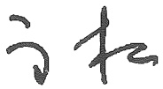

化学 “101 计划” 牵头人

中国科学院院士

2024年10月于中山大学

---

## 前言

教育部基础学科系列 “101 计划” 是加快推进国家基础学科拔尖人才培养的战略行动之一，是面向教育强国建设总体要求和国家战略需求，回答 “加快建设教育强国” “全面提高人才自主培养质量” 的时代命题的重要举措。一流核心教材建设是教育教学系统改革工程重点推进的 “四个一流” 建设的重要环节。教材是教学的根本依据和教与学的重要工具。“101 计划” 有机化学课程组以服务一流课程建设，加快推进化学学科拔尖创新人才培养，提升人才培养质量为目标，组成了北京大学裴坚教授牵头的大师领衔高水平队伍，共同承担 “有机化学” 核心教材编写任务，22 所高校 50 余位教师参与本书的编写工作。

有机化学作为碳化合物的化学，主要研究有机化合物的组成、结构、性质，结构与性质关系，合成和转化及其功能，与生物、医药、能源、材料、农林及环境等多学科有密切关联。有机化学课程是化学及生物科学、医学、药学、材料科学等专业本科生必修的基础理论课程。

有机化学课程一般安排在本科第2学期和第3学期开设，总计6学分96学时或更多，是学生最早接触的专业基础课之一。根据有机化学学科特点、课程及关联课程开设学期，“101计划”有机化学教材编写组在充分调研国内外有机化学课程教学和教材内容的基础上，确定了主要按照官能团类型编排，并配合若干专题和前沿拓展的模块化方式来编写本教材，其主要特点如下:

（1）知识全面系统，内容循序渐进。全书从有机化学核心概念和重要基础理论入手，涵盖烷烃，卤代烃，烯烃和炔烃，芳香烃，醇、酚和醚，醛和酮，羧酸及其衍生物，羰基 $\alpha$-碳上的反应，胺和含氮芳香杂环化合物等典型有机化合物及其反应类型，有机化合物结构鉴定，周环反应，金属有机化合物，糖类化合物，以及氨基酸、蛋白质和核酸等专题内容，为学生设置了循序渐进的学习路径，有助于学生有机化学辩证思维和系统思维能力的培养。书中还将科学方法论、我国科学家重要成果等科学思维元素与知识介绍巧妙融合，全面体现了知识传授与价值观引领的高度统一。

（2）聚焦核心内容，拓宽前沿视野。全书充分运用现代化学学科的基本理论和概念，凝练有机化学学科核心和前沿要素，将新理念、新内容和新方法贯穿全书，以教育部高等学校化学类专业教学指导委员会最新版《化学专业有机化学教学内容建议》为依据，使用公认、广泛认可、定量的方式呈现核心知识，强调文献对教材内容的支撑，以专题或数字资源形式展现最新前沿科研成果。习题作为学习巩固、查漏补缺的重要内容，注重启发性和思想性，主要从原始文献出发编写高质量习题，以提升学生分析和解决有机化学问题的能力，拓宽学术视野，培养创新思维。

（3）体现知识架构，激发探索兴趣。有机化学发展至今已250余年，已经形成自身学科知识体系和研究范式。本书通过对经典优秀文献所呈现科学规律的发现和发展脉络，以及当今所取得的一些重要研究成果的论述，使学生体会认识本质、创造新知的过程，从而具备自主搭建知识框架的能力。更为重要的是能够从中发现问题，激发好奇心和探索未知的兴趣，为真正投身科研创新奠定坚实基础。

北京大学裴坚教授承担本书内容设计、审定、协调等工作。复旦大学张丹维教授和浙江大学

---

T

前言

王彦广教授对全书内容进行了梳理、审定和修改。各章节编写人员如下:

第一章:浙江大学王彦广。

第二章:同济大学张扬会、杨泽鹏，北京航空航天大学李燕。

第三章:北京师范大学邢国文、米学玲。

第四章:南开大学资伟伟、汤平平，兰州大学惠新平、武全香、刘强、马宝春。

第五章:中山大学朱庭顺、汪波、赵晓丹，苏州大学赵蓓、袁丹。

第六章:湖南大学赵万祥、刘强、汪兆丰、陶忠林、李滔。

第七章:山东大学徐政虎、华东师范大学刘路。

第八章:西北大学王永强、周岭、白银娟、张世平、白璐、王云侠。

第九章:天津大学王光伟、赵温涛。

第十章:华南理工大学竺传乐、江焕峰。

第十一章:清华大学焦雷、张韶光、赵亮、陈超。

第十二章:复旦大学张丹维、孙兴文。

第十三章:南京大学俞寿云、上海交通大学沈增明。

第十四章:武汉大学刘文博、陈宜鸿、程鸿刚，浙江大学陆展。

第十五章:四川大学张骥、高戈。

第十六章:华中科技大学钟芳锐、吴国骄。

所有参编教师克服了时间紧迫、工作繁忙等诸多困难，为最终完稿付出了巨大心血和努力。有机化学学科始终处于飞速发展阶段，限于编者水平，书中疏漏之处在所难免，敬请批评指正。

本书编写组

2024年10月

---

## 目录

## 第九章 醛和酮 1

9.1 醛和酮的命名....1

9.1.1 普通命名法……1

9.1.2 系统命名法....2

9.2 醛和酮的结构....3

9.3 醛和酮的制法....3

9.3.1 醛和酮的工业合成 3

9.3.2 伯醇和仲醇的氧化 …… 4

9.3.3 羧酸衍生物的还原 4

9.3.4 芳环的酰基化 4

9.3.5 烯烃臭氧化……5

9.3.6 端炔的硼氢化氧化 …… 5

9.3.7 酸催化的端炔水合 5

9.4 醛和酮的物理性质及波谱性质....5

9.5 醛和酮的化学性质 8

9.5.1 羰基的亲核加成反应……9

9.5.2 醛、酮的氧化和还原反应……22

9.6 $\alpha, \beta-$ 不饱和醛、酮 27

9.6.1 1,2-加成与1,4-加成反应 27

9.6.2 还原反应 28

9.7 乙烯酮 29

9.8 醌 30

9.8.1 醌的制法 …… 30

9.8.2 醌的化学性质 …… 31

习题....32

## 第十章 羧酸及羧酸衍生物 46

10.1 羧酸及羧酸衍生物的简介与分类 47

10.2 羧酸及羧酸衍生物的命名……48

10.2.1 羧酸的命名 48

10.2.2 酰卤的命名 49

10.2.3 酸酐的命名 49

10.2.4 酯的命名....50

10.2.5 酰胺的命名 51

10.2.6 腈的命名....52

10.2.7 烯酮的命名 …… 52

10.3 羧酸及羧酸衍生物的物理性质 52

10.4 羧酸及羧酸衍生物的结构与化学键 56

10.5 羧酸及羧酸衍生物的谱图性质....58

---

目录

10.5.1 红外吸收谱图 58

10.5.1 红外吸收谱图
10.5.2 挖磁共振谱图 59

10.5.2 核磁共振谱图

10.6 羧酸的化学性质……59

10.6.1 醛酸的酸性 59

10.6.2 精羟基被卤原子取代的反应 62

10.6.2 羧酸的酯化反应 63

10.6.4 粖酸的胺（氨）解反应 65

10.6.5 羰酚与有机金属化合物的反应 66

10.6.5 羧酸与有机金属化合物的反应 66

10.6.6 羧酸的还原反应 60

10.6.7 脱羧反应 67

10.6.8 二元羧酸的脱水、脱羧反应 68

10.7 羧酸及羧酸衍生物酰基碳上的亲核取代反应 69

10.7.1 羧酸衍生物的醇解反应 71

1072. 羧酸衍生物的水解反应 73

10.7.3 羧酸衍生物的胺（氨）解反应……78

10.7.4 羧酸衍生物与有机金属化合物的反应……79

10.7.5 羧酸衍生物的还原反应 81

10.7.6 酰胺的特性 85

10.7.7 烯酮的反应 86

10.8 羧酸及羧酸衍生物的制备 87

10.8.1 羧酸的制备 87

10.8.2 酰卤的制备 87

10.8.3 酸酐的制备 87

10.8.4 酯的制备 88

10.8.5 酰胺的制备 89

10.8.6 腈的制备 90

10.8.7 烯酮的制备 90

10.9 聚酯与聚酰胺 90

10.10 油脂 91

10.10.1 脂肪酸 92

10.10.2 脂肪酸的来源 92

10.10.3 肥皂和合成洗涤剂 93

10.10.4 磷脂和生物膜 93

10.11 蜡 94

10.12 碳酸衍生物 94

10.12.1 光气和氯甲酸酯 94

10.12.2 尿素（脲）和胍 96

10.12.3 碳酸酯 97

习题....98

第十一章 羰基 $\alpha$-碳上的反应 …… 102

11.1 羰基化合物  $\alpha$ -氢的性质 ..... 102

11.1.1 羰基化合物 $\alpha$-氢的酸性 102

11.1.2 酮式-烯醇式互变 104

11.1.3 烯醇负离子的形成.... 106

11.1.4 烯醇与烯醇负离子形成的区域选择性……107

---

目录

III

11.1.5 羰基化合物 $\alpha$-碳的反应模式 110

11.2 经由烯醇中间体的反应……112

11.2.1 $\alpha$-卤化反应 112

11.2.2 Mannich 反应 115

11.3 经由烯醇负离子中间体的反应....117

11.3.1 羰基化合物在碱性条件下的 $\alpha$-卤化反应 117

11.3.2 $\alpha$-烷基化反应 119

11.3.3 羟醛缩合反应 120

11.3.4 共轭加成（Michael 加成）反应.... 124

11.3.5 酯缩合反应 126

11.3.6 1,3-二羰基化合物的反应 …… 128

11.4 经由烯醇硅醚和烯胺的反应....133

11.4.1 烯醇硅醚的形成和反应性 …… 133

11.4.2 烯胺的形成和反应性 …… 135

习题....138

## 第十二章 胺和含氮芳香杂环化合物 …… 142

12.1 胺类化合物的结构和命名……142

12.1.1 胺类化合物的命名....143

12.1.2 胺类化合物的手性....144

12.2 胺类化合物的制备 145

12.2.1 硝基还原法 145

12.2.2 腈还原法……151

12.2.3 酰胺还原法 153

12.2.4 Gabriel伯胺合成法 155

12.2.5 Staudinger 反应....157

12.2.6 Delépine 反应 160

12.2.7 醛/酮与氨衍生物缩合产物还原 160

12.2.8 Hofmann 重排、Curtius 重排及 Schmidt 反应 …… 163

12.3 胺类化合物的物理化学性质....165

12.3.1 胺类化合物的酸性和碱性 165

12.3.2 胺类化合物的亲核性 166

12.3.3 季铵盐和季铵碱 168

12.3.4 胺氧化物....171

12.3.5 胺的亚硝化反应 173

12.4 芳基重氮盐....176

12.4.1 芳基重氮盐参与的取代反应 176

12.4.2 芳基重氮盐在偶联反应中的应用....181

12.5 芳香含氮杂环化合物 …… 181

12.5.1 吡咯 182

12.5.2 吲哚....186

12.5.3 吡啶和嘧啶 188

12.5.4 喹啉和异喹啉 197

12.5.5 嘌吟 200

习题 200

---

IV

目录

## 第十三章 周环反应 205

## 13.1 基础知识 …… 205

13.1.1 周环反应及其特点 205
13.1.2 分子轨道对称性守恒原理 206
13.1.3 前线分子轨道理论 …… 206
13.1.4 直链共轭多烯的前线分子轨道及其对称性……207

## 13.2 电环化反应 …… 209

13.2.1 电环化反应的定义和规律 …… 209
13.2.2 $4n\pi$ 体系电环化 210
13.2.3 $(4n + 2)\pi$ 体系电环化 212
13.2.4 带电荷的共轭体系电环化 214

## 13.3 环加成反应 216

13.3.1 环加成反应的定义和规律 …… 216
13.3.2 Diels-Alder 环加成反应 216
13.3.3 [2+2]环加成反应 221
13.3.4 [3+2]环加成反应 222

## 13.4 σ-迁移反应 223

13.4.1 σ-迁移反应的定义和规律……223
13.4.2 [3,3] σ 迁移 223
13.4.3 [i,j]迁移反应 225

## 13.5 Alder-烯反应 228

## 13.6 周环反应在合成中的综合应用 229

## 习题 230

## 第十四章 金属有机化合物……233

14.1 金属有机化学的起源和发展 …… 233
14.2 金属有机化学的定义 …… 234
14.3 过渡金属配合物的结构特点 …… 235

14.3.1 配体类型 235
14.3.2 18 电子规则 …… 236
14.3.3 中心金属氧化态 237
14.3.4 中心金属所形成的化学键 238

## 14.4 四大基元反应 239

14.4.1 配体的配位与解离反应 …… 239
14.4.2 氧化加成反应与还原消除反应 239
14.4.3 插入反应与反插入反应 …… 241
14.4.4 配合物中的配体接受外来试剂的进攻反应 242

## 14.5 偶联反应简介……242

14.5.1 Kumada 偶联反应 243
14.5.2 Negishi 偶联反应……244
14.5.3 Stille 偶联反应 245
14.5.4 Suzuki 偶联反应 246
14.5.5 Heck 反应 249
14.5.6 Sonogashira 偶联反应 250

## 14.6 钯催化剂前体 251

---

目录

V

习题 252

## 第十五章 糖类化合物 …… 254

## 15.1 单糖的结构....254

15.1.1 单糖的构造确定 …… 255
15.1.2 单糖的构型 …… 255
15.1.3 单糖的环状结构 …… 256
15.1.4 重要的单糖衍生物……259

## 15.2 单糖的性质....260

15.2.1 半缩醛/酮羟基的反应及糖苷的形成 260
15.2.2 其他羟基的反应 …… 261
15.2.3 羰基的反应 …… 263
15.2.4 脓的形成……263
15.2.5 单糖的氧化 264
15.2.6 糖的递升和递降 266

## 15.3 单糖构型及环大小的测定……267

15.3.1 葡萄糖的构型测定 267
15.3.2 半缩醛环大小的测定 269

## 15.4 二糖 269

15.4.1 麦芽糖 270
15.4.2 纤维二糖 270
15.4.3 乳糖 271
15.4.4 蔗糖 271

## 15.5 寡糖和多糖 272

15.5.1 寡糖 273
15.5.2 多糖 275

习题 278

## 第十六章 氨基酸、蛋白质和核酸……281

## 16.1 氨基酸 281

16.1.1 氨基酸的结构与命名 281
16.1.2 $\alpha$-氨基酸的酸碱性 284
16.1.3 $\alpha$-氨基酸化学反应和生化反应 285
16.1.4 氨基酸的合成 288

## 16.2 肽和蛋白质 291

16.2.1 肽的一级结构和命名 …… 291
16.2.2 蛋白质的二级、三级和四级结构 …… 293
16.2.3 多肽结构的测定:氨基酸测序 296
16.2.4 多肽的合成 298

## 16.3 酶 301

## 16.4 核酸 305

16.4.1 核酸基本结构单位:核苷酸 305
16.4.2 核酸的结构 307
16.4.3 DNA 的复制、转录和 RNA 翻译 308

习题 311

---


---

第九章

醛和酮

9.1 醛和酮的命名 …… 1
9.2 醛和酮的结构 …… 3
9.3 醛和酮的制法 …… 3
9.4 醛和酮的物理性质及波谱性质……5
9.5 醛和酮的化学性质 8
9.6  $\alpha,\beta-$ 不饱和醛、酮 …… 27
9.7 乙烯酮 29
9.8 醌 30
习题 32

醛和酮都是含有羰基官能团的化合物，因此又统称为羰基化合物。羰基与一个氢原子相连形成的官能团简写为-CHO，含有-CHO的化合物称为醛（aldehyde），-CHO作为取代基时称为甲酰基（formyl）。羰基与两个烃基相连的化合物称为酮（ketone）。羰基化合物广泛存在于自然界，许多重要的生物化合物都包含羰基，例如人们日常识别的味道和气味的分子来源大部分是羰基化合物。此外，醛和酮的羰基可以与亲核试剂反应生成各种类型的产物，因此它们是有机合成的重要原料和中间体。

本章将探讨醛、酮的反应性，尤其是亲核试剂与醛、酮的反应，这些反应广泛存在于各种生物代谢途径和药物合成中。

## 9.1 醛和酮的命名

根据与羰基相连的烃基的不同，醛、酮可分为脂肪族醛、酮与芳香族醛、酮；根据烃基的不饱和度，醛、酮可分为饱和醛、酮及不饱和醛、酮；根据分子中所含羰基的数目，醛、酮还可分为一元醛、酮与二元醛、酮等。一元酮中羰基连接的两个烃基相同的称为简单酮，不相同的称为混合酮。碳原子数相同的饱和一元醛、酮互为同分异构体，它们具有相同的通式 $C_{n}H_{2n}O$ 。简单的醛、酮可采用普通命名法命名，结构较复杂的醛、酮则采用系统命名法命名。

## 9.1.1 普通命名法

醛的普通命名法与醇的普通命名法相似。例如:

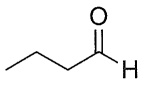

正丁醛
butyraldehyde

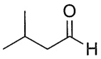

异戊醛
isovaleraldehyde

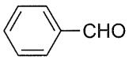

苯甲醛
benzaldehyde

酮的普通命名法是按照羰基所连接的两个烃基命名。例如:

---

2

第九章 醛和酮

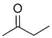

甲基乙基酮(甲乙酮)

ethyl methyl ketone

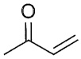

甲基乙烯基酮(丁烯酮)

methyl vinyl ketone

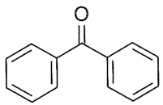

二苯甲酮(二苯酮)

diphenyl ketone

## 9.1.2 系统命名法

选择含有羰基碳原子的最长碳链为主链，从靠近羰基一端编号。醛羰基总是在链端，不用标明它的位次，而酮羰基通常需要标明位次。芳香族醛或酮的命名通常以脂肪族醛或酮为母体，将芳基作为取代基。例如:

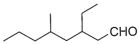

3-乙基-5-甲基辛醛

3-ethyl-5-methyloctanal

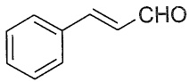

(E)-3-苯基丙-2-烯醛

(E)-3-phenylprop-2-enal

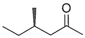

(R)-4-甲基己-2-酮

(R)-4-methylhexan-2-one

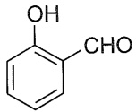

2-羟基苯甲醛

2-hydroxybenzaldehyde

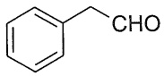

苯乙醛

phenylethanal

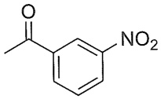

1-(3-硝基苯基)乙-1-酮

1-(3-nitrophenyl)ethan-1-one

碳链原子的位次有时也用希腊字母表示，与羰基直接相连的碳原子为 $\alpha$-碳原子，其次为 $\beta$-碳原子、$\gamma$-碳原子等（酮分子中可以有 $\alpha, \alpha'$-和 $\beta, \beta'$-碳原子等）。二元羰基化合物也经常用希腊字母来标记，用 $\alpha$（相邻）、$\beta$（隔一个碳原子）、$\gamma$（隔两个碳原子）来表示两个羰基的相对位次。例如:

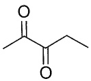

α-戊二酮(戊-2,3-二酮)

pentane-2,3-dione

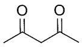

β-戊二酮(戊-2,4-二酮)

pentane-2,4-dione

当主链同时含有酮羰基和醛羰基时，可以醛为母体，将酮羰基的氧原子作为取代基，用“氧亚基”表示；也可以酮、醛为母体，但需注明酮、羰基碳原子的位次。例如:

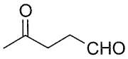

4-氧亚基戊醛

(γ-氧亚基戊醛，戊-4-酮醛)

4-oxopentanal

羰基在环内的脂环酮称为“环某酮”，如羰基在环外，则将环作为取代基。例如:

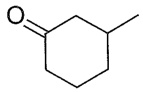

3-甲基环己酮

3-methylcyclohexan-1-one

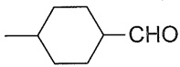

4-甲基环己烷-1-甲醛

4-methylcyclohexane-1-carbaldehyde

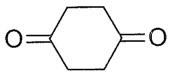

环己-1,4-二酮

cyclohexane-1,4-dione

---

9.3 醛和酮的制法

3

## 9.2 醛和酮的结构

醛和酮的分子中都含有羰基，它是由碳原子与氧原子以双键结合成的官能团，与碳碳双键相似，碳原子和氧原子都采取 $sp^{2}$ 杂化，碳氧双键由一个 $\sigma$ 键和一个 $\pi$ 键构成。羰基碳原子的三个 $sp^{2}$ 杂化轨道分别与一个氧原子和两个碳或氢原子形成三个 $\sigma$ 键，这三个 $\sigma$ 键在同一平面上。羰基碳原子和氧原子各剩下的一个p轨道在侧面相互交盖形成 $\pi$ 键，该 $\pi$ 键垂直于三个 $\sigma$ 键所在的平面，如图9-1(a)所示。醛、酮分子中形成羰基的碳原子和氧原子以及与羰基相连的其他两个碳或氢原子在同一平面上，键角接近 $120^{\circ}$，如图9-1(b)所示。

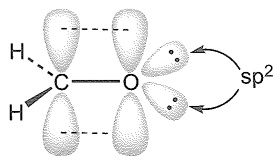

<details>
<summary>chemical</summary>

Molecular orbital diagram showing bonding between carbon and oxygen with sp² orbitals
</details>

(a)

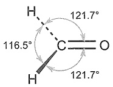

(b)

图9-1 甲醛的分子结构

## 9.3 醛和酮的制法

## 9.3.1 醛和酮的工业合成

## 1. 低级伯醇和仲醇的氧化

这是工业制取醛、酮的重要方法（见本书上册第七章）。

## 2. 烯烃的氢甲酰化反应

烯烃与一氧化碳和氢气在催化剂作用下可生成比原烯烃多一个碳原子的醛。该合成法称为烯烃的氢甲酰化反应（hydroformylation），也称羰基合成（oxo-synthesis）。常用的催化剂是钴或铑催化剂。利用该法合成的醛可进一步还原成伯醇，这是工业上合成低级伯醇的重要方法之一。例如:

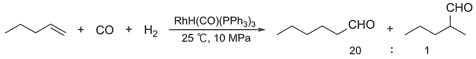

<details>
<summary>chemical</summary>

Organic reaction equation showing cyclopropane reacting with CO and H2 under RhH(CO)(PPh3)3 catalyst at 25°C for 10 MPa to form a cyclopropyl alcohol.
</details>

## 3. 烷基苯的氧化

工业上常用烷基苯氧化制取芳醛和芳酮。例如，甲苯用空气催化氧化、铬酰氯或铬酐氧化均可得苯甲醛:

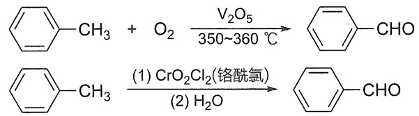

乙苯用空气氧化可得苯乙酮:

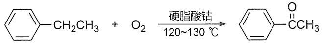

<details>
<summary>chemical</summary>

Chemical reaction equation showing methylene alkylation with ethyl ether under acidic conditions
</details>

---

4

第九章 醛和酮

## 4. 偕二卤代物的水解

同碳二卤化合物（称为偕二卤代物或胞二卤代物）水解生成醛或酮。例如，工业上可利用苯二氯甲烷水解制取苯甲醛:

$$
\text{C}_6\text{H}_5\text{CHCl}_2 + \text{H}_2\text{O} \xrightarrow[\text{80\%~90\%}]{\text{Fe, 95~100 °C}} \text{C}_6\text{H}_5\text{CHO} + 2\text{HCl}
$$

## 9.3.2 伯醇和仲醇的氧化

醇的氧化也是实验室制备醛、酮的常用方法（见 7.2.6 小节）。将伯醇氧化成醛时要使用温和的氧化剂。当使用强氧化剂处理时，伯醇被氧化成羧酸。当使用温和的氧化剂时，产生的醛不会被进一步氧化。

$$
\mathrm{RCH} _ {2} \mathrm{OH} \xrightarrow [ \text {或} (\text {1}) \mathrm{DMSO} , (\mathrm{COCl}) _ {2} ]{\text {PCC, CH} _ {2} \mathrm{Cl} _ {2}} \mathrm{RCHO}
$$

使用多种强或温和的氧化剂可以将仲醇氧化，生成的酮不会进一步氧化。

$$
\mathrm{R} ^ {\mathrm{OH}} \xrightarrow [ \mathrm{H} _ {2} \mathrm{SO} _ {4} , \mathrm{H} _ {2} \mathrm{O} ]{\mathrm{Na} _ {2} \mathrm{Cr} _ {2} \mathrm{O} _ {7}} \mathrm{R} ^ {\mathrm{O}} \mathrm{R} ^ {\prime}
$$

此外，伯醇或仲醇可经 Oppenauer 氧化生成相应的醛或酮。该反应是在碱（如异丙醇铝等）催化下，使用过量的丙酮作氧化剂可逆进行的，且具有较强的选择性，可用于氧化不饱和醇。例如:

$$
\text {CH}_3\text{CH}=\text{CHCH}=\text{CHCH} \xrightarrow[\text {苯，回流}]{\text {异丙醇铝，丙酮}} \text{CHCOCH=CHCH=CHCH} \quad 80\%
$$

## 9.3.3 羧酸衍生物的还原

酰氯及酯等羧酸衍生物可部分还原成相应的醛（见 10.7.5 小节），常用的还原方法有金属氢化物还原及催化氢化还原（Rosenmund 还原）等。例如:

$$
\mathrm{CHCH} _ {3} \mathrm{C} = \mathrm{OEt} \xrightarrow [ (1) i - \mathrm{Bu} _ {2} \mathrm{AlH} , \text {己烷,} - 78 ^ {\circ} \mathrm{C} ]{(2) \mathrm{H} _ {3} \mathrm{O} ^ {+}} \mathrm{CHCH} _ {3} \mathrm{C} = \mathrm{OCH}
$$

## 9.3.4 芳环的酰基化

芳烃的 Friedel-Crafts 酰基化反应是合成芳酮的重要方法（见 6.3.5 小节）。例如:

$$
\text {C}_6\text{H}_5 + \text {C}_6\text{H}_5\text {-COCl} \xrightarrow{\text {AlCl}_3} \text {C}_6\text{H}_5\text{-CO-C}_6\text{H}_5\quad 82\%
$$

在 Lewis 酸的催化下，用一氧化碳和氯化氢与芳烃作用生成芳醛，此反应称为 Gattermann-Koch 反应。它可以看成 Friedel-Crafts 反应的一种特殊形式，相当于甲酰氯参与的酰基化反应，适用于烷基苯的甲酰化。例如:

---

9.4 醛和酮的物理性质及波谱性质

5

$$
\mathrm{H} _ {3} \mathrm{C} - \overline {{\text {benzene}}} \xrightarrow [ \mathrm{AlCl} _ {3} - \mathrm{CuCl} , 20 ^ {\circ} \mathrm{C} ]{\mathrm{CO} + \mathrm{HCl}} \mathrm{H} _ {3} \mathrm{C} - \overline {{\text {benzene}}} - \mathrm{CHO}
$$

另一种特殊的 Friedel-Crafts 反应是 Vilsmeier-Haack 反应，酚类和芳胺类在  $POCl_{3}$  存在下与 N,N-二取代甲酰胺反应，可在其对位引入一个醛基。例如:

$$
\mathrm{HO} - \text {苯环} + \mathrm{H} \xrightarrow [ \mathrm{CH} _ {3} ]{\mathrm{O}} \mathrm{N} ^ {\mathrm{CH} _ {3}} \xrightarrow [ \mathrm{POCl} _ {3} ]{\mathrm{POCl} _ {3}} \mathrm{HO} - \text {苯环} + (\mathrm{CH} _ {3}) _ {2} \mathrm{NH} \tag{65}
$$

## 9.3.5 烯烃臭氧化

烯烃在臭氧作用下会裂解成醛或酮（见 5.6.4 小节）。

$$
\underset {(R) H} {\overset {R} {\rightleftharpoons}} \underset {H (R)} {\overset {R} {\rightleftharpoons}} \xrightarrow [ (2) \text {锌粉或} \left(\mathrm{CH} _ {3}\right) _ {2} \mathrm{S} ]{(1) \mathrm{O} _ {3}} 2 \underset {(R) H} {\overset {R} {\rightleftharpoons}} = O
$$

## 9.3.6 端炔的硼氢化氧化

端炔的硼氢化氧化生成通过  $\pi$  键的反马氏规则加成产物烯醇，互变异构形成醛（见5.8.4小节）。

$$
\mathrm{R} \equiv \frac {(1) \mathrm{R} _ {2} ^ {\prime} \mathrm{BH}}{(2) \mathrm{H} _ {2} \mathrm{O} _ {2} , \mathrm{HO} ^ {-}} \quad \mathrm{R} \stackrel {\frown} {\mathrm{CHO}}
$$

## 9.3.7 酸催化的端炔水合

酸催化下水分子对端炔的符合马氏规则的加成产物通过互变异构生成甲基酮（见5.8.3小节）。

$$
\mathrm{R} \equiv \xrightarrow [ \mathrm{HgSO} _ {4} ]{\mathrm{H} _ {2} \mathrm{SO} _ {4} , \mathrm{H} _ {2} \mathrm{O}} \mathrm{R}\rightleftharpoons
$$

## 9.4 醛和酮的物理性质及波谱性质

常温下除甲醛是气体外， $C_{12}$  以下的脂肪醛、酮一般是液体， $C_{12}$  以上的醛、酮一般为固体；芳醛、芳酮均为液体或固体。低级脂肪醛具有强烈的刺激性气味，某些  $C_{9}$  和  $C_{10}$  的醛、酮具有花果香味，可用于香料工业。

羰基具有极性，因此醛、酮的沸点比相对分子质量相近的烃及醚的沸点高。但羰基分子间不能形成氢键，因此沸点较相应醇的低。例如:

<table><tr><td rowspan="2">沸点/°C</td><td> $CH_3CH_2CH_2CH_3$ </td><td> $CH_3OCH_2CH_3$ </td><td> $CH_3CH_2CHO$ </td><td> $CH_3COCH_3$ </td><td> $CH_3CH_2CH_2OH$ </td></tr><tr><td>-0.5</td><td>7.4</td><td>49</td><td>55</td><td>97</td></tr><tr><td>沸点/°C</td><td>136.1</td><td>179.0</td><td>205.3</td><td colspan="2">201.8</td></tr></table>

因为醛、酮的羰基能与水中氢形成氢键，故低级的醛、酮可溶于水；但芳醛、芳酮微溶

---

6

第九章 醛和酮

或不溶于水。一些醛、酮的物理常数见表9-1。

表 9-1 一些醛、酮的物理常数

| 名称 | 熔点/°C | 沸点/°C | 相对密度($d_{4}^{20}$) | 水中溶解度$\frac{g \cdot (100\, g\, H_{2}O)^{-1}}{}$ |
| --- | --- | --- | --- | --- |
| 甲醛 | -92 | -19.5 | 0.815 (-20 °C) | 122 |
| 乙醛 | -123.5 | 21 | 0.788 (16 °C) | 无限混溶 |
| 丙烯醛 | -88 | 53 | 0.841 | 21 |
| 丙醛 | -81 | 49 | 0.8071 | 30 |
| 丁醛 | -99 | 74.8 | 0.8016 | 7.1 |
| (E)-丁-2-烯醛 | -76.5 | 102 | 0.8516 | 18.1 |
| 丙酮 | -94.7 | 56 | 0.7908 | 无限混溶 |
| 丁酮 | -86.7 | 79.6 | 0.8054 | 24 |
| 环己酮 | -31 | 155.7 | 0.9478 | 15 |
| 苯甲醛 | -26 | 179 | 1.0528 | 0.3 |
| 苯乙酮 | 20.5 | 202 | 1.028 | 0.55 |
| 二苯酮 | 48.5 | 305 | 1.1097 | 不溶 |

醛和酮的红外光谱在  $1740 \sim 1680 \, cm^{-1}$  有一个非常特征的 C=O 伸缩振动吸收峰；其他含有羰基的化合物（包括羧酸及其衍生物）的红外光谱在  $1850 \sim 1650 \, cm^{-1}$  也存在类似的强吸收峰，这是鉴别羰基存在的最有力证据之一。醛、酮羰基吸收峰的位置与其邻近基团的电子效应及空间效应有关，若羰基与双键发生共轭，则吸收峰向低波数位移。例如:

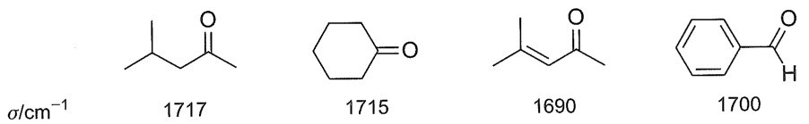

<details>
<summary>chemical</summary>

Four organic molecular structures with labeled standard deviations (σ/cm⁻¹)
</details>

醛、酮的伸缩振动吸收峰位置相近不易区别，但甲酰基的 C-H 键在  $\sim2720\ cm^{-1}$  处有中等强度（或弱的）尖锐的特征吸收峰，可以用于鉴别 -CHO 的存在。图 9-2 及图 9-3 分别为正壬醛及苯乙酮的红外光谱。

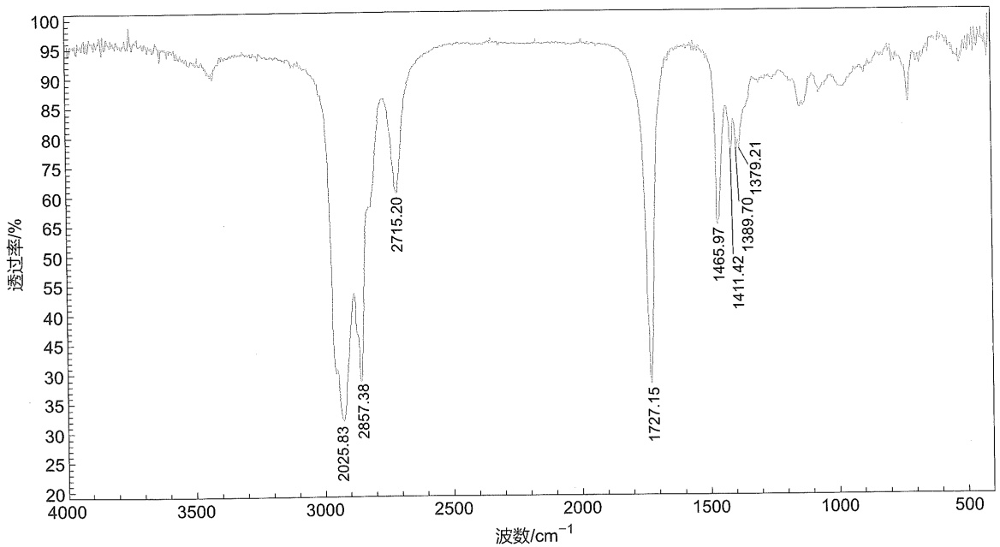

<details>
<summary>spectrogram</summary>

| Wavenumber \((cm^{-1})\) | Transmittance (%) |
| --- | --- |
| 2025.83 | ~32 |
| 2857.38 | ~45 |
| 2715.20 | ~65 |
| 1727.15 | ~30 |
| 1465.97 | ~65 |
| 1411.42 | ~60 |
| 1389.70 | ~60 |
| 1379.21 | ~60 |
</details>

图9-2 正壬醛的红外光谱

$2715\ cm^{-1}$ ，甲酰基 C—H 伸缩振动； $1727\ cm^{-1}$ ，C=O 伸缩振动

---

9.4 醛和酮的物理性质及波谱性质

7

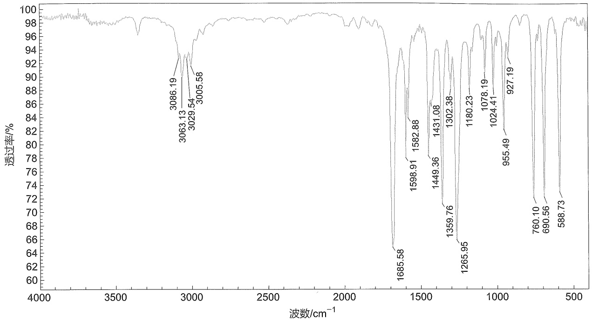

<details>
<summary>spectrogram</summary>

| Wavenumber \((cm^{-1})\) |
| --- |
| 3086.19 |
| 3063.13 |
| 3029.54 |
| 3005.58 |
| 1685.58 |
| 1598.91 |
| 1582.88 |
| 1449.36 |
| 1431.08 |
| 1359.76 |
| 1302.38 |
| 1265.95 |
| 1180.23 |
| 1078.19 |
| 1024.41 |
| 955.49 |
| 927.19 |
| 760.10 |
| 690.56 |
| 588.73 |
</details>

图9-3 苯乙酮的红外光谱

$1686\mathrm{cm}^{-1}$ ， $\mathrm{C = O}$ 伸缩振动； $1599~\mathrm{cm}^{-1}$ ， $1583~\mathrm{cm}^{-1}$ ，苯环骨架伸缩振动； $690~\mathrm{cm}^{-1}$ ，一取代苯Ar-H面外弯曲振动

在  ${}^{1}$ H NMR 谱图中，羰基本身不产生信号，但它对相邻质子的化学位移有明显的影响。由于羰基的吸电子性及 C=O 双键的磁各向异性，与羰基相连接的氢受到的屏蔽效应大大减小，化学位移值  $\delta$  较大，接近 9～10，这可以作为醛基的特征峰（图 9-4）。此外羰基对  $\alpha$ -质子的化学位移也有影响，导致化学位移值增大（图 9-5）。

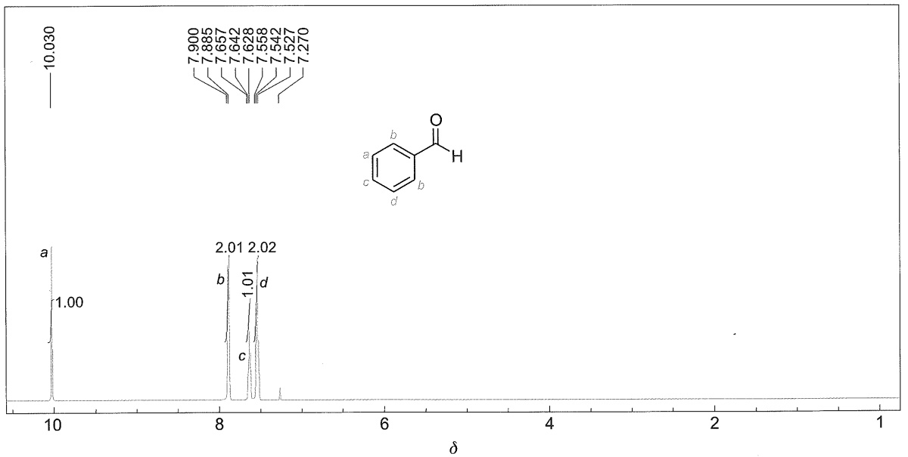

<details>
<summary>spectrogram</summary>

| Peak Label | Chemical Shift \((\delta)\) |
| --- | --- |
| a | 10.030 |
| b | 7.900 |
| b | 7.885 |
| b | 7.657 |
| b | 7.642 |
| b | 7.628 |
| b | 7.558 |
| b | 7.542 |
| b | 7.527 |
| b | 7.270 |
| c | ~8.15 |
| c | ~8.10 |
| c | ~8.05 |
| d | ~8.00 |
| d | ~7.95 |
| d | ~7.90 |
</details>

图9-4 苯甲醛的核磁共振氢谱（500 MHz，$\mathrm{CDCl}_3$）

在  ${}^{13}$ C NMR 谱图中，酮或醛的羰基碳通常会在 δ200 附近产生弱信号峰，由于低场很少有信号出现，这种信号通常相对容易被识别，可以作为醛和酮鉴定的特征峰（图 9-6）。

---

8

第九章 醛和酮

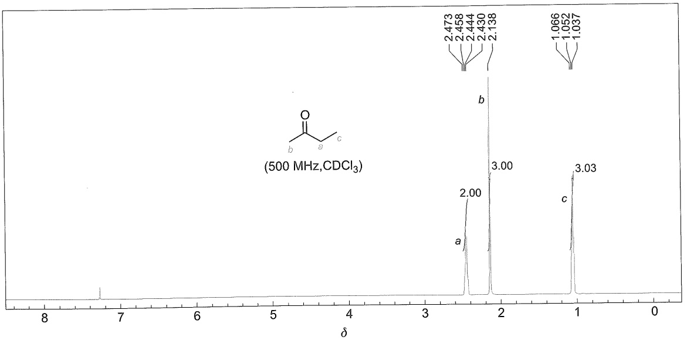

<details>
<summary>spectrogram</summary>

| Chemical Shift \((\delta)\) | Integration |
| --- | --- |
| 2.473 | a |
| 2.458 | a |
| 2.444 | a |
| 2.430 | b |
| 2.138 | b |
| 1.066 | c |
| 1.052 | c |
| 1.037 | c |
</details>

图9-5 丁酮的核磁共振氢谱（ $500\mathrm{MHz}$ ， $\mathrm{CDCl}_3$ ）

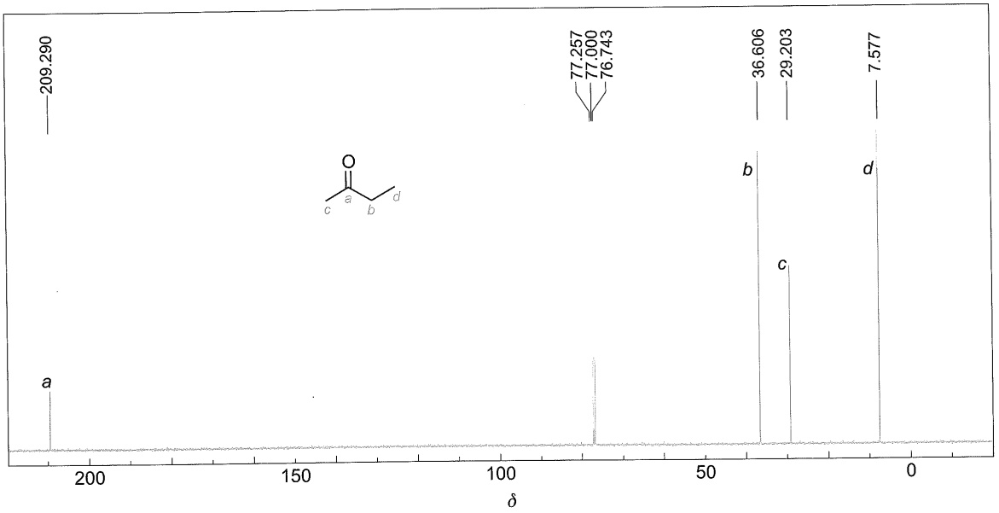

<details>
<summary>spectrogram</summary>

| Peak Label | Chemical Shift \((\delta)\) |
| --- | --- |
| a | 209.290 |
| b | 77.257 |
| c | 77.000 |
| d | 76.743 |
| e | 36.606 |
| f | 29.203 |
| g | 7.577 |
</details>

图9-6 丁酮的核磁共振碳谱（126MHz，$\mathrm{CDCl}_3$）

## 9.5 醛和酮的化学性质

醛和酮的官能团是羰基，即 C=O。与 C=C 双键相似，C=O 双键由 σ 键和 π 键组成，但氧原子的电负性比碳原子的电负性大，所以羰基是极化的，π 电子云的分布偏向氧原子。这导致氧原子带部分负电荷，具有亲核性，易与亲电试剂反应；而碳原子带部分正电荷，具有亲电性，易与亲核试剂进行加成反应（亲核加成反应）。

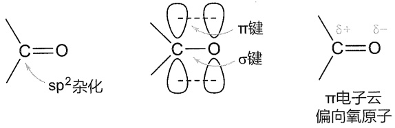

<details>
<summary>chemical</summary>

Chemical structures showing sp² radicalization, π bond, σ bond, and π electron cloud with directional oxygen atoms
</details>

---

9.5 醛和酮的化学性质

9

此外，受羰基的影响，与羰基直接相连的  $\alpha-$  碳原子上的氢原子( $\alpha-H$ )较活泼，产生的碳负离子能发生一系列反应（见第十一章）。醛、酮分子中含有的羰基和活泼的  $\alpha-H$  决定了其相关的主要化学性质，如下所示:

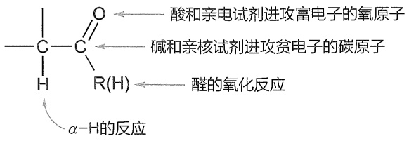

<details>
<summary>chemical</summary>

Reaction mechanism diagram showing oxidation and reduction reactions of a carboxylic acid to form alpha-hydroxybenzoic acid and alkene
</details>

## 9.5.1 羰基的亲核加成反应

羰基中碳原子带有部分正电荷，具有亲电性，易与多种亲核试剂进行加成反应，其亲核原子可以是碳、氧、硫、氮和氢等。

不同的羰基化合物亲核加成反应的活性不同，这种差异是电子效应和空间效应两者综合作用的结果。由电子效应看，当羰基碳原子上连有吸电子基时，容易进行亲核加成反应；反之，当羰基碳原子上连有给电子基时，难以进行亲核加成反应。由于与氢相比烃基具有给电子效应，因而酮的亲核加成反应活性一般低于醛。从空间效应看，羰基碳原子进行亲核加成反应的过程中，羰基碳原子若连有较大的基团，则不利于亲核加成反应的进行。不同结构的醛和酮进行亲核加成反应时，大致可按下列次序由易到难排列:

$$
\mathrm{HCHO} > \mathrm{RCHO} > \mathrm{ArCHO} > \mathrm{CH} _ {3} \mathrm{COCH} _ {3} > \mathrm{CH} _ {3} \mathrm{COR} > \mathrm{RCOR} > \mathrm{ArCOAr}
$$

一般在脂肪烃基空间效应不是很大的情况下，脂肪醛比芳香醛易于进行亲核加成；脂肪酮比芳香酮易于进行亲核加成，这是由于芳醛和芳酮中芳环与羰基的共轭，增加了羰基碳原子上电子密度。

对于芳香醛、酮，还要考虑到环上取代基的电子效应。当芳环上所连原子或基团通过芳环对羰基的影响表现为吸电子效应时，有利于增加羰基的活性；反之，则降低羰基的活性。

$$
\mathrm{O} _ {2} \mathrm{N} - \text {C}_6\text {H}_5 - \mathrm{CHO} > \text {C}_6\text {H}_5 - \mathrm{CHO} > \mathrm{H} _ {3} \mathrm{C} - \text {C}_6\text {H}_5 - \mathrm{CHO}
$$

在加成过程中，如果羰基两侧的基团相同，亲核试剂则可以从羰基所在平面的上、下机会均等地进攻羰基碳原子，形成加成产物。如果羰基两侧基团的大小不同，手性亲核试剂进攻羰基碳原子时，则可以形成手性醇。

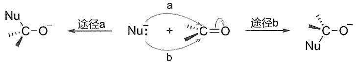

<details>
<summary>chemical</summary>

Reaction mechanism diagram showing nucleophilic addition and deprotonation steps with labeled途径a and途径b
</details>

从分子轨道角度来看，亲核试剂对羰基的加成反应是亲核试剂的HOMO轨道电子对与羰基双键的LUMO轨道作用形成新的 $\sigma$ 键。值得注意的是，亲核试剂进攻羰基时，尽管亲核试剂的HOMO轨道与羰基 $\pi^{*}$ 轨道的重叠越大越有利，但是羰基 $\pi$ 键电子密度对亲核试剂的HOMO轨道的电子有排斥力，这导致亲核试剂对羰基的进攻并不是垂直于羰基的平面，而是与羰基呈 $107^{\circ}$ 左右的夹角，此夹角称作Bürgi-Dunit角。

---

10

第九章 醛和酮

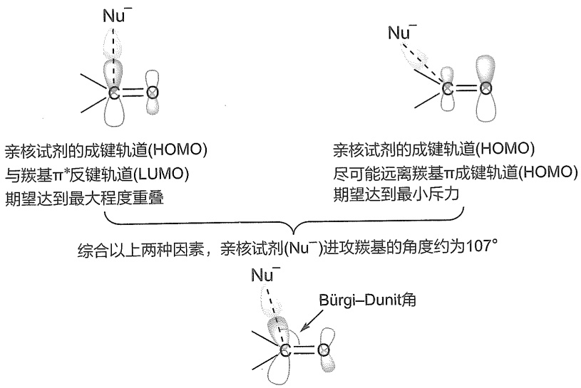

<details>
<summary>flowchart</summary>

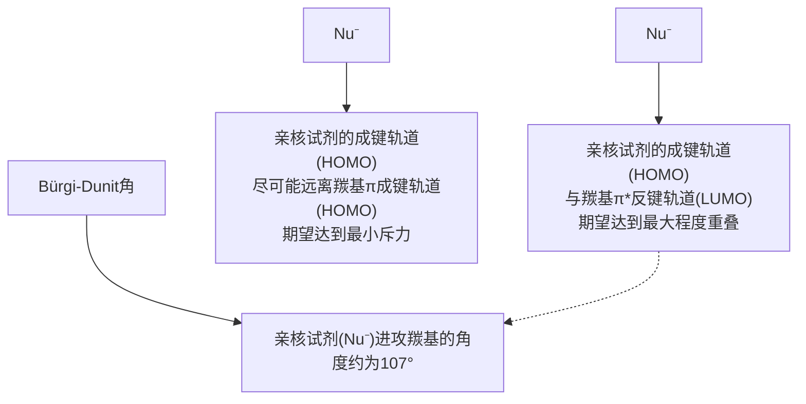
</details>

羰基与不同亲核试剂反应时，有些亲核试剂需要碱性条件，有些则需要酸性条件。碱性条件下的反应机理如下:首先羰基被亲核试剂进攻生成负离子中间体，随后负离子中间体质子化生成加成产物。

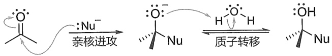

<details>
<summary>chemical</summary>

Reaction mechanism diagram showing quaternization and proton transfer steps of a carboxylic acid derivative
</details>

酸性条件下的反应则是首先羰基氧质子化生成正离子，随后亲核试剂对活化的羰基进攻生成加成产物。这里质子化羰基带有完整的正电荷，使得羰基碳的亲电性增加，有利于弱亲核试剂对羰基进行加成。

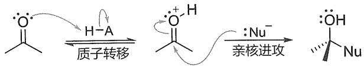

<details>
<summary>chemical</summary>

Reaction mechanism diagram showing quaternary transfer and nucleophilic attack of a ketone to form a hydroxyl group
</details>

当亲核试剂也可以作离去基团时，亲核试剂对羰基的亲核加成反应是可逆反应，平衡的位置取决于亲核试剂离去性能的强弱。这里将根据进攻原子对亲核试剂进行分类，研究各类亲核试剂。具体来说，将讨论基于碳、氧、硫、氮和氢的亲核试剂。

## 1. 碳亲核试剂对羰基的加成

碳亲核试剂的加成可以构建新的碳碳键，因此是有机合成最重要的反应类型之一。碳亲核试剂包括以 Grignard 试剂为代表的金属试剂、氰离子和 Wittig 试剂。

（1）与金属试剂加成醛、酮与Grignard试剂进行亲核加成反应，加成产物不必分离出来，可直接水解而生成醇:

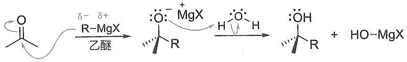

<details>
<summary>chemical</summary>

Organic reaction mechanism showing oxidation of a ketone to form a hydroxymethylated product with MgX and R-MgX reagents
</details>

Grignard 试剂中的碳镁键是高度极化的，镁原子带有部分正电荷，碳原子带有部分负电荷，具有较强的亲核性。Grignard 试剂与甲醛反应，生成增加一个碳原子的伯醇；与其他醛反应，生成仲醇，而与酮反应，则生成叔醇。

---

9.5 醛和酮的化学性质

11

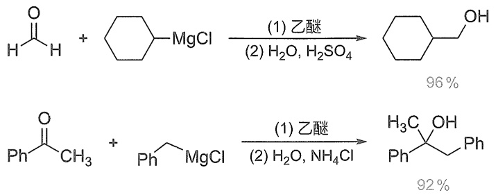

醛、酮除了和Grignard试剂发生加成反应外，还可与有机锂试剂进行加成反应。有机锂试剂比Grignard试剂更活泼，反应方式与Grignard试剂相似，其反应优点是产率较高，而且较易分离。此外，Grignard试剂不易与二叔丁基甲酮反应，其原因是空间障碍较大，而叔丁基锂则可与之反应:

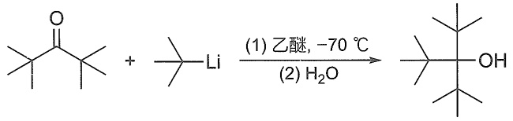

<details>
<summary>chemical</summary>

Chemical reaction equation showing lithium-catalyzed cyclization of a ketone to form an alcohol under ethylene and water conditions
</details>

醛、酮也可以与炔基钠反应，形成炔醇。例如:

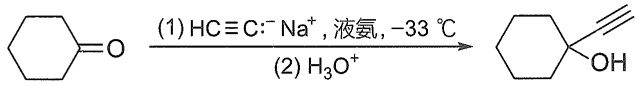

<details>
<summary>chemical</summary>

Chemical reaction equation showing hydrolysis of cyclohexanol under acidic conditions to form a cyclohexanol derivative
</details>

另外，醛、酮等羰基化合物可在锌存在下，与 $\alpha$-卤(氯或溴)代羧酸酯反应，再经水解生成 $\beta$-羟基羧酸酯或 $\alpha, \beta$-不饱和羧酸，该反应称为Reformatsky反应。

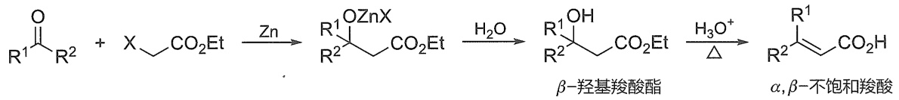

<details>
<summary>chemical</summary>

Chemical reaction equation showing conversion of ester to β-羟基羧酸酯 and α,β-不饱和羧酸 via intermediate Zn
</details>

锌与 $\alpha$-卤代羧酸酯所形成的有机锌试剂，其亲核性比 Grignard 试剂的亲核性小，只能与醛、酮的羰基加成，而不与酯的羰基加成。$\beta$-羟基酸很容易脱水，所以酯在水解的同时脱水，最终生成 $\alpha, \beta$-不饱和羧酸。Reformatsky 反应常用于制备 $\beta$-羟基酸酯和 $\alpha, \beta$-不饱和羧酸。例如:

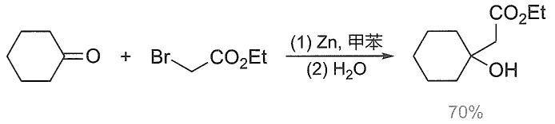

<details>
<summary>chemical</summary>

Organic reaction equation showing benzene reacting with bromoethylenediamine under zinc and water conditions to yield a hydroxybenzoate product
</details>

当醛、酮分子中的  $\alpha-$  碳原子为手性碳原子时，加成产物的立体构型将受其影响。Cram 规则（由 D. J. Cram 于 1952 年提出）可用于预测占优势产物的构型。Cram 规则可用纽曼投影式说明如下，其中 L、M 和 S 分别代表具有手性的  $\alpha-$  碳原子上连有的大、中和小基团；按照该规则羰基一般应处于 M 和 S 两个基团中间，而亲核试剂应主要从空间障碍较小的一侧（S 一侧）进攻羰基碳原子。

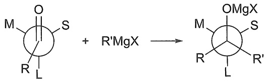

<details>
<summary>chemical</summary>

Chemical reaction equation showing the formation of a cyclic oxime from a ketone and R'MgX
</details>

例如，(S)-2-苯基丙醛与甲基碘化镁进行亲核加成反应时，主要得到产物Ⅰ。该实验结

---

12

第九章 醛和酮

果与 Cram 规则的预测是吻合的。

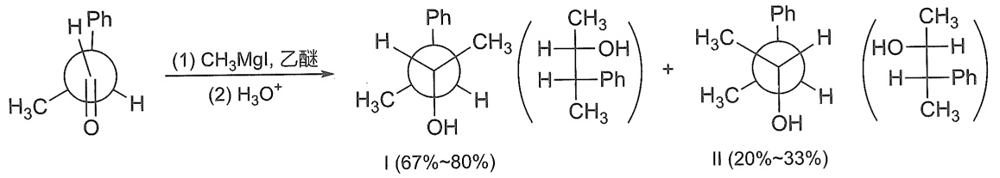

<details>
<summary>chemical</summary>

Chemical reaction equation showing conversion of a cyclic ketone to a diol under methanol and water conditions, yielding two products with different yields.
</details>

（2）与HCN加成醛、甲基酮和脂环酮一般均可以与氢氰酸作用生成 $\alpha-$ 羟基腈，亦称 $\alpha-$ 氰醇。机理研究表明该反应在催化量碱的存在下易于进行。例如，氢氰酸与丙酮反应，无碱存在时， $3\sim 4\mathrm{h}$ 内只有一半原料发生反应；加一滴氢氧化钾溶液，则 $2\mathrm{min}$ 内即可以完成反应。如果加入酸，反而使反应速率减小，加入大量的酸，放置许多天也不发生反应。这些事实表明，在氢氰酸与羰基化合物的加成反应中，起决定性作用的是CN。碱的存在能增加CN的浓度，酸的存在则相反。

$$
\mathrm{HCN} \xrightarrow [ \mathrm{H} ^ {+} ]{\mathrm{HO} ^ {-}} \mathrm{H} ^ {+} + ^ {-} \mathrm{CN}
$$

一般认为碱催化下氢氰酸对羰基的加成反应机理如下:

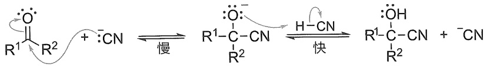

<details>
<summary>chemical</summary>

Reaction mechanism diagram showing slow and fastly activated reactions of a cyclic ester with CN groups
</details>

亲核进攻

质子转移

氰化氢在碱的作用下脱质子生成亲核性较强的氰离子，对羰基进行加成。不过，氰离子对羰基的加成是可逆的，产物的产率取决于平衡浓度。对大多数醛和小位阻酮而言，平衡倾向于氰醇的生成。

氢氰酸有剧毒，易于挥发（沸点为  $26.5^{\circ}C$ ），故与羰基化合物加成时，一般将无机酸加入醛（或酮）和氰化钠水溶液的混合物中，使得氢氰酸在反应体系中一旦生成就立即与醛（或酮）反应。但在加酸时注意控制溶液的 pH，使 pH 为 8，以利于反应进行。为了安全，该反应需要通风良好的环境中进行。一种改进的方法是将氰化钠或氰化钾水溶液加到羰基化合物的亚硫酸氢钠加成物中。体系中的亚硫酸氢根离子起酸的作用（见  $NaHSO_{3}$  对羰基的加成）。

$$
\begin{array}{c} \mathrm{OH} \\ \mathrm{R} - \stackrel {\mid} {\mathrm{C}} - \mathrm{SO} _ {3} \mathrm{Na} + \mathrm{NaCN} \Longleftrightarrow \mathrm{R} - \stackrel {\mid} {\mathrm{C}} - \mathrm{CN} + \mathrm{Na} _ {2} \mathrm{SO} _ {3} \\ \mathrm{H} \end{array}
$$

$\alpha-$ 羟基腈中氰基可以根据需要进一步转化为其他官能团，例如，氰基可以转化为氨基或羧酸，因此 $\alpha-$ 羟基腈是非常有用的合成中间体。

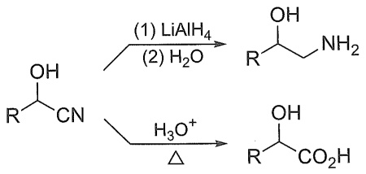

<details>
<summary>chemical</summary>

Chemical reaction equations showing the formation of carboxylic acid from cyanoic acid and aldehyde under different conditions
</details>

（3）与Wittig试剂加成Wittig试剂亦称磷内镝盐或磷叶立德，其中碳负离子与磷正离子直接相连，碳负离子可被邻近的磷正离子共振稳定，因此也可以写成 $\mathrm{C = P}$ 的共振式。两个共振式都可以表示Wittig试剂。尽管 $\mathrm{C = P}$ 的共振式没有电荷看起来更稳定，但它对整个共振

---

9.5 醛和酮的化学性质

13

杂化没有太大的贡献,因为 C 的 2p 轨道和 P 的 3p 轨道的大小显著不同,所以没有有效重叠。而镐盐形式更真实地反映了 Wittig 试剂作为亲核性碳负离子的反应性。

$$
\left[ \begin{array}{c} \mathrm{H} \\ - \stackrel {\cdot} {\mathrm{C}} - \stackrel {+} {\mathrm{PPh}} _ {3} \\ \mathrm{H} \end{array} \right. \longleftrightarrow \left[ \begin{array}{c} \mathrm{H} \\ \stackrel {\cdot} {\mathrm{C}} = \mathrm{PPh} _ {3} \\ \mathrm{H} \end{array} \right] \text {Wittig试剂}
$$

醛、酮等羰基化合物可与Wittig试剂进行亲核加成反应，形成一个新的内镝盐，然后裂解消除三苯基氧膦 $(\mathrm{Ph}_3\mathrm{P} = \mathrm{O})$ 而得到烯烃，其反应过程如下:

$$
\mathrm{R} ^ {1} \stackrel {\cdot \cdot \cdot} {\mathrm{C}} \stackrel {\cdot \cdot \cdot} {\mathrm{O}} ^ {\cdot} \stackrel {\cdot \cdot \cdot} {\mathrm{R} ^ {2}} + \stackrel {\cdot \cdot \cdot} {\mathrm{H}} \stackrel {-} {\mathrm{C}} - \stackrel {+} {\mathrm{PPh} _ {3}} \longrightarrow \left[ \begin{array}{c} \stackrel {: \cdot \cdot \cdot} {\mathrm{O}}: ^ {+} \mathrm{PPh} _ {3} \\ \mathrm{R} ^ {1} - \stackrel {: \cdot \cdot \cdot} {\mathrm{C}} - \stackrel {+} {\mathrm{CH} _ {2}} \\ \mathrm{R} ^ {2} \end{array} \right] \longrightarrow \left[ \begin{array}{c} \stackrel {: \cdot \cdot \cdot} {\mathrm{O}} - \mathrm{PPh} _ {3} \\ \mathrm{R} ^ {1} - \stackrel {: \cdot \cdot \cdot} {\mathrm{C}} - \stackrel {+} {\mathrm{CH} _ {2}} \\ \mathrm{R} ^ {2} \end{array} \right] \longrightarrow \mathrm{R} ^ {1} \stackrel {\mathrm{CH} _ {2}} {\mathrm{C}} _ {\mathrm{R} ^ {2}} + \mathrm{O} = \mathrm{PPh} _ {3}
$$

Wittig 试剂通常由三苯基膦和卤代烷制备。三苯基膦是结晶固体，熔点为  $80^{\circ}$ C，实验室中可用 Grignard 试剂与三氯化磷作用而得，也可通过用溴苯、三氯化磷和金属钠制备。

$$
\begin{array}{l} 3 \mathrm{PhMgBr} + \mathrm{PCl} _ {3} \longrightarrow \mathrm{Ph} _ {3} \mathrm{P} + 3 \mathrm{MgClBr} \\ 3 \mathrm{PhBr} + \mathrm{PCl} _ {3} + 6 \mathrm{Na} \longrightarrow \mathrm{Ph} _ {3} \mathrm{P} + 3 \mathrm{NaCl} + 3 \mathrm{NaBr} \\ \end{array}
$$

三苯基膦作为亲核试剂与卤代烷发生  $S_{N}2$  反应，生成季磷盐；再与强碱（如 n-BuLi、PhLi 等）作用，生成 Wittig 试剂。例如:

$$
\mathrm{Ph} _ {3} \ddot {\mathrm{P}} + \mathrm{CH} _ {3} \mathrm{CH} _ {2} - \mathrm{Br} \xrightarrow [ \mathrm{S} _ {\mathrm{N}} 2 ]{} \mathrm{Ph} _ {3} \stackrel {{+}} {\mathrm{P}} - \mathrm{CHCH} _ {3} \mathrm{Br} ^ {-} \xrightarrow [ \begin{array}{c} \delta - \delta + \\ \text {Ph-Li} \\ - \text {PhH} \\ - \text {LiBr} \end{array} ]{\delta - \delta +} \left[ \mathrm{Ph} _ {3} \stackrel {{+}} {\mathrm{P}} - \bar {\mathrm{CHCH}} _ {3} \longleftrightarrow \mathrm{Ph} _ {3} \mathrm{P} = \mathrm{CHCH} _ {3} \right]
$$

第一步是 $\mathrm{S_N2}$ 反应，因此伯烷基卤代物将比仲烷基卤代物更容易反应，叔烷基卤代物则不反应。磷盐中间体去质子化需要 $\mathrm{NaH}$ 、$\mathrm{NaNH_2}$ 或 PhLi 等强碱。Wittig 反应可用于制备单取代、二取代或三取代烯烃。由于过渡态的空间位阻，四取代烯烃很难通过 Wittig 反应制备。Wittig 反应是一种重要的合成工具，可以在羰基的位置引入碳碳双键，还具有相当好的立体选择性。由简单烷基卤代物产生的 Wittig 试剂与醛反应时，第一步的加成是反应的决速步骤，加成过程中 Wittig 试剂中的三苯基膦远离醛的取代基，这导致反应的主要产物是(Z)-烯烃。

$$
\text {Reaction:} \quad \text {慢} \rightarrow \left[\begin{array}{c}\text {主要}\\\text {次要}\end{array}\right] \xrightarrow {\text {快}} \left[\begin{array}{c}\text {主要}\\\text {次要}\end{array}\right] + \text {次要} \quad \text {(Z)-丙-1-烯基苯主要} + \text {(E)-丙-1-烯基苯次要}
$$

Wittig 试剂反应条件温和且收率较高，除可用于合成普通烯烃外，还可合成一些用其他方法难以制备的烯烃。例如:

---

14

第九章 醛和酮

$$
\text{C}_6\text{H}_5=\text{O} + \text{Ph}_3\text{P}=\text{CH}_2 \xrightarrow{\text{DMSO}} \text{C}_6\text{H}_5=\text{CH}_2 \quad 86\%
$$

德国化学家 G. Wittig 因其对有机磷化合物的研究以及发现了这种具有巨大合成用途的反应而获得 1979 年诺贝尔化学奖，这个反应被称为 Wittig 反应。利用该反应构建碳碳双键在有机合成中具有广泛的应用，如 BASF 的维生素 A 工业合成就用到了 Wittig 反应。

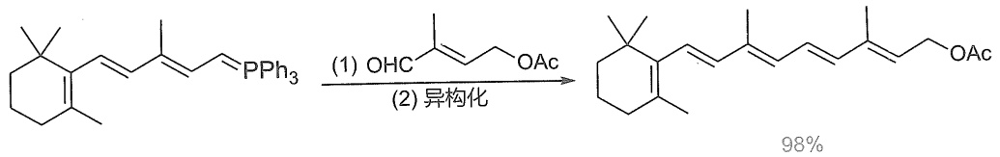

<details>
<summary>chemical</summary>

Organic synthesis reaction showing conversion of a chiral aldehyde to a ketone using (1) OHC and (2)异构化, yielding 98% product
</details>

当Wittig试剂含有可以稳定碳负离子的吸电子基时， $(E)$ -烯烃通常是主要产物。

$$
\mathrm{EtO} _ {2} \mathrm{C} - \underset {\mathrm{H}} {\overset {\mathrm{PPh} _ {3}} {\mathrm{C}}} \equiv \left[ \underset {\mathrm{EtO}} {\overset {\mathrm{O}} {\mathrm{C}}} - \underset {\mathrm{H}} {\overset {\mathrm{PPh}} {\mathrm{C}}} \right. \xleftrightarrow {} \underset {\mathrm{EtO}} {\overset {\mathrm{O}} {\mathrm{C}}} - \underset {\mathrm{H}} {\overset {+} {\mathrm{C}}} \xleftrightarrow {} \underset {\mathrm{EtO}} {\overset {-} {\mathrm{O}}} - \underset {\mathrm{H}} {\overset {+} {\mathrm{C}}} \left. \right] _ {\text {共振稳定的Wittig试剂}}
$$

$$
\mathrm{Ph} - \underset {\mathrm{H}} {\overset {\mathrm{PPh} _ {3}} {\rightleftharpoons}} \equiv \left[ \underset {\mathrm{H}} {\overset {\mathrm{PPh} _ {3}} {\rightleftharpoons}} \leftrightarrow \underset {\mathrm{H}} {\overset {\mathrm{PPh} _ {3}} {\rightleftharpoons}} \leftrightarrow \underset {\mathrm{H}} {\overset {\mathrm{PPh} _ {3}} {\rightleftharpoons}} \leftrightarrow \underset {\mathrm{H}} {\overset {\mathrm{PPh} _ {3}} {\rightleftharpoons}} \right. \text {共振稳定的Wittig试剂}
$$

$$
\begin{array}{r l} & \text {PhCHO} + \mathrm{H} ^ {\mathrm{PPh} _ {3}} \xrightarrow {\mathrm{CO} _ {2} \mathrm{Et}} \mathrm{Ph} ^ {\mathrm{CH=CHCO} _ {2} \mathrm{Et}} \\ & \text {PhCHO} + \mathrm{H} ^ {\mathrm{PPh} _ {3}} \xrightarrow {\mathrm{Ph}} \mathrm{Ph} ^ {\mathrm{CH=CHPh}} \end{array}
$$

在有机合成中 Wittig 反应有很多常用的变体。例如，Horner-Wadsworth-Emmons 反应（简称 HWE 反应）使用膦酸酯碳负离子试剂代替稳定的 Wittig 试剂，可以高选择性生成(E)-烯烃。

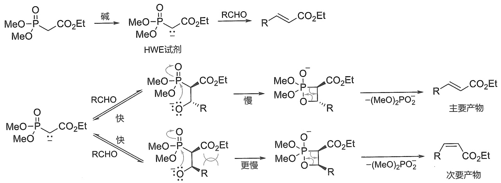

<details>
<summary>flowchart</summary>

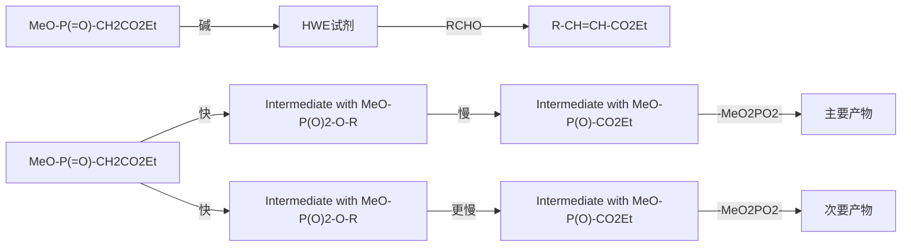
</details>

---

9.5 醛和酮的化学性质

15

Julia-Lythgoe 烯烃合成反应使用苯基磺酰基碳负离子与醛或酮反应生成中间体醇，该醇再原位酯化，随后用钠汞齐还原消除以提供烯烃。改良的 Julia-Lythgoe 烯烃合成反应用苯并噻唑-2-基砜或苯基四唑-2-基砜代替苯基砜与醛反应（称为 Julia-Kocienski 烯化反应），高选择性生成(E)-烯烃。


<details>
<summary>chemical</summary>

Chemical reaction pathway showing sulfonation and deprotection steps of a thioether derivative
</details>

硫叶立德与羰基化合物亦可发生加成反应，生成的氧负离子作为分子内亲核试剂进攻与硫正离子相连的碳原子，二甲硫醚作为离去基团离去，生成环氧化合物，该反应称为 Corey-Chaykovsky 反应。


<details>
<summary>chemical</summary>

Chemical reaction mechanism showing dehydration of a sulfonamide ion into a thioether intermediate and then to form an alkene product
</details>

## 2. 氧亲核试剂对羰基的加成

（1）与水加成 水作为亲核试剂时，其亲核原子是氧原子，与羰基化合物加成生成水合物——同碳二元醇。低级醛能在水溶液中生成较多的水合物，同碳二元醇通常是不稳定的，不能从水溶液中分离出来。但是当羰基碳原子上连有强吸电子基团时，其水合物是稳定的，可以从水溶液中分离出来。


<details>
<summary>chemical</summary>

Chemical reaction equations showing hydrolysis of aldehyde and chloroacetate to form aldehyde and chloroacetate
</details>

醛和酮与水的加成是可逆反应，表9-2列出一些醛、酮水合反应的平衡常数。

表 9-2 一些醛、酮水合反应的平衡常数 (K)

| 醛或酮 | K | 醛或酮 | K |
| --- | --- | --- | --- |
| H-CHO | $2.3 \times 10^{3}$ | $ClCH_{2}-CHO$ | 37 |
| $CH_{3}-CHO$ | 1.0 | $Cl_{3}C-CHO$ | $2.0 \times 10^{3}$ |
| $CH_{3}CH_{2}CH_{2}-CHO$ | 0.5 | $CH_{3}-CO-CH_{3}$ | $1.4 \times 10^{-3}$ |
| $(CH_{3})_{2}CH-CHO$ | 0.5 | $CH_{2}Cl-CO-CH_{2}Cl$ | 10 |
| $(CH_{3})_{3}C-CHO$ | 0.2 | $CF_{3}-CO-CF_{3}$ | $1.2 \times 10^{6}$ |

---

16

第九章 醛和酮

（2）与醇加成 在干燥氯化氢或浓硫酸的作用下，一分子醛或酮与一分子醇发生加成反应，生成的化合物分别称为半缩醛、半缩酮。

半缩醛（酮）一般是不稳定的，它易分解成原来的醛（酮），因此不易分离出来，但五、六元环的环状半缩醛较稳定，能够分离得到。半缩醛（酮）继续与另一分子醇进行反应，失去一分子水，而生成稳定的化合物，称为缩醛或缩酮，并能从过量的醇中分离出来。其反应机理可表示如下:


<details>
<summary>chemical</summary>

Reaction mechanism diagram showing hydrogenation and rearrangement steps of a ketone with isocyanate, including intermediates like semicircle and diester.
</details>

缩醛（酮）可以看作同碳二元醇的醚，性质与醚相似，不受碱的影响，对氧化剂及还原剂也是稳定的。但缩醛（酮）又与醚不同，它在稀酸中易水解转变为原来的醛（酮）。

$$
\begin{array}{c} \mathrm{OR} ^ {\prime \prime} \\ \mathrm{R} - \underset {\mathrm{H} (\mathrm{R} ^ {\prime})} {\overset {|} {\mathrm{C}}} - \mathrm{OR} ^ {\prime \prime} \end{array} + \mathrm{H} _ {2} \mathrm{O} \xrightarrow {\mathrm{H} ^ {+}} \underset {\mathrm{R}} {\overset {|} {\mathrm{C}}} \underset {\mathrm{H} (\mathrm{R} ^ {\prime})} {\overset {|} {\mathrm{O}}} + 2 \mathrm{R} ^ {\prime \prime} \mathrm{OH}
$$

醛与醇形成缩醛的反应较容易，采用含水少的酸性催化剂（如无水 HCl、浓硫酸等），在反应过程中应不断脱除生成的水以推动反应的进行。而醇和酮的反应比和醛的反应困难，因此制备简单的缩酮，常采用其他的方法。例如，制备丙酮缩二乙醇时，不能用乙醇与丙酮反应，而应采用原甲酸乙酯和丙酮反应。


<details>
<summary>chemical</summary>

Nitration reaction equation of benzene
</details>

若使用酮在酸催化下与乙二醇作用，并设法移去反应生成的水，便得到环状缩酮:


<details>
<summary>chemical</summary>

Chemical reaction equation showing methanol reacting with methoxybenzaldehyde under heating to form a cyclic alcohol product
</details>

80%\~85%

---

9.5 醛和酮的化学性质

17

缩醛和缩酮可用来保护羰基，例如，从卤代醛合成高级炔醛，需要首先将-CHO保护起来，再连接炔烃，然后水解恢复-CHO。


<details>
<summary>chemical</summary>

Organic synthesis reaction pathway showing bromination, hydrolysis, and dehydration steps with Li catalyst
</details>

醛或酮和二醇缩合在工业上有重要意义，例如高分子产品聚乙烯醇的分子中包含许多亲水的羟基，不能作为合成纤维使用。为了提高其耐水性，在酸催化下用甲醛使其部分缩醛化，便得到性能优良的合成纤维，商品名称为维纶（又叫维尼纶）。


<details>
<summary>chemical</summary>

Chemical reaction equation showing polymerization of polyvinyl alcohol to polyester and polyester monomers under acidic conditions
</details>

## 3. 硫亲核试剂对羰基的加成

（1）与硫醇加成 在酸性条件下，一当量醛（酮）可以与两当量硫醇作用生成缩硫醛（酮），其反应的机理类似于缩醛（酮）的生成。当使用二硫醇化合物时，可以生成环状缩硫醛（酮）。


环状缩硫醛（酮）在 Raney 镍作用下发生脱硫反应生成相应的烷烃。Raney 镍是一种多孔的镍铝合金，其比表面积大，可有效吸附氢原子。在反应中氢原子取代硫原子，将羰基还原为亚甲基。


（2）与亚硫酸氢钠加成醛和甲基酮（$\mathrm{CH}_3\mathrm{COR}$）可以与亚硫酸氢钠（$\mathrm{NaHSO}_3$）饱和溶液（$40\%$）发生加成反应，生成结晶的亚硫酸氢钠加成物 $\alpha-$ 羟基磺酸钠，其反应机理如下:


<details>
<summary>chemical</summary>

Chemical reaction mechanism showing oxidation of a sulfonate ion to form an azide salt, with electron transfer and radical formation steps.
</details>

在该反应中，亲核原子是亚硫酸氢根离子（$\mathrm{HSO}_3^-$）中带有孤对电子的硫原子，而不是带有负电荷的氧原子。

不同的羰基化合物与亚硫酸氢钠加成平衡常数不同,如下列数据(与1 mol NaHSO $_{3}$ 在1 h后生成加成物的百分数)所示:

---

18

第九章 醛和酮


80%


56%


36%


35%


12%


6%


2%


1%

醛、酮与亚硫酸氢钠加成的反应范围很广，所有的醛、脂肪族甲基酮和八个碳以下的环酮都可以发生该反应。醛、酮与亚硫酸氢钠的加成物都是无色结晶。$\alpha$-羟基磺酸钠易溶于水，但不溶于饱和的亚硫酸氢钠溶液而析出结晶。此法可用于鉴定醛、脂肪族甲基酮和八个碳以下的环酮等。该反应是可逆反应，在稀酸或稀碱中 $\alpha$-羟基磺酸钠可分解生成亚硫酸氢钠和相应的醛或酮，因此可利用这些性质来分离或提纯醛、脂肪族甲基酮和八个碳以下的环酮。例如，可用该反应从反应混合物中分离、提纯胡椒醛（pipernal）。


## 4. 氮亲核试剂对羰基的加成

醛、酮与氨的反应一般比较困难，只有甲醛反应容易，但其生成物（$\mathrm{H}_2\mathrm{C} = \mathrm{NH}$）不稳定，很快聚合生成六亚甲基四胺，俗称乌洛托品（urotropine）。该化合物可用作有机合成中的氨化试剂，也可用作酚醛树脂的固化剂及消毒剂等。

$$
\mathrm{CH} _ {2} = \mathrm{O} + \mathrm{NH} _ {3} \longrightarrow \left[ \mathrm{CH} _ {2} = \mathrm{NH} \right] \xrightarrow {\text {聚合}} \underset {\mathrm{H}} {\underbrace {\mathrm{HN}}} \underset {\mathrm{NH}} {\underbrace {\mathrm{NH}}} \xrightarrow [ \mathrm{NH} _ {3} ]{3 \mathrm{HCHO}} \underset {\mathrm{N}} {\underbrace {\mathrm{N}}} \underset {\mathrm{N}} {\underbrace {\mathrm{N}}} \text {和}
$$

醛、酮能和氨的衍生物，如羟氨、肼、苯肼、2,4-二硝基苯肼及氨基脲等反应，分别生成肟、腙、苯腙、2,4-二硝苯腙及缩氨脲等。其反应历程可用通式表示如下:

$$
\begin{array}{l} \begin{array}{c} \mathrm{C} = \mathrm{O} \quad \stackrel {{\mathrm{H} ^ {+}}} {{\Longleftrightarrow}} \left[ \mathrm{C} = \stackrel {{+}} {\mathrm{OH}} \longleftrightarrow + \mathrm{C} - \mathrm{OH} \right] \\ \hline \end{array} \stackrel {{\mathrm{H} _ {2} \ddot {\mathrm{N}} - \mathrm{Y}}} {{\Longleftrightarrow}} \begin{array}{c} \mathrm{C} _ {\mathrm{OH}} ^ {+} \stackrel {{\mathrm{NH} _ {2} \mathrm{Y}}} {{\longrightarrow}} \quad - \mathrm{H} ^ {+} \\ \hline \end{array} \begin{array}{c} \mathrm{C} _ {\mathrm{OH}} ^ {\mathrm{NHY}} \\ \hline \end{array} \\ \stackrel {H ^ {+}} {\Longleftrightarrow} \quad \begin{array}{c} \backslash \\ / \end{array} \begin{array}{c} C - N H Y \\ / \end{array} \stackrel {- H _ {2} O} {\Longleftrightarrow} \left[ \begin{array}{c} + C - N H Y \longleftrightarrow \\ / \end{array} \begin{array}{c} C = N H Y \\ / \end{array} \right] \stackrel {- H ^ {+}} {\Longleftrightarrow} \begin{array}{c} C = N Y \\ / \end{array} \\ \end{array}
$$

---

9.5 醛和酮的化学性质

19


<details>
<summary>chemical</summary>

Chemical structures of amino acids and related compounds including pyruvate, pinnamino, nitrobenzene, and cyanoic acid
</details>

上述氨的衍生物亲核性较弱，一般需要在酸的催化（$\mathrm{pH} = 4 \sim 5$）下进行反应。羰基化合物与羟氨、2,4-二硝基苯肼及氨基脲的加成缩合产物都是结晶，具有固定熔点，常用于鉴别醛、酮。肟、腙、苯腙及缩氨脲在稀酸作用下能够水解为原来的醛和酮，因而可利用该类反应来分离和提纯醛、酮。肟有顺反异构体，例如苯甲醛肟有两个异构体，$Z$ 构型稳定性较差，在醇溶液中遇酸即转变为 $E$ 构型。


<details>
<summary>chemical</summary>

Chemical reaction converting (Z)-benzimidazole to (E)-benzimidazole under HCl in acidic conditions, with mp values noted
</details>

酮肟用浓硫酸或五氯化磷等酸性试剂处理，可发生重排反应转变成酰胺，该反应称为Beckmann重排。例如:


<details>
<summary>chemical</summary>

Chemical reaction equation showing protonation of a benzene derivative with hydroxyl groups to form a substituted benzene product
</details>

Beckmann 重排的反应机理如下:


<details>
<summary>chemical</summary>

Reaction mechanism diagram showing protonation and deprotonation steps of a carbocation intermediate
</details>

在重排过程中，羟基的离去与处于其反位的烃基的迁移同步进行，该反应为立体专一反应，肟在重排过程中烃基构型保持不变。

Beckmann 重排反应可用于测定酮肟的分子结构。工业上合成纤维尼龙-6 的单体  $\varepsilon$ -己内酰胺就是通过环己酮肟的 Beckmann 重排反应合成的。


<details>
<summary>chemical</summary>

Chemical reaction equation showing hydrolysis of a pyridine derivative under sulfuric acid and water to form a cyclic amide intermediate, then polymerization to form an amino acid group.
</details>

尼龙-6

伯胺与氨的衍生物相似，也能与醛、酮发生加成缩合反应，形成 N-取代亚胺（又称 Schiff 碱）:

---

20

第九章 醛和酮


<details>
<summary>chemical</summary>

Chemical reaction equations showing the formation of N-取代亚胺 from acetylene and amine under acidic conditions
</details>

该反应需在酸催化下进行，但酸度过高会导致伯胺质子化而失去亲核活性，故一般控制$\mathrm{pH} = 4\sim 5$ 。例如:


<details>
<summary>chemical</summary>

Two-step organic reaction scheme showing benzene reacting with ethylamine under acidic conditions to form aniline, then alcohol to yield a diol product.
</details>

N-取代亚胺的还原被称为还原胺化，是实验室中合成仲胺的常用方法之一（见 12.2.7 小节）。

醛、酮也能与仲胺发生亲核加成反应，形成醇胺，醇胺脱水即可形成烯胺:


<details>
<summary>chemical</summary>

Chemical reaction equation showing oxidation of aldehyde to benzoate via hydrogenation and reduction steps
</details>

由于在形成烯胺的过程中,要在分子内脱去一分子水,所以该反应一般需要利用溶剂(甲苯或苯等)共沸脱水,或者使用干燥剂除水。该反应也需要痕量的酸催化。例如:


<details>
<summary>chemical</summary>

Chemical reaction equation showing cycloaddition of a ketone to form a pyrrolidine derivative under phenylamine catalysis
</details>

N-(环戊-1-烯基)四氢吡咯

烯胺分子中，氮原子和烯烃碳原子均具有亲核性:


<details>
<summary>chemical</summary>

Chemical reaction diagram showing transformation of a pyridine-containing heterocycle into a carbonyl-containing heterocycle
</details>

在有机合成中，常利用烯胺碳原子的亲核性进行酰基化、烷基化或 Michael 加成等反应，以及反应生成的亚铵离子遇水即可水解成羰基的特性，以达到在羰基的  $\alpha$  位引入烃基的目的。例如:


<details>
<summary>chemical</summary>

Chemical reaction pathway showing conversion of cyclohexanone to γ-ketoacetate using bromoethanol and water, with 75% yield
</details>

---

9.5 醛和酮的化学性质

21

烯胺的还原产物也是胺，是实验室中合成叔胺的中间体。

许多生命过程也涉及亚胺的形成。例如磷酸吡哆醛（pyridoxal phosphate，维生素 $B_{6}$ ）是促进氨基酸反应的一种关键辅酶，它是通过亚胺的碳氮双键与氨基酸连接的（见16.1.3小节）。


<details>
<summary>chemical</summary>

Chemical reaction equation showing the formation of a quinone derivative from a piperidine derivative and anisole under acidic conditions
</details>

磷酸吡哆醛

氰离子可以与亚胺反应生成 $\alpha$-氨基氰，进而水解生成 $\alpha$-氨基酸，可以用于氨基酸的合成，该过程称作Strecker合成。


<details>
<summary>chemical</summary>

Chemical reaction pathway showing the conversion of a ketone to a carbonyl compound via aniline and ammonia intermediate
</details>

苯甘氨酸

## 5. 金属氢化物对羰基的加成

氢化铝锂或硼氢化钠等还原剂与羰基化合物反应也是亲核加成，此处亲核试剂是 $\mathrm{AlH_4^-}$ 或 $\mathrm{BH_4^-}$ 的Al-H和B-Hσ键，氢转移到羰基的碳上，与Grignard试剂中的 $\mathbb{R}^{-}$ 加到羰基碳上相似。一当量的 $\mathrm{LiAlH_4}$ 和 $\mathrm{NaBH_4}$ 能还原四当量的醛或酮:


<details>
<summary>chemical</summary>

Organic reaction mechanism showing aluminum-catalyzed cyclization and reduction steps
</details>

与 Grignard 试剂对羰基的加成相同，氢负离子对羰基的加成也具有立体选择性。当从羰基的两侧进攻的位阻不同时，氢通常从位阻较少的一侧进攻。


<details>
<summary>chemical</summary>

Chemical reaction equation showing conversion of a cyclic ketone to a cyclohexane derivative using LiAlH4 and H2O
</details>

83%

17%

金属氢化物如硼氢化钠、氢化铝锂等是还原羰基常用的试剂。硼氢化钠可在醇溶液或碱性水溶液中使用，具有较强的选择性。例如:


<details>
<summary>chemical</summary>

Chemical reaction equation showing conversion of a benzyl alcohol to a hydroxybenzaldehyde using NaBH4 and EtOH
</details>

82%

氢化铝锂的还原性比硼氢化钠的还原性强，不仅能将醛、酮还原成相应的醇，而且还能还原羧酸、酯、酰胺、腈等，反应产率很高。但硼氢化钠、氢化铝锂等对孤立的碳碳双键、碳碳叁键一般没有还原作用。

氢化铝锂能与质子溶剂反应，因而要在乙醚等非质子溶剂中使用。例如:


<details>
<summary>chemical</summary>

Chemical reaction equation showing conversion of a ketone to an alcohol using LiAlH4/Et2O and H2O/H+ reagents
</details>

84%

其他化学还原剂，如异丙醇铝/异丙醇，只还原羰基而不影响碳碳重键，是一种选择性

---

22

第九章 醛和酮

很高的还原剂。例如:


<details>
<summary>chemical</summary>

Chemical reaction equation showing phenol reacting with acetaldehyde under异丙醇铝 catalyst to form a benzene derivative
</details>

此反应常在苯或甲苯中进行。异丙醇铝协助异丙醇把氢负离子转移到醛或酮的羰基上，而自身转化成丙酮，将丙酮不断蒸出，使反应向产物方向进行，这相当于前面讨论过的 Oppenauer 醇氧化的逆反应，称为 Meerwein-Ponndorf 反应。

## 9.5.2 醛、酮的氧化和还原反应

## 1. 氧化反应

与酮不同的是，醛有一个氢原子直接连在羰基上，因而醛非常容易被氧化，比较弱的氧化剂即可把醛氧化成含有相同碳原子的羧酸。而弱氧化剂不能使酮氧化，因此可以用某些氧化剂来区别醛和酮。常用的弱氧化剂是Tollens试剂及Fehling试剂。

Tollens 试剂是氢氧化银的氨溶液，它与醛的反应可表示如下:

$$
\mathrm{RCHO} + 2 \mathrm{Ag} \left(\mathrm{NH} _ {3}\right) _ {2} \mathrm{OH} \xrightarrow [ \triangle ]{} \mathrm{RCOONH} _ {4} + 2 \mathrm{Ag} \downarrow + \mathrm{H} _ {2} \mathrm{O} + 3 \mathrm{NH} _ {3}
$$

醛被氧化成为羧酸（实际上得到是羧酸的铵盐），氧化剂则被还原为金属银。如果反应器是很干净的，所析出的金属银将镀在容器的内壁，形成银镜，所以这个反应常称为银镜反应。

Fehling 试剂是由硫酸铜溶液与酒石酸钾钠碱溶液混合而成的铜络合物，作为氧化剂的是二价铜离子。醛与 Fehling 试剂反应时，二价铜离子被还原成砖红色的氧化亚铜沉淀:

$$
\mathrm{RCHO} + 2 \mathrm{Cu} ^ {2 +} + \mathrm{NaOH} + \mathrm{H} _ {2} \mathrm{O} \xrightarrow [ \triangle ]{} \mathrm{RCOONa} + \mathrm{Cu} _ {2} \mathrm{O} \downarrow + 4 \mathrm{H} ^ {+}
$$

但 Fehling 试剂不能将芳醛氧化成相应的酸。

上述两种氧化剂的反应现象很明显，因而常用于鉴别醛和酮以及脂肪醛与芳香醛。这两种试剂对碳碳双键和碳碳叁键均不反应，而用强氧化剂如高锰酸钾氧化时，则碳碳双键等也被氧化。例如:

$$
\mathrm{CH} _ {3} \mathrm{CH} = \mathrm{CHCHO} \xrightarrow [ \mathrm{KMnO} _ {4} , \mathrm{NaOH} ]{\mathrm{Ag} ^ {+} \text {或} \mathrm{Cu} ^ {2 +}} \mathrm{CH} _ {3} \mathrm{CH} = \mathrm{CHCOOH}
$$

此外，醛也很容易被  $KMnO_{4}$  和  $CrO_{3}$  等氧化剂所氧化。酮用过氧化氢或过氧酸（如  $CH_{3}CO_{3}H$ ， $CF_{3}CO_{3}H$  及  $PhCO_{3}H$  等）氧化生成酯的反应，称为 Baeyer-Villiger 氧化反应。例如:


<details>
<summary>chemical</summary>

Organic reaction equation showing cycloaddition of cyclohexene with ethyl ester under heating conditions
</details>

该反应的历程如下:


<details>
<summary>chemical</summary>

Reaction mechanism diagram showing proton transfer and reposition steps in a carboxylic acid derivative
</details>

---

9.5 醛和酮的化学性质

23

其反应过程涉及 R' 基的迁移，所以也称为 Baeyer-Villiger 重排。该重排过程与氢过氧化异丙苯在酸性条件下的重排反应类似（见 7.8.3 小节）。在混酮分子中，由于 R≠R'，所以可能产生两种不同的酯。由于不同基团迁移的难易顺序（迁移倾向）有如下规律:

$$
(\text {较易}) \text {氢} > \text {苯基} > \text {叔烷基} > \text {仲烷基} > \text {伯烷基} > \text {甲基} (\text {较难})
$$

所以混酮的氧化产物中以一种酯占优，而醛的氧化产物主要是酸。另外，迁移基团的构型在迁移时保持不变。例如:


<details>
<summary>chemical</summary>

Organic reaction pathway showing esterification and methylation steps with yields
</details>

酮遇强氧化剂如高锰酸钾、硝酸等则可被氧化而发生碳链断裂。碳链的断裂发生在酮羰基和 $\alpha$-碳原子之间，往往生成多种低级羧酸的混合物。例如:


<details>
<summary>chemical</summary>

Chemical reaction equation showing oxidation of acetic acid to form acetic acid and then to form carboxylic acid under HNO3 and CO2 conditions
</details>

所以一般酮的氧化反应没有制备意义。但环己酮在强氧化剂作用下生成己二酸，是工业上制备己二酸的一种方法，己二酸是生产合成纤维尼龙-66的原料。


<details>
<summary>chemical</summary>

Chemical reaction equation showing oxidation of cyclohexenone to form acetic acid using V2O5 catalyst
</details>

## 2. 还原反应

醛、酮能够被还原生成醇或烃。还原剂不同，羰基化合物的结构不同，所生成的产物也不同。前面分别介绍了两种醛、酮的还原反应。其一是通过两步法把醛、酮还原成亚甲基:先形成缩硫醛（酮），再用 Raney 镍脱硫。其二是利用金属氢化物把醛、酮的羰基还原成醇。除此之外，还有以下方法实现醛、酮的还原。

（1）催化加氢 醛、酮可以催化加氢，分别生成伯醇和仲醇。


<details>
<summary>chemical</summary>

Chemical reaction equation showing hydrogenation of a carbonyl compound with platinum catalyst under nickel catalysis
</details>

例如:


<details>
<summary>chemical</summary>

Chemical reaction equation showing hydroxylation of a diene with hydrogen to form a hydroxy alcohol, with 90%-95% yield indicated
</details>

用催化加氢的方法还原羰基化合物时，若分子中还有其他可被还原的基团，总是活性较高的基团先被还原。如果醛和酮分子中还含有碳碳双键、碳碳叁键，多数情况下它们也同时被催化还原。例如:

---

24

第九章 醛和酮


<details>
<summary>chemical</summary>

Chemical reaction equation showing benzene reacting with hydrogen to form a cyclohexanol derivative using Raney Ni catalyst
</details>

（2）溶解金属还原 醛用钠、镁及铝等活泼金属和质子溶剂处理，可被还原生成伯醇。但酮在金属(Na、Mg、Al)汞齐条件下反应时，却易于发生还原偶联反应，生成邻二醇，其反应机理如下:


<details>
<summary>chemical</summary>

Chemical reaction equation showing oxidation of ester to form aldehyde and alkene under metal M/Hg catalyst
</details>

利用该反应可合成频哪醇及其类似物，例如:


<details>
<summary>chemical</summary>

Chemical reaction equation showing magnesium ion conversion to cyclohexane with phenyl alcohol
</details>


<details>
<summary>chemical</summary>

Organic reaction scheme showing deprotection of cyclohexanol to form a cyclic alcohol with hydroxyl and methoxy substituents
</details>

（3）Clemmensen 还原 酮与锌汞齐和盐酸共同回流，可将羰基直接还原成亚甲基，称为 Clemmensen 还原。它是将羰基还原成亚甲基的一种较好的方法，特别适于芳酮的还原，在有机合成中常用于合成直链烷基苯，例如:


<details>
<summary>chemical</summary>

Chemical reaction equation showing conversion of a ketone to a pheolic alcohol using Zn-Hg catalyst and concentrated HCl in reverse flow
</details>

（4）Wolff-Kishner-黄鸣龙还原 将醛或酮中的羰基还原成亚甲基的另一种方法是先使醛或酮与无水肼作用变成腙，然后将腙和乙醇钠及无水醇在高压釜中加热到  $180^{\circ}$ C 左右而成，此法称为 Wolff-Kishner 还原。

$$
\underset {(R ^ {\prime}) H} {\overset {R} {\mathrm{C}}} = \mathrm{O} \xrightarrow [ - \mathrm{H} _ {2} \mathrm{O} ]{\mathrm{NH} _ {2} \mathrm{NH} _ {2}} \underset {(R ^ {\prime}) H} {\overset {R} {\mathrm{C}}} = \mathrm{NNH} _ {2} \xrightarrow {\text {NaOEt}} \underset {(R ^ {\prime}) H} {\overset {R} {\mathrm{CH}} _ {2}} + \mathrm{N} _ {2}
$$

我国化学家黄鸣龙在反应条件方面做了改进。先将醛或酮、氢氧化钠、肼的水溶液和一种高沸点的水溶性溶剂（如二甘醇、三甘醇等）一起加热，使醛、酮变成腙，再蒸出过量的水和未反应的肼，待温度达到腙的分解温度（约 $200^{\circ}\mathrm{C}$），继续回流至反应完成。这样可以不使用无水肼，且反应在常压下进行，以高收率得到产物。这种改进的方法称为黄鸣龙改良的Wolff-Kishner还原，亦称Wolff-Kishner-黄鸣龙还原。例如:


<details>
<summary>chemical</summary>

Chemical reaction equation showing methylation of cyclohexanone to form a cyclic alcohol with N2 and H2O groups
</details>

Wolff-Kishner 还原法的适用性非常广，可以和 Clemmensen 还原法互相补充。

## 3. Cannizzaro 反应（歧化反应）

不含 $\alpha$-氢原子的醛（如 HCHO、$\mathrm{R}_3\mathrm{C}-\mathrm{CHO}$、$\mathrm{Ar}-\mathrm{CHO}$ 等）在浓碱作用下，能发生自身

---

9.5 醛和酮的化学性质

25

的氧化和还原作用，即一分子醛被氧化成羧酸，在碱溶液中生成羧酸盐，另一分子醛被还原成醇，此反应称为 Cannizzaro 反应。例如:

$$
2 \mathrm{HCHO} + \mathrm{NaOH} \longrightarrow \mathrm{HCOONa} + \mathrm{CH} _ {3} \mathrm{OH}
$$

在分子间同时进行着两种性质相反的反应，如氧化、还原等，通常称为歧化反应（disproportionation reaction）。具有  $\alpha-$  氢原子的醛不进行此反应，而发生羟醛缩合反应（见11.3.3小节）。

Cannizzaro 反应包含连续两步亲核加成，首先是  $HO^{-}$ 向羰基的碳亲核进攻，生成中间体(I)，然后此中间体提供氢负离子与第二分子醛的羰基进行亲核加成。例如:


<details>
<summary>chemical</summary>

Chemical reaction mechanism showing oxidation of a carboxylic acid to form an aldehyde and subsequent hydrolysis
</details>

在不同种分子间进行的 Cannizzaro 反应称为交叉的 Cannizzaro 反应。例如，三羟甲基乙醛与甲醛都是不含  $\alpha-$  氢原子的醛，在碱作用下发生交叉的 Cannizzaro 反应，因为甲醛的羰基更加活泼，首先受到  $HO^{-}$ 的亲核加成并进而提供氢负离子，因而被氧化为甲酸，在碱存在下生成甲酸盐，三羟甲基乙醛则接受氢负离子亲核加成被还原成季戊四醇。这是实验室和工业上制备季戊四醇的方法。


<details>
<summary>chemical</summary>

Chemical reaction showing conversion of a diol to a ketone under HCHO and Ca(OH)2 at 55–65 °C
</details>

## 4. 二苯乙醇酸重排（benzilic acid rearrangement）

在强碱的作用下，1,2-二酮化合物可以发生重排反应生成 $\alpha$-羟基酸，当二酮没有可烯醇化的 $\alpha$-氢原子时产率较高。该反应是1838年Justus von Liebig在用强碱处理苯偶酰时发现的，因此被命名为二苯乙醇酸重排。其机理如下:首先氢氧根进攻羰基生成四面体中间体，随后与频哪醇重排相似，四面体中间体上的苯基迁移至相邻羰基，生成 $\alpha$-羟基酸。


<details>
<summary>chemical</summary>

Chemical reaction mechanism showing dehydration of a ketone to form an epoxide intermediate
</details>

值得注意的是，环状 1,2-二酮在此条件下可以发生二苯乙醇酸重排，生成缩环产物，即少一个碳的  $\alpha$ -羟基酸。


<details>
<summary>chemical</summary>

Chemical reaction showing oxidation of a cyclohexanone to form a cyclohexanol derivative under acidic conditions
</details>

当使用醇负离子作碱时，可以重排生成  $\alpha$ -羟基酸酯，该反应称为 Claisen-Tishchenko 反应。


<details>
<summary>chemical</summary>

Chemical reaction showing oxidation of a ketone to form a tert-butyl ester under tBuO⁻ conditions
</details>

## 5. 安息香缩合反应（benzoin condensation）

安息香缩合反应是指在催化量氰负离子作用下两分子苯甲醛偶联生成 $\alpha$-羟基酮的反

---

26

第九章 醛和酮

应。形式上看，安息香缩合可以看作一分子醛对另一分子醛羰基加成的反应:


<details>
<summary>chemical</summary>

Chemical reaction showing conversion of compound 2 to a ketone using -CN counterion
</details>

首先，氰负离子进攻苯甲醛生成 $\alpha$-氰醇，由于氰基的吸电子性，原羰基碳在碱的作用下脱质子，生成的碳负离子与另一分子的醛发生亲核加成后，消除氰负离子催化剂再生羰基。这里氰负离子起着至关重要的作用，同时作为好的亲核试剂、好的离去基团和吸电子基团稳定碳负离子。氰负离子催化的安息香缩合反应通常适用于无 $\alpha$-氢原子的醛。除了氰负离子外，噻唑鎓盐在弱碱作用下亦可催化该反应，且底物适用性更广。


<details>
<summary>chemical</summary>

Reaction mechanism diagram showing benzene ring opening and hydrolysis steps with labeled intermediates
</details>

## 6. Stetter 反应

在催化量氰化钠或噻唑镝盐的存在下，醛可以与  $\alpha,\beta-$  不饱和酮/腈等活化烯烃加成生成  $\gamma-$  二酮或  $\gamma-$  氧亚基腈。其机理与安息香缩合反应相似，氰基负离子首先与醛亲核加成，生成亲核性碳负离子；随后该碳负离子进攻活化烯烃，生成 1,4-加成产物。Stetter 反应中常会伴随着醛自身的安息香反应，但是安息香反应是可逆的，而 Stetter 反应生成更稳定的产物，是不可逆的，因此主产物是 Stetter 产物。


<details>
<summary>chemical</summary>

Chemical reaction mechanism showing quaternaryization of a carbonyl compound with R groups and CN counterion
</details>

## 7. Favorskii 重排反应

α-卤代酮在醇负离子作用下也可以发生重排反应生成酯。人们最初认为 Favorskii 反应可以看作二苯乙醇酸重排的变体，二者都涉及羰基的烷基迁移到邻位。


<details>
<summary>chemical</summary>

Chemical reaction equations showing Favorskii reagent and 2-benzyl alcohol reagents producing carbonyl compounds with RO⁻ counterions
</details>

但是，1944年化学家发现 $\alpha$-卤代酮的两个异构体在醇负离子作用下会生成完全相同的产物，因此两个反应应该经由同一个中间体。因此，反应机理可能如下:不同于二苯乙醇酸

---

9.6  $\alpha,\beta-$ 不饱和醛、酮

27

重排中醇负离子作为亲核试剂进攻羰基，在 Favorskii 重排反应中醇负离子作为碱攫取羰基的  $\alpha-$  氢原子(关于羰基  $\alpha-$  氢原子的反应见第十一章)，然后分子内烷基化生成环丙酮中间体。环丙酮非常活泼，与亲核试剂反应生成开环产物。


<details>
<summary>chemical</summary>

Organic reaction mechanism showing chlorination and methylation steps with MeO⁻ and MeOH/OMe substituents
</details>

环状  $\alpha$ -溴代酮的 Favorskii 重排反应亦可以生成缩环产物。例如，环己酮溴化生成的溴代环己酮在甲醇钠作用下可以很好的收率得到环戊基甲酯。该反应可以用于合成大张力环，例如 1964 年首次合成的立方烷（cubane），其合成中就利用了 Favorskii 重排反应。


<details>
<summary>chemical</summary>

Organic reaction pathway showing bromination, hydrolysis, and subsequent transformation to a cyclohexane derivative
</details>

## 9.6 $\alpha, \beta-$ 不饱和醛、酮

在  $\alpha,\beta-$  不饱和醛、酮中，碳碳双键与碳氧双键之间构成共轭体系:

$$
\text {—C=C—C=O} \tag{4 3 2 1}
$$

作为  $\pi-\pi$  共轭体系， $\alpha,\beta-$  不饱和羰基化合物可以从氧原子开始，用阿拉伯数字依次编号。这类化合物主要表现为两种官能团相互影响的独特性质。

## 9.6.1 1,2-加成与1,4-加成反应

在  $\alpha,\beta-$  不饱和醛、酮分子中，由于碳碳双键与碳氧双键共轭，因此碳碳双键是具有极性的，以丙烯醛为例，其共振结构式可表示如下:

$$
\mathrm{CH=CH=O} \longleftrightarrow \mathrm{CH=CH^{+} O^{-}} \longleftrightarrow \mathrm{CH^{+} CH=CH-O^{-}}
$$

---

28

第九章 醛和酮

由于羰基氧原子（1位）上的电子密度较高，且由于羰基的吸电作用使碳碳双键的电子密度降低，所以亲电试剂首先加到1位上，以丙烯醛与氯化氢的加成为例，其反应机理如下:

$$
\mathrm{CH} _ {2} \mathrm{CO} \xrightarrow [ \text {快} ]{\mathrm{H} ^ {+}} \left[ \mathrm{CH} _ {2} \mathrm{OH} \leftrightarrow \mathrm{CH} _ {2} ^ {+} \mathrm{OH} \leftrightarrow {} ^ {+} \mathrm{CH} _ {2} \mathrm{OH} \right] \xrightarrow [ \text {慢} ]{\mathrm{Cl} ^ {-}} \mathrm{ClCH} _ {2} \mathrm{CHOH} \rightleftharpoons \mathrm{ClCH} _ {2} \mathrm{CO}
$$

丙烯醛与共轭二烯类似，也应有1,2-加成和1,4-加成两种加成方式；但1,2-加成产物会马上分解成丙烯醛和氯化氢，所以一般只进行1,4-加成。其加成产物具有不稳定的烯醇结构，经重排得到稳定的酮式结构。

$\alpha, \beta-$ 不饱和醛、酮与亲核试剂反应时，既可进行简单加成，即亲核加成到碳氧双键上，也可进行共轭加成，即亲核试剂加到碳碳双键上。例如:


<details>
<summary>chemical</summary>

Chemical reaction equation showing conversion of aldehyde to acrylate under HCN catalysis, yielding two products (I) and (II)
</details>

其中(I)是羰基的1,2-亲核加成产物，但(II)是由1,4-亲核加成（共轭加成）产物经重排后得到的:

$$
\mathrm{CH} _ {3} \mathrm{CO} + ^ {-} \mathrm{CN} \rightleftharpoons \left[ \mathrm{NC} \mathrm{CH} _ {2} \mathrm{CO} \rightleftharpoons \mathrm{NC} \mathrm{CH} _ {2} \mathrm{CO} ^ {-} \right] \xrightarrow [ \text {CN} ]{\mathrm{HCN}} \left[ \mathrm{NC} \mathrm{CH} _ {2} \mathrm{COH} \right]\rightleftharpoons \mathrm{NC} \mathrm{CH} _ {2} \mathrm{CO}
$$

空间阻碍有时可以决定亲核试剂的主要进攻方向。亲核试剂主要进攻空间阻碍小的位置，醛的羰基比酮的羰基空间阻碍小，因此醛羰基比酮羰基更容易被进攻。例如:


<details>
<summary>chemical</summary>

Chemical structures showing two N,Nu-protected positions with directional arrows indicating attack direction
</details>

通常，强碱性亲核试剂（如RMgX）主要进攻羰基，生成1,2-亲核加成产物。例如:


<details>
<summary>chemical</summary>

Organic reaction scheme showing acetylation of a ketone under methanol and water conditions, yielding 72% and 20% products respectively
</details>

弱碱性亲核试剂（如  $^{-}CN$ 、 $RNH_{2}$  或  $R_{2}CuLi$ ）主要进攻碳碳双键，生成 1,4-亲核加成产物。例如:


<details>
<summary>chemical</summary>

Organic synthesis reaction scheme showing conversion of a ketone to a carbonyl compound under NaCN and HOAc/EtOH conditions, yielding 95% and 75% products respectively.
</details>

## 9.6.2 还原反应

$\alpha,\beta-$ 不饱和羰基化合物用金属氢化物（如 $LiAlH_{4}$ 或 $NaBH_{4}$ 等）还原时，相当于金属氢化物中的 Al-H 和 B-H  $\sigma$ 键对其进行亲核加成，主要进行 1,2-加成，形成不饱和醇。例如:

---

9.7 乙烯酮

29


用催化加氢的方法还原  $\alpha,\beta-$  不饱和羰基化合物时，通常是碳碳不饱和键先被还原。如果使用选择性较好的钯碳作催化剂时，可得到相应的饱和羰基化合物。例如:


<details>
<summary>chemical</summary>

Organic reaction scheme showing conversion of a benzene derivative to a pentaene derivative using H2/Pd/C catalyst and Na2CO3
</details>

当选用选择性较差的镍（Raney Ni）作催化剂时，则很难将反应控制在生成饱和羰基化合物的阶段，容易进一步还原得到醇。例如:


## 9.7 乙烯酮

乙烯酮为有毒气体，沸点  $-48^{\circ}C$ ，溶于乙醚等有机溶剂。乙烯酮可由乙酸或丙酮加热裂解制得。

$$
\mathrm{H} \xrightarrow [ \mathrm{H} ]{\mathrm{H}} \mathrm{C} \xrightarrow [ \mathrm{OH} ]{\text {磷酸三乙酯}} \mathrm{H} _ {2} \mathrm{C} = \mathrm{C} = \mathrm{O} + \mathrm{H} _ {2} \mathrm{O}
$$

乙烯酮是最简单的不饱和酮，非常不稳定，只能在低温下保存（即使如此，与空气接触也能生成爆炸性的过氧化物）。它能与水、盐酸、乙醇、乙酸、氨等进行加成反应，向试剂分子中引入乙酰基，生成乙酸或其衍生物。因此，乙烯酮是一种优良的乙酰化试剂。


<details>
<summary>chemical</summary>

Chemical reaction pathway showing esterification steps with H2O, HCl, EtOH, AcOH, and NH3 to produce various aldehyde compounds
</details>

乙烯酮在  $0^{\circ}$ C 时即能发生聚合反应，在控制条件聚合时生成二聚体，称为二乙烯酮。

$$
\mathrm{H} _ {2} \mathrm{C} = \mathrm{C} = \mathrm{O} \longrightarrow \mathrm{H} _ {2} \mathrm{C} = \left\langle \begin{array}{c} \mathrm{O} \\ \mathrm{O} \end{array} \right\rangle = \mathrm{O}
$$

二乙烯酮是液体，沸点 $127^{\circ}\mathrm{C}$ 。它具有不饱和内酯的结构，为重要有机合成原料，工业上用它合成乙酰乙酸乙酯。

---

30

第九章 醛和酮

## 9.8 醌

醌是作为相应芳烃的衍生物来命名的。由苯得到的醌称为苯醌，由萘得到的醌称为萘醌，等等。例如:


2-甲基苯-1,4-醌


苯-1,4-醌-2-甲酸


邻苯醌(苯-1,2-醌)


萘-1,4-醌


2-甲基萘-1,4-醌


萘-2,6-醌


蔥-9,10-醌


菲-9,10-醌

## 9.8.1 醌的制法

## 1. 由酚或芳胺氧化制备

酚或芳胺都易被氧化成醌，这是制备醌的一种方便的方法。其中对苯醌容易得到。例如:


<details>
<summary>chemical</summary>

Chemical reaction pathway showing transformation of aniline to a naphthalene derivative using sodium dichromate and manganese sulfate
</details>

## 2. 由芳烃氧化制备

某些芳烃经氧化后可得到相应的醌。例如:


<details>
<summary>chemical</summary>

Chemical reaction equation showing oxidation of a naphthalene derivative with O2 to form a fused bicyclic ketone under V2O5 and Δ conditions
</details>

这是工业上制备蒽醌的方法之一。蒽醌也可由蒽经间接电解氧化法制备，其方法是在浓硫酸中将硫酸铈[Ce(Ⅲ)]盐电解氧化成 Ce(Ⅳ)，然后用 Ce(Ⅳ)将蒽氧化成蒽醌。该方法在工业生产中已得到应用。

## 3. 由其他方法制备

蒽醌也可由苯和邻苯二甲酸酐经 Friedel-Crafts 酰基化反应及闭环脱水反应制备, 这是目前工业制备蒽醌及其衍生物的主要方法。


<details>
<summary>chemical</summary>

Chemical reaction equation showing the synthesis of a fused-ring ketone from aniline under different conditions
</details>

---

9.8 醌

31

## 9.8.2 醌的化学性质

## 1. 还原

对苯醌可被还原成对苯二酚（氢醌），这是一个可逆反应。


<details>
<summary>chemical</summary>

Chemical reaction equation showing oxidation of a benzene derivative with water and electron transfer
</details>

该反应是经两步电子转移完成的，中间经过一个负离子自由基中间体（半醌），其反应机理为


<details>
<summary>chemical</summary>

Chemical reaction pathway showing oxidation of a benzene derivative with electron transfer
</details>

在对苯醌被还原成氢醌或氢醌被氧化成对苯醌的反应过程中，会生成一种稳定的中间产物醌氢醌。醌氢醌为深绿色晶体，熔点  $171^{\circ}$ C；它是由氢醌作为电子给体，醌作为电子受体，经静电吸引结合的电荷转移络合物。


<details>
<summary>chemical</summary>

Chemical reaction equation showing the addition of phenol to form a benzene derivative
</details>

醌氢醌难溶于冷水，易溶于热水，同时解离成醌和氢醌。

苯醌分子中有强的吸电基时，可作为脱氢试剂（氧化剂）使用。其中最常用的是二氰基二氯对苯醌（dichlorodicyanoquinone，简称 DDQ）及四氯对苯醌等，它们可用于芳构化反应。例如:


<details>
<summary>chemical</summary>

Chemical reaction equation showing the formation of a fused bicyclic compound from an imidazole derivative and a chlorinated benzene derivative
</details>

具有醌型结构的辅酶 Q 在生命过程中起着重要作用，它广泛存在于细胞中（在哺乳动物细胞中 n = 10）。辅酶 Q 参与生命过程中的电荷转移，其长异戊烯侧链的作用是增强其脂溶性。


<details>
<summary>chemical</summary>

Chemical structure of a polyether compound with methoxy and methyl substituents, labeled n=6,8,10
</details>

## 2. 加成反应

醌分子具有 $\alpha, \beta-$ 不饱和羰基化合物的结构，容易发生1,4-亲核加成反应。四氯对苯醌及

---

32

第九章 醛和酮

DDQ 的合成就是典型的例子。


<details>
<summary>flowchart</summary>

This image displays a chemical reaction pathway for the synthesis of a substituted benzene derivative using various reagents and conditions.
</details>

对苯醌可作为亲双烯体进行 Diels-Alder 反应。例如:


<details>
<summary>chemical</summary>

Chemical reaction scheme showing condensation of a ketone to form a fused bicyclic ketone with double bond formation
</details>

这是合成多环化合物进而合成稠环芳烃衍生物的一种较方便的方法。

## 习题

1. 命名下列化合物。

(1)


(2)


(3)


(4)


(5)


(6)


(7)


(8)


(9)


(10)


(11)


(12)


2. 写出下列化合物的构造式。

(1) 甲基异丁基酮

(2) 丁二醛

(3) 三甲基乙醛

(4)  $\beta-$ 环己二酮

(5)  $\beta$ -羟基丁醛

(6) 对羟基苯丙酮

(7) $(S)-3,3-$ 二氯-4-乙基环己酮

(8) $(3S,4R)-3,4-$ 二羟基戊-2-酮

(9) 3,3,5,5-四甲基庚-4-酮

3. 为以下转化写出合理的反应试剂。

(1)  $\ce{C6H5OH -> C6H5CHO}$ (2)  $\ce{C6H5-OH -> C6H5=O}$

---

习题

33


4. 根据红外光谱和核磁氢谱数据，判断以下分子式对应的结构式。

(1)  $C_{4}H_{7}ClO$ , IR:  $1715 cm^{-1}$


<details>
<summary>spectrogram</summary>

| Chemical Shift \((\delta)\) | Integration |
| --- | --- |
| 4.343 | 1.00 |
| 2.336 | 3.08 |
| 1.612 | 3.27 |
| 1.601 | — |
</details>

(2)  $C_{6}H_{12}O$ , IR:  $1710\ cm^{-1}$


<details>
<summary>spectrogram</summary>

| Chemical Shift \((\delta)\) | Integration Value |
| --- | --- |
| 2.318 | 2.00 |
| 2.304 | 2.00 |
| 2.163 | 4.00 |
| 2.149 | 4.00 |
| 2.132 | 4.00 |
| 2.110 | 4.00 |
| 0.935 | 6.13 |
| 0.922 | 6.13 |
</details>

5. 请画出下列化合物与丙基溴化镁反应，然后用 HCl 水溶液处理后所得产物的结构式。

(1)  $CH_{2}O$

(2)

(3)


(4)


---

34

第九章 醛和酮

6. 请提出以1-溴丙烷、丙醛和环氧乙烷为原料合成图示化合物的多步合成路线。


<details>
<summary>chemical</summary>

Chemical reaction equation showing bromide reacting with ethanol and alcohol to form a hydroxyalkene product
</details>

(外消旋)

7. 在有机金属试剂对羰基加成的过程中，有机锂和有机镁试剂通常选择从位阻较小的一侧进攻羰基碳原子。根据这个现象，请预测甲基溴化镁与4-叔丁基环己酮反应生成的主要产物的结构式。
8. 请写出(a)使用三苯基膦与下列每种卤代烷反应生成的烷基三苯基磷盐，(b)使用丁基锂与上述每种磷盐形成的磷叶立德，和(c)丙酮与上述每种磷叶立德反应生成产物的结构式。

(1)  $\left\langle\right\rangle-Br$

(2)  $\ce{CH=CHBr}$

(3)

(4)  $\text{ClCH}_2\text{COOCH}_2$

(5)  $\ce{Br}$

(6) PhCl

9. Wittig 反应可用于合成共轭二烯。请至少提出两条使用 Wittig 反应合成 1-苯基戊-1,3-二烯（$\mathrm{PhCH} = \mathrm{CHCH} = \mathrm{CHCH}_3$）的可行路线。

10. 根据下列反应方程式，请写出化合物 A 和 B 的结构式。


<details>
<summary>chemical</summary>

Chemical reaction scheme showing bromination of sulfonium bromide to form compound A, then to form compound B with C9H14O
</details>

11. 请为下列转化提出合理机理。

(1) $\text{ }\xrightarrow[\text{TsOH}]{\text{EtOH}}\text{ }\xrightarrow{\text{OEt}}\text{ }$

(2)


(3)  $HO-CH_{2}-CH_{2}-CO-CH_{2}-CH_{2}-OH \xrightarrow{H_{2}SO_{4}}$
(4)  $\ce{C6H5COCH2CH2CH2OH} \xrightarrow{H_2SO_4} \ce{C6H5HOOC(CH3)2OH}$

12. 请写出下列反应的主要产物。

(1)  $\ce{PhC(=O)CH2CH2CH3}$   $\xrightarrow[\text{-H}_2\text{SO}_4\text{-H}_2\text{O}]{\text{HOCH}_2\text{CH}_2\text{CH}_2\text{OH}}$

(2)


(3)  $\ce{O-CH2-O-CH2} \xrightarrow{H_3O^+}$

(4)


(5)  $\ce{C6H5CH2OC(O)2C6H3} \xrightarrow{H_3O^+}$

(6)


13. 请写出由4-羟基戊醛和一当量甲醇形成环状缩醛的反应机理。如果4-羟基戊醛的羰基氧原子用 $^{18}\mathrm{O}$ 标记，请预测 $^{18}\mathrm{O}$ 会出现在环状缩醛中还是水中。


<details>
<summary>chemical</summary>

Chemical reaction equation showing acetylation of a ketone with methanol to form a cyclic alcohol
</details>

14. 请为下面酸催化的水解反应提出合理机理。


---

习题

35

15. 请为下列转化提出有效的合成路线。

(1)


(2)


<details>
<summary>chemical</summary>

Chemical reaction equation showing epoxide ring conversion to hydroxyl group under external osmosis
</details>

16. 请写出下列反应的主要产物。

(1)


<details>
<summary>chemical</summary>

Chemical reaction equation showing conversion of a ketone to a thioether using HS-CH2-CH2-SH and H2SO4 under Raney Ni catalyst
</details>

(2)


<details>
<summary>chemical</summary>

Chemical reaction equation showing conversion of a ketone to a thiol using HS-CH2-CH2-SH under H2SO4 and Raney Ni catalyst
</details>

17. 请为下列转化提出合理机理。

(1)


<details>
<summary>chemical</summary>

Chemical reaction showing conversion of a ketone to a cyclohexanone using MeNH2 and TsOH
</details>

(2)


(3)


(4)


(5)


<details>
<summary>chemical</summary>

Chemical reaction equation showing the synthesis of a pyridine derivative from dimethylamine and oxime under sulfuric acid catalysis
</details>

(6)


<details>
<summary>chemical</summary>

Chemical reaction equation showing amine reacting with water under acidic conditions to form a diester compound
</details>

18. 请写出下列反应的主要产物。

(1)


(2)


(3)


(4)


(5)


(6)


(7)


(8)


19. 对硝基苯甲酰氯可与醇反应生成对硝基苯甲酸酯, 其中对硝基苯甲酸根是非常好的离去基团。以下反应中环丁酮肟在对硝基苯甲酰氯的作用下生成含有氰基的化合物, 请提出该反应的反应机理。


<details>
<summary>chemical</summary>

Chemical reaction scheme showing nitration of a ketone to form a diester with ethyl ester group
</details>

20. 请写出下列反应的主要产物。

(1)


(2)


(3)


(4)


---

36

第九章 醛和酮

(5)


21. 下列化合物，哪些能进行银镜反应？

(1)


(2)


(3)


(4)

22. 请写出下列反应的主要产物。

(1)  $\ce{CH2CH2CHO} \xrightarrow{NaBH4}$
(3)  $\ce{CH=CH-CHO} \xrightarrow{Ag(NH_{3})_{2}OH}$
(5)  $\ce{C6H5-C(=O)-CH2COOH ->[Zn-Hg, 浓HCl] 回流}$
(7)  $\ce{C6H5-CHO} \xrightarrow{浓NaOH}$
(9)  $\ce{C6H5COCH2CH2CH2COO}$  → NaCN(cat)
(2)  $\ce{CH=CH-CHO} \xrightarrow{H_2, Pd}$
(4)  $\ce{CH=CH-CHO} \xrightarrow[浓，热]{KMnO_{4}}$
(6) $\text{◇=O} \xrightarrow[\text{二甘醇, } \Delta]{\mathrm{NH}_2\mathrm{NH}_2 \cdot \mathrm{H}_2\mathrm{O}, \mathrm{KOH}}$
(8)  $\ce{C6H4CO3 ->[RCO3H] }$
(10)  $\ce{C6H5(O)2O -> HO^-}$

23. 请为下列转化提出合理机理。

(1)  $\ce{C6H5CO(O)CH2 ->[PhCO3H] C6H5O-C(=O)-CH2}$
(2)  $\ce{C6H5(OMe)COOH + HCOCH2CH2C6H4}$   $\xrightarrow[\text{H}_2\text{O, EtOH}]{\text{KCN}}$   $\ce{C6H5(OMe)OH-COO-CH2C6H4}$
(3)  $\ce{C6H5CHO} + \ce{CH=CHCN} \xrightarrow[\text{64\%~68\%}]{\text{NaCN(cat), DMF}} \ce{C6H5N(COCH2)CN}$

24. Epibatidine是从厄瓜多尔毒蛙皮肤中分离出来的一种生物碱，是烟碱类激动剂，具有强效镇痛活性。Epibatidine的合成是通过Favorskii重排收缩托品酮骨架来实现的。请提出该转化的合理机理。


<details>
<summary>chemical</summary>

Chemical reaction scheme showing conversion of a brominated indole derivative to epibatidine using NaOMe catalyst, yielding 56% product
</details>

25. 请写出下列反应的主要产物。

(1)


(2)


(3)


(4)


---

习题

37


<details>
<summary>chemical</summary>

Two organic reaction equations showing conversion of aldehyde to benzene and then to cyclohexene using NaCN/HOAc and H2/Pd/C catalysts
</details>


26. 命名下列化合物。


<details>
<summary>chemical</summary>

Four chemical structures labeled (1) to (4), showing different fluorinated and chlorinated aromatic compounds.
</details>

27. 写出丙醛与下列各试剂反应时生成产物的结构式。

(1) $\mathrm{NaBH}_4$ (2) $\mathrm{C_2H_5MgBr}$, 然后加 $\mathrm{H}_2\mathrm{O}$
(3)  $LiAlH_{4}$ ，然后加  $H_{2}O$  (4)  $NaHSO_{3}$
(5)  $NaHSO_{3}$ ，然后加 NaCN (6)  $HOCH_{2}CH_{2}OH, H^{+}$
(7) $\mathrm{Ag(NH_3)_2OH}$ (8) $\mathrm{NH_2OH}$

28. 写出苯甲醛与上题各试剂反应时生成产物的构造式，若不反应请注明。

29. 将下列各组化合物按其羰基的活性排列成序。


<details>
<summary>chemical</summary>

Three organic molecular structures labeled (1), (2), and a common alkene with substituents including CH3, OCH3, and CCl3 groups
</details>

30. 怎样区别下列各组化合物？

（1）环己烯，环己酮，环己醇 （2）己-2-醇，己-3-醇，环己酮


<details>
<summary>chemical</summary>

Five substituted benzene rings with methyl and hydroxyl groups, labeled (3)
</details>

31. 化合物 A 的分子式为  $C_{5}H_{12}O$ ，有旋光性，当它用碱性  $KMnO_{4}$  剧烈氧化时变成没有旋光性的  $C_{5}H_{10}O$  (B)。化合物 B 与正丙基溴化镁作用后水解生成化合物 C，然后能拆分出两个对映体。试问化合物 A、B、C 的结构如何？

32. 从环戊酮出发，任选其他试剂制备下列化合物。


33. 在  $H_{3}O^{+}$  存在下，下列化合物发生水解反应的主要产物是什么？


---

38

第九章 醛和酮

34.5-羟基己醛在水溶液中形成六元环状半缩醛，且反应平衡有利于环状半缩醛的形成。


(1) 画出环状半缩醛的结构式。
(2) 5-羟基己醛有多少个立体异构体?
（3）环状半缩醛有多少个立体异构体？
（4）画出环状半缩醛的每个立体异构体的椅式构象（需注明取代基是直立键还是平伏键），并推断哪些椅式构象较稳定。

35. 请写出以下反应的主要产物。

(1)  $\ce{C6H5=O + 2C2H5OH -> H^{+}}$
(2)  $\ce{C6H5=O + H2N-C(=O)-NHNH2 ->}$
(3)  $\ce{HO-CH2-CH2-C(=O)-H -> H^{+}}$
(4)  $\ce{C6H5-CHO + H2NHN-C6H5-NO2 ->}$
(5)  $\ce{C6H5-MgBr + CH3CHO ->[ (1)乙醚\n(2)H2O] }$
(6)  $\ce{C6H5(OH)-CHO}$  → 饱和NaHSO₃
(7)  $\ce{C6H5CHO + Ph3P=CH2C6H4 ->}$
(8)  $\ce{C6H5CH=PPPh3 + O=C} \rightarrow$
(9)  $\ce{HO-N-CH2-CH2-CH=CH} \xrightarrow{H^{+}}$
(10)  $\ce{PhN-CH(NH)-CH2 -> H^{+}}$

36. 请为下列转化提出可行性路线（其他必要的无机试剂及有机试剂任选）。

(1)  $\ce{CH2CH2CH2Cl} \rightarrow \ce{CH2CH2CH2D}$
(2)  $\ce{CH2CH2Cl} \rightarrow \ce{CH2CH2CO}$
(3)  $\ce{CH2CO(CH2)2Br -> CH2CO(CH2)2OH}$
(4)  $\ce{HO- \chemfig{*6((-CH_3)-(-CHO)}} \rightarrow \ce{O-C(=O)-CH(OH)-}$
(5) HOOC—$\text{◇}$=CH$_2$ → HOOC—$\text{◇}$
(6)  $\ce{CH2OH -> CH3CH2OH}$  (用Wittig试剂)
(7)  $\ce{CH=CH-CH2CHO}$
(8)  $ClCH_{2}CH_{2}CHO \rightarrow OHCH_{2}CH_{2}CH_{2}CHO$
(9)  $\ce{C6H5CH3 -> Br-C6H5COOH}$
(10) $\ce{C6H5=O -> C6H5C6H4}$
(11)  $CH_{3}COCH_{3} + CH\equiv CH \rightarrow$
(12)  $\ce{CH=CH-CH2-CH2-OH} \rightarrow \ce{CH2COO-CH2-CH2-C(=O)-CH2-CH2-C(=O)-CH2-CH2-C(=O)-CH2-C(=O)-CH2-C(=O)-CH2-C(=O)-CH2-C(=O)-CH2-C(=O)-CH2-C(=O)-CH2-C(=O)-CH2-C(=O)-CH2-C(=O)-CH2-C(=O)-CH2-C(=O)-CH2-C(=O)-CH2-C(=O)-CH2-C(=O)-CH3}$
(13)  $\ce{C6H5O -> C6H5OCH2CH2CN}$
(14)  $\ce{C6H5O -> COCH3}$
(15)  $\ce{C6H4(CH3)2 ->[O]C6H4(C=O)C6H4CH3}$
(16)  $\ce{C6H3(O)2O ->[Cl] C6H3(O)2Cl}$

37. 试写出下列反应可能的机理。

(1)  $\ce{CH2=CH-CH2-CH=CH-CHO} \xrightarrow{H^+, H_2O}$   $\ce{C6H5(OH)(CH2OH)}$

---

习题

39


38. 请画出下列反应的详细机理。

$$
\mathrm{HC} (\mathrm{OCH} _ {3}) _ {3} + \xrightarrow {\mathrm{H} ^ {+}} \mathrm{H} \xrightarrow {\mathrm{OCH} _ {3}} + \mathrm{H} _ {3} \mathrm{CO} \xrightarrow {\mathrm{OCH} _ {3}}
$$

39. 由甲苯及必要的原料合成 1-丁基-4-甲基苯。
40. 某化合物分子式为 $\mathrm{C_6H_{12}O}$，能与羟氨作用生成肟，但不起银镜反应，在铂的催化下进行加氢，则得到一种醇，此醇经过脱水、臭氧化、水解等反应后，得到两种液体，其中之一能起银镜反应，但不发生碘仿反应，另一种能发生碘仿反应，而不能使Fehling试剂还原，试写出该化合物构造式。
41. 有一种化合物 A，分子式是  $C_{8}H_{14}O$ ，A 可以很快地使溴水褪色，可以与苯肼反应，A 氧化生成一分子丙酮及另一化合物 B。B 具有酸性，同 NaOCl 反应则生成氯仿及一分子丁二酸。试写出化合物 A 与 B 可能的构造式。
42. 化合物 $\mathrm{C_{10}H_{12}O_2(A)}$ 不溶于NaOH溶液，能与2,4-二硝基苯肼反应，但不与Tollens试剂作用。化合物A经 $\mathrm{LiAlH_4}$ 还原得 $\mathrm{C_{10}H_{14}O_2(B)}$ 。A和B都进行碘仿反应。A与HI作用生成 $\mathrm{C_9H_{10}O_2(C)}$ ，C能溶于NaOH溶液，但不溶于 $\mathrm{Na_2CO_3}$ 溶液。C经Clemmensen还原生成 $\mathrm{C_9H_{12}O(D)}$ ；B经KMnO4氧化得对甲氧基苯甲酸。试写出化合物A至D可能的构造式。
43. 化合物 A 的分子式为  $C_{6}H_{12}O_{3}$ ，在  $1710\ cm^{-1}$  处有强吸收峰。A 和碘的氢氧化钠溶液作用得黄色沉淀，与 Tollens 试剂作用无银镜产生。但 A 用稀硫酸处理后，所生成的化合物与 Tollens 试剂作用有银镜产生。A 的  ${}^{1}H$  NMR 数据如下: $\delta = 2.1, 3H$ ，单峰； $\delta = 2.6, 2H$ ，双峰； $\delta = 3.2, 6H$ ，单峰； $\delta = 4.7, 1H$ ，三重峰。请写出化合物 A 的构造式及反应式。
44. 根据下列两个  ${}^{1}$ H NMR 谱图，推测其所代表的化合物的结构式。


<details>
<summary>spectrogram</summary>

| Chemical Shift \((\delta)\) | Assignment |
| --- | --- |
| 2.428 | 2 H |
| 2.414 | 2 H |
| 2.400 | 2 H |
| 2.140 | 3 H |
| 1.631 | 2 H |
| 1.619 | 2 H |
| 1.604 | 2 H |
| 1.589 | 2 H |
| 0.940 | 3 H |
| 0.925 | 3 H |
| 0.911 | 3 H |
</details>

卤仿反应可参阅11.3.1小节。

---

40

第九章 醛和酮


<details>
<summary>spectrogram</summary>

| Chemical Shift \((\delta)\) | Proton Assignment |
| --- | --- |
| 2.622 | 1 H |
| 2.609 | 1 H |
| 2.595 | 1 H |
| 2.597 | 1 H |
| 2.147 | 3 H |
| 1.117 | 6 H |
| 1.103 | 6 H |
</details>

45. 根据化合物 A、B 和 C 的 IR 谱图和  ${}^{1}$ H NMR 谱图，推测它们的结构式。


<details>
<summary>spectrogram</summary>

| Wavenumber \((cm^{-1})\) |
| --- |
| 2937.81 |
| 2841.03 |
| 2739.78 |
| 1685.51 |
| 1578.08 |
| 1459.11 |
| 1426.49 |
| 1394.64 |
| 1315.13 |
| 1260.95 |
| 1161.35 |
| 1109.14 |
| 1025.61 |
| 833.52 |
| 642.57 |
| 607.28 |
| 516.33 |
</details>

---

习题

41


---

42

第九章 醛和酮


46. 大多数酮的水合反应的平衡有利于酮而不利于其水合物，如丙酮的水合反应平衡时丙酮占主要成分。但六氟丙酮的水合反应平衡却有利于水合物的生成，请对该现象提出合理的解释。


<details>
<summary>chemical</summary>

Chemical reaction equation showing oxidation of a ketone to form an aldehyde and then to yield a hydroxy carbonyl compound
</details>

47. 下面是工业上合成维生素 A 羧酸酯的最后几步:


---

习题

43

（1）请写出第(a)步酸催化环化的反应机理；
(2) 请写出第(b)步需要的试剂;
（3）请写出第(c)步需要的试剂；
（4）请写出第(d)步生成膦盐的反应机理；
(5) 如何通过 Wittig 反应实现第(e)步反应。

48. 根据以下信息，请推断化合物 A、B、C 和 D 的结构式。


<details>
<summary>flowchart</summary>


</details>

49. 确定下面反应序列中化合物 A 到 D 的结构式, 并指出使用何种试剂可以实现经一步反应将环己烯转化为化合物 D。


<details>
<summary>chemical</summary>

Chemical reaction pathway showing conversion of cyclohexyl to amine via intermediates A, B, C and subsequent reaction with KOH/H2O or Δ
</details>

50. 合成环己基甲醛的一个简便方法是先用环己酮与一种 Wittig 试剂反应，再进行酸催化的水合反应。


<details>
<summary>chemical</summary>

Chemical reaction equation showing conversion of cyclohexenone to cyclohexanol using (1) Ph3P=CH2OMe and (2) H3O+
</details>

（1）预测 Wittig 反应的产物。

（2）提出酸催化水合反应生成醛的合理机理。

51. Darunavir 是一种抗逆转录病毒药物，其商品名为 Prezista，用于治疗和预防艾滋病。下面是合成 Darunavir 的多步反应中其中两步，请写出 A 和 B 的结构式，以及 A 转化为 B（分子式为  $C_{6}H_{10}O_{3}$ ）的反应机理。


<details>
<summary>chemical</summary>

DARUNAVIR biosynthesis pathway showing conversion of a diol precursor to a thioester intermediate via intermediate A, followed by reagents and conditions.
</details>

52. 长林小蠹寄主在西方的多个种类的松树上，属于我国禁止进境的植物检疫性有害生物。它分泌的一种聚集信息素 brevicomin，是一种二环桥环化合物，可以通过 6,7-二羟基壬-2-酮的酸催化环化反应制备。

（1）请画出 brevicomin 的结构式。
（2）请设计一条以6-溴己-2-酮为原料合成6,7-二羟基壬-2-酮的可行路线。可以使用不超过三个碳的醇和其他任何所需有机或无机试剂。

---

44

第九章 醛和酮


<details>
<summary>chemical</summary>

Chemical reaction pathway showing bromination, multi-step transformation, and hydrogenation to brevicomin
</details>

53. 沃顿反应（Wharton reaction）是在肼存在下将环氧酮转化为烯丙醇的反应，该反应历程类似 Wolff-Kishner 还原。请给下面的转化提出一种合理机理。


<details>
<summary>chemical</summary>

Chemical reaction equation showing acetylation of a bicyclic ketone with ammonia to form a fused bicyclic ketone under acetonate and acetic acid conditions
</details>

54. $\alpha, \beta-$ 不饱和酮在碱性过氧化氢水溶液中可以转化为环氧酮。该反应是不饱和酮特有的反应活性，孤立的双键则不能氧化成环氧。请为该转化提出一种合理机理。


<details>
<summary>chemical</summary>

Chemical reaction equation showing cyclohexene reacting with H2O2 under NaOH/H2O conditions to form a cyclic ketone product
</details>

55. 反式烯烃在环氧化后用三苯基膦处理可以转化为其顺式异构体，反之亦然。请为该转化提出一种合理解释。


<details>
<summary>chemical</summary>

Chemical reaction equation showing conversion of aldehyde to ketone and subsequent phosphorus addition
</details>

56. 根据以下信息，请推断化合物 A 至 J 的结构式。


<details>
<summary>flowchart</summary>


</details>

57.2-(2,2,3-三甲基-1-环戊-3-烯基)乙腈是一种香料，可以用于调制松树、迷迭香和干草等香味。它可以由樟脑经过两步转化得到。该反应历程类似 Beckmann 重排，请写出该反应历程的详细机理。


<details>
<summary>chemical</summary>

Chemical reaction pathway showing conversion of cyclohexane to pyrrolidine via amine hydroxyl and methanol under CH3COCl catalyst
</details>

58. 下列吲哚衍生物可以在甲胺存在下发生 quasi-Favorskii 重排，请为该转化提出合理的机理。


<details>
<summary>chemical</summary>

Chemical reaction showing bromination of a heterocyclic compound with 80% yield, producing a fused bicyclic amide product.
</details>

---

习题

45

59. 金属氢化物还原羰基往往具有反应条件温和、副反应少及产率高等优点。为了提高反应的化学选择性和立体选择性，在复杂的天然产物的合成中，经常使用烷基或烷氧基修饰的金属氢化物作为还原剂。在近期发表的(+)-Heilonine全合成研究中，就用到了 $\mathrm{LiAl(O^tBu)_3H}$，用来提高反应的立体选择性。请写出下列反应的产物（分子式为 $\mathrm{C_{11}H_{18}O_3}$），注明其绝对构型，并解释其立体选择性。


<details>
<summary>chemical</summary>

Chemical reaction scheme showing the synthesis of (+)-Heilonine from a ketone using LiAl(O'Bu)3H in THF at -78°C and 1N HCl, followed by multi-step transformation.
</details>

60. (+)-Archangiumide 是首次发现含有联烯结构单元的大环内酯类天然产物。在近期发表的全合成研究中，研究人员利用汇聚式合成方法，通过烯烃化反应把两个复杂的片段连接在一起。根据本章所学内容，写出该反应所得到产物的结构式，并注明其立体构型。其中 TBS 和 PMB 均为羟基保护基。


<details>
<summary>chemical</summary>

Chemical reaction scheme showing synthesis of (+)-Archangiumide from a sulfonamide derivative using iPr2NLi catalyst and DMF under specified conditions
</details>

(本章编者 王光伟、赵温涛)


本章习题
参考答案

---

## 第十章

## 羧酸及羧酸衍生物

10.1 羧酸及羧酸衍生物的简介
与分类 …… 47
10.2 羧酸及羧酸衍生物的命名 …… 48
10.3 羧酸及羧酸衍生物的物理性质 … 52
10.4 羧酸及羧酸衍生物的结构与
化学键 …… 56
10.5 羧酸及羧酸衍生物的谱图性质 … 58
10.6 羧酸的化学性质 59

10.7 羧酸及羧酸衍生物酰基碳上的亲核取代反应 69
10.8 羧酸及羧酸衍生物的制备 87
10.9 聚酯与聚酰胺 90
10.10 油脂 91
10.11 蜡 94
10.12 碳酸衍生物 94
习题 98

阿司匹林（Aspirin）的学名是2-乙酰氧基苯甲酸，又名乙酰水杨酸。它具有解热、镇痛（头痛、牙痛、关节痛、肌肉痛、神经痛等）、抗风湿（急性风湿性关节炎、类风湿性关节炎等）、抗炎、抗血栓（抑制血小板的释放反应和聚集）等诸多作用。1899年，阿司匹林由德国拜尔公司作为药剂生产而问世，至今仍是一种世界畅销药物。它的副作用是刺激胃黏膜，可引发恶心、呕吐、上腹部不适或疼痛等胃肠道症状，也可引起皮疹、血管神经性水肿及哮喘等过敏反应。辣椒素（capsaicin）的化学名称为(E)-8-甲基-N-香草基壬-6-烯酰胺。它是辣椒的活性成分，对哺乳动物包括人类都有刺激性，并可在口腔中产生灼烧感。乙酸戊酯（pentyl acetate）是香蕉香味的关键成分。乙酰辅酶A（acetyl CoA）是辅酶A（coenzyme A, CoA）的乙酰化形式，是人体内的重要化学物质，也是自然界中最常见的硫酯化合物之一。它由乙酰基（$\mathrm{CH}_3\mathrm{CO}-$，acetyl）与辅酶A半胱氨酸残基的SH-基团相连形成。乙酰辅酶A中的硫酯键能稳定存在于活生物体中，具有足够的反应活性，可以发生亲核乙酰基取代反应，进而在许多代谢过程中起着关键的作用。特立氟胺（teriflunomide）的学名为(Z)-2-氰基-3-羟基-N-[4-(三氟甲基)苯基]丁-2-烯酰胺。它是一种口服嘧啶合成酶抑制剂和免疫调节剂，在免疫抑制和抗肿瘤中起重要作用。2020年，特立氟胺的年度销售额高达24.7亿美元，是一种世界畅销药物。


阿司匹林


<details>
<summary>chemical</summary>

Chemical structure of a compound featuring a long alkyl chain, a carbonyl group, and a benzene ring with hydroxyl and ester substituents
</details>

辣椒素


乙酸戊酯


<details>
<summary>chemical</summary>

Complex organic molecule structure with pyridine, phosphate, and thioether functional groups
</details>

乙酰辅酶A


<details>
<summary>chemical</summary>

Chemical structure of a substituted benzamide derivative with cyano, hydroxy, and trifluoromethyl groups
</details>

特立氟胺

---

10.1 羧酸及羧酸衍生物的简介与分类

47

## 10.1 羧酸及羧酸衍生物的简介与分类

分子中具有羧基（-COOH，carboxy group）的化合物称为羧酸（carboxylic acid）。羧酸中和羟基相连的基团称为酰基（$\begin{array}{c}\mathrm{O}\\ \mathrm{R}-\mathrm{C}-\end{array}$ ，acyl group），羧基中的羰基可称为羧羰基。酰基与卤原子相连的称为酰卤（acid halide），与羧酸根相连的称为酸酐（anhydride），与烃氧基相连的称为酯(ester)，与烃硫基相连的称为硫酯(thioester)，与氨基相连的称为酰胺(amide)。这些酰基与负电性原子（electronegative atom）相连的化合物称为羧酸及羧酸衍生物。腈（nitrile）水解生成酰胺，再进一步水解生成羧酸；烯酮（ketene）可以视为羧酸分子内失水（失去羧羟基和 $\alpha$ -氢）形成的酸酐。因此，腈和烯酮也在本章讨论。


<details>
<summary>flowchart</summary>


</details>

依据羧酸分子中与羧基相连烃基结构的不同，羧酸可以分为脂肪酸（fatty acid）和芳香酸（aromatic acid）。脂肪酸又可以分为饱和脂肪酸（saturated fatty acid）和不饱和脂肪酸（unsaturated fatty acid）。例如:


依据羧酸分子中所含羧基数目的多少，又可以分为一元羧酸（monocarboxylic acid）、二元羧酸（dicarboxylic acid）或多元羧酸（polycarboxylic acid）。例如:


5-羟基戊酸

5-hydroxypentanoic acid


反丁烯二酸(富马酸)

fumaric acid


丙-1,2,3-三羧酸

propane-1,2,3-tricarboxylic acid

---

48

第十章 羧酸及羧酸衍生物

## 10.2 羧酸及羧酸衍生物的命名

## 10.2.1 羧酸的命名

## 1. 羧酸的系统命名法

在羧酸分子中，选择含有羧基的最长碳链为主链，按主链上碳原子的数目命名为某酸。主链碳原子从羧基开始用阿拉伯数字编号以表明取代基的位次。例如:


当羧基与脂环烃或芳烃直接相连时，以脂环烃或芳烃的名称之后加“甲酸”为母体，其他基团则作为取代基团来命名；不直接相连时，通常以脂肪酸为母体，脂环或芳环为取代基命名。例如:


苯甲酸
benzoic acid


(1R,3S)-3-甲基环戊烷-1-甲酸
(1R,3S)-3-methylcyclopentane-1-carboxylic acid


(E)-4-苯基丁-2-烯酸
(E)-4-phenylbut-2-enoic acid

对于二元酸，取分子中含有两个羧基的最长碳链为主链，称为某二酸。最常见的三种二酸常以俗名来命名，即


## 2. 羧酸的俗名

许多羧酸是从自然界中得到的，因此常依据它们的来源命名（俗名）。常用的有机羧酸在英文中通常用俗名，我国系统命名与俗名并用，但以系统命名为主。例如，1670年，S. Fischer在蒸馏蚂蚁时发现了甲酸，所以甲酸的俗名为蚁酸。乙酸最早是从食用的醋中获得的，所以乙酸的俗名为醋酸。干酪腐败时的发酵产物中有丁酸，所以丁酸俗名为酪酸。在酸模草、酢浆草和大黄等植物内发现乙二酸，所以乙二酸的俗名为草酸。丁二酸的天然来源是松属植物的树脂久埋于地下而成的琥珀等，所以丁二酸的俗名为琥珀酸。区别于羧酸的系统命名法，在羧酸的俗名中，与羧酸基相连的碳为 $\alpha$-碳，其余依次编为 $\beta$-碳、$\gamma$-碳、$\delta$-碳……，碳链末端的碳有时编为 $\omega$-碳。

---

10.2 羧酸及羧酸衍生物的命名

49


<details>
<summary>flowchart</summary>


</details>

## 10.2.2 酰卤的命名

命名酰卤（acid halide）时，将相应羧酸的酰基名称放在前面，卤素的名称在后面，合起来命名。当酰卤基团不与脂环或芳环相连时，酰基的英文名称是将羧酸词尾 -ic acid 改为酰基的词尾 -yl；当酰卤基团与脂环或芳环相连时，酰基的英文名称是将羧酸词尾 -carboxylic acid 改为酰基的词尾 -carbonyl。例如:


<details>
<summary>chemical</summary>

Six organic molecular structures with Chinese names and functional groups, including acetic acid, acetyl chloride, cyclohexanecarboxylic acid, cyclohexanecarbonyl, cyclohexanecarbonyl bromide, ethanedioic acid (oxalic acid), oxalyl, and oxalyl dichloride.
</details>

## 10.2.3 酸酐的命名

两个羧基脱去一分子水后生成的化合物称为酸酐（anhydride）。由两个相同的一元羧酸分子间脱水形成的酸酐称为单酐（symmetrical anhydride）。命名时只需在羧酸的名称后加“酐”，同时“酸”字一般可以省略。英文名称则需将羧酸名称的 acid 改为 anhydride。例如:


<details>
<summary>chemical</summary>

Chemical reaction equation showing acetic acid reacting with acetic acid under water to form acetic anhydride
</details>

由两个不同的一元羧酸分子间脱水形成的酸酐称为混酐（mixed anhydride）。命名时，在两个羧酸名称后加“酐”。英文名称将acid改为anhydride。两个羧酸的排序按字母顺序排列，再以酸酐结尾。例如:

---

50

第十章 羧酸及羧酸衍生物


<details>
<summary>chemical</summary>

Chemical reaction equation showing the synthesis of acetic benzoic anhydride from acetic acid and benzoic acid under basic conditions
</details>

二元酸羧酸分子内脱水可形成环状酸酐。命名时，在二元羧酸的名称后加“酐”。英文名称将 acid 改为 anhydride。例如:


<details>
<summary>chemical</summary>

Chemical reaction equations showing the conversion of phthalic acid and butanedioic acid to their derivatives using -H2O
</details>

## 10.2.4 酯的命名

酸和醇的脱水产物称为酯（ester）。有机羧酸和醇的脱水产物为有机酸酯；含氧无机酸与醇的脱水产物为无机酸酯。命名时，将酸的名称放在前，烃氧的烃基部分放在后，最后加上酯。英文名称则将烃基部分放在前，羧酸的名称放在后，且羧酸的词尾 -ic acid 或 -ous acid 改为 -ate 或 -ite。例如:


<details>
<summary>flowchart</summary>


</details>

羧酸和羟基分子内脱水后生成的环状酯（cyclic ester）称为内酯（lactone）。环的大小可由希腊字母表示。五元环或六元环的内酯最易形成。命名时，将相应羧酸的“酸”改为“内酯”，并标明其位号。英文名称则将 -ic acid 改为 -olactone。例如:


γ-丁内酯
γ-butyrolactone


δ-戊内酯
δ-valerolactone

---

10.2 羧酸及羧酸衍生物的命名

51

两分子（或多分子） $\alpha$ -羟基酸的羧基和羟基交互缩合脱去两分子（或多分子）水而形成的酯称为交酯（lactide）。命名时，将相应羧酸的“酸”改为“交酯”，并用二、三等字头表示所含的分子数。英文名称则将-ic acid改为-ide。例如:


<details>
<summary>chemical</summary>

Chemical reaction equation showing the conversion of (S)-lactic acid to (S,S)-lactide via dehydration under -2H₂O conditions
</details>

酸和硫醇的脱水产物称为硫酯（thioester）。命名时，将酯名称前加“硫代”。英文名称则将-oate或-carboxylate改为-thioate或-carbothioate。例如:


硫代丁酸甲酯
methyl butanethioate


硫代环己烷甲酸乙酯
ethyl cyclohexanecarbothioate

## 10.2.5 酰胺的命名

酰基与氮原子相连的化合物称为酰胺（amide）。依据与氮原子直接相连碳原子的数量，酰胺可以分为一级酰胺（1° amide）、二级酰胺（2° amide）和三级酰胺（3° amide）。对于一级酰胺，命名时则将羧酸的“酸”改为“酰胺”；对于二级或三级酰胺，命名时则需要先命名取代基团，再加上母体酰胺。英文名称则将词尾 -ic acid 改为 -amide。例如:


<details>
<summary>chemical</summary>

Structural formulas of ammonia and its derivatives including amine, 2-ethylamine, N,N-dimethylformamide, and N,N-dimethylacetamide
</details>

环内含有酰胺键的环状酰胺（cyclic amide）称为内酰胺（lactam）。命名时，称为某内酰胺，并标明其位号。英文名称则在相应烃名后加 lactam。例如:


<details>
<summary>chemical</summary>

Chemical structures of β-propiolactam and γ-butyrolactam with labeled alpha and beta positions
</details>

---

52

第十章 羧酸及羧酸衍生物

如果二元羧酸的两个羧羟基各被一个氨基取代，称为“某二酰胺”。英文名称将二元酸的词尾-dioic acid 改为 diamide。如果二元羧酸的两个羧羟基被同一个氨基取代，得到的环状化合物称为“某二酰亚胺”。英文名称将二元酸的词尾-dioic acid 改为 imide。例如:


丁二酰胺
butanediamide


丁二酰亚胺
succinimide


邻苯二甲酰亚胺
phthalimide

## 10.2.6 腈的命名

含有氰基（CN，cyano）的化合物称为腈（nitrile）。腈按照烷烃衍生物来命名。选取含有氰基的最长碳链为母体化合物，其中氰基中的碳计入烃的碳数内。命名时，在相应的烃名称后加上“腈”或“二腈”等；或者将相应羧酸的“酸”改为“腈”。英文名则在烃名后加上nitrile或dinitrile；或者将羧酸的词尾-oic acid或-ic acid改为-onitrile，亦或者将羧酸的词尾-carboxylic acid改为-carbonitrile。例如


(E)-戊-3-烯腈
(E)-pent-3-enenitrile


己二腈
hexanedinitrile


苯甲腈
benzonitrile

## 10.2.7 烯酮的命名

含有累积的（cumulated）羰基与碳碳双键的化合物叫作烯酮（ketene）。最简单的烯酮是乙烯酮（$\mathrm{CH}_2 = \mathrm{C} = \mathrm{O}$）。乙烯酮的衍生物一般采用取代命名法命名。例如:


乙基乙烯酮
ethyl ketene


乙酰基乙烯酮
propionyl ketene

## 10.3 羧酸及羧酸衍生物的物理性质

常温常压下， $C_{1}\sim C_{9}$  的直链脂肪羧酸是液体， $C_{10}$  及以上的羧酸是固体。甲酸、乙酸、丙酸和正丁酸均具有刺鼻性气味，固体羧酸通常无气味。羧酸是极性分子，羧羰基氧原子的电负性较强，使电子偏向氧原子，可以接近质子；并且羧酸也是很好的质子给体。所以羧酸可与水形成氢键，因而甲酸、乙酸、丙酸和正丁酸均可与水任意比例互溶。随着相对分子质量的增大，羧酸在水中的溶解度逐渐减小，高级脂肪酸是蜡状固体，不溶于水。芳香酸是结晶

---

10.3 羧酸及羧酸衍生物的物理性质

53

性固体，在水中溶解度不大。二元酸都是结晶性固体，低级的溶于水，在水中的溶解度随着相对分子质量的增大而减小。

羧酸的沸点比相对分子质量相近的醇的沸点高。例如，甲酸的沸点是 $101^{\circ}\mathrm{C}$，而与其相对分子质量相同的乙醇的沸点为 $78^{\circ}\mathrm{C}$。这是因为两分子羧酸间可以形成二缔合体。二缔合体具有较高的稳定性。低级羧酸甚至在气态下还能以二缔合体存在，这些均已被X射线衍射方法及凝固点降低法测定相对分子质量实验所证明。


羧酸与水形成的氢键


两分子羧酸的二缔合体

一些常见羧酸的名称及物理性质见表 10-1。

表 10-1 一些常见羧酸的名称及物理性质

<table><tr><td>化合物</td><td>系统命名法</td><td>普通命名法</td><td>熔点/°C</td><td>沸点/°C</td><td>溶解度 $\mathrm{g} \cdot (100\mathrm{g}\mathrm{H}_{2}\mathrm{O})^{-1}$ </td><td> $pK_{a1}$ </td><td> $pK_{a2}$ </td></tr><tr><td>HCOOH</td><td>甲酸 methanoic acid</td><td>蚁酸 formic acid</td><td>8.4</td><td>101</td><td>∞</td><td>3.77</td><td></td></tr><tr><td> $CH_3COOH$ </td><td>乙酸 ethanoic acid</td><td>醋酸 acetic acid</td><td>16.6</td><td>118</td><td>∞</td><td>4.74</td><td></td></tr><tr><td> $CH_3CH_2COOH$ </td><td>丙酸 propanoic acid</td><td>初油酸 propanoic acid</td><td>-22</td><td>141</td><td>∞</td><td>4.88</td><td></td></tr><tr><td> $CH_3(CH_2)_2COOH$ </td><td>丁酸 butanoic acid</td><td>酪酸 butyric acid</td><td>-5</td><td>163</td><td>∞</td><td>4.82</td><td></td></tr><tr><td> $CH_3(CH_2)_3COOH$ </td><td>戊酸 pentanoic acid</td><td>缬草酸 valeric acid</td><td>-35</td><td>187</td><td>3.7</td><td>4.85</td><td></td></tr><tr><td> $CH_3(CH_2)_{14}COOH$ </td><td>十六酸 hexadecanoic acid</td><td>软脂酸 palmitic acid</td><td>62.9</td><td>269/0.01 MPa</td><td>不溶</td><td></td><td></td></tr><tr><td> $CH_3(CH_2)_{16}COOH$ </td><td>十八酸 octadecanoic acid</td><td>硬脂酸 stearic acid</td><td>69.9</td><td>287/0.01 MPa</td><td>不溶</td><td></td><td></td></tr><tr><td></td><td>苯甲酸 benzoic acid</td><td>苯甲酸 benzoic acid</td><td>122</td><td>249</td><td>0.34</td><td>4.20</td><td></td></tr><tr><td></td><td>2-甲基苯甲酸2-methylbenzoic acid</td><td>邻甲基苯甲酸o-methylbenzoic acid</td><td>106</td><td>259</td><td>0.12</td><td>3.91</td><td></td></tr><tr><td></td><td>3-甲基苯甲酸3-methylbenzoic acid</td><td>间甲基苯甲酸m-methylbenzoic acid</td><td>112</td><td>263</td><td>0.10</td><td>4.27</td><td></td></tr><tr><td></td><td>4-甲基苯甲酸4-methylbenzoic acid</td><td>对甲基苯甲酸p-methylbenzoic acid</td><td>180</td><td>275</td><td>0.30</td><td>4.83</td><td></td></tr><tr><td>HOOCCOOH</td><td>乙二酸 ethanedioic acid</td><td>草酸 oxalic acid</td><td>189</td><td></td><td>8.6</td><td>1.27</td><td>4.27</td></tr><tr><td> $HOOCCH_2COOH$ </td><td>丙二酸 propanedioic acid</td><td>缩苹果酸 malonic acid</td><td>136</td><td></td><td>73.5</td><td>2.85</td><td>5.70</td></tr><tr><td> $HOOC(CH_2)_2COOH$ </td><td>丁二酸 butanedioic acid</td><td>琥珀酸 succinic acid</td><td>185</td><td></td><td>5.8</td><td>4.21</td><td>5.64</td></tr><tr><td> $HOOC(CH_2)_3COOH$ </td><td>戊二酸 pentanedioic acid</td><td>胶酸 glutaric acid</td><td>98</td><td></td><td>63.9</td><td>4.34</td><td>5.41</td></tr><tr><td> $HOOC(CH_2)_4COOH$ </td><td>己二酸 hexanedioic acid</td><td>肥酸 adipic acid</td><td>151</td><td></td><td>1.5</td><td>4.43</td><td>5.40</td></tr><tr><td></td><td>反丁烯二酸trans-butenedioic acid</td><td>富马酸 fumaric acid</td><td>302</td><td></td><td>0.7</td><td>3.00</td><td>4.20</td></tr></table>

---

54

第十章 羧酸及羧酸衍生物

续表

<table><tr><td>化合物</td><td>系统命名法</td><td>普通命名法</td><td>熔点/°C</td><td>沸点/°C</td><td>溶解度 $\frac{g \cdot (100\ g\ H_2O)^{-1}}{}$ </td><td> $pK_{a1}$ </td><td> $pK_{a2}$ </td></tr><tr><td></td><td>顺丁烯二酸cis-butenedioic acid</td><td>马来酸maleic acid</td><td>131</td><td></td><td>79</td><td>1.90</td><td>6.50</td></tr><tr><td></td><td>1,2-苯二甲酸1,2-benzenedicarboxylic acid</td><td>邻苯二甲酸o-phthalic acid</td><td>213</td><td></td><td>0.7</td><td>3.00</td><td>5.39</td></tr><tr><td></td><td>1,3-苯二甲酸1,3-benzenedicarboxylic acid</td><td>间苯二甲酸m-phthalic acid</td><td>349</td><td></td><td>0.01</td><td>3.28</td><td>4.60</td></tr><tr><td></td><td>1,4-苯二甲酸1,4-benzenedicarboxylic acid</td><td>对苯二甲酸p-phthalic acid</td><td>300(升华)</td><td></td><td>0.002</td><td>3.82</td><td>4.45</td></tr></table>

低级酰氯和酸酐均具有刺鼻性气味。低级酯具有芳香性气味，存在于多种水果中，可用作香料。室温下，14个碳原子以下的脂肪羧酸的甲酯和乙酯、酰氯和腈均为液体。壬酸酐及以上的单酐均是固体。由于分子间氢键的缔合作用，乙酰胺及以上的一级酰胺（伯酰胺）均为固体；当氮原子上的氢原子被取代后，酰胺分子间的氢键缔合作用减少或消失，酰胺的熔点和沸点显著降低。例如:

<table><tr><td></td><td></td><td></td><td></td></tr><tr><td>种类</td><td>一级酰胺</td><td>二级酰胺</td><td>三级酰胺</td></tr><tr><td>熔点/°C</td><td>82</td><td>28</td><td>-20</td></tr><tr><td>沸点/°C</td><td>221</td><td>204</td><td>165</td></tr></table>

由于没有分子间氢键的缔合作用，酰氯、酸酐、酯、硫酯、腈和烯酮的沸点比相对分子质量接近的羧酸的沸点低。

酰氯和酸酐都不溶于水，且低级的酰氯和酸酐遇水分解；酯在水中溶解度很小，乙酸乙酯是常用的有机相萃取溶剂，也是很好的有机溶剂，常用于油漆工业；低级酰胺可溶于水，N,N-二甲基甲酰胺（N,N-dimethylformamide，DMF）和N,N-二甲基乙酰胺（N,N-dimethylacetamide，DMA）均为很好且常用的极性非质子溶剂（polar aprotic solvent），可与水任意比例互溶。酰氯、酸酐、酯、硫酯、腈和烯酮均可溶于有机溶剂。

一些常见羧酸衍生物的名称及物理性质见表 10-2。

表 10-2 一些常见羧酸衍生物的名称及物理性质

<table><tr><td>化合物</td><td>系统命名法</td><td>普通命名法</td><td>熔点/°C</td><td>沸点/°C</td></tr><tr><td></td><td>乙酰氯acetyl chloride</td><td>乙酰氯acetyl chloride</td><td>-112</td><td>51</td></tr><tr><td></td><td>乙酰溴acetyl bromide</td><td>乙酰溴acetyl bromide</td><td>-96</td><td>76.7</td></tr><tr><td></td><td>苯甲酰氯benzoyl chloride</td><td>苯甲酰氯benzoyl chloride</td><td>-1</td><td>197</td></tr></table>

---

10.3 羧酸及羧酸衍生物的物理性质

55

续表

<table><tr><td>化合物</td><td>系统命名法</td><td>普通命名法</td><td>熔点/°C</td><td>沸点/°C</td></tr><tr><td></td><td>4-硝基苯甲酰氯4-nitrobenzoyl chloride</td><td>对硝基苯甲酰氯p-nitrobenzoyl chloride</td><td>72</td><td>154/2 kPa</td></tr><tr><td></td><td>乙酸酐acetic anhydride</td><td>乙酸酐acetic anhydride</td><td>-73</td><td>140</td></tr><tr><td></td><td>丁二酸酐butanedioic anhydride</td><td>琥珀酸酐succinic anhydride</td><td>119</td><td>261</td></tr><tr><td></td><td>顺丁烯二酸酐(Z)-butenedioic anhydride</td><td>马来酸酐maleic anhydride</td><td>53</td><td>202</td></tr><tr><td></td><td>苯甲酸酐benzoic anhydride</td><td>苯甲酸酐benzoic anhydride</td><td>42</td><td>360</td></tr><tr><td></td><td>1,2-苯二甲酸酐1,2-benzenedicarboxylic anhydride</td><td>邻苯二甲酸酐phthalic anhydride</td><td>132</td><td>284</td></tr><tr><td></td><td>甲酸乙酯ethyl formate</td><td>甲酸乙酯ethyl formate</td><td>-80</td><td>54</td></tr><tr><td></td><td>乙酸乙酯ethyl acetate</td><td>乙酸乙酯ethyl acetate</td><td>-83</td><td>77</td></tr><tr><td></td><td>二碳酸二叔丁酯di-tert-butyl dicarbonate</td><td>Boc 酸酐Boc anhydride</td><td>22</td><td>56/66 Pa</td></tr><tr><td></td><td>2-甲基丙烯酸甲酯methyl 2-methylpropenoate</td><td>2-甲基丙烯酸甲酯methyl methacrylate</td><td>-50</td><td>100</td></tr><tr><td></td><td>苯甲酸乙酯ethyl benzoate</td><td>苯甲酸乙酯ethyl benzoate</td><td>-34</td><td>213</td></tr><tr><td></td><td>硫代乙酸甲酯methyl thioacetate</td><td>硫代乙酸甲酯methyl thioacetate</td><td></td><td>97</td></tr><tr><td></td><td>乙酰胺acetamide</td><td>乙酰胺acetamide</td><td>81</td><td>222</td></tr><tr><td></td><td>丙烯酰胺acrylamide</td><td>丙烯酰胺acrylamide</td><td>83</td><td>125</td></tr></table>

---

56

第十章 羧酸及羧酸衍生物

续表

<table><tr><td>化合物</td><td>系统命名法</td><td>普通命名法</td><td>熔点/°C</td><td>沸点/°C</td></tr><tr><td></td><td>N,N-二甲基甲酰胺N,N-dimethylformamide</td><td>N,N-二甲基甲酰胺N,N-dimethylformamide</td><td>-61</td><td>153</td></tr><tr><td></td><td>苯甲酰胺benzamide</td><td>苯甲酰胺benzamide</td><td>130</td><td>290</td></tr><tr><td> $CH_3CN$ </td><td>乙腈acetonitrile</td><td>乙腈acetonitrile</td><td>-45</td><td>81</td></tr><tr><td></td><td>苯甲腈benzonitrile</td><td>苯甲腈benzonitrile</td><td>-10</td><td>70</td></tr><tr><td> $H_2C=C=O$ </td><td>乙烯酮ketene</td><td>乙烯酮ketene</td><td>-150</td><td>-56</td></tr></table>

## 10.4 羧酸及羧酸衍生物的结构与化学键

羰基最显著的特征包括:（1）羰基碳采用  $sp^{2}$  杂化，呈平面三角形，使得羰基空间上不拥挤；（2）负电性的氧原子极化羰基基团，使得羰基碳具有亲电性。


<details>
<summary>chemical</summary>

化学反应示意图，展示碳基碳亲电与sp²杂化、平面三角形、空间位阻小的反应关系
</details>

由于羧酸及羧酸衍生物的羰基均与含孤对电子的负电性原子 Z 相连，羰基与 Z 原子可形成一个三原子四电子的离域体系。因此，羧酸及羧酸衍生物可以画出三种共振结构（resonance structure），比相应的醛或酮多一种共振结构。通过电子离域，降低电子密度，进而稳定羧酸及羧酸衍生物。共振结构 2 和 3 对杂化体（hybrid）的贡献越大，杂化体越稳定。负电性原子 Z 的碱性决定了共振结构 3 对杂化体的贡献:原子 Z 的碱性越强，贡献越大。


<details>
<summary>chemical</summary>

Reaction mechanism diagram showing Z-oxide ring formation and its complex formation on a zwitterionic body
</details>

---

10.4 羧酸及羧酸衍生物的结构与化学键

57

离去基团  $Z^{-}$  的碱性强弱，可由其共轭酸（HZ） $pK_{a}$  值的大小判断。


<details>
<summary>other</summary>

| Compound | Chemical Structure | \(Z-H_{2}\) Concentration | HZ Value |
| :--- | :--- | :--- | :--- |
| 1 | RCOCI | \(Cl^{-}\) | -7 |
| 2 | \((RCO)_{2}O\) | \(RCOO^{-}\) | 3~5 |
| 3 | \(RCOSR'\) | \(R'S^{-}\) | 9~11 |
| 4 | RCOOH | \(HO^{-}\) | 14.0 |
| 5 | \(RCOOR'\) | \(R'O^{-}\) | 15.5~18 |
| 6 | \(RCONR'_{2}\) | \({}^-\text{NR}'_{2}\) | 38~40 |
</details>

离去基团的碱性越低，离去能力越强，相应羧酸及羧酸衍生物的反应性越高，稳定性越差。所以酰氯是最不稳定的羧酸衍生物，因为 $\mathrm{Cl^-}$ 是最弱的碱；酰胺是最稳定的羧酸衍生物，因为 $\mathrm{NR}_2^{\prime}$ 是最强的碱。因此，羧酸及羧酸衍生物的稳定性排序如下:

反应活性


<details>
<summary>chemical</summary>

Chemical structures of various alcohols including chloroacetic acid, anhydride, thioester, carboxylic acid, ester, and amide with their corresponding substituents.
</details>

稳定性

一般情况下，羧酸中 C-O 单键的键长比醇中 C-O 单键的键长要短。例如，X 射线衍射实验证明，甲酸中 C=O 键的键长为 123 pm，C-O 键的键长为 136 pm。这证明羧酸中两个碳氧键是不一样的，且比甲醇中 C-O 键（键长为 143 pm）短。一方面，这是因为羧酸中 C-O 键的碳原子采用的是  $sp^{2}$  杂化，而甲醇中 C-O 键的碳原子采用的是  $sp^{3}$  杂化，由于  $sp^{2}$  杂化轨道中碳原子的 s 成分多，所以键长短。另一方面，这是由于羰基和与之相连的氧原子能形成一个三原子四电子的离域体系，从而使得羧酸中 C-O 键具有部分双键的性质，进而造成键长短。当羧羟基中的氢解离后，氧原子上带有一个负电荷，这能增强其与羰基  $\pi$  电子的共轭作用。在羧基负离子中，一个碳原子和两个氧原子各提供一个 p 轨道，形成一个具有三原子四电子的离域  $\pi$  分子轨道。在这个离域的  $\pi$  分子轨道中，负电荷不再集中于一个氧原子上，而是分散在两个氧原子上。X 射线衍射和电子衍射实验证明，甲酸钠中的两个碳氧键的键长均为 127 pm，无单键和双键的差别。


甲酸的结构


甲醇的结构


<details>
<summary>chemical</summary>

Molecular structure diagram showing carbon and oxygen atoms with dashed bonds indicating hydrogen bonding
</details>

羧基负离子的结构


甲酸钠的结构

---

58

第十章 羧酸及羧酸衍生物

酰卤、酸酐、硫酯、酯的结构与羧酸类似。其中，酰氯中 C-Cl 键的键长不比氯代烷烃中 C-Cl 键的键长短。这是因为在酰氯中氯有较强的电负性，其强的吸电子诱导效应占主导地位，而与羰基的共轭效应很弱。


<details>
<summary>chemical</summary>

Three chemical structures showing protonation and hydrolysis reactions with corresponding bond lengths in pm
</details>

腈和烯酮的结构与羧酸及羧酸衍生物的结构有很大不同。腈具有碳氮三键，烯酮具有累积的羰基与碳碳双键。腈分子中氰基的碳原子采用sp杂化，呈直线形，碳氮三键由一个 $\sigma$ 键和两个 $\pi$ 键组成。烯酮中与氧相连的碳原子采用sp杂化，呈直线形，碳氧双键中的 $\pi$ 键与碳碳双键中的 $\pi$ 键相互垂直。与羧酸及羧酸衍生物相同的是，腈和烯酮中均含有亲电性的碳原子，易与亲核试剂反应。


<details>
<summary>chemical</summary>

Chemical reaction equations showing epoxidation and methylation of thymidine derivatives with δ+ and δ- groups
</details>

## 10.5 羧酸及羧酸衍生物的谱图性质

## 10.5.1 红外吸收谱图

羧酸及羧酸衍生物和腈的红外吸收谱图最显著的特征如下:

（1）在  $1600 \sim 1850 \, cm^{-1}$  处有很强的 C=O 键伸缩振动吸收峰。
（2）羧酸（含游离 O-H 键）和一级或二级酰胺（含游离 N-H 键）在  $3200 \sim 3500 \, cm^{-1}$  处有伸缩振动吸收峰。
（3）腈的 C≡N 键伸缩振动在 2240\~2280 cm $^{-1}$ 处有吸收峰。

羧酸及羧酸衍生物 C=O 键伸缩振动吸收峰波数随着负电性原子 Z 而改变。一般而言，负电性原子 Z 的碱性增强，化合物的共振稳定性增强，C=O 键伸缩振动吸收峰波数变小。


<details>
<summary>flowchart</summary>


</details>

---

10.6 羧酸的化学性质

59

## 10.5.2 核磁共振谱图

羧酸及羧酸衍生物和腈的  ${}^{1}$ H NMR 谱图的特征如下:

（1）羰基  $\alpha-$  碳上氢原子核磁振动峰的化学位移在 2\~2.5。
（2）由于负电性原子 Z（氧或氮）的吸电子效应、羰基的去屏蔽效应及氢键的缔合作用，羧酸分子 O-H 质子的核磁振动峰出现在低场，其化学位移为 10.5\~13；1°和 2°酰胺中 N-H 质子的核磁振动峰出现在低场，且溶剂对其化学位移影响较大。

羧酸及羧酸衍生物和腈的  ${}^{13}$ C NMR 谱图的特征如下:

（1）由于羰基的去屏蔽效应，羧酸及羧酸衍生物羰基碳的化学位移出现在160\~180。
（2）由于碳原子采用 sp 杂化，腈基中碳的化学位移出现在 115\~120。

## »问题 10-1 用系统命名法命名下列化合物。

(1)


(2)


(3)


(4)


(5)


(6)


(7)


## 10.6 羧酸的化学性质

羰基与含孤对电子的负电性氧原子相连组成的结构单元是羧酸的特征官能团，也是其反应中心。羰基与含孤对电子的负电性氧原子结合后，会形成一个三原子四电子的离域体系。羰基的吸电子效应，一方面使得羧酸中羟基氢更容易离去，而展现出酸性；另一方面使得羧酸的 $\alpha$-氢具有一定的活性，能发生分子内失水反应，生成烯酮。受负电性原子 $Z$ 的影响，羧酸及羧酸衍生物展现出不同的酰基碳上亲核取代反应性能。羰基具有极性的 $\pi$ 键，在一定条件下，羧酸及羧酸衍生物能发生还原反应，也能与金属试剂发生反应。在一定条件下，羧酸分子中的 -COOH 结构单元可以从分子离去，发生脱羧反应。羰基与含孤对电子的负电性原子 $Z$ 两者相互影响，使得羧酸及羧酸衍生物展现出不同的化学性质，并不是两个结构单元性质的简单加合。

## 10.6.1 羧酸的酸性

羧酸具有明显的酸性，且比醇的酸性强很多，是强的 Brønsted 酸。


<details>
<summary>chemical</summary>

Three organic molecular structures with pKa values: 16, 10, and 4.74
</details>

---

60

第十章 羧酸及羧酸衍生物

因为在羧基负离子中，一个碳原子和两个氧原子各提供一个 $p$ 轨道，形成一个具有三原子四电子的离域 $\pi$ 分子轨道；在这个离域的 $\pi$ 分子轨道中，负电荷不再集中于一个氧原子上，而是分散在两个氧原子上，这有利于羧酸的解离。而醇解离产生的烷氧基负离子，负电荷被定域在一个氧原子上。因此，羧酸与碱（包括碳酸氢钠等弱碱）反应生成羧酸盐。羧酸盐是固体，是离子型化合物，不挥发，熔点高。羧酸的钾盐和钠盐不溶于非极性溶剂；一般少于10个碳原子的一元羧酸的钾盐和钠盐溶于水，羧酸的重金属盐不溶于水。

$$
\begin{array}{c} \mathrm{RCOOH} + \mathrm{NaOH} \longrightarrow \mathrm{RCOONa} + \mathrm{H} _ {2} \mathrm{O} \\ \mathrm{RCOOH} + \mathrm{NaHCO} _ {3} \longrightarrow \mathrm{RCOONa} + \mathrm{H} _ {2} \mathrm{O} + \mathrm{CO} _ {2} \uparrow \end{array}
$$

与无机强酸相比，大多数羧酸是弱酸，其 $\mathrm{pK_a}$ 一般在 $3\sim 5$ ，但比碳酸（ $\mathrm{pK_a = 6.36}$ ）强，因此羧酸可与 $\mathrm{NaHCO_3}$ 反应，放出 $\mathrm{CO}_{2}$ 。此外，向羧酸盐中加入过量无机强酸，羧酸又可以从水相中游离出来。

$$
\mathrm{RCOONa} + \mathrm{HCl} \longrightarrow \mathrm{RCOOH} + \mathrm{NaCl}
$$

利用上述反应和羧酸盐的物理性质，可在有机混合物中分离和提纯羧酸，并鉴定羧酸盐。例如，将混有羧酸的有机混合物与氢氧化钠水溶液混合，可将羧酸转化为易溶于水的钠盐，通过分液，可以移去不溶于氢氧化钠水溶液的有机相；所得水相，用无机强酸酸化，可将羧酸盐转化为羧酸。如果羧酸为固体，利用过滤法提纯，得到羧酸产物；如果羧酸为液体，可用有机溶剂萃取分液，再将有机溶剂蒸除，得到羧酸产物。

羧酸的酸性同样受电子效应和位阻效应的影响。吸电子基团会增强羧酸的酸性，给电子基团会降低羧酸的酸性。有利于氢离子（$\mathrm{H^{+}}$）解离的空间结构能增强羧酸的酸性，反之则降低羧酸的酸性。当羧羟基的氧作为电子给体形成氢键时，也能增强羧酸的酸性。

乙酸的  $\alpha-$  氢原子被氯原子取代后，氯原子的吸电子诱导效应沿着分子链传递，有利于氢离子的解离而增强酸性；同时，氯原子的吸电子诱导效应还能分散相应羧酸根的负电荷，使其稳定。显然，被氯取代的氢原子越多，羧酸根的负电荷越分散，羧酸根负离子越稳定，则越容易生成，相应羧酸的酸性也就越强。反之，乙酸的  $\alpha-$  氢原子被甲基取代后，甲基的给电子诱导效应沿着分子链传递，使得羧酸根的负电荷更加集中，羧酸根负离子越不稳定，也越不容易生成，则相应羧酸的酸性也就越弱。需要强调的是，取代基的诱导效应随着距离的增加而显著降低，一般超过四个饱和共价键的影响就很小了。


<details>
<summary>chemical</summary>

Chemical structures of pKa carboxylic acids with varying pKa values
</details>

苯甲酸的酸性要大于环己甲酸的酸性，因为苯环  $sp^{2}$  杂化碳原子的电负性要大于环己基中  $sp^{3}$  杂化碳原子的电负性，给电子能力更弱。同时，芳环上的取代基团也会对芳香羧酸的酸性产生影响。芳环上连有给电子取代基时，羧酸的酸性减弱；连有吸电子取代基时，羧酸的酸性增强。因此，对甲基苯甲酸的酸性低于苯甲酸的酸性；邻、间、对硝基苯甲酸的酸性均大于苯甲酸的酸性。这是因为甲基是给电子基团，而硝基是典型的吸电子基团。硝基既具有吸电子诱导效应，还具有吸电子共轭效应。由于硝基的吸电子共轭效应只能传递到邻、对

---

10.6 羧酸的化学性质

61

位，所以邻、对硝基苯甲酸的酸性大于间硝基苯甲酸的酸性。由于位阻效应和吸电子诱导效应的影响，邻硝基苯甲酸具有更强的酸性。


<details>
<summary>chemical</summary>

Six substituted benzene rings with varying pKa values, labeled as COOH and NO₂ groups
</details>

对于邻位有取代基的苯甲酸，除了考虑电子效应外，还需考虑空间效应和氢键的作用。例如，因形成分子内氢键，邻羟基苯甲酸的酸性明显增强。


<details>
<summary>chemical</summary>

Three organic molecular structures with pKa values: 4.20, 4.57, and 2.98
</details>

表 10-3 列出了一些取代苯甲酸的  $pK_{a}$  值。可以看出，无论是给电子取代基还是吸电子取代基，邻位取代苯甲酸的酸性均大于相应间、对位取代苯甲酸的酸性。

表 10-3 一些取代苯甲酸的  $pK_{a}$  值

| 取代基 | o- | m- | p- |
| --- | --- | --- | --- |
| H | 4.20 | 4.20 | 4.20 |
| $CH_3$ | 3.91 | 4.27 | 4.38 |
| OH | 2.98 | 4.08 | 4.57 |
| $OCH_3$ | 4.09 | 4.09 | 4.47 |
| F | 3.27 | 3.86 | 4.14 |
| Cl | 2.92 | 3.83 | 3.97 |
| Br | 2.85 | 3.81 | 3.97 |
| I | 2.86 | 3.85 | 4.02 |
| $NO_2$ | 2.21 | 3.49 | 3.42 |

二元羧酸中含有两个羧基，有两个可解离的氢，有 $K_{\mathrm{a1}}$ 和 $K_{\mathrm{a2}}$ 两个解离常数。由于羧基（-COOH）是吸电子基团，具有强的吸电子诱导效应，使另一羧基中的氢原子较容易解离。但是，当羧基解离成羧酸根（-COO⁻）后，由于其带有负电荷，表现出给电子性，产生给电子诱导效应，使得第二个羧基氢的解离变难。因此，大多数二元酸的 $\mathfrak{p}K_{\mathrm{a2}}$ 大于乙酸的 $\mathfrak{p}K_{\mathrm{a}}$ 。

$$
\mathrm{HOOC} (\mathrm{CH} _ {2}) _ {n} \mathrm{COOH} \quad \stackrel {{K _ {\mathrm{a} 1}}} {{\rightleftharpoons}} \quad \mathrm{HOOC} (\mathrm{CH} _ {2}) _ {n} \mathrm{COO} ^ {-} + \mathrm{H} ^ {+}
$$

$$
\mathrm{HOOC} (\mathrm{CH} _ {2}) _ {n} \mathrm{COO} ^ {-} \quad \stackrel {{K _ {\mathrm{a2}}}} {{\rightleftharpoons}} \quad {} ^ {-} \mathrm{OOC} (\mathrm{CH} _ {2}) _ {n} \mathrm{COO} ^ {-} \quad + \quad \mathrm{H} ^ {+}
$$

由于通过诱导效应来影响两个羧基的解离，二元羧酸酸性的增强与减弱效应均与链的距离有关。一般情况下，二元羧酸的两个解离常数 $K_{\mathrm{a1}} > K_{\mathrm{a2}}$，即 $\mathrm{pK}_{\mathrm{a1}} < \mathrm{pK}_{\mathrm{a2}}$ （见表10-4）。

---

62

第十章 羧酸及羧酸衍生物

表 10-4 一些二元酸的 $\mathrm{p}K_{\mathrm{a}}$ 值

| 二元酸 | $pK_{a1}$ | $pK_{a2}$ |
| --- | --- | --- |
| HOOCCOOH | 1.27 | 4.27 |
| $HOOCCH_2COOH$ | 2.85 | 5.70 |
| $HOOC(CH_2)_2COOH$ | 4.21 | 5.64 |
| $HOOC(CH_2)_3COOH$ | 4.34 | 5.41 |

»问题 10-2 丁-3-炔酸（$\mathrm{pK_a = 3.30}$）比丙炔酸（$\mathrm{pK_a = 1.90}$）的酸性弱，试解释其原因。

»问题 10-3 3,5-二甲基苯甲酸（$\mathrm{pK_a = 4.33}$）比2,6-二甲基苯甲酸（$\mathrm{pK_a = 3.24}$）的酸性弱，试解释其原因。

## 10.6.2 羧羟基被卤原子取代的反应

羧羟基（-OH）不是一个很好的离去基团，因此羧酸的直接酰基碳亲核取代反应是比较难的。一般需要加入强酸催化剂来质子化羧羰基以增强其亲电性或将羧羟基转化为好的离去基团，以此来提升羧酸的反应性能。在合适的条件下，羧酸可以用来制备酰卤、酸酐、酯和酰胺。

羧酸与无机酰卤反应时，羧羟基被卤原子取代，得到酰卤产物。酰卤中最重要的是酰氯，常用氯化亚砜（thionyl chloride）、三氯化磷等与羧酸反应制备。


<details>
<summary>chemical</summary>

Chemical reaction equation showing condensation of a benzamide derivative with sulfoxide under sulfuric acid catalysis, yielding 95% yield and 70% product with 3CH3COOH and H3PO3.
</details>

氯化亚砜是实验室制备酰氯最常用的试剂之一。它既可作为反应试剂，也可作为反应溶剂。该反应条件温和，在室温或加热下即可反应，且产率高。使用稍过量的氯化亚砜促使羧酸反应完全，产物除酰氯外，其他均为气体，利于分离。反应结束后，通过蒸馏可分离过量的氯化亚砜，所得酰氯产物无须进一步提纯，可直接使用。

羧酸与氯化亚砜的反应机理如下:


<details>
<summary>chemical</summary>

Reaction mechanism diagram showing chlorination and sulfonation steps of a sulfonamide derivative with OSOCI group
</details>

---

10.6 羧酸的化学性质

63

酰溴常用三溴化磷（沸点  $173^{\circ}$ C）为卤化试剂来制备。

## 10.6.3 羧酸的酯化反应

在酸催化下，羧酸与醇生成酯的反应称为酯化反应（esterification reaction）。

$$
\mathrm{H} _ {3} \mathrm{C} \stackrel {\mathrm{O}} {\mathrm{C}} \mathrm{O} ^ {-} \mathrm{H} + \mathrm{H} _ {\mathrm{O}} \mathrm{CH} _ {3} \stackrel {\mathrm{H} ^ {+}} {\rightleftharpoons} \mathrm{H} _ {3} \mathrm{C} \stackrel {\mathrm{O}} {\mathrm{C}} \mathrm{O} \mathrm{CH} _ {3} + \mathrm{H} _ {2} \mathrm{O}
$$

常用的酸催化剂包括硫酸、氯化氢、苯磺酸或强酸性阳离子交换树脂等。酯化反应是可逆反应，且反应速率较慢。为了提高产率，必须移动平衡，使反应尽量向右进行。可采取的措施包括:① 增加其中反应物的量（从廉价、易得、易回收等方面考虑）；② 反应过程中移去产物（水或酯）。工业上生产乙酸乙酯时，采用乙酸过量，并不断蒸出乙酸乙酯和水的恒沸混合物（乙酸乙酯 93.9%，水 6.1%，恒沸点为 70.4 ℃），使反应平衡向右移动，并不断加入乙酸和乙醇，实现连续化生产。

羧酸盐与卤代烃发生  $S_{N}2$  取代反应，也能合成酯。

$$
\mathrm{H} _ {3} \mathrm{C} \stackrel {\mathrm{O}} {\mathrm{C}} \mathrm{ONa} + \mathrm{I} - \mathrm{CH} _ {3} \xrightarrow [ \text {丙酮} ]{\mathrm{S} _ {\mathrm{N}} 2} \mathrm{H} _ {3} \mathrm{C} \stackrel {\mathrm{O}} {\mathrm{C}} \mathrm{O} ^ {-} \mathrm{CH} _ {3} + \mathrm{Na}
$$

羟基酸是分子内具有羟基和羧基两个官能团的化合物，也称醇酸。羟基酸既可以发生分子间酯化反应（intermolecular esterification）生成交酯（lactide），也可以发生分子内酯化反应（intramolecular esterification）生成内酯（lactone）。


<details>
<summary>chemical</summary>

Chemical reaction equations showing the synthesis of β-lactones from alcohols and lactate under different conditions
</details>

---

64

第十章 羧酸及羧酸衍生物

$\omega-$ 羟基酸（碳原子数在9以上）在极稀的溶液中，可以发生分子内脱水形成大环内酯。但在酯化催化剂的作用下，更容易发生分子间脱水酯化，通过不断除去反应中生成的水，得到高相对分子质量的聚酯。催化剂常用质子酸或Lewis酸等；为了避免羟基酸分子内脱水等副反应，反应条件需要高温时，常使用 $\mathrm{Sb_2O_3}$ 、 $\mathrm{Zn(OAc)_2}$ 等Lewis酸催化剂。

$$
n \mathrm{HO} (\mathrm{CH} _ {2}) _ {8} \mathrm{COOH} \xrightarrow {\mathrm{Sb} _ {2} \mathrm{O} _ {3}} \mathrm{HO} (\mathrm{CH} _ {2}) _ {8} \stackrel {\mathrm{O}} {\mathrm{C}} \left[ \mathrm{O} (\mathrm{CH} _ {2}) _ {8} \stackrel {\mathrm{O}} {\mathrm{C}} \right] _ {n - 1} \mathrm{OH} + (n - 1) \mathrm{H} _ {2} \mathrm{O}
$$

根据羧酸和酯结构及反应条件的不同，羧酸的酯化反应可以按以下三种不同的反应机理来进行。

（1）羧酸酰基碳上的亲核取代反应（加成-消除机理）实验结果表明，大多数酯化反应会伴随水的生成，它源自羧酸提供羟基和醇提供氢。例如，质谱实验表明，含有 $^{18}$ O标记的醇和羧酸酯化时，主要产物为含有 $^{18}$ O标记的酯。


<details>
<summary>chemical</summary>

Chemical reaction equation showing the formation of 16O-CH3 from benzene and aldehyde under acidic conditions
</details>

手性醇与羧酸反应时，得到的酯也具有旋光性。这说明手性醇的 C-O 键未发生断裂，否则醇的手性中心会消失，得到外消旋的酯。


<details>
<summary>chemical</summary>

Chemical reaction equation showing condensation between a ketone and an aldehyde under acidic conditions
</details>

所以，乙酸和乙醇的酯化反应属于羧酸酰基碳上的亲核取代反应，其反应机理如下:


<details>
<summary>chemical</summary>

Chemical reaction mechanism showing protonation and hydrogenation of carboxylic acid to form acetaldehyde intermediate in two different forms
</details>

首先是乙酸羰基氧原子的质子化（protonation）。乙酸羰基氧上有孤对电子，具有碱性。通过羰基氧的质子化，使氧带有正电荷，而增大氧对碳氧双键上 $\pi$ 电子和 $\sigma$ 电子的吸引力，进而使乙酸羰基碳原子上电子密度进一步降低，有利于乙醇对乙酸羰基碳亲核加成，形成四面体中间体。随后发生质子转移（proton transfer），取代基OH以 $\mathrm{H}_2\mathrm{O}$ 的形式作为离去基团离去，最后脱去质子，而生成乙酸乙酯。

绝大多数羧酸与一级、二级醇的酯化反应会经历此反应机理。

---

10.6 羧酸的化学性质

65

（2）碳正离子机理 三级醇的空间位阻较大，不易形成四面体中间体，而三级碳正离子又较易形成，因此羧酸与三级醇发生酯化反应经历的是碳正离子中间体机理（carbocation intermediate mechanism）。具体过程如下:

$$
(\mathrm{CH} _ {3}) _ {3} \mathrm{C} ^ {- \ddot {\mathrm{OH}}} \xrightarrow [ - \mathrm{H} ^ {+} ]{\mathrm{H} ^ {+}} (\mathrm{CH} _ {3}) _ {3} \mathrm{C} ^ {- \stackrel {{+}} {\mathrm{OH}} _ {2}} \xrightarrow [ + \mathrm{H} _ {2} \mathrm{O} ]{- \mathrm{H} _ {2} \mathrm{O}} (\mathrm{CH} _ {3}) _ {3} \mathrm{C} ^ {+} \xleftrightarrow [ ]{\text {O=C(OH)CH} _ {3}} \mathrm{H} _ {3} \mathrm{C} ^ {\stackrel {{+}} {\mathrm{OH}}} \mathrm{OC} (\mathrm{CH} _ {3}) _ {3} \xrightarrow [ \mathrm{H} ^ {+} ]{- \mathrm{H} ^ {+}} \mathrm{H} _ {3} \mathrm{C} ^ {\stackrel {{\mathrm{O}}} {\mathrm{C}}} \mathrm{OC} (\mathrm{CH} _ {3}) _ {3}
$$

由于酯化反应是可逆反应，三级碳正离子 $(\mathrm{CH}_3)_3\mathrm{C}^+$ 更易与碱性较强的水结合，不易与羧酸的羰基氧结合。因此，羧酸与三级醇酯化反应的产率很低。

（3）酰基正离子机理 受空间位阻的影响，醇难以接近羧酸羰基碳，2,4,6-三甲基苯甲酸与醇的酯化反应不能按上述两种反应机理进行。若将羧酸先溶解于100%浓硫酸中，形成酰基正离子，然后将其倒入醇中，也可很顺利地得到相应的酯产物。该酯化反应需要分步进行，经历酰基正离子（acylcation）的产生与转化机理。


<details>
<summary>chemical</summary>

Reaction mechanism of glycogenic acid monomer intermediate with oxidation and reduction steps
</details>

酰基正离子的碳原子采取 sp 杂化，为直线形结构，与苯环共平面，且被苯环稳定。醇可以从平面上方或下方进攻酰羰基，进而以高产率得到 2,4,6-三甲基苯甲酸酯。

## 10.6.4 羧酸的胺（氨）解反应

羧酸与胺或氨可以生成羧酸铵盐。这是一个平衡反应，低温条件下有利于羧酸铵盐的产生。高温条件下，羧酸铵盐还可以进一步脱水分解成酰胺。这也是一个可逆反应。若将反应过程中产生的水不断移去，促进反应平衡向右移动，可获得很好的产率。

$$
\mathrm{C} _ {6} \mathrm{H} _ {5} - \mathrm{COOH} + \mathrm{C} _ {6} \mathrm{H} _ {4} - \mathrm{NH} _ {2} \rightleftharpoons \mathrm{C} _ {6} \mathrm{H} _ {5} - \mathrm{CO} _ {2} ^ {-} \mathrm{H} _ {3} \mathrm{N} ^ {+} - \mathrm{C} _ {6} \mathrm{H} _ {5} \xrightarrow [ 1 9 0 ^ {\circ} \mathrm{C} ]{\text {190°C}} \mathrm{C} _ {6} \mathrm{H} _ {5} - \mathrm{C} _ {6} \mathrm{H} _ {4} ^ {\mathrm{O}} + \mathrm{H} _ {2} \mathrm{O}
$$

该反应的一个重要应用是二元酸与二元胺反应，脱水形成线性聚酰胺。尼龙-66（nylon-66）是一种很重要的聚酰胺产品，是一种热塑性树脂，可用作合成纤维、工程塑料等。它以己二酸和己二胺为原料，脱水聚合而成。

$$
\mathrm{HOOC} \left(\mathrm{CH} _ {2}\right) _ {4} \mathrm{COOH} + \mathrm{NH} _ {2} \left(\mathrm{CH} _ {2}\right) _ {6} \mathrm{NH} _ {2} \longrightarrow {} ^ {-} \mathrm{OOC} \left(\mathrm{CH} _ {2}\right) _ {4} \mathrm{COO} ^ {-} \stackrel {+} {\mathrm{NH}} _ {3} \left(\mathrm{CH} _ {2}\right) _ {6} \stackrel {+} {\mathrm{NH}} _ {3} \text {尼龙盐}
$$

$$
n \left[ ^ {-} \mathrm{OOC} (\mathrm{CH} _ {2}) _ {4} \mathrm{COO} ^ {-} \stackrel {+} {\mathrm{NH}} _ {3} (\mathrm{CH} _ {2}) _ {6} \stackrel {+} {\mathrm{NH}} _ {3} \right] \xrightarrow [ 1 \mathrm{MPa} ]{2 7 0 ^ {\circ} \mathrm{C}} \left[ \begin{array}{c c} \mathrm{O} & \mathrm{O} \\ \mathrm{C} (\mathrm{CH} _ {2}) _ {4} & \mathrm{CNH} (\mathrm{CH} _ {2}) _ {6} \mathrm{NH} \end{array} \right] _ {n} + 2 n \mathrm{H} _ {2} \mathrm{O}
$$

---

66

第十章 羧酸及羧酸衍生物

## 10.6.5 羧酸与有机金属化合物的反应

羧酸与格氏试剂反应生成羧酸镁盐。由于羧酸镁盐不溶于有机溶剂，且羧酸镁盐中羧羰基活性降低，因此其不会与格氏试剂进一步反应。

$$
\mathrm{RCOOH} + \mathrm{R} ^ {\prime} \mathrm{MgX} \longrightarrow \mathrm{RCOOMgX} \downarrow + \mathrm{R} ^ {\prime} \mathrm{H}
$$

羧酸与有机锂试剂反应先生成羧酸锂盐。与羧酸镁盐不同的是，羧酸锂盐在有机溶剂中的溶解性能很好，解离性能不是很高，且易接受亲核试剂对羧羰基的进攻。因此，当第二分子有机锂试剂与羧酸锂盐反应时，Lewis 酸性的锂先与氧接近，增加羧羰基碳的正电性，促使烷基向羧羰基碳进攻，形成稳定的中间体，然后水解得到酮。反应常用的有机溶剂是无水乙醚、无水四氢呋喃和无水苯等。这也是酮的有效合成方法。


<details>
<summary>chemical</summary>

Organic synthesis reaction sequence showing carboxylation of a ketone with ethyl lithium and water to form a diol compound
</details>

## 10.6.6 羧酸的还原反应

羧酸难以用催化氢化的方法还原，但可以用氢化铝锂或乙硼烷将羧酸还原成一级醇。该反应不仅产率高，而且还原不饱和酸时，碳碳双键不会被还原。

$$
\mathrm{CH} _ {2} \mathrm{COOH} \xrightarrow [ (1) \mathrm{LiAlH} _ {4} , \mathrm{Et} _ {2} \mathrm{O} ]{(2) \mathrm{H} _ {3} \mathrm{O} ^ {+}} \mathrm{CH} _ {2} \mathrm{CH} _ {2} \mathrm{OH} 88\%
$$

羧酸被亲核性较强的氢化铝锂还原时，首先形成羧酸盐，同时放出氢气；接着，羧酸盐被还原成醛，随后按照醛的还原过程还原成烷氧基铝，最后水解生成伯醇。用氢化铝锂还原羧酸常以无水乙醚、四氢呋喃为溶剂。


<details>
<summary>chemical</summary>

Reaction mechanism diagram showing aldehyde-catalyzed cyclization and reduction steps with water and aluminum ions
</details>

硼烷容易还原羧酸和酰胺，而且在有多个还原基团存在时，硼烷还原羧基的选择性很高。


<details>
<summary>chemical</summary>

Chemical reaction equation showing conversion of a cyclohexane derivative to a hydroxy carbocation using (1) BH3, THF and (2) H3O+
</details>

---

10.6 羧酸的化学性质

67

硼烷还原羧酸时，首先形成三酰基硼酸酯，并释放出氢气。这是反应的决速步。三酰基硼酸酯随后被硼烷还原为三烷基硼酸酯，最后水解得到一级醇。在三酰基硼酸酯中，硼原子空的 p 轨道与酰氧基共轭，致使酰羰基碳的电子密度降低。因此，三酰基硼酸酯的活性比通常的羧酸或羧酸盐的活性高，易被硼烷还原成一级醇。


<details>
<summary>flowchart</summary>


</details>

因此，硼烷与羰基氧的配位是关键。羰基氧的碱性越强，反应越容易进行。硼烷还原时，各种基团的反应性能顺序如下:

$$
- \mathrm{COOH} > \Bigg \rangle = \mathrm{O} > - \mathrm{CN} > - \mathrm{COOR} > - \mathrm{COCl}
$$

## 10.6.7 脱羧反应

在合适的条件下，一些羧酸容易发生失去二氧化碳的反应，即脱羧反应（decarboxylation）。

$$
\mathrm{R - COOH} \quad {\xrightarrow [ \triangle ]{\text {碱}}} \quad \mathrm{R-H} \quad + \quad \mathrm{CO} _ {2} \uparrow
$$

羧酸脱羧的常见反应机理有以下三种。

## 1. 环状过渡态机理

当羧酸的 $\alpha$-碳上连有不饱和键时，它一般会通过六元环状过渡态机理（cyclic transition state mechanism）脱羧。例如，由于氢键螯合（hydrogen bond chelation）作用，2,2-二甲基-3-氧亚基丁酸会形成螯合物，随后发生电子转移并脱羧，得到烯醇，再互变异构为酮。丙二酸类型化合物的脱羧反应一般按该反应机理进行。而且有些 $\beta$-酮酸的脱羧反应甚至可以在室温下进行。以丙二酸二乙酯和乙酰乙酸乙酯为原料，经烷基化和脱羧反应组合，制备羧酸和酮，这是丙二酸和 $\beta$-酮酸型化合物脱羧反应的重要用途之一。


<details>
<summary>chemical</summary>

Chemical reaction pathway showing conversion of cyclohexane to ketone via ester and alkene intermediates, with CO2 and Δ conditions indicated
</details>

## 2. 负离子机理

当羧基与强吸电子基团相连时，按负离子机理（anionic mechanism）脱羧。例如，三氯乙酸在水中解离成负离子；三个氯原子的强吸电子诱导效应使得碳碳间电子发生偏移，进

---

68

第十章 羧酸及羧酸衍生物

而使羧基负离子上的电子偏移到碳氧之间；碳碳键异裂，释放出二氧化碳并形成三氯甲基碳负离子；三氯甲基碳负离子与水中的质子结合形成氯仿。 $\alpha$ -羰基羧酸的脱羧反应也是按碳负离子机理进行的。

$$
\mathrm{Cl} _ {3} \mathrm{C} \stackrel {\mathrm{O}} {\mathrm{C}} \mathrm{OH} \xrightarrow {- \mathrm{H} ^ {+}} \mathrm{Cl} _ {3} \mathrm{C} \stackrel {\mathrm{O}} {\mathrm{C}} \mathrm{O} ^ {-} \xrightarrow [ \mathrm{CO} _ {2} ]{\Delta} ^ {-} \mathrm{CCl} _ {3} \xrightarrow {\mathrm{H} ^ {+}} \mathrm{CHCl} _ {3}
$$

## 3. 自由基机理

羧酸盐电解脱羧生成烷基自由基，经二聚生成烷烃，这个反应称为 Kolbe（科尔贝）反应。通常使用高浓度的羧酸钠盐和铂电极，在较高的分解电压和较低的温度下，在中性或弱酸性溶液中进行电解。阳极处产生烷烃和二氧化碳，阴极处生成氢氧化钠和氢气。电解反应通过自由基机理进行:羧酸根负离子移向阳极，失去一个电子，生成羧基自由基，随后脱去二氧化碳产生烷基自由基，两分子烷基自由基偶联得烷烃。

$$
\mathrm{R} ^ {\mathrm{O}} \xrightarrow [ \text {电解氧化} ]{- \mathrm{e} ^ {-}} \mathrm{R} ^ {\mathrm{O}} \xrightarrow [ \text {羧基自由基} ]{- \mathrm{CO} _ {2}} \mathrm{R} \cdot \xrightarrow [ ]{\mathrm{R} \cdot} \mathrm{R} - \mathrm{R}
$$

Kolbe 反应在合成上非常有价值，可用于羧酸制备长碳链烷烃。例如，电解 6-氧亚基辛酸钠合成十四烷-3,12-二酮。

$$
2 \xrightarrow [ \text {电解} - 2\mathrm{CO} _ {2} ]{\text {电解}} \text {乙二醇} \quad 75\%
$$

## 10.6.8 二元羧酸的脱水、脱羧反应

二元羧酸受热易发生分解。由于两个羧基的相互位置不同，其相互作用不同，导致二元羧酸受热时，有的发生脱水反应，有的发生脱羧反应，有的发生脱水和脱羧反应。在有机反应中，有成环可能时，一般易形成五元环或六元环。这是Blanc在用各种二元酸和乙酸酐加热时所得到的实验结果，因此也称为Blanc规则。庚二酸以上的二元酸，在高温时发生分子间的失水反应，形成高分子酸酐，不易形成大于六元环的环酮。芳香二元酸也能进行上述反应。

$$
\begin{array}{c} \text {HOOCOOH} \xrightarrow [ \text {乙二酸} ]{180 ^ {\circ} \mathrm{C}} \quad \text {HCOOH} + \mathrm{CO} _ {2} \\ \text {HOOCCH} _ {2} \text {COOH} \xrightarrow [ \text {丙二酸} ]{160 ^ {\circ} \mathrm{C}} \quad \text {CH} _ {3} \text {COOH} + \mathrm{CO} _ {2} \\ \text {丁二酸} \xrightarrow [ 3 0 0 ^ {\circ} \mathrm{C} ]{\text {COOH}} \end{array}
$$

---

10.7 羧酸及羧酸衍生物酰基碳上的亲核取代反应

69

## 10.7 羧酸及羧酸衍生物酰基碳上的亲核取代反应

羧酸及羧酸衍生物的特征反应之一是酰基碳上的亲核取代反应。


<details>
<summary>chemical</summary>

Chemical reaction equation showing nucleophilic substitution of a carbonyl compound with HN and Z groups
</details>

亲核试剂Nu取代离去基团Z

与醛和酮相同的是，羧酸及羧酸衍生物具有亲电性和平面三角形的羰基碳，易与亲核试剂反应。与之不同的是，醛和酮分子中不具备离去基团，其与亲核试剂发生的是酰基碳的亲核加成反应（nucleophilic addition reaction）；而羧酸及羧酸衍生物发生的是酰基碳的亲核取代反应（nucleophilic acyl substitution reaction），这是因为其酰基上连有一个离去基团 $Z$ 。酰基碳的亲核取代反应分两步进行。在碱性或中性反应条件下，亲核试剂（HNu）首先解离为 $\mathrm{Nu}^{-}$，形成带负电荷的亲核试剂，并在羰基碳上发生亲核加成，形成四面体中间体（tetrahedral intermediate），然后消除一个离去基团 $Z^{-}$。其反应机理如下:


<details>
<summary>chemical</summary>

Chemical reaction pathway showing nucleophilic substitution of R' group to form Z group and intermediate, with H3O+ and Z⁻ reactions
</details>

位阻效应和电子效应是控制反应活性的两个重要因素。由于反应的第一步是亲核加成，形成一个带有负电荷的四面体中间体，因此原料中羰基碳的正电性越大、空间位阻越小，越有利于此步反应的发生；第二步消除反应取决于离去基团Z的性质，越易离去的基团，越利于反应的发生。可以看出，这两个步骤均能影响酰基碳亲核取代反应的综合反应速率，但亲核加成一般是该反应的决速步。

一般而言，同系羧酸衍生物发生酰基碳的亲核取代反应，位阻越小，其反应活性越高。


<details>
<summary>chemical</summary>

Chemical reaction sequence showing oxidation of a carbonyl compound to a carbonyl group
</details>

位阻效应对反应活性的影响

离去基团Z离去的难易程度与其碱性强弱有关。离去基团Z的碱性越弱，越容易离

---

70

第十章 羧酸及羧酸衍生物

去，相应酰基化试剂的活性越强。因此，酰卤是最强的酰基化试剂，而酰胺是最弱的酰基化试剂。


<details>
<summary>flowchart</summary>


</details>

$Z^{-}$ 的离去能力

通常情况下，由于这些酰基化试剂反应活性的不同，可以由高活性的酰基化试剂制备低活性的酰基化试剂。例如，酰氯可以直接转化为酸酐、硫酯、酯和酰胺，而酰胺不能直接转化为酯、硫酯、酸酐和酰氯。因此，硫酯、酯和酰胺可以稳定存在于自然界中；而酰卤和酸酐不能长时间存在于活生物体中，因其能快速与水发生反应。比较亲核试剂（$\mathrm{Nu}^{-}$）与离去基团（$\mathsf{Z}^{-}$）的离去能力强弱，可以判断一个反应是否能发生。促使反应发生，离去基团 $\mathsf{Z}^{-}$ 的离去能力必须强于亲核试剂 $\mathrm{Nu}^{-}$ 的离去能力。


<details>
<summary>flowchart</summary>


</details>

在酸性介质中，亲核试剂（HNu）的解离受到抑制，主要以亲核性较弱的中性亲核试剂形式存在。但在酸催化条件下，酰基碳的亲核取代反应也可以进行。反应机理如下:

---

10.7 羧酸及羧酸衍生物酰基碳上的亲核取代反应

71


<details>
<summary>chemical</summary>

Chemical reaction mechanism showing protonation and quenchymalization of a zwitterionic intermediate with labeled products and electron transfer steps
</details>

首先是羰基氧原子的质子化。羧酸衍生物的羰基氧上有孤对电子，具有碱性。通过羰基氧的质子化，使氧带有正电荷，而增大氧对碳氧双键上 $\pi$ 电子和 $\sigma$ 电子的吸引力，进而使羰基碳原子上电子密度进一步降低，有利于亲核试剂（HNu）对羰基碳的亲核加成，形成四面体中间体。随后发生质子转移，取代基Z以HZ的形式作为离去基团离去，最后脱去质子，生成产物。

## 10.7.1 羧酸衍生物的醇解反应

羧酸衍生物的醇解（alcoholysis）是合成酯的重要方法，也属于酰基碳上的亲核取代反应。

## 1. 酰卤的醇解

酰卤很容易醇解，且酰卤的醇解是不可逆反应。用羧酸制备酰氯，再经酰氯醇解制备酯；虽然是两步反应，其结果往往比羧酸的直接酯化更好。通过加入氢氧化钠或三级胺如吡啶、三乙胺等碱，可有效促进反应活性弱的芳香酰卤或有位阻的脂肪酰卤与酚或三级醇的反应。反应体系中的碱能中和反应所产生的氢卤酸，也能起到催化作用。因此，酰卤是常用的酰基化试剂（acylation reagent）。


<details>
<summary>chemical</summary>

Two-step organic synthesis reaction scheme showing carboxylic acid and benzyl alcohol under different conditions with yields and reagents
</details>

## 2. 酸酐的醇解

酸酐也容易醇解，是很好的酰基化试剂。酸酐醇解得到一分子酯和一分子酸。


<details>
<summary>chemical</summary>

Chemical reaction equation showing pyridine-catalyzed cyclization of a benzyl alcohol with acetyl ether under pyridine catalyst to form a hydroxybenzene derivative.
</details>

---

72

第十章 羧酸及羧酸衍生物

环状酸酐（cyclic acid anhydride）醇解得到二元羧酸一某酯。


<details>
<summary>chemical</summary>

Chemical reaction equation showing acetylation of a ketone with methanol to form acetic acid and diethyl acetate
</details>

## 3. 硫酯的醇解（酰基转移反应）

硫酯中的烃硫基（$\mathrm{SR}^1$）被烃氧基（$\mathrm{OR}^2$）置换，称为硫酯的醇解，也称为酰基转移反应（acyl transfer reaction）。乙酰辅酶A（acetyl CoA）是辅酶A（coenzyme A, CoA）的乙酰化形式，是人体内的重要化学物质，也是自然界中常见的硫酯化合物之一。胆固醇（cholesterol）是一种脂类化合物，不溶于人体血液的水相环境。在酶催化下，一种脂肪酸的硫酯和胆固醇反应，生成胆固醇酯（cholesteryl ester）。胆固醇酯是胆固醇在人体内储存与传输的主要形式。


## 4. 酯的醇解（酯交换反应）

酯中的烃氧基（OR $^{1}$ ）被另一个烃氧基（OR $^{2}$ ）置换，称为酯的醇解，也称为酯交换反应（ester exchange reaction）。反应一般需要在酸（硫酸、盐酸或对甲苯磺酸等）或碱（烃氧基负离子）催化下进行。

$$
\mathrm{RCOOR} ^ {1} + \mathrm{R} ^ {2} \mathrm{OH} \xrightarrow {\mathrm{H} ^ {+} \text {或} \mathrm{R} ^ {2} \mathrm{O} ^ {-}} \mathrm{RCOOR} ^ {2} + \mathrm{R} ^ {1} \mathrm{OH}
$$

这是一个可逆反应，为了促使反应平衡向右移动，常使用过量的  $R^{2}OH$ ，或除去生成的  $R^{1}OH$ 。此反应可用于低沸点醇的酯制备高沸点醇的酯。

---

10.7 羧酸及羧酸衍生物酰基碳上的亲核取代反应

73

$$
\text {沸点/} ^ {\circ} \mathrm{C} \quad 8 0 \quad + \quad \mathrm{CH} _ {3} \mathrm{CH} _ {2} \mathrm{CH} _ {2} \mathrm{CH} _ {2} \mathrm{OH} \xrightarrow {\mathrm{H} ^ {+}} \quad \mathrm{CO} _ {2} \mathrm{CH} _ {2} \mathrm{CH} _ {2} \mathrm{CH} _ {2} \mathrm{CH} _ {3} + \quad \mathrm{CH} _ {3} \mathrm{OH}
$$

在反应过程中，应尽快将生成的甲醇除去，以提高产物收率。

维尼纶（vinylon）的主要成分是聚乙烯醇，一般通过聚乙酸乙烯酯制备。因聚乙酸乙烯酯不溶于水，不能在水中进行水解，可在碱催化条件下，用过量甲醇进行交换反应制备聚乙烯醇。

$$
\left[ \begin{array}{c} \mathrm{CH} - \mathrm{CH} _ {2} \\ \stackrel {!} {\mathrm{OCOCH}} _ {3} \end{array} \right] _ {n} \quad \xrightarrow [ \text {MeOH} ]{\mathrm{HO} ^ {-}} \quad \left[ \begin{array}{c} \mathrm{CH} - \mathrm{CH} _ {2} \\ \stackrel {!} {\mathrm{OH}} \end{array} \right] _ {n} + n \mathrm{CH} _ {3} \mathrm{COOCH} _ {3}
$$

聚对苯二甲酸乙二醇酯（polyethylene terephthalate，PET）是热塑性聚酯中最重要的品种之一，俗称涤纶（terylene）或“的确良”。它可由对苯二甲酸和乙二醇缩聚（condensation polymerization）制得，但对原料对苯二甲酸的纯度要求较高。由于对苯二甲酸的熔点高，且在水中溶解度小，提纯难度较高。因此，通过对苯二甲酸酯化反应，制备对苯二甲酸二甲酯，进而分馏提纯。提纯后的对苯二甲酸二甲酯与乙二醇共熔，在催化剂的作用下，通过酯交换反应制备 PET。

$$
n \mathrm{H} _ {3} \mathrm{CO} - \mathrm{C} - \left\langle \right\rangle - \mathrm{C} - \mathrm{OCH} _ {3} + n \mathrm{HOCH} _ {2} \mathrm{CH} _ {2} \mathrm{OH} \xrightarrow [ \Delta ]{\mathrm{Zn(OAc)} _ {2} , \mathrm{Sb} _ {2} \mathrm{S} _ {3}} \left[ \left. \mathrm{C} - \right\rangle - \left. \mathrm{C} - \mathrm{OCH} _ {2} \mathrm{CH} _ {2} \mathrm{O} \right] _ {n} \right. \tag {PET}
$$

## 10.7.2 羧酸衍生物的水解反应

羧酸衍生物及腈都能水解（hydrolysis），得到相应的羧酸产物。酰卤、酸酐、硫酯、酯、酰胺的水解在机理上有很多是相似的，也属于酰基碳上的亲核取代反应。酯水解的反应机理研究较为深入，用其加以说明，其他类推。

## 1. 酰卤的水解

酰卤很容易水解，并放热。酰卤的水解是不可逆反应，一般不需要外加催化剂。相对分子质量小的酰卤水解很猛烈，例如乙酰氯在潮湿的空气中会发烟，这是乙酰氯水解产生的氯化氢遇到空气中水的缘故。相对分子质量大的酰卤水解速率很慢，因为其在水中的溶解度很小。若加入溶剂，使酰卤和水成均相，则其水解反应能顺利进行。由于酰氯水解会产生氯化氢，在反应体系中，一般会加入碱如吡啶或氢氧化钠等除去所产的氯化氢，并抑制副反应的发生。

$$
\text {C}_6\text{H}_5\text{CH}_2\text{CH}_2\text{COCl} + \text {H}_2\text{O} \xrightarrow{\text {pyridine}} \text{C}_6\text{H}_5\text{CH}_2\text{CH}_2\text{COOH} + \text{C}_6\text{H}_5\text{N} \cdot \text{HCl} \tag{95\%}
$$

## 2. 酸酐的水解

酸酐不溶于水，与酰卤相比，其在室温下水解很慢。若加热成均相或加入溶剂，使酰酐和

---

74

第十章 羧酸及羧酸衍生物

水成均相，则不用酸或碱催化，酸酐的水解反应能顺利进行。甲基丁烯二酸酐用理论量的水加热至均相反应，放置、固化，可得2-甲基顺丁烯二酸。


<details>
<summary>chemical</summary>

Chemical reaction equation showing oxidation of a cyclic ketone to form a diol with 94% yield
</details>

## 3. 硫酯的水解

碱性条件下，硫酯水解产生一分子羧酸盐和一分子硫醇，发生了酰硫键的断裂。


<details>
<summary>chemical</summary>

Chemical reaction scheme showing conversion of a benzothiazole derivative under KOH/EtOH at 80°C for 30 hours to form a ketone with 68% yield.
</details>

## 4. 酯的水解

酯水解产生一分子羧酸和一分子醇，发生了酰氧键的断裂。

$$
\mathrm{RCOOR} ^ {\prime} + \mathrm{H} _ {2} \mathrm{O} \rightleftharpoons \mathrm{RCOOH} + \mathrm{R} ^ {\prime} \mathrm{OH}
$$

酯的水解反应是酯化反应的逆反应，最后也会达到反应平衡。相比于酰氯和酸酐，酯的水解反应需要在酸或碱催化条件下进行，且常用碱作催化剂，促使反应转化完全。酯水解反应机理可分为以下三种

（1）酯的碱性水解机理 在碱性条件下，酯水解为羧酸盐和醇。

$$
\mathrm{RCOOR} ^ {\prime} + \mathrm{NaOH} \longrightarrow \mathrm{RCOONa} + \mathrm{R} ^ {\prime} \mathrm{OH}
$$

该类酯水解反应的反应机理如下:


<details>
<summary>chemical</summary>

Chemical reaction mechanism showing oxidation of a ketone to form an intermediate and then to form an alcohol
</details>

$\mathrm{HO}^{-}$ 是强的亲核试剂，容易对酯羰基进行亲核加成，形成四面体中间体，然后消除 $\mathrm{^{\prime}OR^{\prime}}$ ，这两步反应均是可逆的。在四面体中间体上消除 $\mathrm{HO}^{-}$，回到酯；消除 $\mathrm{^{\prime}OR^{\prime}}$ ，得到羧酸。由于反应是在碱性条件下进行，羧酸可以和碱发生中和反应，得到稳定的羧酸盐，进而促使反应平衡向右移动。此时，碱不仅是催化剂，而且还是反应试剂。因此，酯的碱性条件水解一般需要使用过量的碱。

---

10.7 羧酸及羧酸衍生物酰基碳上的亲核取代反应

75

同位素标记实验（isotope labeling experiment）证明:碱性条件下，酯在 $\mathrm{H}_2^{18}\mathrm{O}$ 中部分水解，可以得到一个 $^{18}\mathrm{O}$ 标记的羧酸和一个 $^{18}\mathrm{O}$ 标记的酯，也可得到两个 $^{18}\mathrm{O}$ 标记的羧酸。这表明:① 酯的水解，发生了酰氧键（acyl-oxygen bond）的断裂；② 所形成四面体中间体会发生质子转移。可以预见，与酯羰基相连的R基团为吸电子基团时，有利于增强酯羰基碳的亲电性，也可以稳定所生成的负离子，进而促进反应的发生。另外，小的空间位阻，有利于四面体中间体的形成，进而利于酯的水解反应。


<details>
<summary>chemical</summary>

Chemical reaction mechanism diagram showing quaternary and trioxide ring transformations in a cyclic system
</details>

（2）酯的酸性水解机理 酯的水解反应也可以在酸性条件下进行。其反应机理与在酸性条件下羧酸的酯化反应相似。由于这是一个可逆反应，反应体系中存在大量水时，可有效促使反应平衡正向移动，完成酯的水解反应。


<details>
<summary>chemical</summary>

Reaction mechanism diagram showing protonation and quenching reactions of carboxylic acid to form a ketone intermediate in four-dimensional intermediate body
</details>

与酯的碱性水解不同的是，与酯羰基相连的R基团为吸电子基团时，它会降低酯羰基氧的电子密度，不利于酸对酯的质子化过程。与之相同的是，它也能增强羰基碳的亲电性。

（3）$3^{\circ}$ 醇酯的酸性水解机理 空间位阻效应也能显著影响酯的水解反应历程。同位素标记实验表明，在酸催化下，$3^{\circ}$ 醇酯的水解，是通过烷氧键（alkyl-oxygen bond）断裂的机理进行的，不是酰氧键的断裂。

$$
\mathrm{H} _ {3} \mathrm{C} ^ {\mathrm{O}} \stackrel {{\mathrm{O}}} {{\mathrm{C}}} _ {1 8 \text {O}} - \mathrm{C} (\mathrm{CH} _ {3}) _ {3} + \mathrm{H} _ {2} \mathrm{O} \xrightarrow {\mathrm{H} ^ {+}} \mathrm{H} _ {3} \mathrm{C} ^ {1 8} \stackrel {{\mathrm{O}}} {{\mathrm{C}}} _ {\mathrm{OH}} + (\mathrm{CH} _ {3}) _ {3} \mathrm{C} - \mathrm{OH}
$$

---

76

第十章 羧酸及羧酸衍生物

反应机理:


<details>
<summary>chemical</summary>

Chemical reaction equation showing the formation of (CH3)3C+ from aldehyde and its deprotonated form
</details>

酸质子化  $3^{\circ}$  醇酯后形成三级碳正离子  $(\mathrm{CH}_{3})_{3}\mathrm{C}^{+}$  和羧酸。随后发生  $S_{N}1$  反应，三级碳正离子  $(\mathrm{CH}_{3})_{3}\mathrm{C}^{+}$  更易与碱性较强的水结合生成  $3^{\circ}$  醇，不易与羧酸的羰基氧结合。

## 5. 酰胺的水解

酰胺可以水解为羧酸（羧酸盐）和氨（胺），但绝大多数情况下，反应条件剧烈，需要在强酸或强碱的作用下，长时间回流才能完成。


<details>
<summary>chemical</summary>

Two-step organic synthesis reaction scheme showing benzene ring conversion under HCl and CO2, yielding 80% and 95% products respectively
</details>

酸催化时，酸除了使酰胺羰基质子化外，还将体系中生成的胺或氨转化为铵盐，促使反应平衡向水解方向移动。碱催化时，强亲核性的  $HO^{-}$ 进攻酰胺羰基碳，同时将产生的羧酸转化为羧酸盐。

对于有空间位阻的酰胺，较难水解。如果用亚硝酸钠处理，由亚硝酸（HONO）中的亚硝酰正离子（${}^{+}\mathrm{NO}$）将难离去的 $-\mathrm{NH}_2$ 基团转化为重氮基团（$-\mathrm{N}_2^+$），离去氮气（$\mathrm{N}_2$），酰基碳正离子与水结合，再失去质子得到羧酸。


<details>
<summary>chemical</summary>

Chemical reaction equation showing acetylation of aniline under sulfuric acid and water conditions to yield 80% alcohol
</details>

反应机理:


<details>
<summary>chemical</summary>

Chemical reaction pathway showing protonation and reduction steps of a ketone compound
</details>

因具有环张力，青霉素（盘尼西林，Penicillin）及  $\beta$ -内酰胺衍生物的酰胺键易被水解而开环。因此，一些  $\beta$ -内酰胺衍生物不能被注册为口服药物，因其易被胃酸分解而失去药效。

---

10.7 羧酸及羧酸衍生物酰基碳上的亲核取代反应

77

由于具有环张力，青霉素等也易被细菌糖肽转肽酶（glycopeptide transpeptidase）中亲核的OH基团进攻开环，致使细菌糖肽转肽酶失活，终止细胞壁构建，进而杀死细菌。由于哺乳动物细胞结构的不同，青霉素对其不产生影响。


<details>
<summary>chemical</summary>

Chemical reaction equation showing β-丙酰胺 (ring strength) reacting with H₂O to form a cyclic product with protonated hydrogen.
</details>

## 6. 腈的水解

在酸或碱的催化下加热，腈可以水解为酰胺，酰胺再进一步水解为羧酸。通过控制反应条件，腈水解可以得到酰胺产物。

$$
\mathrm{R} - \equiv \mathrm{N} + \mathrm{H} _ {2} \mathrm{O} \xrightarrow [ \Delta ]{\text {酸或碱}} \left[ \begin{array}{c} \mathrm{O} \\ \mathrm{R} ^ {\prime} \mathrm{C} = \mathrm{NH} _ {2} \end{array} \right] \xrightarrow [ \Delta ]{\text {酸或碱}} \begin{array}{c} \mathrm{O} \\ \mathrm{R} ^ {\prime} \mathrm{C} = \mathrm{OH} \end{array}
$$

酸催化腈水解的机理:


<details>
<summary>chemical</summary>

Reaction mechanism diagram showing protonation and deprotonation steps of a carbocation intermediate
</details>

酸性条件下，腈基与酰羰基类似，首先质子化腈基氮原子，进一步提高腈基碳原子的亲电性，随后与水发生亲核加成反应，脱去质子后得酰胺的互变异构体。在酸性条件下，酰胺可继续水解得到羧酸。

碱催化腈水解的机理:


<details>
<summary>chemical</summary>

Chemical reaction pathway showing hydrolysis of amine to form an amino acid and subsequent rearrangement with H2O
</details>

$\mathrm{HO}^{-}$ 是强的亲核试剂，进攻腈基碳，然后从水中夺取质子后，得酰胺的互变异构体。在碱性条件下，酰胺可继续水解得到羧酸盐，酸化得羧酸。

---

78

第十章 羧酸及羧酸衍生物

## 10.7.3 羧酸衍生物的胺（氨）解反应

羧酸衍生物的胺（氨）解（aminolysis）是制备酰胺的常用方法。由于胺（氨）的亲核性比水的亲核性大得多，羧酸衍生物的胺（氨）解反应可以在水中进行。

## 1. 酰卤的胺（氨）解

酰氯很容易与氨、1°胺或2°胺反应形成1°、2°、3°酰胺。该反应通常需要在碱性条件下进行，常用的碱有氢氧化钠、吡啶、三乙胺等。该反应也可以2当量的氨或胺为原料，其中一当量的氨或胺作为亲核试剂，取代酰氯中的卤原子形成酰胺产物；另一当量的氨或胺作为碱，与反应产生的卤化氢副产物形成铵盐。N,N-二乙基-3-甲基苯甲酰胺（DEET）是一种被广泛使用的高效无毒驱蚊剂。


<details>
<summary>chemical</summary>

Chemical reaction scheme showing synthesis of N,N-dimethyl-3-methylpropanoate (DEET) from carboxylic acid and 2NH3, yielding 83% and 85% respectively
</details>

## 2. 酸酐的胺（氨）解

常用的酸酐是乙酸酐。与乙酰氯相比，乙酸酐较不易水解。酸酐与胺反应，除产生酰胺外，还有一分子羧酸。对乙酰氨基酚（acetaminophen），又称扑热息痛，是镇痛和治疗发热的主要药物之一。


<details>
<summary>chemical</summary>

Chemical reaction equation showing hydroxybenzene reacting with (CH3CO)2O to form a benzene derivative, then producing ethylamine and methanol.
</details>

## 3. 酯的胺（氨）解

酯的胺（氨）解是酯与胺（氨）反应生成酰胺的反应。其中，胺（氨）作为亲核试剂，进攻酯羰基碳，得到酰胺产物。肼和羟胺等胺的衍生物也能与酯发生类似的反应，其中肼与酯的反应称为酯的肼解（hydrazinolysis）。


<details>
<summary>chemical</summary>

Chemical reaction equation showing ethyl ester reacting with ethylamine to form a ketone, yielding 90% product
</details>

---

10.7 羧酸及羧酸衍生物酰基碳上的亲核取代反应

79


<details>
<summary>chemical</summary>

Chemical reaction equations showing the synthesis of N-羟基酰胺 from acetoacetate and ethylamine under different conditions
</details>

»问题 10-4 完成下列反应，写出主要反应产物。

(1)


<details>
<summary>chemical</summary>

Chemical reaction showing chloroacetate reacting with a pyridine derivative to form an amino group
</details>

(2)


<details>
<summary>chemical</summary>

Chemical reaction equation showing condensation of a benzene derivative with an ester under NaOH/H2O and H3O+ conditions
</details>

»问题 10-5 写出下列反应的反应机理。


<details>
<summary>chemical</summary>

Chemical reaction showing conversion of a diol to a ketone using TsOH in methanol
</details>

## 10.7.4 羧酸衍生物与有机金属化合物的反应

有机金属化合物如格氏试剂（RMgX）、有机锂试剂（RLi）、有机铜锂试剂（ $R_{2}CuLi$ ）、有机镉试剂（ $R_{2}Cd$ ）等作为亲核试剂，容易与羧酸及羧酸衍生物发生反应。

## 1. 酰卤与有机金属化合物的反应

酰氯的羰基非常活泼，与格氏试剂、有机锂试剂反应首先发生加成-消除反应生成酮，但酮也易与有机金属化合物（格氏试剂、有机锂试剂）反应生成醇。若用2当量以上的格氏试剂或有机锂试剂，则主要产物为三级醇。


<details>
<summary>chemical</summary>

Chemical reaction pathway showing magnesium chloride conversion to a chlorinated alkene and subsequent ring-opening formation
</details>

酰氯的反应活性比酮的反应活性高很多，因此在酰氯过量且反应温度较低的条件下，反应可以停留在酮的阶段。例如，苯甲酰氯与2当量的乙基格氏试剂反应，水解后得到3-苯基戊-3-醇；低温条件下，乙酰氯与等当量正丁基格氏试剂反应，水解后得到己-2-酮。


<details>
<summary>chemical</summary>

Two-step organic synthesis reaction scheme showing chlorination and deacetylation steps with reagents and yields
</details>

---

80

第十章 羧酸及羧酸衍生物

有机铜锂试剂的反应活性不如格氏试剂，它可与酰卤、醛反应，但与酮反应很慢。而且在低温条件下，很多官能团如酯基、卤素、氰基等不能与其反应。因此，有机铜锂试剂常用于从酰氯合成酮，而且反应产率很高。需要说明的是，有机铜锂试剂与酰氯合成酮的反应，其反应机理通常是铜原子氧化加成，最后还原消除，即涉及氧化加成-还原消除过程，不是简单的有机铜锂试剂对酰羰基的亲核加成-消除历程。


<details>
<summary>chemical</summary>

Chemical reaction equation showing chlorination of a ketone using Me2CuLi catalyst in Et2O at 78°C, yielding 91% product
</details>

有机镉试剂（organocadmium reagent）反应活性较低，但易与酰氯反应，与酮反应很慢，因此可用于酮的合成。利用有机镉试剂能与酰氯反应，而不与酯基发生反应，可以用其合成酮酯（ketonic ester）。但有机镉试剂毒性太大，这限制了它的应用。


<details>
<summary>chemical</summary>

Chemical reaction equation showing conversion of a chloroalkane to an ethyl ester using Et2Cd in benzene, yielding 88% product
</details>

## 2. 酸酐与有机金属化合物的反应

酸酐与有机金属化合物反应时，酸酐的一部分会被浪费掉，致使反应的原子利用率较低，因此一般不采用该反应进行合成。但二元酸的酸酐不存在该问题，它们与格氏试剂反应可制备酮酸（ketonic acid）。


<details>
<summary>chemical</summary>

Chemical reaction equation showing the synthesis of a benzene derivative from a magnesium bromide and a cyclic ketone
</details>

## 3. 酯与有机金属化合物的反应

酯易与格氏试剂、有机锂试剂反应。它们首先发生加成-消除反应生成酮，但酯羰基的反应活性比酮羰基的差，因此生成的酮会优先与体系中的有机金属化合物反应，得到叔醇产物。所以反应难以停留在酮为产物的阶段。该反应常用于合成具有两个相同烃基的叔醇。


<details>
<summary>flowchart</summary>


</details>

## 4. 酰胺与有机金属化合物的反应

酰胺能与有机金属化合物反应，但对于氮上有活泼氢的酰胺，这些活泼氢会优先和有机金属化合物反应，然后发生亲核加成。因此，酰胺与有机金属化合物的反应，会消耗较多的有机金属化合物，从而降低其合成价值。


<details>
<summary>flowchart</summary>


</details>

---

10.7 羧酸及羧酸衍生物酰基碳上的亲核取代反应

81

## 5. 腈与有机金属化合物的反应

腈与有机金属化合物反应生成酮。


<details>
<summary>chemical</summary>

Chemical reaction equation showing the formation of a carbonyl compound from R-≡N and R'MgX
</details>

»问题 10-6 完成下列反应，写出主要反应产物。


## 10.7.5 羧酸衍生物的还原反应

## 1. 催化氢化还原

一般情况下，酰卤催化加氢还原首先生成醛，随后进一步加氢得到醇。如果使用部分毒化的钯催化剂，例如硫酸钡毒化的钯催化剂，则可以高收率得到醛。这个反应叫作 Rosenmund 还原，是制备醛的重要方法之一。


<details>
<summary>chemical</summary>

Chemical reaction equation showing chlorination of a naphthalene derivative using Pd/BaSO4/H2 in喹啉
</details>

在高温、高压条件下，以铜或亚铬酸铜等为催化剂，酯经催化氢化还原生成伯醇。苯环可兼容于催化加氢过程中。


<details>
<summary>chemical</summary>

Organic reaction equation showing benzene derivative reacting with hydrogen under copper catalysis to form a substituted phenol alcohol
</details>

腈较易发生催化加氢反应生成伯胺。


<details>
<summary>chemical</summary>

Chemical reaction equation showing synthesis of 97% isocyanate from NC(CH₂)₄CN and H₂ under Ni/C₂H₅OH catalyst at 70–90°C for 2–3 MPa
</details>

## 2. 金属氢化物还原

羧酸及羧酸衍生物可被金属氢化物（metal hydride）还原成伯醇、醛或胺。常用的金属氢化物有氢化铝锂（$\mathrm{LiAlH_4}$）、硼氢化钠（$\mathrm{NaBH_4}$）和硼烷（$\mathrm{BH_3}$）。其中氢化铝锂的还原能力最强，适用于各种羧酸及其衍生物的还原。它不仅能将醛、酮、羧酸、酰氯、酯还原为伯醇，还能将酰胺还原为胺。使用氘代氢化铝锂（$\mathrm{LiAlD_4}$）还原时，能有效引入同位素氘。同位素标记策略被广泛应用于反应机理研究。

---

82

第十章 羧酸及羧酸衍生物


氢化铝锂还原酰胺时，强碱性的氢化铝锂会先和弱酸性的酰胺氮上的氢反应成盐（Ⅰ），并放出氢气；然后氢负离子对盐（Ⅰ）中羰基碳进行亲核加成，形成中间体（Ⅱ），接着发生氧消除，同时（Ⅱ）中氮原子提供一对电子与碳形成碳氮双键，生成亚胺阳离子活性中间体（Ⅲ），（Ⅲ）进一步还原，水解得胺。


氢化铝锂中的氢被烷氧基取代后，还原能力减弱。若烷氧基位阻加大，则相应试剂的还原能力更弱。但利用此策略，可进行选择性还原。例如，三叔丁氧基氢化铝锂 $\mathrm{[LiAlH(OC(CH_3)_3)_3]}$ 可以把酰卤还原成醛，而不是得到醇。二乙氧基氢化铝锂 $\mathrm{[LiAlH_2(OCH_2CH_3)_2]}$ 、三乙氧基氢化铝锂 $\mathrm{[LiAlH(OCH_2CH_3)_3]}$ 等试剂可以把三级酰胺还原成相应的醛。


---

10.7 羧酸及羧酸衍生物酰基碳上的亲核取代反应

83

## 3. 金属钠-醇还原

加热回流条件下，用金属钠-醇（常用乙醇、丁醇或戊醇等）还原酯得到伯醇，此反应称为 Bouveault-Blanc 反应。用此方法还原酯，分子中的碳碳双键不受影响，是工业上生产不饱和醇的主要途径之一。


<details>
<summary>chemical</summary>

Chemical reaction equation showing conversion of ethyl acetate to acetaldehyde under Na/C₂H₅OH catalyst
</details>

反应时，金属钠首先给出价电子，与酯形成自由基负离子（free radical anion）（Ⅰ），（Ⅰ）从钠中再得到一个电子生成（Ⅱ），（Ⅱ）与醇反应生成（Ⅲ）并消除醇钠（R"ONa），（Ⅲ）再消除醇钠（R'ONa）得到醛（Ⅳ）；醛（Ⅳ）重复步骤1\~3，得到醇钠（V），反应结束后经酸化处理得到醇。


<details>
<summary>chemical</summary>

Reaction pathway diagram showing sequential steps of sodium ion conversion to carbonyl compound, including intermediates and reagents like R'ONa and R'OH.
</details>

»问题 10-7 完成下列反应，写出主要反应产物。


## 10.7.6 酰胺的特性

## 1. 酰胺的酸碱性

氨的氮上有一对未共用的电子对，所以氨的水溶液呈碱性。当氨上的氢被酰基取代后，酰

---

84

第十章 羧酸及羧酸衍生物

胺氮上其他氢的酸性增强了。因此，酰胺能表现出弱碱性和弱酸性。这是因为在酰胺中，氮原子上的未共用电子对与羰基共轭，使得氮上的未共用电子对部分转移到氧原子上，进而促使氮氢键的共用电子对偏向氮原子，而有利于氢以质子的形式离去。例如，将氯化氢气体通入乙酰胺的乙醚溶液中，会生成不溶于乙醚的盐，说明酰胺具有弱碱性。形成的盐不稳定，遇水即分解为乙酰胺和盐酸。

$$
\mathrm{CH} _ {3} \mathrm{CONH} _ {2} + \mathrm{HCl} \xrightarrow {\text {无水乙醚}} \mathrm{CH} _ {3} \mathrm{CONH} _ {2} \cdot \mathrm{HCl}
$$

另外，酰胺与金属钠在乙醚溶液中作用，生成钠盐，说明酰胺具有弱酸性。但该钠盐遇水即分解。

$$
2 \mathrm{CH} _ {3} \mathrm{CONH} _ {2} + 2 \mathrm{Na} \xrightarrow {\text {无水乙醚}} 2 \mathrm{CH} _ {3} \mathrm{CONHNa} + \mathrm{H} _ {2}
$$

氨中的两个氢原子被两个酰基取代后，氮原子与两个酰基共轭，氮对共轭体系贡献的电子更多，氮上的氢更容易以质子形式离去。因此，酰亚胺氮上的氢具有一定的酸性。它可以与碱发生反应，生成较为稳定的盐。

$$
\text {Cyclic product} + \text {KOH} \longrightarrow \text {Cyclic product} + \text {H}_2\text {O}
$$

酰亚胺还可以与溴发生取代反应。例如，丁二酰亚胺与溴反应，得到 N-溴代丁二酰亚胺（N-bromosuccinimide，NBS）。

$$
\text {N} - \text {溴代丁二酰亚胺} (\mathrm{NBS}) + \mathrm{HBr} \xrightarrow {\mathrm{Br} _ {2}} \text {N} - \mathrm{Br}
$$

## 2. 酰胺脱水

酰胺与五氧化二磷或氯化亚砜共热或高温加热，会发生分子内脱水生成腈。这是合成腈的最常用方法之一。

$$
\begin{array}{r l} & \text {CHCHCONH} _ {2} \xrightarrow [ \mathrm{P} _ {2} \mathrm{O} _ {5} , 2 8 0 ^ {\circ} \mathrm{C} ]{\mathrm{P} _ {2} \mathrm{O} _ {5}} \text {CHCN} \\ & \text {CHCHCONH} _ {2} \xrightarrow [ \mathrm{SOCl} _ {2} , \text {回流} ]{\mathrm{P} _ {2} \mathrm{O} _ {5}} \text {CHCN} \\ & \text {CHCHCHCHCHCHCHCN} \end{array} 85\%
$$

酰胺羰基氧原子具有亲核性。使用氯化亚砜脱水时，羰基氧与氯化亚砜首先发生亲核取代，随后发生消除反应，生成腈，同时释放出二氧化硫和氯化氢。

---

10.7 羧酸及羧酸衍生物酰基碳上的亲核取代反应

85


<details>
<summary>chemical</summary>

Chemical reaction mechanism showing sulfonation of amine with chlorine to form a chlorinated alkene, followed by HCl elimination and subsequent cyclization to R-CN.
</details>

## 3. Hofmann 降解反应

伯酰胺与溴或氯在碱溶液中作用，生成少一个碳原子的伯胺。该反应通常称为 Hofmann 降解反应，也称为 Hofmann 重排反应。该反应产率高、产品较纯，是制备伯胺的有效策略之一。


<details>
<summary>chemical</summary>

Chemical reaction equation showing bromination of a ketone to form a 94% product under Br₂ and NaOH/H₂O conditions
</details>

Hofmann 重排反应的机理如下:碱夺去酰胺氮原子上的一个质子，形成酰胺负离子；酰胺负离子的氮原子发生卤化反应，形成 N-卤代酰胺中间体；过量的碱进一步夺去 N-卤代酰胺中间体的质子（由于卤素的吸电子作用，N-卤代酰胺中间体酸性更强），生成 N-卤代酰胺负离子；N-卤代酰胺负离子脱卤，生成酰基氮烯，氮烯又称乃春（nitrene）；酰基氮烯中间体的氮原子最外层只有 6 个电子，极不稳定，会立即发生 1,2-迁移，与羰基相连的烃基带着一对价电子转移到氮原子上，生成异氰酸酯（isocyanate）。由于缺少氮烯中间体存在的证据，因此，也有人认为 N-卤代酰胺负离子的脱卤与烃基 1,2-迁移是同时发生的。最后，异氰酸酯与水反应，生成不稳定的取代氨基酸，进而脱羧得到伯胺。


<details>
<summary>flowchart</summary>


</details>

值得指出的是，在 Hofmann 重排反应中，如果发生迁移的烃基碳原子为手性碳原子，迁移后其构型不变。


<details>
<summary>chemical</summary>

Chemical reaction equation showing bromination of a ketone to form a diester under brate and sodium hydroxide conditions
</details>

»问题 10-8 写出下面反应的反应机理。


<details>
<summary>chemical</summary>

Chemical reaction equation showing bromination of a ketone to form a diester under basic conditions
</details>

---

86

第十章 羧酸及羧酸衍生物

## 10.7.7 烯酮的反应

与联烯相似，烯酮的两个 $\pi$ 键呈正交式，特别容易打开，化学性质十分活泼。最简单的烯酮是乙烯酮（$\mathrm{CH}_2 = \mathrm{C} = \mathrm{O}$）。它是一种有毒气体，沸点为 $-48^{\circ}\mathrm{C}$。现以乙烯酮为例，介绍其反应性质。

## 1. 羰基的加成

烯酮的羰基可和多种含活泼氢的化合物，如水、卤化氢、羧酸、醇、硫醇、氨等发生加成反应。加成时，氢总加在氧上，另一部分加在碳上，生成的烯醇经互变异构得到羧酸、酰卤、酸酐、酯、硫酯、酰胺等。这些反应中，化合物中的活泼氢都被乙酰基取代，因此，烯酮是一种理想的乙酰化试剂（acetylation reagent）。工业上是用此反应制备乙酸酐。


<details>
<summary>flowchart</summary>


</details>

烯酮也可以和格氏试剂发生反应，水解后生成酮。

$$
\mathrm{H} _ {2} \mathrm{C} = \mathrm{C} = \mathrm{O} + \mathrm{RMgX} \longrightarrow \mathrm{H} _ {2} \mathrm{C} = \underset {\mathrm{R}} {\overset {\mathrm{OMgX}} {\rightleftharpoons}} \xrightarrow {\mathrm{H} _ {2} \mathrm{O}} \underset {\mathrm{R}} {\overset {\mathrm{O}} {\rightleftharpoons}}
$$

## 2. 与甲醛反应及烯酮二聚

在氯化锌或三氯化铝等 Lewis 酸的作用下，烯酮与甲醛反应，可生成  $\beta-$  丙内酯（ $\beta-propanolactone$ ）。由于环张力， $\beta-$  丙内酯容易与亲核试剂发生开环反应。在合适的条件下，乙烯酮可以二聚生成二乙烯酮。二乙烯酮是取代的  $\beta-$  丙内酯，加热又重新分解为乙烯酮。因此，二乙烯酮是乙烯酮的一种保存形式。


<details>
<summary>chemical</summary>

Two-step chemical reaction scheme showing oxidation of aldehyde to β-catalyzed carbonyl and then to diethyl ketone
</details>

---

10.8 羧酸及羧酸衍生物的制备

87

»问题 10-9 从二甲基乙烯酮为起始原料制备如下化合物。

(1) $(\mathrm{CH}_3)_2\mathrm{CHCOOH}$ (2) $(\mathrm{CH}_3)_2\mathrm{CHCONHCH}_3$ (3) $(\mathrm{CH}_3)_2\mathrm{CHCO}_2\mathrm{CH}_2\mathrm{CH}_3$

## 10.8 羧酸及羧酸衍生物的制备

## 10.8.1 羧酸的制备

## 1. 氧化法制备

羧酸可通过烯、炔的氧化（参见 5.8.6 小节），醇的氧化，醛、酮的氧化（参见 9.5.2 小节），以及芳烃的氧化（参见 6.6.1 小节）来制备。

## 2. 由羧酸衍生物和腈的水解制备

羧酸也可通过羧酸衍生物及腈的水解来制备（参见 10.7.2 小节）。

## 3. 由格氏试剂制备

格氏试剂和二氧化碳发生反应生成羧酸镁盐，经水解得到羧酸。该方法可由一级、二级、三级和芳香卤代烃制备多一个碳原子的羧酸。低温对反应有利，一般将反应温度控制在-10\~10℃。试验时，在冷却条件下可将二氧化碳通入格氏试剂的乙醚溶液中；也可将格氏试剂的乙醚溶液加入过量的干冰中，这时干冰既是反应试剂又是冷却剂。


<details>
<summary>chemical</summary>

Organic synthesis reaction pathway showing magnesium-catalyzed transformation with water-eth醚, CO2, and H3O+ to yield 86% product
</details>

## 4. 由油脂的水解制备

天然动植物油脂是高级脂肪酸的甘油酯。油脂在碱性条件下水解得到高级脂肪酸盐，经酸化后得到不同碳链的高级脂肪酸。


<details>
<summary>chemical</summary>

Chemical reaction equation showing oxidation of a ketone to form aldehyde and its subsequent reduction
</details>

## 10.8.2 酰卤的制备

羧酸与无机酰卤反应时，羧羟基被卤原子取代，得到酰卤产物，这是制备酰卤的一般方法（参见10.6.2小节）。常用的无机酰卤包括 $\mathrm{SOCl}_2$ 、 $\mathrm{PX}_3$ 、 $\mathrm{PX}_5$ （X为氯或溴）。

## 10.8.3 酸酐的制备

酰氯与羧酸钠盐发生亲核取代反应生成酸酐，这是制备对称及非对称酸酐的经典方法。

---

88

第十章 羧酸及羧酸衍生物


<details>
<summary>chemical</summary>

Chemical reaction equation showing chloroacetate reacting with sodium acetate to form a ketone, yielding 66% product
</details>

对于相对分子质量较大的酸酐，可通过相应羧酸与乙酸酐的酸酐交换反应来制备。在该可逆反应中，乙酸酐作为脱水剂生成乙酸，通过移去乙酸，促使反应平衡向右移动，生成新的酸酐。酸酐交换反应只适用于制备相对分子质量较大的对称酸酐。


<details>
<summary>chemical</summary>

Chemical reaction equation showing condensation between aldehyde and ketone under condition 2
</details>

一些二元羧酸的分子内脱水反应也可用于制备五元环或六元环状酸酐（参见 10.6.8 小节）。

工业上制备邻苯二甲酸酐则采用萘或邻二甲苯在五氧化二钒为主的钒系催化剂体系下进行催化氧化反应。


<details>
<summary>chemical</summary>

Chemical reaction scheme showing conversion of naphthalene to a ketone under V2O5/O2 conditions at 400–500 °C, followed by oxidation to a substituted benzene product.
</details>

## 10.8.4 酯的制备

羧酸的酯化反应（参见10.6.3小节）及酰氯和酸酐的醇解（参见10.7.1小节）是制备酯的常用方法。但在一些情况下，羧酸与醇的酸催化酯化反应不能得到所需要的酯。因此常以 $4-(N,N-$ 二甲氨基)吡啶（DMAP）为催化剂，以化学计量或过量二环己基碳二亚胺（dicyclohexylcarbodiimide，DCC）为脱水剂，在无水条件下实现羧酸与醇直接反应，生成酯和二环己基脲（DCU）。由于DCU不溶于常用的有机溶剂（如二氯甲烷），反应结束后可通过过滤滤除DCU。此类酯化反应在中性条件下进行，也适用于对酸敏感的底物。


反应过程中，DCC 活化羧基。首先，羧酸的质子转移到 DCC 上，使得羧酸根负离子具有更好的亲核性，而质子化的 DCC 具有更好的亲电性；随后两者进行亲核加成反应得到活

---

10.8 羧酸及羧酸衍生物的制备

89

化酯中间体 A；A 的结构类似酸酐，它受到醇的亲核进攻，发生类似酸酐的醇解反应，得到 DCU 和酯。


<details>
<summary>chemical</summary>

Chemical reaction mechanism showing oxidation and reduction reactions of a cyclic amine derivative with carboxylic acid groups
</details>

此外，羧酸与重氮甲烷反应，可以制备羧酸甲酯。反应过程中重氮甲烷先从羧酸中夺取一个质子，随后羧酸根负离子对质子化的重氮甲烷进攻，经历  $S_{N}2$  反应形成羧酸甲酯，并放出氮气。


<details>
<summary>chemical</summary>

Chemical reaction mechanism showing oxidation of a ketone to form an ester and then to form a protonated amine
</details>

## 10.8.5 酰胺的制备

酰胺可以通过羧酸衍生物的氨（胺）解来制备（参见10.7.3小节），也可采用腈的部分水解（参见10.7.2小节）或铵盐的可控脱水（参见10.6.4小节）来制备。

在 DMAP 的催化作用下，利用脱水剂 DCC 可实现羧酸与伯胺或仲胺的脱水缩合，生成酰胺。

$$
\mathrm{RCO} _ {2} \mathrm{H} + \mathrm{R} ^ {\prime} \mathrm{NH} _ {2} + \mathrm{DCC} \xrightarrow {\text {DMAP}} \mathrm{RCONHR} ^ {\prime} + \mathrm{DCU}
$$

在酸催化下，肟发生重排，也能生成酰胺。该反应称为 Beckmann 重排反应。


<details>
<summary>chemical</summary>

Chemical reaction showing protonation of a hydroxyl group to form a carbonyl compound with NHR and H⁺ counterion
</details>

---

90

第十章 羧酸及羧酸衍生物

Beckmann 重排反应属于 1,2-重排反应。其反应机理参见 9.5.1 小节。

Beckmann 重排反应的特点是:① 离去基团与迁移基团处于反位。② 离去基团的离去和迁移基团的迁移是同步进行的。③ 迁移基团的构型保持不变。


<details>
<summary>chemical</summary>

Chemical reaction equation showing dehydration of a diester to form a ketone using sulfuric acid and alkene
</details>

## 10.8.6 腈的制备

卤代烷与氰化钾（钠）的亲核取代反应是制备腈的常用方法。酰胺的脱水反应也可用于制备腈（参见 10.7.6 小节）。

## 10.8.7 烯酮的制备

烯酮一般用  $\alpha-$  溴代酰溴与锌粉共热，通过单分子共轭碱消除反应（E1cb 反应），失去两个溴原子后得到。


<details>
<summary>chemical</summary>

Chemical reaction equation showing bromination of a carbonyl compound with zinc under heating to form a carbamate ester and zinc bromide
</details>

α-重氮羰基化合物经 Wolff 重排也是制备烯酮的常用方法。


<details>
<summary>chemical</summary>

Chemical reaction equation showing amine reacting with silver iodide to form a carbonyl compound
</details>

在工业上，乙烯酮可以通过丙酮或乙酸的热裂解反应制备。

$$
\mathrm{CH} _ {3} \mathrm{COCH} _ {3} \xrightarrow {7 0 0 \sim 8 0 0 ^ {\circ} \mathrm{C}} \begin{array}{c} \mathrm{H} \\ \mathrm{H} \end{array} = \mathrm{C} = \mathrm{O} + \mathrm{CH} _ {4}
$$

$$
\mathrm{CH} _ {3} \mathrm{COOH} \xrightarrow [ 7 0 0 \sim 7 4 0 ^ {\circ} \mathrm{C} ]{\mathrm{AlPO} _ {4}} \begin{array}{c} \mathrm{H} \\ \mathrm{H} \end{array} = \mathrm{C} = \mathrm{O} + \mathrm{H} _ {2} \mathrm{O}
$$

## 10.9 聚酯与聚酰胺

天然或人工合成的纤维都是高相对分子质量的聚合物。天然纤维来源于动物或植物，这也决定了天然纤维化学结构的基础属性。例如，羊毛、丝绸等来源于动物的天然纤维是蛋白质，它们由氨基酸通过酰胺键连接而成；而棉花、亚麻布等来源于植物的天然纤维是由葡萄糖单体组成的糖类，具有纤维素的结构。

---

10.10 油脂

91


<details>
<summary>chemical</summary>

Chemical structure of a peptide-like molecule with multiple amide and ester linkages
</details>

动物纤维-蛋白质-酰胺键


<details>
<summary>chemical</summary>

Three identical glycoside molecular structures with multiple hydroxyl groups and sugar moieties
</details>

植物纤维-糖类-葡萄糖

链增长聚合（chain-growth polymerization）和逐步增长聚合（step-growth polymerization）是制备人工合成聚合物的两种主要方式。聚酯和聚酰胺是采用逐步增长聚合策略合成的两类重要聚合物。酰羰基的亲核取代反应是此类转化反应中新键形成的关键步骤。

聚酯是由多元醇和多元酸缩聚而得的聚合物。聚对苯二甲酸乙二醇酯（PET）是热塑性聚酯中最重要的品种之一，其合成方法参见10.7.1小节。聚酯广泛应用于包装业、电子电器、医疗卫生、建筑、汽车等领域，其中包装是聚酯最大的非纤应用市场，同时也是PET增长最快的领域。


<details>
<summary>chemical</summary>

Chemical structure of a polyene compound with multiple benzene rings and ester linkages
</details>

聚对苯二甲酸乙二醇酯

聚酰胺是具有通过酰胺键连接的重复单元的聚合物。尼龙-66 是一种重要的聚酰胺产品，其合成方法参见 10.6.4 小节。


<details>
<summary>chemical</summary>

Chemical structure of a polyamide polymer with repeating amide linkages and terminal groups
</details>

尼龙-66

## 10.10 油脂

天然动植物油脂是高级脂肪酸的甘油酯。在室温条件下，一般是液体的称为油，是固体或半固体的称为脂。油脂不仅可以食用，还是重要的工业原料。油脂用氢氧化钠水解所得不同碳链的高级脂肪酸钠盐可用于制作肥皂。因此，油脂的水解也称为皂化反应。


<details>
<summary>chemical</summary>

Chemical reaction equation showing oxidation of a carbonyl compound to form an alcohol and its associated sodium salts
</details>

油脂

十个碳以上的羧酸钠盐

---

92

第十章 羧酸及羧酸衍生物

我国桐油中的桐油酸（eleostearic acid）的三个双键形成共轭体系，使得桐油表现出一些特殊性质，而在油漆工业中占有一定的地位。当桐油等含有共轭双键的油脂涂布在平面上与空气接触时，会形成一层干硬而有弹性的膜，因此，这类油脂也称为干性油（drying oil）。


<details>
<summary>chemical</summary>

Chemical structure of hexadecanol (C6H5O4)
</details>

## 10.10.1 脂肪酸

天然油脂水解后的脂肪酸是多种酸的混合物，一般是10个碳以上偶数碳原子的饱和酸或不饱和酸。油脂中的饱和酸多是12\~18个碳的羧酸，如月桂酸、肉豆蔻酸、软脂酸（palmitic acid）、硬脂酸（stearic acid）等。几乎所有的油脂中均含有软脂酸；硬脂酸在动物脂肪中含量较多；椰子油中含有大量的月桂酸，有时可高达近50%。油脂中不饱和酸的碳原子数均大于10，分布最广的不饱和酸是油酸（oleic acid），它是橄榄油的主要成分，含量高达85%；亚油酸（linoleic acid）是葵花籽油的主要成分。现常用简单的代号来表示不饱和脂肪酸的碳原子数目及双键的数目和位置。如油酸的代号为18:19C，表示它是一个18碳链的脂肪酸，1代表一个双键，9C代表顺式双键在C9和C10之间。其他类似。


<details>
<summary>chemical</summary>

Structural formulas of acyl alcohols with Chinese names and carbon chain lengths
</details>

含有一个以上双键的脂肪酸统称为多烯脂肪酸。它对动物的新陈代谢十分重要。动物需要食用含有这些不饱和酸的食物，才能维持身体对多烯脂肪酸的正常需求。

## 10.10.2 脂肪酸的来源

油脂经水解后得到的脂肪酸是混合物，不易分离纯化。工业上通过分馏脂肪酸甲酯或脂肪酸乙酯的方法来提纯脂肪酸。首先，利用油脂与甲醇或乙醇进行酯交换反应，分馏生成脂肪酸甲酯或乙酯和甘油，然后水解脂肪酸甲酯或乙酯，进而得到纯净的脂肪酸。脂肪酸甲酯或乙酯的还原（参见10.7.5小节），可以得到脂肪醇。


<details>
<summary>chemical</summary>

Chemical reaction equation showing oxidation of acrylate to form diol and fatty acid methyl ester
</details>

---

10.10 油脂

93

## 10.10.3 肥皂和合成洗涤剂

高级脂肪酸钠盐同时含有亲油性的长链烃基和亲水性的羧酸根负离子。在水溶液中，这些长链烃基在 van der Waals 作用力下相互接近，聚成一团，似球状，而球状物的表面被亲水性的羧酸根负离子所占据。这种自组装而成的球状物称为胶束（micelle）。当胶束遇到油滴后，胶束中亲油性的烃基即没入油滴中，而亲水性的羧酸根负离子处在油滴外而没入水中。去污时，在机械力的震动和摩擦作用下，大油珠会被分散成细小的油珠，进一步被高级脂肪酸钠盐所形成的胶束包围而分散，不能彼此结合，只能成为较小的油珠悬浮和分散在水中，呈乳液状。


<details>
<summary>chemical</summary>

Chemical structure of a cyclic ester with multiple carboxylic acid groups and a central polyether ring
</details>

胶束的横切面示意图

普通肥皂只能在软水中使用，当遇到硬水时，会与硬水中的镁盐、钙盐等形成不溶于水的羧酸盐沉淀，并丧失去污能力。由于对肥皂等洗涤剂的需求量、去污效果和环保要求等的不断提升，目前国内外大量使用合成洗涤剂。这些合成洗涤剂的结构不同，但均含有一个极性的水溶性基团（water-soluble group）和一个非极性的亲油性烃基（oil-soluble alkyl group）。其作用原理和肥皂类似，但可以在硬水中使用，因为它们与硬水中的钙盐、镁盐等不能形成不溶于水的沉淀。目前广泛使用的洗涤剂是十二碳醇硫酸酯的钠盐（十二烷基硫酸钠）和12\~18个碳的直链烷基苯磺酸钠。

$$
\mathrm{CH}_3(\mathrm{CH}_2)_{11}\mathrm{OSO}_3^- \mathrm{Na}^+
$$

十二烷基硫酸钠


烷基苯磺酸钠

## 10.10.4 磷脂和生物膜

在动植物体内含有一类和油脂类似的化合物，称为类脂质，它们也是高级脂肪酸的酯。其中，分子中含有磷的叫磷脂（phosphatide），在植物的种子、蛋黄和脑中含量较多。磷脂多为甘油酯，以脑磷脂（cephalin）和卵磷脂（lecithin）为最重要的存在形式。磷脂中的酰基是相应含有16个碳以上的高级脂肪酸，如硬脂酸、软脂酸、油酸、亚油酸等；磷脂中游离的羟基具有强的酸性，可与碱性胺形成离子偶极键（dipolar bond）。此时，磷脂分子就分为两个部分:一部分是长链的亲油性烃基，另一部分是亲水性的两性离子（zwitterion）。因此，磷脂在水中可以排成两列，形成磷脂双分子层。

---

94

第十章 羧酸及羧酸衍生物


<details>
<summary>chemical</summary>

Chemical structure of a phosphorus-containing organic compound with O2CR and NH3 groups
</details>

磷脂酰乙醇胺
 $\alpha$ -脑磷脂


<details>
<summary>chemical</summary>

Chemical structure of a phosphorus-containing organic compound with ester and amine functional groups
</details>

磷脂酰胆碱
α-卵磷脂

生物膜（biomembrane）由蛋白质（protein）和脂类（主要是磷脂）组成，在细胞吸收外界物质和分泌代谢产物的过程中起重要作用。生物膜对各类物质的渗透性不一样，脂溶性物质可以通过生物膜的类脂部分扩散入细胞。因此，脂类在膜的结构和功能中起着十分重要的作用。

## 10.11 蜡

蜡（wax）多为固体，是由16个碳以上偶数碳原子的羧酸和高级一元醇形成的酯，也存在一些相对分子质量较高的羧酸、醇、碳氢化合物及酮。蜡可用于制备蜡纸、防水剂、光泽剂等。水解蜡可得到相应的高级羧酸和高级醇。

$$
\mathrm{C}_{25\sim 27}\mathrm{H}_{51\sim 55}\mathrm{COOC}_{20\sim 32}\mathrm{H}_{61\sim 65}
$$

蜂蜡, 熔点60\~62℃

存在于蜜蜂腹部

$$
\mathrm{C}_{15}\mathrm{H}_{31}\mathrm{COOC}_{16}\mathrm{H}_{33}
$$

鲸蜡, 熔点41\~46℃

存在于鲸鱼头部

$$
\mathrm{C}_{25}\mathrm{H}_{51}\mathrm{COOC}_{30}\mathrm{H}_{61}
$$

巴西蜡, 熔点83\~90℃

存在于巴西棕榈叶中

## 10.12 碳酸衍生物

碳酸可以看成一个双羟基化合物，它的水合物称为原碳酸（ortho-carbonic acid）。碳酸和原碳酸都是很不稳定的化合物。它们在低温（-70 °C）或压力下可以稳定存在，但温度稍微升高，即可分解为二氧化碳和水。但是，碳酸和原碳酸的一些衍生物是比较稳定的，并广泛应用于有机合成中。


碳酸


原碳酸

## 10.12.1 光气和氯甲酸酯

碳酸的二酰氯又叫光气（phosgene），在室温时为气体，沸点为  $8^{\circ}$ C，有剧毒。工业上，以活性炭作催化剂，用氯气和一氧化碳在  $200^{\circ}$ C 反应制备光气；用在实验室，光气可由四氯化碳和 80% 的发烟硫酸制备。光气溶于甲苯且不与之反应，因此，新制备的光气常用甲苯吸收并储存。

---

10.12 碳酸衍生物

95

工业制备:

$$
\mathrm{Cl} _ {2} + \mathrm{CO} \xrightarrow [ \text {活性炭} ]{2 0 0 ^ {\circ} \mathrm{C}} \mathrm{COCl} _ {2}
$$

实验室制备:

$$
\mathrm{CCl} _ {4} + 2 \mathrm{SO} _ {3} \longrightarrow \mathrm{COCl} _ {2} + \mathrm{S} _ {2} \mathrm{O} _ {5} \mathrm{Cl} _ {2}
$$

光气和酰氯一样，可与多种亲核试剂发生反应。例如，光气氨解生成脲（如与氨气反应生成尿素），醇解生成碳酸二酯。


<details>
<summary>chemical</summary>

Chemical reaction pathway showing conversion of urea to diester and then to carboxylic acid
</details>

当使用过量的光气与醇反应时，则生成氯甲酸酯。例如，将苄醇倒入过量光气的甲苯溶液中，生成氯甲酸苄酯，其缩写为 $\mathrm{CbzCl}$ 。常利用它的氨解或醇解反应保护反应物分子中的氨（胺）基或羟基。合成反应结束后，通过催化氢化的方法，在室温条件下即可除去该保护基团。


<details>
<summary>flowchart</summary>


</details>

光气和氯甲酸酯是重要的有机合成试剂，已被广泛应用于许多精细化学品（医药、农药、染料等）的工业生产中。例如，光气与芳烃的傅-克反应生成酰氯，水解可得芳香酸，或再和另一分子芳烃反应，生成二芳基酮。


<details>
<summary>chemical</summary>

Chemical reaction equation showing chlorination of benzene with dichloromethacrylate under aluminum chloride, followed by hydrolysis to form carboxylic acid and phenylbenzene derivatives.
</details>

由于光气是剧毒气体，使用时应特别注意安全。目前，在工业生产和实验室研究中，可以用碳酸双三氯甲酯（俗称三光气）来替代光气。三光气是白色固体，熔点为81\~83℃，沸点为203\~206℃。三光气不溶于水，可溶于氯仿、二氯甲烷、乙醚、四氢呋喃等有机溶剂，使用方便且较为安全，可直接或在碱（如三乙胺、吡啶等）催化作用下与醇、胺等亲核试剂反应。


<details>
<summary>chemical</summary>

Pyridine-catalyzed reaction of chloroacetate under light irradiation, yielding 83% product with benzylamine·HCl
</details>

---

96

第十章 羧酸及羧酸衍生物

## 10.12.2 尿素（脲）和胍

尿素（urea，又称脲）也称碳酰胺，是碳酸最重要的衍生物之一，也是人类和多数动物新陈代谢的最终产物之一，每日约产生30 g，存在于尿液中。脲是结晶性固体，熔点为132 °C，能溶于水和乙醇，不溶于乙醚。它是最早由人体排泄物中提取的一种纯有机化合物（1773年），在有机化学发展史中占有重要地位。工业上，脲是用二氧化碳和过量的氨在20 MPa/180 °C下反应制备的。

$$
2 \mathrm{NH} _ {3} + \mathrm{CO} _ {2} \longrightarrow \mathrm{H} _ {2} \mathrm{NCOONH} _ {4} \longrightarrow \mathrm{H} _ {2} \mathrm{N} \stackrel {\mathrm{O}} {\mathrm{C}} \mathrm{NH} _ {2} + \mathrm{H} _ {2} \mathrm{O}
$$

脲具有酰胺的结构，因此具有酰胺的一般化学性质。但脲分子中同一个碳上连有两个氨基，因此它还有一些特性。脲的结构至今还有些争论。脲中碳氮键的键长是137 pm，比一般的碳氮单键要短，但比碳氮双键要长；同时脲中碳氧双键的键长是125 pm，比一般的碳氧双键要长。因此，脲表述为两性离子的结构较好。

$$
\mathrm{H} _ {2} \mathrm{N} \stackrel {\mathrm{O}} {\underset {\mathrm{NH} _ {2}} {\rightleftharpoons}} \quad \longleftrightarrow \quad \mathrm{H} _ {2} \mathrm{N} ^ {+} \stackrel {\mathrm{O} ^ {-}} {\underset {\mathrm{NH} _ {2}} {\rightleftharpoons}}
$$

脲具有弱碱性，可与强酸作用生成盐。例如，脲与硝酸反应生成硝酸脲，它不溶于浓硝酸，只微溶于水。利用此性质可以从尿液中分离出脲。

$$
\mathrm{H} _ {2} \mathrm{N} ^ {+} = \underset {\mathrm{NH} _ {2}} {\overset {\mathrm{O} ^ {-}} {\rightleftharpoons}} + \mathrm{HNO} _ {3} \longrightarrow \mathrm{H} _ {2} \mathrm{N} ^ {+} = \underset {\mathrm{NH} _ {2}} {\overset {\mathrm{OH}} {\rightleftharpoons}} \cdot \mathrm{NO} _ {3} ^ {-}
$$

在乙醇钠存在下，脲与丙二酸酯反应，生成环状的丙二酰脲。丙二酰脲具有酸性，又称巴比妥酸（barbituric acid），它的衍生物曾用作安眠药。

$$
\mathrm{H} _ {2} \mathrm{N} \stackrel {\mathrm{O}} {\mathrm{C}} \mathrm{NH} _ {2} + \mathrm{C} _ {2} \mathrm{H} _ {5} \mathrm{O} \stackrel {\mathrm{O}} {\mathrm{C}} \mathrm{CH} _ {2} \mathrm{OC} _ {2} \mathrm{H} _ {5} \xrightarrow {\mathrm{C} _ {2} \mathrm{H} _ {5} \mathrm{ONa}} \text {巴比妥酸} + 2 \mathrm{C} _ {2} \mathrm{H} _ {5} \mathrm{OH}
$$

脲分子中有氨基，与亚硝酸作用发生重氮化反应，随后放出氮气。利用该反应可以除去重氮化反应后过量的亚硝酸。

$$
\mathrm{CO} (\mathrm{NH} _ {2}) _ {2} + 2 \mathrm{HNO} _ {2} \longrightarrow \mathrm{CO} _ {2} + 2 \mathrm{N} _ {2} + 3 \mathrm{H} _ {2} \mathrm{O}
$$

脲的主要用途是作为固体氮肥，含氮量达 $46.6\%$ ，适用于各种土壤和作物。脲与甲醛作用可生成脲甲醛树脂。脲能与多种具有一定链长的直链烷烃、醇、酸和酯等形成结晶化合物，也叫包合物（clathrate）。研究这些包合化合物的晶体，表明脲形成一个筒状的螺旋体，中间有一个 $500~\mathrm{pm}$ 的通道，直链化合物可以放置在该通道里，而支链化合物不能。因此，包合

---

10.12 碳酸衍生物

97

化合物可将一些直链化合物与其支链同分异构体分开。

胍（guanidine）也称亚氨脲，是一种有机强碱，也是一种很重要的化合物，在许多生理活性分子中都含有这个基团。二甲双胍是口服类降血糖药，是治疗2型糖尿病的一线药物。


胍


二甲双胍

## 10.12.3 碳酸酯

碳酸二甲酯（dimethyl carbonate，DMC）是一种重要的有机合成中间体，也是一种低毒、环保性能优异、用途广泛的化工原料。它在室温下为无色透明液体，熔点为4℃，沸点为90.3℃。由于具有低毒、易于生物降解，溶解性好，含氧量较高（53.7%），抗爆指数高等性质，碳酸二甲酯是理想的燃油添加剂。在燃烧过程中不冒黑烟，可降低碳烟粒子及氮氧化物的排放量。碳酸二甲酯主要通过酯交换法和氧化酰基化法合成。

酯交换法:


<details>
<summary>chemical</summary>

Chemical reaction equation showing the conversion of a ketone to a diester using 2CH3OH catalyst
</details>

氧化酰基化法:

$$
2 \mathrm{CH} _ {3} \mathrm{OH} + \mathrm{CO} + \frac {1}{2} \mathrm{O} _ {2} \longrightarrow \begin{array}{c} \mathrm{O} \\ \mathrm{O} \end{array} + \mathrm{H} _ {2} \mathrm{O}
$$

碳酸二甲酯

碳酸二甲酯也可用于合成其他化合物。例如，多菌灵可用碳酸二甲酯合成。它是一种广谱性杀菌剂，对多种作物由真菌（如半知菌、多子囊菌）引起的病害有防治效果。


<details>
<summary>chemical</summary>

Chemical reaction equation showing conversion of a pyridine derivative to a quinolinone derivative using DMC and CaCl2 reagents
</details>

多菌灵

碳酸二甲酯（DMC）、碳酸乙甲酯（ethyl methyl carbonate，EMC）、碳酸乙烯酯（ethylene carbonate，EC）、碳酸丙烯酯（propylene carbonate，PC）都是很好的锂电池电解液。氟代碳酸乙烯酯（fluoroethylene carbonate，FEC）是很好的锂离子电池电解液添加剂。它能形成紧密结构层但又不增加阻抗，形成固体电解质界面（solid electrolyte interface，SEI）膜的性能更好，能阻止电解液的进一步分解，提高电解液的低温性能，提高锂电池的循环寿命。

---

98

第十章 羧酸及羧酸衍生物


碳酸甲乙酯


碳酸乙烯酯


碳酸丙烯酯


氟代碳酸乙烯酯

## 习题

1. 用系统命名法命名下列化合物。

(1)


(2)


(3)


(4)


(5)


(6)


(7)


(8)


(9)


2. 回答下列问题。

（1）羧酸溶解于  ${}^{18}O$  标记的水（ $H_{2}{}^{18}O$ ）中，羧酸的两个氧原子均能被  ${}^{18}O$  标记，试解释其原因。


（2）在氢氧化钠水溶液中，烷基丙酸酯发生皂化反应的反应速率顺序如下所示，试解释其原因。


<details>
<summary>chemical</summary>

Four organic ketone structures showing different functional groups and stereochemistry
</details>

（3）羧酸和三氟乙酸酐反应得到非对称的酸酐，它随后与醇反应得到酯和三氟乙酸。为什么该反应不会得到三氟乙酸酯和羧酸？试解释其原因。


<details>
<summary>chemical</summary>

Chemical reaction equation showing esterification of aldehyde to form CF3 and then to form CF3CO2H
</details>

（4）乙酸中有乙酰基团（$\mathrm{CH}_3\mathrm{CO}-$），为什么乙酸不能发生碘仿反应？
（5）试比较酰氯和酰胺中  $\alpha-$  氢的酸性，并说明理由。
（6）比较下列化合物碱性，并说明理由。


<details>
<summary>chemical</summary>

Three chemical structures: amine, imide, and pyrrolidine with a ketone group
</details>

---

习题

99

3. 完成下列反应式。


<details>
<summary>chemical</summary>

Chemical reaction equation showing a cyclic ester compound reacting with H3O+ to yield an unknown product
</details>


<details>
<summary>chemical</summary>

Chemical reaction equation showing phenyl carbonyl reacting with acetone under NaH and H3O conditions to yield phenyl isocyanate
</details>


<details>
<summary>chemical</summary>

Chemical reaction equation showing acetylation of a benzene derivative with acetyl group under pyridine and hydroxyl conditions
</details>


<details>
<summary>chemical</summary>

Chemical reaction scheme showing t-Bu-catalyzed transformation of a cyclic ether with PhCO2Na and DMF/Δ, followed by NaOH/H2O to yield product
</details>


<details>
<summary>chemical</summary>

Chemical reaction equation showing condensation between Boc-NH-CH(OH)-CH2-Ph and a pyrrolidine derivative under DCC/THF conditions
</details>


<details>
<summary>chemical</summary>

Chemical reaction equation showing brominated to carboxylic acid under SOCl₂ conditions
</details>


<details>
<summary>chemical</summary>

Chemical reaction equation showing chloroacetamide reacting with LiAlH4 and H3O+ to yield a product
</details>


<details>
<summary>chemical</summary>

Chemical reaction equation showing a ketone compound reacting with LiAlH4 and H3O+ to produce an unknown product.
</details>


<details>
<summary>chemical</summary>

Chemical reaction equation showing acetylation of aniline with pyridine under THF catalyst
</details>


<details>
<summary>chemical</summary>

Chemical reaction equation showing esterification of a ketone with ethyl ether under ethylamine catalysis
</details>


<details>
<summary>chemical</summary>

Chemical reaction equation showing bromination of a substituted indole derivative under basic conditions
</details>


<details>
<summary>chemical</summary>

Chemical reaction equation showing chloroacetate reacting with acetylamine to produce ammonia and another product
</details>


<details>
<summary>chemical</summary>

Chemical reaction equation showing hydroxybenzene reacting with carboxylic acid to form a ketone
</details>

4. 推测下列反应的可能机理。


<details>
<summary>chemical</summary>

Chemical reaction equation showing t-Bu-O-Cl reacting with NaN3 to form t-Bu-O-N3 and NaCl
</details>


<details>
<summary>chemical</summary>

Chemical reaction equation showing oxidation of a cyclic ester to form a cyclohexanone derivative
</details>


<details>
<summary>chemical</summary>

Chemical reaction equation showing oxidation of a ketone to form an aldehyde
</details>

---

100

第十章 羧酸及羧酸衍生物


<details>
<summary>chemical</summary>

Chemical reaction equation showing condensation of an amino acid with a ketone to form a hydroxyamine derivative and 2CH3CH2OH
</details>

(5) 二苯乙醇酸重排反应 (benzilic acid rearrangement):


<details>
<summary>chemical</summary>

Chemical reaction equation showing conversion of a ketone to a hydroxy ketone using NaOH and H2O under acidic conditions
</details>

（6）酸催化，扁桃酸与苯酚的反应:


<details>
<summary>chemical</summary>

Chemical reaction equation showing phenol-catalyzed cyclization and subsequent methylation of a benzene derivative
</details>

5. 从简单易得的原料和必要的有机、无机试剂合成下列化合物。

（1）布他西丁（Butacetin）是一种镇痛药物。试从商业可得的对硝基氟苯出发合成布他西丁。


<details>
<summary>chemical</summary>

Chemical reaction showing nitrobenzene reacting with a benzyl ether under conditions to form propyl ether (布他西丁)
</details>

（2）N,N-二乙基-3-甲基苯甲酰胺（DEET）是一种被广泛使用的高效无毒驱蚊剂。试从商业可得的3-溴甲苯出发合成DEET。


<details>
<summary>chemical</summary>

Chemical reaction showing brominated to N,N-diethyl-m-toluamide (DEET) under heating conditions
</details>

（3）二硝托胺是一种既能预防又有治疗效果的抗球虫药。试从商业可得的邻甲基苯甲酸出发合成二硝托胺。


<details>
<summary>chemical</summary>

Chemical reaction showing conversion of a benzoyl alcohol to a nitro-substituted benzamide derivative
</details>

二硝托胺

---

习题

101

（4）褪黑素（Melatonin）是由脑松果体分泌的激素之一。试从5-羟色胺出发合成褪黑素。


<details>
<summary>chemical</summary>

Chemical reaction showing melatonin formation from a fused heterocyclic compound
</details>

（5）由苯出发，选用必要试剂，合成以下分子。


<details>
<summary>chemical</summary>

Chemical reaction showing benzene reacting with a thioether compound to form a sulfonyl group
</details>

（6）由环戊醇出发，选用必要试剂，合成以下分子。


<details>
<summary>chemical</summary>

Chemical reaction showing hydroxyl group reacting to form a cyclic ketone with two carbonyl groups
</details>

（7）由对羟基苯甲酸甲酯出发，选用必要试剂，合成以下液晶分子。


<details>
<summary>chemical</summary>

Chemical reaction equation showing conversion of a hydroxybenzoic acid derivative to a cyclic ester with methoxy and methyl substituents
</details>

(本章编者 竺传乐、江焕峰)


本章习题
参考答案

---

## 第十一章

## 羰基 $\alpha$-碳上的反应

11.1 羰基化合物  $\alpha-$  氢的性质 …… 102
11.2 经由烯醇中间体的反应 …… 112
11.3 经由烯醇负离子中间体的反应 · 117

11.4 经由烯醇硅醚和烯胺的反应 … 133
习题 138

在第九、十章的学习中，我们了解到羰基化合物（包括醛、酮、羧酸及其衍生物）属于典型的亲电试剂，其羰基部分易于接受亲核试剂的进攻。同时，在羰基的相邻位置（$\alpha$ 位）具有氢原子的羰基化合物也可以在一定条件下被转化为亲核试剂，与亲电试剂发生反应，这种反应称为羰基 $\alpha$-碳上的反应。这类反应适用于在羰基化合物的 $\alpha$ 位形成新的碳-碳键和碳-杂原子键，是有机合成化学中最常用的反应之一。本章主要讨论含有 $\alpha$-氢的羰基化合物通过形成两类关键中间体——烯醇和烯醇负离子——发生亲核取代和加成反应的性质。


<details>
<summary>flowchart</summary>


</details>

对于含有羰基的化合物，化学家们习惯用希腊字母描述每个碳原子与羰基的邻近程度。羰基基团本身不编号，与其紧邻的碳原子称为 $\alpha-$ 碳，次紧邻的碳原子称为 $\beta-$ 碳，再次紧邻的碳原子称为 $\gamma-$ 碳，以此类推。连接在羰基化合物 $\alpha-$ 碳上的氢原子称为羰基化合物的 $\alpha-$ 氢，本章探讨在羰基化合物 $\alpha$ 位发生的反应。

## 11.1 羰基化合物  $\alpha-$  氢的性质

羰基化合物  $\alpha-$  氢的酸性大大强于普通烷烃中氢原子的酸性。我们要学习的羰基化合物  $\alpha-$  碳上的反应与这一特点紧密相关。

## 11.1.1 羰基化合物 $\alpha$-氢的酸性

在第一章中，我们学习了有机化学中的酸碱理论。对于羰基化合物中  $\alpha-$  氢的酸性，我们可以用以下平衡表示:

---

11.1 羰基化合物  $\alpha$ -氢的性质

103


<details>
<summary>chemical</summary>

Chemical reaction equation showing conversion of aldehyde to alkene and then to form products A and B
</details>

羰基化合物脱去质子形成羰基  $\alpha$  位碳负离子 A，其共振结构可以表示为 B，被称为烯醇负离子（enolate）。反应的平衡常数  $K_{a}$  可以表征羰基化合物  $\alpha-$  氢的酸性。通过结构分析可知，具有吸电子作用的羰基可以通过共轭效应和诱导效应稳定邻位的负电荷，因此羰基  $\alpha$  位 C-H 键的酸性远大于其他位置 C-H 键的酸性。

通过比较常见羰基化合物及其他酸性物质的 $\mathrm{pK_a}$ 数据，可以对羰基 $\alpha$ 位C-H键的酸性产生直观的印象。表11-1中给出了水中和二甲亚砜（DMSO）中的两组 $\mathrm{pK_a}$ 数据。

表 11-1 羰基化合物及相关有机物的 $\mathrm{pK}_{\mathrm{a}}$ 数据

| 化合物 |  |  |  |  |  |  |  |
| --- | --- | --- | --- | --- | --- | --- | --- |
| $pK_a(H_2O)$ | 16.7 | 19.3 | 16.7 | 24.5 | 29.4 | 28.9 | 10.2 |
| $pK_a(DMSO)$ | — | 26.5 | 25.8 | 29.5 | — | 31.3 | 17.2 |

同一种化合物在水中测得的  $pK_{a}$  与在有机溶剂中测得的  $pK_{a}$  往往有较大的差别。在水中，一般羰基化合物的  $pK_{a}$  在 16～29，说明羰基化合物  $\alpha-$  氢的酸性远强于普通烷烃中 C-H 键的酸性（ $pK_{a}\sim40$ ），一般弱于醇的酸性（ $pK_{a}=15\sim19$ ）。在 DMSO 中情况有所不同，羰基化合物  $\alpha-$  氢的酸性（ $pK_{a}=26\sim30$ ）略高于醇的酸性（ $pK_{a}=29\sim32$ ）。

可以将羰基 $\alpha$ 位C-H键看作一种“碳氢酸”，它与我们学习过的醇、酚、羧酸分子中的O-H键所代表的“氧氢酸”具有一定的相似性。值得注意的是，腈和硝基烷烃的 $\alpha$-氢同样具有酸性，它们与羰基化合物的 $\alpha$-碳具有相似的反应性。

当羰基化合物 $\alpha$ 位连接其他吸电子基团时，其酸性会进一步增强。例如，1,3-二羰基化合物的酸性与单羰基化合物相比可以提高几个数量级，相应的烯醇负离子更易形成。这一性质可以通过烯醇负离子的稳定化作用来解释:


<details>
<summary>chemical</summary>

Reaction mechanism diagram showing protonation and deprotonation steps with associated pKa values
</details>

1,3-二羰基化合物脱除  $\alpha$ -氢后形成的负离子可以被两个羰基共同稳定，可以看作负电荷分布在两个氧原子和一个碳原子上，因此比单羰基化合物  $\alpha$  位碳负离子更为稳定。以下是常见羰基化合物及其类似物的酸度系数范围（参考水中的数据）。

---

104

第十一章 羰基 $\alpha$-碳上的反应


<details>
<summary>chemical</summary>

Chemical structures of various compounds including nitrobenzene, 1,3-dinitrophenyl, aldehyde, phenol, and acrylonitrile with their respective pKa values.
</details>

## 11.1.2 酮式-烯醇式互变

在羰基化合物解离的平衡式中，我们可以发现烯醇负离子是一种两位负离子（ambident anion），具有负电荷分布在碳上和分布在氧上两种共振结构。烯醇负离子在酸碱平衡中获得质子时，既可以在  $\alpha-$  碳上发生质子化回到羰基化合物，也可以在氧上发生质子化，形成烯醇（enol）。


<details>
<summary>chemical</summary>

Reaction mechanism diagram showing oxidation of aldehyde to form aldehyde and then to alcohol, with H⁺ and H⁻ conditions indicated
</details>

通过上述平衡，羰基化合物与相应的烯醇发生互变异构，具有  $\alpha-H$  的羰基化合物及其烯醇形式互为互变异构体（tautomeric isomer）。实际上，形成上述平衡后羰基化合物的酮式与烯醇式一般共同存在。

对于一种羰基化合物酮式与烯醇式的稳定性，可以通过键解离能（bond dissociation energy，BDE）数据进行粗略估算（这里仅考虑了焓而忽略了熵的贡献）:


<details>
<summary>flowchart</summary>


</details>

由上式可见，由烯醇式变为酮式，体系的总键能增大，说明酮式比烯醇式更为稳定。这一能量差将导致酮式-烯醇式平衡强烈倾向酮式一方，因此，在酮式-烯醇式平衡中烯醇式仅占很小的比例。事实上，实验结果表明大部分常见羰基化合物以酮式为主要存在形式，烯醇式的比例一般在0.1%以内，如表11-2所示。

---

11.1 羰基化合物  $\alpha$ -氢的性质

105

表 11-2 一些羰基化合物的酮式-烯醇式平衡

<table><tr><td></td><td></td></tr><tr><td>K = 0.27</td><td>K = 99</td></tr></table>

从数据可以看出，一般而言  $\alpha-$  氢酸性越强的羰基化合物在酮式-烯醇式平衡中烯醇式的含量越高。其他可以稳定烯醇式的结构因素也会使酮式-烯醇式平衡向烯醇式移动，主要包括:① 烯醇碳碳双键上带有更多的取代基；② 烯醇的碳碳双键与其他基团共轭；③ 烯醇与其他基团形成分子内氢键。1,3-二羰基化合物的烯醇式含量显著高于单羰基化合物的烯醇式含量，是由于共轭效应和形成分子内氢键。

接下来分析羰基化合物酮式-烯醇式互变的机理。研究发现，这个互变异构可以在微量的碱或酸催化下进行。

以丙酮的酮式-烯醇式互变为例，碱催化的机理可以写成以下形式（以 $\mathrm{HO}^{-}$ 为催化剂）:


<details>
<summary>chemical</summary>

Chemical reaction mechanism showing hydrogen bonding and protonation steps between a ketone and an alkene
</details>

在第一步中，羰基化合物的 $\alpha$ 位被碱（$\mathrm{HO}^{-}$）去质子化形成烯醇负离子并同时生成 $\mathrm{H}_2\mathrm{O}$；随后烯醇负离子与前一步生成的 $\mathrm{H}_2\mathrm{O}$ 作用质子化形成烯醇，并重新生成 $\mathrm{HO}^{-}$。在这个过程中 $\mathrm{HO}^{-}$起到催化剂的作用，因此被称为碱催化的烯醇形成机理。

酸催化的机理可以写成以下形式（以  $H_{3}O^{+}$  作为催化剂）:


<details>
<summary>chemical</summary>

Hydrolysis reaction mechanism of acetic acid showing protonation and deprotonation steps
</details>

在第一步中，羰基首先被质子化，形成具有羟基稳定的碳正离子共振结构的活性中间体，其  $\alpha$  位的酸性显著增强。随后，这一质子化中间体羰基  $\alpha$  位去质子化形成烯醇，重新形成  $H_{3}O^{+}$ 。在这个过程中  $H_{3}O^{+}$ 起到催化剂的作用，因此被称为酸催化的烯醇形成机理。

在酸催化和碱催化的酮式-烯醇式异构化中都涉及相同的两个步骤——羰基的质子化和 $\alpha$ 位的去质子化，这两种机理的区别在于两个步骤的先后顺序。在碱性条件下，第一步是 $\alpha$ 位的去质子化，形成一个带负电荷的中间体；在酸性条件下，第一步是羰基的质子化，形成

---

106

第十一章 羰基 $\alpha$-碳上的反应

一个带正电荷的中间体。

在室温下，碱或酸催化的酮式-烯醇式异构化进行得非常迅速。即使体系中没有特意加入的碱或酸作为催化剂，羰基化合物仍会被盛放玻璃容器表面吸附的微量酸或碱催化而发生这种异构化。因此，在一般情况下羰基化合物会建立酮式-烯醇式的动态平衡，形成以更稳定异构体为主的混合物。烯醇异构体通常只少量存在，但它与相应的羰基化合物相比非常活泼，其 $\alpha$ 位具有亲核性，我们将会在11.2节中进行介绍。

虽然上述平衡反应可以看作一个异构化过程，但烯醇-OH基团中的质子并不一定来源于羰基化合物脱去的 $\alpha$-氢。因此，可以利用羰基化合物的酮式-烯醇式平衡，通过向体系中添加重水将其转化为 $\alpha$ 位氘代的羰基化合物。

$$
\mathrm{CH} _ {3} ^ {\mathrm{O}} \xrightarrow [ \mathrm{K} _ {2} \mathrm{CO} _ {3} , 6 5 ^ {\circ} \mathrm{C} ]{\mathrm{D} _ {2} \mathrm{O}} \mathrm{D} _ {3} \mathrm{C} \mathrm{C} = \mathrm{CD} _ {3}
$$

同样， $\alpha$  位有立体中心的羰基化合物的酮式-烯醇式平衡会导致立体中心的消旋化。若希望在反应中避免消旋化，涉及这类羰基化合物的反应一般需要避免使用强酸和强碱性条件。

从垂直于前手性面的方向向$\mathrm{sp}^{2}$碳原子看去，将该原子所结合的三个基团按顺序规则排列，若按照从大至小的顺序为顺时针方向，则此面记为$Re-$面；反之则记为$Si-$面。


<details>
<summary>chemical</summary>

Reaction mechanism diagram showing Si and Re surface attack on a cyclohexane derivative, involving hydroxyl and water oxidation steps
</details>

## 11.1.3 烯醇负离子的形成

含有  $\alpha-$  氢的羰基化合物与碱反应，可以得到烯醇负离子。


<details>
<summary>chemical</summary>

Chemical reaction equation showing benzene ring reacting with B⁻ to form a diester under DMSO conditions
</details>

弱碱不能完全攫取羰基化合物的 $\alpha-$ 氢，形成羰基化合物与烯醇负离子的混合物。使用强碱可以使上述平衡向右移动，使羰基化合物几乎完全转化为烯醇负离子。根据不同羰基化合物 $\alpha-$ 氢的 $\mathrm{p}K_{\mathrm{a}}$ 和强碱共轭酸的 $\mathrm{p}K_{\mathrm{a}}$ （表11-3），可以选择从羰基化合物形成烯醇负离子所需的碱。

表 11-3 常见碱及其共轭酸的 $\mathrm{p}{K}_{\mathrm{a}}$ 数据

| 碱 | NaOH | NaOEt | KO'Bu | NaH | $^i\mathrm {Pr}_2\mathrm {NLi}$ | $\mathrm {NaNH_2}$ |
| --- | --- | --- | --- | --- | --- | --- |
| 共轭酸 | $H_2O$ | EtOH | $^tBuOH$ | $H_2$ | $^i\mathrm {Pr}_2\mathrm {NH}$ | $NH_3$ |
| $pK_a(H_2O)$ | 15.7 | 16.0 | 19.2 | ~31 | ~36 | ~34 |
| $pK_a(DMSO)$ | 31.4 | 29.8 | 32.2 | — | — | 41 |

---

11.1 羰基化合物 $\alpha$-氢的性质

107

例如，以乙醇钠作为碱时，酮的  $\alpha$  位攫氢反应一般不能进行完全，会形成酮与相应烯醇负离子的平衡混合物；使用具有更强碱性的  ${}^{i}Pr_{2}NLi$  作为碱，或使用 NaH、KH 作为碱，使攫氢后生成的  $H_{2}$  离开反应体系，攫氢反应将不可逆地发生，将羰基化合物完全转化为烯醇负离子。


<details>
<summary>chemical</summary>

Chemical reaction mechanism showing carbocation and reduction of a ketone to form a lithium complex with hydrogen release
</details>

氨基金属化合物是最常用的强碱之一，下面列出了几种代表性氨基金属强碱的结构和名称缩写。它们的碱性相当，性状和在有机溶剂中的溶解度有所不同，常用于有机合成反应中。


<details>
<summary>chemical</summary>

Three lithium-based metal complexes with labeled ligands: LDA, LTMP, and KHMDS
</details>

对于酸性较强的羰基化合物，使用醇钠或醇钾等弱碱即可进行完全的攫氢反应，定量生成烯醇负离子。


由于  $\alpha$  位存在吸电性的共轭基团，这些化合物与普通羰基化合物相比酸性显著增强（上式中列出的是化合物在相应反应溶剂中的  $pK_{a}$ ）。它们在弱碱存在下即可生成稳定的烯醇负离子，在有机合成上有重要的应用（见 11.3.5 小节）。

## 11.1.4 烯醇与烯醇负离子形成的区域选择性

在前面两节中，我们学习了羰基化合物转化为烯醇与烯醇负离子两种重要的中间体。在学习它们的反应性之前，先简要讨论一下这两种中间体形成过程中的区域选择性。

例如，2-甲基环己酮形成烯醇或烯醇负离子时，烯醇或烯醇负离子可以通过攫取甲基取

在酸碱化学中，一般将表11-3中的碱均视为强碱（碱性强于 $\mathrm{HO}^{-}$）。然而，在羰基 $\alpha$-H的反应中，有机化学家习惯上将氢氧根负离子和醇负离子等不能定量把单羰基化合物去质子化的碱称为弱碱；将氢化钠、氨基钠、二异丙基氨锂等能定量将单羰基化合物去质子化的碱称为强碱。本章节中，我们也沿用这一说法。

---

108

第十一章 羰基 $\alpha$-碳上的反应

代碳原子上的 $\alpha$-氢形成，也可以通过攫取无甲基取代碳原子上的 $\alpha$-氢形成，这称为区域选择性。


<details>
<summary>chemical</summary>

Chemical reaction pathway showing conversion of cyclohexanol to ketone and then to cyclohexane with loss of a phenol group
</details>

烯醇或烯醇负离子形成的区域选择性决定了关键中间体的反应位点，对后续反应的结果具有重要影响。要分析这一问题，需要先判断反应由热力学控制还是动力学控制。

回顾在第一章学习过的反应势能曲线，对于反应前后吉布斯自由能变化较小的过程，反应具有可逆性，在反应条件下反应物与产物达到动态平衡。此时反应产物的分布由产物的热力学稳定性决定，这种控制方式称为热力学控制。对于反应后吉布斯自由能降低较多的过程，反应不可逆，此时反应产物的分布由相应过渡态的相对能量决定，这种控制方式称为动力学控制。

通过分析不难得出，酸、碱催化的羰基化合物酮式-烯醇式互变是一个可逆过程，其区域选择性是热力学控制的。用弱碱处理羰基化合物得到少量烯醇负离子的过程也是一个可逆的平衡过程，区域选择性同样由热力学控制。通过比较产物的热力学稳定性，可以分析得出反应的主要产物。

对于同一种羰基化合物,多取代的烯醇和烯醇负离子比少取代的烯醇和烯醇负离子更为稳定。这与烯烃的稳定性规律相同，由超共轭效应决定。因此，在热力学控制条件下，羰基化合物以生成多取代的烯醇和烯醇负离子为主。


<details>
<summary>chemical</summary>

对比烯醇与烯醇负离子的多取代和少取代稳定性，标注了不同化学形态
</details>

在低温下使用大位阻强碱攫取羰基化合物的 $\alpha$-H是不可逆的，反应单向发生，这一过程的区域选择性由动力学控制。碱攫取少取代的 $\alpha$-H时，过渡态结构中空间阻碍小，过渡态能量低，反应的能垒低；碱攫取多取代的 $\alpha$-H时，过渡态结构中空间阻碍大，过渡态能量较高，反应的能垒高。由于反应不可逆，这一过程将主要经由能垒较低的途径生成少取代的烯醇负离子。


<details>
<summary>chemical</summary>

Chemical reaction mechanism showing protonation of a ketone to form a cyclohexene derivative with δ⁻ counterion
</details>

位阻小，能垒低 $(\Delta G_{1}^{\ddagger})$


<details>
<summary>chemical</summary>

Chemical reaction mechanism showing protonation and deprotonation steps of a ketone derivative
</details>

位阻大，能垒高 $(\Delta G_{2}^{\ddagger})$

---

11.1 羰基化合物  $\alpha$ -氢的性质

109

我们可以用势能图描述上述区域选择性攫氢反应（图 11-1）。需要注意的是，为确保反应由动力学控制，需要在低温下进行反应（一般为  $-78^{\circ}C$ ）以确保攫氢反应不可逆。


<details>
<summary>chemical</summary>

Chemical reaction diagram showing the formation of a ketone and its subsequent loss of alkenes, with labeled free energy changes ΔG.
</details>

图11-1 $\alpha$-甲基环己酮与碱反应形成烯醇负离子的势能曲线

一般而言，使用大位阻强碱（如 LDA）在低温下进行攫氢，反应不可逆，羰基化合物形成动力学控制的烯醇负离子；而在室温下进行攫氢反应时，反应可逆性增强，主要形成热力学更稳定的多取代烯醇负离子。基于这一规律，通过对反应条件的控制，人们可以控制羰基化合物形成烯醇负离子的区域选择性，进一步控制羰基化合物  $\alpha-$  碳上反应的区域选择性（表 11-4）。

表 11-4 控制烯醇负离子形成的区域选择性


<details>
<summary>chemical</summary>

Chemical reaction showing oxidation of a ketone to form compounds A and B under strong reagent
</details>

| 强碱 | 反应温度/°C | A:B | 区域选择性控制 |
| --- | --- | --- | --- |
| $LiN^{i}Pr_{2}$ (LDA) | 0 | 99:1 | 动力学控制 |
| $KN(SiMe_{3})_{2}$ (KHMDS) | -78 | 95:5 | 动力学控制 |
| $LiCPh_{3}$ | -78 | 90:10 | 动力学控制 |
| $LiCPh_{3}$ | 25 | 10:90 | 热力学控制 |
| NaH | 25 | 26:74 | 热力学控制 |

扩展内容:烯醇负离子形成的立体选择性

当链状羰基化合物的 $\alpha$-碳上带有其他取代基时，所形成的烯醇负离子具有立体异构体，其碳碳双键可能取不同构型。烯醇负离子的构型在立体选择性合成中是一个重要因素。例如，不同构型的烯醇负离子形成的烯醇硅醚在Lewis酸促进的羟醛缩合反应中生成具有不同相对构型的产物（参见11.4.1小节）。


<details>
<summary>chemical</summary>

Chemical reaction equation showing conversion of ester aldehyde to cis- and trans- enantiomers via strong alkene
</details>

因此，控制羰基化合物形成烯醇负离子的立体选择性很重要。研究表明，羰基化合物的

---

110

第十一章 羰基 $\alpha$-碳上的反应

结构与所使用强碱的性质决定反应的立体选择性。使用 LDA 作为强碱，羰基上取代基 R 的位阻越大越有利于 cis-构型烯醇负离子的形成；反之，trans-构型烯醇负离子为主要产物。


<details>
<summary>chemical</summary>

Chemical reaction equation showing cis- and trans-lyl isomers with R group under strong alkene at -78°C
</details>

R基团结构影响 (强碱 = LDA)

| R | cis:trans |
| --- | --- |
| Et | 30:70 |
| iPr | 60:40 |
| OMe | 5:95 |
| $NEt_2$ | >97:&lt;3 |

碱和反应条件的影响 $(\mathsf{R} = \mathsf{Et})$

| 强碱 | cis:trans |
| --- | --- |
| LiHMDS | 66:34 |
| LDA | 30:70 |
| LTMP | 14:86 |
| LTMP + HMPA | 92:8 |

对于同一种羰基化合物，使用不同的碱可以调控 cis-和 trans-产物的比例。随着氨基强碱氮原子上取代基位阻的增大，trans-烯醇负离子逐渐成为主要产物。有趣的是，使用 LTMP 和六甲基磷酰三胺（HMPA，一种  $Li^{+}$ 的良好络合剂）的组合，反应的选择性可以被翻转，生成 cis-产物为主的产物。使用上述反应条件，可以实现烯醇负离子立体构型的按需调控。

烯醇负离子形成过程中的立体选择性可由椅式六元环模型进行解释。羰基化合物与氨基锂反应时，通过形成如下图所示的六元环过渡态发生  $\alpha-$  氢原子的攫取反应。根据  $\alpha$  位取代基所处位置的不同，可形成 trans- 和 cis- 两种过渡态，分别对应于两种烯醇负离子产物。在 trans- 过渡态中，羰基取代基 R 与  $\alpha-$  碳上的甲基处于邻近位置，相互排斥；而在 cis- 过渡态中， $\alpha-$  碳上的甲基与氨基锂上的 R' 取代基具有 1,3-二直立键排斥作用。


<details>
<summary>flowchart</summary>


</details>

当 R 基团较大时，trans-过渡态中的排斥作用显著，因此反应以产生 cis-构型烯醇负离子为主；反之当 R 基团较小时，cis-过渡态中的 1,3-二直立键排斥作用占主导地位，trans-产物将成为主要产物。当加入 Li 离子络合剂 HMPA 时，反应不再通过上述六元环过渡态进行，攫氢时羰基取代基 R 与  $\alpha$ -碳取代基的排斥作用是主要的相互作用，因此反应以产生 cis-产物为主。

## 11.1.5 羰基化合物 $\alpha$-碳的反应模式

我们已经熟悉，羰基化合物可以在适当的条件下形成烯醇和烯醇负离子。羰基  $\alpha-$  碳上的反应经由这两个关键中间体发生。分析两者的结构特征，可以发现它们都具有氧原子取代的碳碳双键结构。


<details>
<summary>chemical</summary>

Chemical reaction equations showing methanol and its negative ion forming a ketone
</details>

---

11.1 羰基化合物  $\alpha-$ 氢的性质

111

在烯醇和烯醇负离子中，氧原子上的孤对电子与  $\pi$  键形成  $p-\pi$  共轭，羟基或氧负离子上的孤对电子向双键供电子，使得碳碳双键更富电子。根据两者的共振结构，它们的负电荷主要集中在  $\alpha$  位，此位点具有亲核性。因此，这两类中间体共同的反应模式是使用它们的  $\alpha$  位进攻亲电试剂，形成羰基  $\alpha-$  碳上的取代产物。


<details>
<summary>flowchart</summary>


</details>

烯醇与烯醇负离子的区别在于:① 烯醇负离子带有负电荷，与烯醇相比具有更强的亲核性，能与之反应的亲电试剂种类更多；② 在烯醇负离子的两种共振极限结构中，负电荷可以分别集中于碳端（ $\alpha$  位）或氧端，烯醇负离子可以分别使用这两个位点进攻亲电试剂形成相应的产物，是一种两可亲核试剂（ambident nucleophile），反应的区域选择性受亲电试剂性质的影响。


<details>
<summary>chemical</summary>

Reaction mechanism diagram showing electron transfer and oxidation steps between carbonyl and ester groups
</details>

烯醇负离子

在后续的章节中将分别介绍以烯醇和烯醇负离子为关键中间体的羰基  $\alpha-$  碳上的反应。下式中简要总结了所涉及的反应类型。


<details>
<summary>flowchart</summary>

```mermaid
graph LR
  A["R-OH\nCOOH\n仅与强亲电试剂反应"] --> B{"R=O-CH2H"}
  B --> C["R-O⁻\nCOOH\nCOOH\n可与多种亲电试剂反应"]
  
  D["X-X"] --> E["R-C(=O)-CH2X"]
  F["Mannich反应"] --> G["R-C(=O)-CH2N"]
  H["烷基化反应"] --> I["R-C(=O)-CH2R'"]
  J["羟醛缩合"] --> K["R-C(=O)-CH2C=CH2"]
  L["酯缩合反应"] --> M["R-C(=O)-CH2C=CH2"]
  N["Michael加成反应"] --> O["R-C(=O)-CH2C=CH2"]
```
</details>

---

112

第十一章 羰基 $\alpha$-碳上的反应

事实上，烯醇和烯醇负离子可以与一系列亲电试剂发生取代和加成反应，生成结构多样的  $\alpha$ -官能化产物，在有机合成中具有重要的应用。

## 11.2 经由烯醇中间体的反应

羰基化合物在酸或碱的催化下可以形成烯醇中间体，之后与亲核试剂（E-X）作用，在 $\alpha$ 位发生取代反应形成C-E键，之后再脱去质子形成羰基 $\alpha$ 位取代的产物。净反应是羰基化合物与亲电试剂E-X发生反应，产生取代产物和HX。


<details>
<summary>chemical</summary>

Reaction mechanism showing weak acid/acid catalysis to form a protonated alkene with protonation steps
</details>

需要注意的是，由于大多数羰基化合物酮式-烯醇式平衡中烯醇式的含量很低，并且烯醇中间体的亲核性有限，因此需要使用活性较强的亲电试剂（如卤素、亚胺正离子等）才能发生反应。

## 11.2.1 $\alpha$-卤化反应

卤素单质常用作向有机分子内引入卤素取代基的试剂。溴和氯单质是强亲电试剂，可以与羰基化合物产生的烯醇中间体作用生成  $\alpha-$  卤代羰基化合物。醛/酮和羧酸的  $\alpha-$  卤化反应在有机合成中应用广泛，反应产生的  $\alpha-$  卤代醛/酮和  $\alpha-$  卤代羧酸可以被进一步转化为多样的  $\alpha-$  取代产物，是重要的合成中间体。

## 1. 酮的  $\alpha-$  卤化反应

在酸催化的条件下，醛和酮可以和卤素生成  $\alpha-$  卤代醛/酮。例如，环己酮的溴化反应:


<details>
<summary>chemical</summary>

Chemical reaction equation showing bromination of cyclohexenone under acidic conditions
</details>

反应可在多种溶剂中进行，例如乙酸、水、氯仿、N,N-二甲基甲酰胺等；可以使用HBr、$\mathrm{H}_2\mathrm{SO}_4$ 、TsOH等强酸作为催化剂。由于醛容易被卤素单质氧化为羧酸，酮比醛更常用于这一反应。反应的机理可以描述如下:


<details>
<summary>flowchart</summary>

```mermaid
graph LR
  A["Cyclohexanone"] -->|"H⁺"| B["Intermediate Product"]
  B -->|"-H⁺\n慢"| C["Cyclohexanone"]
  C -->|"Br-Br\n快"| D["Intermediate Product"]
  D -->|"-H⁺"| E["Cyclohexanone"]
```
</details>

首先，环己酮通过酸催化的烯醇化过程（参见11.1.2小节）形成烯醇中间体；之后富电子的烯醇中间体进攻溴单质，生成质子化的 $\alpha$-溴代环己酮；质子解离后生成 $\alpha$-溴代环己酮产物并释放出HBr。

---

11.2 经由烯醇中间体的反应

113

有两个有趣的实验现象值得注意。第一，反应可以在不加入酸催化剂的情况下发生，开始反应很慢，但会逐渐加速。这是由于反应会产生强酸 HBr 作为副产物，而 HBr 可以催化烯醇中间体的生成，因此，这一反应具有自催化（autocatalytic）特性，也就是说反应产物之一即为反应的催化剂。第二，反应速率与卤素的浓度或种类无关，说明卤素没有参与这个多步反应的决速步。因此，烯醇中间体的形成是反应的决速步，反应的势能曲线如图 11-2 所示。


<details>
<summary>line</summary>

| Reaction Stage | Products |
| --- | --- |
| 烯醇形成 (慢) | Ethanol + Br2 |
| 烯醇卤化 (快) | Ethanol + Br2 + HBr |
</details>

图 11-2 环己酮  $\alpha-$  溴化反应的势能曲线

上述势能曲线中烯醇形成与烯醇卤化各自被简化为一个步骤。势能曲线中的慢步骤（烯醇形成）具有较高的活化能，而快步骤（烯醇卤化）具有较低的活化能。

非对称取代的酮发生  $\alpha-$  卤化反应时，卤化反应主要发生在多取代的一侧。


<details>
<summary>chemical</summary>

Organic reaction scheme showing bromination of a cyclohexanone under Br2/Et2O conditions to yield products 96, 3, and 1
</details>

2-甲基环己酮的溴化反应生成2-溴代产物和6-溴代产物的混合物。反应具有良好的区域选择性，2-溴代产物是主要产物，说明溴化反应主要发生在酮羰基多取代的一侧。因为酮的卤化反应中烯醇中间体的形成是反应的决速步，而烯醇的卤化是一个不可逆过程，两种烯醇的形成速率决定最终卤化产物的比例。一般情况下，热力学更稳定的多取代的烯醇形成速率更快，因此非对称取代酮的 $\alpha-$ 卤化反应主要发生在多取代的一侧。


<details>
<summary>chemical</summary>

Chemical reaction equation showing hydrogenation of a cyclohexane derivative with water under acidic conditions to form hydroxyl groups, and subsequent stabilization.
</details>

酮在碱性条件下也可以发生卤化反应。在氢氧根负离子作为碱时，酮可以经由烯醇负离子发生  $\alpha-$  卤化反应。这种卤化反应与酸催化的卤化反应相比活性更高，可将酮的所有  $\alpha-$  氢全部卤化。我们将在 11.3.1 小节中进行学习。

醛和酮的  $\alpha-$  卤化产物是一类非常有用的合成中间体。其中的碳-卤键可以被亲核试剂所取代，生成不同的  $\alpha-$  取代醛/酮产物。

仔细分析这一势能曲线，可以发现烯醇的形成步骤是不可逆的。也就是说，烯醇中间体形成之后会快速与  $Br_{2}$  发生反应生成产物，而不会再通过酮式-烯醇式互变重新形成环己酮。这一结论似乎与 11.1.2 小节中所述的酮式-烯醇式互变是一个可逆平衡的说法相矛盾。然而，这正体现了化学平衡的单独存在状态与反应条件下状态的区别。在没有  $Br_{2}$  存在时，仅有酮式-烯醇式互变存在，反应是可逆的平衡；在加入  $Br_{2}$  后，上述反应形成的烯醇式可以被迅速消耗而不能再发生逆向过程回到酮式。因此，在溴化反应条件下，环己酮形成烯醇的过程是不可逆的。这与羰基化合物的酮式-烯醇式互变是一个可逆平衡的特性并不矛盾。

---

114

第十一章 羰基 $\alpha$-碳上的反应


<details>
<summary>chemical</summary>

Two chemical reaction equations showing chlorination and phosphorus reduction steps with reagents and conditions
</details>

取代反应一般通过  $S_{N}2$  机理，而不是  $S_{N}1$  机理进行。与普通烷基卤代物相比， $\alpha-$ 卤代醛/酮发生  $S_{N}2$  反应的活性更高，而发生  $S_{N}1$  反应的活性低得多（请思考为什么）。

α-取代醛/酮在碱性条件下可以发生消除反应。顺序使用 α-卤化反应和消除反应，可以从酮制备 α,β-不饱和醛/酮。


<details>
<summary>chemical</summary>

Chemical reaction pathway showing bromination and reduction steps of a ketone to form an imidazolone
</details>

## 2. 羧酸的卤化反应

前面学习到使用卤素作为卤化试剂可以使醛/酮发生  $\alpha-$  卤化反应。然而，这个合成方法却对羧酸、酯、酰胺等化合物无效。这是因为这些羧酸衍生物不易通过酮式-烯醇式互变转化为烯醇式，因此难以与卤素发生  $\alpha-$  卤化反应。

化学家发现，在  $PBr_{3}$  存在的条件下羧酸可以与  $Br_{2}$  发生  $\alpha-$  溴化反应，这一反应被称为 Hell-Volhard-Zelinsky 反应。


<details>
<summary>chemical</summary>

Chemical reaction equation showing bromination of a ketone to form a hydroxy ester
</details>

如果不加入  $PBr_{3}$ ，溴化反应并不发生。一般认为，反应是通过酰溴中间体进行的:


<details>
<summary>chemical</summary>

Chemical reaction pathway showing conversion of aldehyde to bromoalkene and bromoacetate via PBr3 and bromoacetate intermediates
</details>

羧酸首先与 $\mathrm{PBr}_3$ 形成酰溴。由于酰卤基团的强吸电子作用，酰溴 $\alpha$-氢的酸性远强于羧酸 $\alpha$-氢的酸性，易于形成烯醇中间体。烯醇形成后作为亲核试剂与 $\mathrm{Br}_2$ 发生卤化反应，生成 $\alpha$-溴代酰溴。反应结束之后，经过水解处理即可获得 $\alpha$-溴代羧酸。

由于酰溴与羧酸之间可以通过平衡反应进行酰溴交换，在反应中使用催化量的 $\mathrm{PBr}_3$ 即可促进羧酸 $\alpha$-溴化反应的发生，在反应中直接生成 $\alpha$-溴代羧酸产物。


<details>
<summary>chemical</summary>

Chemical reaction equation showing brominated alkene reacting with an aldehyde to form a ketone
</details>

根据上述反应机理可以推断，直接以酰氯或酰溴作为原料与  $Br_{2}$  反应即可生成  $\alpha-$  溴代产物，而无须使用  $PBr_{3}$ ；使用催化量的酰氯、酰溴或其他可以将羧酸转化为酰卤的试剂代替  $PBr_{3}$ ，反应同样可以发生。

由于其他羧酸衍生物并不能像羧酸一样被原位转化为酰卤，它们不能使用 Hell-Volhard-Zelinsky 反应进行  $\alpha-$  卤化反应。要使它们发生  $\alpha-$  卤化反应，可以使用经由烯醇负离子的卤化方法（参见 11.3.1 小节）。

与单羰基化合物不同， $\alpha-$ 氢酸性较强的羰基化合物具有较高的烯醇式比例，可以无须转化为酰卤直接发生 $\alpha-$ 卤化反应。例如，丙二酸和丙二酸二乙酯均可直接与溴发生 $\alpha-$ 溴化反应。

---

11.2 经由烯醇中间体的反应

115


<details>
<summary>chemical</summary>

Two-step organic reaction equations showing bromination and hydroacetylation steps
</details>

## 11.2.2 Mannich 反应

1912年，德国有机化学家Carl Mannich发现，一分子带有 $\alpha$-氢的羰基化合物（一般为酮）、一分子醛和一分子二级胺可以发生缩合反应，生成 $\beta$-氨基羰基化合物。


<details>
<summary>chemical</summary>

Chemical reaction equation showing the synthesis of Mannichic acid from α-hydroxyethylhydrazine and hydrazine under acidic conditions
</details>

由于反应产物  $\beta-$  氨基羰基化合物具有碱性而被称为 Mannich 碱，这个反应被称为 Mannich 反应。

反应通过烯醇与亚胺正离子的反应发生，反应分两个步骤进行。在反应混合物中同时存在两种羰基化合物——活性醛与具有 $\alpha$-氢的羰基化合物。在酸催化下，二级胺与活性醛首先发生反应生成亚胺正离子，作为亲电试剂。接下来，具有 $\alpha$-氢的羰基化合物发生酮式-烯醇式互变生成烯醇中间体，作为亲核试剂进攻前一步形成的亚胺正离子。生成的加成产物脱去质子后形成 Mannich 碱。


<details>
<summary>chemical</summary>

Reaction mechanism diagram showing protonation and deprotonation steps of a carbocation intermediate
</details>

可以看出，Mannich 反应的本质是亲核性的烯醇与反应体系中原位生成的亲电性亚胺正离子的加成反应。遵循这个反应机理，我们可以识别和理解很多 Mannich 反应的“变形”形式:


<details>
<summary>chemical</summary>

Chemical reaction mechanism showing protonation and deprotonation steps of a carbocation intermediate
</details>

---

116

第十一章 羰基 $\alpha$-碳上的反应

在上面的反应中，所用的氨基化合物是碳酰胺而不是二级胺，它与苯甲醛缩合后生成碳酰亚胺作为亲电试剂，而不是标准 Mannich 反应机理中给出的亚胺正离子。由于氮原子上连接了酰基，碳酰亚胺的亲电性强于一般的亚胺的亲电性，因此也可以被 1,3-二羰基化合物形成的烯醇所进攻，形成相应的加成产物。

使用一级胺代替二级胺进行 Mannich 反应，将会产生一种有趣的情形:


<details>
<summary>chemical</summary>

Chemical reaction pathway showing Mannich reagent formation steps with R¹CHO and H₂N-R² under acidic conditions
</details>

由于一级胺参与 Mannich 反应的产物是带有二级胺结构的 Mannich 碱，其中的氨基还可以继续和醛发生反应生成亚胺正离子。因此一级胺可以发生两次 Mannich 反应，生成带有 2 个 β-氨基羰基化合物结构的 Mannich 反应产物。

Mannich 反应是我们学习的为数不多的三组分反应。变换反应组分，即可合成具有丰富结构的 Mannich 碱产物。如果将两个甚至三个组分置于同一分子内，可以通过分子内 Mannich 反应构建具有环状结构的 Mannich 碱，在复杂分子的合成中具有重要的应用。

Mannich 反应最有名的应用之一是 Robert Robinson 于 1917 年报道的颠茄酮的合成:


<details>
<summary>chemical</summary>

Chemical reaction equation showing the synthesis of a cycloalkane derivative from an amino acid and carboxylic acid under acidic conditions
</details>

反应巧妙地使用双官能团的活性醛化合物和1,3-二羰基化合物与一级胺，实现了两次连续的Mannich反应，最终Mannich碱产物发生脱羧反应生成颠茄酮。与Richard Willstatter在1902年报道的颠茄酮合成相比，Mannich反应将合成路线由21步直接缩短到2步，充分体现了新反应为复杂分子合成带来的革命性影响。

Mannich 反应在现代有机合成研究中同样具有重要的地位，是有机合成化学家构建复杂含氮分子骨架的常用方法之一。例如，我国科学家合成生物碱天然产物 arboridinine 的过程中巧妙利用多羰基化合物与甲醛和苄胺发生两次 Mannich 反应，使用一锅反应高效地合成了天然产物的三维立体骨架。

---

11.3 经由烯醇负离子中间体的反应

117


<details>
<summary>chemical</summary>

Chemical reaction scheme showing the synthesis of arboridinine from 2CH₂O and H₂N-CH₂Ph with Me group, yielding a fused ring system with Mannich reagent.
</details>

## 11.3 经由烯醇负离子中间体的反应

具有 $\alpha$-氢的羰基化合物在碱性条件下可以形成烯醇负离子。与烯醇相比烯醇负离子的亲核性更强，可以与更多种类的亲电试剂发生反应，带来更为丰富的羰基 $\alpha$-碳上的反应。在这一章节中，我们将着重介绍羰基化合物经由烯醇负离子中间体的反应。

## 11.3.1 羰基化合物在碱性条件下的 $\alpha$-卤化反应

## 1. 醛/酮在碱性条件下的  $\alpha$ -卤化反应

在 11.2.1 小节中，我们学习了醛/酮在酸性条件下与卤素发生  $\alpha-$  卤化反应的性质。类似的反应也可以在碱性条件下发生。


<details>
<summary>chemical</summary>

Chemical reaction showing bromination of a ketone under basic conditions to form a carbonyl compound with NaOH
</details>

反应机理如下所示，首先羰基化合物与碱反应生成烯醇负离子；之后强亲核性的烯醇负离子进攻卤素形成  $\alpha-$  卤代产物。


<details>
<summary>chemical</summary>

Reaction mechanism diagram showing slow and fast reaction pathways of a ketone with bromoalkyl groups
</details>

实验表明，反应速率与羰基化合物和碱的浓度成正比，而与卤素的浓度和种类无关。这与酸性条件下羰基化合物的 $\alpha$-卤化反应相似。这是因为烯醇负离子与卤素反应的活性很高，一旦形成即可快速与卤素反应，因此碱攫取羰基化合物的 $\alpha$-氢形成烯醇负离子一步是决速步骤。反应中无须使用强碱定量生成烯醇负离子，使用弱碱 NaOH 持续生成少量烯醇负离子即可使反应发生。

在  $\alpha-$  卤化反应发生后，由于卤素的吸电子作用， $\alpha-$  卤代醛/酮的  $\alpha-$  氢具有更强的酸性，更易被去质子而再次发生卤化反应，直到所有的  $\alpha-$  氢全部被卤素取代。因此，与酸性条件下的卤化反应不同，碱性条件下的醛/酮的卤化反应很难获得纯净的单卤化产物。

当使用过量的碱和卤素处理甲基酮时，产物并不是三卤甲基酮，而是一种羧酸:

---

118

第十一章 羰基 $\alpha$-碳上的反应


<details>
<summary>chemical</summary>

Chemical reaction equation showing bromination and oxidation of a ketone to form an alcohol
</details>

反应首先生成三卤甲基酮，之后过量的氢氧根负离子进攻酮羰基，三卤甲基（此处为三溴甲基）被羟基所取代。


<details>
<summary>chemical</summary>

Organic reaction mechanism showing bromination and hydrolysis steps with reagents and conditions
</details>

因为三卤甲基上的负电荷可以被三个卤原子的吸电子诱导效应所稳定，三卤甲基负离子具有一定的稳定性。这可以从三氯甲烷在水中的酸度系数（$\mathrm{pK_a = 24.1}$）得到证实。因此，与酰基相连的三卤甲基可以作为离去基团被其他亲核试剂所取代，生成三卤甲烷和羧酸盐。

使用  $Cl_{2}$ 、 $Br_{2}$ 、 $I_{2}$  进行上述反应可以分别获得三氯甲烷（氯仿）、三溴甲烷（溴仿）和三碘甲烷（碘仿），因此这一反应被称为卤仿反应（haloform reaction）。


<details>
<summary>chemical</summary>

Two organic reaction equations showing cycloaddition of a ketone to form an alcohol and its subsequent chlorination with methyl chloride
</details>

由于三碘甲烷易于从反应溶液中结晶析出黄色晶体，化学家曾用碘仿反应作为鉴定甲基酮的方法。

## 2. 羧酸衍生物在碱性条件下的  $\alpha-$  卤化反应

对于 $\alpha$-氢酸性较弱而不易形成烯醇负离子的羧酸衍生物，使用上述适用于醛/酮卤化反应的方法往往不能获得良好的结果。使用强碱将这些化合物定量转化为烯醇负离子，可以实现它们的卤化反应。由于烯醇负离子的亲核性很高，往往使用亲电性更弱、更温和的卤化试剂来代替卤素单质，如NBS、$\mathrm{CBr_4}$ 等。


<details>
<summary>chemical</summary>

Organic synthesis reaction pathway showing LDA oxidation to a diol using CBr4 and H3O+ reagents
</details>

在上述反应中，使用过量的强碱 LDA 将羧酸先转化为羧酸锂盐，再去质子形成双烯醇负离子作为亲核试剂。这种卤化反应中没有以高活性的卤素单质作为试剂，因此可以使用分子内带有双键的羰基化合物作为原料。使用四卤化碳作为卤化试剂时，烯醇负离子进攻与碳原子相连的卤素，使 C-X 键发生异裂反应生成较为稳定的三卤甲基负离子，与卤仿反应的原理相似。


<details>
<summary>chemical</summary>

Chemical reaction equation showing oxidation of a carbonyl compound to form a substituted alkene with X and Cl/Br substituents
</details>

---

11.3 经由烯醇负离子中间体的反应

119

## 11.3.2 $\alpha$-烷基化反应

经由烯醇负离子，羰基化合物可以发生  $\alpha$ -烷基化反应。


<details>
<summary>chemical</summary>

Two-step organic synthesis reaction scheme: cyclopropyl ketone reacts with LDA/THF under PhCH2Br, then to form a cyclic ketone with phenyl and ethyl ester, followed by the formation of a ketone with KOtBu/DMF and MeI.
</details>

反应一般分为两个步骤:① 在强碱性条件下，羰基化合物被完全转化为相应的烯醇负离子；② 烯醇负离子作为亲核试剂进攻烷基化试剂（最常用卤代烷）。


<details>
<summary>chemical</summary>

Chemical reaction mechanism showing benzene ring release and methylation step
</details>

羰基化合物的 $\alpha$-烷基化反应中，烯醇负离子形成的区域选择性决定了烷基化反应的区域选择性。为确保烯醇负离子完全生成，应选用强碱[如LDA、$\mathrm{LiN(SiMe_3)_2}$ 和NaH等]进行反应。对于非对称取代酮的 $\alpha$-烷基化反应，使用大位阻强碱在低温下反应获得动力学优势的烯醇负离子，使用小位阻强碱在稍高的温度下反应获得热力学稳定的烯醇负离子（见11.1.3小节和11.1.4小节）。羧酸衍生物的 $\alpha$-烷基化反应没有区域选择性问题。


<details>
<summary>chemical</summary>

Chemical reaction scheme showing methylation of a ketone under LDA at -78°C and NaH reagent, followed by methylation to form two different aldehyde products.
</details>

烯醇负离子的烷基化过程按照  $S_{N}2$  机理发生。因此，烷基化反应遵循  $S_{N}2$  反应的一般规律和底物限制。烯醇负离子是一种强碱性强亲核性试剂，与  $1^{\circ}$  卤代烷发生  $S_{N}2$  反应最合适。当使用  $2^{\circ}$  或  $3^{\circ}$  卤代烷作为烷基化试剂时，往往主要生成消除产物。

扩展内容:羰基化合物的不对称  $\alpha$ -烷基化反应

当羰基化合物的 $\alpha$-碳是一个亚甲基或次甲基时，烷基化反应将形成一个新的立体中心。使用分子内无手性元素的羰基化合物进行反应，由于烯醇负离子中间体具有对称面，可以从两面等概率地进攻烷基化试剂，因此得到的烷基化产物是一对外消旋体。化学家们希望能够通过烷基化反应实现羰基化合物 $\alpha$ 位立体中心的不对称构建，发展了一种不对称诱导的烷基化反应。


<details>
<summary>chemical</summary>

Chemical reaction pathway showing transformation from a chiral amine precursor to a diester with R²-X reagent, involving LDA and R¹ substituents
</details>

---

120

第十一章 羰基 $\alpha$-碳上的反应


<details>
<summary>chemical</summary>

Chemical reaction scheme showing the synthesis of a cyclic amide from a thioether precursor using LDA and R²-X reagents
</details>

使用具有立体中心的酰胺作为起始物，形成的烯醇负离子不再具有对称面，两个面进攻烷基化试剂的速率不同。通过这一手性诱导过程，可形成某一面进攻为主的 $\alpha$-烷基化产物，新形成的立体中心的构型由手性酰胺的结构决定。在这个过程中，手性胺结构称为“手性诱导辅基”。生成烷基化产物后，可以通过水解反应将手性诱导辅基脱去形成羧酸产物。

## 11.3.3 羟醛缩合反应

烯醇负离子与另一分子羰基化合物的反应代表了一大类羰基 $\alpha$-碳上的缩合反应，应用在多种有机化学品的合成中。其中最具代表性的实例是羟醛缩合反应:烯醇负离子中间体作为亲核试剂，对另一分子醛或酮的羰基发生亲核加成反应，形成新的C-C键。

## 1. 羟醛缩合反应的机理

以两分子醛发生的羟醛缩合反应为例了解其反应过程，整体分为两步。首先，在稀碱溶液中，两分子醛发生反应生成  $\beta-$  羟基醛，也称为羟醛加成。然后， $\alpha-$  碳上有氢原子的  $\beta-$  羟基醛受热容易失去一分子水，生成  $\alpha,\beta-$  不饱和醛。


<details>
<summary>flowchart</summary>

```mermaid
graph LR
  A["HCOCH2 + HCOCH2"] -->|"羟醛加成"| B["β-羟基醛"]
  B --> C["HCOCH2CH(OH)CH2OH"]
  C --> D["HCOCH2CH=CHCH2CH2OH + H2O"]
  D -->|"α,β-不饱和醛"| E["β-羟基醛缩合"]
  E -->|"羟醛缩合"| A
```
</details>

以上步骤的详细机理解析如下:首先，碱促进醛发生去质子化反应生成烯醇负离子，这一步骤与碱促进的卤仿反应启动步骤相似。在弱碱条件如氢氧化钠溶液中，醛生成烯醇负离子在热力学上不利，反应平衡偏向于醛一侧，因此仅生成较低浓度的烯醇负离子。第二步，烯醇负离子对另一分子醛或酮发生亲核加成反应，形成新的C-C键。最终，新生成的醇氧负离子中间体与反应体系中的质子结合，生成 $\beta$-羟基醛。

第一步:形成烯醇负离子


---

11.3 经由烯醇负离子中间体的反应

121

在碱促进下，$\beta$-羟基醛的 $\alpha$-氢被移除。这一反应得到的烯醇负离子中的羟基作为离去基团从分子中解离，从而生成一个 C=C 键并得到 $\alpha, \beta$-不饱和醛。这一步骤是典型的 E1cb 反应，也是有机化学中为数不多的消除氢氧根负离子的过程。


<details>
<summary>chemical</summary>

Chemical reaction mechanism showing β-羟基醛 and α,β-不饱和醛 reactions with oxidation/deprotonation steps
</details>

注意，通过羟醛缩合反应生成 $\beta-$ 羟基醛或 $\beta-$ 羟基酮的各个基元反应步骤均为可逆反应，在弱碱性条件下，通常存在醛与 $\beta-$ 羟基醛、酮与 $\beta-$ 羟基酮之间的平衡反应。对于醛，生成 $\beta-$ 羟基醛具有较强的热力学驱动力，例如室温下正丁醛在氢氧化钠水溶液中有 $75\%$ 转化为对应的羟醛缩合产物，即2-乙基-3-羟基己醛。然而，在同样的弱碱性条件下，环己酮仅有$20\%$ 以对应的羟醛缩合产物形式存在。这是由于酮比醛稳定，羟醛缩合反应驱动力小。

β-羟基醛/酮化合物在碱促进下脱水生成  $\alpha,\beta-$  不饱和醛/酮的反应具有很强的热力学驱动力，反应不可逆，因此会拉动缩合反应平衡向产物一侧移动。因此，在加热条件下，环己酮即可在弱碱溶液中 100% 转化为  $\alpha,\beta-$  不饱和酮。生成 C=C 键的立体化学也由该步骤决定，反应倾向于生成位阻小、热力学上更稳定的 E 式烯烃。


<details>
<summary>chemical</summary>

Chemical reaction equation showing conversion of acetaldehyde to E-type and Z-type alcohols under NaOH and heating
</details>

## 2. 非定向交叉羟醛缩合

从以上羟醛缩合反应的机理和产物可知，至少有一种反应物醛/酮必须具有  $\alpha-$  氢才能够生成烯醇负离子参与后续反应。那么，如果用两种均含有  $\alpha-$  氢的醛参与羟醛缩合反应，能够得到多少种缩合产物？

以乙醛和丙醛的羟醛缩合反应为例，反应具有以下四种可能的途径:①乙醛在弱碱性条件下生成烯醇负离子，对丙醛亲核加成后质子化，得到3-羟基戊醛；②丙醛生成烯醇负离子，对乙醛亲核加成后质子化，得到3-羟基-2-甲基丁醛；③乙醛生成烯醇负离子后与另一分子乙醛发生反应，得到3-羟基丁醛，而丙醛未参与反应；④两分子丙醛之间发生反应，得到3-羟基-2-甲基戊醛。由此可以看出，两种均含有 $\alpha$-氢的醛参与羟醛缩合反应一共得到4种产物，选择性低，不具备实用价值。


<details>
<summary>chemical</summary>

Chemical reaction equation showing acetylation of aldehyde with sodium hydroxide to form 4-羟醛缩合产物混合物
</details>

(1) 丙醛烯醇负离子对乙醛的加成


<details>
<summary>chemical</summary>

Chemical reaction diagram showing oxidation of a ketone to form an aldehyde, with curved arrows indicating electron transfer or reaction direction.
</details>

(3) 乙醛烯醇负离子对乙醛的加成


<details>
<summary>chemical</summary>

Chemical reaction equation showing oxidation of a ketone to form an aldehyde
</details>


未参与反应

(2) 乙醛烯醇负离子对丙醛的加成


<details>
<summary>chemical</summary>

Chemical reaction equation showing oxidation of a ketone to form an aldehyde
</details>

(4) 丙醛烯醇负离子对丙醛的加成


<details>
<summary>chemical</summary>

Chemical reaction equation showing oxidation of a ketone to form an aldehyde
</details>


未参与反应

---

122

第十一章 羰基 $\alpha$-碳上的反应

那么，如何提高羟醛缩合反应的选择性，得到单一的缩合产物？对于两分子醛的分子间缩合，可使用一个没有 $\alpha$-H 的醛（不可烯醇化）与另一个有 $\alpha$-H 的醛（可烯醇化）发生交叉羟醛缩合，这类反应也称为 Claisen-Schmidt 缩合反应。为了避免有 $\alpha$-H 的醛自身缩合，通常需要在碱性条件下，将有 $\alpha$-H 的醛缓慢加入无 $\alpha$-H 的醛。甲醛、苯甲醛、新戊醛等没有 $\alpha$-H 的醛均可作为交叉羟醛缩合反应起始物。


<details>
<summary>chemical</summary>

Chemical reaction equation showing oxidation of a ketone to form an enone under acidic conditions
</details>

交叉羟醛缩合反应的应用之一是合成季戊四醇等多元醇及树枝状高分子。利用乙醛与三分子甲醛在氢氧化钙促进下发生三次羟醛缩合反应得到三羟甲基乙醛，再与一分子甲醛发生Cannizzaro反应即可得到季戊四醇。

当发生羟醛缩合反应的起始物是二醛或二酮等双羰基化合物时，在弱碱性条件下发生分子内羟醛缩合比分子间缩合熵更有利。由于生成环状烯烃更稳定，缩合反应的 $\beta-$ 羟基醛或酮更易在温和条件下脱水，得到环状 $\alpha, \beta-$ 不饱和醛/酮。具有两种 $\alpha-$ 氢的二酮化合物发生分子内羟醛缩合反应时，不同 $\alpha-$ 碳位点形成烯醇负离子后对另一酮羰基的亲核加成将可能得到混合物。由于弱碱性条件下去质子化得到烯醇负离子及分子内亲核加成均可逆，反应通常得到张力最小的环。例如，在氢氧化钠水溶液加热条件下，己-2,5-二酮发生分子内羟醛缩合反应时，1位发生去质子化后与5位的羰基缩合生成环张力较小的五元环，最终得到的主要产物是3-甲基环戊-2-烯酮。3位虽然也能够形成烯醇负离子，但其与5位羰基缩合将形成一个高张力的三元环，反应平衡导致最终形成热力学更稳定的五元环产物。


<details>
<summary>flowchart</summary>

```mermaid
graph LR
  A["HCOCH2-CH2-CH2-COOH"] -->|KOH, H2O, Δ, 羟醛缩合| B["Cyclohexanone"]
  B -->|-H2O, 脱水| C["Cyclohexanone"]
  C -->|NaOH, H2O, Δ| D["Cyclohexanone + H2O"]
  D --> E["Cyclohexanone (with CH3 group)"]
```
</details>

## 3. 定向交叉羟醛缩合

另一种策略，则是利用强碱将羰基化合物定量转化为烯醇负离子，再与另一分子醛反应，从而避免作为亲电试剂的醛自身缩合。该类型反应称为定向羟醛缩合反应。例如，利用酮不易发生自身羟醛缩合反应的性质，在强碱条件下形成稳定的烯醇负离子，再与醛反应。分步反应可以避免醛和酮的自身缩合。


<details>
<summary>chemical</summary>

Organic reaction scheme showing oxidation of a ketone to an enolate using Pr2NLi catalyst, followed by acylation with water and hydrogen peroxide
</details>

---

11.3 经由烯醇负离子中间体的反应

123

## 4. 羟醛缩合的可逆性

羟醛缩合具有可逆性。 $\beta-$ 羟基羰基化合物在弱碱性条件下，首先发生羟基的去质子化得到烃氧基负离子。该中间体发生消除反应，切断 $\alpha$ 位与 $\beta$ 位之间的C-C键，并生成一个新的C=O键。这一过程中，烃氧基负离子可类比于羧酸衍生物酰基碳亲核加成后得到的碳四面体中间体，其消除反应将一个烯醇负离子作为离去基团。


<details>
<summary>chemical</summary>

Chemical reaction mechanism showing proton transfer and deprotonation of a ketone to form a ketone, with electron transfer and proton movement indicated.
</details>

## 5. Perkin 反应和 Darzens 反应

很多羰基化合物 $\alpha$-碳上的缩合反应看似复杂多样，但其反应机理本质与羟醛缩合相似，均涉及烯醇负离子或其类似物对醛或酮的亲核加成。这些反应与羟醛缩合反应的差别在于生成烯醇负离子的反应物不同。本节以Perkin反应和Darzens反应为例说明如何通过羟醛缩合反应的机理理解醛或酮作为亲电试剂的缩合反应。

首先介绍 Perkin 反应。早在 1868 年，化学家 Perkin 发现了水杨醛钠盐与乙酸酐在加热条件下发生缩合和环化得到香豆素类化合物，并在随后发展出不含有  $\alpha-H$  的芳香醛（如苯甲醛）与含有  $\alpha-H$  的有机酸酐在碱催化下发生缩合得到  $\alpha,\beta-$  不饱和羧酸盐的反应，并被称为 Perkin 反应，在有机合成中有重要应用。形式上，可以理解为酸酐的  $\alpha-$  碳与醛羰基碳之间形成新的 C=C 键并消除一分子水。


<details>
<summary>chemical</summary>

Chemical reaction equation showing oxidation of aldehyde to acyl alcohol and subsequent hydrolysis of α,β-unsaturated羧酸
</details>

以乙酸酐与醛的反应为例，该反应形成新 $\mathrm{C = C}$ 键的关键步骤是乙酸酐去质子化的烯醇负离子对醛的亲核加成反应，得到醇氧负离子中间体。随后该中间体发生分子内酰基转移，将乙酸酐未被去质子一侧的酰基转移到醇氧负离子，并释放一个羧基负离子用于与另一分子乙酸酐反应后再发生一步酰基转移生成混合酸酐。在碱促进下，混合酸酐 $\alpha -\mathrm{H}$ 去质子化引发消除反应，释放乙酸根负离子并生成 $\alpha ,\beta -$ 不饱和羧酸乙酸酐，后者水解即得到最终产物 $\alpha ,\beta -$ 不饱和羧酸。


<details>
<summary>chemical</summary>

Reaction mechanism diagram showing acylation and hydrolysis steps of a ketone derivative with R1 substituent
</details>

---

124

第十一章 羰基 $\alpha$-碳上的反应

另一类与羟醛缩合机理相关的是 Darzens 反应, 即酮与具有  $\alpha-H$  的  $\alpha-$  卤代酸酯在碱性条件下缩合生成  $\alpha,\beta-$  环氧酸酯:


<details>
<summary>chemical</summary>

Chemical reaction equation showing esterification of aldehyde R¹C(=O)R² under chlorination and NaOEt conditions
</details>

该反应的亲核试剂为  $\alpha-$  卤代酸酯去质子化生成的  $\beta-$  卤代烯醇负离子，它对酮亲电试剂的亲核加成反应得到  $\beta-$  卤代醇氧负离子中间体，后者以分子内  $S_{N}2$  反应的途径消除卤离子并生成环氧乙烷结构。


<details>
<summary>chemical</summary>

Organic reaction mechanism showing chlorination and deprotection steps with EtOH and Me substituents
</details>

除了以上两例反应之外，还有一些经典的人名反应也与羟醛缩合反应的机理相关，它们的区别均在于烯醇负离子亲核试剂的差别。例如，Knoevenagel 反应是指  $\beta-$  二羰基化合物或其他具有活泼亚甲基的化合物与醛缩合得到  $\alpha,\beta-$  不饱和羰基化合物，亲核试剂是  $\beta-$  二羰基化合物等去质子化得到的离域稳定化的烯醇负离子。Reformatsky 反应则是指  $\alpha-$  卤代酸酯在锌粉存在下与醛/酮的缩合反应得到  $\beta-$  羟基酯，亲核试剂则是烯醇锌盐。常见经由羰基化合物烯醇负离子的缩合反应类型汇总如下:

<table><tr><td>亲核试剂</td><td>亲电试剂</td><td>产物</td><td>反应名称</td></tr><tr><td></td><td></td><td></td><td>羟醛缩合反应</td></tr><tr><td></td><td></td><td></td><td>酯缩合反应</td></tr><tr><td></td><td></td><td></td><td>Perkin 反应</td></tr><tr><td></td><td>RCHO</td><td></td><td>Knoevenagel 反应</td></tr><tr><td></td><td></td><td></td><td>Reformatsky 反应</td></tr><tr><td></td><td></td><td></td><td>Darzens 反应</td></tr></table>

## 11.3.4 共轭加成（Michael 加成）反应

上面介绍的羟醛缩合反应产物是 $\alpha, \beta-$ 不饱和醛/酮，它们与普通的醛/酮相比具有一些特殊

---

11.3 经由烯醇负离子中间体的反应

125

的性质。这类分子中的碳碳双键与羰基共轭，受到羰基电子效应的影响，是极化的不饱和键。从共振论的角度进行分析，可以看到  $\alpha,\beta-$  不饱和醛/酮有两个分别在羰基碳与  $\beta-$  碳原子上带有正电荷的共振结构。


<details>
<summary>chemical</summary>

Chemical reaction mechanism showing oxidation of a ketone to form a carbonyl compound, with electron transfer indicated
</details>

这说明，$\alpha, \beta-$ 不饱和醛/酮有两个亲电位点——羰基碳原子和 $\beta-$ 碳原子，它们均可接受亲核试剂的进攻，分别发生对醛/酮羰基的加成反应（称为 1,2-加成反应），以及对 $\beta-$ 碳原子的加成反应（称为 1,4-加成反应或 Michael 加成反应）。


<details>
<summary>chemical</summary>

Chemical reaction pathway showing nucleophilic substitution and water oxidation steps
</details>


<details>
<summary>chemical</summary>

Chemical reaction pathway showing nucleophilic substitution and dehydration steps leading to hydroxylated urea
</details>

1,2-加成反应已经在醛和酮一章进行过详细的介绍。对于1,4-加成反应，亲核试剂首先进攻 $\beta$-碳原子致使电子发生重排生成烯醇负离子，在后处理时被加入的水或其他质子源转化为烯醇，再进一步通过酮式-烯醇式互变形成一种新的羰基化合物。在形式上这个反应相当于亲核试剂加成到 $\alpha, \beta$-不饱和醛/酮的碳碳双键上；而从反应机理的角度分析，这一加成反应是通过整个共轭体系的4个原子发生的，因此被称为1,4-加成或共轭加成反应。这类反应由有机化学家A.Michael首先发现，故也被称为Michael加成反应，$\alpha, \beta$-不饱和醛/酮则被称为Michael受体。除 $\alpha, \beta$-不饱和醛/酮外，其他 $\alpha, \beta$-不饱和化合物，如 $\alpha, \beta$-不饱和酯、$\alpha, \beta$-不饱和酰胺、硝基乙烯衍生物、丙烯腈衍生物等也可以发生Michael加成反应，是有机合成反应中常用的Michael受体。

$\alpha, \beta-$ 不饱和化合物与亲核试剂反应时，发生1,2-加成反应还是1,4-加成反应一般由亲核试剂的性质决定。例如，烷基格氏试剂和烷基锂试剂倾向于进攻羰基碳发生1,2-加成反应生成乙烯基醇产物；而烷基铜锂试剂则倾向于进攻 $\beta-$ 碳原子发生1,4-加成反应生成饱和的羰基化合物。


<details>
<summary>chemical</summary>

Chemical reaction pathway showing two isomers (1,2 and 1,4) with reagents and conditions labeled in Chinese
</details>

一般情况下，单羰基化合物形成的烯醇负离子与  $\alpha,\beta-$  不饱和醛/酮既可以发生 1,2-加成反应，也可以发生 1,4-加成反应。1,3-二羰基化合物形成的稳定烯醇负离子则更倾向于发生 1,4-加成反应。基于这一性质，可以利用 1,3-二羰基化合物与  $\alpha,\beta-$  不饱和酮在碱性条件下发生 Michael 加成-羟醛缩合串联反应来合成环状化合物，即 Robinson 环化反应（见 11.3.6 小节第 5 部分）。

---

126

第十一章 羰基 $\alpha$-碳上的反应

## 11.3.5 酯缩合反应

在羰基 $\alpha$-碳的缩合反应中，另一类重要且在有机合成中具有广泛应用的是酯缩合反应，其关键步骤同样涉及烯醇负离子对另一分子羰基化合物的亲核加成反应。与羟醛缩合反应的区别在于酯作为亲电试剂。酮、酯等能够在碱促进下生成烯醇负离子的羰基化合物均可参与酯缩合反应。

## 1. Claisen 酯缩合反应和 Dieckmann 反应

两分子酯在当量醇钠的作用下形成  $\beta-$  羰基酯的反应代表了分子间酯缩合反应的最常见类型。该反应也被称为 Claisen 酯缩合反应。


<details>
<summary>chemical</summary>

Reaction equation showing the synthesis of β-carboxamide from a carbamate derivative using NaOEt and H3O+ reagents
</details>

思考:为什么不使用氢氧化钠或甲醇钠作为碱？

以乙酸乙酯的 Claisen 酯缩合反应为例理解它的机理途径。该反应通常使用乙醇钠等弱碱促进反应的发生。第一步，乙酸乙酯的酯基  $\alpha-$  氢的酸性（ $pK_{a} \sim 24$ ）相较于乙醇钠的酸性（ $pK_{a} \sim 16$ ）更弱，因此酯基  $\alpha-$  氢去质子化的化学平衡更倾向于反应物一侧，反应仅生成较低浓度的烯醇负离子。第二步，是烯醇负离子对另一分子乙酸乙酯发生亲核加成反应，形成碳四面体中间体。这一步生成了一根新的 C-C 键。第三步，碳四面体中间体消除乙氧基负离子并生成新的 C=O 键，得到缩合产物即乙酰乙酸乙酯，这也是酯缩合反应不同于羟醛缩合反应之处。以上两步反应均为可逆反应。

那么，酯缩合反应是否到此即结束？在11.1节中已经提到，与两个羰基相连的氢碳酸相比于只和一个羰基相连的氢碳酸具有更强的酸性，因此乙酰乙酸乙酯中亚甲基氢具有显著的酸性（$\mathrm{pK_a\sim 11}$）。由于消除得到的乙氧基负离子的碱性足够强，两者之间酸碱反应具有很强的热力学驱动力，根据勒夏特列原理，整个酯缩合反应得以持续向产物端推动，最终得到乙醇和一个可共振分散电荷的 $\beta-$ 羰基酯负离子。因此，酯缩合反应结束后，通常需要加入水或稀酸溶液将 $\beta-$ 羰基酯负离子转化为 $\beta-$ 羰基酯后进行分离纯化。

第一步:形成酯的烯醇负离子


<details>
<summary>chemical</summary>

Reaction equation showing epoxide ring conversion under NaOEt and thermal power, with pKa values for oxidation states
</details>

第二步:亲核加成


<details>
<summary>chemical</summary>

Chemical reaction equation showing carbocation rearrangement of a ketone with an aldehyde, resulting in a new C-C bond
</details>

第三步:消除

第四步: $\beta$ -羰基酯去质子化拉动反应平衡


<details>
<summary>chemical</summary>

Chemical reaction equation showing β-carbonic acid reacting with ethyl ether under basic conditions to form a ketone and HOEt
</details>

---

11.3 经由烯醇负离子中间体的反应

127

由以上机理分析可见，酯缩合反应的驱动力即在于碱促进产物  $\beta-$  羰基酯的彻底去质子化。对于只含有一个  $\alpha-$  氢的酯，如果仍然使用醇钠作为促进缩合反应发生的碱，缩合产物  $\beta-$  羰基酯中两个羰基之间不存在与碱反应的质子，因此反应缺乏热力学驱动力，化学平衡将不断向反应起始物端移动，导致产物难以形成。


<details>
<summary>chemical</summary>

Chemical reaction equation showing esterification with NaOEt under condition
</details>

(未观测到)

二酯发生分子内 Claisen 酯缩合得到环状  $\beta-$  羰基酯（ $\alpha-$  酯基环酮）的反应也被称为 Dieckmann 反应。该反应的机理与分子间 Claisen 反应类似，同样需要产物的环状  $\beta-$  羰基酯具有一个酸性较强、可被碱移除的质子拉动化学平衡向产物端移动。与分子内羟醛缩合反应相似之处在于反应倾向于生成低张力环，因此更容易形成五元或六元环酮。


<details>
<summary>chemical</summary>

Chemical reaction equation showing epoxide ring reacting with sodium and hydroxyl radicals under acidic conditions to form a cyclohexanone derivative
</details>

## 2. 非定向与定向交叉酯缩合

在碱促进下，相同的酯发生分子间非定向酯缩合，对称二酯亦能够通过分子内酯缩合反应得到单一产物。然而，使用两种结构不同、但均含有 $\alpha$-氢的酯进行酯缩合时，实验结果表明会得到4种酯缩合产物的混合物。这与使用两种均含有 $\alpha$-氢的醛发生非定向羟醛缩合得到4种混合物的现象类似，原因在于弱碱条件下无法选择性地将其中一种酯转化为烯醇负离子再进攻另一种酯。


<details>
<summary>chemical</summary>

Chemical reaction equation showing the synthesis of 4-iodoacetamide from ethanol and ethyl acetate under EtONa catalyst
</details>

为了提高弱碱性条件下酯缩合反应的选择性，关键策略在于仅将其中一种酯转化为烯醇负离子，并维持另一种酯的羰基结构。第一种方法，是使用不含有 $\alpha$-氢的酯（不可烯醇化）作为亲电试剂，与含有 $\alpha$-氢的酯（可烯醇化）进行交叉酯缩合。例如，使用乙酸乙酯与苯甲酸乙酯在乙醇钠存在下发生的酯缩合反应，选择性得到苯甲酰乙酸乙酯。由于酮的 $\alpha$-氢酸性（$\mathrm{pK_a\sim 20}$）比酯的 $\alpha$-氢酸性（$\mathrm{pK_a\sim 24}$）更强，具有 $\alpha$-氢的酮也能够与不含 $\alpha$-氢的酯发生交叉酮酯缩合。


<details>
<summary>chemical</summary>

Chemical reaction equations showing the formation of ketone derivatives under different conditions (α-H and α-H, with NaOEt/H3O+ or H3O+) for phenol and cyclohexene.
</details>

思考: 请列举不含  $\alpha-$  氢的酯。

---

128

第十一章 羰基 $\alpha$-碳上的反应


<details>
<summary>chemical</summary>

Reaction equation showing the formation of a ketone from cyclohexane with α-H and ethyl ether under NaOEt and H3O+ conditions
</details>

第二种仅将其中一种含有 $\alpha$-氢的酯转化为烯醇负离子的方法，是使用强碱将其彻底定量去质子化，然后再加入作为亲电试剂的酯进行反应，从而实现定向酯缩合反应。例如，在低温下将二异丙基胺基锂（LDA，$\mathrm{pK_a} \sim 35$）与乙酸乙酯反应定量转化为烯醇锂盐后，再加入正丁酸乙酯发生酯缩合反应，水解后即可得到定向缩合产物正丁酰乙酸乙酯。


<details>
<summary>chemical</summary>

Chemical reaction scheme showing the synthesis of a ketone from ethyl acetate using Pr2NLi catalyst
</details>

由于强碱对酯 $\alpha-$ 氢的去质子化定量且不可逆，所生成的烯醇负离子可与另一酯分子发生缩合反应，因此适合仅有一个 $\alpha-$ 氢的酯作为亲核试剂进行酯缩合反应得到不含活泼 $\alpha-$ 氢的 $\beta-$ 羰基酯。而同样的反应物在弱碱性条件下发生的酯缩合反应可逆，且产物无活泼 $\alpha-$ 氢不能通过发生去质子化拉动平衡，因此无法顺利得到交叉酯缩合产物。以上反应性的差别反映了酯缩合反应中使用强碱和弱碱的区别。


<details>
<summary>chemical</summary>

Chemical reaction equation showing the synthesis of ethyl ester and its products with reagents and conditions
</details>

## 3. 酯缩合反应的可逆性

酯缩合反应具有可逆性。 $\beta-$ 羰基酯可在碱促进下发生酯缩合逆反应，重新生成两分子酯。不具有活泼 $\alpha-$ 氢的化合物由于不能被去质子化得到离域稳定化的烯醇负离子，更易发生该反应。由于 $\beta-$ 羰基酯中的酮羰基相较酯羰基具有更强的亲电性，碱对 $\beta-$ 羰基酯的酮羰基进行亲核加成得到碳四面体中间体。该中间体的消除反应释放第一分子酯并消除烯醇负离子作为离去基团，这一步骤类似于羟醛缩合反应逆过程的消除步骤。最终，烯醇负离子与反应体系中的质子结合生成第二分子酯。


<details>
<summary>chemical</summary>

Chemical reaction mechanism showing oxidation of a ketone to form a ketone with CH3CH2OH and subsequent dehydration steps
</details>

酯缩合反应的逆过程是很多  $\beta-$  羰基酯发生酸式分解生成羧酸的途径, 将会在下一小节展开介绍。

## 11.3.6 1,3-二羰基化合物的反应

在前序章节中，已经介绍了酯缩合反应会生成 $\beta$-羰基酯类化合物。除了 $\beta$-羰基酯外，

---

11.3 经由烯醇负离子中间体的反应

129

1,3-二酮、丙二酸酯等一系列化合物均具有两个羰基被一个亚甲基相间隔的共同结构特征，这类二羰基化合物叫作1,3-二羰基化合物或 $\beta$ -二羰基化合物。在本节中，将介绍1,3-二羰基化合物的酸性、烯醇负离子的形成与反应，并通过两类具有代表性的1,3-二羰基化合物的反应介绍它们在有机合成中的应用。

## 1.1,3-二羰基化合物的酸性

在11.1.1小节中已经介绍，1,3-二羰基化合物的 $\alpha$ -氢受两个羰基的影响，具有特殊的活泼性。这是由于去质子化后得到的碳负离子能够被两个具有吸电子效应的羰基稳定，形成的烯醇负离子结构与另一个羰基共轭，形成更加离域、稳定的共振式。根据羰基碳上取代基的不同，1,3-二羰基化合物在水溶液中的 $\mathrm{pK_a = 9\sim 13}$ （表11-5），表明其酸性显著强于单羰基化合物 $\alpha$ -氢的酸性（ $\mathrm{pK_a = 17\sim 26}$ )。1,3-二羰基化合物与单羰基化合物的酸性差异可通过与弱碱反应的彻底程度验证，例如当使用乙醇钠（ $\mathrm{pK_a\sim 15}$ ）作为碱时，乙酸乙酯（ $\mathrm{pK_a\sim 22}$ ）仅能生成较少量的烯醇负离子，而乙酰乙酸乙酯（ $\mathrm{pK_a\sim 11}$ ）则可以被彻底去质子化得到钠盐。当羰基上取代基的共轭给电子效应占优时， $\alpha$ -氢的酸性降低。因此，几种常见1,3-二羰基化合物的酸性具有以下顺序:1,3-二酮 $>\beta$ -酮酯 $>1,3-$ 二酯。

表 11-5 1,3-二羰基化合物及相关有机物的  $pK_{a}$  数据

<table><tr><td>化合物</td><td></td><td></td><td></td><td></td></tr><tr><td> $pK_a(H_2O)$ </td><td>8.4</td><td>9.0</td><td>13.3</td><td>10.2</td></tr><tr><td> $pK_a(DMSO)$ </td><td>14.2</td><td>13.3</td><td>16.4</td><td>13.1</td></tr><tr><td>化合物</td><td></td><td></td><td></td><td></td></tr><tr><td> $pK_a(H_2O)$ </td><td>—</td><td>11.0</td><td>11.2</td><td></td></tr><tr><td> $pK_a(DMSO)$ </td><td>14.4</td><td>14.2</td><td>11.1</td><td></td></tr></table>

与单羰基化合物的酮式-烯醇式互变异构类似，1,3-二羰基化合物也与其对应的烯醇式结构之间存在互变异构，其中烯醇式结构的含量与两个羰基上的取代基有关（具体数据见表11-2）。羰基上连接共轭给电子取代基时，不仅 $\alpha$-氢的酸性降低，其酮式-烯醇式互变异构中烯醇式结构的含量也降低。

## 2.1,3-二羰基化合物的反应

1,3-二羰基化合物能够便捷地被碱去质子化形成离域稳定的 $\beta$-羰基酯负离子，继而作为亲核试剂与卤代烃、醛/酮等一系列亲电试剂发生缩合反应，广泛应用于有机合成化学。通常使用醇钠等弱碱即可将其彻底去质子化。

在稀碱溶液中，$\beta$-羰基酯类在水解后发生脱羧反应。该反应的机理与酯水解类似，首先得到 $\beta$-氧代羧酸（$\beta$-酮酸）；由于碱浓度较低，对酮羰基的亲核加成速率更低而未发生。由于羰基的吸电子诱导效应，$\beta$-酮酸易在加热条件下脱羧，经历六元环状过渡态（机理见第十章），得到酮类化合物，因此也称为 $\beta$-酮酸酯的酮式分解途径。丙二酸酯的酸式分解途径类似，首先酯水解得到 $\beta$-羧基酯，加热条件下也经历六元环状过渡态脱除 $\mathrm{CO}_{2}$，并得到烯醇化的羧酸。

---

130

第十一章 羰基 $\alpha$-碳上的反应

扩展内容:Krapcho 脱羧反应

与该反应类似的 Krapcho 脱羧反应指的是  $\beta-$  酮酸甲酯与 LiCl 在 DMSO 中加热生成酮的反应，常用于乙酰乙酸乙酯和丙二酸二乙酯合成中的脱羧步骤。


<details>
<summary>chemical</summary>

Chemical reaction equation showing esterification of a ketone with LiCl under DMSO/Δ conditions to form an aldehyde
</details>

在反应中，LiCl作为路易斯酸活化羰基，氯负离子进攻甲酯一侧（ $S_{N}2$  反应）生成氯甲烷并脱除 $CO_{2}$ 。


<details>
<summary>chemical</summary>

Organic reaction mechanism showing lithium ion binding to a ketone with LiCl and CO2, followed by post-processing to form a carbocation product.
</details>

而在浓碱溶液中，$\beta$-羰基酯类则会发生C-C裂解反应，在亲核试剂存在下脱去酰基。该反应的本质是酯缩合反应的逆反应，具体机理详见11.3.4小节。由于碱浓度较高，进攻酮羰基速率提高，从而使酯基水解的比例减少。发生酯缩合逆反应的结果是得到了两分子羧酸盐，因此也称为 $\beta$-酮酸酯的酸式分解途径。


Knoevenagel 反应代表了 1,3-二羰基化合物烯醇盐的一种经典反应途径，在弱碱（如六氢吡啶、乙二胺）催化下，利用 1,3-二羰基化合物烯醇盐或其他含有活泼亚甲基的化合物与醛/酮发生类似羟醛缩合的反应，可方便地制备  $\alpha,\beta-$  不饱和酮（思考:如果用丙酮与醛能否得到上述产物？）。


1,3-二羰基化合物
或其他活泼亚甲基化合物


<details>
<summary>chemical</summary>

Chemical reaction equation showing amine reacting with water to form a cyclic ketone structure
</details>

$\alpha,\beta-$ 不饱和羰基化合物


亚胺正离子亲电试剂


<details>
<summary>chemical</summary>

Organic reaction scheme showing esterification with nBuCHO under KOH at 10% catalyst, followed by cyclization to form a ketone product with 74% yield.
</details>

由于 1,3-二羰基化合物不仅容易在温和条件下作为亲核试剂实现结构衍生化，亦可方便

---

11.3 经由烯醇负离子中间体的反应

131

地水解脱羧，因此乙酰乙酸乙酯、丙二酸二乙酯等化合物可分别作为丙酮负离子等价物、乙酸负离子等价物用作合成前体，从而避免了直接使用丙酮、乙酸等  $\alpha$ -氢酸性较弱的分子作为烯醇负离子前体。


<details>
<summary>chemical</summary>

Chemical reaction diagram showing acetylation of ethyl acetate with ethyl ether under light irradiation
</details>

丙酮负离子等价物


<details>
<summary>chemical</summary>

Chemical reaction diagram showing conversion of ethyl ester to carboxylic acid using acetic anhydride
</details>

乙酸负离子等价物

## 3. 乙酰乙酸乙酯合成法

利用乙酰乙酸乙酯烯醇盐作为亲核试剂与卤代烃、酰氯等亲电试剂的反应，继而发生酮式分解，可以制备取代的甲基酮化合物。反应分为三个步骤:乙酰乙酸乙酯在碱作用下制备烯醇盐、加入亲电试剂发生亲核取代、发生 $\beta$-羰基酯的酮式或酸式分解。重复上述过程，可制备二取代丙酮类化合物。该类化合物的前体 $\alpha, \alpha-$ 二取代乙酰乙酸乙酯难以通过酯缩合反应直接合成。因此，乙酰乙酸乙酯可作为丙酮负离子的等价物应用于有机合成。


<details>
<summary>flowchart</summary>

```mermaid
graph LR
  A["CH2COCH2COOEt"] -->|"1 NaOEt\n2 RX\n3 H2O"| B["CH2COCH2COOEt"]
  B -->|"1 NaOEt\n2 R'X\n3 H2O"| C["CH2COCH2COOEt"]
```
</details>


<details>
<summary>flowchart</summary>

```mermaid
graph LR
  A["CH2C(O)R-C(=O)OEt"] -->|"1 稀碱\n2 酸, △"| B["CH2CO(R)-C(O)H"]
  A -->|"1 浓碱\n2 酸, △"| C["CH2CO(H)-C(O)OH"]
```
</details>

酸式分解


<details>
<summary>chemical</summary>

Reaction pathway showing epoxide ring conversion to ester and alcohol using phenol and acid derivatives
</details>

酸式分解

如果要通过逆合成分析策略找到制备取代丙酮类化合物的方法，那么找出丙酮部分，即来源于乙酰乙酸乙酯，然后将烷基部分转化为卤代烃即可。例如，从乙酰乙酸乙酯出发，在两当量碱存在下与一分子二卤代物发生两次亲核取代反应，水解后可以得到环状取代基的甲基酮。与一分子的酰氯反应，水解脱羧后得到1,3-二酮；与一分子的1,2-二卤代物反应，水解脱羧后得到1,6-二酮；与 $\alpha,\beta-$ 不饱和酮发生Michael加成，水解脱羧后得到1,5-二酮。


<details>
<summary>flowchart</summary>

```mermaid
graph LR
  A["Acetaldehyde"] -->|"1 NaOEt\n2 BrCH24Br"| B["Brominated compound"]
  B -->|"3 NaOEt"| C["Cyclohexanone derivative"]
  C -->|"4 H3O+"| D["Cyclohexanone product"]
```
</details>

---

132

第十一章 羰基  $\alpha$ -碳上的反应


<details>
<summary>flowchart</summary>

```mermaid
graph LR
  A["CH2COOCH2COOEt"] -->|1 NaOEt<br>2 RCOCI| B["Cyclic ketone with R group"]
  A -->|1 NaOEt<br>2 BrBr 0.5 equiv.| C["Cyclic ketone with O group"]
  A -->|1 NaOEt<br>2 CH2COO| D["Cyclic ketone with CO group"]
  B -->|3 H3O+| E["Cyclic ketone with R group"]
  C -->|3 H3O+| F["Cyclic ketone with CO group"]
  D -->|3 H3O+| G["Cyclic ketone with CO group"]
  E -->|1,3-二羰基化合物| H["Final product"]
  F -->|1,6-二羰基化合物| I["Final product"]
  G -->|1,5-二羰基化合物| J["Final product"]
```
</details>

## 4. 丙二酸二乙酯合成法

另一类在有机合成中应用广泛的1,3-二羰基化合物是丙二酸酯，其中最常见的化合物是丙二酸二乙酯，可通过溴代乙酸钠与氰化钠在乙醇中反应制备。丙二酸二乙酯的 $\alpha$-H也具有较强的酸性，同样可以利用碱对其去质子化后与亲电试剂发生缩合反应，通过酸水解和加热脱羧获得取代乙酸类化合物。因此，丙二酸二乙酯可被用作乙酸负离子的等价物。

举例说明，将丙二酸二乙酯在碱作用下与1,2-二溴乙烷发生两次亲核取代反应，在水解脱羧后可获得1,6-二羧酸，而使用碘单质参与反应则可发生两分子烯醇盐之间的C-C键偶联，水解脱羧后得到1,4-二羧酸。如果令丙二酸二乙酯烯醇盐与等当量二卤代物发生两次亲核取代，则能够在丙二酸二乙酯的 $\alpha$ 位形成两根C-C键并构建碳环，该方法适用于构建含有小环碳环的羧酸，例如下图中的螺环羧酸化合物。此外，醛/酮、$\alpha, \beta-$ 不饱和化合物、环氧化合物等其他亲电试剂也可与丙二酸二乙酯反应。


<details>
<summary>chemical</summary>

Organic reaction scheme showing esterification and hydrolysis steps with brominated alkene
</details>

## 5. Robinson 环化反应

Robinson 环化反应是通过缩合反应构建碳环的一种重要方法，该反应由英国化学家 Robinson 在 1935 年首先发现。Robinson 环化反应是在碱催化下，环己酮及其衍生物首先生成较低浓度的烯醇盐，继而与  $\alpha,\beta-$  不饱和酮发生 Michael 加成，再串联分子内羟醛缩合反应并脱水，是构建双环环己烯酮类化合物的高效方法。此外，Robinson 环化反应适合在两个环相稠合的碳原子上引入甲基取代基，称为角甲基。


<details>
<summary>chemical</summary>

Chemical reaction equation showing Michael addition to a ketone under NaOEt and NaOH conditions, followed by ring alkylation to form a ketone product with water loss.
</details>

---

11.4 经由烯醇硅醚和烯胺的反应

133

## 11.4 经由烯醇硅醚和烯胺的反应

除烯醇和烯醇负离子之外，还有一些它们的类似物可以作为羰基  $\alpha-$  碳上取代反应的关键中间体，包括烯醇硅醚和烯胺。这些中间体的共同特征是具有富电子的  $\pi$  体系，可在  $\alpha$  位发生亲核取代反应。

## 11.4.1 烯醇硅醚的形成和反应性

## 1. 烯醇硅醚的合成

烯醇硅醚（silyl enol ether）是将烯醇中羟基上的氢替换为硅基的化合物。硅原子可以带有不同的取代基，最为常见的是烯醇三甲基硅基（TMS）醚和烯醇叔丁基二甲基硅基（TBS）醚。烯醇硅醚可由烯醇负离子与相应的硅基亲电试剂反应来合成，醛/酮、酯、酰胺等羰基化合物均可形成烯醇硅醚。

使用强碱与含有  $\alpha-$  氢的羰基化合物反应生成烯醇负离子，再加入氯硅烷即可得到烯醇硅醚。在这个反应中，亲核取代发生在烯醇负离子的氧端而不是碳端，这是烯醇负离子两可反应性的体现。


<details>
<summary>chemical</summary>

Chemical reaction equation showing conversion of a ketone to a tert-butyl ester using LDA and TMSCl under different conditions
</details>

反应的区域选择性由烯醇负离子的生成步骤决定。对于非对称取代的酮，使用大位阻强碱在低温下进行反应主要得到从位阻小的  $\alpha-$  碳上攫氢的产物。


<details>
<summary>chemical</summary>

Chemical reaction equation showing conversion of a ketone to a cyclohexanone using LDA and TMSCI reagents
</details>

另一种从羰基化合物合成烯醇醚的方法是使用三氟甲磺酸硅酯和弱碱的组合作为烯醇硅醚化反应的试剂，在该条件下易形成热力学稳定的烯醇硅醚。


<details>
<summary>chemical</summary>

Chemical reaction scheme showing TBSOTf-mediated cyclization of a ketone to form OTBS and Si groups
</details>

反应的机理是底物中的羰基先进攻强亲电性的三氟甲磺酸硅酯，形成硅基取代的羰基正离子。这种中间体的  $\alpha-$  氢非常活泼，三乙胺即可使其脱去质子形成烯醇硅醚产物。


<details>
<summary>chemical</summary>

Chemical reaction mechanism showing silane-catalyzed cyclization of a ketone to form a silane product with ethylamine and ethyl ether groups
</details>

由于羰基化合物的亲核性弱，反应中需使用亲电性较强的硅基亲电试剂。除三氟甲磺酸

---

134

第十一章 羰基 $\alpha$-碳上的反应

硅酯外，碘代和溴代硅烷（如 TMSI 和 TMSBr）也可以用作硅基化试剂。若使用亲电性较弱的 TMSC1 作为试剂，则需要在较高的温度下进行反应。

与烯醇负离子的形成类似，采用不同的反应条件可以合成具有不同区域选择性的烯醇硅醚。烯醇硅醚是一种具有一定稳定性的中性分子，可以进行分离纯化以用于取代、加成等后续反应。

## 2. 烯醇硅醚的反应

与烯醇类似，烯醇硅醚可以发生亲核取代和加成反应:


<details>
<summary>chemical</summary>

Organic reaction mechanism showing oxidation of a cyclohexene derivative with SiMe3 and X⁻ to form a ketone product
</details>

烯醇硅醚的亲核性适中,需要较强的亲电试剂  $E^{+}$ 与之作用,形成硅氧基稳定的碳正离子。来自亲电试剂或外加试剂的阴离子  $X^{-}$ 进攻硅基后即可生成取代产物并脱除副产物  $R_{3}Si-X$ 。

烯醇硅醚可在 Lewis 酸的作用下与二级或三级卤代烷反应生成  $\alpha$ -烷基化产物。


反应中  $TiCl_{4}$  作为 Lewis 酸活化叔丁基氯生成亲电试剂——叔丁基碳正离子，并提供最终用于脱除硅基的  $Cl^{-}$ 。该反应是典型的  $S_{N}1$  反应，其反应机理与烯醇负离子的烷基化反应机理不同。需要注意的是，由于其亲核性弱，在没有 Lewis 酸存在的条件下烯醇硅醚一般不能与卤代烷直接发生反应。

同样在 Lewis 酸存在的条件下，烯醇硅醚可以与醛、酮反应生成羟醛缩合产物。与碱性条件下的羟醛缩合反应有所不同，此时醛/酮的羰基先与  $TiCl_{4}$  配位生成活化的羰基化合物，之后被烯醇硅醚亲核进攻形成加成产物。


---

11.4 经由烯醇硅醚和烯胺的反应

135

扩展内容:利用烯醇硅醚进行不对称Aldol反应

根据上述反应机理，使用手性 Lewis 酸作为催化剂，可以实现烯醇硅醚与醛的不对称加成反应，即手性催化的羟醛缩合反应。


<details>
<summary>chemical</summary>

Reaction equation showing the synthesis of anti- and syn- products using Lewis acid, involving (Z)- or (E)- intermediates
</details>

反应可以使用多种 Lewis 酸进行催化，如  $\mathrm{Cu(II)}$ 、 $\mathrm{Sn(IV)}$ 、 $\mathrm{Mg(II)}$ 、 $\mathrm{Zn(II)}$ 、 $\mathrm{In(III)}$  等。匹配合适的手性配体可实现不对称羟醛缩合反应。一般认为反应经由线形过渡态（而不是环状过渡态）发生，Lewis 酸配位活化的醛作为强亲电试剂与烯醇硅醚直接作用。烯醇硅醚上两个取代基  $R^{2}$  和  $R^{3}$  的大小及烯醇的  $(Z)$ -或  $(E)$ -构型对最终产物的构型有重要影响。


<details>
<summary>chemical</summary>

Chemical reaction equation showing synthesis of a bis(oxazolone derivative) from TMS and BnO-CH=CHOSiMe3 under catalytic conditions
</details>

在这一反应中，炔基醛与烯醇硅醚在 Sn 和手性胺配体组合而成的手性 Lewis 酸催化下发生反应，以高产率、高非对映选择性和高对映选择性获得了羟醛缩合产物。

## 11.4.2 烯胺的形成和反应性

## 1. 烯胺的形成

在之前的章节中学习过，醛/酮与二级胺在酸催化下会可逆地生成烯胺（enamine）。人们经常使用的二级胺包括四氢吡咯、哌啶、吗啉等。


<details>
<summary>chemical</summary>

Chemical reaction equation showing the formation of propylamine from amine and ketone under acidic conditions
</details>

这是一个缩合反应，以水作为副产物。使用分水器在反应过程中将水不断地移出反应体系，或者使用化学干燥剂除去反应生成的水，可以高收率地获得烯胺分子，作为活性反应中间体用于后续反应。


<details>
<summary>chemical</summary>

Two chemical reaction equations showing amide formation and subsequent cyclization of a cyclohexanone derivative
</details>

---

136

第十一章 羰基 $\alpha$-碳上的反应

值得注意的是，与形成烯醇的区域选择性不同，非对称取代的酮与二级胺反应时倾向于生成取代较少的烯胺。


<details>
<summary>chemical</summary>

Chemical reaction equation showing conversion of a ketone to a pyridine derivative under acidic conditions, followed by addition of secondary products.
</details>

这是由于形成烯胺之后，酮的 $\alpha-$ 取代基与 $N-$ 取代基之间具有较大的排斥作用，多取代烯胺产物的能量高，而少取代烯胺中不具有这一排斥作用，产物的能量低。烯胺的形成反应是一个可逆过程，因此，反应的区域选择性由产物的热力学稳定性决定。

## 2. 烯胺的反应

与烯醇负离子和烯醇类似，分析烯胺的共振结构可知，它的  $\alpha$  位是亲核性位点。由于氮原子通过  $p-\pi$  共轭向双键给电子的能力比氧原子强，烯胺的亲核性显著强于烯醇和烯醇硅醚。因此烯胺可与多种亲电试剂反应，与烯醇硅醚相比反应的适用范围更加广泛。


<details>
<summary>chemical</summary>

Chemical reaction mechanism showing electron transfer between nitrogen and alkene intermediates
</details>

烯胺可与卤代烷直接发生  $S_{N}2$  反应生成  $\alpha-$  烷基化亚胺正离子，与酰氯发生  $\alpha-$  酰基化反应，与  $\alpha,\beta-$  不饱和羰基化合物发生加成反应。这些产物经过酸性水解可以分别获得  $\alpha-$  烷基羰基化合物、1,3-二羰基化合物和 1,5-二羰基化合物，在有机合成上具有重要价值。


<details>
<summary>chemical</summary>

Chemical reaction pathway showing transformation of a ketone to a carbamate derivative via intermediates and reagents
</details>

将烯胺的生成反应、烯胺的亲核取代或加成反应及水解反应组成一个多步合成路线，可以从醛/酮制备 $\alpha-$ 取代醛/酮。这一反应的适用范围与经由烯醇负离子反应的适用范围非常类似，但无须使用强碱定量生成烯醇负离子，操作简便易行。


<details>
<summary>chemical</summary>

Chemical reaction scheme showing cycloaddition of a ketone to form a cyclic ester with two different alkyne structures
</details>

扩展内容:烯胺催化与不对称烯胺催化

从上述烯胺参与的反应可以看出，二级胺在反应过程中并未被消耗。如果能将烯胺的形

---

11.4 经由烯醇硅醚和烯胺的反应

137

成、反应及亚胺正离子的水解在同一个反应体系中实现，则可以仅使用催化量的二级胺促进这些反应的进行。

下面的催化循环（catalytic cycle）图展示了这个过程的机理。在整个过程中仅用二级胺和弱酸性条件进行催化，无须使用强碱即可实现醛/酮的  $\alpha$  位取代反应。由于这个过程以烯胺作为关键反应中间体，人们将其称为烯胺催化（enamine catalysis），也可将其称为二级胺催化（secondary amine catalysis）。


<details>
<summary>chemical</summary>

Reaction mechanism diagram showing protonation and reduction reactions of a carbocation intermediate with R groups
</details>

人们发现，将普通二级胺改为带有手性基团的二级胺——(S)-脯氨酸，在烯胺与亲电试剂反应的步骤中立体中心的形成将受到脯氨酸上已有立体中心的诱导，可以实现不对称催化的醛/酮 $\alpha$ 位取代反应。最早发现的这类反应被称为Hajos-Parrish-Eder-Sauer-Wiechert反应，是一个脯氨酸催化的分子内羟醛缩合反应。


<details>
<summary>chemical</summary>

Chemical reaction equation showing conversion of a ketone to a lactam using (S)-phosphorylamine under 3 mol% conditions, yielding 93% ee
</details>

3 mol%表示
摩尔分数为 3%。

反应也可以在分子间发生。例如，丙酮和苯甲醛在(S)-脯氨酸的催化下发生不对称羟醛缩合反应得到手性羟醛缩合产物。


<details>
<summary>chemical</summary>

Chemical reaction scheme showing esterification of a ketone with phenyl under DMSO conditions to form a hydroxy ester, followed by deprotection and subsequent cyclization.
</details>

---

138

第十一章 羰基 $\alpha$-碳上的反应

B. List 等人提出，关键的加成步骤经过一个六元环过渡态发生，脯氨酸的羧基起到关键的导向作用，通过氢键将醛置于与羧基相同的一侧，决定了新形成立体中心的构型。

## 习题

## 基础习题

1. 将下列化合物按照酸性由弱至强排序。


<details>
<summary>chemical</summary>

Four organic molecular structures: acetoacetone, acetone, isocyanate, and hydroxyl group
</details>

2. 将乙酰乙酸乙酯、戊-2,4-二酮、丙二酸二乙酯、$\alpha$-氰基乙酸乙酯、$\alpha$-硝基乙酸乙酯的酸性按照由强到弱的顺序排序，并简述理由。

3. 以下两种羰基化合物烯醇化异构体的占比差异很大。试解释这一现象。


4. 画出以下反应的机理，并说明为什么同样是酸性条件，底物发生亲核进攻的位点却不相同。


<details>
<summary>chemical</summary>

Chemical reaction pathway showing bromination and acid-catalyzed transformation of a ketone to a ketone using HClO4
</details>

5. 请写出下列酮发生溴化反应的主要产物。


6. 完成下列反应。


<details>
<summary>chemical</summary>

Chemical reaction equation showing cyclohexanone reacting with HCHO and NHMe2 under acidic conditions to form an aldehyde product
</details>

7. 以下五种化合物均为1,3-二羰基化合物，A、B主要以烯醇化异构体的形式存在。而C、D、E存在形式为 $100\%$ 的酮式异构体。请结合它们的烯醇式结构解释这一现象。


A


B


C


D


E

8. 请画出 2-甲基环己酮分别在两种条件下生成的烯醇盐结构，并解释原因。


<details>
<summary>chemical</summary>

Chemical reaction scheme showing conversion of compound A to B under different conditions: LDA at 23°C and -78°C
</details>

---

习题

139

9. 完成下列反应。


<details>
<summary>chemical</summary>

Chemical reaction equation showing DMAP formation of a pyridine derivative using chloroacetate and DMAP
</details>

10. 请写出以下化合物在两种条件下反应的主要产物。


<details>
<summary>chemical</summary>

Chemical reaction scheme showing conversion of compound A to B using LDA and MeBr at -78°C, with NaH/MeBr reagent
</details>

11. 完成下列反应。


<details>
<summary>chemical</summary>

Chemical reaction equation showing methoxybenzene reacting with a benzyl alcohol under Ac2O and NEt3 conditions to form a product with Δ.
</details>

12. 完成下列反应。


<details>
<summary>chemical</summary>

Chemical reaction equation showing cyclohexene reacting with chloroethanol to form tert-butanol and tert-butyl alcohol
</details>

13. 完成下列反应。


14. 完成下列反应。


<details>
<summary>chemical</summary>

Chemical reaction equation showing condensation of a cyclohexanone derivative with an aldehyde under KOH/CH3OH catalysis
</details>

15. 完成下列反应。


<details>
<summary>chemical</summary>

Chemical reaction equation showing acrylate reacting with ethyl ester to form a pyridine derivative
</details>

16. 完成下列反应。


<details>
<summary>chemical</summary>

Organic reaction scheme showing conversion of a ketone to acetaldehyde and then to product B via methanol and hydrogenation steps
</details>

17. 完成下列反应。


<details>
<summary>chemical</summary>

Chemical reaction scheme showing cycloaddition of a ketone to form a pyrrolidone derivative and chloroacetate
</details>

## 综合习题

18. 以乙酰乙酸乙酯和不超过四个碳原子的原料合成以下化合物。

---

140

第十一章 羰基 $\alpha$-碳上的反应


19. 以环己酮和不超过四个碳原子的原料合成以下化合物。


20. 以丙二酸二乙酯和常见有机原料合成以下化合物。


21. 乙酰乙酸苄酯是一种性质优良的 $\beta$-酮酸酯试剂，其苄基可以在催化氢化的条件下选择性地脱除。请以乙酰乙酸苄酯为原料，选用常见试剂完成以下合成。


<details>
<summary>chemical</summary>

Chemical reaction showing conversion of a carboxylic acid to a ketone using ethyl ester and CO2Et groups
</details>

22.1,4-二酯类化合物与醛/酮在碱性下的缩合反应称为Stobbe反应，如下所示，请画出其反应机理。


<details>
<summary>chemical</summary>

Chemical reaction equation showing condensation of a ketone with methoxybenzaldehyde under LiOMe catalysis
</details>

23. 下列缩合反应与 Perkin 反应的机理有类似之处，试画出这一反应的机理。


<details>
<summary>chemical</summary>

Chemical reaction equation showing conversion of a cyclic acyl compound to a heterocyclic product using tBuOK and PhCHO under tBuOH-DMF conditions
</details>

24. 硼介导的缩合反应在形成碳碳键时具有很高的立体选择性，这可以归因于烯醇硼酸酯中硼氧键键长很短，与醛反应形成紧密的六元环椅式过渡态。D.A.Evans等人在烯醇组分中引入共价连接的手性噁唑烷酮助剂，在特异性形成 $Z$ 型烯醇硼酸酯后发生缩合，可以实现syn型绝对立体化学的控制。这一反应立体选择性可以用Zimmerman-Traxler过渡态模型来解释。下图中过渡态A在能量上是最有利的，也即对应了手性缩合的主要产物。请从极性与空间位阻的角度，分析过渡态A在能量上优势最大的原因，并画出此模板下Evans aldol缩合的主产物。


<details>
<summary>chemical</summary>

Chemical reaction scheme showing Z-enolate reacting with DCM to form intermediate A, B, C, and D, then to syn-产物 or anti-产物
</details>

---

习题

141

25. 使用下式（1）所示反应能得到 $60\%$ 产率的缩合产物，请分析该缩合为什么能够较好发生，并指出其存在的副反应。使用下式（2）的方法能得到更高产率的目标产物，请分析这种方法如何避免按式（1）合成时遇到的副反应。


26. 为了合成以下三种分子设计了三个反应，然而每个反应的主要产物都不是预期产物。请分析每种反应条件无法得到目标产物的原因，且给出新的合成路线制备这些分子。


<details>
<summary>chemical</summary>

Multi-step organic synthesis reaction scheme showing transformations of ketone derivatives with alkyne and carboxylic acid intermediates
</details>

(本章编者 焦雷、张韶光、赵亮、陈超)


本章习题

参考答案

---

## 第十二章

## 胺和含氮芳香杂环化合物

12.1 胺类化合物的结构和命名 …… 142 12.4 芳基重氮盐 …… 176
12.2 胺类化合物的制备…… 145 12.5 芳香含氮杂环化合物 …… 181
12.3 胺类化合物的物理化学性质…… 165 习题…… 200


酰胺


脒基


脲基


胍基


<details>
<summary>chemical</summary>

Chemical structure of a substituted indole derivative with hydroxyl and amino groups
</details>

血清素


毒芹碱


尼古丁

氮元素位于元素周期表的第2周期第5主族，有一个半充满的p轨道。在空气中氮是含量最高的元素，而氮原子与碳原子相连组成的有机化合物数量也相当庞大。生物碱、氨基酸、含氮杂环化合物等有机化合物中都有含氮官能团。在众多含氮有机化合物中，氮元素可以与其他元素形成丰富的官能团类型，例如，常见的有氨基 $\left(-\mathrm{NH}_{2}\right)$ ；氮与氧形成羟胺 $\left(>\mathrm{N}-\mathrm{OH}\right)$ 、亚硝基 $(-\mathrm{NO})$ 和硝基 $\left(-\mathrm{NO}_{2}\right)$ ，以及胺氧化物 $\left(\equiv\mathrm{N}\rightarrow\mathrm{O}\right)$ ；氮和碳可以组成饱和的单键，也可以组成不饱和的双键——亚胺 $\left(>\mathrm{C}=\mathrm{N}-\right)$ 和叁键——氰基 $(-\mathrm{CN})$ ；氮自身还可以形成包含氮氮单键的肼 $\left(-\mathrm{NHNH}_{2}\right)$ 、包含氮氮双键的偶氮化合物 $\left(-\mathrm{N}=\mathrm{N}-\right)$ 和包含氮氮叁键的重氮盐 $\left(-\mathrm{N}_{2}^{+}\right)$ ；叠氮化合物则含有 $-\mathrm{N}_{3}$ 官能团；氮元素自身或与其他杂原子一起参与到杂环化合物的构建中。酰胺的羰基置换为亚胺则构成脒基，脲基的羰基置换为亚胺则构成胍基……不同官能团的不同性质使含氮有机化合物呈现出多种多样的物理化学性质。

在自然界，除以氨基酸为基本单元通过肽键组成的多肽、蛋白质以外，氮元素大量出现在杂环结构中。例如，血清素（serotonin）又名5-羟色胺，由于最早从血清中发现而被命名为血清素。它主要存在于中枢神经系统，是一种调节神经活动的重要物质。血清素通过抑制其他神经递质的过量分泌，帮助人们感受愉悦、放松和自信，从而产生满足感和幸福感，因此被称为快乐神经递质。血清素的母核吲哚是一种含氮芳香苯并杂环。毒芹碱（coniine）是伞形科毒参属二年生草本植物毒参的主要有毒成分，属于一种生物碱，其结构中存在含氮脂肪杂环哌啶。烟草中的尼古丁（nicotine）俗名烟碱，是导致吸烟成瘾的主要化学物质，其结构中存在含氮芳香杂环吡啶和含氮脂肪杂环吡咯烷。

本章主要学习胺类化合物和含氮芳香杂环化合物的结构及性质，含氮脂肪杂环化合物与相应开环含氮化合物的性质类似，本章不做专门介绍。

## 12.1 胺类化合物的结构和命名

胺类化合物（amines）指  $sp^{3}$  杂化氮为中心，分别与碳、氢成键饱和的一类化合物。如果氮分别与一个碳和两个氢相连，得到的是伯胺，或称为一级胺（primary amine），血清素的吲哚骨架上有一个含氨基的烷基取代基，它属于伯胺；与两个碳相连是仲胺（secondary amine），如毒芹碱；以此类推，与三个碳相连是叔胺（tertiary amine），尼古丁就有这样一个

---

12.1 胺类化合物的结构和命名

143

三级胺结构。根据氮原子所连接的含碳基团的种类，直接相连的碳都是 $\mathfrak{sp}^3$ 杂化碳的是脂肪胺；有一个是芳基取代基的就是芳香胺。这几种胺类化合物的氮上还有一对孤对电子，这是这类化合物性质的重要结构依据，其将进一步参与到有机化学转化中。与碳中心化合物不同的是，若胺类化合物的氮原子上有4个含碳基团则构成季铵盐。伯胺、仲胺、叔胺氮上的一对孤对电子表现出Brønsted碱性，可以结合质子，这样得到的铵盐是普通铵盐。季铵盐与普通铵盐的性质差别很大，在后续课程中将深入学习。

## 12.1.1 胺类化合物的命名

根据2017版《有机化合物命名原则》，当胺为主特性基团时，胺类化合物的命名通常是将氮上的基团视为取代基，在其后加上后缀“氮烷（-azane）”或“胺（-amine）”；或称为“某烷胺”，在不引起歧义的情况下可以省略“烷”而直接称为“某胺”。本章中采取“胺”为后缀的命名方式。例如，最简单的芳香胺——氨基取代苯，命名为苯胺，这一俗名一直沿用，也作为母体使用。氨基取代吡啶，吡啶的氮杂原子编号最小，因此这里氨基取代基位于4位，命名为吡啶-4-胺。苯环上既有氨基取代基，又有羧基取代基，这时羧基作为主特性基团，苯甲酸是母体，氨基是取代基，所以是4-氨基苯甲酸。母体上的取代基用数字编号，连同氮原子上的取代基，以 $N-$ 标识，都写在母体名称前，如 $N,4-$ 二甲基苯胺、$N,N-$ 二甲基苯胺，$N$ 需以斜体表示。


苯胺

aniline


吡啶-4-胺

pyridin-4-amine


4-氨基苯甲酸

4-aminobenzoic acid


N,4-二甲基苯胺

N,4-dimethylaniline


N,N-二甲基苯胺

N,N-dimethylaniline

简单烃基取代的脂肪胺，就是将相应烃的命名词尾加上胺，在不引起歧义的情况下，烷可以省略。例如，乙烷胺，通常称为乙胺；也以取代基命名，如二乙基胺，这里多个相同取代基合并。常用的有机碱三乙基胺，氮上连有3个相同的乙基，英文简写为TEA。当氮原子上连有不同取代基时，简单的烃基为取代基。例如，N-乙基-N-甲基环丙基胺，注意取代基按照其英文首字母顺序排序。乙二胺的命名属于俗名，IUPAC命名为乙烷-1,2-二胺。有多个氨基时，其中一个氨基也可以与相连的烃基共同组成取代基，如2-(氨基甲基)丙烷-1,3-二胺。有长链取代基时，选取最长碳链为母体，再标识取代基的位置，如N-甲基庚烷-2-胺。


乙胺

ethanamine


二乙基胺

diethylamine


三乙基胺

triethylamine


N-乙基-N-甲基环丙基胺

N-ethyl-N-methylcyclopropanamine


乙二胺

乙烷-1,2-二胺

ethane-1,2-diamine


2-(氨基甲基)丙烷-1,3-二胺

2-(aminomethyl)propane-1,3-diamine


N-甲基庚烷-2-胺

N-methylheptan-2-amine


伯胺(一级胺)


仲胺(二级胺)


叔胺(三级胺)


季铵盐(四级铵盐)


普通铵盐

GABA 是  $\gamma-$  氨基丁酸的缩写，是一种重要中枢神经系统抑制性神经递质，生理上有促进乙酰胆碱合成、镇定安神等作用，这里氨基取代基的位置按照主链上与主特性基团羧基的位置关系，以希腊字母顺序依次排列，命名为  $\gamma$  位。


γ-氨基丁酸

γ-aminobutanoic acid

---

144

第十二章 胺和含氮芳香杂环化合物

## 12.1.2 胺类化合物的手性

胺类化合物的氮原子一般采取 $\mathrm{sp}^3$ 杂化，如果氮原子连有3个不同的原子或基团，连同氮上的一对孤对电子形成假四面体排列，理论上这个氮是不对称中心。如图12-1所示，观察化合物A和化合物C的结构，其中取代基 $\mathbb{R}^1$ 和 $\mathbb{R}^2$ 位置互换，这意味着化合物A和化合物C互为实物和镜像的关系，是一对对映体。如果沿着虚线轴将化合物C翻转 $180^{\circ}$ 得到化合物B，比较发现，化合物B与化合物A是构型翻转的关系，如同大风吹翻伞面的情况。通常条件下，当氮上有一对孤对电子时，在室温条件下并不能将两种化合物拆分，所以一般胺类化合物不表现出光学活性。这是由于两个对映体互相转化的能垒非常小，在室温条件下就能发生翻转。


<details>
<summary>chemical</summary>

Reaction mechanism diagram showing fast rotation of a nitrogen-containing molecule with 180° rotation, labeled A, B, and C
</details>

图 12-1 胺类化合物氮中心的快速翻转


<details>
<summary>chemical</summary>

Chemical structures of quinone salt and acetylene monomers with labeled R groups
</details>

如果这种内翻转受到限制，胺类化合物就会表现出手性，例如，当季铵盐或叔胺氧化物的烃基取代基都不同时，与碳中心手性化合物相似，氮是手性中心。当三价氮的内翻转受到限制时，也成为不对称中心。例如，如图12-2(a)所示，二苯甲酮与甲胺反应得到的亚胺，以氯仿为溶剂，在 $-20^{\circ}\mathrm{C}$ 条件下可以被 $(+)$-过氧樟脑酸不对称环氧化，得到 $(-)$-2-甲基-3,3-二苯基-1,2-氧杂氮杂环丙烷，这一手性化合物可以直接经柱色谱分离得到。减压蒸馏不会影响其光学纯度，其手性完全来源于结构中的不对称氮原子。而氮杂环丙烷化合物的内翻转相对较快，氮上不同烷基取代时翻转速率不同。相对来说，氮上引入卤素取代基会使氮杂环丙烷的内翻转变慢。2,2-二苯基氮杂环丙烷经 $(-)$-异冰片基次氯酸盐不对称氯代合成得到 $(+)$-1-氯-2,2-二苯基氮杂环丙烷，但是其在 $0^{\circ}\mathrm{C}$ 条件下放置4天后发生完全消旋化。而在邻二甲苯稀溶液中，1-氯-2,2-二甲基氮杂环丙烷在 $120^{\circ}\mathrm{C}$ 条件下也未观测到内翻转，计算表明其翻转能垒达约 $88\mathrm{kJ / mol}$ 。2-甲基氮杂环丙烷的翻转能垒约为 $70\mathrm{kJ / mol}$，显著高于一般仲胺的翻转能垒，但还不足以实现室温条件下的非对映体拆分。而引入吸电子基团取代后的1-氯-2-甲基氮杂环丙烷，其翻转能垒提高到 $112\mathrm{kJ / mol}$，可以在 $25^{\circ}\mathrm{C}$ 条件下将非对映体分离[图12-2(b)]。


图12-2（a）有不对称氮中心的三元含氮杂环化合物举例及（b）氮杂环丙烷的内翻转及其翻转能垒

---

12.2 胺类化合物的制备

145

1887 年，Tröger 通过对甲苯胺与二甲氧基甲烷在盐酸水溶液中缩合得到了 Tröger 碱，不过其结构问题直到 1935 年才由美国伊利诺伊大学的 Spielman 解决，其具有 V 形  $C_{2}$  对称性结构，桥头氮原子是手性中心。同年，Wagner 提出了反应的可能机制。1986 年，Wilcox 报道了 Tröger 碱的晶体结构，证实了之前的推测，结构中两个芳基平面几乎互相垂直。1991 年其绝对构型被确定， $(+)$ -Tröger 碱的两个氮中心的构型为  $(S, S)$ 。Tröger 碱是第一种通过手性固定相被分离得到的手性化合物，因此通过液相色谱来拆分外消旋 Tröger 碱的技术很早就已经被掌握。不过使用商品化 HPLC 手性柱来拆分 Tröger 碱衍生物的方案近期才获得较好解决。现在，Tröger 碱及其衍生物的一对对映体都可以实现半制备分离，功能化的 Tröger 碱衍生物已被广泛应用于超分子化学、材料科学和药物设计等领域。


<details>
<summary>chemical</summary>

Chemical structure of a fused heterocyclic compound with methyl and thienyl substituents
</details>

$(+)$-Tröger碱


<details>
<summary>chemical</summary>

Chemical structure of a fused heterocyclic compound with methyl and amide substituents
</details>

(-)-Tröger碱

## 12.2 胺类化合物的制备

对胺类化合物制备的研究由来已久，合成方法多种多样。最常用的策略之一是含氮化合物的还原及多种方法构建碳氮键，高级胺也可以低级胺为原料合成。近年来还不断发展了新的可持续的绿色合成方法。

## 12.2.1 硝基还原法

硝基官能团还原是制备伯胺的重要方法之一。不论是脂肪硝基化合物还是芳香硝基化合物，硝基都可以在多种还原条件下被还原为氨基。由于芳香硝基化合物较为易得，且苯胺衍生物有广泛用途，芳香硝基化合物的还原尤为常见。例如，苯胺是一种重要的化工原料，在树脂、橡胶、染料及医药等很多领域有广泛用途，多年来占据全球销售额前10位的小分子药物中很多含有苯胺结构单元。当底物中有多种官能团时需要注意反应条件的化学选择性。


<details>
<summary>chemical</summary>

Chemical structure of a complex organic molecule with fused rings, amine, and methoxy substituents
</details>

阿哌沙班 Apixaban


<details>
<summary>chemical</summary>

Chemical structure of a fused heterocyclic compound with indole and amide groups
</details>

来那度胺 Lenalidomide


<details>
<summary>chemical</summary>

Chemical structure of a heterocyclic compound with chlorinated benzene and sulfonamide groups
</details>

利伐沙班 Rivaroxaban


<details>
<summary>chemical</summary>

Chemical structure of a fluorinated heterocyclic compound with trifluoromethyl and cyano substituents
</details>

恩扎卢胺 Enzalutamide

---

146

第十二章 胺和含氮芳香杂环化合物

## 1. Béchamp 还原法

常用的还原硝基为氨基的方法有铁或亚铁在酸性条件下的还原。1854年Béchamp发现Fe/HOAc条件下硝基苯被还原为苯胺。Béchamp还原也可以使用盐酸、硫酸等无机酸，且可用于脂肪硝基化合物的还原。如图12-3所示，邻硝基苯甲醛在Fe/HCl条件下可以实现定量还原，且这一条件下甲酰基不被还原。在酸性条件下铁和硫酸亚铁还原2-甲基-2-硝基丙醇，以高收率得到2-氨基-2-甲基丙醇，该方法放大到 $10\mathrm{kg}$ 级仍能够以 $82\%$ 收率得到相应还原产物。由于成本优势，铁粉还原法曾经在工业上广泛应用，不过过量的铁粉和盐酸所产生的铁泥带来严重的环境污染问题，设备维护费用也较高，反应所产生的铁氧化物副产物需求过剩，而且化学剂量的合成工艺无论从经济角度还是绿色化学和可持续发展的角度来看，都没有优势。现在Béchamp还原法在工业上已经禁用，取而代之的是流化床气相催化加氢生产工艺等催化氢化方法。除铁粉以外，实验室中在酸性条件下以锌、锡等金属单质或硫酸亚铁、氯化亚锡等金属盐为还原剂还原硝基，这一条件下醛基、苄氧基等官能团不能被还原，反应具有很好化学选择性（图12-3）。反应过程中金属提供单电子，Brønsted酸提供质子，硝基化合物经过亚硝基化合物、羟胺中间体，最终被还原为伯胺（图12-4）。


<details>
<summary>flowchart</summary>

```mermaid
graph LR
  A["Nitrobenzaldehyde (CHO)"] -->|"Fe, 1 mol/L HCl\nEtOH, 回流, 2 h"| B["Nitrobenzaldehyde (CHO)"]
  C["Amino compound with Me group"] -->|"Fe/FeSO4, H2SO4aq.\n回流, 1 h"| D["Amino compound with Me group"]
  E["&quot;BnO-C6H3-OMe"] -->|"Zn/HCl\nMeOH/THF(2:1)\n回流, 10 h"| F["&quot;BnO-C6H3-OMe"]"]
  G["N,N-(CH2-C6H3)-NO2"] -->|"SnCl2, 浓 HCl\nEtOH, r.t., 48 h"| H["N-(CH2-C6H3)-NH2"]
  B -->|"100%"| D
  D -->|"90%"| F
  F -->|"91%"| H
  H -->|"97%"| I
```
</details>

图12-3 酸性条件下还原硝基制备伯胺化合物


<details>
<summary>flowchart</summary>

```mermaid
graph LR
  A["Ar-NO2"] -->|"M, H+"| B["Ar-NO"]
  B -->|"M, H+"| C["Ar-NHOH"]
  C -->|"M, H+"| D["Ar-NH2"]
  
  E["Ar-N⁺O⁻"] -->|"亚硝基化合物"| F["Ar-N⁺OH"]
  G["Ar-N⁺OH"] -->|"亚硝基化合物"| H["Ar-N⁺OH"]
  I["Ar-N⁺O⁻"] -->|"亚硝基化合物"| J["Ar-N⁺OH"]
  K["Ar-N⁺OH"] -->|"亚硝基化合物"| L["Ar-N⁺OH"]
  M["Ar-N⁺OH"] -->|"亚硝基化合物"| N["Ar-N⁺OH"]
  O["Ar-N⁺OH"] -->|"亚硝基化合物"| P["Ar-N⁺OH"]
  Q["Ar-N⁺OH"] -->|"亚硝基化合物"| R["Ar-N⁺OH"]
  S["Ar-N⁺OH"] -->|"亚硝基化合物"| T["Ar-N⁺OH"]
  U["Ar-N⁺OH"] -->|"亚硝基化合物"| V["Ar-N⁺OH"]
  W["Ar-N⁺OH"] -->|"亚硝基化合物"| X["Ar-N⁺OH"]
  Y["Ar-N⁺OH"] -->|"亚硝基化合物"| Z["Ar-N⁺OH"]
  AA["Ar-N⁺OH"] -->|"亚硝基化合物"| AB["Ar-N⁺OH"]
  AC["Ar-N⁺OH"] -->|"亚硝基化合物"| AD["Ar-N⁺OH"]
  AE["Ar-N⁺OH"] -->|"亚硝基化合物"| AF["Ar-N⁺OH"]
  AG["Ar-N⁺OH"] -->|"亚硝基化合物"| AH["Ar-N⁺OH"]
  AI["Ar-N⁺OH"] -->|"亚硝基化合物"| AJ["Ar-N⁺OH"]
  AK["Ar-N⁺OH"] -->|"亚硝基化合物"| AL["Ar-N⁺OH"]
  AM["Ar-N⁺OH"] -->|"亚硝基化合物"| AN["Ar-N⁺OH"]
  AO["Ar-N⁺OH"] -->|"亚硝基化合物"| AP["Ar-N⁺OH"]
  AQ["Ar-N⁺OH"] -->|"亚硝基化合物"| AR["Ar-N⁺OH"]
  AS["Ar-N⁺OH"] -->|"亚硝基化合物"| AT["Ar-N⁺OH"]
  AU["Ar-N⁺OH"] -->|"亚硝基化合物"| AV["Ar-N⁺OH"]
  AW["Ar-N⁺OH"] -->|"亚硝基化合物"| AX["Ar-N⁺OH"]
  AY["Ar-N⁺OH"] -->|"亚硝基化合物"| AZ["Ar-N⁺OH"]
  BA["Ar-N⁺OH"] -->|"亚硝基化合物"| BZ["Ar-N⁺OH"]
  BB["Ar-N⁺OH"] -->|"亚硝基化合物"| BC["Ar-N⁺OH"]
  BD["Ar-N⁺OH"] -->|"亚硝基化合物"| BE["Ar-N⁺OH"]
  BF["Ar-N⁺OH"] -->|"亚硝基化合物"| BG["Ar-N⁺OH"]
  BH["Ar-N⁺OH"] -->|"亚硝基化合物"| BI["Ar-N⁺OH"]
  BJ["Ar-N⁺OH"] -->|"亚硝基化合物"| BK["Ar-N⁺OH"]
  BL["Ar-N⁺OH"] -->|"亚硝基化合物"| BM["Ar-N⁺OH"]
  BN["Ar-N⁺OH"] -->|"亚硝基化合物"| BO["Ar-N⁺OH"]
  BP["Ar-N⁺OH"] -->|"亚硝基化合物"| BOB["Ar-N⁺OH"]
  BR["Ar-N⁺OH"] -->|"亚硝基化合物"| BS["Ar-N⁺OH"]
  BT["Ar-N⁺OH"] -->|"亚硝基化合物"| BU["Ar-N⁺OH"]
  BV["Ar-N⁺OH"] -->|"亚硝基化合物"| BUB["Ar-N⁺OH"]
  BW["Ar-N⁺OH"] -->|"亚硝基化合物"| BUC["Ar-N⁺OH"]
  BUD["Ar-N⁺OH"] -->|"亚硝基化合物"| BUE["Ar-N⁺OH"]
  BUF["Ar-N⁺OH"] -->|"亚硝基化合物"| BUG["Ar-N⁺OH"]
  BUH["Ar-N⁺OH"] -->|"亚硝基化合物"| BUI["Ar-N⁺OH"]
  BUJ["Ar-N⁺OH"] -->|"亚硝基化合物"| BUK["Ar-N⁺OH"]
  BUL["Ar-N⁺OH"] -->|"亚硝基化合物"| BUM["Ar-N⁺OH"]
  BUN["Ar-N⁺OH"] -->|"亚硝基化合物"| BUO["Ar-N⁺OH"]
  BUP["Ar-N⁺OH"] -->|"亚硝基化合物"| BUQ["Ar-N⁺OH"]
  BUR["Ar-N⁺OH"] -->|"亚硝基化合物"| BUU["Ar-N⁺OH"]
  BUV["Ar-N⁺OH"] -->|"亚硝基化合物"| BUW["Ar-N⁺OH"]
  BUX["Ar-N⁺OH"] -->|"亚硝基化合物"| BUY["Ar-N⁺OH"]
  BUZ["Ar-N⁺OH"] -->|"亚硝基化合物"| BUUO["Ar-N⁺OH"]
  BUVQ["Ar-N⁺OH"] -->|"亚硝基化合物"| BUUQ["Ar-N⁺OH"]
  BUVQO["Ar-N⁺OH"] -->|"亚硝基化合物"| BUUQO["Ar-N⁺OH"]
  BUVQOQ["Ar-N⁺OH"] -->|"亚硝基化合物"| BUUQOQ["Ar-N⁺OH"]
  BUVQOQO["Ar-N⁺OH"] -->|"亚硝基化合物"| BUUQOQOQOQOQOQOQOQOQOQOQOQOQOQOQOQOQOQOQOQOQOQOQOQOQOQOQOQOQOQOQOQOQOQOQOQOQOQOQOQOQOQOQOQOQOQOQOQOQOQOQ0EQOQOQOQOQOQOQOQ0EQOQOQOQOQOQ0EQOQOQOQOQ0EQOQOQOQOQ0EQ0EQ0EQ0EQ0EQ0EQ0EQ0EQ0EQ0EQ0EQ0EQ0EQ0EQ0EQ0EQ0EQ0EQ0EQ0EQ0EQ0EQ0EQ0EQ0EQ0EQ0EQ0EQ0EQ0EQ0EQ0EQ0EQ0EQ0EQ0EQ0EQ0EQ0EQ0EQ0EQ0EQ0EQ0EQ0EQ0EQ0EQ0EQ0EQ0EQ0EOQOEQEQEQEQEQEQEQEQEQEQEQEQEQEQEQEQEQEQEQEQEQEQEQEQEQEQEQEQEQEQEQEQEQEQEQEQEQEQEQEQEQEQEQEQEQEQEQEQEQEQEQEQEQEQEQEQEQEQEQEQEQEQEQEQEQEQEQEQEQEQEQEQEQEQEQEQEQEQEQEQEQEQEQEQEQEQEQEQEQEQEQEQEQEQEQEQEQEQEQEQEQAQEQEQEQEQEQEQEQEQEQEQEQEQEQEQEQEQEQEQEQEQEQEQEQEQEQEQEQEQEQEQEQAQEQAQEQAQEQAQEQAQEQAQAQAQAQAQAQAQAQAQAQAQAQAQAQAQAQAQAQAQAQAQAQAQAQAQAQAQAQAQAQAQAQAQAQAQAQAQAQAQAQAQAQAQAQAQAQAQAQAQAQAQAQAQAQAQAQAQAQAQAQAQAQAQAQAQAQAQAQAQAQAQAQAQAQAQAQAQAQAQAQAQAQAQAQAQAQAQAQAQAQAQAQAQAQAQAQAQAQAQAQBEAQCEAQCEAQCEAQCEAQCEAQCEAQCEAQCEAQCEAQCEAQCEAQCEAQCEAQCEAQCEAQCEAQCEAQCEAQCEAQCEAQCEAQCEAQCEAQCEAQCEAQCEAQCEAQCEAQCEAQCEAQCEAQCEAQCEAQCEAQCEAQCEAQCEAQCEAQCEAQCEAQCEAQCEAQCEAQCEAQCEAQCEAQCEAQCEAQCEAQCEAQMCEAQAEQTAEQTAEQTAEQTAEQTAEQTAEQTAEQTAEQTAEQTAEQTAEQTAEQTAEQTAEQTAEQTAEQTAEQTAEQTAEQTAEQTAEQTAEQTAEQTAEQTAEQTAEQTAEQTAEQTAEQTAEQTAEQTAEQTAEQTAEQTAEQTAEQTAEQTAEQTAEQTAEQTAEQTAEQTAEQTAEQTAEQTAEQTAEQTAEQTAEQTAEQtaeqtaeqtaeqtaeqtaeqtaeqtaeqtaeqtaeqtaeqtaeqtaeqtaeqtaeqtaeqtaeqtaeqtaeqtaeqtaeqtaeqtaeqtaeqtaeqtaeqtaeqtaeqtaeqtaeqtaeqtaeqtaeqtaeqtaeqtaeqtaeqtaeqtaeqtaeqtaeqtaeqtaeqtaeqtaeqtaeqtaeqtaeqtaeqtaeqtaektaeqtaeqtaeqtaeqtaeqtaeqtaeqtaeqtaeqtaeqtaeqtaeqtaeqtaeqtaeqtaeqtaeqtaeqtaeqtaeqtaeqtaeqtaeqtaeqtaeqtaeqtaeqtaeqtaeqtaeqtaeqtaeqtaeqtaeqtaeqtaeqtaeqtaeqtaeqtaeqtaeqtaeqtaeqtaeqtaeqtaeqtaeqtaeQtAeytaeQtAeytaeQtAeytaeQtAeytadtAeytadtAeytadtAeytadtAeytadtAeytadtAeytadtAeytadtAeytadtAeytadtAeytadtAeytadtAeytadtAeytadtAeytadtAeytadtAeytadtAeytadtAeytadtAeytadtAeytadtAeytadtAeytadtAeytadtAeytadtAeytadtaeytadtAeytadtAeytadtAeytadtAeytadtAeytadtAeytadtAeytadtAeytadtAeytadtAeytadtAeytadtAeytadtAeytadtAeytadtAeytadtAeytadtAeytadtAeytadtAeytadtAeytadtAeytadtAeytadtAeytadtAeytadtAyeyaoeyaoeyaoeyaoeyaoeyaoeyaoeyaoeyaoeyaoeyaoeyaoeyaoeyaoeyaoeyaoeyaoeyaoeyaoeyaoeyaoeyaoeyaoeyaoeyaoeyaoeyaoeyaoeyaoeyaoeyaoeyaoeyaoeyaoeyeyaoeyaoeyaoeyaoeyaoeyaoeyaoeyaoeyaoeyaoeyaoeyaoeyaoeyaoeyaoeyaoeyaoeyaoeyaoeyaoeyaoeyaoeyaoeyaoeyaoeyaoeyaoeyaoeyaoeyaoeyaoeyaoeyaoeyeyaoeyeyeyeyeyeyeyeyeyeyeyeyeyeyeyeyeyeyeyeyeyeyeyeyeyeyeyeyeyeyeyeyeyeyeyeyeyeyeyeyeyeyeyeyeyeyeyeyeyeyeyeyeyeyeyeyeyeyeyeyeyeyeyeyeyeyeyeyeyeyeyeyeyeyeyeyeyeyeyeyeyeyeyeyeyeyeyeyeyeyeyeyeyeyeyeyeyeyeyeyeveaeeveaeeveaeeveaeeveaeeveaeeveaeeveaeeveaeeveaeeveaeeveaeeveaeeveaeeveaeeveaeeveaeeveaeeveaeeveaeeveaeeveaeeveaeeveaeeveaeeveaeeveaeeveaeeveaeeveaeeveaeeveaeeveaeeveaeevedaynedeavesuevaedaynedeavesuevaedaynedeavesuevaedaynedeavesuevaedaynedeavesuevaedaynedeavesuevaedaynedeavesuevaedaynedeavesuevaedaynedeavesuevaedaynedeavesuevaedaynedeavesuevaedaynedeavesuevaedaynedeavesuevaedaynedeayendeavesuevaedaynedeavesuevaedaynedeavesuevaedaynedeavesuevaedaynedeavesuevaedaynedeavesuevaedaynedeavesuevaedaynedeavesuevaedaynedeavesuevaedaynedeavesuevaedaynedeavesuevaedaynedeavesuevaedaynedeavesusseavesuevaedaynedeavesuevaedaynedeavesuevaedaynedeavesuevaedaynedeavesuevaedaynedeavesuevaedaynedeavesuevaedaynedeavesuevaedaynedeavesuevaedaynedeavesuevaedaynedeavesuevaedaynedeavesuevaedaynedeavesuevadaynedeavesuevaedaynedeavesuevaedaynedeavesuevaedaynedeavesuevaedaynedeavesuevaedaynedeavesuevaedaynedeavesuevaedaynedeavesuevaedaynedeavesuevaedaynedeavesuevaedaynedeavesuevaedaynedeavesuevaedaynedevassevietadevassevietadevassevietadevassevietadevassevietadevassevietadevassevietadevassevietadevassevietadevassevietadevassevietadevassevietadevassevietadevassevietadevassevietadevassevietadevassevietadevassesvieetadevassevietadevassevietadevassevietadevassevietadevassevietadevassevietadevassevietadevassevietadevassevietadevassevietadevassevietadevassevietadevassevietadevassevietadevassevietadevassevietadevansaieevatdaieevatdaieevatdaieevatdaieevatdaieevatdaieevatdaieevatdaieevatdaieevatdaieevatdaieevatdaieevatdaieevatdaieevatdaieevatdaieevatdaieevatdaieevatdaieevatdaieevatdaieevatdaieevatdaieevatdaieevatdaieevatdiaieevatdiaieevatdiaieevatdiaieevatdiaieevatdiaieevatdiaieevatdiaieevatdiaieevatdiaieevatdiaieevatdiaieevatdiaieevatdiaieevatdiaieevatdiaieevatdiaieevatdiaieevatdiaieevatdiaieevatdraieevatdraieevatdraieevatdraieevatdraieevatdraieevatdraieevatdraieevatdraieevatdraieevatdraieevatdraieevatdraieevatdraieevatdraieevatdraieevatdraieevatdraieevatdraieevatdraieevatdariaegvtidafteagteagteagteagteagteagteagteagteagteagteagteagteagteagteagteagteagteagteagteagteagteagteagteagteagteagteagteagteagteagteagteagteagteagteagteagteagteagteagteagteagteagteagteagteagteagteagteagteagteagteakidafteagteagteagteagteagteagteagteagteagteagteagteagteagteagteagteagteagteagteagteagteagteagteagteagteagteagteagteagteagteagteagteagteaqidafteagteagteagteagteagteagteagteagteagteagteaqidafteaqidafteagteagteagteaqidafteaqidafteaqidafteaqidafteaqidafteaqidafteaqidafteaqidafteaqidafteaqidafteaqidafteaqidafteaqidafteaqidafteaqidafteaqidafteaqidafteaqidafteaqidafteaqidafteaqidafteaqidafteaqidafteaqidafteaqidafteaqidahidafteagteagteagteagteagteagteagteagteagteagteagteagteagteagteagteagteagteagteaqidafteaqidafteaqidafteaqidafteaqidafteaqidafteaqidafteaqidafteaqidafteaqidafteaqidafteaqidafteaqidafteaqidafteaqidafateakidafetadevassevietadevassevietadevassevietadevassevietadevassevietadevassevietadevassevietadevassevietadevassevietadevassevietadevassevietadevassevietadevassevietadevassevietadevassevietadevassevietadevabsdivaesvdaadesivaesvdaadesivaesvdaadesivaesvdaadesivaesvdaadesivaesvdaadesivaesvdaadesivaesvdaadesivaesvdaadesivaesvdaadesivaesvdaadesivaesvdaadesivaesvdaadesivaesvdaadesivaesvdaadesivaesvdaadesivaesvdaadesivaesvdaadesivaesvdaadesivaesvdaadesivaesvdaalesdvaesvdaadesivaesvdaadesivaesvdaadesivaesvdaadesivaesvdaadesivaesvdaadesivaesvdaadesivaesvdaadesivaesvdaadesivaesvdaadesivaesvdaadesivaesvdaadesivaesvdaadesivaesvdaadesivaesvdaadesivaesvdaadesivaesvdaadesivaesvdaadesivaesvdaadesivaesvdaadesildsdvaesvdaadesivaesvdaadesivaesvdaadesivaesvdaadesivaesvdaadesivaesvdaadesivaesvdaadesivaesvdaadesivaesvdaadesivaesvdaadesivaesvdaadesivaesvdaadesivaesvdaadesivaesvdaadesivaesvdaadesivaesvdaadesivaesvdaadesivaesvdaadesivaesvdaadesivaesvdaalesddvvaesddvvaesddvvaesddvvaesddvvaesddvvaesddvvaesddvvaesddvvaesddvvaesddvvaesddvvaesddvvaesddvvaesddvvaesddvvaesddvvaesddvvaesddvvaesddvvaesddvvaesddvvaesddvvaesddvvaesddvvaesddvvaesddvvaesddvvaesddvvaesddvvaesddvvaesddvvaesddvvaesddvvaesdedlviesdvssdvssdvssdvssdvssdvssdvssdvssdvssdvssdvssdvssdvssdvssdvssdvssdvssdvssdvssdvssdvssdvssdvssdvssdvssdvssdvssdvssdvssdvssdvssdvssdvssdvssdvssdvssdvssdvssdvssdvssdvssdvssdvssdvssdvssdvssdvssdvssdvssdvssdvsdpviesdvpsdvpsdvpsdvpsdvpsdvpsdvpsdvpsdvpsdvpsdvpsdvpsdvpsdvpsdvpsdvpsdvpsdvpsdvpsdvpsdvpsdvpsdvpsdvpsdvpsdvpsdvpsdvpsdvpsdvpsdvpsdvpsdvpsdvpsdvpsdvpsdvpsdvpsdvpsdvpsdvpsdvpsdvpsdvpsdvpsdvpsdvpsdvpsdvpsdvpsdvsdevpviesdvpsdvpsdvpsdvpsdvpsdvpsdvpsdvpsdvpsdvpsdvpsdvpsdvpsdvpsdvpsdvpsdvpsdvpsdvpsdvpsdvpsdvpsdvpsdvpsdvpsdvpsdvpsdvpsdvpsdvpsdvpsdvpsdvpsdvpsdvpsdvpsdvpsdvpsdvpsdvpsdvpsdvpsdvpsdvpsdvpsdvpsdvpsdvpsdvsdevvpiesbviespviesbviespviesbviespviesbviespviesbviespviesbviespviesbviespviesbviespviesbviespviesbviespviesbviespviesbviespviesbviespviesbviespviesbviespviesbviespviesbviespviesbviespviesbviespviesbviespviesbviespviesbviespviesbviespviesbviespviesbviespviesbviesrvesmviespviesbviespviesbviespviesbviespviesbviespviesbviespviesbviespviesbviespviesbviespviesbviespviesbviespviesbviespviesbviespviesbviespviesbviespviesbviespviesbviespviesbviespviesbviespviesbviespviesbviespviesbviespviesbviespviesbviespviesbviessvesmviespviesbviespviesbviespviesbviessvesmviespviesbviespviesbviessvesmviespviesbviespviesbviessvesmviespviesbviessvesmviespviesbviessvesmviespviesbviessvesmviespviesbviessvesmviespviesbviessvesmviespviesbviessvesmviespviesbviessvesmviespviessvesmviespviessvesmviessvesmviessvesmviessvesmviessvesmviessvesmviessvesmviessvesmviessvesmviessvesmviessvesmviessvesmviessvesmviessvesmviessvesmviessvesmviessvesmviessvesmviessvesmviessvesmviessvesmviessvesmviessvesmviessvesmviessvesmviessveskvdsrvcsrvcsrvcsrvcsrvcsrvcsrvcsrvcsrvcsrvcsrvcsrvcsrvcsrvcsrvcsrvcsrvcsrvcsrvcsrvcsrvcsrvcsrvcsrvcsrvcsrvcsrvcsrvcsrvcsrvcsrvcsrvcsrvcsrvcsrvcsrvcsrvcsrvcsrvcsrvcsrvcsrvcsrvcsrvcsrvcsrvcsrvcsrvcsrvcsrvcsrvscrvsdrvsdrvsdrvsdrvsdrvsdrvsdrvsdrvsdrvsdrvsdrvsdrvsdrvsdrvsdrvsdrvsdrvsdrvsdrvsdrvsdrvsdrvsdrvsdrvsdrvsdrvsdrvsdrvsdrvsdrvsdrvsdrvsdrvsdrvsdrvsdrvsdrvsdrvsdrvsdrvsdrvsdrvsdrvsdrvsdrvsdrvsdrvsdrvsdrvsdrvscrdvrsdevpdvrsdevpdvrsdevpdvrsdevpdvrsdevpdvrsdevpdvrsdevpdvrsdevpdvrsdevpdvrsdevpdvrsdevpdvrsdevpdvrsdevpdvrsdevpdvrsdevpdvrsdevpdvrsdevpdvrsdevpdvrsdevpdvrsdevpdvrsdevpdvrsdevpdvrsdevpdvrsdevpdvrsdevpdvrsdevPdvrsdevpdvrsdevpdvrsdevpdvrsdevpdvrsdevpdvrsdevpdvrsdevpdvrsdevpdvrsdevpdvrsdevpdvrsdevpdvrsdevpdvrsdevpdvrsdevpdvrsdevpdvrsdevpdvrsdevpdvrsdevpdvrsdevpdvrsdevpdvrsdevpdvrsdevpdvrsdevpdvrsdevpdvrsdevpgsrsedvrsdevpdvrsdevpdvrsdevpdvrsdevpdvrsdevpdvrsdevpdvrsdevpdvrsdevpdvrsdevpdvrsdevpdvrsdevpdvrsdevpdvrsdevpdvrsdevpdvrsdevpdvrsdevpdvrsdevpdvrsdevpdvrsdevpdvrsdevpdvrsdevpdvrsdevpdvrsdevpdvrsdevpdvrsdevgdrlsedvrsdevpdvrsdevpdvrsdevpdvrsdevpdvrsdevpdvrsdevpdvrsdevpdvrsdevpdvrsdevpdvrsdevpdvrsdevpdvrsdevpdvrsrevsdlrsedvrsrevsdlrsedvrsrevsdlrsedvrsrevsdlrsedvrsrevsdlrsedvrsrevsdlrsedvrsrevsdlrsedvrsrevsdlrsedvrsrevsdlrsedvrsrevsdlrsedvrsrevsdlrsedvrsrevsdlrsedvrsrevsdlrsedvrsrevsdlrsedvrsrevsdlrsedvrsrevsdlrsedvrsrevsdlrsedvrsrevscrdlrsedvrstsedvrstsedvrstsedvrstsedvrstsedvrstsedvrstsedvrstsedvrstsedvrstsedvrstsedvrstsedvrstsedvrstsedvrstsedvrstsedvrstsedvrstsedvrstsedvrstsedvrstsedvrstsedvrstsedvrstsedvrstsedvrstsedvrstsedvrstsedvrstsedvrstsedvrstsedvrstsedvrstsedvrstsesndlrsedfrstsedhrstsedhrstsedhrstsedhrstsedhrstsedhrstsedhrstsedhrstsedhrstsedhrstsedhrstsedhrstsedhrstsedhrstsedhrstsedhrstsedhrstsedhrstsedhrstsedhrstsedhrstsedhrstsedhrstsedhrstsedhrstsedhrstsedhrstsedhrstsedhrstsedhrstsedhrstsedhrstsedhrstsedhrshsgndlrsedfrstsedhrstsedhrstsedhrstsedhrstsedhrstsedhrstsedhrstsedhrstsedhrstsedhrstsedhrstsedhrstsedhrstsedhrstsedhrstsedhrstsedhrstsedhrstsedhrstsedHrshsgndlrsedfrstsedhrstsedhrstsedhrstsedhrstsedhrstsedhrstsedhrstsedHrshsgndlrsedfrstsedhrstsedhrstsedhrstsedHrshsgndlrsedfrstsedhrstsedHrshsgndlrsedfrstsedHrshsgndlrsedHrshsgndlrsedHrshsgndlrsedHrshsgndlrsedHrshsgndlrsedHrshsgndlrsedHrshsgndlrsedHrshsgndlrsedHrshsgndlrsedHrshsgndlrsedHrshsgndlrsedHrshsgndlrsedHrshsgndlrsedHrshsgndlrsendrspsbngdrspsbngdrspsbngdrspsbngdrspsbngdrspsbngdrspsbngdrspsbngdrspsbngdrspsbngdrspsbngdrspsbngdrspsbngdrspsbngdrspsbngdrspsbngdrspsbngdrspsbngdrspsbngdrspsbngdrspsbngdrspsbngdrspsbngdrspsbngdrspsbngdrspsbnsdrspsbngdrspsbngdrspsbngdrspsbngdrspsbngdrspsbngdrspsbngdrspsbngdrspsbngdrspsbngdrspsbngdrspsbngdrspsbngdrspsbngdrspsbngdrspsbngdrspsbngdrspsbngdrspsbngdrspsbngdrspsbngdrspsbngdrspsbngdrspsbngdrspsbnbdrspsbngdrspsbngdrspsbngdrspsbngdrspsbngdrspsbngdrspsbngdrspsbngdrspsbngdrspsbngdrspsbngdrspsbngdrspsbngdrspsbngdrspsbngdrspsbngdrspsbngdrspsbngdrspsbngdrspsbngdrspsbngdrspsbngdrspsbngdrspsbngdrspsbnadbsrvedfrsfdbsrvedfrsfdbsrvedfrsfdbsrvedfrsfdbsrvedfrsfdbsrvedfrsfdbsrvedfrsfdbsrvedfrsfdbsrvedfrsfdbsrvedfrsfdbsrvedfrsfdbsrvedfrsfdbsrvedfrsfdbsrvedfrsfdbsrvedfrsfdbsrvedfrsfdbsrvedfrsfdbsrvedfrsfdbsrvedfrsfdbsrvedfrsfdbsrvedfrgfdbsrvedfrsfdbsrvedfrsfdbsrvedfrsfdbsrvedfrsfdbsrvedfrsfdbsrvedfrsfdbsrvedfrsfdbsrvedfrsfdbsrvedfrsfdbsrvedfrsfdbsrvedfrsfdbsrvedfrsfdbsrvedfrsfdbsrvedfrsfdbsrvedfrsfdbsrvedfrsfdbsrvedfrsfdbsrvedfrsfdbsrvedfrsfdbsrvedfrfdbsrvedfrsfdbsrvedFrsfdbsrvedFrsfdbsrvedFrsfdbsrvedFrsfdbsrvedFrsfdbsrvedFrsfdbsrvedFrsfdbsrvedFrsfdbsrvedFrsfdbsrvedFrsfdbsrvedFrsfdbsrvedFrsfdbsrvedFrsfdbsrvedFrsfdbsrvedFrsfdbsrvedFrsfdbsrvedFrsfdbsrvedFrsfdbsrvedFrsfdbsrvedFrsfdbsrvedErfsdbsrvederfsdbsrvederfsdbsrvederfsdbsrvederfsdbsrvederfsdbsrvederfsdbsrvederfsdbsrvederfsdbsrvederfsdbsrvederfsdbsrvederfsdbsrvederfsdbsrvederfsdbsrvederfsdbsrvederfsdbsrvederfsdbsrvederfsdbsrvederfsdbsrvederfsdbsrvederfsdbsrvedrgsdfrsdfrsdfrsdfrsdfrsdfrsdfrsdfrsdfrsdfrsdfrsdfrsdfrsdfrsdfrsdfrsdfrsdfrsdfrsdfrsdfrsdfrsdfrsdfrsdfrsdfrsdfrsdfrsdfrsdfrsdfrsdfrsdfrsdfrsdfrsdfrsdfrsdfrsdfrsdfrsdfrsdfrsdfrsdfrsdfrsdfrsdfrsdfrsdfrsdfrsdfrgsdfrsdfrsdfrsdfrsdfrsdfrsdfrsdfrsdfrsdfrsdfrsdfrsdfrsdfrsdfrsdfrsdfrsdfrsdfrsdfrsdfrsdfrsdfrsdfrsdfrsdfrsdfrsdfrsdfrsdfrsdfrsdfrsdfrsdfrsdfrsdfrsdfrsdfrsdfrsdfrsdfrsdfrsdfrsdfrsdfrsdfrsdfrsdfrsdfrgsfdsfdsfdsfdsfdsfdsfdsfdsfdsfdsfdsfdsfdsfdsfdsfdsfdsfdsfdsfdsfdsfdsfdsfdsfdsfdsfdsfdsfdsfdsfdsfdsfdsfdsfdsfdsfdsfdsfdsfdsfdsfdsfdsfdsfdsfdsfdsfdsfdsfdsfosfeisfeisfeisfeisfeisfeisfeisfeisfeisfeisfeisfeisfeisfeisfeisfeisfeisfeisfeisfeisfeisfeisfeisfeisfeisfeisfeisfeisfeisfeisfeisfeisfeisfeisfeisfeisfeisfeisfeisfeisfeisfeisfeisfeisfeisfeisfeisfeisfeisfeisfeinfeisfeisfeisfeisfeisfeisfeisfeisfeisfeisfeisfeisfeisfeisfeisfeisfeisfeisfeisfeisfeis["BUUQOQOQOQOQOQOQOQOQOQOQOQOQOQOQOQOQOQOQOQOQOQOQOQOQOQOQOQOQOQOQOQOQOQOQOQOQOQOQOQOQOQOQOQOQOQOQOQOQOQOQ0EQOQOQOQOQOQOQOQ0EQOQOQOQOQOQ0EQOQOQOQOQ0EQOQOQOQOQ0EQ0EQ0EQ0EQ0EQ0EQ0EQ0EQ0EQ0EQ0EQ0EQ0EQ0EQ0EQ0EQ0EQ0EQ0EQ0EQ0EQ0EQ0EQ0EQ0EQ0EQ0EQ0EQ0EQ0EQ0EQ0EQ0EQ0EQ0EQ0EQ0EQ0EQ0EQ0EQ0EQ0EQ0EQ0EQ0EQ0EQ0EQ0EQ0EQ0EQ0EOQOEQEQEQEQEQEQEQEQEQEQEQEQEQEQEQEQEQEQEQEQEQEQEQEQEQEQEQEQEQEQEQEQEQEQEQEQEQEQEQEQEQEQEQEQEQEQEQEQEQEQEQEQEQEQEQEQEQEQEQEQEQEQEQEQEQEQEQEQEQEQEQEQEQEQEQEQEQEQEQEQEQEQEQEQEQEQEQEQEQEQEQEQEQEQEQEQEQEQEQEQEQAQEQEQEQEQEQEQEQEQEQEQEQEQEQEQEQEQEQEQEQEQEQEQEQEQEQEQEQEQEQEQEQAQEQAQEQAQEQAQEQAQEQAQAQAQAQAQAQAQAQAQAQAQAQAQAQAQAQAQAQAQAQAQAQAQAQAQAQAQAQAQAQAQAQAQAQAQAQAQAQAQAQAQAQAQAQAQAQAQAQAQAQAQAQAQAQAQAQAQAQAQAQAQAQAQAQAQAQAQAQAQAQAQAQAQAQAQAQAQAQAQAQAQAQAQAQAQAQAQAQAQAQAQAQAQAQAQAQAQAQAQAQBEAQCEAQCEAQCEAQCEAQCEAQCEAQCEAQCEAQCEAQCEAQCEAQCEAQCEAQCEAQCEAQCEAQCEAQCEAQCEAQCEAQCEAQCEAQCEAQCEAQCEAQCEAQCEAQCEAQCEAQCEAQCEAQCEAQCEAQCEAQCEAQCEAQCEAQCEAQCEAQCEAQCEAQCEAQCEAQCEAQCEAQCEAQCEAQCEAQCEAQCEAQMCEAQAEQTAEQTAEQTAEQTAEQTAEQTAEQTAEQTAEQTAEQTAEQTAEQTAEQTAEQTAEQTAEQTAEQTAEQTAEQTAEQTAEQTAEQTAEQTAEQTAEQTAEQTAEQTAEQTAEQTAEQTAEQTAEQTAEQTAEQTAEQTAEQTAEQTAEQTAEQTAEQTAEQTAEQTAEQTAEQTAEQTAEQTAEQTAEQTAEQTAEQTAE QTAEQTAEQTAEQTAEQTAEQTAEQTAEQTAEQTAEQTAEQTAEQTAEQTAEQTAEQTAEQTAEQTAEQTAEQTAEQTAEQTAEQTAEQTAEQTAEQTAEQTAEQTAEQTAEQTAEQTAEQTAEQTAEQTAEQTAEQTAEQTAEQTAEQTAEQTAEQTAEQTAEQTAEQTAEQTAEQTAEQTAEQTAEQTAEQTAEQTAEKTAEQTAEQTAEQTAEQTAEQTAEQTAEQTAEQTAEQTAEQTAEQTAEQTAEQTAEQTAEQTAEQTAEQTAEQTAEQTAEQTAEQTAEQTAEQTAEQTAEQTAEQTAEQTAEQTAEQTAEQTAEQTAEQTAEQTAEQTAEQTAEQTAEQTAEQTAEQTAEQTAEQTAEQTAEQTAEQTAEQTAEQTAEQTAE QT AEYTAE QT AEYTAE QT AEYTAE QT AEYTADT AEYTADT AEYTADT AEYTADT AEYTADT AEYTADT AEYTADT AEYTADT AEYTADT AEYTADT AEYTADT AEYTADT AEYTADT AEYTADT AEYTADT AEYTADT AEYTADT AEYTADT AEYTADT AEYTADT AEYTADT AEYTADT AEYTADT AEYTADT AEYTADT AEYTADTAEYTADT AEYTADT AEYTADT AEYTADT AEYTADT AEYTADT AEYTADT AEYTADT AEYTADT AEYTADT AEYTADT AEYTADT AEYTADT AEYTADT AEYTADT AEYTADT AEYTADT AEYTADT AEYTADT AEYTADT AEYTADT AEYTADT AEYTADT AEYTADT AEYTADT AYEYAOEYAOEYAOEYAOEYAOEYAOEYAOEYAOEYAOEYAOEYAOEYAOEYAOEYAOEYAOEYAOEYAOEYAOEYAOEYAOEYAOEYAOEYAOEYAOEYAOEYAOEYAOEYAOEYAOEYAOEYAOEYAOEYAOEYAOEYEYAOEYAOEYAOEYAOEYAOEYAOEYAOEYAOEYAOEYAOEYAOEYAOEYAOEYAOEYAOEYAOEYAOEYAOEYAOEYAOEYAOEYAOEYAOEYAOEYAOEYAOEYAOEYAOEYAOEYAOEYAOEYAOEYAOeYEYAOEYEYEYEYEYEYEYEYEYEYEYEYEYEYEYEYEYEYEYEYEYEYEYEYEYEYEYEYEYEYEYEYEYEYEYEYEYEYEYEYEYEYEYEYEYEYEYEYEYEYEYEYEYEYEYEYEYEYEYEYEYEYEYEYEYEYEYEYEYEYEYEYEYEYEYEYEYEYEYEYEYEYEYEYEYEYEYEYEYEYEYEYEYEYEYEYEYEYEYEYEVEAEEVEAEEVEAEEVEAEEVEAEEVEAEEVEAEEVEAEEVEAEEVEAEEVEAEEVEAEEVEAEEVEAEEVEAEEVEAEEVEAEEVEAEEVEAEEVEAEEVEAEEVEAEEVEAEEVEAEEVEAEEVEAEEVEAEEVEAEEVEAEEVEAEEVEAEEVEAEEVEAEEVEAEEVEDAYNEDEAVESUEVAEDAYNEDEAVESUEVAEDAYNEDEAVESUEVAEDAYNEDEAVESUEVAEDAYNEDEAVESUEVAEDAYNEDEAVESUEVAEDAYNEDEAVESUEVAEDAYNEDEAVESUEVAEDAYNEDEAVESUEVAEDAYNEDEAVESUEVAEDAYNEDEAVESUEVAEDAYNEDEAVESUEVAEDAYNEDEAVESUEVAEDAYNEDEAYENDEAVESUEVAEDAYNEDEAVESUEVAEDAYNEDEAVESUEVAEDAYNEDEAVESUEVAEDAYNEDEAVESUEVAEDAYNEDEAVESUEVAEDAYNEDEAVESUEVAEDAYNEDEAVESUEVAEDAYNEDEAVESUEVAEDAYNEDEAVESUEVAEDAYNEDEAVESUEVAEDAYNEDEAVESUEVAEDAYNEDEAVESUSSEAVESUEVAEDAYNEDEAVESUEVAEDAYNEDEAVESUEVAEDAYNEDEAVESUEVAEDAYNEDEAVESUEVAEDAYNEDEAVESUEVAEDAYNEDEAVESUEVAEDAYNEDEAVESUEVAEDAYNEDEAVESUEVAEDAYNEDEAVESUEVAEDAYNEDEAVESUEVAEDAYNEDEAVESUEVAEDAYNEDEAVESUEVADAYNEDEAVESUEVAEDAYNEDEAVESUEVAEDAYNEDEAVESUEVAEDAYNEDEAVESUEVAEDAYNEDEAVESUEVAEDAYNEDEAVESUEVAEDAYNEDEAVESUEVAEDAYNEDEAVESUEVAEDAYNEDEAVESUEVAEDAYNEDEAVESUEVAEDAYNEDEAVESUEVAEDAYNEDEAVESUEVAEDAYNEDEVASSEVIETADEVASSEVIETADEVASSEVIETADEVASSEVIETADEVASSEVIETADEVASSEVIETADEVASSEVIETADEVASSEVIETADEVASSEVIETADEVASSEVIETADEVASSEVIETADEVASSEVIETADEVASSEVIETADEVASSEVIETADEVASSEVIETADEVASSEVIETADEVASSEVIETADEVASSESVIEETADEVASSEVIETADEVASSEVIETADEVASSEVIETADEVASSEVIETADEVASSEVIETADEVASSEVIETADEVASSEVIETADEVASSEVIETADEVASSEVIETADEVASSEVIETADEVASSEVIETADEVASSEVIETADEVASSEVIETADEVASSEVIETADEVASSEVIETADEVASSEVIETADEVANSAIEEVATDAIEEVATDAIEEVATDAIEEVATDAIEEVATDAIEEVATDAIEEVATDAIEEVATDAIEEVATDAIEEVATDAIEEVATDAIEEVATDAIEEVATDAIEEVATDAIEEVATDAIEEVATDAIEEVATDAIEEVATDAIEEVATDAIEEVATDAIEEVATDAIEEVATDAIEEVATDAIEEVATDAIEEVATDAIEEVATDIAIEEVATDIAIEEVATDIAIEEVATDIAIEEVATDIAIEEVATDIAIEEVATDIAIEEVATDIAIEEVATDIAIEEVATDIAIEEVATDIAIEEVATDIAIEEVATDIAIEEVATDIAIEEVATDIAIEEVATDIAIEEVATDIAIEEVATDIAIEEVATDIAIEEVATDIAIEEVATDRAIEEVATDRAIEEVATDRAIEEVATDRAIEEVATDRAIEEVATDRAIEEVATDRAIEEVATDRAIEEVATDRAIEEVATDRAIEEVATDRAIEEVATDRAIEEVATDRAIEEVATDRAIEEVATDRAIEEVATDRAIEEVATDRAIEEVATDRAIEEVATDRAIEEVATDRAIEEVATDARIAEGVTIDAFTEAGTEAGTEAGTEAGTEAGTEAGTEAGTEAGTEAGTEAGTEAGTEAGTEAGTEAGTEAGTEAGTEAGTEAGTEAGTEAGTEAGTEAGTEAGTEAGTEAGTEAGTEAGTEAGTEAGTEAGTEAGTEAGTEAGTEAGTEAGTEAGTEAGTEAGTEAGTEAGTEAGTEAGTEAGTEAGTEAGTEAGTEAGTEAGTEAGTEAGTEAKIDAFTEAGTEAGTEAGTEAGTEAGTEAGTEAGTEAGTEAGTEAGTEAGTEAGTEAGTEAGTEAGTEAGTEAGTEAGTEAGTEAGTEAGTEAGTEAGTEAGTEAGTEAGTEAGTEAGTEAGTEAGTEAGTEAGTEAQIDAFTEAGTEAGTEAGTEAGTEAGTEAGTEAGTEAGTEAGTEAGTEAQIDAFTEAQIDAFTEAGTEAGTEAGTEAQIDAFTEAQIDAFTEAQIDAFTEAQIDAFTEAQIDAFTEAQIDAFTEAQIDAFTEAQIDAFTEAQIDAFTEAQIDAFTEAQIDAFTEAQIDAFTEAQIDAFTEAQIDAFTEAQIDAFTEAQIDAFTEAQIDAFTEAQIDAFTEAQIDAFTEAQIDAFTEAQIDAFTEAQIDAFTEAQIDAFTEAQIDAFTEAQIDAFTEAQIDAHIDAFTEAGTEAGTEAGTEAGTEAGTEAGTEAGTEAGTEAGTEAGTEAGTEAGTEAGTEAGTEAGTEAGTEAGTEAGTEAQIDAFTEAQIDAFTEAQIDAFTEAQIDAFTEAQIDAFTEAQIDAFTEAQIDAFTEAQIDAFTEAQIDAFTEAQIDAFTEAQIDAFTEAQIDAFTEAQIDAFTEAQIDAFTEAQIDAFATEAKIDAFETADEVASSEVIETADEVASSEVIETADEVASSEVIETADEVASSEVIETADEVASSEVIETADEVASSEVIETADEVASSEVIETADEVASSEVIETADEVASSEVIETADEVASSEVIETADEVASSEVIETADEVASSEVIETADEVASSEVIETADEVASSEVIETADEVASSEVIETADEVASSEVIETADEVABSDIVAESVDAADESIVAESVDAADESIVAESVDAADESIVAESVDAADESIVAESVDAADESIVAESVDAADESIVAESVDAADESIVAESVDAADESIVAESVDAADESIVAESVDAADESIVAESVDAADESIVAESVDAADESIVAESVDAADESIVAESVDAADESIVAESVDAADESIVAESVDAADESIVAESVDAADESIVAESVDAADESIVAESVDAADESIVAESVDAADESIVAESVDAALESDVAESVDAADESIVAESVDAADESIVAESVDAADESIVAESVDAADESIVAESVDAADESIVAESVDAADESIVAESVDAADESIVAESVDAADESIVAESVDAADESIVAESVDAADESIVAESVDAADESIVAESVDAADESIVAESVDAADESIVAESVDAADESIVAESVDAADESIVAESVDAADESIVAESVDAADESIVAESVDAADESIVAESVDAADESIVAESVDAADESILDSDVAESVDAADESIVAESVDAADESIVAESVDAADESIVAESVDAADESIVAESVDAADESIVAESVDAADESIVAESVDAADESIVAESVDAADESIVAESVDAADESIVAESVDAADESIVAESVDAADESIVAESVDAADESIVAESVDAADESIVAESVDAADESIVAESVDAADESIVAESVDAADESIVAESVDAADESIVAESVDAADESIVAESVDAADESIVAESVDAALESDDVVAESDDVVAESDDVVAESDDVVAESDDVVAESDDVVAESDDVVAESDDVVAESDDVVAESDDVVAESDDVVAESDDVVAESDDVVAESDDVVAESDDVVAESDDVVAESDDVVAESDDVVAESDDVVAESDDVVAESDDVVAESDDVVAESDDVVAESDDVVAESDDVVAESDDVVAESDDVVAESDDVVAESDDVVAESDDVVAESDDVVAESDDVVAESDDVVAESDDVVAESDEDLVIESDVSSDVSSDVSSDVSSDVSSDVSSDVSSDVSSDVSSDVSSDVSSDVSSDVSSDVSSDVSSDVSSDVSSDVSSDVSSDVSSDVSSDVSSDVSSDVSSDVSSDVSSDVSSDVSSDVSSDVSSDVSSDVSSDVSSDVSSDVSSDVSSDVSSDVSSDVSSDVSSDVSSDVSSDVSSDVSSDVSSDVSSDVSSDVSSDVSSDVSSDVSDPVIESDVPSDVPSDVPSDVPSDVPSDVPSDVPSDVPSDVPSDVPSDVPSDVPSDVPSDVPSDVPSDVPSDVPSDVPSDVPSDVPSDVPSDVPSDVPSDVPSDVPSDVPSDVPSDVPSDVPSDVPSDVPSDVPSDVPSDVPSDVPSDVPSDVPSDVPSDVPSDVPSDVPSDVPSDVPSDVPSDVPSDVPSDVPSDVPSDVPSDVPSDVSDEVPVIESDVPSDVPSDVPSDVPSDVPSDVPSDVPSDVPSDVPSDVPSDVPSDVPSDVPSDVPSDVPSDVPSDVPSDVPSDVPSDVPSDVPSDVPSDVPSDVPSDVPSDVPSDVPSDVPSDVPSDVPSDVPSDVPSDVPSDVPSDVPSDVPSDVPSDVPSDVPSDVPSDVPSDVPSDVPSDVPSDVPSDVPSDVPSDVPSDVSDEVVPIESBVIESPVIESBVIESPVIESBVIESPVIESBVIESPVIESBVIESPVIESBVIESPVIESBVIESPVIESBVIESPVIESBVIESPVIESBVIESPVIESBVIESPVIESBVIESPVIESBVIESPVIESBVIESPVIESBVIESPVIESBVIESPVIESBVIESPVIESBVIESPVIESBVIESPVIESBVIESPVIESBVIESPVIESBVIESPVIESBVIESPVIESBVIESPVIESBVIESPVIESBVIESRVESMVIESPVIESBVIESPVIESBVIESPVIESBVIESPVIESBVIESPVIESBVIESPVIESBVIESPVIESBVIESPVIESBVIESPVIESBVIESPVIESBVIESPVIESBVIESPVIESBVIESPVIESBVIESPVIESBVIESPVIESBVIESPVIESBVIESPVIESBVIESPVIESBVIESPVIESBVIESPVIESBVIESPVIESBVIESPVIESBVIESPVIESBVIESPVIESBViesSVESMVIESPVIESBVIESPVIESBVIESPVIESBViesSVESMVIESPVIESBVIESPVIESBViesSVESMVIESPVIESBVIESPVIESBViesSVESMVIESPVIESBViesSVESMVIESPVIESBViesSVESMVIESPVIESBViesSVESMVIESPVIESBViesSVESMVIESPVIESBViesSVESMVIESPVIESBViesSVESMVIESPVIESBViesSVESMVIESPViesSVESMVIESPViesSVESMViesSVESMViesSVESMViesSVESMViesSVESMViesSVESMViesSVESMViesSVESMViesSVESMViesSVESMViesSVESMViesSVESMViesSVESMViesSVESMViesSVESMViesSVESMViesSVESMViesSVESMViesSVESMViesSVESMViesSVESMViesSVESMViesSVESMViesSVESMViesSVESMViesSVESKVDSRVCSRVCSRVCSRVCSRVCSRVCSRVCSRVCSRVCSRVCSRVCSRVCSRVCSRVCSRVCSRVCSRVCSRVCSRVCSRVCSRVCSRVCSRVCSRVCSRVCSRVCSRVCSRVCSRVCSRVCSRVCSRVCSRVCSRVCSRVCSRVCSRVCSRVCSRVCSRVCSRVCSRVCSRVCSRVCSRVCSRVCSRVCSRVCSRVCSRVCSRVSCRVSDRVSDRVSDRVSDRVSDRVSDRVSDRVSDRVSDRVSDRVSDRVSDRVSDRVSDRVSDRVSDRVSDRVSDRVSDRVSDRVSDRVSDRVSDRVSDRVSDRVSDRVSDRVSDRVSDRVSDRVSDRVSDRVSDRVSDRVSDRVSDRVSDRVSDRVSDRVSDRVSDRVSDRVSDRVSDRVSDRVSDRVSDRVSDRVSDRVSDRVSCRDVRSDEVPDVRSDEVPDVRSDEVPDVRSDEVPDVRSDEVPDVRSDEVPDVRSDEVPDVRSDEVPDVRSDEVPDVRSDEVPDVRSDEVPDVRSDEVPDVRSDEVPDVRSDEVPDVRSDEVPDVRSDEVPDVRSDEVPDVRSDEVPDVRSDEVPDVRSDEVPDVRSDEVPDVRSDEVPDVRSDEVPDVRSDEVPDVRSDEVPDVRSDEV PDVRSDEVPDVRSDEVPDVRSDEVPDVRSDEVPDVRSDEVPDVRSDEVPDVRSDEVPDVRSDEVPDVRSDEVPDVRSDEVPDVRSDEVPDVRSDEVPDVRSDEVPDVRSDEVPDVRSDEVPDVRSDEVPDVRSDEVPDVRSDEVPDVRSDEVPDVRSDEVPDVRSDEVPDVRSDEVPDVRSDEVPDVRSDEVPDVRSDEVPGSRSEDVRSDEVPDVRSDEVPDVRSDEVPDVRSDEVPDVRSDEVPDVRSDEVPDVRSDEVPDVRSDEVPDVRSDEVPDVRSDEVPDVRSDEVPDVRSDEVPDVRSDEVPDVRSDEVPDVRSDEVPDVRSDEVPDVRSDEVPDVRSDEVPDVRSDEVPDVRSDEVPDVRSDEVPDVRSDEVPDVRSDEVPDVRSDEVPDVRSDEVGDRLSEDVRSDEVPDVRSDEVPDVRSDEVPDVRSDEVPDVRSDEVPDVRSDEVPDVRSDEVPDVRSDEVPDVRSDEVPDVRSDEVPDVRSDEVPDVRSDEVPDVRSREVSDLRSEDVRSREVSDLRSEDVRSREVSDLRSEDVRSREVSDLRSEDVRSREVSDLRSEDVRSREVSDLRSEDVRSREVSDLRSEDVRSREVSDLRSEDVRSREVSDLRSEDVRSREVSDLRSEDVRSREVSDLRSEDVRSREVSDLRSEDVRSREVSDLRSEDVRSREVSDLRSEDVRSREVSDLRSEDVRSREVSDLRSEDVRSREVSDLRSEDVRSREVSCRDLRSEDVRSTSEDVRSTSEDVRSTSEDVRSTSEDVRSTSEDVRSTSEDVRSTSEDVRSTSEDVRSTSEDVRSTSEDVRSTSEDVRSTSEDVRSTSEDVRSTSEDVRSTSEDVRSTSEDVRSTSEDVRSTSEDVRSTSEDVRSTSEDVRSTSEDVRSTSEDVRSTSEDVRSTSEDVRSTSEDVRSTSEDVRSTSEDVRSTSEDVRSTSEDVRSTSEDVRSTSEDVRSTSEDVRSTSEDVRSTSESNDLRSEDFRSTSEDHRSTSEDHRSTSEDHRSTSEDHRSTSEDHRSTSEDHRSTSEDHRSTSEDHRSTSEDHRSTSEDHRSTSEDHRSTSEDHRSTSEDHRSTSEDHRSTSEDHRSTSEDHRSTSEDHRSTSEDHRSTSEDHRSTSEDHRSTSEDHRSTSEDHRSTSEDHRSTSEDHRSTSEDHRSTSEDHRSTSEDHRSTSEDHRSTSEDHRSTSEDHRSTSEDHRSTSEDHRSTSEDHRSTSEDHRSHSGNDLRSEDFRSTSEDHRSTSEDHRSTSEDHRSTSEDHRSTSEDHRSTSEDHRSTSEDHRSTSEDHRSTSEDHRSTSEDHRSTSEDHRSTSEDHRSTSEDHRSTSEDHRSTSEDHRSTSEDHRSTSEDHRSTSEDHRSTSEDHRSTSED HRSHSGNDLRSEDFRSTSEDHRSTSEDHRSTSEDHRSTSEDHRSTSEDHRSTSEDHRSTSEDHRSTSED HRSHSGNDLRSEDFRSTSEDHRSTSEDHRSTSEDHRSTSED HRSHSGNDLRSEDFRSTSEDHRSTSED HRSHSGNDLRSEDFRSTSED HRSHSGNDLRSED HRSHSGNDLRSED HRSHSGNDLRSED HRSHSGNDLRSED HRSHSGNDLRSED HRSHSGNDLRSED HRSHSGNDLRSED HRSHSGNDLRSED HRSHSGNDLRSED HRSHSGNDLRSED HRSHSGNDLRSED HRSHSGNDLRSED HRSHSGNDLRSED HRSHSGNDLRSENDRSPSBNGDRSPSBNGDRSPSBNGDRSPSBNGDRSPSBNGDRSPSBNGDRSPSBNGDRSPSBNGDRSPSBNGDRSPSBNGDRSPSBNGDRSPSBNGDRSPSBNGDRSPSBNGDRSPSBNGDRSPSBNGDRSPSBNGDRSPSBNGDRSPSBNGDRSPSBNGDRSPSBNGDRSPSBNGDRSPSBNGDRSPSBNGDRSPSBNGDRSPSBNSDRSPSBNGDRSPSBNGDRSPSBNGDRSPSBNGDRSPSBNGDRSPSBNGDRSPSBNGDRSPSBNGDRSPSBNGDRSPSBNGDRSPSBNGDRSPSBNGDRSPSBNGDRSPSBNGDRSPSBNGDRSPSBNGDRSPSBNGDRSPSBNGDRSPSBNGDRSPSBNGDRSPSBNGDRSPSBNGDRSPSBNGDRSPSBNGDRSPSBNBDRSPSBNGDRSPSBNGDRSPSBNGDRSPSBNGDRSPSBNGDRSPSBNGDRSPSBNGDRSPSBNGDRSPSBNGDRSPSBNGDRSPSBNGDRSPSBNGDRSPSBNGDRSPSBNGDRSPSBNGDRSPSBNGDRSPSBNGDRSPSBNGDRSPSBNGDRSPSBNGDRSPSBNGDRSPSBNGDRSPSBNGDRSPSBNGDRSPSBNADBSRVEDFRSFDBSRVEDFRSFDBSRVEDFRSFDBSRVEDFRSFDBSRVEDFRSFDBSRVEDFRSFDBSRVEDFRSFDBSRVEDFRSFDBSRVEDFRSFDBSRVEDFRSFDBSRVEDFRSFDBSRVEDFRSFDBSRVEDFRSFDBSRVEDFRSFDBSRVEDFRSFDBSRVEDFRSFDBSRVEDFRSFDBSRVEDFRSFDBSRVEDFRSFDBSRVEDFRSFDBSRVEDFRGFDBSRVEDFRSFDBSRVEDFRSFDBSRVEDFRSFDBSRVEDFRSFDBSRVEDFRSFDBSRVEDFRSFDBSRVEDFRSFDBSRVEDFRSFDBSRVEDFRSFDBSRVEDFRSFDBSRVEDFRSFDBSRVEDFRSFDBSRVEDFRSFDBSRVEDFRSFDBSRVEDFRSFDBSRVEDFRSFDBSRVEDFRSFDBSRVEDFRSFDBSRVEDFRSFDBSRVEDFRFDBSRVEDFRSFDBSRVED FRSFDBSRVED FRSFDBSRVED FRSFDBSRVED FRSFDBSRVED FRSFDBSRVED FRSFDBSRVED FRSFDBSRVED FRSFDBSRVED FRSFDBSRVED FRSFDBSRVED FRSFDBSRVED FRSFDBSRVED FRSFDBSRVED FRSFDBSRVED FRSFDBSRVED FRSFDBSRVED FRSFDBSRVED FRSFDBSRVED FRSFDBSRVED FRSFDBSRVED ERFSDBSRVEDERFSDBSRVEDERFSDBSRVEDERFSDBSRVEDERFSDBSRVEDERFSDBSRVEDERFSDBSRVEDERFSDBSRVEDERFSDBSRVEDERFSDBSRVEDERFSDBSRVEDERFSDBSRVEDERFSDBSRVEDERFSDBSRVEDERFSDBSRVEDERFSDBSRVEDERFSDBSRVEDERFSDBSRVEDERFSDBSRVEDERFSDBSRVEDERFSDBSRVEDRGSDFRSDFRSDFRSDFRSDFRSDFRSDFRSDFRSDFRSDFRSDFRSDFRSDFRSDFRSDFRSDFRSDFRSDFRSDFRSDFRSDFRSDFRSDFRSDFRSDFRSDFRSDFRSDFRSDFRSDFRSDFRSDFRSDFRSDFRSDFRSDFRSDFRSDFRSDFRSDFRSDFRSDFRSDFRSDFRSDFRSDFRSDFRSDFRSDFRSDFRSDFRGSDFRSDFRSDFRSDFRSDFRSDFRSDFRSDFRSDFRSDFRSDFRSDFRSDFRSDFRSDFRSDFRSDFRSDFRSDFRSDFRSDFRSDFRSDFRSDFRSDFRSDFRSDFRSDFRSDFRSDFRSDFRSDFRSDFRSDFRSDFRSDFRSDFRSDFRSDFRSDFRSDFRSDFRSDFRSDFRSDFRSDFRSDFRSDFRSDFRGSFDSFDSFDSFDSFDSFDSFDSFDSFDSFDSFDSFDSFDSFDSFDSFDSFDSFDSFDSFDSFDSFDSFDSFDSFDSFDSFDSFDSFDSFDSFDSFDSFDSFDSFDSFDSFDSFDSFDSFDSFDSFDSFDSFDSFDSFDSFDSFDSFDSFDSFOSFEISFEISFEISFEISFEISFEISFEISFEISFEISFEISFEISFEISFEISFEISFEISFEISFEISFEISFEISFEISFEISFEISFEISFEISFEISFEISFEISFEISFEISFEISFEISFEISFEISFEISFEISFEISFEISFEISFEISFEISFEISFEISFEISFEISFEISFEISFEISFEISFEISFEISFEINFEISFEISFEISFEISFEISFEISFEISFEISFEISFEISFEISFEISFEISFEISFEISFEISFEISFEISFEISFEISFEIS"]
```
</details>

图12-4 酸性条件下金属（M）还原硝基为氨基的过程

---

12.2 胺类化合物的制备

147

## 2. Zinin 还原法

1842年，俄国化学家Zinin发现，硫二价负离子（$\mathrm{S}^{2-}$）可用于还原芳香硝基化合物，其来源主要是 $\mathrm{Na}_2\mathrm{S}$、$(\mathrm{NH}_4)_2\mathrm{S}$、$\mathrm{NH}_4\mathrm{HS}$ 或其他多硫化物。Hojo等的反应动力学研究表明，$\mathrm{S}_2^{2-}$ 还原硝基苯的速率比 $\mathrm{S}^{2-}$ 快得多，以甲醇/水为介质，增加水的比例将大大增加反应速率。增加碱的浓度也将控制反应平衡以保证 $\mathrm{S}_2^{2-}$ 的浓度。$\mathrm{S}_2^{2-}$ 进攻硝基是反应的决速步，其首先将硝基还原为亚硝基，再还原为羟胺，最后还原得到芳香胺类化合物。反应中间体与酸性条件下金属还原过程中的相同。从成本角度看，Zinin还原不如Béchamp还原。Zinin还原虽然适用于大量合成，但随着催化氢化还原策略的发展，需要化学计量还原剂条件的Zinin还原在工业上和实验室中的应用有所减少。不过，对于那些有酸敏感基团或易于被催化氢化还原官能团的底物，Zinin还原更为适用。

$$
\mathrm{S} _ {2} ^ {2 -} + \mathrm{H} _ {2} \mathrm{O} \rightleftharpoons \mathrm{HS} _ {2} ^ {-} + \mathrm{HO} ^ {-}
$$

Zinin 还原具有高反应选择性，对硝基以外的很多官能团都呈惰性。更为独特的是，对于多硝基化合物，Zinin 反应选择性还原其中一个硝基。一般情况下，位阻较小的硝基优先被还原，当有甲氧基或羟基等取代基时，甲氧基或羟基邻位的硝基优先被还原。


<details>
<summary>chemical</summary>

Nitration reaction equations of benzene derivatives under different conditions, showing yields and reagents
</details>

Zinin 反应被用于新型抗结核候选药物 Sutezolid 的全合成中，其优势在于避免使用过渡金属或贵金属等试剂。首先，二乙醇胺作为亲核试剂与 1,2-二氟-4-硝基苯发生芳香亲核取代反应，过量的二乙醇胺同时作为缚酸剂结合生成的 HF；随后所得产物在三乙胺作用下与 MsCl 反应生成二甲磺酰化产物，其在  $Na_{2}S$  作用下实现一锅煮的硝基还原和关环，得到 Sutezolid 全合成的关键中间体——硫代吗啉取代的苯胺衍生物。相较于直接使用硫代吗啉为原料，这一策略降低了原料成本，无须柱色谱分离纯化，且放大到 100 g 级仍能保证优秀的收率和产物纯度。


<details>
<summary>chemical</summary>

Chemical reaction scheme showing fluorination and chlorination steps with yields and conditions
</details>

---

148

第十二章 胺和含氮芳香杂环化合物


<details>
<summary>chemical</summary>

Chemical reaction scheme showing synthesis of Sutezolid from diazo compounds under specified conditions
</details>

硝基化合物可以在多种无金属参与条件下还原。例如，芳香或脂肪硝基化合物在  $Et_{3}N$  或 DIEA 等叔胺存在下被  $HSiCl_{3}$  还原为相应的伯胺，氰基、酰胺、羰基、羧基、卤素及氧或氮上烯丙基/苄基保护基等均不受影响。 $\mathrm{B}_{2}(\mathrm{OH})_{4}$  在  $H_{2}O$  或 4,4'-联吡啶存在下还原芳香硝基化合物为苯胺衍生物，同样具有很高的官能团容忍性。 $KBH_{4}/I_{2}$  能够原位生成  $BI_{3}$  还原剂，在温和条件下高效还原芳香硝基化合物，氰基、羰基、卤素等官能团不被还原，反应体系中加入聚苯乙烯为基质的离子交换树脂（Amberlite IR120  $Na^{+}$ ）能有效清除反应中生成的自由基，从而提高反应收率。

## 3. 催化氢化

催化氢化是中性条件下还原硝基的常用方法，现代工业中应用非常多，对于存在酸性或碱性条件下不稳定官能团的底物更为适用。生产苯胺及其衍生物的首选方法是相应芳香族硝基化合物的催化氢化还原。近年来工业上发展了不少催化剂用于芳香硝基化合物的催化氢化，所使用的催化剂种类大致有:Bayer公司采用镍的硫化物、$\mathrm{Pd / Al_2O_3}$ 等；BASF公司使用 $\mathrm{Cu / SiO_2}$，以Cr、Ba和Zn为促进剂；DuPont公司使用Pd-Pt/C，以Fe为改性剂……这些催化剂大多兼具高活性和重复利用性，有的在重复使用时需要再活化。不过由于属于商业机密，这些催化体系的细节并未公开。催化氢化的一大挑战是反应选择性。硝基化合物可能被还原为多种还原产物，当底物中存在易被还原的官能团时，也可能被同时还原。常用的氢化催化剂，如骨架镍、钯、Adams催化剂（$\mathrm{PtO_2}$）等可用于还原硝基，但这些催化剂可能同时还原卤素、甲酰基等官能团，基于钌、铑等的催化剂在剧烈条件下还可能还原苯基或发生脱硝基反应。为避免还原硝基的同时还原 $\mathrm{C = C}$ 、 $\mathrm{C\equiv C}$ 、 $\mathrm{C = O}$ 、 $\mathrm{BnO}$ 、 $\mathrm{C = N}$ 或CN等，发展了一些双金属催化剂，如 $\mathrm{Pt - Fe / TiO_2}$，$\mathrm{Rh - Fe / C}$，$\mathrm{Pb - Pd / CaCO_3}$，Ni、Ce或Fe掺杂的Pt等。当底物中存在卤素时，它们往往与硝基同时被还原。卤素的种类和在苯环上所处的位置会影响反应结果，碘取代基最易被还原，处于硝基间位的卤素则不易被还原。虽然温度、氢气压力和溶剂等反应条件都对反应选择性有显著影响，但是通过发展选择性催化剂以期抑制副反应发生的研究最为集中。例如，用Zn、Pb、Bi、Sn、Ge、Ag等金属添加剂或吗啉、磷酸等碱性/酸性添加剂改性的Pt/C或Pd/C催化剂，对Cl或Br等简单卤化硝基芳烃的还原显示出高选择性。碘代硝基化合物的选择性还原极具挑战性，两个官能团易于同时被还原，使用 $\mathrm{Pb - Pd / CaCO_3}$ 或磷酸修饰的Pt/C催化剂能够取得较好的硝基还原选择性。


<details>
<summary>chemical</summary>

Two-step organic synthesis reaction scheme showing conversion of nitrobenzene to p-nitrophenyl chloride using H2 catalysts
</details>

1898 年，Haber 根据电化学实验结果提出了硝基苯氢化还原的两条反应途径（图 12-5），

近年研究发现，$\mathrm{TiO_2}$ 负载剂对反应的化学选择性影响很大，以 $\mathrm{TiO_2}$ 负载的 Au 纳米粒子（$\mathrm{Au / TiO_2}$）作为催化剂的还原体系表现出卓越的反应选择性，除了 Au 以外，Pt、Ru、Ni 等金属纳米粒子负载于 $\mathrm{TiO_2}$ 的催化剂都取得了很好的化学选择性，对于卤素（Cl、Br、I）、C=O、C=C、C≡C、CN 等官能团都表现为惰性，以优异的收率获得苯胺衍生物。

---

12.2 胺类化合物的制备

149


<details>
<summary>flowchart</summary>

```mermaid
graph LR
  A["Ph⁺N⁺O⁻"] -->|"H₂, cat."| -_B["Ph-NH⁺"]
  B -->|"H₂"| C["Ph-NH⁺"]
  C -->|"H₂"| D["Ph-NH⁺"]
  D -->|"H₂"| E["Ph-NH⁺"]
  E -->|"H₂"| F["Ph-NH⁺"]
  F -->|"H₂"| G["Ph-NH⁺"]
  G -->|"H₂"| H["Ph-NH⁺"]
  H -->|"H₂"| I["Ph-NH⁺"]
  I -->|"H₂"| J["Ph-NH⁺"]
  J -->|"H₂"| K["Ph-NH⁺"]
  K -->|"H₂"| L["Ph-NH⁺"]
  L -->|"H₂"| M["Ph-NH⁺"]
  M -->|"H₂"| N["Ph-NH⁺"]
  N -->|"H₂"| O["Ph-NH⁺"]
  O -->|"H₂"| P["Ph-NH⁺"]
  P -->|"H₂"| Q["Ph-NH⁺"]
  Q -->|"H₂"| R["Ph-NH⁺"]
  R -->|"H₂"| S["Ph-NH⁺"]
  S -->|"H₂"| T["Ph-NH⁺"]
  T -->|"H₂"| U["Ph-NH⁺"]
  U -->|"H₂"| V["Ph-NH⁺"]
  V -->|"H₂"| W["Ph-NH⁺"]
  W -->|"H₂"| X["Ph-NH⁺"]
  X -->|"H₂"| Y["Ph-NH⁺"]
  Y -->|"H₂"| Z["Ph-NH⁺"]
  Z -->|"H₂"| AA["Ph-NH⁺"]
  AA -->|"H₂"| AB["Ph-NH⁺"]
  AB -->|"H₂"| AC["Ph-NH⁺"]
  AC -->|"H₂"| AD["Ph-NH⁺"]
  AD -->|"H₂"| AE["Ph-NH⁺"]
  AE -->|"H₂"| AF["Ph-NH⁺"]
  AF -->|"H₂"| AG["Ph-NH⁺"]
  AG -->|"H₂"| AH["Ph-NH⁺"]
  AH -->|"H₂"| AI["Ph-NH⁺"]
  AI -->|"H₂"| AJ["Ph-NH⁺"]
  AJ -->|"H₂"| AK["Ph-NH⁺"]
  AK -->|"H₂"| AL["Ph-NH⁺"]
  AL -->|"H₂"| AM["Ph-NH⁺"]
  AM -->|"H₂"| AN["Ph-NH⁺"]
  AN -->|"H₂"| AO["Ph-NH⁺"]
  AO -->|"H₂"| AP["Ph-NH⁺"]
  AP -->|"H₂"| AQ["Ph-NH⁺"]
  AQ -->|"H₂"| AR["Ph-NH⁺"]
  AR -->|"H₂"| AS["Ph-NH⁺"]
  AS -->|"H₂"| AT["Ph-NH⁺"]
  AT -->|"H₂"| AU["Ph-NH⁺"]
  AU -->|"H₂"| AV["Ph-NH⁺"]
  AV -->|"H₂"| AW["Ph-NH⁺"]
  AW -->|"H₂"| AX["Ph-NH⁺"]
  AX -->|"H₂"| AY["Ph-NH⁺"]
  AY -->|"H₂"| AZ["Ph-NH⁺"]
  AZ -->|"H₂"| AZ["Ph-NH⁺"]
  AZ -->|"H₂"| AY
  AY -->|"H₂"| AZ
  AZ -->|"H₂"| AZY["Ph-NH⁺"]
  AZY -->|"H₂"| AZZ["Ph-NH⁺"]
  AZZ -->|"H₂"| AZW["Ph-NH⁺"]
  AZW -->|"H₂"| AZX["Ph-NH⁺"]
  AZX -->|"H₂"| AZYZ["Ph-NH⁺"]
  AZYZ -->|"H₂"| AZWZ["Ph-NH⁺"]
  AZWZ -->|"H₂"| AZYWZ["Ph-NH⁺"]
  AZYWZ -->|"H₂"| AZYWZ["Ph-NH⁺"]
  AZYWZ -->|"H₂"| AZYWZZ["Ph-NH⁺"]
  AZYWZZ -->|"H₂"| AZYWZWZ["Ph-NH⁺"]
  AZYWZWZ -->|"H₂"| AZYWZWZZ["Ph-NH⁺"]
  AZYWZWZZ -->|"H₂"| AZYWZWZWZZ["Ph-NH⁺"]
```
</details>

图12-5 硝基苯还原的（a）直接途径和（b）缩合途径

其一是直接途径(a)，其二是缩合途径(b)，目前这一机制仍被普遍接受。通常反应经直接途径还原，硝基苯首先被快速还原为亚硝基苯，其在金属表面吸附非常强，并迅速氢化为羟胺中间体。亚硝基中间体以非常微量的浓度存在，而羟胺中间体的浓度变化很大，取决于底物结构、反应温度、氢气压力、溶剂、催化剂和 $\mathrm{pH}$ 等因素。羟胺还原为苯胺是反应的决速步。缩合途径则是亚硝基苯和 $N-$ 苯基羟胺两个反应中间体发生缩合，分子间脱水得到 $N-$ 氧化偶氮苯，其再还原为偶氮苯、氢化偶氮苯，最后被还原为苯胺。除非存在强碱，一般情况下缩合过程不会发生。研究表明，以 $\mathrm{TiO_2}$ 为负载时，其表面的亚硝基苯浓度非常低，降低了亚硝基苯和 $N-$ 苯基羟胺接触的可能性，避免了缩合途径的反应过程，因此高选择性地得到单分子还原产物。当使用 $\mathrm{CeO_2}$ 负载的Au纳米粒子（$\mathrm{Au / CeO_2}$）为催化剂时，催化剂表面吸附的亚硝基苯非常稳定，其进一步氢化速率降低而偶联反应速率增大，相较于 $N-$ 氧化偶氮苯，偶氮苯在催化剂表面的吸附较弱，这也阻滞了偶氮苯被进一步还原，因此最终高选择性（$>97\%$）得到偶氮苯。这一方面揭示了负载剂对反应选择性的影响，另一方面也证实了反应可能经历缩合途径。


<details>
<summary>chemical</summary>

Nitration reaction equation of benzene
</details>

近年来过渡金属催化还原体系成为合成化学前沿研究领域，基于 Fe、Mn、Co 等过渡金属的均相或非均相催化剂都有了很大发展。虽然过渡金属催化剂并不代表着低毒性和生物相容性，但其相较于贵金属确实有价格和地壳中含量的优势。例如，氮掺杂石墨负载的三氧化二铁( $Fe_{2}O_{3}/NGr@C$ )作为催化剂进行催化氢化，以 96% 的收率还原 2-氯-1-碘-4-硝基苯为 3-氯-4-碘苯胺，转化过程中卤素未被还原。还原硝基为氨基，除了用非均相催化剂，还可以在均相催化氢化及多种金属催化剂条件下，以 HCOOH、 $CO/H_{2}O$ 、 $N_{2}H_{4}$ 、i-PrOH/KOH、 $NaBH_{4}$ 等为还原剂的转移氢化策略。例如， $Au/TiO_{2}$ 作为催化剂，在 CO 气氛下以水为氢源，将脂肪族硝基化合物几乎定量地转化为氨基化合物。


<details>
<summary>chemical</summary>

Chemical reaction equation showing chlorination of a nitrobenzene derivative using Fe2O3/NGr@C catalyst under H2 atmosphere
</details>

## 4. 双分子还原及联苯胺重排

在碱性条件下 Zn 作为还原剂还原硝基苯，得到氢化偶氮苯，系统命名是 1,2-二苯基肼，

---

150

第十二章 胺和含氮芳香杂环化合物

这里涉及两分子硝基苯的反应，称为双分子还原。底物中取代基的位置在反应前后相对于含氮官能团不发生变化。


<details>
<summary>chemical</summary>

Chemical reaction equation showing nitration of a benzene derivative under zinc and NaOH conditions to form a fused heterocyclic compound with 54% yield
</details>

如前所述，这显然经过了缩合反应历程。Zn还原硝基苯生成的中间体亚硝基苯与 $N-$ 苯基羟胺首先进行亲核加成反应，再脱去氢氧根负离子得到 $N-$ 氧化偶氮苯（azoxybenzene）。由于 $\alpha$ 效应，羟胺有很强亲核性，在碱性条件下亲核性进一步增强，使这一过程有其合理性。$N-$ 氧化偶氮苯进一步被还原得到偶氮苯衍生物，再氢化就生成氢化偶氮苯衍生物。


<details>
<summary>chemical</summary>

Chemical reaction pathway showing zinc-catalyzed transformation of azoxybenzene to form an aryl group, with intermediate Zn/H2O conversion.
</details>

Hofmann 在研究偶氮苯的还原反应过程中偶然发现，氢化偶氮苯衍生物在质子酸作用下发生重排反应得到联苯胺衍生物，称为联苯胺重排（benzidine rearrangement）。重排的主要产物是氮氮键发生断裂，氨基对位两个碳发生偶联的 4,4'-联苯胺和邻位碳与对位碳偶联的 2,4'-联苯胺，比例约为 7:3。此外还可能生成少量的 2,2'-联苯胺、o-苯氨基苯胺和 p-苯氨基苯胺。联苯胺作为重要的偶氮染料工业原料，在很长一段时间里其合成被广泛关注。联苯胺也是在细胞生物学和临床上使用的重要染色剂。不过由于其强致癌性，现在已经被大多数国家禁用，取而代之的是不具有致癌性的 3,3',5,5'-四甲基联苯胺（TMB）。


<details>
<summary>chemical</summary>

Chemical reaction equation showing the synthesis of 4,4'-联苯胺 and 2,4'-联苯胺 from a benzylamine derivative under acidic conditions
</details>

早期研究表明，联苯胺重排是一种分子内重排反应，这可以用以下实验来验证。将甲基或乙基取代的氢化偶氮苯以等比例混合，在酸性条件下发生重排，分析反应产物的结构发现，没有交叉反应产物生成，产物都来自自身的反应，这说明发生了分子内重排反应。


<details>
<summary>chemical</summary>

Chemical reaction equation showing synthesis of a bisphenol derivative from aniline and benzene under acidic conditions
</details>

自1862年联苯胺重排反应被报道以来，其反应机理一直存在争议。从质子酸浓度（$[\mathrm{H}^{+}]$）对反应速率影响来看，对于不同底物，反应速率对 $[\mathrm{H}^{+}]$ 表现出一级动力学或二级动力学，甚至介于一级动力学和二级动力学之间，由此认为氢化偶氮苯的两个氮上发生单质子化、双质子化或者双质子化和单质子化并行的机制均有可能性。20世纪50年代，Dewar提出 $\pi-$ 复合

α 效应:最早由 Edwards 和 Pearson 提出（J. Am. Chem. Soc., 1962, 84: 16），他们发现当一个亲核位点相邻的原子带有孤对电子时，该位点的亲核性会增强。例如， $HO_{2}^{-}$ 比  $HO^{-}$ 的亲核性强。近年来，Hamlin 等通过理论计算深入研究了 α 效应的本质（Angew. Chem. Int. Ed., 2021, 60: 20840）。

---

12.2 胺类化合物的制备

151

物机理，Dewar 根据对 $\left[\mathrm{H}^{+}\right]$ 的二级反应动力学结果进一步提出在决速步形成了双自由基正离子中间体，其后重排经分步过程实现。1964 年，Banthorpe，Hughes 和 Ingold 等人则提出了极化过渡态理论，认为通过[5,5] σ 迁移的协同过程发生重排（图 12-6）。一般来说，芳香堆积常采取 T 型或错位交叠模式，重叠模式有较大电荷排斥作用，但在某些受限空间或晶体结构中常可以观察到重叠堆积模式。协同的[5,5] σ 迁移很好地解释了 4,4'-联苯胺的生成机制。Shine 等人通过重原子动力学同位素效应（KIE）实验支持这种协同反应历程。但是协同反应机制无法解释 2,4'-联苯胺等其他重排产物的生成，双自由基正离子中间体似乎能够更好地符合其反应进程。最近的理论计算结果表明，氢化偶氮苯单质子化后经协同机理生成联苯胺的反应活化能为 $146.5 \mathrm{~kJ/mol}$；而双质子化以后经过自由基正离子偶联的反应活化能为 $108.8 \mathrm{~kJ/mol}$，因此推测在通常实验的酸浓度条件下更倾向于发生双质子化的分步反应历程。在手性磷酸催化的 2,2'-二萘基肼的不对称联苯胺重排反应中观测到了显著的负非线性效应，提示反应中存在双质子化反应中间体。尽管各种研究使认识不断深入，但是要完全揭示联苯胺重排反应的机理还有待新的实验结果出现。


[5, 5] σ迁移属于周环反应中的 σ迁移反应，具体见第13章相关内容。


<details>
<summary>chemical</summary>

Reaction mechanism diagram showing protonation and rearrangement of a diamine ligand to form a tetrahydroquinone derivative with [5,5]σ reagent
</details>

图 12-6 联苯胺重排的极化过渡态机理

## 12.2.2 腈还原法

## 1. 催化氢化

腈类化合物还原是伯胺的重要制备方法之一。氰基催化氢化得到氨基，腈就转化为伯胺。腈的催化氢化易生成副产物，催化剂等反应条件是成功转化的关键。常用的金属催化剂有Ni、Pd、Co、Cu、Ir、Ru等，一般需要在较高温度和压力条件下进行。这是由于 $\mathrm{C}\equiv \mathrm{N}$ 键催化加氢分步进行，腈首先被还原为伯亚胺（$1^{\circ}$），再进一步加氢得到伯胺（图12-7）。亚胺键属于动态共价键，体系中生成的伯胺与反应中间体伯亚胺发生亲核加成再消除，得到仲亚胺中间体（$2^{\circ}$），其还原导致仲胺副产物的生成。伯亚胺中间体与仲胺反应再氢化就生成叔胺。要提高反应选择性，避免仲胺和叔胺副产物的生成，可以加大氢气压力，使伯亚胺中间体尽快转化为产物，并使用强酸捕获生成的伯胺成盐，以降低其亲核性。加入氨气等添加物则可以通过影响反应平衡使其更倾向于伯亚胺，并最终被还原为伯胺。由于氰基相对来说有更高的氧化还原电位，并且C-CN键的解离能较低，反应中还可能发生脱氰基还原及亚胺中间体与其他亲核物种的副反应。另外，氰基催化氢化也面临其他官能团的兼容性问题。氰基还原为氨基转化过程的关键是避免副反应发生。目前已经发展了一些基于Ru、Rh、Pd、Mn、Fe、

---

152

第十二章 胺和含氮芳香杂环化合物


<details>
<summary>chemical</summary>

Chemical reaction pathway showing conversion of amine to amide and subsequent cyclization to isocyanate
</details>

图12-7 腈催化氢化还原制备伯胺的分步氢化过程及副产物的生成

Co、Ni、Ir、Pt等复合物的高效高选择性均相或非均相催化剂，用于芳香或者脂肪腈类化合物还原（图12-8）。底物和催化剂等条件对反应化学选择性影响很大。腈在过渡金属催化下用过量的 $\mathrm{NH_3\cdot BH_3}$ 或醇等试剂进行转移氢化还原也可以转化为伯胺。近年来还实现了无催化剂条件下 $\mathrm{NH_3\cdot BH_3}$ 对腈类化合物的高选择性还原。电化学还原也展现出其优势。


<details>
<summary>chemical</summary>

Multi-step organic synthesis reaction scheme for synthesizing substituted benzene derivatives using ruthenium catalysts and palladium catalysts
</details>

图12-8 腈类化合物选择性还原为伯胺举例

## 2. 金属氢化物还原

腈也可以被化学计量的金属氢化物还原。由于 $\mathrm{C} \equiv \mathrm{N}$ 中氮原子的电负性大于碳原子的电负性，因此碳表现亲电性，能够和亲核试剂反应。用 $\mathrm{LiAlH_4}$ 为还原剂可以在室温条件下还原腈为相应的伯胺，用 $\mathrm{NaBH_4}$ 则需要在较高温度条件下反应。二异丙氨基硼烷 $[\mathrm{BH}_2\mathrm{N}(^i\mathrm{Pr})_2]$/催化量 $\mathrm{LiBH_4}$ 体系是近年发展的一种还原体系，以高收率还原芳香或脂肪腈类化合物，这一条件不还原卤素，但同时还原醛基。当苯环上有吸电子基取代时，反应条件温和，有给电子基取代时，提高反应温度为四氢呋喃回流也可以实现完全还原。

---

12.2 胺类化合物的制备

153


<details>
<summary>chemical</summary>

Two-step organic synthesis reaction scheme showing chlorination and ring closure steps with yields and conditions
</details>

## 12.2.3 酰胺还原法

强还原剂 $\mathrm{LiAlH_4}$ 还原酰胺得到相应的胺类化合物（图12-9）。由于氨基氮上孤对电子的共轭给电子效应，羰基碳的正电性降低，需与强亲核试剂反应。$\mathrm{LiAlH_4}$ 提供 $\mathrm{H}^-$ 对酰胺羰基发生亲核加成，经亚胺正离子中间体再还原得到相应的胺。被Cbz（COOBn）保护的氨基也被还原，反应过程中苄氧基为离去基团，得到 $N-$ 甲酰基中间体，再还原为 $N-$ 甲基。还原时控制反应温度使半缩醛胺中间体不分解，经后处理就得到醛（图12-10）。例如，$N,N-$ 二甲基苯甲酰胺在 $0^{\circ}\mathrm{C}$ 条件下被 $\mathrm{LiAlH_4}$ 还原，以 $80\%$ 收率得到苯甲醛。


<details>
<summary>chemical</summary>

Multi-step organic synthesis reaction scheme showing fluorinated and carbonyl-substituted furan derivatives with yields and reagents
</details>

图 12-9 LiAlH$_{4}$ 还原酰胺制备胺类化合物


<details>
<summary>chemical</summary>

Reaction mechanism diagram showing lithium-catalyzed transformation of a carbonyl compound with aluminum and hydrogen substituents
</details>

图12-10 $\mathrm{LiAlH_4}$ 还原酰胺反应的可能机理

---

154

第十二章 胺和含氮芳香杂环化合物

$\mathrm{LiAlH_4}$ 非常活泼，遇水剧烈反应并产生氢气，易燃，实验操作时需要注意安全，溶剂等应绝对无水。三乙基氧鎓四氟硼酸盐（Meerwein试剂， $\mathrm{Et}_3\mathrm{O}^+\mathrm{BF}_4^-$ ）作为强的乙基化试剂，可以在 $\mathrm{CH}_2\mathrm{Cl}_2$ 中实现酰胺氧上的乙基化而高效转化为亚胺正离子，再以过量 $\mathrm{NaBH_4}$ 为还原剂、乙醇为溶剂条件下反应，就可以在温和条件下得到相应的胺类化合物。这也是仲/叔酰胺还原为相应仲/叔胺的重要策略。


<details>
<summary>chemical</summary>

Chemical reaction scheme showing synthesis of a diamine derivative with ethyl ester and sodium borohydride under specified conditions
</details>

除此以外，乙硼烷、硼烷复合物（$\mathrm{BH}_3\cdot \mathrm{THF}$，$\mathrm{BH}_3\cdot \mathrm{SMe}_2$ 等）、二异丁基氢化铝（$\mathrm{HAl}^i\mathrm{Bu}_2$，即DIBAL-H）、二氢双(2-甲氧基乙氧基)铝酸钠$[\mathrm{NaAlH}_2(\mathrm{OCH}_2\mathrm{CH}_2\mathrm{OCH}_3)_2$，商品名Red-Al，Vitride]、三乙酰氧基硼氢化钠$[\mathrm{NaBH(OAc)}_3]$等都可以将酰胺还原为胺类化合物。偶然发现的氨基氢化硼锂试剂（LAB）也是一种强还原剂，其安全性大大高于$\mathrm{LiAlH_4}$。固体LAB试剂在干燥空气中的稳定性与$\mathrm{NaBH}_4$类似，在$25^{\circ}\mathrm{C}$氮气氛干燥条件下储存半年，其化学活性仍能够保持；在$\mathrm{pH} > 4$的质子性溶剂中仅缓慢释放氢气。LAB试剂即使在THF溶剂中回流也不还原伯酰胺和仲酰胺。当叔酰胺位阻较小时，使用LAB试剂还原得到醇；当叔酰胺位阻较大时，还原产物取决于LAB试剂的位阻。LAB试剂的位阻也较大时，反应得到叔胺。这是因为叔酰胺受到$\mathrm{H^-}$亲核进攻后的中间体进一步与氨基硼烷反应，当叔酰胺与LAB试剂的位阻都较小时，中间体的氧原子和氮原子都与氨基硼烷反应，进一步发生C-N键断裂消除，得到醛中间体，其被还原得到醇；当叔酰胺与LAB试剂的位阻都较大时，只有中间体的氧原子与氨基硼烷反应，进一步发生C-O键断裂消除，得到亚胺正离子中间体，其被还原得到叔胺。LAB试剂在加热（$65^{\circ}\mathrm{C}$）条件下还原氰基得到伯胺，在室温条件下不反应，控制反应温度可以实现选择性还原。


<details>
<summary>chemical</summary>

Chemical reaction scheme showing synthesis of arylboronic acid derivatives using LiH3BN(¹Pr)₂ and NBH₃Li under THF at 25°C for 3 hours, yielding 95% products.
</details>

除了使用化学计量还原剂在剧烈条件下的酰胺还原以外，还可以使用  $H_{2}$ 、 $R_{3}SiH$ 、 $R_{2}BH$  等为氢源，过渡金属复合物催化的酰胺还原。近年还发展了不需金属催化剂、条件温和的酰胺还原策略。还原为胺的过程面临 C-O 键和 C-N 键的选择性断键问题，不论是金属催化剂活化，还是使用 Lewis/Brønsted 酸等试剂活化酰胺键，其关键都在于推动反应生成活化的亚胺或亚胺正离子中间体，再还原为相应的胺类化合物。

---

12.2 胺类化合物的制备

155

## 12.2.4 Gabriel 伯胺合成法

1887年，Gabriel报道了一种合成伯胺的方法，现在称为Gabriel伯胺合成法。邻苯二甲酰亚胺（PhthNH）是其核心试剂，以邻苯二甲酸酐为原料在高温下与氨气反应制得。用KOH将PhthNH制备为钾盐（PhthNK），其作为亲核试剂与卤代烃发生亲核取代反应实现氮上烷基化，在DMF等非质子性极性溶剂中反应遵循 $\mathrm{S_N2}$ 机理。位阻较大的卤代烃不适用，叔卤代烃不仅位阻大，且易发生消除副反应，所以不能作为烷基化试剂。 $N$ -烷基化邻苯二甲酰亚胺（PhthNR）在强酸或强碱加热条件下水解得到伯胺 $\mathrm{RNH_2}$ 。使用Gabriel合成策略不会发生氮上多取代，因此这是优秀的伯胺合成方法。由于酰亚胺须在强酸性或强碱性条件下水解以释放伯胺，所以官能团兼容性不好。1926年，Ing和Manske对Gabriel伯胺合成法进行改良，一是以碳酸钾为碱，PhthNH与过量卤代烃反应直接得到PhthNR；二是使用水合肼在乙醇溶剂中回流进行肼解得到伯胺。现在除了卤代烃，还可以使用其他有良好离去基团的底物，如对甲苯磺酸酯、甲磺酸酯等。水合肼肼解的过程类似酰胺的胺解反应，反应条件温和，相较于强酸性或强碱性条件下酰亚胺水解，在合成应用中更占优势。


<details>
<summary>flowchart</summary>

```mermaid
graph LR
  A["Starting Compound"] -->|NH3, Δ| B["Phthalimide (PhthNH)"]
  B -->|KOH| C["N-K"]
  C -->|R-X, DMF| D["N-R"]
  D -->|H+ or -OH, H2O, Δ| E["Benzaldehyde + H2N-R"]
  F["Ing-Manske Reform Method"] --> G["Intermediate Product"]
  G -->|R-X, K2CO3| H["N-R"]
  H -->|NH2NH2, EtOH| I["Benzaldehyde + H2N-R"]
```
</details>

考虑水合肼试剂的毒性，近来进一步改进了酰亚胺的断键策略。例如，发展了过渡金属Ru、Mn、$\mathrm{Ag / TiO_2}$ 等催化的还原策略切断酰亚胺的C-N键，释放出伯胺。邻苯二甲酰亚胺则被还原为1,2-二羟甲基苯或异苯并呋喃-1(3H)-酮。以四氟邻苯二甲酰亚胺钾盐（$^{4F}\mathrm{PhthNK}$）替代PhthNK与三价碘化合物[ArIPh]OTf发生偶联反应，得到 $N-$ 芳基取代四氟邻苯二甲酰亚胺，由于吸电子基团的取代使酰亚胺的羰基亲电性增强，这时只需要在加热条件下使用乙二胺进行胺解，就可以顺利得到伯胺产物。


<details>
<summary>chemical</summary>

Chemical reaction scheme showing synthesis of a fluorinated indole derivative with 78% yield and 99% final product under specified conditions
</details>

Gabriel伯胺合成法可用于设计以醇为原料合成手性伯胺。例如，以 $(R)$ -辛-2-醇为原料，首先将羟基转化为好的离去基团OTs，再通过Gabriel伯胺合成法就合成到构型翻转的伯胺(S)-辛烷-2-胺。其中关键的一步是PhthNK与对甲苯磺酸酯的 $\mathrm{S_N}2$ 反应。由于醇转化为对甲苯磺酸酯和肼解反应都不涉及手性中心，构型保持，所以最终得到构型翻转的产物。以(S)-辛-2-醇为原料，通过相同的转化过程将得到(R)-构型伯胺。如果以(R)-辛-2-醇为原料，合成构型保持的(R)-辛烷-2-胺，需要设计所有反应均构型保持或发生两次构型翻转的立体专

---

156

第十二章 胺和含氮芳香杂环化合物


<details>
<summary>chemical</summary>

Chemical reaction pathway showing hydrolysis of a ketone to form acetaldehyde and aldehyde, followed by acidification and dehydration.
</details>

一性反应。Gabriel合成法有一次构型翻转过程，因此需要设计有两次构型翻转的转化。使用醋酸钠与对甲苯磺酸酯在非质子性极性溶剂DMF或者DMSO中先发生一次 $\mathrm{S_N2}$ 反应，这样就得到了构型翻转的醋酸酯，随后进行酯水解，这是一个构型保持的过程，于是就得到了(S)-辛-2-醇，以其为原料再重复上述过程就得到了(R)-辛烷-2-胺，最终实现构型保持的转化。

构型翻转


<details>
<summary>flowchart</summary>

```mermaid
graph LR
  A["H-R-CH3-C6H13 OH"] -->|TsClPy| B["H-OTs-C6H13"]
  B -->|PhthNK\nSN2| C["PhthN-H-C6H13"]
  C -->|NH2NH2| D["H2N-S-C6H13"]
  E["H-R-CH3-C6H13 OH"] -->|TsClPy| F["H-OTs-C6H13"]
  F -->|AcONa\nDMF or DMSO\nSN2| G["AcO-H-C6H13"]
  G -->|HO- / H2O| H["HO-S-C6H13"]
  I["TsClPy"] --> J["TsO-C6H13"]
  J -->|PhthNK\nSN2| K["H-NPhth-C6H13"]
  K -->|NH2NH2| L["H-NH2-C6H13"]
```
</details>

以上合成设计中，手性醇构型翻转是核心策略。其中包含:将手性醇转化为对甲苯磺酸酯，构建好的 OTs 离去基团，常用的亲核试剂为四丁基醋酸铵，在 DMF 溶剂中发生  $S_{N}2$  反应而引入乙酰氧基，再进行酯水解，得到构型翻转的手性醇。这一路径也成为手性醇构型翻转的通用方法，然而这一策略路线较长。

1967 年，光延旺洋（Oyo Mitsunobu）发现，仲醇在 DEAD/PPh₃ 作用下可以高效地与醋酸反应实现乙酰化，并且能够使手性醇立体专一性地发生构型翻转，这使得对手性醇引入构型翻转的乙酰氧基过程一步完成，因此成为醇手性中心构型翻转的高效策略。亲核试剂一般是弱酸性试剂，如羧酸、醇、酚、硫醇、仲胺、叠氮酸等。因此，Mitsunobu 反应与 Gabriel 合成法协同，即在 DEAD/PPh₃ 反应条件下，以 PhthNH 为亲核试剂，得到取代产物，再通过肼解，就制备得到伯胺（图 12-11）。反应过程中三苯基膦首先对偶氮二甲酸二乙酯（DEAD）


<details>
<summary>chemical</summary>

Multi-step organic synthesis reaction scheme for synthesizing a MBH intermediate, involving phosphine derivatives and ester intermediates
</details>

图12-11 Mitsunobu反应用于胺类化合物制备及其反应机理

---

12.2 胺类化合物的制备

157

发生 Michael 加成得到 Morrison-Brunn-Huisgen (MBH) 两性离子中间体, 随后醇与 MBH 中间体发生亲核取代反应得到氧杂磷叶立德中间体, 这是活化醇的关键步骤, DEAD 则被还原为肼衍生物。最后亲核试剂 $(\mathrm{Nu}^{-})$ 与氧杂磷叶立德发生 $\mathrm{S}_{\mathrm{N}}2$ 反应得到构型翻转的产物, 三苯氧膦为离去基团。近年发展的氧化还原驱动或中性氧化还原过程的催化 Mitsunobu 反应取得了出色的研究成果, 避免了传统 Mitsunobu 反应需要使用化学剂量的偶氮二甲酸酯和膦(Ⅲ)试剂, 以及反应后生成大量的肼和三苯氧膦。最近还发展了一种通用试剂——BEHT 三氟甲磺酸盐 (BEHT·OTf), 可在温和条件下立体专一性地将醇转化为相应的胺类化合物。

## 12.2.5 Staudinger 反应

有机叠氮化合物也是伯胺的重要前体。Bose 发展了以叠氮磷酸二苯酯（DPPA）为亲核试剂，通过 Mitsunobu 反应策略将醇转化为叠氮化合物，这成为一种立体专一性叠氮化合物制备方法。以下列举了奎宁衍生的硫脲有机小分子催化剂的千克级合成。首先通过 Bose-Mitsunobu 反应立体专一性地引入叠氮基团，再以 Staudinger 反应还原为氨基，与 3,5-双(三氟甲基)苯基异硫氰酯反应后重结晶，以 70.7% 的总收率合成得到 14.7 kg 有机硫脲催化剂。


这里第二步反应是1953年由高分子化学学科的创立者Staudinger发展的叠氮还原反应，称为Staudinger反应。在 $\mathrm{PPh}_3$ 作用下，叠氮基团被还原为氨基，反应中需要有水参与。如图12-12所示， $\mathrm{PPh}_3$ 首先对叠氮化合物发生亲核加成，然后发生类似Wittig反应的过程，四元环中间体由顺式构型的前体化合物反应得到，消除以后得到氮杂磷叶立德，随后水解得到三苯氧膦和还原产物伯胺。Bose-Mitsunobu反应与Staudinger反应联用，成为由醇转化为伯胺的有效策略（图12-13）。Staudinger反应可以单独进行水解步骤，也可以使用加入少量水的混合溶剂。需要注意，相对分子质量较小的叠氮化合物有爆炸危险，在实验过程中要特别注意操作安全。DPPA试剂相对比较稳定，安全性高，但仍需要注意保存在阴凉干燥的环境中，如果长期存放吸潮，会生成有爆炸危险的叠氮酸。


<details>
<summary>chemical</summary>

Chemical structure of a triazole derivative with Ph3P+, EtO2C, CO2Et, and OTf groups
</details>

---

158

第十二章 胺和含氮芳香杂环化合物


<details>
<summary>chemical</summary>

Chemical reaction mechanism showing phosphorus-containing heterocyclic compounds reacting with amine and phenyl groups
</details>

图12-12 Staudinger反应可能机理


<details>
<summary>chemical</summary>

Multi-step organic synthesis reaction scheme showing chlorination, bromination, and cyclization steps with reagents and yields
</details>

图12-13 Staudinger反应举例

Roche 制药公司的奥司他韦（Oseltamivir）生产路线中也几次运用了 Staudinger 反应。奥司他韦的商品名为达菲，是一种应对流感的药物，属于神经氨酸酶特异性抑制剂，通过抑制成熟的流感病毒脱离宿主细胞来阻止流感病毒在人体内的传播。这一结构的获得得益于计算机精准辅助药物设计。达菲对禽流感的显著疗效，使其在禽流感肆虐时期成为明星药物。专利持有者 Roche 制药公司使用莽草酸为原料，经 14 步反应，以 18% 的总收率制得磷酸奥司他韦（图 12-14）。莽草酸首先经 6 步反应转化为环氧中间体 A，然后用  $NaN_{3}$  开环，引入叠


<details>
<summary>flowchart</summary>

```mermaid
graph LR
  A["莽草酸"] --> B["A"]
  B --> C["(1) NaN3, H2SO4\n(2) Ac2O"]
  C --> D["D"]
  D --> E["PBu3"]
  E --> F["Oseltamivir"]
```
</details>

图 12-14 Roche 制药公司的奥司他韦（Oseltamivir）部分合成路线

---

12.2 胺类化合物的制备

159

氮基团，随后在三苯基膦/三乙胺/甲磺酸（MsOH）条件下发生Staudinger反应得到氮杂环丙烷C，再次用 $\mathrm{NaN}_3$ 开环，氨基用乙酰基保护得到叠氮化合物D，再一次Staudinger反应还原叠氮基团为氨基就得到了Oseltamivir。在叠氮化物B转化为氮杂环丙烷C的反应中，$\mathrm{PPh}_3$ 首先将B转化为氮杂磷叶立德中间体，在MsOH的活化下，与邻位羟基发生分子内亲核加成关环得到五元环中间体，再断裂氮磷键，得到氧杂磷叶立德，随后氨基为亲核试剂发生分子内亲核取代，三苯氧膦为离去基团，从而构建了氮杂环丙烷结构（图12-15）。


<details>
<summary>chemical</summary>

Multi-step organic synthesis reaction scheme showing transformations of a cyclic ester with carboxylic acid and phosphine groups
</details>

图12-15 叠氮化物B转化为氮杂环丙烷C的反应可能机理

以上合成设计中使用叠氮化钠合成叠氮化合物，这也是常用的叠氮化试剂。利用其强亲核性，常用于与卤代烃等发生亲核取代反应来制备叠氮化合物。一般需要在不高于 $35^{\circ}\mathrm{C}$ 条件下长时间反应，后处理较为烦琐，生成的叠氮化物常常有爆炸性，蒸馏时也需特别注意。进行大规模生产时更需关注反应过程中的安全性问题。例如，当存在质子性溶剂时，很难避免剧毒爆炸性试剂 $\mathrm{HN}_3$ 的生成。


<details>
<summary>chemical</summary>

Nitration reaction equation of benzene
</details>

---

160

第十二章 胺和含氮芳香杂环化合物

除了Staudinger反应还原叠氮化合物制备伯胺，催化氢化和 $\mathrm{LiAlH_4}$ 等试剂条件都可以还原叠氮化合物。经典Staudinger反应产生大量三苯氧膦等副产物，给产物分离纯化带来一定困难。催化氢化和 $\mathrm{LiAlH_4}$ 还原等策略都需注意官能团的选择性。近年发现，NaI在酸性离子交换树脂或HCl等强酸条件下可以高效实现叠氮基团还原为氨基，该策略有很好的官能团兼容性，不会还原苄基、硝基、 $\mathrm{C = C}$ 等易被还原的官能团。


<details>
<summary>chemical</summary>

Chemical reaction equation showing synthesis of a bis(4-nitro-2-yl)aniline using NaI and Amberlite IR-120 H+ under specified conditions
</details>

## 12.2.6 Delépine 反应

乌洛托品（urotropine）也称六亚甲基四胺（HMTA）。由于烷基的给电子作用，乌洛托品有较强的亲核性，其与伯卤代烷发生亲核取代反应得到季铵盐，然后在浓酸作用下水解制得伯胺。这是1895年由Delépine发展的伯胺合成法。相对来说，这一方法条件温和，产物分离简便，一般不需要柱色谱。季铵盐的制备中绝大多数以氯仿为溶剂，这是由于HMTA可以溶于加热回流的氯仿溶液中，而产物季铵盐则会析出，便于分离。但这也恰是该反应的缺陷之处，因为氯仿属于有毒有害溶剂。另外，反应会有致癌物二氯甲基醚生成，还存在原子经济性问题。本着可持续和绿色化学原则，近年来人们对反应条件做了一定改进，例如，在叔丁氧羰基（Boc）保护的2,5-二氢-1H-吡咯的合成中，HMTA与1,4-二氯丁-2-烯的反应以更加绿色的碳酸二甲酯为溶剂，以几乎定量的收率得到季铵盐，然后以甲醇为溶剂一锅煮实现Boc保护二氢吡咯的构建，产率 $86\%$ 。注意Delépine反应与Sommelet反应的区别。Sommelet反应同样以HMTA和卤代烃为原料，反应经历负氢迁移过程，然后在水溶液或 $50\%$ 醋酸溶液或 $\mathrm{EtOH / H_2O}$ 溶液中加热得到相应的醛，多数用于芳香醛的制备。


<details>
<summary>flowchart</summary>

```mermaid
graph LR
  A["Br-CH2-CH(Br)-C(=O)"] --> B["(HMTA)-N-(CH2Cl3)-N-(CH2N2)-N-(CH2N4)-N-(CH2N6)-N-(CH2N8)-N-(CH2N10)-N-(CH2N12)-N-(CH2N14)-N-(CH2N16)-N-(CH2N18)-N-(CH2N20)-N-(CH2N22)-N-(CH2N24)-N-(CH2N26)-N-(CH2N28)-N-(CH2N30)-N-(CH2N32)-N-(CH2N34)-N-(CH2N36)-N-(CH2N38)-N-(CH2N40)-N-(CH2N42)-N-(CH2N44)-N-(CH2N46)-N-(CH2N48)-N-(CH2N50)-N-(CH2N52)-N-(CH2N54)-N-(CH2N56)-N-(CH2N58)-N-(CH2N60)-N-(CH2N62)-N-(CH2N64)-N-(CH2N66)-N-(CH2N68)-N-(CH2N70)-N-(CH2N72)-N-(CH2N74)-N-(CH2N76)-N-(CH2N78)-N-(CH2N80)-N-(CH2N82)-N-(CH2N84)-N-(CH2N86)-N-(CH2N88)-N-(CH2N90)-N-(CH2N92)-N-(CH2N94)-N-(CH2N96)-N-(CH2N98)-N-(CH2N100)-N-(CH2N101)-N-(CH2N102)-N-(CH2N103)-N-(CH2N104)-N-(CH2N105)-N-(CH2N106)-N-(CH2N107)-N-(CH2N108)-N-(CH2N109)-N-(CH2N110)-N-(CH2N111)-N-(CH2N112)-N-(CH2N113)-N-(CH2N114)-N-(CH2N115)-N-(CH2N116)-N-(CH2N117)-N-(CH2N118)-N-(CH2N119)-N-(CH2N120)-N-(CH2N121)-N-(CH2N122)-N-(CH2N123)-N-(CH2N124)-N-(CH2N125)-N-(CH2N126)-N-(CH2N127)-N-(CH2N128)-N-(CH2N129)-N-(CH2N130)-N-(CH2N131)-N-(CH2N132)-N-(CH2N133)-N-(CH2N134)-N-(CH2N135)-N-(CH2N136)-N-(CH2N137)-N-(CH2N138)-N-(CH2N139)-N-(CH2N140)-N-(CH2N141)-N-(CH2N142)-N-(CH2N143)-N-(CH2N144)-N-(CH2N145)-N-(CH2N146)-N-(CH2N147)-N-(CH2N148)-N-(CH2N149)-N-(CH2N150) N+(K₂CO₃, MeOH) → Cyclic intermediate → Product → Product → Product → Product → Product → Product → Product → Product → Product → Product → Product → Product → Product → Product → Product → Product → Product → Product → Product → Product → Product → Product → Product → Product → Product → Product → Product → Product → Product → Product → Product → Product → Product → Product → Product → Product → Product → Product → Product → Product → Product → Product → Product → Product → Product → Product → Product → Product → Product → Product → Products: K₂CO₃ (MeOH), Cyclic intermediate (H), Boc₂O (MeOH), Boc (Boc).
```
</details>

## 12.2.7 醛/酮与氨衍生物缩合产物还原

## 1. Leuckart-Wallach 反应和 Eschweiler-Clarke 反应

醛/酮易与氨衍生物发生缩合反应，乌洛托品就是甲醛和氨缩合得到的产物。1885年，

---

12.2 胺类化合物的制备

161

Leuckart 发现芳香醛/酮在加热条件下与甲酸铵反应，得到相应的伯胺。其后 Wallach 提出了反应的可能机理，并将这一反应拓展到脂肪醛/酮底物。从反应结果看，氨基的来源是甲酸铵，在酸性条件下首先醛/酮与氨反应生成亚胺正离子中间体，随后甲酸作为还原剂，提供负氢与正离子中间体发生亲核加成反应生成伯胺，同时脱去一分子二氧化碳气体。也有人认为，反应先生成甲酰胺，在不同温度条件下经历了不同的反应途径。


<details>
<summary>chemical</summary>

Reaction mechanism diagram showing protonation and deprotonation steps of a carbocation intermediate
</details>

Eschweiler-Clarke 反应也称胺甲基化反应,可看作改进的 Leuckart 反应。对于伯胺或仲胺,在甲醛和甲酸的作用下一锅反应实现胺甲基化。反应机理与 Leuckart 反应的机理相似,首先胺衍生物和甲醛生成亚胺正离子,甲酸作为还原剂还原亚胺正离子,从而实现胺甲基化。


<details>
<summary>chemical</summary>

Reaction mechanism diagram showing protonation and carbonylation steps of a carboxylic acid derivative
</details>

以上两类反应均先形成亚胺正离子中间体，再用甲酸还原，选择不同的醛/酮与胺为原料可以制备多种类型的胺类化合物。例如，异丁醛和杂环化合物吗啉在甲酸作用下反应，以 $57\%$ 的收率得到氮上烷基化的吗啉。(2S,6S)-2-异丙基-6-甲基-1,4,7-三氮杂环壬烷在甲醛和甲酸加热条件下以 $90\%$ 的收率发生胺甲基化反应。


<details>
<summary>chemical</summary>

Chemical reaction scheme showing two-step synthesis of pyridine derivatives with yields and conditions
</details>

## 2. 还原胺化

醛/酮和氨衍生物缩合有多种中间体生成。对于氨或伯胺，半缩合的醇胺中间体脱水生成亚胺（Schiff碱），再还原为伯胺或仲胺。在氨过量条件下还原胺化可以避免产生仲胺副产物。不论使用气态氨还是液态氨，实验操作中都不太方便，甲酸铵、硫酸铵、碳酸铵等固体铵盐作为氨的等价物更易于处理，这些试剂通过溶解或加热在实验过程中原位产生氨。需要注意的是，铵盐在低极性有机溶剂中溶解度一般较差，另外有的铵盐容易吸潮，对于水敏感


<details>
<summary>chemical</summary>

Chemical reaction equation showing amide bond formation with R1 and R2 substituents
</details>


<details>
<summary>chemical</summary>

Chemical reaction equation showing condensation between amine and carbonyl groups with a diastereomeric excess
</details>

---

162

第十二章 胺和含氮芳香杂环化合物

的有机反应不适用。如果醛/酮过量，生成的伯胺与过量醛/酮反应生成亚胺，再还原将得到仲胺。醛/酮和仲胺反应所生成的醇胺中间体发生消除反应得到亚胺正离子中间体，再还原或醇胺中间体直接还原都可得到叔胺。这些都是胺类化合物制备方法。


<details>
<summary>chemical</summary>

Chemical reaction mechanism showing protonation and hydrogenation steps of a heterocyclic compound
</details>

还原可以通过催化氢化实现，已经发展了Pd、Ru、Ni、Pt、Co、Rh、Ir等多种金属催化剂条件下的非均相氢化反应，使用手性配体还可以实现不对称氢化。常用的均相还原策略主要使用 $\mathrm{NaBH(OAc)_3}$ 、 $\mathrm{NaBH}_3\mathrm{CN}$ 、 $\mathrm{NaBH}_4$ 等还原剂，以甲醇为溶剂进行一锅还原胺化，也可以使用 $\mathrm{Ph}_3\mathrm{SiH}$ 、 $\mathrm{Et}_3\mathrm{SiH}$ 等进行转移氢化反应。在中性条件下，即使甲醇加热回流，$\mathrm{NaBH}_3\mathrm{CN}$ 对酮的还原也非常缓慢，在 $\mathrm{pH}3\sim 4$ 条件下则加速还原。由此可以理解这些还原剂易于还原亚胺正离子中间体，从而实现一锅煮的还原胺化。$\mathrm{NaBH}_3\mathrm{CN}$ 为还原剂时常称为Borch还原胺化。$\mathrm{NaBH(OAc)_3}$ 也是高选择性的温和还原胺化试剂，反应时常常加入醋酸为质子源。相较于高毒性试剂 $\mathrm{NaBH}_3\mathrm{CN}$，反应过程中不会产生含氰根的有毒副产物。以下列举几个转化实例，醛、酮、伯胺、仲胺都可以组合反应。还原胺化既可以是分子间反应，又可以是分子内反应。醛/酮与氨衍生物的缩合产物肟、腙等也可以被还原为伯胺。以上还原剂在官能团选择性等方面尚存在一定缺陷，更多的还原体系被开发出来，特别是更加可持续绿色催化还原策略使得还原胺化在药物合成等方面有更广泛的应用。


---

12.2 胺类化合物的制备

163


<details>
<summary>chemical</summary>

Chemical reaction scheme showing ruthenium-catalyzed coupling of a chlorinated pyridine derivative with 2 MeSO3H under NaBH/OAc and NaOAc conditions, yielding a 98% product with various reagents.
</details>

87%, 99.5% ee

思考:反应中有  $CO_{2}$  产生，除去  $CO_{2}$  可以大大促进反应，试分析原因。


<details>
<summary>chemical</summary>

Chemical reaction equation showing conversion of a substituted pyrimidine derivative to a fused heterocyclic compound under specific conditions
</details>

93%

## 12.2.8 Hofmann重排、Curtius重排及Schmidt反应

1881年，Hofmann发现以伯酰胺为原料，在碱性条件下与溴单质或氯气反应，可以将酰胺转化为少一个碳的伯胺，同时生成一分子 $\mathrm{CO}_{2}$ 。1885年，Curtius用酰氯与叠氮化钠反应首先得到酰基叠氮，然后在加热条件下水解得到伯胺，同时生成一分子 $\mathrm{CO}_{2}$ 和一分子 $\mathrm{N}_2$ 。Schmidt使用羧酸和叠氮酸在酸性条件下反应合成酰基叠氮。现在合成中更多使用DPPA在酸性条件下与羧酸反应制备。Schmidt的贡献还在于反应底物可以从羧酸拓展到醛、酮等。比较Hofmann重排、Curtius重排和Schmidt反应，都生成一分子 $\mathrm{CO}_{2}$，Curtius重排和Schmidt反应都有氮气生成，从原料酰基叠氮和产物伯胺的结构看，显然这里氮气是离去基团，烷基发生了迁移，形成新的碳氮键。


<details>
<summary>flowchart</summary>

```mermaid
graph TD
  A["Hofmann重排"] --> B["R-C(=O)-NH2"]
  B --> C["Br2/NaOH"]
  C --> D["R-NH2 + CO2"]
  E["Curtius重排"] --> F["R-C(=O)-Cl"]
  F --> G["NaN3\n或TMSN3"]
  G --> H["R-C(=O)-N-N=N"]
  H --> I["H2O\nΔ"]
  I --> J["R-NH2 + N2 + CO2"]
  K["Schmidt反应"] --> L["R-C(=O)-OH"]
  L --> M["HN3\nH2SO4"]
  M --> N["R-C(=O)-N-N=N"]
  N --> O["H2O\nΔ"]
  O --> P["R-NH2 + N2 + CO2"]
```
</details>

如图 12-16 所示，考虑 Hofmann 重排的条件，酰胺的氮氢有酸性，在碱作用下攫氢得到亲核试剂，其与溴单质发生取代反应生成 N-溴代产物，由于酰基和溴的吸电子效应，氮

---

164

第十二章 胺和含氮芳香杂环化合物

上的氢酸性进一步增强，在碱的作用下生成酰胺负离子，氮上连有离去基团溴。这时烷基带着一对电子向缺电子氮中心迁移，同时使溴离去，烷基带着一对电子发生迁移后，羰基碳带正电荷，与邻位氮上的负电荷形成共价键，得到碳氮双键，生成异氰酸酯。这个协同过程与Pinacol重排类似。转化过程也可以分步来看，溴负离子先离去，这样就生成了乃春，也称酰基氮宾，性质上和卡宾类似，具有亲电性，也就是说N是缺电子中心，烷基带着一对电子向缺电子中心迁移，同时氮的孤对电子转移形成碳氮双键，于是同样得到异氰酸酯。不论是协同过程还是分步过程，最后都生成异氰酸酯。协同的途径类似分子内 $\mathrm{S_N2}$ 过程，分步反应则类似 $\mathrm{S_N1}$ 过程。接下来就是异氰酸酯在碱的作用下首先发生亲核加成，然后烯醇式酮式互变异构，得到碳酸胺衍生物，脱去一分子 $\mathrm{CO_2}$ 再质子化得到伯胺。类似的还有Lossen反应，将 $N$ -羟基酰胺的羟基转化为好的离去基团，也会发生相似的重排反应。由于Hofmann重排的强碱性条件，所得到的异氰酸酯中间体总是生成不稳定的碳酸胺衍生物后消除得到伯胺。Curtius重排中以胺或醇为亲核试剂，可以将异氰酸酯中间体转化为脲衍生物或氨基羧酸酯衍生物；Schmidt反应中使用醛为原料，将得到腈衍生物；以酮为原料则制备得到酰胺。近年来发展了一些条件更为温和的重排过程，例如，以DBU为碱，在甲醇溶剂中回流，原位生成的 $N$ -溴代-4-甲氧基苯甲酰胺以 $93\%$ 的收率得到重排的 $N$ -甲氧羰基-4-甲氧基苯胺（图12-17）。


图12-16 Hofmann重排反应可能机理

C-N 键偶联反应是合成芳香胺类化合物的重要策略之一，已发展出多种方法，例如，Ullmann 偶联反应、Goldberg 胺化反应、Buchwald-Hartwig 偶联反应、Chan-Lam 胺化反应等，在复杂有机化合物构建中有广泛应用。


<details>
<summary>chemical</summary>

Multi-step organic synthesis reaction scheme showing transformations of a ketone to a lactam with yields and reagents
</details>

图12-17 重排反应举例

---

12.3 胺类化合物的物理化学性质

165

如果与酰胺连接的碳是手性中心，重排后将得到构型保持的产物。因为重排过程的关键步骤是邻位迁移，从周环反应的学习可知这是一种同面迁移过程，迁移基团的手性中心构型保持。

$$
\stackrel {*} {R} \stackrel {\mathrm{O}} {\mathrm{C}} \stackrel {\mathrm{NH} _ {2}} {\mathrm{NH} _ {2}} \xrightarrow {\mathrm{Br} _ {2} / \mathrm{NaOH}} \stackrel {*} {R} - \mathrm{NH} _ {2} + \mathrm{CO} _ {2} \text {构型保持}
$$

Hofmann重排也适用于芳酰胺底物，重排得到芳香伯胺。这里介绍一个合成应用的例子。由萘氧化制得的邻苯二甲酸酐为原料，在加热条件下与氨反应生成邻苯二甲酰亚胺，碱性条件下开环，经Hofmann重排再酸化得到邻氨基苯甲酸，俗名氨茴酸。以氨茴酸为原料，通过转化可以得到一类非常重要的活性中间体——苯炔，将是芳香亲核取代反应的重要中间体之一。


<details>
<summary>chemical</summary>

Chemical reaction pathway showing the synthesis of anilineic acid from a fused bicyclic ketone under ammonia and sodium hydroxide conditions
</details>


<details>
<summary>chemical</summary>

Chemical reaction scheme showing bromination and deprotonation steps with labeled reagents and conditions
</details>

## 12.3 胺类化合物的物理化学性质

胺类化合物表现出丰富的化学性质，常作为亲核试剂或有机碱参与到有机反应中。

## 12.3.1 胺类化合物的酸性和碱性

脂肪伯、仲、叔胺呈角锥形，受弧对电子的影响，氮采取不等性杂化，键角都接近 $109.5^{\circ}$，由于氮上取代基及取代基数量的不同，键角角度略有不同。氮上未共用电子对易于给出，能够与质子或Lewis酸结合，表现为碱性；进攻亲电中心则表现出亲核性；而氮上的氢表现出酸性。由于氮上氢（NH）的酸性，其可作为氢键给体，氮（NH）表现出碱性，为氢键受体，它们之间能够形成分子间氢键 $\mathrm{NH} \cdots \mathrm{N}$ 。这一氢键作用比醇的分子间氢键弱，表现在伯胺或仲胺的沸点比与之相对分子质量相近的烷烃高，而较相应的醇来得低。如表12-1所示，甲胺的沸点为 $-6.3^{\circ}\mathrm{C}$，乙烷的沸点为 $-89^{\circ}\mathrm{C}$，而甲醇的沸点为 $65^{\circ}\mathrm{C}$ 。叔胺氮上没有氢，因此没有氢键作用，其沸点和相近相对分子质量的醚接近，如三乙胺的沸点（$90^{\circ}\mathrm{C}$）几乎与丙醚的沸点（$91^{\circ}\mathrm{C}$）相同。

表 12-1 几种烷烃、胺和醇的沸点比较

| 化合物 | $CH_3CH_3$ | $CH_3NH_2$ | $CH_3OH$ | $^nPrCH_3$ | $^nPrNH_2$ | $^nPrOH$ |
| --- | --- | --- | --- | --- | --- | --- |
| 相对分子质量 | 30 | 31 | 32 | 58 | 59 | 60 |
| 沸点/°C | -89 | -6.3 | 65 | -0.5 | 48 | 97 |

在气相条件下，由于烷基的给电子效应，脂肪胺的氮上烷基取代基越多则碱性越强。在液相条件下，由于溶剂化作用而引起位阻增大，使碱性的表现变得困难。所以在不同条件下，


---

166

第十二章 胺和含氮芳香杂环化合物

伯/仲/叔胺碱性的顺序稍有不同。在小环化合物中，由于环张力的影响，氮杂化轨道的s成分增加，大大减弱了其碱性。例如，氮杂环丙烷的共轭酸在水中的 $\mathrm{pK_a}$ 为8，而开环脂肪胺或四元氮杂环的共轭酸的 $\mathrm{pK_a}$ 都约为11。一般来说，芳香胺的碱性都小于脂肪胺的碱性。例如:苯胺共轭酸的 $\mathrm{pK_a}$ 为4.6。这可以通过苯胺的共振式给出解释（图12-18）。苯胺氮原子的杂化介于 $\mathrm{sp}^2$ 杂化和 $\mathrm{sp}^3$ 杂化之间，其单晶结构显示[图12-19(a)]，C-N键与∠HNH平分线的夹角为 $142.2^{\circ}$ 。当苯环上有取代基时，氨基氮原子的杂化形式会发生变化。例如，对硝基苯胺的氨基氮原子倾向采取 $\mathrm{sp}^2$ 杂化，氨基与苯环共面[图12-19(b)]。氨基氮上的孤对电子所在杂化轨道倾向于和苯环的 $\pi$ 轨道平行重叠而使电荷共轭分散到苯环，苯环上电荷密度增加，而氮上电荷密度降低，因此芳香胺的碱性较弱。氨基对苯环表现出共轭给电子效应，这也是氨基表现为强活化基团使苯胺易于发生芳香亲电取代反应的原因。这种活化作用强于苯酚等氧原子与芳烃直接相连的化合物，可归因于氮的电负性小于氧的电负性。


<details>
<summary>chemical</summary>

Reaction mechanism showing the formation of a substituted benzene derivative from aniline and its subsequent amine product
</details>

图12-18 苯胺的共振结构


<details>
<summary>chemical</summary>

Two NMR chemical structures showing bond angles and atom labels
</details>

(a)


(b)

图 12-19 （a）苯胺（CCDC 893032），（b）4-硝基苯胺（COD 2210967）的单晶结构数据

利用胺的碱性，质子化成盐后水溶性增大，而一般有机化合物的水溶性相对较小，这样就可以实现分离纯化，水相中的铵盐经过碱处理后又回到有机相，最终可以得到纯化的胺衍生物。为了得到更好的分离纯化效果，这个过程可能需要重复几次。

胺类化合物氮上氢表现出弱酸性，其酸性远小于醇羟基氢的酸性，要使用强碱来拔氢。常用的强碱是烷基锂，所得锂盐有亲核性，可以进一步与卤代烃反应得到叔胺。这一策略一般收率不高，合成意义不大。位阻较大的二异丙基胺用正丁基锂拔氢就得到LDA。这也是人们熟悉的大体积强碱，用四氢呋喃（THF）等醚类溶剂可以通过配位键稳定LDA。一般锂试剂在低温条件下使用，常用丙酮中加入干冰提供-78℃冷浴。在室温以上的较高温度条件下，丁基锂会很快拔除THF的α-氢，继而发生开环消除，生成乙烯和乙烯醇负离子。

$$
\mathrm{Et} _ {2} \mathrm{NH} \quad \xrightarrow [ (2) ^ {n} \mathrm{BuBr} ]{(1) ^ {n} \mathrm{BuLi}} \quad {} ^ {n} \mathrm{BuNEt} _ {2}
$$

53%

## 12.3.2 胺类化合物的亲核性

利用胺的亲核性，可以使用低级胺对卤代烃进行亲核取代反应制备高级胺，然而这并不是胺的有效制备方法。例如， $NH_{3}$  与卤代烃一般需要在高压釜中高温条件下反应，多得到伯胺、仲胺、叔胺的混合物。因为所得的伯胺会与卤代烃反应得到仲胺，并可能进一步生成叔

思考:使用LDA作为碱进行卤代烃的消除反应时，将获得怎样消除取向的产物？

---

12.3 胺类化合物的物理化学性质

167

胺。1-溴十二烷与 $\mathrm{NH_3}$ 反应可以 $90\%$ 的收率得到十二烷胺，而1-氯辛烷与 $\mathrm{NH_3}$ 反应只以 $11\%$ 的收率得到辛-1-胺，同时得到 $40\%$ 的相应仲胺和 $22\%$ 的相应叔胺。由于位阻效应，仲卤代烃或叔卤代烃不是好的亲核取代反应的底物，而且由于胺类化合物的碱性，还可能发生竞争的消除反应。位阻较大的伯胺与亲电试剂发生取代反应时，由于位阻效应可能阻碍进一步反应的发生，通过控制反应条件可得到相应的仲胺衍生物。


<details>
<summary>chemical</summary>

Multi-step organic synthesis reaction scheme showing bromination, chlorination, and subsequent coupling reactions with yields
</details>

胺类化合物与醛、酮、羧酸、羧酸衍生物等反应，都表现出亲核性。一般伯胺与醛/酮反应生成亚胺（Schiff碱），仲胺与存在 $\alpha$-H的醛/酮反应得到烯胺。对于 $\alpha, \beta$-不饱和醛/酮，伯胺和仲胺作为软的亲核试剂，与之发生共轭加成（1,4-加成），得到 $\beta$-氨基醛/酮。伯胺和仲胺与羧酸或羧酸衍生物发生亲核取代反应得到酰胺衍生物。烯胺参与缩合反应，有很好的区域选择性。以上都已在第九至十一章详述，此处不再具体介绍。

叔胺与醛、酮、羧酸、羧酸衍生物均不反应，因此常常在反应中作为有机碱使用。常用的有机碱有三乙胺和二异丙基乙基胺（DIEA、Hünig 碱）等。Hünig 较早报道了大位阻叔胺亲核性较弱，主要表现为碱性的特性。DIEA 很难再与其他亲电试剂反应生成季铵盐，其可以用二异丙胺与硫酸二乙酯反应制得。


<details>
<summary>chemical</summary>

Chemical reaction equation showing sulfonation of an amino acid with ethyl ether under thermal conditions to yield a product with 89% yield
</details>

---

168

第十二章 胺和含氮芳香杂环化合物

## 12.3.3 季铵盐和季铵碱

## 1. 季铵盐和季铵碱的制备

叔胺与卤代烃发生亲核取代反应就制备得到季铵盐，季铵盐具有和无机盐类似的性质，一般有较高的熔点、易溶于水。季铵盐和普通铵盐最大的区别是遇到碱以后的不同行为。季铵盐遇到 NaOH，发生阴离子交换，得到季铵碱；而普通铵盐遇碱发生中和，又回到有机胺衍生物。


普通铵盐

季铵盐除了在强碱 NaOH 作用下发生阴离子交换得到季铵碱，实验室还常常使用氧化银将季铵盐转化为季铵碱。所得季铵碱与氢氧化钠、氢氧化钾等无机碱一样，都属于强碱。

$$
\mathrm{R} ^ {2 -} \underset {\mathrm{R} ^ {3}} {\overset {\mathrm{N} _ {+} ^ {1}} {\mathrm{N}}} \mathrm{R} ^ {4} \mathrm{X} ^ {-} \xrightarrow [ \text {或AgOH} ]{\text {wet Ag} _ {2} \mathrm{O}} \mathrm{R} ^ {2 -} \underset {\mathrm{R} ^ {3}} {\overset {\mathrm{N} _ {+} ^ {1}} {\mathrm{N}}} \mathrm{R} ^ {4} \mathrm{OH} + \mathrm{AgX} \downarrow
$$

## 2. 季铵盐的应用

季铵盐可以用作阳离子型表面活性剂，主要是有长脂肪烃基取代的季铵盐，可以作为洗涤剂、杀菌剂等。性质上与两亲性长链脂肪酸盐相似，季铵盐的阳离子区域具有亲水性，而脂肪链具有亲油性。两亲性季铵盐在有机转化中可作为相转移催化剂。一般有机反应需在均相体系中进行，以使反应物和试剂更好地发生作用。而在非均相体系中，季铵盐可以在水相和有机相之间起到物质传输作用。

例如，环己烯与二氯卡宾发生环丙化反应。二氯卡宾是氢氧化钠对氯仿进行 $\alpha$-消除的产物。但是氢氧化钠极易溶于水，在氯仿中的溶解度则很小，由于水和氯仿并不混溶，氢氧化钠和氯仿之间的反应效率就很差。作为卡宾捕获剂的环己烯只溶于氯仿有机溶剂中，于是很难观察到卡宾对环己烯的环丙化反应。加入氯化苄基三乙基铵（TEBA）后，季铵盐马上与NaOH发生阴离子交换得到季铵碱，然后在有机相发生氯仿的 $\alpha$-消除生成活性中间体二氯卡宾，并马上与环己烯发生环丙化。超声辐射可以同时促进环丙化反应，只需反应 $7\mathrm{min}$ 就以 $92\%$ 的收率得到环丙化产物。而反应体系没有季铵盐时，即使超声反应 $300\mathrm{min}$，产率只有 $63\%$ 。这个过程中季铵盐就是相转移催化剂。


<details>
<summary>chemical</summary>

Chemical reaction equation showing cyclohexene reacting with CHCl3 under NaOH/H2O conditions to form a cyclohexane derivative with 92% yield
</details>

相转移催化剂在非均相有机反应中起到重要作用。例如，在溴化四正丁基铵的作用下可以在水溶液中实现醋酸钠对溴代烃的定量亲核取代，得到醋酸酯。环辛烯的邻二双羟基化反

---

12.3 胺类化合物的物理化学性质

169

应，如果没有季铵盐存在，收率只有7%；而加入氯化苄基三甲基铵，收率提高到50%。这两个例子表明季铵盐作为相转移催化剂对反应的结果有重要影响。


<details>
<summary>chemical</summary>

Nitration reaction equation of benzene to form a cyclohexane derivative with 50% yield
</details>

## 3. Hofmann 消除

季铵碱在加热条件下发生消除反应，就是Hofmann消除。1851年，Hofmann发现氢氧化三甲基丙基铵在加热条件下生成了三甲胺、丙烯和水。30年后，Hofmann将这一反应用于生物碱结构的鉴定，由此，该反应被学术界广泛重视。由于季铵碱自身是强碱，反应只需要加热条件。对于没有 $\beta$-氢的季铵碱，如氢氧化四甲基铵，发生亲核取代反应。存在 $\beta$-氢的季铵碱则发生消除反应得到烯烃，有多种 $\beta$-氢存在时，主要产物是少取代烯烃，也就是说消除取向符合反Zaitsev规则，也称为Hofmann取向。


<details>
<summary>chemical</summary>

Chemical reaction equation showing conversion of a diene derivative to a methyl-substituted imine with an isocyanate group
</details>


<details>
<summary>chemical</summary>

Chemical reaction equations showing the formation of methyl groups from dimethylamine and methoxybenzene derivatives
</details>

Hofmann消除有好的区域选择性，反应倾向于生成少取代烯烃。这是由于带正电荷的铵盐基团是吸电子基团，使 $\beta -\mathrm{H}$ 表现出酸性，具有给电子效应的烷基取代基使 $\beta -\mathrm{H}$ 酸性减弱，$\beta$ -碳上烷基取代基越多，$\beta -\mathrm{H}$ 酸性越弱，另外烷基取代基越多，位阻也越大。因此，从电子效应和位阻效应两方面来讲，酸性较强、位阻较小的 $\beta -\mathrm{H}$ 优先被攫取。这一过程不同于E2消除，虽然反应仍是协同过程，但是整体上更接近碳负离子中间体。最终完成消除，得到少取代烯烃。


由以上分析可见，Hofmann 消除主要生成少取代烯烃。例如，氢氧化-N-乙基-N,N-二甲基丙基铵加热消除的产物是乙烯和叔胺 N,N-二甲基丙胺，即消除取向遵循 Hofmann 取向。

---

170

第十二章 胺和含氮芳香杂环化合物

将氢氧化-N-乙基-N,N-二甲基丙基铵的丙基换为苯乙基，消除的主要产物是苯乙烯，即消除取向遵循Zaitsev规则。这是由于生成了热力学稳定性的共轭烯烃苯乙烯。氢氧化三甲基(1-甲基环己基)铵加热消除的主要产物是甲亚基环己烷。结构上甲基和三甲铵基取代在环己烷的同一个碳上，加热消除得到环外双键。而顺式二取代的邻位甲基和三甲铵基取代环己烷在加热条件下得到多取代的甲基环己烯。从反应底物的稳定构象式不难看出，甲基和三甲铵基取代在环己烷的同一个碳上时，三甲铵基处于横键，易于发生Hofmann消除得到少取代烯烃。当甲基和三甲铵基处于环己烷邻位时，对于离去基团有两个β-H，一个仲氢（β-H）和一个叔氢（β'-H），位于竖键的两个β-H的位阻和酸性差别都不大，因此主要通过反式共平面消除得到热力学稳定的多取代烯烃。所以说，总体上Hofmann消除反应的消除取向主要遵循反Zaitsev规则，生成少取代烯烃，但是热力学稳定性在某些情况下占据优势，仍得到多取代烯烃。Hofmann消除反应的消除取向与底物和产物结构都有密切关系。


Hofmann消除可以构建非热力学稳定的少取代烯烃产物，例如上述环外双键的甲亚基环己烷，因此该策略有合成意义。例如，以给定原料1-甲基环己烷-1-甲酰胺合成甲亚基环己烷，从原料结构看，首先要将酰胺转化为氨基，再转化为季铵盐，就可以设计通过Hofmann消除得到环外双键。根据以上分析进行合成设计，首先通过Hofmann重排得到1-甲基环己烷-1-胺，转化为季铵盐关键的一步是彻底甲基化，这也符合原子经济性原则。使用AgOH将季铵盐转化为季铵碱，最后通过Hofmann消除得到目标分子。如果不是给定原料，还可以有其他多种合成方法，一条便捷的直接合成途径是使用1953年Wittig发展的磷叶立德，以环己酮为原料，通过Wittig反应来制备。当然，1-溴代-1-甲基环己烷在大体积强碱作用下消除也可以得到甲亚基环己烷。


<details>
<summary>chemical</summary>

Organic synthesis reaction pathway showing bromination, methylation, and dehydration steps leading to a ketone product
</details>

1881 年，Hofmann 将这一消除反应运用到生物碱的结构鉴定中，其通用策略包括，首先使生物碱彻底甲基化，再转化为季铵碱，通过 Hofmann 消除得到含不饱和碳碳双键的产物，然后对其进行结构鉴定，再反推生物碱的结构。下面通过一个简单的例子来说明。同分异构

---

12.3 胺类化合物的物理化学性质

171

体2-甲基吡咯烷和3-甲基吡咯烷性质相似，结构差别在于甲基取代基的位置不同。分别对两个同分异构体运用通用策略进行分析，先彻底甲基化，再转化为季铵碱，通过Hofmann消除开环，消除取向遵循反Zaitsev规则得到少取代烯烃。对所得到的叔胺再次重复以上步骤就得到二烯烃产物。比较两个二烯烃，一个是孤立二烯，另一个是共轭二烯。根据两个二烯烃的性质差别确定结构，再反推可知吡咯烷衍生物的结构。当然，现在已经发展了多种有机化合物结构鉴定方法，特别是核磁共振技术在有机化合物的结构鉴定方面已经非常成熟。近年来还发展了运用机器学习结合核磁数据的有机化合物结构表征策略，为解决复杂有机化合物的结构问题提供了有效方案。


<details>
<summary>chemical</summary>

Chemical reaction pathway showing two isomers of a cyclic amide with alkylation steps and diastereomeric excesses
</details>

## 12.3.4 胺氧化物

## 1. 胺的氧化

由于胺类化合物的富电子性质，容易被氧化，对于氮上有活泼氢的胺类化合物，氧化产物并不单一，可能有羟胺、亚硝基化合物和硝基化合物等，从合成角度来讲意义不大。而叔胺在过氧化氢或过氧酸等作用下得到氮上氧化的产物——胺氧化物。自1939年德国的法本公司的一篇专利揭示了胺氧化物作为表面活性剂的用途以来，胺氧化物相关研究更受到关注，包括其抗菌、耐腐蚀、抗静电等性质。

## 2. Cope 消除

1949年，Cope研究组报道了胺氧化物在加热条件下的消除反应。对比Hofmann消除，Cope消除有相似性，反应同样不需要额外碱的参与。结构上带正电荷的胺氧基团也表现出吸电子效应，氧上带负电荷成为碱，加热条件下发生分子内消除，四级铵盐基团是好的离去基团。由于是分子内反应，所以反应经历了五元环过渡态，是一种顺式共平面 $\beta-$ 消除。消除的氢同样具有酸性强、位阻小的特点，也就是遵循Hofmann取向。


<details>
<summary>chemical</summary>

Chemical reaction equations showing hydrogenation and oxidation reactions of amine to form oxazidone
</details>


<details>
<summary>chemical</summary>

Reaction mechanism showing acetylation of a pyrimidine derivative under 150°C to form a tetramethylamine derivative, followed by the formation of a five-membered heterocyclic compound.
</details>

---

172

第十二章 胺和含氮芳香杂环化合物


<details>
<summary>chemical</summary>

Chemical reaction showing a dimeric structure with a cyclohexyl group and an amide group, followed by a cyclohexene derivative with a double bond indicated by Δ.
</details>

Cope 消除反应的立体选择性和区域选择性可以通过以下实验来验证。对于氘代环己胺氧化物，消除产物是氘代 3,3-二甲基环己烯，证明与胺氧基顺式的氢被消除，也就是反应遵循了顺式共平面消除。同样，比较两个环己烷衍生物，顺式邻位二取代胺氧化物消除主要产物是少取代的 3-苯基环己烯，反式邻位二取代胺氧化物消除主要产物是共轭的 1-苯基环己烯。这充分说明反应遵循顺式共平面消除。反式邻位二取代胺氧化物存在两个顺式 $\beta$-H，由于 1-苯基环己烯是共轭烯烃，其热力学稳定性强于 3-苯基环己烯，发生 Cope 消除的主要产物就是多取代的 1-苯基环己烯。


<details>
<summary>chemical</summary>

Chemical reaction scheme showing two cycloaddition reactions with varying yields (2%, 85%, 15%) and a reversible product formation.
</details>

以下示例充分说明了 Cope 消除反应的区域选择性（图 12-20）。反应主要产物丁-1-烯是末端烯烃，其原因和 Hofmann 消除类似。而所得到的二取代烯烃丁-2-烯，反式烯烃要略多于顺式烯烃，简单来讲，反式烯烃的热力学稳定性高于顺式烯烃。


<details>
<summary>chemical</summary>

Chemical reaction equation showing conversion of a diester to a ketone under heating, yielding 67%, 21%, and 12% products respectively
</details>

图12-20 Cope消除反应区域选择性示例

也可以用过渡态的稳定性来进行分析。如图12-21所示的一对非对映体，$(R,S)$-底物发生Cope消除的主要产物是 $(E)-2-(2-$ 丁烯基)苯，$(S,S)$-底物消除的主要产物则是 $(Z)-2-(2-$ 丁烯基)苯，并且 $(R,S)$-底物的 $E / Z$ 选择性远远好于 $(S,S)$-底物。这是由于反应遵循顺式共平面消除，其过渡态为重叠式构象，对于 $(R,S)$-底物的过渡态，大体积的苯基与氢采取重叠式构象，而 $(S,S)$-底物的过渡态中大体积的苯基与甲基采取重叠式构象，活化能较高，因此选择性降低。


<details>
<summary>chemical</summary>

Chemical reaction scheme showing two different chemical transformations with E/Z ratios and Z/E values
</details>

图 12-21 Cope 消除反应过渡态比较

---

12.3 胺类化合物的物理化学性质

173

## 12.3.5 胺的亚硝化反应

## 1. 脂肪胺的亚硝化反应

伯/仲/叔胺与亚硝酸反应有不同反应现象，亚硝酸一般使用亚硝酸盐和硫酸等无机酸原位生成。其与伯胺反应，经过重氮盐再分解为碳正离子中间体和一分子氮气，反应中可观察到气泡生成。对于仲胺，生成氮上亚硝化的油状化合物 $N-$ 亚硝基胺，亚硝基胺经还原可以回到原料仲胺。叔胺在亚硝化条件下发生酸碱中和，得到水溶性的普通铵盐，因此成为均相体系，加入碱又回到油溶性的叔胺。因此，根据不同实验现象可以鉴别伯/仲/叔胺。


<details>
<summary>flowchart</summary>

```mermaid
graph LR
  A["R-N-H\nH"] --> B["亚硝基胺\n油状物"]
  C["R'-N-H\nR'"] --> B
  D["R''-N-R'"] --> B
  B --> E["R-N⁺≡N"]
  E --> F["R⁺ + N₂↑"]
  G["R'-N-O\nR'"] --> H["SnCl₂ / HCl"]
  H --> I["R-N-H\nR'"]
  J["R'⁺-N-H\nR''-NO₂⁻"] --> K["HO⁻"]
  K --> L["R-N-R'"]
```
</details>

成盐，溶于水

可以从反应机理来分析这些不同实验现象产生的原因。与混酸条件下硝酸转化为硝酰正离子的过程类似，亚硝酸在酸性条件下得到亚硝酰正离子亲电试剂，也可能经过三氧化二氮再生成亚硝酰正离子。胺是亲核试剂，与亲电试剂在氮上发生反应，实现氮上亚硝化。仲胺亚硝化就得到亚硝基胺。叔胺显然无法通过脱去质子得到稳定产物，因此不发生亚硝化反应。伯胺氮上还有一个活泼氢，这就使其能够进一步发生互变异构，在酸性反应条件下羟基质子化而成为好的离去基团，同时脱去一分子氮气得到碳正离子中间体。最终的产物有多种可能性，取决于反应体系中存在的阴离子或其他亲核试剂，生成醇、卤代烃等，也可能发生 $\beta-$ 消除而得到烯烃。伯胺亚硝化确实观察到有气泡生成。


<details>
<summary>chemical</summary>

Chemical reaction mechanism showing protonation and reduction reactions of nitrobenzene to form azo dye and hydroxyl groups
</details>

以下实验结果证明伯胺亚硝化反应经过碳正离子中间体。正丁胺在 $\mathrm{NaNO}_2 / \mathrm{HCl}$ 水溶液条件下除了生成正丁醇、丁-1-烯和仲丁醇，还生成了正丁基氯和仲丁基氯等产物。反应过程中，正丁胺首先被转化为正丁基重氮盐，脱去一分子氮气后得到正丁基碳正离子，其与体系中的水或氯离子反应生成相应的伯醇或伯氯代烷。该反应体系的酸性条件难以满足将醇进一步转化为相应氯代烃的条件，因此氯代烃应由碳正离子直接转化而来。相应提高体系中氯离子的浓度确实使正丁基氯的产率提高到 $9.5\%$ 。正丁基碳正离子发生 $\beta -\mathrm{H}$ 消除，即生成末

---

174

第十二章 胺和含氮芳香杂环化合物

端烯烃丁-1-烯。仲丁醇和仲丁基氯则并非由丁-1-烯与 $\mathrm{H}_2\mathrm{O}$ 或HCl亲电加成得到，而要归因于碳正离子重排。由于伯碳正离子不稳定，稳定性驱动重排为仲碳正离子，再反应得到了仲醇和仲氯代物。在HOAc水溶液中的反应观察到 $29\%$ 的丁-2-烯（其中 $20\%$ 为trans-丁-2-烯，$9\%$ 为cis-丁-2-烯）的生成，这说明反应中发生了碳正离子重排。重排现象是确定反应生成碳正离子中间体的一个重要实验证据，这一结果也确证了伯胺的亚硝化反应机理。


<details>
<summary>chemical</summary>

Multi-step organic synthesis reaction scheme showing oxidation, elimination, and dehydration steps with reagents and yields
</details>

亚硝酸盐有致癌性，也和亚硝化反应有关。人体摄入或代谢产生的仲胺类化合物，这里以二甲胺为例，在酸性环境与体内或摄入的亚硝酸盐发生亚硝化反应，得到亚硝基仲胺，经细胞色素P450氧化，在蛋白酶作用下C-N键氧化断裂，转化为亚硝基伯胺，经互变异构最终生成甲基正离子。由于甲基正离子是强烷基化试剂，可能与体内存在的亲核试剂反应。DNA、RNA等编码遗传信息的重要化学物质结构中的碱基就具有亲核性，甲基化后将可能造成遗传物质等的突变而致病。由于使用亚硝酸盐腌制的肉制品有良好的色泽，亚硝酸盐有一定的抑菌和抗氧化作用，且尚没有适当的替代产品，目前食品卫生法仍允许使用亚硝酸盐作为食品添加剂。微生物及植物体内广泛存在的亚硝酸还原酶可以降解亚硝酸盐。因此，现在也通过在发酵食品中添加亚硝酸还原酶来降解亚硝酸盐，以控制食品中的亚硝酸盐的残留量。


<details>
<summary>chemical</summary>

Chemical reaction pathway showing nucleophilic attack of nitrobenzene to form a protonated amine, with enzyme cleavage steps
</details>

## 2. 邻氨基醇的亚硝酸重排（Tiffeneau-Demyanov 重排）

伯胺亚硝化后脱去一分子氮气后生成碳正离子中间体。1903年，Demyanov发现氨甲基环烷烃发生亚硝酸作用下的重排得到扩环的醇衍生物。1937年，Tiffeneau等将这一反应拓展到邻氨基醇底物，后来被称为Tiffeneau-Demyanov重排（图12-22）。这个过程类似Pinacol重排，既适用于开链体系，也适用于环状体系，特别是构建五、六、七元环酮。例如，通过邻

---

12.3 胺类化合物的物理化学性质

175

氨基醇的亚硝酸重排实现脂肪环扩环（图 12-23）。环己酮首先与氢氰酸加成，再还原构建邻氨基醇，亚硝酸重排就得到环庚酮。如同 Pinacol 重排，Tiffeneau-Demyanov 重排也倾向于是一个协同过程。


<details>
<summary>chemical</summary>

Chemical reaction pathway showing hydrolysis of alkenes with nitric acid to form a carbocation intermediate, followed by protonation and elimination.
</details>

图12-22 Tiffeneau-Demyanov重排


<details>
<summary>chemical</summary>

Chemical reaction pathway showing cycloaddition of a ketone to form a ketone with an azide ion, followed by oxidation to yield a ketone with an OH group.
</details>

图12-23 Tiffeneau-Demyanov重排用于扩环制备环庚酮

底物的构型决定了重排反应的产物，trans-2-氨基环己醇在亚硝酸作用下重排单一得到环戊烷甲醛[图12-24(a)]，而cis-2-氨基环己醇在相同条件下重排，除了得到环戊烷甲醛，还得到了环己酮[图12-24(b)]。之所以得到的结果不同，是由于在重排过程中，与离去基团呈反式共平面的基团发生迁移。对于trans-2-氨基环己醇，其优势构象中氨基和羟基均处于横键，氨基在亚硝酸作用下转化为重氮盐，发生Tiffeneau-Demyanov重排时，与重氮基团处于反式的基团迁移，生成了缩环产物。对于cis-2-氨基环己醇，其优势构象中两个取代基分别处于椅式构象的横键和竖键，两种优势构象的比例接近 $1:1$ ，因此发生Tiffeneau-Demyanov重排分别得到环戊烷甲醛和环己酮。


图 12-24 (a) trans- 和 (b) cis-2-氨基环己醇的 Tiffeneau-Demyanov 重排

## 3. 芳香胺的亚硝化反应

芳香伯/仲/叔胺与亚硝酸反应也有不同实验结果。亚硝酸先生成亚硝基正离子，对于芳香伯胺和仲胺，首先仍是氮上的亚硝化，芳香伯胺转化为重氮盐，与脂肪伯胺不同的是，由

---

176

第十二章 胺和含氮芳香杂环化合物

于芳基正离子的稳定性要远远小于烷基碳正离子的稳定性，所以当反应在较低温度下进行时，芳基重氮盐稳定。重氮盐也是一类亲电试剂，由于亲电性较弱，只能与活泼芳香族化合物偶联得到偶氮化合物。芳基重氮盐是芳香化合物合成转化中的重要中间体。芳基重氮盐的制备、性质及其合成应用等在下一节具体介绍。芳香仲胺的亚硝化产物与脂肪仲胺相同，都得到 $N-$ 亚硝基胺。脂肪叔胺与亚硝酸只发生酸碱反应，芳香叔胺的亚硝化发生在苯环上，也就是说实质上是发生了苯环上的芳香亲电取代反应。这里要控制酸性，如果氨基质子化，将变为钝化基团，定位效应发生改变。得到的亚硝化产物仍是叔胺，在强酸条件下进一步质子化就得到了水溶性的普通铵盐。


<details>
<summary>chemical</summary>

Nitration reaction equation of benzene to form nitrobenzene and then to form nitrobenzene, followed by protonation to form nitrobenzene and acid.
</details>

## 12.4 芳基重氮盐

纯净的芳基重氮盐通常为无色晶体，易溶于水，但不溶于有机溶剂，大多数芳基重氮盐在空气中会逐渐变色，并且在受热或受到震动时具有爆炸风险。因为其在干燥状态下容易爆炸，因此一般不单独分离，而直接从溶液中用于下一步反应。在  $0^{\circ}$ C 左右的温度下，重氮盐水溶液可以稳定保存数小时。

## 12.4.1 芳基重氮盐参与的取代反应

如前文所述，在低温（通常为  $0 \sim 5^{\circ}C$ ）下，芳香族伯胺与亚硝酸（通常使用亚硝酸钠和稀硫酸或稀盐酸原位制备）反应，生成芳基重氮盐（aryldiazonium salt），这一过程称为重氮化反应（diazotization），这是制备芳基重氮盐的主要方法。其反应历程如下:

$$
\mathrm{ArNH} _ {2} + \mathrm{HNO} _ {2} \xrightarrow [ - \mathrm{H} _ {2} \mathrm{O} ]{\mathrm{H} ^ {+}} \mathrm{Ar} _ {\mathrm{N}} \mathrm{N} _ {\mathrm{O}} \rightleftharpoons \mathrm{Ar} _ {\mathrm{N}} \mathrm{N} _ {\mathrm{OH}} \xrightarrow [ - \mathrm{H} _ {2} \mathrm{O} ]{\mathrm{H} ^ {+}} \mathrm{Ar} - \mathrm{N} ^ {+} \equiv \mathrm{N}
$$

芳基重氮盐还可以方便地使用亚硝酸酯（如亚硝酸叔丁酯）与芳香族伯胺在有机溶剂中制备。芳基重氮盐能够与氯化锌、三氟化硼等形成稳定的络合盐，这些络合盐可以在固态下保存和使用。在合成转化方面，芳基重氮盐可经历正离子和自由基两种历程脱除氮气进行合

---

12.4 芳基重氮盐

177

成转化，也可以与富电子体系发生亲电反应得到偶氮类化合物。

## 1. 经芳基正离子的历程

芳基正离子历程多用于酚类、氟代芳烃及碘代芳烃的合成，如以苯基重氮盐为原料合成苯酚、碘苯和氟苯。接下来逐一进行介绍。


<details>
<summary>chemical</summary>

Nitration reaction equation of benzene
</details>

（1）芳基重氮盐制备酚类化合物 芳基重氮盐分解释放出氮气（升温使该过程加速），并形成高反应活性的芳基碳正离子，有水存在的情况下，生成的芳基碳正离子会与水迅速反应，形成酚类化合物。芳基重氮盐的水解反应是由芳胺合成酚的一种有效方法。需要指出的是，在利用这种方法制备酚类化合物时，多使用芳香伯胺、稀硫酸和亚硝酸钠进行重氮化，而不是用稀盐酸，主要是为了减少其他亲核试剂（如氯离子）的干扰，硫酸氢根亲核性较水弱，尽最大可能避免副反应发生。例如，间甲基苯胺重氮化后，加热处理可得到相应的酚。


<details>
<summary>chemical</summary>

Nitration reaction equation of benzene
</details>

（2）芳基重氮盐制备氟代芳烃 芳基重氮盐与氟硼酸钠反应会生成溶解度较低的氟硼酸盐。经过加热或光照分解放出氮气后，这些氟硼酸盐能够转化为氟代芳烃。这个过程于1927年被德国化学家Günther Schiemann和Günther Balz发现，因此被称为Balz-Schiemann反应，也被称为Schiemann反应。Schiemann反应具有试剂易得、操作简便、重氮盐可重结晶提纯、可以通过温度控制分解、产率高等优点，因此是一些非水溶性芳香伯胺制备相应氟代芳烃的可靠方法。


<details>
<summary>chemical</summary>

Nitration reaction equation of benzene
</details>

（3）芳基重氮盐制备碘代芳烃 芳基重氮盐的水溶液在与碘化钠或碘化钾加热时，可以生成碘代芳烃。这种反应为合成碘代芳烃提供了便利的方法，且反应条件相对温和。

---

178

第十二章 胺和含氮芳香杂环化合物


<details>
<summary>chemical</summary>

Nitration reaction equation of benzene
</details>

## 2. 经芳基自由基历程

芳基重氮盐在单电子还原剂如 $\mathrm{H}_3\mathrm{PO}_2$ 、 $\mathrm{Cu(I)}$ 离子等存在的条件下被单电子还原（单电子转移，SET），释放氮气生成芳基自由基，最终实现取代反应，生成多种芳烃衍生物。主要有重氮基被氢、溴、氯、氰基和亚磺酰基取代生成对应的芳烃、卤代烃、氰化物及磺酰化合物。

（1）重氮基被氢取代 重氮基被氢取代是去除芳环上氨基的一种间接合成方法，常用的还原剂是 $\mathrm{H}_3\mathrm{PO}_2$ ，这一历程通常认为是经过单电子转移生成芳基自由基进行的，次磷酸被氧化为亚磷酸。

链引发:

$$
\mathrm{Ar} - \stackrel {+} {\mathrm{N}} \equiv \mathrm{N} + \mathrm{H} _ {3} \mathrm{PO} _ {2} \longrightarrow \mathrm{Ar} ^ {*} + \mathrm{N} _ {2} + \underset {\mathrm{HO}} {\overset {\mathrm{H}} {\mathrm{P}}} ^ {+ *} \mathrm{OH}
$$

链传递:

$$
\begin{array}{l} \mathrm{Ar} ^ {\cdot} + \mathrm{H} _ {3} \mathrm{PO} _ {2} \longrightarrow \mathrm{Ar} - \mathrm{H} + \mathrm{HO} ^ {\cdot} \stackrel {\mathrm{P}} {\mathrm{OH}} \\ \mathrm{Ar} - \stackrel {+} {\mathrm{N}} \equiv \mathrm{N} + \mathrm{HO} ^ {\cdot} \stackrel {\cdot} {\mathrm{P}} \mathrm{OH} \longrightarrow \mathrm{Ar} ^ {\cdot} + \mathrm{N} _ {2} + \mathrm{HO} ^ {\cdot} \stackrel {\cdot} {\mathrm{P}} \stackrel {\cdot} {\mathrm{O}} _ {+} ^ {\cdot} \mathrm{H} \\ \mathrm{HO} ^ {-} \stackrel {\mathrm{P}} {\underset {+} {\mathrm{O}}} ^ {-} \mathrm{H} + \mathrm{H} _ {2} \mathrm{O} \longrightarrow \mathrm{H} _ {3} \mathrm{PO} _ {3} + \mathrm{H} ^ {+} \\ \end{array}
$$

利用这一反应，可以以芳胺为原料合成一些通常难以通过其他方法获得的多取代芳烃。例如，从对甲苯胺合成间溴甲苯:


<details>
<summary>flowchart</summary>

```mermaid
graph LR
  A["Me\nNH2"] -->|Ac2O, Na2CO3| B["Me\nNHAc"]
  B -->|Br2, FeBr3| C["Me\nBr\nNHAc"]
  C -->|HCl, H2O| D["Me\nBr\nNH2"]
  D -->|NaNO2, 稀H2SO4, 0~5 °C| E["Me\nBr\nHSO4-"]
  E -->|H3PO2| F["Me\nBr"]
```
</details>

需要说明的是，使用锌/盐酸、氯化亚锡/盐酸、亚硫酸钠、亚硫酸氢钠或硫代硫酸钠等还原剂时，也经历了单电子过程，产物则是重要的有机合成中间体芳肼，芳肼广泛用于药物、染料及其他化学品的合成。这类反应是工业上制备苯肼的重要途径之一。

$$
\mathrm{C} _ {6} \mathrm{H} _ {5} \mathrm{N} _ {2} \mathrm{Cl} + \mathrm{Na} _ {2} \mathrm{S} _ {2} \mathrm{O} _ {3} + \mathrm{NaOH} + 2 \mathrm{H} _ {2} \mathrm{O} \longrightarrow \mathrm{C} _ {6} \mathrm{H} _ {5} \mathrm{NHNH} _ {2} + \mathrm{NaCl} + 2 \mathrm{NaHSO} _ {3}
$$

（2）重氮基被氯、溴和氰基取代（Sandmeyer 反应） 氯离子和溴离子的亲核能力较弱，因此直接将重氮基团转化为氯或溴的效率较低。然而，在氢卤酸溶液中，若存在相应的卤化亚铜盐，加热重氮盐时，重氮基团可以被氯或溴取代，这个过程称为 Sandmeyer 反应。该反应的机理较为复杂，涉及单电子转移（SET）过程，可能形成芳基自由基中间体，从而推动反应进行。


<details>
<summary>chemical</summary>

Nitration reaction equation of benzene
</details>

---

12.4 芳基重氮盐

179

在 Sandmeyer 反应中，如果使用氰化亚铜作为催化剂，并加入过量的氰化钾或氰化钠，可以合成芳甲腈。此外，Sandmeyer 反应还适用于三氟甲基化等其他反应，为合成多种芳香化合物提供了有效的方法。


<details>
<summary>chemical</summary>

Nitration reaction pathway of a diamino-substituted benzamide under various conditions, including NaNO2, HSO4-, and CuSCN catalysts
</details>

（3）重氮基被硝基和磺酸基取代 将芳基重氮盐悬浮在亚硝酸盐或亚硫酸盐的水溶液中，并在金属铜催化下，可以实现重氮基向硝基或磺酸基的转化。例如，邻硝基苯胺通过与亚硝酸反应生成重氮盐，经过阴离子交换形成氟硼酸盐，随后在铜的催化下与亚硝酸钠反应，最终合成邻二硝基苯。此外，氯化重氮苯在铜的催化作用下与亚硫酸钠反应，则可得到苯磺酸钠。


<details>
<summary>chemical</summary>

Multi-step organic synthesis reaction scheme involving nitrobenzene, diazo compound, and sulfonamide under various conditions
</details>

## 3. 重氮盐的亲电反应

重氮盐是一类非常优秀的亲电试剂，可以和一系列亲核性物质如烯醇负离子、磺酰胺、富电子芳烃等发生反应，广泛应用于有机合成。例如，1887年，英国化学家Japp与Klingemann利用弱碱与β-酮酯生成的烯醇负离子作为亲核试剂，与重氮盐发生反应，生成的含有偶氮结构单元（azo skeleton，偶氮官能团易光致异构，本文以热力学稳定的E型表达）的β-酮酯在碱性条件下发生逆缩合反应，经后处理可以高效制备芳香腙类化合物。值得说明的是，芳香腙化合物在酸性条件下，可以经历Fischer吲哚合成机制获得一系列吲哚类化合物。


<details>
<summary>flowchart</summary>

```mermaid
graph LR
  A["R¹C(=O)CH(R²C(=O)OEt)"] -->|NaOH| B["R¹C(=O)CH(R²C(=O)(OEt))"]
  B -->|Ar-N⁺≡N| C["R¹C(=O)CH(R²C(=O)OEt)"]
  C -->|NaOH| D["R¹C(=O)CH(R²C(=O)OEt)"]
  D --> E["Ar-N⁻N-C(=O)(OEt)"]
  E -->|H₂O| F["Ar-NH-C(=O)(OEt)"]
  F --> G["R²≠H"]
  H["逆缩合"] --> I["Ar-N⁻N-C(=O)(OEt)"]
  I --> J["H₂O"]
```
</details>

以磺酰亚胺为亲核试剂，在三乙胺等碱存在的条件下，与芳香重氮盐发生反应，可以制备叠氮取代的芳烃。

---

180

第十二章 胺和含氮芳香杂环化合物

苯基叠氮可以用于多种重要的合成转化，可以作为1,3-偶极子用于周环反应，如click反应制备三氮唑等；2023年，Levin教授以苯基叠氮为原料，利用骨架编辑策略，成功实现苯环到吡啶环的转变[Science，2023,381(6665):1474-1479]。


<details>
<summary>chemical</summary>

Chemical reaction equation showing chlorination of a chlorinated benzene derivative using TsNH2 and Et3N to form an azo compound with NHTs and NEt3.
</details>

芳香重氮盐作为亲电试剂，与富电子的芳烃（如芳胺、酚负离子等）发生亲电取代反应，可以高效制备一系列具有偶氮骨架的共轭体系，偶氮基是能吸收一定波长的可见光的发色团，因此含有偶氮基团的芳香共轭化合物是应用最广的一类合成染料，数量可达几千种，如苯胺黄、苏丹红系列、苋菜红等。这些染料的分子结构通常是由一个或多个偶氮基团连接成的大共轭体系，$\pi$ 电子的离域范围较大，使其能够吸收特定波长的可见光，从而呈现不同颜色。被广泛用于纤维的染色或印花，也常用于塑料、油漆或橡胶等着色。

1861 年，曼恩（Mène）发现芳香胺重氮盐能与芳香胺或芳香酚反应，并合成了第一个偶氮染料——苯胺黄。随着深入研究，科学家发现在冷的反应条件下，芳香伯胺或仲芳胺与重氮盐发生偶联反应时，动力学上首先是芳胺氮原子进行亲核加成，生成重氮氨基化合物，在弱酸性条件下，重氮氨基化合物不断生成热力学更稳定的氨基取代的偶氮化合物。反应产物通常是氨基对位的偶氮取代，若对位已被其他基团占据，则会生成邻位产物。需要说明的是若使用脂肪伯胺或仲胺，则生成相应的重氮氨基化合物。


<details>
<summary>chemical</summary>

Chemical reaction equation showing conversion of benzylamine to amine and then to amine product under acidic conditions
</details>

大家熟知的酸碱指示剂甲基橙就是经典的偶氮类物质，以4-氨基苯磺酸钠衍生的重氮盐作为亲电试剂，与N,N-二甲基苯胺发生亲电取代反应可以制备甲基橙。甲基橙变色范围为pH 3.1\~4.4，在酸性条件下共轭体系发生改变，从黄色变成红色。


<details>
<summary>chemical</summary>

Chemical reaction equation showing synthesis of 甲基橙 (80%) from 4-nitrobenzaldehyde and its sulfonated derivatives under NaNO2/HCl conditions
</details>

重氮盐也非常容易和酚负离子发生反应，生成一系列偶氮类物质。例如，可以用于鉴定镁离子的镁试剂（碱性溶液中呈亮蓝色）就是偶氮类物质。镁离子鉴别试剂试镁灵Ⅰ是间苯二酚与对硝基苯基重氮盐反应生成的；若使用α-萘酚为原料，则会生成萘羟基对位取代的产物，生成试镁灵Ⅱ。工业染料苏丹红一号（Sudan I），则是通过苯基重氮盐与β-萘酚在碱性条件下高效制备得到。


实际上，书中所述只是芳基重氮盐在现代有机合成中的几类经典用途，随着研究的深入，越开越多的合成转化被开发，如以芳基重氮盐为原料，通过偶联等反应构建碳碳键、多种杂环骨架编辑等。值得说明的是，有些对称的偶氮化合物加热时容易均裂分解，释放出氮气，产

---

12.5 芳香含氮杂环化合物

181

生自由基，例如大家熟知的 AIBN（偶氮二异丁腈），就基于偶氮这一性质用作自由基引发剂。

## 12.4.2 芳基重氮盐在偶联反应中的应用

在 Ti(Ⅲ)的催化作用下，芳基重氮盐可以转化为芳基自由基。这些生成的自由基随后与  $\alpha,\beta-$  不饱和醛或酮发生反应，导致碳链的增长，生成新的醛或酮。这一反应机理为有机合成提供了新的方法，能够高效地构建更复杂的分子结构。


<details>
<summary>chemical</summary>

Chemical reaction pathway showing the synthesis of a carbocation intermediate from arylamine and titanium ions
</details>

此外，芳基重氮盐在 $\mathrm{Cu(I)}$ 的催化作用下，还可以与某些烯烃发生反应，生成相应的芳烃衍生物。在此反应中，烯烃的结构可以是 $\mathrm{CH}_2 = \mathrm{CHR}$，其中R可以是烯基、卤素（X）、羰基（C=O）或芳基（Ar）等。这一反应拓宽了芳基重氮盐的应用范围，为合成多样化芳烃提供了新途径。


<details>
<summary>chemical</summary>

Chemical reaction equation showing the synthesis of a chlorinated alkane from aryl chloride and N-alkoxide
</details>

近年来，以 C-N 键活化而非 C-X 或 C-O 键断裂来开启金属催化循环构建化合物的方法，已在有机金属化学研究中崭露头角，成为新的探索路径。在这一领域的研究中，芳基重氮盐因其特殊性质，在偶联反应里备受关注，成为研究热点所在。目前，相关文献已囊括多种碳碳键形成的方式，如芳芳键（如 Suzuki-Miyaura 偶联、Stille 偶联、Hiyama 偶联及自身偶联）、芳烯键（如 Heck-Matsuda 偶联和氢化芳化反应）、芳炔键（如 Sonogashira 偶联）等各类反应途径。


<details>
<summary>flowchart</summary>

```mermaid
graph LR
  A["Ar-Ar'"] -->|Suzuki-Miyaura\nAr'BOH2| B["Ar-N≡N"]
  C["Ar-Ar'"] -->|Stille\nAr'Sn| B
  D["Ar-Ar'"] -->|Hiyama\nAr'SiOR3| B
  E["Ar-Ar"] -->|Homocoupling| B
  B --> F["Heck-Matsuda\nR=CH-R"] --> G["Ar-CH=CH-R"]
  B --> H["Hydroarylation\nR≡R"] --> I["Ar-C(=C)-H-R"]
  B --> J["Sonogashira\nR≡H"] --> K["R≡Ar"]
  B --> L["Carbonylation\nCO, NuH"] --> M["Ar-C(=O)-Nu"]
```
</details>

## 12.5 芳香含氮杂环化合物

在环状化合物中，除碳原子外，还有其他原子参与成环，这些原子被称为杂原子，而这样的化合物被称为杂环化合物（heterocyclic compound）。常见的杂原子包括氧、硫和氮。

---

182

第十二章 胺和含氮芳香杂环化合物


杂环化合物在自然界中广泛存在，并且大多数具有重要的生物活性或生理功能。例如，叶绿素赋予植物绿色，是植物进行光合作用的重要物质；血红素让血液呈现红色，负责高等动物体内的氧气运输；糖类为生命提供能量；核酸（包含嘧啶和嘌呤类杂环）携带着生命体的全部遗传信息。

有些杂环化合物属于非芳香族，其性质与含有杂原子的非环状化合物相似，因此通常将它们归入一般的非环状化合物中讨论。本节将重点介绍具有芳香性的含氮杂环化合物，它们在性质上与普通的胺类化合物有显著差异。

## 12.5.1 吡咯

最常见的含有一个氮原子的五元杂环化合物是吡咯，它是一种无色液体。在吡咯分子中，所有的碳原子和氮原子都采用  $sp^{2}$  杂化。这些原子通过  $sp^{2}$  杂化以  $\sigma$  键相互结合，构成一个平面环状结构。每个碳原子和氮原子上各有一个 p 轨道，碳原子的 p 轨道中有一个电子，而氮原子的 p 轨道中则包含两个电子。这些 p 轨道彼此平行并相互重叠，形成一个包含 6 个  $\pi$  电子的环形共轭体系，符合 Hückel 规则，因此吡咯具有芳香性。

吡咯环上的氢原子受到 $\pi$ 电子环流的影响，其 ${}^{1}\mathrm{H}$ NMR信号出现在低场 $\delta 7$ 左右，这是吡咯具有芳香性的一个重要特征。此外，由于氮原子具有吸电子诱导效应，吡咯中 $\alpha$ 位的氢原子化学位移比 $\beta$ 位氢原子的更大。

吡咯分子中，氮原子相比氧和硫原子具有更强的给电子共轭效应，因此吡咯的分子偶极矩方向与吡咯烷的相反:吡咯的偶极矩指向3号和4号碳原子（编号标注于边栏的吡咯结构上），而吡咯烷的偶极矩则指向氮原子。此外，吡咯氮原子上的氢具有弱酸性，$\mathrm{pK_a}$ 值为17.5，酸性强于吡咯烷（$\mathrm{pK_a = 35}$），与一般的醇（$\mathrm{pK_a = 16\sim 19}$）相似。因此，吡咯可以在液氨中通过强碱（如 $\mathrm{NaNH_2}$、$\mathrm{NaH}$）完全转化为其钠盐，甚至在惰性溶剂中也可以通过金属钠或钾将其转化为相应的盐。

## 1. 亲电取代反应

吡咯的芳香性使其容易发生芳香亲电取代反应，如硝化、卤化、磺化及Friedel-Crafts反应。与苯相比，吡咯中杂原子氮的孤对电子会增加整个芳杂环的电子密度（在5个原子上有6个 $\pi$ 电子），因此吡咯的亲电取代反应活性比苯的高，反应活性接近苯胺的反应活性。

例如，在氯化、溴化、碘化或酰基化反应中，吡咯不需要使用催化剂即可进行反应。这是因为吡咯分子中的电子密度较高，能够有效吸引亲电试剂，从而使这些反应更加顺利地发生。


<details>
<summary>chemical</summary>

Two-step organic synthesis reaction scheme: 4 l₂ in NaHCO₃/H₂O to form a cyclic imidazolone, and (CH₃CO)₂O in 150–200 °C to yield a ketone.
</details>

吡咯甚至能够在质子酸催化下直接与羧酸发生酰基化反应。与传统的 Friedel-Crafts 酰基化不同，吡咯由于其较高的电子密度，能够在温和条件下与羧酸反应而无须使用更为强烈的 Lewis 酸催化剂。质子酸催化下的酰基化反应使吡咯容易引入酰基，例如乙酰基或其他脂

---

12.5 芳香含氮杂环化合物

183

肪族或芳香族酰基，从而生成相应的酰基化吡咯化合物。这种反应的一个典型例子是吡咯与乙酸在酸性介质中反应生成 $N-$ 乙酰吡咯。


<details>
<summary>chemical</summary>

Chemical reaction equation showing condensation of a pyridine derivative with anisole under CF3COOH and chloroform conditions at 80°C
</details>

吡咯的化学性质较为活泼，在强酸环境下不稳定。例如，吡咯遇到强酸或氧化剂时，容易发生开环或聚合反应，形成高聚物。因此，吡咯的亲电取代反应通常需要在温和条件下进行，以尽量减少副反应的发生。

例如，在吡咯磺化时通常使用温和的吡啶三氧化硫加合物作为磺化试剂，而不使用浓硫酸。硝化吡咯时，由于其容易被氧化，不能直接使用强氧化性的硝酸作为硝化剂。为了避免氧化，通常采用硝酸乙酸酐（$\mathrm{AcONO_2}$）作为硝化剂。这种反应条件较为温和，能够有效避免吡咯分子的过度氧化或副反应的发生。


<details>
<summary>chemical</summary>

Nitration reaction equation of benzene under AcONO2 at -10°C, yielding 50% and 13% products
</details>

吡咯有两种不同的取代位置，通常以  $\alpha-$  取代为主。无论是  $\alpha$  位还是  $\beta$  位，吡咯的亲电取代反应活性都比苯的大。通过比较两种位置的取代反应中间体的稳定性，可以更好地理解这种反应的区域选择性。

以吡咯的亲电取代反应为例，当发生  $\alpha$  位取代时，形成的  $\sigma$  络合物有三个共振结构，正电荷可以分散在三个原子上；而当发生  $\beta$  位取代时， $\sigma$  络合物只有两个共振结构，正电荷仅分散在两个原子上。因此， $\alpha$  位取代形成的中间体比  $\beta$  位的更加稳定，这也是吡咯的反应通常以  $\alpha$  位取代为主的原因。


吡咯在酸催化下能与醛发生缩合反应。例如，在质子酸（如三氟乙酸 TFA）催化下，两分子的 2,4-二甲基吡咯与芳甲醛缩合，生成的亲电取代产物在氧化后与三氟化硼（BF₃）配位，形成配合物硼-二吡咯甲川（boron-dipyrromethene，简称 BODIPY）。BODIPY 是一类应用广泛的荧光染料，因其优异的荧光性能而被广泛用于生物成像、光电器件等领域。

---

184

第十二章 胺和含氮芳香杂环化合物


<details>
<summary>chemical</summary>

Chemical reaction pathway showing synthesis of BODIPY from a starting compound involving amine and aryl groups, followed by oxidation to form a fused heterocyclic product.
</details>

与上述反应类似，在质子酸或 Lewis 酸催化下，4 分子吡咯可以与 4 分子醛缩合，生成卟啉（porphyrin）。这种反应是制备卟啉环系化合物的经典方法。卟啉类化合物在自然界中广泛存在，如血红素、胆红素、叶绿素等。这些天然化合物具有重要生物功能，如血红素参与氧气的运输。卟啉骨架也存在于多种光敏剂结构中，如卟吩姆钠、血卟啉等通过特定波长光激发产生活性氧，能够选择性地破坏肿瘤细胞，从而可被用于多种癌症的光动力治疗中。


<details>
<summary>chemical</summary>

Molecular structure of a ferrocene-based organometallic complex with CO2H substituents
</details>

血红素 Heme


<details>
<summary>chemical</summary>

Complex organic molecule structure with multiple nitrogen and hydroxyl groups, including two carboxylic acid side chains
</details>

血卟啉 HiPorfin

此外，吡咯还可以与较弱的亲电试剂（如芳基重氮盐）发生亲电取代反应，生成偶氮化合物。在此类反应中，吡咯也能够遵循其典型的区域选择性，优先在  $\alpha$  位发生反应。同时，吡咯能够进行 Michael 加成和 Mannich 反应，这些反应也遵循  $\alpha$  位的优先选择性规律。然而，若  $\alpha$  位已经被占据，反应也可以在  $\beta$  位进行。


<details>
<summary>chemical</summary>

Chemical reaction pathway showing two pathways of a pyridine derivative with N-Ph and acetylamine derivatives under different conditions
</details>

吡咯与 Vilsmeier 试剂（由 DMF 和 POCl₃ 生成）反应，可以成功在吡咯环中引入醛基以合成吡咯的醛衍生物。反应的选择性受吡咯氮原子上取代基的空间位阻影响。当氮原子上有较大的取代基时，其位阻可能使反应更倾向于在 β 位发生亲电取代，而不是通常的 α 位。


<details>
<summary>chemical</summary>

Chemical reaction equation showing the synthesis of a substituted pyridine derivative from aniline and amide under catalytic conditions
</details>

## 2. 还原反应

五元杂环化合物的化学性质通常较为活泼，其芳香性虽然存在，但相对于苯较弱，因此

---

12.5 芳香含氮杂环化合物

185

常表现出不饱和化合物的某些性质。例如，吡咯在镍催化下能够进行加氢反应，生成四氢吡咯（也称吡咯烷），这表明其分子中的双键可以被氢化。当使用锌作为还原剂时，吡咯可以部分还原，生成2,5-二氢-1H-吡咯。


<details>
<summary>chemical</summary>

Chemical reaction scheme showing nickel hydride conversion under H2/Ni and Zn/AcOH conditions
</details>

这种不完全芳香性和易于发生加成反应的性质, 使得五元杂环化合物在化学反应中相对较为灵活, 能够参与多种不同的还原或加成反应。

## 3. 共轭加成和 Diels-Alder 反应

吡咯的亲核性较强，通常不作为双烯体参与Diels-Alder反应。然而， $N$ -取代的吡咯却能够与活泼的亲双烯体发生Diels-Alder反应。 $N$ -取代吡咯通过引入取代基降低了吡咯环的亲核性，使其能够更好地参与该反应。

例如，当 $N-$ 取代吡咯与某些活泼的亲双烯体（如二烯或炔烃）反应时，可以形成环状产物。这种反应的特性使得 $N-$ 取代吡咯成为合成复杂分子的有效中间体，展现了其在有机合成中的重要应用。


<details>
<summary>chemical</summary>

Chemical reaction equation showing the formation of a substituted pyridine derivative from an imidazole and a trifluoromethyl group under THF conditions
</details>

## 4. 吡咯 N-H 的酸性

吡咯氮上的氢有一定的酸性，$\mathrm{pK_a}$ 约为17.5，可以与强碱性物质如钾（K）反应，生成吡咯钾盐，该盐可以与不同的亲电试剂发生反应，制备一系列非常有价值的精细化合物。例如，吡咯钾盐与二氧化碳发生Kolbe-Schmitt反应，可以得到2-吡咯甲酸；吡咯钾盐与二氯卡宾（氯仿在碱性条件下生成）可以通过Reimer-Tiemann反应制备2-吡咯甲醛；吡咯钾盐与二氯卡宾也会发生反常的Reimer-Tiemann反应，发生扩环生成3-氯吡啶，这一过程也称为Ciamician-Dennstedt重排；吡咯钾盐与位阻比较小的伯卤代烷或碘甲烷则会在氮端反应，生成氮烷基取代的吡咯；吡咯钾盐与酰氯反应可以实现氮上的酰基化，该物质受热发生Friedel-Crafts反应，生成2-酰基吡咯。


<details>
<summary>chemical</summary>

Chemical reaction pathway showing conversion of pyridine to pyrimidine via chlorination and oxidation steps
</details>

Diels-Alder
反应属于周环反应的环加成反应，
具体见第 13 章相关内容。

---

186

第十二章 胺和含氮芳香杂环化合物

## 5. 吡咯的制备

吡咯的合成方法很多，而以易得1,4-二酮（呋喃水解可以方便制得）为原料与氨或胺进行缩合环化是制备取代吡咯的经典方法，称为Paal-Knorr合成法。该反应经历如下反应步骤，①缩合反应:1,4-二酮与氨或胺在酸性条件下反应，生成相应的缩合产物。②环化反应:经过进一步的脱水和重排，形成吡咯。该方法具有高效性和多样性，广泛应用于有机合成中，尤其在药物合成和功能材料的制备方面。1,4-二酮与氨发生Paal-Knorr反应则形成氮端未取代的吡咯。


<details>
<summary>chemical</summary>

Chemical reaction equation showing the formation of a substituted pyridine derivative from a ketone and amide under AcOH catalysis
</details>

## 12.5.2 咧哚


吲哚 indole

吲哚环系化合物在自然界中广泛存在，已发现的吲哚类生物碱种类已有上千种，其中大多数都具有重要的生理作用。例如，吲哚-3-乙酸是一种植物生长调节剂，在植物生长发育中发挥着重要作用，尤其是促进植物向光性生长，比如向日葵向阳光的倾斜行为等。色氨酸则是一种必需氨基酸，它在体内参与多种生物合成反应，包括神经递质的合成等。

## 1. 吲哚的结构与物理性质

吲哚是具有 10 个  $\pi$  电子的芳香体系，其中 8 个  $\pi$  电子来源于其双键，2 个  $\pi$  电子来自氮原子上的孤对电子。这使得吲哚展现出丰富的共振结构，增强了其芳香性和稳定性。

由于吲哚环的电子密度高于苯，因此吲哚具有富电子的芳香化合物特性。这一特性使得吲哚在化学反应中表现出较强的亲核性。

吲哚为白色片状结晶，熔点为  $52^{\circ}$ C，其气味独特，通常被描述为有臭味。然而，在极稀薄的浓度下，吲哚散发出香味，因此也在香水和香料工业中作为重要的芳香成分，展现出其多样化的应用潜力。

## 2. 引哚的碱性与亲核性

吲哚的碱性极弱（共轭酸的  $pK_{a}$  为 -3.63），且 3 位碳原子更容易获得质子，而不是 1 位氮原子。这使得吲哚不仅碱性很弱，还表现出一定的弱酸性（ $pK_{a}$  为 16.97）。吲哚与强碱反应时可以生成盐，并且在碱性条件下能够与卤代烷发生 N-烷基化反应。

在强碱的作用下，吲哚与卤代烃发生亲核取代反应，形成 N-烷基化的吲哚衍生物。例如:抗抑郁症药物伊普吲哚（Iprindole），其最后一步合成便是吲哚中间体的 N-烷基化反应。通过调节反应条件和选择合适的卤代烃，可以有效地合成出不同的吲哚衍生物，为药物研发和合成提供重要的方法。


<details>
<summary>chemical</summary>

Chemical reaction equation showing synthesis of a fused heterocyclic compound with TsO and NMe5 under NaH/THF conditions
</details>

---

12.5 芳香含氮杂环化合物

187

## 3. 吲哚的亲电取代反应

由于吲哚是富电子芳香化合物，其3位碳原子带有部分负电荷，这使得吲哚容易发生亲电取代反应。通常情况下，反应主要发生在较活泼的3位碳原子上。

为了避免 N-烷基化反应的发生，在 3 位碳原子的烷基化过程中，常使用卤代烷作为亲电试剂，并在中性条件或 Lewis 酸催化下进行。这种方法可以高选择性地将烷基引入吲哚的 3 位碳上。

3-取代吲哚的选择性可以通过分析其反应中间体的相对稳定性来解释。在生成3-取代吲哚的 $\sigma$ 络合物中间体中，吲哚的芳香性得以保留，这使得该中间体相对较稳定。相对而言，2-取代吲哚的中间体则会破坏吲哚环的芳香性，因此其稳定性较低。


<details>
<summary>flowchart</summary>

```mermaid
graph LR
  A["Imidazolium Compound"] -->|"E⁺\n3位加成"| B["Intermediate Product"]
  C["Imidazolium Compound"] -->|"E⁺\n2位加成"| D["Intermediate Product"]
  B -->|"E⁺\n2位加成"| D
  D -->|"H⁺"| E["Final Product"]
```
</details>

由于 3-取代吲哚的中间体较为稳定, 反应更倾向于形成这个中间体并生成 3-取代产物。相比之下, 2-取代吲哚中间体的较低稳定性导致该反应不易发生, 从而使得 3-取代反应占据了主导地位。

和其他芳烃很像，吲哚可以发生多种亲电取代反应，如酰基化、硝化及 Friedel-Crafts 烷基化反应，使得吲哚及其衍生物在有机合成和药物研发中具有广泛的应用潜力。


<details>
<summary>chemical</summary>

Chemical reaction scheme showing the conversion of a naphthalene derivative to a nitro-substituted imidazole using (RCO)2O and PhCOONO2 in MeCN at 0°C
</details>

与其他富电子芳香化合物（如苯酚、吡咯和呋喃）类似，吲哚也容易发生 Mannich 反应，生成 3-(氨基甲基)取代的衍生物。此外，吲哚在适当条件下还能够发生 Vilsmeier 反应，生成 3-甲酰基吲哚，进一步拓展了吲哚的应用潜力。


<details>
<summary>chemical</summary>

Chemical reaction pathway showing two possible enzymatic reactions of indole derivatives with acetylamine and methoxyphenyl groups
</details>

## 4. 咧哚的合成

吲哚环的合成方法多种多样，较为常见的就有十余种，在这些方法中，Fischer吲哚合成

---

188

第十二章 胺和含氮芳香杂环化合物

[3,3]-σ 重排属于周环反应的 σ 迁移反应，具体见第 13 章相关内容。

法是应用最广泛的合成方法之一。将有 $\alpha$-氢的酮（或醛）与苯肼（或取代苯肼）在醋酸中加热回流生成苯腙，无须分离，苯腙在酸催化下异构化形成的烯胺后经历[3,3]-$\sigma$ 重排生成亚胺阳离子，成环后消除一分子氨，从而实现取代吲哚的构建。常用的催化剂有氯化锌、三氟化硼和多聚磷酸。

Fischer 吲哚合成法在工业上应用广泛。例如，Fischer 吲哚合成法被认为是 2-苯基吲哚的有效且实用的合成途径，2-苯基吲哚可作为一种阳离子染料的合成中间体。通过控制反应条件和选择合适的催化剂可以高效地合成多种取代吲哚，为染料和药物的开发提供了基础。


<details>
<summary>chemical</summary>

Chemical reaction scheme showing the synthesis of a substituted indole derivative from aniline and acetone under HOAc at 80–98°C, followed by ZnCl2 at 195°C.
</details>

在 Fischer 吲哚合成中，醛由于容易发生自身缩合或歧化反应，通常不宜直接使用。不过，缩醛和环状烯醚等醛的前体可以有效地用于这一转化。例如，在治疗偏头痛的药物阿莫曲坦（Almotriptan）的合成中，使用 4-氯丁醛缩二乙醇作为 4-氯丁醛的等价物，可以有效避免醛的自身缩合问题。此反应过程:首先将苯胺衍生物重氮化后还原为苯肼衍生物，其在酸催化下与 4-氯丁醛缩二乙醇反应形成苯腙，随后经过重排和环化反应，合成出吲哚环系，再对侧链的伯胺进行还原胺化引入两个甲基。利用这种策略，可以有效地提高合成反应的选择性和产率，为阿莫曲坦的工业化生产提供可靠的合成路线。这种方法也可应用于合成其他具有重要生理活性的吲哚衍生物。


<details>
<summary>chemical</summary>

Multi-step organic synthesis reaction scheme involving sulfonamide, diazotoluene, and pyridine derivatives with reagents and conditions
</details>

阿莫曲坦 (Almotriptan)

## 12.5.3 吡啶和嘧啶

吡啶和嘧啶衍生物在自然界中广泛存在，且在生物体内发挥着重要作用。例如，烟酸（吡啶-3-甲酸）和烟酰胺都是维生素B族的重要成员，能够促进新陈代谢。烟酸还有扩张血管的作用，通常通过烟碱（即尼古丁）的氧化来制备。另一类重要的吡啶衍生物包括维生素 $B_{6}$ 家族的成员——吡哆醛、吡哆胺和吡哆醇，它们在动植物中分布广泛，尤其在谷物外皮中含量丰富。缺乏维生素 $B_{6}$ 会引发呕吐和中枢神经兴奋等生理反应。

---

12.5 芳香含氮杂环化合物

189


吡啶 pyridine


嘧啶 pyrimidine

此外，吡啶衍生物在农业和医学领域也有重要应用。例如，吡氯灵和病定清是常见的植物杀菌剂，能够有效防治疫霉病、腐霉病等植物病害。而嘧啶类化合物在核酸结构中扮演着关键角色，如5-氟尿嘧啶是一种抗肿瘤的药物，嘧啶碱基则是DNA和RNA的基本构成单位。


吡氯灵 pyroxychlor


<details>
<summary>chemical</summary>

Chemical structure of a substituted pyridine derivative with phenyl, cyano, and chlorine groups
</details>

病定清 pyridinitril

通过这些例子可以看出，吡啶和嘧啶衍生物在生物化学和医药化学中占据了极为重要的位置，既影响生命体内的基本代谢过程，又广泛应用于医药和农业领域。

## 1. 吡啶和嘧啶的结构与物理性质

吡啶的结构与苯类似，环上的氮原子采用  $sp^{2}$  杂化轨道成键，并有一个 p 电子参与到环中的共轭体系中，形成 6 个  $\pi$  电子的闭合共轭结构，赋予它芳香性。 $^{1}$ H NMR 数据也验证了其芳香性的存在。嘧啶的结构与吡啶相似，由于氮原子的存在，其电子密度分布不同。共振结构表明，氮原子上的电子密度较高，带有部分负电荷，而 2 位、4 位和 6 位的碳原子上电子密度较低，带有部分正电荷，尤其比 3 位和 5 位碳原子更为明显。这是氮原子的强吸电子效应所致。

吡啶的偶极矩较大，约为 2.26 D，且其方向指向氮原子。吡啶是一种有恶臭味的无色液体，沸点为 115 °C，可与水、乙醇、乙醚等溶剂混溶，因此常用作良好的溶剂和化工原料。工业上，吡啶通常从煤焦油或骨焦油的轻油部分提取而得。嘧啶的熔点为 22 °C，沸点为 124 °C，具有良好的水溶性和醇溶性。嘧啶衍生物在自然界中广泛存在，具有重要作用，如尿嘧啶、胞嘧啶和胸腺嘧啶均是核酸中的基本碱基。

这些吡啶和嘧啶衍生物不仅在化学工业中应用广泛，还在生命科学中发挥着不可替代的作用，特别是作为核酸的重要组成部分，用于遗传信息的传递和表达，具体在16.4节中介绍。


尿嘧啶 uracil


胞嘧啶 cytosine


胸腺嘧啶 thymine

羟基嘧啶与其酮式（即酰胺型）结构为互变异构体。这种互变异构现象也称作“酮-烯醇互变”，在有机化学中十分普遍。在嘧啶化合物中，烯醇式和酮式之间的互变使得分子能够根据环境条件进行结构调节，在生物系统和大多数条件下，平衡状态下主要以酮式存在。

---

190

第十二章 胺和含氮芳香杂环化合物

例如，在核酸中的嘧啶碱基——尿嘧啶、胞嘧啶和胸腺嘧啶，通常以酰胺型结构存在，从而保证了稳定的遗传物质功能。这是由于其芳香性和氢键作用而体现的稳定性优势。


<details>
<summary>chemical</summary>

Chemical reaction showing conversion of a pyridine derivative to a heterocyclic compound
</details>

## 2. 吡啶和嘧啶的碱性与亲核性

吡啶氮原子上的孤对电子不参与芳香体系共轭，因此它表现出一定的碱性。吡啶的共轭酸的  $pK_{a}$  为 5.32，虽然其碱性比脂肪胺（如六氢吡啶， $pK_{a}=11$ ）弱，但比苯胺（ $pK_{a}=4.58$ ）强得多，而且也明显强于吡咯（吡咯的氮原子的孤对电子参与共轭，使其碱性大幅减弱）。因此，吡啶经常被用作有机碱之一，并且能够与酸生成盐，如吡啶盐酸盐。

当吡啶环上引入给电子基团时，其碱性会进一步增强。例如，4-甲基吡啶、4-甲氧基吡啶和4-(二甲基氨基)吡啶（DMAP）都具有比吡啶更强的碱性。尤其是DMAP，它是有机化学中常用的碱性催化剂。

吡啶可以作为亲核试剂与卤代烷发生亲核取代反应生成季铵盐。例如，吡啶与碘甲烷反应生成吡啶季铵盐，其在290\~300℃下加热可以脱去碘化氢，生成2-甲基吡啶和4-甲基吡啶。

吡啶也常用作酯化反应和酰胺化反应的催化剂。在这些反应中，吡啶先作为亲核试剂进攻酰氯，生成酰基吡啶中间体，这是反应的决速步；随后，醇或胺进攻该中间体，最终形成酯或酰胺，同时吡啶作为离去基团，结合 HCl 生成吡啶盐酸盐。

作为一种 Lewis 碱，吡啶能够与金属离子等 Lewis 酸配位形成配合物。例如，吡啶与三氧化铬可形成一种易燃的配合物，但在用 HCl 处理后会生成较为安全的氯铬酸吡啶盐（PCC），这是一种温和的氧化剂，常用于将伯醇氧化为醛或将仲醇氧化为酮。

此外，吡啶还能与三氧化硫形成稳定的固体配合物，这种温和的试剂广泛用于对酸敏感或反应活性较低的芳香化合物的磺化反应，如呋喃的磺化反应。

## 3. 吡啶和嘧啶的亲电取代反应

吡啶可以进行亲电取代反应，但吡啶环中的氮原子具有较强的吸电子效应，使得整个环系的电子密度较低，导致其亲电取代反应的活性相对较弱，类似于硝基苯。因此，吡啶不容易像苯那样进行典型的亲电取代反应，如Friedel-Crafts反应。即使是硝化、磺化和卤化等反应，通常也需要较为苛刻的条件才能发生。具体而言，这类反应通常在吡啶的3位进行，这是因为3位是吡啶环中电子密度相对较高、亲电试剂较容易进攻的位点。

例如，吡啶的卤化反应往往需要在高温下使用卤化铁（如  $FeCl_{3}$  ）作为催化剂才能进行。类似地，硝化反应一般需要较强的硝化试剂和较高的反应温度，而磺化反应则需要三氧化硫与发烟硫酸等强酸体系。


<details>
<summary>chemical</summary>

Nitration reaction equation of benzene
</details>

---

12.5 芳香含氮杂环化合物

191

吡啶环上如果有活化基团，亲电取代反应则会变得容易进行。活化基团能够通过给电子效应增加吡啶环的电子密度，从而降低亲电试剂进入反应的活化能，反应也能够在更温和的条件下进行，取代的区域选择性则与电子分布相关。例如，4-甲基吡啶的甲基是一个弱的给电子基团，能够通过诱导给电子效应增加吡啶环上的电子密度，尤其是增强了3位和5位的电子密度，因此亲电取代反应会比未取代的吡啶更容易发生，主要发生在3位。

氨基和甲氧基是强的给电子基团，这些取代基位于2位、4位或6位时能够通过给电子共轭效应显著增加吡啶环的电子密度，导致亲电试剂更容易进攻吡啶环，增强了亲电取代反应的活性。因此，2-氨基吡啶在较温和的条件下就可以发生卤化或硝化反应。


吡啶的亲电取代反应比较惰性，反应主要发生在3位（或5位）。然而，当吡啶与过氧化氢反应生成吡啶 $N-$ 氧化物（pyridine $N-$ oxide）时，亲电取代反应的活性显著增强，而且取代的位置发生了改变，主要在4位进行。这种变化与氧的孤对电子与 $\pi^{*}(\mathrm{N}-\mathrm{C})$ 的超共轭效应 $[\mathrm{n(O)}\rightarrow \pi^{*}(\mathrm{N}-\mathrm{C})]$ 有关。从电子效应看，这是一种给电子效应，使得环上电子密度升高，与亲电试剂反应活性增强，反应可以在较温和的条件下进行。并且，电子密度的重新分布使得4位的电子密度最高，成为最佳反应位置。因此，吡啶 $N-$ 氧化物的亲电取代反应主要发生是4位。

吡啶 N-氧化物在有机合成中非常有用，尤其是其与三氯化磷（PCl $_{3}$ ）反应脱氧生成4-取代吡啶。这是因为氧的存在，可以简便地控制亲电取代反应的位置，然后在需要时通过脱氧步骤得到4-取代吡啶，这种方法在有机合成中被广泛应用。


<details>
<summary>chemical</summary>

Nitration reaction equation of benzene
</details>

由于嘧啶环上有两个氮原子分别位于1位和3位，氮原子的强吸电子效应使得嘧啶环的电子密度比吡啶的电子密度更低，进一步抑制了亲电试剂的进攻，因此嘧啶的亲电取代反应更难进行。不过，当嘧啶环上引入给电子基团（如氨基、羟基等）时，电子密度会局部增加，从而活化嘧啶环，亲电取代反应变得相对容易。当这些给电子基团位于嘧啶环的4位或6位时，它们能通过共轭效应向5位供电子，激活这些位置进行亲电取代反应。因此，在嘧啶环的2位、4位或6位有活化基团时，嘧啶的亲电取代反应往往优先在5位进行。例如，2-氨基嘧啶中氨基作为强给电子基团，能够通过共轭效应增加3位和5位的电子密度，进而促进亲电取代反应，亲电取代主要发生在5位。


<details>
<summary>chemical</summary>

Chemical reaction equation showing bromination of a pyridine derivative under Br₂ at 80 °C
</details>

---

192

第十二章 胺和含氮芳香杂环化合物

## 4. 吡啶和嘧啶的亲核取代反应

吡啶氮原子的吸电子效应，使得环上电子密度降低，尤其是在2位、4位和6位，因此有利于吡啶发生亲核取代反应（nucleophilic substitution），类似于硝基苯的行为。

吡啶的亲核取代反应速率主要由负离子中间体的形成决定。当亲核试剂进攻吡啶环上的不同位置时，会形成不同的中间体，而这些中间体的稳定性则直接影响反应的速率。2位（或6位）和4位的中间体相比于3位（或5位）的中间体更加稳定。原因在于，当亲核试剂进攻2位或4位时，吡啶环中形成的负离子中间体具有特别稳定的八电子氮负离子结构（类似于八隅体规则的稳定性），使其更为稳定。例如，吡啶与强碱性的烷基锂或芳基锂试剂反应得到2位烃基化产物，其芳构化是由空气氛下反应实现的。


<details>
<summary>chemical</summary>

Chemical reaction equation showing conversion of pyridine to pyridine under PhLi and air conditions
</details>

（1）Chichibabin 反应 吡啶与氨基钠的反应称为 Chichibabin 反应，生成 2-氨基吡啶，这是在吡啶环上引入氨基的经典反应。嘧啶也发生类似反应，都通过加成-消除机理进行，反应通常伴随着氢气的释放。以吡啶的反应为例， $NH_{2}$  作为亲核试剂进攻吡啶的 2 位形成负离子中间体，随后发生负氢消除。消除的负氢很快与氨基的活泼氢结合，释放出一分子氢气，最终得到氨基取代的吡啶衍生物。嘧啶在与氨基钠反应时，也能引入氨基，反应进行更为容易。


<details>
<summary>chemical</summary>

Nitration reaction of pyridine under sodium hydroxide and water conditions, yielding substituted pyridine with 130°C at room temperature
</details>

（2）有离去基团时的亲核取代反应:加成-消除机理 当吡啶环上有卤素原子（如氯、溴、碘）时，由于其吸电子效应使得相邻位置的电子密度进一步降低，促进了亲核试剂的进攻，也增强了卤素作为离去基团的能力。这一现象使得吡啶在2位、4位、6位发生亲核取代反应变得相对容易，经过加成-消除机理得到亲核取代产物。例如，2-氯吡啶中的氯原子由于吡啶环氮原子的吸电子效应，容易被亲核试剂（如氨、胺、醇、硫醇等）取代。其与氨反应，氯被氨基取代，生成2-氨基吡啶。4-溴吡啶与甲醇钠反应，溴作为好的离去基团，容易发生亲核取代反应生成4-甲氧基吡啶。


<details>
<summary>chemical</summary>

Chemical reaction scheme showing chlorination and methylation steps of a brominated pyridine derivative under ammonia/ZnCl₂ at 220°C
</details>

（3）苯炔机理:消除-加成历程 3-卤代吡啶的亲核取代反应则与上述过程不同，通常涉及芳炔中间体的形成。在强碱性条件下其通过消除-加成机理与亲核试剂发生反应。具体

---

12.5 芳香含氮杂环化合物

193

机制如下:在强碱性（如氨基钠、氢氧化钠等）条件下，经 E1cb 机理消除一分子卤化氢形成芳炔结构。此芳炔中间体具有较高的反应性，亲核试剂（如氨基钠、醇类或其他亲核试剂）对其发生加成反应，形成一个新的共价键，从而生成取代的吡啶衍生物。


<details>
<summary>chemical</summary>

Nitration reaction equation of benzene
</details>

（4）ANRORC 机理 除了加成-消除机理和苯炔机理，嘧啶的亲核取代反应还可能经过 ANRORC 机理，即亲核加成（addition of the nucleophile）-开环（ring-opening）-关环（ring-closing）机理。低温下在液氨中用金属氨基盐（如氨基钠）作亲核试剂与取代嘧啶的 ANRORC 反应已被深入研究。以下结果为 ANRORC 机理提供了实验依据:

① 反应主要产物是溴被氨基取代的 6-苯基嘧啶-4-胺，不生成 5 位取代异构体，说明反应不经过苯炔中间体。


<details>
<summary>chemical</summary>

Chemical reaction equation showing bromination of a pyridine derivative with aniline under KNH2/NH3 conditions
</details>

② 以哌啶锂为碱时，反应中还可分离出开环的腈中间体，同样否定了 Meisenheimer 中间体的存在。


<details>
<summary>chemical</summary>

Chemical reaction equation showing piperidine/ethylene coupling with a Z/E mixture under -75°C
</details>

③ C5 位氘标记的底物，反应产物中不存在氘原子。该现象可以通过 A 与 B 间互变异构所导致的 H-D 快速交换来解释。


<details>
<summary>chemical</summary>

Chemical reaction scheme showing transformation of a pyridine derivative under KNH2/NH3 at -75°C to form intermediate A and B, with reagents labeled.
</details>

---

194

第十二章 胺和含氮芳香杂环化合物

④ 将嘧啶的两个氮原子各用 3% 的  ${}^{15}$ N 标记，发现最终产物中同位素含量大约减少一半，说明一个环氮原子已被所用试剂中的氮原子所替代。


<details>
<summary>chemical</summary>

Reaction pathway of a brominated pyridine derivative under various conditions including temperature, water, and POBr3 catalysts
</details>

1903年，Zincke发现 $N-(2,4-$ 二硝基苯基)吡啶盐可以与胺发生交换反应，这一反应称为Zincke反应。 $N-(2,4-$ 二硝基苯基)吡啶盐与一分子伯胺共热时，胺对吡啶发生加成，引发吡啶开环。开链的中间体继续与第二分子胺作用得到König盐。König盐可以通过 $\sigma$ 重排反应或自身兼性离子的亲核加成生成环化中间体，这一步是反应的决速步。随后发生质子化并消除胺得到最终吡啶盐产物。


<details>
<summary>chemical</summary>

Nitration reaction pathway of nitrobenzene to form a bis-lactam salt, showing intermediate and subsequent reactions
</details>

## 5. 氧化还原反应

由于缺电子性，吡啶环通常较难被氧化。但与苯环相比，吡啶在催化氢化反应中表现得更加活泼，可以加氢生成六氢吡啶。该反应通常需要使用铂、钯或镍等催化剂。在催化剂的作用下，氢分子被活化并与吡啶环发生加氢反应。例如，N-(3-吡啶基)-3,4,5-三甲氧基苯甲酰胺在加氢后可以得到相应的六氢吡啶衍生物。这一六氢吡啶衍生物的商品名为曲昔派特（Taspogotran），可用于治疗消化道溃疡。


<details>
<summary>chemical</summary>

Chemical reaction equation showing hydrogenation of a piperidine derivative under H2 and 5% Pd/C catalyst at 70–80°C
</details>

## 6. 吡啶侧链  $\alpha-H$  的反应

吡啶在2位、4位或6位上的烷基 $\alpha$-H和羰基 $\alpha$-H类似，表现出一定的酸性，在碱作用下可形成稳定的负离子。吡啶侧链 $\alpha$-H的酸性通常比羰基 $\alpha$-H的酸性弱，但两者在酸性机制上具有相似之处。吡啶侧链的 $\alpha$-H酸性使得它在某些反应中表现出亲核性，能够进一步与

---

12.5 芳香含氮杂环化合物

195

其他电正性试剂反应。N-烷基吡啶盐的侧链  $\alpha-H$  更活泼，能够在弱碱性条件下发生侧链上的反应。


<details>
<summary>chemical</summary>

Multi-step organic synthesis reaction scheme involving pyridine derivatives and amide intermediates
</details>

虽然吡啶本身不易被氧化，但其侧链较容易被氧化成醛或羧酸。烷基取代吡啶发生侧链氧化，根据氧化剂的不同，分别生成吡啶甲酸衍生物或吡啶甲醛衍生物。


<details>
<summary>chemical</summary>

Chemical reaction pathway showing oxidation and reduction steps of a substituted pyridine derivative using O2/DMF, tBuOK, HNO3, SeO2, and KMnO4.
</details>

## 7. 吡啶的制备

吡啶及某些简单的烷基吡啶可以从煤焦油中提取。亲核取代和亲电取代反应是合成吡啶衍生物的常用途径。吡啶骨架则有多种合成策略，主要可以通过缩合反应制备。

（1）Hantzsch 吡啶合成法 两分子 $\beta$-二羰基化合物与醛和氨缩合生成二氢吡啶，随后经过氧化脱氢生成多取代吡啶，这是一种经典的吡啶合成方法，称为 Hantzsch 吡啶合成法。例如，$\beta$-酮酸酯与醛和氨反应，首先生成 1,4-二氢吡啶衍生物，再用硝酸进行氧化，最终得到吡啶-3,5-二甲酸双酯，后者可通过酯水解和脱羧进一步转化为取代吡啶。


<details>
<summary>chemical</summary>

Chemical reaction scheme showing the synthesis of a substituted pyridine derivative from ester and carboxylic acid under various conditions
</details>

---

196

第十二章 胺和含氮芳香杂环化合物

(2)  $\beta-$ 二羰基化合物与氰基乙酰胺合成法


<details>
<summary>chemical</summary>

Chemical reaction pathway showing the synthesis of a chlorinated pyridine derivative from an aldehyde and a pyrrolidine derivative under different conditions (PCl5, H2/Ni)
</details>

(3)  $\beta-$ 二羰基化合物和  $\beta-$ 氨基- $\alpha,\beta-$ 不饱和羰基化合物合成法


<details>
<summary>chemical</summary>

Chemical reaction equation showing condensation between a ketone and a pyridine derivative under heating
</details>

在实际应用中，二氢吡啶的合成也可以通过分步反应实现。例如，在降压药物非洛地平的工业化合成中，采用了分步进行的合成方法，通过逐步构建二氢吡啶结构，确保合成效率和产物的高纯度。


<details>
<summary>chemical</summary>

Chemical reaction pathway showing conversion of a ketone to a pyrimidine derivative using dichloromethane and ammonia, leading to the formation of non-alkaldehyde.
</details>

## 8. 嘧啶的制备

β-二羰基化合物（或类似物）与脲、硫脲、胍和脒等化合物进行反应可以合成多种结构复杂的杂环化合物。常用的含氮化合物有:


脲


硫脲


胍


脒

以下为若干嘧啶衍生物骨架的合成举例:


<details>
<summary>chemical</summary>

Chemical reaction equation showing the synthesis of a pyridine derivative from an amino acid and ammonia under acidic conditions
</details>

---

12.5 芳香含氮杂环化合物

197


<details>
<summary>chemical</summary>

Chemical reaction pathway showing the synthesis of a triazole derivative from an enone and amine under various conditions including NaOH, EtOH, and Raney Ni catalysts.
</details>

## 12.5.4 喹啉和异喹啉

喹啉和异喹啉是常见的芳香性稠杂环化合物。喹啉为无色吸湿性液体，具有强烈臭味，沸点为  $237\;^{\circ}C$ ，可溶于醇、醚等有机溶剂，但微溶于水。异喹啉的熔点为  $26.5\;^{\circ}C$ ，沸点为  $243\;^{\circ}C$ 。


喹啉 quinoline


异喹啉 isoquinoline

它们都是具有 10 个  $\pi$  电子的芳香性体系，氮原子上有一对孤对电子，具备碱性和亲核性。由于氮原子的吸电子作用，芳环的电子密度较低，特别是吡啶环的电子密度较苯环更低，亲电取代反应主要发生在苯环上。

## 1. 喹啉和异喹啉的碱性

与吡啶类似，喹啉和异喹啉也具有一定的碱性。其中，喹啉的碱性较吡啶稍弱，其共轭酸的  $pK_{a}$  为 4.94，而吡啶的  $pK_{a}$  为 5.23。相较之下，异喹啉的碱性略强于吡啶的碱性，共轭酸的  $pK_{a}$  为 5.40。当芳环上有给电子基团时，碱性会增强，例如 8-羟基喹啉的共轭酸  $pK_{a}$  为 5.13，碱性比喹啉强。

## 2. 喹啉和异喹啉的化学性质

（1）亲电取代反应 喹啉和异喹啉在酸的作用下，杂环中的氮原子能够接受质子，从而带有正电荷。因此，亲电取代反应难以在吡啶环上进行，而容易在苯环上发生，且主要位于5位和8位。然而，其反应活性低于苯和萘。例如，喹啉的硝化、磺化等亲电取代反应多在较高温度或更剧烈的条件下才能进行。


<details>
<summary>chemical</summary>

Nitration reaction equations of naphthalene under different conditions, showing yields and temperature variations
</details>

---

198

第十二章 胺和含氮芳香杂环化合物


<details>
<summary>chemical</summary>

Chemical reaction scheme showing conversion of naphthalene to a sulfonamide under sulfuric acid and water conditions
</details>

（2）亲核取代反应 与吡啶相似，喹啉和异喹啉也能通过加成-消除机理或芳炔机理发生亲核取代反应，且相较于吡啶更为容易。反应中，喹啉的亲核取代主要发生在2位，而4位产物较少；如果2位被取代，反应发生在4位。异喹啉的亲核取代反应主要发生在1位，几乎不产生3位取代的产物。


<details>
<summary>chemical</summary>

Chemical reaction showing the synthesis of a fused heterocyclic compound from naphthalene under sodium ammonia and ammonia conditions
</details>


<details>
<summary>chemical</summary>

Chemical reaction equation showing chlorination of a naphthalene derivative using CH₂(COOEt)₂ in NaH at 140 °C
</details>

喹啉 N-氧化物在酰基化试剂存在下，也能够与亲核试剂发生反应，生成亲核取代产物。其反应机理与吡啶 N-氧化物的反应相似，通常是通过加成-消除的过程来实现的。氧上首先发生酰基化或磺酰基化而成为好的离去基团。这使得相较于通过 Chichibabin 反应引入氨基，喹啉 N-氧化物的亲核取代反应更加便捷。


<details>
<summary>chemical</summary>

Chemical reaction scheme showing the synthesis of a quinazoline derivative from naphthalene under different conditions (RNH2, TsCl, KCN, PhCOCl)
</details>

(3)氧化还原反应 一些强氧化剂可以将喹啉和异喹啉进行氧化断裂，形成单环化合物。氧化反应优先在电子密度较高的苯环上进行，因此吡啶环在反应中得以保留。这种选择性使得喹啉和异喹啉在氧化过程中的结构变化更为可控。


<details>
<summary>chemical</summary>

Chemical reaction equation showing conversion of a pyridine derivative to a substituted pyridine under KMnO4/KOH conditions
</details>

喹啉和异喹啉可以被还原，并且根据不同的反应条件会得到不同的还原产物。还原反应通常优先作用于相对缺电子的吡啶环。例如，在催化氢化或金属还原条件下，喹啉和异喹啉的吡啶环会首先被还原，得到部分或全氢化的产物。这种选择性还原使得吡啶环的双键优先与氢结合，逐步削弱其芳香性。


<details>
<summary>chemical</summary>

Chemical reaction pathway showing conversion of a naphthalene derivative to a fused heterocyclic compound using H2/Pt and Et2AlH/Et2O reagents
</details>

## 3. 喹啉和异喹啉的合成

合成喹啉环的经典方法之一是 Skraup 喹啉合成法。该反应将苯胺、甘油、硫酸和硝基苯

---

12.5 芳香含氮杂环化合物

199

（或其他氧化剂）混合，通过“一锅法”生成喹啉。反应具有较高的产率，并且操作简单，通常一步即可完成。


<details>
<summary>chemical</summary>

Chemical reaction equation showing the synthesis of a fused heterocyclic compound from benzenesulfonic acid and hydroxybenzaldehyde under concentrated sulfuric acid and phenyl nitrate conditions.
</details>

这一反应的机理还没有完全定论，一种历程大致如下所示。首先，甘油在浓硫酸的作用下发生脱水反应，生成丙烯醛。随后，丙烯醛与苯胺发生 Michael 加成，生成 3-苯氨基丙醛。此中间体在酸的作用下进一步发生环化、脱水反应，最终经过氧化脱氢形成喹啉。


<details>
<summary>flowchart</summary>

This image displays a chemical reaction pathway for Friedel-Crafts, showing the synthesis of a final product from starting materials like 1-aminobutyric acid and 2-methylamine via Michael addition to form a fused bicyclic structure.
</details>

推测的另一种反应途径相对较为复杂。苯胺与丙烯醛反应生成的 Schiff 碱，在酸促进下发生两分子反应生成 1,3-二氮杂环丁烷中间体，再经过开环关环等转化，最后脱去一分子 Schiff 碱生成 1,2-二氢喹啉。二氢喹啉同样经过氧化脱氢得到喹啉。


<details>
<summary>chemical</summary>

Reaction mechanism of Schiff base with ammonia and benzene, showing intermediates and electron transfer steps
</details>

如果用  $\alpha,\beta-$  不饱和醛或酮替代甘油，可以直接进行反应。例如，将苯胺与  $\alpha,\beta-$  不饱和酮混合反应，形成相应的喹啉衍生物。这种方法能够有效地合成喹啉结构，并且通常具备较高的选择性和反应速率。


<details>
<summary>chemical</summary>

Chemical reaction equation showing the synthesis of a substituted quinolinone derivative using FeCl3/ZnCl2 catalyst in ethanol
</details>

合成异喹啉的经典方法是Pomeranz-Fritsch反应。该反应涉及苯甲醛与2,2-二烷氧基乙胺（即 $\alpha$-氨基乙醛的缩醛）之间的缩合反应。反应首先形成亚胺，然后发生分子内的Friedel-Crafts反应，最后消除芳构化得到异喹啉。硫酸或Lewis酸等可用作催化剂。

---

200

第十二章 胺和含氮芳香杂环化合物


<details>
<summary>chemical</summary>

Chemical reaction equation showing the formation of a fused heterocyclic compound from benzaldehyde and ethylamine
</details>

## 12.5.5 嘌呤


嘌呤 purine

嘌呤是一类重要的杂环化合物，其结构由两个环组成，即一个五元环（咪唑环）和一个六元环（嘧啶环）。嘌呤有9H-嘌呤和7H-嘌呤两个互变异构体，通常以9H-嘌呤为主。嘌呤为无色晶体，熔点约为212℃，具有一定的碱性，能与酸反应形成盐。


<details>
<summary>chemical</summary>

Chemical reaction showing conversion of compound 9H-嘌呤 to 7H-嘌呤
</details>

腺嘌呤（adenine）、鸟嘌呤（guanine）、尿酸（uric acid）和咖啡因（caffeine）都是嘌呤的重要衍生物。腺嘌呤和鸟嘌呤是DNA和RNA中的两种重要碱基，在遗传信息的存储和传递中发挥重要作用。腺嘌呤的衍生物ATP是细胞内能量转移的主要分子，参与细胞的能量代谢过程。腺嘌呤还参与细胞信号传导过程，通过cAMP等分子调节多种生理功能。尿酸是嘌呤代谢的最终产物，主要通过肾排出体外。尿酸过量可导致痛风等疾病。咖啡因则是最广泛使用的中枢神经系统兴奋剂。


腺嘌呤


鸟嘌呤


咖啡因

总的来说，含氮有机化合物种类繁多，数量庞大，展现了丰富的理化性质，在生物、医药、材料等领域有重要用途。

## 习题

1. Prelog 等发现 Tröger 碱 (+)-A 在稀酸介质中会缓慢发生消旋化，Greenberg 等则发现 (+)-B 在浓酸条件下不会消旋化。多个研究小组发现 Tröger 碱的类似物 (+)-B 不会发生类似的消旋化过程。请基于以上事实提出反应机理解释 Tröger 碱 (+)-A 在稀酸中消旋化的历程，并阐述为什么在浓酸条件下不会发生消旋化。


<details>
<summary>chemical</summary>

Chemical reaction scheme showing conversion of a quinazoline derivative to (+)-A and its subsequent reduction under dilute HCl and concentrated H+ conditions
</details>


<details>
<summary>chemical</summary>

Chemical reaction showing the formation of (+)-B from a benzimidazole derivative under HCl (aq.) conditions
</details>

---

习题

201

2. 诺丁汉大学的 Denton 研究组设计了以下合成路线，从异戊醇出发以 43% 的总收率合成得到具有硫脲结构的抗结核药物 Thiocarlide。（1）请结合反应条件给出 Thiocarlide 的结构。（2）反应关键步骤异戊基芳基醚的合成使用了有机小分子催化条件下的 Mitsunobu 反应，请提出合理的反应机理解释其催化过程。


<details>
<summary>flowchart</summary>

```mermaid
graph LR
  A["Initial Alcohol (CH2CH2CH2OH)"] -->|"5 mol% TsOH·H2O\nPhCH3, 回流, 16 h"| B["Intermediate Product: HO-C6H4-NO2"]
  B -->|"CsCO3 DMF, 回流, 3 h"| C["Final Product: CH2CH2CH2O-C6H4-NO2"]
  C -->|"H2, Pd/C\nEtOH, r.t., 3 h"| D["Product: CS2, DMAP (10 mol%) EtOH, 回流, 18 h"]
  D -->|"Thiocarlide 50%"| E
```
</details>

3. 亚硝基苯（PhNO）可以替代 DEAD、DIAD 等缩合剂用于 Mitsunobu 反应，请为以下转化提出合理的反应机理。


<details>
<summary>chemical</summary>

Chemical reaction equation showing phenol reacting with carboxylic acid under PhNO and PPh3 conditions to yield a ketone product with 47% yield.
</details>

4. Roche 制药公司的达菲合成路线中以莽草酸为原料合成以下环氧关键中间体。请将反应补充完整，并写出这一步反应的转化机理。请推测为什么不在第一次双羟基保护时直接使用戊-3-酮，而是使用丙酮缩二甲醇。


<details>
<summary>chemical</summary>

Chemical reaction scheme showing conversion of benzoic acid to oxymers using various reagents and conditions
</details>

5. 推测产物是否有旋光性，并为下列转化提供合理的反应机理。


<details>
<summary>chemical</summary>

Chemical reaction equation showing conversion of a pyridine derivative to a carbonyl ester under PPh3 catalysis
</details>

6. 分析 Delépine 反应和 Sommelet 反应得到不同产物的原因。

7. 以下提供了一条氨基酸合成路线，请将反应补充完整，并给出化合物 B 转化为化合物 C 的反应机理。


<details>
<summary>flowchart</summary>

```mermaid
graph LR
  A["Compound A (CO2Et)"] -->|"NH2NH2"| B["Intermediate with HNO2"]
  B --> C["Intermediate with EtOH / Δ"]
  C --> D["Intermediate with H3O+ / 回流"]
  D --> E["Final Product: NH3 + CO2-"]
```
</details>

---

202

第十二章 胺和含氮芳香杂环化合物

8. 环辛四烯的结构在芳香性的概念论证中有重要作用，曾通过伪石榴碱为原料合成，请根据以下提示完成具体的合成路线。


<details>
<summary>chemical</summary>

Chemical reaction pathway showing conversion of 伪石榴碱 to cyclohexene using bromine and cyclopropyl groups
</details>

9. 分析以下转化的反应产物，并解释生成相应产物的原因。


<details>
<summary>chemical</summary>

Chemical reaction pathway showing transformation of a steroid derivative with HNO2 under different conditions
</details>

10. 以下转化得到了单一异构体，请解释此反应的机理。


<details>
<summary>chemical</summary>

Chemical reaction equation showing condensation of a ketone with aniline under BF3·OEt2 and NaHCO3 conditions to form a fused bicyclic product
</details>

11. 将以下转化补充完整，最后在二甲苯加热条件下重排得到比例为 $1:1$ 的两种产物，而其类似物在加热条件下只得到单一产物。分析两者之间的差异，提出最后一步转化的关键中间体。


<details>
<summary>chemical</summary>

Organic synthesis reaction scheme showing multi-step transformation of a ketone derivative with formaldehyde, chloroform, and sulfonamide under specified conditions
</details>

12. 举例说明芳基重氮盐的自由基反应历程。
13. 对比芳基重氮盐与次磷酸和乙醇反应的差异。
14. 列举芳基重氮盐所能发生的偶联反应类型。

---

习题

203

15. 画出甲基橙指示剂的作用机理。
16. 以邻氨基苯甲醛和苯乙酸为初始原料合成菲，写出合成路线。
17. 完成下列反应式并写出相应反应机理。


<details>
<summary>chemical</summary>

Chemical reaction equation showing synthesis of compound A from benzene and amide under specified conditions
</details>

18. 设计合理的合成路线。


19. 从简单原料出发合成维生素  $B_{6}$ 。
20. 写出下列反应的主要产物。


21. 写出下列反应的产物。


---

204

第十二章 胺和含氮芳香杂环化合物

22. 解释下面两个实验结果。


<details>
<summary>chemical</summary>

Nitration reaction equation of benzene
</details>

23. 在酸性条件下，喹啉和异喹啉的亲电取代反应为什么在 C5 位和 C8 位上发生。
24. 分析喹啉的 N-氧化物的亲电取代反应在哪个位置发生并说明反应机理。
25. 用以下重氮盐为原料，设计曲坦类药物舒马曲坦的合成路线。通过文献查阅此药物的大规模制备路线。


<details>
<summary>chemical</summary>

Chemical structure of a sulfonamide derivative with chlorine, ethyl, and methyl substituents
</details>

26. 从简单原料出发合成以下化合物。


<details>
<summary>chemical</summary>

Two organic molecular structures: a substituted pyridine ring with phenyl and methyl groups, and a fused heterocyclic compound with nitro, ester, and ethoxy substituents.
</details>

27.“雷米封”是一种很好的医治结核病的药物，其结构如下，选用不超过四个碳的原料合成该化合物。


本章习题
参考答案

28. 写出苯肼和丙酮在氯化锌催化作用下生成 2-甲基吲哚的反应机理。
29. 写出陶贝合成法（Traube synthesis）合成尿酸的反应路线。
30. 具体说明吡啶和吡啶 N-氧化物在化学性质上的差异。
31. 写出 Chichibabin 反应及其反应机理。
32. 举例说明 ANRORC 机理。

(本章编者 张丹维、孙兴文)

---

第十三章

周环反应

13.1 基础知识……205 13.5 Alder-烯反应……228
13.2 电环化反应……209 13.6 周环反应在合成中的综合应用 … 229
13.3 环加成反应……216 习题……230
13.4 σ-迁移反应 223

## 13.1 基础知识

## 13.1.1 周环反应及其特点

19 世纪末至 20 世纪初，化学家们发现 1,3-共轭二烯与烯烃可以发生加成反应，但对其产物结构的鉴定存在争论。直至 1928 年，O. Diels 和 K. Alder 正确阐述了二烯合成产物的结构（图 13-1），还进一步将二烯合成反应进行了扩展应用。


<details>
<summary>chemical</summary>

Chemical reaction equation showing cycloaddition of a ketone to form a double product, with cyclohexene and cyclopropyl substituents
</details>

图13-1 对苯二醌与环戊二烯的加成反应

20 世纪 60 年代前后，化学家们发现前维生素 D2 的各种有趣转化（图 13-2）:前维生素 D2 在加热的条件下可以转化为焦钙化甾醇和异焦钙化甾醇，该反应是可逆的；前维生素 D2 在光照的情况下与光甾醇和麦角甾醇之间可以互相转化；前维生素 D2 可以进一步转化成维生素 D2（也称麦角钙化甾醇，ergocalciferol），该反应在避光的条件下进行缓慢，光照（即使是太阳光）可以使该反应大大加速。

以上这些反应不受酸、碱和溶剂极性的影响，既不产生自由基，也不形成离子型的活性中间体，不能用通常的离子型反应机理和自由基反应机理解释。反应在加热或光照的条件下就可以进行，而且在加热和光照条件下反应产物的立体结构不同，具有高度的立体选择性。还有许多重要的反应，如 Claisen 重排反应、Alder-烯反应和 Nazarov 环化等反应都有相似的特点。这些反应通常都经过一个环状过渡态，反应中旧键的断裂和新键的生成是同时发生且协同进行的，这一类反应称为周环反应（pericyclic reactions）。周环反应主要包括电环化反应（electrocyclic reactions）、环加成反应（cycloaddition reactions）、$\sigma-$迁移反应（sigmatropic rearrangements）和 Alder-烯反应（Alder-ene reactions）等。

---

206

第十三章 周环反应


<details>
<summary>chemical</summary>

Chemical reaction pathway showing conversion of vitamin D2 to pyrocalciferol, lumisterol, and ergosterol under sunlight
</details>

图 13-2 前维生素 D2 的周环反应

## 13.1.2 分子轨道对称性守恒原理

1965 年，著名有机化学家 R. B. Woodward 和量子化学家 R. Hoffmann 在大量实验事实和理论研究的基础上进行了总结，发现分子轨道的对称性是控制这一类反应进程的关键因素，提出了协同反应中分子轨道对称性守恒原理（conservation principle of the molecular orbital symmetry）。分子轨道对称性守恒原理认为:在协同反应中，由反应物到产物，轨道的对称性始终不变，即在分子轨道重新组合的过程中，分子轨道的对称性是守恒的。分子轨道对称守恒原理可以很好地解释和预测周环反应发生的条件和立体化学，但需要分析反应物和产物的分子轨道对称性。分子轨道对称性守恒原理的建立是有机化学的重大成就之一。

## 13.1.3 前线分子轨道理论

分子轨道对称性守恒原理的分析方法有多种，包括前线分子轨道理论、芳香性过渡态理论和轨道对称性一般规则等。本章主要在前线分子轨道理论的基础上进行讨论。

前线分子轨道理论由福井谦一（Kenichi Fukui）在1952年提出。前线分子轨道理论认为:在由原子结合成分子的化学反应中，原有的原子轨道通过线性组合成新目标分子的分子轨道，原来各原子所带电子重新从能级最低的分子轨道开始依次填充到各分子轨道上，这样进入成键轨道的电子数多于进入反键轨道的电子数，从而使体系能量降低。其中，被电子占据的能量最高的轨道称为最高占有轨道（highest occupied molecular orbital, HOMO），没有被电子占据的能量最低的轨道称为最低未占轨道（lowest unoccupied molecular orbital, LUMO）。有的共轭体系中含有奇数个电子，它的已占有电子的能级最高的轨道只有一个电子，这样的轨道称为单占轨道（singly occupied molecular orbital, SOMO），SOMO既是HOMO也是LUMO。HOMO和LUMO都称为前线分子轨道（frontier molecular orbital, FMO）。

前线分子轨道上的电子称为前线电子（frontier electron）。当两个分子相互作用时，前线

---

13.1 基础知识

207

电子是关键，相当于原子中的“价电子”。当一个分子的HOMO与另一个分子的LUMO相互作用时，即形成新目标分子中的成键轨道和反键轨道，前线电子以一定顺序填充到能量较低的成键轨道上，反键轨道则为无电子填充的空轨道，这样新目标分子体系的总能量得到降低。在由若干个小分子结合成新的分子时，对成键作出贡献的也是最外层的分子轨道和外层电子。

Hoffmann 和福井谦一因分子轨道对称性守恒原理和前线分子轨道理论共同获得 1981 年诺贝尔化学奖。Woodward 于 1979 年去世，否则他会毫无疑问地再次获得诺贝尔化学奖（1965 年，他因在天然产物合成方面的贡献获得了诺贝尔化学奖）。

## 13.1.4 直链共轭多烯的前线分子轨道及其对称性

分子轨道的对称性与对称操作元素有关。通常选用的对称元素有二阶对称轴 $(C_{2})$ 和对称面(m)。对称面垂直于分子所在平面且将其分为互为镜像的两个相等部分。 $C_{2}$ 为分子平面与对称面的交线（图13-3）。


<details>
<summary>text_image</summary>

m
分子所在平面
C₂
</details>

图 13-3 乙烯中  $\pi$  分子轨道的对称元素  $C_{2}$  和 m

若对某一对称元素操作后，其分子轨道得到“重现”，即与对称操作前完全一样，则称分子轨道对该对称元素是对称的，用 S 表示。若操作后分子轨道形状相同，但相位相反，则称分子轨道对该对称元素是反对称的，用 A 表示。

分子轨道对称性守恒原理的意义在于:在基元反应的整个反应过程中，反应物、过渡态及产物的分子轨道的对称性始终保持不变，是对称性允许的反应，反应所需活化能较低，可以顺利进行。如果在反应过程中分子轨道的对称性发生变化，则为对称性禁阻的反应。需要指出的是，对称性禁阻的反应并不是反应完全不能进行，只是协同反应时所需活化能很高，通常情况下不易发生。

分子轨道可用波函数 $\psi$ 表示，也可用几何图形表示。以乙烯为例，两个 $p$ 轨道组合成两个分子轨道 $(\psi_{1}$ 和 $\psi_{2})$ ，一个是 $\pi_1$ 成键轨道，另一个是 $\pi_2^*$ 反键轨道。图13-4给出了乙烯的 $\pi$ 轨道示意图和对称元素。从图13-4中可以看出，乙烯的 $\pi$ 和 $\pi^{*}$ 轨道对对称元素 $C_2$ 和 $m$ 的反映是不同的。


<details>
<summary>text_image</summary>

对称元素
C₂ m
ψ₂ (π₂*反键轨道) S A
ψ₁ (π₁成键轨道) A S
</details>

图13-4 乙烯的 $\pi$ 轨道示意图和对称元素

---

208

第十三章 周环反应

在丁-1,3-二烯中，四个 p 轨道组合成四个分子轨道（ $\psi_{1}$ ， $\psi_{2}$ ， $\psi_{3}$  和  $\psi_{4}$ ），其中  $\pi_{1}$  和  $\pi_{2}$  是成键轨道， $\pi_{3}^{*}$  和  $\pi_{4}^{*}$  是反键轨道。图 13-5 给出了丁-1,3-二烯的  $\pi$  轨道示意图和对称元素。


<details>
<summary>text_image</summary>

对称元素
C₂ m
ψ₄ { (π₃*, π₄*反键轨道)
ψ₃ A S
ψ₂ { (π₁, π₂成键轨道)
ψ₁ A S
A S
</details>

图13-5 丁-1,3-二烯的 $\pi$ 轨道示意图和对称元素

在已-1,3,5-三烯中，6个p轨道组合成6个分子轨道（$\psi_1$，$\psi_2$，$\psi_3$，$\psi_4$，$\psi_5$和$\psi_6$），$\pi_1$，$\pi_2$和$\pi_3$是三个成键轨道，$\pi_4^*$，$\pi_5^*$和$\pi_6^*$是三个反键轨道。图13-6给出了已-1,3,5-三烯的$\pi$轨道示意图和对称元素。


<details>
<summary>text_image</summary>

对称元素
C₂ m
ψ₆
S A
ψ₅ { (π₄*, π₅*, π₆*) (反键轨道) } A S
ψ₄
S A
ψ₃
A S
ψ₂ { (π₁, π₂, π₃) (成键轨道) } S A
ψ₁
A S
</details>

图13-6 己-1,3,5-三烯的 $\pi$ 轨道示意图和对称元素

烯丙基自由基（正离子、负离子）和戊二烯自由基（正离子、负离子）的  $\pi$  轨道如图 13-7 所示。虚线以下是成键轨道，虚线以上是反键轨道，处于虚线位置的是非键轨道。

---

13.2 电环化反应

209


<details>
<summary>text_image</summary>

反键轨道
非键轨道
成键轨道
烯丙基自由基的π轨道
戊二烯自由基的π轨道
</details>

图13-7 烯丙基自由基和戊二烯自由基的 $\pi$ 轨道示意图

由图 13-8 可以看到, 对共轭多烯自由基而言, 分子轨道中 HOMO 是  $\pi$  体系的非键轨道, 非键轨道上偶数碳原子上的电子密度为零, 而奇数碳原子上的电子密度数值相等, 但相位交替变化, 即每增加两个原子, 相位改变一次。


<details>
<summary>chemical</summary>

Diagram of a molecular chain with numbered atoms and bonds, showing a linear arrangement from 1 to 11
</details>

图 13-8 奇数碳原子共轭多烯自由基的非键轨道

## 13.2 电环化反应

## 13.2.1 电环化反应的定义和规律

线型共轭多烯经过环状过渡态, 共轭多烯的两个末端碳原子上的  $\pi$  电子环合成一个新的  $\sigma$  键, 生成比原来共轭多烯少一个碳碳双键的环烯烃反应及其逆反应称为电环化反应 (electrocyclic reactions)。

$\pi$ 键是由轨道经侧面平行重叠而形成的，而 $\sigma$ 键是由轨道轴向重叠形成的，因此在发生电环化反应时，末端的碳原子必须旋转才能发生环化。通常使用顺旋（conrotatory）和对旋（disrotatory）来描述电环化反应的环化过程。顺旋是指两根键朝同一个方向旋转，顺时针方向和逆时针方向均可。对旋是指两根键朝相反的方向旋转，向内和向外均可。环化过程的旋转方式决定产物的立体化学。

---

210

第十三章 周环反应


<details>
<summary>flowchart</summary>

```mermaid
graph TD
  A["R1 R2 R3 R4"] -->|顺时针顺旋| B["R1 R2 R3 R4"]
  B -->|逆时针顺旋| C["R1 R2 R3 R4"]
  C -->|向内对旋| D["R1 R2 R3 R4"]
  D -->|向外对旋| E["R1 R2 R3 R4"]
```
</details>

前线分子轨道理论认为，一个共轭体系在发生电环化反应时，起决定作用的分子轨道是体系的HOMO，电环化反应的立体选择性主要取决于HOMO的对称性。电环化反应的立体化学与线型共轭体系中参加反应的 $\pi$ 电子数有关，根据 $\pi$ 电子数可将共轭体系分为 $4n(n = 1,2,\dots)$ 体系和 $4n + 2(n = 0,1,2,\dots)$ 体系来讨论。电环化反应的选择性规律归纳于表13-1中。

表 13-1 电环化反应的选择性规律

| 共轭体系π电子数 | 加热(基态) | 光照(激发态) |
| --- | --- | --- |
| 4n | 顺旋允许,对旋禁阻 | 对旋允许,顺旋禁阻 |
| 4n+2 | 对旋允许,顺旋禁阻 | 顺旋允许,对旋禁阻 |

## 13.2.2 $4n\pi$ 体系电环化

在丁-1,3-二烯及取代的共轭二烯中，由于其 $\pi$ 电子数等于 $4(n = 1)$，因此它们都属于 $4n\pi$ 体系。这里以 $(2E,4Z)$-己-2,4-二烯为例，说明在加热条件下顺旋环合生成顺-3,4-二甲基环丁烯和在光照条件下对旋环合生成反-3,4-二甲基环丁烯的过程。


<details>
<summary>chemical</summary>

Chemical reaction equations showing cycloaddition of diethyl ether to (2E,4Z)-1,2,4-dimethylaniline and then to 3,4-dimethylaniline under light and heat.
</details>

根据微观可逆性原则，电环化反应的正反应和逆反应所经过的途径是相同的。下面从 $(2E,4Z)$ -己-2,4-二烯的环合进行分析，因为这样比较容易理解，其分析结果同样适用于开环的逆反应。

反应中二烯烃的两个  $\pi$  键转变成一个新的  $\pi$  键和一个新的  $\sigma$  键，其余的化学键部分并没有发生变化，因此必须考察体系中  $\pi$  轨道的对称性。(2E,4Z)-己-2,4-二烯的  $\pi$  轨道（图 13-9）与丁-1,3-二烯的  $\pi$  轨道相似。

由图 13-9 可以看出， $(2E,4Z)$ -己-2,4-二烯按照前线分子轨道理论，在加热条件下， $(2E,4Z)$ -己-2,4-二烯发生电环化反应，起关键作用的是 HOMO  $\psi_{2}(\pi_{2})$  和它的对称性，从图 13-9 可以看出，只有当  $\psi_{2}(\pi_{2})$  中的  $C_{2}-C_{3}$  键和  $C_{4}-C_{5}$  键采用顺旋的方式（顺时针方向和逆时针方

---

13.2 电环化反应

211


<details>
<summary>chemical</summary>

光反应与热反应的化学结构示意图，标注了S、A、HOMO等离子类型及其对应的化学式
</details>

图13-9 $(2E,4Z)$ -己-2,4-二烯的 $\pi$ 轨道

向均可），轨道才能同相位重叠，使共轭二烯两个末端碳原子上的 $\pi$ 电子环合成一个新的 $\sigma$ 键，得到顺-3,4-二甲基环丁烯。反应过程中，反应物、过渡态和产物对于对称元素 $C_2$ 和 $m$ 始终保持对称性不变，因此反应是对称性允许的反应，所需活化能较低，反应可顺利进行。顺时针和逆时针顺旋得到同一内消旋化合物。


<details>
<summary>chemical</summary>

Reaction mechanism diagram showing cycloaddition of (π₂) to form 顺-3,4-2-methyl-1,4-dimethoxybenzene with cyclopentadienyl and cyclopentadienyl substituents
</details>

在光照条件下，$\psi_{2}(\pi_{2})$ 上的一个电子跃迁到 $\psi_{3}(\pi_{3}^{*})$ 上，这时的HOMO是 $\psi_{3}(\pi_{3}^{*})$ ，它对$C_2$ 和 $m$ 的对称性与 $\psi_{2}(\pi_{2})$ 恰巧相反，要使(2E,4Z)-己-2,4-二烯在光照条件下发生电环化反应，只有当 $\psi_{3}(\pi_{3}^{*})$ 中的 $\mathrm{C}_2 - \mathrm{C}_3$ 键和 $\mathrm{C_4 - C_5}$ 键采用对旋的方式（向内和向外均可），轨道才能同相位重叠，使共轭二烯两个末端碳原子上的 $\pi$ 电子环合成一个新的 $\sigma$ 键，结果得到的是消旋的反-3,4-二甲基环丁烯[(3R,4R)-3,4-二甲基环丁烯和(3S,4S)-3,4-二甲基环丁烯的等比例混合物]。反应过程中，反应物、过渡态和产物对于对称元素 $C_2$ 和 $m$ 始终保持着对称性不变，所以反应是对称性允许的反应，所需活化能较低，反应可顺利进行。向内对旋与向外对旋得到的是一对对映异构体，所以产物是外消旋的。

---

212

第十三章 周环反应


<details>
<summary>chemical</summary>

Reaction mechanism diagram showing cycloaddition of (π3*) to form (3R,4R) and (3S,4S) diisomers under light irradiation
</details>

由于 $4n\pi$ 体系的共轭多烯在基态时的HOMO都具有相同的对称性，因此加热条件下顺旋关环是对称性允许的，而对旋是对称性禁阻的。在光照条件下对旋关环是对称性允许的，而顺旋是对称性禁阻的。

»问题 13-1 请给出 $(2E,4E)$-己-2,4-二烯在加热或光照条件下的产物，并指出反应过程是顺旋的还是对旋的，产物是内消旋的还是外消旋的。


<details>
<summary>chemical</summary>

Chemical reaction diagram showing cycloaddition of (2E,4E)-己-2,4-二烯 under hv and [ ] 旋
</details>

## 13.2.3  $(4n+2)\pi$  体系电环化

在己-1,3,5-三烯及取代的共轭三烯中，由于其 $\pi$ 电子数等于6（即 $n = 1$），因此它们都属于 $(4n + 2)\pi$ 体系。这里以 $(2E,4Z,6Z)$-辛-2,4,6-三烯为例，说明在加热条件下，对旋环合生成反-5,6-二甲基环己-1,3-二烯和在光照条件下顺旋环合生成顺-5,6-二甲基环己-1,3-二烯的过程。


<details>
<summary>chemical</summary>

Chemical reaction diagram showing conversion of cyclohexane to cyclohexane under light irradiation, forming an internal product
</details>

(2E,4Z,6Z)-辛-2,4,6-三烯的 $\pi$ 轨道与己-1,3,5-三烯的 $\pi$ 轨道相似，按照前线分子轨道理论，(2E,4Z,6Z)-辛-2,4,6-三烯发生电环化反应时，在加热条件下，起关键作用的是HOMO$\psi_3(\pi_3)$ 和它的对称性；在光照条件下，电子跃迁至 $\psi_4(\pi_4^*)$ ，$\psi_4$ 成为新的HOMO，它的对称性在反应过程中起关键作用。

在加热条件下，(2E,4Z,6Z)-辛-2,4,6-三烯发生电环化反应，起关键作用的是HOMO  $\psi_{3}(\pi_{3})$  和它的对称性，从图13-10可以看出，只有当  $\psi_{3}(\pi_{3})$  中的  $C_{2}-C_{3}$  键和  $C_{6}-C_{7}$  键采用对旋的方式，才能同相位重叠，使共轭二烯两个末端碳原子上的  $\pi$  电子环合成一个新的  $\sigma$  键，得到一

---

13.2 电环化反应

213


<details>
<summary>chemical</summary>

光反应与热反应的化学结构示意图，标注了S、A、HOMO等键形态及其对应的轨道符号
</details>

图13-10 $(2E,4Z,6Z)$ -辛-2,4,6-三烯的 $\pi$ 轨道

对外消旋体，即 $(5R,6R)-5,6-$ 二甲基环己-1,3-二烯和 $(5S,6S)-5,6-$ 二甲基环己-1,3-二烯的等比例混合物。


<details>
<summary>chemical</summary>

Chemical reaction diagram showing structural transformation of (π₃) and (±)-5,6-2-methyl-1,3-dimethylbenzene with labeled structural changes
</details>

在光照条件下，$\psi_3(\pi_3)$ 上的一个电子跃迁到 $\psi_4(\pi_4^*)$ 上，这时的HOMO是 $\psi_4(\pi_4^*)$ ，它对 $C_2$ 和 $m$ 的对称性与 $\psi_3(\pi_3)$ 恰巧相反。因此，$(2E,4Z,6Z)$-辛-2,4,6-三烯在光照条件下发生电环化反应，只有当 $\psi_4(\pi_4^*)$ 中的 $\mathrm{C}_2 - \mathrm{C}_3$ 键和 $\mathrm{C}_6 - \mathrm{C}_7$ 键采用顺旋的方式，轨道才能同相位重叠，使共轭二烯两个末端碳原子上的 $\pi$ 电子环合成一个新的 $\sigma$ 键，结果得到的是内消旋的顺-5,6-二甲基环己-1,3-二烯。

---

214

第十三章 周环反应


<details>
<summary>chemical</summary>

Chemical reaction scheme showing conversion of (π4*) to cyclohexane under light irradiation, forming a diene derivative and its subsequent cyclohexane ring structure.
</details>

在以上两个反应过程中，反应物、过渡态和产物对于对称元素  $C_{2}$  和 m 始终保持对称性不变，因此反应是对称性允许的反应，所需活化能较低，反应可顺利进行。

(2E,4Z,6E)-辛-2,4,6-三烯在加热条件下环化得到内消旋的顺-5,6-二甲基环己-1,3-二烯；在光照条件下则环化得到外消旋的反-5,6-二甲基环己-1,3-二烯。

由于 $(4n + 2)\pi$ 体系的共轭多烯在基态时的HOMO都具有相同的对称性，因此加热条件下对旋关环是对称性允许的，而顺旋是对称性禁阻的；在光照条件下顺旋关环是对称性允许的，而对旋是对称性禁阻的。

由于电环化反应为可逆反应，因此开链共轭多烯的关环或环烯烃的开环所经过的途径是相同的，关环和开环的旋转方式也相同。在电环化反应中，其体系的 $\pi$ 电子数均按开链共轭多烯中的 $\pi$ 电子数计算。

环烯烃旋转开环时，若两种顺旋方式或两种对旋方式的产物不同，则以能量最低的稳定产物为主。例如:


<details>
<summary>chemical</summary>

Chemical reaction equation showing cycloaddition of a substituted alkene with yield percentages indicated
</details>

»问题 13-2 请给出 $(2E,4Z,6E)$-辛-2,4,6-三烯在加热或光照条件下的产物，并指出反应过程是顺旋的还是对旋的，产物是内消旋的还是外消旋的。


<details>
<summary>chemical</summary>

Chemical reaction diagram showing cycloaddition of a cyclohexane with diastereomeric excess under light and heat
</details>

»问题 13-3 预测下列反应的主要产物，并指出反应过程是顺旋还是对旋。


<details>
<summary>chemical</summary>

Chemical reaction sequence showing cyclohexane conversion under different temperature and humidity conditions
</details>

## 13.2.4 带电荷的共轭体系电环化

轨道对称性守恒规律同样适用于带电荷的共轭体系，如烯丙基正离子、戊二烯正离子和

---

13.2 电环化反应

215

戊二烯负离子。烯丙基正离子和戊二烯负离子属于 $(4n+2)\pi$ 体系，在加热条件下，对旋电环化，在光照条件下，顺旋电环化。戊二烯正离子属于 $4n\pi$ 体系，在加热条件下，顺旋电环化，在光照条件下，对旋电环化。


<details>
<summary>flowchart</summary>

```mermaid
graph LR
  A["+"] --> B["+"]
  C["+&quot;"] --> D["+"]
  E["+&quot;"] --> F["+"]
  G["+&quot;"] --> H["+"]
  I["+&quot;"] --> J["-"]
  
  K["热反应(基态)\nHOMO"]
  L["光反应(激发态)\nHOMO"]
  
  M["对旋"]
  N["顺旋"]
  
  O["顺旋"]
  P["对旋"]
  
  Q["对旋"]
  R["顺旋"]
```
</details>

此类反应在合成中应用最多的是二乙烯基酮在酸存在的条件下的环化反应，该反应也称Nazarov环化反应，该反应实质上是戊二烯正离子的电环化反应。通常是热反应，顺旋成环（图13-11）。


<details>
<summary>chemical</summary>

Chemical reaction pathway showing hydrolysis of a ketone to form a fused bicyclic compound, followed by hydrolysis and subsequent cyclization with HCl and dioxane.
</details>

图 13-11 Nazarov 环化反应

Nazarov 环化反应也可以在光照下进行，进行对旋环化。所得的碳正离子除了脱除质子形成双键外，还可以接受亲核试剂的进攻。例如:


<details>
<summary>chemical</summary>

Chemical reaction scheme showing oxidation of a ketone to a steroid under light irradiation, followed by ring-opening and dehydration steps.
</details>

---

216

第十三章 周环反应

»问题 13-4 （1）给出下列反应的主要产物。


（2）给出下列反应的主要产物，并给出反应合理机理。


<details>
<summary>chemical</summary>

Chemical reaction showing a cyclopropane derivative with H3C and H+ groups, forming an aldehyde group
</details>

## 13.3 环加成反应

## 13.3.1 环加成反应的定义和规律

环加成反应（cycloaddition reactions）是在光照或加热的条件下，两个或多个不饱和分子通过环状过渡态生成环状化合物的反应，伴随着 $\pi$ 键的断裂和两个新的 $\sigma$ 键的生成。环加成反应为环状分子的构建提供了一种高效的方法。实验证据表明，环加成反应也是一个协同过程。根据参加反应的电子数和种类，环加成反应可分为[2+2]、[4+2]、[6+2]、[4+4]和[8+2]反应等，下面重点介绍[4+2]和[2+2]反应。


<details>
<summary>chemical</summary>

Chemical reaction equations showing cycloaddition of alkenes with formaldehyde under light and heat, followed by ring opening to yield benzene
</details>

## 13.3.2 Diels-Alder 环加成反应

在加热条件下，共轭二烯与含碳碳双键或碳碳叁键的化合物进行1,4-环加成反应，生成六元环状产物，反应经过一个环状过渡态，这个反应称为Diels-Alder反应（简称D-A反应），也称[4+2]环加成反应。1928年，德国化学家Diels和他的学生Alder发现和记载了这种新型反应，因此师徒二人于1950年获得了诺贝尔化学奖。反应过程最多同时形成4个新的立体中心，Diels-Alder反应最大的价值在于这个反应通常具有高的区域选择性和立体选择性。它是最为重要的一类周环反应，在有机合成中具有重要的价值。


<details>
<summary>chemical</summary>

Chemical reaction equation showing the conversion of double-benzenesulfide diene to phenyl dienophile using a cycloaddition step
</details>

共轭二烯称为双烯体（diene），烯烃或炔烃称为亲双烯体（dienophile）。若双烯体或亲双烯体中含有杂原子（O、N、P、S等），则称为杂Diels-Alder反应。大量的实验事实发现，

---

13.3 环加成反应

217

双烯体上具有给电子基团及亲双烯体上具有吸电子基团，均有利于加速反应进行。


<details>
<summary>chemical</summary>

Three organic reaction equations showing methanol and benzene derivatives reacting under different conditions to form substituted cyclohexanone derivatives.
</details>

同时，Diels-Alder 反应中的双烯体必须是 s-顺式构象（cisoid-conformation）或能转变成 s-顺式构象，假如因为环状结构等双烯结构固定成 s-反式构象，那 Diels-Alder 反应是无法进行的。例如，以下化合物中第三个结构无法转变成 s-顺式构象，因此无法进行 Diels-Alder 反应。


s-顺式构象


s-反式构象


s-反式构象

## 1. 反应原理

Diels-Alder 反应可以发生的原因,从电子转移的角度可以理解为通过 6 电子环状排列生成六元环,一般用箭头转移来表示。这种方式有利于成环过程的理解,但并不是反应的机理。该反应可以用前线分子轨道理论来解释反应的机理。如图 13-12 所示,对于正常电子需求的 Diels-Alder 反应,双烯体提供 HOMO 轨道,亲双烯体提供 LUMO 轨道(A 方式),这时即将形成 σ 键的碳原子的相位是匹配的,在加热条件下反应是允许的。另一种方式(B),双烯体提供 LUMO 轨道,亲双烯体提供 HOMO 轨道,反应也是允许的,但这种情况仅针对电性反转的 Diels-Alder 反应。


<details>
<summary>chemical</summary>

Chemical reaction diagram showing transformation of a substituted cyclohexane with R groups to form a substituted cyclohexane derivative
</details>

(A)


<details>
<summary>chemical</summary>

Molecular orbital diagram showing LUMO and HOMO orbitals with dashed lines indicating bonding or interaction between atoms
</details>

(B)


<details>
<summary>chemical</summary>

Molecular orbital diagram showing HOMO and LUMO orbitals with dashed lines indicating bonding or interaction between atoms
</details>

图13-12 Diels-Alder环加成反应的原理

## 2. 立体化学

Diels-Alder 反应具有高度的区域选择性和立体选择性。先介绍高度立体选择性的原因。

---

218

第十三章 周环反应

反应遵循两个重要的原则:（1）cis 规则:双烯体和亲双烯体的几何结构将在反应产物中得以保留；（2）endo 规则:反应过渡态遵循 endo 型过渡态进行。关于 cis 规则具体见下图:


<details>
<summary>chemical</summary>

Chemical reaction equation showing cycloaddition of a diene with alkyne and alkyl substituents
</details>

例如，亲双烯体(Z)-丁烯二酸甲酯中两个酯基呈顺式，环加成的产物中两个酯基依然保持顺式；(E)-丁烯二酸甲酯中两个酯基呈反式，产物中两个酯基依然保持反式；在双烯体(E,E)-1,4-二苯基丁-1,3-二烯与烯烃的[4+2]环加成反应中两个苯基在产物里依然保持顺式。


Diels-Alder 反应中往往有 endo 产物和 exo 产物两种（endo 指取代基是内型，exo 指取代基是外型）。实验结果证实 endo 型产物是主要产物，exo 型产物是次要产物。


<details>
<summary>chemical</summary>

Chemical reaction equation showing cyclopropene reacting with carboxylic acid under methanol to form endo-type and exo-type products, with yields of 88% and 12% respectively.
</details>

那什么是 endo 规则呢？当亲双烯体中有醛基、酯基、芳基等共轭基团，这些基团将要摆放在双烯体的下方，这样的过渡态能量较低，称为 endo 型过渡态。原因在于轨道之间除了存在一级轨道相互作用外，还存在次级轨道相互作用（图 13-13），次级轨道相互作用稳定了这种 endo 型过渡态，降低了它的过渡态能量。所以在控制温度和缩短反应时间的情况下，反应会以 endo 型路径为主。因此，endo 型产物是速率控制的动力学产物，exo 型产物是热力学稳定产物。


图 13-13 exo 型和 endo 型过渡态

---

13.3 环加成反应

219

## 3. 反应的区域选择性

Diels-Alder 反应具有高度的区域选择性。当双烯体中带有给电子取代基时，这个取代基对于反应区域选择性的影响，可以采用共振式来理解。当甲基作为给电子取代基在 1 位时，可以画出它的共振式，从图 13-14 可以看出，它的主要贡献式是右边的结构。对于有吸电子基团取代的亲双烯体，其共振式中右边的结构是主要贡献式，所以从电性角度考虑，反应的区域选择性就如下图所示是优势的组合，因此，区域选择性可以采用共振式的方式加以理解。


<details>
<summary>chemical</summary>

Chemical reaction scheme showing conversion of alkyne 9 to cyclohexane 1 under different conditions, with key reagents and yields labeled.
</details>

图13-14 Diels-Alder反应的区域选择性

## 4. Diels-Alder 反应的模型

Diels-Alder 反应具有高度区域选择性和立体选择性，因此 Diels-Alder 反应在低温情况下可以采用如下的 endo 模型来预测反应最终产物的立体结构（EDG 表示给电子基团，EWG 表示吸电子基团），这为合成立体可控的六元环化合物提供了一种高效的方法，对合成化学具有极为重大的价值。


<details>
<summary>chemical</summary>

Chemical reaction scheme showing conversion of a diene derivative with EWG to a cyclic intermediate with R1 and R2 substituents
</details>

## 5. Diels-Alder 反应的应用实例

Diels-Alder 反应的主要用处是合成各种六元环状化合物。(+)–Cytosporolide 提取自真菌 Cytospora sp.（图 13-15），我国科学家团队自青藏高原的土壤样本中分离得到这类真菌，并发现其具有抗菌活性。日本科学家团队于 2015 年首次报道了其全合成，其中关键一步是最后的杂 Diels-Alder 反应。

棋盘花碱（Zygadenine）作为藜芦生物碱（Veratrum alkaloids）家族的一员，是多种藜芦科植物提取物的主要成分。棋盘花碱是一种毒性极强的物质，目前甚至没有对应解药。近年来对其生物活性的研究渐渐得到人们的关注。已有人报道其具有抗过敏、抗病毒活性。在首次全合成 $(-)$ -Zygadenine 的路线中（图 13-16），两个片段的酸胺缩合反应与立体选择性分子内 Diels-Alder 反应形成的串联反应是构建六元双环碳骨架的关键步骤。

---

220

第十三章 周环反应


<details>
<summary>chemical</summary>

Chemical reaction scheme showing the synthesis of (+)-Cytosporolide A from (-)-Fuscoatrol A and (+)-CJ-12,373 under hetero-D-A catalysis
</details>

图13-15 杂Diels-Alder反应在 $(+)$ -Cytosporolide的全合成的应用


<details>
<summary>chemical</summary>

Chemical reaction scheme showing the synthesis of (-)-Zygadenine from a brominated lactam and its precursor using iPrCH2OCOCl in NMM at 0°C
</details>

图13-16 Diels-Alder反应在 $(-)$ -Zygadenine合成中的应用

## 6. Lewis 酸催化的 Diels-Alder 反应

Lewis 酸可以催化 Diels-Alder 反应，极大地降低反应过渡态的能量，使反应在较低的温度下进行。如下图所示，反应在没有 Lewis 酸的情况下，0 °C 下需要 10 天；加热到 200 °C，需要 6 h 反应才能结束；当加入  $BF_{3} \cdot OEt_{2}$  （Lewis 酸）后，反应在 -20 °C 下 5 min 内反应结束，并且进一步提高了 endo 产物的选择性。各种 Lewis 酸，如  $AlCl_{3}$ 、 $SnCl_{4}$ 、 $BF_{3} \cdot OEt_{2}$  等都是可以的，质子酸也能起到相同的作用。


<details>
<summary>chemical</summary>

Chemical reaction equation showing cyclohexene reacting with a chiral alcohol to form endo and exo products
</details>

| 条件 | endo产物 | exo产物 |
| --- | --- | --- |
| 0 °C, 10 d | 66 | 34 |
| 200 °C, 6 h | 34 | 66 |
| BF3·OEt2, -20 °C, 5 min | 90 | 10 |

---

13.3 环加成反应

221

»问题 13-5 预测下列反应的主要产物，并画出反应的过渡态。


## 13.3.3 [2+2]环加成反应

## 1. $[2 + 2]$ 环加成反应特点

$[2 + 2]$ 环加成反应需根据底物结构分别进行讨论和分析。在加热条件下，简单烯烃或炔烃参与的 $[2 + 2]$ 环加成反应一般是对称性禁阻的，反应按照双自由基机理进行；在光照条件下， $[2 + 2]$ 环加成反应则是对称性允许的，按照协同机理进行。累积双键体系，如联烯、烯酮等由于反应活性高，它们参与的 $[2 + 2]$ 环加成反应在加热条件下一般可按协同反应机理进行。

## 2. 简单烯烃或炔烃参与的[2+2]环加成反应

$$
\begin{array}{c} \mathrm{H} _ {2} \mathrm{C} = \mathrm{CH} _ {2} \\ + \\ \mathrm{H} _ {2} \mathrm{C} = \mathrm{CH} _ {2} \end{array} \longrightarrow \boxed {\quad}
$$

采用前线分子轨道理论对简单烯烃参与的[2+2]环加成反应进行分析，表明在加热条件下一个乙烯分子的HOMO和另一个乙烯分子的LUMO之间的相位不匹配，反应是不利的。


<details>
<summary>text_image</summary>

相位不匹配
另一个乙烯分子的LUMO
因为相位不匹配，两个乙烯分子的HOMO和LUMO不能相互作用
一个乙烯分子的HOMO
</details>

如果是光照条件下，一个基态电子激发到上一级轨道，产生了新的HOMO轨道，这时乙烯分子的HOMO和另一个乙烯分子的LUMO之间的相位就匹配，所以光照条件下反应是允许的。


## 3. 累积双键体系参与的 $[2 + 2]$ 环加成反应

对于活性比较高的累积双键体系如联烯、烯酮等，“加热条件下[2+2]环加成反应是禁阻

---

222

第十三章 周环反应

的”这种说法是不正确的，它们同面-同面相互接近的路径是受到禁阻的，而同面-异面接近的路径则是热允许的。如图13-17所示，两个烯烃分子在过渡态中以相互垂直的方式进行结合。


图13-17 累积双键体系参与的[2+2]环加成反应的结合方式

同面和异面是周环反应中的术语(具体见图13-20，诠释了同面和异面方式)，此处弧形线条（图13-17）用以表示发生轨道相互作用的部位，对于 $\pi$ 体系，同面相互作用指发生在 $\pi$ 体系的同一侧，异面相互作用指发生在 $\pi$ 体系的相反侧面。同面用s表示，异面用a表示。例如，烯酮是一类活性很高的化合物，当它与烯烃反应时可以在加热条件下顺利通过同面-异面方式生成环丁烷类产物。例如:


<details>
<summary>chemical</summary>

Chemical reaction equation showing acetylation of a ketone with methacrylate to form a cyclic alcohol
</details>

烯酮与烯烃的[2+2]环加成反应倾向于生成空间上最拥挤的产物。这种结果是由于它的反应按照 $[\pi 2_{\mathrm{s}} + \pi 2_{\mathrm{a}}]$ 相互作用的过程进行。空间的几何构型如下所示，反应过程中两个反应物分子相互靠近，彼此垂直，并使烯酮上较大取代基远离烯烃，最终得到空间上较拥挤的产物。


<details>
<summary>chemical</summary>

Chemical reaction diagram showing transformation of a cyclic ligand with sulfur atoms to form a fused ring system with L and S substituents
</details>

$L =$ 较大的取代基； $S =$ 较小的取代基

## »问题 13-6 预测下列反应的产物。


<details>
<summary>chemical</summary>

Chemical reaction equation showing chloroform reacting with cyclohexane under heating to form aldehyde
</details>


## 13.3.4 [3+2]环加成反应

有些分子具有三原子四电子结构，称为1,3-偶极子，当发生[3+2]反应（[3+2]是按照原子数命名的，也称为1,3-偶极环加成反应）时生成五元环产物，本质上是六电子体系，因此加热条件下同面-同面是有利的。以下是典型的1,3-偶极子结构的共振式及与烯烃的[3+2]环加成反应。[3+2]环加成反应也有区域选择性的问题，采用之前Diels-Alder反应类似的分析方法能够普遍取得成功。

---

13.4 σ-迁移反应

223


<details>
<summary>chemical</summary>

Chemical reaction equations showing the formation of pyrrole derivatives from dimethylamine and tetramethylamino compounds under different conditions
</details>

[3+2]环加成反应中亲偶极体（dipolarophile）也可以是炔烃，例如炔烃与叠氮的反应生成五元三唑化合物，这个反应被称为Huisgen反应。2002年，Sharpless教授和Meldal教授发现少量的铜催化剂可以使该反应在温和条件下高效进行，并且反应产物具有更好的立体和区域选择性，这个反应称为铜催化的“Click”反应。


<details>
<summary>chemical</summary>

Huisgen reaction and copper-catalyzed "Click" reaction equations involving R²≡C and R¹-N₃
</details>

其他一些 1,3-偶极子化合物见表 13-2。

表 13-2 其他一些 1,3-偶极子化合物

<table><tr><td colspan="2">1,3-偶极子共振结构式</td><td>名称</td></tr><tr><td colspan="2"> $R-C^{+}=N-\ddot{O}:$   $\longleftrightarrow$   $R-C\equiv N^{+}-\ddot{O}:$ </td><td>氧化腈</td></tr><tr><td colspan="2"> $R^{+}$  $\underset{R}{\overset{+}{\longrightarrow}}N-\ddot{O}:$   $\longleftrightarrow$   $R^{+}$  $\underset{R}{\overset{+}{\longrightarrow}}N-\ddot{O}:$ </td><td>硝酮</td></tr><tr><td colspan="2"> $R^{+}$  $\underset{R}{\overset{+}{\longrightarrow}}N-\ddot{N}-R$   $\longleftrightarrow$   $R^{+}$  $\underset{R}{\overset{+}{\longrightarrow}}N-\ddot{N}-R$ </td><td>偶氮亚基胺</td></tr><tr><td colspan="2"> $:\ddot{O}-\ddot{O}=O:$   $\longleftrightarrow$   $:O=O^{+}-\ddot{O}:$ </td><td>臭氧</td></tr></table>

## 13.4 $\sigma$-迁移反应

## 13.4.1 σ-迁移反应的定义和规律

$\sigma$ 迁移是指 $\sigma$ 键在一个或多个 $\pi$ 体系上迁移的反应。 $\sigma$ 迁移重排一般用方括号标示 $[i,j]$，如[3,3] $\sigma$ 迁移和[1,5] $\sigma$ 迁移。在 $\sigma$ 迁移反应中，原有的 $\sigma$ 键断裂，形成新的 $\sigma$ 键和 $\pi$ 键，迁移过程经过环状过渡态协同完成。

## 13.4.2 [3,3] $\sigma$ 迁移

## 1. Cope 重排

[3,3] σ 迁移如下所示，通过电子的转移，可以形成环状过渡态，生成新的 σ 键和 π 键。


点击化学

---

224

第十三章 周环反应

这个迁移反应也称为Cope重排，在一般情况下这个重排反应是可逆的。


<details>
<summary>chemical</summary>

环状过渡态的化学反应式，展示分子结构与σ迁移过程
</details>

当 R 基团是羟基时，这个  $[3,3] \sigma$  迁移称为 oxy-Cope 重排（氧-Cope 重排）（如下所示）。由于 1 位碳上是羟基，重排后会生成烯醇式，烯醇式会转变为能量更低更为稳定的醛产物，因此这个反应是不可逆的。oxy-Cope 重排也为 5-烯醛的合成提供了一种有效方法。


<details>
<summary>chemical</summary>

Chemical reaction diagram showing epoxidation of a cyclic alcohol with sigma shift notation
</details>

## 2. Claisen 重排

下面介绍 Claisen 重排反应。如图 13-18 所示，当起始原料是烯丙基烯基醚类化合物时，就容易通过环状过渡态发生[3,3]σ迁移的 Claisen 重排反应，生成稳定的醛酮化合物。这个重排反应最初是在芳香化合物的研究中发现的。酚的烯丙基醚加热到 200 °C 时发生分子内重排，烯丙基从氧原子重排到碳原子上，互变异构后变为酚。


<details>
<summary>flowchart</summary>

```mermaid
graph LR
  A["Epoxide with O- and C=O groups"] --> B["Cyclic Oxide with O group"]
  B --> C["Cyclic Oxide with OH group"]
  C --> D["Intermediate with Claisen Rejection"]
  D --> E["Cyclic Ketone with OH group"]
  E --> F["Interconversion of OH group to C"]
```
</details>

图 13-18 Claisen 重排的方式

值得注意的是，若苯环的两个邻位被堵住，则重排到对位。此时，反应产物是对位烯丙基取代物。此反应经历了 Claisen 重排、Cope 重排和[1,5]氢迁移的过程。


<details>
<summary>chemical</summary>

Chemical reaction pathway showing chlorination, Cope reagent addition, and [1,5]H transfer steps
</details>

后来发现，该反应可以拓展到非芳香化合物的烯丙基烯基醚类化合物，称为 Ireland-Claisen 重排。这种拓展非常重要，使用烯丙基羧酸酯为原料，在碱的作用下拔掉 $\alpha$-H 后生成的烯醇负离子被三甲基氯硅烷（TMSC1）捕获，就生成重排的前体——烯丙基烯基醚类化合物。这使 Claisen 重排变成一类在合成上非常有用的反应，为烯基羧酸的合成提供了高效方法。


<details>
<summary>chemical</summary>

Chemical reaction pathway showing conversion of acetaldehyde to cyclohexanol using OTMS and TMSCI reagents
</details>

## 3. Claisen 重排的应用

自然界中，在植物代谢的莽草酸途径中从分支酸到预苯酸的转换步骤就是一个 Claisen

---

13.4 σ-迁移反应

225

重排反应（图 13-19），该反应受分支酸变位酶的催化。预苯酸在生物体中是一种重要的化合物，生物体内含苯环的天然化合物有一大半是由预苯酸转换过来的。Claisen 重排的发现启示着化学家们发现更多更复杂反应的化学本质。


<details>
<summary>flowchart</summary>

```mermaid
graph LR
  A["莽草酸酯"] --> B["分支酸酯"]
  B --> C["[3,3]σ重排\n分支酸变位酶"]
  C --> D["预苯酸"]
  D --> E["苯丙氨酸和酪氨酸"]
```
</details>

图13-19 Ireland-Claisen重排在植物代谢的莽草酸途径中的转化

## »问题 13-7 预测下列重排反应的产物。


## 13.4.3 [i,j]迁移反应

## 1. $[1,i]\sigma$ 迁移反应的原理和立体规则

$[1,i]\sigma$ 迁移反应的两个重点是迁移基团的立体化学和迁移发生在 $\pi$ 体系的同面还是异面，可以采用前线分子轨道理论分析和预测这类反应。前面已经学习了 $\pi$ 体系的同面和异面，下面介绍周环反应其他体系的同面和异面。

如图13-20所示，弧形线条用于表示发生轨道相互作用的部位，代表显示的轨道与其他轨道相互作用的几何方式。对于 $\pi$ 体系和孤对电子体系，同面和异面相互作用的区分很简单:

A. $\pi$ 体系


<details>
<summary>text_image</summary>

同面
异面
</details>

同面:s表示

异面:a表示

B.  $\sigma$ 体系


<details>
<summary>text_image</summary>

内叶
外叶
同面
同面
异面
同面
异面
</details>

C. 孤对电子 (ω)


<details>
<summary>text_image</summary>

同面
异面
</details>

图 13-20 不同体系中同面和异面的定义

---

226

第十三章 周环反应

同面相互作用发生在体系的同一侧，异面相互作用发生在体系的两个相反侧面。对于  $\sigma$  体系，就同面相互作用而言，两个弧形曲线须同时画在  $\sigma$  键轨道的内叶或外叶，而对于异面相互作用，其中一根曲线要画在内叶，另一根曲线要画在外叶。

## 2. 碳原子 $[1,i]\sigma$ 迁移

碳原子发生[1,i] $\sigma$ 迁移，采用前线分子轨道理论可以深入了解这些反应。图13-21表示对一个角锥形基团的[1,3]和[1,5]碳迁移反应所作的分析。$\sigma$ 键可以被看作HOMO或LUMO，但通常都把它画成HOMO；$\pi$ 体系画作LUMO。基团进行[1,3]碳迁移时，要用 $\sigma$ 键的后部来保持同相位相互作用，在反应的过渡态中的迁移碳原子的杂化由 $\mathrm{sp}^3$ 转变成 $\mathrm{sp}^2$ ，最终产物的构型发生了翻转，发生了 $\sigma$ 键异面迁移过程，热重排是允许的。基团进行[1,5]碳迁移时，同样 $\sigma$ 体系画作HOMO，$\pi$ 体系画作LUMO，迁移碳原子直接移至 $\pi$ 体系的末端，相位匹配，产物构型保持不变，热重排经历 $\sigma$ 键同面迁移过程。


图13-21 碳原子[1,3] $\sigma$ 迁移和[1,5] $\sigma$ 迁移的立体化学

例如，二环[3.2.0]庚烯体系可以通过热重排转变成一个降冰片体系。当迁移基团是手性基团时，在发生[1,3]碳迁移过程中其立体化学发生翻转，表明发生了异面相互作用，与前面的预测相吻合。


<details>
<summary>chemical</summary>

Chemical reaction scheme showing transformation of a cycloalkane derivative under 300 °C to form a cyclic ketone, with stereochemistry indicated.
</details>

## 3. 氢原子 $[1, i]$ $\sigma$ 迁移

对于氢原子迁移，[1,5]氢迁移是较常见的一种 $\sigma$ 迁移方式，热重排经历同面迁移；[1,3]氢迁移必须在 $\pi$ 体系的异面发生，而这却是一个很难达成的几何方式，如图13-22所示。

---

13.4 σ-迁移反应

227


<details>
<summary>chemical</summary>

Molecular orbital diagram showing LUMO and HOMO orbitals with electron density distribution
</details>

[1,5]氢迁移
允许


<details>
<summary>chemical</summary>

Molecular orbital diagram showing LUMO and HOMO orbitals with electron density clouds
</details>

[1,3]氢迁移
不允许


[1,2]氢迁移2电子允许

图13-22 氢原子[1,i]迁移情况

另一种 $\sigma$ 氢迁移是与碳正离子有关的[1,2]氢迁移，虽然不经常这样分析，但这种迁移包含在一个具有Hückel芳香性的两电子环状体系中。具体见碳迁移和氢迁移规则总结表（表13-3）。

表 13-3 [1,i]碳迁移和氢迁移规则

<table><tr><td>迁移类型</td><td>[1,i] σ迁移</td><td>同面或异面</td><td>允许或禁阻</td><td>立体化学</td></tr><tr><td rowspan="2">碳迁移</td><td>[1,3] σ迁移</td><td>异面</td><td>允许</td><td>翻转</td></tr><tr><td>[1,5] σ迁移</td><td>同面</td><td>允许</td><td>保持</td></tr><tr><td rowspan="3">氢迁移</td><td>[1,2] σ迁移(邻位是碳正离子情况)</td><td>同面</td><td>允许</td><td></td></tr><tr><td>[1,3] σ迁移</td><td>异面</td><td>不易进行</td><td></td></tr><tr><td>[1,5] σ迁移</td><td>同面</td><td>允许</td><td></td></tr></table>

[1,5]氢迁移经历了 $\pi$ 体系的同面迁移，它的立体化学已经被研究证实。如图13-23所示，该化合物具有 $S / E$ 立体构型（$S$ 表示四面体手性碳原子的立体构型，$E$ 表示双键的构型）。由于 $\sigma$ 键可以旋转，氢原子（蓝色标出）可以在 $\pi$ 体系的上方也可以在下方。通过允许的同面[1,5]氢迁移可以得到 $S / Z$ 和 $R / E$ 两种立体化学的产物，实际观察到了所预测的立体专一性，从而证实了[1,5]氢迁移的同面特性。


<details>
<summary>chemical</summary>

Hydrogenation reaction of a diene derivative under hydrogen-1,5σ conditions
</details>

图13-23 [1,5]氢迁移的立体化学

在1,3-环戊二烯结构中[1,5]氢迁移极易进行，该迁移过程的速率快到无法分离出单取代环戊二烯的各个单一的异构体，如方程式中所示的甲基环戊二烯，因为各异构体之间通过[1,5]氢迁移保持平衡，该反应看上去像是[1,2]氢迁移，但它其实是一个六电子的过程，所以用[1,5]氢迁移来描述更为恰当。


<details>
<summary>chemical</summary>

Chemical reaction mechanism showing cycloaddition of a cyclopentene with hydrogen and alkene substituents
</details>

## >>问题

## 13-8

请分析各种碳迁移和氢迁移过程中立体化学的变化，并举例说明。

---

228

第十三章 周环反应

## 4. 迁移反应在合成中应用

在合成 calyciphylline A 类虎皮楠生物碱骨架的方法中，人们采用氰酸酯到异氰酸酯的  $[3,3]-\sigma$  迁移重排构建六元环上的一个含氮手性中心（图 13-24），同时在氮原子上连接官能团为后续合成做准备。


<details>
<summary>chemical</summary>

Multi-step organic synthesis reaction scheme involving chlorinated benzene derivatives and OTBS reagents
</details>

图13-24 迁移反应在calyciphyllineA合成中的应用

## 13.5 Alder-烯反应

Alder-烯反应（Alder-ene reaction），又叫氢-烯丙基加成反应，这是一个基团转移的周环反应，亲烯体（enophile）经过烯丙基转移加成到烯烃上。该反应是由 Alder 等人发现的。

该反应是一个烯烃双键的2个 $\pi$ 电子和烯丙基C-H键的2个 $\sigma$ 电子与亲烯体的2个 $\pi$ 电子的六电子体系的周环反应。从前线分子轨道理论来看，Alder-烯反应就是烯丙基HOMO与亲烯体LUMO的相互作用，从图13-25可以看出，该反应是轨道对称性允许的反应，可以在加热（或Lewis酸）的条件下进行。如果在光照条件下，发生与另一个双键之间的[2+2]环加成，而不会发生Alder-烯反应。


<details>
<summary>chemical</summary>

Chemical reaction equation showing enolysis of enene to form enophile and then to form a cyclohexane derivative with HOMO and LUMO ligands
</details>

图 13-25 Alder-烯反应

以下给出了 Alder-烯反应的一些具体的实例。


<details>
<summary>chemical</summary>

Chemical reaction scheme showing the synthesis of a fused bicyclic ketone from an epoxide and a substituted cyclohexane under chlorination and 140°C conditions
</details>

---

13.6 周环反应在合成中的综合应用

229

## »问题 13-9 写出以下反应的产物。


<details>
<summary>chemical</summary>

Chemical reaction equation showing acetylation of an aldehyde with a cyclic ketone under heating
</details>

## 13.6 周环反应在合成中的综合应用

周环反应在合成中有着非常广泛的应用，历史上有很多精彩的例子。K. C. Nicolaou 等人在 endiandric acids 的全合成中就综合运用了多种周环反应。例如，在 endiandric acid A 的合成中，他们先后使用了  $8\pi$  体系的顺旋电环化、 $6\pi$  体系的对旋电环化和 Diels-Alder 环加成等周环反应。


<details>
<summary>chemical</summary>

Reaction pathway of endiandroic acid A using SiᵗBuPh₂ catalyst under diels-Alder conditions
</details>

L. E. Overman 等人在合成马钱子碱（strychnine）的时候，也运用了非常精彩的串联反应。二级胺首先与多聚甲醛原位生成亚胺正离子，然后发生 aza-Cope 重排，得到的中间体继续发生分子内 Mannich 反应，构建了马钱子碱核心的 5/6/6 三环骨架。


<details>
<summary>chemical</summary>

Chemical reaction pathway showing Mannich reaction to form strychnine via aza-Cope reagent
</details>

---

230

第十三章 周环反应


1. 完成下面的反应，包括产物明确的立体化学。


2. 给出以下反应的合理机理。


---

习题

231


3. 试写出最后一步反应的机理，并解释产物的立体选择性。


<details>
<summary>chemical</summary>

Chemical reaction equation showing synthesis of a cyclic amide with tert-butyl and benzene under specified conditions
</details>

---

232

第十三章 周环反应

4. 试写出第一步和第二步(1)与(3)的机理。


<details>
<summary>chemical</summary>

Chemical reaction scheme showing synthesis of a complex from an imidazole derivative under specified conditions
</details>

5. 我国著名的有机化学家陆熙炎院士于1995年首次报道了叔膦催化的[3+2]环加成反应（如下）。这一反应被称为陆熙炎环化反应，多次被用于复杂天然产物的全合成。这一反应的[3+2]环加成是分步进行的，试写出该反应的催化机理。


<details>
<summary>chemical</summary>

Chemical reaction equation showing esterification of a ketone to form a cyclohexane derivative using PPh3 in benzene solvent
</details>

6. 角鲨烯(squalene)是一种从深海鲨鱼的肝油中分离得到的油状液体,后来人们发现角鲨烯也存在于橄榄油和人类分泌的皮脂中。角鲨烯具有丰富的生物活性，如携氧作用、抗氧化活性、抗肿瘤活性等，并因其润肤作用被应用于护肤品中。除了作为药物和保健品，角鲨烯还是生物体中各种各样的甾体化合物的来源。除了从自然界提取，人们很早就开始了对角鲨烯化学合成的研究。角鲨烯的一条全合成路线如下，试补充路线中的中间体，并说明涉及的周环反应及其机理。


<details>
<summary>chemical</summary>

Organic synthesis reaction scheme showing multi-step transformations of aldehyde, carboxylic acid, and squalene with reagents and conditions
</details>

【提示】Johnson-Claisen 重排的前体:


<details>
<summary>chemical</summary>

Chemical reaction scheme showing hydrolysis of a cyclohexanol derivative using ethyl acetate and ethylene, followed by acidification to form a cyclic ester product.
</details>

(本章编者 俞寿云、沈增明)


本章习题
参考答案

---

第十四章

金属有机化合物

14.1 金属有机化学的起源和发展 … 233 14.5 偶联反应简介 … 242
14.2 金属有机化学的定义 …… 234 14.6 钯催化剂前体 …… 251
14.3 过渡金属配合物的结构特点 … 235 习题 … 252
14.4 四大基元反应 239

金属有机化学（organometallic chemistry）包括无机化学中关于配合物的研究和有机化学的合成方法，主要研究有机分子或官能团和无机金属元素之间的相互作用，并融入了其他学科。金属有机化学极大地拓展了有机化学的范畴，例如钯催化的碳碳键偶联反应革新了传统构筑化学键的模式，有力提升了人类的分子合成能力，如今已经得到广泛应用。在学习本章之前，读者需要复习《无机化学》中配位化学相关内容。

## 14.1 金属有机化学的起源和发展

1757 年，法国化学家 Cadet de Gassicourt 在将含砷的钴矿石与醋酸钾混合来试验隐形墨水的过程中，偶然分离得到了四甲基二肿，又名二甲肿。虽然砷本身并不是真正的金属，但具有和金属类似的一些性质，称为类金属，因此四甲基二肿被认为是第一种金属有机化合物。1927 年，丹麦有机化学家 Zeise 通过将四氯化铂加入沸腾的乙醇中，合成了第一种含有过渡金属的金属有机化合物——三氯-(乙烯)-铂合钾（Zeise 盐，蔡司盐）。在当时，学术界对 Zeise 盐的结构有许多质疑，直到 20 世纪 X 射线晶体学的出现才验证了其结构的正确性。尽管当时的化学家并不确切知道这种化合物形成的原因或方式，然而 Zeise 盐的合成引发了人们对金属有机化合物的兴趣。1848 年，Frankland 利用锌和碘乙烷合成了二乙基锌。1890 年，英国化学家 Mond 合成了四羰基镍，开创了一种全新的化合物类型，称为金属羰基化合物。


$As_{2}(CH_{3})_{4}$ 
四甲基二肿


$K^{+}[PtCl_{3}(C_{2}H_{4})]^{-}$ 
蔡司盐


Ni(CO) $_{4}$ 
四羰基合镍


$Zn(CH_{2}CH_{3})_{2}$ 
二乙基锌

法国化学家 Barbier 和 Grignard 发现，烷基/芳基卤代物与金属反应后生成的试剂可以与酮/醛发生亲核加成生成醇，在此基础上发展了有机镁试剂（也称格氏试剂，Grignard reagent）。相关的研究席卷了 20 世纪初的化学实验室，Grignard 也因此获得 1912 年诺贝尔

---

234

第十四章 金属有机化合物

在二茂铁被正式报道之前，人们曾经两次意外合成了该化合物，但没能确认结构。其实，即使在Pauson和Kealy的报道中，二茂铁也被误认为具有链式结构。


二茂铁

化学奖。一百多年后的今天，格氏试剂仍然被广泛用作亲核试剂。

1913 年，瑞士化学家 Werner 因其提出的配位理论而获得了诺贝尔化学奖，他对氯化六氨合钴(Ⅲ)等化合物的结构研究对化学家进一步深入探索金属有机配合物的结构和参与的反应提供了帮助和启发。


<details>
<summary>chemical</summary>

Chemical structure of a cobalt complex with NH3 substituents and 3 Cl⁻ counterion
</details>

氯化六氨合钴

1951年美国化学家Pauson和Kealy通过将环戊二烯基溴化镁和氯化铁加热反应，首次报道了橙色的二茂铁的合成。随后，英国化学家Wilkinson与美国化学家Woodward合作，揭示了二茂铁的夹心结构，即铁夹在两个环戊二烯负离子之间。在二茂铁中，每个环戊二烯负离子都表现出芳香性，两个环戊二烯负离子上所有12个电子与铁原子的d轨道成共价键，形成了非常稳定的18电子结构。与此同时，德国化学家Fischer独立得出了相同的结论，认识到这种夹心化合物的形成是环戊二烯配体与金属相互作用的结果。随后，Fischer将夹心金属化合物扩展到其他金属，如Cr、Zr、Ru、Ni、Co等。Wilkinson与Fischer因在金属有机领域的杰出贡献而共同获得1973年诺贝尔化学奖。


$C_{10}H_{10}Fe$

二茂铁


$C_{10}H_{10}Cl_{2}Zr$

双(环戊二烯)二氯化锆


$C_{10}H_{10}Ni$

二茂镍


$C_{14}H_{18}Cr$

二苯铬

这些金属有什么特点？能参与什么反应？如何参与反应？在之前学习过的主族金属试剂的基础上，本章学习过渡金属的特点及性质，再以此为基础学习金属参与反应的基本方式——四大基元反应，最后对常用的过渡金属催化的有机反应进行简要介绍。

二茂铁的发现是金属有机化学早期研究最重要的内容之一。化学家 Ziegler 和 Natta 发展了以双(环戊二烯基)二氯化锆(IV)为代表的催化剂，实现了末端烯烃的聚合反应。这一研究催生了两大类金属有机催化剂:过渡金属（IVB 族金属，如 Ti、Zr、Hf）催化剂和有机铝助催化剂。这些试剂现在称为 Ziegler-Natta（齐格勒-纳塔）催化剂，他们二人于 1963 年获得了诺贝尔化学奖。此后，过渡金属有机化学迎来了蓬勃发展，21 世纪以来有三次诺贝尔化学奖颁发给了过渡金属催化相关的成果。2001 年诺贝尔化学奖授予在过渡金属催化不对称氢化和钛催化不对称氧化反应领域做出突出贡献的 Knowles、Noyori 和 Sharpless；2005 年诺贝尔化学奖授予在过渡金属催化烯烃复分解反应领域做出突出贡献的 Chauvin、Schrock 和 Grubbs；2010 年诺贝尔化学奖授予在钯催化交叉偶联反应领域做出突出贡献的 Heck、Negishi 和 Suzuki。

## 14.2 金属有机化学的定义

金属有机化学是研究金属-碳键及金属-氢键形成与断裂的反应。

在理解金属有机化合物性质之前，先回顾有机化学中的极化作用。分子由原子通过共价

---

14.3 过渡金属配合物的结构特点

235

键构成，但共价键中的电子并不总是在原子之间均匀共享。当两个电负性明显不同的原子形成一个共价键时，电负性较高的原子上会积累部分负电荷（用符号  $\delta-$  表示），电负性较低的原子则相应地带有部分正电荷（用符号  $\delta+$  表示）。在许多有机官能团中（如羰基），碳与电负性更高的元素结合，使相应碳带有部分正电荷和亲电性。如下所示，巯基负离子和 1-氯正丁烷的取代反应、甲氧基负离子和环氧化合物的开环反应、醛的还原反应都属于对亲电性碳的进攻。


<details>
<summary>chemical</summary>

Reaction mechanism diagram showing photochemical transformations of acrylate (SN2) and its oxidation products with NaBH4 elimination
</details>

| F | O | Cl |
| --- | --- | --- |
| 3.98 | 3.44 | 3.16 |
| N | Br | I |
| 3.04 | 2.96 | 2.66 |
| S | C | Au |
| 2.58 | 2.55 | 2.54 |
| H | Pd | P |
| 2.20 | 2.20 | 2.19 |
| B | Ag | Ni |
| 2.04 | 1.93 | 1.91 |
| Si | Cu | Zn |
| 1.90 | 1.90 | 1.65 |
| Al | Mg | Li |
| 1.61 | 1.31 | 0.98 |

部分元素的电负性
Pauling
electronegativity

当碳与电负性较低的元素、特别是金属结合时，它则带有部分负电荷，表现出亲核性。这种极化作用及其对分子反应性的影响是理解金属有机化合物性质的关键。金属有机化合物中，金属具有较低的电负性，碳倾向作为亲核试剂（或碱）。我们已经学习过的三种金属有机化合物:有机锂化合物、有机镁化合物和有机铜试剂（Gilman试剂）都表现出一定的亲核性和碱性。在过渡金属配合物中，通过调节金属价态和配体，能够进一步调节相应碳-金属键的性质。


<details>
<summary>chemical</summary>

Chemical structure of lithium compound showing hydrogen bonding between carbon and lithium groups
</details>

碳的电负性为2.55

## 14.3 过渡金属配合物的结构特点

过渡金属配合物包括中心金属和配体两个部分。本部分将简要介绍配体类型、18电子规则、中心金属氧化态、中心金属所形成的化学键等内容。

## 14.3.1 配体类型

配体作为能提供一对或多对电子给中心金属原子的分子或离子，在配位化合物的形成中扮演关键角色。根据其与金属原子配位的齿数（即配位原子数），配体通常可分为以下三类:单齿配体、多齿配体（也称为螯合配体）及大环配体。


锂试剂通常由正丁基锂与卤代物通过锂卤交换反应制备，并原位发生后续反应。


<details>
<summary>flowchart</summary>

```mermaid
graph TD
  A["Ar—Br + nBuLi"] --> B["↓"]
  A --> C["Ar—Li + nBuBr"]
```
</details>

---

236

第十四章 金属有机化合物


## 1. 单齿配体

单齿配体是指在配位化合物中，只有一个供电子的原子与中心金属原子形成配位键的配体。这类配体通常只与一个金属原子配位，但在某些情况下，也可以通过桥联作用与两个金属原子配位。典型的单齿配体包括水分子（$\mathrm{H}_2\mathrm{O}$）、氨（$\mathrm{NH}_3$）、一氧化碳（CO）、膦（$\mathrm{PR}_3$）等。例如，在 $[\mathrm{Cu}(\mathrm{NH}_3)_4]^{2+}$ 中，每个 $\mathrm{NH}_3$ 分子通过其氮原子与铜离子形成配位键。

## 2. 多齿配体

多齿配体（螯合配体）具有多个供电子原子，可以同时与一个或多个金属原子形成多个配位键。这类配体的配位模式更为复杂，通常能形成更加稳定的配位化合物。常见的多齿配体包括乙二胺、联吡啶、1,10-菲咯啉、二酮、双膦等具有两个配位点的配体，三联吡啶等具有三个配位点的配体，以及酞菁、卟啉等具有四个配位点的配体等。这些多齿配体通过它们的多个配位点与中心金属原子结合，形成环状的螯合环，大大增加了配位化合物的稳定性。以乙二胺（en）为例，它是一个双齿配体，其两个氮原子可以同时与一个中心金属形成配位键，如在 $\left[\mathrm{Ni}(\mathrm{en})_{3}\right]^{2+}$ 中，三个乙二胺分子与一个镍离子配位，形成一个高度稳定的配合物。


<details>
<summary>chemical</summary>

Molecular structure of [Ni(en)3]²⁺ ion, showing nickel center coordinated with hydrogen atoms and ligands
</details>


<details>
<summary>chemical</summary>

Molecular structure of a symmetric heterocyclic compound with two pyridine rings and a central nitrogen-containing heterocycle
</details>

酞菁
phthalocyanine


<details>
<summary>chemical</summary>

Chemical structure of a purine derivative with two NH groups and six fused pyridine rings
</details>

卟啉
porphyrin

## 3. 大环配体

大环配体是一类特殊的多齿配体，它们含有一个大的环状结构，能够通过环内多个供电子原子与中心金属原子形成稳定的螯合复合物。这类配体的典型例子包括冠醚、环糊精和多酮等。由于其独特的结构，大环配体在配位化学和超分子化学中具有重要的应用，也可用于催化、分子识别和药物输送等领域。

配体的种类及其与金属原子的配位方式是理解配位化学的基础。单齿配体、多齿配体和大环配体这三类配体，因其结构的不同，展现出不同的配位特性和化学反应性，这为设计和合成新型配位化合物提供了广泛的可能性。

## 14.3.2 18 电子规则

1927 年，Sidgwick 提出配位键起源于配体向金属中心提供电子对。他认为，金属配合物拥有 18 个电子，可能表现出良好的热力学稳定性。研究表明，许多过渡金属配合物在其价层达到 18 个电子时最为稳定。和主族元素不同，过渡金属配合物价层轨道的一个 s 轨道（2 电子）、三个 p 轨道（6 电子）和五个 d 轨道（10 电子）均参与成键，合计 18 个电子，称为 18 电子规则。该规则类似于主族元素遵守的“八隅体规则”。18 电子规则在合成、催化及理解金属配合物的性质和反应机制方面都具有重要意义。例如，在合成一种新的催化剂或配合

---

14.3 过渡金属配合物的结构特点

237

物时，化学家会尝试引入不同的配体来调整中心金属的电子数目，以达到或接近18电子结构。值得注意的是，18电子规则并不是绝对的，存在许多例外的情况。一些稳定的配合物可能有16个电子或20个电子，特别是那些后过渡金属（如铂、金等），因为它们的d轨道能量更低，对电子的吸引力更强。表14-1给出了常见过渡金属的价电子数。

表 14-1 常见过渡金属的价电子数

<table><tr><td rowspan="2">族价电子数目</td><td>IVB</td><td>VB</td><td>VIB</td><td>VII B</td><td></td><td>VIII</td><td></td><td>I B</td></tr><tr><td>4</td><td>5</td><td>6</td><td>7</td><td>8</td><td>9</td><td>10</td><td>11</td></tr><tr><td>3d 电子</td><td>Ti</td><td>V</td><td>Cr</td><td>Mn</td><td>Fe</td><td>Co</td><td>Ni</td><td>Cu</td></tr><tr><td>4d 电子</td><td>Zr</td><td>Nb</td><td>Mo</td><td>Tc</td><td>Ru</td><td>Rh</td><td>Pd</td><td>Ag</td></tr><tr><td>5d 电子</td><td>Hf</td><td>Ta</td><td>W</td><td>Re</td><td>Os</td><td>Ir</td><td>Pt</td><td>Au</td></tr></table>

18 电子规则计算方法的详细内容请阅读《无机化学》中配位化学相关章节的内容。以下是一般计算步骤:

计算中心金属的价电子数:查找中心金属的价电子数目，这通常是其原子序数的最后一个d轨道上的电子数加上最外层的s轨道电子数。

计算配体提供的电子数:对于每个配体，确定它提供给中心金属的电子数。单齿配体通常提供2个电子，而多齿配体则根据其齿数提供相应的电子数。例如，一个双齿配体会提供4个电子（每个齿2个），而一个三齿配体会提供6个电子。

桥联配体电子数的调整: 通常每个桥联配体只提供一个电子对, 中心金属之间共享电子, 因此在计算电子数时注意不能重复。

正负电荷的考虑:如果配合物整体带有正或负电荷，需要相应地减去或加上电子数，因为带正电荷的配合物意味着它失去了电子，而带负电荷则意味着它获得了电子。

总电子数的计算:将所有配体提供的电子数目加上中心金属的价电子数目并考虑电荷，计算总电子数。

18 电子规则只是一个指导原则，并非所有金属配合物都遵守:如果总电子数等于 18，则该配合物符合 18 电子规则，预期是稳定的。如果少于或多于 18 电子，那么该配合物不符合 18 电子规则，但这不一定意味着它就不稳定，这取决于其他因素。例如，在铁羰基配合物 Fe(CO) $_{5}$ 中，铁的价电子数为 8 个（6 个来自 3d 轨道，2 个来自 4s 轨道），每个羰基配体提供 2 个电子，共提供 10 个电子，总电子数为 18 个，因此符合 18 电子规则；而在钒氨基配合物 $[V(NH_{3})_{6}]^{3+}$ 中，钒的价电子数为 5 个，每个氨配体提供 2 个电子、6 个氨配体共提供 12 个电子，配合物带 3 个正电荷，因此总电子数为 17 - 3 = 14 个，不符合 18 电子规则，但仍然是稳定的。

## 14.3.3 中心金属氧化态

中心金属的氧化态指的是金属原子在配合物中的有效电荷状态，即它失去或获得电子的数目，这是影响金属配合物化学性质的关键因素之一。不同的氧化态可以导致中心金属的电子结构发生变化，从而影响配合物的反应性和稳定性。此外，金属的氧化态还可以影响其与配体的结合能力和整个配合物的几何构型。确定中心金属的氧化态的方法如下:

配合物的总电荷:配合物的总电荷通常在化学式中给出，如 $\left[\mathrm{Fe}(\mathrm{CN})_{6}\right]^{4-}$ ，配合物的总电荷是-4。

大位阻的配体会妨碍中心金属形成18电子结构，例如  $\mathrm{Pt}(\mathrm{P}^{\prime}\mathrm{Bu}_{3})_{2}$  是14电子的。

---

238

第十四章 金属有机化合物

配体的电荷:确定每个配体的电荷。一些常见的配体，如  $NH_{3}$  和 CO，是中性的，对总电荷没有贡献。而  $CN^{-}$  和  $HO^{-}$  等阴离子配体，每个会贡献 -1 的电荷。

计算:通过配合物的总电荷与所有配体的电荷总和相减，可以得出金属的氧化态。例如，在 $\left[\mathrm{Fe}(\mathrm{CN})_{6}\right]^{4-}$ 中，每个 $CN^{-}$ 配体贡献-1电荷，共有6个 $CN^{-}$ ，那么总的贡献是-6电荷。配合物总电荷是-4，所以Fe的氧化态是+2，具体计算方法为-4(配合物电荷)-(-6)(配体电荷)=+2(金属的氧化态)。

符号:氧化态用罗马数字表示，并在金属元素的符号之后以括号形式给出，例如 Fe(II) 表示铁的氧化态是 +2。

## 14.3.4 中心金属所形成的化学键

齿合度（hapticity）是指一个配体中和中心金属配位的连续的原子个数，用Hapto数 $\left(\eta^{n}\right)$ 表示。


齿合度

中心金属所形成的化学键对于理解配位化合物至关重要。在这类化合物中，金属原子或离子通常位于中心位置，与一个或多个配体原子形成化学键。这些化学键的性质和特点如下:

配位键:配位键是配体提供一对电子，与金属形成的共价键。配位键主要可以分为  $\sigma$  键和  $\pi$  键， $\sigma$  键是通过配体的单个原子提供的孤对电子和中心金属的空轨道“头对头”重叠形成的。若配体有 p 或 d 轨道，则可以进一步和金属的 d 轨道通过“肩并肩”重叠形成  $\pi$  键。

金属-金属键:在某些多核配合物中，金属原子之间可以直接形成金属-金属键，这些键可能是单键、双键甚至叁键，取决于所涉及的轨道。

桥联配体:在一些配合物中，一个配体可以同时与两个或多个中心金属形成配位键，这种配体称为桥联配体。例如，CO 可以作为桥联配体与两个中心金属成键。

配体和中心金属成键后，两者的性质都会发生改变。如下所示，当配体和金属形成  $\sigma$  键时，配体的  $sp^{n}$  轨道和金属的空轨道（dsp）重叠，配体的孤对电子填充到金属的空轨道中。该配位方式使得金属的电子密度升高，更富电子。


<details>
<summary>chemical</summary>

Diagram of molecular orbital interaction involving dispersion and spin components
</details>

烯烃和过渡金属的配位模型是由 Dewar、Chatt 和 Duncanson 提出来的 (Dear-Chatt-Duncanson model)，用于解释 Zeise 盐的结构。通过反馈键使烯烃的碳碳键的强度降低，这种降低的程度取决于金属的性质。

金属填充电子的 d 轨道也可以和配体的空轨道成键，例如对称性相同的 d 轨道和配体  $\pi^{*}$  轨道形成的反馈键（back-bonding）会使金属的电子密度降低。又如，过渡金属和 CO 形成羰基配合物（metal carbonyls），CO 配体中碳原子上的孤对电子和金属空轨道形成配位键，同时金属的 d 轨道和 CO 的  $\pi^{*}$  轨道形成配位键。


<details>
<summary>flowchart</summary>

```mermaid
graph LR
  A["M"] --> B["C≡O"]
  B --> C["M--C=O"]
  C --> D["空的d轨道\n配体sp轨道"]
  D --> E["提供电子"]
  F["d轨道\n配体的π⁺轨道"] --> G["提供电子"]
```
</details>

当配体（不饱和键）和金属配位形成  $\pi$  键配合物时，配体的  $\pi$  电子和金属的空 d 轨道成键，同时金属的 d 轨道电子和配体的  $\pi^{*}$  轨道成键，形成配位键和反馈键，所形成的配合物中，金属和配体不饱和键所在的平面互相垂直。

---

14.4 四大基元反应

239


<details>
<summary>chemical</summary>

化学反应示意图，展示金属轨道从空轨道到d轨道的电子迁移过程及最终聚合物生成的反应
</details>

## 14.4 四大基元反应

过渡金属有机化合物的反应种类繁多，要将其分类非常困难。随着人们对过渡金属有机化学认识的不断深入，逐渐将其归纳为若干基元反应。需要注意的是，这些基元反应并非基于机理的分类，而只是对反应的分类，以便于人们认识、学习、研究和讨论反应，并能够在一定程度上预测反应结果。本部分将学习常见的四种基元反应，包括配体的配位与解离反应、氧化加成反应与还原消除反应、插入反应与反插入反应、配合物中的配体接受外来试剂的进攻反应。

## 14.4.1 配体的配位与解离反应

$$
\mathrm{ML} _ {3} + \mathrm{L} ^ {\prime} \Longleftrightarrow \mathrm{ML} _ {3} \mathrm{L} ^ {\prime} \quad K = \frac {[ \mathrm{ML} _ {3} \mathrm{L} ^ {\prime} ]}{[ \mathrm{ML} _ {3} ] [ \mathrm{L} ^ {\prime} ]}
$$

配体 $\mathrm{L}'$ 与配合物 $\mathrm{ML}_3$ 发生配位可生成 $\mathrm{ML}_3\mathrm{L}'$ ，该过程的平衡常数为 $K$ 。当 $K$ 值较大时，配合物 $\mathrm{ML}_3\mathrm{L}'$ 的稳定性较高，相应的反应活性较低（因为金属配位饱和）；当 $K$ 值较小时，金属配合物的稳定性较差。因此，具有较高反应活性的金属配合物往往具有两个特点:① 中心金属M易与配体 $\mathrm{L}'$ 配位生成配位饱和的配合物（一般遵循18电子规则），便于分离纯化，进而能够稳定保存和使用；② 金属配合物在特定的条件下易于解离，生成配位不饱和的配合物，解离后的金属配合物往往具有较高的活性，易和反应底物配位。

例如，经典的过渡金属催化剂 $\mathrm{Pd}(\mathrm{PPh}_3)_4$ ，中心金属Pd满足18电子规则，稳定性较好，能够在氮气氛围中较长时间保存。而在反应溶液中，一分子 $\mathrm{PPh}_3$ 会发生配体的解离，形成配位不饱和的 $\mathrm{Pd}(\mathrm{PPh}_3)_3$ 配合物，进而与其他分子发生配位并参与反应。一般情况下，配体的解离和配位往往是金属有机化合物参与反应的起始点。

$$
\mathrm{Pd} (\mathrm{PPh} _ {3}) _ {4} \quad \rightleftharpoons \quad \mathrm{Pd} (\mathrm{PPh} _ {3}) _ {3} \quad + \quad \mathrm{PPh} _ {3}
$$

不同电子的金属配合物在催化反应时，活性会有较大差别。

$$
\begin{array}{c} \mathrm{PPh} _ {3} \\ | \\ \mathrm{Ph} _ {3} \mathrm{P-Pd-PPh} _ {3} \\ | \\ \mathrm{PPh} _ {3} \end{array}
$$

18 电子

稳定配合物

$$
\begin{array}{c} \mathrm{PPh} _ {3} \\ | \\ \mathrm{Ph} _ {3} \mathrm{P-Pd-PPh} _ {3} \end{array}
$$

16 电子

$$
\mathrm{Ph}_3\mathrm{P} - \mathrm{Pd} - \mathrm{PPh}_3
$$

14 电子

高催化活性

## 14.4.2 氧化加成反应与还原消除反应

过渡金属催化反应的过程中往往伴随着中心金属价态的改变。一般将中心金属价态升高的过程称为氧化加成反应（oxidative addition），将中心金属价态降低的过程称为还原消除反应（reductive elimination）。下面分别介绍氧化加成反应和还原消除反应。

## 1. 氧化加成反应

大多数过渡金属（以 4d、5d 金属为主）在氧化加成反应中往往经历如下所示的双电子转移过程，即中心金属价态升高 2 价的过程。

---

240

第十四章 金属有机化合物

根据前文中所学的金属中心的电子结构，金属在发生氧化加成反应时需要一个空轨道。在反应中，催化剂先与底物配位，再发生氧化加成反应。

$$
\mathrm{M} ^ {n} + \mathrm{A} - \mathrm{B} \quad \Longleftrightarrow \quad \begin{array}{c} \mathrm{A} \\ \mathrm{B} \end{array} \mathrm{M} ^ {n + 2}
$$

中心金属与一根共价键（$\sigma$ 键或 $\pi$ 键）发生化学键的断裂和重组，一般表现为共价键A-B发生断裂，中心金属M同时与A、B相连，形成M价态升高的新金属配合物A-M-B。常见的反应模式有两种形式:低价金属或其配合物对 $\sigma$ 键的氧化加成；低价金属或其配合物对 $\pi$ 键的氧化加成。

此外，在过渡金属催化的过程中，铁、钴、镍（以 3d 金属为主）等金属容易发生仅失去一个电子的氧化加成过程，即金属价态只升高 1 价，称为单电子氧化加成。

$$
\begin{array}{c} \mathrm{A-B} \\ \downarrow \\ \mathrm{M} ^ {n} + \mathrm{A} ^ {\cdot} \iff \mathrm{A-M} ^ {n + 1} \end{array}
$$

影响氧化加成反应的因素:

（1）富电子配体 由于在氧化加成反应过程中，中心金属失去电子，其电子密度降低，而富电子配体的配位有利于稳定这一过程，促进氧化加成反应的发生或改变氧化加成反应的速率。例如，不同类型的三烷基膦配体的给电子能力顺序为:$\mathrm{PMe}_3 < \mathrm{PEt}_3 < \mathrm{P}^i\mathrm{Pr}_3 < \mathrm{P}^t\mathrm{Bu}_3$。在大多数反应中，使用 $\mathrm{P}^t\mathrm{Bu}_3$ 作为配体时，其氧化加成的速率一般高于以 $\mathrm{PMe}_3$、$\mathrm{PEt}_3$、$\mathrm{P}^i\mathrm{Pr}_3$ 为配体时氧化加成反应的速率。
（2）亲电试剂 具有亲电性的极性底物通常被认为是较好的氧化加成试剂。例如，烷基卤代物（R-X）、芳基卤代物（Ar-X）易与低价态的铂族金属配合物发生氧化加成反应。卤代烃与过渡金属的氧化加成可看作过渡金属对卤代烃的亲核取代反应。以芳基卤代物为例，当Ar带有吸电子基时，氧化加成的速率快；卤素的离去性能也影响氧化加成，一般反应活性为 $\mathrm{I} > \mathrm{Br} > \mathrm{Cl}$，而氟代烃几乎不能发生氧化加成反应。

$$
\mathrm{PdL} _ {n} + \mathrm{R-X} \Longleftrightarrow \mathrm{L} _ {n} \mathrm{Pd} _ {\mathrm{X}} ^ {\mathrm{R}}
$$

键能较高的化学键一般难以发生氧化加成反应，但如果在氧化加成过程中能够形成一种较为稳定的金属螯合物中间体使反应体系能量降低，则能促进氧化加成过程的进行。例如，下图所示的螯合配位促进的氧化加成例子中，B是具有一定配位能力的基团，中心金属M和B配位后，再对较为惰性的C-A氧化加成，形成稳定的环状金属螯合物，从而促进了该氧化加成过程的发生。

$$
\text {C} _ {\mathrm{CH}} ^ {- \mathrm{A}} \mathrm{B} + \mathrm{M} \longrightarrow \text {C} _ {\mathrm{CH}} ^ {- \mathrm{M}} \mathrm{B} ^ {\mathrm{A}}
$$

## 2. 还原消除反应

还原消除反应是中心金属上的两个配体以形成  $\sigma$  键的形式消去，中心金属的配位数减少并伴随着中心金属的氧化态降低的反应。从中心金属价态变化的角度理解，还原消除反应可以看作氧化加成反应的逆过程。与氧化加成过程类似，大多数过渡金属在还原消除反应过程中也经历双电子的还原消除过程。

$$
\mathrm{M} _ {\mathrm{B}} ^ {\mathrm{A}} \quad \Longleftrightarrow \quad \mathrm{M} + \quad \mathrm{A-B}
$$

---

14.4 四大基元反应

241

影响还原消除反应的因素:一般来说，大位阻的配体会促进还原消除。此外，向反应中加入额外的可分散中心金属电子的配体也可以促进还原消除，主要包括以下两类。

（1）吸电子烯烃 吸电子烯烃是一种  $\pi$  酸，能接受过渡金属 d 轨道电子的反馈。反应体系中加入吸电子烯烃与中心金属配位后，金属的电子流向烯烃，从而促进了还原消除过程。如下所示，联吡啶配位的二烷基镍配合物具有较高的稳定性，但加入吸电子烯烃后，还原消除反应得以实现，且随着烯烃上基团吸电子能力的上升，其还原消除反应加快。


<details>
<summary>chemical</summary>

Chemical reaction equation showing nickel complex formation with R-group elimination and reduction to form nC4H10
</details>

（2）一氧化碳 CO 是一种  $\pi$  酸，在反应体系中通入 CO 能促进金属配合物的还原消除反应，因为 CO 具有较强的配位能力，并且具有较强的电子接受能力。配位过程中，金属上的电子反馈到 CO 的  $\pi^{*}$  轨道上，降低金属和待消除配体之间化学键的电子密度，从而促进了还原消除过程。

除上述原因外，影响氧化加成和还原消除的因素还有很多，需要在具体反应中加以讨论和理解。

## 14.4.3 插入反应与反插入反应

## 1. 插入反应

插入反应（也称迁移插入，migratory insertion）是指不饱和键插入 M-R 键中，形成新的金属配合物。一般来说，插入反应主要分为如下所示两类:M-R 被不饱和键 A=B 插入后，A=B 的 π 键发生断裂，形成新的 A-M 和 B-R 键（1,2-插入）；M-R 被不饱和键插入后，A=B 分子中两个原子只有一个原子同时与金属及配体相连，形成新的 A-M 键和 A-R 键（1,1-插入）。

$$
\begin{array}{l l l l} \mathrm{M-R} & + & \mathrm{A=B} & \longrightarrow \\ & & & \mathrm{M-R} \\ \mathrm{M-R} & + & : \mathrm{A} \stackrel {{\leftarrow}} {{=}} \mathrm{B} & \longrightarrow \end{array} \quad \begin{array}{l l l l} \mathrm{M-R} \\ \mathrm{A-B} \\ \mathrm{M-A-R} \\ \mathrm{B} \end{array}
$$

（1）烯烃的插入反应 不饱和烃的插入反应是过渡金属催化反应中常见的一类反应。其中，烯烃、炔烃的插入反应往往需经过一个包含过渡金属的四元环过渡态，即双键或叁键与M-R键处于顺式共平面。中心金属d轨道上的电子反馈到烯烃的 $\pi^{*}$ 轨道上，活化烯烃，并削弱了M-R键，通过四元环过渡态的方式形成新的碳金属键。炔烃的插入反应和烯烃的过程类似。

常见插入反应的底物中， $\eta^{1}$  配体（如一氧化碳、异腈等）会发生 1,1- 插入。 $\eta^{2}$  配体（如常见的烯烃、炔烃、羰基、亚胺等）则会发生 1,2- 插入。 $SO_{2}$  是一种常见的具有两种插入方式的配体。

---

242

第十四章 金属有机化合物


<details>
<summary>chemical</summary>

Chemical reaction diagram showing transformation from a cyclopentadienyl ether to a cyclopentadienyl ether with four-membered ring transition state and monomer formation
</details>

（2）CO 的插入反应 CO 是一种容易发生 1,1- 插入反应的分子。CO 的插入反应过程主要包括 CO 与金属的配位和 CO 的插入。CO 作为一种 π 酸，可以接受金属的 d 电子向 CO 的 π\* 键反馈，CO 中的碳氧键被削弱，同时导致 M-R 键被削弱。


<details>
<summary>chemical</summary>

Chemical equilibrium diagram showing a macrocyclic compound with R and C=O substituents
</details>

## 2. 反插入反应( $\beta$ -元素消除反应)

插入反应的逆过程为反插入反应，即  $\beta-$  元素消除反应（ $\beta-$ elimination）。在大部分反插入反应中，往往是顺式共平面的  $\beta-H$  消除反应，同时也存在  $\beta-O$ 、 $\beta-N$ 、 $\beta-F$  等多种  $\beta-$  元素消除反应。反插入反应需要满足如下条件:① 中心金属存在空配位点，可供  $\beta-$  元素消除反应后与不饱和键的配位；② M-C 和 C-X 在消除过程中须处于顺式共平面状态；③ 能够消除生成不饱和键。

$$
\begin{array}{c} \mathrm{X-CHR} \\ \mid \\ \mathrm{L} _ {n} \mathrm{M-CH} _ {2} \end{array} \quad \Longleftrightarrow \quad \left[ \begin{array}{c} \mathrm{X--CHR} \\ \mid \\ \mathrm{L} _ {n} \mathrm{M--CH} \end{array} \right] ^ {\ddagger} \quad \Longleftrightarrow \quad \begin{array}{c} \mathrm{X} \\ \mid \\ \mathrm{L} _ {n} \mathrm{M--II} \\ \mathrm{CH} _ {2} \end{array}
$$

## 14.4.4 配合物中的配体接受外来试剂的进攻反应

含有不饱和键的化合物与过渡金属配位后，中心金属的电子和立体空间效应使得不饱和键被活化，可以接受外来亲核试剂的进攻。例如，烯烃、炔烃、CO等与过渡金属配位后，由于中心金属对不饱和化合物 $\pi^{*}$ 轨道的电子反馈，使得不饱和键被活化，更容易被外来亲核试剂进攻。进攻的立体化学表现为亲核试剂从烯烃与金属配位的反面进攻，这一过程称为反式亲核金属化。


<details>
<summary>chemical</summary>

Chemical reaction diagram showing nucleophilic attack on a macrocyclic compound with L-M and -L groups
</details>

## 14.5 偶联反应简介

传统的偶联反应通常是指在过渡金属配合物催化下芳（烯）基卤代物与金属试剂形成碳碳键或碳-杂原子键的反应。本部分主要介绍几种常见的偶联反应。

---

14.5 偶联反应简介

243

## 14.5.1 Kumada 偶联反应

Kumada 偶联反应是指过渡金属催化的格氏试剂和芳基、烯基卤代物的偶联反应。早在 1960 年，Chatt 和 Shaw 等就发现，金属镍的配合物[如二(三乙基膦)二溴化镍]能和芳基格氏试剂发生转金属化反应生成单芳基镍。


<details>
<summary>chemical</summary>

Chemical reaction equation showing bromination of Ni(PEt3)2 with magnesium bromide under benzene at -10°C to yield a substituted benzene product with 84% yield.
</details>

1970 年，Uchino 等发现联吡啶二乙基镍能与氯苯反应生成苯基氯化镍，原来两个与镍相连的乙基通过还原消除形成偶联产物正丁烷。


<details>
<summary>chemical</summary>

Chemical reaction equation showing nickel complex formation with PhCl under nitrogen atmosphere
</details>

1972 年，Kumada 综合上述两个反应，在  $NiCl_{2}(dppe)$  的催化下实现了金属镁试剂与芳基卤代物的偶联反应，生成了新的碳碳键。同年 Corriu 也发表了类似的工作。


<details>
<summary>chemical</summary>

Chemical reaction equation showing synthesis of dpphenylphosphine from EtMgBr and PhCl under NiCl2 catalyst
</details>

Kumada 反应对烯基卤代物具有立体专一性，一般情况下能保持其双键的构型。在反应中分别使用顺式和反式烯基溴化合物作为底物均能得到相应构型保持的偶联产物。


<details>
<summary>chemical</summary>

Two organic reaction equations showing the formation of alkene from phenyl bromide and methylmagnesium bromide under NiCl2L2 catalysis
</details>

但是在反应中烯基格氏试剂的双键构型可能会发生变化，其原因是格氏试剂中的碳碳双键在镍的作用下会发生双键的异构化而转化为热力学上更稳定的反式烯基格氏试剂。例如(Z)-2-苯乙基溴化镁与芳基卤代物在镍催化下发生偶联反应，生成了立体选择性混合的产物，其中以(E)-构型的产物为主。


<details>
<summary>chemical</summary>

Organic synthesis reaction scheme showing conversion of MgBr to PMe2 using NiCl2(dmpe) catalyst under THF/50°C for 40 hours
</details>

后续研究中发展的钯催化的 Kumada 偶联反应具有更广阔的底物范围。利用 Kumada 偶

---

244

第十四章 金属有机化合物

联反应的立体专一性，可以高立体选择性地合成共轭二烯。例如，当使用(E)-烯基碘化物和乙烯基格氏试剂反应得到相应的共轭二烯时，碘代物原料中烯烃的立体化学被完全保留。


<details>
<summary>chemical</summary>

Organic synthesis reaction scheme showing palladium-catalyzed cyclization of a substituted oxazolone with MgBr under palladium catalysis
</details>

催化机理:钯催化的 Kumada 偶联反应机理得到了深入的研究。反应从零价钯启动，零价钯先和芳基或烯基卤代物 $(\mathrm{R}^{1} - \mathrm{X})$ 发生氧化加成反应生成二价钯中间体，再和格氏试剂 $(\mathrm{R}^{2} - \mathrm{MgX})$ 转金属化生成中间体 $\mathrm{R}^{1} - \mathrm{PdL}_{n} - \mathrm{R}^{2}$ 。该中间体通过还原消除得到偶联产物 $\mathrm{R}^{1} - \mathrm{R}^{2}$，并再生零价钯催化剂完成催化循环 $(\mathrm{X} = \mathrm{Cl}, \mathrm{Br}, \mathrm{I})$。

在使用仲碳格氏试剂时，其转金属生成的仲碳镍物种倾向于异构为对应的伯碳镍物种。使用能降低 $\beta-H$ 消除反应速率并提高还原消除反应速率的配体（如dppf）能抑制该异构化反应。


<details>
<summary>flowchart</summary>

```mermaid
graph LR
  A["LnPd(II)"] -->|"R1"| B["RnPd(0)"]
  B -->|"R1X"| C["LnPd(II)"]
  C -->|"R1"| D["RnPd(0)"]
  D -->|"R1-MgX"| E["MgX2"]
  E -->|"R2MgX"| F["LnPd(II)"]
  F -->|"还原消除"| A
  G["RnPd(0)"] -.->|"氧化加成"| C
  H["RnPd(II)"] -.->|"转金属化"| I["LnPd(II)"]
  J["RnPd(0)"] -.->|"还原消除"| K["LnPd(II)"]
```
</details>

一般认为镍催化 Kumada 偶联的机理和钯催化的机理类似，但是受反应的具体条件影响较大，不同的底物和配体都可能使反应机理有所变化。

## 14.5.2 Negishi 偶联反应

在过渡金属（主要是钯或者镍）催化下，有机锌试剂与炔基、烯基、芳基卤代物及芳基三氟甲磺酸酯的偶联反应，被命名为Negishi偶联反应。1976年，Negishi等报道了烯基铝试剂与烯基或芳基卤代物在钯或镍催化下能发生立体专一性的偶联反应。随后，他们对此反应进行了深入的研究，发现将金属试剂更换为有机锌试剂时，产率有较好的提升，且其副产物联苯(Ph-Ph)的生成量有明显的下降。


<details>
<summary>chemical</summary>

Two-step organic synthesis reaction scheme: palladium-catalyzed coupling of aldehyde and imidazole with Pd(PPh3)4 catalysts, yielding 74% and 87% yields respectively.
</details>

---

14.5 偶联反应简介

245

有机锌化合物的制备主要有如下两种方法:

（1）金属锌与活泼卤代烃的氧化加成反应。

$$
\mathrm{R-X} \quad \xrightarrow {\mathrm{Zn}} \quad \mathrm{R-ZnX}
$$

（2）金属交换反应，用其他易得的金属试剂如镁试剂、锂试剂、铝试剂等与锌盐发生金属交换。

$$
\mathrm{R} - \mathrm{Li} \xrightarrow {\mathrm{ZnCl} _ {2}} \mathrm{R} - \mathrm{ZnCl}
$$

催化机理（以零价钯催化剂为例）:零价钯催化剂与卤代烃（$\mathrm{R}^{1}-\mathrm{X}$）发生氧化加成，生成二价钯中间体，该中间体与锌试剂（$\mathrm{R}^{2}-\mathrm{ZnX}$）发生转金属化反应，再经过还原消除得到碳碳键偶联产物并再生零价钯催化剂，完成催化循环（$\mathrm{X} \doteq \mathrm{Cl}, \mathrm{Br}, \mathrm{I}$）。


<details>
<summary>flowchart</summary>

```mermaid
graph LR
  A["LnPd(II)\nR²"] -->|"R¹\nR¹-X"| B["LnPd(II)\nX"]
  B -->|"R²ZnX\nZnX₂"| C["LnPd(II)\nR¹"]
  C -->|"还原消除"| A
  D["LnPd(0)"] -->|"氧化加成"| B
  E["R¹-R²"] -.-> A
```
</details>

## 14.5.3 Stille 偶联反应

钯催化下卤代烃与有机锡化合物的偶联反应称为 Stille 偶联反应。1976 年，Eaborn 等首次报道了钯催化下溴苯和六丁基二锡的偶联反应，其产物为联苯。该反应中实际发生了两次偶联:溴苯和六丁基二锡首先发生偶联反应生成苯基三丁基锡，随后苯基三丁基锡再和溴苯发生偶联反应生成联苯。

$$
\mathrm{PhBr} + \mathrm{Bu} _ {3} \mathrm{SnSnBu} _ {3} \xrightarrow [ \text {toluene, 120 °C, 40 h} ]{\mathrm{Pd} (\mathrm{PPh} _ {3}) _ {4} (0 . 6 \mathrm{mol} \%)} \mathrm{Ph-Ph} + \mathrm{PhSnBu} _ {3} 31 \% 28
$$

1977 年，Kosugi 和 Migita 发现钯催化下烯丙基锡可以和酰氯或芳基卤代物发生偶联反应生成酮或 3-苯丙烯。自 1978 年始，Stille 对有机锡试剂的偶联反应进行了深入的研究，发展了一系列条件温和及官能团兼容性好的有机锡试剂和芳基、烯基、烯丙基卤代烷的偶联反应，并系统研究了反应的机理。基于三人的贡献，Stille 偶联反应也称为 Migita-Kosugi-Stille 偶联反应。

$$
\mathrm{R} ^ {1} \stackrel {\mathrm{O}} {\mathrm{C}} \text {Cl} \quad \text {或} \quad \mathrm{R} ^ {2} \mathrm{X} + \quad \mathrm{R} ^ {3} [ \mathrm{Sn} ] \xrightarrow {\mathrm{PdL} _ {n}} \mathrm{R} ^ {1} \stackrel {\mathrm{O}} {\mathrm{C}} \mathrm{R} ^ {3} \quad \text {或} \quad \mathrm{R} ^ {2} - \mathrm{R} ^ {3}
$$

$$
\mathrm{R} ^ {1} = \text {aryl, alkyl}; \mathrm{R} ^ {2} = \mathrm{R} ^ {3} = \text {allyl, alkenyl, aryl}; [ \mathrm{Sn} ] = \mathrm{SnMe} _ {3}, \mathrm{SnBu} _ {3}
$$

相比于锂试剂或格氏试剂，锌试剂的活性较低，具有更好的官能团耐受性。锌试剂在实验中可用卤代物和锌反应或由锂试剂或格氏试剂原位制备。此外，铝试剂和锆试剂也能用于Negishi偶联反应。

---

246

第十四章 金属有机化合物

Stille 偶联反应机理与上述 Kumada 和 Negishi 偶联的机理类似，都经历了金属有机试剂和钯物种的转金属过程，具体历程如下所示:零价钯催化剂和卤代物（以  $R^{1}-X$  为例，X 为卤素）发生氧化加成，形成二价钯中间体，再与有机锡试剂（以  $R^{2}-SnBu_{3}$  为例）发生转金属化，得到新的二价钯中间体，后经还原消除形成偶联产物并再生零价钯催化剂，完成催化循环。


<details>
<summary>flowchart</summary>

```mermaid
graph LR
  A["LnPd(II)"] -->|"R¹\nR²SnBu₃\n转金属化"| B["LnPd(II)"]
  C["R¹\nR²"] -->|"还原消除"| A
  D["R¹-X"] -->|"氧化加成"| E["LnPd(II)"]
  F["R¹-Pd(0)"] -->|"还原消除"| A
  G["XSnBu₃"] -->|"还原消除"| A
  H["R¹-SnBu₃"] -->|"还原消除"| A
  I["R¹-R²"] -->|"还原消除"| A
  J["R¹-SnBu₃"] -->|"还原消除"| A
```
</details>

常用有机锡试剂制备方法如下:

（1）有机锂试剂和三烷基氯化锡发生金属交换反应生成烯基锡试剂。


<details>
<summary>chemical</summary>

Organic synthesis reaction sequence showing conversion of a ketone to a thioether derivative using tBuLi and Me3SnCl catalysts at -78°C
</details>

（2）炔丙醇与氢化铝锂生成环铝中间体，再与 $^{n}Bu_{3}SnOTf$ 反应。


<details>
<summary>chemical</summary>

Organic synthesis reaction scheme showing aluminum-catalyzed transformation of aldehyde to allylic alcohol and then to selenoalkane
</details>

（3）三烷基锡钠与芳基卤代物直接反应可生成芳基锡试剂。

$$
\mathrm{PhBr} \quad + \quad \mathrm{Me} _ {3} \mathrm{SnNa} \quad \xrightarrow [ \mathrm{NH} _ {3} (\mathrm{l}) ]{0 ^ {\circ} \mathrm{C}} \quad \mathrm{PhSnMe} _ {3}
$$

值得注意的是，锡原子上的四个取代基在 Stille 偶联反应的转金属化步骤中存在明显的迁移速率差异。由于甲基和正丁基等一级烷基通常不会发生迁移反应，一般使用三甲基或者三丁基锡化合物作为偶联试剂。其他迁移基团的迁移顺序如下:


<details>
<summary>chemical</summary>

Chemical reaction conditions showing hydrogenation and arylization steps with alkene formation
</details>

Stille 偶联反应具有非常好的底物兼容性、对于烯基偶联试剂也具有很好的立体专一性。此外有机锡试剂对空气稳定且易于制备，因此该偶联反应在合成中得到了广泛的应用，但是该反应仍存在一个严重的问题，即有机锡试剂具有很高的毒性。

## 14.5.4 Suzuki 偶联反应

钯催化下芳基或烯基硼化合物（硼酸或硼酸酯）和芳基卤代物（或三氟甲磺酸酯）的交叉偶联反应称为 Suzuki 偶联反应，是碳碳键构筑应用最广泛的偶联反应之一。

相较于前文所述的锂试剂、格氏试剂、锌试剂，锡试剂的活性更低，因此 Stille 偶联反应有显著的官能团耐受性优势。由于锡试剂有剧毒，科学家们也发展了使用催化量锡试剂的方法，在偶联反应的同时进行炔烃的锡氢化反应以实现锡试剂循环。

---

14.5 偶联反应简介

247

1979 年，Suzuki 等报道了 1-烯基硼烷和碘苯在  $\mathrm{Pd}(\mathrm{PPh}_{3})_{4}$  催化下的偶联，生成了烯烃构型保持的  $(E)-1-$  苯基-1-己烯。


<details>
<summary>chemical</summary>

Chemical reaction equation showing palladium-catalyzed cyclization of a boron-containing compound with Pd(PPh3)4 catalyst under EtOH/EtONa/2h conditions
</details>

在 Suzuki 报道的基础上，后续研究极大拓展了此类偶联的底物类型和应用领域。亲电试剂可以是烷基、烯基和(杂)芳基卤代物（或三氟甲磺酸酯、磷酸酯）；亲核试剂中，烷基、烯基、炔基、(杂)芳基硼烷、硼酸、硼酸酯以及硼酸盐均可兼容。


<details>
<summary>chemical</summary>

Chemical structures of R-B(OH)₂, R-B(=O)-O-CH₃, R-B(O)-C₆H₄, and R-BF₃K⁺
</details>

Suzuki 偶联反应一般反应历程如下:零价钯与卤代烃（以  $R^{1}-X$  为例，X 为卤素）发生氧化加成生成二价钯中间体，其上的卤素阴离子再与碱发生配体交换形成钯氧键；另外，芳基硼酸（以  $\mathrm{R}^{2}-\mathrm{B}(\mathrm{OH})_{2}$  为例）和碱形成硼阴离子化合物。该阴离子化合物和钯配合物发生转金属化反应，再经过还原消除得到偶联产物并再生零价钯物种，完成催化循环。


<details>
<summary>flowchart</summary>

```mermaid
graph TD
  A["R¹-R²"] -->|"还原消除"| B["LₙPd(II)"]
  B --> C["R²"]
  C --> D["R²-B(OH)₂ + M-OR"]
  D --> E["R²-B(OH)₂"]
  E --> F["R¹"]
  F --> G["LₙPd(II)"]
  G --> H["R¹"]
  H --> I["MX"]
  I --> J["M-OR"]
  J --> K["配体交换"]
  K --> L["L + RO-B(OH)₂ OR"]
  L --> M["转金属化"]
  M --> C
  N["R¹X"] --> O["氧化加成"]
  O --> P["R¹"]
  P --> Q["LₙPd(II) X"]
```
</details>

常用的有机硼试剂的制备方法有:

（1）烯烃或炔烃和硼烷的硼氢化反应。


<details>
<summary>chemical</summary>

Chemical reaction equation showing formation of a boron-containing heterocyclic compound under THF catalyst
</details>

（2）锂试剂或格氏试剂和硼酸酯反应后再水解。


<details>
<summary>chemical</summary>

Chemical reaction equation showing bromination of a bisphenol to form a bisphenol derivative with 96% yield
</details>

（3）钯催化的卤代芳烃和联硼酸酯间的 Miyaura 偶联反应经常被用于芳基硼酸酯的制备。


<details>
<summary>chemical</summary>

Chemical reaction equation showing bromination of a bromo-substituted benzene with boronate and palladium catalyst under specified conditions
</details>

烷基硼化合物也可应用于Suzuki偶联反应。回忆一下烷基硼化合物的制备方法。

---

248

第十四章 金属有机化合物

Suzuki 偶联反应对水不敏感，但需要在无氧条件下进行，即使是溶剂中少量溶解的氧气也可能导致底物发生自偶联反应，降低目标产物的产率。

Suzuki 偶联反应具有良好的底物兼容性。和有机镁、有机锌等活泼金属试剂相比，有机硼试剂具有更好的稳定性和结构多样性，带有常见官能团（如醛、酮、酯、氰基等）的有机硼试剂都易于制备并在反应中能被兼容。鉴于此，Suzuki 反应在复杂分子合成中得到了广泛的应用。例如，在合成酶蛋白酶体抑制剂 TMC-95A 的步骤中，就利用芳基碘化物和芳基硼酸酯的 Suzuki 交叉偶联构建了化合物中的联芳基部分。


Suzuki 偶联反应是从 Pd(0) 启动的，但是本小节的具体反应例使用了 Pd(Ⅱ) 配合物作为催化剂。请思考 Pd(Ⅱ) 还原成 Pd(0) 的可能机理。

无论对于烯基卤代物还是烯基硼酸，Suzuki偶联反应都具有高度的立体专一性，底物的立体构型能够保留在产物中。例如，在黏沙酰胺A（myxalamide A）的合成中，一个关键步骤是通过(E)-乙烯基硼酸酯和(Z)-碘代三烯之间的Suzuki交叉偶联把原料中的立体化学信息完整地引入产物中。


<details>
<summary>chemical</summary>

Chemical reaction scheme showing synthesis of myxalamide A from a bidentate and its precursor using Pd(OAc)2 and iPrNEt2 catalysts
</details>

---

14.5 偶联反应简介

249

## 14.5.5 Heck 反应

Heck 反应（也称 Mizoroki-Heck 反应）是不饱和卤代烃（或三氟甲磺酸酯）在零价钯催化下与烯烃偶联得到取代烯烃的反应。

1971 年, Mizoroki 发现碘苯和苯乙烯能在氯化钯的催化下发生偶联反应得到 1,2-二苯乙烯。


<details>
<summary>chemical</summary>

Palladium-catalyzed cyclization reaction of benzene to styrene under palladium catalyst and methanol conditions
</details>

1972 年，Heck 独立发现在不同钯源、碱及在无溶剂条件下，上述反应也能得到相同产物。使用醋酸钯为催化剂，碘代芳烃在  $100\;^{\circ}C$  下能迅速反应，溴代芳烃即使在  $150\;^{\circ}C$  下反应也非常缓慢，但是氯代芳烃几乎不反应。进一步研究发现体系中加入膦配体时，能有效促进反应。例如，如下溴苯的反应可以取得 85% 的收率。


Heck 反应的亲电试剂主要是芳基、烯基卤代物（氯/溴/碘）及芳基三氟甲磺酸酯；含吸电子基团的烯烃有利于反应进行。

Heck 反应的机理如下:零价钯与卤代烃（以  $R^{1}-X$  为例，X 为卤素）氧化加成得到二价钯中间体，这是反应的决速步；随后烯烃与钯配位并随后迁移插入碳钯键中，形成烷基钯物种，该物种经过 C-C 单键的旋转使钯与氢达到顺式共平面后发生  $\beta-H$  消除生成取代烯烃产物和钯氢物种。钯氢与碱结合后还原消除再生零价钯，完成催化循环。


<details>
<summary>chemical</summary>

Palladium-catalyzed reaction mechanism showing reduction, oxidation, and C-C bond rotation steps
</details>

在 Heck 反应中，缺电子烯烃通常有较高的产率。该反应速率受烯烃的立体位阻影响很大，烯烃上取代越多，反应速率越慢。

Heck 反应是合成带取代基不饱和化合物的有效方法之一，在工业上被广泛应用于药物、染料及有机发光材料的合成等领域。

---

250

第十四章 金属有机化合物

烯烃插入烷基钯的区域选择性由烯烃的位阻和电性决定。产物的顺反构型主要受 $\beta$-H 消除步骤和烯烃底物控制:$\beta$-H 消除要求氢原子与钯处于顺式共平面，烯烃插入后，烷基钯物种单键通过旋转，使位阻较大基团相对远离。

## 14.5.6 Sonogashira 偶联反应

Sonogashira 偶联反应是指在钯和铜共催化下端炔和卤代物偶联生成碳碳键的反应。1975 年，Cassar、Heck 和 Sonogashira 三个课题组分别独立报道了芳基卤代物和苯乙炔的偶联反应。其中，Cassar 和 Heck 使用了钯催化的单一体系，反应需要较高的温度(100 °C)，而 Sonogashira 在体系中添加了碘化亚铜作为共催化剂，在室温下便可以获得优秀的产率。

Sonogashira 偶联反应在实践中被广泛用于制备炔烃。在反应中可直接使用碱（如  $NEt_{3}$ ）作为溶剂。与 Suzuki 偶联反应类似，该反应不需要严格无水，但需要除去体系中的氧气。


<details>
<summary>chemical</summary>

Organic synthesis reaction scheme showing palladium-catalyzed cyclization of benzene to form a substituted benzene product with 90% yield
</details>

Sonogashira 偶联反应是钯和铜协同催化的过程，包括两个催化循环。铜催化循环:炔和亚铜配位增加炔烃末端质子的酸性，碱对炔烃去质子化生成炔基亚铜并参与下面和钯的转金属化过程。钯催化循环:二价钯催化剂先与炔基铜发生转金属化反应得到二炔基钯，随后还原消除生成具有高活性的零价钯催化剂。零价钯和芳基/烯基卤代物发生氧化加成得到芳基/烯基钯物种，再与炔基亚铜发生转金属化生成炔基钯中间体并再生亚铜催化剂，最后炔基钯发生还原消除得到偶联产物并再生零价钯催化剂，完成催化循环。

除了以上所讲述的偶联反应外，还有许多不同类型的偶联反应，例如 C-N 偶联、C-O 偶联等。过渡金属催化的有机反应丰富多彩，在这一领域的发展过程中，我国科学家也作出了出色的贡献。


C-N 偶联


<details>
<summary>flowchart</summary>

```mermaid
graph LR
  A["LnPd(0)"] -->|"R¹-X"| B["LnPd(II)\nR¹\nX"]
  B -->|"氧化加成"| A
  C["Cu(I)\nR²"] -->|"[碱]·HX"| D["R²≡H + 碱"]
  D -->|"还原消除"| A
  E["Cu(I)X"] -->|"转金属化"| E
  E -->|"还原消除"| F["LnPd(II)\nR¹\nR²= R²"]
  F -->|"还原消除"| A
```
</details>

上述机理中，钯和碳卤键（亲电试剂）的氧化加成步骤是 Sonogashira 偶联反应的决速步，底物中碳卤键反应活性越高，偶联反应速率越快，所需的反应条件更温和，产率也更高。常用的亲电试剂包括芳基卤代物、芳基三氟甲磺酸酯、烯基卤代物等。

由于 Sonogashira 偶联反应温和的反应条件、优秀的官能团兼容性和广泛的底物普适性，它能促进复杂分子的快速构建，被广泛应用于药物分子、天然产物、有机材料、纳米材料等合成中。以下是两个 Sonogashira 偶联反应的例子。

---

14.6 钯催化剂前体

251


<details>
<summary>chemical</summary>

Two organic reaction schemes showing palladium-catalyzed coupling of brominated and imidazolone derivatives with yields, followed by palladium-catalyzed cyclization to yield a diimide product.
</details>

## 14.6 钯催化剂前体

本部分所介绍的偶联反应都是从零价钯启动，和亲电试剂发生氧化加成，经过系列基元反应，最后以还原消除形式再生零价钯。在实验中，使用二价钯前体原位还原生成零价钯，往往具有更好的催化活性。常见的二价钯前体有 $\mathrm{PdCl_2}$ 、 $\mathrm{Pd(PPh_3)_2Cl_2}$ 、 $\mathrm{Pd(MeCN)_2Cl_2}$ 、$\mathrm{Pd(OAc)_2}$ 等，还原剂包括膦配体、胺、烯烃、醇、金属有机试剂等，如上文中所述的Sonogashira偶联反应中，作为还原剂的就是反应中产生的炔铜。以 $\mathrm{Pd(OAc)_2}$ 的还原为例，典型的过程如下:

（1）膦配体作为还原剂


<details>
<summary>chemical</summary>

Reaction mechanism showing palladium-catalyzed cyclization of Pd(OAc)2 to form Ph3P-Pd(0), with acetyl group and phosphorus counterion
</details>

(2) 胺为还原剂


<details>
<summary>flowchart</summary>

```mermaid
graph LR
  A["Pd(OAc)₂"] -->|NEt₃| B["Et₂N⁺-Pd-OAc"]
  B -->|β-消除| C["H-Pd-OAc"]
  C -->|→| D["Pd(0)"]
```
</details>

(3) 烯烃为还原剂


<details>
<summary>chemical</summary>

Chemical reaction equation showing palladium-catalyzed cyclization of Pd(OAc)2 to form H-Pd-OAc and Pd(0)
</details>

（4）金属有机试剂


本章介绍的偶联反应构建了碳碳单键。过渡金属催化也可以实现碳碳双键的断裂和重组，从烯烃原料合成新的烯烃，称为烯烃复分解反应。2005年，Yves Chauvin、Robert H. Grubbs 和 Richard R. Schrock 三位科学家因为在烯烃复分解反应研究方面的贡献而获得了诺贝尔化学奖。


烯烃复分解

---

252

第十四章 金属有机化合物

## 习题

1. 简述 18 电子规则，并应用 18 电子规则说明下列化合物的稳定性差异。

$$
\mathrm{Fe} (\eta^ {5} \text {-C}_5\mathrm{H}_5)_2 \qquad \mathrm{Ti}(\eta^ {5} \text {-C}_5\mathrm{H}_5)_2
$$

2. 指出下列金属价层中的电子数、氧化态和 d 电子数。

$$
\mathrm{Ni(CO)}_4
$$

$$
(\mathrm{OC}) _ {4} \mathrm{Re} \begin{array}{c} \mathrm{Cl} \\ \mathrm{Cl} \end{array} \mathrm{Re} (\mathrm{CO}) _ {4}
$$


3. 指出下列配合物中金属的配位数、杂化方式以及构型。

$$
\mathrm{Ag(NH}_3)_2^+
$$

$$
\mathrm{Ni(CN)}_4^-
$$

$$
\mathrm{Fe(CO)}_5
$$

$$
\mathrm{W(CO)} _ {5}
$$

4. 判断下列配合物是否满足 18 电子规则。


5. Stille 偶联、Sonogashira 偶联和 Heck 反应通常都使用二价钯配合物作为催化剂前体。然而，这些反应是由 Pd(0) 启动的。加入三乙胺往往可以用来还原 Pd(Ⅱ)。还原反应是如何发生的？请给出合理的机理。

钯催化交叉偶联反应中加入膦配体可以将 $\mathrm{Pd(II)}$ 还原生成 $\mathrm{Pd}(0)$，以 $\mathrm{PPh}_3$、$\mathrm{Pd(OAc)_2}$ 为例给出相应的反应机理。

6. 试写出下列反应的产物和相应反应的名称。


<details>
<summary>chemical</summary>

Chemical reaction scheme showing palladium-catalyzed cyclization of a brominated pyridine derivative with boronic acid to form a fluorinated pyrimidine derivative, followed by reagents and conditions.
</details>

7. 试对下列卤代物和 Pd(0) 发生氧化加成速率进行排序。


---

习题

253

8. 试写出下列反应的中间体和产物。


<details>
<summary>chemical</summary>

Organic synthesis reaction scheme showing conversion of nC7H15 to (A) and (B) using Cp2ZrCl2 catalysts and CuI reagents
</details>

9. 试写出下列反应的中间体和产物。


<details>
<summary>chemical</summary>

Chemical reaction scheme showing conversion of a chiral aldehyde to a piperidine derivative using Cp2ZrHCl and ZnCl2 catalysts
</details>

10. 指出下列反应属于哪种交叉偶联并写出目标产物。


<details>
<summary>chemical</summary>

Chemical reaction equation showing bromination of a brominated benzene derivative with boronate to form a bis(4-bromobenzoyl)benzoate under palladium catalysis and potassium phosphate conditions.
</details>

11. 试画出下列反应的催化循环，并指出其中涉及的基元反应。


<details>
<summary>chemical</summary>

Chemical reaction equation showing palladium-catalyzed cyclization of an iodinated benzene derivative with a ketone to form a fused bicyclic compound under specified conditions.
</details>

12. 试画出下列反应的机理。


<details>
<summary>chemical</summary>

Chemical reaction equation showing palladium-catalyzed coupling of boronate and acetaldehyde with Pd(OAc)2/PPh3 under dioxane at 100°C
</details>

13. 写出下列反应的中间体和产物。


<details>
<summary>chemical</summary>

Chemical reaction scheme showing Piers-Grubbs II catalyst preparation and synthesis steps with reagents and conditions
</details>


本章习题
参考答案

（本章编者 刘文博、陈宜鸿、程鸿刚、陆展）

---

## 第十五章

## 糖类化合物

15.1 单糖的结构 254 15.4 二糖 269
15.2 单糖的性质 260 15.5 寡糖和多糖 272
15.3 单糖构型及环大小的测定 …… 267 习题 …… 278

植物的细胞组织、果实、机体骨架等的主要成分都是碳水化合物（carbohydrates），其因为最早知道的这类物质的分子式都符合通式 $C_{x}(H_{2}O)_{y}$ 而得名。随着科学发展和对这一大类化合物研究的深入，人们发现它们实际上是一类多羟基醛/酮或水解后能形成多羟基醛/酮的物质。这类物质中，大多数化合物的分子式都符合通式 $C_{x}(H_{2}O)_{y}$，如葡萄糖 $C_{6}H_{12}O_{6}$ 、蔗糖 $C_{12}H_{22}O_{11}$ 等。但也有少数化合物的分子式与碳水化合物通式不符合，如鼠李糖的分子式为 $C_{6}H_{12}O_{5}$ 。另外一些分子，如甲醛（$CH_{2}O$）、乙酸（$C_{2}H_{4}O_{2}$）、乳酸（$C_{3}H_{6}O_{3}$）等虽然符合碳水化合物通式，但并不属于碳水化合物。因此，“碳水化合物”仅是一个不严谨的、沿用传统习惯的名称，现在常用糖类来指代这类化合物。

自然界几乎所有的生物能源及有机物都源自植物的光合作用。植物中的叶绿素作为催化剂将光能转化为化学能，帮助水分子分解释放氧气，产生的能量随后用于碳反应合成葡萄糖。

$$
x \mathrm{CO} _ {2} + y \mathrm{H} _ {2} \mathrm{O} + h \nu \xrightarrow [ \text {光合作用} ]{\text {叶绿素}} \mathrm{C} _ {x} (\mathrm{H} _ {2} \mathrm{O}) _ {y} + x \mathrm{O} _ {2}
$$

通过光合作用，太阳能被储存到糖中。在动物或人体内，糖被酶水解，再经过复杂的分解氧化过程，最后又变为  $CO_{2}$  和  $H_{2}O$ ，同时释放出能量作为生命活动所需的能源。因此，糖类是人和动植物生命活动的必需物质。

糖类可根据其单元组成分为以下几类:那些不能再水解的多羟基醛/酮称为单糖（monosaccharides）；二糖（disaccharides）由两个单糖分子共价连接而成，可以水解为两个单糖；寡糖（oligosaccharides）通常由3～10个单糖分子组成；而多糖（polysaccharides）则由更多的单糖分子共价连接而成。


<details>
<summary>chemical</summary>

Chemical structure of D-甘油醛 with labeled hydroxyl groups and functional groups
</details>

1,3-二羟基丙酮

## 15.1 单糖的结构

单糖具有多羟基醛/酮的结构，常见的单糖含有3～6个碳原子。按照碳原子的数目，可将单糖分为三碳糖（丙糖）、四碳糖（丁糖）、五碳糖（戊糖）、六碳糖（己糖）等；根据羰基的结构，单糖则可分为醛糖和酮糖。最简单的单糖是甘油醛和1,3-二羟基丙酮，它们分别是丙醛糖和丙酮糖。

习惯上常用费歇尔投影式和 D/L 构型命名法来表示单糖的立体结构。自然界中存在的糖

---

15.1 单糖的结构

255

绝大多数为 D 构型，即费歇尔投影式最下方的手性碳原子（编号最大的手性碳原子）上的羟基朝右的构型。以下是几种常见的四碳、五碳醛糖。它们分别有 2 个和 3 个手性碳原子，因此分别存在 4 种和 8 种可能的立体异构体。需要注意的是，同种单糖的 D 构型和 L 构型互为对映异构体。


<details>
<summary>chemical</summary>

五种有机化合物结构式，分别为D-赤藓糖、D-苏阿糖、D-核糖、D-脱氧核糖、D-阿拉伯糖和L-阿拉伯糖
</details>

## 15.1.1 单糖的构造确定

单糖的多羟基醛/酮结构最初是通过系列的化学反应确定的。例如，对于最常见的葡萄糖，元素分析或其他方法测得其分子式为 $\mathrm{C_6H_{12}O_6}$ 。人们根据以下反应，确定了葡萄糖分子中的原子连接方式:

（1）与乙酸酐反应，可引入5个乙酰基，说明分子中含有5个羟基；
（2）与羟胺反应，得到一元肟，说明分子中含有一个羰基；
（3）能与溴水发生氧化反应，生成相同碳原子数的羧酸，说明羰基是醛而不是酮（酮不能被溴水氧化）；
（4）用强还原剂——磷和氢碘酸还原，可使葡萄糖还原生成正己烷，说明葡萄糖分子中的碳链是一条直链。

由此可以确定，葡萄糖分子含有一个醛基，5个羟基则分别位于另外5个碳原子上（因为两个羟基位于同一个碳原子上是不稳定的），因此葡萄糖为六碳醛糖，具有如下所示的骨架结构。类似的方法也可以确定其他糖的骨架结构，例如，果糖具有相同的分子式，但它是己酮糖。


葡萄糖


果糖

## 15.1.2 单糖的构型

葡萄糖作为己醛糖，其分子中有4个手性碳原子，因此存在如下所示的 $2^{4} = 16$ 个旋光异构体，它们组成了8对D/L-对映体。为简便起见，在横键方向常只用一条横线代表羟基的朝向。


<details>
<summary>chemical</summary>

Chemical structure of a branched hydrocarbon with two CHO groups and two CH2OH substituents
</details>

阿洛糖
(allose)


<details>
<summary>chemical</summary>

Two identical chemical structures with CHO and CH2OH groups attached to each carbon
</details>

阿卓糖
(altrose)


<details>
<summary>chemical</summary>

Two identical chemical structures with CHO and CH2OH groups attached to a central carbon
</details>

葡萄糖
(glucose, Glc)


<details>
<summary>chemical</summary>

Two identical chemical structures with CHO and CH2OH groups, likely representing a polymer or glycol chain
</details>

甘露糖
(mannose, Man)

---

256

第十五章 糖类化合物


D/L构型只能确定一个手性碳原子的构型，要精确命名每一个手性碳的构型，仍需要用$R / S$ 命名法，如D-葡萄糖的系统命名应为(2R,3S,4R,5R)-2,3,4,5,6-五羟基己醛。所有的己醛糖中，只有D-葡萄糖、D-甘露糖和D-半乳糖存在于自然界中，其余都是通过合成得到的。

## 15.1.3 单糖的环状结构

## 1. 变旋光现象

将 D-葡萄糖分别从冷乙醇和热吡啶溶液中结晶，得到的晶体具有如下所示的不同性质。将两种晶体分别溶于水，或者把两种晶体按任意比例混合后溶于水，其比旋光度都会逐渐变化至+52.7。其他单糖也具有类似的现象，人们称其为变旋光现象。


<details>
<summary>chemical</summary>

Chemical reaction equation showing conversion of D-glucose to glucose using cold ethanol and hot dihydride crystals
</details>

可以预料，这两种结晶产物应该是不同的化合物，但二者在水溶液中可以相互转化，并存在平衡，因此才能具有变旋光性，而 $+52.7$ 即是达到平衡后的特定比例混合物的比旋光度。

另外，将D-葡萄糖与甲醇在HCl存在下反应，并不能得到缩醛。这不符合醛的特征。结合变旋光现象，可以推测单糖分子在溶液中可能并非以费歇尔投影式所示的开链形式存在，而是存在其他更稳定的结构。

## 2. 环状结构

如前所述， $\gamma-$  或  $\delta-$  羟基醛由于分子中两个官能团位置适中，容易形成稳定的五元或六元环状半缩醛。


<details>
<summary>chemical</summary>

Chemical reaction mechanism showing cycloaddition of a diol with hydroxyl groups, forming a cyclohexanol derivative with δ bond
</details>

与此相似，单糖也存在 $\gamma-$ 或 $\delta-$ 羟基醛的结构，因此其主要以环状半缩醛形式存在，并与开链结构形成动态平衡。由于环状结构稳定，因此开链式在平衡体系中的含量很低。葡萄糖的紫外光谱中见不到羰基吸收带；红外光谱中也看不到羰基伸展振动吸收带；核磁共振波

---

15.1 单糖的结构

257

谱上也不存在醛 H 峰。


<details>
<summary>chemical</summary>

Chemical structure of D-glucose showing its chain and ring structure, followed by哈沃斯投影式
</details>

单糖的环状结构可表述为更加符合实际的哈沃斯（Haworth）投影式。将费歇尔投影式向右侧放倒并弯曲碳链，使开链结构中左侧的羟基位于上方、右侧的羟基位于下方。此时进攻醛基形成半缩醛的5位羟基也位于环的下方，为了便于其进攻，可将C4-C5单键旋转，使5位羟基位于环平面，这样6位的羟甲基就位于环的上方。由于5位羟基是决定D/L构型的羟基，因此对于D-型糖，哈沃斯式中的6位羟甲基总是朝上。


<details>
<summary>chemical</summary>

Chemical structures showing a glycoside-like molecule with multiple hydroxyl groups and numbered carbon positions, followed by a cyclic structure with OH groups.
</details>

一旦成环后，羰基碳原子即成为手性碳原子，形成的半缩醛羟基和其他羟基一样，也可以位于环平面的两侧，从而得到一对非对映异构体，通常称它们为异头物（anomer）或端基差向异构体（差向异构体之间只有一个对应的手性碳原子构型相反），可以用“\~\~\~”键代表此处构型不明或无须注明的情况。这一对非对映异构体可以通过开链结构互变并在水溶液中形成平衡，它们正是之前提到的在不同溶液中结晶所得到的两种不同的D-葡萄糖环状结构。其中，半缩醛羟基和决定构型的羟基（即5位羟基）位于环平面同侧的称为 $\alpha$ 型，位于环平面异侧的则称为 $\beta$ 型。对于D型糖，5位羟基总是朝下的，因此半缩醛羟基朝下的为 $\alpha$ 型，朝上的为 $\beta$ 型。


<details>
<summary>chemical</summary>

Chemical reaction scheme showing conversion of α-D-吡喃葡萄糖 to β-D-吡喃葡萄糖 via enzyme chain structure
</details>

糖的环状结构，可根据相应的含氧杂环来命名。含六元杂环的糖称为吡喃糖，含五元杂环的糖称为呋喃糖。X射线衍射法已证明，六碳单糖绝大部分是以六元环状存在的，但也可以五元环状存在。例如，果糖在游离状态下是吡喃糖，结合状态下常呈呋喃糖结构。

---

258

第十五章 糖类化合物


D-果糖


β-D-吡喃果糖


α-D-吡喃果糖


β-D-呋喃果糖


α-D-呋喃果糖

## 3. 椅式构象，异头碳效应

D-葡萄糖在水溶液中， $\alpha-$ 、 $\beta-$ 环状构型和开链结构形成动态平衡，+52.7即是平衡时的比旋光度，它是由37%的 $\alpha$ 型、63%的 $\beta$ 型及0.1%的开链式各自的比旋光度加权的结果，该平衡含量与吡喃糖实际构象的稳定性有关。

作为六元环，吡喃糖实际上和环己烷类似，也采用椅式构象，而不是哈沃斯式中的平面结构。吡喃糖的椅式构象常用如下形式表示，氧原子位于右上角。在哈沃斯式和椅式中，环上取代基的上下方向是一致的。而在椅式中，键的方向需严格遵从平伏键或直立键的方向。可以看出，除了半缩醛羟基，D-葡萄糖的所有环上取代基都位于更稳定的平伏键上，这使得在所有D型己醛糖中，葡萄糖的结构最为稳定。


<details>
<summary>chemical</summary>

Chemical structure of a sugar derivative with multiple hydroxyl and ether functional groups
</details>

D-吡喃葡萄糖


D-吡喃半乳糖


<details>
<summary>chemical</summary>

Chemical structure of a sugar derivative with numbered carbon atoms and hydroxyl groups
</details>

D-吡喃甘露糖

根据  $\alpha-$  和  $\beta-$  吡喃葡萄糖的结构，它们的椅式构象分别为


<details>
<summary>chemical</summary>

Chemical structure of a glucose derivative with multiple hydroxyl groups and an ether bridge
</details>

α-D-吡喃葡萄糖


<details>
<summary>chemical</summary>

Chemical structure of a glucose derivative with multiple hydroxyl groups and an ether bridge
</details>

$\beta - \mathsf{D} -$ 吡喃葡萄糖

在  $\beta-D-$  吡喃葡萄糖的构象中，半缩醛羟基向上刚好位于平伏键上，而  $\alpha-D-$  吡喃葡萄糖的半缩醛羟基则位于向下的直立键上。因此，前者的稳定性大于后者的稳定性，在平衡中具有更高的含量。

但较新的研究发现，如果只考虑平伏键的稳定性，$\alpha$-异构体在平衡混合物中的含量应为仅 $11\%$ 左右，而不是 $37\%$。这说明 $\alpha$ 构型存在某种特殊的稳定化作用。目前广为接受的观点是，超共轭效应导致了“异头碳效应”的存在。即当半缩醛羟基位于直立键时，环上氧原子的孤对电子所在 $\mathrm{sp}^3$ 杂化轨道和半缩醛羟基C-O键的反键轨道平行，孤对电子可以发生如左所示的超共轭作用，使该构象更加稳定。类似的，异头碳效应也能解释二氯甲烷作为卤代烃的反常惰性，以及1,2-二氟乙烷邻位交叉构象比对位交叉构象稳定等现象。

因此，吡喃葡萄糖在溶液中的平衡含量是受多因素共同影响的结果。


<details>
<summary>chemical</summary>

Molecular structure diagram showing a sugar molecule with hydroxyl and oxygen functional groups, connected to a cyclic ether-like chain
</details>

α-D-吡喃葡萄糖

---

15.1 单糖的结构

259

## 15.1.4 重要的单糖衍生物

天然存在的己糖除了 D 构型的葡萄糖、半乳糖和甘露糖，还有一些它们的重要衍生物。如氨基糖是糖分子中某些羟基（常为 C2-OH）被氨基取代后的产物，其氨基通常情况下是乙酰化的，如 N-乙酰基葡萄糖胺，是很多起构架作用的聚合物（如细菌细胞壁及昆虫甲壳中甲壳素）的结构单元。


<details>
<summary>chemical</summary>

Chemical structure of a cyclic ester with hydroxyl, carbonyl, and amide functional groups
</details>

N-乙酰基-β-D-葡萄糖胺

在糖的合成和代谢中，各步反应的中间体经常是糖的磷酸化衍生物。磷酸和糖的一个羟基缩合即生成磷酸糖酯，如葡萄糖-6-磷酸酯。磷酸糖酯在中性 $\mathrm{pH}$ 下相对比较稳定，并带有负电荷。细胞中糖的磷酸化可用于捕获胞内的糖分子，也可以使糖更容易发生下一步的化学反应。


<details>
<summary>chemical</summary>

Chemical structure of a glycoside compound with phosphate group and hydroxyl groups
</details>

β-D-葡萄糖-6-磷酸酯

将 L-半乳糖和 L-甘露糖的 C6 位的 OH 用 H 取代，分别得到脱氧糖类 L-岩藻糖和 L-鼠李糖。前者存在于糖蛋白和糖脂的多糖部分中，后者则存在于植物多糖中。


<details>
<summary>chemical</summary>

Chemical structure of a glycoside with multiple hydroxyl groups and numbered carbon positions
</details>

L-岩藻糖 (6-脱氧-L-半乳糖)


L-鼠李糖

维生素 C 又叫抗坏血酸，也可看作六碳糖的衍生物。从结构上看，它是一个三元醇酮酸内酯的烯醇式。合成维生素 C 的基本原料即是 D-葡萄糖。具有烯二醇结构的抗坏血酸是一种强还原剂，其主要生理作用就来自它在体内发生的氧化还原作用。


<details>
<summary>chemical</summary>

Chemical structure of a glycoside compound with carboxylic acid and hydroxyl groups
</details>

L-抗坏血酸(维生素C)

---

260

第十五章 糖类化合物

## 15.2 单糖的性质

单糖一般是具有香甜味的结晶状固体。其分子上带有多个亲水性的羟基，因此单糖易溶于水，难溶于有机溶剂。单糖容易形成过饱和水溶液，即糖浆。另外，具有环状结构的单糖均具有变旋光现象。

单糖作为羟基醛/酮,既具有羟基和羰基的典型化学性质,这些官能团之间又能互相影响,从而显示其独特的性质。

## 15.2.1 半缩醛/酮羟基的反应及糖苷的形成

单糖采用了环状半缩醛/酮的结构，因此不能与两分子醇反应生成缩醛/酮。但其半缩醛/酮羟基还可以和一分子醇在微量酸的催化下反应得到缩醛/酮。例如，在D-葡萄糖的甲醇溶液中，通入少量HCl气体时，可发生如下反应。产物以 $\alpha$ 构型为主（占 $66\%$ ），这种看似“更不稳定”的直立键为主的现象同样可通过异头碳效应进行解释。


<details>
<summary>chemical</summary>

Chemical reaction equation showing conversion of a sugar derivative to α-D and β-D isomers using CH3OH/HCl catalyst
</details>

糖的半缩醛/酮结构中的羟基被其他基团取代后的产物称为糖苷。所有存在半缩醛羟基的环状糖，都能生成苷。苷又叫配糖物（或配糖体），它由两部分组成，一部分是称为糖基的糖类化合物，可以是各种糖；另一部分叫作配基（或称为苷元），常为非糖化合物。配基和糖环相连接的键称为糖苷键。如上述反应可得到 $\alpha$ 和 $\beta$ 两种构型的甲基葡萄糖苷，也称为葡萄糖甲苷，此时形成的糖苷键称为氧苷键，其形成机理与缩醛类似。


<details>
<summary>chemical</summary>

Chemical reaction mechanism showing protonation and dehydration steps of a sugar derivative
</details>

成苷后，由于不再存在半缩醛羟基，因而不具有变旋光现象。糖苷是缩醛，具有类似于缩醛的全部性质，如在碱性水溶液中能稳定存在，不会自发水解变回到原来的醛和醇，也难以被氧化；但在酸性条件下，苷可水解成为原来的环状半缩醛。苷的形成和水解均是可逆反应，醇过量生成苷，水过量则苷水解。


<details>
<summary>chemical</summary>

Chemical reaction showing oxidation of a sugar derivative with H3O+ to form a hydroxy acid derivative, followed by ROH addition
</details>

甲基葡萄糖苷是人工合成的最简单的配糖物。苷除被酸水解外，更重要的是它能被酶专

---

15.2 单糖的性质

261

一性地水解。麦芽糖酶（或  $\alpha-$  葡萄糖苷酶，从酵母中获得）能专一性水解  $\alpha-$  葡萄糖苷，断裂  $\alpha-$  糖苷键，生成  $\alpha-$  葡萄糖和另一部分配基；苦杏仁酶（或  $\beta-$  葡萄糖苷酶，存在于苦杏仁中）则只能水解  $\beta-$  葡萄糖苷，断裂  $\beta-$  糖苷键。因此，依靠酶水解的专一性，可鉴别  $\alpha-$  和  $\beta-$  糖苷。随着现代分析仪器的发展，近年来已可以较为方便地用核磁共振波谱来区分两种异头物。

苷是糖类在自然界中存在的主要形式。配基除了可以通过氧原子和糖环的 C1 位相连，还可以通过 N、S 等原子和糖环相连，形成氮苷或硫苷，此时形成的键则称为氮苷键或硫苷键。自然界中氧苷最多；氮苷主要存在于核糖中，又称为核苷；而硫苷较为少见。自然界中存在的苷大多具有 β 构型，一般易溶于水。如苦杏仁苷存在于苦杏仁核中，能被苦杏仁酶水解，其糖基是一种二糖（龙胆二糖），配基含有氰醇结构。经酶水解后会产生 HCN，所以苦杏仁核被动物吃后会引起中毒。熊果苷存在于熊果属植物中，是 β-D-吡喃葡萄糖和对苯二酚形成的配糖物。其通过抑制酪氨酸酶的活性，可防止黑色素的形成，因此被作为皮肤美白剂用于护肤品中。ATP 和 NAD⁺ 分子是 β-D-呋喃核糖的氮苷，在生理上极为重要:ATP 是生物体内的能量来源，NAD⁺ 则是体内氧化还原酶的重要辅因子。


<details>
<summary>chemical</summary>

Chemical structure of a glycoside compound with multiple hydroxyl and carbonyl groups
</details>

苦杏仁苷


<details>
<summary>chemical</summary>

Chemical structure of a glycoside compound with hydroxyl and phenyl groups
</details>

熊果苷


<details>
<summary>chemical</summary>

Chemical structure of a nucleoside analog with phosphate groups and a ribose sugar moiety
</details>

三磷酸腺苷(ATP)


<details>
<summary>chemical</summary>

Chemical structure of a nucleoside analog with phosphate and amine groups
</details>

烟酰胺腺嘌呤二核苷酸(NAD $^{+}$ , 辅酶I)

## 15.2.2 其他羟基的反应

## 1. 成醚

糖分子中的其他醇羟基不及半缩醛羟基活泼，在酸性条件下，不与醇反应成醚。但用Williamson醚合成法，可使糖分子中的所有羟基转变为醚。单糖形成的醚中，最常见的是甲基醚，它可通过与硫酸二甲酯在碱性条件下反应或通过与碘甲烷的反应得到。糖的半缩醛式结构在强碱性条件下不稳定，易发生异构化。所以常将半缩醛羟基首先形成苷予以保护，再于碱性条件下与硫酸二甲酯反应进行醚化。使用过量硫酸二甲酯在碱性条件下也可直接把糖的所有羟基醚化，但半缩醛羟基的构型难以保持。

普通醚比缩醛更加稳定，在酸性条件下，可优先水解糖苷键，得到半缩醛羟基游离而其他羟基仍然甲基化的产物。


其他重要糖苷示例

---

262

第十五章 糖类化合物


<details>
<summary>flowchart</summary>

```mermaid
graph LR
  A["D-吡喃葡萄糖"] -->|"MeOH\n干燥HCl"| B["D-吡喃葡萄糖甲苷"]
  B -->|"Me2SO4/HO-"| C["Intermediate Compound 1"]
  B -->|"Me2SO4/OH-"| D["Intermediate Compound 2"]
  C -->|"H3O+"| E["Intermediate Compound 3"]
  D -->|"2,3,4,6-四-O-甲基-D-吡喃葡萄糖"| F["Intermediate Compound 4"]
```
</details>

## 2. 成酯

糖分子中的羟基也能按一般方法酯化。例如，葡萄糖与醋酸酐反应后生成五-O-乙酰葡萄糖。位于平伏键上的羟基比位于直立键上的反应更快。通过控制条件，也可获得不同端基异构体为主的产物。如在醋酸钠存在下，以 $\beta$ 型产物为主；而在 $\mathrm{H^{+}}$ 存在下，则以 $\alpha$ 型产物为主。


<details>
<summary>chemical</summary>

Chemical reaction pathway showing conversion of a glycoside to a sugar derivative using acetylamine and sodium salt
</details>

## 3. 形成缩醛或缩酮

1,2-或1,3-二醇都能与醛、酮缩合生成五元或六元环状缩醛/酮。由于空间因素限制，只有在环上的两个羟基处于顺式，才能形成环状缩醛/酮。例如，$\alpha$-D-吡喃半乳糖与丙酮在硫酸存在下，其1、2位羟基和3、4位羟基分别和一分子丙酮缩合，得到1,2:3,4-二-O-异丙叉-$\alpha$-D-吡喃半乳糖。


<details>
<summary>chemical</summary>

Chemical reaction equation showing the addition of acetic acid to a sugar derivative under sulfuric acid catalysis
</details>

在与丙酮形成环缩酮的反应中，葡萄糖更倾向于用呋喃环的结构进行反应，生成1,2:5,6-二-O-异丙叉- $\alpha$ -D-呋喃葡萄糖。将此缩酮甲基化后水解，可得到仅在C3-OH上甲基化的葡萄糖。


<details>
<summary>chemical</summary>

Chemical reaction diagram showing conversion of a sugar molecule to a glycoside under pyruvate acid (H⁺)
</details>

环状缩醛/酮在中性或碱性条件下是相对稳定的，仅在酸性条件下发生水解。在糖合成中

---

15.2 单糖的性质

263

常用这样的方法来保护各种羟基。

## 15.2.3 羰基的反应

糖分子中的羰基也能进行醛、酮的某些反应。例如，与 HCN 反应生成氰醇，与  $NH_{2}OH$  反应生成肟、还原成醇等。


糖分子中羰基的反应是由其开链结构引起的。由于开链式在平衡体系中的浓度极小，所以羰基的有些反应不会发生。如糖不与  $NaHSO_{3}$  加成，与品红试剂反应也不明显。

此外，必须注意到，糖分子中的羰基与手性碳原子相连时，其发生的亲核加成反应具有立体选择性，得到的两个差向异构的加成产物产量不均等，亲核试剂从空间阻碍更小的一边进攻生成的产物占优势。

## 15.2.4 膜的形成

糖分子中的羰基可以与苯肼反应生成苯腙。若使用过量苯肼，则进一步反应生成二苯腙，糖的二苯腙称为腙。


<details>
<summary>chemical</summary>

Chemical reaction pathway showing conversion of a carboxylic acid to a hydroxy ester via PhNHNH2 and 2PhNHNH2 steps
</details>

滕

这是  $\alpha-$  羟基醛/酮的特征反应。一般认为第一步形成的苯腙互变为烯醇，进而消除一分子苯胺得到亚氨基酮，后者再和两分子苯肼反应生成脲。


<details>
<summary>chemical</summary>

Chemical reaction pathway showing conversion of phenol to amine and then to lysine via ammonia elimination
</details>

苯肼与糖的 C1 和 C2 成胨后，由于可以形成较为稳定的六元环分子内氢键结构，糖的其他碳原子便不再发生类似反应。此外，由于形成苯腙后，碳原子的手性消失，C2 位的差

---

264

第十五章 糖类化合物

向异构体应该生成相同的脲。如 D-葡萄糖和 D-甘露糖与苯肼反应得到相同的脲。仅在 C1、C2 上与 D-葡萄糖有差别的 D-果糖也会生成同样的脲。能够生成相同脲的几种异构体，只要确定其中一种异构体的构型，其他异构体的构型也就容易判断了。脲大都具有特殊的晶形和熔点，借此可鉴别不同的糖。


<details>
<summary>chemical</summary>

Chemical reaction pathway showing conversion of D-葡萄糖 to D-葡萄糖脲 and finally to D-甘露糖 via 3 PhNHNH₂ reagents
</details>

## 15.2.5 单糖的氧化

用不同的氧化剂氧化单糖时，可生成不同的产物。

## 1. 碱性弱氧化剂氧化

碱性弱氧化剂如托伦（Tollens）试剂 $\mathrm{[Ag(NH_{3})_{2}OH]}$ 和斐林（Fehling）试剂（硫酸铜和酒石酸钾钠的碱性溶液）可使单糖的醛基被氧化生成糖酸。能被这类弱氧化剂氧化的糖称为还原糖。


<details>
<summary>chemical</summary>

Chemical reaction equation showing conversion of D-葡糖 to D-葡萄糖酸 using Tollens and Fehling reagents
</details>

酮糖也能被弱氧化剂氧化，这似乎与一般酮的性质相矛盾，但实际上这是 $\alpha-$ 羟基酮的特性。因为托伦试剂和斐林试剂都是碱性试剂，碱性条件下可引起糖的广泛异构化，酮糖可以通过烯醇式异构化为醛糖进而被氧化。烯醇被氧化时甚至可以发生断链，断链处生成醛。正由于这种复杂异构化的存在，一般不用托伦试剂或斐林试剂氧化醛糖以制备醛糖酸。


<details>
<summary>chemical</summary>

Chemical structures of D-glucose, D-jioglit, and D-glutamic acid showing structural differences
</details>

因此，单糖无论醛糖还是酮糖都是还原糖。

## 2. 溴水氧化

溴水（或 HOBr）是一种酸性氧化剂，也可以把醛糖氧化为糖酸。酸性条件下糖不会发

---

15.2 单糖的性质

265

生异构化，因而酮糖不会被溴水氧化，可借此区分醛糖和酮糖（醛糖可使溴水褪色）。溴水是用醛糖制备糖酸的理想试剂。

糖酸容易失水形成五元环或六元环内酯，其中五元环内酯更加稳定。


<details>
<summary>chemical</summary>

Chemical reaction equation showing conversion of a sugar derivative to D-glucose and its conjugated form
</details>

## 3. 硝酸氧化

硝酸作为更强的氧化剂，不仅可将醛氧化成羧酸，还可将羟甲基（$-\mathrm{CH}_2\mathrm{OH}$）氧化成羧酸，生成糖二酸。如果是酮糖则发生断链，生成碳数更少的糖二酸。通过产物的碳原子数可对酮糖的羰基位置进行判断。


<details>
<summary>chemical</summary>

Chemical reaction pathway showing conversion of a diester to D-glucose and then to form a glycerol with HNO3 under mild conditions
</details>

根据所生成的糖二酸的旋光性，可推测糖的构型并用于构型测定。例如，D-葡萄糖二酸是旋光性的，说明分子中两边的构型不具有对映关系，即不是内消旋体。与之相反，D-半乳糖氧化后形成的二酸则没有旋光性，是内消旋体。


<details>
<summary>chemical</summary>

Chemical reaction equation showing conversion of D-methyl glucose to D-methyl glucose-2-acetic acid under dilute HNO3 at 100°C
</details>

糖二酸也很容易生成内酯，包括单内酯和二内酯。例如，D-葡萄糖二酸-1,4:6,3-二内酯的结构如下所示:


<details>
<summary>chemical</summary>

Chemical reaction diagram showing conversion of a dicarboxylic acid to a cyclic sugar molecule with numbered carbon positions
</details>

---

266

第十五章 糖类化合物

## 4. 高碘酸氧化

被高碘酸氧化并发生断链是邻二醇的特征反应。根据高碘酸的用量或氧化产物的结构，可推测糖的结构。1 分子葡萄糖被高碘酸氧化，可得到 5 分子甲酸和 1 分子甲醛。


<details>
<summary>chemical</summary>

Chemical reaction equation showing hydrolysis of a fatty acid with 5HIO4 to form 5HCOOH and 6HCHO
</details>

糖成苷以后，苷键既不被溴水氧化，也不被高碘酸氧化。例如，D-甲基葡萄糖苷被高碘酸氧化发生部分断链，之后的水解可以得到D-甘油醛、乙二醛和甲醇。


<details>
<summary>chemical</summary>

Chemical reaction equation showing hydrolysis of a sugar derivative with water and acid under acidic conditions
</details>

## 15.2.6 糖的递升和递降

将醛糖变为多一个碳原子的醛糖的过程称为递升，而变为少一个碳原子的醛糖的过程则称为递降。

醛糖的递升通常采用克利安尼-费歇尔（Kiliani-Fischer）合成法。此方法通过亲核加成反应形成氰醇以增长碳链，已被广泛用于糖类化学的研究中。氰醇水解生成的多羟基酸失水形成内酯，内酯可用钠汞齐还原成醛基和醇羟基，由此得到多一个碳原子的醛糖。


<details>
<summary>chemical</summary>

Chemical reaction pathway showing conversion of aldehyde to carboxylic acid via esterification and dehydration steps
</details>

通过克利安尼-费歇尔合成法，可得到两个互为差向异构体的多一个碳原子的醛糖。由于羰基旁边的原子是手性碳原子，该加成是立体选择性反应，两个差向异构体的量是不均等的。

用这种递升方法，可从甘油醛出发，由 D-甘油醛合成一系列 D 型糖；从 L-甘油醛合成一系列 L 型糖。

递降法是由德国化学家鲁夫（Ruff）于1898年提出的。将醛糖酸的钙盐在 $\mathrm{Fe}^{3+}$ 催化下，用 $\mathrm{H}_2\mathrm{O}_2$ 氧化，首先生成不稳定的 $\alpha-$ 羰基酸，再脱羧即得到少一个碳原子的醛糖。这种递降

---

15.3 单糖构型及环大小的测定

267

方法称为鲁夫递降法。


<details>
<summary>flowchart</summary>

```mermaid
graph LR
  A["D-葡糖"] -->|HOBr| B["Intermediate"]
  B -->|CaCO3| C["Intermediate"]
  C -->|H2O2/Fe3+| D["Intermediate"]
  D -->|-CO2| E["D-阿拉伯糖"]
```
</details>


<details>
<summary>chemical</summary>

Chemical reaction pathway showing conversion of D-核糖 to D-赤藓糖 via HOBr, CaCO3, and H2O2/Fe3+
</details>

另外一种递降的方法是用醛糖肟经乙酰化、消除反应得到腈，并同时使醇羟基酯化。经过碱水解，可得到氰醇，氰醇在碱性条件下很容易经亲核加成的逆反应生成醛。该方法称为沃尔（Wohl）递降法，实际上它是克利安尼-费歇尔合成法的逆反应。


<details>
<summary>flowchart</summary>

```mermaid
graph LR
  A["D-阿拉伯糖"] -->|NH2OH| B["Intermediate"]
  B -->|Ac2O NaOAc| C["Intermediate with AcO-N-OAc"]
  C -->|MeO- MeOH| D["D-alkaldehyde"]
  D -->|NaOMe| E["Intermediate with C≡N"]
  E -->|MeOH| F["Intermediate with C≡N"]
```
</details>

## 15.3 单糖构型及环大小的测定

## 15.3.1 葡萄糖的构型测定

早在 20 世纪初期，在当时已知的糖还很少的情况下，费歇尔（E. Fischer）用了下面的步骤来推测自然界中存在的葡萄糖的构型。如前所述，结构测定已经知道葡萄糖是一个直链己醛糖，分子中含 4 个手性碳原子，共有 16 种旋光异构体。以甘油醛作标准，其中有 8 种 D 型糖（如下所示），8 种 L 型糖。

---

268

第十五章 糖类化合物


通过 $(+)$ -葡萄糖与 $\mathrm{D} - (+)$ -甘油醛之间的一系列反应的联系，可以确定 $(+)$ -葡萄糖是D构型。因此，费歇尔只在以上8种D型糖中来确定D-葡萄糖的构型。通过下列实验，可逐渐缩小范围并最终确定所有手性碳原子的构型。

首先，将  $D-(+)-$ 葡萄糖经硝酸氧化后，得到一个旋光性的糖二酸。从而可以排除以上 8 个结构中的（1）和（7），因为这两种糖衍生的二酸为内消旋体，无旋光性。


<details>
<summary>chemical</summary>

Chemical reaction diagram showing conversion of aldehyde to acetic acid via dilute HNO3, forming an internal disulfide with respect to surface
</details>

其次，将 D-(+)-葡萄糖经递降后得到戊醛糖（即 D-阿拉伯糖）。同样的原理，D-阿拉伯糖经硝酸氧化可生成了具有旋光性的糖二酸。此时可以排除以上结构中的（2）、（5）和（6）构型，从而使推测范围缩小到（3）、（4）和（8）构型。


<details>
<summary>chemical</summary>

Chemical reaction pathway showing conversion of aldehyde to acetaldehyde via dilution and HNO3 addition
</details>

之后，若将上一步得到的D-阿拉伯糖进行递升，可得到两种互为差向异构体的己醛糖，用硝酸氧化后发现生成的两种糖二酸都具旋光性。由此可以推测 $\mathrm{D - (+)}$ -葡萄糖的构型不是（8）。因为（8）递降后再递升得到的两种差向异构的己醛糖经氧化所形成的两种糖二酸中，有一种不具有旋光性。


<details>
<summary>chemical</summary>

Chemical reaction pathway showing conversion of aldehyde to acetaldehyde, followed by HNO3 addition, and then product formation with dimmer and dimmer structures.
</details>

通过以上实验，$\mathrm{D} - (+)$-葡萄糖的构型只能是（3）或（4）。费歇尔后来合成了一种不同于以上8种糖的新的己醛糖（这种糖之后被证明具有L构型，称为L-古罗糖）。费歇尔发现这种新糖经硝酸氧化的产物与 $\mathrm{D} - (+)$-葡萄糖的氧化产物完全一样。由此可推断新糖与葡萄糖

---

15.4 二糖

269

相比，只是两端的醛基和羟甲基发生了交换，其他构型均不变。在剩下的（3）和（4）两种构型的糖中，只有将（3）的两端醛基和羟甲基交换后能得到另一种糖，而（4）交换后仍是它本身。由此可以推测，D-(+)-葡萄糖的构型是（3）。


<details>
<summary>chemical</summary>

Chemical structures of L-古罗糖 (L-Goldrich) showing two isomers with CHO groups and CH2OH substituents
</details>

这种以甘油醛作标准所推定的构型称为相对构型。现代结构测定方法早已测得单糖的绝对构型，证明其相对构型就是它们的绝对构型。D-葡萄糖构型确定后，又可通过成脎反应推测出能与葡萄糖生成相同脎的D-甘露糖和D-果糖的构型，并以类似的方法求得其他糖的构型。由于在糖的合成和构型确定中的出色贡献，费歇尔获得了1902年诺贝尔化学奖。

## 15.3.2 半缩醛环大小的测定

环状的吡喃葡萄糖经全甲基醚化后水解，可得到开环的2,3,4,6-四-O-甲基葡萄糖。其羟基所在的碳原子即成环碳原子。将其用硝酸氧化，不仅醛基被氧化成羧基，游基羟基也可被氧化成羰基，并可进一步断链成羧基。羟基碳原子两侧均可断裂，因此可以得到四种产物。


<details>
<summary>chemical</summary>

Chemical reaction pathway showing conversion of glycerol to glucose via acetylglucosamine and 4-5-aminobutyric acid derivatives
</details>

2,3,4-三甲氧基戊二酸

测定产物的结构，可以推断游离羟基在 C5 位，说明葡萄糖以吡喃环形式存在。若葡萄糖经类似醚化、水解、氧化过程生成 2,3-二甲氧基丁二酸（4-5 断裂）和 2-甲氧基丙二酸（3-4 断裂），则说明原葡萄糖以呋喃环形式存在。

以上甲基化-水解-氧化法是普遍使用的测定糖环大小的方法，它是在1926年由哈沃斯（W.N.Haworth）建立的。哈沃斯因其在葡萄糖环大小测定方法的建立和维生素C合成中的出色工作获得了1937年诺贝尔化学奖。

## 15.4 二糖

由两个或两个以上单糖分子失水结合而成的糖称为低聚糖。最重要的低聚糖是两个单糖

---

270

第十五章 糖类化合物

分子结合而成的二糖（又叫双糖）。从结构上看，二糖可以看作一种配糖物，其配基是另外一个糖分子，两个单糖分子通过糖苷键连接。

## 15.4.1 麦芽糖

麦芽糖是食用饴糖的主要成分，是淀粉经酶水解后的产物，常用的酶是含于麦芽中的淀粉酶。

麦芽糖分子是由葡萄糖单元组成的，可被酸水解生成两分子葡萄糖。麦芽糖呈右旋，是一种还原糖，具有变旋光现象，能成胨，可被溴水氧化生成麦芽糖酸。这说明麦芽糖具有一般单糖的结构特征，有一个能形成环状半缩醛的醛基。其椅式和哈沃斯式结构如下所示:


麦芽糖分子中两个葡萄糖的连接方式可通过以下方式确定:麦芽糖能被 $\alpha-$ 葡萄糖苷酶水解，说明两分子葡萄糖通过 $\alpha-$ 糖苷键相连。麦芽糖彻底甲基化后，生成八-O-甲基麦芽糖，水解后得到2,3,4,6-四-O-甲基葡萄糖和2,3,6-三-O-甲基葡萄糖及一分子甲醇，说明其中一个葡萄糖分子通过C4-OH形成糖苷键。因此，麦芽糖分子中存在 $\alpha-(1\rightarrow 4)$ 糖苷键，可命名为 $4-O-(\alpha-D-$ 吡喃葡萄糖基)-D-吡喃葡萄糖，或 $\alpha-D-$ 吡喃葡萄糖基-(1→4)-D-吡喃葡萄糖，英文缩写为“$\mathrm{Glc}(\alpha 1\rightarrow 4)\mathrm{Glc}$”。其未成苷的半缩醛羟基同样存在 $\alpha-$ 和 $\beta-$ 两种异头物。


<details>
<summary>chemical</summary>

Chemical reaction pathway showing conversion of a sugar derivative to a cyclic ester with methoxy and hydroxyl groups, followed by acidification.
</details>

八-O-甲基麦芽糖


2,3,4,6-四-O-甲基葡萄糖

2,3,6-三-O-甲基葡萄糖

由于人体存在可以水解  $\alpha-(1\rightarrow4)$  糖苷键的酶，麦芽糖可以被人体消化为葡萄糖并加以吸收利用。

## 15.4.2 纤维二糖

纤维二糖是由纤维素水解得到的产物。与麦芽糖类似，纤维二糖也是一种还原糖，呈右旋，具有变旋光现象，能成脲，可被溴水氧化，水解生成两分子葡萄糖。和麦芽糖不同的是，纤维二糖需要用 $\beta-$ 葡萄糖苷酶才能水解。结合甲基化-水解的方法，可以判断其分子中的糖苷键为 $\beta-(1\rightarrow 4)$ 糖苷键。因此，纤维二糖为 $4 - O - (\beta -D -$ 吡喃葡萄糖基)-D-吡喃葡萄糖，英文缩写为“Glc $(\beta 1\to 4)\mathrm{Glc}$ ”。

---

15.4 二糖

271


可见，纤维二糖和麦芽糖的，区别仅在于糖苷键的方向。这种结构的微小区别，却带来了生理活性上的巨大差异。纤维二糖不具甜味，人体也缺乏水解纤维二糖的酶，因此不能加以利用。某些草食性哺乳动物体内共生可以分解纤维二糖的微生物，因此可以消化利用纤维二糖。

## 15.4.3 乳糖

乳糖存在于人及其他哺乳动物的乳汁中。人乳中乳糖的含量为 $6\% \sim 7\%$ ，牛羊乳中乳糖的含量为 $4\% \sim 5\%$ 。牛奶变酸即源于其中的乳糖转变成了乳酸。乳糖是奶酪生产的副产物。

乳糖呈右旋，也具有变旋光现象和还原性，能成脎；用酸或 $\beta$-糖苷酶水解，生成一分子葡萄糖和一分子半乳糖；用溴水氧化成乳糖酸后再水解，则生成半乳糖和葡萄糖酸，这说明乳糖由一分子半乳糖通过 $\beta$-糖苷键和葡萄糖分子结合，用甲基化-水解的方法可证明是 $\beta-(1\rightarrow4)$ 糖苷键。因此，乳糖为 $4-O-(\beta-D-$ 吡喃半乳糖基)-D-吡喃葡萄糖，英文缩写为“Gal $(\beta 1\rightarrow 4)\mathrm{Glc}$”。


乳糖和纤维二糖实际上是差向异构体，它们的区别仅是半乳糖分子C4位的构型不同。乳糖可以被人体消化，但部分人群缺乏乳糖酶，不能完全消化乳糖，部分乳糖被结肠菌群酵解为乳酸、氢气、甲烷和二氧化碳，会使人体出现腹胀、肠鸣、急性腹痛、腹泻等症状，在医学上被称为乳糖不耐受症。患有乳糖不耐受症的人群可选择食用低乳糖奶或酸奶以避免症状发生。

## 15.4.4 蔗糖

蔗糖是最常见的食用糖之一。甘蔗中含 $16\% \sim 26\%$ 的蔗糖，甜菜中含 $12\% \sim 15\%$ 的蔗糖，它们都是工业上制取蔗糖的原料。

和前面几种二糖不同的是，蔗糖是一种非还原糖，不成胨，也没有变旋光现象，这说明蔗糖是两分子单糖通过各自的半缩醛/酮羟基互相成苷而成的。蔗糖经酸水解产生一分子葡萄糖和一分子果糖。蔗糖既能被 $\alpha$-葡萄糖苷酶水解，也能被 $\beta$-果糖苷酶（又叫转化酶）水解，说明葡萄糖和果糖的半缩醛/酮羟基分别为 $\alpha$ 和 $\beta$ 构型。因此，蔗糖为 $\alpha$-D-吡喃葡萄糖基-$\beta$-D-呋喃果糖苷或 $\beta$-D-呋喃果糖基-$\alpha$-D-吡喃葡糖苷，英文缩写为“$\mathrm{Glc}(\alpha 1 \rightarrow 2\beta)\mathrm{Fru}$”或“$\mathrm{Fru}(\beta 2 \rightarrow 1\alpha)\mathrm{Glc}$”。

---

272

第十五章 糖类化合物


根据高碘酸氧化蔗糖所得到的氧化产物可以证实上述结构。蔗糖氧化只消耗三分子高碘酸，生成一分子甲酸和一种四醛化物。再进一步用溴水氧化可以得到四羧基化物。其水解后得到三种产物，说明原蔗糖的结构中，用于形成半缩醛和半缩酮的都是C5-羟基，由此推定葡萄糖具有吡喃环，果糖具有呋喃环。


蔗糖呈右旋，但水解后得到的两种单糖混合物溶液测得的旋光性却是左旋的， $[\alpha]_{D} = -43.5$ 。因此，常把蔗糖的水解产物称为转化糖。转化糖是蜂蜜的主要成分。


除了以上介绍的几种二糖，自然界还存在很多种二糖。可以通过类似的酶水解及甲基化-水解-氧化等方法，确定它们的结构。

## 15.5 寡糖和多糖

由 3～10 个单糖通过糖苷键连接形成的化合物称为寡糖，寡糖具有单分散性及确定的相对分子质量和结构组成；由更多的单糖分子缩聚而成的高分子化合物则称为多糖，它们在自然界分布极广，种类繁多。其中单糖可以是含 5 个或 6 个碳原子的醛/酮糖，也可以是糖的衍生物，如醛糖酸或氨基糖。

---

15.5 寡糖和多糖

273

## 15.5.1 寡糖

大多数寡糖是由复杂多糖的降解获得的，如超分子化学中重要的主体化合物环糊精。大部分天然存在的寡糖存在于植物中，其中较常见的是三糖（trisaccharide）。

## 1. 三糖

棉子糖（raffinose）是最重要的天然三糖之一，广泛存在于蔬菜、水果、稻谷和一些油料作物的籽仁中，其在棉籽仁中的含量可达 $4\% \sim 5\%$ 。由甜菜制造蔗糖时，结晶后的母液糖浆是提取棉子糖的最佳原料。从结构上看，棉子糖是半乳糖与蔗糖通过 $\alpha - (1 \rightarrow 6)$ 糖苷键连接而成的三糖，因此它是一种非还原糖，水解最终得到各一分子的半乳糖、葡萄糖和果糖。棉子糖的甜度约为蔗糖的 $20\% \sim 30\%$ ，热量约为蔗糖的 $1/3$ ，棉子糖不为口腔致龋菌利用，因此可以防龋齿；棉子糖可促进肠道内双歧杆菌、乳酸杆菌等有益菌的繁殖生长，并抑制肠道有害菌的繁殖，因此可用于调节改善肠道内菌群。


<details>
<summary>chemical</summary>

Chemical structure of a glycoside compound with multiple glucose units and hydroxyl groups
</details>

棉子糖

其他天然三糖还有存在于龙胆根中的龙胆三糖（gentianose），存在于落叶松和黄杉树汁液中的松三糖（melezitose）等。另外，淀粉水解不但可以获得两个葡萄糖相连的麦芽糖，还可以获得三个葡萄糖相连的麦芽三糖（maltotriose）。

## 2. 环糊精

环糊精（cyclodextrin，简称 CD）是直链淀粉在由芽孢杆菌产生的环糊精葡萄糖基转移酶作用下生成的一系列环状寡糖的总称，通常含有 6～12 个 D-吡喃葡萄糖单元。其中研究得较多并具有实际使用价值的是含有 6、7、8 个葡萄糖单元的分子，分别称为环六糊精、环七糊精和环八糊精（α-环糊精、β-环糊精和 γ-环糊精）。环糊精最早由法国科学家 Villiers 从淀粉杆菌的淀粉消化液中分离得到，但并没有确证结构，称作木粉（cellulosine）。1903 年，奥地利科学家 Schardinger 通过碘液反应生成晶体的晶形和颜色区分了 α-环糊精和 β-环糊精。他还成功分离出纯的浸麻芽孢杆菌（Bacillus macerans），至今仍是最主要的催化环糊精生成的酶。到了 20 世纪 30 年代，德国科学家 Freudenberg 最先得到纯环糊精，并提出了环糊精是葡萄糖单元以麦芽糖方式结合的环状分子，并于 1936 年提出了环糊精的结构。1903 年，他又和德国科学家 Cramer 一起发现了 γ-环糊精并确认了其结构。

根据 X 射线晶体衍射、红外光谱和核磁共振波谱分析的结果，已经确定构成环糊精分子的每个 D-吡喃葡萄糖都具有椅式构象。各葡萄糖单元之间以  $\alpha-(1\rightarrow4)$  糖苷键连接成环，无自由的半缩醛羟基，因此无还原性，也只能被  $\alpha-$  淀粉酶水解。环糊精在碱性介质中很稳定，但强酸可使之裂解，其对酸及一般淀粉酶的耐受性比直链淀粉强。

---

274

第十五章 糖类化合物


<details>
<summary>chemical</summary>

Chemical structure of a cyclic glycoside with multiple glucose units and hydroxyl groups
</details>

α-CD


<details>
<summary>chemical</summary>

Chemical structure of a cyclic glycoside molecule with multiple hydroxyl groups and sugar moieties
</details>

β-CD


<details>
<summary>chemical</summary>

Chemical structure of a cyclic glycoside with multiple glucose units and hydroxyl groups
</details>

γ-CD

由于连接葡萄糖单元的糖苷键不能自由旋转，环糊精形成略呈锥形的中空圆筒状结构。其外侧上端（较大开口端）由C2位和C3位的二级羟基构成，下端（较小开口端）由C6位的一级羟基构成，两端均具有亲水性；而内侧由于受到C-H键的屏蔽作用而形成疏水空腔。环糊精有较好的热稳定性，无一定熔点，加热到约 $200^{\circ}\mathrm{C}$ 开始分解；无吸湿性，但容易形成各种稳定的水合物。环糊精溶于水，不溶于典型的有机溶剂，在水溶液及醇水溶液中能很好地结晶；但是水溶性有限，$\alpha-$ 环糊精和 $\gamma-$ 环糊精的溶解度分别是 $145\mathrm{mg/mL}$ 和 $232\mathrm{mg/mL}$，而 $\beta-$ 环糊精的溶解度仅为 $18.5\mathrm{mg/mL}$，这主要是因为晶体中存在较强的分子间氢键。环糊精的疏水性空腔内可嵌入各种有机化合物而形成主客体包接复合物，从而改变客体分子的理化和生物特性，如增加水溶性，提高稳定性，降低刺激性、毒性和副作用，实现药物的缓释以延长药物的半衰期等。另外，由于被包结的客体分子固定在特殊的羟基附近，因此环糊精能够作为酶的简单模型。环糊精自身已经被发现对某些化学反应呈现出催化活性。例如，在 $\mathrm{pH}$ 为10.6的环境下，$\alpha-$ 环糊精能使乙酸苯酯的碱水解速率提高9.7倍，但只能使乙酸对甲苯酯的水解速率提高3.8倍；然而，乙酸间甲苯酯的水解速率能提高39倍，乙酸间叔丁基苯酯的水解速率能提高226倍，充分说明了催化剂与底物间结构匹配的重要性，很好地模拟了酶催化高度专一性的特点。


<details>
<summary>chemical</summary>

Molecular structure diagrams showing alpha, beta, and gamma electron shells with interatomic distances labeled
</details>

α-环糊精、β-环糊精和γ-环糊精的空腔内径分别为0.56 nm、0.70 nm和0.88 nm。由于α-环糊精的分子空腔较小，通常只能包封较小的客体分子，应用范围较小；γ-环糊精的分子空腔大，但其生产成本高，工业上不能大量生产，其应用受到限制；β-环糊精的分子空腔适中，应用范围广，生产成本低，是目前使用最多的环糊精产品。同时，通过化学手段在环糊精骨架上

---

15.5 寡糖和多糖

275

引入修饰基团，可改变环糊精的性质或赋予其新的功能，极大地拓展了环糊精的应用范围。如舒更葡糖是羧基硫醚修饰的 $\gamma$-环糊精，其钠盐可以特异性包封全身麻醉剂罗库溴铵或维库溴铵分子，从而逆转该类麻醉剂造成的神经肌肉阻滞。环糊精化学是超分子化学领域的一个重要分支。

## 15.5.2 多糖

根据组成的单糖分子的不同，多糖可分为同聚多糖和杂聚多糖，其中前者仅由一种单糖分子组成，后者则由两种及两种以上单糖分子组成（常由两种单糖分子间隔组成）。多糖一般无甜味，不溶于水或在水中形成胶体溶液，没有还原性和变旋光现象。与人类生活密切相关的多糖有三种，即淀粉、糖原和纤维素，它们都是由葡萄糖分子组成的同聚多糖，在生物体内分别起到储存和架构的作用。另外，由 $N-$ 乙酰基葡萄糖胺同聚生成的多糖——甲壳素，为虾蟹和昆虫等动物提供了坚硬的外壳。

## 1. 淀粉

作为人类的主要食物，淀粉（starch）广泛存在于植物的根、茎、种子中，市售淀粉主要以玉米、土豆、小麦和大米为原料生产。大米中淀粉的含量约为75%，小麦中淀粉的含量为60%～65%。淀粉是葡萄糖分子通过 $\alpha-(1\rightarrow4)$ 糖苷键缩聚而成的高聚物，所以也可看作麦芽糖的聚合体，用酶水解淀粉可得到麦芽糖。

淀粉由直链淀粉（amylose，约 20%）和支链淀粉（amylopectin，约 80%）两部分组成。热水可以使淀粉颗粒溶胀，使得其中的直链淀粉和支链淀粉分开，二者都可溶于热水，但直链淀粉在冷水中的溶解度较低。直链淀粉中的糖苷键均为  $\alpha-(1\rightarrow4)$  糖苷键，分子量可以从数千到上百万不等。支链淀粉则存在分支，分子量也大得多，最高可达 2 亿。其主链上仍通过  $\alpha-(1\rightarrow4)$  糖苷键连接，分支处则是通过  $\alpha-(1\rightarrow6)$  糖苷键连接的，每 24～30 个葡萄糖单元出现一个分支。


<details>
<summary>chemical</summary>

Chemical structure of a glycoside with labeled alpha-β chain points and functional groups
</details>

直链淀粉的长链并不是一条直链，而是盘绕成螺旋形（称为二级结构），每转一圈大约含有六个葡萄糖单元，盘绕的链又弯折形成不规则的立体结构（称为三级结构），如下图所示。


---

276

第十五章 糖类化合物

直链淀粉遇碘变为蓝色，这是因为螺旋盘旋的“隧道”正好能容纳碘分子而形成蓝色复合物。实验室中常用淀粉检查碘的存在或用碘检查淀粉的存在，也可用碘化钾淀粉试纸检查氧化剂的存在。支链淀粉遇到碘分子不变蓝，而是形成紫红色复合物。

## 2. 糖原

糖原（glycogen）是动物体内储存能量的物质，功能相当于植物体内的淀粉，因此又被称为动物淀粉。糖原在体内主要分布于肝和骨骼肌中，分别称为肝糖原和肌糖原。人类肝中糖原的含量是肝干重的10%左右。糖原是与支链淀粉结构极为相似的多糖，在需要能量时便会水解释放出葡萄糖。相较于淀粉，糖原的支链更多，平均每8～12个葡萄糖单元就存在一个分支，其分子量可高达10亿。

人和动物对糖原的降解利用是一个涉及三种酶的复杂精妙过程:包括糖原磷酸化酶从多个非还原端逐个切下葡萄糖、转移酶将短支链葡萄糖单元转移到长支链，以及  $\alpha-(1\rightarrow6)$  葡萄糖苷酶的去支化。那么生命体为什么不直接储存葡萄糖而需要将其以淀粉或糖原的形式储存呢？这主要有两方面的原因。第一是渗透压:肝细胞中糖原的浓度以葡萄糖计为 0.4 mol/L；而以糖原分子计，浓度只有 0.01 μmol/L。且糖原不溶于水，因此对细胞的渗透压没有影响。如果细胞液中的葡萄糖都以单糖形式存在，那么浓度为 0.4 mol/L 的葡萄糖会大大改变胞内的渗透压，使细胞外的水分大量涌入，导致细胞发生破裂。第二则涉及葡萄糖的胞内外传输:细胞外的葡萄糖浓度只有 5 mmol/L（哺乳动物血浆），如果胞内有 0.4 mol/L 的葡萄糖，那么细胞储存葡萄糖将是一个非常耗能的过程。

## 3. 纤维素及其衍生物

纤维素分布很广，存在于棉、麻、竹和木材中，是自然界中含量最多的多糖。纤维素是葡萄糖分子通过  $\beta-(1\rightarrow4)$  糖苷键缩聚而成的无支链高聚物，与无机酸共热，可完全水解为葡萄糖；用酶部分水解，则得到纤维二糖，因此纤维素也可看作纤维二糖的聚合体。

与直链淀粉类似，纤维素分子也具有直链结构，没有分支。用甲基化-水解的方法，将生成的三-O-甲基葡萄糖（主要产物）和四-O-甲基葡萄糖（链端的葡萄糖分子）分离后，计算其相对比例，可获得关于纤维素链长的信息。由此方法可测得棉花纤维素分子大约含3000个葡萄糖单元，其平均分子量约为50万。这种通过端基在分子中所占比例来测定链长的方法，叫作端基分析法。但由于分离时总带有部分降解，所以测得的纤维素的分子量比实际的数值低。自然界中存在的纤维素链实际上更长，含1万～1.5万个葡萄糖分子。


<details>
<summary>chemical</summary>

纤维素分子链结构示意图，展示多糖链内各链上的有机化合物与碱基连接
</details>

通过 X 射线衍射分析和电子显微镜观察, 可以发现这些纤维素长链通过氢键彼此缠绕成束, 纤维素束的结构对它的化学稳定性和机械性能起着重要作用。人眼所见到的纤维, 就是由这种链束捻成像绳索一样结构的排列体。

纤维素不溶于水及各种有机溶剂，但能溶于氢氧化铜的氨溶液及氢氧化钠的二硫化碳溶液。纤维素分子中每一个葡萄糖单元上还有三个游离羟基，因此可将其分子式写成 $\left[\mathrm{C}_{6}\mathrm{H}_{7}\mathrm{O}_{2}(\mathrm{OH})_{3}\right]_{n}$ ，这些羟基也能成醚、成酯。纤维素醚和酯的衍生物已在工业上得到广泛应用。

---

15.5 寡糖和多糖

277

纤维素溶解在二硫化碳和氢氧化钠的水溶液中，发生反应得到纤维素黄原酸钠。其在少量水中是一种黏稠溶液，将它通过喷丝头的细孔压入稀硫酸溶液中，则被酸分解，并使纤维素形成长丝状再生，经纺织成为人造丝。这种制造人造纤维的方法称为黏胶法。纤维素溶于铜氨溶液后，经细孔压入稀硫酸中，也可制得人造纤维（铜氨法）。如果让黏胶溶液通过一个窄缝，使纤维素成薄片状再生，再将其用甘油软化，可用作保护膜。


<details>
<summary>chemical</summary>

Chemical structure of a sulfonated polymer with hydroxyl and sodium thiol groups
</details>

纤维素黄原酸钠

用硝酸、硫酸处理纤维素，可制得纤维素硝酸酯，又叫硝酸纤维素，其用途取决于硝化的程度。含氮在 $12.5\% \sim 13.6\%$ （三硝基纤维素）时，其可用于制造无烟火药；含氮低于 $13\%$ （低氮纤维）时，其可用于制造喷漆、赛璐珞及照相胶片等。


<details>
<summary>chemical</summary>

Chemical structure of a polymeric polymer with repeating units containing nitro and nitric oxide groups
</details>

硝酸纤维素

若用乙酸酐、乙酸和少量硫酸处理纤维素，生成三乙酸酯，并经部分水解，去掉一些乙酸根，得到的乙酸纤维素（相当于每个葡萄糖分子上约含两个乙酸根）可用作胶片、薄膜，也可作人造丝。

在碱性条件下，纤维素与氯代烷反应，可制得纤维素醚，可用作塑料、绝缘材料、胶黏剂、涂料等。


<details>
<summary>chemical</summary>

Chemical reaction equation showing esterification of a cyclic ether with 3n C2H5Cl and 3n NaOH under 80–100°C conditions
</details>

氯乙酸与纤维素反应，则生成羧甲基纤维素，通常以钠盐（sodium carboxymethyl cellulose，简写 CMC-Na 或 CMC）的形式存在，具有很高的表面活性。其在石油开采中用作增稠剂，橡胶工业上用其作为胶乳稳定剂保护胶体，纺织工业上用作上浆剂，造纸工业上用于增强纸张的耐油性、吸墨性和增加强度等。在有机化学实验室，CMC 是制作薄层色谱板的常用黏合剂。


<details>
<summary>chemical</summary>

Chemical reaction equation showing polymerization of a cyclic ether with dichloroacetic acid and sodium hydroxide to form a polyether product.
</details>

---

278

第十五章 糖类化合物

## 4. 甲壳素与壳聚糖

甲壳素，又名几丁质（Chitin），是一种广泛存在于低等植物菌类、甲壳动物（虾、蟹、昆虫等）的外壳和真菌的细胞壁中作为结构材料的多糖。甲壳素是法国人 Bracolmot 于 1811 年在蘑菇中发现的，并命名为 Fungine；1823 年，法国人 Odier 从甲壳类昆虫的翅鞘中分离出同样的物质，并命名为 Chitin；1859 年，法国人 Rouget 将甲壳素放在浓氢氧化钾溶液中煮沸，取出洗净后发现其可溶于有机酸；1894 年，德国人 Ledderhose 确认 Rouget 制备的改性甲壳素是脱掉了部分乙酰基的甲壳素，并命名为 Chitosan，即壳聚糖；直到 1939 年，英国诺贝尔化学奖得主 Haworth 才最终确定了甲壳素的结构。


<details>
<summary>chemical</summary>

Chemical structure of a polymeric glycoside with hydroxyl and amine functional groups
</details>

甲壳素


<details>
<summary>chemical</summary>

Chemical structure of a polymeric polymer with repeating units containing hydroxyl, amide, and amino groups
</details>

壳聚糖


透明质酸


代糖

在糖类化合物中，氨基替换羟基所得的糖称为氨基糖。甲壳素是纤维状的 $\beta-(1\rightarrow 4)$ 糖苷键连接的2-乙酰氨基-2-脱氧-D-葡萄糖的聚合物，分子量通常在100万以上，$N-$ 乙酰化的程度约为 $80\%$ ，与纤维素相似，链间通过氢键作用紧密缠绕成束，因此溶解性极差，也表现出化学惰性，为甲壳动物提供了坚硬的外部保护。在2500万年前的甲壳虫化石中也能分离得到甲壳素，可以说其是地球上最古老、含量最丰富的有机化合物之一，是除纤维素外的另一大类重要多糖。甲壳素在碱催化下脱乙酰基得到的壳聚糖不溶于水和稀碱，可溶于稀酸，其溶解性与脱乙酰度和分子量有关，脱乙酰度越高，分子量越小，越易溶于水。壳聚糖带有的氨基具有较强的化学反应能力，经化学修饰的壳聚糖在功能生物材料领域发挥着重要的作用。


1. 按糖的分类法将下列各化合物分类。


2. 写出丁醛糖各异构体的构型式，并分别用 D/L 和 R/S 法命名。
3. 写出 $\beta -\mathrm{D}-$ 吡喃葡萄糖的对映体、端基差向异构体和差向异构体的数目及名称。
4. 以下哪些结构属于 D 型糖?

(1)


(2)


(3)


---

习题

279


(5)


5. 根据异头碳效应，解释为何 1,2-二氟乙烷的邻位交叉构象比对位交叉构象更稳定。

6. 写出 D-(+)-甘露糖与下列试剂反应的主要产物及其结构式和名称。

(1)  $NH_{2}OH$

(6)  $Ac_{2}O$

(2)  $PhNHNH_{2}$

(7)  $CH_{3}OH$ , HCl

(3)  $Br_{2}, H_{2}O$

(8) a. $CH_{3}OH$, HCl; b. $(CH_{3})_{2}SO_{4}$, HO$^{-}$; c.稀 HCl

(4)  $HNO_{3}$

(9)(8)的产物 $+\mathrm{HNO}_3$

(5)  $HIO_{4}$

(10) $\mathrm{H}_2 / \mathrm{Ni}$, 或 $\mathrm{NaBH}_4$

7. 推测下列 D-甘露糖衍生物 I、Ⅱ、Ⅲ、Ⅳ的结构。

(Ⅰ) + 4 HIO₄ → 3 HCOOH + HCHO + HOOCCHO

(Ⅱ) $+5\mathrm{HIO}_4 \longrightarrow 4\mathrm{HCOOH} + 2\mathrm{HCHO}$

(Ⅲ) $+4\mathrm{HIO}_4 \longrightarrow 4\mathrm{HCOOH} + \mathrm{HOOCCHO}$

(IV) + 3 HIO₄ → 2 HCOOH + 2 HOOCCHO

8. $\mathrm{NaBH}_4$ 还原葡萄糖只得到葡萄糖醇，还原果糖却得到两种异构体，其中一种即是葡萄糖醇，解释其原因，并指出另一种产物的名称。

9. 完成下列转变。

(1) 由 D-半乳糖合成 D-来苏糖

(2) 由 D-葡萄糖合成 D-果糖

（3）由 D-半乳糖合成 6-脱氧-D-半乳糖


<details>
<summary>chemical</summary>

Chemical structure of a dihydroxybenzoic acid derivative with acetyl group and hydroxyl substituents
</details>

10. 如何鉴别下列各对化合物。

(1) a. 阿拉伯糖

b. 核糖

(2) a. 葡萄糖

b. 麦芽糖

(3) a. 阿拉伯糖

b. 葡萄糖

(4) a. 麦芽糖

b. 乳糖

(5) a. 蔗糖

b. 纤维二糖

(6) a. 甲基-D-吡喃葡萄糖苷

b. 2-O-甲基-D-吡喃葡萄糖

(7) a. 戊醛

b. 甘露糖

11. (R)-5-羟基庚醛存在为两种环状半缩醛式（1）和（2），写出其构象式。哪一种更稳定？写出在酸催化下异构体间转变的机理。

12. 葡萄糖的酵解过程中最关键的一步是一分子果糖-1,6-二磷酸在醛缩酶的作用下分裂为两分子三碳糖，即磷酸二羟基丙酮和3-磷酸甘油醛。请根据反应物名称写出该反应式，并推断其机理。

13. A、B、C 三种己醛糖，催化加氢时，A、B 生成相同的光活性的糖醇，当用过量苯肼处理时，A 和 B 生成不同的脲，B 和 C 生成相同的脲，但 B 和 C 的还原产物不同。设所有糖都呈 D 型，写出 A、B、C 的结构和名称。

---

280

第十五章 糖类化合物

14. 某天然产物:


<details>
<summary>chemical</summary>

Chemical reaction equation showing conversion of compound A to products (1) and (2)
</details>


<details>
<summary>flowchart</summary>

```mermaid
graph LR
  A["A"] -->|HCl, H2O| B["B (C6H12O6)"]
  B -->|稀HNO3| C["C (C6H10O8) (二酸)"]
  B -->|还原糖| D["D (C5H10O5)"]
  D -->|Ruff降解| E["E (C5H8O7) (二酸)"]
  E -->|稀HNO3| D
  D -->|D型还原糖| F["(具光活性)"]
```
</details>

（1）推测 A～E 的结构。

（2）根据所给条件，哪个化合物的结构不能确定？

15. 化合物 A  $\left(\mathrm{C}_{5}\mathrm{H}_{10}\mathrm{O}_{4}\right)$ ，用  $Br_{2}-H_{2}O$  氧化得到酸  $C_{5}H_{10}O_{5}$ ，该酸很容易形成内酯。化合物 A 与  $Ac_{2}O$  反应生成三乙酸酯，与过量  $PhNHNH_{2}$  反应生成脲。用  $HIO_{4}$  氧化 A，只消耗一分子  $HIO_{4}$ ，推测 A 的结构。

16. 推断下列二糖的结构。

（1）二糖 $\left(\mathrm{C}_{10}\mathrm{H}_{18}\mathrm{O}_{9}\right)$ 用溴水氧化而后甲基化，再用α-葡糖苷酶水解，得到2,3,5-三-O-甲基-D-木糖和2,3,5-三-O-甲基-L-阿拉伯糖酸。
（2）海藻糖 $\left(\mathrm{C}_{12}\mathrm{H}_{22}\mathrm{O}_{11}\right)$ 是非还原糖，用 $\alpha-$ 葡糖苷酶或酸水解只得到葡萄糖，若甲基化后再水解，则只得到2,3,4,6-四-O-甲基-D-葡萄糖。
（3）龙胆二糖是一种植物配糖体，为还原性二糖，水解后只产生D-葡萄糖，它能被 $\beta$ -糖苷酶水解，但不被 $\alpha$ -糖苷酶水解。用硫酸二甲酯完全甲基化后再水解，得到2,3,4,6-四-O-甲基-D-葡萄糖和2,3,4-三-O-甲基-D-葡萄糖，写出龙胆二糖的结构并进行系统命名。

(本章编者 张骥、高戈)


本章习题
参考答案

---

第十六章

氨基酸、蛋白质和核酸

16.1 氨基酸 281 16.4 核酸 305
16.2 肽和蛋白质 291 习题 311
16.3 酶 301

有机分子是构成生命体系的基础，其包括各种物质，如激素、氨基酸、磷脂、单糖等小分子，以及多糖、蛋白质和核酸等生物大分子。其中，蛋白质（protein）和核酸（nucleic acid）是生物体中至关重要的分子，它们对于维持生物体的正常功能和生存起着不可替代的作用。蛋白质是生物体内最丰富的有机物之一，它们主要是由20种不同的氨基酸（amino acid）通过肽键连接而成的一条或多条多肽链。在生物体中，蛋白质起着重要的作用，扮演着酶（enzyme）、结构支架等多种角色。而核酸则是储存和传递遗传信息的分子，包括DNA和RNA，它们是生命的遗传物质，通过编码和传递基因信息，控制着生物的生长、发育和遗传特征的表达。研究蛋白质和核酸的结构、功能及相互作用，不仅有助于深入理解生命的起源和演化，还对人们了解健康与疾病的发生和发展具有重要的意义。本章将主要讨论蛋白质的组成基石——氨基酸，并简要介绍与生命相关的蛋白质和核酸生物大分子的结构。

## 16.1 氨基酸

## 16.1.1 氨基酸的结构与命名

氨基酸是带有氨基的羧酸。自然界中绝大多数天然氨基酸为  $\alpha-$  氨基酸，其通式为  $\mathrm{RCH(NH_{2})COOH}$ ，其氨基是在 C2 位，即  $\alpha-$  碳上。R 基团可以是 H、烷基或芳基，它可以含有羟基、巯基、氨基、羧基、脒基或咪唑等基团。


<details>
<summary>chemical</summary>

Chemical reaction diagram showing protonation of amino acid to form a variable group, with CO2H and R substituents
</details>

自然界中约有 500 多种氨基酸，而构成生物蛋白质的氨基酸仅有 20 种，它们均为  $\alpha-$  氨基酸。除 R 为 H 的甘氨酸外，其他 19 种氨基酸的  $\alpha-$  碳原子均为手性碳原子。 $\alpha-$  氨基酸中的手性碳原子可以用 R 和 S 构型法标记，但与糖类类似，迄今人们仍然习惯使用 D 或 L 标记。以丙氨酸（R=CH $_{3}$ ）为例，将  $\alpha-$  氨基酸用 Fisher 投影式表示的方式如下:


<details>
<summary>chemical</summary>

Chemical structures of L-丙氨酸 (S构型) and D-丙氨酸 (R构型) with corresponding molecular formulas
</details>

组成蛋白质的氨基酸主要是 $\alpha-$ 氨基酸。R 基团的多样性决定了氨基酸种类的多样性。

---

282

第十六章 氨基酸、蛋白质和核酸

氨基和羧基数目相等的为中性氨基酸；羧基多的为酸性氨基酸；氨基多的为碱性氨基酸。

羧基写在竖线上方，R 基团写在竖线下方，氨基和氢写在横线两侧。如果氨基在左侧，则称为 L-氨基酸；反之，则称为 D-氨基酸。19 种天然氨基酸均为 L-氨基酸，除半胱氨酸外，其手性碳原子均为 S 构型。

氨基酸可以按照系统命名法来命名，但通常习惯使用俗名来表示。表 16-1 中展示了 20 种天然氨基酸的结构、名称、缩写符号及物理性质。根据氨基酸的侧链结构，可以将 20 种天然氨基酸进一步分为中性氨基酸、酸性氨基酸和碱性氨基酸。其中，15 种氨基酸具有中性的侧链，2 种氨基酸（天冬氨酸和谷氨酸）的侧链带有额外的羧基官能团，而 3 种氨基酸（赖氨酸、精氨酸和组氨酸）的侧链含有碱性氨基团。需要注意的是，尽管半胱氨酸（硫醇）和酪氨酸（酚）通常被归类为中性氨基酸，但它们的侧链仍然具有弱酸性，可在足够碱性溶液中去质子化。

表 16-1 20 种天然氨基酸的结构、名称、缩写符号和物理性质

<table><tr><td colspan="8">中性氨基酸</td></tr><tr><td>结构式</td><td></td><td></td><td></td><td></td><td></td><td></td><td></td></tr><tr><td>中文名称</td><td>甘氨酸</td><td>丙氨酸</td><td>缬氨酸*</td><td>亮氨酸*</td><td>异亮氨酸*</td><td>苯丙氨酸*</td><td>脯氨酸</td></tr><tr><td>英文名称</td><td>glycine</td><td>alanine</td><td>valine</td><td>leucine</td><td>isoleucine</td><td>phenylalanine</td><td>Proline</td></tr><tr><td>三字符</td><td>Gly</td><td>Ala</td><td>Val</td><td>Leu</td><td>lle</td><td>Phe</td><td>Pro</td></tr><tr><td>单字符</td><td>G</td><td>A</td><td>V</td><td>L</td><td>I</td><td>F</td><td>P</td></tr><tr><td> $pK_a$  (α-COOH)</td><td>2.34</td><td>2.34</td><td>2.32</td><td>2.34</td><td>2.36</td><td>1.93</td><td>1.99</td></tr><tr><td> $pK_a$  ( $α-NH_3^+$ )</td><td>9.60</td><td>9.69</td><td>9.62</td><td>9.60</td><td>9.60</td><td>9.13</td><td>10.60</td></tr><tr><td> $pK_a$ (侧链)</td><td>—</td><td>—</td><td>—</td><td>—</td><td>—</td><td>—</td><td>—</td></tr><tr><td>等电点</td><td>5.97</td><td>6.01</td><td>5.96</td><td>5.97</td><td>5.98</td><td>5.48</td><td>6.30</td></tr><tr><td>结构式</td><td></td><td></td><td></td><td></td><td></td><td></td><td></td></tr><tr><td>中文名称</td><td>丝氨酸</td><td>半胱氨酸</td><td>苏氨酸*</td><td>甲硫氨酸*</td><td>天冬酰胺</td><td>谷氨酰胺</td><td>酪氨酸</td></tr><tr><td>英文名称</td><td>Serine</td><td>cysteine</td><td>threonine</td><td>methionine</td><td>asparagine</td><td>glutamine</td><td>tyrosine</td></tr><tr><td>三字符</td><td>Ser</td><td>Cys</td><td>Thr</td><td>Met</td><td>Asn</td><td>Gln</td><td>Tyr</td></tr><tr><td>单字符</td><td>S</td><td>C</td><td>T</td><td>M</td><td>N</td><td>Q</td><td>Y</td></tr><tr><td> $pK_a$  (α-COOH)</td><td>2.21</td><td>1.96</td><td>2.09</td><td>2.28</td><td>2.02</td><td>2.19</td><td>2.02</td></tr><tr><td> $pK_a$  ( $α-NH_3^+$ )</td><td>9.15</td><td>10.28</td><td>9.10</td><td>9.21</td><td>8.80</td><td>9.67</td><td>9.11</td></tr><tr><td> $pK_a$ (侧链)</td><td>—</td><td>8.18 (SH)</td><td>—</td><td>—</td><td>—</td><td>—</td><td>10.07 (OH)</td></tr><tr><td>等电点</td><td>5.58</td><td>5.02</td><td>5.60</td><td>5.74</td><td>5.41</td><td>5.65</td><td>5.57</td></tr></table>

---

16.1 氨基酸

283

续表

<table><tr><td colspan="4">酸性氨基酸</td><td colspan="3">碱性氨基酸</td></tr><tr><td>结构式</td><td></td><td></td><td></td><td></td><td></td><td></td></tr><tr><td>中文名称</td><td>色氨酸*</td><td>天冬氨酸</td><td>谷氨酸</td><td>赖氨酸*</td><td>精氨酸*</td><td>组氨酸*</td></tr><tr><td>英文名称</td><td>tryptophan</td><td>aspartic acid</td><td>glutamic acid</td><td>lysine</td><td>arginine</td><td>histidine</td></tr><tr><td>三字符</td><td>Trp</td><td>Asp</td><td>Glu</td><td>Lys</td><td>Arg</td><td>His</td></tr><tr><td>单字符</td><td>W</td><td>D</td><td>G</td><td>K</td><td>R</td><td>H</td></tr><tr><td> $pK_a$  (α-COOH)</td><td>2.43</td><td>1.88</td><td>2.19</td><td>2.18</td><td>2.17</td><td>1.82</td></tr><tr><td> $pK_a$  ( $α-NH_3^+$ )</td><td>9.44</td><td>9.60</td><td>9.67</td><td>8.96</td><td>9.04</td><td>6.00</td></tr><tr><td> $pK_a$ (侧链)</td><td>—</td><td>3.65</td><td>4.25</td><td>10.28</td><td>12.48</td><td>9.17</td></tr><tr><td>等电点</td><td>5.89</td><td>2.77</td><td>3.22</td><td>9.74</td><td>10.76</td><td>7.59</td></tr></table>

\*必需氨基酸。

在这些氨基酸中，有 8 种氨基酸人体不能合成，2 种合成量不足，必须从食物中得到补充，否则会营养不良而引起疾病，这些氨基酸常称为必需氨基酸（essential amino acid）。能提供所有必需氨基酸的蛋白质称为“完整蛋白质”，包括鱼、肉、蛋和牛奶等。人食用的蛋白质在消化道内全部水解成氨基酸，然后被组织吸收，用于合成构建各组织自身的蛋白质。需要注意的是，许多常见的主食并不含所有的氨基酸，例如大米缺乏赖氨酸和苏氨酸，豆类缺乏甲硫氨酸，玉米和小麦缺乏赖氨酸和色氨酸。因此，合理的膳食结构对于人们摄取所有必需氨基酸是非常重要的。

除上述 20 种氨基酸外，还存在一些不常见的氨基酸，在特定的生物过程中发挥作用，或者作为特定蛋白质的组成部分存在。这些不常见的氨基酸都是由上述 20 种天然氨基酸衍生而来的。例如，5-羟基色氨酸是色氨酸的代谢产物，可用于补充血清素；4-羟基脯氨酸和 5-羟基赖氨酸普遍存在于胶原蛋白中，是胶原蛋白结构的重要组成部分。


<details>
<summary>chemical</summary>

Chemical structure of a substituted indole derivative with hydroxyl, amide, and carboxylic acid groups
</details>

5-羟基色氨酸


4-羟基脯氨酸


<details>
<summary>chemical</summary>

Chemical structure of a dipeptide with amino and carboxyl groups
</details>

5-羟基赖氨酸

自然界中还存在很多氨基酸，它们不参与蛋白质的合成，这些氨基酸称为“非蛋白质氨基酸”。这些氨基酸多以游离或短肽的形式存在于生物体的各种组织或细胞中，在细胞代谢或其他生物过程中发挥特定的功能。如 $\beta$-丙氨酸（$\beta$-alanine）是维生素 $\mathrm{B}_5$ 分子的组成部分；$\gamma$-氨基丁酸（缩写GABA）是哺乳动物中枢神经系统中的抑制性神经递质，能够抑制神经元的兴奋状态，调节中枢神经系统的功能；甲状腺素（thyroxine，简称T4，即四碘甲腺原氨酸）是一种由甲状腺分泌的重要激素，在人体内起着关键的代谢调节作用。

---

284

第十六章 氨基酸、蛋白质和核酸


β-丙氨酸


γ-氨基丁酸


<details>
<summary>chemical</summary>

Chemical structure of a substituted benzene derivative with hydroxyl, methoxy, and carboxylic acid functional groups
</details>

甲状腺素T4

## 16.1.2 $\alpha$-氨基酸的酸碱性

## 1. 两性离子性

α-氨基酸分子中同时含有酸性的羧基和碱性的氨基，既是酸性的又是碱性的，因此氨基酸是两性的（amphoteric）。在中性条件下，羧基基团（ $pK_{a}$  为 2\~5）可以使氨基（ $pK_{a}$  为 10\~11）质子化，形成两性离子（zwitterion，德语，“zwitter”代表混合）。


<details>
<summary>chemical</summary>

Chemical reaction diagram showing acid-catalyzed transformation of a protonated amine to an ester with R group
</details>

因为两性离子的形成，使得氨基酸具有较大的极性，在有机溶剂中溶解度较低，而在水中有一定的溶解度。而固态条件下，由于两性离子间强的静电引力使得氨基酸具有很高的熔点，在受热时分解而不是熔融。

## 2. 等电点

氨基酸是两性的，其在水溶液的结构形式取决于溶液 pH 的大小。例如，甘氨酸在中性溶液中的结构主要为两性离子（A），但在强酸性（pH<1）溶液中主要以正离子（B）形式存在，而在强碱性（pH>13）溶液中则以负离子（C）形式存在。这些结构形式通过酸碱平衡相互转化:


<details>
<summary>chemical</summary>

Chemical reaction equations showing protonation and hydrolysis reactions of acetic acid under different pH conditions
</details>

甘氨酸盐酸盐的存在形式为 B 离子类型，是一个二元酸，具有两个  $pK_{a}$ ，分别对应如下解离平衡:

$$
\mathrm{H} _ {3} ^ {+} \mathrm{NCH} _ {2} \mathrm{COOH} \xrightarrow {K _ {\mathrm{a} 1}} \mathrm{H} _ {3} ^ {+} \mathrm{NCH} _ {2} \mathrm{COO} ^ {-} + \mathrm{H} ^ {+} \quad K _ {\mathrm{a} 1} = \frac {\left[ \mathrm{H} _ {3} ^ {+} \mathrm{NCH} _ {2} \mathrm{COO} ^ {-} \right] \left[ \mathrm{H} ^ {+} \right]}{\left[ \mathrm{H} _ {3} ^ {+} \mathrm{NCH} _ {2} \mathrm{COOH} \right]} = 1 0 ^ {- 2. 3 4}
$$

$$
\mathrm{H} _ {3} ^ {+} \mathrm{NCH} _ {2} \mathrm{COO} ^ {-} \xrightarrow {\mathrm{K} _ {\mathrm{a} 2}} \mathrm{H} _ {2} \mathrm{NCH} _ {2} \mathrm{COO} ^ {-} + \mathrm{H} ^ {+} \quad K _ {\mathrm{a} 2} = \frac {\left[ \mathrm{H} _ {2} \mathrm{NCH} _ {2} \mathrm{COO} ^ {-} \right] \left[ \mathrm{H} ^ {+} \right]}{\left[ \mathrm{H} _ {3} ^ {+} \mathrm{NCH} _ {2} \mathrm{COO} ^ {-} \right]} = 1 0 ^ {- 9. 6 0}
$$

如图16-1所示，在使用碱滴定的过程中，首先是羧酸质子与碱反应，当碱使用量为0.5当量时，溶液中甘氨酸盐酸盐（B离子）与甘氨酸两性离子（A离子）浓度相等，此时溶液$\mathrm{pH}$ 正好等于 $\mathrm{pK_{a1}}$ 。继续滴定到碱的使用量为1.0当量时，溶液中两性离子的量达到最大，分子的净电荷为零；当碱的使用量为1.5当量时，两性离子继续被中和，溶液中甘氨酸两性离子（A离子）和甘氨酸盐（C离子）的浓度相等，此时溶液的 $\mathrm{pH}$ 等于其 $\mathrm{pK_{a2}}$ 。当碱的使用量大于等于2.0当量时，溶液中甘氨酸全部为甘氨酸盐（C离子）。

---

16.1 氨基酸

285


<details>
<summary>contour</summary>

| Species | pH |
| --- | --- |
| \(H_{3}NCH_{2}COOH\) | 6.01 |
| \(H_{2}NCH_{2}COO^{-}\) | 9.60 |
| \(pK_{a1}\) | 2.34 |
</details>

图 16-1 甘氨酸盐酸盐酸碱滴定曲线

当溶液处于某一特定的 $\mathrm{pH}$ 时，氨基酸的质子化和去质子化倾向等同，$\mathrm{NH}_3^+$ 的数目和 $\mathrm{COO}^-$ 的数目相同，其净电荷为0，这一 $\mathrm{pH}$ 称为氨基酸的等电点（isoelectric point，pI）。在等电点下，电中性的两性离子形式的浓度达到最大值。

氨基酸的等电点与氨基酸的结构有一定的关系。对于中性氨基酸，其等电点等于羧酸基团和氨基基团 $\mathrm{pK_a}$ 值之和的一半。例如，丙氨酸的羧酸基团的 $\mathrm{pK_a}$ 值为2.34，氨基基团的 $\mathrm{pK_a}$ 值为9.69，其等电点为6.02 $[=(\mathrm{pK_{a1}+pK_{a2}})/2=(2.34+9.69)/2]$；对于酸性氨基酸（天冬氨酸和谷氨酸），其等电点等于 $\alpha-\mathrm{CO_2H}$ 基团和侧链羧基基团的 $\mathrm{pK_a}$ 值之和的一半 $[=(\mathrm{pK_{a1}+pK_{a2}})/2]$。同样，对于碱性氨基酸（组氨酸、赖氨酸和精氨酸），其等电点则等于 $\alpha-\mathrm{NH_3^+}$ 基团和侧链碱性基团的 $\mathrm{pK_a}$ 值之和的一半 $[=(\mathrm{pK_{a2}+pK_{a3}})/2]$。简而言之，氨基酸的等电点等于氨基酸处于中性物种时左右两侧 $\mathrm{pK_a}$ 之和的均值。

表16-1中列出了20种天然氨基酸的 $\mathrm{pK_a}$ 值和等电点。值得注意的是，第一解离平衡为$\alpha$ -羧基的质子解离，其解离平衡常数比醋酸 $[\mathrm{pK_a(CH_3COOH)} = 4.74]$ 高出两个数量级，这一现象在其他 $\alpha$ -氨基酸中同样存在。这一差异主要来源于形成的 $\mathrm{NH}_3^+$ 强的吸电子诱导作用。正是由于这种作用，酸性氨基酸中 $\alpha$ -COOH比一般远端羧基具有更强的酸性。类似的，由于羧酸根负离子的吸电子作用， $\alpha -\mathrm{NH}_3^+$ 的酸性比远处 $\mathrm{NH}_3^+$ 的酸性更强，即 $\alpha -\mathrm{NH}_2$ 的碱性更弱:

等电点也可以称为等电 pH。


需要指出的是，蛋白质中离子化侧链的 $\mathrm{pK_a}$ 值通常与游离的氨基酸不同。有两个因素会改变 $\mathrm{pK_a}$ 值。首先，当 $\alpha -\mathrm{NH}_3^+$ 和 $\alpha -\mathrm{CO}_2\mathrm{H}$ 基团在蛋白质中通过肽键连接时，它们失去了电荷，因此不再对其邻近侧链产生强烈的电感应效应。其次，离子化侧链在蛋白质的三维结构中的位置可以影响其 $\mathrm{pK_a}$ 值。例如，核酸酶A含有四个组氨酸残基，每个侧链的 $\mathrm{pK_a}$ 值略有不同，因为它们所处的环境略微不同。

多肽和氨基酸均有等电点。

## 16.1.3 $\alpha$-氨基酸化学反应和生化反应

## 1. 氨基酸的基本化学反应

氨基酸同时含有羧基和氨基，可以发生许多典型的胺和羧酸分子的反应，其中氨基酸的

---

286

第十六章 氨基酸、蛋白质和核酸

酯化与酰化反应是最重要的两个反应，也是合成多肽中最常用的反应。

氨基酸的羧基可以与醇发生酯化反应。例如，在氨基酸的甲醇溶液中通入干燥的 HCl 气体或加入  $SOCl_{2}$  进行加热回流可以得到氨基酸酯产物。由于氨基酸中的氨基以  $NH_{3}^{+}$  的形式存在，因此不会在氨基上反应。

$$
\mathrm{H} _ {3} \mathrm{N} ^ {+} \xrightarrow [ \Delta ]{\mathrm{R}} \mathrm{CO} _ {2} ^ {-} \xrightarrow [ \mathrm{HCl或SOCl} _ {2} ]{\mathrm{MeOH}} \mathrm{H} _ {3} \mathrm{N} ^ {+} \xrightarrow [ \mathrm{CO} _ {2} \mathrm{CH} _ {3} ]{\mathrm{R}}
$$

氨基酸的氨基可以在碱性条件下与酸酐、酰氯等发生 N-酰基化反应。例如，氨基酸在碱性条件下与苯甲酰氯反应形成酰基化的氨基酸衍生物。

$$
\mathrm{H} _ {3} \mathrm{N} ^ {+} \stackrel {\mathrm{R}} {\mathrm{C}} \mathrm{CO} _ {2} ^ {-} \xrightarrow [ (2) \mathrm{HCl} ]{(1) \text {PhCOCl, NaOH, H} _ {2} \mathrm{O}} \mathrm{PhCHN} _ {\mathrm{O}} ^ {\mathrm{R}} \mathrm{CO} _ {2} \mathrm{H}
$$

## 2. 氨基酸与茚三酮的反应

氨基酸的氨基与茚三酮作用后会显示出独特的蓝紫色——罗曼紫（Ruhemann's purple），该反应十分灵敏，凭借这一性质茚三酮被广泛用于胺类化合物，特别是氨基酸和多肽化合物的检测，在刑侦领域也是鉴定指纹的重要手段。其反应过程如下:


<details>
<summary>chemical</summary>

Chemical reaction pathway showing the synthesis of a cyanide derivative from phenol and its acetaldehyde under various conditions
</details>

需要指出的是，并非所有氨基酸及具有游离  $\alpha-$  氨基的肽与茚三酮反应都生成蓝紫色物质，例如脯氨酸和羟脯氨酸与茚三酮反应后则会生成黄色物质。

## 3. 与金属离子作用

金属离子，尤其是过渡金属离子很容易与各种  $\alpha-$  氨基酸，如组氨酸、色氨酸、半胱氨酸等以一定的比例（1:1 或 1:2）进行螯合配位，形成金属螯合物。利用这一性质，可以沉淀某些蛋白质，并对蛋白质进行纯化分析。例如，甘氨酸与铜离子可以形成如下四配位的螯合铜结构:


将金属进行固载后再与蛋白质作用，蛋白质表面存在的氨基酸残基会与金属螯合配位，从而将蛋白质分子吸附在固载的物体表面。生物化学家利用该作用原理进行蛋白质纯化，从

---

16.1 氨基酸

287

而发展了金属螯合亲和色谱，又称固定化金属离子亲和色谱（immobilized metal ion affinity chromatography，简称 IMAC）。通常使用的金属离子包括镍（Ni$^{2+}$）、铜（Cu$^{2+}$）、锌（Zn$^{2+}$）等。目前常用的方法是将带有六个组氨酸的蛋白质吸附在镀镍的玻璃板上，发展了 His-Tag 纯化标签，结合固定化金属离子亲和色谱，为重组蛋白质的分离与纯化提供了一个强有力的工具。

## 4. $\alpha$-氨基酸的生化反应

作为生物体内蛋白质的基本构成单元，氨基酸参与了生命体系中的许多生化反应。对于这些单元反应的理解有助于人们深入、准确地了解并解释生命中的很多现象。

氨基酸的许多生化反应都是在辅酶 5'-磷酸吡哆醛（pyridoxal-5-phosphate，简称 PLP）的参与下实现的。在与氨基酸反应前，PLP 的甲酰基首先与相应酶蛋白（enzyme）中赖氨酸的氨基进行缩合，随后这个被酶活化的 PLP 席夫碱可以与氨基酸中的氨基反应。


<details>
<summary>chemical</summary>

Chemical reaction equation showing PLP reacting with H3N+ to form a pyridine derivative
</details>

（1）脱羧反应 如下所示，被酶活化的 PLP 席夫碱与氨基酸作用，释放出酶催化剂，随后脱羧并异构化得到新的亚胺中间体，最后在酶的作用下形成脱羧产物，并再生酶活化的 PLP 席夫碱。


<details>
<summary>chemical</summary>

Chemical reaction mechanism showing protonation and deprotonation steps of a pyridine derivative
</details>

许多氨基酸均可在辅酶 PLP 的作用下发生脱羧反应。例如，组氨酸可以通过脱羧形成组胺，这是一种活性胺化合物，能够松弛血管平滑肌使血管扩张。

（2）转氨反应 如下所示，辅酶与氨基酸作用形成磷酸吡哆胺，随后与羰基化合物形成席夫碱，经过异构化后水解形成转氨产物，并再生酶活化的PLP席夫碱。


亲和色谱

5'-磷酸吡哆醛是100多种细胞反应的必需酶辅因子，在代谢过程中发挥着重要作用。PLP缺乏会导致严重的影响，包括脂溢性皮炎、抽搐、小血球性贫血、癫痫和抑郁等。

---

288

第十六章 氨基酸、蛋白质和核酸


<details>
<summary>chemical</summary>

Chemical reaction pathway showing the synthesis of a phosphonate derivative from an amino acid and carboxylic acid under PLP/ester conditions
</details>

PLP 还可以催化其他类似的反应，如氨基酸的消旋化反应等，其本质都是通过形成的活性席夫碱亚胺结构实现的，这里就不一一介绍了。

## 16.1.4 氨基酸的合成

随着时代的发展, 现在大部分天然氨基酸已可以通过生物发酵法制备, 如常见的谷氨酸、赖氨酸和苏氨酸等, 这是生物发酵合成的一个很大的成就。此外, 氨基酸也可以通过化学方法合成, 尤其是一些非天然氨基酸的制备。

## 1. 氨基酸的消旋合成法

（1）$\alpha$-溴代羧酸胺化法 此法首先是对羧酸的 $\alpha$ 位进行溴化，得到 $\alpha$-卤代羧酸，然后与过量的氨进行 $\mathrm{S_N2}$ 反应，生成氨基酸。由于 $\alpha$-氨基酸中 $\alpha$-羧基的存在使得氨基的亲核性减弱，避免了再次烷基化。如下所示，通过两步反应可以将丙酸转化成外消旋的丙氨酸:


<details>
<summary>chemical</summary>

Chemical reaction scheme showing conversion of acetic acid to 2-methylpropanoic acid and then to amine under specified conditions
</details>

（2）Gabriel 合成法 这是制备伯胺重要的方法，通过该法可以制备高纯度的氨基酸。该法主要以溴代丙二酸二乙酯为原料，通过与邻苯二甲酰亚胺钾的  $S_{N}2$  反应形成 N-邻苯二甲酰亚氨基丙二酸酯试剂，随后水解得到甘氨酸。


<details>
<summary>flowchart</summary>

```mermaid
graph LR
  A["CO2Et\nCO2Et"] -->|Br2, hv, CCl4\n自由基溴化| B["Br-CO2Et\nCO2Et"]
  B --> C["Pyridine derivative with O and NK groups"]
  C --> D["N-邻苯二甲酰亚氨基丙二酸酯试剂"]
  D --> E["H+/H2O + Δ"]
  E --> F["H3N+CH2CO2-"]
```
</details>

N-邻苯二甲酰亚氨基丙二酸酯试剂的  $\alpha$  位具有较强的酸性，可以在碱的作用下形成碳负离子，因此可以通过各种亲核取代反应制备相应的氨基酸，如蛋氨酸、丝氨酸、天冬氨酸、苯丙氨酸等。

---

16.1 氨基酸

289


<details>
<summary>chemical</summary>

Chemical reaction scheme showing the synthesis of N-phenylamine and its deprotonated form from pyridine under various conditions
</details>

（3）Strecker 合成法 Strecker 法是用醛与氢氰酸和氨（或氰化铵）发生作用得到 2-氨基腈中间体，之后水解得到所需的氨基酸。该合成方法于 1850 年由德国化学家 Strecker 报道，是最早发展的合成氨基酸的方法。Zelinsky 后来对该方法进行了改良，使用氯化铵和氰化钾的混合水溶液从而避免了直接使用氢氰酸或氰化铵。


<details>
<summary>chemical</summary>

Chemical reaction mechanism showing dehydration and oxidation steps of a diester compound
</details>

（4）还原胺化法 $\alpha$-酮酸与氨反应形成亚胺中间体，随后再经 $\mathrm{NaBH}_4$ 等还原剂还原即生成 $\alpha$-氨基酸。


<details>
<summary>chemical</summary>

Chemical reaction equation showing amide bond formation with sodium borohydride and ammonia group
</details>

## 2. 光学纯的氨基酸合成

前面所述的合成方法获得的都是外消旋氨基酸。然而，天然的氨基酸都是L构型的，多肽、蛋白质及许多药物的合成也需要光学纯的L-氨基酸。为了满足这一要求，需要拆分外消旋的氨基酸，或者发展不对称合成方法，通过对映选择性合成光学纯的氨基酸。

（1）拆分法分离光学纯氨基酸 化学拆分法一般是将外消旋氨基酸的氨基酰化保护，随后与光学活性的胺或生物碱（如番木鳖碱、马钱子碱等）作用，形成两种非对映体盐。随后通过分步结晶的方法将两种盐分开，再经过后续处理得到光学纯的 D-氨基酸和 L-氨基酸。然而，该过程在实践中操作可能比较烦琐，且产率较低。

另一种方法则是酶拆分法。酶的活性中心具有不对称结构，有利于识别外消旋体，在一定条件下，酶的高度专一性能使其选择性地催化其中一个对映体发生反应而形成不同的化合物，另一个对映体则不反应，从而使得两个对映体分开。例如，D-苯基甘氨酸是合成抗菌素类药物的重要中间体，其可以由化学合成法制备外消旋体，利用L-氨肽酶实现拆分而得到。


<details>
<summary>chemical</summary>

Chemical reaction pathway showing the conversion of a diester to an amide via L-amine enzyme, followed by acidification to form a final product.
</details>

---

290

第十六章 氨基酸、蛋白质和核酸

（2）对映选择性合成光学纯氨基酸 拆分法在实际操作中较为烦琐，且一次操作最多只能得到 $50\%$ 的所需氨基酸（如果所需为D-或L-氨基酸中的一种）。相较于拆分法，对映选择性合成可以从源头上得到单一的光学纯的氨基酸，具有更高的实用价值。为了得到光学纯的氨基酸，科学家们已经发展了多种不对称合成方法，包括当量手性助剂、手性催化剂和酶催化的氨基酸不对称合成等，其核心在于构造不对称的反应条件或手性环境。下面简单介绍手性催化合成法制备光学纯氨基酸。

①不对称 Strecker 反应:如前所述，Strecker 反应是最早发现的合成氨基酸的方法之一。如果在 Strecker 反应中控制氰基基团对亚胺加成的立体选择性，就可以得到单一的光学纯的氨基酸。不对称 Strecker 反应通过不对称催化剂（包括手性过渡金属催化剂或有机分子催化剂）与亚胺作用进行不对称诱导，实现氰基的选择性加成，最终得到光学纯的  $\alpha$ -氨基酸。例如，苯甲醛亚胺在不对称硫脲作用下可以实现不对称的氰基加成，得到 98% ee 光学纯的氰胺，通过后续的脱保护、水解等操作即可得到光学纯的非天然氨基酸。


<details>
<summary>chemical</summary>

Chemical reaction scheme showing conversion of a thiazole derivative to a chiral amine under catalytic conditions, with 98% ee and 98% yield indicated
</details>

②不对称氢化反应:此法的关键是制备具有空间结构的加氢催化剂，使得氢原子可以选择性地从烯烃的一侧进行加成，从而得到光学纯的氨基酸。目前已开发了很多手性配体用于不对称氢化反应，其中BPE型配体是一种广泛用于氨基酸不对称合成的配体。使用$(R,R)$-Ph-BPE配位的金属铑催化剂对下列(Z)-2-乙酰氨基-3-苯基-2丙烯酸甲酯进行氢化，氢原子会选择性地从烯烃一侧加成，最后通过水解可以得到$S$构型含量>99%的氨基酸。相反，选择(S,S)-Ph-BPE配体则可以得到$R$构型的氨基酸。


<details>
<summary>chemical</summary>

Rhodium-catalyzed cyclization reaction scheme using Rh-BPE catalyst and 99% ee, yielding 100% product with 98% yield
</details>

除了上述介绍的方法，氨基酸衍生物  $\alpha$  位的不对称烷基化及前面提及的酶催化的转胺反应也可以实现氨基酸的对映选择性合成，这里就不做详细介绍了。

---

16.2 肽和蛋白质

291

## 16.2 肽和蛋白质

$\alpha$-氨基酸可以通过酰胺键形成寡聚体或生物大分子，即人们常说的肽和蛋白质，后者是生物结构的主要成分之一。从化学结构来看，生命体的肽和蛋白质没有严格的区别，只不过肽分子较蛋白质分子小。一般将长的肽链（大于50个氨基酸）称为蛋白质。由于蛋白质的肽链更长，可以进行更复杂的弯曲与折叠以形成高级结构，从而赋予蛋白质不同的功能，这也使得蛋白质具有极其广泛的生物学作用。

## 16.2.1 肽的一级结构和命名

α-氨基酸是构建肽的基本结构单元。一分子氨基酸的羧基和另一分子氨基酸的氨基经过脱水缩合形成酰胺键，得到的新化合物称为肽，其中的酰胺键叫作肽键。


<details>
<summary>chemical</summary>

Chemical reaction equation showing deprotection of a peptide with an amino acid to form a modified peptide with a side chain and labeled as the peptide bond.
</details>

由两个氨基酸组成的肽叫作二肽，由三个氨基酸组成的称为三肽，以此类推。含有少量氨基酸（少于10个氨基酸）的肽通常被称为寡肽，含有较多氨基酸（10\~50个氨基酸）的肽则称为多肽。肽骨架中由酰胺键构成的链称为主链，肽链上的取代基均称为侧链，而形成肽的各个氨基酸单元称为残基。

多肽酰胺键中氮原子的孤对电子与羰基共轭，使得 C-N 键具有部分双键特性，其长度（132 pm）介于单纯的 C-N 单键（147 pm）和双键（127 pm）之间。C-N 键部分双键的特性使得围绕 C-N 键的旋转能垒较高，羰基碳、氮及与之直接相连的原子处于一个平面且无法自由旋转。同时，肽键中的 N-H 上的氢与羰基氧原子几乎总是处于反式位置。因此，肽键在室温下是相对刚性的，这对于多肽结构的稳定是较为重要的。另外，与肽键邻近的各个 σ 键都能自由地旋转，使其具有充分的活动性，可以产生多种构象。因此，多肽能够以不同的方式进行折叠，大多数生物功能和活性就是由这种折叠产生的，直链通常是没有生物活性的。


<details>
<summary>chemical</summary>

Chemical reaction diagram showing C-N complex rotation and direct polymerization forming a plane
</details>

多肽的一级结构可以用氨基酸的序列和连接方式来表示。在多肽化合物的表示方法中，通常把N-端（保留氨基的一端）氨基酸残基放在最左边，C-端（保留羧基一端）氨基酸残基放在最右边。多肽的命名则以肽链为主链，以N-端氨基酸残基开始，将各个氨基酸的名字按序列依次连在一起，每一个看作下一个氨基酸的酰基取代基，并结束于C-端氨基酸残

从肽到多肽，再到蛋白质就是氨基酸单元连接增加、分子量增大的过程，当然，随着链的增长，分子内氢键作用会导致高级结构的出现。

---

292

第十六章 氨基酸、蛋白质和核酸

基，各酰基之间用短线分开，代表肽键。例如，甘氨酸和丙氨酸形成的两种二肽，分别命名为甘氨酰-丙氨酸与丙氨酰-甘氨酸，简称甘-丙或丙-甘；由苯丙氨酸、丙氨酸和苏氨酸形成的三肽命名为苯丙氨酰-丙氨酰-苏氨酸（简称苯-丙-苏）。


然而，随着肽链的增长，氨基酸的数目也越来越多，上述命名方式就显得比较烦琐，于是就采用氨基酸缩写的三字码或单字码来表示多肽。例如，上面提到的三肽:苯丙氨酰-丙氨酰-苏氨酸，就可以用Phe-Ala-Thr或者F-A-T来表示。如果肽链的N-端或C-端被衍生化了，在符号前或后写出取代基即可。例如，在食品添加剂中使用较多的甜味剂阿斯巴甜（aspartame）是天冬氨酸和苯丙氨酸形成的二肽，其末端为甲酯，则可用符号表示为Asp-Phe-OMe。

多肽并不完全是开链结构，也存在环状的肽，称为环肽。例如:短杆菌肽S是由一种短芽孢杆菌产生的环状肽类抗生素多肽，其由首尾相连的两个相同的五肽构成。它含有 $R$ -苯丙氨酸和少有的鸟氨酸（Orn，赖氨酸的同系物，侧链少一个 $\mathrm{CH}_2$ )。该环肽的三字码表示为:环-(Leu-D-Phe-Pro-Val-Orn-Leu-D-Phe-Pro-Val-Orn)，其中字母D表示氨基酸的构型为 $R$ 。


在天然氨基酸中，半胱氨酸具有特殊的反应性，其侧链的 SH 基团可以被温和氧化，通过二硫键形成胱氨酸；当然，胱氨酸也可以被还原形成两个半胱氨酸。因此，当一个多肽链中存在能够相互靠近的两个半胱氨酸时，就可以通过二硫键结合成环，形成一个胱氨酸残基。

---

16.2 肽和蛋白质

293

例如，催产素，产生于下丘脑，是一种哺乳动物肽类激素，能在分娩时促进宫缩，刺激乳汁排出，在医学上用于引产。其化学结构式如下:


<details>
<summary>chemical</summary>

Complex peptide or nucleotide molecular structure with labeled amino acid residues and a linked sugar moiety
</details>

在催产素中，N-端的半胱氨酸和6位的半胱氨酸上的两个巯基被氧化形成二硫键，使得催产素成为一个环肽。其C-端以酰胺结束，所以最后用Gly-NH $_{2}$ 表示。

当然，两个多肽也可以通过二硫键结合起来。例如，胰岛素是一种由胰腺分泌的蛋白质激素（氨基酸数目大于50），它在调节血糖水平和能量代谢方面起着重要的作用，是治疗糖尿病的重要药物。胰岛素由两条肽链组成，其中A链由21个氨基酸组成，含有4个半胱氨酸，B链由30个氨基酸组成，含有2个半胱氨酸残基。A链和B链由两个二硫键连在一起，形成一个大环，另一个二硫键链接A链的第6位和11位半胱氨酸形成小环。牛胰岛素的结构如下:


<details>
<summary>chemical</summary>

RNA secondary structure diagram showing A and B chains with amino acid residues and side chain segments labeled S
</details>

## 16.2.2 蛋白质的二级、三级和四级结构

前面介绍，蛋白质的一级结构指氨基酸的序列和连接方式，那蛋白质的二级结构是什么呢？在多肽骨架中，由于肽键的刚性结构及氢键、范德华引力等非共价相互作用，氨基酸残基在空间排列时会诱导链的折叠，从而形成多肽的二级结构（secondary structure）。其中， $\alpha-$ 螺旋（ $\alpha-helix$ ）和 $\beta-$ 折叠（ $\beta-sheet$ ）是两种最常见的二级结构。

α-螺旋结构中，多肽链围绕一个中心轴线形成螺旋结构。链中邻近（空间邻近而不是次序邻近）氨基酸之间形成氢键:第 n 个肽键的酰胺氧与第  $n+3$  个肽键的酰胺氢相互作用，氢键的形成使得螺旋结构更加稳定。X 单晶衍射表明螺旋绕轴大约每 3.6 个氨基酸残基螺旋一圈，每个残基之间的旋转角度约为  $100^{\circ}$ ，相邻两圈距离为 540 pm。螺旋中的氨基酸侧链（包

不同属性的胰岛素结构类似，只有个别氨基酸不同，例如人胰岛素的A链8位为苏氨酸，10位为异亮氨酸，B链C-端为苏氨酸，而牛胰岛素A链8位为丙氨酸，10位为缬氨酸，B链C-端为丙氨酸。

---

294

第十六章 氨基酸、蛋白质和核酸

括疏水侧链）朝向螺旋外部，肽键的酰胺碳氧与氮氢在方向上相反，形成的氢键方向与螺旋长轴基本平行。右手  $\alpha-$  螺旋结构是最稳定的，在许多蛋白质中都很常见，如人胰岛素和肌红蛋白。图 16-2 展示出了  $\alpha-$  螺旋结构示意图与人胰岛素的结构。


图16-2 $\alpha$-螺旋结构示意图与人胰岛素的结构


彩图16-2

并非所有的多肽链都能形成 $\alpha$-螺旋。当相近侧链的体积过大或带有相同类型电荷时，空间位阻和静电斥力会影响螺旋的稳定性，使其不能正确适配成 $\alpha$-螺旋而造成更多的无规则取向。一般来说，在20种氨基酸中，丙氨酸（Ala）、谷氨酸（Glu）、亮氨酸（Leu）和甲硫氨酸（Met）可以很好地用于 $\alpha$-螺旋的形成，而酪氨酸（Tyr）、丝氨酸（Ser）、甘氨酸（Gly）和脯氨酸（Pro）不利于螺旋的形成。特别是脯氨酸，当脯氨酸残基被引入时，参与肽键形成的氮原子上就不再有氢原子，会中断氢键形成；同时，其刚性环结构也会造成 $\alpha$-螺旋扭曲。

β-折叠结构也通过肽键之间的氢键相互连接，但在这种结构中，两个或更多的多肽链并行排列，并通过主链的 C=O 和 N-H 基团之间的氢键以规律的方式相连形成一个锯齿形的二级结构。与 α-螺旋一样，β-折叠也非常稳定，因为除了位于折叠边缘的肽键，其余肽键都参与形成两个氢键。不过，β-折叠中的所有氢键都是由多肽的不同片段之间形成的，而在 α-螺旋中所有的氢键都处于相同的二级结构元素中。通常，在 β-折叠结构中，通过反向转弯（β-转角）相邻排列的多肽链段之间是反平行排列（反平行 β-折叠片），而侧链交替地位于 β-折叠的锯齿形平面的上方和下方，不过也会出现平行排列的（平行 β-折叠片）。β-折叠结构如图 16-3 所示。

在二级结构的基础上，多肽链自身进一步卷曲、折叠和聚集成最终的三维结构。一般来说，具有相似氨基酸序列的多肽链会折叠成相似的三维结构。三级折叠依赖于氨基酸的侧链之间的相互作用，主要包括极性侧链的亲水性、非极性侧链的疏水作用力及二硫键等（图16-4）。值得一提的是，疏水相互作用在生物学中具有重要的影响。在蛋白质折叠中，疏水效应推动了疏水性侧链的紧密聚集，从而形成了蛋白质的结构。类似地，在脂质双层中，疏水性脂肪酸尾部相互聚集，形成疏水核心，而亲水性头部与水相互作用。这些疏水相互作用不仅在生物学中起着结构稳定的作用，还参与了许多生物过程，如蛋白质折叠、酶催化和膜结构的形成等。

---

16.2 肽和蛋白质

295


<details>
<summary>chemical</summary>

Diagram illustrating β-transferase structure and its corresponding reverse polymerization fragments (β-折叠片 vs. β-折叠链)
</details>

图16-3 $\beta$ -折叠结构示意图


彩图 16-3


<details>
<summary>chemical</summary>

化学结构示意图，展示静电作用与二硫键作用的化学反应路径
</details>

图 16-4 多肽链折叠中的相互作用力

组成多肽的氨基酸有20种之多，因此存在多种不同的最终三维构象，不过大多数多肽形成的是大致球形的三级结构，球蛋白就是其中的一大类。对蛋白质三维结构的研究表明，已知的成千上万种蛋白质实际上是由相对较少的结构模体（structural motif）构建起来的。这些结构模体通常由几个 $\alpha-$ 螺旋和/或 $\beta-$ 折叠连接在一起形成一个有用且可识别的结构。

例如，在哺乳动物肌细胞内有转运和储存氧作用的肌红蛋白（Myoglobin，Mb），它是由一条多肽链和一个血红素辅基组成的结合蛋白，肽链中 $78\%$ 是 $\alpha-$ 螺旋，含8个 $\alpha-$ 螺旋片段。X射线单晶衍射表明，肌红蛋白的多肽通过侧链折叠出一个疏水口袋，血红素分子正好可以嵌进去，同时附近的组氨酸与铁中心配位。五配位的铁中心可以与氧分子配位，从而达到转运氧的功能。而外围极性侧链的亲水作用，使得肌红蛋白具有可溶性（图16-5）。

蛋白质的三级结构主要是由一些较弱的作用力来维持的。在一定的条件下其空间结构会被破坏，从而导致其物理、化学性质的改变和生物活性的降低或丧失，这称为蛋白质的变性（denaturation of protein）。变性可以由各种因素引起，包括高温、变化的 pH、有机溶剂、

---

296

第十六章 氨基酸、蛋白质和核酸


彩图 16-5


<details>
<summary>natural_image</summary>

3D protein structure visualization showing alpha helices and beta sheets (no labels or text)
</details>

图16-5 肌红蛋白的三维结构

离子浓度的变化、物理力或化学物质的作用等。常见的变性效应包括蛋白质的解离、螺旋结构的展开、氨基酸侧链的解离、氢键和疏水相互作用的破坏等。可以想象人们在准备餐食，把生鸡蛋倒入热的砂锅，或者把蛋清用搅拌机快速搅动发生的现象，这正是蛋白质变性造成的。需要注意的是，蛋白质的变性并非都是永久性的改变，有些情况下，通过恢复适宜的条件，蛋白质可能重新折叠和恢复其功能。

实际上，许多蛋白质由多个单独的多肽链组成，尤其是总分子量远远大于 50 000 Da（约 400 个氨基酸）的蛋白质。这些多肽链本身具有特定的三级结构，称为亚基（subunit）。这些多个亚基组装就形成了四级结构。需要注意的是，只有一条多肽链的蛋白质没有四级结构。亚基通常以偶数个存在，最常见的是二或四个，少于 10% 的多聚体蛋白质具有奇数个亚基。二聚体、三聚体、四聚体、寡聚体和多聚体分别指具有二、三、四、几个和多个亚单位的结构。四级结构可以完全相同、完全不同或由几个不同类型的亚基组合而成。例如，乳糖阻遏蛋白由四个相同的亚基组成，而血红蛋白有两个  $\alpha$  亚基和两个  $\beta$  亚基（血红蛋白  $\alpha$ -链和  $\beta$ -链的三级结构与上面提到的肌红蛋白相似）。

随着技术的进步，大量的蛋白质三维结构已经被 X 射线晶体衍射解析，其三维结构可以通过 PDB 蛋白质结构数据库（Protein Data Bank, PDB）查看获取。而 AI 时代的到来，以 AlphaFold 为代表的深度学习和机器学习人工智能技术在预测蛋白质的三维结构上展示出巨大的潜力，这将成为生命科学研究和药物设计强有力的工具。

## 16.2.3 多肽结构的测定:氨基酸测序

多肽和蛋白质的高级结构赋予了其独特的生物功能，而肽链上氨基酸的组成和排列顺序，即一级结构，决定了多肽和蛋白质如何组装成三维结构。因此，蛋白质一级结构的确定，即氨基酸测序，对深入理解蛋白质的功能机制非常重要。下面介绍一种目前常用的肽链测序化学方法:Edman 降解法。

Edman 降解法是利用异硫氰酸苯酯 PhN=C=S（phenylisothiocyanate，PITC）从肽链的 N-端逐个剪断氨基酸，然后将断裂下来的氨基酸分离和鉴定，重复上述循环过程，直到完全确定整个肽的序列。具体工作原理如下:

---

16.2 肽和蛋白质

297


<details>
<summary>flowchart</summary>

```mermaid
graph TD
  A["高pH使N端成中性"] --> B["PhN=C=S (1) 亲核加成"]
  B --> C["Ph-N-C(=S)-NH-R1 (2) 缩合关环切断"]
  C --> D["Ph-N-C(S)-NH-R1 (2) + H2N-C(=O)-NH-R3 (2) (2) 亲核加成"]
  D --> E["PhN=C=S (2) 亲核加成"]
  E --> F["Ph-N-C(S)-NH-R2 (2) 缩合关环切断"]
  F --> G["Ph-N-C(S)-NH-R3 (2) + H2N-C(=O)-NH-R3 (2) (2) 缩合关环切断"]
  G --> H["Ph-N-C(S)-NH-R2 (2) 缩合关环切断"]
```
</details>

在高 pH 条件下，多肽的 N-端氨基不带电荷，其与异硫氰酸苯酯发生反应，生成苯基硫脲衍生物（PTC-肽）。然后，在酸性条件下，硫脲与 N-端氨基酸的羰基碳反应关环，将第一个氨基酸剪断并形成硫代乙内酰脲，在反应条件下多肽链中的其余肽键不受影响。形成的硫代乙内酰脲经过鉴定即可推知 N-端原有的氨基酸结构。反应后 N-端少一个氨基酸的肽被分离后可以继续经过下一个降解循环，测定新的 N-端氨基酸。重复该循环，就可以测定肽链的氨基酸序列。目前，Edman 降解已实现自动化，这些仪器非常高效，可以从少至 1\~5 pmol（相当于不到 0.1 μg）的样品中获取序列信息。

需要指出的是，现有的基于 Edman 降解策略的自动蛋白质测序仪一般可以进行多达 50 个重复测序循环，超过这个数目降解反应产生的杂质会干扰测序结果。因此，对于更长肽链，可以通过酶切的方法，选择合适的水解酶将肽链以选择性和可预见性的方式切割成比较小的

---

298

第十六章 氨基酸、蛋白质和核酸

Sanger 法是利用氨基与 2,4-二硝基氟苯发生芳香亲核取代，形成 N-端带有 2,4-二硝基苯基的肽，随后彻底水解肽链，水解产物中只有一个氨基酸与 2,4-二硝基苯相连，此氨基酸即为 N-端氨基酸。


Sanger 法

氨基酸测序

片段进行测序。使用不同的酶进行多次切割测序，并通过对多次测序结果的分析，“拼接”出整个肽链的氨基酸顺序。

此外，还需要注意的是，当肽的 N-端发生化学修饰（如乙酰化）时，Edman 降解法测序将无法进行。此外，如果遇到非  $\alpha$ -氨基酸（如异天冬酰氨酸）或脯氨酸，异硫氰酸苯酯将无法与其发生反应，测序将停止。

随着技术的发展，Edman 降解法测序的应用逐渐减少，现代蛋白质测序方法，如质谱法（mass spectrometry）和高通量测序方法（high-throughput sequencing），已经成为常见的选择。然而，Edman 降解法仍然是一些蛋白质结构分析的方法。例如，它可用于验证重组蛋白质的 N-端边界，确定蛋白质中抗蛋白酶结构域的 N-端，特别是当蛋白质或结构域的分子量在 40～80 kDa 或不能很容易地纯化时。它还可以用于识别蛋白质片段中的新 N-端和蛋白水解切割位点。此外，对于一些尚无质谱数据库可用于 MS/MS 数据库搜索的新型蛋白质和肽段，可用 Edman 降解法分析。

除了 Edman 降解法，Sanger 法也可以对 N-端氨基酸进行分析，不过 Sanger 法在确定 N-端氨基酸的同时，其他肽键也会被破坏。而通过羧肽酶对游离羧基相近肽键的选择性切断则可以实现对 C-端氨基酸的鉴定，通过重复循环则有望推断 C-端氨基酸的序列，然而实际上，此法最多只能测定 4 个左右 C-端氨基酸。

## 16.2.4 多肽的合成

多肽是由氨基酸通过肽键形成的聚合物，其合成看似非常简单，只需要通过氨基酸之间脱水缩合形成酰胺即可，但实际上情况比这复杂得多。例如，甘氨酸和丙氨酸进行缩合反应，可以得到多种无规则序列的二肽、三肽及其他多肽等。


<details>
<summary>chemical</summary>

Molecular diagram showing glycol and ala monomers reacting to form a mixed polymer
</details>

为了能够让多肽合成过程中肽键按照预期选择性地形成，就必须对参与反应氨基酸的羧基或氨基进行保护。下面介绍多肽合成中几种氨基酸保护方法及多肽的合成方法。

## 1. 氨基的保护与脱保护

氨基保护基团的选择（或者称为封闭）需要考虑后续脱保护的问题，以能在温和的条件下进行脱保护使氨基游离出来参与新肽键的构建，而原有肽键在该条件下不受影响。目前，氨基端常用苄氧羰基（简称 Cbz 或 Z）来保护，其可以通过氨基酸与氯甲酸苄酯（CbzCl）反应实现。Cbz 保护的氨基酸可以在很温和的条件下通过 Pd/C 催化氢解脱除保护，反应十分高效，额外形成的甲苯和二氧化碳也不会对分离纯化产生干扰。


<details>
<summary>chemical</summary>

Chemical reaction pathway showing oxidation of an amino acid to form a β-lactam, followed by deprotection with Pd/C catalyst and CO2 release.
</details>

---

16.2 肽和蛋白质

299

二碳酸二叔丁酯（$\mathrm{Boc}_2\mathrm{O}$）是另一个常用的氨基端保护试剂，其与氨基酸反应可以在N上实现叔丁氧羰基（简称Boc）保护基的引入。Boc保护基对碱和氢解不敏感，但在温和的酸性条件下，如盐酸或三氟乙酸作用下，很容易水解脱保护得到氨基酸，并释放出二氧化碳和异丁烯。


<details>
<summary>chemical</summary>

Chemical reaction scheme showing the synthesis of a bocyanate derivative from an amino acid and its ester under different conditions (Et3N, H3O+, Boc, CF3COOH)
</details>

还有一种保护基是9-芴甲氧羰基（简称Fmoc），通过氨基酸与9-芴甲氧羰酰氯（Fmoc-Cl）反应实现氨基的保护。与Boc保护基相反，该保护基对酸较稳定，但在温和的碱性条件下，很容易脱保护得到氨基酸。


<details>
<summary>chemical</summary>

Chemical reaction scheme showing the synthesis of a fused bicyclic compound from Fmoc-Cl, involving reagents and conditions
</details>

## 2. 羧基的保护与脱保护

羧基的保护就是将羧基转变为后期易脱保护的酯，如甲酯、乙酯、叔丁酯和苄酯。一般甲酯和乙酯在碱性条件下通过酯的水解来脱保护，不过碱的使用可能使氨基酸中 $\alpha-$ 碳去质子，从而导致产物消旋化。叔丁酯可以在温和的酸性条件下水解；而苄酯则可以在中性条件下通过催化氢化脱除。因此，叔丁酯和苄酯是在氨基酸羧基保护中最常用的两种保护基。

## 3. 羧基活化形成肽键

使用氨基保护的单元和羧基保护的单元就可以实现肽键的选择性生成。不过，保护基一般对酸碱比较敏感，因此必须对羧基进行活化，使得缩合反应能在较为温和的条件下进行。对羧基活化可以将羧酸制备成混合酸酐、活化酯等，不过目前较常用的是二环己基碳二亚胺（DCC）缩合剂与羧酸原位形成 $O-$ 酰基异脲中间体，实现羧基中的羰基的活化，使其更容易被胺亲核进攻，从而实现温和条件下肽键的形成。活化试剂DCC最终转变为不溶的二环己基脲，有利于体系的后续纯化。


<details>
<summary>chemical</summary>

Chemical reaction scheme showing the synthesis of 二环己基脲 from carboxylic acid and diethylamine using O-酰基异脲
</details>

---

300

第十六章 氨基酸、蛋白质和核酸

有了上述基础后，就可以实现二肽、三肽及更长肽链的合成。回到前面讲到的甘氨酸与丙氨酸合成二肽，利用氨基保护的甘氨酸和羧基保护的丙氨酸，在 DCC 条件下缩合，再脱保护就可以得到单一的 Gly-Ala 二肽。将缩合得到的含保护基的二肽选择性脱除羧基保护，再与羧基保护的苯丙氨酸缩合，最终可以得到三肽 Gly-Ala-Phe。反之，如果选择性脱除氨基保护，再与氨基保护的苯丙氨酸缩合，则最终可以实现三肽 Phe-Gly-Ala 的制备。


<details>
<summary>chemical</summary>

Reaction mechanism diagram showing glycolysis of Gly-Ala-Phe and Phe-Gly-Ala enzymes with DCC, involving intermediates and reagents
</details>

正交保护指在N-端和C-端选择不同类型的保护基，使得在一端脱除保护基的条件下，另一端保护基不受影响。

Merrifield 因发明多肽固相合成法，对新药物和遗传工程的发展做出重大贡献而获得1984年诺贝尔化学奖。

值得指出的是，尽管氨基和羧基端可以选择多种保护基进行保护，但在多肽的合成中，一般需要对氨基和羧基端采取正交保护，这样就可以选择性地对氨基或羧基进行脱保护，而另一端的保护基不受影响，从而提高多肽合成效率。

重复以上流程则可以合成更长链的多肽。不过，当合成更长链的多肽时，相较于上述线性合成，更有效率的是先合成出几个短链的多肽，再通过上述方法把它们接起来，即可得到长链多肽。通过这种策略，我国化学家在1965年首次成功合成了由51个氨基酸组成的多肽——牛胰岛素，其具有与天然牛胰岛素类似的活性。

## 4. 多肽的固相合成

多肽的合成中，产物的分离与纯化较为烦琐且费时，也会造成合成的损失。1962年，Merrifield应用聚苯乙烯作为固相载体，通过将多肽锚定在该载体上，成功实现了多肽的固相合成。由于多肽被固载，反应结束后只需要通过溶剂洗涤就可以实现多肽的纯化。

固相合成所用的树脂结构如下,其通过聚苯乙烯中部分苯环的 Friedel-Crafts 烷基化实现氯甲基的引入。固相合成基本步骤如下: ① 通过羧酸根负离子对苄基的亲核取代将 Boc 保护的氨基酸锚定在树脂上; ② 用酸脱除 Boc 保护基; ③ 脱除 Boc 保护的氨基与另一分子 Boc 保护的氨基酸在 DCC 的作用下缩合形成肽。重复②和③的操作, 最后用 HF 处理, 使产物从树脂上剥离下来, 就可以得到更长链的多肽。

---

16.3 酶

301


<details>
<summary>flowchart</summary>

```mermaid
graph LR
  A["Merrifield 树脂"] -->|SnCl4 + ClCH2OCH2CH3| B["C6H5-CH2-CH2-CH2-CH2-CH2-CH2-CH2-CH2"]
  B --> C["第一步: 氨基酸固定\nBocHN-COO-"]
  C --> D["BocHN-CH2-COO-"]
  D --> E["第二步: 氨基端脱保护\nTFA"]
  E --> F["H2N-CH2-COO-"]
  F --> G["第三步: 缩合成肽键\nBocHN-R'CO-O-"]
  G --> H["HF剥离"]
  H --> I["Intermediate Product"]
  I --> J["重复上述二、三步"]
  J --> K["BocHN-COO-"]
  K --> L["Final Product"]
```
</details>

固相合成的优点是每一步反应结束后只需要使用溶剂洗涤树脂就可以达到多肽的分离纯化，极大地简化了后续操作。1969年，Merrifield使用自动化的多肽合成仪，用时仅6周就完成了由124个氨基酸组成的核糖核酸酶A的首次人工合成。

## 16.3 酶

已经知道，每种类型的蛋白质都由一系列精确的氨基酸序列组成，使其能够折叠成特定的三维形状或构象。但蛋白质并不是完全固定不变的，它们通常具有精密的活动部分，其机械运动与化学事件相互关联。与其他分子结合的能力使蛋白质能够充当催化剂、信号受体、开关、电动机或微型泵的角色。下面简要介绍在生命体内催化生物化学反应的重要角色——酶。

酶通常是蛋白质，不过也有一些酶是核酸。根据催化的反应类型，酶主要可以分为以下七类:氧化还原酶（oxidoreductases）、水解酶（hydrolases）、转移酶（transferases）、连接酶（ligases）、异构酶（isomerases）、裂解酶（lyases）及2018年新增的转位酶（translocases）。根据酶的组成则可以将其分为简单蛋白质和结合蛋白质。简单蛋白质的催化活性由蛋白质本身的结构决定。结合蛋白质则由酶蛋白和辅助因子（cofactor）或辅酶（co-enzyme）共同组成。其中，辅助因子一般为无机金属离子，辅酶则为一些有机小分子或金属络合物。

---

302

第十六章 氨基酸、蛋白质和核酸

对于结合蛋白质组成的酶（或称全酶），在催化反应中，酶蛋白决定了反应的立体专一性和高效率，而辅酶则提供酶进行其特定催化反应所需的必要化学基团或电子。只有辅酶与酶蛋白结合形成全酶，才能表现出酶活性。辅酶种类多样，其中最重要的是核苷和核苷酸衍生物。一些常见的辅酶如下:


<details>
<summary>chemical</summary>

辅酶A分子结构式，标注主要功能为乙酰基转移
</details>

主要功能: 乙酰基转移


<details>
<summary>chemical</summary>

Chemical structure of a phosphonate ester derivative with multiple azo and hydroxyl groups
</details>

辅酶I (R=H，烟酰胺腺嘌呤二核苷酸，NAD $^{+}$ )
辅酶Ⅱ(R=PO $_{3}^{2-}$ ，烟酰胺腺嘌呤二核苷酸磷酸，NADP $^{+}$ )


<details>
<summary>chemical</summary>

Chemical structure of a phosphonate ester with phosphate groups and a pyridine ring
</details>

三磷酸腺苷酶 (ATP)

主要功能: 磷酸转移

反应类型:氧化、还原


<details>
<summary>chemical</summary>

Chemical structure of β-ketoxybutyrate (β-ketoxybutyrate) with labeled functional groups and stereochemistry
</details>

黄素腺嘌呤二核苷酸 (辅酶FAD)

反应类型:氧化、还原


<details>
<summary>chemical</summary>

Chemical structure of a sulfonamide derivative with amide and hydroxyl substituents
</details>

S-腺苷蛋氨酸 (SAMe)

主要功能: 甲基转移


<details>
<summary>chemical</summary>

Chemical structure of a peptide derivative with amide and ester functional groups
</details>

四氢叶酸 (辅酶FH4)

功能: 转移C1基团


<details>
<summary>chemical</summary>

Chemical structure of a phosphonate compound with pyridine and amide functional groups
</details>

硫胺素二磷酸 (TPP脱羧酶)

主要功能:脱羧


硫辛酸 (SAMe)

主要功能:酰基转移


<details>
<summary>chemical</summary>

Chemical structure of a substituted pyrimidine derivative with hydroxyl, methoxy, and phosphate groups
</details>

磷酸吡哆醛 (PLP)

主要功能: 氨基转移等


<details>
<summary>chemical</summary>

Chemical structure of a thioamide derivative with amide and carboxylic acid substituents
</details>

生物素 (辅酶R)

主要功能:羧化反应

酶具有强大的催化能力和专一性,不同的酶促反应表现的专一性内涵也有所差异,有“结构专一性”“旋光专一性”和“顺反专一性”等。1959年，D. Koshland提出了“诱导契合”假说（induced fit hypothesis）用于解释酶的专一性。“诱导契合”假说认为:当底物分子靠近

---

16.3 酶

303

酶时，酶蛋白受底物分子的诱导，其构象会发生有利于与底物结合的变化，在此基础上酶与底物互补契合。正如前面提及的，蛋白质（酶）结构并不是固定的，而是可以精密活动的，所有蛋白质都会与其他分子结合，只是有些结合非常紧密，而有些结合较弱且短暂。X射线单晶衍射测试表明未结合底物的自由羧肽酶与结合了Ala-Gly底物的羧肽酶在构象上有很大区别，该结果支持了“诱导契合”假说。

酶通过将底物和其他反应物分子聚集在一起，将它们保持在反应所需的方向，提供任何必要的酸性或碱性位点来催化特定的步骤，并稳定过渡态以促进反应。其实，整个酶中只有一小部分位点与底物作用，这些位点称为活性中心。活性位点一般位于酶结构的深处，类似于一个洞或一个小凹陷。它在酶内的位置确保底物分子与催化残基紧密接触，从而实现高效的酶活性。尽管活性位点占酶体积的相对较小部分，通常为10%\~20%，但它是最关键的区域，因为它直接催化化学反应。酶活性位点的特异性（使酶能够与特定底物结合）是由各种特征决定的，包括尺寸和性质、电荷分布、亲疏水性和其他分子特性等。通过结合这些不同的特征，酶的活性位点被微调以结合特定的底物。活性位点独特的序列、结构和物理性质使酶表现出高度的特异性，确保它们精确地催化特定反应。

下面以丝氨酸蛋白酶为例，简要介绍其在肽键水解的催化机制。丝氨酸蛋白酶的活性位点包含三个氨基酸的催化三元组:57号位的组氨酸（His）、195号位的丝氨酸（Ser，因此得名“丝氨酸蛋白酶”）和102号位的天冬氨酸（Asp）。这三个关键氨基酸在蛋白质的主序列中相互距离较远，但由于折叠，在酶的核心部位它们会非常靠近。多肽底物进入活性位点后，底物的羰基碳位于活性位点丝氨酸残基附近。在天冬氨酸残基的作用下，组氨酸残基通过酸碱催化从活性位点中夺取丝氨酸醇的质子。通常来说，这对于天冬氨酸来说比较困难，因为天冬氨酸的侧链的 $pK_{a}$ 在水环境中比组氨酸的 $pK_{a}$ 低得多。然而，当多肽底物停靠在酶的活性位点时，通过去溶剂化排除了该区域的水，并创建了一个疏水的微环境。这有效地提高了天冬氨酸的 $pK_{a}$，从而导致其可以夺取组氨酸的质子。其反应机理类似于酸碱催化的酰胺水解，图16-6展示了该酶催化的详细过程。

丝氨酸蛋白酶能在特定氨基酸的羧基侧断裂肽键，而其特异性则由适配到酶的结合口袋的氨基酸侧链的大小、形状和电荷等决定（图16-7）。胰蛋白酶、胰凝乳蛋白酶和弹力蛋白酶是三个具有高序列同源性的类胰蛋白酶家族成员，但蛋白酶结合口袋中氨基酸残基的不同使得这三个蛋白酶的裂解位点各不相同。胰蛋白酶的结合口袋含有一个带有负电荷的酸性氨基酸（天冬氨酸），在静电作用下它能够与底物的碱性残基（如赖氨酸和精氨酸）相互作用，从而在碱性氨基酸的羧基侧水解蛋白质；胰凝乳蛋白酶结合口袋具有较大的疏水性，能够容纳底物的芳香性残基，因此可以在芳香性疏水氨基酸（如苯丙氨酸、酪氨酸和色氨酸）之后进行水解；而弹力蛋白酶结合口袋较小且具有疏水性，只允许其他小的疏水性氨基酸侧链停靠在此位置，最终在小的疏水残基（如甘氨酸、丙氨酸和缬氨酸）之后进行水解。

酶催化中底物与酶的作用其实是非常复杂的，但从上面可以看出，酶催化的化学反应是由酶分子的结构，特别是活化区域决定的，而其本质大多是由氨基酸序列和其三维空间所决定的。

酶催化具有催化效率高、专一性好、条件温和和绿色环保等优点，许多酶催化的转化已经工业化。不过，天然酶催化的反应类型还比较局限，这主要受限于天然氨基酸和辅因子。现在，通过定向进化、基因编码和化学修饰的方法对酶进行改造，甚至从头设计新酶，并基于改造或设计的人工酶，人们已经可以实现一些非天然的酶催化反应。例如，通过定向进化

RNA 也可以作为酶，例如核酶（ribozyme），是一类具有催化活性的 RNA 分子，能够催化化学反应，特别是催化 RNA 分子的剪切、连接和修饰等反应。核糖酶的发现改变了人们对遗传信息传递和生物催化的理解，揭示了 RNA 不仅仅是信息的载体，还可以作为催化剂。

---

304

第十六章 氨基酸、蛋白质和核酸

技术改造P450酶实现了卡宾与烯烃的不对称环丙烷化反应；利用基因密码子拓展技术编码光敏活性非天然氨基酸开发了三重态人工光酶，实现了不对称的[2+2]环加成。可以设想，非天然酶的设计与开发将为有机合成带来新机遇。


<details>
<summary>chemical</summary>

Chemical reaction pathway showing conversion of 195Ser and 102Asp to intermediate 195Ser via intermediates 57His, with R group addition and H2N-R' reagent.
</details>

图 16-6 丝氨酸蛋白酶催化肽键的水解


<details>
<summary>chemical</summary>

三种胰蛋白酶结构示意图，分别展示胰蛋白酶、胰凝乳蛋白酶和弹力蛋白酶的化学结构与连接关系
</details>

图 16-7 不同结合口袋的丝氨酸蛋白酶选择性催化肽键水解

---

16.4 核酸

305

## 16.4 核酸

生命需要的要素有很多，其中有一样是绝对必要的:一个生物体必须能够自我复制。为了能够进行自我复制，一个生物体必须拥有关于自身的完整描述。这个描述以一种信息的形式代代相传并指定精确复制所需的每一步。在我们的世界中，自我复制所需的全部遗传信息储存在脱氧核糖核酸（deoxyribonucleic acid, DNA）中。信息只有在存在表达机制的情况下才有用。DNA中的信息被复制到一种相关的分子，核糖核酸（ribonucleic acid, RNA）中。制造RNA的复制过程称为转录（transcription）。转录的RNA分子中包含的信息随后被翻译成前面所介绍的大分子——蛋白质。核酸，包括DNA和RNA，就是本节要介绍的生物大分子。

## 16.4.1 核酸基本结构单位:核苷酸

核酸（nucleic acid）是一种聚合物，其基本结构单位是核苷酸（nucleotide）。核苷酸是由含氮的碱基（base）、戊糖（pentose）和一个或多个磷酸基团组成。没有磷酸基团的称为核苷（nucleoside），因此核苷酸也是由核苷和磷酸基团组成的。根据戊糖的不同，核酸分为两类，即 DNA 和 RNA。

在核酸中，糖环均以五元环的呋喃糖形式存在，DNA 中为脱氧核糖，而 RNA 中为核糖，这也是两类核酸的命名来源。


2-脱氧核糖


核糖

DNA 和 RNA 均含有四种碱基，但核酸中的碱基总共只有五种:腺嘌呤（A）、鸟嘌呤（G）、胞嘧啶（C）、胸腺嘧啶（T）和尿嘧啶（U）。DNA 中的四种碱基为腺嘌呤（A）、鸟嘌呤（G）、胞嘧啶（C）、胸腺嘧啶（T）；而在 RNA 中，只是尿嘧啶（U）代替了胸腺嘧啶（T）。五种碱基的结构如下:


腺嘌呤
adenine (A)


鸟嘌呤
guanine (G)


胞嘧啶
cytosine (C)


胸腺嘧啶
thymine (T)


尿嘧啶
uracil (U)

用一个碱基取代糖环 C1 位的羟基，就得到了核苷。糖环和碱基 N 原子相连的键称为 N-苷键，在嘌呤中以 N9 原子成键，而嘧啶中以 N1 成键。核苷中糖上的位置则以 1'、2' 表示，以区别于杂环标注。当核苷糖环的 C5' 位羟基被磷酸化形成磷酸酯，就形成了核苷酸。当然 C3' 位羟基也可以磷酸化，不过生物体内游离的核苷酸大多是 C5' 位羟基磷酸化的。值得一提的是，以核苷或核苷酸为基础结构的核苷类药物是一类重要的药物分子，具有广泛的应用领域，特别是在抗病毒药物和抗癌药物中。

DNA 中四个 2-脱氧核苷和脱氧核苷酸的结构如下:

---

306

第十六章 氨基酸、蛋白质和核酸


<details>
<summary>chemical</summary>

多糖苷酸脱氧反应结构图，展示腺嘌呤、鸟嘌呤、胞嘧啶和胸腺嘧啶各代脱氧基团的核苷与核苷酸反应路径
</details>

RNA 中四个核苷和核苷酸的结构如下:


<details>
<summary>chemical</summary>

Chemical structures of various nucleosides and nucleotides showing enzymatic conversion to nucleic acids via phospholipid catalysis.
</details>

核苷酸主要用于形成 DNA 和 RNA，但细胞核内也存在一些游离的单磷酸和多磷酸核苷酸，如在 16.3 节所展示的三磷酸腺苷（ATP）。ATP 中“高能键”的水解（三磷酸负电荷之间排斥力大，不稳定）可以释放出较多的能量，是生化过程中主要的能量提供者，在生命活动中起着重要的作用。

---

16.4 核酸

307

## 16.4.2 核酸的结构

核苷 5'-羟基与另一分子核苷 3'-羟基通过 3',5'-磷酸二酯键桥连，最终形成的聚合物就是核酸（图 16-8）。在核酸中，核苷酸基元除了碱基不同，其他的都是相同的，这与多肽中氨基酸的侧链取代基角色类似:碱基序列（或者说核苷酸序列）的不同导致核酸也不同。


<details>
<summary>chemical</summary>

Chemical structure of a nucleotide derivative with labeled bases and base pairing, alongside its corresponding RNA-3' structural representation.
</details>

图 16-8 核酸的结构示意图


彩图 16-8

与多肽类似，核酸也有一级结构、二级结构和三级结构。多肽的一级结构为形成多肽的氨基酸序列，类似的，核酸的一级结构为组成核酸的核苷酸序列。核酸的一级结构可以用碱基的缩写来描述，并从5'端开始到3'端结束。因此，一个DNA序列可以描述为ATCGTGC，RNA序列可以描述为UACGAUU。注意:在DNA中不会出现尿嘧啶碱基U，RNA中也不会出现胸腺嘧啶碱基T。

核酸，尤其是DNA能够形成非常长的链，与蛋白质类似，同样具有二级和三级结构。早期的DNA研究发现，不同物种中4种碱基的含量不同，但是A和T的含量总是相等，G和C的含量也相等。结合已有的X射线衍射结果，Watson（沃森）和Crick（克里克）在1953年提出了DNA双螺旋结构（DNA double helix），这就是核酸的二级结构。如图16-9所示，在双螺旋结构中，DNA以两股反向平行的双链以右手螺旋的形式存在，并且链之间碱基是互补配对的。一条链中的碱基A与另一条链的碱基T通过两个氢键配对，反之亦然。同样的，一条链中的碱基G与另一条链的碱基C通过三个氢键配对。在配对过程中，碱基A（T）只能与碱基T（A）进行配对，碱基G（C）只能与碱基C（G）配对。其中，相互配对的A与T，G与C称为碱基对（base pair）。由于DNA双螺旋互补配对，因此如果一条链上DNA的部分片段为AGTCAC，则该片段与互补链上的TCAGTG通过氢键连接。

与 DNA 有所不同，RNA 虽然也可以形成双螺旋结构，但是核糖 2'-羟基伸入分子密集的部位产生斥力，导致其双螺旋结构不如 DNA 中的稳定。绝大多数发现的 RNA 是一条通过自身折叠的单链，由 70～100 个核糖核苷酸组成，大致呈三叶草状。其结构具有一段或多段自身配对互补形成的双股区，这些双股区被不能配对的碱基分隔开。图 16-10 所示的苯丙氨酸转运 RNA（transfer RNA，简称 tRNA）就是一个核苷酸形成的单链，自身盘旋并折叠成三叶草形结构，互补链段被非互补链隔开。

RNA 主要有三种，信使 RNA（mRNA）、转运 RNA（tRNA）及核糖体 RNA（rRNA）。

---

308

第十六章 氨基酸、蛋白质和核酸


彩图16-9


<details>
<summary>natural_image</summary>

Illustration of a DNA double helix with visible helices and strands (no text or labels)
</details>


<details>
<summary>text_image</summary>

5' 3'
A ....... T
G ....... C
T ....... A
C ....... G
A ....... T
C ....... G
3' 5'
</details>


<details>
<summary>chemical</summary>

Molecular structures labeled A, T, G, and C showing heterocyclic compound with nitrogen and oxygen atoms
</details>

图16-9 DNA双螺旋结构


图 16-10 tRNA 结构示意图和三维结构


彩图 16-10

## 16.4.3 DNA 的复制、转录和 RNA 翻译

DNA 在细胞内复制是一个复杂的过程，涉及多个蛋白质和辅助因子的协同作用。复制过程中，DNA 解旋酶使得 DNA 双螺旋结构解开，形成一个复制叉点，产生两个单链模板。随后，在每个单链模板上，复制酶将与之互补的核苷酸添加到新合成的 DNA 链上。最后，新合成的 DNA 链会被其他酶连接起来，形成完整的双螺旋 DNA 分子（图 16-11）。

DNA 复制过程中碱基严格互补配对，因此新的子代链 DNA 碱基系列与原来完全相同。复制酶具有能够识别正确的核苷酸配对的活性位点，并根据碱基配对规则进行选择性合成。复制酶的高度选择性和修复机制保证了 DNA 复制的准确性。此外，细胞还具有修复系统，可以检测和纠正可能发生的错误。以上这些确保了 DNA 的准确复制，保证了信息的顺利遗传。

---

16.4 核酸

309


<details>
<summary>text_image</summary>

3' 新链
5' 旧链
3' 旧链
5' 新链
A T C A
G T
</details>

图 16-11 DNA 在细胞体内复制示意图


彩图 16-11

DNA 中的遗传信息包含在称为基因的片段中，每个基因由一串特定的核苷酸序列组成，编码着特定的蛋白质。将这些信息从 DNA 转化为蛋白质的过程始于细胞核中，通过转录 DNA 合成 mRNA（messenger RNA，信使 RNA）来实现。在 RNA 聚合酶识别并结合 DNA 上的启动子序列，形成聚合酶-启动子复合物后，DNA 双螺旋结构的几个螺旋会解开，使两个链的约 14 个碱基对暴露出来。然后，适当的核糖核苷酸通过与 DNA 上互补碱基的氢键连接排列在一起，按照  $5'\rightarrow3'$  的方向形成化学键，RNA 聚合酶沿 DNA 链移动，正在增长的 RNA 分子与 DNA 解开。在任何时候，增长的 RNA 链约有 12 个碱基对仍然与 DNA 模板进行氢键连接。与 DNA 复制不同，两条 DNA 链中只有一条会被转录成 mRNA。包含基因的 DNA 链通常被称为编码链，而被转录成 RNA 的 DNA 链被称为非编码链。由于 DNA 中的编码链和非编码链是互补的，并且 DNA 非编码链和新形成的 RNA 链也是互补的，因此转录过程中产生的 RNA 分子是 DNA 编码链的复制。唯一的区别是，DNA 编码链每个 T 的位置在 RNA 中都被替换成 U。

mRNA 的链比 DNA 的链短得多，在转录形成后会与 DNA 链脱离。mRNA 的主要细胞功能是指导生物体合成所需的成千上万种不同的肽链和蛋白质。那 mRNA 如何指导它们的合成呢？其实，转录形成的 mRNA 中的特定核苷酸序列形成了一条信息，确定了氨基酸残基连接的顺序。沿着 mRNA 链的每三个碱基序列定义一个密码子（codon），用于指定一个特定氨基酸。例如，mRNA 上的 UUC 密码子指示将苯丙氨酸这个氨基酸编码到正在合成的蛋白质中。在 RNA 中，四个碱基排列可以得到  $4 \times 4 \times 4 = 64$  种可能的密码子，其中，61 种密码子编码特定的氨基酸，而另外 3 种密码子编码链终止。表 16-2 给出了三碱基密码对应的信息。注意:密码子不能重叠，指定一个氨基酸的三个碱基不能成为其前一个或后一个密码子的一部分。密码子是连续被识别的，几个密码子可以指定同一个氨基酸。特别需要指出的是，甲硫氨酸对应的密码子 AUG 也是起始密码子。

mRNA 所携带的密码是如何被读取翻译的呢？这就需要转运核糖核酸 tRNA。mRNA 携带的信息通过 tRNA 被读取的过程称为“翻译”。tRNA 有多种，每一种都是特殊设计的，其 3'末端核糖的 3'羟基与特定的氨基酸形成酯键结合，并对应该特定编码的氨基酸密码子。每个 tRNA 上有一个中间区域，称为反密码子（anticodon），由三个互补于密码子序列的核糖核苷酸组成。例如，mRNA 上存在的密码子序列 UUC 被携带有互补反密码子碱基序列 GAA 的苯丙氨酸 tRNA 读取。注意，核苷酸序列是以 5'→3'方向写的，因此反密码子中的序列必须被颠倒。也就是说，(5')-UUC-(3')的补码为(3')-AAG-(5')，核酸命名从 5'端开始，因此这里应写作(5')-GAA-(3')。每读取一个连续的 mRNA 密码子时，不同的 tRNA 将正确的氨基酸

---

310

第十六章 氨基酸、蛋白质和核酸

表 16-2 三碱基密码子

<table><tr><td rowspan="2">第一个碱基(5&#x27;端)</td><td rowspan="2">第二个碱基</td><td colspan="4">第三个碱基(3&#x27;端)</td></tr><tr><td>A</td><td>G</td><td>C</td><td>U</td></tr><tr><td rowspan="4">A</td><td>A</td><td>Lys</td><td>Lys</td><td>Asn</td><td>Asn</td></tr><tr><td>G</td><td>Arg</td><td>Arg</td><td>Ser</td><td>Ser</td></tr><tr><td>C</td><td>Thr</td><td>Thr</td><td>Thr</td><td>Thr</td></tr><tr><td>U</td><td>Ile</td><td>Met</td><td>Ile</td><td>Ile</td></tr><tr><td rowspan="4">G</td><td>A</td><td>Glu</td><td>Glu</td><td>Asp</td><td>Asp</td></tr><tr><td>G</td><td>Gly</td><td>Gly</td><td>Gly</td><td>Gly</td></tr><tr><td>C</td><td>Ala</td><td>Ala</td><td>Ala</td><td>Ala</td></tr><tr><td>U</td><td>Val</td><td>Val</td><td>Val</td><td>Val</td></tr><tr><td rowspan="4">C</td><td>A</td><td>Gln</td><td>Gln</td><td>His</td><td>His</td></tr><tr><td>G</td><td>Arg</td><td>Arg</td><td>Arg</td><td>Arg</td></tr><tr><td>C</td><td>Pro</td><td>Pro</td><td>Pro</td><td>Pro</td></tr><tr><td>U</td><td>Leu</td><td>Leu</td><td>Leu</td><td>Leu</td></tr><tr><td rowspan="4">U</td><td>A</td><td>终止密码</td><td>终止密码</td><td>Tyr</td><td>Tyr</td></tr><tr><td>G</td><td>终止密码</td><td>Trp</td><td>Cys</td><td>Cys</td></tr><tr><td>C</td><td>Ser</td><td>Ser</td><td>Ser</td><td>Ser</td></tr><tr><td>U</td><td>Leu</td><td>Leu</td><td>Phe</td><td>Phe</td></tr></table>

带到适当位置，以便通过酶催化将其转移给正在生长的肽链。当一个“终止”密码子出现时，蛋白质合成完成，并从核糖体释放出来。蛋白质的生物合成图示如下:


<details>
<summary>chemical</summary>

RNA secondary structure diagram showing mRNA chain with G, A, C, U, G, and various amino acid residues (Gly, Asn, Ile, Phe, Met)
</details>


PCR 扩增技术

随着科技的不断进步，人们对 DNA 和 RNA 的研究也越来越深入。PCR 扩增技术（聚合酶链式反应，polymerase chain reaction）实现了 DNA 体外快速合成，从而极大地方便了 DNA 分析和研究工作的进行；高通量测序技术使得人们能够对整个基因组和转录组进行全面的测序和分析，揭示基因表达的调控网络、发现新的基因或非编码 RNA，并帮助了解疾病的发生机制和治疗靶点。此外，各种技术的突破，也在不断拓展 DNA 和 RNA 的应用领域，如使用 DNA 进行信息储存、利用 DNA 分子进行信息处理和运算、利用 DNA 的自组装和可编程特性构建纳米器件，以及使用 RNA 编辑和 RNA 干扰研究基因功能和疾病机制等。总之，DNA 和 RNA 的深入研究，涉及基础研究、应用研究及医学和工业领域。这些研究

---

习题

311

为人们理解生命的基本原理、开发新的治疗方法及推动科学和技术的发展带来了巨大的潜力和机会。

## 习题

1. 环状肽类抗生素青霉素S中存在D-苯丙氨酸，画出D-苯丙氨酸的Fisher投影式，并指出手性碳的 $R / S$ 构型。
2. 假设一种新的 $\alpha$-氨基酸，它的侧链含有一个 $-\mathrm{CH}_2\mathrm{F}$ 基团，称为氟甲基丙氨酸（beucine），画出L-和D-氟甲基丙氨酸的结构及相应手性碳的 $R / S$ ，并给出其三字码和合适的单字码。
3. 分别画出天冬氨酸和组氨酸在 $\mathrm{pH} = 1$ ， $\mathrm{pH} = 7.4$ 及 $\mathrm{pH} = 12$ 时的存在形式。
4. 精氨酸中的胍基具有很强的碱性，这主要源于其共轭酸较高的稳定性，请用共振理论加以解释。
5. 鸡蛋清溶菌酶（hen egg white lysozyme）的等电点是10.8，这个值能说明其组成氨基酸的什么情况？
6. 画出下列多肽或多肽衍生物的结构式。

(1) Glu-Gly
(2) Phe-Ser-Val-OEt
(3) Ac-His-Met-Cys-Pro-OMe

7. 写出下列多肽的三字码和单字码表示。


8. 完成下列反应:

(1)  $\mathrm{CH_{3}CH(CH_{3})CH_{2}COOH} \xrightarrow[\mathrm{PBr_{3}}]{\mathrm{Br_{2}}}$
(2)  $CH_{3}CH_{2}COOH \xrightarrow[NH_{3}]{NaBH_{4}}$
(3)  $CH_{3}CH_{2}CH \xrightarrow{NH_{4}Cl, KCN} H_{2}O$ 

(1)  $NaOH/H_{2}O$ 

(2)  $H_{3}O^{+}$
(4)  $\ce{H3N^{+}C(Bn)CO_{2}^{-}} \xrightarrow[\Delta]{\text{EtOH}}$
(5) $\xleftarrow{\mathrm{CF_3COOH}}$ BocHN$\begin{array}{c|c}|\text{-}\text{C}(=\text{O})\\ |\\ \text{C}(\text{H}_2\text{O})\end{array}$ $\xrightarrow[\text{(2)}\text{H}_3\text{O}^+\] (1) NaOH/H\(_2$O
(6)  $\ce{H2N-CH(CO2Et)-SH -> I2}$


---

312

第十六章 氨基酸、蛋白质和核酸

(7)


<details>
<summary>chemical</summary>

Chemical reaction scheme showing conversion of a substituted indole derivative to a ketone and subsequent hydrolysis steps
</details>

9. 试用简单的原料合成下列氨基酸（外消旋体）。

(1) 苯丙氨酸

(2) 丝氨酸

(3) 3-氨基丙酸

10. 含有缬氨酸、酪氨酸和甘氨酸的异构三肽有几种？使用三字母缩写和一字母缩写两种方式命名它们。
11. 半胱氨酸的残基除了可以形成二硫键，还具有亲核性，其可以与2-碘乙酸酯进行 $\mathrm{S_N}2$ 反应，画出预期的产物结构。
12. 在血凝蛋白原中有一种氨基酸结构如下所示。由于它在水解条件下会分解，因此检测它是困难的。请问水解条件下发生了什么反应，生成了什么产物？


<details>
<summary>chemical</summary>

Chemical structure of a diester compound with carboxylic acid, hydroxyl, and amino groups
</details>

13. 请用合适的方法合成四肽 Val-Phe-Gly-His。更进一步的，如果你想继续合成八肽 Val-Phe-Gly-His-Val-Phe-Gly-His，有什么好策略？
14. Sanger 端基分析法是一种 N-端氨基酸分析方法。该方法利用多肽与 1-氟-2,4-二硝基苯在弱碱性条件下反应，然后用 6 N 盐酸水解，使 N-端氨基酸转化成黄色的 2,4-二硝基苯的衍生物从而实现 N-端氨基酸的鉴定。请写出 N-端氨基酸与 1-氟-2,4-二硝基苯反应的机理与产物，并说明反应为什么要在弱碱性条件下进行。（提示:1-氟-2,4-二硝基苯容易与亲核试剂发生  $S_{N}Ar$  取代反应。）
15. Edman 降解得到的 PTH 衍生物经过分析为如下结构，请问多肽上的 N-端残基是什么？该氨基酸是不是天然氨基酸？


16. 为什么肌红蛋白和其他蛋白质的 $\alpha$-螺旋片段中很少发现脯氨酸？
17. 血管紧张素Ⅱ是一种八肽，部分水解后得到的肽如下:Pro-Phe, Val-Tyr-Ile, Asp-Arg-Val 和 Ile-His-Pro，请给出血管紧张素Ⅱ的氨基酸序列。
18. 猫胃泌素(feline gastrin)是一种刺激猫胃酸分泌的激素,其氨基酸组成为( $Ala_{2}$ , Asp,  $Gly_{2}$ ,  $Glu_{5}$ , Leu, Met, Phe, Pro,  $Trp_{2}$ , Tyr)。末端基团分析显示 C-端氨基酸为 Phe, N-端氨基酸为 Glu。经胰凝乳蛋白酶（chymotrypsin）水解后，得到以下四个肽段:Gly-Trp、Met-Asp-Phe、Glu-Gly-Pro-Trp、Leu-Glu-Glu-Glu-Glu-Ala-Ala-Tyr。请写出猫胃泌素的两个可能的氨基酸序列。
19. 促肾上腺皮质激素（corticotropin）是垂体激素，能够刺激肾上腺皮质的分泌。经胰凝乳蛋白酶(chymotrypsin)水解后，得到六个肽段:Arg-Trp、Ser-Tyr、Ser-Met-Glu-His-Phe、Pro-Leu-Glu-Phe、Pro-Asn-Ala-Gly-Glu-Asp-Glu-Ser-Ala-Glu-Ala-Phe、Gly-Lys-Pro-Val-Gly-Lys-Lys-Arg-Arg-Pro-Val-Lys-Val-Tyr；经胰蛋白酶（trypsin）水解，得到五个肽段:Trp-Gly-Lys、Pro-Val-Lys、Pro-Val-Gly-Lys、Ser-Tyr-Ser-Met-Glu-His-Phe-Arg、Val-Tyr-Pro-Asn-Ala-Gly-Glu-Asp-Glu-Ser-Ala-Glu-Ala-Phe-Pro-Leu-Glu-Phe。请写出促肾上腺皮质激素的氨基酸序列。
20. 在生理 $\mathrm{pH}$ 下 $(\mathrm{pH} = 7.4)$, 绝大多数氨基酸以一种离子状态 $(>99\%)$ 存在。只有组氨酸 (histidine) 在显著程度上 $(>1\%)$ 以两种不同的离子状态存在，请画出这两种离子状态的形式。

---

习题

313

21. 氰化溴（BrCN）是一种常用的蛋白质或多肽的特异性切割试剂，通常在蛋氨酸残基（Met）的羧基侧发生断裂。其反应如下:


<details>
<summary>chemical</summary>

Chemical reaction equation showing thiol-protected amine reacting with formaldehyde to form a ketone and then to form aniline and alkene
</details>

试画出该方法的机理。

22. 蛋白质的高级结构与氨基酸的侧链有很大的关系，观察缬氨酸和谷氨酸的结构，解释为什么将人血红蛋白的  $\beta$  链的第 6 位氨基酸从谷氨酸替换为缬氨酸会产生影响（会产生一种遗传突变，称为镰刀形细胞贫血）。

23. 亮丙瑞林（Leuprolide）是一种合成促性腺激素类寡肽药物，其结构如下:


<details>
<summary>chemical</summary>

Complex peptide or nucleotide molecular structure with multiple amide and hydroxyl groups
</details>

（1）其 C-端和 N-端氨基酸均经过了结构修饰，请指出。
（2）该多肽中有一个氨基酸是 D 型而不是 L 型，请指出。
(3) 在中性 $\mathrm{pH}$ 条件下, 你认为该多肽带什么电荷?
24. 在室温下，N,N-二甲基甲酰胺的  ${}^{1}$ H 核磁共振谱显示了三个峰: $\delta$  2.9 (s, 3H), 3.0 (s, 3H), 8.0 (s, 1H)。然而，随着温度的升高， $\delta$  2.9 和 3.0 处的两个单峰逐渐合并。在 180 °C 时， ${}^{1}$ H 核磁共振谱只显示了两个峰: $\delta$  2.95 (s, 6H), 8.0 (s, 1H)。请解释这种与温度相关的行为。
25. 如果 DNA 的一条链上的碱基顺序是  $5^{\prime}-A-T-G-C-C-A-G-T-G-A-T-3^{\prime}$ ，请问与这条 DNA 互补链的碱基顺序是什么样的？互补链  $3^{\prime}$  端的碱基是什么？
26. 人脑利钠肽（BNP）是一种由32个氨基酸组成的小肽，用于治疗充血性心力衰竭。编码BNP的DNA中有多少个氮碱基？
27. 海胆的 DNA 含有约 $16\%$ 的胞嘧啶（C）。你预计海胆 DNA 中其他三种碱基的百分比分别是多少？请解释原因。
28. DNA 的一端片段 5'-A-T-T-G-C-T-C-A-G-C-T-A-3'将产生怎样的 mRNA 分子序列，该 mRNA 碱基序列会编码出怎么样的氨基酸（从 mRNA 的 5'端开始编码或者 tRNA 碱基的 3'开始）？
29. 鸟氨酸的结构式如下，在自然界中不具有核酸密码子，无法直接合成进生长的肽链中。相反，它来源于蛋白质构建后一种常见氨基酸的酶促转化。鸟氨酸的前体是天然含氮氨基酸的一种，请指出前体是什么氨基酸并将其转化为鸟氨酸。


(本章编者 钟芳锐、吴国骄)


本章习题
参考答案

---

## 郑重声明

高等教育出版社依法对本书享有专有出版权。任何未经许可的复制、销售行为均违反《中华人民共和国著作权法》，其行为人将承担相应的民事责任和行政责任；构成犯罪的，将被依法追究刑事责任。为了维护市场秩序，保护读者的合法权益，避免读者误用盗版书造成不良后果，我社将配合行政执法部门和司法机关对违法犯罪的单位和个人进行严厉打击。社会各界人士如发现上述侵权行为，希望及时举报，我社将奖励举报有功人员。

反盗版举报电话 （010）58581999 58582371

反盗版举报邮箱 dd@hep.com.cn

通信地址 北京市西城区德外大街4号 高等教育出版社知识产权与法律事务部

邮政编码 100120

## 读者意见反馈

为收集对教材的意见建议，进一步完善教材编写并做好服务工作，读者可将对本教材的意见建议通过如下渠道反馈至我社。

咨询电话 400-810-0598

反馈邮箱 hepsci@pub.hep.cn

通信地址 北京市朝阳区惠新东街4号富盛大厦1座 高等教育出版社理科事业部

邮政编码 100029

## 防伪查询说明

用户购书后刮开封底防伪涂层，使用手机微信等软件扫描二维码，会跳转至防伪查询网页，获得所购图书详细信息。

防伪客服电话 （010）58582300

---

# 化学“101计划”核心教材目录

<table><tr><td>1.《普通化学》</td><td>杨娟</td><td></td><td></td><td></td><td></td></tr><tr><td>2.《无机化学(上册)》</td><td>朱亚先</td><td>匡勤</td><td>蔡苹</td><td>邱晓航</td><td></td></tr><tr><td>3.《无机化学(下册)》</td><td>朱亚先</td><td>匡勤</td><td>胡涛</td><td>王颖霞</td><td></td></tr><tr><td>4.《有机化学(上册)》</td><td>张丹维</td><td>王彦广</td><td>裴坚</td><td></td><td></td></tr><tr><td>5.《有机化学(下册)》</td><td>张丹维</td><td>王彦广</td><td>裴坚</td><td></td><td></td></tr><tr><td>6.《分析化学》</td><td>蒋健晖</td><td>宦双燕</td><td>李攻科</td><td>李娜</td><td>谭蔚泓</td></tr><tr><td>7.《物理化学教程》</td><td>彭笑刚</td><td></td><td></td><td></td><td></td></tr><tr><td rowspan="2">8.《物理化学:一种分子途径》</td><td colspan="2">Donald A. McQuarrie</td><td colspan="3">John D. Simon 著</td></tr><tr><td>侯文华</td><td>李伟</td><td>吴强</td><td>彭路明</td><td>黎书华 译</td></tr><tr><td>9.《结构化学》</td><td>庄林</td><td></td><td></td><td></td><td></td></tr><tr><td>10.《高分子化学与物理》</td><td>张希</td><td>刘世勇</td><td></td><td></td><td></td></tr><tr><td>11.《化学生物学(上册)》</td><td>刘磊</td><td>陈鹏</td><td></td><td></td><td></td></tr><tr><td>12.《化学生物学(中册)》</td><td>刘磊</td><td>陈鹏</td><td></td><td></td><td></td></tr><tr><td>13.《化学生物学(下册)》</td><td>刘磊</td><td>陈鹏</td><td></td><td></td><td></td></tr><tr><td rowspan="2">14.《基础化学实验》</td><td>张剑荣</td><td>章文伟</td><td>邓顺柳</td><td>李维红</td><td>任艳平</td></tr><tr><td>李一峻</td><td>李厚金</td><td>淳远</td><td>马荔</td><td></td></tr><tr><td rowspan="2">15.《化学实验基本操作规范建议》</td><td>张剑荣</td><td>李厚金</td><td>淳远</td><td>任艳平</td><td>李一峻</td></tr><tr><td>张树永</td><td></td><td></td><td></td><td></td></tr><tr><td>16.《合成化学实验(上册)》</td><td>苏成勇</td><td>陈洪燕</td><td>郭玉鹏</td><td>惠新平</td><td></td></tr><tr><td>17.《合成化学实验(下册)》</td><td>苏成勇</td><td>陈洪燕</td><td>陈思翀</td><td></td><td></td></tr><tr><td>18.《化学测量学实验(上册)》</td><td>任斌</td><td></td><td></td><td></td><td></td></tr><tr><td>19.《化学测量学实验(中册)》</td><td>任斌</td><td></td><td></td><td></td><td></td></tr><tr><td>20.《化学测量学实验(下册)》</td><td>任斌</td><td></td><td></td><td></td><td></td></tr><tr><td>21.《化学生物学实验》</td><td>王初</td><td>贾桂芳</td><td>邹鹏</td><td></td><td></td></tr></table>

[QR CODE]

详细信息

---

## Organic Chemistry

## AI赋能

通过智能问答、智慧阅读、知识图谱和资源中心等功能和模块提供学习服务。通过访问 https://ai-101.hep.com.cn/chemistry/yjhx，或扫描下方二维码访问平台。如平台部分功能无法在移动端显示，可通过计算机访问使用。


<details>
<summary>text_image</summary>

扫一扫
辨真伪
获取增值服务
</details>


<details>
<summary>text_image</summary>

ISBN 978-7-04-065808-8
9 787040 658088 >
</details>

定价 63.00 元
