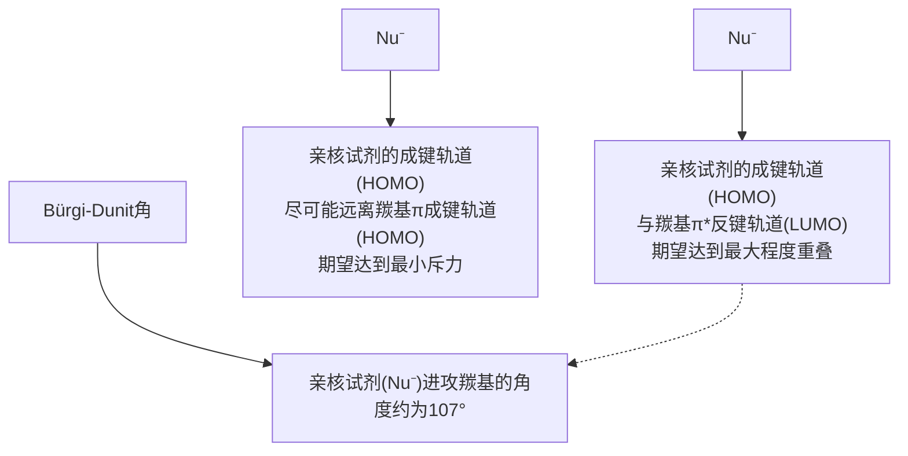
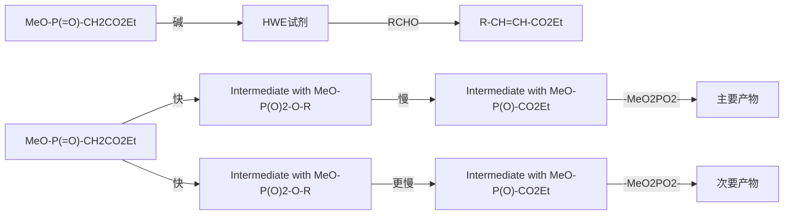
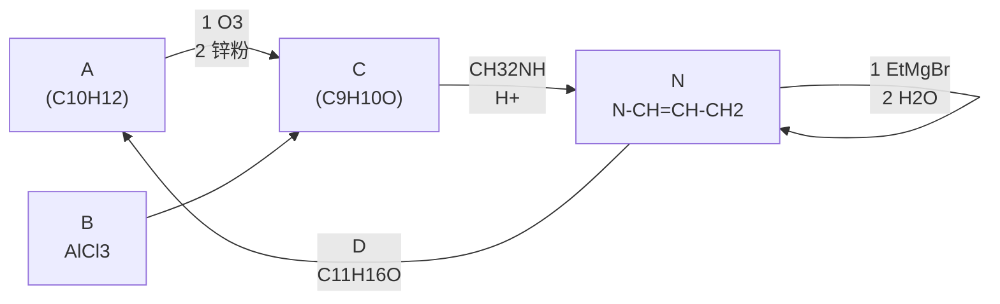
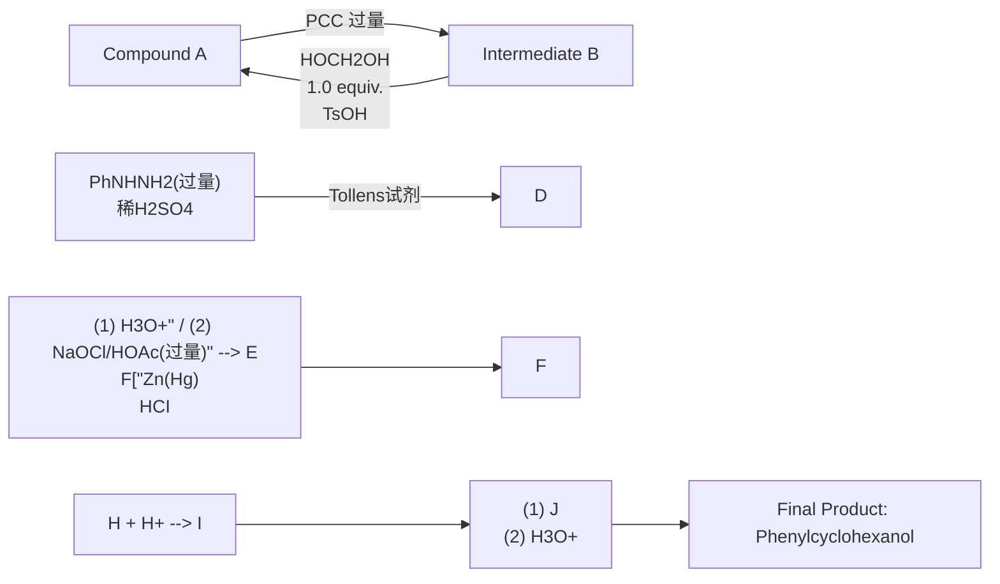

# 第九章 醛和酮

原始 PDF 第 16–60 页。

第九章

醛和酮

9.1 醛和酮的命名 …… 1
9.2 醛和酮的结构 …… 3
9.3 醛和酮的制法 …… 3
9.4 醛和酮的物理性质及波谱性质……5
9.5 醛和酮的化学性质 8
9.6  $\alpha,\beta-$ 不饱和醛、酮 …… 27
9.7 乙烯酮 29
9.8 醌 30
习题 32

醛和酮都是含有羰基官能团的化合物，因此又统称为羰基化合物。羰基与一个氢原子相连形成的官能团简写为-CHO，含有-CHO的化合物称为醛（aldehyde），-CHO作为取代基时称为甲酰基（formyl）。羰基与两个烃基相连的化合物称为酮（ketone）。羰基化合物广泛存在于自然界，许多重要的生物化合物都包含羰基，例如人们日常识别的味道和气味的分子来源大部分是羰基化合物。此外，醛和酮的羰基可以与亲核试剂反应生成各种类型的产物，因此它们是有机合成的重要原料和中间体。

本章将探讨醛、酮的反应性，尤其是亲核试剂与醛、酮的反应，这些反应广泛存在于各种生物代谢途径和药物合成中。

## 9.1 醛和酮的命名

根据与羰基相连的烃基的不同，醛、酮可分为脂肪族醛、酮与芳香族醛、酮；根据烃基的不饱和度，醛、酮可分为饱和醛、酮及不饱和醛、酮；根据分子中所含羰基的数目，醛、酮还可分为一元醛、酮与二元醛、酮等。一元酮中羰基连接的两个烃基相同的称为简单酮，不相同的称为混合酮。碳原子数相同的饱和一元醛、酮互为同分异构体，它们具有相同的通式 $C_{n}H_{2n}O$ 。简单的醛、酮可采用普通命名法命名，结构较复杂的醛、酮则采用系统命名法命名。

## 9.1.1 普通命名法

醛的普通命名法与醇的普通命名法相似。例如:

正丁醛
butyraldehyde

异戊醛
isovaleraldehyde

苯甲醛
benzaldehyde

酮的普通命名法是按照羰基所连接的两个烃基命名。例如:

---

2

第九章 醛和酮

甲基乙基酮(甲乙酮)

ethyl methyl ketone

甲基乙烯基酮(丁烯酮)

methyl vinyl ketone

二苯甲酮(二苯酮)

diphenyl ketone

## 9.1.2 系统命名法

选择含有羰基碳原子的最长碳链为主链，从靠近羰基一端编号。醛羰基总是在链端，不用标明它的位次，而酮羰基通常需要标明位次。芳香族醛或酮的命名通常以脂肪族醛或酮为母体，将芳基作为取代基。例如:

3-乙基-5-甲基辛醛

3-ethyl-5-methyloctanal

(E)-3-苯基丙-2-烯醛

(E)-3-phenylprop-2-enal

(R)-4-甲基己-2-酮

(R)-4-methylhexan-2-one

2-羟基苯甲醛

2-hydroxybenzaldehyde

苯乙醛

phenylethanal

1-(3-硝基苯基)乙-1-酮

1-(3-nitrophenyl)ethan-1-one

碳链原子的位次有时也用希腊字母表示，与羰基直接相连的碳原子为 $\alpha$-碳原子，其次为 $\beta$-碳原子、$\gamma$-碳原子等（酮分子中可以有 $\alpha, \alpha'$-和 $\beta, \beta'$-碳原子等）。二元羰基化合物也经常用希腊字母来标记，用 $\alpha$（相邻）、$\beta$（隔一个碳原子）、$\gamma$（隔两个碳原子）来表示两个羰基的相对位次。例如:

α-戊二酮(戊-2,3-二酮)

pentane-2,3-dione

β-戊二酮(戊-2,4-二酮)

pentane-2,4-dione

当主链同时含有酮羰基和醛羰基时，可以醛为母体，将酮羰基的氧原子作为取代基，用“氧亚基”表示；也可以酮、醛为母体，但需注明酮、羰基碳原子的位次。例如:

4-氧亚基戊醛

(γ-氧亚基戊醛，戊-4-酮醛)

4-oxopentanal

羰基在环内的脂环酮称为“环某酮”，如羰基在环外，则将环作为取代基。例如:

3-甲基环己酮

3-methylcyclohexan-1-one

4-甲基环己烷-1-甲醛

4-methylcyclohexane-1-carbaldehyde

环己-1,4-二酮

cyclohexane-1,4-dione

---

9.3 醛和酮的制法

3

## 9.2 醛和酮的结构

醛和酮的分子中都含有羰基，它是由碳原子与氧原子以双键结合成的官能团，与碳碳双键相似，碳原子和氧原子都采取 $sp^{2}$ 杂化，碳氧双键由一个 $\sigma$ 键和一个 $\pi$ 键构成。羰基碳原子的三个 $sp^{2}$ 杂化轨道分别与一个氧原子和两个碳或氢原子形成三个 $\sigma$ 键，这三个 $\sigma$ 键在同一平面上。羰基碳原子和氧原子各剩下的一个p轨道在侧面相互交盖形成 $\pi$ 键，该 $\pi$ 键垂直于三个 $\sigma$ 键所在的平面，如图9-1(a)所示。醛、酮分子中形成羰基的碳原子和氧原子以及与羰基相连的其他两个碳或氢原子在同一平面上，键角接近 $120^{\circ}$，如图9-1(b)所示。

chemical

Molecular orbital diagram showing bonding between carbon and oxygen with sp² orbitals

(a)

(b)

图9-1 甲醛的分子结构

## 9.3 醛和酮的制法

## 9.3.1 醛和酮的工业合成

## 1. 低级伯醇和仲醇的氧化

这是工业制取醛、酮的重要方法（见本书上册第七章）。

## 2. 烯烃的氢甲酰化反应

烯烃与一氧化碳和氢气在催化剂作用下可生成比原烯烃多一个碳原子的醛。该合成法称为烯烃的氢甲酰化反应（hydroformylation），也称羰基合成（oxo-synthesis）。常用的催化剂是钴或铑催化剂。利用该法合成的醛可进一步还原成伯醇，这是工业上合成低级伯醇的重要方法之一。例如:

chemical

Organic reaction equation showing cyclopropane reacting with CO and H2 under RhH(CO)(PPh3)3 catalyst at 25°C for 10 MPa to form a cyclopropyl alcohol.

## 3. 烷基苯的氧化

工业上常用烷基苯氧化制取芳醛和芳酮。例如，甲苯用空气催化氧化、铬酰氯或铬酐氧化均可得苯甲醛:

乙苯用空气氧化可得苯乙酮:

chemical

Chemical reaction equation showing methylene alkylation with ethyl ether under acidic conditions

---

4

第九章 醛和酮

## 4. 偕二卤代物的水解

同碳二卤化合物（称为偕二卤代物或胞二卤代物）水解生成醛或酮。例如，工业上可利用苯二氯甲烷水解制取苯甲醛:

$$
\text{C}_6\text{H}_5\text{CHCl}_2 + \text{H}_2\text{O} \xrightarrow[\text{80\%~90\%}]{\text{Fe, 95~100 °C}} \text{C}_6\text{H}_5\text{CHO} + 2\text{HCl}
$$

## 9.3.2 伯醇和仲醇的氧化

醇的氧化也是实验室制备醛、酮的常用方法（见 7.2.6 小节）。将伯醇氧化成醛时要使用温和的氧化剂。当使用强氧化剂处理时，伯醇被氧化成羧酸。当使用温和的氧化剂时，产生的醛不会被进一步氧化。

$$
\mathrm{RCH} _ {2} \mathrm{OH} \xrightarrow [ \text {或} (\text {1}) \mathrm{DMSO} , (\mathrm{COCl}) _ {2} ]{\text {PCC, CH} _ {2} \mathrm{Cl} _ {2}} \mathrm{RCHO}
$$

使用多种强或温和的氧化剂可以将仲醇氧化，生成的酮不会进一步氧化。

$$
\mathrm{R} ^ {\mathrm{OH}} \xrightarrow [ \mathrm{H} _ {2} \mathrm{SO} _ {4} , \mathrm{H} _ {2} \mathrm{O} ]{\mathrm{Na} _ {2} \mathrm{Cr} _ {2} \mathrm{O} _ {7}} \mathrm{R} ^ {\mathrm{O}} \mathrm{R} ^ {\prime}
$$

此外，伯醇或仲醇可经 Oppenauer 氧化生成相应的醛或酮。该反应是在碱（如异丙醇铝等）催化下，使用过量的丙酮作氧化剂可逆进行的，且具有较强的选择性，可用于氧化不饱和醇。例如:

$$
\text {CH}_3\text{CH}=\text{CHCH}=\text{CHCH} \xrightarrow[\text {苯，回流}]{\text {异丙醇铝，丙酮}} \text{CHCOCH=CHCH=CHCH} \quad 80\%
$$

## 9.3.3 羧酸衍生物的还原

酰氯及酯等羧酸衍生物可部分还原成相应的醛（见 10.7.5 小节），常用的还原方法有金属氢化物还原及催化氢化还原（Rosenmund 还原）等。例如:

$$
\mathrm{CHCH} _ {3} \mathrm{C} = \mathrm{OEt} \xrightarrow [ (1) i - \mathrm{Bu} _ {2} \mathrm{AlH} , \text {己烷,} - 78 ^ {\circ} \mathrm{C} ]{(2) \mathrm{H} _ {3} \mathrm{O} ^ {+}} \mathrm{CHCH} _ {3} \mathrm{C} = \mathrm{OCH}
$$

## 9.3.4 芳环的酰基化

芳烃的 Friedel-Crafts 酰基化反应是合成芳酮的重要方法（见 6.3.5 小节）。例如:

$$
\text {C}_6\text{H}_5 + \text {C}_6\text{H}_5\text {-COCl} \xrightarrow{\text {AlCl}_3} \text {C}_6\text{H}_5\text{-CO-C}_6\text{H}_5\quad 82\%
$$

在 Lewis 酸的催化下，用一氧化碳和氯化氢与芳烃作用生成芳醛，此反应称为 Gattermann-Koch 反应。它可以看成 Friedel-Crafts 反应的一种特殊形式，相当于甲酰氯参与的酰基化反应，适用于烷基苯的甲酰化。例如:

---

9.4 醛和酮的物理性质及波谱性质

5

$$
\mathrm{H} _ {3} \mathrm{C} - \overline {{\text {benzene}}} \xrightarrow [ \mathrm{AlCl} _ {3} - \mathrm{CuCl} , 20 ^ {\circ} \mathrm{C} ]{\mathrm{CO} + \mathrm{HCl}} \mathrm{H} _ {3} \mathrm{C} - \overline {{\text {benzene}}} - \mathrm{CHO}
$$

另一种特殊的 Friedel-Crafts 反应是 Vilsmeier-Haack 反应，酚类和芳胺类在  $POCl_{3}$  存在下与 N,N-二取代甲酰胺反应，可在其对位引入一个醛基。例如:

$$
\mathrm{HO} - \text {苯环} + \mathrm{H} \xrightarrow [ \mathrm{CH} _ {3} ]{\mathrm{O}} \mathrm{N} ^ {\mathrm{CH} _ {3}} \xrightarrow [ \mathrm{POCl} _ {3} ]{\mathrm{POCl} _ {3}} \mathrm{HO} - \text {苯环} + (\mathrm{CH} _ {3}) _ {2} \mathrm{NH} \tag{65}
$$

## 9.3.5 烯烃臭氧化

烯烃在臭氧作用下会裂解成醛或酮（见 5.6.4 小节）。

$$
\underset {(R) H} {\overset {R} {\rightleftharpoons}} \underset {H (R)} {\overset {R} {\rightleftharpoons}} \xrightarrow [ (2) \text {锌粉或} \left(\mathrm{CH} _ {3}\right) _ {2} \mathrm{S} ]{(1) \mathrm{O} _ {3}} 2 \underset {(R) H} {\overset {R} {\rightleftharpoons}} = O
$$

## 9.3.6 端炔的硼氢化氧化

端炔的硼氢化氧化生成通过  $\pi$  键的反马氏规则加成产物烯醇，互变异构形成醛（见5.8.4小节）。

$$
\mathrm{R} \equiv \frac {(1) \mathrm{R} _ {2} ^ {\prime} \mathrm{BH}}{(2) \mathrm{H} _ {2} \mathrm{O} _ {2} , \mathrm{HO} ^ {-}} \quad \mathrm{R} \stackrel {\frown} {\mathrm{CHO}}
$$

## 9.3.7 酸催化的端炔水合

酸催化下水分子对端炔的符合马氏规则的加成产物通过互变异构生成甲基酮（见5.8.3小节）。

$$
\mathrm{R} \equiv \xrightarrow [ \mathrm{HgSO} _ {4} ]{\mathrm{H} _ {2} \mathrm{SO} _ {4} , \mathrm{H} _ {2} \mathrm{O}} \mathrm{R}\rightleftharpoons
$$

## 9.4 醛和酮的物理性质及波谱性质

常温下除甲醛是气体外， $C_{12}$  以下的脂肪醛、酮一般是液体， $C_{12}$  以上的醛、酮一般为固体；芳醛、芳酮均为液体或固体。低级脂肪醛具有强烈的刺激性气味，某些  $C_{9}$  和  $C_{10}$  的醛、酮具有花果香味，可用于香料工业。

羰基具有极性，因此醛、酮的沸点比相对分子质量相近的烃及醚的沸点高。但羰基分子间不能形成氢键，因此沸点较相应醇的低。例如:

<table><tr><td rowspan="2">沸点/°C</td><td> $CH_3CH_2CH_2CH_3$ </td><td> $CH_3OCH_2CH_3$ </td><td> $CH_3CH_2CHO$ </td><td> $CH_3COCH_3$ </td><td> $CH_3CH_2CH_2OH$ </td></tr><tr><td>-0.5</td><td>7.4</td><td>49</td><td>55</td><td>97</td></tr><tr><td>沸点/°C</td><td>136.1</td><td>179.0</td><td>205.3</td><td colspan="2">201.8</td></tr></table>

因为醛、酮的羰基能与水中氢形成氢键，故低级的醛、酮可溶于水；但芳醛、芳酮微溶

---

6

第九章 醛和酮

或不溶于水。一些醛、酮的物理常数见表9-1。

表 9-1 一些醛、酮的物理常数

| 名称 | 熔点/°C | 沸点/°C | 相对密度($d_{4}^{20}$) | 水中溶解度$\frac{g \cdot (100\, g\, H_{2}O)^{-1}}{}$ |
| --- | --- | --- | --- | --- |
| 甲醛 | -92 | -19.5 | 0.815 (-20 °C) | 122 |
| 乙醛 | -123.5 | 21 | 0.788 (16 °C) | 无限混溶 |
| 丙烯醛 | -88 | 53 | 0.841 | 21 |
| 丙醛 | -81 | 49 | 0.8071 | 30 |
| 丁醛 | -99 | 74.8 | 0.8016 | 7.1 |
| (E)-丁-2-烯醛 | -76.5 | 102 | 0.8516 | 18.1 |
| 丙酮 | -94.7 | 56 | 0.7908 | 无限混溶 |
| 丁酮 | -86.7 | 79.6 | 0.8054 | 24 |
| 环己酮 | -31 | 155.7 | 0.9478 | 15 |
| 苯甲醛 | -26 | 179 | 1.0528 | 0.3 |
| 苯乙酮 | 20.5 | 202 | 1.028 | 0.55 |
| 二苯酮 | 48.5 | 305 | 1.1097 | 不溶 |

醛和酮的红外光谱在  $1740 \sim 1680 \, cm^{-1}$  有一个非常特征的 C=O 伸缩振动吸收峰；其他含有羰基的化合物（包括羧酸及其衍生物）的红外光谱在  $1850 \sim 1650 \, cm^{-1}$  也存在类似的强吸收峰，这是鉴别羰基存在的最有力证据之一。醛、酮羰基吸收峰的位置与其邻近基团的电子效应及空间效应有关，若羰基与双键发生共轭，则吸收峰向低波数位移。例如:

chemical

Four organic molecular structures with labeled standard deviations (σ/cm⁻¹)

醛、酮的伸缩振动吸收峰位置相近不易区别，但甲酰基的 C-H 键在  $\sim2720\ cm^{-1}$  处有中等强度（或弱的）尖锐的特征吸收峰，可以用于鉴别 -CHO 的存在。图 9-2 及图 9-3 分别为正壬醛及苯乙酮的红外光谱。

spectrogram

| Wavenumber \((cm^{-1})\) | Transmittance (%) |
| --- | --- |
| 2025.83 | ~32 |
| 2857.38 | ~45 |
| 2715.20 | ~65 |
| 1727.15 | ~30 |
| 1465.97 | ~65 |
| 1411.42 | ~60 |
| 1389.70 | ~60 |
| 1379.21 | ~60 |

图9-2 正壬醛的红外光谱

$2715\ cm^{-1}$ ，甲酰基 C—H 伸缩振动； $1727\ cm^{-1}$ ，C=O 伸缩振动

---

9.4 醛和酮的物理性质及波谱性质

7

spectrogram

| Wavenumber \((cm^{-1})\) |
| --- |
| 3086.19 |
| 3063.13 |
| 3029.54 |
| 3005.58 |
| 1685.58 |
| 1598.91 |
| 1582.88 |
| 1449.36 |
| 1431.08 |
| 1359.76 |
| 1302.38 |
| 1265.95 |
| 1180.23 |
| 1078.19 |
| 1024.41 |
| 955.49 |
| 927.19 |
| 760.10 |
| 690.56 |
| 588.73 |

图9-3 苯乙酮的红外光谱

$1686\mathrm{cm}^{-1}$ ， $\mathrm{C = O}$ 伸缩振动； $1599~\mathrm{cm}^{-1}$ ， $1583~\mathrm{cm}^{-1}$ ，苯环骨架伸缩振动； $690~\mathrm{cm}^{-1}$ ，一取代苯Ar-H面外弯曲振动

在  ${}^{1}$ H NMR 谱图中，羰基本身不产生信号，但它对相邻质子的化学位移有明显的影响。由于羰基的吸电子性及 C=O 双键的磁各向异性，与羰基相连接的氢受到的屏蔽效应大大减小，化学位移值  $\delta$  较大，接近 9～10，这可以作为醛基的特征峰（图 9-4）。此外羰基对  $\alpha$ -质子的化学位移也有影响，导致化学位移值增大（图 9-5）。

spectrogram

| Peak Label | Chemical Shift \((\delta)\) |
| --- | --- |
| a | 10.030 |
| b | 7.900 |
| b | 7.885 |
| b | 7.657 |
| b | 7.642 |
| b | 7.628 |
| b | 7.558 |
| b | 7.542 |
| b | 7.527 |
| b | 7.270 |
| c | ~8.15 |
| c | ~8.10 |
| c | ~8.05 |
| d | ~8.00 |
| d | ~7.95 |
| d | ~7.90 |

图9-4 苯甲醛的核磁共振氢谱（500 MHz，$\mathrm{CDCl}_3$）

在  ${}^{13}$ C NMR 谱图中，酮或醛的羰基碳通常会在 δ200 附近产生弱信号峰，由于低场很少有信号出现，这种信号通常相对容易被识别，可以作为醛和酮鉴定的特征峰（图 9-6）。

---

8

第九章 醛和酮

spectrogram

| Chemical Shift \((\delta)\) | Integration |
| --- | --- |
| 2.473 | a |
| 2.458 | a |
| 2.444 | a |
| 2.430 | b |
| 2.138 | b |
| 1.066 | c |
| 1.052 | c |
| 1.037 | c |

图9-5 丁酮的核磁共振氢谱（ $500\mathrm{MHz}$ ， $\mathrm{CDCl}_3$ ）

spectrogram

| Peak Label | Chemical Shift \((\delta)\) |
| --- | --- |
| a | 209.290 |
| b | 77.257 |
| c | 77.000 |
| d | 76.743 |
| e | 36.606 |
| f | 29.203 |
| g | 7.577 |

图9-6 丁酮的核磁共振碳谱（126MHz，$\mathrm{CDCl}_3$）

## 9.5 醛和酮的化学性质

醛和酮的官能团是羰基，即 C=O。与 C=C 双键相似，C=O 双键由 σ 键和 π 键组成，但氧原子的电负性比碳原子的电负性大，所以羰基是极化的，π 电子云的分布偏向氧原子。这导致氧原子带部分负电荷，具有亲核性，易与亲电试剂反应；而碳原子带部分正电荷，具有亲电性，易与亲核试剂进行加成反应（亲核加成反应）。

chemical

Chemical structures showing sp² radicalization, π bond, σ bond, and π electron cloud with directional oxygen atoms

---

9.5 醛和酮的化学性质

9

此外，受羰基的影响，与羰基直接相连的  $\alpha-$  碳原子上的氢原子( $\alpha-H$ )较活泼，产生的碳负离子能发生一系列反应（见第十一章）。醛、酮分子中含有的羰基和活泼的  $\alpha-H$  决定了其相关的主要化学性质，如下所示:

chemical

Reaction mechanism diagram showing oxidation and reduction reactions of a carboxylic acid to form alpha-hydroxybenzoic acid and alkene

## 9.5.1 羰基的亲核加成反应

羰基中碳原子带有部分正电荷，具有亲电性，易与多种亲核试剂进行加成反应，其亲核原子可以是碳、氧、硫、氮和氢等。

不同的羰基化合物亲核加成反应的活性不同，这种差异是电子效应和空间效应两者综合作用的结果。由电子效应看，当羰基碳原子上连有吸电子基时，容易进行亲核加成反应；反之，当羰基碳原子上连有给电子基时，难以进行亲核加成反应。由于与氢相比烃基具有给电子效应，因而酮的亲核加成反应活性一般低于醛。从空间效应看，羰基碳原子进行亲核加成反应的过程中，羰基碳原子若连有较大的基团，则不利于亲核加成反应的进行。不同结构的醛和酮进行亲核加成反应时，大致可按下列次序由易到难排列:

$$
\mathrm{HCHO} > \mathrm{RCHO} > \mathrm{ArCHO} > \mathrm{CH} _ {3} \mathrm{COCH} _ {3} > \mathrm{CH} _ {3} \mathrm{COR} > \mathrm{RCOR} > \mathrm{ArCOAr}
$$

一般在脂肪烃基空间效应不是很大的情况下，脂肪醛比芳香醛易于进行亲核加成；脂肪酮比芳香酮易于进行亲核加成，这是由于芳醛和芳酮中芳环与羰基的共轭，增加了羰基碳原子上电子密度。

对于芳香醛、酮，还要考虑到环上取代基的电子效应。当芳环上所连原子或基团通过芳环对羰基的影响表现为吸电子效应时，有利于增加羰基的活性；反之，则降低羰基的活性。

$$
\mathrm{O} _ {2} \mathrm{N} - \text {C}_6\text {H}_5 - \mathrm{CHO} > \text {C}_6\text {H}_5 - \mathrm{CHO} > \mathrm{H} _ {3} \mathrm{C} - \text {C}_6\text {H}_5 - \mathrm{CHO}
$$

在加成过程中，如果羰基两侧的基团相同，亲核试剂则可以从羰基所在平面的上、下机会均等地进攻羰基碳原子，形成加成产物。如果羰基两侧基团的大小不同，手性亲核试剂进攻羰基碳原子时，则可以形成手性醇。

chemical

Reaction mechanism diagram showing nucleophilic addition and deprotonation steps with labeled途径a and途径b

从分子轨道角度来看，亲核试剂对羰基的加成反应是亲核试剂的HOMO轨道电子对与羰基双键的LUMO轨道作用形成新的 $\sigma$ 键。值得注意的是，亲核试剂进攻羰基时，尽管亲核试剂的HOMO轨道与羰基 $\pi^{*}$ 轨道的重叠越大越有利，但是羰基 $\pi$ 键电子密度对亲核试剂的HOMO轨道的电子有排斥力，这导致亲核试剂对羰基的进攻并不是垂直于羰基的平面，而是与羰基呈 $107^{\circ}$ 左右的夹角，此夹角称作Bürgi-Dunit角。

---

10

第九章 醛和酮

flowchart

羰基与不同亲核试剂反应时，有些亲核试剂需要碱性条件，有些则需要酸性条件。碱性条件下的反应机理如下:首先羰基被亲核试剂进攻生成负离子中间体，随后负离子中间体质子化生成加成产物。

chemical

Reaction mechanism diagram showing quaternization and proton transfer steps of a carboxylic acid derivative

酸性条件下的反应则是首先羰基氧质子化生成正离子，随后亲核试剂对活化的羰基进攻生成加成产物。这里质子化羰基带有完整的正电荷，使得羰基碳的亲电性增加，有利于弱亲核试剂对羰基进行加成。

chemical

Reaction mechanism diagram showing quaternary transfer and nucleophilic attack of a ketone to form a hydroxyl group

当亲核试剂也可以作离去基团时，亲核试剂对羰基的亲核加成反应是可逆反应，平衡的位置取决于亲核试剂离去性能的强弱。这里将根据进攻原子对亲核试剂进行分类，研究各类亲核试剂。具体来说，将讨论基于碳、氧、硫、氮和氢的亲核试剂。

## 1. 碳亲核试剂对羰基的加成

碳亲核试剂的加成可以构建新的碳碳键，因此是有机合成最重要的反应类型之一。碳亲核试剂包括以 Grignard 试剂为代表的金属试剂、氰离子和 Wittig 试剂。

（1）与金属试剂加成醛、酮与Grignard试剂进行亲核加成反应，加成产物不必分离出来，可直接水解而生成醇:

chemical

Organic reaction mechanism showing oxidation of a ketone to form a hydroxymethylated product with MgX and R-MgX reagents

Grignard 试剂中的碳镁键是高度极化的，镁原子带有部分正电荷，碳原子带有部分负电荷，具有较强的亲核性。Grignard 试剂与甲醛反应，生成增加一个碳原子的伯醇；与其他醛反应，生成仲醇，而与酮反应，则生成叔醇。

---

9.5 醛和酮的化学性质

11

醛、酮除了和Grignard试剂发生加成反应外，还可与有机锂试剂进行加成反应。有机锂试剂比Grignard试剂更活泼，反应方式与Grignard试剂相似，其反应优点是产率较高，而且较易分离。此外，Grignard试剂不易与二叔丁基甲酮反应，其原因是空间障碍较大，而叔丁基锂则可与之反应:

chemical

Chemical reaction equation showing lithium-catalyzed cyclization of a ketone to form an alcohol under ethylene and water conditions

醛、酮也可以与炔基钠反应，形成炔醇。例如:

chemical

Chemical reaction equation showing hydrolysis of cyclohexanol under acidic conditions to form a cyclohexanol derivative

另外，醛、酮等羰基化合物可在锌存在下，与 $\alpha$-卤(氯或溴)代羧酸酯反应，再经水解生成 $\beta$-羟基羧酸酯或 $\alpha, \beta$-不饱和羧酸，该反应称为Reformatsky反应。

chemical

Chemical reaction equation showing conversion of ester to β-羟基羧酸酯 and α,β-不饱和羧酸 via intermediate Zn

锌与 $\alpha$-卤代羧酸酯所形成的有机锌试剂，其亲核性比 Grignard 试剂的亲核性小，只能与醛、酮的羰基加成，而不与酯的羰基加成。$\beta$-羟基酸很容易脱水，所以酯在水解的同时脱水，最终生成 $\alpha, \beta$-不饱和羧酸。Reformatsky 反应常用于制备 $\beta$-羟基酸酯和 $\alpha, \beta$-不饱和羧酸。例如:

chemical

Organic reaction equation showing benzene reacting with bromoethylenediamine under zinc and water conditions to yield a hydroxybenzoate product

当醛、酮分子中的  $\alpha-$  碳原子为手性碳原子时，加成产物的立体构型将受其影响。Cram 规则（由 D. J. Cram 于 1952 年提出）可用于预测占优势产物的构型。Cram 规则可用纽曼投影式说明如下，其中 L、M 和 S 分别代表具有手性的  $\alpha-$  碳原子上连有的大、中和小基团；按照该规则羰基一般应处于 M 和 S 两个基团中间，而亲核试剂应主要从空间障碍较小的一侧（S 一侧）进攻羰基碳原子。

chemical

Chemical reaction equation showing the formation of a cyclic oxime from a ketone and R'MgX

例如，(S)-2-苯基丙醛与甲基碘化镁进行亲核加成反应时，主要得到产物Ⅰ。该实验结

---

12

第九章 醛和酮

果与 Cram 规则的预测是吻合的。

chemical

Chemical reaction equation showing conversion of a cyclic ketone to a diol under methanol and water conditions, yielding two products with different yields.

（2）与HCN加成醛、甲基酮和脂环酮一般均可以与氢氰酸作用生成 $\alpha-$ 羟基腈，亦称 $\alpha-$ 氰醇。机理研究表明该反应在催化量碱的存在下易于进行。例如，氢氰酸与丙酮反应，无碱存在时， $3\sim 4\mathrm{h}$ 内只有一半原料发生反应；加一滴氢氧化钾溶液，则 $2\mathrm{min}$ 内即可以完成反应。如果加入酸，反而使反应速率减小，加入大量的酸，放置许多天也不发生反应。这些事实表明，在氢氰酸与羰基化合物的加成反应中，起决定性作用的是CN。碱的存在能增加CN的浓度，酸的存在则相反。

$$
\mathrm{HCN} \xrightarrow [ \mathrm{H} ^ {+} ]{\mathrm{HO} ^ {-}} \mathrm{H} ^ {+} + ^ {-} \mathrm{CN}
$$

一般认为碱催化下氢氰酸对羰基的加成反应机理如下:

chemical

Reaction mechanism diagram showing slow and fastly activated reactions of a cyclic ester with CN groups

亲核进攻

质子转移

氰化氢在碱的作用下脱质子生成亲核性较强的氰离子，对羰基进行加成。不过，氰离子对羰基的加成是可逆的，产物的产率取决于平衡浓度。对大多数醛和小位阻酮而言，平衡倾向于氰醇的生成。

氢氰酸有剧毒，易于挥发（沸点为  $26.5^{\circ}C$ ），故与羰基化合物加成时，一般将无机酸加入醛（或酮）和氰化钠水溶液的混合物中，使得氢氰酸在反应体系中一旦生成就立即与醛（或酮）反应。但在加酸时注意控制溶液的 pH，使 pH 为 8，以利于反应进行。为了安全，该反应需要通风良好的环境中进行。一种改进的方法是将氰化钠或氰化钾水溶液加到羰基化合物的亚硫酸氢钠加成物中。体系中的亚硫酸氢根离子起酸的作用（见  $NaHSO_{3}$  对羰基的加成）。

$$
\begin{array}{c} \mathrm{OH} \\ \mathrm{R} - \stackrel {\mid} {\mathrm{C}} - \mathrm{SO} _ {3} \mathrm{Na} + \mathrm{NaCN} \Longleftrightarrow \mathrm{R} - \stackrel {\mid} {\mathrm{C}} - \mathrm{CN} + \mathrm{Na} _ {2} \mathrm{SO} _ {3} \\ \mathrm{H} \end{array}
$$

$\alpha-$ 羟基腈中氰基可以根据需要进一步转化为其他官能团，例如，氰基可以转化为氨基或羧酸，因此 $\alpha-$ 羟基腈是非常有用的合成中间体。

chemical

Chemical reaction equations showing the formation of carboxylic acid from cyanoic acid and aldehyde under different conditions

（3）与Wittig试剂加成Wittig试剂亦称磷内镝盐或磷叶立德，其中碳负离子与磷正离子直接相连，碳负离子可被邻近的磷正离子共振稳定，因此也可以写成 $\mathrm{C = P}$ 的共振式。两个共振式都可以表示Wittig试剂。尽管 $\mathrm{C = P}$ 的共振式没有电荷看起来更稳定，但它对整个共振

---

9.5 醛和酮的化学性质

13

杂化没有太大的贡献,因为 C 的 2p 轨道和 P 的 3p 轨道的大小显著不同,所以没有有效重叠。而镐盐形式更真实地反映了 Wittig 试剂作为亲核性碳负离子的反应性。

$$
\left[ \begin{array}{c} \mathrm{H} \\ - \stackrel {\cdot} {\mathrm{C}} - \stackrel {+} {\mathrm{PPh}} _ {3} \\ \mathrm{H} \end{array} \right. \longleftrightarrow \left[ \begin{array}{c} \mathrm{H} \\ \stackrel {\cdot} {\mathrm{C}} = \mathrm{PPh} _ {3} \\ \mathrm{H} \end{array} \right] \text {Wittig试剂}
$$

醛、酮等羰基化合物可与Wittig试剂进行亲核加成反应，形成一个新的内镝盐，然后裂解消除三苯基氧膦 $(\mathrm{Ph}_3\mathrm{P} = \mathrm{O})$ 而得到烯烃，其反应过程如下:

$$
\mathrm{R} ^ {1} \stackrel {\cdot \cdot \cdot} {\mathrm{C}} \stackrel {\cdot \cdot \cdot} {\mathrm{O}} ^ {\cdot} \stackrel {\cdot \cdot \cdot} {\mathrm{R} ^ {2}} + \stackrel {\cdot \cdot \cdot} {\mathrm{H}} \stackrel {-} {\mathrm{C}} - \stackrel {+} {\mathrm{PPh} _ {3}} \longrightarrow \left[ \begin{array}{c} \stackrel {: \cdot \cdot \cdot} {\mathrm{O}}: ^ {+} \mathrm{PPh} _ {3} \\ \mathrm{R} ^ {1} - \stackrel {: \cdot \cdot \cdot} {\mathrm{C}} - \stackrel {+} {\mathrm{CH} _ {2}} \\ \mathrm{R} ^ {2} \end{array} \right] \longrightarrow \left[ \begin{array}{c} \stackrel {: \cdot \cdot \cdot} {\mathrm{O}} - \mathrm{PPh} _ {3} \\ \mathrm{R} ^ {1} - \stackrel {: \cdot \cdot \cdot} {\mathrm{C}} - \stackrel {+} {\mathrm{CH} _ {2}} \\ \mathrm{R} ^ {2} \end{array} \right] \longrightarrow \mathrm{R} ^ {1} \stackrel {\mathrm{CH} _ {2}} {\mathrm{C}} _ {\mathrm{R} ^ {2}} + \mathrm{O} = \mathrm{PPh} _ {3}
$$

Wittig 试剂通常由三苯基膦和卤代烷制备。三苯基膦是结晶固体，熔点为  $80^{\circ}$ C，实验室中可用 Grignard 试剂与三氯化磷作用而得，也可通过用溴苯、三氯化磷和金属钠制备。

$$
\begin{array}{l} 3 \mathrm{PhMgBr} + \mathrm{PCl} _ {3} \longrightarrow \mathrm{Ph} _ {3} \mathrm{P} + 3 \mathrm{MgClBr} \\ 3 \mathrm{PhBr} + \mathrm{PCl} _ {3} + 6 \mathrm{Na} \longrightarrow \mathrm{Ph} _ {3} \mathrm{P} + 3 \mathrm{NaCl} + 3 \mathrm{NaBr} \\ \end{array}
$$

三苯基膦作为亲核试剂与卤代烷发生  $S_{N}2$  反应，生成季磷盐；再与强碱（如 n-BuLi、PhLi 等）作用，生成 Wittig 试剂。例如:

$$
\mathrm{Ph} _ {3} \ddot {\mathrm{P}} + \mathrm{CH} _ {3} \mathrm{CH} _ {2} - \mathrm{Br} \xrightarrow [ \mathrm{S} _ {\mathrm{N}} 2 ]{} \mathrm{Ph} _ {3} \stackrel {{+}} {\mathrm{P}} - \mathrm{CHCH} _ {3} \mathrm{Br} ^ {-} \xrightarrow [ \begin{array}{c} \delta - \delta + \\ \text {Ph-Li} \\ - \text {PhH} \\ - \text {LiBr} \end{array} ]{\delta - \delta +} \left[ \mathrm{Ph} _ {3} \stackrel {{+}} {\mathrm{P}} - \bar {\mathrm{CHCH}} _ {3} \longleftrightarrow \mathrm{Ph} _ {3} \mathrm{P} = \mathrm{CHCH} _ {3} \right]
$$

第一步是 $\mathrm{S_N2}$ 反应，因此伯烷基卤代物将比仲烷基卤代物更容易反应，叔烷基卤代物则不反应。磷盐中间体去质子化需要 $\mathrm{NaH}$ 、$\mathrm{NaNH_2}$ 或 PhLi 等强碱。Wittig 反应可用于制备单取代、二取代或三取代烯烃。由于过渡态的空间位阻，四取代烯烃很难通过 Wittig 反应制备。Wittig 反应是一种重要的合成工具，可以在羰基的位置引入碳碳双键，还具有相当好的立体选择性。由简单烷基卤代物产生的 Wittig 试剂与醛反应时，第一步的加成是反应的决速步骤，加成过程中 Wittig 试剂中的三苯基膦远离醛的取代基，这导致反应的主要产物是(Z)-烯烃。

$$
\text {Reaction:} \quad \text {慢} \rightarrow \left[\begin{array}{c}\text {主要}\\\text {次要}\end{array}\right] \xrightarrow {\text {快}} \left[\begin{array}{c}\text {主要}\\\text {次要}\end{array}\right] + \text {次要} \quad \text {(Z)-丙-1-烯基苯主要} + \text {(E)-丙-1-烯基苯次要}
$$

Wittig 试剂反应条件温和且收率较高，除可用于合成普通烯烃外，还可合成一些用其他方法难以制备的烯烃。例如:

---

14

第九章 醛和酮

$$
\text{C}_6\text{H}_5=\text{O} + \text{Ph}_3\text{P}=\text{CH}_2 \xrightarrow{\text{DMSO}} \text{C}_6\text{H}_5=\text{CH}_2 \quad 86\%
$$

德国化学家 G. Wittig 因其对有机磷化合物的研究以及发现了这种具有巨大合成用途的反应而获得 1979 年诺贝尔化学奖，这个反应被称为 Wittig 反应。利用该反应构建碳碳双键在有机合成中具有广泛的应用，如 BASF 的维生素 A 工业合成就用到了 Wittig 反应。

chemical

Organic synthesis reaction showing conversion of a chiral aldehyde to a ketone using (1) OHC and (2)异构化, yielding 98% product

当Wittig试剂含有可以稳定碳负离子的吸电子基时， $(E)$ -烯烃通常是主要产物。

$$
\mathrm{EtO} _ {2} \mathrm{C} - \underset {\mathrm{H}} {\overset {\mathrm{PPh} _ {3}} {\mathrm{C}}} \equiv \left[ \underset {\mathrm{EtO}} {\overset {\mathrm{O}} {\mathrm{C}}} - \underset {\mathrm{H}} {\overset {\mathrm{PPh}} {\mathrm{C}}} \right. \xleftrightarrow {} \underset {\mathrm{EtO}} {\overset {\mathrm{O}} {\mathrm{C}}} - \underset {\mathrm{H}} {\overset {+} {\mathrm{C}}} \xleftrightarrow {} \underset {\mathrm{EtO}} {\overset {-} {\mathrm{O}}} - \underset {\mathrm{H}} {\overset {+} {\mathrm{C}}} \left. \right] _ {\text {共振稳定的Wittig试剂}}
$$

$$
\mathrm{Ph} - \underset {\mathrm{H}} {\overset {\mathrm{PPh} _ {3}} {\rightleftharpoons}} \equiv \left[ \underset {\mathrm{H}} {\overset {\mathrm{PPh} _ {3}} {\rightleftharpoons}} \leftrightarrow \underset {\mathrm{H}} {\overset {\mathrm{PPh} _ {3}} {\rightleftharpoons}} \leftrightarrow \underset {\mathrm{H}} {\overset {\mathrm{PPh} _ {3}} {\rightleftharpoons}} \leftrightarrow \underset {\mathrm{H}} {\overset {\mathrm{PPh} _ {3}} {\rightleftharpoons}} \right. \text {共振稳定的Wittig试剂}
$$

$$
\begin{array}{r l} & \text {PhCHO} + \mathrm{H} ^ {\mathrm{PPh} _ {3}} \xrightarrow {\mathrm{CO} _ {2} \mathrm{Et}} \mathrm{Ph} ^ {\mathrm{CH=CHCO} _ {2} \mathrm{Et}} \\ & \text {PhCHO} + \mathrm{H} ^ {\mathrm{PPh} _ {3}} \xrightarrow {\mathrm{Ph}} \mathrm{Ph} ^ {\mathrm{CH=CHPh}} \end{array}
$$

在有机合成中 Wittig 反应有很多常用的变体。例如，Horner-Wadsworth-Emmons 反应（简称 HWE 反应）使用膦酸酯碳负离子试剂代替稳定的 Wittig 试剂，可以高选择性生成(E)-烯烃。

flowchart

---

9.5 醛和酮的化学性质

15

Julia-Lythgoe 烯烃合成反应使用苯基磺酰基碳负离子与醛或酮反应生成中间体醇，该醇再原位酯化，随后用钠汞齐还原消除以提供烯烃。改良的 Julia-Lythgoe 烯烃合成反应用苯并噻唑-2-基砜或苯基四唑-2-基砜代替苯基砜与醛反应（称为 Julia-Kocienski 烯化反应），高选择性生成(E)-烯烃。

chemical

Chemical reaction pathway showing sulfonation and deprotection steps of a thioether derivative

硫叶立德与羰基化合物亦可发生加成反应，生成的氧负离子作为分子内亲核试剂进攻与硫正离子相连的碳原子，二甲硫醚作为离去基团离去，生成环氧化合物，该反应称为 Corey-Chaykovsky 反应。

chemical

Chemical reaction mechanism showing dehydration of a sulfonamide ion into a thioether intermediate and then to form an alkene product

## 2. 氧亲核试剂对羰基的加成

（1）与水加成 水作为亲核试剂时，其亲核原子是氧原子，与羰基化合物加成生成水合物——同碳二元醇。低级醛能在水溶液中生成较多的水合物，同碳二元醇通常是不稳定的，不能从水溶液中分离出来。但是当羰基碳原子上连有强吸电子基团时，其水合物是稳定的，可以从水溶液中分离出来。

chemical

Chemical reaction equations showing hydrolysis of aldehyde and chloroacetate to form aldehyde and chloroacetate

醛和酮与水的加成是可逆反应，表9-2列出一些醛、酮水合反应的平衡常数。

表 9-2 一些醛、酮水合反应的平衡常数 (K)

| 醛或酮 | K | 醛或酮 | K |
| --- | --- | --- | --- |
| H-CHO | $2.3 \times 10^{3}$ | $ClCH_{2}-CHO$ | 37 |
| $CH_{3}-CHO$ | 1.0 | $Cl_{3}C-CHO$ | $2.0 \times 10^{3}$ |
| $CH_{3}CH_{2}CH_{2}-CHO$ | 0.5 | $CH_{3}-CO-CH_{3}$ | $1.4 \times 10^{-3}$ |
| $(CH_{3})_{2}CH-CHO$ | 0.5 | $CH_{2}Cl-CO-CH_{2}Cl$ | 10 |
| $(CH_{3})_{3}C-CHO$ | 0.2 | $CF_{3}-CO-CF_{3}$ | $1.2 \times 10^{6}$ |

---

16

第九章 醛和酮

（2）与醇加成 在干燥氯化氢或浓硫酸的作用下，一分子醛或酮与一分子醇发生加成反应，生成的化合物分别称为半缩醛、半缩酮。

半缩醛（酮）一般是不稳定的，它易分解成原来的醛（酮），因此不易分离出来，但五、六元环的环状半缩醛较稳定，能够分离得到。半缩醛（酮）继续与另一分子醇进行反应，失去一分子水，而生成稳定的化合物，称为缩醛或缩酮，并能从过量的醇中分离出来。其反应机理可表示如下:

chemical

Reaction mechanism diagram showing hydrogenation and rearrangement steps of a ketone with isocyanate, including intermediates like semicircle and diester.

缩醛（酮）可以看作同碳二元醇的醚，性质与醚相似，不受碱的影响，对氧化剂及还原剂也是稳定的。但缩醛（酮）又与醚不同，它在稀酸中易水解转变为原来的醛（酮）。

$$
\begin{array}{c} \mathrm{OR} ^ {\prime \prime} \\ \mathrm{R} - \underset {\mathrm{H} (\mathrm{R} ^ {\prime})} {\overset {|} {\mathrm{C}}} - \mathrm{OR} ^ {\prime \prime} \end{array} + \mathrm{H} _ {2} \mathrm{O} \xrightarrow {\mathrm{H} ^ {+}} \underset {\mathrm{R}} {\overset {|} {\mathrm{C}}} \underset {\mathrm{H} (\mathrm{R} ^ {\prime})} {\overset {|} {\mathrm{O}}} + 2 \mathrm{R} ^ {\prime \prime} \mathrm{OH}
$$

醛与醇形成缩醛的反应较容易，采用含水少的酸性催化剂（如无水 HCl、浓硫酸等），在反应过程中应不断脱除生成的水以推动反应的进行。而醇和酮的反应比和醛的反应困难，因此制备简单的缩酮，常采用其他的方法。例如，制备丙酮缩二乙醇时，不能用乙醇与丙酮反应，而应采用原甲酸乙酯和丙酮反应。

chemical

Nitration reaction equation of benzene

若使用酮在酸催化下与乙二醇作用，并设法移去反应生成的水，便得到环状缩酮:

chemical

Chemical reaction equation showing methanol reacting with methoxybenzaldehyde under heating to form a cyclic alcohol product

80%\~85%

---

9.5 醛和酮的化学性质

17

缩醛和缩酮可用来保护羰基，例如，从卤代醛合成高级炔醛，需要首先将-CHO保护起来，再连接炔烃，然后水解恢复-CHO。

chemical

Organic synthesis reaction pathway showing bromination, hydrolysis, and dehydration steps with Li catalyst

醛或酮和二醇缩合在工业上有重要意义，例如高分子产品聚乙烯醇的分子中包含许多亲水的羟基，不能作为合成纤维使用。为了提高其耐水性，在酸催化下用甲醛使其部分缩醛化，便得到性能优良的合成纤维，商品名称为维纶（又叫维尼纶）。

chemical

Chemical reaction equation showing polymerization of polyvinyl alcohol to polyester and polyester monomers under acidic conditions

## 3. 硫亲核试剂对羰基的加成

（1）与硫醇加成 在酸性条件下，一当量醛（酮）可以与两当量硫醇作用生成缩硫醛（酮），其反应的机理类似于缩醛（酮）的生成。当使用二硫醇化合物时，可以生成环状缩硫醛（酮）。

环状缩硫醛（酮）在 Raney 镍作用下发生脱硫反应生成相应的烷烃。Raney 镍是一种多孔的镍铝合金，其比表面积大，可有效吸附氢原子。在反应中氢原子取代硫原子，将羰基还原为亚甲基。

（2）与亚硫酸氢钠加成醛和甲基酮（$\mathrm{CH}_3\mathrm{COR}$）可以与亚硫酸氢钠（$\mathrm{NaHSO}_3$）饱和溶液（$40\%$）发生加成反应，生成结晶的亚硫酸氢钠加成物 $\alpha-$ 羟基磺酸钠，其反应机理如下:

chemical

Chemical reaction mechanism showing oxidation of a sulfonate ion to form an azide salt, with electron transfer and radical formation steps.

在该反应中，亲核原子是亚硫酸氢根离子（$\mathrm{HSO}_3^-$）中带有孤对电子的硫原子，而不是带有负电荷的氧原子。

不同的羰基化合物与亚硫酸氢钠加成平衡常数不同,如下列数据(与1 mol NaHSO $_{3}$ 在1 h后生成加成物的百分数)所示:

---

18

第九章 醛和酮

80%

56%

36%

35%

12%

6%

2%

1%

醛、酮与亚硫酸氢钠加成的反应范围很广，所有的醛、脂肪族甲基酮和八个碳以下的环酮都可以发生该反应。醛、酮与亚硫酸氢钠的加成物都是无色结晶。$\alpha$-羟基磺酸钠易溶于水，但不溶于饱和的亚硫酸氢钠溶液而析出结晶。此法可用于鉴定醛、脂肪族甲基酮和八个碳以下的环酮等。该反应是可逆反应，在稀酸或稀碱中 $\alpha$-羟基磺酸钠可分解生成亚硫酸氢钠和相应的醛或酮，因此可利用这些性质来分离或提纯醛、脂肪族甲基酮和八个碳以下的环酮。例如，可用该反应从反应混合物中分离、提纯胡椒醛（pipernal）。

## 4. 氮亲核试剂对羰基的加成

醛、酮与氨的反应一般比较困难，只有甲醛反应容易，但其生成物（$\mathrm{H}_2\mathrm{C} = \mathrm{NH}$）不稳定，很快聚合生成六亚甲基四胺，俗称乌洛托品（urotropine）。该化合物可用作有机合成中的氨化试剂，也可用作酚醛树脂的固化剂及消毒剂等。

$$
\mathrm{CH} _ {2} = \mathrm{O} + \mathrm{NH} _ {3} \longrightarrow \left[ \mathrm{CH} _ {2} = \mathrm{NH} \right] \xrightarrow {\text {聚合}} \underset {\mathrm{H}} {\underbrace {\mathrm{HN}}} \underset {\mathrm{NH}} {\underbrace {\mathrm{NH}}} \xrightarrow [ \mathrm{NH} _ {3} ]{3 \mathrm{HCHO}} \underset {\mathrm{N}} {\underbrace {\mathrm{N}}} \underset {\mathrm{N}} {\underbrace {\mathrm{N}}} \text {和}
$$

醛、酮能和氨的衍生物，如羟氨、肼、苯肼、2,4-二硝基苯肼及氨基脲等反应，分别生成肟、腙、苯腙、2,4-二硝苯腙及缩氨脲等。其反应历程可用通式表示如下:

$$
\begin{array}{l} \begin{array}{c} \mathrm{C} = \mathrm{O} \quad \stackrel {{\mathrm{H} ^ {+}}} {{\Longleftrightarrow}} \left[ \mathrm{C} = \stackrel {{+}} {\mathrm{OH}} \longleftrightarrow + \mathrm{C} - \mathrm{OH} \right] \\ \hline \end{array} \stackrel {{\mathrm{H} _ {2} \ddot {\mathrm{N}} - \mathrm{Y}}} {{\Longleftrightarrow}} \begin{array}{c} \mathrm{C} _ {\mathrm{OH}} ^ {+} \stackrel {{\mathrm{NH} _ {2} \mathrm{Y}}} {{\longrightarrow}} \quad - \mathrm{H} ^ {+} \\ \hline \end{array} \begin{array}{c} \mathrm{C} _ {\mathrm{OH}} ^ {\mathrm{NHY}} \\ \hline \end{array} \\ \stackrel {H ^ {+}} {\Longleftrightarrow} \quad \begin{array}{c} \backslash \\ / \end{array} \begin{array}{c} C - N H Y \\ / \end{array} \stackrel {- H _ {2} O} {\Longleftrightarrow} \left[ \begin{array}{c} + C - N H Y \longleftrightarrow \\ / \end{array} \begin{array}{c} C = N H Y \\ / \end{array} \right] \stackrel {- H ^ {+}} {\Longleftrightarrow} \begin{array}{c} C = N Y \\ / \end{array} \\ \end{array}
$$

---

9.5 醛和酮的化学性质

19

chemical

Chemical structures of amino acids and related compounds including pyruvate, pinnamino, nitrobenzene, and cyanoic acid

上述氨的衍生物亲核性较弱，一般需要在酸的催化（$\mathrm{pH} = 4 \sim 5$）下进行反应。羰基化合物与羟氨、2,4-二硝基苯肼及氨基脲的加成缩合产物都是结晶，具有固定熔点，常用于鉴别醛、酮。肟、腙、苯腙及缩氨脲在稀酸作用下能够水解为原来的醛和酮，因而可利用该类反应来分离和提纯醛、酮。肟有顺反异构体，例如苯甲醛肟有两个异构体，$Z$ 构型稳定性较差，在醇溶液中遇酸即转变为 $E$ 构型。

chemical

Chemical reaction converting (Z)-benzimidazole to (E)-benzimidazole under HCl in acidic conditions, with mp values noted

酮肟用浓硫酸或五氯化磷等酸性试剂处理，可发生重排反应转变成酰胺，该反应称为Beckmann重排。例如:

chemical

Chemical reaction equation showing protonation of a benzene derivative with hydroxyl groups to form a substituted benzene product

Beckmann 重排的反应机理如下:

chemical

Reaction mechanism diagram showing protonation and deprotonation steps of a carbocation intermediate

在重排过程中，羟基的离去与处于其反位的烃基的迁移同步进行，该反应为立体专一反应，肟在重排过程中烃基构型保持不变。

Beckmann 重排反应可用于测定酮肟的分子结构。工业上合成纤维尼龙-6 的单体  $\varepsilon$ -己内酰胺就是通过环己酮肟的 Beckmann 重排反应合成的。

chemical

Chemical reaction equation showing hydrolysis of a pyridine derivative under sulfuric acid and water to form a cyclic amide intermediate, then polymerization to form an amino acid group.

尼龙-6

伯胺与氨的衍生物相似，也能与醛、酮发生加成缩合反应，形成 N-取代亚胺（又称 Schiff 碱）:

---

20

第九章 醛和酮

chemical

Chemical reaction equations showing the formation of N-取代亚胺 from acetylene and amine under acidic conditions

该反应需在酸催化下进行，但酸度过高会导致伯胺质子化而失去亲核活性，故一般控制$\mathrm{pH} = 4\sim 5$ 。例如:

chemical

Two-step organic reaction scheme showing benzene reacting with ethylamine under acidic conditions to form aniline, then alcohol to yield a diol product.

N-取代亚胺的还原被称为还原胺化，是实验室中合成仲胺的常用方法之一（见 12.2.7 小节）。

醛、酮也能与仲胺发生亲核加成反应，形成醇胺，醇胺脱水即可形成烯胺:

chemical

Chemical reaction equation showing oxidation of aldehyde to benzoate via hydrogenation and reduction steps

由于在形成烯胺的过程中,要在分子内脱去一分子水,所以该反应一般需要利用溶剂(甲苯或苯等)共沸脱水,或者使用干燥剂除水。该反应也需要痕量的酸催化。例如:

chemical

Chemical reaction equation showing cycloaddition of a ketone to form a pyrrolidine derivative under phenylamine catalysis

N-(环戊-1-烯基)四氢吡咯

烯胺分子中，氮原子和烯烃碳原子均具有亲核性:

chemical

Chemical reaction diagram showing transformation of a pyridine-containing heterocycle into a carbonyl-containing heterocycle

在有机合成中，常利用烯胺碳原子的亲核性进行酰基化、烷基化或 Michael 加成等反应，以及反应生成的亚铵离子遇水即可水解成羰基的特性，以达到在羰基的  $\alpha$  位引入烃基的目的。例如:

chemical

Chemical reaction pathway showing conversion of cyclohexanone to γ-ketoacetate using bromoethanol and water, with 75% yield

---

9.5 醛和酮的化学性质

21

烯胺的还原产物也是胺，是实验室中合成叔胺的中间体。

许多生命过程也涉及亚胺的形成。例如磷酸吡哆醛（pyridoxal phosphate，维生素 $B_{6}$ ）是促进氨基酸反应的一种关键辅酶，它是通过亚胺的碳氮双键与氨基酸连接的（见16.1.3小节）。

chemical

Chemical reaction equation showing the formation of a quinone derivative from a piperidine derivative and anisole under acidic conditions

磷酸吡哆醛

氰离子可以与亚胺反应生成 $\alpha$-氨基氰，进而水解生成 $\alpha$-氨基酸，可以用于氨基酸的合成，该过程称作Strecker合成。

chemical

Chemical reaction pathway showing the conversion of a ketone to a carbonyl compound via aniline and ammonia intermediate

苯甘氨酸

## 5. 金属氢化物对羰基的加成

氢化铝锂或硼氢化钠等还原剂与羰基化合物反应也是亲核加成，此处亲核试剂是 $\mathrm{AlH_4^-}$ 或 $\mathrm{BH_4^-}$ 的Al-H和B-Hσ键，氢转移到羰基的碳上，与Grignard试剂中的 $\mathbb{R}^{-}$ 加到羰基碳上相似。一当量的 $\mathrm{LiAlH_4}$ 和 $\mathrm{NaBH_4}$ 能还原四当量的醛或酮:

chemical

Organic reaction mechanism showing aluminum-catalyzed cyclization and reduction steps

与 Grignard 试剂对羰基的加成相同，氢负离子对羰基的加成也具有立体选择性。当从羰基的两侧进攻的位阻不同时，氢通常从位阻较少的一侧进攻。

chemical

Chemical reaction equation showing conversion of a cyclic ketone to a cyclohexane derivative using LiAlH4 and H2O

83%

17%

金属氢化物如硼氢化钠、氢化铝锂等是还原羰基常用的试剂。硼氢化钠可在醇溶液或碱性水溶液中使用，具有较强的选择性。例如:

chemical

Chemical reaction equation showing conversion of a benzyl alcohol to a hydroxybenzaldehyde using NaBH4 and EtOH

82%

氢化铝锂的还原性比硼氢化钠的还原性强，不仅能将醛、酮还原成相应的醇，而且还能还原羧酸、酯、酰胺、腈等，反应产率很高。但硼氢化钠、氢化铝锂等对孤立的碳碳双键、碳碳叁键一般没有还原作用。

氢化铝锂能与质子溶剂反应，因而要在乙醚等非质子溶剂中使用。例如:

chemical

Chemical reaction equation showing conversion of a ketone to an alcohol using LiAlH4/Et2O and H2O/H+ reagents

84%

其他化学还原剂，如异丙醇铝/异丙醇，只还原羰基而不影响碳碳重键，是一种选择性

---

22

第九章 醛和酮

很高的还原剂。例如:

chemical

Chemical reaction equation showing phenol reacting with acetaldehyde under异丙醇铝 catalyst to form a benzene derivative

此反应常在苯或甲苯中进行。异丙醇铝协助异丙醇把氢负离子转移到醛或酮的羰基上，而自身转化成丙酮，将丙酮不断蒸出，使反应向产物方向进行，这相当于前面讨论过的 Oppenauer 醇氧化的逆反应，称为 Meerwein-Ponndorf 反应。

## 9.5.2 醛、酮的氧化和还原反应

## 1. 氧化反应

与酮不同的是，醛有一个氢原子直接连在羰基上，因而醛非常容易被氧化，比较弱的氧化剂即可把醛氧化成含有相同碳原子的羧酸。而弱氧化剂不能使酮氧化，因此可以用某些氧化剂来区别醛和酮。常用的弱氧化剂是Tollens试剂及Fehling试剂。

Tollens 试剂是氢氧化银的氨溶液，它与醛的反应可表示如下:

$$
\mathrm{RCHO} + 2 \mathrm{Ag} \left(\mathrm{NH} _ {3}\right) _ {2} \mathrm{OH} \xrightarrow [ \triangle ]{} \mathrm{RCOONH} _ {4} + 2 \mathrm{Ag} \downarrow + \mathrm{H} _ {2} \mathrm{O} + 3 \mathrm{NH} _ {3}
$$

醛被氧化成为羧酸（实际上得到是羧酸的铵盐），氧化剂则被还原为金属银。如果反应器是很干净的，所析出的金属银将镀在容器的内壁，形成银镜，所以这个反应常称为银镜反应。

Fehling 试剂是由硫酸铜溶液与酒石酸钾钠碱溶液混合而成的铜络合物，作为氧化剂的是二价铜离子。醛与 Fehling 试剂反应时，二价铜离子被还原成砖红色的氧化亚铜沉淀:

$$
\mathrm{RCHO} + 2 \mathrm{Cu} ^ {2 +} + \mathrm{NaOH} + \mathrm{H} _ {2} \mathrm{O} \xrightarrow [ \triangle ]{} \mathrm{RCOONa} + \mathrm{Cu} _ {2} \mathrm{O} \downarrow + 4 \mathrm{H} ^ {+}
$$

但 Fehling 试剂不能将芳醛氧化成相应的酸。

上述两种氧化剂的反应现象很明显，因而常用于鉴别醛和酮以及脂肪醛与芳香醛。这两种试剂对碳碳双键和碳碳叁键均不反应，而用强氧化剂如高锰酸钾氧化时，则碳碳双键等也被氧化。例如:

$$
\mathrm{CH} _ {3} \mathrm{CH} = \mathrm{CHCHO} \xrightarrow [ \mathrm{KMnO} _ {4} , \mathrm{NaOH} ]{\mathrm{Ag} ^ {+} \text {或} \mathrm{Cu} ^ {2 +}} \mathrm{CH} _ {3} \mathrm{CH} = \mathrm{CHCOOH}
$$

此外，醛也很容易被  $KMnO_{4}$  和  $CrO_{3}$  等氧化剂所氧化。酮用过氧化氢或过氧酸（如  $CH_{3}CO_{3}H$ ， $CF_{3}CO_{3}H$  及  $PhCO_{3}H$  等）氧化生成酯的反应，称为 Baeyer-Villiger 氧化反应。例如:

chemical

Organic reaction equation showing cycloaddition of cyclohexene with ethyl ester under heating conditions

该反应的历程如下:

chemical

Reaction mechanism diagram showing proton transfer and reposition steps in a carboxylic acid derivative

---

9.5 醛和酮的化学性质

23

其反应过程涉及 R' 基的迁移，所以也称为 Baeyer-Villiger 重排。该重排过程与氢过氧化异丙苯在酸性条件下的重排反应类似（见 7.8.3 小节）。在混酮分子中，由于 R≠R'，所以可能产生两种不同的酯。由于不同基团迁移的难易顺序（迁移倾向）有如下规律:

$$
(\text {较易}) \text {氢} > \text {苯基} > \text {叔烷基} > \text {仲烷基} > \text {伯烷基} > \text {甲基} (\text {较难})
$$

所以混酮的氧化产物中以一种酯占优，而醛的氧化产物主要是酸。另外，迁移基团的构型在迁移时保持不变。例如:

chemical

Organic reaction pathway showing esterification and methylation steps with yields

酮遇强氧化剂如高锰酸钾、硝酸等则可被氧化而发生碳链断裂。碳链的断裂发生在酮羰基和 $\alpha$-碳原子之间，往往生成多种低级羧酸的混合物。例如:

chemical

Chemical reaction equation showing oxidation of acetic acid to form acetic acid and then to form carboxylic acid under HNO3 and CO2 conditions

所以一般酮的氧化反应没有制备意义。但环己酮在强氧化剂作用下生成己二酸，是工业上制备己二酸的一种方法，己二酸是生产合成纤维尼龙-66的原料。

chemical

Chemical reaction equation showing oxidation of cyclohexenone to form acetic acid using V2O5 catalyst

## 2. 还原反应

醛、酮能够被还原生成醇或烃。还原剂不同，羰基化合物的结构不同，所生成的产物也不同。前面分别介绍了两种醛、酮的还原反应。其一是通过两步法把醛、酮还原成亚甲基:先形成缩硫醛（酮），再用 Raney 镍脱硫。其二是利用金属氢化物把醛、酮的羰基还原成醇。除此之外，还有以下方法实现醛、酮的还原。

（1）催化加氢 醛、酮可以催化加氢，分别生成伯醇和仲醇。

chemical

Chemical reaction equation showing hydrogenation of a carbonyl compound with platinum catalyst under nickel catalysis

例如:

chemical

Chemical reaction equation showing hydroxylation of a diene with hydrogen to form a hydroxy alcohol, with 90%-95% yield indicated

用催化加氢的方法还原羰基化合物时，若分子中还有其他可被还原的基团，总是活性较高的基团先被还原。如果醛和酮分子中还含有碳碳双键、碳碳叁键，多数情况下它们也同时被催化还原。例如:

---

24

第九章 醛和酮

chemical

Chemical reaction equation showing benzene reacting with hydrogen to form a cyclohexanol derivative using Raney Ni catalyst

（2）溶解金属还原 醛用钠、镁及铝等活泼金属和质子溶剂处理，可被还原生成伯醇。但酮在金属(Na、Mg、Al)汞齐条件下反应时，却易于发生还原偶联反应，生成邻二醇，其反应机理如下:

chemical

Chemical reaction equation showing oxidation of ester to form aldehyde and alkene under metal M/Hg catalyst

利用该反应可合成频哪醇及其类似物，例如:

chemical

Chemical reaction equation showing magnesium ion conversion to cyclohexane with phenyl alcohol

chemical

Organic reaction scheme showing deprotection of cyclohexanol to form a cyclic alcohol with hydroxyl and methoxy substituents

（3）Clemmensen 还原 酮与锌汞齐和盐酸共同回流，可将羰基直接还原成亚甲基，称为 Clemmensen 还原。它是将羰基还原成亚甲基的一种较好的方法，特别适于芳酮的还原，在有机合成中常用于合成直链烷基苯，例如:

chemical

Chemical reaction equation showing conversion of a ketone to a pheolic alcohol using Zn-Hg catalyst and concentrated HCl in reverse flow

（4）Wolff-Kishner-黄鸣龙还原 将醛或酮中的羰基还原成亚甲基的另一种方法是先使醛或酮与无水肼作用变成腙，然后将腙和乙醇钠及无水醇在高压釜中加热到  $180^{\circ}$ C 左右而成，此法称为 Wolff-Kishner 还原。

$$
\underset {(R ^ {\prime}) H} {\overset {R} {\mathrm{C}}} = \mathrm{O} \xrightarrow [ - \mathrm{H} _ {2} \mathrm{O} ]{\mathrm{NH} _ {2} \mathrm{NH} _ {2}} \underset {(R ^ {\prime}) H} {\overset {R} {\mathrm{C}}} = \mathrm{NNH} _ {2} \xrightarrow {\text {NaOEt}} \underset {(R ^ {\prime}) H} {\overset {R} {\mathrm{CH}} _ {2}} + \mathrm{N} _ {2}
$$

我国化学家黄鸣龙在反应条件方面做了改进。先将醛或酮、氢氧化钠、肼的水溶液和一种高沸点的水溶性溶剂（如二甘醇、三甘醇等）一起加热，使醛、酮变成腙，再蒸出过量的水和未反应的肼，待温度达到腙的分解温度（约 $200^{\circ}\mathrm{C}$），继续回流至反应完成。这样可以不使用无水肼，且反应在常压下进行，以高收率得到产物。这种改进的方法称为黄鸣龙改良的Wolff-Kishner还原，亦称Wolff-Kishner-黄鸣龙还原。例如:

chemical

Chemical reaction equation showing methylation of cyclohexanone to form a cyclic alcohol with N2 and H2O groups

Wolff-Kishner 还原法的适用性非常广，可以和 Clemmensen 还原法互相补充。

## 3. Cannizzaro 反应（歧化反应）

不含 $\alpha$-氢原子的醛（如 HCHO、$\mathrm{R}_3\mathrm{C}-\mathrm{CHO}$、$\mathrm{Ar}-\mathrm{CHO}$ 等）在浓碱作用下，能发生自身

---

9.5 醛和酮的化学性质

25

的氧化和还原作用，即一分子醛被氧化成羧酸，在碱溶液中生成羧酸盐，另一分子醛被还原成醇，此反应称为 Cannizzaro 反应。例如:

$$
2 \mathrm{HCHO} + \mathrm{NaOH} \longrightarrow \mathrm{HCOONa} + \mathrm{CH} _ {3} \mathrm{OH}
$$

在分子间同时进行着两种性质相反的反应，如氧化、还原等，通常称为歧化反应（disproportionation reaction）。具有  $\alpha-$  氢原子的醛不进行此反应，而发生羟醛缩合反应（见11.3.3小节）。

Cannizzaro 反应包含连续两步亲核加成，首先是  $HO^{-}$ 向羰基的碳亲核进攻，生成中间体(I)，然后此中间体提供氢负离子与第二分子醛的羰基进行亲核加成。例如:

chemical

Chemical reaction mechanism showing oxidation of a carboxylic acid to form an aldehyde and subsequent hydrolysis

在不同种分子间进行的 Cannizzaro 反应称为交叉的 Cannizzaro 反应。例如，三羟甲基乙醛与甲醛都是不含  $\alpha-$  氢原子的醛，在碱作用下发生交叉的 Cannizzaro 反应，因为甲醛的羰基更加活泼，首先受到  $HO^{-}$ 的亲核加成并进而提供氢负离子，因而被氧化为甲酸，在碱存在下生成甲酸盐，三羟甲基乙醛则接受氢负离子亲核加成被还原成季戊四醇。这是实验室和工业上制备季戊四醇的方法。

chemical

Chemical reaction showing conversion of a diol to a ketone under HCHO and Ca(OH)2 at 55–65 °C

## 4. 二苯乙醇酸重排（benzilic acid rearrangement）

在强碱的作用下，1,2-二酮化合物可以发生重排反应生成 $\alpha$-羟基酸，当二酮没有可烯醇化的 $\alpha$-氢原子时产率较高。该反应是1838年Justus von Liebig在用强碱处理苯偶酰时发现的，因此被命名为二苯乙醇酸重排。其机理如下:首先氢氧根进攻羰基生成四面体中间体，随后与频哪醇重排相似，四面体中间体上的苯基迁移至相邻羰基，生成 $\alpha$-羟基酸。

chemical

Chemical reaction mechanism showing dehydration of a ketone to form an epoxide intermediate

值得注意的是，环状 1,2-二酮在此条件下可以发生二苯乙醇酸重排，生成缩环产物，即少一个碳的  $\alpha$ -羟基酸。

chemical

Chemical reaction showing oxidation of a cyclohexanone to form a cyclohexanol derivative under acidic conditions

当使用醇负离子作碱时，可以重排生成  $\alpha$ -羟基酸酯，该反应称为 Claisen-Tishchenko 反应。

chemical

Chemical reaction showing oxidation of a ketone to form a tert-butyl ester under tBuO⁻ conditions

## 5. 安息香缩合反应（benzoin condensation）

安息香缩合反应是指在催化量氰负离子作用下两分子苯甲醛偶联生成 $\alpha$-羟基酮的反

---

26

第九章 醛和酮

应。形式上看，安息香缩合可以看作一分子醛对另一分子醛羰基加成的反应:

chemical

Chemical reaction showing conversion of compound 2 to a ketone using -CN counterion

首先，氰负离子进攻苯甲醛生成 $\alpha$-氰醇，由于氰基的吸电子性，原羰基碳在碱的作用下脱质子，生成的碳负离子与另一分子的醛发生亲核加成后，消除氰负离子催化剂再生羰基。这里氰负离子起着至关重要的作用，同时作为好的亲核试剂、好的离去基团和吸电子基团稳定碳负离子。氰负离子催化的安息香缩合反应通常适用于无 $\alpha$-氢原子的醛。除了氰负离子外，噻唑鎓盐在弱碱作用下亦可催化该反应，且底物适用性更广。

chemical

Reaction mechanism diagram showing benzene ring opening and hydrolysis steps with labeled intermediates

## 6. Stetter 反应

在催化量氰化钠或噻唑镝盐的存在下，醛可以与  $\alpha,\beta-$  不饱和酮/腈等活化烯烃加成生成  $\gamma-$  二酮或  $\gamma-$  氧亚基腈。其机理与安息香缩合反应相似，氰基负离子首先与醛亲核加成，生成亲核性碳负离子；随后该碳负离子进攻活化烯烃，生成 1,4-加成产物。Stetter 反应中常会伴随着醛自身的安息香反应，但是安息香反应是可逆的，而 Stetter 反应生成更稳定的产物，是不可逆的，因此主产物是 Stetter 产物。

chemical

Chemical reaction mechanism showing quaternaryization of a carbonyl compound with R groups and CN counterion

## 7. Favorskii 重排反应

α-卤代酮在醇负离子作用下也可以发生重排反应生成酯。人们最初认为 Favorskii 反应可以看作二苯乙醇酸重排的变体，二者都涉及羰基的烷基迁移到邻位。

chemical

Chemical reaction equations showing Favorskii reagent and 2-benzyl alcohol reagents producing carbonyl compounds with RO⁻ counterions

但是，1944年化学家发现 $\alpha$-卤代酮的两个异构体在醇负离子作用下会生成完全相同的产物，因此两个反应应该经由同一个中间体。因此，反应机理可能如下:不同于二苯乙醇酸

---

9.6  $\alpha,\beta-$ 不饱和醛、酮

27

重排中醇负离子作为亲核试剂进攻羰基，在 Favorskii 重排反应中醇负离子作为碱攫取羰基的  $\alpha-$  氢原子(关于羰基  $\alpha-$  氢原子的反应见第十一章)，然后分子内烷基化生成环丙酮中间体。环丙酮非常活泼，与亲核试剂反应生成开环产物。

chemical

Organic reaction mechanism showing chlorination and methylation steps with MeO⁻ and MeOH/OMe substituents

环状  $\alpha$ -溴代酮的 Favorskii 重排反应亦可以生成缩环产物。例如，环己酮溴化生成的溴代环己酮在甲醇钠作用下可以很好的收率得到环戊基甲酯。该反应可以用于合成大张力环，例如 1964 年首次合成的立方烷（cubane），其合成中就利用了 Favorskii 重排反应。

chemical

Organic reaction pathway showing bromination, hydrolysis, and subsequent transformation to a cyclohexane derivative

## 9.6 $\alpha, \beta-$ 不饱和醛、酮

在  $\alpha,\beta-$  不饱和醛、酮中，碳碳双键与碳氧双键之间构成共轭体系:

$$
\text {—C=C—C=O} \tag{4 3 2 1}
$$

作为  $\pi-\pi$  共轭体系， $\alpha,\beta-$  不饱和羰基化合物可以从氧原子开始，用阿拉伯数字依次编号。这类化合物主要表现为两种官能团相互影响的独特性质。

## 9.6.1 1,2-加成与1,4-加成反应

在  $\alpha,\beta-$  不饱和醛、酮分子中，由于碳碳双键与碳氧双键共轭，因此碳碳双键是具有极性的，以丙烯醛为例，其共振结构式可表示如下:

$$
\mathrm{CH=CH=O} \longleftrightarrow \mathrm{CH=CH^{+} O^{-}} \longleftrightarrow \mathrm{CH^{+} CH=CH-O^{-}}
$$

---

28

第九章 醛和酮

由于羰基氧原子（1位）上的电子密度较高，且由于羰基的吸电作用使碳碳双键的电子密度降低，所以亲电试剂首先加到1位上，以丙烯醛与氯化氢的加成为例，其反应机理如下:

$$
\mathrm{CH} _ {2} \mathrm{CO} \xrightarrow [ \text {快} ]{\mathrm{H} ^ {+}} \left[ \mathrm{CH} _ {2} \mathrm{OH} \leftrightarrow \mathrm{CH} _ {2} ^ {+} \mathrm{OH} \leftrightarrow {} ^ {+} \mathrm{CH} _ {2} \mathrm{OH} \right] \xrightarrow [ \text {慢} ]{\mathrm{Cl} ^ {-}} \mathrm{ClCH} _ {2} \mathrm{CHOH} \rightleftharpoons \mathrm{ClCH} _ {2} \mathrm{CO}
$$

丙烯醛与共轭二烯类似，也应有1,2-加成和1,4-加成两种加成方式；但1,2-加成产物会马上分解成丙烯醛和氯化氢，所以一般只进行1,4-加成。其加成产物具有不稳定的烯醇结构，经重排得到稳定的酮式结构。

$\alpha, \beta-$ 不饱和醛、酮与亲核试剂反应时，既可进行简单加成，即亲核加成到碳氧双键上，也可进行共轭加成，即亲核试剂加到碳碳双键上。例如:

chemical

Chemical reaction equation showing conversion of aldehyde to acrylate under HCN catalysis, yielding two products (I) and (II)

其中(I)是羰基的1,2-亲核加成产物，但(II)是由1,4-亲核加成（共轭加成）产物经重排后得到的:

$$
\mathrm{CH} _ {3} \mathrm{CO} + ^ {-} \mathrm{CN} \rightleftharpoons \left[ \mathrm{NC} \mathrm{CH} _ {2} \mathrm{CO} \rightleftharpoons \mathrm{NC} \mathrm{CH} _ {2} \mathrm{CO} ^ {-} \right] \xrightarrow [ \text {CN} ]{\mathrm{HCN}} \left[ \mathrm{NC} \mathrm{CH} _ {2} \mathrm{COH} \right]\rightleftharpoons \mathrm{NC} \mathrm{CH} _ {2} \mathrm{CO}
$$

空间阻碍有时可以决定亲核试剂的主要进攻方向。亲核试剂主要进攻空间阻碍小的位置，醛的羰基比酮的羰基空间阻碍小，因此醛羰基比酮羰基更容易被进攻。例如:

chemical

Chemical structures showing two N,Nu-protected positions with directional arrows indicating attack direction

通常，强碱性亲核试剂（如RMgX）主要进攻羰基，生成1,2-亲核加成产物。例如:

chemical

Organic reaction scheme showing acetylation of a ketone under methanol and water conditions, yielding 72% and 20% products respectively

弱碱性亲核试剂（如  $^{-}CN$ 、 $RNH_{2}$  或  $R_{2}CuLi$ ）主要进攻碳碳双键，生成 1,4-亲核加成产物。例如:

chemical

Organic synthesis reaction scheme showing conversion of a ketone to a carbonyl compound under NaCN and HOAc/EtOH conditions, yielding 95% and 75% products respectively.

## 9.6.2 还原反应

$\alpha,\beta-$ 不饱和羰基化合物用金属氢化物（如 $LiAlH_{4}$ 或 $NaBH_{4}$ 等）还原时，相当于金属氢化物中的 Al-H 和 B-H  $\sigma$ 键对其进行亲核加成，主要进行 1,2-加成，形成不饱和醇。例如:

---

9.7 乙烯酮

29

用催化加氢的方法还原  $\alpha,\beta-$  不饱和羰基化合物时，通常是碳碳不饱和键先被还原。如果使用选择性较好的钯碳作催化剂时，可得到相应的饱和羰基化合物。例如:

chemical

Organic reaction scheme showing conversion of a benzene derivative to a pentaene derivative using H2/Pd/C catalyst and Na2CO3

当选用选择性较差的镍（Raney Ni）作催化剂时，则很难将反应控制在生成饱和羰基化合物的阶段，容易进一步还原得到醇。例如:

## 9.7 乙烯酮

乙烯酮为有毒气体，沸点  $-48^{\circ}C$ ，溶于乙醚等有机溶剂。乙烯酮可由乙酸或丙酮加热裂解制得。

$$
\mathrm{H} \xrightarrow [ \mathrm{H} ]{\mathrm{H}} \mathrm{C} \xrightarrow [ \mathrm{OH} ]{\text {磷酸三乙酯}} \mathrm{H} _ {2} \mathrm{C} = \mathrm{C} = \mathrm{O} + \mathrm{H} _ {2} \mathrm{O}
$$

乙烯酮是最简单的不饱和酮，非常不稳定，只能在低温下保存（即使如此，与空气接触也能生成爆炸性的过氧化物）。它能与水、盐酸、乙醇、乙酸、氨等进行加成反应，向试剂分子中引入乙酰基，生成乙酸或其衍生物。因此，乙烯酮是一种优良的乙酰化试剂。

chemical

Chemical reaction pathway showing esterification steps with H2O, HCl, EtOH, AcOH, and NH3 to produce various aldehyde compounds

乙烯酮在  $0^{\circ}$ C 时即能发生聚合反应，在控制条件聚合时生成二聚体，称为二乙烯酮。

$$
\mathrm{H} _ {2} \mathrm{C} = \mathrm{C} = \mathrm{O} \longrightarrow \mathrm{H} _ {2} \mathrm{C} = \left\langle \begin{array}{c} \mathrm{O} \\ \mathrm{O} \end{array} \right\rangle = \mathrm{O}
$$

二乙烯酮是液体，沸点 $127^{\circ}\mathrm{C}$ 。它具有不饱和内酯的结构，为重要有机合成原料，工业上用它合成乙酰乙酸乙酯。

---

30

第九章 醛和酮

## 9.8 醌

醌是作为相应芳烃的衍生物来命名的。由苯得到的醌称为苯醌，由萘得到的醌称为萘醌，等等。例如:

2-甲基苯-1,4-醌

苯-1,4-醌-2-甲酸

邻苯醌(苯-1,2-醌)

萘-1,4-醌

2-甲基萘-1,4-醌

萘-2,6-醌

蔥-9,10-醌

菲-9,10-醌

## 9.8.1 醌的制法

## 1. 由酚或芳胺氧化制备

酚或芳胺都易被氧化成醌，这是制备醌的一种方便的方法。其中对苯醌容易得到。例如:

chemical

Chemical reaction pathway showing transformation of aniline to a naphthalene derivative using sodium dichromate and manganese sulfate

## 2. 由芳烃氧化制备

某些芳烃经氧化后可得到相应的醌。例如:

chemical

Chemical reaction equation showing oxidation of a naphthalene derivative with O2 to form a fused bicyclic ketone under V2O5 and Δ conditions

这是工业上制备蒽醌的方法之一。蒽醌也可由蒽经间接电解氧化法制备，其方法是在浓硫酸中将硫酸铈[Ce(Ⅲ)]盐电解氧化成 Ce(Ⅳ)，然后用 Ce(Ⅳ)将蒽氧化成蒽醌。该方法在工业生产中已得到应用。

## 3. 由其他方法制备

蒽醌也可由苯和邻苯二甲酸酐经 Friedel-Crafts 酰基化反应及闭环脱水反应制备, 这是目前工业制备蒽醌及其衍生物的主要方法。

chemical

Chemical reaction equation showing the synthesis of a fused-ring ketone from aniline under different conditions

---

9.8 醌

31

## 9.8.2 醌的化学性质

## 1. 还原

对苯醌可被还原成对苯二酚（氢醌），这是一个可逆反应。

chemical

Chemical reaction equation showing oxidation of a benzene derivative with water and electron transfer

该反应是经两步电子转移完成的，中间经过一个负离子自由基中间体（半醌），其反应机理为

chemical

Chemical reaction pathway showing oxidation of a benzene derivative with electron transfer

在对苯醌被还原成氢醌或氢醌被氧化成对苯醌的反应过程中，会生成一种稳定的中间产物醌氢醌。醌氢醌为深绿色晶体，熔点  $171^{\circ}$ C；它是由氢醌作为电子给体，醌作为电子受体，经静电吸引结合的电荷转移络合物。

chemical

Chemical reaction equation showing the addition of phenol to form a benzene derivative

醌氢醌难溶于冷水，易溶于热水，同时解离成醌和氢醌。

苯醌分子中有强的吸电基时，可作为脱氢试剂（氧化剂）使用。其中最常用的是二氰基二氯对苯醌（dichlorodicyanoquinone，简称 DDQ）及四氯对苯醌等，它们可用于芳构化反应。例如:

chemical

Chemical reaction equation showing the formation of a fused bicyclic compound from an imidazole derivative and a chlorinated benzene derivative

具有醌型结构的辅酶 Q 在生命过程中起着重要作用，它广泛存在于细胞中（在哺乳动物细胞中 n = 10）。辅酶 Q 参与生命过程中的电荷转移，其长异戊烯侧链的作用是增强其脂溶性。

chemical

Chemical structure of a polyether compound with methoxy and methyl substituents, labeled n=6,8,10

## 2. 加成反应

醌分子具有 $\alpha, \beta-$ 不饱和羰基化合物的结构，容易发生1,4-亲核加成反应。四氯对苯醌及

---

32

第九章 醛和酮

DDQ 的合成就是典型的例子。

flowchart

This image displays a chemical reaction pathway for the synthesis of a substituted benzene derivative using various reagents and conditions.

对苯醌可作为亲双烯体进行 Diels-Alder 反应。例如:

chemical

Chemical reaction scheme showing condensation of a ketone to form a fused bicyclic ketone with double bond formation

这是合成多环化合物进而合成稠环芳烃衍生物的一种较方便的方法。

## 习题

1. 命名下列化合物。

(1)

(2)

(3)

(4)

(5)

(6)

(7)

(8)

(9)

(10)

(11)

(12)

2. 写出下列化合物的构造式。

(1) 甲基异丁基酮

(2) 丁二醛

(3) 三甲基乙醛

(4)  $\beta-$ 环己二酮

(5)  $\beta$ -羟基丁醛

(6) 对羟基苯丙酮

(7) $(S)-3,3-$ 二氯-4-乙基环己酮

(8) $(3S,4R)-3,4-$ 二羟基戊-2-酮

(9) 3,3,5,5-四甲基庚-4-酮

3. 为以下转化写出合理的反应试剂。

(1)  $\ce{C6H5OH -> C6H5CHO}$ (2)  $\ce{C6H5-OH -> C6H5=O}$

---

习题

33

4. 根据红外光谱和核磁氢谱数据，判断以下分子式对应的结构式。

(1)  $C_{4}H_{7}ClO$ , IR:  $1715 cm^{-1}$

spectrogram

| Chemical Shift \((\delta)\) | Integration |
| --- | --- |
| 4.343 | 1.00 |
| 2.336 | 3.08 |
| 1.612 | 3.27 |
| 1.601 | — |

(2)  $C_{6}H_{12}O$ , IR:  $1710\ cm^{-1}$

spectrogram

| Chemical Shift \((\delta)\) | Integration Value |
| --- | --- |
| 2.318 | 2.00 |
| 2.304 | 2.00 |
| 2.163 | 4.00 |
| 2.149 | 4.00 |
| 2.132 | 4.00 |
| 2.110 | 4.00 |
| 0.935 | 6.13 |
| 0.922 | 6.13 |

5. 请画出下列化合物与丙基溴化镁反应，然后用 HCl 水溶液处理后所得产物的结构式。

(1)  $CH_{2}O$

(2)

(3)

(4)

---

34

第九章 醛和酮

6. 请提出以1-溴丙烷、丙醛和环氧乙烷为原料合成图示化合物的多步合成路线。

chemical

Chemical reaction equation showing bromide reacting with ethanol and alcohol to form a hydroxyalkene product

(外消旋)

7. 在有机金属试剂对羰基加成的过程中，有机锂和有机镁试剂通常选择从位阻较小的一侧进攻羰基碳原子。根据这个现象，请预测甲基溴化镁与4-叔丁基环己酮反应生成的主要产物的结构式。
8. 请写出(a)使用三苯基膦与下列每种卤代烷反应生成的烷基三苯基磷盐，(b)使用丁基锂与上述每种磷盐形成的磷叶立德，和(c)丙酮与上述每种磷叶立德反应生成产物的结构式。

(1)  $\left\langle\right\rangle-Br$

(2)  $\ce{CH=CHBr}$

(3)

(4)  $\text{ClCH}_2\text{COOCH}_2$

(5)  $\ce{Br}$

(6) PhCl

9. Wittig 反应可用于合成共轭二烯。请至少提出两条使用 Wittig 反应合成 1-苯基戊-1,3-二烯（$\mathrm{PhCH} = \mathrm{CHCH} = \mathrm{CHCH}_3$）的可行路线。

10. 根据下列反应方程式，请写出化合物 A 和 B 的结构式。

chemical

Chemical reaction scheme showing bromination of sulfonium bromide to form compound A, then to form compound B with C9H14O

11. 请为下列转化提出合理机理。

(1) $\text{ }\xrightarrow[\text{TsOH}]{\text{EtOH}}\text{ }\xrightarrow{\text{OEt}}\text{ }$

(2)

(3)  $HO-CH_{2}-CH_{2}-CO-CH_{2}-CH_{2}-OH \xrightarrow{H_{2}SO_{4}}$
(4)  $\ce{C6H5COCH2CH2CH2OH} \xrightarrow{H_2SO_4} \ce{C6H5HOOC(CH3)2OH}$

12. 请写出下列反应的主要产物。

(1)  $\ce{PhC(=O)CH2CH2CH3}$   $\xrightarrow[\text{-H}_2\text{SO}_4\text{-H}_2\text{O}]{\text{HOCH}_2\text{CH}_2\text{CH}_2\text{OH}}$

(2)

(3)  $\ce{O-CH2-O-CH2} \xrightarrow{H_3O^+}$

(4)

(5)  $\ce{C6H5CH2OC(O)2C6H3} \xrightarrow{H_3O^+}$

(6)

13. 请写出由4-羟基戊醛和一当量甲醇形成环状缩醛的反应机理。如果4-羟基戊醛的羰基氧原子用 $^{18}\mathrm{O}$ 标记，请预测 $^{18}\mathrm{O}$ 会出现在环状缩醛中还是水中。

chemical

Chemical reaction equation showing acetylation of a ketone with methanol to form a cyclic alcohol

14. 请为下面酸催化的水解反应提出合理机理。

---

习题

35

15. 请为下列转化提出有效的合成路线。

(1)

(2)

chemical

Chemical reaction equation showing epoxide ring conversion to hydroxyl group under external osmosis

16. 请写出下列反应的主要产物。

(1)

chemical

Chemical reaction equation showing conversion of a ketone to a thioether using HS-CH2-CH2-SH and H2SO4 under Raney Ni catalyst

(2)

chemical

Chemical reaction equation showing conversion of a ketone to a thiol using HS-CH2-CH2-SH under H2SO4 and Raney Ni catalyst

17. 请为下列转化提出合理机理。

(1)

chemical

Chemical reaction showing conversion of a ketone to a cyclohexanone using MeNH2 and TsOH

(2)

(3)

(4)

(5)

chemical

Chemical reaction equation showing the synthesis of a pyridine derivative from dimethylamine and oxime under sulfuric acid catalysis

(6)

chemical

Chemical reaction equation showing amine reacting with water under acidic conditions to form a diester compound

18. 请写出下列反应的主要产物。

(1)

(2)

(3)

(4)

(5)

(6)

(7)

(8)

19. 对硝基苯甲酰氯可与醇反应生成对硝基苯甲酸酯, 其中对硝基苯甲酸根是非常好的离去基团。以下反应中环丁酮肟在对硝基苯甲酰氯的作用下生成含有氰基的化合物, 请提出该反应的反应机理。

chemical

Chemical reaction scheme showing nitration of a ketone to form a diester with ethyl ester group

20. 请写出下列反应的主要产物。

(1)

(2)

(3)

(4)

---

36

第九章 醛和酮

(5)

21. 下列化合物，哪些能进行银镜反应？

(1)

(2)

(3)

(4)

22. 请写出下列反应的主要产物。

(1)  $\ce{CH2CH2CHO} \xrightarrow{NaBH4}$
(3)  $\ce{CH=CH-CHO} \xrightarrow{Ag(NH_{3})_{2}OH}$
(5)  $\ce{C6H5-C(=O)-CH2COOH ->[Zn-Hg, 浓HCl] 回流}$
(7)  $\ce{C6H5-CHO} \xrightarrow{浓NaOH}$
(9)  $\ce{C6H5COCH2CH2CH2COO}$  → NaCN(cat)
(2)  $\ce{CH=CH-CHO} \xrightarrow{H_2, Pd}$
(4)  $\ce{CH=CH-CHO} \xrightarrow[浓，热]{KMnO_{4}}$
(6) $\text{◇=O} \xrightarrow[\text{二甘醇, } \Delta]{\mathrm{NH}_2\mathrm{NH}_2 \cdot \mathrm{H}_2\mathrm{O}, \mathrm{KOH}}$
(8)  $\ce{C6H4CO3 ->[RCO3H] }$
(10)  $\ce{C6H5(O)2O -> HO^-}$

23. 请为下列转化提出合理机理。

(1)  $\ce{C6H5CO(O)CH2 ->[PhCO3H] C6H5O-C(=O)-CH2}$
(2)  $\ce{C6H5(OMe)COOH + HCOCH2CH2C6H4}$   $\xrightarrow[\text{H}_2\text{O, EtOH}]{\text{KCN}}$   $\ce{C6H5(OMe)OH-COO-CH2C6H4}$
(3)  $\ce{C6H5CHO} + \ce{CH=CHCN} \xrightarrow[\text{64\%~68\%}]{\text{NaCN(cat), DMF}} \ce{C6H5N(COCH2)CN}$

24. Epibatidine是从厄瓜多尔毒蛙皮肤中分离出来的一种生物碱，是烟碱类激动剂，具有强效镇痛活性。Epibatidine的合成是通过Favorskii重排收缩托品酮骨架来实现的。请提出该转化的合理机理。

chemical

Chemical reaction scheme showing conversion of a brominated indole derivative to epibatidine using NaOMe catalyst, yielding 56% product

25. 请写出下列反应的主要产物。

(1)

(2)

(3)

(4)

---

习题

37

chemical

Two organic reaction equations showing conversion of aldehyde to benzene and then to cyclohexene using NaCN/HOAc and H2/Pd/C catalysts

26. 命名下列化合物。

chemical

Four chemical structures labeled (1) to (4), showing different fluorinated and chlorinated aromatic compounds.

27. 写出丙醛与下列各试剂反应时生成产物的结构式。

(1) $\mathrm{NaBH}_4$ (2) $\mathrm{C_2H_5MgBr}$, 然后加 $\mathrm{H}_2\mathrm{O}$
(3)  $LiAlH_{4}$ ，然后加  $H_{2}O$  (4)  $NaHSO_{3}$
(5)  $NaHSO_{3}$ ，然后加 NaCN (6)  $HOCH_{2}CH_{2}OH, H^{+}$
(7) $\mathrm{Ag(NH_3)_2OH}$ (8) $\mathrm{NH_2OH}$

28. 写出苯甲醛与上题各试剂反应时生成产物的构造式，若不反应请注明。

29. 将下列各组化合物按其羰基的活性排列成序。

chemical

Three organic molecular structures labeled (1), (2), and a common alkene with substituents including CH3, OCH3, and CCl3 groups

30. 怎样区别下列各组化合物？

（1）环己烯，环己酮，环己醇 （2）己-2-醇，己-3-醇，环己酮

chemical

Five substituted benzene rings with methyl and hydroxyl groups, labeled (3)

31. 化合物 A 的分子式为  $C_{5}H_{12}O$ ，有旋光性，当它用碱性  $KMnO_{4}$  剧烈氧化时变成没有旋光性的  $C_{5}H_{10}O$  (B)。化合物 B 与正丙基溴化镁作用后水解生成化合物 C，然后能拆分出两个对映体。试问化合物 A、B、C 的结构如何？

32. 从环戊酮出发，任选其他试剂制备下列化合物。

33. 在  $H_{3}O^{+}$  存在下，下列化合物发生水解反应的主要产物是什么？

---

38

第九章 醛和酮

34.5-羟基己醛在水溶液中形成六元环状半缩醛，且反应平衡有利于环状半缩醛的形成。

(1) 画出环状半缩醛的结构式。
(2) 5-羟基己醛有多少个立体异构体?
（3）环状半缩醛有多少个立体异构体？
（4）画出环状半缩醛的每个立体异构体的椅式构象（需注明取代基是直立键还是平伏键），并推断哪些椅式构象较稳定。

35. 请写出以下反应的主要产物。

(1)  $\ce{C6H5=O + 2C2H5OH -> H^{+}}$
(2)  $\ce{C6H5=O + H2N-C(=O)-NHNH2 ->}$
(3)  $\ce{HO-CH2-CH2-C(=O)-H -> H^{+}}$
(4)  $\ce{C6H5-CHO + H2NHN-C6H5-NO2 ->}$
(5)  $\ce{C6H5-MgBr + CH3CHO ->[ (1)乙醚\n(2)H2O] }$
(6)  $\ce{C6H5(OH)-CHO}$  → 饱和NaHSO₃
(7)  $\ce{C6H5CHO + Ph3P=CH2C6H4 ->}$
(8)  $\ce{C6H5CH=PPPh3 + O=C} \rightarrow$
(9)  $\ce{HO-N-CH2-CH2-CH=CH} \xrightarrow{H^{+}}$
(10)  $\ce{PhN-CH(NH)-CH2 -> H^{+}}$

36. 请为下列转化提出可行性路线（其他必要的无机试剂及有机试剂任选）。

(1)  $\ce{CH2CH2CH2Cl} \rightarrow \ce{CH2CH2CH2D}$
(2)  $\ce{CH2CH2Cl} \rightarrow \ce{CH2CH2CO}$
(3)  $\ce{CH2CO(CH2)2Br -> CH2CO(CH2)2OH}$
(4)  $\ce{HO- \chemfig{*6((-CH_3)-(-CHO)}} \rightarrow \ce{O-C(=O)-CH(OH)-}$
(5) HOOC—$\text{◇}$=CH$_2$ → HOOC—$\text{◇}$
(6)  $\ce{CH2OH -> CH3CH2OH}$  (用Wittig试剂)
(7)  $\ce{CH=CH-CH2CHO}$
(8)  $ClCH_{2}CH_{2}CHO \rightarrow OHCH_{2}CH_{2}CH_{2}CHO$
(9)  $\ce{C6H5CH3 -> Br-C6H5COOH}$
(10) $\ce{C6H5=O -> C6H5C6H4}$
(11)  $CH_{3}COCH_{3} + CH\equiv CH \rightarrow$
(12)  $\ce{CH=CH-CH2-CH2-OH} \rightarrow \ce{CH2COO-CH2-CH2-C(=O)-CH2-CH2-C(=O)-CH2-CH2-C(=O)-CH2-C(=O)-CH2-C(=O)-CH2-C(=O)-CH2-C(=O)-CH2-C(=O)-CH2-C(=O)-CH2-C(=O)-CH2-C(=O)-CH2-C(=O)-CH2-C(=O)-CH2-C(=O)-CH2-C(=O)-CH2-C(=O)-CH2-C(=O)-CH3}$
(13)  $\ce{C6H5O -> C6H5OCH2CH2CN}$
(14)  $\ce{C6H5O -> COCH3}$
(15)  $\ce{C6H4(CH3)2 ->[O]C6H4(C=O)C6H4CH3}$
(16)  $\ce{C6H3(O)2O ->[Cl] C6H3(O)2Cl}$

37. 试写出下列反应可能的机理。

(1)  $\ce{CH2=CH-CH2-CH=CH-CHO} \xrightarrow{H^+, H_2O}$   $\ce{C6H5(OH)(CH2OH)}$

---

习题

39

38. 请画出下列反应的详细机理。

$$
\mathrm{HC} (\mathrm{OCH} _ {3}) _ {3} + \xrightarrow {\mathrm{H} ^ {+}} \mathrm{H} \xrightarrow {\mathrm{OCH} _ {3}} + \mathrm{H} _ {3} \mathrm{CO} \xrightarrow {\mathrm{OCH} _ {3}}
$$

39. 由甲苯及必要的原料合成 1-丁基-4-甲基苯。
40. 某化合物分子式为 $\mathrm{C_6H_{12}O}$，能与羟氨作用生成肟，但不起银镜反应，在铂的催化下进行加氢，则得到一种醇，此醇经过脱水、臭氧化、水解等反应后，得到两种液体，其中之一能起银镜反应，但不发生碘仿反应，另一种能发生碘仿反应，而不能使Fehling试剂还原，试写出该化合物构造式。
41. 有一种化合物 A，分子式是  $C_{8}H_{14}O$ ，A 可以很快地使溴水褪色，可以与苯肼反应，A 氧化生成一分子丙酮及另一化合物 B。B 具有酸性，同 NaOCl 反应则生成氯仿及一分子丁二酸。试写出化合物 A 与 B 可能的构造式。
42. 化合物 $\mathrm{C_{10}H_{12}O_2(A)}$ 不溶于NaOH溶液，能与2,4-二硝基苯肼反应，但不与Tollens试剂作用。化合物A经 $\mathrm{LiAlH_4}$ 还原得 $\mathrm{C_{10}H_{14}O_2(B)}$ 。A和B都进行碘仿反应。A与HI作用生成 $\mathrm{C_9H_{10}O_2(C)}$ ，C能溶于NaOH溶液，但不溶于 $\mathrm{Na_2CO_3}$ 溶液。C经Clemmensen还原生成 $\mathrm{C_9H_{12}O(D)}$ ；B经KMnO4氧化得对甲氧基苯甲酸。试写出化合物A至D可能的构造式。
43. 化合物 A 的分子式为  $C_{6}H_{12}O_{3}$ ，在  $1710\ cm^{-1}$  处有强吸收峰。A 和碘的氢氧化钠溶液作用得黄色沉淀，与 Tollens 试剂作用无银镜产生。但 A 用稀硫酸处理后，所生成的化合物与 Tollens 试剂作用有银镜产生。A 的  ${}^{1}H$  NMR 数据如下: $\delta = 2.1, 3H$ ，单峰； $\delta = 2.6, 2H$ ，双峰； $\delta = 3.2, 6H$ ，单峰； $\delta = 4.7, 1H$ ，三重峰。请写出化合物 A 的构造式及反应式。
44. 根据下列两个  ${}^{1}$ H NMR 谱图，推测其所代表的化合物的结构式。

spectrogram

| Chemical Shift \((\delta)\) | Assignment |
| --- | --- |
| 2.428 | 2 H |
| 2.414 | 2 H |
| 2.400 | 2 H |
| 2.140 | 3 H |
| 1.631 | 2 H |
| 1.619 | 2 H |
| 1.604 | 2 H |
| 1.589 | 2 H |
| 0.940 | 3 H |
| 0.925 | 3 H |
| 0.911 | 3 H |

卤仿反应可参阅11.3.1小节。

---

40

第九章 醛和酮

spectrogram

| Chemical Shift \((\delta)\) | Proton Assignment |
| --- | --- |
| 2.622 | 1 H |
| 2.609 | 1 H |
| 2.595 | 1 H |
| 2.597 | 1 H |
| 2.147 | 3 H |
| 1.117 | 6 H |
| 1.103 | 6 H |

45. 根据化合物 A、B 和 C 的 IR 谱图和  ${}^{1}$ H NMR 谱图，推测它们的结构式。

spectrogram

| Wavenumber \((cm^{-1})\) |
| --- |
| 2937.81 |
| 2841.03 |
| 2739.78 |
| 1685.51 |
| 1578.08 |
| 1459.11 |
| 1426.49 |
| 1394.64 |
| 1315.13 |
| 1260.95 |
| 1161.35 |
| 1109.14 |
| 1025.61 |
| 833.52 |
| 642.57 |
| 607.28 |
| 516.33 |

---

习题

41

---

42

第九章 醛和酮

46. 大多数酮的水合反应的平衡有利于酮而不利于其水合物，如丙酮的水合反应平衡时丙酮占主要成分。但六氟丙酮的水合反应平衡却有利于水合物的生成，请对该现象提出合理的解释。

chemical

Chemical reaction equation showing oxidation of a ketone to form an aldehyde and then to yield a hydroxy carbonyl compound

47. 下面是工业上合成维生素 A 羧酸酯的最后几步:

---

习题

43

（1）请写出第(a)步酸催化环化的反应机理；
(2) 请写出第(b)步需要的试剂;
（3）请写出第(c)步需要的试剂；
（4）请写出第(d)步生成膦盐的反应机理；
(5) 如何通过 Wittig 反应实现第(e)步反应。

48. 根据以下信息，请推断化合物 A、B、C 和 D 的结构式。

flowchart

49. 确定下面反应序列中化合物 A 到 D 的结构式, 并指出使用何种试剂可以实现经一步反应将环己烯转化为化合物 D。

chemical

Chemical reaction pathway showing conversion of cyclohexyl to amine via intermediates A, B, C and subsequent reaction with KOH/H2O or Δ

50. 合成环己基甲醛的一个简便方法是先用环己酮与一种 Wittig 试剂反应，再进行酸催化的水合反应。

chemical

Chemical reaction equation showing conversion of cyclohexenone to cyclohexanol using (1) Ph3P=CH2OMe and (2) H3O+

（1）预测 Wittig 反应的产物。

（2）提出酸催化水合反应生成醛的合理机理。

51. Darunavir 是一种抗逆转录病毒药物，其商品名为 Prezista，用于治疗和预防艾滋病。下面是合成 Darunavir 的多步反应中其中两步，请写出 A 和 B 的结构式，以及 A 转化为 B（分子式为  $C_{6}H_{10}O_{3}$ ）的反应机理。

chemical

DARUNAVIR biosynthesis pathway showing conversion of a diol precursor to a thioester intermediate via intermediate A, followed by reagents and conditions.

52. 长林小蠹寄主在西方的多个种类的松树上，属于我国禁止进境的植物检疫性有害生物。它分泌的一种聚集信息素 brevicomin，是一种二环桥环化合物，可以通过 6,7-二羟基壬-2-酮的酸催化环化反应制备。

（1）请画出 brevicomin 的结构式。
（2）请设计一条以6-溴己-2-酮为原料合成6,7-二羟基壬-2-酮的可行路线。可以使用不超过三个碳的醇和其他任何所需有机或无机试剂。

---

44

第九章 醛和酮

chemical

Chemical reaction pathway showing bromination, multi-step transformation, and hydrogenation to brevicomin

53. 沃顿反应（Wharton reaction）是在肼存在下将环氧酮转化为烯丙醇的反应，该反应历程类似 Wolff-Kishner 还原。请给下面的转化提出一种合理机理。

chemical

Chemical reaction equation showing acetylation of a bicyclic ketone with ammonia to form a fused bicyclic ketone under acetonate and acetic acid conditions

54. $\alpha, \beta-$ 不饱和酮在碱性过氧化氢水溶液中可以转化为环氧酮。该反应是不饱和酮特有的反应活性，孤立的双键则不能氧化成环氧。请为该转化提出一种合理机理。

chemical

Chemical reaction equation showing cyclohexene reacting with H2O2 under NaOH/H2O conditions to form a cyclic ketone product

55. 反式烯烃在环氧化后用三苯基膦处理可以转化为其顺式异构体，反之亦然。请为该转化提出一种合理解释。

chemical

Chemical reaction equation showing conversion of aldehyde to ketone and subsequent phosphorus addition

56. 根据以下信息，请推断化合物 A 至 J 的结构式。

flowchart

57.2-(2,2,3-三甲基-1-环戊-3-烯基)乙腈是一种香料，可以用于调制松树、迷迭香和干草等香味。它可以由樟脑经过两步转化得到。该反应历程类似 Beckmann 重排，请写出该反应历程的详细机理。

chemical

Chemical reaction pathway showing conversion of cyclohexane to pyrrolidine via amine hydroxyl and methanol under CH3COCl catalyst

58. 下列吲哚衍生物可以在甲胺存在下发生 quasi-Favorskii 重排，请为该转化提出合理的机理。

chemical

Chemical reaction showing bromination of a heterocyclic compound with 80% yield, producing a fused bicyclic amide product.

---

习题

45

59. 金属氢化物还原羰基往往具有反应条件温和、副反应少及产率高等优点。为了提高反应的化学选择性和立体选择性，在复杂的天然产物的合成中，经常使用烷基或烷氧基修饰的金属氢化物作为还原剂。在近期发表的(+)-Heilonine全合成研究中，就用到了 $\mathrm{LiAl(O^tBu)_3H}$，用来提高反应的立体选择性。请写出下列反应的产物（分子式为 $\mathrm{C_{11}H_{18}O_3}$），注明其绝对构型，并解释其立体选择性。

chemical

Chemical reaction scheme showing the synthesis of (+)-Heilonine from a ketone using LiAl(O'Bu)3H in THF at -78°C and 1N HCl, followed by multi-step transformation.

60. (+)-Archangiumide 是首次发现含有联烯结构单元的大环内酯类天然产物。在近期发表的全合成研究中，研究人员利用汇聚式合成方法，通过烯烃化反应把两个复杂的片段连接在一起。根据本章所学内容，写出该反应所得到产物的结构式，并注明其立体构型。其中 TBS 和 PMB 均为羟基保护基。

chemical

Chemical reaction scheme showing synthesis of (+)-Archangiumide from a sulfonamide derivative using iPr2NLi catalyst and DMF under specified conditions

(本章编者 王光伟、赵温涛)

本章习题
参考答案
