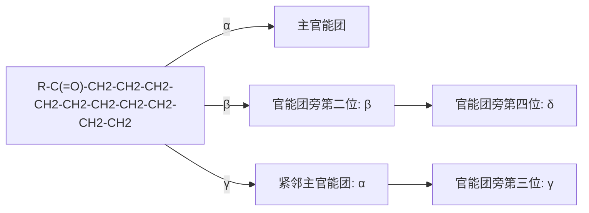
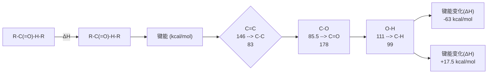
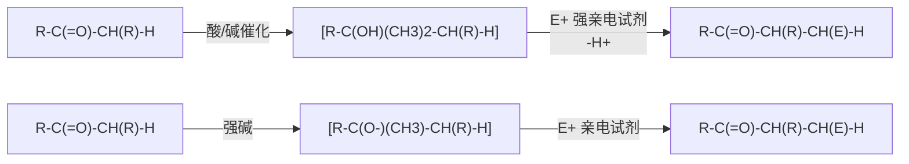
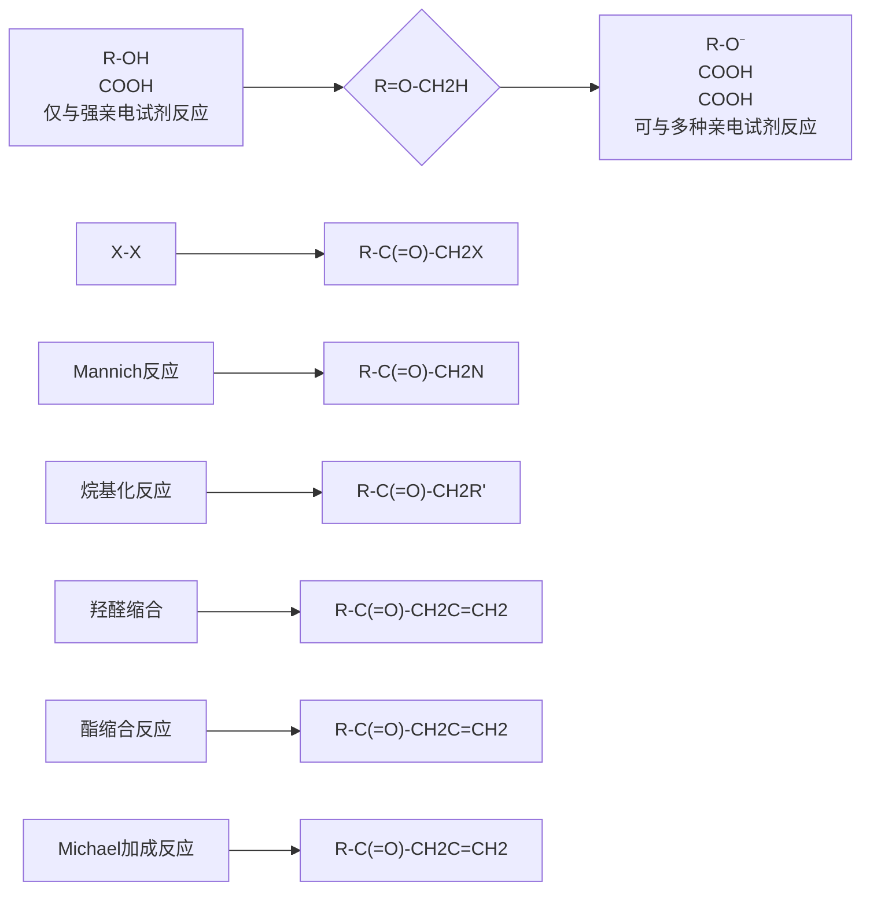
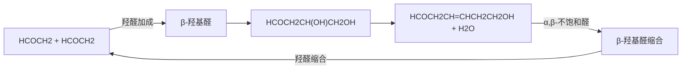
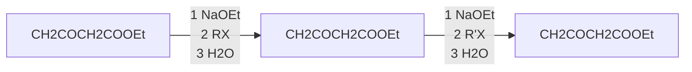
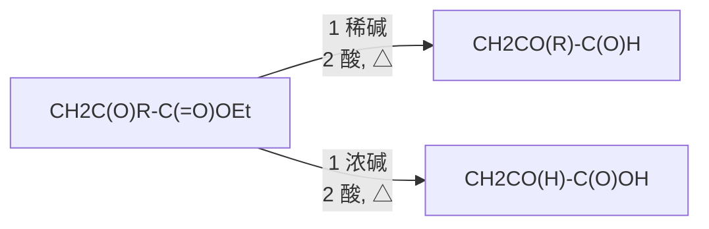
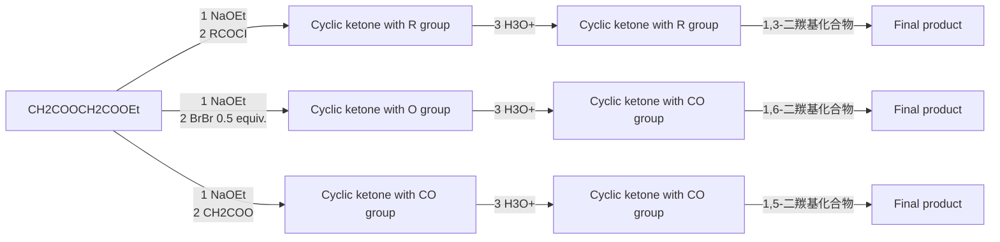

# 第十一章 羰基α-碳上的反应

原始 PDF 第 117–156 页。

## 第十一章

## 羰基 $\alpha$-碳上的反应

11.1 羰基化合物  $\alpha-$  氢的性质 …… 102
11.2 经由烯醇中间体的反应 …… 112
11.3 经由烯醇负离子中间体的反应 · 117

11.4 经由烯醇硅醚和烯胺的反应 … 133
习题 138

在第九、十章的学习中，我们了解到羰基化合物（包括醛、酮、羧酸及其衍生物）属于典型的亲电试剂，其羰基部分易于接受亲核试剂的进攻。同时，在羰基的相邻位置（$\alpha$ 位）具有氢原子的羰基化合物也可以在一定条件下被转化为亲核试剂，与亲电试剂发生反应，这种反应称为羰基 $\alpha$-碳上的反应。这类反应适用于在羰基化合物的 $\alpha$ 位形成新的碳-碳键和碳-杂原子键，是有机合成化学中最常用的反应之一。本章主要讨论含有 $\alpha$-氢的羰基化合物通过形成两类关键中间体——烯醇和烯醇负离子——发生亲核取代和加成反应的性质。

flowchart

对于含有羰基的化合物，化学家们习惯用希腊字母描述每个碳原子与羰基的邻近程度。羰基基团本身不编号，与其紧邻的碳原子称为 $\alpha-$ 碳，次紧邻的碳原子称为 $\beta-$ 碳，再次紧邻的碳原子称为 $\gamma-$ 碳，以此类推。连接在羰基化合物 $\alpha-$ 碳上的氢原子称为羰基化合物的 $\alpha-$ 氢，本章探讨在羰基化合物 $\alpha$ 位发生的反应。

## 11.1 羰基化合物  $\alpha-$  氢的性质

羰基化合物  $\alpha-$  氢的酸性大大强于普通烷烃中氢原子的酸性。我们要学习的羰基化合物  $\alpha-$  碳上的反应与这一特点紧密相关。

## 11.1.1 羰基化合物 $\alpha$-氢的酸性

在第一章中，我们学习了有机化学中的酸碱理论。对于羰基化合物中  $\alpha-$  氢的酸性，我们可以用以下平衡表示:

---

11.1 羰基化合物  $\alpha$ -氢的性质

103

chemical

Chemical reaction equation showing conversion of aldehyde to alkene and then to form products A and B

羰基化合物脱去质子形成羰基  $\alpha$  位碳负离子 A，其共振结构可以表示为 B，被称为烯醇负离子（enolate）。反应的平衡常数  $K_{a}$  可以表征羰基化合物  $\alpha-$  氢的酸性。通过结构分析可知，具有吸电子作用的羰基可以通过共轭效应和诱导效应稳定邻位的负电荷，因此羰基  $\alpha$  位 C-H 键的酸性远大于其他位置 C-H 键的酸性。

通过比较常见羰基化合物及其他酸性物质的 $\mathrm{pK_a}$ 数据，可以对羰基 $\alpha$ 位C-H键的酸性产生直观的印象。表11-1中给出了水中和二甲亚砜（DMSO）中的两组 $\mathrm{pK_a}$ 数据。

表 11-1 羰基化合物及相关有机物的 $\mathrm{pK}_{\mathrm{a}}$ 数据

| 化合物 |  |  |  |  |  |  |  |
| --- | --- | --- | --- | --- | --- | --- | --- |
| $pK_a(H_2O)$ | 16.7 | 19.3 | 16.7 | 24.5 | 29.4 | 28.9 | 10.2 |
| $pK_a(DMSO)$ | — | 26.5 | 25.8 | 29.5 | — | 31.3 | 17.2 |

同一种化合物在水中测得的  $pK_{a}$  与在有机溶剂中测得的  $pK_{a}$  往往有较大的差别。在水中，一般羰基化合物的  $pK_{a}$  在 16～29，说明羰基化合物  $\alpha-$  氢的酸性远强于普通烷烃中 C-H 键的酸性（ $pK_{a}\sim40$ ），一般弱于醇的酸性（ $pK_{a}=15\sim19$ ）。在 DMSO 中情况有所不同，羰基化合物  $\alpha-$  氢的酸性（ $pK_{a}=26\sim30$ ）略高于醇的酸性（ $pK_{a}=29\sim32$ ）。

可以将羰基 $\alpha$ 位C-H键看作一种“碳氢酸”，它与我们学习过的醇、酚、羧酸分子中的O-H键所代表的“氧氢酸”具有一定的相似性。值得注意的是，腈和硝基烷烃的 $\alpha$-氢同样具有酸性，它们与羰基化合物的 $\alpha$-碳具有相似的反应性。

当羰基化合物 $\alpha$ 位连接其他吸电子基团时，其酸性会进一步增强。例如，1,3-二羰基化合物的酸性与单羰基化合物相比可以提高几个数量级，相应的烯醇负离子更易形成。这一性质可以通过烯醇负离子的稳定化作用来解释:

chemical

Reaction mechanism diagram showing protonation and deprotonation steps with associated pKa values

1,3-二羰基化合物脱除  $\alpha$ -氢后形成的负离子可以被两个羰基共同稳定，可以看作负电荷分布在两个氧原子和一个碳原子上，因此比单羰基化合物  $\alpha$  位碳负离子更为稳定。以下是常见羰基化合物及其类似物的酸度系数范围（参考水中的数据）。

---

104

第十一章 羰基 $\alpha$-碳上的反应

chemical

Chemical structures of various compounds including nitrobenzene, 1,3-dinitrophenyl, aldehyde, phenol, and acrylonitrile with their respective pKa values.

## 11.1.2 酮式-烯醇式互变

在羰基化合物解离的平衡式中，我们可以发现烯醇负离子是一种两位负离子（ambident anion），具有负电荷分布在碳上和分布在氧上两种共振结构。烯醇负离子在酸碱平衡中获得质子时，既可以在  $\alpha-$  碳上发生质子化回到羰基化合物，也可以在氧上发生质子化，形成烯醇（enol）。

chemical

Reaction mechanism diagram showing oxidation of aldehyde to form aldehyde and then to alcohol, with H⁺ and H⁻ conditions indicated

通过上述平衡，羰基化合物与相应的烯醇发生互变异构，具有  $\alpha-H$  的羰基化合物及其烯醇形式互为互变异构体（tautomeric isomer）。实际上，形成上述平衡后羰基化合物的酮式与烯醇式一般共同存在。

对于一种羰基化合物酮式与烯醇式的稳定性，可以通过键解离能（bond dissociation energy，BDE）数据进行粗略估算（这里仅考虑了焓而忽略了熵的贡献）:

flowchart

由上式可见，由烯醇式变为酮式，体系的总键能增大，说明酮式比烯醇式更为稳定。这一能量差将导致酮式-烯醇式平衡强烈倾向酮式一方，因此，在酮式-烯醇式平衡中烯醇式仅占很小的比例。事实上，实验结果表明大部分常见羰基化合物以酮式为主要存在形式，烯醇式的比例一般在0.1%以内，如表11-2所示。

---

11.1 羰基化合物  $\alpha$ -氢的性质

105

表 11-2 一些羰基化合物的酮式-烯醇式平衡

<table><tr><td></td><td></td></tr><tr><td>K = 0.27</td><td>K = 99</td></tr></table>

从数据可以看出，一般而言  $\alpha-$  氢酸性越强的羰基化合物在酮式-烯醇式平衡中烯醇式的含量越高。其他可以稳定烯醇式的结构因素也会使酮式-烯醇式平衡向烯醇式移动，主要包括:① 烯醇碳碳双键上带有更多的取代基；② 烯醇的碳碳双键与其他基团共轭；③ 烯醇与其他基团形成分子内氢键。1,3-二羰基化合物的烯醇式含量显著高于单羰基化合物的烯醇式含量，是由于共轭效应和形成分子内氢键。

接下来分析羰基化合物酮式-烯醇式互变的机理。研究发现，这个互变异构可以在微量的碱或酸催化下进行。

以丙酮的酮式-烯醇式互变为例，碱催化的机理可以写成以下形式（以 $\mathrm{HO}^{-}$ 为催化剂）:

chemical

Chemical reaction mechanism showing hydrogen bonding and protonation steps between a ketone and an alkene

在第一步中，羰基化合物的 $\alpha$ 位被碱（$\mathrm{HO}^{-}$）去质子化形成烯醇负离子并同时生成 $\mathrm{H}_2\mathrm{O}$；随后烯醇负离子与前一步生成的 $\mathrm{H}_2\mathrm{O}$ 作用质子化形成烯醇，并重新生成 $\mathrm{HO}^{-}$。在这个过程中 $\mathrm{HO}^{-}$起到催化剂的作用，因此被称为碱催化的烯醇形成机理。

酸催化的机理可以写成以下形式（以  $H_{3}O^{+}$  作为催化剂）:

chemical

Hydrolysis reaction mechanism of acetic acid showing protonation and deprotonation steps

在第一步中，羰基首先被质子化，形成具有羟基稳定的碳正离子共振结构的活性中间体，其  $\alpha$  位的酸性显著增强。随后，这一质子化中间体羰基  $\alpha$  位去质子化形成烯醇，重新形成  $H_{3}O^{+}$ 。在这个过程中  $H_{3}O^{+}$ 起到催化剂的作用，因此被称为酸催化的烯醇形成机理。

在酸催化和碱催化的酮式-烯醇式异构化中都涉及相同的两个步骤——羰基的质子化和 $\alpha$ 位的去质子化，这两种机理的区别在于两个步骤的先后顺序。在碱性条件下，第一步是 $\alpha$ 位的去质子化，形成一个带负电荷的中间体；在酸性条件下，第一步是羰基的质子化，形成

---

106

第十一章 羰基 $\alpha$-碳上的反应

一个带正电荷的中间体。

在室温下，碱或酸催化的酮式-烯醇式异构化进行得非常迅速。即使体系中没有特意加入的碱或酸作为催化剂，羰基化合物仍会被盛放玻璃容器表面吸附的微量酸或碱催化而发生这种异构化。因此，在一般情况下羰基化合物会建立酮式-烯醇式的动态平衡，形成以更稳定异构体为主的混合物。烯醇异构体通常只少量存在，但它与相应的羰基化合物相比非常活泼，其 $\alpha$ 位具有亲核性，我们将会在11.2节中进行介绍。

虽然上述平衡反应可以看作一个异构化过程，但烯醇-OH基团中的质子并不一定来源于羰基化合物脱去的 $\alpha$-氢。因此，可以利用羰基化合物的酮式-烯醇式平衡，通过向体系中添加重水将其转化为 $\alpha$ 位氘代的羰基化合物。

$$
\mathrm{CH} _ {3} ^ {\mathrm{O}} \xrightarrow [ \mathrm{K} _ {2} \mathrm{CO} _ {3} , 6 5 ^ {\circ} \mathrm{C} ]{\mathrm{D} _ {2} \mathrm{O}} \mathrm{D} _ {3} \mathrm{C} \mathrm{C} = \mathrm{CD} _ {3}
$$

同样， $\alpha$  位有立体中心的羰基化合物的酮式-烯醇式平衡会导致立体中心的消旋化。若希望在反应中避免消旋化，涉及这类羰基化合物的反应一般需要避免使用强酸和强碱性条件。

从垂直于前手性面的方向向$\mathrm{sp}^{2}$碳原子看去，将该原子所结合的三个基团按顺序规则排列，若按照从大至小的顺序为顺时针方向，则此面记为$Re-$面；反之则记为$Si-$面。

chemical

Reaction mechanism diagram showing Si and Re surface attack on a cyclohexane derivative, involving hydroxyl and water oxidation steps

## 11.1.3 烯醇负离子的形成

含有  $\alpha-$  氢的羰基化合物与碱反应，可以得到烯醇负离子。

chemical

Chemical reaction equation showing benzene ring reacting with B⁻ to form a diester under DMSO conditions

弱碱不能完全攫取羰基化合物的 $\alpha-$ 氢，形成羰基化合物与烯醇负离子的混合物。使用强碱可以使上述平衡向右移动，使羰基化合物几乎完全转化为烯醇负离子。根据不同羰基化合物 $\alpha-$ 氢的 $\mathrm{p}K_{\mathrm{a}}$ 和强碱共轭酸的 $\mathrm{p}K_{\mathrm{a}}$ （表11-3），可以选择从羰基化合物形成烯醇负离子所需的碱。

表 11-3 常见碱及其共轭酸的 $\mathrm{p}{K}_{\mathrm{a}}$ 数据

| 碱 | NaOH | NaOEt | KO'Bu | NaH | $^i\mathrm {Pr}_2\mathrm {NLi}$ | $\mathrm {NaNH_2}$ |
| --- | --- | --- | --- | --- | --- | --- |
| 共轭酸 | $H_2O$ | EtOH | $^tBuOH$ | $H_2$ | $^i\mathrm {Pr}_2\mathrm {NH}$ | $NH_3$ |
| $pK_a(H_2O)$ | 15.7 | 16.0 | 19.2 | ~31 | ~36 | ~34 |
| $pK_a(DMSO)$ | 31.4 | 29.8 | 32.2 | — | — | 41 |

---

11.1 羰基化合物 $\alpha$-氢的性质

107

例如，以乙醇钠作为碱时，酮的  $\alpha$  位攫氢反应一般不能进行完全，会形成酮与相应烯醇负离子的平衡混合物；使用具有更强碱性的  ${}^{i}Pr_{2}NLi$  作为碱，或使用 NaH、KH 作为碱，使攫氢后生成的  $H_{2}$  离开反应体系，攫氢反应将不可逆地发生，将羰基化合物完全转化为烯醇负离子。

chemical

Chemical reaction mechanism showing carbocation and reduction of a ketone to form a lithium complex with hydrogen release

氨基金属化合物是最常用的强碱之一，下面列出了几种代表性氨基金属强碱的结构和名称缩写。它们的碱性相当，性状和在有机溶剂中的溶解度有所不同，常用于有机合成反应中。

chemical

Three lithium-based metal complexes with labeled ligands: LDA, LTMP, and KHMDS

对于酸性较强的羰基化合物，使用醇钠或醇钾等弱碱即可进行完全的攫氢反应，定量生成烯醇负离子。

由于  $\alpha$  位存在吸电性的共轭基团，这些化合物与普通羰基化合物相比酸性显著增强（上式中列出的是化合物在相应反应溶剂中的  $pK_{a}$ ）。它们在弱碱存在下即可生成稳定的烯醇负离子，在有机合成上有重要的应用（见 11.3.5 小节）。

## 11.1.4 烯醇与烯醇负离子形成的区域选择性

在前面两节中，我们学习了羰基化合物转化为烯醇与烯醇负离子两种重要的中间体。在学习它们的反应性之前，先简要讨论一下这两种中间体形成过程中的区域选择性。

例如，2-甲基环己酮形成烯醇或烯醇负离子时，烯醇或烯醇负离子可以通过攫取甲基取

在酸碱化学中，一般将表11-3中的碱均视为强碱（碱性强于 $\mathrm{HO}^{-}$）。然而，在羰基 $\alpha$-H的反应中，有机化学家习惯上将氢氧根负离子和醇负离子等不能定量把单羰基化合物去质子化的碱称为弱碱；将氢化钠、氨基钠、二异丙基氨锂等能定量将单羰基化合物去质子化的碱称为强碱。本章节中，我们也沿用这一说法。

---

108

第十一章 羰基 $\alpha$-碳上的反应

代碳原子上的 $\alpha$-氢形成，也可以通过攫取无甲基取代碳原子上的 $\alpha$-氢形成，这称为区域选择性。

chemical

Chemical reaction pathway showing conversion of cyclohexanol to ketone and then to cyclohexane with loss of a phenol group

烯醇或烯醇负离子形成的区域选择性决定了关键中间体的反应位点，对后续反应的结果具有重要影响。要分析这一问题，需要先判断反应由热力学控制还是动力学控制。

回顾在第一章学习过的反应势能曲线，对于反应前后吉布斯自由能变化较小的过程，反应具有可逆性，在反应条件下反应物与产物达到动态平衡。此时反应产物的分布由产物的热力学稳定性决定，这种控制方式称为热力学控制。对于反应后吉布斯自由能降低较多的过程，反应不可逆，此时反应产物的分布由相应过渡态的相对能量决定，这种控制方式称为动力学控制。

通过分析不难得出，酸、碱催化的羰基化合物酮式-烯醇式互变是一个可逆过程，其区域选择性是热力学控制的。用弱碱处理羰基化合物得到少量烯醇负离子的过程也是一个可逆的平衡过程，区域选择性同样由热力学控制。通过比较产物的热力学稳定性，可以分析得出反应的主要产物。

对于同一种羰基化合物,多取代的烯醇和烯醇负离子比少取代的烯醇和烯醇负离子更为稳定。这与烯烃的稳定性规律相同，由超共轭效应决定。因此，在热力学控制条件下，羰基化合物以生成多取代的烯醇和烯醇负离子为主。

chemical

对比烯醇与烯醇负离子的多取代和少取代稳定性，标注了不同化学形态

在低温下使用大位阻强碱攫取羰基化合物的 $\alpha$-H是不可逆的，反应单向发生，这一过程的区域选择性由动力学控制。碱攫取少取代的 $\alpha$-H时，过渡态结构中空间阻碍小，过渡态能量低，反应的能垒低；碱攫取多取代的 $\alpha$-H时，过渡态结构中空间阻碍大，过渡态能量较高，反应的能垒高。由于反应不可逆，这一过程将主要经由能垒较低的途径生成少取代的烯醇负离子。

chemical

Chemical reaction mechanism showing protonation of a ketone to form a cyclohexene derivative with δ⁻ counterion

位阻小，能垒低 $(\Delta G_{1}^{\ddagger})$

chemical

Chemical reaction mechanism showing protonation and deprotonation steps of a ketone derivative

位阻大，能垒高 $(\Delta G_{2}^{\ddagger})$

---

11.1 羰基化合物  $\alpha$ -氢的性质

109

我们可以用势能图描述上述区域选择性攫氢反应（图 11-1）。需要注意的是，为确保反应由动力学控制，需要在低温下进行反应（一般为  $-78^{\circ}C$ ）以确保攫氢反应不可逆。

chemical

Chemical reaction diagram showing the formation of a ketone and its subsequent loss of alkenes, with labeled free energy changes ΔG.

图11-1 $\alpha$-甲基环己酮与碱反应形成烯醇负离子的势能曲线

一般而言，使用大位阻强碱（如 LDA）在低温下进行攫氢，反应不可逆，羰基化合物形成动力学控制的烯醇负离子；而在室温下进行攫氢反应时，反应可逆性增强，主要形成热力学更稳定的多取代烯醇负离子。基于这一规律，通过对反应条件的控制，人们可以控制羰基化合物形成烯醇负离子的区域选择性，进一步控制羰基化合物  $\alpha-$  碳上反应的区域选择性（表 11-4）。

表 11-4 控制烯醇负离子形成的区域选择性

chemical

Chemical reaction showing oxidation of a ketone to form compounds A and B under strong reagent

| 强碱 | 反应温度/°C | A:B | 区域选择性控制 |
| --- | --- | --- | --- |
| $LiN^{i}Pr_{2}$ (LDA) | 0 | 99:1 | 动力学控制 |
| $KN(SiMe_{3})_{2}$ (KHMDS) | -78 | 95:5 | 动力学控制 |
| $LiCPh_{3}$ | -78 | 90:10 | 动力学控制 |
| $LiCPh_{3}$ | 25 | 10:90 | 热力学控制 |
| NaH | 25 | 26:74 | 热力学控制 |

扩展内容:烯醇负离子形成的立体选择性

当链状羰基化合物的 $\alpha$-碳上带有其他取代基时，所形成的烯醇负离子具有立体异构体，其碳碳双键可能取不同构型。烯醇负离子的构型在立体选择性合成中是一个重要因素。例如，不同构型的烯醇负离子形成的烯醇硅醚在Lewis酸促进的羟醛缩合反应中生成具有不同相对构型的产物（参见11.4.1小节）。

chemical

Chemical reaction equation showing conversion of ester aldehyde to cis- and trans- enantiomers via strong alkene

因此，控制羰基化合物形成烯醇负离子的立体选择性很重要。研究表明，羰基化合物的

---

110

第十一章 羰基 $\alpha$-碳上的反应

结构与所使用强碱的性质决定反应的立体选择性。使用 LDA 作为强碱，羰基上取代基 R 的位阻越大越有利于 cis-构型烯醇负离子的形成；反之，trans-构型烯醇负离子为主要产物。

chemical

Chemical reaction equation showing cis- and trans-lyl isomers with R group under strong alkene at -78°C

R基团结构影响 (强碱 = LDA)

| R | cis:trans |
| --- | --- |
| Et | 30:70 |
| iPr | 60:40 |
| OMe | 5:95 |
| $NEt_2$ | >97:&lt;3 |

碱和反应条件的影响 $(\mathsf{R} = \mathsf{Et})$

| 强碱 | cis:trans |
| --- | --- |
| LiHMDS | 66:34 |
| LDA | 30:70 |
| LTMP | 14:86 |
| LTMP + HMPA | 92:8 |

对于同一种羰基化合物，使用不同的碱可以调控 cis-和 trans-产物的比例。随着氨基强碱氮原子上取代基位阻的增大，trans-烯醇负离子逐渐成为主要产物。有趣的是，使用 LTMP 和六甲基磷酰三胺（HMPA，一种  $Li^{+}$ 的良好络合剂）的组合，反应的选择性可以被翻转，生成 cis-产物为主的产物。使用上述反应条件，可以实现烯醇负离子立体构型的按需调控。

烯醇负离子形成过程中的立体选择性可由椅式六元环模型进行解释。羰基化合物与氨基锂反应时，通过形成如下图所示的六元环过渡态发生  $\alpha-$  氢原子的攫取反应。根据  $\alpha$  位取代基所处位置的不同，可形成 trans- 和 cis- 两种过渡态，分别对应于两种烯醇负离子产物。在 trans- 过渡态中，羰基取代基 R 与  $\alpha-$  碳上的甲基处于邻近位置，相互排斥；而在 cis- 过渡态中， $\alpha-$  碳上的甲基与氨基锂上的 R' 取代基具有 1,3-二直立键排斥作用。

flowchart

当 R 基团较大时，trans-过渡态中的排斥作用显著，因此反应以产生 cis-构型烯醇负离子为主；反之当 R 基团较小时，cis-过渡态中的 1,3-二直立键排斥作用占主导地位，trans-产物将成为主要产物。当加入 Li 离子络合剂 HMPA 时，反应不再通过上述六元环过渡态进行，攫氢时羰基取代基 R 与  $\alpha$ -碳取代基的排斥作用是主要的相互作用，因此反应以产生 cis-产物为主。

## 11.1.5 羰基化合物 $\alpha$-碳的反应模式

我们已经熟悉，羰基化合物可以在适当的条件下形成烯醇和烯醇负离子。羰基  $\alpha-$  碳上的反应经由这两个关键中间体发生。分析两者的结构特征，可以发现它们都具有氧原子取代的碳碳双键结构。

chemical

Chemical reaction equations showing methanol and its negative ion forming a ketone

---

11.1 羰基化合物  $\alpha-$ 氢的性质

111

在烯醇和烯醇负离子中，氧原子上的孤对电子与  $\pi$  键形成  $p-\pi$  共轭，羟基或氧负离子上的孤对电子向双键供电子，使得碳碳双键更富电子。根据两者的共振结构，它们的负电荷主要集中在  $\alpha$  位，此位点具有亲核性。因此，这两类中间体共同的反应模式是使用它们的  $\alpha$  位进攻亲电试剂，形成羰基  $\alpha-$  碳上的取代产物。

flowchart

烯醇与烯醇负离子的区别在于:① 烯醇负离子带有负电荷，与烯醇相比具有更强的亲核性，能与之反应的亲电试剂种类更多；② 在烯醇负离子的两种共振极限结构中，负电荷可以分别集中于碳端（ $\alpha$  位）或氧端，烯醇负离子可以分别使用这两个位点进攻亲电试剂形成相应的产物，是一种两可亲核试剂（ambident nucleophile），反应的区域选择性受亲电试剂性质的影响。

chemical

Reaction mechanism diagram showing electron transfer and oxidation steps between carbonyl and ester groups

烯醇负离子

在后续的章节中将分别介绍以烯醇和烯醇负离子为关键中间体的羰基  $\alpha-$  碳上的反应。下式中简要总结了所涉及的反应类型。

flowchart

---

112

第十一章 羰基 $\alpha$-碳上的反应

事实上，烯醇和烯醇负离子可以与一系列亲电试剂发生取代和加成反应，生成结构多样的  $\alpha$ -官能化产物，在有机合成中具有重要的应用。

## 11.2 经由烯醇中间体的反应

羰基化合物在酸或碱的催化下可以形成烯醇中间体，之后与亲核试剂（E-X）作用，在 $\alpha$ 位发生取代反应形成C-E键，之后再脱去质子形成羰基 $\alpha$ 位取代的产物。净反应是羰基化合物与亲电试剂E-X发生反应，产生取代产物和HX。

chemical

Reaction mechanism showing weak acid/acid catalysis to form a protonated alkene with protonation steps

需要注意的是，由于大多数羰基化合物酮式-烯醇式平衡中烯醇式的含量很低，并且烯醇中间体的亲核性有限，因此需要使用活性较强的亲电试剂（如卤素、亚胺正离子等）才能发生反应。

## 11.2.1 $\alpha$-卤化反应

卤素单质常用作向有机分子内引入卤素取代基的试剂。溴和氯单质是强亲电试剂，可以与羰基化合物产生的烯醇中间体作用生成  $\alpha-$  卤代羰基化合物。醛/酮和羧酸的  $\alpha-$  卤化反应在有机合成中应用广泛，反应产生的  $\alpha-$  卤代醛/酮和  $\alpha-$  卤代羧酸可以被进一步转化为多样的  $\alpha-$  取代产物，是重要的合成中间体。

## 1. 酮的  $\alpha-$  卤化反应

在酸催化的条件下，醛和酮可以和卤素生成  $\alpha-$  卤代醛/酮。例如，环己酮的溴化反应:

chemical

Chemical reaction equation showing bromination of cyclohexenone under acidic conditions

反应可在多种溶剂中进行，例如乙酸、水、氯仿、N,N-二甲基甲酰胺等；可以使用HBr、$\mathrm{H}_2\mathrm{SO}_4$ 、TsOH等强酸作为催化剂。由于醛容易被卤素单质氧化为羧酸，酮比醛更常用于这一反应。反应的机理可以描述如下:

flowchart

首先，环己酮通过酸催化的烯醇化过程（参见11.1.2小节）形成烯醇中间体；之后富电子的烯醇中间体进攻溴单质，生成质子化的 $\alpha$-溴代环己酮；质子解离后生成 $\alpha$-溴代环己酮产物并释放出HBr。

---

11.2 经由烯醇中间体的反应

113

有两个有趣的实验现象值得注意。第一，反应可以在不加入酸催化剂的情况下发生，开始反应很慢，但会逐渐加速。这是由于反应会产生强酸 HBr 作为副产物，而 HBr 可以催化烯醇中间体的生成，因此，这一反应具有自催化（autocatalytic）特性，也就是说反应产物之一即为反应的催化剂。第二，反应速率与卤素的浓度或种类无关，说明卤素没有参与这个多步反应的决速步。因此，烯醇中间体的形成是反应的决速步，反应的势能曲线如图 11-2 所示。

line

| Reaction Stage | Products |
| --- | --- |
| 烯醇形成 (慢) | Ethanol + Br2 |
| 烯醇卤化 (快) | Ethanol + Br2 + HBr |

图 11-2 环己酮  $\alpha-$  溴化反应的势能曲线

上述势能曲线中烯醇形成与烯醇卤化各自被简化为一个步骤。势能曲线中的慢步骤（烯醇形成）具有较高的活化能，而快步骤（烯醇卤化）具有较低的活化能。

非对称取代的酮发生  $\alpha-$  卤化反应时，卤化反应主要发生在多取代的一侧。

chemical

Organic reaction scheme showing bromination of a cyclohexanone under Br2/Et2O conditions to yield products 96, 3, and 1

2-甲基环己酮的溴化反应生成2-溴代产物和6-溴代产物的混合物。反应具有良好的区域选择性，2-溴代产物是主要产物，说明溴化反应主要发生在酮羰基多取代的一侧。因为酮的卤化反应中烯醇中间体的形成是反应的决速步，而烯醇的卤化是一个不可逆过程，两种烯醇的形成速率决定最终卤化产物的比例。一般情况下，热力学更稳定的多取代的烯醇形成速率更快，因此非对称取代酮的 $\alpha-$ 卤化反应主要发生在多取代的一侧。

chemical

Chemical reaction equation showing hydrogenation of a cyclohexane derivative with water under acidic conditions to form hydroxyl groups, and subsequent stabilization.

酮在碱性条件下也可以发生卤化反应。在氢氧根负离子作为碱时，酮可以经由烯醇负离子发生  $\alpha-$  卤化反应。这种卤化反应与酸催化的卤化反应相比活性更高，可将酮的所有  $\alpha-$  氢全部卤化。我们将在 11.3.1 小节中进行学习。

醛和酮的  $\alpha-$  卤化产物是一类非常有用的合成中间体。其中的碳-卤键可以被亲核试剂所取代，生成不同的  $\alpha-$  取代醛/酮产物。

仔细分析这一势能曲线，可以发现烯醇的形成步骤是不可逆的。也就是说，烯醇中间体形成之后会快速与  $Br_{2}$  发生反应生成产物，而不会再通过酮式-烯醇式互变重新形成环己酮。这一结论似乎与 11.1.2 小节中所述的酮式-烯醇式互变是一个可逆平衡的说法相矛盾。然而，这正体现了化学平衡的单独存在状态与反应条件下状态的区别。在没有  $Br_{2}$  存在时，仅有酮式-烯醇式互变存在，反应是可逆的平衡；在加入  $Br_{2}$  后，上述反应形成的烯醇式可以被迅速消耗而不能再发生逆向过程回到酮式。因此，在溴化反应条件下，环己酮形成烯醇的过程是不可逆的。这与羰基化合物的酮式-烯醇式互变是一个可逆平衡的特性并不矛盾。

---

114

第十一章 羰基 $\alpha$-碳上的反应

chemical

Two chemical reaction equations showing chlorination and phosphorus reduction steps with reagents and conditions

取代反应一般通过  $S_{N}2$  机理，而不是  $S_{N}1$  机理进行。与普通烷基卤代物相比， $\alpha-$ 卤代醛/酮发生  $S_{N}2$  反应的活性更高，而发生  $S_{N}1$  反应的活性低得多（请思考为什么）。

α-取代醛/酮在碱性条件下可以发生消除反应。顺序使用 α-卤化反应和消除反应，可以从酮制备 α,β-不饱和醛/酮。

chemical

Chemical reaction pathway showing bromination and reduction steps of a ketone to form an imidazolone

## 2. 羧酸的卤化反应

前面学习到使用卤素作为卤化试剂可以使醛/酮发生  $\alpha-$  卤化反应。然而，这个合成方法却对羧酸、酯、酰胺等化合物无效。这是因为这些羧酸衍生物不易通过酮式-烯醇式互变转化为烯醇式，因此难以与卤素发生  $\alpha-$  卤化反应。

化学家发现，在  $PBr_{3}$  存在的条件下羧酸可以与  $Br_{2}$  发生  $\alpha-$  溴化反应，这一反应被称为 Hell-Volhard-Zelinsky 反应。

chemical

Chemical reaction equation showing bromination of a ketone to form a hydroxy ester

如果不加入  $PBr_{3}$ ，溴化反应并不发生。一般认为，反应是通过酰溴中间体进行的:

chemical

Chemical reaction pathway showing conversion of aldehyde to bromoalkene and bromoacetate via PBr3 and bromoacetate intermediates

羧酸首先与 $\mathrm{PBr}_3$ 形成酰溴。由于酰卤基团的强吸电子作用，酰溴 $\alpha$-氢的酸性远强于羧酸 $\alpha$-氢的酸性，易于形成烯醇中间体。烯醇形成后作为亲核试剂与 $\mathrm{Br}_2$ 发生卤化反应，生成 $\alpha$-溴代酰溴。反应结束之后，经过水解处理即可获得 $\alpha$-溴代羧酸。

由于酰溴与羧酸之间可以通过平衡反应进行酰溴交换，在反应中使用催化量的 $\mathrm{PBr}_3$ 即可促进羧酸 $\alpha$-溴化反应的发生，在反应中直接生成 $\alpha$-溴代羧酸产物。

chemical

Chemical reaction equation showing brominated alkene reacting with an aldehyde to form a ketone

根据上述反应机理可以推断，直接以酰氯或酰溴作为原料与  $Br_{2}$  反应即可生成  $\alpha-$  溴代产物，而无须使用  $PBr_{3}$ ；使用催化量的酰氯、酰溴或其他可以将羧酸转化为酰卤的试剂代替  $PBr_{3}$ ，反应同样可以发生。

由于其他羧酸衍生物并不能像羧酸一样被原位转化为酰卤，它们不能使用 Hell-Volhard-Zelinsky 反应进行  $\alpha-$  卤化反应。要使它们发生  $\alpha-$  卤化反应，可以使用经由烯醇负离子的卤化方法（参见 11.3.1 小节）。

与单羰基化合物不同， $\alpha-$ 氢酸性较强的羰基化合物具有较高的烯醇式比例，可以无须转化为酰卤直接发生 $\alpha-$ 卤化反应。例如，丙二酸和丙二酸二乙酯均可直接与溴发生 $\alpha-$ 溴化反应。

---

11.2 经由烯醇中间体的反应

115

chemical

Two-step organic reaction equations showing bromination and hydroacetylation steps

## 11.2.2 Mannich 反应

1912年，德国有机化学家Carl Mannich发现，一分子带有 $\alpha$-氢的羰基化合物（一般为酮）、一分子醛和一分子二级胺可以发生缩合反应，生成 $\beta$-氨基羰基化合物。

chemical

Chemical reaction equation showing the synthesis of Mannichic acid from α-hydroxyethylhydrazine and hydrazine under acidic conditions

由于反应产物  $\beta-$  氨基羰基化合物具有碱性而被称为 Mannich 碱，这个反应被称为 Mannich 反应。

反应通过烯醇与亚胺正离子的反应发生，反应分两个步骤进行。在反应混合物中同时存在两种羰基化合物——活性醛与具有 $\alpha$-氢的羰基化合物。在酸催化下，二级胺与活性醛首先发生反应生成亚胺正离子，作为亲电试剂。接下来，具有 $\alpha$-氢的羰基化合物发生酮式-烯醇式互变生成烯醇中间体，作为亲核试剂进攻前一步形成的亚胺正离子。生成的加成产物脱去质子后形成 Mannich 碱。

chemical

Reaction mechanism diagram showing protonation and deprotonation steps of a carbocation intermediate

可以看出，Mannich 反应的本质是亲核性的烯醇与反应体系中原位生成的亲电性亚胺正离子的加成反应。遵循这个反应机理，我们可以识别和理解很多 Mannich 反应的“变形”形式:

chemical

Chemical reaction mechanism showing protonation and deprotonation steps of a carbocation intermediate

---

116

第十一章 羰基 $\alpha$-碳上的反应

在上面的反应中，所用的氨基化合物是碳酰胺而不是二级胺，它与苯甲醛缩合后生成碳酰亚胺作为亲电试剂，而不是标准 Mannich 反应机理中给出的亚胺正离子。由于氮原子上连接了酰基，碳酰亚胺的亲电性强于一般的亚胺的亲电性，因此也可以被 1,3-二羰基化合物形成的烯醇所进攻，形成相应的加成产物。

使用一级胺代替二级胺进行 Mannich 反应，将会产生一种有趣的情形:

chemical

Chemical reaction pathway showing Mannich reagent formation steps with R¹CHO and H₂N-R² under acidic conditions

由于一级胺参与 Mannich 反应的产物是带有二级胺结构的 Mannich 碱，其中的氨基还可以继续和醛发生反应生成亚胺正离子。因此一级胺可以发生两次 Mannich 反应，生成带有 2 个 β-氨基羰基化合物结构的 Mannich 反应产物。

Mannich 反应是我们学习的为数不多的三组分反应。变换反应组分，即可合成具有丰富结构的 Mannich 碱产物。如果将两个甚至三个组分置于同一分子内，可以通过分子内 Mannich 反应构建具有环状结构的 Mannich 碱，在复杂分子的合成中具有重要的应用。

Mannich 反应最有名的应用之一是 Robert Robinson 于 1917 年报道的颠茄酮的合成:

chemical

Chemical reaction equation showing the synthesis of a cycloalkane derivative from an amino acid and carboxylic acid under acidic conditions

反应巧妙地使用双官能团的活性醛化合物和1,3-二羰基化合物与一级胺，实现了两次连续的Mannich反应，最终Mannich碱产物发生脱羧反应生成颠茄酮。与Richard Willstatter在1902年报道的颠茄酮合成相比，Mannich反应将合成路线由21步直接缩短到2步，充分体现了新反应为复杂分子合成带来的革命性影响。

Mannich 反应在现代有机合成研究中同样具有重要的地位，是有机合成化学家构建复杂含氮分子骨架的常用方法之一。例如，我国科学家合成生物碱天然产物 arboridinine 的过程中巧妙利用多羰基化合物与甲醛和苄胺发生两次 Mannich 反应，使用一锅反应高效地合成了天然产物的三维立体骨架。

---

11.3 经由烯醇负离子中间体的反应

117

chemical

Chemical reaction scheme showing the synthesis of arboridinine from 2CH₂O and H₂N-CH₂Ph with Me group, yielding a fused ring system with Mannich reagent.

## 11.3 经由烯醇负离子中间体的反应

具有 $\alpha$-氢的羰基化合物在碱性条件下可以形成烯醇负离子。与烯醇相比烯醇负离子的亲核性更强，可以与更多种类的亲电试剂发生反应，带来更为丰富的羰基 $\alpha$-碳上的反应。在这一章节中，我们将着重介绍羰基化合物经由烯醇负离子中间体的反应。

## 11.3.1 羰基化合物在碱性条件下的 $\alpha$-卤化反应

## 1. 醛/酮在碱性条件下的  $\alpha$ -卤化反应

在 11.2.1 小节中，我们学习了醛/酮在酸性条件下与卤素发生  $\alpha-$  卤化反应的性质。类似的反应也可以在碱性条件下发生。

chemical

Chemical reaction showing bromination of a ketone under basic conditions to form a carbonyl compound with NaOH

反应机理如下所示，首先羰基化合物与碱反应生成烯醇负离子；之后强亲核性的烯醇负离子进攻卤素形成  $\alpha-$  卤代产物。

chemical

Reaction mechanism diagram showing slow and fast reaction pathways of a ketone with bromoalkyl groups

实验表明，反应速率与羰基化合物和碱的浓度成正比，而与卤素的浓度和种类无关。这与酸性条件下羰基化合物的 $\alpha$-卤化反应相似。这是因为烯醇负离子与卤素反应的活性很高，一旦形成即可快速与卤素反应，因此碱攫取羰基化合物的 $\alpha$-氢形成烯醇负离子一步是决速步骤。反应中无须使用强碱定量生成烯醇负离子，使用弱碱 NaOH 持续生成少量烯醇负离子即可使反应发生。

在  $\alpha-$  卤化反应发生后，由于卤素的吸电子作用， $\alpha-$  卤代醛/酮的  $\alpha-$  氢具有更强的酸性，更易被去质子而再次发生卤化反应，直到所有的  $\alpha-$  氢全部被卤素取代。因此，与酸性条件下的卤化反应不同，碱性条件下的醛/酮的卤化反应很难获得纯净的单卤化产物。

当使用过量的碱和卤素处理甲基酮时，产物并不是三卤甲基酮，而是一种羧酸:

---

118

第十一章 羰基 $\alpha$-碳上的反应

chemical

Chemical reaction equation showing bromination and oxidation of a ketone to form an alcohol

反应首先生成三卤甲基酮，之后过量的氢氧根负离子进攻酮羰基，三卤甲基（此处为三溴甲基）被羟基所取代。

chemical

Organic reaction mechanism showing bromination and hydrolysis steps with reagents and conditions

因为三卤甲基上的负电荷可以被三个卤原子的吸电子诱导效应所稳定，三卤甲基负离子具有一定的稳定性。这可以从三氯甲烷在水中的酸度系数（$\mathrm{pK_a = 24.1}$）得到证实。因此，与酰基相连的三卤甲基可以作为离去基团被其他亲核试剂所取代，生成三卤甲烷和羧酸盐。

使用  $Cl_{2}$ 、 $Br_{2}$ 、 $I_{2}$  进行上述反应可以分别获得三氯甲烷（氯仿）、三溴甲烷（溴仿）和三碘甲烷（碘仿），因此这一反应被称为卤仿反应（haloform reaction）。

chemical

Two organic reaction equations showing cycloaddition of a ketone to form an alcohol and its subsequent chlorination with methyl chloride

由于三碘甲烷易于从反应溶液中结晶析出黄色晶体，化学家曾用碘仿反应作为鉴定甲基酮的方法。

## 2. 羧酸衍生物在碱性条件下的  $\alpha-$  卤化反应

对于 $\alpha$-氢酸性较弱而不易形成烯醇负离子的羧酸衍生物，使用上述适用于醛/酮卤化反应的方法往往不能获得良好的结果。使用强碱将这些化合物定量转化为烯醇负离子，可以实现它们的卤化反应。由于烯醇负离子的亲核性很高，往往使用亲电性更弱、更温和的卤化试剂来代替卤素单质，如NBS、$\mathrm{CBr_4}$ 等。

chemical

Organic synthesis reaction pathway showing LDA oxidation to a diol using CBr4 and H3O+ reagents

在上述反应中，使用过量的强碱 LDA 将羧酸先转化为羧酸锂盐，再去质子形成双烯醇负离子作为亲核试剂。这种卤化反应中没有以高活性的卤素单质作为试剂，因此可以使用分子内带有双键的羰基化合物作为原料。使用四卤化碳作为卤化试剂时，烯醇负离子进攻与碳原子相连的卤素，使 C-X 键发生异裂反应生成较为稳定的三卤甲基负离子，与卤仿反应的原理相似。

chemical

Chemical reaction equation showing oxidation of a carbonyl compound to form a substituted alkene with X and Cl/Br substituents

---

11.3 经由烯醇负离子中间体的反应

119

## 11.3.2 $\alpha$-烷基化反应

经由烯醇负离子，羰基化合物可以发生  $\alpha$ -烷基化反应。

chemical

Two-step organic synthesis reaction scheme: cyclopropyl ketone reacts with LDA/THF under PhCH2Br, then to form a cyclic ketone with phenyl and ethyl ester, followed by the formation of a ketone with KOtBu/DMF and MeI.

反应一般分为两个步骤:① 在强碱性条件下，羰基化合物被完全转化为相应的烯醇负离子；② 烯醇负离子作为亲核试剂进攻烷基化试剂（最常用卤代烷）。

chemical

Chemical reaction mechanism showing benzene ring release and methylation step

羰基化合物的 $\alpha$-烷基化反应中，烯醇负离子形成的区域选择性决定了烷基化反应的区域选择性。为确保烯醇负离子完全生成，应选用强碱[如LDA、$\mathrm{LiN(SiMe_3)_2}$ 和NaH等]进行反应。对于非对称取代酮的 $\alpha$-烷基化反应，使用大位阻强碱在低温下反应获得动力学优势的烯醇负离子，使用小位阻强碱在稍高的温度下反应获得热力学稳定的烯醇负离子（见11.1.3小节和11.1.4小节）。羧酸衍生物的 $\alpha$-烷基化反应没有区域选择性问题。

chemical

Chemical reaction scheme showing methylation of a ketone under LDA at -78°C and NaH reagent, followed by methylation to form two different aldehyde products.

烯醇负离子的烷基化过程按照  $S_{N}2$  机理发生。因此，烷基化反应遵循  $S_{N}2$  反应的一般规律和底物限制。烯醇负离子是一种强碱性强亲核性试剂，与  $1^{\circ}$  卤代烷发生  $S_{N}2$  反应最合适。当使用  $2^{\circ}$  或  $3^{\circ}$  卤代烷作为烷基化试剂时，往往主要生成消除产物。

扩展内容:羰基化合物的不对称  $\alpha$ -烷基化反应

当羰基化合物的 $\alpha$-碳是一个亚甲基或次甲基时，烷基化反应将形成一个新的立体中心。使用分子内无手性元素的羰基化合物进行反应，由于烯醇负离子中间体具有对称面，可以从两面等概率地进攻烷基化试剂，因此得到的烷基化产物是一对外消旋体。化学家们希望能够通过烷基化反应实现羰基化合物 $\alpha$ 位立体中心的不对称构建，发展了一种不对称诱导的烷基化反应。

chemical

Chemical reaction pathway showing transformation from a chiral amine precursor to a diester with R²-X reagent, involving LDA and R¹ substituents

---

120

第十一章 羰基 $\alpha$-碳上的反应

chemical

Chemical reaction scheme showing the synthesis of a cyclic amide from a thioether precursor using LDA and R²-X reagents

使用具有立体中心的酰胺作为起始物，形成的烯醇负离子不再具有对称面，两个面进攻烷基化试剂的速率不同。通过这一手性诱导过程，可形成某一面进攻为主的 $\alpha$-烷基化产物，新形成的立体中心的构型由手性酰胺的结构决定。在这个过程中，手性胺结构称为“手性诱导辅基”。生成烷基化产物后，可以通过水解反应将手性诱导辅基脱去形成羧酸产物。

## 11.3.3 羟醛缩合反应

烯醇负离子与另一分子羰基化合物的反应代表了一大类羰基 $\alpha$-碳上的缩合反应，应用在多种有机化学品的合成中。其中最具代表性的实例是羟醛缩合反应:烯醇负离子中间体作为亲核试剂，对另一分子醛或酮的羰基发生亲核加成反应，形成新的C-C键。

## 1. 羟醛缩合反应的机理

以两分子醛发生的羟醛缩合反应为例了解其反应过程，整体分为两步。首先，在稀碱溶液中，两分子醛发生反应生成  $\beta-$  羟基醛，也称为羟醛加成。然后， $\alpha-$  碳上有氢原子的  $\beta-$  羟基醛受热容易失去一分子水，生成  $\alpha,\beta-$  不饱和醛。

flowchart

以上步骤的详细机理解析如下:首先，碱促进醛发生去质子化反应生成烯醇负离子，这一步骤与碱促进的卤仿反应启动步骤相似。在弱碱条件如氢氧化钠溶液中，醛生成烯醇负离子在热力学上不利，反应平衡偏向于醛一侧，因此仅生成较低浓度的烯醇负离子。第二步，烯醇负离子对另一分子醛或酮发生亲核加成反应，形成新的C-C键。最终，新生成的醇氧负离子中间体与反应体系中的质子结合，生成 $\beta$-羟基醛。

第一步:形成烯醇负离子

---

11.3 经由烯醇负离子中间体的反应

121

在碱促进下，$\beta$-羟基醛的 $\alpha$-氢被移除。这一反应得到的烯醇负离子中的羟基作为离去基团从分子中解离，从而生成一个 C=C 键并得到 $\alpha, \beta$-不饱和醛。这一步骤是典型的 E1cb 反应，也是有机化学中为数不多的消除氢氧根负离子的过程。

chemical

Chemical reaction mechanism showing β-羟基醛 and α,β-不饱和醛 reactions with oxidation/deprotonation steps

注意，通过羟醛缩合反应生成 $\beta-$ 羟基醛或 $\beta-$ 羟基酮的各个基元反应步骤均为可逆反应，在弱碱性条件下，通常存在醛与 $\beta-$ 羟基醛、酮与 $\beta-$ 羟基酮之间的平衡反应。对于醛，生成 $\beta-$ 羟基醛具有较强的热力学驱动力，例如室温下正丁醛在氢氧化钠水溶液中有 $75\%$ 转化为对应的羟醛缩合产物，即2-乙基-3-羟基己醛。然而，在同样的弱碱性条件下，环己酮仅有$20\%$ 以对应的羟醛缩合产物形式存在。这是由于酮比醛稳定，羟醛缩合反应驱动力小。

β-羟基醛/酮化合物在碱促进下脱水生成  $\alpha,\beta-$  不饱和醛/酮的反应具有很强的热力学驱动力，反应不可逆，因此会拉动缩合反应平衡向产物一侧移动。因此，在加热条件下，环己酮即可在弱碱溶液中 100% 转化为  $\alpha,\beta-$  不饱和酮。生成 C=C 键的立体化学也由该步骤决定，反应倾向于生成位阻小、热力学上更稳定的 E 式烯烃。

chemical

Chemical reaction equation showing conversion of acetaldehyde to E-type and Z-type alcohols under NaOH and heating

## 2. 非定向交叉羟醛缩合

从以上羟醛缩合反应的机理和产物可知，至少有一种反应物醛/酮必须具有  $\alpha-$  氢才能够生成烯醇负离子参与后续反应。那么，如果用两种均含有  $\alpha-$  氢的醛参与羟醛缩合反应，能够得到多少种缩合产物？

以乙醛和丙醛的羟醛缩合反应为例，反应具有以下四种可能的途径:①乙醛在弱碱性条件下生成烯醇负离子，对丙醛亲核加成后质子化，得到3-羟基戊醛；②丙醛生成烯醇负离子，对乙醛亲核加成后质子化，得到3-羟基-2-甲基丁醛；③乙醛生成烯醇负离子后与另一分子乙醛发生反应，得到3-羟基丁醛，而丙醛未参与反应；④两分子丙醛之间发生反应，得到3-羟基-2-甲基戊醛。由此可以看出，两种均含有 $\alpha$-氢的醛参与羟醛缩合反应一共得到4种产物，选择性低，不具备实用价值。

chemical

Chemical reaction equation showing acetylation of aldehyde with sodium hydroxide to form 4-羟醛缩合产物混合物

(1) 丙醛烯醇负离子对乙醛的加成

chemical

Chemical reaction diagram showing oxidation of a ketone to form an aldehyde, with curved arrows indicating electron transfer or reaction direction.

(3) 乙醛烯醇负离子对乙醛的加成

chemical

Chemical reaction equation showing oxidation of a ketone to form an aldehyde

未参与反应

(2) 乙醛烯醇负离子对丙醛的加成

chemical

Chemical reaction equation showing oxidation of a ketone to form an aldehyde

(4) 丙醛烯醇负离子对丙醛的加成

chemical

Chemical reaction equation showing oxidation of a ketone to form an aldehyde

未参与反应

---

122

第十一章 羰基 $\alpha$-碳上的反应

那么，如何提高羟醛缩合反应的选择性，得到单一的缩合产物？对于两分子醛的分子间缩合，可使用一个没有 $\alpha$-H 的醛（不可烯醇化）与另一个有 $\alpha$-H 的醛（可烯醇化）发生交叉羟醛缩合，这类反应也称为 Claisen-Schmidt 缩合反应。为了避免有 $\alpha$-H 的醛自身缩合，通常需要在碱性条件下，将有 $\alpha$-H 的醛缓慢加入无 $\alpha$-H 的醛。甲醛、苯甲醛、新戊醛等没有 $\alpha$-H 的醛均可作为交叉羟醛缩合反应起始物。

chemical

Chemical reaction equation showing oxidation of a ketone to form an enone under acidic conditions

交叉羟醛缩合反应的应用之一是合成季戊四醇等多元醇及树枝状高分子。利用乙醛与三分子甲醛在氢氧化钙促进下发生三次羟醛缩合反应得到三羟甲基乙醛，再与一分子甲醛发生Cannizzaro反应即可得到季戊四醇。

当发生羟醛缩合反应的起始物是二醛或二酮等双羰基化合物时，在弱碱性条件下发生分子内羟醛缩合比分子间缩合熵更有利。由于生成环状烯烃更稳定，缩合反应的 $\beta-$ 羟基醛或酮更易在温和条件下脱水，得到环状 $\alpha, \beta-$ 不饱和醛/酮。具有两种 $\alpha-$ 氢的二酮化合物发生分子内羟醛缩合反应时，不同 $\alpha-$ 碳位点形成烯醇负离子后对另一酮羰基的亲核加成将可能得到混合物。由于弱碱性条件下去质子化得到烯醇负离子及分子内亲核加成均可逆，反应通常得到张力最小的环。例如，在氢氧化钠水溶液加热条件下，己-2,5-二酮发生分子内羟醛缩合反应时，1位发生去质子化后与5位的羰基缩合生成环张力较小的五元环，最终得到的主要产物是3-甲基环戊-2-烯酮。3位虽然也能够形成烯醇负离子，但其与5位羰基缩合将形成一个高张力的三元环，反应平衡导致最终形成热力学更稳定的五元环产物。

flowchart

## 3. 定向交叉羟醛缩合

另一种策略，则是利用强碱将羰基化合物定量转化为烯醇负离子，再与另一分子醛反应，从而避免作为亲电试剂的醛自身缩合。该类型反应称为定向羟醛缩合反应。例如，利用酮不易发生自身羟醛缩合反应的性质，在强碱条件下形成稳定的烯醇负离子，再与醛反应。分步反应可以避免醛和酮的自身缩合。

chemical

Organic reaction scheme showing oxidation of a ketone to an enolate using Pr2NLi catalyst, followed by acylation with water and hydrogen peroxide

---

11.3 经由烯醇负离子中间体的反应

123

## 4. 羟醛缩合的可逆性

羟醛缩合具有可逆性。 $\beta-$ 羟基羰基化合物在弱碱性条件下，首先发生羟基的去质子化得到烃氧基负离子。该中间体发生消除反应，切断 $\alpha$ 位与 $\beta$ 位之间的C-C键，并生成一个新的C=O键。这一过程中，烃氧基负离子可类比于羧酸衍生物酰基碳亲核加成后得到的碳四面体中间体，其消除反应将一个烯醇负离子作为离去基团。

chemical

Chemical reaction mechanism showing proton transfer and deprotonation of a ketone to form a ketone, with electron transfer and proton movement indicated.

## 5. Perkin 反应和 Darzens 反应

很多羰基化合物 $\alpha$-碳上的缩合反应看似复杂多样，但其反应机理本质与羟醛缩合相似，均涉及烯醇负离子或其类似物对醛或酮的亲核加成。这些反应与羟醛缩合反应的差别在于生成烯醇负离子的反应物不同。本节以Perkin反应和Darzens反应为例说明如何通过羟醛缩合反应的机理理解醛或酮作为亲电试剂的缩合反应。

首先介绍 Perkin 反应。早在 1868 年，化学家 Perkin 发现了水杨醛钠盐与乙酸酐在加热条件下发生缩合和环化得到香豆素类化合物，并在随后发展出不含有  $\alpha-H$  的芳香醛（如苯甲醛）与含有  $\alpha-H$  的有机酸酐在碱催化下发生缩合得到  $\alpha,\beta-$  不饱和羧酸盐的反应，并被称为 Perkin 反应，在有机合成中有重要应用。形式上，可以理解为酸酐的  $\alpha-$  碳与醛羰基碳之间形成新的 C=C 键并消除一分子水。

chemical

Chemical reaction equation showing oxidation of aldehyde to acyl alcohol and subsequent hydrolysis of α,β-unsaturated羧酸

以乙酸酐与醛的反应为例，该反应形成新 $\mathrm{C = C}$ 键的关键步骤是乙酸酐去质子化的烯醇负离子对醛的亲核加成反应，得到醇氧负离子中间体。随后该中间体发生分子内酰基转移，将乙酸酐未被去质子一侧的酰基转移到醇氧负离子，并释放一个羧基负离子用于与另一分子乙酸酐反应后再发生一步酰基转移生成混合酸酐。在碱促进下，混合酸酐 $\alpha -\mathrm{H}$ 去质子化引发消除反应，释放乙酸根负离子并生成 $\alpha ,\beta -$ 不饱和羧酸乙酸酐，后者水解即得到最终产物 $\alpha ,\beta -$ 不饱和羧酸。

chemical

Reaction mechanism diagram showing acylation and hydrolysis steps of a ketone derivative with R1 substituent

---

124

第十一章 羰基 $\alpha$-碳上的反应

另一类与羟醛缩合机理相关的是 Darzens 反应, 即酮与具有  $\alpha-H$  的  $\alpha-$  卤代酸酯在碱性条件下缩合生成  $\alpha,\beta-$  环氧酸酯:

chemical

Chemical reaction equation showing esterification of aldehyde R¹C(=O)R² under chlorination and NaOEt conditions

该反应的亲核试剂为  $\alpha-$  卤代酸酯去质子化生成的  $\beta-$  卤代烯醇负离子，它对酮亲电试剂的亲核加成反应得到  $\beta-$  卤代醇氧负离子中间体，后者以分子内  $S_{N}2$  反应的途径消除卤离子并生成环氧乙烷结构。

chemical

Organic reaction mechanism showing chlorination and deprotection steps with EtOH and Me substituents

除了以上两例反应之外，还有一些经典的人名反应也与羟醛缩合反应的机理相关，它们的区别均在于烯醇负离子亲核试剂的差别。例如，Knoevenagel 反应是指  $\beta-$  二羰基化合物或其他具有活泼亚甲基的化合物与醛缩合得到  $\alpha,\beta-$  不饱和羰基化合物，亲核试剂是  $\beta-$  二羰基化合物等去质子化得到的离域稳定化的烯醇负离子。Reformatsky 反应则是指  $\alpha-$  卤代酸酯在锌粉存在下与醛/酮的缩合反应得到  $\beta-$  羟基酯，亲核试剂则是烯醇锌盐。常见经由羰基化合物烯醇负离子的缩合反应类型汇总如下:

<table><tr><td>亲核试剂</td><td>亲电试剂</td><td>产物</td><td>反应名称</td></tr><tr><td></td><td></td><td></td><td>羟醛缩合反应</td></tr><tr><td></td><td></td><td></td><td>酯缩合反应</td></tr><tr><td></td><td></td><td></td><td>Perkin 反应</td></tr><tr><td></td><td>RCHO</td><td></td><td>Knoevenagel 反应</td></tr><tr><td></td><td></td><td></td><td>Reformatsky 反应</td></tr><tr><td></td><td></td><td></td><td>Darzens 反应</td></tr></table>

## 11.3.4 共轭加成（Michael 加成）反应

上面介绍的羟醛缩合反应产物是 $\alpha, \beta-$ 不饱和醛/酮，它们与普通的醛/酮相比具有一些特殊

---

11.3 经由烯醇负离子中间体的反应

125

的性质。这类分子中的碳碳双键与羰基共轭，受到羰基电子效应的影响，是极化的不饱和键。从共振论的角度进行分析，可以看到  $\alpha,\beta-$  不饱和醛/酮有两个分别在羰基碳与  $\beta-$  碳原子上带有正电荷的共振结构。

chemical

Chemical reaction mechanism showing oxidation of a ketone to form a carbonyl compound, with electron transfer indicated

这说明，$\alpha, \beta-$ 不饱和醛/酮有两个亲电位点——羰基碳原子和 $\beta-$ 碳原子，它们均可接受亲核试剂的进攻，分别发生对醛/酮羰基的加成反应（称为 1,2-加成反应），以及对 $\beta-$ 碳原子的加成反应（称为 1,4-加成反应或 Michael 加成反应）。

chemical

Chemical reaction pathway showing nucleophilic substitution and water oxidation steps

chemical

Chemical reaction pathway showing nucleophilic substitution and dehydration steps leading to hydroxylated urea

1,2-加成反应已经在醛和酮一章进行过详细的介绍。对于1,4-加成反应，亲核试剂首先进攻 $\beta$-碳原子致使电子发生重排生成烯醇负离子，在后处理时被加入的水或其他质子源转化为烯醇，再进一步通过酮式-烯醇式互变形成一种新的羰基化合物。在形式上这个反应相当于亲核试剂加成到 $\alpha, \beta$-不饱和醛/酮的碳碳双键上；而从反应机理的角度分析，这一加成反应是通过整个共轭体系的4个原子发生的，因此被称为1,4-加成或共轭加成反应。这类反应由有机化学家A.Michael首先发现，故也被称为Michael加成反应，$\alpha, \beta$-不饱和醛/酮则被称为Michael受体。除 $\alpha, \beta$-不饱和醛/酮外，其他 $\alpha, \beta$-不饱和化合物，如 $\alpha, \beta$-不饱和酯、$\alpha, \beta$-不饱和酰胺、硝基乙烯衍生物、丙烯腈衍生物等也可以发生Michael加成反应，是有机合成反应中常用的Michael受体。

$\alpha, \beta-$ 不饱和化合物与亲核试剂反应时，发生1,2-加成反应还是1,4-加成反应一般由亲核试剂的性质决定。例如，烷基格氏试剂和烷基锂试剂倾向于进攻羰基碳发生1,2-加成反应生成乙烯基醇产物；而烷基铜锂试剂则倾向于进攻 $\beta-$ 碳原子发生1,4-加成反应生成饱和的羰基化合物。

chemical

Chemical reaction pathway showing two isomers (1,2 and 1,4) with reagents and conditions labeled in Chinese

一般情况下，单羰基化合物形成的烯醇负离子与  $\alpha,\beta-$  不饱和醛/酮既可以发生 1,2-加成反应，也可以发生 1,4-加成反应。1,3-二羰基化合物形成的稳定烯醇负离子则更倾向于发生 1,4-加成反应。基于这一性质，可以利用 1,3-二羰基化合物与  $\alpha,\beta-$  不饱和酮在碱性条件下发生 Michael 加成-羟醛缩合串联反应来合成环状化合物，即 Robinson 环化反应（见 11.3.6 小节第 5 部分）。

---

126

第十一章 羰基 $\alpha$-碳上的反应

## 11.3.5 酯缩合反应

在羰基 $\alpha$-碳的缩合反应中，另一类重要且在有机合成中具有广泛应用的是酯缩合反应，其关键步骤同样涉及烯醇负离子对另一分子羰基化合物的亲核加成反应。与羟醛缩合反应的区别在于酯作为亲电试剂。酮、酯等能够在碱促进下生成烯醇负离子的羰基化合物均可参与酯缩合反应。

## 1. Claisen 酯缩合反应和 Dieckmann 反应

两分子酯在当量醇钠的作用下形成  $\beta-$  羰基酯的反应代表了分子间酯缩合反应的最常见类型。该反应也被称为 Claisen 酯缩合反应。

chemical

Reaction equation showing the synthesis of β-carboxamide from a carbamate derivative using NaOEt and H3O+ reagents

思考:为什么不使用氢氧化钠或甲醇钠作为碱？

以乙酸乙酯的 Claisen 酯缩合反应为例理解它的机理途径。该反应通常使用乙醇钠等弱碱促进反应的发生。第一步，乙酸乙酯的酯基  $\alpha-$  氢的酸性（ $pK_{a} \sim 24$ ）相较于乙醇钠的酸性（ $pK_{a} \sim 16$ ）更弱，因此酯基  $\alpha-$  氢去质子化的化学平衡更倾向于反应物一侧，反应仅生成较低浓度的烯醇负离子。第二步，是烯醇负离子对另一分子乙酸乙酯发生亲核加成反应，形成碳四面体中间体。这一步生成了一根新的 C-C 键。第三步，碳四面体中间体消除乙氧基负离子并生成新的 C=O 键，得到缩合产物即乙酰乙酸乙酯，这也是酯缩合反应不同于羟醛缩合反应之处。以上两步反应均为可逆反应。

那么，酯缩合反应是否到此即结束？在11.1节中已经提到，与两个羰基相连的氢碳酸相比于只和一个羰基相连的氢碳酸具有更强的酸性，因此乙酰乙酸乙酯中亚甲基氢具有显著的酸性（$\mathrm{pK_a\sim 11}$）。由于消除得到的乙氧基负离子的碱性足够强，两者之间酸碱反应具有很强的热力学驱动力，根据勒夏特列原理，整个酯缩合反应得以持续向产物端推动，最终得到乙醇和一个可共振分散电荷的 $\beta-$ 羰基酯负离子。因此，酯缩合反应结束后，通常需要加入水或稀酸溶液将 $\beta-$ 羰基酯负离子转化为 $\beta-$ 羰基酯后进行分离纯化。

第一步:形成酯的烯醇负离子

chemical

Reaction equation showing epoxide ring conversion under NaOEt and thermal power, with pKa values for oxidation states

第二步:亲核加成

chemical

Chemical reaction equation showing carbocation rearrangement of a ketone with an aldehyde, resulting in a new C-C bond

第三步:消除

第四步: $\beta$ -羰基酯去质子化拉动反应平衡

chemical

Chemical reaction equation showing β-carbonic acid reacting with ethyl ether under basic conditions to form a ketone and HOEt

---

11.3 经由烯醇负离子中间体的反应

127

由以上机理分析可见，酯缩合反应的驱动力即在于碱促进产物  $\beta-$  羰基酯的彻底去质子化。对于只含有一个  $\alpha-$  氢的酯，如果仍然使用醇钠作为促进缩合反应发生的碱，缩合产物  $\beta-$  羰基酯中两个羰基之间不存在与碱反应的质子，因此反应缺乏热力学驱动力，化学平衡将不断向反应起始物端移动，导致产物难以形成。

chemical

Chemical reaction equation showing esterification with NaOEt under condition

(未观测到)

二酯发生分子内 Claisen 酯缩合得到环状  $\beta-$  羰基酯（ $\alpha-$  酯基环酮）的反应也被称为 Dieckmann 反应。该反应的机理与分子间 Claisen 反应类似，同样需要产物的环状  $\beta-$  羰基酯具有一个酸性较强、可被碱移除的质子拉动化学平衡向产物端移动。与分子内羟醛缩合反应相似之处在于反应倾向于生成低张力环，因此更容易形成五元或六元环酮。

chemical

Chemical reaction equation showing epoxide ring reacting with sodium and hydroxyl radicals under acidic conditions to form a cyclohexanone derivative

## 2. 非定向与定向交叉酯缩合

在碱促进下，相同的酯发生分子间非定向酯缩合，对称二酯亦能够通过分子内酯缩合反应得到单一产物。然而，使用两种结构不同、但均含有 $\alpha$-氢的酯进行酯缩合时，实验结果表明会得到4种酯缩合产物的混合物。这与使用两种均含有 $\alpha$-氢的醛发生非定向羟醛缩合得到4种混合物的现象类似，原因在于弱碱条件下无法选择性地将其中一种酯转化为烯醇负离子再进攻另一种酯。

chemical

Chemical reaction equation showing the synthesis of 4-iodoacetamide from ethanol and ethyl acetate under EtONa catalyst

为了提高弱碱性条件下酯缩合反应的选择性，关键策略在于仅将其中一种酯转化为烯醇负离子，并维持另一种酯的羰基结构。第一种方法，是使用不含有 $\alpha$-氢的酯（不可烯醇化）作为亲电试剂，与含有 $\alpha$-氢的酯（可烯醇化）进行交叉酯缩合。例如，使用乙酸乙酯与苯甲酸乙酯在乙醇钠存在下发生的酯缩合反应，选择性得到苯甲酰乙酸乙酯。由于酮的 $\alpha$-氢酸性（$\mathrm{pK_a\sim 20}$）比酯的 $\alpha$-氢酸性（$\mathrm{pK_a\sim 24}$）更强，具有 $\alpha$-氢的酮也能够与不含 $\alpha$-氢的酯发生交叉酮酯缩合。

chemical

Chemical reaction equations showing the formation of ketone derivatives under different conditions (α-H and α-H, with NaOEt/H3O+ or H3O+) for phenol and cyclohexene.

思考: 请列举不含  $\alpha-$  氢的酯。

---

128

第十一章 羰基 $\alpha$-碳上的反应

chemical

Reaction equation showing the formation of a ketone from cyclohexane with α-H and ethyl ether under NaOEt and H3O+ conditions

第二种仅将其中一种含有 $\alpha$-氢的酯转化为烯醇负离子的方法，是使用强碱将其彻底定量去质子化，然后再加入作为亲电试剂的酯进行反应，从而实现定向酯缩合反应。例如，在低温下将二异丙基胺基锂（LDA，$\mathrm{pK_a} \sim 35$）与乙酸乙酯反应定量转化为烯醇锂盐后，再加入正丁酸乙酯发生酯缩合反应，水解后即可得到定向缩合产物正丁酰乙酸乙酯。

chemical

Chemical reaction scheme showing the synthesis of a ketone from ethyl acetate using Pr2NLi catalyst

由于强碱对酯 $\alpha-$ 氢的去质子化定量且不可逆，所生成的烯醇负离子可与另一酯分子发生缩合反应，因此适合仅有一个 $\alpha-$ 氢的酯作为亲核试剂进行酯缩合反应得到不含活泼 $\alpha-$ 氢的 $\beta-$ 羰基酯。而同样的反应物在弱碱性条件下发生的酯缩合反应可逆，且产物无活泼 $\alpha-$ 氢不能通过发生去质子化拉动平衡，因此无法顺利得到交叉酯缩合产物。以上反应性的差别反映了酯缩合反应中使用强碱和弱碱的区别。

chemical

Chemical reaction equation showing the synthesis of ethyl ester and its products with reagents and conditions

## 3. 酯缩合反应的可逆性

酯缩合反应具有可逆性。 $\beta-$ 羰基酯可在碱促进下发生酯缩合逆反应，重新生成两分子酯。不具有活泼 $\alpha-$ 氢的化合物由于不能被去质子化得到离域稳定化的烯醇负离子，更易发生该反应。由于 $\beta-$ 羰基酯中的酮羰基相较酯羰基具有更强的亲电性，碱对 $\beta-$ 羰基酯的酮羰基进行亲核加成得到碳四面体中间体。该中间体的消除反应释放第一分子酯并消除烯醇负离子作为离去基团，这一步骤类似于羟醛缩合反应逆过程的消除步骤。最终，烯醇负离子与反应体系中的质子结合生成第二分子酯。

chemical

Chemical reaction mechanism showing oxidation of a ketone to form a ketone with CH3CH2OH and subsequent dehydration steps

酯缩合反应的逆过程是很多  $\beta-$  羰基酯发生酸式分解生成羧酸的途径, 将会在下一小节展开介绍。

## 11.3.6 1,3-二羰基化合物的反应

在前序章节中，已经介绍了酯缩合反应会生成 $\beta$-羰基酯类化合物。除了 $\beta$-羰基酯外，

---

11.3 经由烯醇负离子中间体的反应

129

1,3-二酮、丙二酸酯等一系列化合物均具有两个羰基被一个亚甲基相间隔的共同结构特征，这类二羰基化合物叫作1,3-二羰基化合物或 $\beta$ -二羰基化合物。在本节中，将介绍1,3-二羰基化合物的酸性、烯醇负离子的形成与反应，并通过两类具有代表性的1,3-二羰基化合物的反应介绍它们在有机合成中的应用。

## 1.1,3-二羰基化合物的酸性

在11.1.1小节中已经介绍，1,3-二羰基化合物的 $\alpha$ -氢受两个羰基的影响，具有特殊的活泼性。这是由于去质子化后得到的碳负离子能够被两个具有吸电子效应的羰基稳定，形成的烯醇负离子结构与另一个羰基共轭，形成更加离域、稳定的共振式。根据羰基碳上取代基的不同，1,3-二羰基化合物在水溶液中的 $\mathrm{pK_a = 9\sim 13}$ （表11-5），表明其酸性显著强于单羰基化合物 $\alpha$ -氢的酸性（ $\mathrm{pK_a = 17\sim 26}$ )。1,3-二羰基化合物与单羰基化合物的酸性差异可通过与弱碱反应的彻底程度验证，例如当使用乙醇钠（ $\mathrm{pK_a\sim 15}$ ）作为碱时，乙酸乙酯（ $\mathrm{pK_a\sim 22}$ ）仅能生成较少量的烯醇负离子，而乙酰乙酸乙酯（ $\mathrm{pK_a\sim 11}$ ）则可以被彻底去质子化得到钠盐。当羰基上取代基的共轭给电子效应占优时， $\alpha$ -氢的酸性降低。因此，几种常见1,3-二羰基化合物的酸性具有以下顺序:1,3-二酮 $>\beta$ -酮酯 $>1,3-$ 二酯。

表 11-5 1,3-二羰基化合物及相关有机物的  $pK_{a}$  数据

<table><tr><td>化合物</td><td></td><td></td><td></td><td></td></tr><tr><td> $pK_a(H_2O)$ </td><td>8.4</td><td>9.0</td><td>13.3</td><td>10.2</td></tr><tr><td> $pK_a(DMSO)$ </td><td>14.2</td><td>13.3</td><td>16.4</td><td>13.1</td></tr><tr><td>化合物</td><td></td><td></td><td></td><td></td></tr><tr><td> $pK_a(H_2O)$ </td><td>—</td><td>11.0</td><td>11.2</td><td></td></tr><tr><td> $pK_a(DMSO)$ </td><td>14.4</td><td>14.2</td><td>11.1</td><td></td></tr></table>

与单羰基化合物的酮式-烯醇式互变异构类似，1,3-二羰基化合物也与其对应的烯醇式结构之间存在互变异构，其中烯醇式结构的含量与两个羰基上的取代基有关（具体数据见表11-2）。羰基上连接共轭给电子取代基时，不仅 $\alpha$-氢的酸性降低，其酮式-烯醇式互变异构中烯醇式结构的含量也降低。

## 2.1,3-二羰基化合物的反应

1,3-二羰基化合物能够便捷地被碱去质子化形成离域稳定的 $\beta$-羰基酯负离子，继而作为亲核试剂与卤代烃、醛/酮等一系列亲电试剂发生缩合反应，广泛应用于有机合成化学。通常使用醇钠等弱碱即可将其彻底去质子化。

在稀碱溶液中，$\beta$-羰基酯类在水解后发生脱羧反应。该反应的机理与酯水解类似，首先得到 $\beta$-氧代羧酸（$\beta$-酮酸）；由于碱浓度较低，对酮羰基的亲核加成速率更低而未发生。由于羰基的吸电子诱导效应，$\beta$-酮酸易在加热条件下脱羧，经历六元环状过渡态（机理见第十章），得到酮类化合物，因此也称为 $\beta$-酮酸酯的酮式分解途径。丙二酸酯的酸式分解途径类似，首先酯水解得到 $\beta$-羧基酯，加热条件下也经历六元环状过渡态脱除 $\mathrm{CO}_{2}$，并得到烯醇化的羧酸。

---

130

第十一章 羰基 $\alpha$-碳上的反应

扩展内容:Krapcho 脱羧反应

与该反应类似的 Krapcho 脱羧反应指的是  $\beta-$  酮酸甲酯与 LiCl 在 DMSO 中加热生成酮的反应，常用于乙酰乙酸乙酯和丙二酸二乙酯合成中的脱羧步骤。

chemical

Chemical reaction equation showing esterification of a ketone with LiCl under DMSO/Δ conditions to form an aldehyde

在反应中，LiCl作为路易斯酸活化羰基，氯负离子进攻甲酯一侧（ $S_{N}2$  反应）生成氯甲烷并脱除 $CO_{2}$ 。

chemical

Organic reaction mechanism showing lithium ion binding to a ketone with LiCl and CO2, followed by post-processing to form a carbocation product.

而在浓碱溶液中，$\beta$-羰基酯类则会发生C-C裂解反应，在亲核试剂存在下脱去酰基。该反应的本质是酯缩合反应的逆反应，具体机理详见11.3.4小节。由于碱浓度较高，进攻酮羰基速率提高，从而使酯基水解的比例减少。发生酯缩合逆反应的结果是得到了两分子羧酸盐，因此也称为 $\beta$-酮酸酯的酸式分解途径。

Knoevenagel 反应代表了 1,3-二羰基化合物烯醇盐的一种经典反应途径，在弱碱（如六氢吡啶、乙二胺）催化下，利用 1,3-二羰基化合物烯醇盐或其他含有活泼亚甲基的化合物与醛/酮发生类似羟醛缩合的反应，可方便地制备  $\alpha,\beta-$  不饱和酮（思考:如果用丙酮与醛能否得到上述产物？）。

1,3-二羰基化合物
或其他活泼亚甲基化合物

chemical

Chemical reaction equation showing amine reacting with water to form a cyclic ketone structure

$\alpha,\beta-$ 不饱和羰基化合物

亚胺正离子亲电试剂

chemical

Organic reaction scheme showing esterification with nBuCHO under KOH at 10% catalyst, followed by cyclization to form a ketone product with 74% yield.

由于 1,3-二羰基化合物不仅容易在温和条件下作为亲核试剂实现结构衍生化，亦可方便

---

11.3 经由烯醇负离子中间体的反应

131

地水解脱羧，因此乙酰乙酸乙酯、丙二酸二乙酯等化合物可分别作为丙酮负离子等价物、乙酸负离子等价物用作合成前体，从而避免了直接使用丙酮、乙酸等  $\alpha$ -氢酸性较弱的分子作为烯醇负离子前体。

chemical

Chemical reaction diagram showing acetylation of ethyl acetate with ethyl ether under light irradiation

丙酮负离子等价物

chemical

Chemical reaction diagram showing conversion of ethyl ester to carboxylic acid using acetic anhydride

乙酸负离子等价物

## 3. 乙酰乙酸乙酯合成法

利用乙酰乙酸乙酯烯醇盐作为亲核试剂与卤代烃、酰氯等亲电试剂的反应，继而发生酮式分解，可以制备取代的甲基酮化合物。反应分为三个步骤:乙酰乙酸乙酯在碱作用下制备烯醇盐、加入亲电试剂发生亲核取代、发生 $\beta$-羰基酯的酮式或酸式分解。重复上述过程，可制备二取代丙酮类化合物。该类化合物的前体 $\alpha, \alpha-$ 二取代乙酰乙酸乙酯难以通过酯缩合反应直接合成。因此，乙酰乙酸乙酯可作为丙酮负离子的等价物应用于有机合成。

flowchart

flowchart

酸式分解

chemical

Reaction pathway showing epoxide ring conversion to ester and alcohol using phenol and acid derivatives

酸式分解

如果要通过逆合成分析策略找到制备取代丙酮类化合物的方法，那么找出丙酮部分，即来源于乙酰乙酸乙酯，然后将烷基部分转化为卤代烃即可。例如，从乙酰乙酸乙酯出发，在两当量碱存在下与一分子二卤代物发生两次亲核取代反应，水解后可以得到环状取代基的甲基酮。与一分子的酰氯反应，水解脱羧后得到1,3-二酮；与一分子的1,2-二卤代物反应，水解脱羧后得到1,6-二酮；与 $\alpha,\beta-$ 不饱和酮发生Michael加成，水解脱羧后得到1,5-二酮。

flowchart

---

132

第十一章 羰基  $\alpha$ -碳上的反应

flowchart

## 4. 丙二酸二乙酯合成法

另一类在有机合成中应用广泛的1,3-二羰基化合物是丙二酸酯，其中最常见的化合物是丙二酸二乙酯，可通过溴代乙酸钠与氰化钠在乙醇中反应制备。丙二酸二乙酯的 $\alpha$-H也具有较强的酸性，同样可以利用碱对其去质子化后与亲电试剂发生缩合反应，通过酸水解和加热脱羧获得取代乙酸类化合物。因此，丙二酸二乙酯可被用作乙酸负离子的等价物。

举例说明，将丙二酸二乙酯在碱作用下与1,2-二溴乙烷发生两次亲核取代反应，在水解脱羧后可获得1,6-二羧酸，而使用碘单质参与反应则可发生两分子烯醇盐之间的C-C键偶联，水解脱羧后得到1,4-二羧酸。如果令丙二酸二乙酯烯醇盐与等当量二卤代物发生两次亲核取代，则能够在丙二酸二乙酯的 $\alpha$ 位形成两根C-C键并构建碳环，该方法适用于构建含有小环碳环的羧酸，例如下图中的螺环羧酸化合物。此外，醛/酮、$\alpha, \beta-$ 不饱和化合物、环氧化合物等其他亲电试剂也可与丙二酸二乙酯反应。

chemical

Organic reaction scheme showing esterification and hydrolysis steps with brominated alkene

## 5. Robinson 环化反应

Robinson 环化反应是通过缩合反应构建碳环的一种重要方法，该反应由英国化学家 Robinson 在 1935 年首先发现。Robinson 环化反应是在碱催化下，环己酮及其衍生物首先生成较低浓度的烯醇盐，继而与  $\alpha,\beta-$  不饱和酮发生 Michael 加成，再串联分子内羟醛缩合反应并脱水，是构建双环环己烯酮类化合物的高效方法。此外，Robinson 环化反应适合在两个环相稠合的碳原子上引入甲基取代基，称为角甲基。

chemical

Chemical reaction equation showing Michael addition to a ketone under NaOEt and NaOH conditions, followed by ring alkylation to form a ketone product with water loss.

---

11.4 经由烯醇硅醚和烯胺的反应

133

## 11.4 经由烯醇硅醚和烯胺的反应

除烯醇和烯醇负离子之外，还有一些它们的类似物可以作为羰基  $\alpha-$  碳上取代反应的关键中间体，包括烯醇硅醚和烯胺。这些中间体的共同特征是具有富电子的  $\pi$  体系，可在  $\alpha$  位发生亲核取代反应。

## 11.4.1 烯醇硅醚的形成和反应性

## 1. 烯醇硅醚的合成

烯醇硅醚（silyl enol ether）是将烯醇中羟基上的氢替换为硅基的化合物。硅原子可以带有不同的取代基，最为常见的是烯醇三甲基硅基（TMS）醚和烯醇叔丁基二甲基硅基（TBS）醚。烯醇硅醚可由烯醇负离子与相应的硅基亲电试剂反应来合成，醛/酮、酯、酰胺等羰基化合物均可形成烯醇硅醚。

使用强碱与含有  $\alpha-$  氢的羰基化合物反应生成烯醇负离子，再加入氯硅烷即可得到烯醇硅醚。在这个反应中，亲核取代发生在烯醇负离子的氧端而不是碳端，这是烯醇负离子两可反应性的体现。

chemical

Chemical reaction equation showing conversion of a ketone to a tert-butyl ester using LDA and TMSCl under different conditions

反应的区域选择性由烯醇负离子的生成步骤决定。对于非对称取代的酮，使用大位阻强碱在低温下进行反应主要得到从位阻小的  $\alpha-$  碳上攫氢的产物。

chemical

Chemical reaction equation showing conversion of a ketone to a cyclohexanone using LDA and TMSCI reagents

另一种从羰基化合物合成烯醇醚的方法是使用三氟甲磺酸硅酯和弱碱的组合作为烯醇硅醚化反应的试剂，在该条件下易形成热力学稳定的烯醇硅醚。

chemical

Chemical reaction scheme showing TBSOTf-mediated cyclization of a ketone to form OTBS and Si groups

反应的机理是底物中的羰基先进攻强亲电性的三氟甲磺酸硅酯，形成硅基取代的羰基正离子。这种中间体的  $\alpha-$  氢非常活泼，三乙胺即可使其脱去质子形成烯醇硅醚产物。

chemical

Chemical reaction mechanism showing silane-catalyzed cyclization of a ketone to form a silane product with ethylamine and ethyl ether groups

由于羰基化合物的亲核性弱，反应中需使用亲电性较强的硅基亲电试剂。除三氟甲磺酸

---

134

第十一章 羰基 $\alpha$-碳上的反应

硅酯外，碘代和溴代硅烷（如 TMSI 和 TMSBr）也可以用作硅基化试剂。若使用亲电性较弱的 TMSC1 作为试剂，则需要在较高的温度下进行反应。

与烯醇负离子的形成类似，采用不同的反应条件可以合成具有不同区域选择性的烯醇硅醚。烯醇硅醚是一种具有一定稳定性的中性分子，可以进行分离纯化以用于取代、加成等后续反应。

## 2. 烯醇硅醚的反应

与烯醇类似，烯醇硅醚可以发生亲核取代和加成反应:

chemical

Organic reaction mechanism showing oxidation of a cyclohexene derivative with SiMe3 and X⁻ to form a ketone product

烯醇硅醚的亲核性适中,需要较强的亲电试剂  $E^{+}$ 与之作用,形成硅氧基稳定的碳正离子。来自亲电试剂或外加试剂的阴离子  $X^{-}$ 进攻硅基后即可生成取代产物并脱除副产物  $R_{3}Si-X$ 。

烯醇硅醚可在 Lewis 酸的作用下与二级或三级卤代烷反应生成  $\alpha$ -烷基化产物。

反应中  $TiCl_{4}$  作为 Lewis 酸活化叔丁基氯生成亲电试剂——叔丁基碳正离子，并提供最终用于脱除硅基的  $Cl^{-}$ 。该反应是典型的  $S_{N}1$  反应，其反应机理与烯醇负离子的烷基化反应机理不同。需要注意的是，由于其亲核性弱，在没有 Lewis 酸存在的条件下烯醇硅醚一般不能与卤代烷直接发生反应。

同样在 Lewis 酸存在的条件下，烯醇硅醚可以与醛、酮反应生成羟醛缩合产物。与碱性条件下的羟醛缩合反应有所不同，此时醛/酮的羰基先与  $TiCl_{4}$  配位生成活化的羰基化合物，之后被烯醇硅醚亲核进攻形成加成产物。

---

11.4 经由烯醇硅醚和烯胺的反应

135

扩展内容:利用烯醇硅醚进行不对称Aldol反应

根据上述反应机理，使用手性 Lewis 酸作为催化剂，可以实现烯醇硅醚与醛的不对称加成反应，即手性催化的羟醛缩合反应。

chemical

Reaction equation showing the synthesis of anti- and syn- products using Lewis acid, involving (Z)- or (E)- intermediates

反应可以使用多种 Lewis 酸进行催化，如  $\mathrm{Cu(II)}$ 、 $\mathrm{Sn(IV)}$ 、 $\mathrm{Mg(II)}$ 、 $\mathrm{Zn(II)}$ 、 $\mathrm{In(III)}$  等。匹配合适的手性配体可实现不对称羟醛缩合反应。一般认为反应经由线形过渡态（而不是环状过渡态）发生，Lewis 酸配位活化的醛作为强亲电试剂与烯醇硅醚直接作用。烯醇硅醚上两个取代基  $R^{2}$  和  $R^{3}$  的大小及烯醇的  $(Z)$ -或  $(E)$ -构型对最终产物的构型有重要影响。

chemical

Chemical reaction equation showing synthesis of a bis(oxazolone derivative) from TMS and BnO-CH=CHOSiMe3 under catalytic conditions

在这一反应中，炔基醛与烯醇硅醚在 Sn 和手性胺配体组合而成的手性 Lewis 酸催化下发生反应，以高产率、高非对映选择性和高对映选择性获得了羟醛缩合产物。

## 11.4.2 烯胺的形成和反应性

## 1. 烯胺的形成

在之前的章节中学习过，醛/酮与二级胺在酸催化下会可逆地生成烯胺（enamine）。人们经常使用的二级胺包括四氢吡咯、哌啶、吗啉等。

chemical

Chemical reaction equation showing the formation of propylamine from amine and ketone under acidic conditions

这是一个缩合反应，以水作为副产物。使用分水器在反应过程中将水不断地移出反应体系，或者使用化学干燥剂除去反应生成的水，可以高收率地获得烯胺分子，作为活性反应中间体用于后续反应。

chemical

Two chemical reaction equations showing amide formation and subsequent cyclization of a cyclohexanone derivative

---

136

第十一章 羰基 $\alpha$-碳上的反应

值得注意的是，与形成烯醇的区域选择性不同，非对称取代的酮与二级胺反应时倾向于生成取代较少的烯胺。

chemical

Chemical reaction equation showing conversion of a ketone to a pyridine derivative under acidic conditions, followed by addition of secondary products.

这是由于形成烯胺之后，酮的 $\alpha-$ 取代基与 $N-$ 取代基之间具有较大的排斥作用，多取代烯胺产物的能量高，而少取代烯胺中不具有这一排斥作用，产物的能量低。烯胺的形成反应是一个可逆过程，因此，反应的区域选择性由产物的热力学稳定性决定。

## 2. 烯胺的反应

与烯醇负离子和烯醇类似，分析烯胺的共振结构可知，它的  $\alpha$  位是亲核性位点。由于氮原子通过  $p-\pi$  共轭向双键给电子的能力比氧原子强，烯胺的亲核性显著强于烯醇和烯醇硅醚。因此烯胺可与多种亲电试剂反应，与烯醇硅醚相比反应的适用范围更加广泛。

chemical

Chemical reaction mechanism showing electron transfer between nitrogen and alkene intermediates

烯胺可与卤代烷直接发生  $S_{N}2$  反应生成  $\alpha-$  烷基化亚胺正离子，与酰氯发生  $\alpha-$  酰基化反应，与  $\alpha,\beta-$  不饱和羰基化合物发生加成反应。这些产物经过酸性水解可以分别获得  $\alpha-$  烷基羰基化合物、1,3-二羰基化合物和 1,5-二羰基化合物，在有机合成上具有重要价值。

chemical

Chemical reaction pathway showing transformation of a ketone to a carbamate derivative via intermediates and reagents

将烯胺的生成反应、烯胺的亲核取代或加成反应及水解反应组成一个多步合成路线，可以从醛/酮制备 $\alpha-$ 取代醛/酮。这一反应的适用范围与经由烯醇负离子反应的适用范围非常类似，但无须使用强碱定量生成烯醇负离子，操作简便易行。

chemical

Chemical reaction scheme showing cycloaddition of a ketone to form a cyclic ester with two different alkyne structures

扩展内容:烯胺催化与不对称烯胺催化

从上述烯胺参与的反应可以看出，二级胺在反应过程中并未被消耗。如果能将烯胺的形

---

11.4 经由烯醇硅醚和烯胺的反应

137

成、反应及亚胺正离子的水解在同一个反应体系中实现，则可以仅使用催化量的二级胺促进这些反应的进行。

下面的催化循环（catalytic cycle）图展示了这个过程的机理。在整个过程中仅用二级胺和弱酸性条件进行催化，无须使用强碱即可实现醛/酮的  $\alpha$  位取代反应。由于这个过程以烯胺作为关键反应中间体，人们将其称为烯胺催化（enamine catalysis），也可将其称为二级胺催化（secondary amine catalysis）。

chemical

Reaction mechanism diagram showing protonation and reduction reactions of a carbocation intermediate with R groups

人们发现，将普通二级胺改为带有手性基团的二级胺——(S)-脯氨酸，在烯胺与亲电试剂反应的步骤中立体中心的形成将受到脯氨酸上已有立体中心的诱导，可以实现不对称催化的醛/酮 $\alpha$ 位取代反应。最早发现的这类反应被称为Hajos-Parrish-Eder-Sauer-Wiechert反应，是一个脯氨酸催化的分子内羟醛缩合反应。

chemical

Chemical reaction equation showing conversion of a ketone to a lactam using (S)-phosphorylamine under 3 mol% conditions, yielding 93% ee

3 mol%表示
摩尔分数为 3%。

反应也可以在分子间发生。例如，丙酮和苯甲醛在(S)-脯氨酸的催化下发生不对称羟醛缩合反应得到手性羟醛缩合产物。

chemical

Chemical reaction scheme showing esterification of a ketone with phenyl under DMSO conditions to form a hydroxy ester, followed by deprotection and subsequent cyclization.

---

138

第十一章 羰基 $\alpha$-碳上的反应

B. List 等人提出，关键的加成步骤经过一个六元环过渡态发生，脯氨酸的羧基起到关键的导向作用，通过氢键将醛置于与羧基相同的一侧，决定了新形成立体中心的构型。

## 习题

## 基础习题

1. 将下列化合物按照酸性由弱至强排序。

chemical

Four organic molecular structures: acetoacetone, acetone, isocyanate, and hydroxyl group

2. 将乙酰乙酸乙酯、戊-2,4-二酮、丙二酸二乙酯、$\alpha$-氰基乙酸乙酯、$\alpha$-硝基乙酸乙酯的酸性按照由强到弱的顺序排序，并简述理由。

3. 以下两种羰基化合物烯醇化异构体的占比差异很大。试解释这一现象。

4. 画出以下反应的机理，并说明为什么同样是酸性条件，底物发生亲核进攻的位点却不相同。

chemical

Chemical reaction pathway showing bromination and acid-catalyzed transformation of a ketone to a ketone using HClO4

5. 请写出下列酮发生溴化反应的主要产物。

6. 完成下列反应。

chemical

Chemical reaction equation showing cyclohexanone reacting with HCHO and NHMe2 under acidic conditions to form an aldehyde product

7. 以下五种化合物均为1,3-二羰基化合物，A、B主要以烯醇化异构体的形式存在。而C、D、E存在形式为 $100\%$ 的酮式异构体。请结合它们的烯醇式结构解释这一现象。

A

B

C

D

E

8. 请画出 2-甲基环己酮分别在两种条件下生成的烯醇盐结构，并解释原因。

chemical

Chemical reaction scheme showing conversion of compound A to B under different conditions: LDA at 23°C and -78°C

---

习题

139

9. 完成下列反应。

chemical

Chemical reaction equation showing DMAP formation of a pyridine derivative using chloroacetate and DMAP

10. 请写出以下化合物在两种条件下反应的主要产物。

chemical

Chemical reaction scheme showing conversion of compound A to B using LDA and MeBr at -78°C, with NaH/MeBr reagent

11. 完成下列反应。

chemical

Chemical reaction equation showing methoxybenzene reacting with a benzyl alcohol under Ac2O and NEt3 conditions to form a product with Δ.

12. 完成下列反应。

chemical

Chemical reaction equation showing cyclohexene reacting with chloroethanol to form tert-butanol and tert-butyl alcohol

13. 完成下列反应。

14. 完成下列反应。

chemical

Chemical reaction equation showing condensation of a cyclohexanone derivative with an aldehyde under KOH/CH3OH catalysis

15. 完成下列反应。

chemical

Chemical reaction equation showing acrylate reacting with ethyl ester to form a pyridine derivative

16. 完成下列反应。

chemical

Organic reaction scheme showing conversion of a ketone to acetaldehyde and then to product B via methanol and hydrogenation steps

17. 完成下列反应。

chemical

Chemical reaction scheme showing cycloaddition of a ketone to form a pyrrolidone derivative and chloroacetate

## 综合习题

18. 以乙酰乙酸乙酯和不超过四个碳原子的原料合成以下化合物。

---

140

第十一章 羰基 $\alpha$-碳上的反应

19. 以环己酮和不超过四个碳原子的原料合成以下化合物。

20. 以丙二酸二乙酯和常见有机原料合成以下化合物。

21. 乙酰乙酸苄酯是一种性质优良的 $\beta$-酮酸酯试剂，其苄基可以在催化氢化的条件下选择性地脱除。请以乙酰乙酸苄酯为原料，选用常见试剂完成以下合成。

chemical

Chemical reaction showing conversion of a carboxylic acid to a ketone using ethyl ester and CO2Et groups

22.1,4-二酯类化合物与醛/酮在碱性下的缩合反应称为Stobbe反应，如下所示，请画出其反应机理。

chemical

Chemical reaction equation showing condensation of a ketone with methoxybenzaldehyde under LiOMe catalysis

23. 下列缩合反应与 Perkin 反应的机理有类似之处，试画出这一反应的机理。

chemical

Chemical reaction equation showing conversion of a cyclic acyl compound to a heterocyclic product using tBuOK and PhCHO under tBuOH-DMF conditions

24. 硼介导的缩合反应在形成碳碳键时具有很高的立体选择性，这可以归因于烯醇硼酸酯中硼氧键键长很短，与醛反应形成紧密的六元环椅式过渡态。D.A.Evans等人在烯醇组分中引入共价连接的手性噁唑烷酮助剂，在特异性形成 $Z$ 型烯醇硼酸酯后发生缩合，可以实现syn型绝对立体化学的控制。这一反应立体选择性可以用Zimmerman-Traxler过渡态模型来解释。下图中过渡态A在能量上是最有利的，也即对应了手性缩合的主要产物。请从极性与空间位阻的角度，分析过渡态A在能量上优势最大的原因，并画出此模板下Evans aldol缩合的主产物。

chemical

Chemical reaction scheme showing Z-enolate reacting with DCM to form intermediate A, B, C, and D, then to syn-产物 or anti-产物

---

习题

141

25. 使用下式（1）所示反应能得到 $60\%$ 产率的缩合产物，请分析该缩合为什么能够较好发生，并指出其存在的副反应。使用下式（2）的方法能得到更高产率的目标产物，请分析这种方法如何避免按式（1）合成时遇到的副反应。

26. 为了合成以下三种分子设计了三个反应，然而每个反应的主要产物都不是预期产物。请分析每种反应条件无法得到目标产物的原因，且给出新的合成路线制备这些分子。

chemical

Multi-step organic synthesis reaction scheme showing transformations of ketone derivatives with alkyne and carboxylic acid intermediates

(本章编者 焦雷、张韶光、赵亮、陈超)

本章习题

参考答案
