# 第十二章 胺和含氮芳香杂环化合物

原始 PDF 第 157–219 页。

## 第十二章

## 胺和含氮芳香杂环化合物

12.1 胺类化合物的结构和命名 …… 142 12.4 芳基重氮盐 …… 176
12.2 胺类化合物的制备…… 145 12.5 芳香含氮杂环化合物 …… 181
12.3 胺类化合物的物理化学性质…… 165 习题…… 200

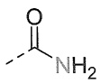

酰胺

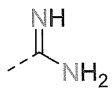

脒基

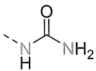

脲基

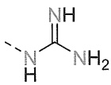

胍基

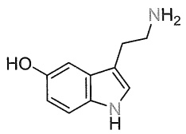

<details>
<summary>chemical</summary>

Chemical structure of a substituted indole derivative with hydroxyl and amino groups
</details>

血清素

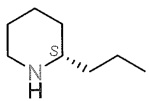

毒芹碱

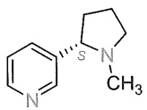

尼古丁

氮元素位于元素周期表的第2周期第5主族，有一个半充满的p轨道。在空气中氮是含量最高的元素，而氮原子与碳原子相连组成的有机化合物数量也相当庞大。生物碱、氨基酸、含氮杂环化合物等有机化合物中都有含氮官能团。在众多含氮有机化合物中，氮元素可以与其他元素形成丰富的官能团类型，例如，常见的有氨基 $\left(-\mathrm{NH}_{2}\right)$ ；氮与氧形成羟胺 $\left(>\mathrm{N}-\mathrm{OH}\right)$ 、亚硝基 $(-\mathrm{NO})$ 和硝基 $\left(-\mathrm{NO}_{2}\right)$ ，以及胺氧化物 $\left(\equiv\mathrm{N}\rightarrow\mathrm{O}\right)$ ；氮和碳可以组成饱和的单键，也可以组成不饱和的双键——亚胺 $\left(>\mathrm{C}=\mathrm{N}-\right)$ 和叁键——氰基 $(-\mathrm{CN})$ ；氮自身还可以形成包含氮氮单键的肼 $\left(-\mathrm{NHNH}_{2}\right)$ 、包含氮氮双键的偶氮化合物 $\left(-\mathrm{N}=\mathrm{N}-\right)$ 和包含氮氮叁键的重氮盐 $\left(-\mathrm{N}_{2}^{+}\right)$ ；叠氮化合物则含有 $-\mathrm{N}_{3}$ 官能团；氮元素自身或与其他杂原子一起参与到杂环化合物的构建中。酰胺的羰基置换为亚胺则构成脒基，脲基的羰基置换为亚胺则构成胍基……不同官能团的不同性质使含氮有机化合物呈现出多种多样的物理化学性质。

在自然界，除以氨基酸为基本单元通过肽键组成的多肽、蛋白质以外，氮元素大量出现在杂环结构中。例如，血清素（serotonin）又名5-羟色胺，由于最早从血清中发现而被命名为血清素。它主要存在于中枢神经系统，是一种调节神经活动的重要物质。血清素通过抑制其他神经递质的过量分泌，帮助人们感受愉悦、放松和自信，从而产生满足感和幸福感，因此被称为快乐神经递质。血清素的母核吲哚是一种含氮芳香苯并杂环。毒芹碱（coniine）是伞形科毒参属二年生草本植物毒参的主要有毒成分，属于一种生物碱，其结构中存在含氮脂肪杂环哌啶。烟草中的尼古丁（nicotine）俗名烟碱，是导致吸烟成瘾的主要化学物质，其结构中存在含氮芳香杂环吡啶和含氮脂肪杂环吡咯烷。

本章主要学习胺类化合物和含氮芳香杂环化合物的结构及性质，含氮脂肪杂环化合物与相应开环含氮化合物的性质类似，本章不做专门介绍。

## 12.1 胺类化合物的结构和命名

胺类化合物（amines）指  $sp^{3}$  杂化氮为中心，分别与碳、氢成键饱和的一类化合物。如果氮分别与一个碳和两个氢相连，得到的是伯胺，或称为一级胺（primary amine），血清素的吲哚骨架上有一个含氨基的烷基取代基，它属于伯胺；与两个碳相连是仲胺（secondary amine），如毒芹碱；以此类推，与三个碳相连是叔胺（tertiary amine），尼古丁就有这样一个

---

12.1 胺类化合物的结构和命名

143

三级胺结构。根据氮原子所连接的含碳基团的种类，直接相连的碳都是 $\mathfrak{sp}^3$ 杂化碳的是脂肪胺；有一个是芳基取代基的就是芳香胺。这几种胺类化合物的氮上还有一对孤对电子，这是这类化合物性质的重要结构依据，其将进一步参与到有机化学转化中。与碳中心化合物不同的是，若胺类化合物的氮原子上有4个含碳基团则构成季铵盐。伯胺、仲胺、叔胺氮上的一对孤对电子表现出Brønsted碱性，可以结合质子，这样得到的铵盐是普通铵盐。季铵盐与普通铵盐的性质差别很大，在后续课程中将深入学习。

## 12.1.1 胺类化合物的命名

根据2017版《有机化合物命名原则》，当胺为主特性基团时，胺类化合物的命名通常是将氮上的基团视为取代基，在其后加上后缀“氮烷（-azane）”或“胺（-amine）”；或称为“某烷胺”，在不引起歧义的情况下可以省略“烷”而直接称为“某胺”。本章中采取“胺”为后缀的命名方式。例如，最简单的芳香胺——氨基取代苯，命名为苯胺，这一俗名一直沿用，也作为母体使用。氨基取代吡啶，吡啶的氮杂原子编号最小，因此这里氨基取代基位于4位，命名为吡啶-4-胺。苯环上既有氨基取代基，又有羧基取代基，这时羧基作为主特性基团，苯甲酸是母体，氨基是取代基，所以是4-氨基苯甲酸。母体上的取代基用数字编号，连同氮原子上的取代基，以 $N-$ 标识，都写在母体名称前，如 $N,4-$ 二甲基苯胺、$N,N-$ 二甲基苯胺，$N$ 需以斜体表示。

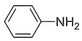

苯胺

aniline

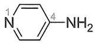

吡啶-4-胺

pyridin-4-amine

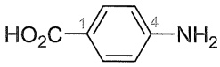

4-氨基苯甲酸

4-aminobenzoic acid

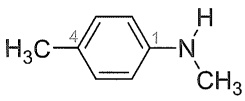

N,4-二甲基苯胺

N,4-dimethylaniline

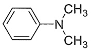

N,N-二甲基苯胺

N,N-dimethylaniline

简单烃基取代的脂肪胺，就是将相应烃的命名词尾加上胺，在不引起歧义的情况下，烷可以省略。例如，乙烷胺，通常称为乙胺；也以取代基命名，如二乙基胺，这里多个相同取代基合并。常用的有机碱三乙基胺，氮上连有3个相同的乙基，英文简写为TEA。当氮原子上连有不同取代基时，简单的烃基为取代基。例如，N-乙基-N-甲基环丙基胺，注意取代基按照其英文首字母顺序排序。乙二胺的命名属于俗名，IUPAC命名为乙烷-1,2-二胺。有多个氨基时，其中一个氨基也可以与相连的烃基共同组成取代基，如2-(氨基甲基)丙烷-1,3-二胺。有长链取代基时，选取最长碳链为母体，再标识取代基的位置，如N-甲基庚烷-2-胺。

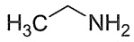

乙胺

ethanamine

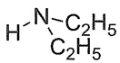

二乙基胺

diethylamine

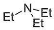

三乙基胺

triethylamine

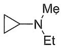

N-乙基-N-甲基环丙基胺

N-ethyl-N-methylcyclopropanamine

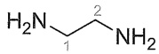

乙二胺

乙烷-1,2-二胺

ethane-1,2-diamine

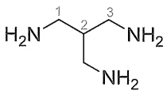

2-(氨基甲基)丙烷-1,3-二胺

2-(aminomethyl)propane-1,3-diamine

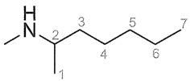

N-甲基庚烷-2-胺

N-methylheptan-2-amine

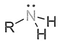

伯胺(一级胺)

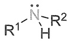

仲胺(二级胺)

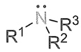

叔胺(三级胺)

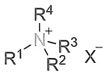

季铵盐(四级铵盐)

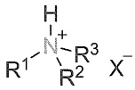

普通铵盐

GABA 是  $\gamma-$  氨基丁酸的缩写，是一种重要中枢神经系统抑制性神经递质，生理上有促进乙酰胆碱合成、镇定安神等作用，这里氨基取代基的位置按照主链上与主特性基团羧基的位置关系，以希腊字母顺序依次排列，命名为  $\gamma$  位。

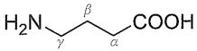

γ-氨基丁酸

γ-aminobutanoic acid

---

144

第十二章 胺和含氮芳香杂环化合物

## 12.1.2 胺类化合物的手性

胺类化合物的氮原子一般采取 $\mathrm{sp}^3$ 杂化，如果氮原子连有3个不同的原子或基团，连同氮上的一对孤对电子形成假四面体排列，理论上这个氮是不对称中心。如图12-1所示，观察化合物A和化合物C的结构，其中取代基 $\mathbb{R}^1$ 和 $\mathbb{R}^2$ 位置互换，这意味着化合物A和化合物C互为实物和镜像的关系，是一对对映体。如果沿着虚线轴将化合物C翻转 $180^{\circ}$ 得到化合物B，比较发现，化合物B与化合物A是构型翻转的关系，如同大风吹翻伞面的情况。通常条件下，当氮上有一对孤对电子时，在室温条件下并不能将两种化合物拆分，所以一般胺类化合物不表现出光学活性。这是由于两个对映体互相转化的能垒非常小，在室温条件下就能发生翻转。

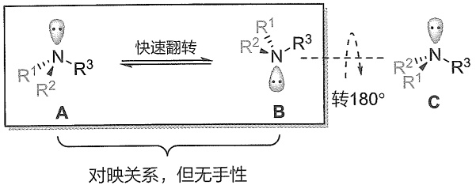

<details>
<summary>chemical</summary>

Reaction mechanism diagram showing fast rotation of a nitrogen-containing molecule with 180° rotation, labeled A, B, and C
</details>

图 12-1 胺类化合物氮中心的快速翻转

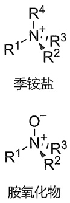

<details>
<summary>chemical</summary>

Chemical structures of quinone salt and acetylene monomers with labeled R groups
</details>

如果这种内翻转受到限制，胺类化合物就会表现出手性，例如，当季铵盐或叔胺氧化物的烃基取代基都不同时，与碳中心手性化合物相似，氮是手性中心。当三价氮的内翻转受到限制时，也成为不对称中心。例如，如图12-2(a)所示，二苯甲酮与甲胺反应得到的亚胺，以氯仿为溶剂，在 $-20^{\circ}\mathrm{C}$ 条件下可以被 $(+)$-过氧樟脑酸不对称环氧化，得到 $(-)$-2-甲基-3,3-二苯基-1,2-氧杂氮杂环丙烷，这一手性化合物可以直接经柱色谱分离得到。减压蒸馏不会影响其光学纯度，其手性完全来源于结构中的不对称氮原子。而氮杂环丙烷化合物的内翻转相对较快，氮上不同烷基取代时翻转速率不同。相对来说，氮上引入卤素取代基会使氮杂环丙烷的内翻转变慢。2,2-二苯基氮杂环丙烷经 $(-)$-异冰片基次氯酸盐不对称氯代合成得到 $(+)$-1-氯-2,2-二苯基氮杂环丙烷，但是其在 $0^{\circ}\mathrm{C}$ 条件下放置4天后发生完全消旋化。而在邻二甲苯稀溶液中，1-氯-2,2-二甲基氮杂环丙烷在 $120^{\circ}\mathrm{C}$ 条件下也未观测到内翻转，计算表明其翻转能垒达约 $88\mathrm{kJ / mol}$ 。2-甲基氮杂环丙烷的翻转能垒约为 $70\mathrm{kJ / mol}$，显著高于一般仲胺的翻转能垒，但还不足以实现室温条件下的非对映体拆分。而引入吸电子基团取代后的1-氯-2-甲基氮杂环丙烷，其翻转能垒提高到 $112\mathrm{kJ / mol}$，可以在 $25^{\circ}\mathrm{C}$ 条件下将非对映体分离[图12-2(b)]。

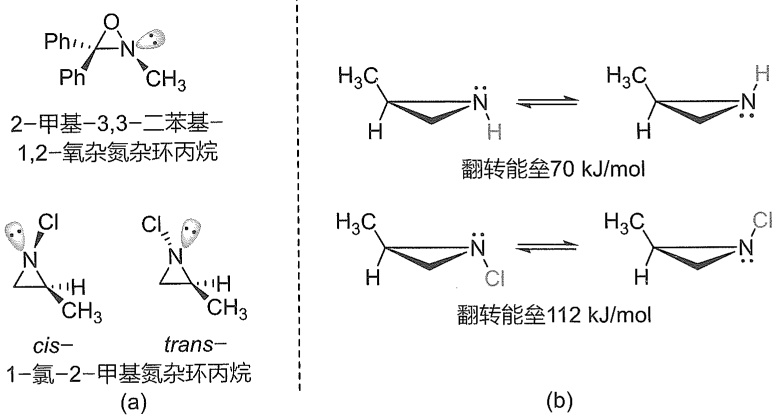

图12-2（a）有不对称氮中心的三元含氮杂环化合物举例及（b）氮杂环丙烷的内翻转及其翻转能垒

---

12.2 胺类化合物的制备

145

1887 年，Tröger 通过对甲苯胺与二甲氧基甲烷在盐酸水溶液中缩合得到了 Tröger 碱，不过其结构问题直到 1935 年才由美国伊利诺伊大学的 Spielman 解决，其具有 V 形  $C_{2}$  对称性结构，桥头氮原子是手性中心。同年，Wagner 提出了反应的可能机制。1986 年，Wilcox 报道了 Tröger 碱的晶体结构，证实了之前的推测，结构中两个芳基平面几乎互相垂直。1991 年其绝对构型被确定， $(+)$ -Tröger 碱的两个氮中心的构型为  $(S, S)$ 。Tröger 碱是第一种通过手性固定相被分离得到的手性化合物，因此通过液相色谱来拆分外消旋 Tröger 碱的技术很早就已经被掌握。不过使用商品化 HPLC 手性柱来拆分 Tröger 碱衍生物的方案近期才获得较好解决。现在，Tröger 碱及其衍生物的一对对映体都可以实现半制备分离，功能化的 Tröger 碱衍生物已被广泛应用于超分子化学、材料科学和药物设计等领域。

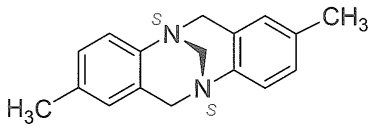

<details>
<summary>chemical</summary>

Chemical structure of a fused heterocyclic compound with methyl and thienyl substituents
</details>

$(+)$-Tröger碱

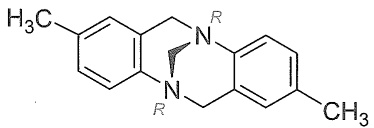

<details>
<summary>chemical</summary>

Chemical structure of a fused heterocyclic compound with methyl and amide substituents
</details>

(-)-Tröger碱

## 12.2 胺类化合物的制备

对胺类化合物制备的研究由来已久，合成方法多种多样。最常用的策略之一是含氮化合物的还原及多种方法构建碳氮键，高级胺也可以低级胺为原料合成。近年来还不断发展了新的可持续的绿色合成方法。

## 12.2.1 硝基还原法

硝基官能团还原是制备伯胺的重要方法之一。不论是脂肪硝基化合物还是芳香硝基化合物，硝基都可以在多种还原条件下被还原为氨基。由于芳香硝基化合物较为易得，且苯胺衍生物有广泛用途，芳香硝基化合物的还原尤为常见。例如，苯胺是一种重要的化工原料，在树脂、橡胶、染料及医药等很多领域有广泛用途，多年来占据全球销售额前10位的小分子药物中很多含有苯胺结构单元。当底物中有多种官能团时需要注意反应条件的化学选择性。

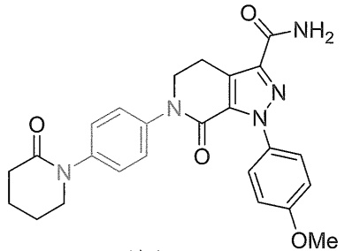

<details>
<summary>chemical</summary>

Chemical structure of a complex organic molecule with fused rings, amine, and methoxy substituents
</details>

阿哌沙班 Apixaban

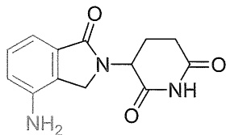

<details>
<summary>chemical</summary>

Chemical structure of a fused heterocyclic compound with indole and amide groups
</details>

来那度胺 Lenalidomide

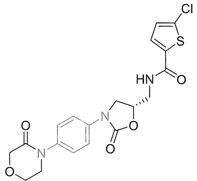

<details>
<summary>chemical</summary>

Chemical structure of a heterocyclic compound with chlorinated benzene and sulfonamide groups
</details>

利伐沙班 Rivaroxaban

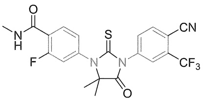

<details>
<summary>chemical</summary>

Chemical structure of a fluorinated heterocyclic compound with trifluoromethyl and cyano substituents
</details>

恩扎卢胺 Enzalutamide

---

146

第十二章 胺和含氮芳香杂环化合物

## 1. Béchamp 还原法

常用的还原硝基为氨基的方法有铁或亚铁在酸性条件下的还原。1854年Béchamp发现Fe/HOAc条件下硝基苯被还原为苯胺。Béchamp还原也可以使用盐酸、硫酸等无机酸，且可用于脂肪硝基化合物的还原。如图12-3所示，邻硝基苯甲醛在Fe/HCl条件下可以实现定量还原，且这一条件下甲酰基不被还原。在酸性条件下铁和硫酸亚铁还原2-甲基-2-硝基丙醇，以高收率得到2-氨基-2-甲基丙醇，该方法放大到 $10\mathrm{kg}$ 级仍能够以 $82\%$ 收率得到相应还原产物。由于成本优势，铁粉还原法曾经在工业上广泛应用，不过过量的铁粉和盐酸所产生的铁泥带来严重的环境污染问题，设备维护费用也较高，反应所产生的铁氧化物副产物需求过剩，而且化学剂量的合成工艺无论从经济角度还是绿色化学和可持续发展的角度来看，都没有优势。现在Béchamp还原法在工业上已经禁用，取而代之的是流化床气相催化加氢生产工艺等催化氢化方法。除铁粉以外，实验室中在酸性条件下以锌、锡等金属单质或硫酸亚铁、氯化亚锡等金属盐为还原剂还原硝基，这一条件下醛基、苄氧基等官能团不能被还原，反应具有很好化学选择性（图12-3）。反应过程中金属提供单电子，Brønsted酸提供质子，硝基化合物经过亚硝基化合物、羟胺中间体，最终被还原为伯胺（图12-4）。

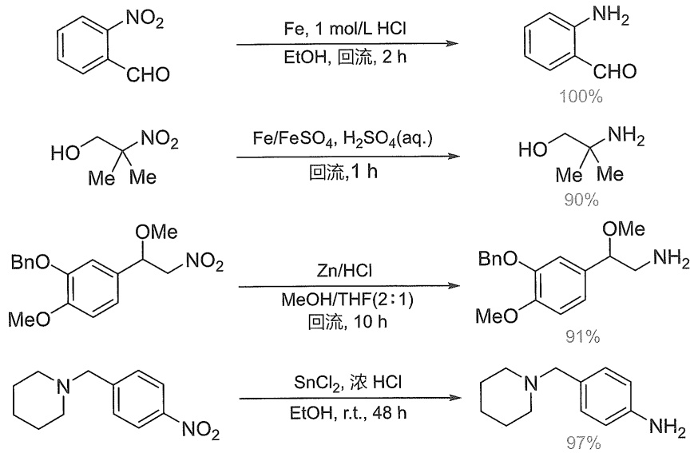

<details>
<summary>flowchart</summary>

```mermaid
graph LR
  A["Nitrobenzaldehyde (CHO)"] -->|"Fe, 1 mol/L HCl\nEtOH, 回流, 2 h"| B["Nitrobenzaldehyde (CHO)"]
  C["Amino compound with Me group"] -->|"Fe/FeSO4, H2SO4aq.\n回流, 1 h"| D["Amino compound with Me group"]
  E["&quot;BnO-C6H3-OMe"] -->|"Zn/HCl\nMeOH/THF(2:1)\n回流, 10 h"| F["&quot;BnO-C6H3-OMe"]"]
  G["N,N-(CH2-C6H3)-NO2"] -->|"SnCl2, 浓 HCl\nEtOH, r.t., 48 h"| H["N-(CH2-C6H3)-NH2"]
  B -->|"100%"| D
  D -->|"90%"| F
  F -->|"91%"| H
  H -->|"97%"| I
```
</details>

图12-3 酸性条件下还原硝基制备伯胺化合物

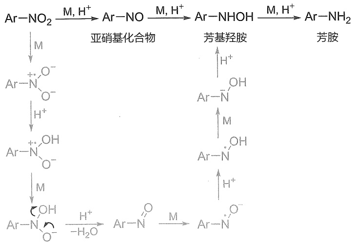

<details>
<summary>flowchart</summary>

```mermaid
graph LR
  A["Ar-NO2"] -->|"M, H+"| B["Ar-NO"]
  B -->|"M, H+"| C["Ar-NHOH"]
  C -->|"M, H+"| D["Ar-NH2"]
  
  E["Ar-N⁺O⁻"] -->|"亚硝基化合物"| F["Ar-N⁺OH"]
  G["Ar-N⁺OH"] -->|"亚硝基化合物"| H["Ar-N⁺OH"]
  I["Ar-N⁺O⁻"] -->|"亚硝基化合物"| J["Ar-N⁺OH"]
  K["Ar-N⁺OH"] -->|"亚硝基化合物"| L["Ar-N⁺OH"]
  M["Ar-N⁺OH"] -->|"亚硝基化合物"| N["Ar-N⁺OH"]
  O["Ar-N⁺OH"] -->|"亚硝基化合物"| P["Ar-N⁺OH"]
  Q["Ar-N⁺OH"] -->|"亚硝基化合物"| R["Ar-N⁺OH"]
  S["Ar-N⁺OH"] -->|"亚硝基化合物"| T["Ar-N⁺OH"]
  U["Ar-N⁺OH"] -->|"亚硝基化合物"| V["Ar-N⁺OH"]
  W["Ar-N⁺OH"] -->|"亚硝基化合物"| X["Ar-N⁺OH"]
  Y["Ar-N⁺OH"] -->|"亚硝基化合物"| Z["Ar-N⁺OH"]
  AA["Ar-N⁺OH"] -->|"亚硝基化合物"| AB["Ar-N⁺OH"]
  AC["Ar-N⁺OH"] -->|"亚硝基化合物"| AD["Ar-N⁺OH"]
  AE["Ar-N⁺OH"] -->|"亚硝基化合物"| AF["Ar-N⁺OH"]
  AG["Ar-N⁺OH"] -->|"亚硝基化合物"| AH["Ar-N⁺OH"]
  AI["Ar-N⁺OH"] -->|"亚硝基化合物"| AJ["Ar-N⁺OH"]
  AK["Ar-N⁺OH"] -->|"亚硝基化合物"| AL["Ar-N⁺OH"]
  AM["Ar-N⁺OH"] -->|"亚硝基化合物"| AN["Ar-N⁺OH"]
  AO["Ar-N⁺OH"] -->|"亚硝基化合物"| AP["Ar-N⁺OH"]
  AQ["Ar-N⁺OH"] -->|"亚硝基化合物"| AR["Ar-N⁺OH"]
  AS["Ar-N⁺OH"] -->|"亚硝基化合物"| AT["Ar-N⁺OH"]
  AU["Ar-N⁺OH"] -->|"亚硝基化合物"| AV["Ar-N⁺OH"]
  AW["Ar-N⁺OH"] -->|"亚硝基化合物"| AX["Ar-N⁺OH"]
  AY["Ar-N⁺OH"] -->|"亚硝基化合物"| AZ["Ar-N⁺OH"]
  BA["Ar-N⁺OH"] -->|"亚硝基化合物"| BZ["Ar-N⁺OH"]
  BB["Ar-N⁺OH"] -->|"亚硝基化合物"| BC["Ar-N⁺OH"]
  BD["Ar-N⁺OH"] -->|"亚硝基化合物"| BE["Ar-N⁺OH"]
  BF["Ar-N⁺OH"] -->|"亚硝基化合物"| BG["Ar-N⁺OH"]
  BH["Ar-N⁺OH"] -->|"亚硝基化合物"| BI["Ar-N⁺OH"]
  BJ["Ar-N⁺OH"] -->|"亚硝基化合物"| BK["Ar-N⁺OH"]
  BL["Ar-N⁺OH"] -->|"亚硝基化合物"| BM["Ar-N⁺OH"]
  BN["Ar-N⁺OH"] -->|"亚硝基化合物"| BO["Ar-N⁺OH"]
  BP["Ar-N⁺OH"] -->|"亚硝基化合物"| BOB["Ar-N⁺OH"]
  BR["Ar-N⁺OH"] -->|"亚硝基化合物"| BS["Ar-N⁺OH"]
  BT["Ar-N⁺OH"] -->|"亚硝基化合物"| BU["Ar-N⁺OH"]
  BV["Ar-N⁺OH"] -->|"亚硝基化合物"| BUB["Ar-N⁺OH"]
  BW["Ar-N⁺OH"] -->|"亚硝基化合物"| BUC["Ar-N⁺OH"]
  BUD["Ar-N⁺OH"] -->|"亚硝基化合物"| BUE["Ar-N⁺OH"]
  BUF["Ar-N⁺OH"] -->|"亚硝基化合物"| BUG["Ar-N⁺OH"]
  BUH["Ar-N⁺OH"] -->|"亚硝基化合物"| BUI["Ar-N⁺OH"]
  BUJ["Ar-N⁺OH"] -->|"亚硝基化合物"| BUK["Ar-N⁺OH"]
  BUL["Ar-N⁺OH"] -->|"亚硝基化合物"| BUM["Ar-N⁺OH"]
  BUN["Ar-N⁺OH"] -->|"亚硝基化合物"| BUO["Ar-N⁺OH"]
  BUP["Ar-N⁺OH"] -->|"亚硝基化合物"| BUQ["Ar-N⁺OH"]
  BUR["Ar-N⁺OH"] -->|"亚硝基化合物"| BUU["Ar-N⁺OH"]
  BUV["Ar-N⁺OH"] -->|"亚硝基化合物"| BUW["Ar-N⁺OH"]
  BUX["Ar-N⁺OH"] -->|"亚硝基化合物"| BUY["Ar-N⁺OH"]
  BUZ["Ar-N⁺OH"] -->|"亚硝基化合物"| BUUO["Ar-N⁺OH"]
  BUVQ["Ar-N⁺OH"] -->|"亚硝基化合物"| BUUQ["Ar-N⁺OH"]
  BUVQO["Ar-N⁺OH"] -->|"亚硝基化合物"| BUUQO["Ar-N⁺OH"]
  BUVQOQ["Ar-N⁺OH"] -->|"亚硝基化合物"| BUUQOQ["Ar-N⁺OH"]
  BUVQOQO["Ar-N⁺OH"] -->|"亚硝基化合物"| BUUQOQOQOQOQOQOQOQOQOQOQOQOQOQOQOQOQOQOQOQOQOQOQOQOQOQOQOQOQOQOQOQOQOQOQOQOQOQOQOQOQOQOQOQOQOQOQOQOQOQOQ0EQOQOQOQOQOQOQOQ0EQOQOQOQOQOQ0EQOQOQOQOQ0EQOQOQOQOQ0EQ0EQ0EQ0EQ0EQ0EQ0EQ0EQ0EQ0EQ0EQ0EQ0EQ0EQ0EQ0EQ0EQ0EQ0EQ0EQ0EQ0EQ0EQ0EQ0EQ0EQ0EQ0EQ0EQ0EQ0EQ0EQ0EQ0EQ0EQ0EQ0EQ0EQ0EQ0EQ0EQ0EQ0EQ0EQ0EQ0EQ0EQ0EQ0EQ0EQ0EOQOEQEQEQEQEQEQEQEQEQEQEQEQEQEQEQEQEQEQEQEQEQEQEQEQEQEQEQEQEQEQEQEQEQEQEQEQEQEQEQEQEQEQEQEQEQEQEQEQEQEQEQEQEQEQEQEQEQEQEQEQEQEQEQEQEQEQEQEQEQEQEQEQEQEQEQEQEQEQEQEQEQEQEQEQEQEQEQEQEQEQEQEQEQEQEQEQEQEQEQEQEQAQEQEQEQEQEQEQEQEQEQEQEQEQEQEQEQEQEQEQEQEQEQEQEQEQEQEQEQEQEQEQEQAQEQAQEQAQEQAQEQAQEQAQAQAQAQAQAQAQAQAQAQAQAQAQAQAQAQAQAQAQAQAQAQAQAQAQAQAQAQAQAQAQAQAQAQAQAQAQAQAQAQAQAQAQAQAQAQAQAQAQAQAQAQAQAQAQAQAQAQAQAQAQAQAQAQAQAQAQAQAQAQAQAQAQAQAQAQAQAQAQAQAQAQAQAQAQAQAQAQAQAQAQAQAQAQAQAQAQAQAQAQBEAQCEAQCEAQCEAQCEAQCEAQCEAQCEAQCEAQCEAQCEAQCEAQCEAQCEAQCEAQCEAQCEAQCEAQCEAQCEAQCEAQCEAQCEAQCEAQCEAQCEAQCEAQCEAQCEAQCEAQCEAQCEAQCEAQCEAQCEAQCEAQCEAQCEAQCEAQCEAQCEAQCEAQCEAQCEAQCEAQCEAQCEAQCEAQCEAQCEAQCEAQMCEAQAEQTAEQTAEQTAEQTAEQTAEQTAEQTAEQTAEQTAEQTAEQTAEQTAEQTAEQTAEQTAEQTAEQTAEQTAEQTAEQTAEQTAEQTAEQTAEQTAEQTAEQTAEQTAEQTAEQTAEQTAEQTAEQTAEQTAEQTAEQTAEQTAEQTAEQTAEQTAEQTAEQTAEQTAEQTAEQTAEQTAEQTAEQTAEQTAEQTAEQTAEQtaeqtaeqtaeqtaeqtaeqtaeqtaeqtaeqtaeqtaeqtaeqtaeqtaeqtaeqtaeqtaeqtaeqtaeqtaeqtaeqtaeqtaeqtaeqtaeqtaeqtaeqtaeqtaeqtaeqtaeqtaeqtaeqtaeqtaeqtaeqtaeqtaeqtaeqtaeqtaeqtaeqtaeqtaeqtaeqtaeqtaeqtaeqtaeqtaeqtaektaeqtaeqtaeqtaeqtaeqtaeqtaeqtaeqtaeqtaeqtaeqtaeqtaeqtaeqtaeqtaeqtaeqtaeqtaeqtaeqtaeqtaeqtaeqtaeqtaeqtaeqtaeqtaeqtaeqtaeqtaeqtaeqtaeqtaeqtaeqtaeqtaeqtaeqtaeqtaeqtaeqtaeqtaeqtaeqtaeqtaeqtaeqtaeQtAeytaeQtAeytaeQtAeytaeQtAeytadtAeytadtAeytadtAeytadtAeytadtAeytadtAeytadtAeytadtAeytadtAeytadtAeytadtAeytadtAeytadtAeytadtAeytadtAeytadtAeytadtAeytadtAeytadtAeytadtAeytadtAeytadtAeytadtAeytadtAeytadtAeytadtaeytadtAeytadtAeytadtAeytadtAeytadtAeytadtAeytadtAeytadtAeytadtAeytadtAeytadtAeytadtAeytadtAeytadtAeytadtAeytadtAeytadtAeytadtAeytadtAeytadtAeytadtAeytadtAeytadtAeytadtAeytadtAyeyaoeyaoeyaoeyaoeyaoeyaoeyaoeyaoeyaoeyaoeyaoeyaoeyaoeyaoeyaoeyaoeyaoeyaoeyaoeyaoeyaoeyaoeyaoeyaoeyaoeyaoeyaoeyaoeyaoeyaoeyaoeyaoeyaoeyaoeyeyaoeyaoeyaoeyaoeyaoeyaoeyaoeyaoeyaoeyaoeyaoeyaoeyaoeyaoeyaoeyaoeyaoeyaoeyaoeyaoeyaoeyaoeyaoeyaoeyaoeyaoeyaoeyaoeyaoeyaoeyaoeyaoeyaoeyeyaoeyeyeyeyeyeyeyeyeyeyeyeyeyeyeyeyeyeyeyeyeyeyeyeyeyeyeyeyeyeyeyeyeyeyeyeyeyeyeyeyeyeyeyeyeyeyeyeyeyeyeyeyeyeyeyeyeyeyeyeyeyeyeyeyeyeyeyeyeyeyeyeyeyeyeyeyeyeyeyeyeyeyeyeyeyeyeyeyeyeyeyeyeyeyeyeyeyeyeyeyeveaeeveaeeveaeeveaeeveaeeveaeeveaeeveaeeveaeeveaeeveaeeveaeeveaeeveaeeveaeeveaeeveaeeveaeeveaeeveaeeveaeeveaeeveaeeveaeeveaeeveaeeveaeeveaeeveaeeveaeeveaeeveaeeveaeeveaeevedaynedeavesuevaedaynedeavesuevaedaynedeavesuevaedaynedeavesuevaedaynedeavesuevaedaynedeavesuevaedaynedeavesuevaedaynedeavesuevaedaynedeavesuevaedaynedeavesuevaedaynedeavesuevaedaynedeavesuevaedaynedeavesuevaedaynedeayendeavesuevaedaynedeavesuevaedaynedeavesuevaedaynedeavesuevaedaynedeavesuevaedaynedeavesuevaedaynedeavesuevaedaynedeavesuevaedaynedeavesuevaedaynedeavesuevaedaynedeavesuevaedaynedeavesuevaedaynedeavesusseavesuevaedaynedeavesuevaedaynedeavesuevaedaynedeavesuevaedaynedeavesuevaedaynedeavesuevaedaynedeavesuevaedaynedeavesuevaedaynedeavesuevaedaynedeavesuevaedaynedeavesuevaedaynedeavesuevaedaynedeavesuevadaynedeavesuevaedaynedeavesuevaedaynedeavesuevaedaynedeavesuevaedaynedeavesuevaedaynedeavesuevaedaynedeavesuevaedaynedeavesuevaedaynedeavesuevaedaynedeavesuevaedaynedeavesuevaedaynedeavesuevaedaynedevassevietadevassevietadevassevietadevassevietadevassevietadevassevietadevassevietadevassevietadevassevietadevassevietadevassevietadevassevietadevassevietadevassevietadevassevietadevassevietadevassevietadevassesvieetadevassevietadevassevietadevassevietadevassevietadevassevietadevassevietadevassevietadevassevietadevassevietadevassevietadevassevietadevassevietadevassevietadevassevietadevassevietadevassevietadevansaieevatdaieevatdaieevatdaieevatdaieevatdaieevatdaieevatdaieevatdaieevatdaieevatdaieevatdaieevatdaieevatdaieevatdaieevatdaieevatdaieevatdaieevatdaieevatdaieevatdaieevatdaieevatdaieevatdaieevatdaieevatdaieevatdiaieevatdiaieevatdiaieevatdiaieevatdiaieevatdiaieevatdiaieevatdiaieevatdiaieevatdiaieevatdiaieevatdiaieevatdiaieevatdiaieevatdiaieevatdiaieevatdiaieevatdiaieevatdiaieevatdiaieevatdraieevatdraieevatdraieevatdraieevatdraieevatdraieevatdraieevatdraieevatdraieevatdraieevatdraieevatdraieevatdraieevatdraieevatdraieevatdraieevatdraieevatdraieevatdraieevatdraieevatdariaegvtidafteagteagteagteagteagteagteagteagteagteagteagteagteagteagteagteagteagteagteagteagteagteagteagteagteagteagteagteagteagteagteagteagteagteagteagteagteagteagteagteagteagteagteagteagteagteagteagteagteagteagteakidafteagteagteagteagteagteagteagteagteagteagteagteagteagteagteagteagteagteagteagteagteagteagteagteagteagteagteagteagteagteagteagteagteaqidafteagteagteagteagteagteagteagteagteagteagteaqidafteaqidafteagteagteagteaqidafteaqidafteaqidafteaqidafteaqidafteaqidafteaqidafteaqidafteaqidafteaqidafteaqidafteaqidafteaqidafteaqidafteaqidafteaqidafteaqidafteaqidafteaqidafteaqidafteaqidafteaqidafteaqidafteaqidafteaqidafteaqidahidafteagteagteagteagteagteagteagteagteagteagteagteagteagteagteagteagteagteagteaqidafteaqidafteaqidafteaqidafteaqidafteaqidafteaqidafteaqidafteaqidafteaqidafteaqidafteaqidafteaqidafteaqidafteaqidafateakidafetadevassevietadevassevietadevassevietadevassevietadevassevietadevassevietadevassevietadevassevietadevassevietadevassevietadevassevietadevassevietadevassevietadevassevietadevassevietadevassevietadevabsdivaesvdaadesivaesvdaadesivaesvdaadesivaesvdaadesivaesvdaadesivaesvdaadesivaesvdaadesivaesvdaadesivaesvdaadesivaesvdaadesivaesvdaadesivaesvdaadesivaesvdaadesivaesvdaadesivaesvdaadesivaesvdaadesivaesvdaadesivaesvdaadesivaesvdaadesivaesvdaadesivaesvdaalesdvaesvdaadesivaesvdaadesivaesvdaadesivaesvdaadesivaesvdaadesivaesvdaadesivaesvdaadesivaesvdaadesivaesvdaadesivaesvdaadesivaesvdaadesivaesvdaadesivaesvdaadesivaesvdaadesivaesvdaadesivaesvdaadesivaesvdaadesivaesvdaadesivaesvdaadesivaesvdaadesildsdvaesvdaadesivaesvdaadesivaesvdaadesivaesvdaadesivaesvdaadesivaesvdaadesivaesvdaadesivaesvdaadesivaesvdaadesivaesvdaadesivaesvdaadesivaesvdaadesivaesvdaadesivaesvdaadesivaesvdaadesivaesvdaadesivaesvdaadesivaesvdaadesivaesvdaadesivaesvdaalesddvvaesddvvaesddvvaesddvvaesddvvaesddvvaesddvvaesddvvaesddvvaesddvvaesddvvaesddvvaesddvvaesddvvaesddvvaesddvvaesddvvaesddvvaesddvvaesddvvaesddvvaesddvvaesddvvaesddvvaesddvvaesddvvaesddvvaesddvvaesddvvaesddvvaesddvvaesddvvaesddvvaesddvvaesdedlviesdvssdvssdvssdvssdvssdvssdvssdvssdvssdvssdvssdvssdvssdvssdvssdvssdvssdvssdvssdvssdvssdvssdvssdvssdvssdvssdvssdvssdvssdvssdvssdvssdvssdvssdvssdvssdvssdvssdvssdvssdvssdvssdvssdvssdvssdvssdvssdvssdvssdvssdvsdpviesdvpsdvpsdvpsdvpsdvpsdvpsdvpsdvpsdvpsdvpsdvpsdvpsdvpsdvpsdvpsdvpsdvpsdvpsdvpsdvpsdvpsdvpsdvpsdvpsdvpsdvpsdvpsdvpsdvpsdvpsdvpsdvpsdvpsdvpsdvpsdvpsdvpsdvpsdvpsdvpsdvpsdvpsdvpsdvpsdvpsdvpsdvpsdvpsdvpsdvpsdvsdevpviesdvpsdvpsdvpsdvpsdvpsdvpsdvpsdvpsdvpsdvpsdvpsdvpsdvpsdvpsdvpsdvpsdvpsdvpsdvpsdvpsdvpsdvpsdvpsdvpsdvpsdvpsdvpsdvpsdvpsdvpsdvpsdvpsdvpsdvpsdvpsdvpsdvpsdvpsdvpsdvpsdvpsdvpsdvpsdvpsdvpsdvpsdvpsdvpsdvsdevvpiesbviespviesbviespviesbviespviesbviespviesbviespviesbviespviesbviespviesbviespviesbviespviesbviespviesbviespviesbviespviesbviespviesbviespviesbviespviesbviespviesbviespviesbviespviesbviespviesbviespviesbviespviesbviespviesbviespviesbviespviesbviespviesbviesrvesmviespviesbviespviesbviespviesbviespviesbviespviesbviespviesbviespviesbviespviesbviespviesbviespviesbviespviesbviespviesbviespviesbviespviesbviespviesbviespviesbviespviesbviespviesbviespviesbviespviesbviespviesbviespviesbviespviesbviespviesbviessvesmviespviesbviespviesbviespviesbviessvesmviespviesbviespviesbviessvesmviespviesbviespviesbviessvesmviespviesbviessvesmviespviesbviessvesmviespviesbviessvesmviespviesbviessvesmviespviesbviessvesmviespviesbviessvesmviespviesbviessvesmviespviessvesmviespviessvesmviessvesmviessvesmviessvesmviessvesmviessvesmviessvesmviessvesmviessvesmviessvesmviessvesmviessvesmviessvesmviessvesmviessvesmviessvesmviessvesmviessvesmviessvesmviessvesmviessvesmviessvesmviessvesmviessvesmviessvesmviessveskvdsrvcsrvcsrvcsrvcsrvcsrvcsrvcsrvcsrvcsrvcsrvcsrvcsrvcsrvcsrvcsrvcsrvcsrvcsrvcsrvcsrvcsrvcsrvcsrvcsrvcsrvcsrvcsrvcsrvcsrvcsrvcsrvcsrvcsrvcsrvcsrvcsrvcsrvcsrvcsrvcsrvcsrvcsrvcsrvcsrvcsrvcsrvcsrvcsrvcsrvcsrvscrvsdrvsdrvsdrvsdrvsdrvsdrvsdrvsdrvsdrvsdrvsdrvsdrvsdrvsdrvsdrvsdrvsdrvsdrvsdrvsdrvsdrvsdrvsdrvsdrvsdrvsdrvsdrvsdrvsdrvsdrvsdrvsdrvsdrvsdrvsdrvsdrvsdrvsdrvsdrvsdrvsdrvsdrvsdrvsdrvsdrvsdrvsdrvsdrvsdrvsdrvscrdvrsdevpdvrsdevpdvrsdevpdvrsdevpdvrsdevpdvrsdevpdvrsdevpdvrsdevpdvrsdevpdvrsdevpdvrsdevpdvrsdevpdvrsdevpdvrsdevpdvrsdevpdvrsdevpdvrsdevpdvrsdevpdvrsdevpdvrsdevpdvrsdevpdvrsdevpdvrsdevpdvrsdevpdvrsdevpdvrsdevPdvrsdevpdvrsdevpdvrsdevpdvrsdevpdvrsdevpdvrsdevpdvrsdevpdvrsdevpdvrsdevpdvrsdevpdvrsdevpdvrsdevpdvrsdevpdvrsdevpdvrsdevpdvrsdevpdvrsdevpdvrsdevpdvrsdevpdvrsdevpdvrsdevpdvrsdevpdvrsdevpdvrsdevpdvrsdevpgsrsedvrsdevpdvrsdevpdvrsdevpdvrsdevpdvrsdevpdvrsdevpdvrsdevpdvrsdevpdvrsdevpdvrsdevpdvrsdevpdvrsdevpdvrsdevpdvrsdevpdvrsdevpdvrsdevpdvrsdevpdvrsdevpdvrsdevpdvrsdevpdvrsdevpdvrsdevpdvrsdevpdvrsdevpdvrsdevgdrlsedvrsdevpdvrsdevpdvrsdevpdvrsdevpdvrsdevpdvrsdevpdvrsdevpdvrsdevpdvrsdevpdvrsdevpdvrsdevpdvrsdevpdvrsrevsdlrsedvrsrevsdlrsedvrsrevsdlrsedvrsrevsdlrsedvrsrevsdlrsedvrsrevsdlrsedvrsrevsdlrsedvrsrevsdlrsedvrsrevsdlrsedvrsrevsdlrsedvrsrevsdlrsedvrsrevsdlrsedvrsrevsdlrsedvrsrevsdlrsedvrsrevsdlrsedvrsrevsdlrsedvrsrevsdlrsedvrsrevscrdlrsedvrstsedvrstsedvrstsedvrstsedvrstsedvrstsedvrstsedvrstsedvrstsedvrstsedvrstsedvrstsedvrstsedvrstsedvrstsedvrstsedvrstsedvrstsedvrstsedvrstsedvrstsedvrstsedvrstsedvrstsedvrstsedvrstsedvrstsedvrstsedvrstsedvrstsedvrstsedvrstsedvrstsedvrstsesndlrsedfrstsedhrstsedhrstsedhrstsedhrstsedhrstsedhrstsedhrstsedhrstsedhrstsedhrstsedhrstsedhrstsedhrstsedhrstsedhrstsedhrstsedhrstsedhrstsedhrstsedhrstsedhrstsedhrstsedhrstsedhrstsedhrstsedhrstsedhrstsedhrstsedhrstsedhrstsedhrstsedhrstsedhrstsedhrshsgndlrsedfrstsedhrstsedhrstsedhrstsedhrstsedhrstsedhrstsedhrstsedhrstsedhrstsedhrstsedhrstsedhrstsedhrstsedhrstsedhrstsedhrstsedhrstsedhrstsedhrstsedHrshsgndlrsedfrstsedhrstsedhrstsedhrstsedhrstsedhrstsedhrstsedhrstsedHrshsgndlrsedfrstsedhrstsedhrstsedhrstsedHrshsgndlrsedfrstsedhrstsedHrshsgndlrsedfrstsedHrshsgndlrsedHrshsgndlrsedHrshsgndlrsedHrshsgndlrsedHrshsgndlrsedHrshsgndlrsedHrshsgndlrsedHrshsgndlrsedHrshsgndlrsedHrshsgndlrsedHrshsgndlrsedHrshsgndlrsedHrshsgndlrsedHrshsgndlrsendrspsbngdrspsbngdrspsbngdrspsbngdrspsbngdrspsbngdrspsbngdrspsbngdrspsbngdrspsbngdrspsbngdrspsbngdrspsbngdrspsbngdrspsbngdrspsbngdrspsbngdrspsbngdrspsbngdrspsbngdrspsbngdrspsbngdrspsbngdrspsbngdrspsbngdrspsbnsdrspsbngdrspsbngdrspsbngdrspsbngdrspsbngdrspsbngdrspsbngdrspsbngdrspsbngdrspsbngdrspsbngdrspsbngdrspsbngdrspsbngdrspsbngdrspsbngdrspsbngdrspsbngdrspsbngdrspsbngdrspsbngdrspsbngdrspsbngdrspsbngdrspsbnbdrspsbngdrspsbngdrspsbngdrspsbngdrspsbngdrspsbngdrspsbngdrspsbngdrspsbngdrspsbngdrspsbngdrspsbngdrspsbngdrspsbngdrspsbngdrspsbngdrspsbngdrspsbngdrspsbngdrspsbngdrspsbngdrspsbngdrspsbngdrspsbngdrspsbnadbsrvedfrsfdbsrvedfrsfdbsrvedfrsfdbsrvedfrsfdbsrvedfrsfdbsrvedfrsfdbsrvedfrsfdbsrvedfrsfdbsrvedfrsfdbsrvedfrsfdbsrvedfrsfdbsrvedfrsfdbsrvedfrsfdbsrvedfrsfdbsrvedfrsfdbsrvedfrsfdbsrvedfrsfdbsrvedfrsfdbsrvedfrsfdbsrvedfrsfdbsrvedfrgfdbsrvedfrsfdbsrvedfrsfdbsrvedfrsfdbsrvedfrsfdbsrvedfrsfdbsrvedfrsfdbsrvedfrsfdbsrvedfrsfdbsrvedfrsfdbsrvedfrsfdbsrvedfrsfdbsrvedfrsfdbsrvedfrsfdbsrvedfrsfdbsrvedfrsfdbsrvedfrsfdbsrvedfrsfdbsrvedfrsfdbsrvedfrsfdbsrvedfrfdbsrvedfrsfdbsrvedFrsfdbsrvedFrsfdbsrvedFrsfdbsrvedFrsfdbsrvedFrsfdbsrvedFrsfdbsrvedFrsfdbsrvedFrsfdbsrvedFrsfdbsrvedFrsfdbsrvedFrsfdbsrvedFrsfdbsrvedFrsfdbsrvedFrsfdbsrvedFrsfdbsrvedFrsfdbsrvedFrsfdbsrvedFrsfdbsrvedFrsfdbsrvedFrsfdbsrvedErfsdbsrvederfsdbsrvederfsdbsrvederfsdbsrvederfsdbsrvederfsdbsrvederfsdbsrvederfsdbsrvederfsdbsrvederfsdbsrvederfsdbsrvederfsdbsrvederfsdbsrvederfsdbsrvederfsdbsrvederfsdbsrvederfsdbsrvederfsdbsrvederfsdbsrvederfsdbsrvederfsdbsrvedrgsdfrsdfrsdfrsdfrsdfrsdfrsdfrsdfrsdfrsdfrsdfrsdfrsdfrsdfrsdfrsdfrsdfrsdfrsdfrsdfrsdfrsdfrsdfrsdfrsdfrsdfrsdfrsdfrsdfrsdfrsdfrsdfrsdfrsdfrsdfrsdfrsdfrsdfrsdfrsdfrsdfrsdfrsdfrsdfrsdfrsdfrsdfrsdfrsdfrsdfrsdfrgsdfrsdfrsdfrsdfrsdfrsdfrsdfrsdfrsdfrsdfrsdfrsdfrsdfrsdfrsdfrsdfrsdfrsdfrsdfrsdfrsdfrsdfrsdfrsdfrsdfrsdfrsdfrsdfrsdfrsdfrsdfrsdfrsdfrsdfrsdfrsdfrsdfrsdfrsdfrsdfrsdfrsdfrsdfrsdfrsdfrsdfrsdfrsdfrsdfrgsfdsfdsfdsfdsfdsfdsfdsfdsfdsfdsfdsfdsfdsfdsfdsfdsfdsfdsfdsfdsfdsfdsfdsfdsfdsfdsfdsfdsfdsfdsfdsfdsfdsfdsfdsfdsfdsfdsfdsfdsfdsfdsfdsfdsfdsfdsfdsfdsfdsfdsfosfeisfeisfeisfeisfeisfeisfeisfeisfeisfeisfeisfeisfeisfeisfeisfeisfeisfeisfeisfeisfeisfeisfeisfeisfeisfeisfeisfeisfeisfeisfeisfeisfeisfeisfeisfeisfeisfeisfeisfeisfeisfeisfeisfeisfeisfeisfeisfeisfeisfeisfeinfeisfeisfeisfeisfeisfeisfeisfeisfeisfeisfeisfeisfeisfeisfeisfeisfeisfeisfeisfeisfeis["BUUQOQOQOQOQOQOQOQOQOQOQOQOQOQOQOQOQOQOQOQOQOQOQOQOQOQOQOQOQOQOQOQOQOQOQOQOQOQOQOQOQOQOQOQOQOQOQOQOQOQOQ0EQOQOQOQOQOQOQOQ0EQOQOQOQOQOQ0EQOQOQOQOQ0EQOQOQOQOQ0EQ0EQ0EQ0EQ0EQ0EQ0EQ0EQ0EQ0EQ0EQ0EQ0EQ0EQ0EQ0EQ0EQ0EQ0EQ0EQ0EQ0EQ0EQ0EQ0EQ0EQ0EQ0EQ0EQ0EQ0EQ0EQ0EQ0EQ0EQ0EQ0EQ0EQ0EQ0EQ0EQ0EQ0EQ0EQ0EQ0EQ0EQ0EQ0EQ0EQ0EOQOEQEQEQEQEQEQEQEQEQEQEQEQEQEQEQEQEQEQEQEQEQEQEQEQEQEQEQEQEQEQEQEQEQEQEQEQEQEQEQEQEQEQEQEQEQEQEQEQEQEQEQEQEQEQEQEQEQEQEQEQEQEQEQEQEQEQEQEQEQEQEQEQEQEQEQEQEQEQEQEQEQEQEQEQEQEQEQEQEQEQEQEQEQEQEQEQEQEQEQEQEQAQEQEQEQEQEQEQEQEQEQEQEQEQEQEQEQEQEQEQEQEQEQEQEQEQEQEQEQEQEQEQEQAQEQAQEQAQEQAQEQAQEQAQAQAQAQAQAQAQAQAQAQAQAQAQAQAQAQAQAQAQAQAQAQAQAQAQAQAQAQAQAQAQAQAQAQAQAQAQAQAQAQAQAQAQAQAQAQAQAQAQAQAQAQAQAQAQAQAQAQAQAQAQAQAQAQAQAQAQAQAQAQAQAQAQAQAQAQAQAQAQAQAQAQAQAQAQAQAQAQAQAQAQAQAQAQAQAQAQAQAQAQBEAQCEAQCEAQCEAQCEAQCEAQCEAQCEAQCEAQCEAQCEAQCEAQCEAQCEAQCEAQCEAQCEAQCEAQCEAQCEAQCEAQCEAQCEAQCEAQCEAQCEAQCEAQCEAQCEAQCEAQCEAQCEAQCEAQCEAQCEAQCEAQCEAQCEAQCEAQCEAQCEAQCEAQCEAQCEAQCEAQCEAQCEAQCEAQCEAQCEAQCEAQMCEAQAEQTAEQTAEQTAEQTAEQTAEQTAEQTAEQTAEQTAEQTAEQTAEQTAEQTAEQTAEQTAEQTAEQTAEQTAEQTAEQTAEQTAEQTAEQTAEQTAEQTAEQTAEQTAEQTAEQTAEQTAEQTAEQTAEQTAEQTAEQTAEQTAEQTAEQTAEQTAEQTAEQTAEQTAEQTAEQTAEQTAEQTAEQTAEQTAEQTAEQTAE QTAEQTAEQTAEQTAEQTAEQTAEQTAEQTAEQTAEQTAEQTAEQTAEQTAEQTAEQTAEQTAEQTAEQTAEQTAEQTAEQTAEQTAEQTAEQTAEQTAEQTAEQTAEQTAEQTAEQTAEQTAEQTAEQTAEQTAEQTAEQTAEQTAEQTAEQTAEQTAEQTAEQTAEQTAEQTAEQTAEQTAEQTAEQTAEQTAEQTAEKTAEQTAEQTAEQTAEQTAEQTAEQTAEQTAEQTAEQTAEQTAEQTAEQTAEQTAEQTAEQTAEQTAEQTAEQTAEQTAEQTAEQTAEQTAEQTAEQTAEQTAEQTAEQTAEQTAEQTAEQTAEQTAEQTAEQTAEQTAEQTAEQTAEQTAEQTAEQTAEQTAEQTAEQTAEQTAEQTAEQTAEQTAEQTAE QT AEYTAE QT AEYTAE QT AEYTAE QT AEYTADT AEYTADT AEYTADT AEYTADT AEYTADT AEYTADT AEYTADT AEYTADT AEYTADT AEYTADT AEYTADT AEYTADT AEYTADT AEYTADT AEYTADT AEYTADT AEYTADT AEYTADT AEYTADT AEYTADT AEYTADT AEYTADT AEYTADT AEYTADT AEYTADT AEYTADTAEYTADT AEYTADT AEYTADT AEYTADT AEYTADT AEYTADT AEYTADT AEYTADT AEYTADT AEYTADT AEYTADT AEYTADT AEYTADT AEYTADT AEYTADT AEYTADT AEYTADT AEYTADT AEYTADT AEYTADT AEYTADT AEYTADT AEYTADT AEYTADT AEYTADT AYEYAOEYAOEYAOEYAOEYAOEYAOEYAOEYAOEYAOEYAOEYAOEYAOEYAOEYAOEYAOEYAOEYAOEYAOEYAOEYAOEYAOEYAOEYAOEYAOEYAOEYAOEYAOEYAOEYAOEYAOEYAOEYAOEYAOEYAOEYEYAOEYAOEYAOEYAOEYAOEYAOEYAOEYAOEYAOEYAOEYAOEYAOEYAOEYAOEYAOEYAOEYAOEYAOEYAOEYAOEYAOEYAOEYAOEYAOEYAOEYAOEYAOEYAOEYAOEYAOEYAOEYAOEYAOeYEYAOEYEYEYEYEYEYEYEYEYEYEYEYEYEYEYEYEYEYEYEYEYEYEYEYEYEYEYEYEYEYEYEYEYEYEYEYEYEYEYEYEYEYEYEYEYEYEYEYEYEYEYEYEYEYEYEYEYEYEYEYEYEYEYEYEYEYEYEYEYEYEYEYEYEYEYEYEYEYEYEYEYEYEYEYEYEYEYEYEYEYEYEYEYEYEYEYEYEYEYEYEVEAEEVEAEEVEAEEVEAEEVEAEEVEAEEVEAEEVEAEEVEAEEVEAEEVEAEEVEAEEVEAEEVEAEEVEAEEVEAEEVEAEEVEAEEVEAEEVEAEEVEAEEVEAEEVEAEEVEAEEVEAEEVEAEEVEAEEVEAEEVEAEEVEAEEVEAEEVEAEEVEAEEVEAEEVEDAYNEDEAVESUEVAEDAYNEDEAVESUEVAEDAYNEDEAVESUEVAEDAYNEDEAVESUEVAEDAYNEDEAVESUEVAEDAYNEDEAVESUEVAEDAYNEDEAVESUEVAEDAYNEDEAVESUEVAEDAYNEDEAVESUEVAEDAYNEDEAVESUEVAEDAYNEDEAVESUEVAEDAYNEDEAVESUEVAEDAYNEDEAVESUEVAEDAYNEDEAYENDEAVESUEVAEDAYNEDEAVESUEVAEDAYNEDEAVESUEVAEDAYNEDEAVESUEVAEDAYNEDEAVESUEVAEDAYNEDEAVESUEVAEDAYNEDEAVESUEVAEDAYNEDEAVESUEVAEDAYNEDEAVESUEVAEDAYNEDEAVESUEVAEDAYNEDEAVESUEVAEDAYNEDEAVESUEVAEDAYNEDEAVESUSSEAVESUEVAEDAYNEDEAVESUEVAEDAYNEDEAVESUEVAEDAYNEDEAVESUEVAEDAYNEDEAVESUEVAEDAYNEDEAVESUEVAEDAYNEDEAVESUEVAEDAYNEDEAVESUEVAEDAYNEDEAVESUEVAEDAYNEDEAVESUEVAEDAYNEDEAVESUEVAEDAYNEDEAVESUEVAEDAYNEDEAVESUEVADAYNEDEAVESUEVAEDAYNEDEAVESUEVAEDAYNEDEAVESUEVAEDAYNEDEAVESUEVAEDAYNEDEAVESUEVAEDAYNEDEAVESUEVAEDAYNEDEAVESUEVAEDAYNEDEAVESUEVAEDAYNEDEAVESUEVAEDAYNEDEAVESUEVAEDAYNEDEAVESUEVAEDAYNEDEAVESUEVAEDAYNEDEVASSEVIETADEVASSEVIETADEVASSEVIETADEVASSEVIETADEVASSEVIETADEVASSEVIETADEVASSEVIETADEVASSEVIETADEVASSEVIETADEVASSEVIETADEVASSEVIETADEVASSEVIETADEVASSEVIETADEVASSEVIETADEVASSEVIETADEVASSEVIETADEVASSEVIETADEVASSESVIEETADEVASSEVIETADEVASSEVIETADEVASSEVIETADEVASSEVIETADEVASSEVIETADEVASSEVIETADEVASSEVIETADEVASSEVIETADEVASSEVIETADEVASSEVIETADEVASSEVIETADEVASSEVIETADEVASSEVIETADEVASSEVIETADEVASSEVIETADEVASSEVIETADEVANSAIEEVATDAIEEVATDAIEEVATDAIEEVATDAIEEVATDAIEEVATDAIEEVATDAIEEVATDAIEEVATDAIEEVATDAIEEVATDAIEEVATDAIEEVATDAIEEVATDAIEEVATDAIEEVATDAIEEVATDAIEEVATDAIEEVATDAIEEVATDAIEEVATDAIEEVATDAIEEVATDAIEEVATDAIEEVATDAIEEVATDIAIEEVATDIAIEEVATDIAIEEVATDIAIEEVATDIAIEEVATDIAIEEVATDIAIEEVATDIAIEEVATDIAIEEVATDIAIEEVATDIAIEEVATDIAIEEVATDIAIEEVATDIAIEEVATDIAIEEVATDIAIEEVATDIAIEEVATDIAIEEVATDIAIEEVATDIAIEEVATDRAIEEVATDRAIEEVATDRAIEEVATDRAIEEVATDRAIEEVATDRAIEEVATDRAIEEVATDRAIEEVATDRAIEEVATDRAIEEVATDRAIEEVATDRAIEEVATDRAIEEVATDRAIEEVATDRAIEEVATDRAIEEVATDRAIEEVATDRAIEEVATDRAIEEVATDRAIEEVATDARIAEGVTIDAFTEAGTEAGTEAGTEAGTEAGTEAGTEAGTEAGTEAGTEAGTEAGTEAGTEAGTEAGTEAGTEAGTEAGTEAGTEAGTEAGTEAGTEAGTEAGTEAGTEAGTEAGTEAGTEAGTEAGTEAGTEAGTEAGTEAGTEAGTEAGTEAGTEAGTEAGTEAGTEAGTEAGTEAGTEAGTEAGTEAGTEAGTEAGTEAGTEAGTEAGTEAKIDAFTEAGTEAGTEAGTEAGTEAGTEAGTEAGTEAGTEAGTEAGTEAGTEAGTEAGTEAGTEAGTEAGTEAGTEAGTEAGTEAGTEAGTEAGTEAGTEAGTEAGTEAGTEAGTEAGTEAGTEAGTEAGTEAGTEAQIDAFTEAGTEAGTEAGTEAGTEAGTEAGTEAGTEAGTEAGTEAGTEAQIDAFTEAQIDAFTEAGTEAGTEAGTEAQIDAFTEAQIDAFTEAQIDAFTEAQIDAFTEAQIDAFTEAQIDAFTEAQIDAFTEAQIDAFTEAQIDAFTEAQIDAFTEAQIDAFTEAQIDAFTEAQIDAFTEAQIDAFTEAQIDAFTEAQIDAFTEAQIDAFTEAQIDAFTEAQIDAFTEAQIDAFTEAQIDAFTEAQIDAFTEAQIDAFTEAQIDAFTEAQIDAFTEAQIDAHIDAFTEAGTEAGTEAGTEAGTEAGTEAGTEAGTEAGTEAGTEAGTEAGTEAGTEAGTEAGTEAGTEAGTEAGTEAGTEAQIDAFTEAQIDAFTEAQIDAFTEAQIDAFTEAQIDAFTEAQIDAFTEAQIDAFTEAQIDAFTEAQIDAFTEAQIDAFTEAQIDAFTEAQIDAFTEAQIDAFTEAQIDAFTEAQIDAFATEAKIDAFETADEVASSEVIETADEVASSEVIETADEVASSEVIETADEVASSEVIETADEVASSEVIETADEVASSEVIETADEVASSEVIETADEVASSEVIETADEVASSEVIETADEVASSEVIETADEVASSEVIETADEVASSEVIETADEVASSEVIETADEVASSEVIETADEVASSEVIETADEVASSEVIETADEVABSDIVAESVDAADESIVAESVDAADESIVAESVDAADESIVAESVDAADESIVAESVDAADESIVAESVDAADESIVAESVDAADESIVAESVDAADESIVAESVDAADESIVAESVDAADESIVAESVDAADESIVAESVDAADESIVAESVDAADESIVAESVDAADESIVAESVDAADESIVAESVDAADESIVAESVDAADESIVAESVDAADESIVAESVDAADESIVAESVDAADESIVAESVDAALESDVAESVDAADESIVAESVDAADESIVAESVDAADESIVAESVDAADESIVAESVDAADESIVAESVDAADESIVAESVDAADESIVAESVDAADESIVAESVDAADESIVAESVDAADESIVAESVDAADESIVAESVDAADESIVAESVDAADESIVAESVDAADESIVAESVDAADESIVAESVDAADESIVAESVDAADESIVAESVDAADESIVAESVDAADESIVAESVDAADESILDSDVAESVDAADESIVAESVDAADESIVAESVDAADESIVAESVDAADESIVAESVDAADESIVAESVDAADESIVAESVDAADESIVAESVDAADESIVAESVDAADESIVAESVDAADESIVAESVDAADESIVAESVDAADESIVAESVDAADESIVAESVDAADESIVAESVDAADESIVAESVDAADESIVAESVDAADESIVAESVDAADESIVAESVDAADESIVAESVDAALESDDVVAESDDVVAESDDVVAESDDVVAESDDVVAESDDVVAESDDVVAESDDVVAESDDVVAESDDVVAESDDVVAESDDVVAESDDVVAESDDVVAESDDVVAESDDVVAESDDVVAESDDVVAESDDVVAESDDVVAESDDVVAESDDVVAESDDVVAESDDVVAESDDVVAESDDVVAESDDVVAESDDVVAESDDVVAESDDVVAESDDVVAESDDVVAESDDVVAESDDVVAESDEDLVIESDVSSDVSSDVSSDVSSDVSSDVSSDVSSDVSSDVSSDVSSDVSSDVSSDVSSDVSSDVSSDVSSDVSSDVSSDVSSDVSSDVSSDVSSDVSSDVSSDVSSDVSSDVSSDVSSDVSSDVSSDVSSDVSSDVSSDVSSDVSSDVSSDVSSDVSSDVSSDVSSDVSSDVSSDVSSDVSSDVSSDVSSDVSSDVSSDVSSDVSSDVSDPVIESDVPSDVPSDVPSDVPSDVPSDVPSDVPSDVPSDVPSDVPSDVPSDVPSDVPSDVPSDVPSDVPSDVPSDVPSDVPSDVPSDVPSDVPSDVPSDVPSDVPSDVPSDVPSDVPSDVPSDVPSDVPSDVPSDVPSDVPSDVPSDVPSDVPSDVPSDVPSDVPSDVPSDVPSDVPSDVPSDVPSDVPSDVPSDVPSDVPSDVPSDVSDEVPVIESDVPSDVPSDVPSDVPSDVPSDVPSDVPSDVPSDVPSDVPSDVPSDVPSDVPSDVPSDVPSDVPSDVPSDVPSDVPSDVPSDVPSDVPSDVPSDVPSDVPSDVPSDVPSDVPSDVPSDVPSDVPSDVPSDVPSDVPSDVPSDVPSDVPSDVPSDVPSDVPSDVPSDVPSDVPSDVPSDVPSDVPSDVPSDVPSDVSDEVVPIESBVIESPVIESBVIESPVIESBVIESPVIESBVIESPVIESBVIESPVIESBVIESPVIESBVIESPVIESBVIESPVIESBVIESPVIESBVIESPVIESBVIESPVIESBVIESPVIESBVIESPVIESBVIESPVIESBVIESPVIESBVIESPVIESBVIESPVIESBVIESPVIESBVIESPVIESBVIESPVIESBVIESPVIESBVIESPVIESBVIESPVIESBVIESPVIESBVIESPVIESBVIESRVESMVIESPVIESBVIESPVIESBVIESPVIESBVIESPVIESBVIESPVIESBVIESPVIESBVIESPVIESBVIESPVIESBVIESPVIESBVIESPVIESBVIESPVIESBVIESPVIESBVIESPVIESBVIESPVIESBVIESPVIESBVIESPVIESBVIESPVIESBVIESPVIESBVIESPVIESBVIESPVIESBVIESPVIESBVIESPVIESBVIESPVIESBVIESPVIESBViesSVESMVIESPVIESBVIESPVIESBVIESPVIESBViesSVESMVIESPVIESBVIESPVIESBViesSVESMVIESPVIESBVIESPVIESBViesSVESMVIESPVIESBViesSVESMVIESPVIESBViesSVESMVIESPVIESBViesSVESMVIESPVIESBViesSVESMVIESPVIESBViesSVESMVIESPVIESBViesSVESMVIESPVIESBViesSVESMVIESPViesSVESMVIESPViesSVESMViesSVESMViesSVESMViesSVESMViesSVESMViesSVESMViesSVESMViesSVESMViesSVESMViesSVESMViesSVESMViesSVESMViesSVESMViesSVESMViesSVESMViesSVESMViesSVESMViesSVESMViesSVESMViesSVESMViesSVESMViesSVESMViesSVESMViesSVESMViesSVESMViesSVESKVDSRVCSRVCSRVCSRVCSRVCSRVCSRVCSRVCSRVCSRVCSRVCSRVCSRVCSRVCSRVCSRVCSRVCSRVCSRVCSRVCSRVCSRVCSRVCSRVCSRVCSRVCSRVCSRVCSRVCSRVCSRVCSRVCSRVCSRVCSRVCSRVCSRVCSRVCSRVCSRVCSRVCSRVCSRVCSRVCSRVCSRVCSRVCSRVCSRVCSRVCSRVSCRVSDRVSDRVSDRVSDRVSDRVSDRVSDRVSDRVSDRVSDRVSDRVSDRVSDRVSDRVSDRVSDRVSDRVSDRVSDRVSDRVSDRVSDRVSDRVSDRVSDRVSDRVSDRVSDRVSDRVSDRVSDRVSDRVSDRVSDRVSDRVSDRVSDRVSDRVSDRVSDRVSDRVSDRVSDRVSDRVSDRVSDRVSDRVSDRVSDRVSDRVSCRDVRSDEVPDVRSDEVPDVRSDEVPDVRSDEVPDVRSDEVPDVRSDEVPDVRSDEVPDVRSDEVPDVRSDEVPDVRSDEVPDVRSDEVPDVRSDEVPDVRSDEVPDVRSDEVPDVRSDEVPDVRSDEVPDVRSDEVPDVRSDEVPDVRSDEVPDVRSDEVPDVRSDEVPDVRSDEVPDVRSDEVPDVRSDEVPDVRSDEVPDVRSDEV PDVRSDEVPDVRSDEVPDVRSDEVPDVRSDEVPDVRSDEVPDVRSDEVPDVRSDEVPDVRSDEVPDVRSDEVPDVRSDEVPDVRSDEVPDVRSDEVPDVRSDEVPDVRSDEVPDVRSDEVPDVRSDEVPDVRSDEVPDVRSDEVPDVRSDEVPDVRSDEVPDVRSDEVPDVRSDEVPDVRSDEVPDVRSDEVPDVRSDEVPGSRSEDVRSDEVPDVRSDEVPDVRSDEVPDVRSDEVPDVRSDEVPDVRSDEVPDVRSDEVPDVRSDEVPDVRSDEVPDVRSDEVPDVRSDEVPDVRSDEVPDVRSDEVPDVRSDEVPDVRSDEVPDVRSDEVPDVRSDEVPDVRSDEVPDVRSDEVPDVRSDEVPDVRSDEVPDVRSDEVPDVRSDEVPDVRSDEVPDVRSDEVGDRLSEDVRSDEVPDVRSDEVPDVRSDEVPDVRSDEVPDVRSDEVPDVRSDEVPDVRSDEVPDVRSDEVPDVRSDEVPDVRSDEVPDVRSDEVPDVRSDEVPDVRSREVSDLRSEDVRSREVSDLRSEDVRSREVSDLRSEDVRSREVSDLRSEDVRSREVSDLRSEDVRSREVSDLRSEDVRSREVSDLRSEDVRSREVSDLRSEDVRSREVSDLRSEDVRSREVSDLRSEDVRSREVSDLRSEDVRSREVSDLRSEDVRSREVSDLRSEDVRSREVSDLRSEDVRSREVSDLRSEDVRSREVSDLRSEDVRSREVSDLRSEDVRSREVSCRDLRSEDVRSTSEDVRSTSEDVRSTSEDVRSTSEDVRSTSEDVRSTSEDVRSTSEDVRSTSEDVRSTSEDVRSTSEDVRSTSEDVRSTSEDVRSTSEDVRSTSEDVRSTSEDVRSTSEDVRSTSEDVRSTSEDVRSTSEDVRSTSEDVRSTSEDVRSTSEDVRSTSEDVRSTSEDVRSTSEDVRSTSEDVRSTSEDVRSTSEDVRSTSEDVRSTSEDVRSTSEDVRSTSEDVRSTSEDVRSTSESNDLRSEDFRSTSEDHRSTSEDHRSTSEDHRSTSEDHRSTSEDHRSTSEDHRSTSEDHRSTSEDHRSTSEDHRSTSEDHRSTSEDHRSTSEDHRSTSEDHRSTSEDHRSTSEDHRSTSEDHRSTSEDHRSTSEDHRSTSEDHRSTSEDHRSTSEDHRSTSEDHRSTSEDHRSTSEDHRSTSEDHRSTSEDHRSTSEDHRSTSEDHRSTSEDHRSTSEDHRSTSEDHRSTSEDHRSTSEDHRSTSEDHRSHSGNDLRSEDFRSTSEDHRSTSEDHRSTSEDHRSTSEDHRSTSEDHRSTSEDHRSTSEDHRSTSEDHRSTSEDHRSTSEDHRSTSEDHRSTSEDHRSTSEDHRSTSEDHRSTSEDHRSTSEDHRSTSEDHRSTSEDHRSTSEDHRSTSED HRSHSGNDLRSEDFRSTSEDHRSTSEDHRSTSEDHRSTSEDHRSTSEDHRSTSEDHRSTSEDHRSTSED HRSHSGNDLRSEDFRSTSEDHRSTSEDHRSTSEDHRSTSED HRSHSGNDLRSEDFRSTSEDHRSTSED HRSHSGNDLRSEDFRSTSED HRSHSGNDLRSED HRSHSGNDLRSED HRSHSGNDLRSED HRSHSGNDLRSED HRSHSGNDLRSED HRSHSGNDLRSED HRSHSGNDLRSED HRSHSGNDLRSED HRSHSGNDLRSED HRSHSGNDLRSED HRSHSGNDLRSED HRSHSGNDLRSED HRSHSGNDLRSED HRSHSGNDLRSENDRSPSBNGDRSPSBNGDRSPSBNGDRSPSBNGDRSPSBNGDRSPSBNGDRSPSBNGDRSPSBNGDRSPSBNGDRSPSBNGDRSPSBNGDRSPSBNGDRSPSBNGDRSPSBNGDRSPSBNGDRSPSBNGDRSPSBNGDRSPSBNGDRSPSBNGDRSPSBNGDRSPSBNGDRSPSBNGDRSPSBNGDRSPSBNGDRSPSBNGDRSPSBNSDRSPSBNGDRSPSBNGDRSPSBNGDRSPSBNGDRSPSBNGDRSPSBNGDRSPSBNGDRSPSBNGDRSPSBNGDRSPSBNGDRSPSBNGDRSPSBNGDRSPSBNGDRSPSBNGDRSPSBNGDRSPSBNGDRSPSBNGDRSPSBNGDRSPSBNGDRSPSBNGDRSPSBNGDRSPSBNGDRSPSBNGDRSPSBNGDRSPSBNBDRSPSBNGDRSPSBNGDRSPSBNGDRSPSBNGDRSPSBNGDRSPSBNGDRSPSBNGDRSPSBNGDRSPSBNGDRSPSBNGDRSPSBNGDRSPSBNGDRSPSBNGDRSPSBNGDRSPSBNGDRSPSBNGDRSPSBNGDRSPSBNGDRSPSBNGDRSPSBNGDRSPSBNGDRSPSBNGDRSPSBNGDRSPSBNGDRSPSBNADBSRVEDFRSFDBSRVEDFRSFDBSRVEDFRSFDBSRVEDFRSFDBSRVEDFRSFDBSRVEDFRSFDBSRVEDFRSFDBSRVEDFRSFDBSRVEDFRSFDBSRVEDFRSFDBSRVEDFRSFDBSRVEDFRSFDBSRVEDFRSFDBSRVEDFRSFDBSRVEDFRSFDBSRVEDFRSFDBSRVEDFRSFDBSRVEDFRSFDBSRVEDFRSFDBSRVEDFRSFDBSRVEDFRGFDBSRVEDFRSFDBSRVEDFRSFDBSRVEDFRSFDBSRVEDFRSFDBSRVEDFRSFDBSRVEDFRSFDBSRVEDFRSFDBSRVEDFRSFDBSRVEDFRSFDBSRVEDFRSFDBSRVEDFRSFDBSRVEDFRSFDBSRVEDFRSFDBSRVEDFRSFDBSRVEDFRSFDBSRVEDFRSFDBSRVEDFRSFDBSRVEDFRSFDBSRVEDFRSFDBSRVEDFRFDBSRVEDFRSFDBSRVED FRSFDBSRVED FRSFDBSRVED FRSFDBSRVED FRSFDBSRVED FRSFDBSRVED FRSFDBSRVED FRSFDBSRVED FRSFDBSRVED FRSFDBSRVED FRSFDBSRVED FRSFDBSRVED FRSFDBSRVED FRSFDBSRVED FRSFDBSRVED FRSFDBSRVED FRSFDBSRVED FRSFDBSRVED FRSFDBSRVED FRSFDBSRVED FRSFDBSRVED ERFSDBSRVEDERFSDBSRVEDERFSDBSRVEDERFSDBSRVEDERFSDBSRVEDERFSDBSRVEDERFSDBSRVEDERFSDBSRVEDERFSDBSRVEDERFSDBSRVEDERFSDBSRVEDERFSDBSRVEDERFSDBSRVEDERFSDBSRVEDERFSDBSRVEDERFSDBSRVEDERFSDBSRVEDERFSDBSRVEDERFSDBSRVEDERFSDBSRVEDERFSDBSRVEDRGSDFRSDFRSDFRSDFRSDFRSDFRSDFRSDFRSDFRSDFRSDFRSDFRSDFRSDFRSDFRSDFRSDFRSDFRSDFRSDFRSDFRSDFRSDFRSDFRSDFRSDFRSDFRSDFRSDFRSDFRSDFRSDFRSDFRSDFRSDFRSDFRSDFRSDFRSDFRSDFRSDFRSDFRSDFRSDFRSDFRSDFRSDFRSDFRSDFRSDFRSDFRGSDFRSDFRSDFRSDFRSDFRSDFRSDFRSDFRSDFRSDFRSDFRSDFRSDFRSDFRSDFRSDFRSDFRSDFRSDFRSDFRSDFRSDFRSDFRSDFRSDFRSDFRSDFRSDFRSDFRSDFRSDFRSDFRSDFRSDFRSDFRSDFRSDFRSDFRSDFRSDFRSDFRSDFRSDFRSDFRSDFRSDFRSDFRSDFRSDFRGSFDSFDSFDSFDSFDSFDSFDSFDSFDSFDSFDSFDSFDSFDSFDSFDSFDSFDSFDSFDSFDSFDSFDSFDSFDSFDSFDSFDSFDSFDSFDSFDSFDSFDSFDSFDSFDSFDSFDSFDSFDSFDSFDSFDSFDSFDSFDSFDSFDSFDSFOSFEISFEISFEISFEISFEISFEISFEISFEISFEISFEISFEISFEISFEISFEISFEISFEISFEISFEISFEISFEISFEISFEISFEISFEISFEISFEISFEISFEISFEISFEISFEISFEISFEISFEISFEISFEISFEISFEISFEISFEISFEISFEISFEISFEISFEISFEISFEISFEISFEISFEISFEINFEISFEISFEISFEISFEISFEISFEISFEISFEISFEISFEISFEISFEISFEISFEISFEISFEISFEISFEISFEISFEIS"]
```
</details>

图12-4 酸性条件下金属（M）还原硝基为氨基的过程

---

12.2 胺类化合物的制备

147

## 2. Zinin 还原法

1842年，俄国化学家Zinin发现，硫二价负离子（$\mathrm{S}^{2-}$）可用于还原芳香硝基化合物，其来源主要是 $\mathrm{Na}_2\mathrm{S}$、$(\mathrm{NH}_4)_2\mathrm{S}$、$\mathrm{NH}_4\mathrm{HS}$ 或其他多硫化物。Hojo等的反应动力学研究表明，$\mathrm{S}_2^{2-}$ 还原硝基苯的速率比 $\mathrm{S}^{2-}$ 快得多，以甲醇/水为介质，增加水的比例将大大增加反应速率。增加碱的浓度也将控制反应平衡以保证 $\mathrm{S}_2^{2-}$ 的浓度。$\mathrm{S}_2^{2-}$ 进攻硝基是反应的决速步，其首先将硝基还原为亚硝基，再还原为羟胺，最后还原得到芳香胺类化合物。反应中间体与酸性条件下金属还原过程中的相同。从成本角度看，Zinin还原不如Béchamp还原。Zinin还原虽然适用于大量合成，但随着催化氢化还原策略的发展，需要化学计量还原剂条件的Zinin还原在工业上和实验室中的应用有所减少。不过，对于那些有酸敏感基团或易于被催化氢化还原官能团的底物，Zinin还原更为适用。

$$
\mathrm{S} _ {2} ^ {2 -} + \mathrm{H} _ {2} \mathrm{O} \rightleftharpoons \mathrm{HS} _ {2} ^ {-} + \mathrm{HO} ^ {-}
$$

Zinin 还原具有高反应选择性，对硝基以外的很多官能团都呈惰性。更为独特的是，对于多硝基化合物，Zinin 反应选择性还原其中一个硝基。一般情况下，位阻较小的硝基优先被还原，当有甲氧基或羟基等取代基时，甲氧基或羟基邻位的硝基优先被还原。

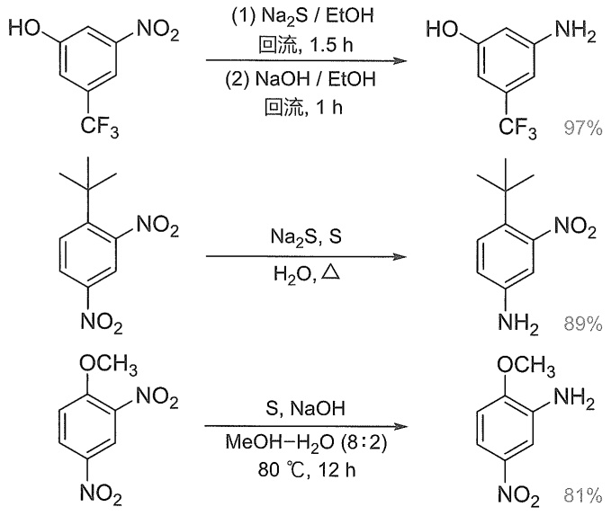

<details>
<summary>chemical</summary>

Nitration reaction equations of benzene derivatives under different conditions, showing yields and reagents
</details>

Zinin 反应被用于新型抗结核候选药物 Sutezolid 的全合成中，其优势在于避免使用过渡金属或贵金属等试剂。首先，二乙醇胺作为亲核试剂与 1,2-二氟-4-硝基苯发生芳香亲核取代反应，过量的二乙醇胺同时作为缚酸剂结合生成的 HF；随后所得产物在三乙胺作用下与 MsCl 反应生成二甲磺酰化产物，其在  $Na_{2}S$  作用下实现一锅煮的硝基还原和关环，得到 Sutezolid 全合成的关键中间体——硫代吗啉取代的苯胺衍生物。相较于直接使用硫代吗啉为原料，这一策略降低了原料成本，无须柱色谱分离纯化，且放大到 100 g 级仍能保证优秀的收率和产物纯度。

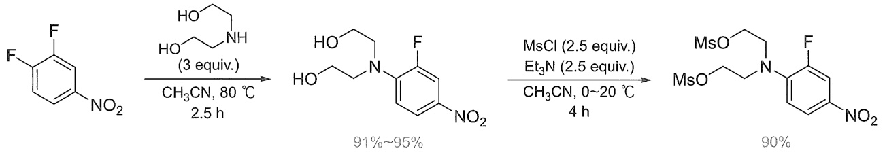

<details>
<summary>chemical</summary>

Chemical reaction scheme showing fluorination and chlorination steps with yields and conditions
</details>

---

148

第十二章 胺和含氮芳香杂环化合物

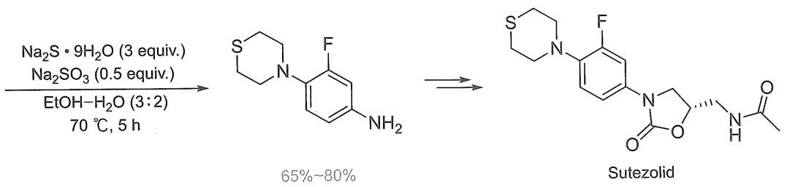

<details>
<summary>chemical</summary>

Chemical reaction scheme showing synthesis of Sutezolid from diazo compounds under specified conditions
</details>

硝基化合物可以在多种无金属参与条件下还原。例如，芳香或脂肪硝基化合物在  $Et_{3}N$  或 DIEA 等叔胺存在下被  $HSiCl_{3}$  还原为相应的伯胺，氰基、酰胺、羰基、羧基、卤素及氧或氮上烯丙基/苄基保护基等均不受影响。 $\mathrm{B}_{2}(\mathrm{OH})_{4}$  在  $H_{2}O$  或 4,4'-联吡啶存在下还原芳香硝基化合物为苯胺衍生物，同样具有很高的官能团容忍性。 $KBH_{4}/I_{2}$  能够原位生成  $BI_{3}$  还原剂，在温和条件下高效还原芳香硝基化合物，氰基、羰基、卤素等官能团不被还原，反应体系中加入聚苯乙烯为基质的离子交换树脂（Amberlite IR120  $Na^{+}$ ）能有效清除反应中生成的自由基，从而提高反应收率。

## 3. 催化氢化

催化氢化是中性条件下还原硝基的常用方法，现代工业中应用非常多，对于存在酸性或碱性条件下不稳定官能团的底物更为适用。生产苯胺及其衍生物的首选方法是相应芳香族硝基化合物的催化氢化还原。近年来工业上发展了不少催化剂用于芳香硝基化合物的催化氢化，所使用的催化剂种类大致有:Bayer公司采用镍的硫化物、$\mathrm{Pd / Al_2O_3}$ 等；BASF公司使用 $\mathrm{Cu / SiO_2}$，以Cr、Ba和Zn为促进剂；DuPont公司使用Pd-Pt/C，以Fe为改性剂……这些催化剂大多兼具高活性和重复利用性，有的在重复使用时需要再活化。不过由于属于商业机密，这些催化体系的细节并未公开。催化氢化的一大挑战是反应选择性。硝基化合物可能被还原为多种还原产物，当底物中存在易被还原的官能团时，也可能被同时还原。常用的氢化催化剂，如骨架镍、钯、Adams催化剂（$\mathrm{PtO_2}$）等可用于还原硝基，但这些催化剂可能同时还原卤素、甲酰基等官能团，基于钌、铑等的催化剂在剧烈条件下还可能还原苯基或发生脱硝基反应。为避免还原硝基的同时还原 $\mathrm{C = C}$ 、 $\mathrm{C\equiv C}$ 、 $\mathrm{C = O}$ 、 $\mathrm{BnO}$ 、 $\mathrm{C = N}$ 或CN等，发展了一些双金属催化剂，如 $\mathrm{Pt - Fe / TiO_2}$，$\mathrm{Rh - Fe / C}$，$\mathrm{Pb - Pd / CaCO_3}$，Ni、Ce或Fe掺杂的Pt等。当底物中存在卤素时，它们往往与硝基同时被还原。卤素的种类和在苯环上所处的位置会影响反应结果，碘取代基最易被还原，处于硝基间位的卤素则不易被还原。虽然温度、氢气压力和溶剂等反应条件都对反应选择性有显著影响，但是通过发展选择性催化剂以期抑制副反应发生的研究最为集中。例如，用Zn、Pb、Bi、Sn、Ge、Ag等金属添加剂或吗啉、磷酸等碱性/酸性添加剂改性的Pt/C或Pd/C催化剂，对Cl或Br等简单卤化硝基芳烃的还原显示出高选择性。碘代硝基化合物的选择性还原极具挑战性，两个官能团易于同时被还原，使用 $\mathrm{Pb - Pd / CaCO_3}$ 或磷酸修饰的Pt/C催化剂能够取得较好的硝基还原选择性。

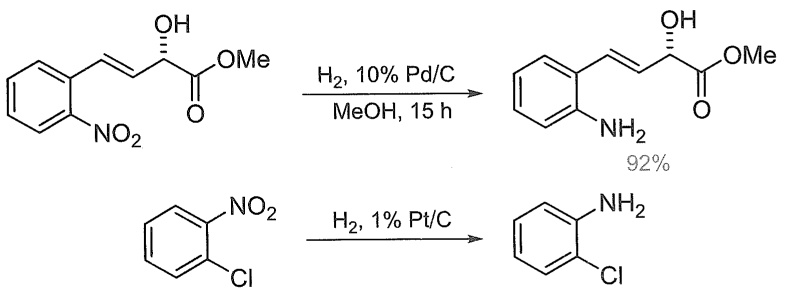

<details>
<summary>chemical</summary>

Two-step organic synthesis reaction scheme showing conversion of nitrobenzene to p-nitrophenyl chloride using H2 catalysts
</details>

1898 年，Haber 根据电化学实验结果提出了硝基苯氢化还原的两条反应途径（图 12-5），

近年研究发现，$\mathrm{TiO_2}$ 负载剂对反应的化学选择性影响很大，以 $\mathrm{TiO_2}$ 负载的 Au 纳米粒子（$\mathrm{Au / TiO_2}$）作为催化剂的还原体系表现出卓越的反应选择性，除了 Au 以外，Pt、Ru、Ni 等金属纳米粒子负载于 $\mathrm{TiO_2}$ 的催化剂都取得了很好的化学选择性，对于卤素（Cl、Br、I）、C=O、C=C、C≡C、CN 等官能团都表现为惰性，以优异的收率获得苯胺衍生物。

---

12.2 胺类化合物的制备

149

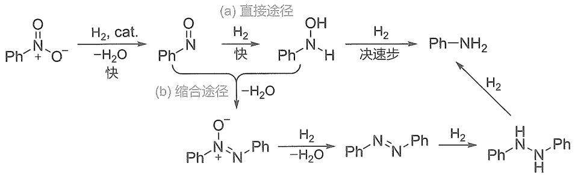

<details>
<summary>flowchart</summary>


</details>

图12-5 硝基苯还原的（a）直接途径和（b）缩合途径

其一是直接途径(a)，其二是缩合途径(b)，目前这一机制仍被普遍接受。通常反应经直接途径还原，硝基苯首先被快速还原为亚硝基苯，其在金属表面吸附非常强，并迅速氢化为羟胺中间体。亚硝基中间体以非常微量的浓度存在，而羟胺中间体的浓度变化很大，取决于底物结构、反应温度、氢气压力、溶剂、催化剂和 $\mathrm{pH}$ 等因素。羟胺还原为苯胺是反应的决速步。缩合途径则是亚硝基苯和 $N-$ 苯基羟胺两个反应中间体发生缩合，分子间脱水得到 $N-$ 氧化偶氮苯，其再还原为偶氮苯、氢化偶氮苯，最后被还原为苯胺。除非存在强碱，一般情况下缩合过程不会发生。研究表明，以 $\mathrm{TiO_2}$ 为负载时，其表面的亚硝基苯浓度非常低，降低了亚硝基苯和 $N-$ 苯基羟胺接触的可能性，避免了缩合途径的反应过程，因此高选择性地得到单分子还原产物。当使用 $\mathrm{CeO_2}$ 负载的Au纳米粒子（$\mathrm{Au / CeO_2}$）为催化剂时，催化剂表面吸附的亚硝基苯非常稳定，其进一步氢化速率降低而偶联反应速率增大，相较于 $N-$ 氧化偶氮苯，偶氮苯在催化剂表面的吸附较弱，这也阻滞了偶氮苯被进一步还原，因此最终高选择性（$>97\%$）得到偶氮苯。这一方面揭示了负载剂对反应选择性的影响，另一方面也证实了反应可能经历缩合途径。

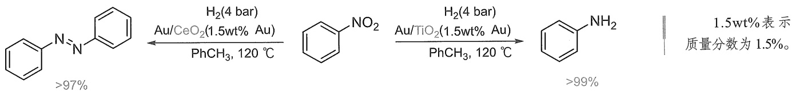

<details>
<summary>chemical</summary>

Nitration reaction equation of benzene
</details>

近年来过渡金属催化还原体系成为合成化学前沿研究领域，基于 Fe、Mn、Co 等过渡金属的均相或非均相催化剂都有了很大发展。虽然过渡金属催化剂并不代表着低毒性和生物相容性，但其相较于贵金属确实有价格和地壳中含量的优势。例如，氮掺杂石墨负载的三氧化二铁( $Fe_{2}O_{3}/NGr@C$ )作为催化剂进行催化氢化，以 96% 的收率还原 2-氯-1-碘-4-硝基苯为 3-氯-4-碘苯胺，转化过程中卤素未被还原。还原硝基为氨基，除了用非均相催化剂，还可以在均相催化氢化及多种金属催化剂条件下，以 HCOOH、 $CO/H_{2}O$ 、 $N_{2}H_{4}$ 、i-PrOH/KOH、 $NaBH_{4}$ 等为还原剂的转移氢化策略。例如， $Au/TiO_{2}$ 作为催化剂，在 CO 气氛下以水为氢源，将脂肪族硝基化合物几乎定量地转化为氨基化合物。

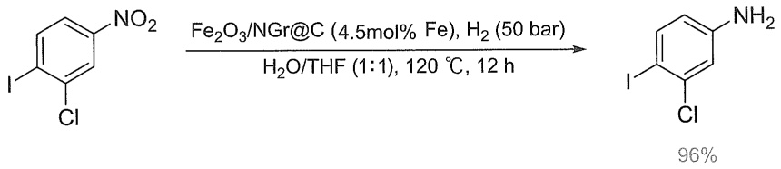

<details>
<summary>chemical</summary>

Chemical reaction equation showing chlorination of a nitrobenzene derivative using Fe2O3/NGr@C catalyst under H2 atmosphere
</details>

## 4. 双分子还原及联苯胺重排

在碱性条件下 Zn 作为还原剂还原硝基苯，得到氢化偶氮苯，系统命名是 1,2-二苯基肼，

---

150

第十二章 胺和含氮芳香杂环化合物

这里涉及两分子硝基苯的反应，称为双分子还原。底物中取代基的位置在反应前后相对于含氮官能团不发生变化。

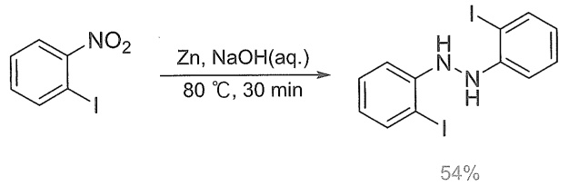

<details>
<summary>chemical</summary>

Chemical reaction equation showing nitration of a benzene derivative under zinc and NaOH conditions to form a fused heterocyclic compound with 54% yield
</details>

如前所述，这显然经过了缩合反应历程。Zn还原硝基苯生成的中间体亚硝基苯与 $N-$ 苯基羟胺首先进行亲核加成反应，再脱去氢氧根负离子得到 $N-$ 氧化偶氮苯（azoxybenzene）。由于 $\alpha$ 效应，羟胺有很强亲核性，在碱性条件下亲核性进一步增强，使这一过程有其合理性。$N-$ 氧化偶氮苯进一步被还原得到偶氮苯衍生物，再氢化就生成氢化偶氮苯衍生物。

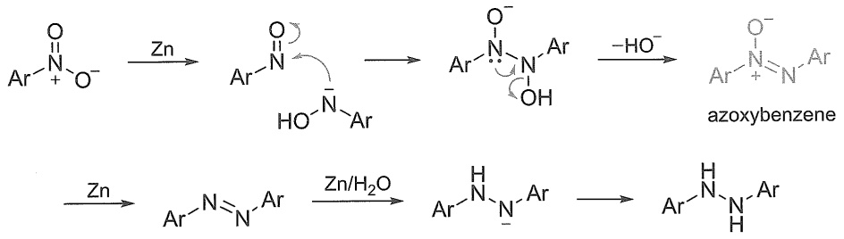

<details>
<summary>chemical</summary>

Chemical reaction pathway showing zinc-catalyzed transformation of azoxybenzene to form an aryl group, with intermediate Zn/H2O conversion.
</details>

Hofmann 在研究偶氮苯的还原反应过程中偶然发现，氢化偶氮苯衍生物在质子酸作用下发生重排反应得到联苯胺衍生物，称为联苯胺重排（benzidine rearrangement）。重排的主要产物是氮氮键发生断裂，氨基对位两个碳发生偶联的 4,4'-联苯胺和邻位碳与对位碳偶联的 2,4'-联苯胺，比例约为 7:3。此外还可能生成少量的 2,2'-联苯胺、o-苯氨基苯胺和 p-苯氨基苯胺。联苯胺作为重要的偶氮染料工业原料，在很长一段时间里其合成被广泛关注。联苯胺也是在细胞生物学和临床上使用的重要染色剂。不过由于其强致癌性，现在已经被大多数国家禁用，取而代之的是不具有致癌性的 3,3',5,5'-四甲基联苯胺（TMB）。

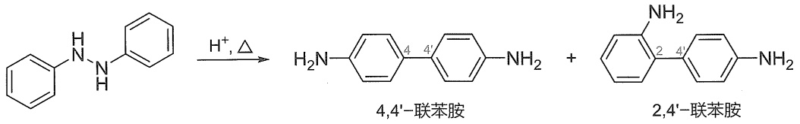

<details>
<summary>chemical</summary>

Chemical reaction equation showing the synthesis of 4,4'-联苯胺 and 2,4'-联苯胺 from a benzylamine derivative under acidic conditions
</details>

早期研究表明，联苯胺重排是一种分子内重排反应，这可以用以下实验来验证。将甲基或乙基取代的氢化偶氮苯以等比例混合，在酸性条件下发生重排，分析反应产物的结构发现，没有交叉反应产物生成，产物都来自自身的反应，这说明发生了分子内重排反应。

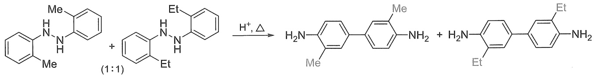

<details>
<summary>chemical</summary>

Chemical reaction equation showing synthesis of a bisphenol derivative from aniline and benzene under acidic conditions
</details>

自1862年联苯胺重排反应被报道以来，其反应机理一直存在争议。从质子酸浓度（$[\mathrm{H}^{+}]$）对反应速率影响来看，对于不同底物，反应速率对 $[\mathrm{H}^{+}]$ 表现出一级动力学或二级动力学，甚至介于一级动力学和二级动力学之间，由此认为氢化偶氮苯的两个氮上发生单质子化、双质子化或者双质子化和单质子化并行的机制均有可能性。20世纪50年代，Dewar提出 $\pi-$ 复合

α 效应:最早由 Edwards 和 Pearson 提出（J. Am. Chem. Soc., 1962, 84: 16），他们发现当一个亲核位点相邻的原子带有孤对电子时，该位点的亲核性会增强。例如， $HO_{2}^{-}$ 比  $HO^{-}$ 的亲核性强。近年来，Hamlin 等通过理论计算深入研究了 α 效应的本质（Angew. Chem. Int. Ed., 2021, 60: 20840）。

---

12.2 胺类化合物的制备

151

物机理，Dewar 根据对 $\left[\mathrm{H}^{+}\right]$ 的二级反应动力学结果进一步提出在决速步形成了双自由基正离子中间体，其后重排经分步过程实现。1964 年，Banthorpe，Hughes 和 Ingold 等人则提出了极化过渡态理论，认为通过[5,5] σ 迁移的协同过程发生重排（图 12-6）。一般来说，芳香堆积常采取 T 型或错位交叠模式，重叠模式有较大电荷排斥作用，但在某些受限空间或晶体结构中常可以观察到重叠堆积模式。协同的[5,5] σ 迁移很好地解释了 4,4'-联苯胺的生成机制。Shine 等人通过重原子动力学同位素效应（KIE）实验支持这种协同反应历程。但是协同反应机制无法解释 2,4'-联苯胺等其他重排产物的生成，双自由基正离子中间体似乎能够更好地符合其反应进程。最近的理论计算结果表明，氢化偶氮苯单质子化后经协同机理生成联苯胺的反应活化能为 $146.5 \mathrm{~kJ/mol}$；而双质子化以后经过自由基正离子偶联的反应活化能为 $108.8 \mathrm{~kJ/mol}$，因此推测在通常实验的酸浓度条件下更倾向于发生双质子化的分步反应历程。在手性磷酸催化的 2,2'-二萘基肼的不对称联苯胺重排反应中观测到了显著的负非线性效应，提示反应中存在双质子化反应中间体。尽管各种研究使认识不断深入，但是要完全揭示联苯胺重排反应的机理还有待新的实验结果出现。

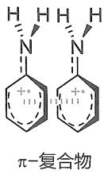

[5, 5] σ迁移属于周环反应中的 σ迁移反应，具体见第13章相关内容。

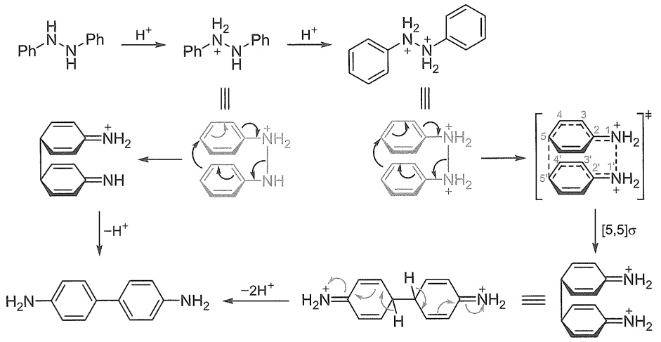

<details>
<summary>chemical</summary>

Reaction mechanism diagram showing protonation and rearrangement of a diamine ligand to form a tetrahydroquinone derivative with [5,5]σ reagent
</details>

图 12-6 联苯胺重排的极化过渡态机理

## 12.2.2 腈还原法

## 1. 催化氢化

腈类化合物还原是伯胺的重要制备方法之一。氰基催化氢化得到氨基，腈就转化为伯胺。腈的催化氢化易生成副产物，催化剂等反应条件是成功转化的关键。常用的金属催化剂有Ni、Pd、Co、Cu、Ir、Ru等，一般需要在较高温度和压力条件下进行。这是由于 $\mathrm{C}\equiv \mathrm{N}$ 键催化加氢分步进行，腈首先被还原为伯亚胺（$1^{\circ}$），再进一步加氢得到伯胺（图12-7）。亚胺键属于动态共价键，体系中生成的伯胺与反应中间体伯亚胺发生亲核加成再消除，得到仲亚胺中间体（$2^{\circ}$），其还原导致仲胺副产物的生成。伯亚胺中间体与仲胺反应再氢化就生成叔胺。要提高反应选择性，避免仲胺和叔胺副产物的生成，可以加大氢气压力，使伯亚胺中间体尽快转化为产物，并使用强酸捕获生成的伯胺成盐，以降低其亲核性。加入氨气等添加物则可以通过影响反应平衡使其更倾向于伯亚胺，并最终被还原为伯胺。由于氰基相对来说有更高的氧化还原电位，并且C-CN键的解离能较低，反应中还可能发生脱氰基还原及亚胺中间体与其他亲核物种的副反应。另外，氰基催化氢化也面临其他官能团的兼容性问题。氰基还原为氨基转化过程的关键是避免副反应发生。目前已经发展了一些基于Ru、Rh、Pd、Mn、Fe、

---

152

第十二章 胺和含氮芳香杂环化合物

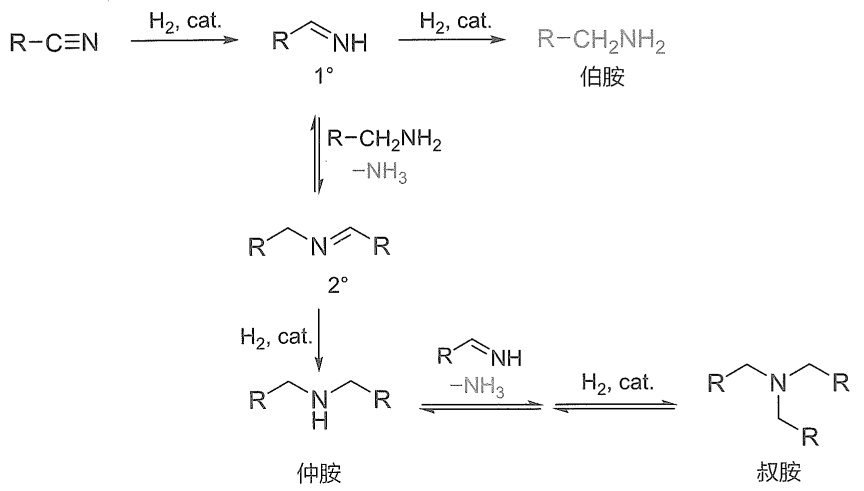

<details>
<summary>chemical</summary>

Chemical reaction pathway showing conversion of amine to amide and subsequent cyclization to isocyanate
</details>

图12-7 腈催化氢化还原制备伯胺的分步氢化过程及副产物的生成

Co、Ni、Ir、Pt等复合物的高效高选择性均相或非均相催化剂，用于芳香或者脂肪腈类化合物还原（图12-8）。底物和催化剂等条件对反应化学选择性影响很大。腈在过渡金属催化下用过量的 $\mathrm{NH_3\cdot BH_3}$ 或醇等试剂进行转移氢化还原也可以转化为伯胺。近年来还实现了无催化剂条件下 $\mathrm{NH_3\cdot BH_3}$ 对腈类化合物的高选择性还原。电化学还原也展现出其优势。


<details>
<summary>chemical</summary>

Multi-step organic synthesis reaction scheme for synthesizing substituted benzene derivatives using ruthenium catalysts and palladium catalysts
</details>

图12-8 腈类化合物选择性还原为伯胺举例

## 2. 金属氢化物还原

腈也可以被化学计量的金属氢化物还原。由于 $\mathrm{C} \equiv \mathrm{N}$ 中氮原子的电负性大于碳原子的电负性，因此碳表现亲电性，能够和亲核试剂反应。用 $\mathrm{LiAlH_4}$ 为还原剂可以在室温条件下还原腈为相应的伯胺，用 $\mathrm{NaBH_4}$ 则需要在较高温度条件下反应。二异丙氨基硼烷 $[\mathrm{BH}_2\mathrm{N}(^i\mathrm{Pr})_2]$/催化量 $\mathrm{LiBH_4}$ 体系是近年发展的一种还原体系，以高收率还原芳香或脂肪腈类化合物，这一条件不还原卤素，但同时还原醛基。当苯环上有吸电子基取代时，反应条件温和，有给电子基取代时，提高反应温度为四氢呋喃回流也可以实现完全还原。

---

12.2 胺类化合物的制备

153


<details>
<summary>chemical</summary>

Two-step organic synthesis reaction scheme showing chlorination and ring closure steps with yields and conditions
</details>

## 12.2.3 酰胺还原法

强还原剂 $\mathrm{LiAlH_4}$ 还原酰胺得到相应的胺类化合物（图12-9）。由于氨基氮上孤对电子的共轭给电子效应，羰基碳的正电性降低，需与强亲核试剂反应。$\mathrm{LiAlH_4}$ 提供 $\mathrm{H}^-$ 对酰胺羰基发生亲核加成，经亚胺正离子中间体再还原得到相应的胺。被Cbz（COOBn）保护的氨基也被还原，反应过程中苄氧基为离去基团，得到 $N-$ 甲酰基中间体，再还原为 $N-$ 甲基。还原时控制反应温度使半缩醛胺中间体不分解，经后处理就得到醛（图12-10）。例如，$N,N-$ 二甲基苯甲酰胺在 $0^{\circ}\mathrm{C}$ 条件下被 $\mathrm{LiAlH_4}$ 还原，以 $80\%$ 收率得到苯甲醛。


<details>
<summary>chemical</summary>

Multi-step organic synthesis reaction scheme showing fluorinated and carbonyl-substituted furan derivatives with yields and reagents
</details>

图 12-9 LiAlH$_{4}$ 还原酰胺制备胺类化合物


<details>
<summary>chemical</summary>

Reaction mechanism diagram showing lithium-catalyzed transformation of a carbonyl compound with aluminum and hydrogen substituents
</details>

图12-10 $\mathrm{LiAlH_4}$ 还原酰胺反应的可能机理

---

154

第十二章 胺和含氮芳香杂环化合物

$\mathrm{LiAlH_4}$ 非常活泼，遇水剧烈反应并产生氢气，易燃，实验操作时需要注意安全，溶剂等应绝对无水。三乙基氧鎓四氟硼酸盐（Meerwein试剂， $\mathrm{Et}_3\mathrm{O}^+\mathrm{BF}_4^-$ ）作为强的乙基化试剂，可以在 $\mathrm{CH}_2\mathrm{Cl}_2$ 中实现酰胺氧上的乙基化而高效转化为亚胺正离子，再以过量 $\mathrm{NaBH_4}$ 为还原剂、乙醇为溶剂条件下反应，就可以在温和条件下得到相应的胺类化合物。这也是仲/叔酰胺还原为相应仲/叔胺的重要策略。


<details>
<summary>chemical</summary>

Chemical reaction scheme showing synthesis of a diamine derivative with ethyl ester and sodium borohydride under specified conditions
</details>

除此以外，乙硼烷、硼烷复合物（$\mathrm{BH}_3\cdot \mathrm{THF}$，$\mathrm{BH}_3\cdot \mathrm{SMe}_2$ 等）、二异丁基氢化铝（$\mathrm{HAl}^i\mathrm{Bu}_2$，即DIBAL-H）、二氢双(2-甲氧基乙氧基)铝酸钠$[\mathrm{NaAlH}_2(\mathrm{OCH}_2\mathrm{CH}_2\mathrm{OCH}_3)_2$，商品名Red-Al，Vitride]、三乙酰氧基硼氢化钠$[\mathrm{NaBH(OAc)}_3]$等都可以将酰胺还原为胺类化合物。偶然发现的氨基氢化硼锂试剂（LAB）也是一种强还原剂，其安全性大大高于$\mathrm{LiAlH_4}$。固体LAB试剂在干燥空气中的稳定性与$\mathrm{NaBH}_4$类似，在$25^{\circ}\mathrm{C}$氮气氛干燥条件下储存半年，其化学活性仍能够保持；在$\mathrm{pH} > 4$的质子性溶剂中仅缓慢释放氢气。LAB试剂即使在THF溶剂中回流也不还原伯酰胺和仲酰胺。当叔酰胺位阻较小时，使用LAB试剂还原得到醇；当叔酰胺位阻较大时，还原产物取决于LAB试剂的位阻。LAB试剂的位阻也较大时，反应得到叔胺。这是因为叔酰胺受到$\mathrm{H^-}$亲核进攻后的中间体进一步与氨基硼烷反应，当叔酰胺与LAB试剂的位阻都较小时，中间体的氧原子和氮原子都与氨基硼烷反应，进一步发生C-N键断裂消除，得到醛中间体，其被还原得到醇；当叔酰胺与LAB试剂的位阻都较大时，只有中间体的氧原子与氨基硼烷反应，进一步发生C-O键断裂消除，得到亚胺正离子中间体，其被还原得到叔胺。LAB试剂在加热（$65^{\circ}\mathrm{C}$）条件下还原氰基得到伯胺，在室温条件下不反应，控制反应温度可以实现选择性还原。


<details>
<summary>chemical</summary>

Chemical reaction scheme showing synthesis of arylboronic acid derivatives using LiH3BN(¹Pr)₂ and NBH₃Li under THF at 25°C for 3 hours, yielding 95% products.
</details>

除了使用化学计量还原剂在剧烈条件下的酰胺还原以外，还可以使用  $H_{2}$ 、 $R_{3}SiH$ 、 $R_{2}BH$  等为氢源，过渡金属复合物催化的酰胺还原。近年还发展了不需金属催化剂、条件温和的酰胺还原策略。还原为胺的过程面临 C-O 键和 C-N 键的选择性断键问题，不论是金属催化剂活化，还是使用 Lewis/Brønsted 酸等试剂活化酰胺键，其关键都在于推动反应生成活化的亚胺或亚胺正离子中间体，再还原为相应的胺类化合物。

---

12.2 胺类化合物的制备

155

## 12.2.4 Gabriel 伯胺合成法

1887年，Gabriel报道了一种合成伯胺的方法，现在称为Gabriel伯胺合成法。邻苯二甲酰亚胺（PhthNH）是其核心试剂，以邻苯二甲酸酐为原料在高温下与氨气反应制得。用KOH将PhthNH制备为钾盐（PhthNK），其作为亲核试剂与卤代烃发生亲核取代反应实现氮上烷基化，在DMF等非质子性极性溶剂中反应遵循 $\mathrm{S_N2}$ 机理。位阻较大的卤代烃不适用，叔卤代烃不仅位阻大，且易发生消除副反应，所以不能作为烷基化试剂。 $N$ -烷基化邻苯二甲酰亚胺（PhthNR）在强酸或强碱加热条件下水解得到伯胺 $\mathrm{RNH_2}$ 。使用Gabriel合成策略不会发生氮上多取代，因此这是优秀的伯胺合成方法。由于酰亚胺须在强酸性或强碱性条件下水解以释放伯胺，所以官能团兼容性不好。1926年，Ing和Manske对Gabriel伯胺合成法进行改良，一是以碳酸钾为碱，PhthNH与过量卤代烃反应直接得到PhthNR；二是使用水合肼在乙醇溶剂中回流进行肼解得到伯胺。现在除了卤代烃，还可以使用其他有良好离去基团的底物，如对甲苯磺酸酯、甲磺酸酯等。水合肼肼解的过程类似酰胺的胺解反应，反应条件温和，相较于强酸性或强碱性条件下酰亚胺水解，在合成应用中更占优势。


<details>
<summary>flowchart</summary>


</details>

考虑水合肼试剂的毒性，近来进一步改进了酰亚胺的断键策略。例如，发展了过渡金属Ru、Mn、$\mathrm{Ag / TiO_2}$ 等催化的还原策略切断酰亚胺的C-N键，释放出伯胺。邻苯二甲酰亚胺则被还原为1,2-二羟甲基苯或异苯并呋喃-1(3H)-酮。以四氟邻苯二甲酰亚胺钾盐（$^{4F}\mathrm{PhthNK}$）替代PhthNK与三价碘化合物[ArIPh]OTf发生偶联反应，得到 $N-$ 芳基取代四氟邻苯二甲酰亚胺，由于吸电子基团的取代使酰亚胺的羰基亲电性增强，这时只需要在加热条件下使用乙二胺进行胺解，就可以顺利得到伯胺产物。


<details>
<summary>chemical</summary>

Chemical reaction scheme showing synthesis of a fluorinated indole derivative with 78% yield and 99% final product under specified conditions
</details>

Gabriel伯胺合成法可用于设计以醇为原料合成手性伯胺。例如，以 $(R)$ -辛-2-醇为原料，首先将羟基转化为好的离去基团OTs，再通过Gabriel伯胺合成法就合成到构型翻转的伯胺(S)-辛烷-2-胺。其中关键的一步是PhthNK与对甲苯磺酸酯的 $\mathrm{S_N}2$ 反应。由于醇转化为对甲苯磺酸酯和肼解反应都不涉及手性中心，构型保持，所以最终得到构型翻转的产物。以(S)-辛-2-醇为原料，通过相同的转化过程将得到(R)-构型伯胺。如果以(R)-辛-2-醇为原料，合成构型保持的(R)-辛烷-2-胺，需要设计所有反应均构型保持或发生两次构型翻转的立体专

---

156

第十二章 胺和含氮芳香杂环化合物


<details>
<summary>chemical</summary>

Chemical reaction pathway showing hydrolysis of a ketone to form acetaldehyde and aldehyde, followed by acidification and dehydration.
</details>

一性反应。Gabriel合成法有一次构型翻转过程，因此需要设计有两次构型翻转的转化。使用醋酸钠与对甲苯磺酸酯在非质子性极性溶剂DMF或者DMSO中先发生一次 $\mathrm{S_N2}$ 反应，这样就得到了构型翻转的醋酸酯，随后进行酯水解，这是一个构型保持的过程，于是就得到了(S)-辛-2-醇，以其为原料再重复上述过程就得到了(R)-辛烷-2-胺，最终实现构型保持的转化。

构型翻转


<details>
<summary>flowchart</summary>


</details>

以上合成设计中，手性醇构型翻转是核心策略。其中包含:将手性醇转化为对甲苯磺酸酯，构建好的 OTs 离去基团，常用的亲核试剂为四丁基醋酸铵，在 DMF 溶剂中发生  $S_{N}2$  反应而引入乙酰氧基，再进行酯水解，得到构型翻转的手性醇。这一路径也成为手性醇构型翻转的通用方法，然而这一策略路线较长。

1967 年，光延旺洋（Oyo Mitsunobu）发现，仲醇在 DEAD/PPh₃ 作用下可以高效地与醋酸反应实现乙酰化，并且能够使手性醇立体专一性地发生构型翻转，这使得对手性醇引入构型翻转的乙酰氧基过程一步完成，因此成为醇手性中心构型翻转的高效策略。亲核试剂一般是弱酸性试剂，如羧酸、醇、酚、硫醇、仲胺、叠氮酸等。因此，Mitsunobu 反应与 Gabriel 合成法协同，即在 DEAD/PPh₃ 反应条件下，以 PhthNH 为亲核试剂，得到取代产物，再通过肼解，就制备得到伯胺（图 12-11）。反应过程中三苯基膦首先对偶氮二甲酸二乙酯（DEAD）


<details>
<summary>chemical</summary>

Multi-step organic synthesis reaction scheme for synthesizing a MBH intermediate, involving phosphine derivatives and ester intermediates
</details>

图12-11 Mitsunobu反应用于胺类化合物制备及其反应机理

---

12.2 胺类化合物的制备

157

发生 Michael 加成得到 Morrison-Brunn-Huisgen (MBH) 两性离子中间体, 随后醇与 MBH 中间体发生亲核取代反应得到氧杂磷叶立德中间体, 这是活化醇的关键步骤, DEAD 则被还原为肼衍生物。最后亲核试剂 $(\mathrm{Nu}^{-})$ 与氧杂磷叶立德发生 $\mathrm{S}_{\mathrm{N}}2$ 反应得到构型翻转的产物, 三苯氧膦为离去基团。近年发展的氧化还原驱动或中性氧化还原过程的催化 Mitsunobu 反应取得了出色的研究成果, 避免了传统 Mitsunobu 反应需要使用化学剂量的偶氮二甲酸酯和膦(Ⅲ)试剂, 以及反应后生成大量的肼和三苯氧膦。最近还发展了一种通用试剂——BEHT 三氟甲磺酸盐 (BEHT·OTf), 可在温和条件下立体专一性地将醇转化为相应的胺类化合物。

## 12.2.5 Staudinger 反应

有机叠氮化合物也是伯胺的重要前体。Bose 发展了以叠氮磷酸二苯酯（DPPA）为亲核试剂，通过 Mitsunobu 反应策略将醇转化为叠氮化合物，这成为一种立体专一性叠氮化合物制备方法。以下列举了奎宁衍生的硫脲有机小分子催化剂的千克级合成。首先通过 Bose-Mitsunobu 反应立体专一性地引入叠氮基团，再以 Staudinger 反应还原为氨基，与 3,5-双(三氟甲基)苯基异硫氰酯反应后重结晶，以 70.7% 的总收率合成得到 14.7 kg 有机硫脲催化剂。


这里第二步反应是1953年由高分子化学学科的创立者Staudinger发展的叠氮还原反应，称为Staudinger反应。在 $\mathrm{PPh}_3$ 作用下，叠氮基团被还原为氨基，反应中需要有水参与。如图12-12所示， $\mathrm{PPh}_3$ 首先对叠氮化合物发生亲核加成，然后发生类似Wittig反应的过程，四元环中间体由顺式构型的前体化合物反应得到，消除以后得到氮杂磷叶立德，随后水解得到三苯氧膦和还原产物伯胺。Bose-Mitsunobu反应与Staudinger反应联用，成为由醇转化为伯胺的有效策略（图12-13）。Staudinger反应可以单独进行水解步骤，也可以使用加入少量水的混合溶剂。需要注意，相对分子质量较小的叠氮化合物有爆炸危险，在实验过程中要特别注意操作安全。DPPA试剂相对比较稳定，安全性高，但仍需要注意保存在阴凉干燥的环境中，如果长期存放吸潮，会生成有爆炸危险的叠氮酸。


<details>
<summary>chemical</summary>

Chemical structure of a triazole derivative with Ph3P+, EtO2C, CO2Et, and OTf groups
</details>

---

158

第十二章 胺和含氮芳香杂环化合物


<details>
<summary>chemical</summary>

Chemical reaction mechanism showing phosphorus-containing heterocyclic compounds reacting with amine and phenyl groups
</details>

图12-12 Staudinger反应可能机理


<details>
<summary>chemical</summary>

Multi-step organic synthesis reaction scheme showing chlorination, bromination, and cyclization steps with reagents and yields
</details>

图12-13 Staudinger反应举例

Roche 制药公司的奥司他韦（Oseltamivir）生产路线中也几次运用了 Staudinger 反应。奥司他韦的商品名为达菲，是一种应对流感的药物，属于神经氨酸酶特异性抑制剂，通过抑制成熟的流感病毒脱离宿主细胞来阻止流感病毒在人体内的传播。这一结构的获得得益于计算机精准辅助药物设计。达菲对禽流感的显著疗效，使其在禽流感肆虐时期成为明星药物。专利持有者 Roche 制药公司使用莽草酸为原料，经 14 步反应，以 18% 的总收率制得磷酸奥司他韦（图 12-14）。莽草酸首先经 6 步反应转化为环氧中间体 A，然后用  $NaN_{3}$  开环，引入叠


<details>
<summary>flowchart</summary>


</details>

图 12-14 Roche 制药公司的奥司他韦（Oseltamivir）部分合成路线

---

12.2 胺类化合物的制备

159

氮基团，随后在三苯基膦/三乙胺/甲磺酸（MsOH）条件下发生Staudinger反应得到氮杂环丙烷C，再次用 $\mathrm{NaN}_3$ 开环，氨基用乙酰基保护得到叠氮化合物D，再一次Staudinger反应还原叠氮基团为氨基就得到了Oseltamivir。在叠氮化物B转化为氮杂环丙烷C的反应中，$\mathrm{PPh}_3$ 首先将B转化为氮杂磷叶立德中间体，在MsOH的活化下，与邻位羟基发生分子内亲核加成关环得到五元环中间体，再断裂氮磷键，得到氧杂磷叶立德，随后氨基为亲核试剂发生分子内亲核取代，三苯氧膦为离去基团，从而构建了氮杂环丙烷结构（图12-15）。


<details>
<summary>chemical</summary>

Multi-step organic synthesis reaction scheme showing transformations of a cyclic ester with carboxylic acid and phosphine groups
</details>

图12-15 叠氮化物B转化为氮杂环丙烷C的反应可能机理

以上合成设计中使用叠氮化钠合成叠氮化合物，这也是常用的叠氮化试剂。利用其强亲核性，常用于与卤代烃等发生亲核取代反应来制备叠氮化合物。一般需要在不高于 $35^{\circ}\mathrm{C}$ 条件下长时间反应，后处理较为烦琐，生成的叠氮化物常常有爆炸性，蒸馏时也需特别注意。进行大规模生产时更需关注反应过程中的安全性问题。例如，当存在质子性溶剂时，很难避免剧毒爆炸性试剂 $\mathrm{HN}_3$ 的生成。


<details>
<summary>chemical</summary>

Nitration reaction equation of benzene
</details>

---

160

第十二章 胺和含氮芳香杂环化合物

除了Staudinger反应还原叠氮化合物制备伯胺，催化氢化和 $\mathrm{LiAlH_4}$ 等试剂条件都可以还原叠氮化合物。经典Staudinger反应产生大量三苯氧膦等副产物，给产物分离纯化带来一定困难。催化氢化和 $\mathrm{LiAlH_4}$ 还原等策略都需注意官能团的选择性。近年发现，NaI在酸性离子交换树脂或HCl等强酸条件下可以高效实现叠氮基团还原为氨基，该策略有很好的官能团兼容性，不会还原苄基、硝基、 $\mathrm{C = C}$ 等易被还原的官能团。


<details>
<summary>chemical</summary>

Chemical reaction equation showing synthesis of a bis(4-nitro-2-yl)aniline using NaI and Amberlite IR-120 H+ under specified conditions
</details>

## 12.2.6 Delépine 反应

乌洛托品（urotropine）也称六亚甲基四胺（HMTA）。由于烷基的给电子作用，乌洛托品有较强的亲核性，其与伯卤代烷发生亲核取代反应得到季铵盐，然后在浓酸作用下水解制得伯胺。这是1895年由Delépine发展的伯胺合成法。相对来说，这一方法条件温和，产物分离简便，一般不需要柱色谱。季铵盐的制备中绝大多数以氯仿为溶剂，这是由于HMTA可以溶于加热回流的氯仿溶液中，而产物季铵盐则会析出，便于分离。但这也恰是该反应的缺陷之处，因为氯仿属于有毒有害溶剂。另外，反应会有致癌物二氯甲基醚生成，还存在原子经济性问题。本着可持续和绿色化学原则，近年来人们对反应条件做了一定改进，例如，在叔丁氧羰基（Boc）保护的2,5-二氢-1H-吡咯的合成中，HMTA与1,4-二氯丁-2-烯的反应以更加绿色的碳酸二甲酯为溶剂，以几乎定量的收率得到季铵盐，然后以甲醇为溶剂一锅煮实现Boc保护二氢吡咯的构建，产率 $86\%$ 。注意Delépine反应与Sommelet反应的区别。Sommelet反应同样以HMTA和卤代烃为原料，反应经历负氢迁移过程，然后在水溶液或 $50\%$ 醋酸溶液或 $\mathrm{EtOH / H_2O}$ 溶液中加热得到相应的醛，多数用于芳香醛的制备。


<details>
<summary>flowchart</summary>

```mermaid
graph LR
  A["Br-CH2-CH(Br)-C(=O)"] --> B["(HMTA)-N-(CH2Cl3)-N-(CH2N2)-N-(CH2N4)-N-(CH2N6)-N-(CH2N8)-N-(CH2N10)-N-(CH2N12)-N-(CH2N14)-N-(CH2N16)-N-(CH2N18)-N-(CH2N20)-N-(CH2N22)-N-(CH2N24)-N-(CH2N26)-N-(CH2N28)-N-(CH2N30)-N-(CH2N32)-N-(CH2N34)-N-(CH2N36)-N-(CH2N38)-N-(CH2N40)-N-(CH2N42)-N-(CH2N44)-N-(CH2N46)-N-(CH2N48)-N-(CH2N50)-N-(CH2N52)-N-(CH2N54)-N-(CH2N56)-N-(CH2N58)-N-(CH2N60)-N-(CH2N62)-N-(CH2N64)-N-(CH2N66)-N-(CH2N68)-N-(CH2N70)-N-(CH2N72)-N-(CH2N74)-N-(CH2N76)-N-(CH2N78)-N-(CH2N80)-N-(CH2N82)-N-(CH2N84)-N-(CH2N86)-N-(CH2N88)-N-(CH2N90)-N-(CH2N92)-N-(CH2N94)-N-(CH2N96)-N-(CH2N98)-N-(CH2N100)-N-(CH2N101)-N-(CH2N102)-N-(CH2N103)-N-(CH2N104)-N-(CH2N105)-N-(CH2N106)-N-(CH2N107)-N-(CH2N108)-N-(CH2N109)-N-(CH2N110)-N-(CH2N111)-N-(CH2N112)-N-(CH2N113)-N-(CH2N114)-N-(CH2N115)-N-(CH2N116)-N-(CH2N117)-N-(CH2N118)-N-(CH2N119)-N-(CH2N120)-N-(CH2N121)-N-(CH2N122)-N-(CH2N123)-N-(CH2N124)-N-(CH2N125)-N-(CH2N126)-N-(CH2N127)-N-(CH2N128)-N-(CH2N129)-N-(CH2N130)-N-(CH2N131)-N-(CH2N132)-N-(CH2N133)-N-(CH2N134)-N-(CH2N135)-N-(CH2N136)-N-(CH2N137)-N-(CH2N138)-N-(CH2N139)-N-(CH2N140)-N-(CH2N141)-N-(CH2N142)-N-(CH2N143)-N-(CH2N144)-N-(CH2N145)-N-(CH2N146)-N-(CH2N147)-N-(CH2N148)-N-(CH2N149)-N-(CH2N150) N+(K₂CO₃, MeOH) → Cyclic intermediate → Product → Product → Product → Product → Product → Product → Product → Product → Product → Product → Product → Product → Product → Product → Product → Product → Product → Product → Product → Product → Product → Product → Product → Product → Product → Product → Product → Product → Product → Product → Product → Product → Product → Product → Product → Product → Product → Product → Product → Product → Product → Product → Product → Product → Product → Product → Product → Product → Product → Product → Products: K₂CO₃ (MeOH), Cyclic intermediate (H), Boc₂O (MeOH), Boc (Boc).
```
</details>

## 12.2.7 醛/酮与氨衍生物缩合产物还原

## 1. Leuckart-Wallach 反应和 Eschweiler-Clarke 反应

醛/酮易与氨衍生物发生缩合反应，乌洛托品就是甲醛和氨缩合得到的产物。1885年，

---

12.2 胺类化合物的制备

161

Leuckart 发现芳香醛/酮在加热条件下与甲酸铵反应，得到相应的伯胺。其后 Wallach 提出了反应的可能机理，并将这一反应拓展到脂肪醛/酮底物。从反应结果看，氨基的来源是甲酸铵，在酸性条件下首先醛/酮与氨反应生成亚胺正离子中间体，随后甲酸作为还原剂，提供负氢与正离子中间体发生亲核加成反应生成伯胺，同时脱去一分子二氧化碳气体。也有人认为，反应先生成甲酰胺，在不同温度条件下经历了不同的反应途径。


<details>
<summary>chemical</summary>

Reaction mechanism diagram showing protonation and deprotonation steps of a carbocation intermediate
</details>

Eschweiler-Clarke 反应也称胺甲基化反应,可看作改进的 Leuckart 反应。对于伯胺或仲胺,在甲醛和甲酸的作用下一锅反应实现胺甲基化。反应机理与 Leuckart 反应的机理相似,首先胺衍生物和甲醛生成亚胺正离子,甲酸作为还原剂还原亚胺正离子,从而实现胺甲基化。


<details>
<summary>chemical</summary>

Reaction mechanism diagram showing protonation and carbonylation steps of a carboxylic acid derivative
</details>

以上两类反应均先形成亚胺正离子中间体，再用甲酸还原，选择不同的醛/酮与胺为原料可以制备多种类型的胺类化合物。例如，异丁醛和杂环化合物吗啉在甲酸作用下反应，以 $57\%$ 的收率得到氮上烷基化的吗啉。(2S,6S)-2-异丙基-6-甲基-1,4,7-三氮杂环壬烷在甲醛和甲酸加热条件下以 $90\%$ 的收率发生胺甲基化反应。


<details>
<summary>chemical</summary>

Chemical reaction scheme showing two-step synthesis of pyridine derivatives with yields and conditions
</details>

## 2. 还原胺化

醛/酮和氨衍生物缩合有多种中间体生成。对于氨或伯胺，半缩合的醇胺中间体脱水生成亚胺（Schiff碱），再还原为伯胺或仲胺。在氨过量条件下还原胺化可以避免产生仲胺副产物。不论使用气态氨还是液态氨，实验操作中都不太方便，甲酸铵、硫酸铵、碳酸铵等固体铵盐作为氨的等价物更易于处理，这些试剂通过溶解或加热在实验过程中原位产生氨。需要注意的是，铵盐在低极性有机溶剂中溶解度一般较差，另外有的铵盐容易吸潮，对于水敏感


<details>
<summary>chemical</summary>

Chemical reaction equation showing amide bond formation with R1 and R2 substituents
</details>


<details>
<summary>chemical</summary>

Chemical reaction equation showing condensation between amine and carbonyl groups with a diastereomeric excess
</details>

---

162

第十二章 胺和含氮芳香杂环化合物

的有机反应不适用。如果醛/酮过量，生成的伯胺与过量醛/酮反应生成亚胺，再还原将得到仲胺。醛/酮和仲胺反应所生成的醇胺中间体发生消除反应得到亚胺正离子中间体，再还原或醇胺中间体直接还原都可得到叔胺。这些都是胺类化合物制备方法。


<details>
<summary>chemical</summary>

Chemical reaction mechanism showing protonation and hydrogenation steps of a heterocyclic compound
</details>

还原可以通过催化氢化实现，已经发展了Pd、Ru、Ni、Pt、Co、Rh、Ir等多种金属催化剂条件下的非均相氢化反应，使用手性配体还可以实现不对称氢化。常用的均相还原策略主要使用 $\mathrm{NaBH(OAc)_3}$ 、 $\mathrm{NaBH}_3\mathrm{CN}$ 、 $\mathrm{NaBH}_4$ 等还原剂，以甲醇为溶剂进行一锅还原胺化，也可以使用 $\mathrm{Ph}_3\mathrm{SiH}$ 、 $\mathrm{Et}_3\mathrm{SiH}$ 等进行转移氢化反应。在中性条件下，即使甲醇加热回流，$\mathrm{NaBH}_3\mathrm{CN}$ 对酮的还原也非常缓慢，在 $\mathrm{pH}3\sim 4$ 条件下则加速还原。由此可以理解这些还原剂易于还原亚胺正离子中间体，从而实现一锅煮的还原胺化。$\mathrm{NaBH}_3\mathrm{CN}$ 为还原剂时常称为Borch还原胺化。$\mathrm{NaBH(OAc)_3}$ 也是高选择性的温和还原胺化试剂，反应时常常加入醋酸为质子源。相较于高毒性试剂 $\mathrm{NaBH}_3\mathrm{CN}$，反应过程中不会产生含氰根的有毒副产物。以下列举几个转化实例，醛、酮、伯胺、仲胺都可以组合反应。还原胺化既可以是分子间反应，又可以是分子内反应。醛/酮与氨衍生物的缩合产物肟、腙等也可以被还原为伯胺。以上还原剂在官能团选择性等方面尚存在一定缺陷，更多的还原体系被开发出来，特别是更加可持续绿色催化还原策略使得还原胺化在药物合成等方面有更广泛的应用。


---

12.2 胺类化合物的制备

163


<details>
<summary>chemical</summary>

Chemical reaction scheme showing ruthenium-catalyzed coupling of a chlorinated pyridine derivative with 2 MeSO3H under NaBH/OAc and NaOAc conditions, yielding a 98% product with various reagents.
</details>

87%, 99.5% ee

思考:反应中有  $CO_{2}$  产生，除去  $CO_{2}$  可以大大促进反应，试分析原因。


<details>
<summary>chemical</summary>

Chemical reaction equation showing conversion of a substituted pyrimidine derivative to a fused heterocyclic compound under specific conditions
</details>

93%

## 12.2.8 Hofmann重排、Curtius重排及Schmidt反应

1881年，Hofmann发现以伯酰胺为原料，在碱性条件下与溴单质或氯气反应，可以将酰胺转化为少一个碳的伯胺，同时生成一分子 $\mathrm{CO}_{2}$ 。1885年，Curtius用酰氯与叠氮化钠反应首先得到酰基叠氮，然后在加热条件下水解得到伯胺，同时生成一分子 $\mathrm{CO}_{2}$ 和一分子 $\mathrm{N}_2$ 。Schmidt使用羧酸和叠氮酸在酸性条件下反应合成酰基叠氮。现在合成中更多使用DPPA在酸性条件下与羧酸反应制备。Schmidt的贡献还在于反应底物可以从羧酸拓展到醛、酮等。比较Hofmann重排、Curtius重排和Schmidt反应，都生成一分子 $\mathrm{CO}_{2}$，Curtius重排和Schmidt反应都有氮气生成，从原料酰基叠氮和产物伯胺的结构看，显然这里氮气是离去基团，烷基发生了迁移，形成新的碳氮键。


<details>
<summary>flowchart</summary>


</details>

如图 12-16 所示，考虑 Hofmann 重排的条件，酰胺的氮氢有酸性，在碱作用下攫氢得到亲核试剂，其与溴单质发生取代反应生成 N-溴代产物，由于酰基和溴的吸电子效应，氮

---

164

第十二章 胺和含氮芳香杂环化合物

上的氢酸性进一步增强，在碱的作用下生成酰胺负离子，氮上连有离去基团溴。这时烷基带着一对电子向缺电子氮中心迁移，同时使溴离去，烷基带着一对电子发生迁移后，羰基碳带正电荷，与邻位氮上的负电荷形成共价键，得到碳氮双键，生成异氰酸酯。这个协同过程与Pinacol重排类似。转化过程也可以分步来看，溴负离子先离去，这样就生成了乃春，也称酰基氮宾，性质上和卡宾类似，具有亲电性，也就是说N是缺电子中心，烷基带着一对电子向缺电子中心迁移，同时氮的孤对电子转移形成碳氮双键，于是同样得到异氰酸酯。不论是协同过程还是分步过程，最后都生成异氰酸酯。协同的途径类似分子内 $\mathrm{S_N2}$ 过程，分步反应则类似 $\mathrm{S_N1}$ 过程。接下来就是异氰酸酯在碱的作用下首先发生亲核加成，然后烯醇式酮式互变异构，得到碳酸胺衍生物，脱去一分子 $\mathrm{CO_2}$ 再质子化得到伯胺。类似的还有Lossen反应，将 $N$ -羟基酰胺的羟基转化为好的离去基团，也会发生相似的重排反应。由于Hofmann重排的强碱性条件，所得到的异氰酸酯中间体总是生成不稳定的碳酸胺衍生物后消除得到伯胺。Curtius重排中以胺或醇为亲核试剂，可以将异氰酸酯中间体转化为脲衍生物或氨基羧酸酯衍生物；Schmidt反应中使用醛为原料，将得到腈衍生物；以酮为原料则制备得到酰胺。近年来发展了一些条件更为温和的重排过程，例如，以DBU为碱，在甲醇溶剂中回流，原位生成的 $N$ -溴代-4-甲氧基苯甲酰胺以 $93\%$ 的收率得到重排的 $N$ -甲氧羰基-4-甲氧基苯胺（图12-17）。


图12-16 Hofmann重排反应可能机理

C-N 键偶联反应是合成芳香胺类化合物的重要策略之一，已发展出多种方法，例如，Ullmann 偶联反应、Goldberg 胺化反应、Buchwald-Hartwig 偶联反应、Chan-Lam 胺化反应等，在复杂有机化合物构建中有广泛应用。


<details>
<summary>chemical</summary>

Multi-step organic synthesis reaction scheme showing transformations of a ketone to a lactam with yields and reagents
</details>

图12-17 重排反应举例

---

12.3 胺类化合物的物理化学性质

165

如果与酰胺连接的碳是手性中心，重排后将得到构型保持的产物。因为重排过程的关键步骤是邻位迁移，从周环反应的学习可知这是一种同面迁移过程，迁移基团的手性中心构型保持。

$$
\stackrel {*} {R} \stackrel {\mathrm{O}} {\mathrm{C}} \stackrel {\mathrm{NH} _ {2}} {\mathrm{NH} _ {2}} \xrightarrow {\mathrm{Br} _ {2} / \mathrm{NaOH}} \stackrel {*} {R} - \mathrm{NH} _ {2} + \mathrm{CO} _ {2} \text {构型保持}
$$

Hofmann重排也适用于芳酰胺底物，重排得到芳香伯胺。这里介绍一个合成应用的例子。由萘氧化制得的邻苯二甲酸酐为原料，在加热条件下与氨反应生成邻苯二甲酰亚胺，碱性条件下开环，经Hofmann重排再酸化得到邻氨基苯甲酸，俗名氨茴酸。以氨茴酸为原料，通过转化可以得到一类非常重要的活性中间体——苯炔，将是芳香亲核取代反应的重要中间体之一。


<details>
<summary>chemical</summary>

Chemical reaction pathway showing the synthesis of anilineic acid from a fused bicyclic ketone under ammonia and sodium hydroxide conditions
</details>


<details>
<summary>chemical</summary>

Chemical reaction scheme showing bromination and deprotonation steps with labeled reagents and conditions
</details>

## 12.3 胺类化合物的物理化学性质

胺类化合物表现出丰富的化学性质，常作为亲核试剂或有机碱参与到有机反应中。

## 12.3.1 胺类化合物的酸性和碱性

脂肪伯、仲、叔胺呈角锥形，受弧对电子的影响，氮采取不等性杂化，键角都接近 $109.5^{\circ}$，由于氮上取代基及取代基数量的不同，键角角度略有不同。氮上未共用电子对易于给出，能够与质子或Lewis酸结合，表现为碱性；进攻亲电中心则表现出亲核性；而氮上的氢表现出酸性。由于氮上氢（NH）的酸性，其可作为氢键给体，氮（NH）表现出碱性，为氢键受体，它们之间能够形成分子间氢键 $\mathrm{NH} \cdots \mathrm{N}$ 。这一氢键作用比醇的分子间氢键弱，表现在伯胺或仲胺的沸点比与之相对分子质量相近的烷烃高，而较相应的醇来得低。如表12-1所示，甲胺的沸点为 $-6.3^{\circ}\mathrm{C}$，乙烷的沸点为 $-89^{\circ}\mathrm{C}$，而甲醇的沸点为 $65^{\circ}\mathrm{C}$ 。叔胺氮上没有氢，因此没有氢键作用，其沸点和相近相对分子质量的醚接近，如三乙胺的沸点（$90^{\circ}\mathrm{C}$）几乎与丙醚的沸点（$91^{\circ}\mathrm{C}$）相同。

表 12-1 几种烷烃、胺和醇的沸点比较

| 化合物 | $CH_3CH_3$ | $CH_3NH_2$ | $CH_3OH$ | $^nPrCH_3$ | $^nPrNH_2$ | $^nPrOH$ |
| --- | --- | --- | --- | --- | --- | --- |
| 相对分子质量 | 30 | 31 | 32 | 58 | 59 | 60 |
| 沸点/°C | -89 | -6.3 | 65 | -0.5 | 48 | 97 |

在气相条件下，由于烷基的给电子效应，脂肪胺的氮上烷基取代基越多则碱性越强。在液相条件下，由于溶剂化作用而引起位阻增大，使碱性的表现变得困难。所以在不同条件下，


---

166

第十二章 胺和含氮芳香杂环化合物

伯/仲/叔胺碱性的顺序稍有不同。在小环化合物中，由于环张力的影响，氮杂化轨道的s成分增加，大大减弱了其碱性。例如，氮杂环丙烷的共轭酸在水中的 $\mathrm{pK_a}$ 为8，而开环脂肪胺或四元氮杂环的共轭酸的 $\mathrm{pK_a}$ 都约为11。一般来说，芳香胺的碱性都小于脂肪胺的碱性。例如:苯胺共轭酸的 $\mathrm{pK_a}$ 为4.6。这可以通过苯胺的共振式给出解释（图12-18）。苯胺氮原子的杂化介于 $\mathrm{sp}^2$ 杂化和 $\mathrm{sp}^3$ 杂化之间，其单晶结构显示[图12-19(a)]，C-N键与∠HNH平分线的夹角为 $142.2^{\circ}$ 。当苯环上有取代基时，氨基氮原子的杂化形式会发生变化。例如，对硝基苯胺的氨基氮原子倾向采取 $\mathrm{sp}^2$ 杂化，氨基与苯环共面[图12-19(b)]。氨基氮上的孤对电子所在杂化轨道倾向于和苯环的 $\pi$ 轨道平行重叠而使电荷共轭分散到苯环，苯环上电荷密度增加，而氮上电荷密度降低，因此芳香胺的碱性较弱。氨基对苯环表现出共轭给电子效应，这也是氨基表现为强活化基团使苯胺易于发生芳香亲电取代反应的原因。这种活化作用强于苯酚等氧原子与芳烃直接相连的化合物，可归因于氮的电负性小于氧的电负性。


<details>
<summary>chemical</summary>

Reaction mechanism showing the formation of a substituted benzene derivative from aniline and its subsequent amine product
</details>

图12-18 苯胺的共振结构


<details>
<summary>chemical</summary>

Two NMR chemical structures showing bond angles and atom labels
</details>

(a)


(b)

图 12-19 （a）苯胺（CCDC 893032），（b）4-硝基苯胺（COD 2210967）的单晶结构数据

利用胺的碱性，质子化成盐后水溶性增大，而一般有机化合物的水溶性相对较小，这样就可以实现分离纯化，水相中的铵盐经过碱处理后又回到有机相，最终可以得到纯化的胺衍生物。为了得到更好的分离纯化效果，这个过程可能需要重复几次。

胺类化合物氮上氢表现出弱酸性，其酸性远小于醇羟基氢的酸性，要使用强碱来拔氢。常用的强碱是烷基锂，所得锂盐有亲核性，可以进一步与卤代烃反应得到叔胺。这一策略一般收率不高，合成意义不大。位阻较大的二异丙基胺用正丁基锂拔氢就得到LDA。这也是人们熟悉的大体积强碱，用四氢呋喃（THF）等醚类溶剂可以通过配位键稳定LDA。一般锂试剂在低温条件下使用，常用丙酮中加入干冰提供-78℃冷浴。在室温以上的较高温度条件下，丁基锂会很快拔除THF的α-氢，继而发生开环消除，生成乙烯和乙烯醇负离子。

$$
\mathrm{Et} _ {2} \mathrm{NH} \quad \xrightarrow [ (2) ^ {n} \mathrm{BuBr} ]{(1) ^ {n} \mathrm{BuLi}} \quad {} ^ {n} \mathrm{BuNEt} _ {2}
$$

53%

## 12.3.2 胺类化合物的亲核性

利用胺的亲核性，可以使用低级胺对卤代烃进行亲核取代反应制备高级胺，然而这并不是胺的有效制备方法。例如， $NH_{3}$  与卤代烃一般需要在高压釜中高温条件下反应，多得到伯胺、仲胺、叔胺的混合物。因为所得的伯胺会与卤代烃反应得到仲胺，并可能进一步生成叔

思考:使用LDA作为碱进行卤代烃的消除反应时，将获得怎样消除取向的产物？

---

12.3 胺类化合物的物理化学性质

167

胺。1-溴十二烷与 $\mathrm{NH_3}$ 反应可以 $90\%$ 的收率得到十二烷胺，而1-氯辛烷与 $\mathrm{NH_3}$ 反应只以 $11\%$ 的收率得到辛-1-胺，同时得到 $40\%$ 的相应仲胺和 $22\%$ 的相应叔胺。由于位阻效应，仲卤代烃或叔卤代烃不是好的亲核取代反应的底物，而且由于胺类化合物的碱性，还可能发生竞争的消除反应。位阻较大的伯胺与亲电试剂发生取代反应时，由于位阻效应可能阻碍进一步反应的发生，通过控制反应条件可得到相应的仲胺衍生物。


<details>
<summary>chemical</summary>

Multi-step organic synthesis reaction scheme showing bromination, chlorination, and subsequent coupling reactions with yields
</details>

胺类化合物与醛、酮、羧酸、羧酸衍生物等反应，都表现出亲核性。一般伯胺与醛/酮反应生成亚胺（Schiff碱），仲胺与存在 $\alpha$-H的醛/酮反应得到烯胺。对于 $\alpha, \beta$-不饱和醛/酮，伯胺和仲胺作为软的亲核试剂，与之发生共轭加成（1,4-加成），得到 $\beta$-氨基醛/酮。伯胺和仲胺与羧酸或羧酸衍生物发生亲核取代反应得到酰胺衍生物。烯胺参与缩合反应，有很好的区域选择性。以上都已在第九至十一章详述，此处不再具体介绍。

叔胺与醛、酮、羧酸、羧酸衍生物均不反应，因此常常在反应中作为有机碱使用。常用的有机碱有三乙胺和二异丙基乙基胺（DIEA、Hünig 碱）等。Hünig 较早报道了大位阻叔胺亲核性较弱，主要表现为碱性的特性。DIEA 很难再与其他亲电试剂反应生成季铵盐，其可以用二异丙胺与硫酸二乙酯反应制得。


<details>
<summary>chemical</summary>

Chemical reaction equation showing sulfonation of an amino acid with ethyl ether under thermal conditions to yield a product with 89% yield
</details>

---

168

第十二章 胺和含氮芳香杂环化合物

## 12.3.3 季铵盐和季铵碱

## 1. 季铵盐和季铵碱的制备

叔胺与卤代烃发生亲核取代反应就制备得到季铵盐，季铵盐具有和无机盐类似的性质，一般有较高的熔点、易溶于水。季铵盐和普通铵盐最大的区别是遇到碱以后的不同行为。季铵盐遇到 NaOH，发生阴离子交换，得到季铵碱；而普通铵盐遇碱发生中和，又回到有机胺衍生物。


普通铵盐

季铵盐除了在强碱 NaOH 作用下发生阴离子交换得到季铵碱，实验室还常常使用氧化银将季铵盐转化为季铵碱。所得季铵碱与氢氧化钠、氢氧化钾等无机碱一样，都属于强碱。

$$
\mathrm{R} ^ {2 -} \underset {\mathrm{R} ^ {3}} {\overset {\mathrm{N} _ {+} ^ {1}} {\mathrm{N}}} \mathrm{R} ^ {4} \mathrm{X} ^ {-} \xrightarrow [ \text {或AgOH} ]{\text {wet Ag} _ {2} \mathrm{O}} \mathrm{R} ^ {2 -} \underset {\mathrm{R} ^ {3}} {\overset {\mathrm{N} _ {+} ^ {1}} {\mathrm{N}}} \mathrm{R} ^ {4} \mathrm{OH} + \mathrm{AgX} \downarrow
$$

## 2. 季铵盐的应用

季铵盐可以用作阳离子型表面活性剂，主要是有长脂肪烃基取代的季铵盐，可以作为洗涤剂、杀菌剂等。性质上与两亲性长链脂肪酸盐相似，季铵盐的阳离子区域具有亲水性，而脂肪链具有亲油性。两亲性季铵盐在有机转化中可作为相转移催化剂。一般有机反应需在均相体系中进行，以使反应物和试剂更好地发生作用。而在非均相体系中，季铵盐可以在水相和有机相之间起到物质传输作用。

例如，环己烯与二氯卡宾发生环丙化反应。二氯卡宾是氢氧化钠对氯仿进行 $\alpha$-消除的产物。但是氢氧化钠极易溶于水，在氯仿中的溶解度则很小，由于水和氯仿并不混溶，氢氧化钠和氯仿之间的反应效率就很差。作为卡宾捕获剂的环己烯只溶于氯仿有机溶剂中，于是很难观察到卡宾对环己烯的环丙化反应。加入氯化苄基三乙基铵（TEBA）后，季铵盐马上与NaOH发生阴离子交换得到季铵碱，然后在有机相发生氯仿的 $\alpha$-消除生成活性中间体二氯卡宾，并马上与环己烯发生环丙化。超声辐射可以同时促进环丙化反应，只需反应 $7\mathrm{min}$ 就以 $92\%$ 的收率得到环丙化产物。而反应体系没有季铵盐时，即使超声反应 $300\mathrm{min}$，产率只有 $63\%$ 。这个过程中季铵盐就是相转移催化剂。


<details>
<summary>chemical</summary>

Chemical reaction equation showing cyclohexene reacting with CHCl3 under NaOH/H2O conditions to form a cyclohexane derivative with 92% yield
</details>

相转移催化剂在非均相有机反应中起到重要作用。例如，在溴化四正丁基铵的作用下可以在水溶液中实现醋酸钠对溴代烃的定量亲核取代，得到醋酸酯。环辛烯的邻二双羟基化反

---

12.3 胺类化合物的物理化学性质

169

应，如果没有季铵盐存在，收率只有7%；而加入氯化苄基三甲基铵，收率提高到50%。这两个例子表明季铵盐作为相转移催化剂对反应的结果有重要影响。


<details>
<summary>chemical</summary>

Nitration reaction equation of benzene to form a cyclohexane derivative with 50% yield
</details>

## 3. Hofmann 消除

季铵碱在加热条件下发生消除反应，就是Hofmann消除。1851年，Hofmann发现氢氧化三甲基丙基铵在加热条件下生成了三甲胺、丙烯和水。30年后，Hofmann将这一反应用于生物碱结构的鉴定，由此，该反应被学术界广泛重视。由于季铵碱自身是强碱，反应只需要加热条件。对于没有 $\beta$-氢的季铵碱，如氢氧化四甲基铵，发生亲核取代反应。存在 $\beta$-氢的季铵碱则发生消除反应得到烯烃，有多种 $\beta$-氢存在时，主要产物是少取代烯烃，也就是说消除取向符合反Zaitsev规则，也称为Hofmann取向。


<details>
<summary>chemical</summary>

Chemical reaction equation showing conversion of a diene derivative to a methyl-substituted imine with an isocyanate group
</details>


<details>
<summary>chemical</summary>

Chemical reaction equations showing the formation of methyl groups from dimethylamine and methoxybenzene derivatives
</details>

Hofmann消除有好的区域选择性，反应倾向于生成少取代烯烃。这是由于带正电荷的铵盐基团是吸电子基团，使 $\beta -\mathrm{H}$ 表现出酸性，具有给电子效应的烷基取代基使 $\beta -\mathrm{H}$ 酸性减弱，$\beta$ -碳上烷基取代基越多，$\beta -\mathrm{H}$ 酸性越弱，另外烷基取代基越多，位阻也越大。因此，从电子效应和位阻效应两方面来讲，酸性较强、位阻较小的 $\beta -\mathrm{H}$ 优先被攫取。这一过程不同于E2消除，虽然反应仍是协同过程，但是整体上更接近碳负离子中间体。最终完成消除，得到少取代烯烃。


由以上分析可见，Hofmann 消除主要生成少取代烯烃。例如，氢氧化-N-乙基-N,N-二甲基丙基铵加热消除的产物是乙烯和叔胺 N,N-二甲基丙胺，即消除取向遵循 Hofmann 取向。

---

170

第十二章 胺和含氮芳香杂环化合物

将氢氧化-N-乙基-N,N-二甲基丙基铵的丙基换为苯乙基，消除的主要产物是苯乙烯，即消除取向遵循Zaitsev规则。这是由于生成了热力学稳定性的共轭烯烃苯乙烯。氢氧化三甲基(1-甲基环己基)铵加热消除的主要产物是甲亚基环己烷。结构上甲基和三甲铵基取代在环己烷的同一个碳上，加热消除得到环外双键。而顺式二取代的邻位甲基和三甲铵基取代环己烷在加热条件下得到多取代的甲基环己烯。从反应底物的稳定构象式不难看出，甲基和三甲铵基取代在环己烷的同一个碳上时，三甲铵基处于横键，易于发生Hofmann消除得到少取代烯烃。当甲基和三甲铵基处于环己烷邻位时，对于离去基团有两个β-H，一个仲氢（β-H）和一个叔氢（β'-H），位于竖键的两个β-H的位阻和酸性差别都不大，因此主要通过反式共平面消除得到热力学稳定的多取代烯烃。所以说，总体上Hofmann消除反应的消除取向主要遵循反Zaitsev规则，生成少取代烯烃，但是热力学稳定性在某些情况下占据优势，仍得到多取代烯烃。Hofmann消除反应的消除取向与底物和产物结构都有密切关系。


Hofmann消除可以构建非热力学稳定的少取代烯烃产物，例如上述环外双键的甲亚基环己烷，因此该策略有合成意义。例如，以给定原料1-甲基环己烷-1-甲酰胺合成甲亚基环己烷，从原料结构看，首先要将酰胺转化为氨基，再转化为季铵盐，就可以设计通过Hofmann消除得到环外双键。根据以上分析进行合成设计，首先通过Hofmann重排得到1-甲基环己烷-1-胺，转化为季铵盐关键的一步是彻底甲基化，这也符合原子经济性原则。使用AgOH将季铵盐转化为季铵碱，最后通过Hofmann消除得到目标分子。如果不是给定原料，还可以有其他多种合成方法，一条便捷的直接合成途径是使用1953年Wittig发展的磷叶立德，以环己酮为原料，通过Wittig反应来制备。当然，1-溴代-1-甲基环己烷在大体积强碱作用下消除也可以得到甲亚基环己烷。


<details>
<summary>chemical</summary>

Organic synthesis reaction pathway showing bromination, methylation, and dehydration steps leading to a ketone product
</details>

1881 年，Hofmann 将这一消除反应运用到生物碱的结构鉴定中，其通用策略包括，首先使生物碱彻底甲基化，再转化为季铵碱，通过 Hofmann 消除得到含不饱和碳碳双键的产物，然后对其进行结构鉴定，再反推生物碱的结构。下面通过一个简单的例子来说明。同分异构

---

12.3 胺类化合物的物理化学性质

171

体2-甲基吡咯烷和3-甲基吡咯烷性质相似，结构差别在于甲基取代基的位置不同。分别对两个同分异构体运用通用策略进行分析，先彻底甲基化，再转化为季铵碱，通过Hofmann消除开环，消除取向遵循反Zaitsev规则得到少取代烯烃。对所得到的叔胺再次重复以上步骤就得到二烯烃产物。比较两个二烯烃，一个是孤立二烯，另一个是共轭二烯。根据两个二烯烃的性质差别确定结构，再反推可知吡咯烷衍生物的结构。当然，现在已经发展了多种有机化合物结构鉴定方法，特别是核磁共振技术在有机化合物的结构鉴定方面已经非常成熟。近年来还发展了运用机器学习结合核磁数据的有机化合物结构表征策略，为解决复杂有机化合物的结构问题提供了有效方案。


<details>
<summary>chemical</summary>

Chemical reaction pathway showing two isomers of a cyclic amide with alkylation steps and diastereomeric excesses
</details>

## 12.3.4 胺氧化物

## 1. 胺的氧化

由于胺类化合物的富电子性质，容易被氧化，对于氮上有活泼氢的胺类化合物，氧化产物并不单一，可能有羟胺、亚硝基化合物和硝基化合物等，从合成角度来讲意义不大。而叔胺在过氧化氢或过氧酸等作用下得到氮上氧化的产物——胺氧化物。自1939年德国的法本公司的一篇专利揭示了胺氧化物作为表面活性剂的用途以来，胺氧化物相关研究更受到关注，包括其抗菌、耐腐蚀、抗静电等性质。

## 2. Cope 消除

1949年，Cope研究组报道了胺氧化物在加热条件下的消除反应。对比Hofmann消除，Cope消除有相似性，反应同样不需要额外碱的参与。结构上带正电荷的胺氧基团也表现出吸电子效应，氧上带负电荷成为碱，加热条件下发生分子内消除，四级铵盐基团是好的离去基团。由于是分子内反应，所以反应经历了五元环过渡态，是一种顺式共平面 $\beta-$ 消除。消除的氢同样具有酸性强、位阻小的特点，也就是遵循Hofmann取向。


<details>
<summary>chemical</summary>

Chemical reaction equations showing hydrogenation and oxidation reactions of amine to form oxazidone
</details>


<details>
<summary>chemical</summary>

Reaction mechanism showing acetylation of a pyrimidine derivative under 150°C to form a tetramethylamine derivative, followed by the formation of a five-membered heterocyclic compound.
</details>

---

172

第十二章 胺和含氮芳香杂环化合物


<details>
<summary>chemical</summary>

Chemical reaction showing a dimeric structure with a cyclohexyl group and an amide group, followed by a cyclohexene derivative with a double bond indicated by Δ.
</details>

Cope 消除反应的立体选择性和区域选择性可以通过以下实验来验证。对于氘代环己胺氧化物，消除产物是氘代 3,3-二甲基环己烯，证明与胺氧基顺式的氢被消除，也就是反应遵循了顺式共平面消除。同样，比较两个环己烷衍生物，顺式邻位二取代胺氧化物消除主要产物是少取代的 3-苯基环己烯，反式邻位二取代胺氧化物消除主要产物是共轭的 1-苯基环己烯。这充分说明反应遵循顺式共平面消除。反式邻位二取代胺氧化物存在两个顺式 $\beta$-H，由于 1-苯基环己烯是共轭烯烃，其热力学稳定性强于 3-苯基环己烯，发生 Cope 消除的主要产物就是多取代的 1-苯基环己烯。


<details>
<summary>chemical</summary>

Chemical reaction scheme showing two cycloaddition reactions with varying yields (2%, 85%, 15%) and a reversible product formation.
</details>

以下示例充分说明了 Cope 消除反应的区域选择性（图 12-20）。反应主要产物丁-1-烯是末端烯烃，其原因和 Hofmann 消除类似。而所得到的二取代烯烃丁-2-烯，反式烯烃要略多于顺式烯烃，简单来讲，反式烯烃的热力学稳定性高于顺式烯烃。


<details>
<summary>chemical</summary>

Chemical reaction equation showing conversion of a diester to a ketone under heating, yielding 67%, 21%, and 12% products respectively
</details>

图12-20 Cope消除反应区域选择性示例

也可以用过渡态的稳定性来进行分析。如图12-21所示的一对非对映体，$(R,S)$-底物发生Cope消除的主要产物是 $(E)-2-(2-$ 丁烯基)苯，$(S,S)$-底物消除的主要产物则是 $(Z)-2-(2-$ 丁烯基)苯，并且 $(R,S)$-底物的 $E / Z$ 选择性远远好于 $(S,S)$-底物。这是由于反应遵循顺式共平面消除，其过渡态为重叠式构象，对于 $(R,S)$-底物的过渡态，大体积的苯基与氢采取重叠式构象，而 $(S,S)$-底物的过渡态中大体积的苯基与甲基采取重叠式构象，活化能较高，因此选择性降低。


<details>
<summary>chemical</summary>

Chemical reaction scheme showing two different chemical transformations with E/Z ratios and Z/E values
</details>

图 12-21 Cope 消除反应过渡态比较

---

12.3 胺类化合物的物理化学性质

173

## 12.3.5 胺的亚硝化反应

## 1. 脂肪胺的亚硝化反应

伯/仲/叔胺与亚硝酸反应有不同反应现象，亚硝酸一般使用亚硝酸盐和硫酸等无机酸原位生成。其与伯胺反应，经过重氮盐再分解为碳正离子中间体和一分子氮气，反应中可观察到气泡生成。对于仲胺，生成氮上亚硝化的油状化合物 $N-$ 亚硝基胺，亚硝基胺经还原可以回到原料仲胺。叔胺在亚硝化条件下发生酸碱中和，得到水溶性的普通铵盐，因此成为均相体系，加入碱又回到油溶性的叔胺。因此，根据不同实验现象可以鉴别伯/仲/叔胺。


<details>
<summary>flowchart</summary>


</details>

成盐，溶于水

可以从反应机理来分析这些不同实验现象产生的原因。与混酸条件下硝酸转化为硝酰正离子的过程类似，亚硝酸在酸性条件下得到亚硝酰正离子亲电试剂，也可能经过三氧化二氮再生成亚硝酰正离子。胺是亲核试剂，与亲电试剂在氮上发生反应，实现氮上亚硝化。仲胺亚硝化就得到亚硝基胺。叔胺显然无法通过脱去质子得到稳定产物，因此不发生亚硝化反应。伯胺氮上还有一个活泼氢，这就使其能够进一步发生互变异构，在酸性反应条件下羟基质子化而成为好的离去基团，同时脱去一分子氮气得到碳正离子中间体。最终的产物有多种可能性，取决于反应体系中存在的阴离子或其他亲核试剂，生成醇、卤代烃等，也可能发生 $\beta-$ 消除而得到烯烃。伯胺亚硝化确实观察到有气泡生成。


<details>
<summary>chemical</summary>

Chemical reaction mechanism showing protonation and reduction reactions of nitrobenzene to form azo dye and hydroxyl groups
</details>

以下实验结果证明伯胺亚硝化反应经过碳正离子中间体。正丁胺在 $\mathrm{NaNO}_2 / \mathrm{HCl}$ 水溶液条件下除了生成正丁醇、丁-1-烯和仲丁醇，还生成了正丁基氯和仲丁基氯等产物。反应过程中，正丁胺首先被转化为正丁基重氮盐，脱去一分子氮气后得到正丁基碳正离子，其与体系中的水或氯离子反应生成相应的伯醇或伯氯代烷。该反应体系的酸性条件难以满足将醇进一步转化为相应氯代烃的条件，因此氯代烃应由碳正离子直接转化而来。相应提高体系中氯离子的浓度确实使正丁基氯的产率提高到 $9.5\%$ 。正丁基碳正离子发生 $\beta -\mathrm{H}$ 消除，即生成末

---

174

第十二章 胺和含氮芳香杂环化合物

端烯烃丁-1-烯。仲丁醇和仲丁基氯则并非由丁-1-烯与 $\mathrm{H}_2\mathrm{O}$ 或HCl亲电加成得到，而要归因于碳正离子重排。由于伯碳正离子不稳定，稳定性驱动重排为仲碳正离子，再反应得到了仲醇和仲氯代物。在HOAc水溶液中的反应观察到 $29\%$ 的丁-2-烯（其中 $20\%$ 为trans-丁-2-烯，$9\%$ 为cis-丁-2-烯）的生成，这说明反应中发生了碳正离子重排。重排现象是确定反应生成碳正离子中间体的一个重要实验证据，这一结果也确证了伯胺的亚硝化反应机理。


<details>
<summary>chemical</summary>

Multi-step organic synthesis reaction scheme showing oxidation, elimination, and dehydration steps with reagents and yields
</details>

亚硝酸盐有致癌性，也和亚硝化反应有关。人体摄入或代谢产生的仲胺类化合物，这里以二甲胺为例，在酸性环境与体内或摄入的亚硝酸盐发生亚硝化反应，得到亚硝基仲胺，经细胞色素P450氧化，在蛋白酶作用下C-N键氧化断裂，转化为亚硝基伯胺，经互变异构最终生成甲基正离子。由于甲基正离子是强烷基化试剂，可能与体内存在的亲核试剂反应。DNA、RNA等编码遗传信息的重要化学物质结构中的碱基就具有亲核性，甲基化后将可能造成遗传物质等的突变而致病。由于使用亚硝酸盐腌制的肉制品有良好的色泽，亚硝酸盐有一定的抑菌和抗氧化作用，且尚没有适当的替代产品，目前食品卫生法仍允许使用亚硝酸盐作为食品添加剂。微生物及植物体内广泛存在的亚硝酸还原酶可以降解亚硝酸盐。因此，现在也通过在发酵食品中添加亚硝酸还原酶来降解亚硝酸盐，以控制食品中的亚硝酸盐的残留量。


<details>
<summary>chemical</summary>

Chemical reaction pathway showing nucleophilic attack of nitrobenzene to form a protonated amine, with enzyme cleavage steps
</details>

## 2. 邻氨基醇的亚硝酸重排（Tiffeneau-Demyanov 重排）

伯胺亚硝化后脱去一分子氮气后生成碳正离子中间体。1903年，Demyanov发现氨甲基环烷烃发生亚硝酸作用下的重排得到扩环的醇衍生物。1937年，Tiffeneau等将这一反应拓展到邻氨基醇底物，后来被称为Tiffeneau-Demyanov重排（图12-22）。这个过程类似Pinacol重排，既适用于开链体系，也适用于环状体系，特别是构建五、六、七元环酮。例如，通过邻

---

12.3 胺类化合物的物理化学性质

175

氨基醇的亚硝酸重排实现脂肪环扩环（图 12-23）。环己酮首先与氢氰酸加成，再还原构建邻氨基醇，亚硝酸重排就得到环庚酮。如同 Pinacol 重排，Tiffeneau-Demyanov 重排也倾向于是一个协同过程。


<details>
<summary>chemical</summary>

Chemical reaction pathway showing hydrolysis of alkenes with nitric acid to form a carbocation intermediate, followed by protonation and elimination.
</details>

图12-22 Tiffeneau-Demyanov重排


<details>
<summary>chemical</summary>

Chemical reaction pathway showing cycloaddition of a ketone to form a ketone with an azide ion, followed by oxidation to yield a ketone with an OH group.
</details>

图12-23 Tiffeneau-Demyanov重排用于扩环制备环庚酮

底物的构型决定了重排反应的产物，trans-2-氨基环己醇在亚硝酸作用下重排单一得到环戊烷甲醛[图12-24(a)]，而cis-2-氨基环己醇在相同条件下重排，除了得到环戊烷甲醛，还得到了环己酮[图12-24(b)]。之所以得到的结果不同，是由于在重排过程中，与离去基团呈反式共平面的基团发生迁移。对于trans-2-氨基环己醇，其优势构象中氨基和羟基均处于横键，氨基在亚硝酸作用下转化为重氮盐，发生Tiffeneau-Demyanov重排时，与重氮基团处于反式的基团迁移，生成了缩环产物。对于cis-2-氨基环己醇，其优势构象中两个取代基分别处于椅式构象的横键和竖键，两种优势构象的比例接近 $1:1$ ，因此发生Tiffeneau-Demyanov重排分别得到环戊烷甲醛和环己酮。


图 12-24 (a) trans- 和 (b) cis-2-氨基环己醇的 Tiffeneau-Demyanov 重排

## 3. 芳香胺的亚硝化反应

芳香伯/仲/叔胺与亚硝酸反应也有不同实验结果。亚硝酸先生成亚硝基正离子，对于芳香伯胺和仲胺，首先仍是氮上的亚硝化，芳香伯胺转化为重氮盐，与脂肪伯胺不同的是，由

---

176

第十二章 胺和含氮芳香杂环化合物

于芳基正离子的稳定性要远远小于烷基碳正离子的稳定性，所以当反应在较低温度下进行时，芳基重氮盐稳定。重氮盐也是一类亲电试剂，由于亲电性较弱，只能与活泼芳香族化合物偶联得到偶氮化合物。芳基重氮盐是芳香化合物合成转化中的重要中间体。芳基重氮盐的制备、性质及其合成应用等在下一节具体介绍。芳香仲胺的亚硝化产物与脂肪仲胺相同，都得到 $N-$ 亚硝基胺。脂肪叔胺与亚硝酸只发生酸碱反应，芳香叔胺的亚硝化发生在苯环上，也就是说实质上是发生了苯环上的芳香亲电取代反应。这里要控制酸性，如果氨基质子化，将变为钝化基团，定位效应发生改变。得到的亚硝化产物仍是叔胺，在强酸条件下进一步质子化就得到了水溶性的普通铵盐。


<details>
<summary>chemical</summary>

Nitration reaction equation of benzene to form nitrobenzene and then to form nitrobenzene, followed by protonation to form nitrobenzene and acid.
</details>

## 12.4 芳基重氮盐

纯净的芳基重氮盐通常为无色晶体，易溶于水，但不溶于有机溶剂，大多数芳基重氮盐在空气中会逐渐变色，并且在受热或受到震动时具有爆炸风险。因为其在干燥状态下容易爆炸，因此一般不单独分离，而直接从溶液中用于下一步反应。在  $0^{\circ}$ C 左右的温度下，重氮盐水溶液可以稳定保存数小时。

## 12.4.1 芳基重氮盐参与的取代反应

如前文所述，在低温（通常为  $0 \sim 5^{\circ}C$ ）下，芳香族伯胺与亚硝酸（通常使用亚硝酸钠和稀硫酸或稀盐酸原位制备）反应，生成芳基重氮盐（aryldiazonium salt），这一过程称为重氮化反应（diazotization），这是制备芳基重氮盐的主要方法。其反应历程如下:

$$
\mathrm{ArNH} _ {2} + \mathrm{HNO} _ {2} \xrightarrow [ - \mathrm{H} _ {2} \mathrm{O} ]{\mathrm{H} ^ {+}} \mathrm{Ar} _ {\mathrm{N}} \mathrm{N} _ {\mathrm{O}} \rightleftharpoons \mathrm{Ar} _ {\mathrm{N}} \mathrm{N} _ {\mathrm{OH}} \xrightarrow [ - \mathrm{H} _ {2} \mathrm{O} ]{\mathrm{H} ^ {+}} \mathrm{Ar} - \mathrm{N} ^ {+} \equiv \mathrm{N}
$$

芳基重氮盐还可以方便地使用亚硝酸酯（如亚硝酸叔丁酯）与芳香族伯胺在有机溶剂中制备。芳基重氮盐能够与氯化锌、三氟化硼等形成稳定的络合盐，这些络合盐可以在固态下保存和使用。在合成转化方面，芳基重氮盐可经历正离子和自由基两种历程脱除氮气进行合

---

12.4 芳基重氮盐

177

成转化，也可以与富电子体系发生亲电反应得到偶氮类化合物。

## 1. 经芳基正离子的历程

芳基正离子历程多用于酚类、氟代芳烃及碘代芳烃的合成，如以苯基重氮盐为原料合成苯酚、碘苯和氟苯。接下来逐一进行介绍。


<details>
<summary>chemical</summary>

Nitration reaction equation of benzene
</details>

（1）芳基重氮盐制备酚类化合物 芳基重氮盐分解释放出氮气（升温使该过程加速），并形成高反应活性的芳基碳正离子，有水存在的情况下，生成的芳基碳正离子会与水迅速反应，形成酚类化合物。芳基重氮盐的水解反应是由芳胺合成酚的一种有效方法。需要指出的是，在利用这种方法制备酚类化合物时，多使用芳香伯胺、稀硫酸和亚硝酸钠进行重氮化，而不是用稀盐酸，主要是为了减少其他亲核试剂（如氯离子）的干扰，硫酸氢根亲核性较水弱，尽最大可能避免副反应发生。例如，间甲基苯胺重氮化后，加热处理可得到相应的酚。


<details>
<summary>chemical</summary>

Nitration reaction equation of benzene
</details>

（2）芳基重氮盐制备氟代芳烃 芳基重氮盐与氟硼酸钠反应会生成溶解度较低的氟硼酸盐。经过加热或光照分解放出氮气后，这些氟硼酸盐能够转化为氟代芳烃。这个过程于1927年被德国化学家Günther Schiemann和Günther Balz发现，因此被称为Balz-Schiemann反应，也被称为Schiemann反应。Schiemann反应具有试剂易得、操作简便、重氮盐可重结晶提纯、可以通过温度控制分解、产率高等优点，因此是一些非水溶性芳香伯胺制备相应氟代芳烃的可靠方法。


<details>
<summary>chemical</summary>

Nitration reaction equation of benzene
</details>

（3）芳基重氮盐制备碘代芳烃 芳基重氮盐的水溶液在与碘化钠或碘化钾加热时，可以生成碘代芳烃。这种反应为合成碘代芳烃提供了便利的方法，且反应条件相对温和。

---

178

第十二章 胺和含氮芳香杂环化合物


<details>
<summary>chemical</summary>

Nitration reaction equation of benzene
</details>

## 2. 经芳基自由基历程

芳基重氮盐在单电子还原剂如 $\mathrm{H}_3\mathrm{PO}_2$ 、 $\mathrm{Cu(I)}$ 离子等存在的条件下被单电子还原（单电子转移，SET），释放氮气生成芳基自由基，最终实现取代反应，生成多种芳烃衍生物。主要有重氮基被氢、溴、氯、氰基和亚磺酰基取代生成对应的芳烃、卤代烃、氰化物及磺酰化合物。

（1）重氮基被氢取代 重氮基被氢取代是去除芳环上氨基的一种间接合成方法，常用的还原剂是 $\mathrm{H}_3\mathrm{PO}_2$ ，这一历程通常认为是经过单电子转移生成芳基自由基进行的，次磷酸被氧化为亚磷酸。

链引发:

$$
\mathrm{Ar} - \stackrel {+} {\mathrm{N}} \equiv \mathrm{N} + \mathrm{H} _ {3} \mathrm{PO} _ {2} \longrightarrow \mathrm{Ar} ^ {*} + \mathrm{N} _ {2} + \underset {\mathrm{HO}} {\overset {\mathrm{H}} {\mathrm{P}}} ^ {+ *} \mathrm{OH}
$$

链传递:

$$
\begin{array}{l} \mathrm{Ar} ^ {\cdot} + \mathrm{H} _ {3} \mathrm{PO} _ {2} \longrightarrow \mathrm{Ar} - \mathrm{H} + \mathrm{HO} ^ {\cdot} \stackrel {\mathrm{P}} {\mathrm{OH}} \\ \mathrm{Ar} - \stackrel {+} {\mathrm{N}} \equiv \mathrm{N} + \mathrm{HO} ^ {\cdot} \stackrel {\cdot} {\mathrm{P}} \mathrm{OH} \longrightarrow \mathrm{Ar} ^ {\cdot} + \mathrm{N} _ {2} + \mathrm{HO} ^ {\cdot} \stackrel {\cdot} {\mathrm{P}} \stackrel {\cdot} {\mathrm{O}} _ {+} ^ {\cdot} \mathrm{H} \\ \mathrm{HO} ^ {-} \stackrel {\mathrm{P}} {\underset {+} {\mathrm{O}}} ^ {-} \mathrm{H} + \mathrm{H} _ {2} \mathrm{O} \longrightarrow \mathrm{H} _ {3} \mathrm{PO} _ {3} + \mathrm{H} ^ {+} \\ \end{array}
$$

利用这一反应，可以以芳胺为原料合成一些通常难以通过其他方法获得的多取代芳烃。例如，从对甲苯胺合成间溴甲苯:


<details>
<summary>flowchart</summary>


</details>

需要说明的是，使用锌/盐酸、氯化亚锡/盐酸、亚硫酸钠、亚硫酸氢钠或硫代硫酸钠等还原剂时，也经历了单电子过程，产物则是重要的有机合成中间体芳肼，芳肼广泛用于药物、染料及其他化学品的合成。这类反应是工业上制备苯肼的重要途径之一。

$$
\mathrm{C} _ {6} \mathrm{H} _ {5} \mathrm{N} _ {2} \mathrm{Cl} + \mathrm{Na} _ {2} \mathrm{S} _ {2} \mathrm{O} _ {3} + \mathrm{NaOH} + 2 \mathrm{H} _ {2} \mathrm{O} \longrightarrow \mathrm{C} _ {6} \mathrm{H} _ {5} \mathrm{NHNH} _ {2} + \mathrm{NaCl} + 2 \mathrm{NaHSO} _ {3}
$$

（2）重氮基被氯、溴和氰基取代（Sandmeyer 反应） 氯离子和溴离子的亲核能力较弱，因此直接将重氮基团转化为氯或溴的效率较低。然而，在氢卤酸溶液中，若存在相应的卤化亚铜盐，加热重氮盐时，重氮基团可以被氯或溴取代，这个过程称为 Sandmeyer 反应。该反应的机理较为复杂，涉及单电子转移（SET）过程，可能形成芳基自由基中间体，从而推动反应进行。


<details>
<summary>chemical</summary>

Nitration reaction equation of benzene
</details>

---

12.4 芳基重氮盐

179

在 Sandmeyer 反应中，如果使用氰化亚铜作为催化剂，并加入过量的氰化钾或氰化钠，可以合成芳甲腈。此外，Sandmeyer 反应还适用于三氟甲基化等其他反应，为合成多种芳香化合物提供了有效的方法。


<details>
<summary>chemical</summary>

Nitration reaction pathway of a diamino-substituted benzamide under various conditions, including NaNO2, HSO4-, and CuSCN catalysts
</details>

（3）重氮基被硝基和磺酸基取代 将芳基重氮盐悬浮在亚硝酸盐或亚硫酸盐的水溶液中，并在金属铜催化下，可以实现重氮基向硝基或磺酸基的转化。例如，邻硝基苯胺通过与亚硝酸反应生成重氮盐，经过阴离子交换形成氟硼酸盐，随后在铜的催化下与亚硝酸钠反应，最终合成邻二硝基苯。此外，氯化重氮苯在铜的催化作用下与亚硫酸钠反应，则可得到苯磺酸钠。


<details>
<summary>chemical</summary>

Multi-step organic synthesis reaction scheme involving nitrobenzene, diazo compound, and sulfonamide under various conditions
</details>

## 3. 重氮盐的亲电反应

重氮盐是一类非常优秀的亲电试剂，可以和一系列亲核性物质如烯醇负离子、磺酰胺、富电子芳烃等发生反应，广泛应用于有机合成。例如，1887年，英国化学家Japp与Klingemann利用弱碱与β-酮酯生成的烯醇负离子作为亲核试剂，与重氮盐发生反应，生成的含有偶氮结构单元（azo skeleton，偶氮官能团易光致异构，本文以热力学稳定的E型表达）的β-酮酯在碱性条件下发生逆缩合反应，经后处理可以高效制备芳香腙类化合物。值得说明的是，芳香腙化合物在酸性条件下，可以经历Fischer吲哚合成机制获得一系列吲哚类化合物。


<details>
<summary>flowchart</summary>


</details>

以磺酰亚胺为亲核试剂，在三乙胺等碱存在的条件下，与芳香重氮盐发生反应，可以制备叠氮取代的芳烃。

---

180

第十二章 胺和含氮芳香杂环化合物

苯基叠氮可以用于多种重要的合成转化，可以作为1,3-偶极子用于周环反应，如click反应制备三氮唑等；2023年，Levin教授以苯基叠氮为原料，利用骨架编辑策略，成功实现苯环到吡啶环的转变[Science，2023,381(6665):1474-1479]。


<details>
<summary>chemical</summary>

Chemical reaction equation showing chlorination of a chlorinated benzene derivative using TsNH2 and Et3N to form an azo compound with NHTs and NEt3.
</details>

芳香重氮盐作为亲电试剂，与富电子的芳烃（如芳胺、酚负离子等）发生亲电取代反应，可以高效制备一系列具有偶氮骨架的共轭体系，偶氮基是能吸收一定波长的可见光的发色团，因此含有偶氮基团的芳香共轭化合物是应用最广的一类合成染料，数量可达几千种，如苯胺黄、苏丹红系列、苋菜红等。这些染料的分子结构通常是由一个或多个偶氮基团连接成的大共轭体系，$\pi$ 电子的离域范围较大，使其能够吸收特定波长的可见光，从而呈现不同颜色。被广泛用于纤维的染色或印花，也常用于塑料、油漆或橡胶等着色。

1861 年，曼恩（Mène）发现芳香胺重氮盐能与芳香胺或芳香酚反应，并合成了第一个偶氮染料——苯胺黄。随着深入研究，科学家发现在冷的反应条件下，芳香伯胺或仲芳胺与重氮盐发生偶联反应时，动力学上首先是芳胺氮原子进行亲核加成，生成重氮氨基化合物，在弱酸性条件下，重氮氨基化合物不断生成热力学更稳定的氨基取代的偶氮化合物。反应产物通常是氨基对位的偶氮取代，若对位已被其他基团占据，则会生成邻位产物。需要说明的是若使用脂肪伯胺或仲胺，则生成相应的重氮氨基化合物。


<details>
<summary>chemical</summary>

Chemical reaction equation showing conversion of benzylamine to amine and then to amine product under acidic conditions
</details>

大家熟知的酸碱指示剂甲基橙就是经典的偶氮类物质，以4-氨基苯磺酸钠衍生的重氮盐作为亲电试剂，与N,N-二甲基苯胺发生亲电取代反应可以制备甲基橙。甲基橙变色范围为pH 3.1\~4.4，在酸性条件下共轭体系发生改变，从黄色变成红色。


<details>
<summary>chemical</summary>

Chemical reaction equation showing synthesis of 甲基橙 (80%) from 4-nitrobenzaldehyde and its sulfonated derivatives under NaNO2/HCl conditions
</details>

重氮盐也非常容易和酚负离子发生反应，生成一系列偶氮类物质。例如，可以用于鉴定镁离子的镁试剂（碱性溶液中呈亮蓝色）就是偶氮类物质。镁离子鉴别试剂试镁灵Ⅰ是间苯二酚与对硝基苯基重氮盐反应生成的；若使用α-萘酚为原料，则会生成萘羟基对位取代的产物，生成试镁灵Ⅱ。工业染料苏丹红一号（Sudan I），则是通过苯基重氮盐与β-萘酚在碱性条件下高效制备得到。


实际上，书中所述只是芳基重氮盐在现代有机合成中的几类经典用途，随着研究的深入，越开越多的合成转化被开发，如以芳基重氮盐为原料，通过偶联等反应构建碳碳键、多种杂环骨架编辑等。值得说明的是，有些对称的偶氮化合物加热时容易均裂分解，释放出氮气，产

---

12.5 芳香含氮杂环化合物

181

生自由基，例如大家熟知的 AIBN（偶氮二异丁腈），就基于偶氮这一性质用作自由基引发剂。

## 12.4.2 芳基重氮盐在偶联反应中的应用

在 Ti(Ⅲ)的催化作用下，芳基重氮盐可以转化为芳基自由基。这些生成的自由基随后与  $\alpha,\beta-$  不饱和醛或酮发生反应，导致碳链的增长，生成新的醛或酮。这一反应机理为有机合成提供了新的方法，能够高效地构建更复杂的分子结构。


<details>
<summary>chemical</summary>

Chemical reaction pathway showing the synthesis of a carbocation intermediate from arylamine and titanium ions
</details>

此外，芳基重氮盐在 $\mathrm{Cu(I)}$ 的催化作用下，还可以与某些烯烃发生反应，生成相应的芳烃衍生物。在此反应中，烯烃的结构可以是 $\mathrm{CH}_2 = \mathrm{CHR}$，其中R可以是烯基、卤素（X）、羰基（C=O）或芳基（Ar）等。这一反应拓宽了芳基重氮盐的应用范围，为合成多样化芳烃提供了新途径。


<details>
<summary>chemical</summary>

Chemical reaction equation showing the synthesis of a chlorinated alkane from aryl chloride and N-alkoxide
</details>

近年来，以 C-N 键活化而非 C-X 或 C-O 键断裂来开启金属催化循环构建化合物的方法，已在有机金属化学研究中崭露头角，成为新的探索路径。在这一领域的研究中，芳基重氮盐因其特殊性质，在偶联反应里备受关注，成为研究热点所在。目前，相关文献已囊括多种碳碳键形成的方式，如芳芳键（如 Suzuki-Miyaura 偶联、Stille 偶联、Hiyama 偶联及自身偶联）、芳烯键（如 Heck-Matsuda 偶联和氢化芳化反应）、芳炔键（如 Sonogashira 偶联）等各类反应途径。


<details>
<summary>flowchart</summary>


</details>

## 12.5 芳香含氮杂环化合物

在环状化合物中，除碳原子外，还有其他原子参与成环，这些原子被称为杂原子，而这样的化合物被称为杂环化合物（heterocyclic compound）。常见的杂原子包括氧、硫和氮。

---

182

第十二章 胺和含氮芳香杂环化合物


杂环化合物在自然界中广泛存在，并且大多数具有重要的生物活性或生理功能。例如，叶绿素赋予植物绿色，是植物进行光合作用的重要物质；血红素让血液呈现红色，负责高等动物体内的氧气运输；糖类为生命提供能量；核酸（包含嘧啶和嘌呤类杂环）携带着生命体的全部遗传信息。

有些杂环化合物属于非芳香族，其性质与含有杂原子的非环状化合物相似，因此通常将它们归入一般的非环状化合物中讨论。本节将重点介绍具有芳香性的含氮杂环化合物，它们在性质上与普通的胺类化合物有显著差异。

## 12.5.1 吡咯

最常见的含有一个氮原子的五元杂环化合物是吡咯，它是一种无色液体。在吡咯分子中，所有的碳原子和氮原子都采用  $sp^{2}$  杂化。这些原子通过  $sp^{2}$  杂化以  $\sigma$  键相互结合，构成一个平面环状结构。每个碳原子和氮原子上各有一个 p 轨道，碳原子的 p 轨道中有一个电子，而氮原子的 p 轨道中则包含两个电子。这些 p 轨道彼此平行并相互重叠，形成一个包含 6 个  $\pi$  电子的环形共轭体系，符合 Hückel 规则，因此吡咯具有芳香性。

吡咯环上的氢原子受到 $\pi$ 电子环流的影响，其 ${}^{1}\mathrm{H}$ NMR信号出现在低场 $\delta 7$ 左右，这是吡咯具有芳香性的一个重要特征。此外，由于氮原子具有吸电子诱导效应，吡咯中 $\alpha$ 位的氢原子化学位移比 $\beta$ 位氢原子的更大。

吡咯分子中，氮原子相比氧和硫原子具有更强的给电子共轭效应，因此吡咯的分子偶极矩方向与吡咯烷的相反:吡咯的偶极矩指向3号和4号碳原子（编号标注于边栏的吡咯结构上），而吡咯烷的偶极矩则指向氮原子。此外，吡咯氮原子上的氢具有弱酸性，$\mathrm{pK_a}$ 值为17.5，酸性强于吡咯烷（$\mathrm{pK_a = 35}$），与一般的醇（$\mathrm{pK_a = 16\sim 19}$）相似。因此，吡咯可以在液氨中通过强碱（如 $\mathrm{NaNH_2}$、$\mathrm{NaH}$）完全转化为其钠盐，甚至在惰性溶剂中也可以通过金属钠或钾将其转化为相应的盐。

## 1. 亲电取代反应

吡咯的芳香性使其容易发生芳香亲电取代反应，如硝化、卤化、磺化及Friedel-Crafts反应。与苯相比，吡咯中杂原子氮的孤对电子会增加整个芳杂环的电子密度（在5个原子上有6个 $\pi$ 电子），因此吡咯的亲电取代反应活性比苯的高，反应活性接近苯胺的反应活性。

例如，在氯化、溴化、碘化或酰基化反应中，吡咯不需要使用催化剂即可进行反应。这是因为吡咯分子中的电子密度较高，能够有效吸引亲电试剂，从而使这些反应更加顺利地发生。


<details>
<summary>chemical</summary>

Two-step organic synthesis reaction scheme: 4 l₂ in NaHCO₃/H₂O to form a cyclic imidazolone, and (CH₃CO)₂O in 150–200 °C to yield a ketone.
</details>

吡咯甚至能够在质子酸催化下直接与羧酸发生酰基化反应。与传统的 Friedel-Crafts 酰基化不同，吡咯由于其较高的电子密度，能够在温和条件下与羧酸反应而无须使用更为强烈的 Lewis 酸催化剂。质子酸催化下的酰基化反应使吡咯容易引入酰基，例如乙酰基或其他脂

---

12.5 芳香含氮杂环化合物

183

肪族或芳香族酰基，从而生成相应的酰基化吡咯化合物。这种反应的一个典型例子是吡咯与乙酸在酸性介质中反应生成 $N-$ 乙酰吡咯。


<details>
<summary>chemical</summary>

Chemical reaction equation showing condensation of a pyridine derivative with anisole under CF3COOH and chloroform conditions at 80°C
</details>

吡咯的化学性质较为活泼，在强酸环境下不稳定。例如，吡咯遇到强酸或氧化剂时，容易发生开环或聚合反应，形成高聚物。因此，吡咯的亲电取代反应通常需要在温和条件下进行，以尽量减少副反应的发生。

例如，在吡咯磺化时通常使用温和的吡啶三氧化硫加合物作为磺化试剂，而不使用浓硫酸。硝化吡咯时，由于其容易被氧化，不能直接使用强氧化性的硝酸作为硝化剂。为了避免氧化，通常采用硝酸乙酸酐（$\mathrm{AcONO_2}$）作为硝化剂。这种反应条件较为温和，能够有效避免吡咯分子的过度氧化或副反应的发生。


<details>
<summary>chemical</summary>

Nitration reaction equation of benzene under AcONO2 at -10°C, yielding 50% and 13% products
</details>

吡咯有两种不同的取代位置，通常以  $\alpha-$  取代为主。无论是  $\alpha$  位还是  $\beta$  位，吡咯的亲电取代反应活性都比苯的大。通过比较两种位置的取代反应中间体的稳定性，可以更好地理解这种反应的区域选择性。

以吡咯的亲电取代反应为例，当发生  $\alpha$  位取代时，形成的  $\sigma$  络合物有三个共振结构，正电荷可以分散在三个原子上；而当发生  $\beta$  位取代时， $\sigma$  络合物只有两个共振结构，正电荷仅分散在两个原子上。因此， $\alpha$  位取代形成的中间体比  $\beta$  位的更加稳定，这也是吡咯的反应通常以  $\alpha$  位取代为主的原因。


吡咯在酸催化下能与醛发生缩合反应。例如，在质子酸（如三氟乙酸 TFA）催化下，两分子的 2,4-二甲基吡咯与芳甲醛缩合，生成的亲电取代产物在氧化后与三氟化硼（BF₃）配位，形成配合物硼-二吡咯甲川（boron-dipyrromethene，简称 BODIPY）。BODIPY 是一类应用广泛的荧光染料，因其优异的荧光性能而被广泛用于生物成像、光电器件等领域。

---

184

第十二章 胺和含氮芳香杂环化合物


<details>
<summary>chemical</summary>

Chemical reaction pathway showing synthesis of BODIPY from a starting compound involving amine and aryl groups, followed by oxidation to form a fused heterocyclic product.
</details>

与上述反应类似，在质子酸或 Lewis 酸催化下，4 分子吡咯可以与 4 分子醛缩合，生成卟啉（porphyrin）。这种反应是制备卟啉环系化合物的经典方法。卟啉类化合物在自然界中广泛存在，如血红素、胆红素、叶绿素等。这些天然化合物具有重要生物功能，如血红素参与氧气的运输。卟啉骨架也存在于多种光敏剂结构中，如卟吩姆钠、血卟啉等通过特定波长光激发产生活性氧，能够选择性地破坏肿瘤细胞，从而可被用于多种癌症的光动力治疗中。


<details>
<summary>chemical</summary>

Molecular structure of a ferrocene-based organometallic complex with CO2H substituents
</details>

血红素 Heme


<details>
<summary>chemical</summary>

Complex organic molecule structure with multiple nitrogen and hydroxyl groups, including two carboxylic acid side chains
</details>

血卟啉 HiPorfin

此外，吡咯还可以与较弱的亲电试剂（如芳基重氮盐）发生亲电取代反应，生成偶氮化合物。在此类反应中，吡咯也能够遵循其典型的区域选择性，优先在  $\alpha$  位发生反应。同时，吡咯能够进行 Michael 加成和 Mannich 反应，这些反应也遵循  $\alpha$  位的优先选择性规律。然而，若  $\alpha$  位已经被占据，反应也可以在  $\beta$  位进行。


<details>
<summary>chemical</summary>

Chemical reaction pathway showing two pathways of a pyridine derivative with N-Ph and acetylamine derivatives under different conditions
</details>

吡咯与 Vilsmeier 试剂（由 DMF 和 POCl₃ 生成）反应，可以成功在吡咯环中引入醛基以合成吡咯的醛衍生物。反应的选择性受吡咯氮原子上取代基的空间位阻影响。当氮原子上有较大的取代基时，其位阻可能使反应更倾向于在 β 位发生亲电取代，而不是通常的 α 位。


<details>
<summary>chemical</summary>

Chemical reaction equation showing the synthesis of a substituted pyridine derivative from aniline and amide under catalytic conditions
</details>

## 2. 还原反应

五元杂环化合物的化学性质通常较为活泼，其芳香性虽然存在，但相对于苯较弱，因此

---

12.5 芳香含氮杂环化合物

185

常表现出不饱和化合物的某些性质。例如，吡咯在镍催化下能够进行加氢反应，生成四氢吡咯（也称吡咯烷），这表明其分子中的双键可以被氢化。当使用锌作为还原剂时，吡咯可以部分还原，生成2,5-二氢-1H-吡咯。


<details>
<summary>chemical</summary>

Chemical reaction scheme showing nickel hydride conversion under H2/Ni and Zn/AcOH conditions
</details>

这种不完全芳香性和易于发生加成反应的性质, 使得五元杂环化合物在化学反应中相对较为灵活, 能够参与多种不同的还原或加成反应。

## 3. 共轭加成和 Diels-Alder 反应

吡咯的亲核性较强，通常不作为双烯体参与Diels-Alder反应。然而， $N$ -取代的吡咯却能够与活泼的亲双烯体发生Diels-Alder反应。 $N$ -取代吡咯通过引入取代基降低了吡咯环的亲核性，使其能够更好地参与该反应。

例如，当 $N-$ 取代吡咯与某些活泼的亲双烯体（如二烯或炔烃）反应时，可以形成环状产物。这种反应的特性使得 $N-$ 取代吡咯成为合成复杂分子的有效中间体，展现了其在有机合成中的重要应用。


<details>
<summary>chemical</summary>

Chemical reaction equation showing the formation of a substituted pyridine derivative from an imidazole and a trifluoromethyl group under THF conditions
</details>

## 4. 吡咯 N-H 的酸性

吡咯氮上的氢有一定的酸性，$\mathrm{pK_a}$ 约为17.5，可以与强碱性物质如钾（K）反应，生成吡咯钾盐，该盐可以与不同的亲电试剂发生反应，制备一系列非常有价值的精细化合物。例如，吡咯钾盐与二氧化碳发生Kolbe-Schmitt反应，可以得到2-吡咯甲酸；吡咯钾盐与二氯卡宾（氯仿在碱性条件下生成）可以通过Reimer-Tiemann反应制备2-吡咯甲醛；吡咯钾盐与二氯卡宾也会发生反常的Reimer-Tiemann反应，发生扩环生成3-氯吡啶，这一过程也称为Ciamician-Dennstedt重排；吡咯钾盐与位阻比较小的伯卤代烷或碘甲烷则会在氮端反应，生成氮烷基取代的吡咯；吡咯钾盐与酰氯反应可以实现氮上的酰基化，该物质受热发生Friedel-Crafts反应，生成2-酰基吡咯。


<details>
<summary>chemical</summary>

Chemical reaction pathway showing conversion of pyridine to pyrimidine via chlorination and oxidation steps
</details>

Diels-Alder
反应属于周环反应的环加成反应，
具体见第 13 章相关内容。

---

186

第十二章 胺和含氮芳香杂环化合物

## 5. 吡咯的制备

吡咯的合成方法很多，而以易得1,4-二酮（呋喃水解可以方便制得）为原料与氨或胺进行缩合环化是制备取代吡咯的经典方法，称为Paal-Knorr合成法。该反应经历如下反应步骤，①缩合反应:1,4-二酮与氨或胺在酸性条件下反应，生成相应的缩合产物。②环化反应:经过进一步的脱水和重排，形成吡咯。该方法具有高效性和多样性，广泛应用于有机合成中，尤其在药物合成和功能材料的制备方面。1,4-二酮与氨发生Paal-Knorr反应则形成氮端未取代的吡咯。


<details>
<summary>chemical</summary>

Chemical reaction equation showing the formation of a substituted pyridine derivative from a ketone and amide under AcOH catalysis
</details>

## 12.5.2 咧哚


吲哚 indole

吲哚环系化合物在自然界中广泛存在，已发现的吲哚类生物碱种类已有上千种，其中大多数都具有重要的生理作用。例如，吲哚-3-乙酸是一种植物生长调节剂，在植物生长发育中发挥着重要作用，尤其是促进植物向光性生长，比如向日葵向阳光的倾斜行为等。色氨酸则是一种必需氨基酸，它在体内参与多种生物合成反应，包括神经递质的合成等。

## 1. 吲哚的结构与物理性质

吲哚是具有 10 个  $\pi$  电子的芳香体系，其中 8 个  $\pi$  电子来源于其双键，2 个  $\pi$  电子来自氮原子上的孤对电子。这使得吲哚展现出丰富的共振结构，增强了其芳香性和稳定性。

由于吲哚环的电子密度高于苯，因此吲哚具有富电子的芳香化合物特性。这一特性使得吲哚在化学反应中表现出较强的亲核性。

吲哚为白色片状结晶，熔点为  $52^{\circ}$ C，其气味独特，通常被描述为有臭味。然而，在极稀薄的浓度下，吲哚散发出香味，因此也在香水和香料工业中作为重要的芳香成分，展现出其多样化的应用潜力。

## 2. 引哚的碱性与亲核性

吲哚的碱性极弱（共轭酸的  $pK_{a}$  为 -3.63），且 3 位碳原子更容易获得质子，而不是 1 位氮原子。这使得吲哚不仅碱性很弱，还表现出一定的弱酸性（ $pK_{a}$  为 16.97）。吲哚与强碱反应时可以生成盐，并且在碱性条件下能够与卤代烷发生 N-烷基化反应。

在强碱的作用下，吲哚与卤代烃发生亲核取代反应，形成 N-烷基化的吲哚衍生物。例如:抗抑郁症药物伊普吲哚（Iprindole），其最后一步合成便是吲哚中间体的 N-烷基化反应。通过调节反应条件和选择合适的卤代烃，可以有效地合成出不同的吲哚衍生物，为药物研发和合成提供重要的方法。


<details>
<summary>chemical</summary>

Chemical reaction equation showing synthesis of a fused heterocyclic compound with TsO and NMe5 under NaH/THF conditions
</details>

---

12.5 芳香含氮杂环化合物

187

## 3. 吲哚的亲电取代反应

由于吲哚是富电子芳香化合物，其3位碳原子带有部分负电荷，这使得吲哚容易发生亲电取代反应。通常情况下，反应主要发生在较活泼的3位碳原子上。

为了避免 N-烷基化反应的发生，在 3 位碳原子的烷基化过程中，常使用卤代烷作为亲电试剂，并在中性条件或 Lewis 酸催化下进行。这种方法可以高选择性地将烷基引入吲哚的 3 位碳上。

3-取代吲哚的选择性可以通过分析其反应中间体的相对稳定性来解释。在生成3-取代吲哚的 $\sigma$ 络合物中间体中，吲哚的芳香性得以保留，这使得该中间体相对较稳定。相对而言，2-取代吲哚的中间体则会破坏吲哚环的芳香性，因此其稳定性较低。


<details>
<summary>flowchart</summary>


</details>

由于 3-取代吲哚的中间体较为稳定, 反应更倾向于形成这个中间体并生成 3-取代产物。相比之下, 2-取代吲哚中间体的较低稳定性导致该反应不易发生, 从而使得 3-取代反应占据了主导地位。

和其他芳烃很像，吲哚可以发生多种亲电取代反应，如酰基化、硝化及 Friedel-Crafts 烷基化反应，使得吲哚及其衍生物在有机合成和药物研发中具有广泛的应用潜力。


<details>
<summary>chemical</summary>

Chemical reaction scheme showing the conversion of a naphthalene derivative to a nitro-substituted imidazole using (RCO)2O and PhCOONO2 in MeCN at 0°C
</details>

与其他富电子芳香化合物（如苯酚、吡咯和呋喃）类似，吲哚也容易发生 Mannich 反应，生成 3-(氨基甲基)取代的衍生物。此外，吲哚在适当条件下还能够发生 Vilsmeier 反应，生成 3-甲酰基吲哚，进一步拓展了吲哚的应用潜力。


<details>
<summary>chemical</summary>

Chemical reaction pathway showing two possible enzymatic reactions of indole derivatives with acetylamine and methoxyphenyl groups
</details>

## 4. 咧哚的合成

吲哚环的合成方法多种多样，较为常见的就有十余种，在这些方法中，Fischer吲哚合成

---

188

第十二章 胺和含氮芳香杂环化合物

[3,3]-σ 重排属于周环反应的 σ 迁移反应，具体见第 13 章相关内容。

法是应用最广泛的合成方法之一。将有 $\alpha$-氢的酮（或醛）与苯肼（或取代苯肼）在醋酸中加热回流生成苯腙，无须分离，苯腙在酸催化下异构化形成的烯胺后经历[3,3]-$\sigma$ 重排生成亚胺阳离子，成环后消除一分子氨，从而实现取代吲哚的构建。常用的催化剂有氯化锌、三氟化硼和多聚磷酸。

Fischer 吲哚合成法在工业上应用广泛。例如，Fischer 吲哚合成法被认为是 2-苯基吲哚的有效且实用的合成途径，2-苯基吲哚可作为一种阳离子染料的合成中间体。通过控制反应条件和选择合适的催化剂可以高效地合成多种取代吲哚，为染料和药物的开发提供了基础。


<details>
<summary>chemical</summary>

Chemical reaction scheme showing the synthesis of a substituted indole derivative from aniline and acetone under HOAc at 80–98°C, followed by ZnCl2 at 195°C.
</details>

在 Fischer 吲哚合成中，醛由于容易发生自身缩合或歧化反应，通常不宜直接使用。不过，缩醛和环状烯醚等醛的前体可以有效地用于这一转化。例如，在治疗偏头痛的药物阿莫曲坦（Almotriptan）的合成中，使用 4-氯丁醛缩二乙醇作为 4-氯丁醛的等价物，可以有效避免醛的自身缩合问题。此反应过程:首先将苯胺衍生物重氮化后还原为苯肼衍生物，其在酸催化下与 4-氯丁醛缩二乙醇反应形成苯腙，随后经过重排和环化反应，合成出吲哚环系，再对侧链的伯胺进行还原胺化引入两个甲基。利用这种策略，可以有效地提高合成反应的选择性和产率，为阿莫曲坦的工业化生产提供可靠的合成路线。这种方法也可应用于合成其他具有重要生理活性的吲哚衍生物。


<details>
<summary>chemical</summary>

Multi-step organic synthesis reaction scheme involving sulfonamide, diazotoluene, and pyridine derivatives with reagents and conditions
</details>

阿莫曲坦 (Almotriptan)

## 12.5.3 吡啶和嘧啶

吡啶和嘧啶衍生物在自然界中广泛存在，且在生物体内发挥着重要作用。例如，烟酸（吡啶-3-甲酸）和烟酰胺都是维生素B族的重要成员，能够促进新陈代谢。烟酸还有扩张血管的作用，通常通过烟碱（即尼古丁）的氧化来制备。另一类重要的吡啶衍生物包括维生素 $B_{6}$ 家族的成员——吡哆醛、吡哆胺和吡哆醇，它们在动植物中分布广泛，尤其在谷物外皮中含量丰富。缺乏维生素 $B_{6}$ 会引发呕吐和中枢神经兴奋等生理反应。

---

12.5 芳香含氮杂环化合物

189


吡啶 pyridine


嘧啶 pyrimidine

此外，吡啶衍生物在农业和医学领域也有重要应用。例如，吡氯灵和病定清是常见的植物杀菌剂，能够有效防治疫霉病、腐霉病等植物病害。而嘧啶类化合物在核酸结构中扮演着关键角色，如5-氟尿嘧啶是一种抗肿瘤的药物，嘧啶碱基则是DNA和RNA的基本构成单位。


吡氯灵 pyroxychlor


<details>
<summary>chemical</summary>

Chemical structure of a substituted pyridine derivative with phenyl, cyano, and chlorine groups
</details>

病定清 pyridinitril

通过这些例子可以看出，吡啶和嘧啶衍生物在生物化学和医药化学中占据了极为重要的位置，既影响生命体内的基本代谢过程，又广泛应用于医药和农业领域。

## 1. 吡啶和嘧啶的结构与物理性质

吡啶的结构与苯类似，环上的氮原子采用  $sp^{2}$  杂化轨道成键，并有一个 p 电子参与到环中的共轭体系中，形成 6 个  $\pi$  电子的闭合共轭结构，赋予它芳香性。 $^{1}$ H NMR 数据也验证了其芳香性的存在。嘧啶的结构与吡啶相似，由于氮原子的存在，其电子密度分布不同。共振结构表明，氮原子上的电子密度较高，带有部分负电荷，而 2 位、4 位和 6 位的碳原子上电子密度较低，带有部分正电荷，尤其比 3 位和 5 位碳原子更为明显。这是氮原子的强吸电子效应所致。

吡啶的偶极矩较大，约为 2.26 D，且其方向指向氮原子。吡啶是一种有恶臭味的无色液体，沸点为 115 °C，可与水、乙醇、乙醚等溶剂混溶，因此常用作良好的溶剂和化工原料。工业上，吡啶通常从煤焦油或骨焦油的轻油部分提取而得。嘧啶的熔点为 22 °C，沸点为 124 °C，具有良好的水溶性和醇溶性。嘧啶衍生物在自然界中广泛存在，具有重要作用，如尿嘧啶、胞嘧啶和胸腺嘧啶均是核酸中的基本碱基。

这些吡啶和嘧啶衍生物不仅在化学工业中应用广泛，还在生命科学中发挥着不可替代的作用，特别是作为核酸的重要组成部分，用于遗传信息的传递和表达，具体在16.4节中介绍。


尿嘧啶 uracil


胞嘧啶 cytosine


胸腺嘧啶 thymine

羟基嘧啶与其酮式（即酰胺型）结构为互变异构体。这种互变异构现象也称作“酮-烯醇互变”，在有机化学中十分普遍。在嘧啶化合物中，烯醇式和酮式之间的互变使得分子能够根据环境条件进行结构调节，在生物系统和大多数条件下，平衡状态下主要以酮式存在。

---

190

第十二章 胺和含氮芳香杂环化合物

例如，在核酸中的嘧啶碱基——尿嘧啶、胞嘧啶和胸腺嘧啶，通常以酰胺型结构存在，从而保证了稳定的遗传物质功能。这是由于其芳香性和氢键作用而体现的稳定性优势。


<details>
<summary>chemical</summary>

Chemical reaction showing conversion of a pyridine derivative to a heterocyclic compound
</details>

## 2. 吡啶和嘧啶的碱性与亲核性

吡啶氮原子上的孤对电子不参与芳香体系共轭，因此它表现出一定的碱性。吡啶的共轭酸的  $pK_{a}$  为 5.32，虽然其碱性比脂肪胺（如六氢吡啶， $pK_{a}=11$ ）弱，但比苯胺（ $pK_{a}=4.58$ ）强得多，而且也明显强于吡咯（吡咯的氮原子的孤对电子参与共轭，使其碱性大幅减弱）。因此，吡啶经常被用作有机碱之一，并且能够与酸生成盐，如吡啶盐酸盐。

当吡啶环上引入给电子基团时，其碱性会进一步增强。例如，4-甲基吡啶、4-甲氧基吡啶和4-(二甲基氨基)吡啶（DMAP）都具有比吡啶更强的碱性。尤其是DMAP，它是有机化学中常用的碱性催化剂。

吡啶可以作为亲核试剂与卤代烷发生亲核取代反应生成季铵盐。例如，吡啶与碘甲烷反应生成吡啶季铵盐，其在290\~300℃下加热可以脱去碘化氢，生成2-甲基吡啶和4-甲基吡啶。

吡啶也常用作酯化反应和酰胺化反应的催化剂。在这些反应中，吡啶先作为亲核试剂进攻酰氯，生成酰基吡啶中间体，这是反应的决速步；随后，醇或胺进攻该中间体，最终形成酯或酰胺，同时吡啶作为离去基团，结合 HCl 生成吡啶盐酸盐。

作为一种 Lewis 碱，吡啶能够与金属离子等 Lewis 酸配位形成配合物。例如，吡啶与三氧化铬可形成一种易燃的配合物，但在用 HCl 处理后会生成较为安全的氯铬酸吡啶盐（PCC），这是一种温和的氧化剂，常用于将伯醇氧化为醛或将仲醇氧化为酮。

此外，吡啶还能与三氧化硫形成稳定的固体配合物，这种温和的试剂广泛用于对酸敏感或反应活性较低的芳香化合物的磺化反应，如呋喃的磺化反应。

## 3. 吡啶和嘧啶的亲电取代反应

吡啶可以进行亲电取代反应，但吡啶环中的氮原子具有较强的吸电子效应，使得整个环系的电子密度较低，导致其亲电取代反应的活性相对较弱，类似于硝基苯。因此，吡啶不容易像苯那样进行典型的亲电取代反应，如Friedel-Crafts反应。即使是硝化、磺化和卤化等反应，通常也需要较为苛刻的条件才能发生。具体而言，这类反应通常在吡啶的3位进行，这是因为3位是吡啶环中电子密度相对较高、亲电试剂较容易进攻的位点。

例如，吡啶的卤化反应往往需要在高温下使用卤化铁（如  $FeCl_{3}$  ）作为催化剂才能进行。类似地，硝化反应一般需要较强的硝化试剂和较高的反应温度，而磺化反应则需要三氧化硫与发烟硫酸等强酸体系。


<details>
<summary>chemical</summary>

Nitration reaction equation of benzene
</details>

---

12.5 芳香含氮杂环化合物

191

吡啶环上如果有活化基团，亲电取代反应则会变得容易进行。活化基团能够通过给电子效应增加吡啶环的电子密度，从而降低亲电试剂进入反应的活化能，反应也能够在更温和的条件下进行，取代的区域选择性则与电子分布相关。例如，4-甲基吡啶的甲基是一个弱的给电子基团，能够通过诱导给电子效应增加吡啶环上的电子密度，尤其是增强了3位和5位的电子密度，因此亲电取代反应会比未取代的吡啶更容易发生，主要发生在3位。

氨基和甲氧基是强的给电子基团，这些取代基位于2位、4位或6位时能够通过给电子共轭效应显著增加吡啶环的电子密度，导致亲电试剂更容易进攻吡啶环，增强了亲电取代反应的活性。因此，2-氨基吡啶在较温和的条件下就可以发生卤化或硝化反应。


吡啶的亲电取代反应比较惰性，反应主要发生在3位（或5位）。然而，当吡啶与过氧化氢反应生成吡啶 $N-$ 氧化物（pyridine $N-$ oxide）时，亲电取代反应的活性显著增强，而且取代的位置发生了改变，主要在4位进行。这种变化与氧的孤对电子与 $\pi^{*}(\mathrm{N}-\mathrm{C})$ 的超共轭效应 $[\mathrm{n(O)}\rightarrow \pi^{*}(\mathrm{N}-\mathrm{C})]$ 有关。从电子效应看，这是一种给电子效应，使得环上电子密度升高，与亲电试剂反应活性增强，反应可以在较温和的条件下进行。并且，电子密度的重新分布使得4位的电子密度最高，成为最佳反应位置。因此，吡啶 $N-$ 氧化物的亲电取代反应主要发生是4位。

吡啶 N-氧化物在有机合成中非常有用，尤其是其与三氯化磷（PCl $_{3}$ ）反应脱氧生成4-取代吡啶。这是因为氧的存在，可以简便地控制亲电取代反应的位置，然后在需要时通过脱氧步骤得到4-取代吡啶，这种方法在有机合成中被广泛应用。


<details>
<summary>chemical</summary>

Nitration reaction equation of benzene
</details>

由于嘧啶环上有两个氮原子分别位于1位和3位，氮原子的强吸电子效应使得嘧啶环的电子密度比吡啶的电子密度更低，进一步抑制了亲电试剂的进攻，因此嘧啶的亲电取代反应更难进行。不过，当嘧啶环上引入给电子基团（如氨基、羟基等）时，电子密度会局部增加，从而活化嘧啶环，亲电取代反应变得相对容易。当这些给电子基团位于嘧啶环的4位或6位时，它们能通过共轭效应向5位供电子，激活这些位置进行亲电取代反应。因此，在嘧啶环的2位、4位或6位有活化基团时，嘧啶的亲电取代反应往往优先在5位进行。例如，2-氨基嘧啶中氨基作为强给电子基团，能够通过共轭效应增加3位和5位的电子密度，进而促进亲电取代反应，亲电取代主要发生在5位。


<details>
<summary>chemical</summary>

Chemical reaction equation showing bromination of a pyridine derivative under Br₂ at 80 °C
</details>

---

192

第十二章 胺和含氮芳香杂环化合物

## 4. 吡啶和嘧啶的亲核取代反应

吡啶氮原子的吸电子效应，使得环上电子密度降低，尤其是在2位、4位和6位，因此有利于吡啶发生亲核取代反应（nucleophilic substitution），类似于硝基苯的行为。

吡啶的亲核取代反应速率主要由负离子中间体的形成决定。当亲核试剂进攻吡啶环上的不同位置时，会形成不同的中间体，而这些中间体的稳定性则直接影响反应的速率。2位（或6位）和4位的中间体相比于3位（或5位）的中间体更加稳定。原因在于，当亲核试剂进攻2位或4位时，吡啶环中形成的负离子中间体具有特别稳定的八电子氮负离子结构（类似于八隅体规则的稳定性），使其更为稳定。例如，吡啶与强碱性的烷基锂或芳基锂试剂反应得到2位烃基化产物，其芳构化是由空气氛下反应实现的。


<details>
<summary>chemical</summary>

Chemical reaction equation showing conversion of pyridine to pyridine under PhLi and air conditions
</details>

（1）Chichibabin 反应 吡啶与氨基钠的反应称为 Chichibabin 反应，生成 2-氨基吡啶，这是在吡啶环上引入氨基的经典反应。嘧啶也发生类似反应，都通过加成-消除机理进行，反应通常伴随着氢气的释放。以吡啶的反应为例， $NH_{2}$  作为亲核试剂进攻吡啶的 2 位形成负离子中间体，随后发生负氢消除。消除的负氢很快与氨基的活泼氢结合，释放出一分子氢气，最终得到氨基取代的吡啶衍生物。嘧啶在与氨基钠反应时，也能引入氨基，反应进行更为容易。


<details>
<summary>chemical</summary>

Nitration reaction of pyridine under sodium hydroxide and water conditions, yielding substituted pyridine with 130°C at room temperature
</details>

（2）有离去基团时的亲核取代反应:加成-消除机理 当吡啶环上有卤素原子（如氯、溴、碘）时，由于其吸电子效应使得相邻位置的电子密度进一步降低，促进了亲核试剂的进攻，也增强了卤素作为离去基团的能力。这一现象使得吡啶在2位、4位、6位发生亲核取代反应变得相对容易，经过加成-消除机理得到亲核取代产物。例如，2-氯吡啶中的氯原子由于吡啶环氮原子的吸电子效应，容易被亲核试剂（如氨、胺、醇、硫醇等）取代。其与氨反应，氯被氨基取代，生成2-氨基吡啶。4-溴吡啶与甲醇钠反应，溴作为好的离去基团，容易发生亲核取代反应生成4-甲氧基吡啶。


<details>
<summary>chemical</summary>

Chemical reaction scheme showing chlorination and methylation steps of a brominated pyridine derivative under ammonia/ZnCl₂ at 220°C
</details>

（3）苯炔机理:消除-加成历程 3-卤代吡啶的亲核取代反应则与上述过程不同，通常涉及芳炔中间体的形成。在强碱性条件下其通过消除-加成机理与亲核试剂发生反应。具体

---

12.5 芳香含氮杂环化合物

193

机制如下:在强碱性（如氨基钠、氢氧化钠等）条件下，经 E1cb 机理消除一分子卤化氢形成芳炔结构。此芳炔中间体具有较高的反应性，亲核试剂（如氨基钠、醇类或其他亲核试剂）对其发生加成反应，形成一个新的共价键，从而生成取代的吡啶衍生物。


<details>
<summary>chemical</summary>

Nitration reaction equation of benzene
</details>

（4）ANRORC 机理 除了加成-消除机理和苯炔机理，嘧啶的亲核取代反应还可能经过 ANRORC 机理，即亲核加成（addition of the nucleophile）-开环（ring-opening）-关环（ring-closing）机理。低温下在液氨中用金属氨基盐（如氨基钠）作亲核试剂与取代嘧啶的 ANRORC 反应已被深入研究。以下结果为 ANRORC 机理提供了实验依据:

① 反应主要产物是溴被氨基取代的 6-苯基嘧啶-4-胺，不生成 5 位取代异构体，说明反应不经过苯炔中间体。


<details>
<summary>chemical</summary>

Chemical reaction equation showing bromination of a pyridine derivative with aniline under KNH2/NH3 conditions
</details>

② 以哌啶锂为碱时，反应中还可分离出开环的腈中间体，同样否定了 Meisenheimer 中间体的存在。


<details>
<summary>chemical</summary>

Chemical reaction equation showing piperidine/ethylene coupling with a Z/E mixture under -75°C
</details>

③ C5 位氘标记的底物，反应产物中不存在氘原子。该现象可以通过 A 与 B 间互变异构所导致的 H-D 快速交换来解释。


<details>
<summary>chemical</summary>

Chemical reaction scheme showing transformation of a pyridine derivative under KNH2/NH3 at -75°C to form intermediate A and B, with reagents labeled.
</details>

---

194

第十二章 胺和含氮芳香杂环化合物

④ 将嘧啶的两个氮原子各用 3% 的  ${}^{15}$ N 标记，发现最终产物中同位素含量大约减少一半，说明一个环氮原子已被所用试剂中的氮原子所替代。


<details>
<summary>chemical</summary>

Reaction pathway of a brominated pyridine derivative under various conditions including temperature, water, and POBr3 catalysts
</details>

1903年，Zincke发现 $N-(2,4-$ 二硝基苯基)吡啶盐可以与胺发生交换反应，这一反应称为Zincke反应。 $N-(2,4-$ 二硝基苯基)吡啶盐与一分子伯胺共热时，胺对吡啶发生加成，引发吡啶开环。开链的中间体继续与第二分子胺作用得到König盐。König盐可以通过 $\sigma$ 重排反应或自身兼性离子的亲核加成生成环化中间体，这一步是反应的决速步。随后发生质子化并消除胺得到最终吡啶盐产物。


<details>
<summary>chemical</summary>

Nitration reaction pathway of nitrobenzene to form a bis-lactam salt, showing intermediate and subsequent reactions
</details>

## 5. 氧化还原反应

由于缺电子性，吡啶环通常较难被氧化。但与苯环相比，吡啶在催化氢化反应中表现得更加活泼，可以加氢生成六氢吡啶。该反应通常需要使用铂、钯或镍等催化剂。在催化剂的作用下，氢分子被活化并与吡啶环发生加氢反应。例如，N-(3-吡啶基)-3,4,5-三甲氧基苯甲酰胺在加氢后可以得到相应的六氢吡啶衍生物。这一六氢吡啶衍生物的商品名为曲昔派特（Taspogotran），可用于治疗消化道溃疡。


<details>
<summary>chemical</summary>

Chemical reaction equation showing hydrogenation of a piperidine derivative under H2 and 5% Pd/C catalyst at 70–80°C
</details>

## 6. 吡啶侧链  $\alpha-H$  的反应

吡啶在2位、4位或6位上的烷基 $\alpha$-H和羰基 $\alpha$-H类似，表现出一定的酸性，在碱作用下可形成稳定的负离子。吡啶侧链 $\alpha$-H的酸性通常比羰基 $\alpha$-H的酸性弱，但两者在酸性机制上具有相似之处。吡啶侧链的 $\alpha$-H酸性使得它在某些反应中表现出亲核性，能够进一步与

---

12.5 芳香含氮杂环化合物

195

其他电正性试剂反应。N-烷基吡啶盐的侧链  $\alpha-H$  更活泼，能够在弱碱性条件下发生侧链上的反应。


<details>
<summary>chemical</summary>

Multi-step organic synthesis reaction scheme involving pyridine derivatives and amide intermediates
</details>

虽然吡啶本身不易被氧化，但其侧链较容易被氧化成醛或羧酸。烷基取代吡啶发生侧链氧化，根据氧化剂的不同，分别生成吡啶甲酸衍生物或吡啶甲醛衍生物。


<details>
<summary>chemical</summary>

Chemical reaction pathway showing oxidation and reduction steps of a substituted pyridine derivative using O2/DMF, tBuOK, HNO3, SeO2, and KMnO4.
</details>

## 7. 吡啶的制备

吡啶及某些简单的烷基吡啶可以从煤焦油中提取。亲核取代和亲电取代反应是合成吡啶衍生物的常用途径。吡啶骨架则有多种合成策略，主要可以通过缩合反应制备。

（1）Hantzsch 吡啶合成法 两分子 $\beta$-二羰基化合物与醛和氨缩合生成二氢吡啶，随后经过氧化脱氢生成多取代吡啶，这是一种经典的吡啶合成方法，称为 Hantzsch 吡啶合成法。例如，$\beta$-酮酸酯与醛和氨反应，首先生成 1,4-二氢吡啶衍生物，再用硝酸进行氧化，最终得到吡啶-3,5-二甲酸双酯，后者可通过酯水解和脱羧进一步转化为取代吡啶。


<details>
<summary>chemical</summary>

Chemical reaction scheme showing the synthesis of a substituted pyridine derivative from ester and carboxylic acid under various conditions
</details>

---

196

第十二章 胺和含氮芳香杂环化合物

(2)  $\beta-$ 二羰基化合物与氰基乙酰胺合成法


<details>
<summary>chemical</summary>

Chemical reaction pathway showing the synthesis of a chlorinated pyridine derivative from an aldehyde and a pyrrolidine derivative under different conditions (PCl5, H2/Ni)
</details>

(3)  $\beta-$ 二羰基化合物和  $\beta-$ 氨基- $\alpha,\beta-$ 不饱和羰基化合物合成法


<details>
<summary>chemical</summary>

Chemical reaction equation showing condensation between a ketone and a pyridine derivative under heating
</details>

在实际应用中，二氢吡啶的合成也可以通过分步反应实现。例如，在降压药物非洛地平的工业化合成中，采用了分步进行的合成方法，通过逐步构建二氢吡啶结构，确保合成效率和产物的高纯度。


<details>
<summary>chemical</summary>

Chemical reaction pathway showing conversion of a ketone to a pyrimidine derivative using dichloromethane and ammonia, leading to the formation of non-alkaldehyde.
</details>

## 8. 嘧啶的制备

β-二羰基化合物（或类似物）与脲、硫脲、胍和脒等化合物进行反应可以合成多种结构复杂的杂环化合物。常用的含氮化合物有:


脲


硫脲


胍


脒

以下为若干嘧啶衍生物骨架的合成举例:


<details>
<summary>chemical</summary>

Chemical reaction equation showing the synthesis of a pyridine derivative from an amino acid and ammonia under acidic conditions
</details>

---

12.5 芳香含氮杂环化合物

197


<details>
<summary>chemical</summary>

Chemical reaction pathway showing the synthesis of a triazole derivative from an enone and amine under various conditions including NaOH, EtOH, and Raney Ni catalysts.
</details>

## 12.5.4 喹啉和异喹啉

喹啉和异喹啉是常见的芳香性稠杂环化合物。喹啉为无色吸湿性液体，具有强烈臭味，沸点为  $237\;^{\circ}C$ ，可溶于醇、醚等有机溶剂，但微溶于水。异喹啉的熔点为  $26.5\;^{\circ}C$ ，沸点为  $243\;^{\circ}C$ 。


喹啉 quinoline


异喹啉 isoquinoline

它们都是具有 10 个  $\pi$  电子的芳香性体系，氮原子上有一对孤对电子，具备碱性和亲核性。由于氮原子的吸电子作用，芳环的电子密度较低，特别是吡啶环的电子密度较苯环更低，亲电取代反应主要发生在苯环上。

## 1. 喹啉和异喹啉的碱性

与吡啶类似，喹啉和异喹啉也具有一定的碱性。其中，喹啉的碱性较吡啶稍弱，其共轭酸的  $pK_{a}$  为 4.94，而吡啶的  $pK_{a}$  为 5.23。相较之下，异喹啉的碱性略强于吡啶的碱性，共轭酸的  $pK_{a}$  为 5.40。当芳环上有给电子基团时，碱性会增强，例如 8-羟基喹啉的共轭酸  $pK_{a}$  为 5.13，碱性比喹啉强。

## 2. 喹啉和异喹啉的化学性质

（1）亲电取代反应 喹啉和异喹啉在酸的作用下，杂环中的氮原子能够接受质子，从而带有正电荷。因此，亲电取代反应难以在吡啶环上进行，而容易在苯环上发生，且主要位于5位和8位。然而，其反应活性低于苯和萘。例如，喹啉的硝化、磺化等亲电取代反应多在较高温度或更剧烈的条件下才能进行。


<details>
<summary>chemical</summary>

Nitration reaction equations of naphthalene under different conditions, showing yields and temperature variations
</details>

---

198

第十二章 胺和含氮芳香杂环化合物


<details>
<summary>chemical</summary>

Chemical reaction scheme showing conversion of naphthalene to a sulfonamide under sulfuric acid and water conditions
</details>

（2）亲核取代反应 与吡啶相似，喹啉和异喹啉也能通过加成-消除机理或芳炔机理发生亲核取代反应，且相较于吡啶更为容易。反应中，喹啉的亲核取代主要发生在2位，而4位产物较少；如果2位被取代，反应发生在4位。异喹啉的亲核取代反应主要发生在1位，几乎不产生3位取代的产物。


<details>
<summary>chemical</summary>

Chemical reaction showing the synthesis of a fused heterocyclic compound from naphthalene under sodium ammonia and ammonia conditions
</details>


<details>
<summary>chemical</summary>

Chemical reaction equation showing chlorination of a naphthalene derivative using CH₂(COOEt)₂ in NaH at 140 °C
</details>

喹啉 N-氧化物在酰基化试剂存在下，也能够与亲核试剂发生反应，生成亲核取代产物。其反应机理与吡啶 N-氧化物的反应相似，通常是通过加成-消除的过程来实现的。氧上首先发生酰基化或磺酰基化而成为好的离去基团。这使得相较于通过 Chichibabin 反应引入氨基，喹啉 N-氧化物的亲核取代反应更加便捷。


<details>
<summary>chemical</summary>

Chemical reaction scheme showing the synthesis of a quinazoline derivative from naphthalene under different conditions (RNH2, TsCl, KCN, PhCOCl)
</details>

(3)氧化还原反应 一些强氧化剂可以将喹啉和异喹啉进行氧化断裂，形成单环化合物。氧化反应优先在电子密度较高的苯环上进行，因此吡啶环在反应中得以保留。这种选择性使得喹啉和异喹啉在氧化过程中的结构变化更为可控。


<details>
<summary>chemical</summary>

Chemical reaction equation showing conversion of a pyridine derivative to a substituted pyridine under KMnO4/KOH conditions
</details>

喹啉和异喹啉可以被还原，并且根据不同的反应条件会得到不同的还原产物。还原反应通常优先作用于相对缺电子的吡啶环。例如，在催化氢化或金属还原条件下，喹啉和异喹啉的吡啶环会首先被还原，得到部分或全氢化的产物。这种选择性还原使得吡啶环的双键优先与氢结合，逐步削弱其芳香性。


<details>
<summary>chemical</summary>

Chemical reaction pathway showing conversion of a naphthalene derivative to a fused heterocyclic compound using H2/Pt and Et2AlH/Et2O reagents
</details>

## 3. 喹啉和异喹啉的合成

合成喹啉环的经典方法之一是 Skraup 喹啉合成法。该反应将苯胺、甘油、硫酸和硝基苯

---

12.5 芳香含氮杂环化合物

199

（或其他氧化剂）混合，通过“一锅法”生成喹啉。反应具有较高的产率，并且操作简单，通常一步即可完成。


<details>
<summary>chemical</summary>

Chemical reaction equation showing the synthesis of a fused heterocyclic compound from benzenesulfonic acid and hydroxybenzaldehyde under concentrated sulfuric acid and phenyl nitrate conditions.
</details>

这一反应的机理还没有完全定论，一种历程大致如下所示。首先，甘油在浓硫酸的作用下发生脱水反应，生成丙烯醛。随后，丙烯醛与苯胺发生 Michael 加成，生成 3-苯氨基丙醛。此中间体在酸的作用下进一步发生环化、脱水反应，最终经过氧化脱氢形成喹啉。


<details>
<summary>flowchart</summary>

This image displays a chemical reaction pathway for Friedel-Crafts, showing the synthesis of a final product from starting materials like 1-aminobutyric acid and 2-methylamine via Michael addition to form a fused bicyclic structure.
</details>

推测的另一种反应途径相对较为复杂。苯胺与丙烯醛反应生成的 Schiff 碱，在酸促进下发生两分子反应生成 1,3-二氮杂环丁烷中间体，再经过开环关环等转化，最后脱去一分子 Schiff 碱生成 1,2-二氢喹啉。二氢喹啉同样经过氧化脱氢得到喹啉。


<details>
<summary>chemical</summary>

Reaction mechanism of Schiff base with ammonia and benzene, showing intermediates and electron transfer steps
</details>

如果用  $\alpha,\beta-$  不饱和醛或酮替代甘油，可以直接进行反应。例如，将苯胺与  $\alpha,\beta-$  不饱和酮混合反应，形成相应的喹啉衍生物。这种方法能够有效地合成喹啉结构，并且通常具备较高的选择性和反应速率。


<details>
<summary>chemical</summary>

Chemical reaction equation showing the synthesis of a substituted quinolinone derivative using FeCl3/ZnCl2 catalyst in ethanol
</details>

合成异喹啉的经典方法是Pomeranz-Fritsch反应。该反应涉及苯甲醛与2,2-二烷氧基乙胺（即 $\alpha$-氨基乙醛的缩醛）之间的缩合反应。反应首先形成亚胺，然后发生分子内的Friedel-Crafts反应，最后消除芳构化得到异喹啉。硫酸或Lewis酸等可用作催化剂。

---

200

第十二章 胺和含氮芳香杂环化合物


<details>
<summary>chemical</summary>

Chemical reaction equation showing the formation of a fused heterocyclic compound from benzaldehyde and ethylamine
</details>

## 12.5.5 嘌呤


嘌呤 purine

嘌呤是一类重要的杂环化合物，其结构由两个环组成，即一个五元环（咪唑环）和一个六元环（嘧啶环）。嘌呤有9H-嘌呤和7H-嘌呤两个互变异构体，通常以9H-嘌呤为主。嘌呤为无色晶体，熔点约为212℃，具有一定的碱性，能与酸反应形成盐。


<details>
<summary>chemical</summary>

Chemical reaction showing conversion of compound 9H-嘌呤 to 7H-嘌呤
</details>

腺嘌呤（adenine）、鸟嘌呤（guanine）、尿酸（uric acid）和咖啡因（caffeine）都是嘌呤的重要衍生物。腺嘌呤和鸟嘌呤是DNA和RNA中的两种重要碱基，在遗传信息的存储和传递中发挥重要作用。腺嘌呤的衍生物ATP是细胞内能量转移的主要分子，参与细胞的能量代谢过程。腺嘌呤还参与细胞信号传导过程，通过cAMP等分子调节多种生理功能。尿酸是嘌呤代谢的最终产物，主要通过肾排出体外。尿酸过量可导致痛风等疾病。咖啡因则是最广泛使用的中枢神经系统兴奋剂。


腺嘌呤


鸟嘌呤


咖啡因

总的来说，含氮有机化合物种类繁多，数量庞大，展现了丰富的理化性质，在生物、医药、材料等领域有重要用途。

## 习题

1. Prelog 等发现 Tröger 碱 (+)-A 在稀酸介质中会缓慢发生消旋化，Greenberg 等则发现 (+)-B 在浓酸条件下不会消旋化。多个研究小组发现 Tröger 碱的类似物 (+)-B 不会发生类似的消旋化过程。请基于以上事实提出反应机理解释 Tröger 碱 (+)-A 在稀酸中消旋化的历程，并阐述为什么在浓酸条件下不会发生消旋化。


<details>
<summary>chemical</summary>

Chemical reaction scheme showing conversion of a quinazoline derivative to (+)-A and its subsequent reduction under dilute HCl and concentrated H+ conditions
</details>


<details>
<summary>chemical</summary>

Chemical reaction showing the formation of (+)-B from a benzimidazole derivative under HCl (aq.) conditions
</details>

---

习题

201

2. 诺丁汉大学的 Denton 研究组设计了以下合成路线，从异戊醇出发以 43% 的总收率合成得到具有硫脲结构的抗结核药物 Thiocarlide。（1）请结合反应条件给出 Thiocarlide 的结构。（2）反应关键步骤异戊基芳基醚的合成使用了有机小分子催化条件下的 Mitsunobu 反应，请提出合理的反应机理解释其催化过程。


<details>
<summary>flowchart</summary>


</details>

3. 亚硝基苯（PhNO）可以替代 DEAD、DIAD 等缩合剂用于 Mitsunobu 反应，请为以下转化提出合理的反应机理。


<details>
<summary>chemical</summary>

Chemical reaction equation showing phenol reacting with carboxylic acid under PhNO and PPh3 conditions to yield a ketone product with 47% yield.
</details>

4. Roche 制药公司的达菲合成路线中以莽草酸为原料合成以下环氧关键中间体。请将反应补充完整，并写出这一步反应的转化机理。请推测为什么不在第一次双羟基保护时直接使用戊-3-酮，而是使用丙酮缩二甲醇。


<details>
<summary>chemical</summary>

Chemical reaction scheme showing conversion of benzoic acid to oxymers using various reagents and conditions
</details>

5. 推测产物是否有旋光性，并为下列转化提供合理的反应机理。


<details>
<summary>chemical</summary>

Chemical reaction equation showing conversion of a pyridine derivative to a carbonyl ester under PPh3 catalysis
</details>

6. 分析 Delépine 反应和 Sommelet 反应得到不同产物的原因。

7. 以下提供了一条氨基酸合成路线，请将反应补充完整，并给出化合物 B 转化为化合物 C 的反应机理。


<details>
<summary>flowchart</summary>


</details>

---

202

第十二章 胺和含氮芳香杂环化合物

8. 环辛四烯的结构在芳香性的概念论证中有重要作用，曾通过伪石榴碱为原料合成，请根据以下提示完成具体的合成路线。


<details>
<summary>chemical</summary>

Chemical reaction pathway showing conversion of 伪石榴碱 to cyclohexene using bromine and cyclopropyl groups
</details>

9. 分析以下转化的反应产物，并解释生成相应产物的原因。


<details>
<summary>chemical</summary>

Chemical reaction pathway showing transformation of a steroid derivative with HNO2 under different conditions
</details>

10. 以下转化得到了单一异构体，请解释此反应的机理。


<details>
<summary>chemical</summary>

Chemical reaction equation showing condensation of a ketone with aniline under BF3·OEt2 and NaHCO3 conditions to form a fused bicyclic product
</details>

11. 将以下转化补充完整，最后在二甲苯加热条件下重排得到比例为 $1:1$ 的两种产物，而其类似物在加热条件下只得到单一产物。分析两者之间的差异，提出最后一步转化的关键中间体。


<details>
<summary>chemical</summary>

Organic synthesis reaction scheme showing multi-step transformation of a ketone derivative with formaldehyde, chloroform, and sulfonamide under specified conditions
</details>

12. 举例说明芳基重氮盐的自由基反应历程。
13. 对比芳基重氮盐与次磷酸和乙醇反应的差异。
14. 列举芳基重氮盐所能发生的偶联反应类型。

---

习题

203

15. 画出甲基橙指示剂的作用机理。
16. 以邻氨基苯甲醛和苯乙酸为初始原料合成菲，写出合成路线。
17. 完成下列反应式并写出相应反应机理。


<details>
<summary>chemical</summary>

Chemical reaction equation showing synthesis of compound A from benzene and amide under specified conditions
</details>

18. 设计合理的合成路线。


19. 从简单原料出发合成维生素  $B_{6}$ 。
20. 写出下列反应的主要产物。


21. 写出下列反应的产物。


---

204

第十二章 胺和含氮芳香杂环化合物

22. 解释下面两个实验结果。


<details>
<summary>chemical</summary>

Nitration reaction equation of benzene
</details>

23. 在酸性条件下，喹啉和异喹啉的亲电取代反应为什么在 C5 位和 C8 位上发生。
24. 分析喹啉的 N-氧化物的亲电取代反应在哪个位置发生并说明反应机理。
25. 用以下重氮盐为原料，设计曲坦类药物舒马曲坦的合成路线。通过文献查阅此药物的大规模制备路线。


<details>
<summary>chemical</summary>

Chemical structure of a sulfonamide derivative with chlorine, ethyl, and methyl substituents
</details>

26. 从简单原料出发合成以下化合物。


<details>
<summary>chemical</summary>

Two organic molecular structures: a substituted pyridine ring with phenyl and methyl groups, and a fused heterocyclic compound with nitro, ester, and ethoxy substituents.
</details>

27.“雷米封”是一种很好的医治结核病的药物，其结构如下，选用不超过四个碳的原料合成该化合物。


本章习题
参考答案

28. 写出苯肼和丙酮在氯化锌催化作用下生成 2-甲基吲哚的反应机理。
29. 写出陶贝合成法（Traube synthesis）合成尿酸的反应路线。
30. 具体说明吡啶和吡啶 N-氧化物在化学性质上的差异。
31. 写出 Chichibabin 反应及其反应机理。
32. 举例说明 ANRORC 机理。

(本章编者 张丹维、孙兴文)
