# 第十三章 周环反应

原始 PDF 第 220–247 页。

第十三章

周环反应

13.1 基础知识……205 13.5 Alder-烯反应……228
13.2 电环化反应……209 13.6 周环反应在合成中的综合应用 … 229
13.3 环加成反应……216 习题……230
13.4 σ-迁移反应 223

## 13.1 基础知识

## 13.1.1 周环反应及其特点

19 世纪末至 20 世纪初，化学家们发现 1,3-共轭二烯与烯烃可以发生加成反应，但对其产物结构的鉴定存在争论。直至 1928 年，O. Diels 和 K. Alder 正确阐述了二烯合成产物的结构（图 13-1），还进一步将二烯合成反应进行了扩展应用。

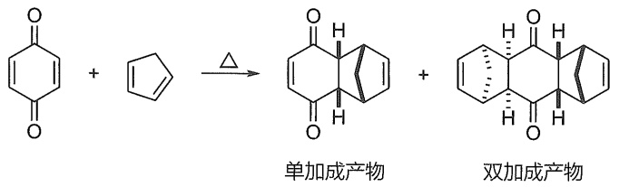

chemical

Chemical reaction equation showing cycloaddition of a ketone to form a double product, with cyclohexene and cyclopropyl substituents

图13-1 对苯二醌与环戊二烯的加成反应

20 世纪 60 年代前后，化学家们发现前维生素 D2 的各种有趣转化（图 13-2）:前维生素 D2 在加热的条件下可以转化为焦钙化甾醇和异焦钙化甾醇，该反应是可逆的；前维生素 D2 在光照的情况下与光甾醇和麦角甾醇之间可以互相转化；前维生素 D2 可以进一步转化成维生素 D2（也称麦角钙化甾醇，ergocalciferol），该反应在避光的条件下进行缓慢，光照（即使是太阳光）可以使该反应大大加速。

以上这些反应不受酸、碱和溶剂极性的影响，既不产生自由基，也不形成离子型的活性中间体，不能用通常的离子型反应机理和自由基反应机理解释。反应在加热或光照的条件下就可以进行，而且在加热和光照条件下反应产物的立体结构不同，具有高度的立体选择性。还有许多重要的反应，如 Claisen 重排反应、Alder-烯反应和 Nazarov 环化等反应都有相似的特点。这些反应通常都经过一个环状过渡态，反应中旧键的断裂和新键的生成是同时发生且协同进行的，这一类反应称为周环反应（pericyclic reactions）。周环反应主要包括电环化反应（electrocyclic reactions）、环加成反应（cycloaddition reactions）、$\sigma-$迁移反应（sigmatropic rearrangements）和 Alder-烯反应（Alder-ene reactions）等。

---

206

第十三章 周环反应

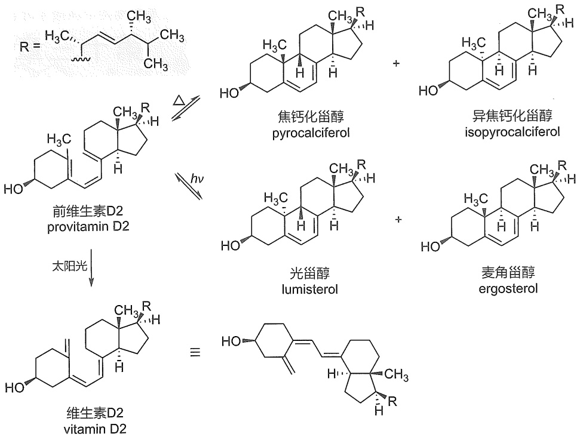

chemical

Chemical reaction pathway showing conversion of vitamin D2 to pyrocalciferol, lumisterol, and ergosterol under sunlight

图 13-2 前维生素 D2 的周环反应

## 13.1.2 分子轨道对称性守恒原理

1965 年，著名有机化学家 R. B. Woodward 和量子化学家 R. Hoffmann 在大量实验事实和理论研究的基础上进行了总结，发现分子轨道的对称性是控制这一类反应进程的关键因素，提出了协同反应中分子轨道对称性守恒原理（conservation principle of the molecular orbital symmetry）。分子轨道对称性守恒原理认为:在协同反应中，由反应物到产物，轨道的对称性始终不变，即在分子轨道重新组合的过程中，分子轨道的对称性是守恒的。分子轨道对称守恒原理可以很好地解释和预测周环反应发生的条件和立体化学，但需要分析反应物和产物的分子轨道对称性。分子轨道对称性守恒原理的建立是有机化学的重大成就之一。

## 13.1.3 前线分子轨道理论

分子轨道对称性守恒原理的分析方法有多种，包括前线分子轨道理论、芳香性过渡态理论和轨道对称性一般规则等。本章主要在前线分子轨道理论的基础上进行讨论。

前线分子轨道理论由福井谦一（Kenichi Fukui）在1952年提出。前线分子轨道理论认为:在由原子结合成分子的化学反应中，原有的原子轨道通过线性组合成新目标分子的分子轨道，原来各原子所带电子重新从能级最低的分子轨道开始依次填充到各分子轨道上，这样进入成键轨道的电子数多于进入反键轨道的电子数，从而使体系能量降低。其中，被电子占据的能量最高的轨道称为最高占有轨道（highest occupied molecular orbital, HOMO），没有被电子占据的能量最低的轨道称为最低未占轨道（lowest unoccupied molecular orbital, LUMO）。有的共轭体系中含有奇数个电子，它的已占有电子的能级最高的轨道只有一个电子，这样的轨道称为单占轨道（singly occupied molecular orbital, SOMO），SOMO既是HOMO也是LUMO。HOMO和LUMO都称为前线分子轨道（frontier molecular orbital, FMO）。

前线分子轨道上的电子称为前线电子（frontier electron）。当两个分子相互作用时，前线

---

13.1 基础知识

207

电子是关键，相当于原子中的“价电子”。当一个分子的HOMO与另一个分子的LUMO相互作用时，即形成新目标分子中的成键轨道和反键轨道，前线电子以一定顺序填充到能量较低的成键轨道上，反键轨道则为无电子填充的空轨道，这样新目标分子体系的总能量得到降低。在由若干个小分子结合成新的分子时，对成键作出贡献的也是最外层的分子轨道和外层电子。

Hoffmann 和福井谦一因分子轨道对称性守恒原理和前线分子轨道理论共同获得 1981 年诺贝尔化学奖。Woodward 于 1979 年去世，否则他会毫无疑问地再次获得诺贝尔化学奖（1965 年，他因在天然产物合成方面的贡献获得了诺贝尔化学奖）。

## 13.1.4 直链共轭多烯的前线分子轨道及其对称性

分子轨道的对称性与对称操作元素有关。通常选用的对称元素有二阶对称轴 $(C_{2})$ 和对称面(m)。对称面垂直于分子所在平面且将其分为互为镜像的两个相等部分。 $C_{2}$ 为分子平面与对称面的交线（图13-3）。

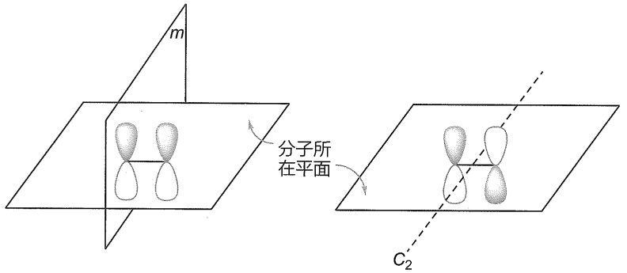

text_image

m
分子所在平面
C₂

图 13-3 乙烯中  $\pi$  分子轨道的对称元素  $C_{2}$  和 m

若对某一对称元素操作后，其分子轨道得到“重现”，即与对称操作前完全一样，则称分子轨道对该对称元素是对称的，用 S 表示。若操作后分子轨道形状相同，但相位相反，则称分子轨道对该对称元素是反对称的，用 A 表示。

分子轨道对称性守恒原理的意义在于:在基元反应的整个反应过程中，反应物、过渡态及产物的分子轨道的对称性始终保持不变，是对称性允许的反应，反应所需活化能较低，可以顺利进行。如果在反应过程中分子轨道的对称性发生变化，则为对称性禁阻的反应。需要指出的是，对称性禁阻的反应并不是反应完全不能进行，只是协同反应时所需活化能很高，通常情况下不易发生。

分子轨道可用波函数 $\psi$ 表示，也可用几何图形表示。以乙烯为例，两个 $p$ 轨道组合成两个分子轨道 $(\psi_{1}$ 和 $\psi_{2})$ ，一个是 $\pi_1$ 成键轨道，另一个是 $\pi_2^*$ 反键轨道。图13-4给出了乙烯的 $\pi$ 轨道示意图和对称元素。从图13-4中可以看出，乙烯的 $\pi$ 和 $\pi^{*}$ 轨道对对称元素 $C_2$ 和 $m$ 的反映是不同的。

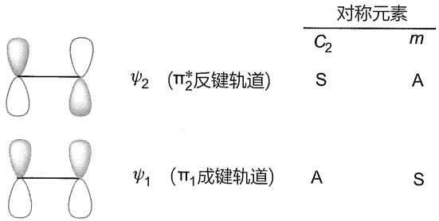

text_image

对称元素
C₂ m
ψ₂ (π₂*反键轨道) S A
ψ₁ (π₁成键轨道) A S

图13-4 乙烯的 $\pi$ 轨道示意图和对称元素

---

208

第十三章 周环反应

在丁-1,3-二烯中，四个 p 轨道组合成四个分子轨道（ $\psi_{1}$ ， $\psi_{2}$ ， $\psi_{3}$  和  $\psi_{4}$ ），其中  $\pi_{1}$  和  $\pi_{2}$  是成键轨道， $\pi_{3}^{*}$  和  $\pi_{4}^{*}$  是反键轨道。图 13-5 给出了丁-1,3-二烯的  $\pi$  轨道示意图和对称元素。

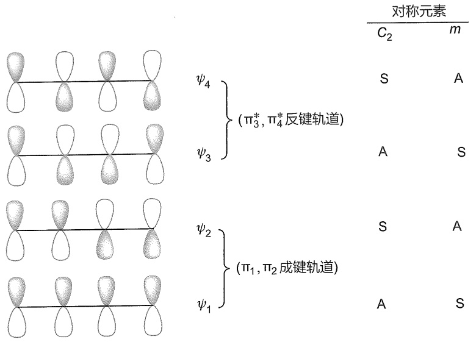

text_image

对称元素
C₂ m
ψ₄ { (π₃*, π₄*反键轨道)
ψ₃ A S
ψ₂ { (π₁, π₂成键轨道)
ψ₁ A S
A S

图13-5 丁-1,3-二烯的 $\pi$ 轨道示意图和对称元素

在已-1,3,5-三烯中，6个p轨道组合成6个分子轨道（$\psi_1$，$\psi_2$，$\psi_3$，$\psi_4$，$\psi_5$和$\psi_6$），$\pi_1$，$\pi_2$和$\pi_3$是三个成键轨道，$\pi_4^*$，$\pi_5^*$和$\pi_6^*$是三个反键轨道。图13-6给出了已-1,3,5-三烯的$\pi$轨道示意图和对称元素。

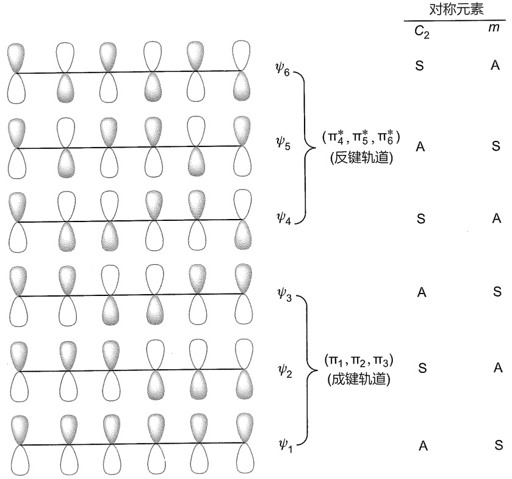

text_image

对称元素
C₂ m
ψ₆
S A
ψ₅ { (π₄*, π₅*, π₆*) (反键轨道) } A S
ψ₄
S A
ψ₃
A S
ψ₂ { (π₁, π₂, π₃) (成键轨道) } S A
ψ₁
A S

图13-6 己-1,3,5-三烯的 $\pi$ 轨道示意图和对称元素

烯丙基自由基（正离子、负离子）和戊二烯自由基（正离子、负离子）的  $\pi$  轨道如图 13-7 所示。虚线以下是成键轨道，虚线以上是反键轨道，处于虚线位置的是非键轨道。

---

13.2 电环化反应

209

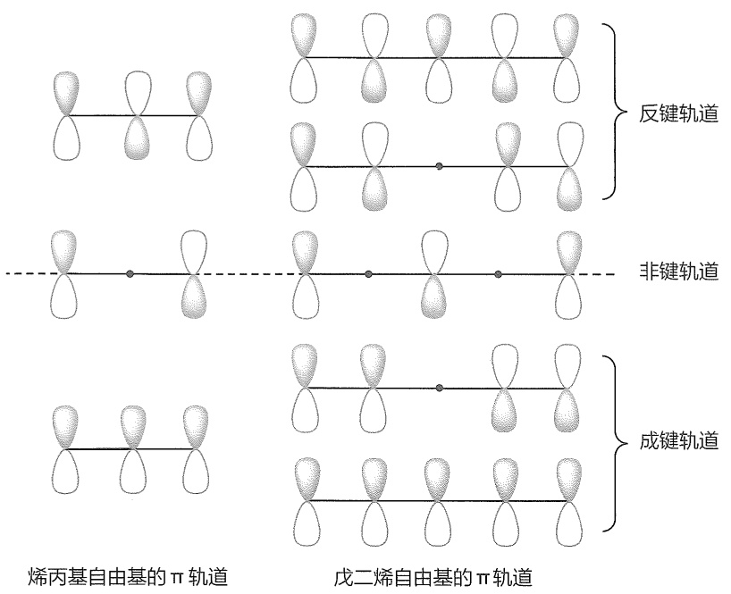

text_image

反键轨道
非键轨道
成键轨道
烯丙基自由基的π轨道
戊二烯自由基的π轨道

图13-7 烯丙基自由基和戊二烯自由基的 $\pi$ 轨道示意图

由图 13-8 可以看到, 对共轭多烯自由基而言, 分子轨道中 HOMO 是  $\pi$  体系的非键轨道, 非键轨道上偶数碳原子上的电子密度为零, 而奇数碳原子上的电子密度数值相等, 但相位交替变化, 即每增加两个原子, 相位改变一次。

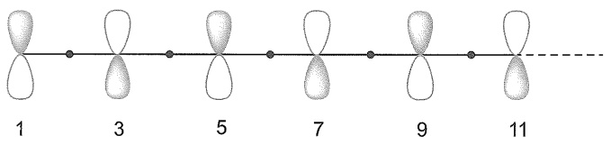

chemical

Diagram of a molecular chain with numbered atoms and bonds, showing a linear arrangement from 1 to 11

图 13-8 奇数碳原子共轭多烯自由基的非键轨道

## 13.2 电环化反应

## 13.2.1 电环化反应的定义和规律

线型共轭多烯经过环状过渡态, 共轭多烯的两个末端碳原子上的  $\pi$  电子环合成一个新的  $\sigma$  键, 生成比原来共轭多烯少一个碳碳双键的环烯烃反应及其逆反应称为电环化反应 (electrocyclic reactions)。

$\pi$ 键是由轨道经侧面平行重叠而形成的，而 $\sigma$ 键是由轨道轴向重叠形成的，因此在发生电环化反应时，末端的碳原子必须旋转才能发生环化。通常使用顺旋（conrotatory）和对旋（disrotatory）来描述电环化反应的环化过程。顺旋是指两根键朝同一个方向旋转，顺时针方向和逆时针方向均可。对旋是指两根键朝相反的方向旋转，向内和向外均可。环化过程的旋转方式决定产物的立体化学。

---

210

第十三章 周环反应

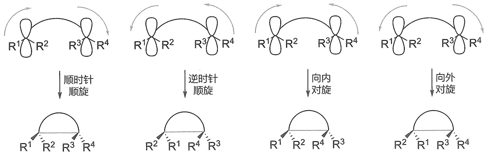

flowchart

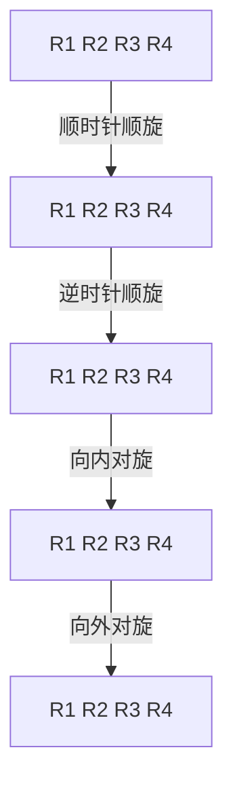

前线分子轨道理论认为，一个共轭体系在发生电环化反应时，起决定作用的分子轨道是体系的HOMO，电环化反应的立体选择性主要取决于HOMO的对称性。电环化反应的立体化学与线型共轭体系中参加反应的 $\pi$ 电子数有关，根据 $\pi$ 电子数可将共轭体系分为 $4n(n = 1,2,\dots)$ 体系和 $4n + 2(n = 0,1,2,\dots)$ 体系来讨论。电环化反应的选择性规律归纳于表13-1中。

表 13-1 电环化反应的选择性规律

| 共轭体系π电子数 | 加热(基态) | 光照(激发态) |
| --- | --- | --- |
| 4n | 顺旋允许,对旋禁阻 | 对旋允许,顺旋禁阻 |
| 4n+2 | 对旋允许,顺旋禁阻 | 顺旋允许,对旋禁阻 |

## 13.2.2 $4n\pi$ 体系电环化

在丁-1,3-二烯及取代的共轭二烯中，由于其 $\pi$ 电子数等于 $4(n = 1)$，因此它们都属于 $4n\pi$ 体系。这里以 $(2E,4Z)$-己-2,4-二烯为例，说明在加热条件下顺旋环合生成顺-3,4-二甲基环丁烯和在光照条件下对旋环合生成反-3,4-二甲基环丁烯的过程。

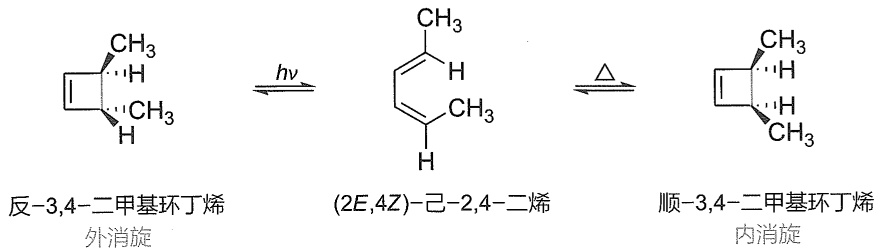

chemical

Chemical reaction equations showing cycloaddition of diethyl ether to (2E,4Z)-1,2,4-dimethylaniline and then to 3,4-dimethylaniline under light and heat.

根据微观可逆性原则，电环化反应的正反应和逆反应所经过的途径是相同的。下面从 $(2E,4Z)$ -己-2,4-二烯的环合进行分析，因为这样比较容易理解，其分析结果同样适用于开环的逆反应。

反应中二烯烃的两个  $\pi$  键转变成一个新的  $\pi$  键和一个新的  $\sigma$  键，其余的化学键部分并没有发生变化，因此必须考察体系中  $\pi$  轨道的对称性。(2E,4Z)-己-2,4-二烯的  $\pi$  轨道（图 13-9）与丁-1,3-二烯的  $\pi$  轨道相似。

由图 13-9 可以看出， $(2E,4Z)$ -己-2,4-二烯按照前线分子轨道理论，在加热条件下， $(2E,4Z)$ -己-2,4-二烯发生电环化反应，起关键作用的是 HOMO  $\psi_{2}(\pi_{2})$  和它的对称性，从图 13-9 可以看出，只有当  $\psi_{2}(\pi_{2})$  中的  $C_{2}-C_{3}$  键和  $C_{4}-C_{5}$  键采用顺旋的方式（顺时针方向和逆时针方

---

13.2 电环化反应

211

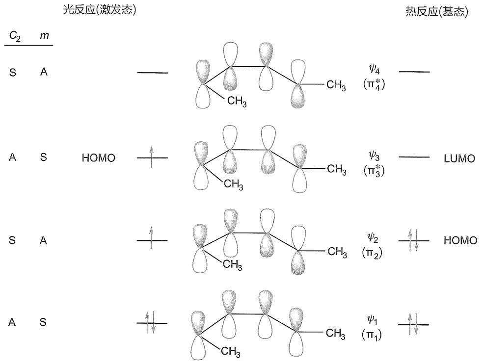

chemical

光反应与热反应的化学结构示意图，标注了S、A、HOMO等离子类型及其对应的化学式

图13-9 $(2E,4Z)$ -己-2,4-二烯的 $\pi$ 轨道

向均可），轨道才能同相位重叠，使共轭二烯两个末端碳原子上的 $\pi$ 电子环合成一个新的 $\sigma$ 键，得到顺-3,4-二甲基环丁烯。反应过程中，反应物、过渡态和产物对于对称元素 $C_2$ 和 $m$ 始终保持对称性不变，因此反应是对称性允许的反应，所需活化能较低，反应可顺利进行。顺时针和逆时针顺旋得到同一内消旋化合物。

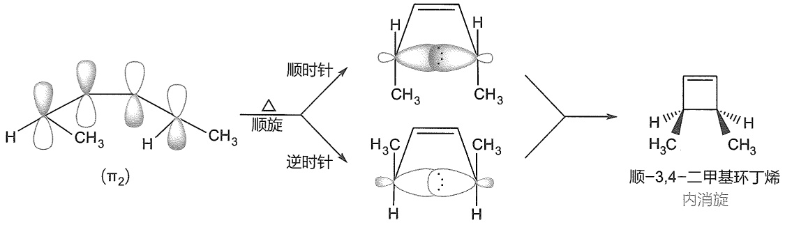

chemical

Reaction mechanism diagram showing cycloaddition of (π₂) to form 顺-3,4-2-methyl-1,4-dimethoxybenzene with cyclopentadienyl and cyclopentadienyl substituents

在光照条件下，$\psi_{2}(\pi_{2})$ 上的一个电子跃迁到 $\psi_{3}(\pi_{3}^{*})$ 上，这时的HOMO是 $\psi_{3}(\pi_{3}^{*})$ ，它对$C_2$ 和 $m$ 的对称性与 $\psi_{2}(\pi_{2})$ 恰巧相反，要使(2E,4Z)-己-2,4-二烯在光照条件下发生电环化反应，只有当 $\psi_{3}(\pi_{3}^{*})$ 中的 $\mathrm{C}_2 - \mathrm{C}_3$ 键和 $\mathrm{C_4 - C_5}$ 键采用对旋的方式（向内和向外均可），轨道才能同相位重叠，使共轭二烯两个末端碳原子上的 $\pi$ 电子环合成一个新的 $\sigma$ 键，结果得到的是消旋的反-3,4-二甲基环丁烯[(3R,4R)-3,4-二甲基环丁烯和(3S,4S)-3,4-二甲基环丁烯的等比例混合物]。反应过程中，反应物、过渡态和产物对于对称元素 $C_2$ 和 $m$ 始终保持着对称性不变，所以反应是对称性允许的反应，所需活化能较低，反应可顺利进行。向内对旋与向外对旋得到的是一对对映异构体，所以产物是外消旋的。

---

212

第十三章 周环反应

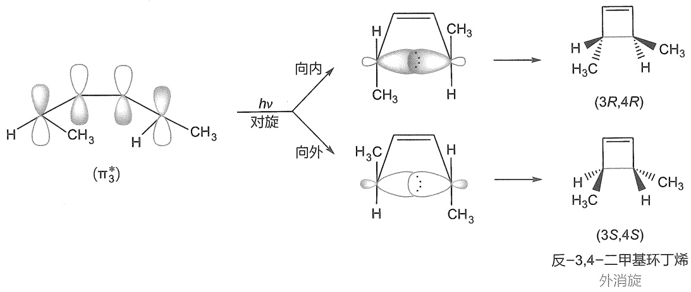

chemical

Reaction mechanism diagram showing cycloaddition of (π3*) to form (3R,4R) and (3S,4S) diisomers under light irradiation

由于 $4n\pi$ 体系的共轭多烯在基态时的HOMO都具有相同的对称性，因此加热条件下顺旋关环是对称性允许的，而对旋是对称性禁阻的。在光照条件下对旋关环是对称性允许的，而顺旋是对称性禁阻的。

»问题 13-1 请给出 $(2E,4E)$-己-2,4-二烯在加热或光照条件下的产物，并指出反应过程是顺旋的还是对旋的，产物是内消旋的还是外消旋的。

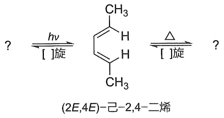

chemical

Chemical reaction diagram showing cycloaddition of (2E,4E)-己-2,4-二烯 under hv and [ ] 旋

## 13.2.3  $(4n+2)\pi$  体系电环化

在己-1,3,5-三烯及取代的共轭三烯中，由于其 $\pi$ 电子数等于6（即 $n = 1$），因此它们都属于 $(4n + 2)\pi$ 体系。这里以 $(2E,4Z,6Z)$-辛-2,4,6-三烯为例，说明在加热条件下，对旋环合生成反-5,6-二甲基环己-1,3-二烯和在光照条件下顺旋环合生成顺-5,6-二甲基环己-1,3-二烯的过程。

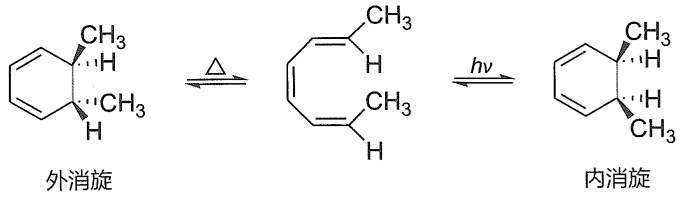

chemical

Chemical reaction diagram showing conversion of cyclohexane to cyclohexane under light irradiation, forming an internal product

(2E,4Z,6Z)-辛-2,4,6-三烯的 $\pi$ 轨道与己-1,3,5-三烯的 $\pi$ 轨道相似，按照前线分子轨道理论，(2E,4Z,6Z)-辛-2,4,6-三烯发生电环化反应时，在加热条件下，起关键作用的是HOMO$\psi_3(\pi_3)$ 和它的对称性；在光照条件下，电子跃迁至 $\psi_4(\pi_4^*)$ ，$\psi_4$ 成为新的HOMO，它的对称性在反应过程中起关键作用。

在加热条件下，(2E,4Z,6Z)-辛-2,4,6-三烯发生电环化反应，起关键作用的是HOMO  $\psi_{3}(\pi_{3})$  和它的对称性，从图13-10可以看出，只有当  $\psi_{3}(\pi_{3})$  中的  $C_{2}-C_{3}$  键和  $C_{6}-C_{7}$  键采用对旋的方式，才能同相位重叠，使共轭二烯两个末端碳原子上的  $\pi$  电子环合成一个新的  $\sigma$  键，得到一

---

13.2 电环化反应

213

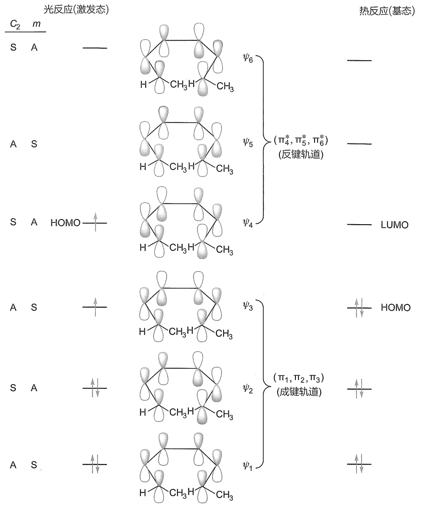

chemical

光反应与热反应的化学结构示意图，标注了S、A、HOMO等键形态及其对应的轨道符号

图13-10 $(2E,4Z,6Z)$ -辛-2,4,6-三烯的 $\pi$ 轨道

对外消旋体，即 $(5R,6R)-5,6-$ 二甲基环己-1,3-二烯和 $(5S,6S)-5,6-$ 二甲基环己-1,3-二烯的等比例混合物。

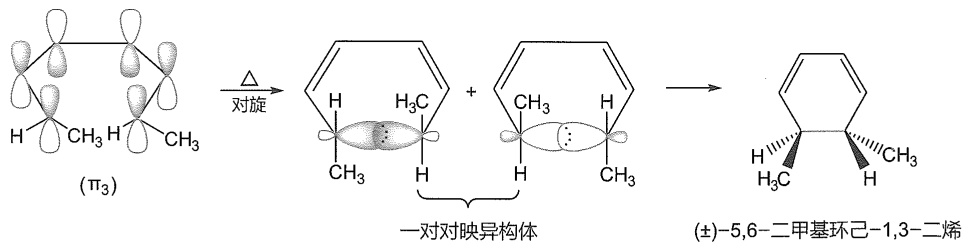

chemical

Chemical reaction diagram showing structural transformation of (π₃) and (±)-5,6-2-methyl-1,3-dimethylbenzene with labeled structural changes

在光照条件下，$\psi_3(\pi_3)$ 上的一个电子跃迁到 $\psi_4(\pi_4^*)$ 上，这时的HOMO是 $\psi_4(\pi_4^*)$ ，它对 $C_2$ 和 $m$ 的对称性与 $\psi_3(\pi_3)$ 恰巧相反。因此，$(2E,4Z,6Z)$-辛-2,4,6-三烯在光照条件下发生电环化反应，只有当 $\psi_4(\pi_4^*)$ 中的 $\mathrm{C}_2 - \mathrm{C}_3$ 键和 $\mathrm{C}_6 - \mathrm{C}_7$ 键采用顺旋的方式，轨道才能同相位重叠，使共轭二烯两个末端碳原子上的 $\pi$ 电子环合成一个新的 $\sigma$ 键，结果得到的是内消旋的顺-5,6-二甲基环己-1,3-二烯。

---

214

第十三章 周环反应

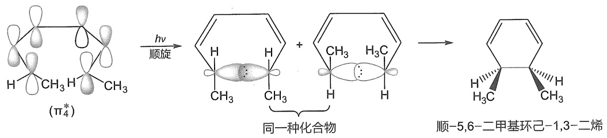

chemical

Chemical reaction scheme showing conversion of (π4*) to cyclohexane under light irradiation, forming a diene derivative and its subsequent cyclohexane ring structure.

在以上两个反应过程中，反应物、过渡态和产物对于对称元素  $C_{2}$  和 m 始终保持对称性不变，因此反应是对称性允许的反应，所需活化能较低，反应可顺利进行。

(2E,4Z,6E)-辛-2,4,6-三烯在加热条件下环化得到内消旋的顺-5,6-二甲基环己-1,3-二烯；在光照条件下则环化得到外消旋的反-5,6-二甲基环己-1,3-二烯。

由于 $(4n + 2)\pi$ 体系的共轭多烯在基态时的HOMO都具有相同的对称性，因此加热条件下对旋关环是对称性允许的，而顺旋是对称性禁阻的；在光照条件下顺旋关环是对称性允许的，而对旋是对称性禁阻的。

由于电环化反应为可逆反应，因此开链共轭多烯的关环或环烯烃的开环所经过的途径是相同的，关环和开环的旋转方式也相同。在电环化反应中，其体系的 $\pi$ 电子数均按开链共轭多烯中的 $\pi$ 电子数计算。

环烯烃旋转开环时，若两种顺旋方式或两种对旋方式的产物不同，则以能量最低的稳定产物为主。例如:

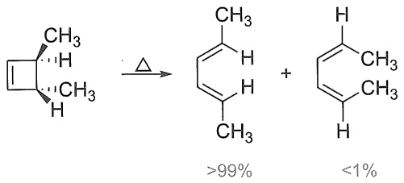

chemical

Chemical reaction equation showing cycloaddition of a substituted alkene with yield percentages indicated

»问题 13-2 请给出 $(2E,4Z,6E)$-辛-2,4,6-三烯在加热或光照条件下的产物，并指出反应过程是顺旋的还是对旋的，产物是内消旋的还是外消旋的。

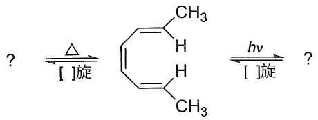

chemical

Chemical reaction diagram showing cycloaddition of a cyclohexane with diastereomeric excess under light and heat

»问题 13-3 预测下列反应的主要产物，并指出反应过程是顺旋还是对旋。

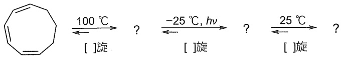

chemical

Chemical reaction sequence showing cyclohexane conversion under different temperature and humidity conditions

## 13.2.4 带电荷的共轭体系电环化

轨道对称性守恒规律同样适用于带电荷的共轭体系，如烯丙基正离子、戊二烯正离子和

---

13.2 电环化反应

215

戊二烯负离子。烯丙基正离子和戊二烯负离子属于 $(4n+2)\pi$ 体系，在加热条件下，对旋电环化，在光照条件下，顺旋电环化。戊二烯正离子属于 $4n\pi$ 体系，在加热条件下，顺旋电环化，在光照条件下，对旋电环化。

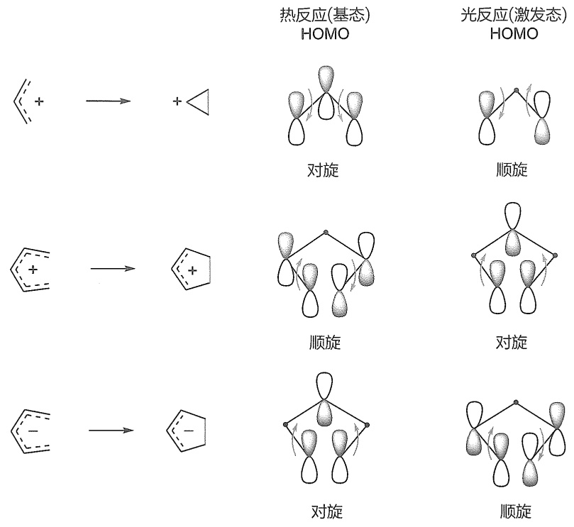

flowchart

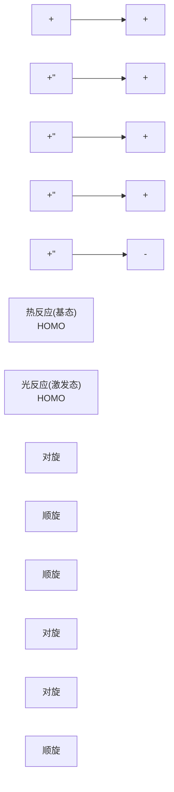

此类反应在合成中应用最多的是二乙烯基酮在酸存在的条件下的环化反应，该反应也称Nazarov环化反应，该反应实质上是戊二烯正离子的电环化反应。通常是热反应，顺旋成环（图13-11）。

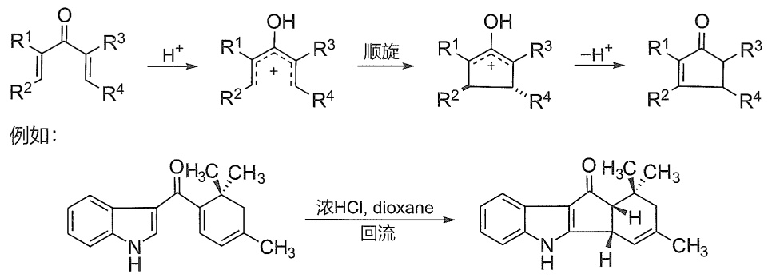

chemical

Chemical reaction pathway showing hydrolysis of a ketone to form a fused bicyclic compound, followed by hydrolysis and subsequent cyclization with HCl and dioxane.

图 13-11 Nazarov 环化反应

Nazarov 环化反应也可以在光照下进行，进行对旋环化。所得的碳正离子除了脱除质子形成双键外，还可以接受亲核试剂的进攻。例如:

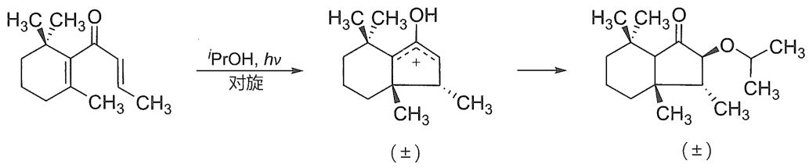

chemical

Chemical reaction scheme showing oxidation of a ketone to a steroid under light irradiation, followed by ring-opening and dehydration steps.

---

216

第十三章 周环反应

»问题 13-4 （1）给出下列反应的主要产物。

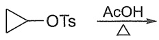

（2）给出下列反应的主要产物，并给出反应合理机理。

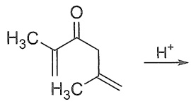

chemical

Chemical reaction showing a cyclopropane derivative with H3C and H+ groups, forming an aldehyde group

## 13.3 环加成反应

## 13.3.1 环加成反应的定义和规律

环加成反应（cycloaddition reactions）是在光照或加热的条件下，两个或多个不饱和分子通过环状过渡态生成环状化合物的反应，伴随着 $\pi$ 键的断裂和两个新的 $\sigma$ 键的生成。环加成反应为环状分子的构建提供了一种高效的方法。实验证据表明，环加成反应也是一个协同过程。根据参加反应的电子数和种类，环加成反应可分为[2+2]、[4+2]、[6+2]、[4+4]和[8+2]反应等，下面重点介绍[4+2]和[2+2]反应。

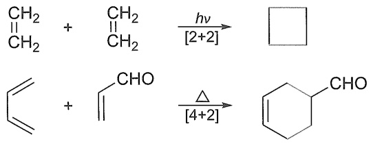

chemical

Chemical reaction equations showing cycloaddition of alkenes with formaldehyde under light and heat, followed by ring opening to yield benzene

## 13.3.2 Diels-Alder 环加成反应

在加热条件下，共轭二烯与含碳碳双键或碳碳叁键的化合物进行1,4-环加成反应，生成六元环状产物，反应经过一个环状过渡态，这个反应称为Diels-Alder反应（简称D-A反应），也称[4+2]环加成反应。1928年，德国化学家Diels和他的学生Alder发现和记载了这种新型反应，因此师徒二人于1950年获得了诺贝尔化学奖。反应过程最多同时形成4个新的立体中心，Diels-Alder反应最大的价值在于这个反应通常具有高的区域选择性和立体选择性。它是最为重要的一类周环反应，在有机合成中具有重要的价值。

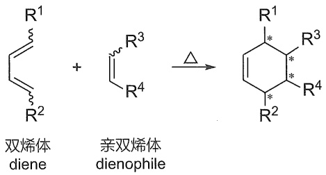

chemical

Chemical reaction equation showing the conversion of double-benzenesulfide diene to phenyl dienophile using a cycloaddition step

共轭二烯称为双烯体（diene），烯烃或炔烃称为亲双烯体（dienophile）。若双烯体或亲双烯体中含有杂原子（O、N、P、S等），则称为杂Diels-Alder反应。大量的实验事实发现，

---

13.3 环加成反应

217

双烯体上具有给电子基团及亲双烯体上具有吸电子基团，均有利于加速反应进行。

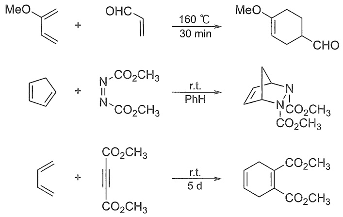

chemical

Three organic reaction equations showing methanol and benzene derivatives reacting under different conditions to form substituted cyclohexanone derivatives.

同时，Diels-Alder 反应中的双烯体必须是 s-顺式构象（cisoid-conformation）或能转变成 s-顺式构象，假如因为环状结构等双烯结构固定成 s-反式构象，那 Diels-Alder 反应是无法进行的。例如，以下化合物中第三个结构无法转变成 s-顺式构象，因此无法进行 Diels-Alder 反应。

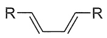

s-顺式构象

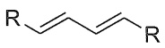

s-反式构象

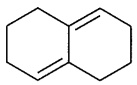

s-反式构象

## 1. 反应原理

Diels-Alder 反应可以发生的原因,从电子转移的角度可以理解为通过 6 电子环状排列生成六元环,一般用箭头转移来表示。这种方式有利于成环过程的理解,但并不是反应的机理。该反应可以用前线分子轨道理论来解释反应的机理。如图 13-12 所示,对于正常电子需求的 Diels-Alder 反应,双烯体提供 HOMO 轨道,亲双烯体提供 LUMO 轨道(A 方式),这时即将形成 σ 键的碳原子的相位是匹配的,在加热条件下反应是允许的。另一种方式(B),双烯体提供 LUMO 轨道,亲双烯体提供 HOMO 轨道,反应也是允许的,但这种情况仅针对电性反转的 Diels-Alder 反应。

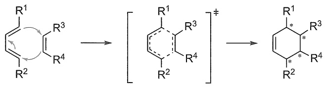

chemical

Chemical reaction diagram showing transformation of a substituted cyclohexane with R groups to form a substituted cyclohexane derivative

(A)

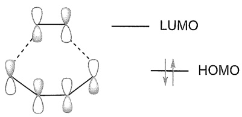

chemical

Molecular orbital diagram showing LUMO and HOMO orbitals with dashed lines indicating bonding or interaction between atoms

(B)

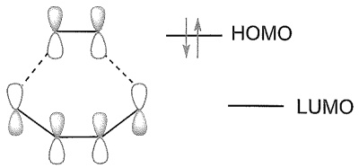

chemical

Molecular orbital diagram showing HOMO and LUMO orbitals with dashed lines indicating bonding or interaction between atoms

图13-12 Diels-Alder环加成反应的原理

## 2. 立体化学

Diels-Alder 反应具有高度的区域选择性和立体选择性。先介绍高度立体选择性的原因。

---

218

第十三章 周环反应

反应遵循两个重要的原则:（1）cis 规则:双烯体和亲双烯体的几何结构将在反应产物中得以保留；（2）endo 规则:反应过渡态遵循 endo 型过渡态进行。关于 cis 规则具体见下图:

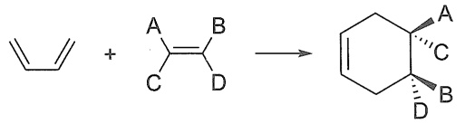

chemical

Chemical reaction equation showing cycloaddition of a diene with alkyne and alkyl substituents

例如，亲双烯体(Z)-丁烯二酸甲酯中两个酯基呈顺式，环加成的产物中两个酯基依然保持顺式；(E)-丁烯二酸甲酯中两个酯基呈反式，产物中两个酯基依然保持反式；在双烯体(E,E)-1,4-二苯基丁-1,3-二烯与烯烃的[4+2]环加成反应中两个苯基在产物里依然保持顺式。

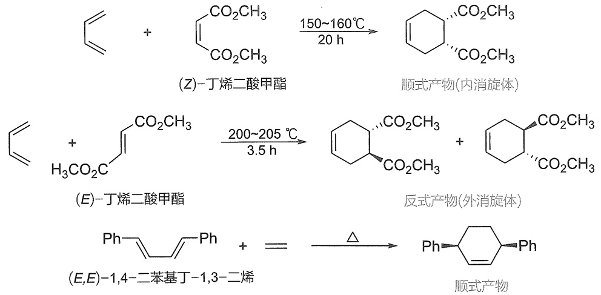

Diels-Alder 反应中往往有 endo 产物和 exo 产物两种（endo 指取代基是内型，exo 指取代基是外型）。实验结果证实 endo 型产物是主要产物，exo 型产物是次要产物。

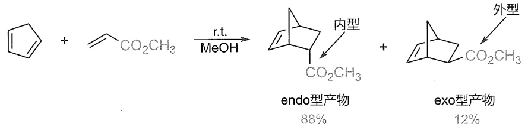

chemical

Chemical reaction equation showing cyclopropene reacting with carboxylic acid under methanol to form endo-type and exo-type products, with yields of 88% and 12% respectively.

那什么是 endo 规则呢？当亲双烯体中有醛基、酯基、芳基等共轭基团，这些基团将要摆放在双烯体的下方，这样的过渡态能量较低，称为 endo 型过渡态。原因在于轨道之间除了存在一级轨道相互作用外，还存在次级轨道相互作用（图 13-13），次级轨道相互作用稳定了这种 endo 型过渡态，降低了它的过渡态能量。所以在控制温度和缩短反应时间的情况下，反应会以 endo 型路径为主。因此，endo 型产物是速率控制的动力学产物，exo 型产物是热力学稳定产物。

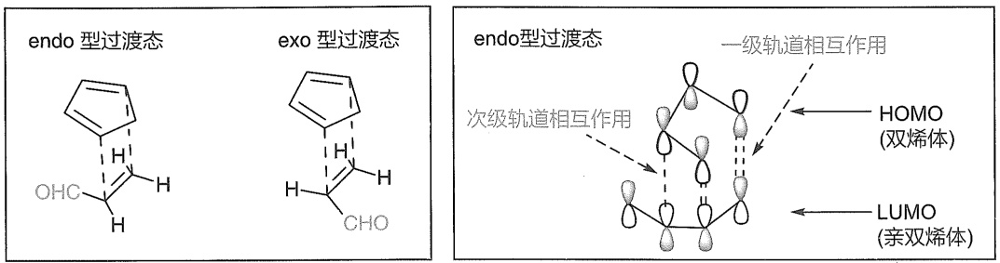

图 13-13 exo 型和 endo 型过渡态

---

13.3 环加成反应

219

## 3. 反应的区域选择性

Diels-Alder 反应具有高度的区域选择性。当双烯体中带有给电子取代基时，这个取代基对于反应区域选择性的影响，可以采用共振式来理解。当甲基作为给电子取代基在 1 位时，可以画出它的共振式，从图 13-14 可以看出，它的主要贡献式是右边的结构。对于有吸电子基团取代的亲双烯体，其共振式中右边的结构是主要贡献式，所以从电性角度考虑，反应的区域选择性就如下图所示是优势的组合，因此，区域选择性可以采用共振式的方式加以理解。

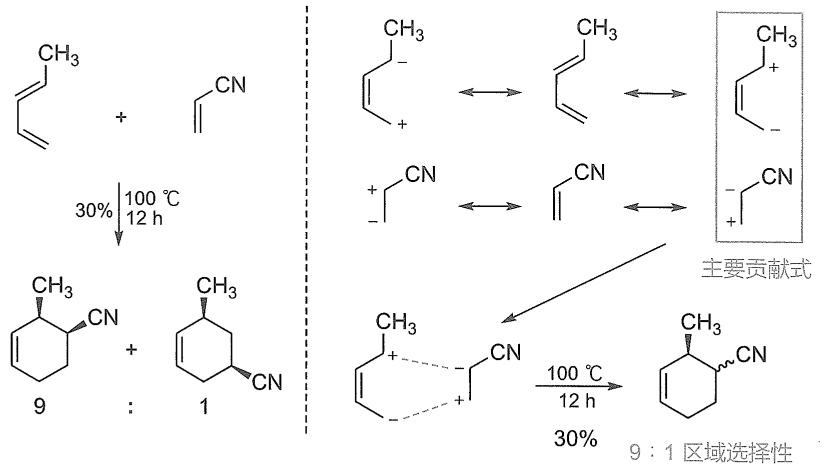

chemical

Chemical reaction scheme showing conversion of alkyne 9 to cyclohexane 1 under different conditions, with key reagents and yields labeled.

图13-14 Diels-Alder反应的区域选择性

## 4. Diels-Alder 反应的模型

Diels-Alder 反应具有高度区域选择性和立体选择性，因此 Diels-Alder 反应在低温情况下可以采用如下的 endo 模型来预测反应最终产物的立体结构（EDG 表示给电子基团，EWG 表示吸电子基团），这为合成立体可控的六元环化合物提供了一种高效的方法，对合成化学具有极为重大的价值。

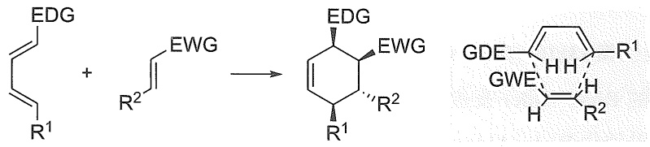

chemical

Chemical reaction scheme showing conversion of a diene derivative with EWG to a cyclic intermediate with R1 and R2 substituents

## 5. Diels-Alder 反应的应用实例

Diels-Alder 反应的主要用处是合成各种六元环状化合物。(+)–Cytosporolide 提取自真菌 Cytospora sp.（图 13-15），我国科学家团队自青藏高原的土壤样本中分离得到这类真菌，并发现其具有抗菌活性。日本科学家团队于 2015 年首次报道了其全合成，其中关键一步是最后的杂 Diels-Alder 反应。

棋盘花碱（Zygadenine）作为藜芦生物碱（Veratrum alkaloids）家族的一员，是多种藜芦科植物提取物的主要成分。棋盘花碱是一种毒性极强的物质，目前甚至没有对应解药。近年来对其生物活性的研究渐渐得到人们的关注。已有人报道其具有抗过敏、抗病毒活性。在首次全合成 $(-)$ -Zygadenine 的路线中（图 13-16），两个片段的酸胺缩合反应与立体选择性分子内 Diels-Alder 反应形成的串联反应是构建六元双环碳骨架的关键步骤。

---

220

第十三章 周环反应

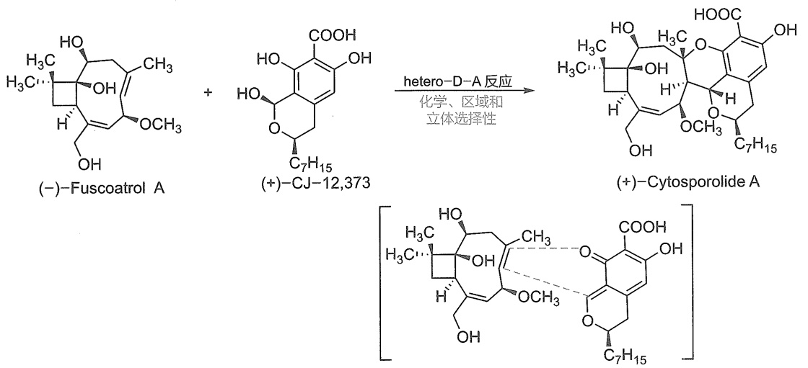

chemical

Chemical reaction scheme showing the synthesis of (+)-Cytosporolide A from (-)-Fuscoatrol A and (+)-CJ-12,373 under hetero-D-A catalysis

图13-15 杂Diels-Alder反应在 $(+)$ -Cytosporolide的全合成的应用

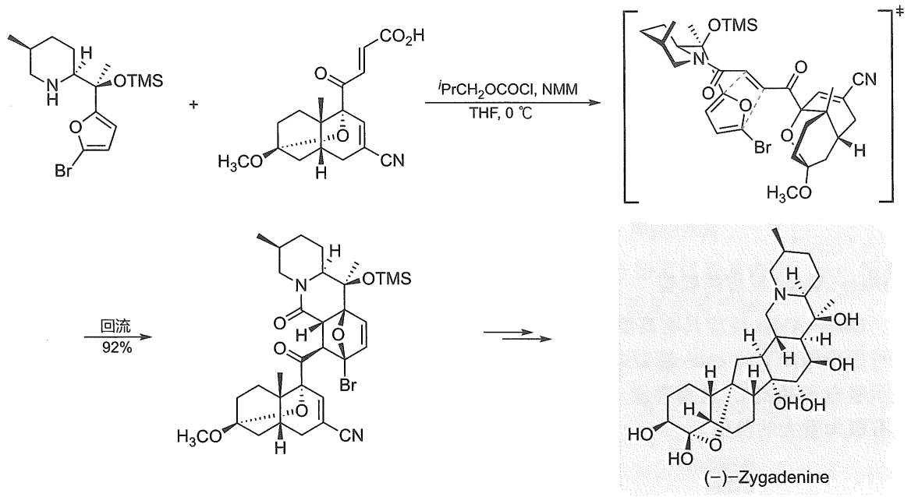

chemical

Chemical reaction scheme showing the synthesis of (-)-Zygadenine from a brominated lactam and its precursor using iPrCH2OCOCl in NMM at 0°C

图13-16 Diels-Alder反应在 $(-)$ -Zygadenine合成中的应用

## 6. Lewis 酸催化的 Diels-Alder 反应

Lewis 酸可以催化 Diels-Alder 反应，极大地降低反应过渡态的能量，使反应在较低的温度下进行。如下图所示，反应在没有 Lewis 酸的情况下，0 °C 下需要 10 天；加热到 200 °C，需要 6 h 反应才能结束；当加入  $BF_{3} \cdot OEt_{2}$  （Lewis 酸）后，反应在 -20 °C 下 5 min 内反应结束，并且进一步提高了 endo 产物的选择性。各种 Lewis 酸，如  $AlCl_{3}$ 、 $SnCl_{4}$ 、 $BF_{3} \cdot OEt_{2}$  等都是可以的，质子酸也能起到相同的作用。

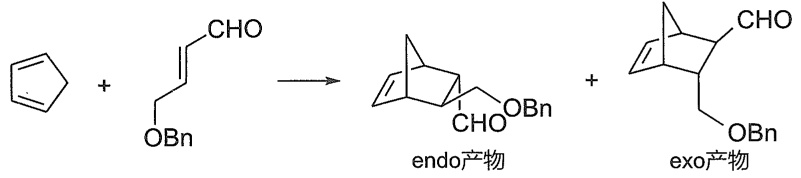

chemical

Chemical reaction equation showing cyclohexene reacting with a chiral alcohol to form endo and exo products

| 条件 | endo产物 | exo产物 |
| --- | --- | --- |
| 0 °C, 10 d | 66 | 34 |
| 200 °C, 6 h | 34 | 66 |
| BF3·OEt2, -20 °C, 5 min | 90 | 10 |

---

13.3 环加成反应

221

»问题 13-5 预测下列反应的主要产物，并画出反应的过渡态。

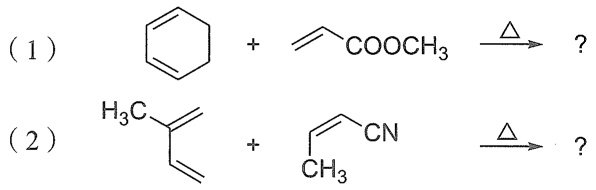

## 13.3.3 [2+2]环加成反应

## 1. $[2 + 2]$ 环加成反应特点

$[2 + 2]$ 环加成反应需根据底物结构分别进行讨论和分析。在加热条件下，简单烯烃或炔烃参与的 $[2 + 2]$ 环加成反应一般是对称性禁阻的，反应按照双自由基机理进行；在光照条件下， $[2 + 2]$ 环加成反应则是对称性允许的，按照协同机理进行。累积双键体系，如联烯、烯酮等由于反应活性高，它们参与的 $[2 + 2]$ 环加成反应在加热条件下一般可按协同反应机理进行。

## 2. 简单烯烃或炔烃参与的[2+2]环加成反应

$$
\begin{array}{c} \mathrm{H} _ {2} \mathrm{C} = \mathrm{CH} _ {2} \\ + \\ \mathrm{H} _ {2} \mathrm{C} = \mathrm{CH} _ {2} \end{array} \longrightarrow \boxed {\quad}
$$

采用前线分子轨道理论对简单烯烃参与的[2+2]环加成反应进行分析，表明在加热条件下一个乙烯分子的HOMO和另一个乙烯分子的LUMO之间的相位不匹配，反应是不利的。

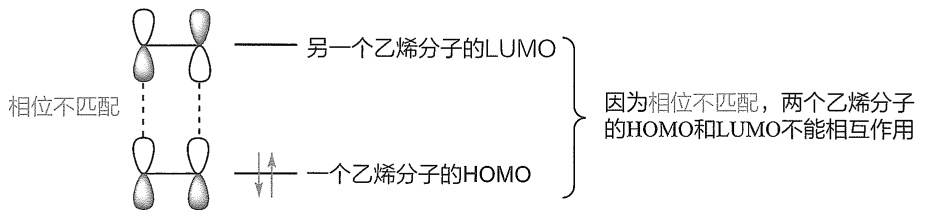

text_image

相位不匹配
另一个乙烯分子的LUMO
因为相位不匹配，两个乙烯分子的HOMO和LUMO不能相互作用
一个乙烯分子的HOMO

如果是光照条件下，一个基态电子激发到上一级轨道，产生了新的HOMO轨道，这时乙烯分子的HOMO和另一个乙烯分子的LUMO之间的相位就匹配，所以光照条件下反应是允许的。

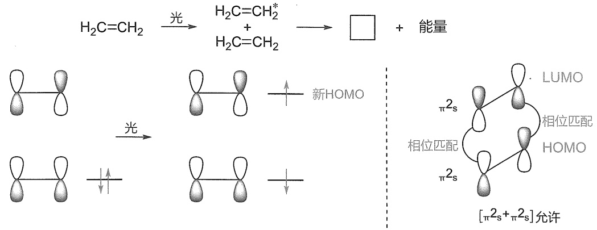

## 3. 累积双键体系参与的 $[2 + 2]$ 环加成反应

对于活性比较高的累积双键体系如联烯、烯酮等，“加热条件下[2+2]环加成反应是禁阻

---

222

第十三章 周环反应

的”这种说法是不正确的，它们同面-同面相互接近的路径是受到禁阻的，而同面-异面接近的路径则是热允许的。如图13-17所示，两个烯烃分子在过渡态中以相互垂直的方式进行结合。

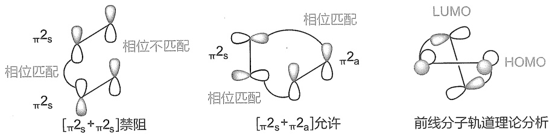

图13-17 累积双键体系参与的[2+2]环加成反应的结合方式

同面和异面是周环反应中的术语(具体见图13-20，诠释了同面和异面方式)，此处弧形线条（图13-17）用以表示发生轨道相互作用的部位，对于 $\pi$ 体系，同面相互作用指发生在 $\pi$ 体系的同一侧，异面相互作用指发生在 $\pi$ 体系的相反侧面。同面用s表示，异面用a表示。例如，烯酮是一类活性很高的化合物，当它与烯烃反应时可以在加热条件下顺利通过同面-异面方式生成环丁烷类产物。例如:

chemical

Chemical reaction equation showing acetylation of a ketone with methacrylate to form a cyclic alcohol

烯酮与烯烃的[2+2]环加成反应倾向于生成空间上最拥挤的产物。这种结果是由于它的反应按照 $[\pi 2_{\mathrm{s}} + \pi 2_{\mathrm{a}}]$ 相互作用的过程进行。空间的几何构型如下所示，反应过程中两个反应物分子相互靠近，彼此垂直，并使烯酮上较大取代基远离烯烃，最终得到空间上较拥挤的产物。

chemical

Chemical reaction diagram showing transformation of a cyclic ligand with sulfur atoms to form a fused ring system with L and S substituents

$L =$ 较大的取代基； $S =$ 较小的取代基

## »问题 13-6 预测下列反应的产物。

chemical

Chemical reaction equation showing chloroform reacting with cyclohexane under heating to form aldehyde

## 13.3.4 [3+2]环加成反应

有些分子具有三原子四电子结构，称为1,3-偶极子，当发生[3+2]反应（[3+2]是按照原子数命名的，也称为1,3-偶极环加成反应）时生成五元环产物，本质上是六电子体系，因此加热条件下同面-同面是有利的。以下是典型的1,3-偶极子结构的共振式及与烯烃的[3+2]环加成反应。[3+2]环加成反应也有区域选择性的问题，采用之前Diels-Alder反应类似的分析方法能够普遍取得成功。

---

13.4 σ-迁移反应

223

chemical

Chemical reaction equations showing the formation of pyrrole derivatives from dimethylamine and tetramethylamino compounds under different conditions

[3+2]环加成反应中亲偶极体（dipolarophile）也可以是炔烃，例如炔烃与叠氮的反应生成五元三唑化合物，这个反应被称为Huisgen反应。2002年，Sharpless教授和Meldal教授发现少量的铜催化剂可以使该反应在温和条件下高效进行，并且反应产物具有更好的立体和区域选择性，这个反应称为铜催化的“Click”反应。

chemical

Huisgen reaction and copper-catalyzed "Click" reaction equations involving R²≡C and R¹-N₃

其他一些 1,3-偶极子化合物见表 13-2。

表 13-2 其他一些 1,3-偶极子化合物

<table><tr><td colspan="2">1,3-偶极子共振结构式</td><td>名称</td></tr><tr><td colspan="2"> $R-C^{+}=N-\ddot{O}:$   $\longleftrightarrow$   $R-C\equiv N^{+}-\ddot{O}:$ </td><td>氧化腈</td></tr><tr><td colspan="2"> $R^{+}$  $\underset{R}{\overset{+}{\longrightarrow}}N-\ddot{O}:$   $\longleftrightarrow$   $R^{+}$  $\underset{R}{\overset{+}{\longrightarrow}}N-\ddot{O}:$ </td><td>硝酮</td></tr><tr><td colspan="2"> $R^{+}$  $\underset{R}{\overset{+}{\longrightarrow}}N-\ddot{N}-R$   $\longleftrightarrow$   $R^{+}$  $\underset{R}{\overset{+}{\longrightarrow}}N-\ddot{N}-R$ </td><td>偶氮亚基胺</td></tr><tr><td colspan="2"> $:\ddot{O}-\ddot{O}=O:$   $\longleftrightarrow$   $:O=O^{+}-\ddot{O}:$ </td><td>臭氧</td></tr></table>

## 13.4 $\sigma$-迁移反应

## 13.4.1 σ-迁移反应的定义和规律

$\sigma$ 迁移是指 $\sigma$ 键在一个或多个 $\pi$ 体系上迁移的反应。 $\sigma$ 迁移重排一般用方括号标示 $[i,j]$，如[3,3] $\sigma$ 迁移和[1,5] $\sigma$ 迁移。在 $\sigma$ 迁移反应中，原有的 $\sigma$ 键断裂，形成新的 $\sigma$ 键和 $\pi$ 键，迁移过程经过环状过渡态协同完成。

## 13.4.2 [3,3] $\sigma$ 迁移

## 1. Cope 重排

[3,3] σ 迁移如下所示，通过电子的转移，可以形成环状过渡态，生成新的 σ 键和 π 键。

点击化学

---

224

第十三章 周环反应

这个迁移反应也称为Cope重排，在一般情况下这个重排反应是可逆的。

chemical

环状过渡态的化学反应式，展示分子结构与σ迁移过程

当 R 基团是羟基时，这个  $[3,3] \sigma$  迁移称为 oxy-Cope 重排（氧-Cope 重排）（如下所示）。由于 1 位碳上是羟基，重排后会生成烯醇式，烯醇式会转变为能量更低更为稳定的醛产物，因此这个反应是不可逆的。oxy-Cope 重排也为 5-烯醛的合成提供了一种有效方法。

chemical

Chemical reaction diagram showing epoxidation of a cyclic alcohol with sigma shift notation

## 2. Claisen 重排

下面介绍 Claisen 重排反应。如图 13-18 所示，当起始原料是烯丙基烯基醚类化合物时，就容易通过环状过渡态发生[3,3]σ迁移的 Claisen 重排反应，生成稳定的醛酮化合物。这个重排反应最初是在芳香化合物的研究中发现的。酚的烯丙基醚加热到 200 °C 时发生分子内重排，烯丙基从氧原子重排到碳原子上，互变异构后变为酚。

flowchart

图 13-18 Claisen 重排的方式

值得注意的是，若苯环的两个邻位被堵住，则重排到对位。此时，反应产物是对位烯丙基取代物。此反应经历了 Claisen 重排、Cope 重排和[1,5]氢迁移的过程。

chemical

Chemical reaction pathway showing chlorination, Cope reagent addition, and [1,5]H transfer steps

后来发现，该反应可以拓展到非芳香化合物的烯丙基烯基醚类化合物，称为 Ireland-Claisen 重排。这种拓展非常重要，使用烯丙基羧酸酯为原料，在碱的作用下拔掉 $\alpha$-H 后生成的烯醇负离子被三甲基氯硅烷（TMSC1）捕获，就生成重排的前体——烯丙基烯基醚类化合物。这使 Claisen 重排变成一类在合成上非常有用的反应，为烯基羧酸的合成提供了高效方法。

chemical

Chemical reaction pathway showing conversion of acetaldehyde to cyclohexanol using OTMS and TMSCI reagents

## 3. Claisen 重排的应用

自然界中，在植物代谢的莽草酸途径中从分支酸到预苯酸的转换步骤就是一个 Claisen

---

13.4 σ-迁移反应

225

重排反应（图 13-19），该反应受分支酸变位酶的催化。预苯酸在生物体中是一种重要的化合物，生物体内含苯环的天然化合物有一大半是由预苯酸转换过来的。Claisen 重排的发现启示着化学家们发现更多更复杂反应的化学本质。

flowchart

图13-19 Ireland-Claisen重排在植物代谢的莽草酸途径中的转化

## »问题 13-7 预测下列重排反应的产物。

## 13.4.3 [i,j]迁移反应

## 1. $[1,i]\sigma$ 迁移反应的原理和立体规则

$[1,i]\sigma$ 迁移反应的两个重点是迁移基团的立体化学和迁移发生在 $\pi$ 体系的同面还是异面，可以采用前线分子轨道理论分析和预测这类反应。前面已经学习了 $\pi$ 体系的同面和异面，下面介绍周环反应其他体系的同面和异面。

如图13-20所示，弧形线条用于表示发生轨道相互作用的部位，代表显示的轨道与其他轨道相互作用的几何方式。对于 $\pi$ 体系和孤对电子体系，同面和异面相互作用的区分很简单:

A. $\pi$ 体系

text_image

同面
异面

同面:s表示

异面:a表示

B.  $\sigma$ 体系

text_image

内叶
外叶
同面
同面
异面
同面
异面

C. 孤对电子 (ω)

text_image

同面
异面

图 13-20 不同体系中同面和异面的定义

---

226

第十三章 周环反应

同面相互作用发生在体系的同一侧，异面相互作用发生在体系的两个相反侧面。对于  $\sigma$  体系，就同面相互作用而言，两个弧形曲线须同时画在  $\sigma$  键轨道的内叶或外叶，而对于异面相互作用，其中一根曲线要画在内叶，另一根曲线要画在外叶。

## 2. 碳原子 $[1,i]\sigma$ 迁移

碳原子发生[1,i] $\sigma$ 迁移，采用前线分子轨道理论可以深入了解这些反应。图13-21表示对一个角锥形基团的[1,3]和[1,5]碳迁移反应所作的分析。$\sigma$ 键可以被看作HOMO或LUMO，但通常都把它画成HOMO；$\pi$ 体系画作LUMO。基团进行[1,3]碳迁移时，要用 $\sigma$ 键的后部来保持同相位相互作用，在反应的过渡态中的迁移碳原子的杂化由 $\mathrm{sp}^3$ 转变成 $\mathrm{sp}^2$ ，最终产物的构型发生了翻转，发生了 $\sigma$ 键异面迁移过程，热重排是允许的。基团进行[1,5]碳迁移时，同样 $\sigma$ 体系画作HOMO，$\pi$ 体系画作LUMO，迁移碳原子直接移至 $\pi$ 体系的末端，相位匹配，产物构型保持不变，热重排经历 $\sigma$ 键同面迁移过程。

图13-21 碳原子[1,3] $\sigma$ 迁移和[1,5] $\sigma$ 迁移的立体化学

例如，二环[3.2.0]庚烯体系可以通过热重排转变成一个降冰片体系。当迁移基团是手性基团时，在发生[1,3]碳迁移过程中其立体化学发生翻转，表明发生了异面相互作用，与前面的预测相吻合。

chemical

Chemical reaction scheme showing transformation of a cycloalkane derivative under 300 °C to form a cyclic ketone, with stereochemistry indicated.

## 3. 氢原子 $[1, i]$ $\sigma$ 迁移

对于氢原子迁移，[1,5]氢迁移是较常见的一种 $\sigma$ 迁移方式，热重排经历同面迁移；[1,3]氢迁移必须在 $\pi$ 体系的异面发生，而这却是一个很难达成的几何方式，如图13-22所示。

---

13.4 σ-迁移反应

227

chemical

Molecular orbital diagram showing LUMO and HOMO orbitals with electron density distribution

[1,5]氢迁移
允许

chemical

Molecular orbital diagram showing LUMO and HOMO orbitals with electron density clouds

[1,3]氢迁移
不允许

[1,2]氢迁移2电子允许

图13-22 氢原子[1,i]迁移情况

另一种 $\sigma$ 氢迁移是与碳正离子有关的[1,2]氢迁移，虽然不经常这样分析，但这种迁移包含在一个具有Hückel芳香性的两电子环状体系中。具体见碳迁移和氢迁移规则总结表（表13-3）。

表 13-3 [1,i]碳迁移和氢迁移规则

<table><tr><td>迁移类型</td><td>[1,i] σ迁移</td><td>同面或异面</td><td>允许或禁阻</td><td>立体化学</td></tr><tr><td rowspan="2">碳迁移</td><td>[1,3] σ迁移</td><td>异面</td><td>允许</td><td>翻转</td></tr><tr><td>[1,5] σ迁移</td><td>同面</td><td>允许</td><td>保持</td></tr><tr><td rowspan="3">氢迁移</td><td>[1,2] σ迁移(邻位是碳正离子情况)</td><td>同面</td><td>允许</td><td></td></tr><tr><td>[1,3] σ迁移</td><td>异面</td><td>不易进行</td><td></td></tr><tr><td>[1,5] σ迁移</td><td>同面</td><td>允许</td><td></td></tr></table>

[1,5]氢迁移经历了 $\pi$ 体系的同面迁移，它的立体化学已经被研究证实。如图13-23所示，该化合物具有 $S / E$ 立体构型（$S$ 表示四面体手性碳原子的立体构型，$E$ 表示双键的构型）。由于 $\sigma$ 键可以旋转，氢原子（蓝色标出）可以在 $\pi$ 体系的上方也可以在下方。通过允许的同面[1,5]氢迁移可以得到 $S / Z$ 和 $R / E$ 两种立体化学的产物，实际观察到了所预测的立体专一性，从而证实了[1,5]氢迁移的同面特性。

chemical

Hydrogenation reaction of a diene derivative under hydrogen-1,5σ conditions

图13-23 [1,5]氢迁移的立体化学

在1,3-环戊二烯结构中[1,5]氢迁移极易进行，该迁移过程的速率快到无法分离出单取代环戊二烯的各个单一的异构体，如方程式中所示的甲基环戊二烯，因为各异构体之间通过[1,5]氢迁移保持平衡，该反应看上去像是[1,2]氢迁移，但它其实是一个六电子的过程，所以用[1,5]氢迁移来描述更为恰当。

chemical

Chemical reaction mechanism showing cycloaddition of a cyclopentene with hydrogen and alkene substituents

## >>问题

## 13-8

请分析各种碳迁移和氢迁移过程中立体化学的变化，并举例说明。

---

228

第十三章 周环反应

## 4. 迁移反应在合成中应用

在合成 calyciphylline A 类虎皮楠生物碱骨架的方法中，人们采用氰酸酯到异氰酸酯的  $[3,3]-\sigma$  迁移重排构建六元环上的一个含氮手性中心（图 13-24），同时在氮原子上连接官能团为后续合成做准备。

chemical

Multi-step organic synthesis reaction scheme involving chlorinated benzene derivatives and OTBS reagents

图13-24 迁移反应在calyciphyllineA合成中的应用

## 13.5 Alder-烯反应

Alder-烯反应（Alder-ene reaction），又叫氢-烯丙基加成反应，这是一个基团转移的周环反应，亲烯体（enophile）经过烯丙基转移加成到烯烃上。该反应是由 Alder 等人发现的。

该反应是一个烯烃双键的2个 $\pi$ 电子和烯丙基C-H键的2个 $\sigma$ 电子与亲烯体的2个 $\pi$ 电子的六电子体系的周环反应。从前线分子轨道理论来看，Alder-烯反应就是烯丙基HOMO与亲烯体LUMO的相互作用，从图13-25可以看出，该反应是轨道对称性允许的反应，可以在加热（或Lewis酸）的条件下进行。如果在光照条件下，发生与另一个双键之间的[2+2]环加成，而不会发生Alder-烯反应。

chemical

Chemical reaction equation showing enolysis of enene to form enophile and then to form a cyclohexane derivative with HOMO and LUMO ligands

图 13-25 Alder-烯反应

以下给出了 Alder-烯反应的一些具体的实例。

chemical

Chemical reaction scheme showing the synthesis of a fused bicyclic ketone from an epoxide and a substituted cyclohexane under chlorination and 140°C conditions

---

13.6 周环反应在合成中的综合应用

229

## »问题 13-9 写出以下反应的产物。

chemical

Chemical reaction equation showing acetylation of an aldehyde with a cyclic ketone under heating

## 13.6 周环反应在合成中的综合应用

周环反应在合成中有着非常广泛的应用，历史上有很多精彩的例子。K. C. Nicolaou 等人在 endiandric acids 的全合成中就综合运用了多种周环反应。例如，在 endiandric acid A 的合成中，他们先后使用了  $8\pi$  体系的顺旋电环化、 $6\pi$  体系的对旋电环化和 Diels-Alder 环加成等周环反应。

chemical

Reaction pathway of endiandroic acid A using SiᵗBuPh₂ catalyst under diels-Alder conditions

L. E. Overman 等人在合成马钱子碱（strychnine）的时候，也运用了非常精彩的串联反应。二级胺首先与多聚甲醛原位生成亚胺正离子，然后发生 aza-Cope 重排，得到的中间体继续发生分子内 Mannich 反应，构建了马钱子碱核心的 5/6/6 三环骨架。

chemical

Chemical reaction pathway showing Mannich reaction to form strychnine via aza-Cope reagent

---

230

第十三章 周环反应

1. 完成下面的反应，包括产物明确的立体化学。

2. 给出以下反应的合理机理。

---

习题

231

3. 试写出最后一步反应的机理，并解释产物的立体选择性。

chemical

Chemical reaction equation showing synthesis of a cyclic amide with tert-butyl and benzene under specified conditions

---

232

第十三章 周环反应

4. 试写出第一步和第二步(1)与(3)的机理。

chemical

Chemical reaction scheme showing synthesis of a complex from an imidazole derivative under specified conditions

5. 我国著名的有机化学家陆熙炎院士于1995年首次报道了叔膦催化的[3+2]环加成反应（如下）。这一反应被称为陆熙炎环化反应，多次被用于复杂天然产物的全合成。这一反应的[3+2]环加成是分步进行的，试写出该反应的催化机理。

chemical

Chemical reaction equation showing esterification of a ketone to form a cyclohexane derivative using PPh3 in benzene solvent

6. 角鲨烯(squalene)是一种从深海鲨鱼的肝油中分离得到的油状液体,后来人们发现角鲨烯也存在于橄榄油和人类分泌的皮脂中。角鲨烯具有丰富的生物活性，如携氧作用、抗氧化活性、抗肿瘤活性等，并因其润肤作用被应用于护肤品中。除了作为药物和保健品，角鲨烯还是生物体中各种各样的甾体化合物的来源。除了从自然界提取，人们很早就开始了对角鲨烯化学合成的研究。角鲨烯的一条全合成路线如下，试补充路线中的中间体，并说明涉及的周环反应及其机理。

chemical

Organic synthesis reaction scheme showing multi-step transformations of aldehyde, carboxylic acid, and squalene with reagents and conditions

【提示】Johnson-Claisen 重排的前体:

chemical

Chemical reaction scheme showing hydrolysis of a cyclohexanol derivative using ethyl acetate and ethylene, followed by acidification to form a cyclic ester product.

(本章编者 俞寿云、沈增明)

本章习题
参考答案
