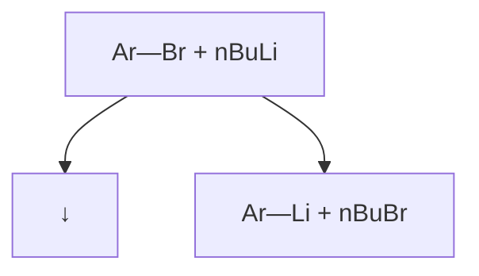
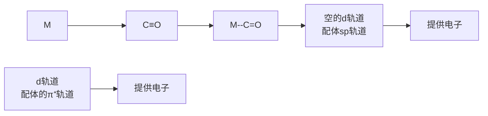
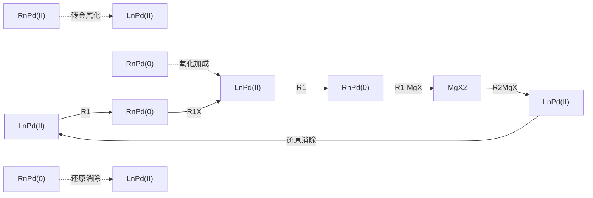
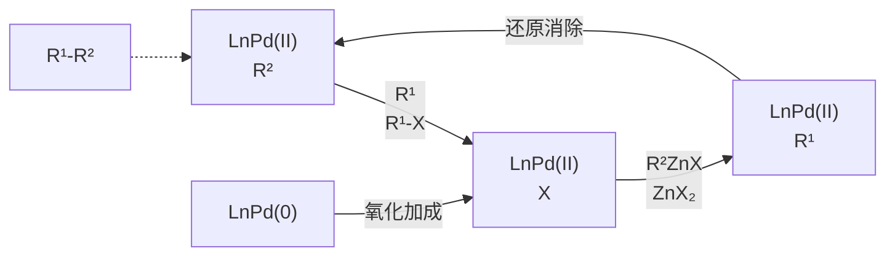
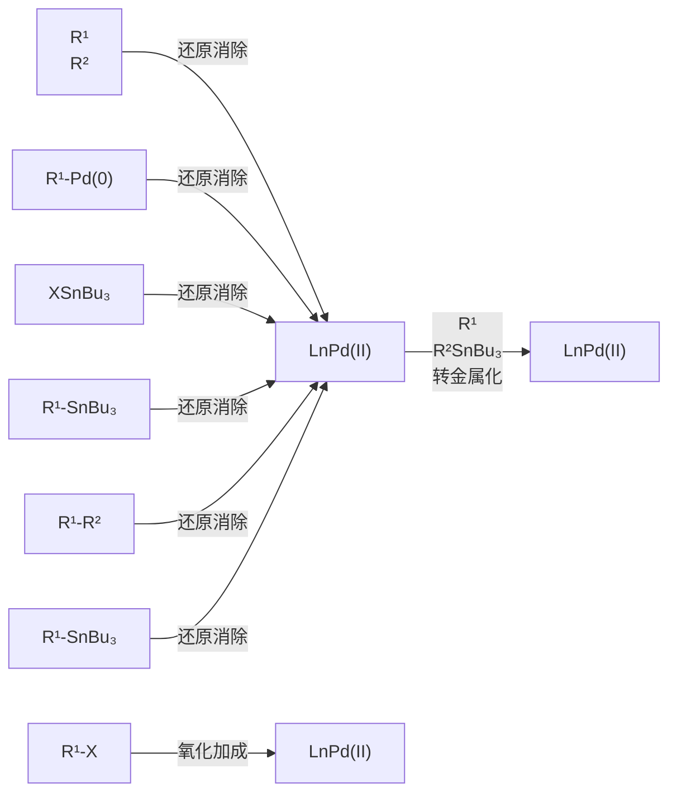
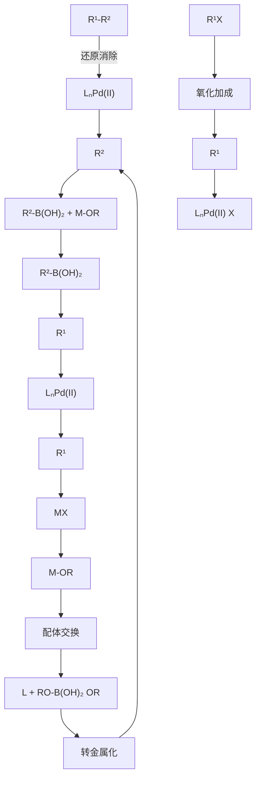
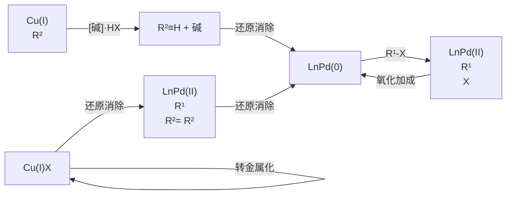

# 第十四章 金属有机化合物

原始 PDF 第 248–268 页。

第十四章

金属有机化合物

14.1 金属有机化学的起源和发展 … 233 14.5 偶联反应简介 … 242
14.2 金属有机化学的定义 …… 234 14.6 钯催化剂前体 …… 251
14.3 过渡金属配合物的结构特点 … 235 习题 … 252
14.4 四大基元反应 239

金属有机化学（organometallic chemistry）包括无机化学中关于配合物的研究和有机化学的合成方法，主要研究有机分子或官能团和无机金属元素之间的相互作用，并融入了其他学科。金属有机化学极大地拓展了有机化学的范畴，例如钯催化的碳碳键偶联反应革新了传统构筑化学键的模式，有力提升了人类的分子合成能力，如今已经得到广泛应用。在学习本章之前，读者需要复习《无机化学》中配位化学相关内容。

## 14.1 金属有机化学的起源和发展

1757 年，法国化学家 Cadet de Gassicourt 在将含砷的钴矿石与醋酸钾混合来试验隐形墨水的过程中，偶然分离得到了四甲基二肿，又名二甲肿。虽然砷本身并不是真正的金属，但具有和金属类似的一些性质，称为类金属，因此四甲基二肿被认为是第一种金属有机化合物。1927 年，丹麦有机化学家 Zeise 通过将四氯化铂加入沸腾的乙醇中，合成了第一种含有过渡金属的金属有机化合物——三氯-(乙烯)-铂合钾（Zeise 盐，蔡司盐）。在当时，学术界对 Zeise 盐的结构有许多质疑，直到 20 世纪 X 射线晶体学的出现才验证了其结构的正确性。尽管当时的化学家并不确切知道这种化合物形成的原因或方式，然而 Zeise 盐的合成引发了人们对金属有机化合物的兴趣。1848 年，Frankland 利用锌和碘乙烷合成了二乙基锌。1890 年，英国化学家 Mond 合成了四羰基镍，开创了一种全新的化合物类型，称为金属羰基化合物。

$As_{2}(CH_{3})_{4}$ 
四甲基二肿

$K^{+}[PtCl_{3}(C_{2}H_{4})]^{-}$ 
蔡司盐

Ni(CO) $_{4}$ 
四羰基合镍

$Zn(CH_{2}CH_{3})_{2}$ 
二乙基锌

法国化学家 Barbier 和 Grignard 发现，烷基/芳基卤代物与金属反应后生成的试剂可以与酮/醛发生亲核加成生成醇，在此基础上发展了有机镁试剂（也称格氏试剂，Grignard reagent）。相关的研究席卷了 20 世纪初的化学实验室，Grignard 也因此获得 1912 年诺贝尔

---

234

第十四章 金属有机化合物

在二茂铁被正式报道之前，人们曾经两次意外合成了该化合物，但没能确认结构。其实，即使在Pauson和Kealy的报道中，二茂铁也被误认为具有链式结构。

二茂铁

化学奖。一百多年后的今天，格氏试剂仍然被广泛用作亲核试剂。

1913 年，瑞士化学家 Werner 因其提出的配位理论而获得了诺贝尔化学奖，他对氯化六氨合钴(Ⅲ)等化合物的结构研究对化学家进一步深入探索金属有机配合物的结构和参与的反应提供了帮助和启发。

chemical

Chemical structure of a cobalt complex with NH3 substituents and 3 Cl⁻ counterion

氯化六氨合钴

1951年美国化学家Pauson和Kealy通过将环戊二烯基溴化镁和氯化铁加热反应，首次报道了橙色的二茂铁的合成。随后，英国化学家Wilkinson与美国化学家Woodward合作，揭示了二茂铁的夹心结构，即铁夹在两个环戊二烯负离子之间。在二茂铁中，每个环戊二烯负离子都表现出芳香性，两个环戊二烯负离子上所有12个电子与铁原子的d轨道成共价键，形成了非常稳定的18电子结构。与此同时，德国化学家Fischer独立得出了相同的结论，认识到这种夹心化合物的形成是环戊二烯配体与金属相互作用的结果。随后，Fischer将夹心金属化合物扩展到其他金属，如Cr、Zr、Ru、Ni、Co等。Wilkinson与Fischer因在金属有机领域的杰出贡献而共同获得1973年诺贝尔化学奖。

$C_{10}H_{10}Fe$

二茂铁

$C_{10}H_{10}Cl_{2}Zr$

双(环戊二烯)二氯化锆

$C_{10}H_{10}Ni$

二茂镍

$C_{14}H_{18}Cr$

二苯铬

这些金属有什么特点？能参与什么反应？如何参与反应？在之前学习过的主族金属试剂的基础上，本章学习过渡金属的特点及性质，再以此为基础学习金属参与反应的基本方式——四大基元反应，最后对常用的过渡金属催化的有机反应进行简要介绍。

二茂铁的发现是金属有机化学早期研究最重要的内容之一。化学家 Ziegler 和 Natta 发展了以双(环戊二烯基)二氯化锆(IV)为代表的催化剂，实现了末端烯烃的聚合反应。这一研究催生了两大类金属有机催化剂:过渡金属（IVB 族金属，如 Ti、Zr、Hf）催化剂和有机铝助催化剂。这些试剂现在称为 Ziegler-Natta（齐格勒-纳塔）催化剂，他们二人于 1963 年获得了诺贝尔化学奖。此后，过渡金属有机化学迎来了蓬勃发展，21 世纪以来有三次诺贝尔化学奖颁发给了过渡金属催化相关的成果。2001 年诺贝尔化学奖授予在过渡金属催化不对称氢化和钛催化不对称氧化反应领域做出突出贡献的 Knowles、Noyori 和 Sharpless；2005 年诺贝尔化学奖授予在过渡金属催化烯烃复分解反应领域做出突出贡献的 Chauvin、Schrock 和 Grubbs；2010 年诺贝尔化学奖授予在钯催化交叉偶联反应领域做出突出贡献的 Heck、Negishi 和 Suzuki。

## 14.2 金属有机化学的定义

金属有机化学是研究金属-碳键及金属-氢键形成与断裂的反应。

在理解金属有机化合物性质之前，先回顾有机化学中的极化作用。分子由原子通过共价

---

14.3 过渡金属配合物的结构特点

235

键构成，但共价键中的电子并不总是在原子之间均匀共享。当两个电负性明显不同的原子形成一个共价键时，电负性较高的原子上会积累部分负电荷（用符号  $\delta-$  表示），电负性较低的原子则相应地带有部分正电荷（用符号  $\delta+$  表示）。在许多有机官能团中（如羰基），碳与电负性更高的元素结合，使相应碳带有部分正电荷和亲电性。如下所示，巯基负离子和 1-氯正丁烷的取代反应、甲氧基负离子和环氧化合物的开环反应、醛的还原反应都属于对亲电性碳的进攻。

chemical

Reaction mechanism diagram showing photochemical transformations of acrylate (SN2) and its oxidation products with NaBH4 elimination

| F | O | Cl |
| --- | --- | --- |
| 3.98 | 3.44 | 3.16 |
| N | Br | I |
| 3.04 | 2.96 | 2.66 |
| S | C | Au |
| 2.58 | 2.55 | 2.54 |
| H | Pd | P |
| 2.20 | 2.20 | 2.19 |
| B | Ag | Ni |
| 2.04 | 1.93 | 1.91 |
| Si | Cu | Zn |
| 1.90 | 1.90 | 1.65 |
| Al | Mg | Li |
| 1.61 | 1.31 | 0.98 |

部分元素的电负性
Pauling
electronegativity

当碳与电负性较低的元素、特别是金属结合时，它则带有部分负电荷，表现出亲核性。这种极化作用及其对分子反应性的影响是理解金属有机化合物性质的关键。金属有机化合物中，金属具有较低的电负性，碳倾向作为亲核试剂（或碱）。我们已经学习过的三种金属有机化合物:有机锂化合物、有机镁化合物和有机铜试剂（Gilman试剂）都表现出一定的亲核性和碱性。在过渡金属配合物中，通过调节金属价态和配体，能够进一步调节相应碳-金属键的性质。

chemical

Chemical structure of lithium compound showing hydrogen bonding between carbon and lithium groups

碳的电负性为2.55

## 14.3 过渡金属配合物的结构特点

过渡金属配合物包括中心金属和配体两个部分。本部分将简要介绍配体类型、18电子规则、中心金属氧化态、中心金属所形成的化学键等内容。

## 14.3.1 配体类型

配体作为能提供一对或多对电子给中心金属原子的分子或离子，在配位化合物的形成中扮演关键角色。根据其与金属原子配位的齿数（即配位原子数），配体通常可分为以下三类:单齿配体、多齿配体（也称为螯合配体）及大环配体。

锂试剂通常由正丁基锂与卤代物通过锂卤交换反应制备，并原位发生后续反应。

flowchart

---

236

第十四章 金属有机化合物

## 1. 单齿配体

单齿配体是指在配位化合物中，只有一个供电子的原子与中心金属原子形成配位键的配体。这类配体通常只与一个金属原子配位，但在某些情况下，也可以通过桥联作用与两个金属原子配位。典型的单齿配体包括水分子（$\mathrm{H}_2\mathrm{O}$）、氨（$\mathrm{NH}_3$）、一氧化碳（CO）、膦（$\mathrm{PR}_3$）等。例如，在 $[\mathrm{Cu}(\mathrm{NH}_3)_4]^{2+}$ 中，每个 $\mathrm{NH}_3$ 分子通过其氮原子与铜离子形成配位键。

## 2. 多齿配体

多齿配体（螯合配体）具有多个供电子原子，可以同时与一个或多个金属原子形成多个配位键。这类配体的配位模式更为复杂，通常能形成更加稳定的配位化合物。常见的多齿配体包括乙二胺、联吡啶、1,10-菲咯啉、二酮、双膦等具有两个配位点的配体，三联吡啶等具有三个配位点的配体，以及酞菁、卟啉等具有四个配位点的配体等。这些多齿配体通过它们的多个配位点与中心金属原子结合，形成环状的螯合环，大大增加了配位化合物的稳定性。以乙二胺（en）为例，它是一个双齿配体，其两个氮原子可以同时与一个中心金属形成配位键，如在 $\left[\mathrm{Ni}(\mathrm{en})_{3}\right]^{2+}$ 中，三个乙二胺分子与一个镍离子配位，形成一个高度稳定的配合物。

chemical

Molecular structure of [Ni(en)3]²⁺ ion, showing nickel center coordinated with hydrogen atoms and ligands

chemical

Molecular structure of a symmetric heterocyclic compound with two pyridine rings and a central nitrogen-containing heterocycle

酞菁
phthalocyanine

chemical

Chemical structure of a purine derivative with two NH groups and six fused pyridine rings

卟啉
porphyrin

## 3. 大环配体

大环配体是一类特殊的多齿配体，它们含有一个大的环状结构，能够通过环内多个供电子原子与中心金属原子形成稳定的螯合复合物。这类配体的典型例子包括冠醚、环糊精和多酮等。由于其独特的结构，大环配体在配位化学和超分子化学中具有重要的应用，也可用于催化、分子识别和药物输送等领域。

配体的种类及其与金属原子的配位方式是理解配位化学的基础。单齿配体、多齿配体和大环配体这三类配体，因其结构的不同，展现出不同的配位特性和化学反应性，这为设计和合成新型配位化合物提供了广泛的可能性。

## 14.3.2 18 电子规则

1927 年，Sidgwick 提出配位键起源于配体向金属中心提供电子对。他认为，金属配合物拥有 18 个电子，可能表现出良好的热力学稳定性。研究表明，许多过渡金属配合物在其价层达到 18 个电子时最为稳定。和主族元素不同，过渡金属配合物价层轨道的一个 s 轨道（2 电子）、三个 p 轨道（6 电子）和五个 d 轨道（10 电子）均参与成键，合计 18 个电子，称为 18 电子规则。该规则类似于主族元素遵守的“八隅体规则”。18 电子规则在合成、催化及理解金属配合物的性质和反应机制方面都具有重要意义。例如，在合成一种新的催化剂或配合

---

14.3 过渡金属配合物的结构特点

237

物时，化学家会尝试引入不同的配体来调整中心金属的电子数目，以达到或接近18电子结构。值得注意的是，18电子规则并不是绝对的，存在许多例外的情况。一些稳定的配合物可能有16个电子或20个电子，特别是那些后过渡金属（如铂、金等），因为它们的d轨道能量更低，对电子的吸引力更强。表14-1给出了常见过渡金属的价电子数。

表 14-1 常见过渡金属的价电子数

<table><tr><td rowspan="2">族价电子数目</td><td>IVB</td><td>VB</td><td>VIB</td><td>VII B</td><td></td><td>VIII</td><td></td><td>I B</td></tr><tr><td>4</td><td>5</td><td>6</td><td>7</td><td>8</td><td>9</td><td>10</td><td>11</td></tr><tr><td>3d 电子</td><td>Ti</td><td>V</td><td>Cr</td><td>Mn</td><td>Fe</td><td>Co</td><td>Ni</td><td>Cu</td></tr><tr><td>4d 电子</td><td>Zr</td><td>Nb</td><td>Mo</td><td>Tc</td><td>Ru</td><td>Rh</td><td>Pd</td><td>Ag</td></tr><tr><td>5d 电子</td><td>Hf</td><td>Ta</td><td>W</td><td>Re</td><td>Os</td><td>Ir</td><td>Pt</td><td>Au</td></tr></table>

18 电子规则计算方法的详细内容请阅读《无机化学》中配位化学相关章节的内容。以下是一般计算步骤:

计算中心金属的价电子数:查找中心金属的价电子数目，这通常是其原子序数的最后一个d轨道上的电子数加上最外层的s轨道电子数。

计算配体提供的电子数:对于每个配体，确定它提供给中心金属的电子数。单齿配体通常提供2个电子，而多齿配体则根据其齿数提供相应的电子数。例如，一个双齿配体会提供4个电子（每个齿2个），而一个三齿配体会提供6个电子。

桥联配体电子数的调整: 通常每个桥联配体只提供一个电子对, 中心金属之间共享电子, 因此在计算电子数时注意不能重复。

正负电荷的考虑:如果配合物整体带有正或负电荷，需要相应地减去或加上电子数，因为带正电荷的配合物意味着它失去了电子，而带负电荷则意味着它获得了电子。

总电子数的计算:将所有配体提供的电子数目加上中心金属的价电子数目并考虑电荷，计算总电子数。

18 电子规则只是一个指导原则，并非所有金属配合物都遵守:如果总电子数等于 18，则该配合物符合 18 电子规则，预期是稳定的。如果少于或多于 18 电子，那么该配合物不符合 18 电子规则，但这不一定意味着它就不稳定，这取决于其他因素。例如，在铁羰基配合物 Fe(CO) $_{5}$ 中，铁的价电子数为 8 个（6 个来自 3d 轨道，2 个来自 4s 轨道），每个羰基配体提供 2 个电子，共提供 10 个电子，总电子数为 18 个，因此符合 18 电子规则；而在钒氨基配合物 $[V(NH_{3})_{6}]^{3+}$ 中，钒的价电子数为 5 个，每个氨配体提供 2 个电子、6 个氨配体共提供 12 个电子，配合物带 3 个正电荷，因此总电子数为 17 - 3 = 14 个，不符合 18 电子规则，但仍然是稳定的。

## 14.3.3 中心金属氧化态

中心金属的氧化态指的是金属原子在配合物中的有效电荷状态，即它失去或获得电子的数目，这是影响金属配合物化学性质的关键因素之一。不同的氧化态可以导致中心金属的电子结构发生变化，从而影响配合物的反应性和稳定性。此外，金属的氧化态还可以影响其与配体的结合能力和整个配合物的几何构型。确定中心金属的氧化态的方法如下:

配合物的总电荷:配合物的总电荷通常在化学式中给出，如 $\left[\mathrm{Fe}(\mathrm{CN})_{6}\right]^{4-}$ ，配合物的总电荷是-4。

大位阻的配体会妨碍中心金属形成18电子结构，例如  $\mathrm{Pt}(\mathrm{P}^{\prime}\mathrm{Bu}_{3})_{2}$  是14电子的。

---

238

第十四章 金属有机化合物

配体的电荷:确定每个配体的电荷。一些常见的配体，如  $NH_{3}$  和 CO，是中性的，对总电荷没有贡献。而  $CN^{-}$  和  $HO^{-}$  等阴离子配体，每个会贡献 -1 的电荷。

计算:通过配合物的总电荷与所有配体的电荷总和相减，可以得出金属的氧化态。例如，在 $\left[\mathrm{Fe}(\mathrm{CN})_{6}\right]^{4-}$ 中，每个 $CN^{-}$ 配体贡献-1电荷，共有6个 $CN^{-}$ ，那么总的贡献是-6电荷。配合物总电荷是-4，所以Fe的氧化态是+2，具体计算方法为-4(配合物电荷)-(-6)(配体电荷)=+2(金属的氧化态)。

符号:氧化态用罗马数字表示，并在金属元素的符号之后以括号形式给出，例如 Fe(II) 表示铁的氧化态是 +2。

## 14.3.4 中心金属所形成的化学键

齿合度（hapticity）是指一个配体中和中心金属配位的连续的原子个数，用Hapto数 $\left(\eta^{n}\right)$ 表示。

齿合度

中心金属所形成的化学键对于理解配位化合物至关重要。在这类化合物中，金属原子或离子通常位于中心位置，与一个或多个配体原子形成化学键。这些化学键的性质和特点如下:

配位键:配位键是配体提供一对电子，与金属形成的共价键。配位键主要可以分为  $\sigma$  键和  $\pi$  键， $\sigma$  键是通过配体的单个原子提供的孤对电子和中心金属的空轨道“头对头”重叠形成的。若配体有 p 或 d 轨道，则可以进一步和金属的 d 轨道通过“肩并肩”重叠形成  $\pi$  键。

金属-金属键:在某些多核配合物中，金属原子之间可以直接形成金属-金属键，这些键可能是单键、双键甚至叁键，取决于所涉及的轨道。

桥联配体:在一些配合物中，一个配体可以同时与两个或多个中心金属形成配位键，这种配体称为桥联配体。例如，CO 可以作为桥联配体与两个中心金属成键。

配体和中心金属成键后，两者的性质都会发生改变。如下所示，当配体和金属形成  $\sigma$  键时，配体的  $sp^{n}$  轨道和金属的空轨道（dsp）重叠，配体的孤对电子填充到金属的空轨道中。该配位方式使得金属的电子密度升高，更富电子。

chemical

Diagram of molecular orbital interaction involving dispersion and spin components

烯烃和过渡金属的配位模型是由 Dewar、Chatt 和 Duncanson 提出来的 (Dear-Chatt-Duncanson model)，用于解释 Zeise 盐的结构。通过反馈键使烯烃的碳碳键的强度降低，这种降低的程度取决于金属的性质。

金属填充电子的 d 轨道也可以和配体的空轨道成键，例如对称性相同的 d 轨道和配体  $\pi^{*}$  轨道形成的反馈键（back-bonding）会使金属的电子密度降低。又如，过渡金属和 CO 形成羰基配合物（metal carbonyls），CO 配体中碳原子上的孤对电子和金属空轨道形成配位键，同时金属的 d 轨道和 CO 的  $\pi^{*}$  轨道形成配位键。

flowchart

当配体（不饱和键）和金属配位形成  $\pi$  键配合物时，配体的  $\pi$  电子和金属的空 d 轨道成键，同时金属的 d 轨道电子和配体的  $\pi^{*}$  轨道成键，形成配位键和反馈键，所形成的配合物中，金属和配体不饱和键所在的平面互相垂直。

---

14.4 四大基元反应

239

chemical

化学反应示意图，展示金属轨道从空轨道到d轨道的电子迁移过程及最终聚合物生成的反应

## 14.4 四大基元反应

过渡金属有机化合物的反应种类繁多，要将其分类非常困难。随着人们对过渡金属有机化学认识的不断深入，逐渐将其归纳为若干基元反应。需要注意的是，这些基元反应并非基于机理的分类，而只是对反应的分类，以便于人们认识、学习、研究和讨论反应，并能够在一定程度上预测反应结果。本部分将学习常见的四种基元反应，包括配体的配位与解离反应、氧化加成反应与还原消除反应、插入反应与反插入反应、配合物中的配体接受外来试剂的进攻反应。

## 14.4.1 配体的配位与解离反应

$$
\mathrm{ML} _ {3} + \mathrm{L} ^ {\prime} \Longleftrightarrow \mathrm{ML} _ {3} \mathrm{L} ^ {\prime} \quad K = \frac {[ \mathrm{ML} _ {3} \mathrm{L} ^ {\prime} ]}{[ \mathrm{ML} _ {3} ] [ \mathrm{L} ^ {\prime} ]}
$$

配体 $\mathrm{L}'$ 与配合物 $\mathrm{ML}_3$ 发生配位可生成 $\mathrm{ML}_3\mathrm{L}'$ ，该过程的平衡常数为 $K$ 。当 $K$ 值较大时，配合物 $\mathrm{ML}_3\mathrm{L}'$ 的稳定性较高，相应的反应活性较低（因为金属配位饱和）；当 $K$ 值较小时，金属配合物的稳定性较差。因此，具有较高反应活性的金属配合物往往具有两个特点:① 中心金属M易与配体 $\mathrm{L}'$ 配位生成配位饱和的配合物（一般遵循18电子规则），便于分离纯化，进而能够稳定保存和使用；② 金属配合物在特定的条件下易于解离，生成配位不饱和的配合物，解离后的金属配合物往往具有较高的活性，易和反应底物配位。

例如，经典的过渡金属催化剂 $\mathrm{Pd}(\mathrm{PPh}_3)_4$ ，中心金属Pd满足18电子规则，稳定性较好，能够在氮气氛围中较长时间保存。而在反应溶液中，一分子 $\mathrm{PPh}_3$ 会发生配体的解离，形成配位不饱和的 $\mathrm{Pd}(\mathrm{PPh}_3)_3$ 配合物，进而与其他分子发生配位并参与反应。一般情况下，配体的解离和配位往往是金属有机化合物参与反应的起始点。

$$
\mathrm{Pd} (\mathrm{PPh} _ {3}) _ {4} \quad \rightleftharpoons \quad \mathrm{Pd} (\mathrm{PPh} _ {3}) _ {3} \quad + \quad \mathrm{PPh} _ {3}
$$

不同电子的金属配合物在催化反应时，活性会有较大差别。

$$
\begin{array}{c} \mathrm{PPh} _ {3} \\ | \\ \mathrm{Ph} _ {3} \mathrm{P-Pd-PPh} _ {3} \\ | \\ \mathrm{PPh} _ {3} \end{array}
$$

18 电子

稳定配合物

$$
\begin{array}{c} \mathrm{PPh} _ {3} \\ | \\ \mathrm{Ph} _ {3} \mathrm{P-Pd-PPh} _ {3} \end{array}
$$

16 电子

$$
\mathrm{Ph}_3\mathrm{P} - \mathrm{Pd} - \mathrm{PPh}_3
$$

14 电子

高催化活性

## 14.4.2 氧化加成反应与还原消除反应

过渡金属催化反应的过程中往往伴随着中心金属价态的改变。一般将中心金属价态升高的过程称为氧化加成反应（oxidative addition），将中心金属价态降低的过程称为还原消除反应（reductive elimination）。下面分别介绍氧化加成反应和还原消除反应。

## 1. 氧化加成反应

大多数过渡金属（以 4d、5d 金属为主）在氧化加成反应中往往经历如下所示的双电子转移过程，即中心金属价态升高 2 价的过程。

---

240

第十四章 金属有机化合物

根据前文中所学的金属中心的电子结构，金属在发生氧化加成反应时需要一个空轨道。在反应中，催化剂先与底物配位，再发生氧化加成反应。

$$
\mathrm{M} ^ {n} + \mathrm{A} - \mathrm{B} \quad \Longleftrightarrow \quad \begin{array}{c} \mathrm{A} \\ \mathrm{B} \end{array} \mathrm{M} ^ {n + 2}
$$

中心金属与一根共价键（$\sigma$ 键或 $\pi$ 键）发生化学键的断裂和重组，一般表现为共价键A-B发生断裂，中心金属M同时与A、B相连，形成M价态升高的新金属配合物A-M-B。常见的反应模式有两种形式:低价金属或其配合物对 $\sigma$ 键的氧化加成；低价金属或其配合物对 $\pi$ 键的氧化加成。

此外，在过渡金属催化的过程中，铁、钴、镍（以 3d 金属为主）等金属容易发生仅失去一个电子的氧化加成过程，即金属价态只升高 1 价，称为单电子氧化加成。

$$
\begin{array}{c} \mathrm{A-B} \\ \downarrow \\ \mathrm{M} ^ {n} + \mathrm{A} ^ {\cdot} \iff \mathrm{A-M} ^ {n + 1} \end{array}
$$

影响氧化加成反应的因素:

（1）富电子配体 由于在氧化加成反应过程中，中心金属失去电子，其电子密度降低，而富电子配体的配位有利于稳定这一过程，促进氧化加成反应的发生或改变氧化加成反应的速率。例如，不同类型的三烷基膦配体的给电子能力顺序为:$\mathrm{PMe}_3 < \mathrm{PEt}_3 < \mathrm{P}^i\mathrm{Pr}_3 < \mathrm{P}^t\mathrm{Bu}_3$。在大多数反应中，使用 $\mathrm{P}^t\mathrm{Bu}_3$ 作为配体时，其氧化加成的速率一般高于以 $\mathrm{PMe}_3$、$\mathrm{PEt}_3$、$\mathrm{P}^i\mathrm{Pr}_3$ 为配体时氧化加成反应的速率。
（2）亲电试剂 具有亲电性的极性底物通常被认为是较好的氧化加成试剂。例如，烷基卤代物（R-X）、芳基卤代物（Ar-X）易与低价态的铂族金属配合物发生氧化加成反应。卤代烃与过渡金属的氧化加成可看作过渡金属对卤代烃的亲核取代反应。以芳基卤代物为例，当Ar带有吸电子基时，氧化加成的速率快；卤素的离去性能也影响氧化加成，一般反应活性为 $\mathrm{I} > \mathrm{Br} > \mathrm{Cl}$，而氟代烃几乎不能发生氧化加成反应。

$$
\mathrm{PdL} _ {n} + \mathrm{R-X} \Longleftrightarrow \mathrm{L} _ {n} \mathrm{Pd} _ {\mathrm{X}} ^ {\mathrm{R}}
$$

键能较高的化学键一般难以发生氧化加成反应，但如果在氧化加成过程中能够形成一种较为稳定的金属螯合物中间体使反应体系能量降低，则能促进氧化加成过程的进行。例如，下图所示的螯合配位促进的氧化加成例子中，B是具有一定配位能力的基团，中心金属M和B配位后，再对较为惰性的C-A氧化加成，形成稳定的环状金属螯合物，从而促进了该氧化加成过程的发生。

$$
\text {C} _ {\mathrm{CH}} ^ {- \mathrm{A}} \mathrm{B} + \mathrm{M} \longrightarrow \text {C} _ {\mathrm{CH}} ^ {- \mathrm{M}} \mathrm{B} ^ {\mathrm{A}}
$$

## 2. 还原消除反应

还原消除反应是中心金属上的两个配体以形成  $\sigma$  键的形式消去，中心金属的配位数减少并伴随着中心金属的氧化态降低的反应。从中心金属价态变化的角度理解，还原消除反应可以看作氧化加成反应的逆过程。与氧化加成过程类似，大多数过渡金属在还原消除反应过程中也经历双电子的还原消除过程。

$$
\mathrm{M} _ {\mathrm{B}} ^ {\mathrm{A}} \quad \Longleftrightarrow \quad \mathrm{M} + \quad \mathrm{A-B}
$$

---

14.4 四大基元反应

241

影响还原消除反应的因素:一般来说，大位阻的配体会促进还原消除。此外，向反应中加入额外的可分散中心金属电子的配体也可以促进还原消除，主要包括以下两类。

（1）吸电子烯烃 吸电子烯烃是一种  $\pi$  酸，能接受过渡金属 d 轨道电子的反馈。反应体系中加入吸电子烯烃与中心金属配位后，金属的电子流向烯烃，从而促进了还原消除过程。如下所示，联吡啶配位的二烷基镍配合物具有较高的稳定性，但加入吸电子烯烃后，还原消除反应得以实现，且随着烯烃上基团吸电子能力的上升，其还原消除反应加快。

chemical

Chemical reaction equation showing nickel complex formation with R-group elimination and reduction to form nC4H10

（2）一氧化碳 CO 是一种  $\pi$  酸，在反应体系中通入 CO 能促进金属配合物的还原消除反应，因为 CO 具有较强的配位能力，并且具有较强的电子接受能力。配位过程中，金属上的电子反馈到 CO 的  $\pi^{*}$  轨道上，降低金属和待消除配体之间化学键的电子密度，从而促进了还原消除过程。

除上述原因外，影响氧化加成和还原消除的因素还有很多，需要在具体反应中加以讨论和理解。

## 14.4.3 插入反应与反插入反应

## 1. 插入反应

插入反应（也称迁移插入，migratory insertion）是指不饱和键插入 M-R 键中，形成新的金属配合物。一般来说，插入反应主要分为如下所示两类:M-R 被不饱和键 A=B 插入后，A=B 的 π 键发生断裂，形成新的 A-M 和 B-R 键（1,2-插入）；M-R 被不饱和键插入后，A=B 分子中两个原子只有一个原子同时与金属及配体相连，形成新的 A-M 键和 A-R 键（1,1-插入）。

$$
\begin{array}{l l l l} \mathrm{M-R} & + & \mathrm{A=B} & \longrightarrow \\ & & & \mathrm{M-R} \\ \mathrm{M-R} & + & : \mathrm{A} \stackrel {{\leftarrow}} {{=}} \mathrm{B} & \longrightarrow \end{array} \quad \begin{array}{l l l l} \mathrm{M-R} \\ \mathrm{A-B} \\ \mathrm{M-A-R} \\ \mathrm{B} \end{array}
$$

（1）烯烃的插入反应 不饱和烃的插入反应是过渡金属催化反应中常见的一类反应。其中，烯烃、炔烃的插入反应往往需经过一个包含过渡金属的四元环过渡态，即双键或叁键与M-R键处于顺式共平面。中心金属d轨道上的电子反馈到烯烃的 $\pi^{*}$ 轨道上，活化烯烃，并削弱了M-R键，通过四元环过渡态的方式形成新的碳金属键。炔烃的插入反应和烯烃的过程类似。

常见插入反应的底物中， $\eta^{1}$  配体（如一氧化碳、异腈等）会发生 1,1- 插入。 $\eta^{2}$  配体（如常见的烯烃、炔烃、羰基、亚胺等）则会发生 1,2- 插入。 $SO_{2}$  是一种常见的具有两种插入方式的配体。

---

242

第十四章 金属有机化合物

chemical

Chemical reaction diagram showing transformation from a cyclopentadienyl ether to a cyclopentadienyl ether with four-membered ring transition state and monomer formation

（2）CO 的插入反应 CO 是一种容易发生 1,1- 插入反应的分子。CO 的插入反应过程主要包括 CO 与金属的配位和 CO 的插入。CO 作为一种 π 酸，可以接受金属的 d 电子向 CO 的 π\* 键反馈，CO 中的碳氧键被削弱，同时导致 M-R 键被削弱。

chemical

Chemical equilibrium diagram showing a macrocyclic compound with R and C=O substituents

## 2. 反插入反应( $\beta$ -元素消除反应)

插入反应的逆过程为反插入反应，即  $\beta-$  元素消除反应（ $\beta-$ elimination）。在大部分反插入反应中，往往是顺式共平面的  $\beta-H$  消除反应，同时也存在  $\beta-O$ 、 $\beta-N$ 、 $\beta-F$  等多种  $\beta-$  元素消除反应。反插入反应需要满足如下条件:① 中心金属存在空配位点，可供  $\beta-$  元素消除反应后与不饱和键的配位；② M-C 和 C-X 在消除过程中须处于顺式共平面状态；③ 能够消除生成不饱和键。

$$
\begin{array}{c} \mathrm{X-CHR} \\ \mid \\ \mathrm{L} _ {n} \mathrm{M-CH} _ {2} \end{array} \quad \Longleftrightarrow \quad \left[ \begin{array}{c} \mathrm{X--CHR} \\ \mid \\ \mathrm{L} _ {n} \mathrm{M--CH} \end{array} \right] ^ {\ddagger} \quad \Longleftrightarrow \quad \begin{array}{c} \mathrm{X} \\ \mid \\ \mathrm{L} _ {n} \mathrm{M--II} \\ \mathrm{CH} _ {2} \end{array}
$$

## 14.4.4 配合物中的配体接受外来试剂的进攻反应

含有不饱和键的化合物与过渡金属配位后，中心金属的电子和立体空间效应使得不饱和键被活化，可以接受外来亲核试剂的进攻。例如，烯烃、炔烃、CO等与过渡金属配位后，由于中心金属对不饱和化合物 $\pi^{*}$ 轨道的电子反馈，使得不饱和键被活化，更容易被外来亲核试剂进攻。进攻的立体化学表现为亲核试剂从烯烃与金属配位的反面进攻，这一过程称为反式亲核金属化。

chemical

Chemical reaction diagram showing nucleophilic attack on a macrocyclic compound with L-M and -L groups

## 14.5 偶联反应简介

传统的偶联反应通常是指在过渡金属配合物催化下芳（烯）基卤代物与金属试剂形成碳碳键或碳-杂原子键的反应。本部分主要介绍几种常见的偶联反应。

---

14.5 偶联反应简介

243

## 14.5.1 Kumada 偶联反应

Kumada 偶联反应是指过渡金属催化的格氏试剂和芳基、烯基卤代物的偶联反应。早在 1960 年，Chatt 和 Shaw 等就发现，金属镍的配合物[如二(三乙基膦)二溴化镍]能和芳基格氏试剂发生转金属化反应生成单芳基镍。

chemical

Chemical reaction equation showing bromination of Ni(PEt3)2 with magnesium bromide under benzene at -10°C to yield a substituted benzene product with 84% yield.

1970 年，Uchino 等发现联吡啶二乙基镍能与氯苯反应生成苯基氯化镍，原来两个与镍相连的乙基通过还原消除形成偶联产物正丁烷。

chemical

Chemical reaction equation showing nickel complex formation with PhCl under nitrogen atmosphere

1972 年，Kumada 综合上述两个反应，在  $NiCl_{2}(dppe)$  的催化下实现了金属镁试剂与芳基卤代物的偶联反应，生成了新的碳碳键。同年 Corriu 也发表了类似的工作。

chemical

Chemical reaction equation showing synthesis of dpphenylphosphine from EtMgBr and PhCl under NiCl2 catalyst

Kumada 反应对烯基卤代物具有立体专一性，一般情况下能保持其双键的构型。在反应中分别使用顺式和反式烯基溴化合物作为底物均能得到相应构型保持的偶联产物。

chemical

Two organic reaction equations showing the formation of alkene from phenyl bromide and methylmagnesium bromide under NiCl2L2 catalysis

但是在反应中烯基格氏试剂的双键构型可能会发生变化，其原因是格氏试剂中的碳碳双键在镍的作用下会发生双键的异构化而转化为热力学上更稳定的反式烯基格氏试剂。例如(Z)-2-苯乙基溴化镁与芳基卤代物在镍催化下发生偶联反应，生成了立体选择性混合的产物，其中以(E)-构型的产物为主。

chemical

Organic synthesis reaction scheme showing conversion of MgBr to PMe2 using NiCl2(dmpe) catalyst under THF/50°C for 40 hours

后续研究中发展的钯催化的 Kumada 偶联反应具有更广阔的底物范围。利用 Kumada 偶

---

244

第十四章 金属有机化合物

联反应的立体专一性，可以高立体选择性地合成共轭二烯。例如，当使用(E)-烯基碘化物和乙烯基格氏试剂反应得到相应的共轭二烯时，碘代物原料中烯烃的立体化学被完全保留。

chemical

Organic synthesis reaction scheme showing palladium-catalyzed cyclization of a substituted oxazolone with MgBr under palladium catalysis

催化机理:钯催化的 Kumada 偶联反应机理得到了深入的研究。反应从零价钯启动，零价钯先和芳基或烯基卤代物 $(\mathrm{R}^{1} - \mathrm{X})$ 发生氧化加成反应生成二价钯中间体，再和格氏试剂 $(\mathrm{R}^{2} - \mathrm{MgX})$ 转金属化生成中间体 $\mathrm{R}^{1} - \mathrm{PdL}_{n} - \mathrm{R}^{2}$ 。该中间体通过还原消除得到偶联产物 $\mathrm{R}^{1} - \mathrm{R}^{2}$，并再生零价钯催化剂完成催化循环 $(\mathrm{X} = \mathrm{Cl}, \mathrm{Br}, \mathrm{I})$。

在使用仲碳格氏试剂时，其转金属生成的仲碳镍物种倾向于异构为对应的伯碳镍物种。使用能降低 $\beta-H$ 消除反应速率并提高还原消除反应速率的配体（如dppf）能抑制该异构化反应。

flowchart

一般认为镍催化 Kumada 偶联的机理和钯催化的机理类似，但是受反应的具体条件影响较大，不同的底物和配体都可能使反应机理有所变化。

## 14.5.2 Negishi 偶联反应

在过渡金属（主要是钯或者镍）催化下，有机锌试剂与炔基、烯基、芳基卤代物及芳基三氟甲磺酸酯的偶联反应，被命名为Negishi偶联反应。1976年，Negishi等报道了烯基铝试剂与烯基或芳基卤代物在钯或镍催化下能发生立体专一性的偶联反应。随后，他们对此反应进行了深入的研究，发现将金属试剂更换为有机锌试剂时，产率有较好的提升，且其副产物联苯(Ph-Ph)的生成量有明显的下降。

chemical

Two-step organic synthesis reaction scheme: palladium-catalyzed coupling of aldehyde and imidazole with Pd(PPh3)4 catalysts, yielding 74% and 87% yields respectively.

---

14.5 偶联反应简介

245

有机锌化合物的制备主要有如下两种方法:

（1）金属锌与活泼卤代烃的氧化加成反应。

$$
\mathrm{R-X} \quad \xrightarrow {\mathrm{Zn}} \quad \mathrm{R-ZnX}
$$

（2）金属交换反应，用其他易得的金属试剂如镁试剂、锂试剂、铝试剂等与锌盐发生金属交换。

$$
\mathrm{R} - \mathrm{Li} \xrightarrow {\mathrm{ZnCl} _ {2}} \mathrm{R} - \mathrm{ZnCl}
$$

催化机理（以零价钯催化剂为例）:零价钯催化剂与卤代烃（$\mathrm{R}^{1}-\mathrm{X}$）发生氧化加成，生成二价钯中间体，该中间体与锌试剂（$\mathrm{R}^{2}-\mathrm{ZnX}$）发生转金属化反应，再经过还原消除得到碳碳键偶联产物并再生零价钯催化剂，完成催化循环（$\mathrm{X} \doteq \mathrm{Cl}, \mathrm{Br}, \mathrm{I}$）。

flowchart

## 14.5.3 Stille 偶联反应

钯催化下卤代烃与有机锡化合物的偶联反应称为 Stille 偶联反应。1976 年，Eaborn 等首次报道了钯催化下溴苯和六丁基二锡的偶联反应，其产物为联苯。该反应中实际发生了两次偶联:溴苯和六丁基二锡首先发生偶联反应生成苯基三丁基锡，随后苯基三丁基锡再和溴苯发生偶联反应生成联苯。

$$
\mathrm{PhBr} + \mathrm{Bu} _ {3} \mathrm{SnSnBu} _ {3} \xrightarrow [ \text {toluene, 120 °C, 40 h} ]{\mathrm{Pd} (\mathrm{PPh} _ {3}) _ {4} (0 . 6 \mathrm{mol} \%)} \mathrm{Ph-Ph} + \mathrm{PhSnBu} _ {3} 31 \% 28
$$

1977 年，Kosugi 和 Migita 发现钯催化下烯丙基锡可以和酰氯或芳基卤代物发生偶联反应生成酮或 3-苯丙烯。自 1978 年始，Stille 对有机锡试剂的偶联反应进行了深入的研究，发展了一系列条件温和及官能团兼容性好的有机锡试剂和芳基、烯基、烯丙基卤代烷的偶联反应，并系统研究了反应的机理。基于三人的贡献，Stille 偶联反应也称为 Migita-Kosugi-Stille 偶联反应。

$$
\mathrm{R} ^ {1} \stackrel {\mathrm{O}} {\mathrm{C}} \text {Cl} \quad \text {或} \quad \mathrm{R} ^ {2} \mathrm{X} + \quad \mathrm{R} ^ {3} [ \mathrm{Sn} ] \xrightarrow {\mathrm{PdL} _ {n}} \mathrm{R} ^ {1} \stackrel {\mathrm{O}} {\mathrm{C}} \mathrm{R} ^ {3} \quad \text {或} \quad \mathrm{R} ^ {2} - \mathrm{R} ^ {3}
$$

$$
\mathrm{R} ^ {1} = \text {aryl, alkyl}; \mathrm{R} ^ {2} = \mathrm{R} ^ {3} = \text {allyl, alkenyl, aryl}; [ \mathrm{Sn} ] = \mathrm{SnMe} _ {3}, \mathrm{SnBu} _ {3}
$$

相比于锂试剂或格氏试剂，锌试剂的活性较低，具有更好的官能团耐受性。锌试剂在实验中可用卤代物和锌反应或由锂试剂或格氏试剂原位制备。此外，铝试剂和锆试剂也能用于Negishi偶联反应。

---

246

第十四章 金属有机化合物

Stille 偶联反应机理与上述 Kumada 和 Negishi 偶联的机理类似，都经历了金属有机试剂和钯物种的转金属过程，具体历程如下所示:零价钯催化剂和卤代物（以  $R^{1}-X$  为例，X 为卤素）发生氧化加成，形成二价钯中间体，再与有机锡试剂（以  $R^{2}-SnBu_{3}$  为例）发生转金属化，得到新的二价钯中间体，后经还原消除形成偶联产物并再生零价钯催化剂，完成催化循环。

flowchart

常用有机锡试剂制备方法如下:

（1）有机锂试剂和三烷基氯化锡发生金属交换反应生成烯基锡试剂。

chemical

Organic synthesis reaction sequence showing conversion of a ketone to a thioether derivative using tBuLi and Me3SnCl catalysts at -78°C

（2）炔丙醇与氢化铝锂生成环铝中间体，再与 $^{n}Bu_{3}SnOTf$ 反应。

chemical

Organic synthesis reaction scheme showing aluminum-catalyzed transformation of aldehyde to allylic alcohol and then to selenoalkane

（3）三烷基锡钠与芳基卤代物直接反应可生成芳基锡试剂。

$$
\mathrm{PhBr} \quad + \quad \mathrm{Me} _ {3} \mathrm{SnNa} \quad \xrightarrow [ \mathrm{NH} _ {3} (\mathrm{l}) ]{0 ^ {\circ} \mathrm{C}} \quad \mathrm{PhSnMe} _ {3}
$$

值得注意的是，锡原子上的四个取代基在 Stille 偶联反应的转金属化步骤中存在明显的迁移速率差异。由于甲基和正丁基等一级烷基通常不会发生迁移反应，一般使用三甲基或者三丁基锡化合物作为偶联试剂。其他迁移基团的迁移顺序如下:

chemical

Chemical reaction conditions showing hydrogenation and arylization steps with alkene formation

Stille 偶联反应具有非常好的底物兼容性、对于烯基偶联试剂也具有很好的立体专一性。此外有机锡试剂对空气稳定且易于制备，因此该偶联反应在合成中得到了广泛的应用，但是该反应仍存在一个严重的问题，即有机锡试剂具有很高的毒性。

## 14.5.4 Suzuki 偶联反应

钯催化下芳基或烯基硼化合物（硼酸或硼酸酯）和芳基卤代物（或三氟甲磺酸酯）的交叉偶联反应称为 Suzuki 偶联反应，是碳碳键构筑应用最广泛的偶联反应之一。

相较于前文所述的锂试剂、格氏试剂、锌试剂，锡试剂的活性更低，因此 Stille 偶联反应有显著的官能团耐受性优势。由于锡试剂有剧毒，科学家们也发展了使用催化量锡试剂的方法，在偶联反应的同时进行炔烃的锡氢化反应以实现锡试剂循环。

---

14.5 偶联反应简介

247

1979 年，Suzuki 等报道了 1-烯基硼烷和碘苯在  $\mathrm{Pd}(\mathrm{PPh}_{3})_{4}$  催化下的偶联，生成了烯烃构型保持的  $(E)-1-$  苯基-1-己烯。

chemical

Chemical reaction equation showing palladium-catalyzed cyclization of a boron-containing compound with Pd(PPh3)4 catalyst under EtOH/EtONa/2h conditions

在 Suzuki 报道的基础上，后续研究极大拓展了此类偶联的底物类型和应用领域。亲电试剂可以是烷基、烯基和(杂)芳基卤代物（或三氟甲磺酸酯、磷酸酯）；亲核试剂中，烷基、烯基、炔基、(杂)芳基硼烷、硼酸、硼酸酯以及硼酸盐均可兼容。

chemical

Chemical structures of R-B(OH)₂, R-B(=O)-O-CH₃, R-B(O)-C₆H₄, and R-BF₃K⁺

Suzuki 偶联反应一般反应历程如下:零价钯与卤代烃（以  $R^{1}-X$  为例，X 为卤素）发生氧化加成生成二价钯中间体，其上的卤素阴离子再与碱发生配体交换形成钯氧键；另外，芳基硼酸（以  $\mathrm{R}^{2}-\mathrm{B}(\mathrm{OH})_{2}$  为例）和碱形成硼阴离子化合物。该阴离子化合物和钯配合物发生转金属化反应，再经过还原消除得到偶联产物并再生零价钯物种，完成催化循环。

flowchart

常用的有机硼试剂的制备方法有:

（1）烯烃或炔烃和硼烷的硼氢化反应。

chemical

Chemical reaction equation showing formation of a boron-containing heterocyclic compound under THF catalyst

（2）锂试剂或格氏试剂和硼酸酯反应后再水解。

chemical

Chemical reaction equation showing bromination of a bisphenol to form a bisphenol derivative with 96% yield

（3）钯催化的卤代芳烃和联硼酸酯间的 Miyaura 偶联反应经常被用于芳基硼酸酯的制备。

chemical

Chemical reaction equation showing bromination of a bromo-substituted benzene with boronate and palladium catalyst under specified conditions

烷基硼化合物也可应用于Suzuki偶联反应。回忆一下烷基硼化合物的制备方法。

---

248

第十四章 金属有机化合物

Suzuki 偶联反应对水不敏感，但需要在无氧条件下进行，即使是溶剂中少量溶解的氧气也可能导致底物发生自偶联反应，降低目标产物的产率。

Suzuki 偶联反应具有良好的底物兼容性。和有机镁、有机锌等活泼金属试剂相比，有机硼试剂具有更好的稳定性和结构多样性，带有常见官能团（如醛、酮、酯、氰基等）的有机硼试剂都易于制备并在反应中能被兼容。鉴于此，Suzuki 反应在复杂分子合成中得到了广泛的应用。例如，在合成酶蛋白酶体抑制剂 TMC-95A 的步骤中，就利用芳基碘化物和芳基硼酸酯的 Suzuki 交叉偶联构建了化合物中的联芳基部分。

Suzuki 偶联反应是从 Pd(0) 启动的，但是本小节的具体反应例使用了 Pd(Ⅱ) 配合物作为催化剂。请思考 Pd(Ⅱ) 还原成 Pd(0) 的可能机理。

无论对于烯基卤代物还是烯基硼酸，Suzuki偶联反应都具有高度的立体专一性，底物的立体构型能够保留在产物中。例如，在黏沙酰胺A（myxalamide A）的合成中，一个关键步骤是通过(E)-乙烯基硼酸酯和(Z)-碘代三烯之间的Suzuki交叉偶联把原料中的立体化学信息完整地引入产物中。

chemical

Chemical reaction scheme showing synthesis of myxalamide A from a bidentate and its precursor using Pd(OAc)2 and iPrNEt2 catalysts

---

14.5 偶联反应简介

249

## 14.5.5 Heck 反应

Heck 反应（也称 Mizoroki-Heck 反应）是不饱和卤代烃（或三氟甲磺酸酯）在零价钯催化下与烯烃偶联得到取代烯烃的反应。

1971 年, Mizoroki 发现碘苯和苯乙烯能在氯化钯的催化下发生偶联反应得到 1,2-二苯乙烯。

chemical

Palladium-catalyzed cyclization reaction of benzene to styrene under palladium catalyst and methanol conditions

1972 年，Heck 独立发现在不同钯源、碱及在无溶剂条件下，上述反应也能得到相同产物。使用醋酸钯为催化剂，碘代芳烃在  $100\;^{\circ}C$  下能迅速反应，溴代芳烃即使在  $150\;^{\circ}C$  下反应也非常缓慢，但是氯代芳烃几乎不反应。进一步研究发现体系中加入膦配体时，能有效促进反应。例如，如下溴苯的反应可以取得 85% 的收率。

Heck 反应的亲电试剂主要是芳基、烯基卤代物（氯/溴/碘）及芳基三氟甲磺酸酯；含吸电子基团的烯烃有利于反应进行。

Heck 反应的机理如下:零价钯与卤代烃（以  $R^{1}-X$  为例，X 为卤素）氧化加成得到二价钯中间体，这是反应的决速步；随后烯烃与钯配位并随后迁移插入碳钯键中，形成烷基钯物种，该物种经过 C-C 单键的旋转使钯与氢达到顺式共平面后发生  $\beta-H$  消除生成取代烯烃产物和钯氢物种。钯氢与碱结合后还原消除再生零价钯，完成催化循环。

chemical

Palladium-catalyzed reaction mechanism showing reduction, oxidation, and C-C bond rotation steps

在 Heck 反应中，缺电子烯烃通常有较高的产率。该反应速率受烯烃的立体位阻影响很大，烯烃上取代越多，反应速率越慢。

Heck 反应是合成带取代基不饱和化合物的有效方法之一，在工业上被广泛应用于药物、染料及有机发光材料的合成等领域。

---

250

第十四章 金属有机化合物

烯烃插入烷基钯的区域选择性由烯烃的位阻和电性决定。产物的顺反构型主要受 $\beta$-H 消除步骤和烯烃底物控制:$\beta$-H 消除要求氢原子与钯处于顺式共平面，烯烃插入后，烷基钯物种单键通过旋转，使位阻较大基团相对远离。

## 14.5.6 Sonogashira 偶联反应

Sonogashira 偶联反应是指在钯和铜共催化下端炔和卤代物偶联生成碳碳键的反应。1975 年，Cassar、Heck 和 Sonogashira 三个课题组分别独立报道了芳基卤代物和苯乙炔的偶联反应。其中，Cassar 和 Heck 使用了钯催化的单一体系，反应需要较高的温度(100 °C)，而 Sonogashira 在体系中添加了碘化亚铜作为共催化剂，在室温下便可以获得优秀的产率。

Sonogashira 偶联反应在实践中被广泛用于制备炔烃。在反应中可直接使用碱（如  $NEt_{3}$ ）作为溶剂。与 Suzuki 偶联反应类似，该反应不需要严格无水，但需要除去体系中的氧气。

chemical

Organic synthesis reaction scheme showing palladium-catalyzed cyclization of benzene to form a substituted benzene product with 90% yield

Sonogashira 偶联反应是钯和铜协同催化的过程，包括两个催化循环。铜催化循环:炔和亚铜配位增加炔烃末端质子的酸性，碱对炔烃去质子化生成炔基亚铜并参与下面和钯的转金属化过程。钯催化循环:二价钯催化剂先与炔基铜发生转金属化反应得到二炔基钯，随后还原消除生成具有高活性的零价钯催化剂。零价钯和芳基/烯基卤代物发生氧化加成得到芳基/烯基钯物种，再与炔基亚铜发生转金属化生成炔基钯中间体并再生亚铜催化剂，最后炔基钯发生还原消除得到偶联产物并再生零价钯催化剂，完成催化循环。

除了以上所讲述的偶联反应外，还有许多不同类型的偶联反应，例如 C-N 偶联、C-O 偶联等。过渡金属催化的有机反应丰富多彩，在这一领域的发展过程中，我国科学家也作出了出色的贡献。

C-N 偶联

flowchart

上述机理中，钯和碳卤键（亲电试剂）的氧化加成步骤是 Sonogashira 偶联反应的决速步，底物中碳卤键反应活性越高，偶联反应速率越快，所需的反应条件更温和，产率也更高。常用的亲电试剂包括芳基卤代物、芳基三氟甲磺酸酯、烯基卤代物等。

由于 Sonogashira 偶联反应温和的反应条件、优秀的官能团兼容性和广泛的底物普适性，它能促进复杂分子的快速构建，被广泛应用于药物分子、天然产物、有机材料、纳米材料等合成中。以下是两个 Sonogashira 偶联反应的例子。

---

14.6 钯催化剂前体

251

chemical

Two organic reaction schemes showing palladium-catalyzed coupling of brominated and imidazolone derivatives with yields, followed by palladium-catalyzed cyclization to yield a diimide product.

## 14.6 钯催化剂前体

本部分所介绍的偶联反应都是从零价钯启动，和亲电试剂发生氧化加成，经过系列基元反应，最后以还原消除形式再生零价钯。在实验中，使用二价钯前体原位还原生成零价钯，往往具有更好的催化活性。常见的二价钯前体有 $\mathrm{PdCl_2}$ 、 $\mathrm{Pd(PPh_3)_2Cl_2}$ 、 $\mathrm{Pd(MeCN)_2Cl_2}$ 、$\mathrm{Pd(OAc)_2}$ 等，还原剂包括膦配体、胺、烯烃、醇、金属有机试剂等，如上文中所述的Sonogashira偶联反应中，作为还原剂的就是反应中产生的炔铜。以 $\mathrm{Pd(OAc)_2}$ 的还原为例，典型的过程如下:

（1）膦配体作为还原剂

chemical

Reaction mechanism showing palladium-catalyzed cyclization of Pd(OAc)2 to form Ph3P-Pd(0), with acetyl group and phosphorus counterion

(2) 胺为还原剂

flowchart

(3) 烯烃为还原剂

chemical

Chemical reaction equation showing palladium-catalyzed cyclization of Pd(OAc)2 to form H-Pd-OAc and Pd(0)

（4）金属有机试剂

本章介绍的偶联反应构建了碳碳单键。过渡金属催化也可以实现碳碳双键的断裂和重组，从烯烃原料合成新的烯烃，称为烯烃复分解反应。2005年，Yves Chauvin、Robert H. Grubbs 和 Richard R. Schrock 三位科学家因为在烯烃复分解反应研究方面的贡献而获得了诺贝尔化学奖。

烯烃复分解

---

252

第十四章 金属有机化合物

## 习题

1. 简述 18 电子规则，并应用 18 电子规则说明下列化合物的稳定性差异。

$$
\mathrm{Fe} (\eta^ {5} \text {-C}_5\mathrm{H}_5)_2 \qquad \mathrm{Ti}(\eta^ {5} \text {-C}_5\mathrm{H}_5)_2
$$

2. 指出下列金属价层中的电子数、氧化态和 d 电子数。

$$
\mathrm{Ni(CO)}_4
$$

$$
(\mathrm{OC}) _ {4} \mathrm{Re} \begin{array}{c} \mathrm{Cl} \\ \mathrm{Cl} \end{array} \mathrm{Re} (\mathrm{CO}) _ {4}
$$

3. 指出下列配合物中金属的配位数、杂化方式以及构型。

$$
\mathrm{Ag(NH}_3)_2^+
$$

$$
\mathrm{Ni(CN)}_4^-
$$

$$
\mathrm{Fe(CO)}_5
$$

$$
\mathrm{W(CO)} _ {5}
$$

4. 判断下列配合物是否满足 18 电子规则。

5. Stille 偶联、Sonogashira 偶联和 Heck 反应通常都使用二价钯配合物作为催化剂前体。然而，这些反应是由 Pd(0) 启动的。加入三乙胺往往可以用来还原 Pd(Ⅱ)。还原反应是如何发生的？请给出合理的机理。

钯催化交叉偶联反应中加入膦配体可以将 $\mathrm{Pd(II)}$ 还原生成 $\mathrm{Pd}(0)$，以 $\mathrm{PPh}_3$、$\mathrm{Pd(OAc)_2}$ 为例给出相应的反应机理。

6. 试写出下列反应的产物和相应反应的名称。

chemical

Chemical reaction scheme showing palladium-catalyzed cyclization of a brominated pyridine derivative with boronic acid to form a fluorinated pyrimidine derivative, followed by reagents and conditions.

7. 试对下列卤代物和 Pd(0) 发生氧化加成速率进行排序。

---

习题

253

8. 试写出下列反应的中间体和产物。

chemical

Organic synthesis reaction scheme showing conversion of nC7H15 to (A) and (B) using Cp2ZrCl2 catalysts and CuI reagents

9. 试写出下列反应的中间体和产物。

chemical

Chemical reaction scheme showing conversion of a chiral aldehyde to a piperidine derivative using Cp2ZrHCl and ZnCl2 catalysts

10. 指出下列反应属于哪种交叉偶联并写出目标产物。

chemical

Chemical reaction equation showing bromination of a brominated benzene derivative with boronate to form a bis(4-bromobenzoyl)benzoate under palladium catalysis and potassium phosphate conditions.

11. 试画出下列反应的催化循环，并指出其中涉及的基元反应。

chemical

Chemical reaction equation showing palladium-catalyzed cyclization of an iodinated benzene derivative with a ketone to form a fused bicyclic compound under specified conditions.

12. 试画出下列反应的机理。

chemical

Chemical reaction equation showing palladium-catalyzed coupling of boronate and acetaldehyde with Pd(OAc)2/PPh3 under dioxane at 100°C

13. 写出下列反应的中间体和产物。

chemical

Chemical reaction scheme showing Piers-Grubbs II catalyst preparation and synthesis steps with reagents and conditions

本章习题
参考答案

（本章编者 刘文博、陈宜鸿、程鸿刚、陆展）
