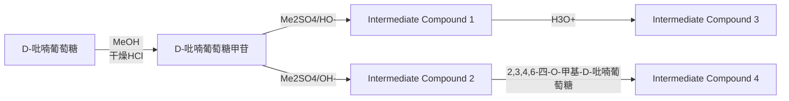
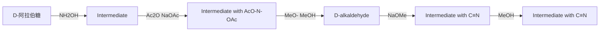
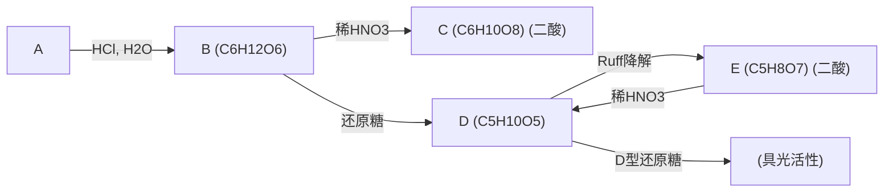

# 第十五章 糖类化合物

原始 PDF 第 269–295 页。

## 第十五章

## 糖类化合物

15.1 单糖的结构 254 15.4 二糖 269
15.2 单糖的性质 260 15.5 寡糖和多糖 272
15.3 单糖构型及环大小的测定 …… 267 习题 …… 278

植物的细胞组织、果实、机体骨架等的主要成分都是碳水化合物（carbohydrates），其因为最早知道的这类物质的分子式都符合通式 $C_{x}(H_{2}O)_{y}$ 而得名。随着科学发展和对这一大类化合物研究的深入，人们发现它们实际上是一类多羟基醛/酮或水解后能形成多羟基醛/酮的物质。这类物质中，大多数化合物的分子式都符合通式 $C_{x}(H_{2}O)_{y}$，如葡萄糖 $C_{6}H_{12}O_{6}$ 、蔗糖 $C_{12}H_{22}O_{11}$ 等。但也有少数化合物的分子式与碳水化合物通式不符合，如鼠李糖的分子式为 $C_{6}H_{12}O_{5}$ 。另外一些分子，如甲醛（$CH_{2}O$）、乙酸（$C_{2}H_{4}O_{2}$）、乳酸（$C_{3}H_{6}O_{3}$）等虽然符合碳水化合物通式，但并不属于碳水化合物。因此，“碳水化合物”仅是一个不严谨的、沿用传统习惯的名称，现在常用糖类来指代这类化合物。

自然界几乎所有的生物能源及有机物都源自植物的光合作用。植物中的叶绿素作为催化剂将光能转化为化学能，帮助水分子分解释放氧气，产生的能量随后用于碳反应合成葡萄糖。

$$
x \mathrm{CO} _ {2} + y \mathrm{H} _ {2} \mathrm{O} + h \nu \xrightarrow [ \text {光合作用} ]{\text {叶绿素}} \mathrm{C} _ {x} (\mathrm{H} _ {2} \mathrm{O}) _ {y} + x \mathrm{O} _ {2}
$$

通过光合作用，太阳能被储存到糖中。在动物或人体内，糖被酶水解，再经过复杂的分解氧化过程，最后又变为  $CO_{2}$  和  $H_{2}O$ ，同时释放出能量作为生命活动所需的能源。因此，糖类是人和动植物生命活动的必需物质。

糖类可根据其单元组成分为以下几类:那些不能再水解的多羟基醛/酮称为单糖（monosaccharides）；二糖（disaccharides）由两个单糖分子共价连接而成，可以水解为两个单糖；寡糖（oligosaccharides）通常由3～10个单糖分子组成；而多糖（polysaccharides）则由更多的单糖分子共价连接而成。

chemical

Chemical structure of D-甘油醛 with labeled hydroxyl groups and functional groups

1,3-二羟基丙酮

## 15.1 单糖的结构

单糖具有多羟基醛/酮的结构，常见的单糖含有3～6个碳原子。按照碳原子的数目，可将单糖分为三碳糖（丙糖）、四碳糖（丁糖）、五碳糖（戊糖）、六碳糖（己糖）等；根据羰基的结构，单糖则可分为醛糖和酮糖。最简单的单糖是甘油醛和1,3-二羟基丙酮，它们分别是丙醛糖和丙酮糖。

习惯上常用费歇尔投影式和 D/L 构型命名法来表示单糖的立体结构。自然界中存在的糖

---

15.1 单糖的结构

255

绝大多数为 D 构型，即费歇尔投影式最下方的手性碳原子（编号最大的手性碳原子）上的羟基朝右的构型。以下是几种常见的四碳、五碳醛糖。它们分别有 2 个和 3 个手性碳原子，因此分别存在 4 种和 8 种可能的立体异构体。需要注意的是，同种单糖的 D 构型和 L 构型互为对映异构体。

chemical

五种有机化合物结构式，分别为D-赤藓糖、D-苏阿糖、D-核糖、D-脱氧核糖、D-阿拉伯糖和L-阿拉伯糖

## 15.1.1 单糖的构造确定

单糖的多羟基醛/酮结构最初是通过系列的化学反应确定的。例如，对于最常见的葡萄糖，元素分析或其他方法测得其分子式为 $\mathrm{C_6H_{12}O_6}$ 。人们根据以下反应，确定了葡萄糖分子中的原子连接方式:

（1）与乙酸酐反应，可引入5个乙酰基，说明分子中含有5个羟基；
（2）与羟胺反应，得到一元肟，说明分子中含有一个羰基；
（3）能与溴水发生氧化反应，生成相同碳原子数的羧酸，说明羰基是醛而不是酮（酮不能被溴水氧化）；
（4）用强还原剂——磷和氢碘酸还原，可使葡萄糖还原生成正己烷，说明葡萄糖分子中的碳链是一条直链。

由此可以确定，葡萄糖分子含有一个醛基，5个羟基则分别位于另外5个碳原子上（因为两个羟基位于同一个碳原子上是不稳定的），因此葡萄糖为六碳醛糖，具有如下所示的骨架结构。类似的方法也可以确定其他糖的骨架结构，例如，果糖具有相同的分子式，但它是己酮糖。

葡萄糖

果糖

## 15.1.2 单糖的构型

葡萄糖作为己醛糖，其分子中有4个手性碳原子，因此存在如下所示的 $2^{4} = 16$ 个旋光异构体，它们组成了8对D/L-对映体。为简便起见，在横键方向常只用一条横线代表羟基的朝向。

chemical

Chemical structure of a branched hydrocarbon with two CHO groups and two CH2OH substituents

阿洛糖
(allose)

chemical

Two identical chemical structures with CHO and CH2OH groups attached to each carbon

阿卓糖
(altrose)

chemical

Two identical chemical structures with CHO and CH2OH groups attached to a central carbon

葡萄糖
(glucose, Glc)

chemical

Two identical chemical structures with CHO and CH2OH groups, likely representing a polymer or glycol chain

甘露糖
(mannose, Man)

---

256

第十五章 糖类化合物

D/L构型只能确定一个手性碳原子的构型，要精确命名每一个手性碳的构型，仍需要用$R / S$ 命名法，如D-葡萄糖的系统命名应为(2R,3S,4R,5R)-2,3,4,5,6-五羟基己醛。所有的己醛糖中，只有D-葡萄糖、D-甘露糖和D-半乳糖存在于自然界中，其余都是通过合成得到的。

## 15.1.3 单糖的环状结构

## 1. 变旋光现象

将 D-葡萄糖分别从冷乙醇和热吡啶溶液中结晶，得到的晶体具有如下所示的不同性质。将两种晶体分别溶于水，或者把两种晶体按任意比例混合后溶于水，其比旋光度都会逐渐变化至+52.7。其他单糖也具有类似的现象，人们称其为变旋光现象。

chemical

Chemical reaction equation showing conversion of D-glucose to glucose using cold ethanol and hot dihydride crystals

可以预料，这两种结晶产物应该是不同的化合物，但二者在水溶液中可以相互转化，并存在平衡，因此才能具有变旋光性，而 $+52.7$ 即是达到平衡后的特定比例混合物的比旋光度。

另外，将D-葡萄糖与甲醇在HCl存在下反应，并不能得到缩醛。这不符合醛的特征。结合变旋光现象，可以推测单糖分子在溶液中可能并非以费歇尔投影式所示的开链形式存在，而是存在其他更稳定的结构。

## 2. 环状结构

如前所述， $\gamma-$  或  $\delta-$  羟基醛由于分子中两个官能团位置适中，容易形成稳定的五元或六元环状半缩醛。

chemical

Chemical reaction mechanism showing cycloaddition of a diol with hydroxyl groups, forming a cyclohexanol derivative with δ bond

与此相似，单糖也存在 $\gamma-$ 或 $\delta-$ 羟基醛的结构，因此其主要以环状半缩醛形式存在，并与开链结构形成动态平衡。由于环状结构稳定，因此开链式在平衡体系中的含量很低。葡萄糖的紫外光谱中见不到羰基吸收带；红外光谱中也看不到羰基伸展振动吸收带；核磁共振波

---

15.1 单糖的结构

257

谱上也不存在醛 H 峰。

chemical

Chemical structure of D-glucose showing its chain and ring structure, followed by哈沃斯投影式

单糖的环状结构可表述为更加符合实际的哈沃斯（Haworth）投影式。将费歇尔投影式向右侧放倒并弯曲碳链，使开链结构中左侧的羟基位于上方、右侧的羟基位于下方。此时进攻醛基形成半缩醛的5位羟基也位于环的下方，为了便于其进攻，可将C4-C5单键旋转，使5位羟基位于环平面，这样6位的羟甲基就位于环的上方。由于5位羟基是决定D/L构型的羟基，因此对于D-型糖，哈沃斯式中的6位羟甲基总是朝上。

chemical

Chemical structures showing a glycoside-like molecule with multiple hydroxyl groups and numbered carbon positions, followed by a cyclic structure with OH groups.

一旦成环后，羰基碳原子即成为手性碳原子，形成的半缩醛羟基和其他羟基一样，也可以位于环平面的两侧，从而得到一对非对映异构体，通常称它们为异头物（anomer）或端基差向异构体（差向异构体之间只有一个对应的手性碳原子构型相反），可以用“\~\~\~”键代表此处构型不明或无须注明的情况。这一对非对映异构体可以通过开链结构互变并在水溶液中形成平衡，它们正是之前提到的在不同溶液中结晶所得到的两种不同的D-葡萄糖环状结构。其中，半缩醛羟基和决定构型的羟基（即5位羟基）位于环平面同侧的称为 $\alpha$ 型，位于环平面异侧的则称为 $\beta$ 型。对于D型糖，5位羟基总是朝下的，因此半缩醛羟基朝下的为 $\alpha$ 型，朝上的为 $\beta$ 型。

chemical

Chemical reaction scheme showing conversion of α-D-吡喃葡萄糖 to β-D-吡喃葡萄糖 via enzyme chain structure

糖的环状结构，可根据相应的含氧杂环来命名。含六元杂环的糖称为吡喃糖，含五元杂环的糖称为呋喃糖。X射线衍射法已证明，六碳单糖绝大部分是以六元环状存在的，但也可以五元环状存在。例如，果糖在游离状态下是吡喃糖，结合状态下常呈呋喃糖结构。

---

258

第十五章 糖类化合物

D-果糖

β-D-吡喃果糖

α-D-吡喃果糖

β-D-呋喃果糖

α-D-呋喃果糖

## 3. 椅式构象，异头碳效应

D-葡萄糖在水溶液中， $\alpha-$ 、 $\beta-$ 环状构型和开链结构形成动态平衡，+52.7即是平衡时的比旋光度，它是由37%的 $\alpha$ 型、63%的 $\beta$ 型及0.1%的开链式各自的比旋光度加权的结果，该平衡含量与吡喃糖实际构象的稳定性有关。

作为六元环，吡喃糖实际上和环己烷类似，也采用椅式构象，而不是哈沃斯式中的平面结构。吡喃糖的椅式构象常用如下形式表示，氧原子位于右上角。在哈沃斯式和椅式中，环上取代基的上下方向是一致的。而在椅式中，键的方向需严格遵从平伏键或直立键的方向。可以看出，除了半缩醛羟基，D-葡萄糖的所有环上取代基都位于更稳定的平伏键上，这使得在所有D型己醛糖中，葡萄糖的结构最为稳定。

chemical

Chemical structure of a sugar derivative with multiple hydroxyl and ether functional groups

D-吡喃葡萄糖

D-吡喃半乳糖

chemical

Chemical structure of a sugar derivative with numbered carbon atoms and hydroxyl groups

D-吡喃甘露糖

根据  $\alpha-$  和  $\beta-$  吡喃葡萄糖的结构，它们的椅式构象分别为

chemical

Chemical structure of a glucose derivative with multiple hydroxyl groups and an ether bridge

α-D-吡喃葡萄糖

chemical

Chemical structure of a glucose derivative with multiple hydroxyl groups and an ether bridge

$\beta - \mathsf{D} -$ 吡喃葡萄糖

在  $\beta-D-$  吡喃葡萄糖的构象中，半缩醛羟基向上刚好位于平伏键上，而  $\alpha-D-$  吡喃葡萄糖的半缩醛羟基则位于向下的直立键上。因此，前者的稳定性大于后者的稳定性，在平衡中具有更高的含量。

但较新的研究发现，如果只考虑平伏键的稳定性，$\alpha$-异构体在平衡混合物中的含量应为仅 $11\%$ 左右，而不是 $37\%$。这说明 $\alpha$ 构型存在某种特殊的稳定化作用。目前广为接受的观点是，超共轭效应导致了“异头碳效应”的存在。即当半缩醛羟基位于直立键时，环上氧原子的孤对电子所在 $\mathrm{sp}^3$ 杂化轨道和半缩醛羟基C-O键的反键轨道平行，孤对电子可以发生如左所示的超共轭作用，使该构象更加稳定。类似的，异头碳效应也能解释二氯甲烷作为卤代烃的反常惰性，以及1,2-二氟乙烷邻位交叉构象比对位交叉构象稳定等现象。

因此，吡喃葡萄糖在溶液中的平衡含量是受多因素共同影响的结果。

chemical

Molecular structure diagram showing a sugar molecule with hydroxyl and oxygen functional groups, connected to a cyclic ether-like chain

α-D-吡喃葡萄糖

---

15.1 单糖的结构

259

## 15.1.4 重要的单糖衍生物

天然存在的己糖除了 D 构型的葡萄糖、半乳糖和甘露糖，还有一些它们的重要衍生物。如氨基糖是糖分子中某些羟基（常为 C2-OH）被氨基取代后的产物，其氨基通常情况下是乙酰化的，如 N-乙酰基葡萄糖胺，是很多起构架作用的聚合物（如细菌细胞壁及昆虫甲壳中甲壳素）的结构单元。

chemical

Chemical structure of a cyclic ester with hydroxyl, carbonyl, and amide functional groups

N-乙酰基-β-D-葡萄糖胺

在糖的合成和代谢中，各步反应的中间体经常是糖的磷酸化衍生物。磷酸和糖的一个羟基缩合即生成磷酸糖酯，如葡萄糖-6-磷酸酯。磷酸糖酯在中性 $\mathrm{pH}$ 下相对比较稳定，并带有负电荷。细胞中糖的磷酸化可用于捕获胞内的糖分子，也可以使糖更容易发生下一步的化学反应。

chemical

Chemical structure of a glycoside compound with phosphate group and hydroxyl groups

β-D-葡萄糖-6-磷酸酯

将 L-半乳糖和 L-甘露糖的 C6 位的 OH 用 H 取代，分别得到脱氧糖类 L-岩藻糖和 L-鼠李糖。前者存在于糖蛋白和糖脂的多糖部分中，后者则存在于植物多糖中。

chemical

Chemical structure of a glycoside with multiple hydroxyl groups and numbered carbon positions

L-岩藻糖 (6-脱氧-L-半乳糖)

L-鼠李糖

维生素 C 又叫抗坏血酸，也可看作六碳糖的衍生物。从结构上看，它是一个三元醇酮酸内酯的烯醇式。合成维生素 C 的基本原料即是 D-葡萄糖。具有烯二醇结构的抗坏血酸是一种强还原剂，其主要生理作用就来自它在体内发生的氧化还原作用。

chemical

Chemical structure of a glycoside compound with carboxylic acid and hydroxyl groups

L-抗坏血酸(维生素C)

---

260

第十五章 糖类化合物

## 15.2 单糖的性质

单糖一般是具有香甜味的结晶状固体。其分子上带有多个亲水性的羟基，因此单糖易溶于水，难溶于有机溶剂。单糖容易形成过饱和水溶液，即糖浆。另外，具有环状结构的单糖均具有变旋光现象。

单糖作为羟基醛/酮,既具有羟基和羰基的典型化学性质,这些官能团之间又能互相影响,从而显示其独特的性质。

## 15.2.1 半缩醛/酮羟基的反应及糖苷的形成

单糖采用了环状半缩醛/酮的结构，因此不能与两分子醇反应生成缩醛/酮。但其半缩醛/酮羟基还可以和一分子醇在微量酸的催化下反应得到缩醛/酮。例如，在D-葡萄糖的甲醇溶液中，通入少量HCl气体时，可发生如下反应。产物以 $\alpha$ 构型为主（占 $66\%$ ），这种看似“更不稳定”的直立键为主的现象同样可通过异头碳效应进行解释。

chemical

Chemical reaction equation showing conversion of a sugar derivative to α-D and β-D isomers using CH3OH/HCl catalyst

糖的半缩醛/酮结构中的羟基被其他基团取代后的产物称为糖苷。所有存在半缩醛羟基的环状糖，都能生成苷。苷又叫配糖物（或配糖体），它由两部分组成，一部分是称为糖基的糖类化合物，可以是各种糖；另一部分叫作配基（或称为苷元），常为非糖化合物。配基和糖环相连接的键称为糖苷键。如上述反应可得到 $\alpha$ 和 $\beta$ 两种构型的甲基葡萄糖苷，也称为葡萄糖甲苷，此时形成的糖苷键称为氧苷键，其形成机理与缩醛类似。

chemical

Chemical reaction mechanism showing protonation and dehydration steps of a sugar derivative

成苷后，由于不再存在半缩醛羟基，因而不具有变旋光现象。糖苷是缩醛，具有类似于缩醛的全部性质，如在碱性水溶液中能稳定存在，不会自发水解变回到原来的醛和醇，也难以被氧化；但在酸性条件下，苷可水解成为原来的环状半缩醛。苷的形成和水解均是可逆反应，醇过量生成苷，水过量则苷水解。

chemical

Chemical reaction showing oxidation of a sugar derivative with H3O+ to form a hydroxy acid derivative, followed by ROH addition

甲基葡萄糖苷是人工合成的最简单的配糖物。苷除被酸水解外，更重要的是它能被酶专

---

15.2 单糖的性质

261

一性地水解。麦芽糖酶（或  $\alpha-$  葡萄糖苷酶，从酵母中获得）能专一性水解  $\alpha-$  葡萄糖苷，断裂  $\alpha-$  糖苷键，生成  $\alpha-$  葡萄糖和另一部分配基；苦杏仁酶（或  $\beta-$  葡萄糖苷酶，存在于苦杏仁中）则只能水解  $\beta-$  葡萄糖苷，断裂  $\beta-$  糖苷键。因此，依靠酶水解的专一性，可鉴别  $\alpha-$  和  $\beta-$  糖苷。随着现代分析仪器的发展，近年来已可以较为方便地用核磁共振波谱来区分两种异头物。

苷是糖类在自然界中存在的主要形式。配基除了可以通过氧原子和糖环的 C1 位相连，还可以通过 N、S 等原子和糖环相连，形成氮苷或硫苷，此时形成的键则称为氮苷键或硫苷键。自然界中氧苷最多；氮苷主要存在于核糖中，又称为核苷；而硫苷较为少见。自然界中存在的苷大多具有 β 构型，一般易溶于水。如苦杏仁苷存在于苦杏仁核中，能被苦杏仁酶水解，其糖基是一种二糖（龙胆二糖），配基含有氰醇结构。经酶水解后会产生 HCN，所以苦杏仁核被动物吃后会引起中毒。熊果苷存在于熊果属植物中，是 β-D-吡喃葡萄糖和对苯二酚形成的配糖物。其通过抑制酪氨酸酶的活性，可防止黑色素的形成，因此被作为皮肤美白剂用于护肤品中。ATP 和 NAD⁺ 分子是 β-D-呋喃核糖的氮苷，在生理上极为重要:ATP 是生物体内的能量来源，NAD⁺ 则是体内氧化还原酶的重要辅因子。

chemical

Chemical structure of a glycoside compound with multiple hydroxyl and carbonyl groups

苦杏仁苷

chemical

Chemical structure of a glycoside compound with hydroxyl and phenyl groups

熊果苷

chemical

Chemical structure of a nucleoside analog with phosphate groups and a ribose sugar moiety

三磷酸腺苷(ATP)

chemical

Chemical structure of a nucleoside analog with phosphate and amine groups

烟酰胺腺嘌呤二核苷酸(NAD $^{+}$ , 辅酶I)

## 15.2.2 其他羟基的反应

## 1. 成醚

糖分子中的其他醇羟基不及半缩醛羟基活泼，在酸性条件下，不与醇反应成醚。但用Williamson醚合成法，可使糖分子中的所有羟基转变为醚。单糖形成的醚中，最常见的是甲基醚，它可通过与硫酸二甲酯在碱性条件下反应或通过与碘甲烷的反应得到。糖的半缩醛式结构在强碱性条件下不稳定，易发生异构化。所以常将半缩醛羟基首先形成苷予以保护，再于碱性条件下与硫酸二甲酯反应进行醚化。使用过量硫酸二甲酯在碱性条件下也可直接把糖的所有羟基醚化，但半缩醛羟基的构型难以保持。

普通醚比缩醛更加稳定，在酸性条件下，可优先水解糖苷键，得到半缩醛羟基游离而其他羟基仍然甲基化的产物。

其他重要糖苷示例

---

262

第十五章 糖类化合物

flowchart

## 2. 成酯

糖分子中的羟基也能按一般方法酯化。例如，葡萄糖与醋酸酐反应后生成五-O-乙酰葡萄糖。位于平伏键上的羟基比位于直立键上的反应更快。通过控制条件，也可获得不同端基异构体为主的产物。如在醋酸钠存在下，以 $\beta$ 型产物为主；而在 $\mathrm{H^{+}}$ 存在下，则以 $\alpha$ 型产物为主。

chemical

Chemical reaction pathway showing conversion of a glycoside to a sugar derivative using acetylamine and sodium salt

## 3. 形成缩醛或缩酮

1,2-或1,3-二醇都能与醛、酮缩合生成五元或六元环状缩醛/酮。由于空间因素限制，只有在环上的两个羟基处于顺式，才能形成环状缩醛/酮。例如，$\alpha$-D-吡喃半乳糖与丙酮在硫酸存在下，其1、2位羟基和3、4位羟基分别和一分子丙酮缩合，得到1,2:3,4-二-O-异丙叉-$\alpha$-D-吡喃半乳糖。

chemical

Chemical reaction equation showing the addition of acetic acid to a sugar derivative under sulfuric acid catalysis

在与丙酮形成环缩酮的反应中，葡萄糖更倾向于用呋喃环的结构进行反应，生成1,2:5,6-二-O-异丙叉- $\alpha$ -D-呋喃葡萄糖。将此缩酮甲基化后水解，可得到仅在C3-OH上甲基化的葡萄糖。

chemical

Chemical reaction diagram showing conversion of a sugar molecule to a glycoside under pyruvate acid (H⁺)

环状缩醛/酮在中性或碱性条件下是相对稳定的，仅在酸性条件下发生水解。在糖合成中

---

15.2 单糖的性质

263

常用这样的方法来保护各种羟基。

## 15.2.3 羰基的反应

糖分子中的羰基也能进行醛、酮的某些反应。例如，与 HCN 反应生成氰醇，与  $NH_{2}OH$  反应生成肟、还原成醇等。

糖分子中羰基的反应是由其开链结构引起的。由于开链式在平衡体系中的浓度极小，所以羰基的有些反应不会发生。如糖不与  $NaHSO_{3}$  加成，与品红试剂反应也不明显。

此外，必须注意到，糖分子中的羰基与手性碳原子相连时，其发生的亲核加成反应具有立体选择性，得到的两个差向异构的加成产物产量不均等，亲核试剂从空间阻碍更小的一边进攻生成的产物占优势。

## 15.2.4 膜的形成

糖分子中的羰基可以与苯肼反应生成苯腙。若使用过量苯肼，则进一步反应生成二苯腙，糖的二苯腙称为腙。

chemical

Chemical reaction pathway showing conversion of a carboxylic acid to a hydroxy ester via PhNHNH2 and 2PhNHNH2 steps

滕

这是  $\alpha-$  羟基醛/酮的特征反应。一般认为第一步形成的苯腙互变为烯醇，进而消除一分子苯胺得到亚氨基酮，后者再和两分子苯肼反应生成脲。

chemical

Chemical reaction pathway showing conversion of phenol to amine and then to lysine via ammonia elimination

苯肼与糖的 C1 和 C2 成胨后，由于可以形成较为稳定的六元环分子内氢键结构，糖的其他碳原子便不再发生类似反应。此外，由于形成苯腙后，碳原子的手性消失，C2 位的差

---

264

第十五章 糖类化合物

向异构体应该生成相同的脲。如 D-葡萄糖和 D-甘露糖与苯肼反应得到相同的脲。仅在 C1、C2 上与 D-葡萄糖有差别的 D-果糖也会生成同样的脲。能够生成相同脲的几种异构体，只要确定其中一种异构体的构型，其他异构体的构型也就容易判断了。脲大都具有特殊的晶形和熔点，借此可鉴别不同的糖。

chemical

Chemical reaction pathway showing conversion of D-葡萄糖 to D-葡萄糖脲 and finally to D-甘露糖 via 3 PhNHNH₂ reagents

## 15.2.5 单糖的氧化

用不同的氧化剂氧化单糖时，可生成不同的产物。

## 1. 碱性弱氧化剂氧化

碱性弱氧化剂如托伦（Tollens）试剂 $\mathrm{[Ag(NH_{3})_{2}OH]}$ 和斐林（Fehling）试剂（硫酸铜和酒石酸钾钠的碱性溶液）可使单糖的醛基被氧化生成糖酸。能被这类弱氧化剂氧化的糖称为还原糖。

chemical

Chemical reaction equation showing conversion of D-葡糖 to D-葡萄糖酸 using Tollens and Fehling reagents

酮糖也能被弱氧化剂氧化，这似乎与一般酮的性质相矛盾，但实际上这是 $\alpha-$ 羟基酮的特性。因为托伦试剂和斐林试剂都是碱性试剂，碱性条件下可引起糖的广泛异构化，酮糖可以通过烯醇式异构化为醛糖进而被氧化。烯醇被氧化时甚至可以发生断链，断链处生成醛。正由于这种复杂异构化的存在，一般不用托伦试剂或斐林试剂氧化醛糖以制备醛糖酸。

chemical

Chemical structures of D-glucose, D-jioglit, and D-glutamic acid showing structural differences

因此，单糖无论醛糖还是酮糖都是还原糖。

## 2. 溴水氧化

溴水（或 HOBr）是一种酸性氧化剂，也可以把醛糖氧化为糖酸。酸性条件下糖不会发

---

15.2 单糖的性质

265

生异构化，因而酮糖不会被溴水氧化，可借此区分醛糖和酮糖（醛糖可使溴水褪色）。溴水是用醛糖制备糖酸的理想试剂。

糖酸容易失水形成五元环或六元环内酯，其中五元环内酯更加稳定。

chemical

Chemical reaction equation showing conversion of a sugar derivative to D-glucose and its conjugated form

## 3. 硝酸氧化

硝酸作为更强的氧化剂，不仅可将醛氧化成羧酸，还可将羟甲基（$-\mathrm{CH}_2\mathrm{OH}$）氧化成羧酸，生成糖二酸。如果是酮糖则发生断链，生成碳数更少的糖二酸。通过产物的碳原子数可对酮糖的羰基位置进行判断。

chemical

Chemical reaction pathway showing conversion of a diester to D-glucose and then to form a glycerol with HNO3 under mild conditions

根据所生成的糖二酸的旋光性，可推测糖的构型并用于构型测定。例如，D-葡萄糖二酸是旋光性的，说明分子中两边的构型不具有对映关系，即不是内消旋体。与之相反，D-半乳糖氧化后形成的二酸则没有旋光性，是内消旋体。

chemical

Chemical reaction equation showing conversion of D-methyl glucose to D-methyl glucose-2-acetic acid under dilute HNO3 at 100°C

糖二酸也很容易生成内酯，包括单内酯和二内酯。例如，D-葡萄糖二酸-1,4:6,3-二内酯的结构如下所示:

chemical

Chemical reaction diagram showing conversion of a dicarboxylic acid to a cyclic sugar molecule with numbered carbon positions

---

266

第十五章 糖类化合物

## 4. 高碘酸氧化

被高碘酸氧化并发生断链是邻二醇的特征反应。根据高碘酸的用量或氧化产物的结构，可推测糖的结构。1 分子葡萄糖被高碘酸氧化，可得到 5 分子甲酸和 1 分子甲醛。

chemical

Chemical reaction equation showing hydrolysis of a fatty acid with 5HIO4 to form 5HCOOH and 6HCHO

糖成苷以后，苷键既不被溴水氧化，也不被高碘酸氧化。例如，D-甲基葡萄糖苷被高碘酸氧化发生部分断链，之后的水解可以得到D-甘油醛、乙二醛和甲醇。

chemical

Chemical reaction equation showing hydrolysis of a sugar derivative with water and acid under acidic conditions

## 15.2.6 糖的递升和递降

将醛糖变为多一个碳原子的醛糖的过程称为递升，而变为少一个碳原子的醛糖的过程则称为递降。

醛糖的递升通常采用克利安尼-费歇尔（Kiliani-Fischer）合成法。此方法通过亲核加成反应形成氰醇以增长碳链，已被广泛用于糖类化学的研究中。氰醇水解生成的多羟基酸失水形成内酯，内酯可用钠汞齐还原成醛基和醇羟基，由此得到多一个碳原子的醛糖。

chemical

Chemical reaction pathway showing conversion of aldehyde to carboxylic acid via esterification and dehydration steps

通过克利安尼-费歇尔合成法，可得到两个互为差向异构体的多一个碳原子的醛糖。由于羰基旁边的原子是手性碳原子，该加成是立体选择性反应，两个差向异构体的量是不均等的。

用这种递升方法，可从甘油醛出发，由 D-甘油醛合成一系列 D 型糖；从 L-甘油醛合成一系列 L 型糖。

递降法是由德国化学家鲁夫（Ruff）于1898年提出的。将醛糖酸的钙盐在 $\mathrm{Fe}^{3+}$ 催化下，用 $\mathrm{H}_2\mathrm{O}_2$ 氧化，首先生成不稳定的 $\alpha-$ 羰基酸，再脱羧即得到少一个碳原子的醛糖。这种递降

---

15.3 单糖构型及环大小的测定

267

方法称为鲁夫递降法。

flowchart

chemical

Chemical reaction pathway showing conversion of D-核糖 to D-赤藓糖 via HOBr, CaCO3, and H2O2/Fe3+

另外一种递降的方法是用醛糖肟经乙酰化、消除反应得到腈，并同时使醇羟基酯化。经过碱水解，可得到氰醇，氰醇在碱性条件下很容易经亲核加成的逆反应生成醛。该方法称为沃尔（Wohl）递降法，实际上它是克利安尼-费歇尔合成法的逆反应。

flowchart

## 15.3 单糖构型及环大小的测定

## 15.3.1 葡萄糖的构型测定

早在 20 世纪初期，在当时已知的糖还很少的情况下，费歇尔（E. Fischer）用了下面的步骤来推测自然界中存在的葡萄糖的构型。如前所述，结构测定已经知道葡萄糖是一个直链己醛糖，分子中含 4 个手性碳原子，共有 16 种旋光异构体。以甘油醛作标准，其中有 8 种 D 型糖（如下所示），8 种 L 型糖。

---

268

第十五章 糖类化合物

通过 $(+)$ -葡萄糖与 $\mathrm{D} - (+)$ -甘油醛之间的一系列反应的联系，可以确定 $(+)$ -葡萄糖是D构型。因此，费歇尔只在以上8种D型糖中来确定D-葡萄糖的构型。通过下列实验，可逐渐缩小范围并最终确定所有手性碳原子的构型。

首先，将  $D-(+)-$ 葡萄糖经硝酸氧化后，得到一个旋光性的糖二酸。从而可以排除以上 8 个结构中的（1）和（7），因为这两种糖衍生的二酸为内消旋体，无旋光性。

chemical

Chemical reaction diagram showing conversion of aldehyde to acetic acid via dilute HNO3, forming an internal disulfide with respect to surface

其次，将 D-(+)-葡萄糖经递降后得到戊醛糖（即 D-阿拉伯糖）。同样的原理，D-阿拉伯糖经硝酸氧化可生成了具有旋光性的糖二酸。此时可以排除以上结构中的（2）、（5）和（6）构型，从而使推测范围缩小到（3）、（4）和（8）构型。

chemical

Chemical reaction pathway showing conversion of aldehyde to acetaldehyde via dilution and HNO3 addition

之后，若将上一步得到的D-阿拉伯糖进行递升，可得到两种互为差向异构体的己醛糖，用硝酸氧化后发现生成的两种糖二酸都具旋光性。由此可以推测 $\mathrm{D - (+)}$ -葡萄糖的构型不是（8）。因为（8）递降后再递升得到的两种差向异构的己醛糖经氧化所形成的两种糖二酸中，有一种不具有旋光性。

chemical

Chemical reaction pathway showing conversion of aldehyde to acetaldehyde, followed by HNO3 addition, and then product formation with dimmer and dimmer structures.

通过以上实验，$\mathrm{D} - (+)$-葡萄糖的构型只能是（3）或（4）。费歇尔后来合成了一种不同于以上8种糖的新的己醛糖（这种糖之后被证明具有L构型，称为L-古罗糖）。费歇尔发现这种新糖经硝酸氧化的产物与 $\mathrm{D} - (+)$-葡萄糖的氧化产物完全一样。由此可推断新糖与葡萄糖

---

15.4 二糖

269

相比，只是两端的醛基和羟甲基发生了交换，其他构型均不变。在剩下的（3）和（4）两种构型的糖中，只有将（3）的两端醛基和羟甲基交换后能得到另一种糖，而（4）交换后仍是它本身。由此可以推测，D-(+)-葡萄糖的构型是（3）。

chemical

Chemical structures of L-古罗糖 (L-Goldrich) showing two isomers with CHO groups and CH2OH substituents

这种以甘油醛作标准所推定的构型称为相对构型。现代结构测定方法早已测得单糖的绝对构型，证明其相对构型就是它们的绝对构型。D-葡萄糖构型确定后，又可通过成脎反应推测出能与葡萄糖生成相同脎的D-甘露糖和D-果糖的构型，并以类似的方法求得其他糖的构型。由于在糖的合成和构型确定中的出色贡献，费歇尔获得了1902年诺贝尔化学奖。

## 15.3.2 半缩醛环大小的测定

环状的吡喃葡萄糖经全甲基醚化后水解，可得到开环的2,3,4,6-四-O-甲基葡萄糖。其羟基所在的碳原子即成环碳原子。将其用硝酸氧化，不仅醛基被氧化成羧基，游基羟基也可被氧化成羰基，并可进一步断链成羧基。羟基碳原子两侧均可断裂，因此可以得到四种产物。

chemical

Chemical reaction pathway showing conversion of glycerol to glucose via acetylglucosamine and 4-5-aminobutyric acid derivatives

2,3,4-三甲氧基戊二酸

测定产物的结构，可以推断游离羟基在 C5 位，说明葡萄糖以吡喃环形式存在。若葡萄糖经类似醚化、水解、氧化过程生成 2,3-二甲氧基丁二酸（4-5 断裂）和 2-甲氧基丙二酸（3-4 断裂），则说明原葡萄糖以呋喃环形式存在。

以上甲基化-水解-氧化法是普遍使用的测定糖环大小的方法，它是在1926年由哈沃斯（W.N.Haworth）建立的。哈沃斯因其在葡萄糖环大小测定方法的建立和维生素C合成中的出色工作获得了1937年诺贝尔化学奖。

## 15.4 二糖

由两个或两个以上单糖分子失水结合而成的糖称为低聚糖。最重要的低聚糖是两个单糖

---

270

第十五章 糖类化合物

分子结合而成的二糖（又叫双糖）。从结构上看，二糖可以看作一种配糖物，其配基是另外一个糖分子，两个单糖分子通过糖苷键连接。

## 15.4.1 麦芽糖

麦芽糖是食用饴糖的主要成分，是淀粉经酶水解后的产物，常用的酶是含于麦芽中的淀粉酶。

麦芽糖分子是由葡萄糖单元组成的，可被酸水解生成两分子葡萄糖。麦芽糖呈右旋，是一种还原糖，具有变旋光现象，能成胨，可被溴水氧化生成麦芽糖酸。这说明麦芽糖具有一般单糖的结构特征，有一个能形成环状半缩醛的醛基。其椅式和哈沃斯式结构如下所示:

麦芽糖分子中两个葡萄糖的连接方式可通过以下方式确定:麦芽糖能被 $\alpha-$ 葡萄糖苷酶水解，说明两分子葡萄糖通过 $\alpha-$ 糖苷键相连。麦芽糖彻底甲基化后，生成八-O-甲基麦芽糖，水解后得到2,3,4,6-四-O-甲基葡萄糖和2,3,6-三-O-甲基葡萄糖及一分子甲醇，说明其中一个葡萄糖分子通过C4-OH形成糖苷键。因此，麦芽糖分子中存在 $\alpha-(1\rightarrow 4)$ 糖苷键，可命名为 $4-O-(\alpha-D-$ 吡喃葡萄糖基)-D-吡喃葡萄糖，或 $\alpha-D-$ 吡喃葡萄糖基-(1→4)-D-吡喃葡萄糖，英文缩写为“$\mathrm{Glc}(\alpha 1\rightarrow 4)\mathrm{Glc}$”。其未成苷的半缩醛羟基同样存在 $\alpha-$ 和 $\beta-$ 两种异头物。

chemical

Chemical reaction pathway showing conversion of a sugar derivative to a cyclic ester with methoxy and hydroxyl groups, followed by acidification.

八-O-甲基麦芽糖

2,3,4,6-四-O-甲基葡萄糖

2,3,6-三-O-甲基葡萄糖

由于人体存在可以水解  $\alpha-(1\rightarrow4)$  糖苷键的酶，麦芽糖可以被人体消化为葡萄糖并加以吸收利用。

## 15.4.2 纤维二糖

纤维二糖是由纤维素水解得到的产物。与麦芽糖类似，纤维二糖也是一种还原糖，呈右旋，具有变旋光现象，能成脲，可被溴水氧化，水解生成两分子葡萄糖。和麦芽糖不同的是，纤维二糖需要用 $\beta-$ 葡萄糖苷酶才能水解。结合甲基化-水解的方法，可以判断其分子中的糖苷键为 $\beta-(1\rightarrow 4)$ 糖苷键。因此，纤维二糖为 $4 - O - (\beta -D -$ 吡喃葡萄糖基)-D-吡喃葡萄糖，英文缩写为“Glc $(\beta 1\to 4)\mathrm{Glc}$ ”。

---

15.4 二糖

271

可见，纤维二糖和麦芽糖的，区别仅在于糖苷键的方向。这种结构的微小区别，却带来了生理活性上的巨大差异。纤维二糖不具甜味，人体也缺乏水解纤维二糖的酶，因此不能加以利用。某些草食性哺乳动物体内共生可以分解纤维二糖的微生物，因此可以消化利用纤维二糖。

## 15.4.3 乳糖

乳糖存在于人及其他哺乳动物的乳汁中。人乳中乳糖的含量为 $6\% \sim 7\%$ ，牛羊乳中乳糖的含量为 $4\% \sim 5\%$ 。牛奶变酸即源于其中的乳糖转变成了乳酸。乳糖是奶酪生产的副产物。

乳糖呈右旋，也具有变旋光现象和还原性，能成脎；用酸或 $\beta$-糖苷酶水解，生成一分子葡萄糖和一分子半乳糖；用溴水氧化成乳糖酸后再水解，则生成半乳糖和葡萄糖酸，这说明乳糖由一分子半乳糖通过 $\beta$-糖苷键和葡萄糖分子结合，用甲基化-水解的方法可证明是 $\beta-(1\rightarrow4)$ 糖苷键。因此，乳糖为 $4-O-(\beta-D-$ 吡喃半乳糖基)-D-吡喃葡萄糖，英文缩写为“Gal $(\beta 1\rightarrow 4)\mathrm{Glc}$”。

乳糖和纤维二糖实际上是差向异构体，它们的区别仅是半乳糖分子C4位的构型不同。乳糖可以被人体消化，但部分人群缺乏乳糖酶，不能完全消化乳糖，部分乳糖被结肠菌群酵解为乳酸、氢气、甲烷和二氧化碳，会使人体出现腹胀、肠鸣、急性腹痛、腹泻等症状，在医学上被称为乳糖不耐受症。患有乳糖不耐受症的人群可选择食用低乳糖奶或酸奶以避免症状发生。

## 15.4.4 蔗糖

蔗糖是最常见的食用糖之一。甘蔗中含 $16\% \sim 26\%$ 的蔗糖，甜菜中含 $12\% \sim 15\%$ 的蔗糖，它们都是工业上制取蔗糖的原料。

和前面几种二糖不同的是，蔗糖是一种非还原糖，不成胨，也没有变旋光现象，这说明蔗糖是两分子单糖通过各自的半缩醛/酮羟基互相成苷而成的。蔗糖经酸水解产生一分子葡萄糖和一分子果糖。蔗糖既能被 $\alpha$-葡萄糖苷酶水解，也能被 $\beta$-果糖苷酶（又叫转化酶）水解，说明葡萄糖和果糖的半缩醛/酮羟基分别为 $\alpha$ 和 $\beta$ 构型。因此，蔗糖为 $\alpha$-D-吡喃葡萄糖基-$\beta$-D-呋喃果糖苷或 $\beta$-D-呋喃果糖基-$\alpha$-D-吡喃葡糖苷，英文缩写为“$\mathrm{Glc}(\alpha 1 \rightarrow 2\beta)\mathrm{Fru}$”或“$\mathrm{Fru}(\beta 2 \rightarrow 1\alpha)\mathrm{Glc}$”。

---

272

第十五章 糖类化合物

根据高碘酸氧化蔗糖所得到的氧化产物可以证实上述结构。蔗糖氧化只消耗三分子高碘酸，生成一分子甲酸和一种四醛化物。再进一步用溴水氧化可以得到四羧基化物。其水解后得到三种产物，说明原蔗糖的结构中，用于形成半缩醛和半缩酮的都是C5-羟基，由此推定葡萄糖具有吡喃环，果糖具有呋喃环。

蔗糖呈右旋，但水解后得到的两种单糖混合物溶液测得的旋光性却是左旋的， $[\alpha]_{D} = -43.5$ 。因此，常把蔗糖的水解产物称为转化糖。转化糖是蜂蜜的主要成分。

除了以上介绍的几种二糖，自然界还存在很多种二糖。可以通过类似的酶水解及甲基化-水解-氧化等方法，确定它们的结构。

## 15.5 寡糖和多糖

由 3～10 个单糖通过糖苷键连接形成的化合物称为寡糖，寡糖具有单分散性及确定的相对分子质量和结构组成；由更多的单糖分子缩聚而成的高分子化合物则称为多糖，它们在自然界分布极广，种类繁多。其中单糖可以是含 5 个或 6 个碳原子的醛/酮糖，也可以是糖的衍生物，如醛糖酸或氨基糖。

---

15.5 寡糖和多糖

273

## 15.5.1 寡糖

大多数寡糖是由复杂多糖的降解获得的，如超分子化学中重要的主体化合物环糊精。大部分天然存在的寡糖存在于植物中，其中较常见的是三糖（trisaccharide）。

## 1. 三糖

棉子糖（raffinose）是最重要的天然三糖之一，广泛存在于蔬菜、水果、稻谷和一些油料作物的籽仁中，其在棉籽仁中的含量可达 $4\% \sim 5\%$ 。由甜菜制造蔗糖时，结晶后的母液糖浆是提取棉子糖的最佳原料。从结构上看，棉子糖是半乳糖与蔗糖通过 $\alpha - (1 \rightarrow 6)$ 糖苷键连接而成的三糖，因此它是一种非还原糖，水解最终得到各一分子的半乳糖、葡萄糖和果糖。棉子糖的甜度约为蔗糖的 $20\% \sim 30\%$ ，热量约为蔗糖的 $1/3$ ，棉子糖不为口腔致龋菌利用，因此可以防龋齿；棉子糖可促进肠道内双歧杆菌、乳酸杆菌等有益菌的繁殖生长，并抑制肠道有害菌的繁殖，因此可用于调节改善肠道内菌群。

chemical

Chemical structure of a glycoside compound with multiple glucose units and hydroxyl groups

棉子糖

其他天然三糖还有存在于龙胆根中的龙胆三糖（gentianose），存在于落叶松和黄杉树汁液中的松三糖（melezitose）等。另外，淀粉水解不但可以获得两个葡萄糖相连的麦芽糖，还可以获得三个葡萄糖相连的麦芽三糖（maltotriose）。

## 2. 环糊精

环糊精（cyclodextrin，简称 CD）是直链淀粉在由芽孢杆菌产生的环糊精葡萄糖基转移酶作用下生成的一系列环状寡糖的总称，通常含有 6～12 个 D-吡喃葡萄糖单元。其中研究得较多并具有实际使用价值的是含有 6、7、8 个葡萄糖单元的分子，分别称为环六糊精、环七糊精和环八糊精（α-环糊精、β-环糊精和 γ-环糊精）。环糊精最早由法国科学家 Villiers 从淀粉杆菌的淀粉消化液中分离得到，但并没有确证结构，称作木粉（cellulosine）。1903 年，奥地利科学家 Schardinger 通过碘液反应生成晶体的晶形和颜色区分了 α-环糊精和 β-环糊精。他还成功分离出纯的浸麻芽孢杆菌（Bacillus macerans），至今仍是最主要的催化环糊精生成的酶。到了 20 世纪 30 年代，德国科学家 Freudenberg 最先得到纯环糊精，并提出了环糊精是葡萄糖单元以麦芽糖方式结合的环状分子，并于 1936 年提出了环糊精的结构。1903 年，他又和德国科学家 Cramer 一起发现了 γ-环糊精并确认了其结构。

根据 X 射线晶体衍射、红外光谱和核磁共振波谱分析的结果，已经确定构成环糊精分子的每个 D-吡喃葡萄糖都具有椅式构象。各葡萄糖单元之间以  $\alpha-(1\rightarrow4)$  糖苷键连接成环，无自由的半缩醛羟基，因此无还原性，也只能被  $\alpha-$  淀粉酶水解。环糊精在碱性介质中很稳定，但强酸可使之裂解，其对酸及一般淀粉酶的耐受性比直链淀粉强。

---

274

第十五章 糖类化合物

chemical

Chemical structure of a cyclic glycoside with multiple glucose units and hydroxyl groups

α-CD

chemical

Chemical structure of a cyclic glycoside molecule with multiple hydroxyl groups and sugar moieties

β-CD

chemical

Chemical structure of a cyclic glycoside with multiple glucose units and hydroxyl groups

γ-CD

由于连接葡萄糖单元的糖苷键不能自由旋转，环糊精形成略呈锥形的中空圆筒状结构。其外侧上端（较大开口端）由C2位和C3位的二级羟基构成，下端（较小开口端）由C6位的一级羟基构成，两端均具有亲水性；而内侧由于受到C-H键的屏蔽作用而形成疏水空腔。环糊精有较好的热稳定性，无一定熔点，加热到约 $200^{\circ}\mathrm{C}$ 开始分解；无吸湿性，但容易形成各种稳定的水合物。环糊精溶于水，不溶于典型的有机溶剂，在水溶液及醇水溶液中能很好地结晶；但是水溶性有限，$\alpha-$ 环糊精和 $\gamma-$ 环糊精的溶解度分别是 $145\mathrm{mg/mL}$ 和 $232\mathrm{mg/mL}$，而 $\beta-$ 环糊精的溶解度仅为 $18.5\mathrm{mg/mL}$，这主要是因为晶体中存在较强的分子间氢键。环糊精的疏水性空腔内可嵌入各种有机化合物而形成主客体包接复合物，从而改变客体分子的理化和生物特性，如增加水溶性，提高稳定性，降低刺激性、毒性和副作用，实现药物的缓释以延长药物的半衰期等。另外，由于被包结的客体分子固定在特殊的羟基附近，因此环糊精能够作为酶的简单模型。环糊精自身已经被发现对某些化学反应呈现出催化活性。例如，在 $\mathrm{pH}$ 为10.6的环境下，$\alpha-$ 环糊精能使乙酸苯酯的碱水解速率提高9.7倍，但只能使乙酸对甲苯酯的水解速率提高3.8倍；然而，乙酸间甲苯酯的水解速率能提高39倍，乙酸间叔丁基苯酯的水解速率能提高226倍，充分说明了催化剂与底物间结构匹配的重要性，很好地模拟了酶催化高度专一性的特点。

chemical

Molecular structure diagrams showing alpha, beta, and gamma electron shells with interatomic distances labeled

α-环糊精、β-环糊精和γ-环糊精的空腔内径分别为0.56 nm、0.70 nm和0.88 nm。由于α-环糊精的分子空腔较小，通常只能包封较小的客体分子，应用范围较小；γ-环糊精的分子空腔大，但其生产成本高，工业上不能大量生产，其应用受到限制；β-环糊精的分子空腔适中，应用范围广，生产成本低，是目前使用最多的环糊精产品。同时，通过化学手段在环糊精骨架上

---

15.5 寡糖和多糖

275

引入修饰基团，可改变环糊精的性质或赋予其新的功能，极大地拓展了环糊精的应用范围。如舒更葡糖是羧基硫醚修饰的 $\gamma$-环糊精，其钠盐可以特异性包封全身麻醉剂罗库溴铵或维库溴铵分子，从而逆转该类麻醉剂造成的神经肌肉阻滞。环糊精化学是超分子化学领域的一个重要分支。

## 15.5.2 多糖

根据组成的单糖分子的不同，多糖可分为同聚多糖和杂聚多糖，其中前者仅由一种单糖分子组成，后者则由两种及两种以上单糖分子组成（常由两种单糖分子间隔组成）。多糖一般无甜味，不溶于水或在水中形成胶体溶液，没有还原性和变旋光现象。与人类生活密切相关的多糖有三种，即淀粉、糖原和纤维素，它们都是由葡萄糖分子组成的同聚多糖，在生物体内分别起到储存和架构的作用。另外，由 $N-$ 乙酰基葡萄糖胺同聚生成的多糖——甲壳素，为虾蟹和昆虫等动物提供了坚硬的外壳。

## 1. 淀粉

作为人类的主要食物，淀粉（starch）广泛存在于植物的根、茎、种子中，市售淀粉主要以玉米、土豆、小麦和大米为原料生产。大米中淀粉的含量约为75%，小麦中淀粉的含量为60%～65%。淀粉是葡萄糖分子通过 $\alpha-(1\rightarrow4)$ 糖苷键缩聚而成的高聚物，所以也可看作麦芽糖的聚合体，用酶水解淀粉可得到麦芽糖。

淀粉由直链淀粉（amylose，约 20%）和支链淀粉（amylopectin，约 80%）两部分组成。热水可以使淀粉颗粒溶胀，使得其中的直链淀粉和支链淀粉分开，二者都可溶于热水，但直链淀粉在冷水中的溶解度较低。直链淀粉中的糖苷键均为  $\alpha-(1\rightarrow4)$  糖苷键，分子量可以从数千到上百万不等。支链淀粉则存在分支，分子量也大得多，最高可达 2 亿。其主链上仍通过  $\alpha-(1\rightarrow4)$  糖苷键连接，分支处则是通过  $\alpha-(1\rightarrow6)$  糖苷键连接的，每 24～30 个葡萄糖单元出现一个分支。

chemical

Chemical structure of a glycoside with labeled alpha-β chain points and functional groups

直链淀粉的长链并不是一条直链，而是盘绕成螺旋形（称为二级结构），每转一圈大约含有六个葡萄糖单元，盘绕的链又弯折形成不规则的立体结构（称为三级结构），如下图所示。

---

276

第十五章 糖类化合物

直链淀粉遇碘变为蓝色，这是因为螺旋盘旋的“隧道”正好能容纳碘分子而形成蓝色复合物。实验室中常用淀粉检查碘的存在或用碘检查淀粉的存在，也可用碘化钾淀粉试纸检查氧化剂的存在。支链淀粉遇到碘分子不变蓝，而是形成紫红色复合物。

## 2. 糖原

糖原（glycogen）是动物体内储存能量的物质，功能相当于植物体内的淀粉，因此又被称为动物淀粉。糖原在体内主要分布于肝和骨骼肌中，分别称为肝糖原和肌糖原。人类肝中糖原的含量是肝干重的10%左右。糖原是与支链淀粉结构极为相似的多糖，在需要能量时便会水解释放出葡萄糖。相较于淀粉，糖原的支链更多，平均每8～12个葡萄糖单元就存在一个分支，其分子量可高达10亿。

人和动物对糖原的降解利用是一个涉及三种酶的复杂精妙过程:包括糖原磷酸化酶从多个非还原端逐个切下葡萄糖、转移酶将短支链葡萄糖单元转移到长支链，以及  $\alpha-(1\rightarrow6)$  葡萄糖苷酶的去支化。那么生命体为什么不直接储存葡萄糖而需要将其以淀粉或糖原的形式储存呢？这主要有两方面的原因。第一是渗透压:肝细胞中糖原的浓度以葡萄糖计为 0.4 mol/L；而以糖原分子计，浓度只有 0.01 μmol/L。且糖原不溶于水，因此对细胞的渗透压没有影响。如果细胞液中的葡萄糖都以单糖形式存在，那么浓度为 0.4 mol/L 的葡萄糖会大大改变胞内的渗透压，使细胞外的水分大量涌入，导致细胞发生破裂。第二则涉及葡萄糖的胞内外传输:细胞外的葡萄糖浓度只有 5 mmol/L（哺乳动物血浆），如果胞内有 0.4 mol/L 的葡萄糖，那么细胞储存葡萄糖将是一个非常耗能的过程。

## 3. 纤维素及其衍生物

纤维素分布很广，存在于棉、麻、竹和木材中，是自然界中含量最多的多糖。纤维素是葡萄糖分子通过  $\beta-(1\rightarrow4)$  糖苷键缩聚而成的无支链高聚物，与无机酸共热，可完全水解为葡萄糖；用酶部分水解，则得到纤维二糖，因此纤维素也可看作纤维二糖的聚合体。

与直链淀粉类似，纤维素分子也具有直链结构，没有分支。用甲基化-水解的方法，将生成的三-O-甲基葡萄糖（主要产物）和四-O-甲基葡萄糖（链端的葡萄糖分子）分离后，计算其相对比例，可获得关于纤维素链长的信息。由此方法可测得棉花纤维素分子大约含3000个葡萄糖单元，其平均分子量约为50万。这种通过端基在分子中所占比例来测定链长的方法，叫作端基分析法。但由于分离时总带有部分降解，所以测得的纤维素的分子量比实际的数值低。自然界中存在的纤维素链实际上更长，含1万～1.5万个葡萄糖分子。

chemical

纤维素分子链结构示意图，展示多糖链内各链上的有机化合物与碱基连接

通过 X 射线衍射分析和电子显微镜观察, 可以发现这些纤维素长链通过氢键彼此缠绕成束, 纤维素束的结构对它的化学稳定性和机械性能起着重要作用。人眼所见到的纤维, 就是由这种链束捻成像绳索一样结构的排列体。

纤维素不溶于水及各种有机溶剂，但能溶于氢氧化铜的氨溶液及氢氧化钠的二硫化碳溶液。纤维素分子中每一个葡萄糖单元上还有三个游离羟基，因此可将其分子式写成 $\left[\mathrm{C}_{6}\mathrm{H}_{7}\mathrm{O}_{2}(\mathrm{OH})_{3}\right]_{n}$ ，这些羟基也能成醚、成酯。纤维素醚和酯的衍生物已在工业上得到广泛应用。

---

15.5 寡糖和多糖

277

纤维素溶解在二硫化碳和氢氧化钠的水溶液中，发生反应得到纤维素黄原酸钠。其在少量水中是一种黏稠溶液，将它通过喷丝头的细孔压入稀硫酸溶液中，则被酸分解，并使纤维素形成长丝状再生，经纺织成为人造丝。这种制造人造纤维的方法称为黏胶法。纤维素溶于铜氨溶液后，经细孔压入稀硫酸中，也可制得人造纤维（铜氨法）。如果让黏胶溶液通过一个窄缝，使纤维素成薄片状再生，再将其用甘油软化，可用作保护膜。

chemical

Chemical structure of a sulfonated polymer with hydroxyl and sodium thiol groups

纤维素黄原酸钠

用硝酸、硫酸处理纤维素，可制得纤维素硝酸酯，又叫硝酸纤维素，其用途取决于硝化的程度。含氮在 $12.5\% \sim 13.6\%$ （三硝基纤维素）时，其可用于制造无烟火药；含氮低于 $13\%$ （低氮纤维）时，其可用于制造喷漆、赛璐珞及照相胶片等。

chemical

Chemical structure of a polymeric polymer with repeating units containing nitro and nitric oxide groups

硝酸纤维素

若用乙酸酐、乙酸和少量硫酸处理纤维素，生成三乙酸酯，并经部分水解，去掉一些乙酸根，得到的乙酸纤维素（相当于每个葡萄糖分子上约含两个乙酸根）可用作胶片、薄膜，也可作人造丝。

在碱性条件下，纤维素与氯代烷反应，可制得纤维素醚，可用作塑料、绝缘材料、胶黏剂、涂料等。

chemical

Chemical reaction equation showing esterification of a cyclic ether with 3n C2H5Cl and 3n NaOH under 80–100°C conditions

氯乙酸与纤维素反应，则生成羧甲基纤维素，通常以钠盐（sodium carboxymethyl cellulose，简写 CMC-Na 或 CMC）的形式存在，具有很高的表面活性。其在石油开采中用作增稠剂，橡胶工业上用其作为胶乳稳定剂保护胶体，纺织工业上用作上浆剂，造纸工业上用于增强纸张的耐油性、吸墨性和增加强度等。在有机化学实验室，CMC 是制作薄层色谱板的常用黏合剂。

chemical

Chemical reaction equation showing polymerization of a cyclic ether with dichloroacetic acid and sodium hydroxide to form a polyether product.

---

278

第十五章 糖类化合物

## 4. 甲壳素与壳聚糖

甲壳素，又名几丁质（Chitin），是一种广泛存在于低等植物菌类、甲壳动物（虾、蟹、昆虫等）的外壳和真菌的细胞壁中作为结构材料的多糖。甲壳素是法国人 Bracolmot 于 1811 年在蘑菇中发现的，并命名为 Fungine；1823 年，法国人 Odier 从甲壳类昆虫的翅鞘中分离出同样的物质，并命名为 Chitin；1859 年，法国人 Rouget 将甲壳素放在浓氢氧化钾溶液中煮沸，取出洗净后发现其可溶于有机酸；1894 年，德国人 Ledderhose 确认 Rouget 制备的改性甲壳素是脱掉了部分乙酰基的甲壳素，并命名为 Chitosan，即壳聚糖；直到 1939 年，英国诺贝尔化学奖得主 Haworth 才最终确定了甲壳素的结构。

chemical

Chemical structure of a polymeric glycoside with hydroxyl and amine functional groups

甲壳素

chemical

Chemical structure of a polymeric polymer with repeating units containing hydroxyl, amide, and amino groups

壳聚糖

透明质酸

代糖

在糖类化合物中，氨基替换羟基所得的糖称为氨基糖。甲壳素是纤维状的 $\beta-(1\rightarrow 4)$ 糖苷键连接的2-乙酰氨基-2-脱氧-D-葡萄糖的聚合物，分子量通常在100万以上，$N-$ 乙酰化的程度约为 $80\%$ ，与纤维素相似，链间通过氢键作用紧密缠绕成束，因此溶解性极差，也表现出化学惰性，为甲壳动物提供了坚硬的外部保护。在2500万年前的甲壳虫化石中也能分离得到甲壳素，可以说其是地球上最古老、含量最丰富的有机化合物之一，是除纤维素外的另一大类重要多糖。甲壳素在碱催化下脱乙酰基得到的壳聚糖不溶于水和稀碱，可溶于稀酸，其溶解性与脱乙酰度和分子量有关，脱乙酰度越高，分子量越小，越易溶于水。壳聚糖带有的氨基具有较强的化学反应能力，经化学修饰的壳聚糖在功能生物材料领域发挥着重要的作用。

1. 按糖的分类法将下列各化合物分类。

2. 写出丁醛糖各异构体的构型式，并分别用 D/L 和 R/S 法命名。
3. 写出 $\beta -\mathrm{D}-$ 吡喃葡萄糖的对映体、端基差向异构体和差向异构体的数目及名称。
4. 以下哪些结构属于 D 型糖?

(1)

(2)

(3)

---

习题

279

(5)

5. 根据异头碳效应，解释为何 1,2-二氟乙烷的邻位交叉构象比对位交叉构象更稳定。

6. 写出 D-(+)-甘露糖与下列试剂反应的主要产物及其结构式和名称。

(1)  $NH_{2}OH$

(6)  $Ac_{2}O$

(2)  $PhNHNH_{2}$

(7)  $CH_{3}OH$ , HCl

(3)  $Br_{2}, H_{2}O$

(8) a. $CH_{3}OH$, HCl; b. $(CH_{3})_{2}SO_{4}$, HO$^{-}$; c.稀 HCl

(4)  $HNO_{3}$

(9)(8)的产物 $+\mathrm{HNO}_3$

(5)  $HIO_{4}$

(10) $\mathrm{H}_2 / \mathrm{Ni}$, 或 $\mathrm{NaBH}_4$

7. 推测下列 D-甘露糖衍生物 I、Ⅱ、Ⅲ、Ⅳ的结构。

(Ⅰ) + 4 HIO₄ → 3 HCOOH + HCHO + HOOCCHO

(Ⅱ) $+5\mathrm{HIO}_4 \longrightarrow 4\mathrm{HCOOH} + 2\mathrm{HCHO}$

(Ⅲ) $+4\mathrm{HIO}_4 \longrightarrow 4\mathrm{HCOOH} + \mathrm{HOOCCHO}$

(IV) + 3 HIO₄ → 2 HCOOH + 2 HOOCCHO

8. $\mathrm{NaBH}_4$ 还原葡萄糖只得到葡萄糖醇，还原果糖却得到两种异构体，其中一种即是葡萄糖醇，解释其原因，并指出另一种产物的名称。

9. 完成下列转变。

(1) 由 D-半乳糖合成 D-来苏糖

(2) 由 D-葡萄糖合成 D-果糖

（3）由 D-半乳糖合成 6-脱氧-D-半乳糖

chemical

Chemical structure of a dihydroxybenzoic acid derivative with acetyl group and hydroxyl substituents

10. 如何鉴别下列各对化合物。

(1) a. 阿拉伯糖

b. 核糖

(2) a. 葡萄糖

b. 麦芽糖

(3) a. 阿拉伯糖

b. 葡萄糖

(4) a. 麦芽糖

b. 乳糖

(5) a. 蔗糖

b. 纤维二糖

(6) a. 甲基-D-吡喃葡萄糖苷

b. 2-O-甲基-D-吡喃葡萄糖

(7) a. 戊醛

b. 甘露糖

11. (R)-5-羟基庚醛存在为两种环状半缩醛式（1）和（2），写出其构象式。哪一种更稳定？写出在酸催化下异构体间转变的机理。

12. 葡萄糖的酵解过程中最关键的一步是一分子果糖-1,6-二磷酸在醛缩酶的作用下分裂为两分子三碳糖，即磷酸二羟基丙酮和3-磷酸甘油醛。请根据反应物名称写出该反应式，并推断其机理。

13. A、B、C 三种己醛糖，催化加氢时，A、B 生成相同的光活性的糖醇，当用过量苯肼处理时，A 和 B 生成不同的脲，B 和 C 生成相同的脲，但 B 和 C 的还原产物不同。设所有糖都呈 D 型，写出 A、B、C 的结构和名称。

---

280

第十五章 糖类化合物

14. 某天然产物:

chemical

Chemical reaction equation showing conversion of compound A to products (1) and (2)

flowchart

（1）推测 A～E 的结构。

（2）根据所给条件，哪个化合物的结构不能确定？

15. 化合物 A  $\left(\mathrm{C}_{5}\mathrm{H}_{10}\mathrm{O}_{4}\right)$ ，用  $Br_{2}-H_{2}O$  氧化得到酸  $C_{5}H_{10}O_{5}$ ，该酸很容易形成内酯。化合物 A 与  $Ac_{2}O$  反应生成三乙酸酯，与过量  $PhNHNH_{2}$  反应生成脲。用  $HIO_{4}$  氧化 A，只消耗一分子  $HIO_{4}$ ，推测 A 的结构。

16. 推断下列二糖的结构。

（1）二糖 $\left(\mathrm{C}_{10}\mathrm{H}_{18}\mathrm{O}_{9}\right)$ 用溴水氧化而后甲基化，再用α-葡糖苷酶水解，得到2,3,5-三-O-甲基-D-木糖和2,3,5-三-O-甲基-L-阿拉伯糖酸。
（2）海藻糖 $\left(\mathrm{C}_{12}\mathrm{H}_{22}\mathrm{O}_{11}\right)$ 是非还原糖，用 $\alpha-$ 葡糖苷酶或酸水解只得到葡萄糖，若甲基化后再水解，则只得到2,3,4,6-四-O-甲基-D-葡萄糖。
（3）龙胆二糖是一种植物配糖体，为还原性二糖，水解后只产生D-葡萄糖，它能被 $\beta$ -糖苷酶水解，但不被 $\alpha$ -糖苷酶水解。用硫酸二甲酯完全甲基化后再水解，得到2,3,4,6-四-O-甲基-D-葡萄糖和2,3,4-三-O-甲基-D-葡萄糖，写出龙胆二糖的结构并进行系统命名。

(本章编者 张骥、高戈)

本章习题
参考答案
