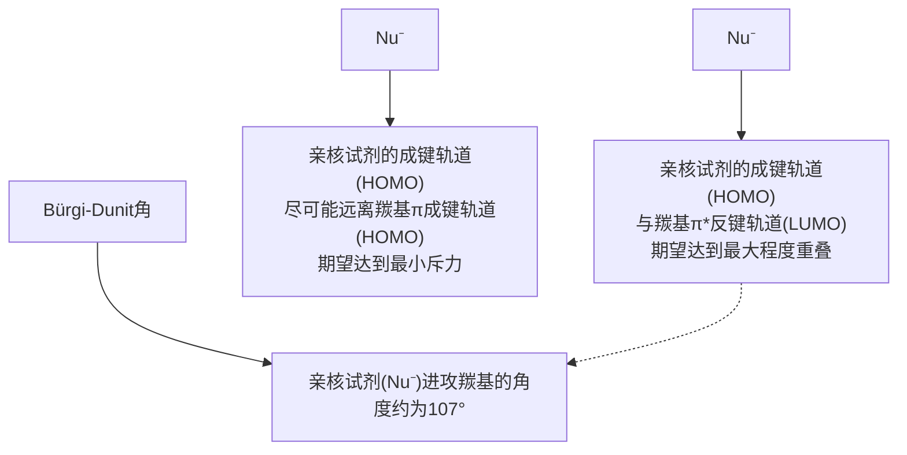
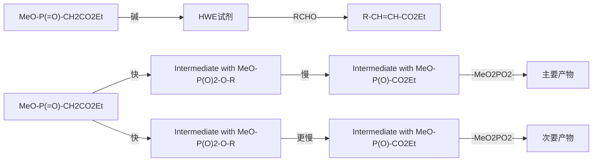

甲基乙基酮(甲乙酮)

ethyl methyl ketone

甲基乙烯基酮(丁烯酮)

methyl vinyl ketone

二苯甲酮(二苯酮)

diphenyl ketone

## 9.1.2 系统命名法

选择含有羰基碳原子的最长碳链为主链，从靠近羰基一端编号。醛羰基总是在链端，不用标明它的位次，而酮羰基通常需要标明位次。芳香族醛或酮的命名通常以脂肪族醛或酮为母体，将芳基作为取代基。例如:

3-乙基-5-甲基辛醛

3-ethyl-5-methyloctanal

(E)-3-苯基丙-2-烯醛

(E)-3-phenylprop-2-enal

(R)-4-甲基己-2-酮

(R)-4-methylhexan-2-one

2-羟基苯甲醛

2-hydroxybenzaldehyde

苯乙醛

phenylethanal

1-(3-硝基苯基)乙-1-酮

1-(3-nitrophenyl)ethan-1-one

碳链原子的位次有时也用希腊字母表示，与羰基直接相连的碳原子为 $\alpha$-碳原子，其次为 $\beta$-碳原子、$\gamma$-碳原子等（酮分子中可以有 $\alpha, \alpha'$-和 $\beta, \beta'$-碳原子等）。二元羰基化合物也经常用希腊字母来标记，用 $\alpha$（相邻）、$\beta$（隔一个碳原子）、$\gamma$（隔两个碳原子）来表示两个羰基的相对位次。例如:

α-戊二酮(戊-2,3-二酮)

pentane-2,3-dione

β-戊二酮(戊-2,4-二酮)

pentane-2,4-dione

当主链同时含有酮羰基和醛羰基时，可以醛为母体，将酮羰基的氧原子作为取代基，用“氧亚基”表示；也可以酮、醛为母体，但需注明酮、羰基碳原子的位次。例如:

4-氧亚基戊醛

(γ-氧亚基戊醛，戊-4-酮醛)

4-oxopentanal

羰基在环内的脂环酮称为“环某酮”，如羰基在环外，则将环作为取代基。例如:

3-甲基环己酮

3-methylcyclohexan-1-one

4-甲基环己烷-1-甲醛

4-methylcyclohexane-1-carbaldehyde

环己-1,4-二酮

cyclohexane-1,4-dione

## 9.2 醛和酮的结构

醛和酮的分子中都含有羰基，它是由碳原子与氧原子以双键结合成的官能团，与碳碳双键相似，碳原子和氧原子都采取 $sp^{2}$ 杂化，碳氧双键由一个 $\sigma$ 键和一个 $\pi$ 键构成。羰基碳原子的三个 $sp^{2}$ 杂化轨道分别与一个氧原子和两个碳或氢原子形成三个 $\sigma$ 键，这三个 $\sigma$ 键在同一平面上。羰基碳原子和氧原子各剩下的一个p轨道在侧面相互交盖形成 $\pi$ 键，该 $\pi$ 键垂直于三个 $\sigma$ 键所在的平面，如图9-1(a)所示。醛、酮分子中形成羰基的碳原子和氧原子以及与羰基相连的其他两个碳或氢原子在同一平面上，键角接近 $120^{\circ}$，如图9-1(b)所示。

chemical

Molecular orbital diagram showing bonding between carbon and oxygen with sp² orbitals

(a)

(b)

图9-1 甲醛的分子结构

## 9.3 醛和酮的制法

## 9.3.1 醛和酮的工业合成

## 1. 低级伯醇和仲醇的氧化

这是工业制取醛、酮的重要方法（见本书上册第七章）。

## 2. 烯烃的氢甲酰化反应

烯烃与一氧化碳和氢气在催化剂作用下可生成比原烯烃多一个碳原子的醛。该合成法称为烯烃的氢甲酰化反应（hydroformylation），也称羰基合成（oxo-synthesis）。常用的催化剂是钴或铑催化剂。利用该法合成的醛可进一步还原成伯醇，这是工业上合成低级伯醇的重要方法之一。例如:

chemical

Organic reaction equation showing cyclopropane reacting with CO and H2 under RhH(CO)(PPh3)3 catalyst at 25°C for 10 MPa to form a cyclopropyl alcohol.

## 3. 烷基苯的氧化

工业上常用烷基苯氧化制取芳醛和芳酮。例如，甲苯用空气催化氧化、铬酰氯或铬酐氧化均可得苯甲醛:

乙苯用空气氧化可得苯乙酮:

chemical

Chemical reaction equation showing methylene alkylation with ethyl ether under acidic conditions

## 4. 偕二卤代物的水解

同碳二卤化合物（称为偕二卤代物或胞二卤代物）水解生成醛或酮。例如，工业上可利用苯二氯甲烷水解制取苯甲醛:

$$
\text{C}_6\text{H}_5\text{CHCl}_2 + \text{H}_2\text{O} \xrightarrow[\text{80\%~90\%}]{\text{Fe, 95~100 °C}} \text{C}_6\text{H}_5\text{CHO} + 2\text{HCl}
$$

## 9.3.2 伯醇和仲醇的氧化

醇的氧化也是实验室制备醛、酮的常用方法（见 7.2.6 小节）。将伯醇氧化成醛时要使用温和的氧化剂。当使用强氧化剂处理时，伯醇被氧化成羧酸。当使用温和的氧化剂时，产生的醛不会被进一步氧化。

$$
\mathrm{RCH} _ {2} \mathrm{OH} \xrightarrow [ \text {或} (\text {1}) \mathrm{DMSO} , (\mathrm{COCl}) _ {2} ]{\text {PCC, CH} _ {2} \mathrm{Cl} _ {2}} \mathrm{RCHO}
$$

使用多种强或温和的氧化剂可以将仲醇氧化，生成的酮不会进一步氧化。

$$
\mathrm{R} ^ {\mathrm{OH}} \xrightarrow [ \mathrm{H} _ {2} \mathrm{SO} _ {4} , \mathrm{H} _ {2} \mathrm{O} ]{\mathrm{Na} _ {2} \mathrm{Cr} _ {2} \mathrm{O} _ {7}} \mathrm{R} ^ {\mathrm{O}} \mathrm{R} ^ {\prime}
$$

此外，伯醇或仲醇可经 Oppenauer 氧化生成相应的醛或酮。该反应是在碱（如异丙醇铝等）催化下，使用过量的丙酮作氧化剂可逆进行的，且具有较强的选择性，可用于氧化不饱和醇。例如:

$$
\text {CH}_3\text{CH}=\text{CHCH}=\text{CHCH} \xrightarrow[\text {苯，回流}]{\text {异丙醇铝，丙酮}} \text{CHCOCH=CHCH=CHCH} \quad 80\%
$$

## 9.3.3 羧酸衍生物的还原

酰氯及酯等羧酸衍生物可部分还原成相应的醛（见 10.7.5 小节），常用的还原方法有金属氢化物还原及催化氢化还原（Rosenmund 还原）等。例如:

$$
\mathrm{CHCH} _ {3} \mathrm{C} = \mathrm{OEt} \xrightarrow [ (1) i - \mathrm{Bu} _ {2} \mathrm{AlH} , \text {己烷,} - 78 ^ {\circ} \mathrm{C} ]{(2) \mathrm{H} _ {3} \mathrm{O} ^ {+}} \mathrm{CHCH} _ {3} \mathrm{C} = \mathrm{OCH}
$$

## 9.3.4 芳环的酰基化

芳烃的 Friedel-Crafts 酰基化反应是合成芳酮的重要方法（见 6.3.5 小节）。例如:

$$
\text {C}_6\text{H}_5 + \text {C}_6\text{H}_5\text {-COCl} \xrightarrow{\text {AlCl}_3} \text {C}_6\text{H}_5\text{-CO-C}_6\text{H}_5\quad 82\%
$$

在 Lewis 酸的催化下，用一氧化碳和氯化氢与芳烃作用生成芳醛，此反应称为 Gattermann-Koch 反应。它可以看成 Friedel-Crafts 反应的一种特殊形式，相当于甲酰氯参与的酰基化反应，适用于烷基苯的甲酰化。例如:

$$
\mathrm{H} _ {3} \mathrm{C} - \overline {{\text {benzene}}} \xrightarrow [ \mathrm{AlCl} _ {3} - \mathrm{CuCl} , 20 ^ {\circ} \mathrm{C} ]{\mathrm{CO} + \mathrm{HCl}} \mathrm{H} _ {3} \mathrm{C} - \overline {{\text {benzene}}} - \mathrm{CHO}
$$

另一种特殊的 Friedel-Crafts 反应是 Vilsmeier-Haack 反应，酚类和芳胺类在  $POCl_{3}$  存在下与 N,N-二取代甲酰胺反应，可在其对位引入一个醛基。例如:

$$
\mathrm{HO} - \text {苯环} + \mathrm{H} \xrightarrow [ \mathrm{CH} _ {3} ]{\mathrm{O}} \mathrm{N} ^ {\mathrm{CH} _ {3}} \xrightarrow [ \mathrm{POCl} _ {3} ]{\mathrm{POCl} _ {3}} \mathrm{HO} - \text {苯环} + (\mathrm{CH} _ {3}) _ {2} \mathrm{NH} \tag{65}
$$

## 9.3.5 烯烃臭氧化

烯烃在臭氧作用下会裂解成醛或酮（见 5.6.4 小节）。

$$
\underset {(R) H} {\overset {R} {\rightleftharpoons}} \underset {H (R)} {\overset {R} {\rightleftharpoons}} \xrightarrow [ (2) \text {锌粉或} \left(\mathrm{CH} _ {3}\right) _ {2} \mathrm{S} ]{(1) \mathrm{O} _ {3}} 2 \underset {(R) H} {\overset {R} {\rightleftharpoons}} = O
$$

## 9.3.6 端炔的硼氢化氧化

端炔的硼氢化氧化生成通过  $\pi$  键的反马氏规则加成产物烯醇，互变异构形成醛（见5.8.4小节）。

$$
\mathrm{R} \equiv \frac {(1) \mathrm{R} _ {2} ^ {\prime} \mathrm{BH}}{(2) \mathrm{H} _ {2} \mathrm{O} _ {2} , \mathrm{HO} ^ {-}} \quad \mathrm{R} \stackrel {\frown} {\mathrm{CHO}}
$$

## 9.3.7 酸催化的端炔水合

酸催化下水分子对端炔的符合马氏规则的加成产物通过互变异构生成甲基酮（见5.8.3小节）。

$$
\mathrm{R} \equiv \xrightarrow [ \mathrm{HgSO} _ {4} ]{\mathrm{H} _ {2} \mathrm{SO} _ {4} , \mathrm{H} _ {2} \mathrm{O}} \mathrm{R}\rightleftharpoons
$$

## 9.4 醛和酮的物理性质及波谱性质

常温下除甲醛是气体外， $C_{12}$  以下的脂肪醛、酮一般是液体， $C_{12}$  以上的醛、酮一般为固体；芳醛、芳酮均为液体或固体。低级脂肪醛具有强烈的刺激性气味，某些  $C_{9}$  和  $C_{10}$  的醛、酮具有花果香味，可用于香料工业。

羰基具有极性，因此醛、酮的沸点比相对分子质量相近的烃及醚的沸点高。但羰基分子间不能形成氢键，因此沸点较相应醇的低。例如:

<table><tr><td rowspan="2">沸点/°C</td><td> $CH_3CH_2CH_2CH_3$ </td><td> $CH_3OCH_2CH_3$ </td><td> $CH_3CH_2CHO$ </td><td> $CH_3COCH_3$ </td><td> $CH_3CH_2CH_2OH$ </td></tr><tr><td>-0.5</td><td>7.4</td><td>49</td><td>55</td><td>97</td></tr><tr><td>沸点/°C</td><td>136.1</td><td>179.0</td><td>205.3</td><td colspan="2">201.8</td></tr></table>

因为醛、酮的羰基能与水中氢形成氢键，故低级的醛、酮可溶于水；但芳醛、芳酮微溶

或不溶于水。一些醛、酮的物理常数见表9-1。

表 9-1 一些醛、酮的物理常数

| 名称 | 熔点/°C | 沸点/°C | 相对密度($d_{4}^{20}$) | 水中溶解度$\frac{g \cdot (100\, g\, H_{2}O)^{-1}}{}$ |
| --- | --- | --- | --- | --- |
| 甲醛 | -92 | -19.5 | 0.815 (-20 °C) | 122 |
| 乙醛 | -123.5 | 21 | 0.788 (16 °C) | 无限混溶 |
| 丙烯醛 | -88 | 53 | 0.841 | 21 |
| 丙醛 | -81 | 49 | 0.8071 | 30 |
| 丁醛 | -99 | 74.8 | 0.8016 | 7.1 |
| (E)-丁-2-烯醛 | -76.5 | 102 | 0.8516 | 18.1 |
| 丙酮 | -94.7 | 56 | 0.7908 | 无限混溶 |
| 丁酮 | -86.7 | 79.6 | 0.8054 | 24 |
| 环己酮 | -31 | 155.7 | 0.9478 | 15 |
| 苯甲醛 | -26 | 179 | 1.0528 | 0.3 |
| 苯乙酮 | 20.5 | 202 | 1.028 | 0.55 |
| 二苯酮 | 48.5 | 305 | 1.1097 | 不溶 |

醛和酮的红外光谱在  $1740 \sim 1680 \, cm^{-1}$  有一个非常特征的 C=O 伸缩振动吸收峰；其他含有羰基的化合物（包括羧酸及其衍生物）的红外光谱在  $1850 \sim 1650 \, cm^{-1}$  也存在类似的强吸收峰，这是鉴别羰基存在的最有力证据之一。醛、酮羰基吸收峰的位置与其邻近基团的电子效应及空间效应有关，若羰基与双键发生共轭，则吸收峰向低波数位移。例如:

chemical

Four organic molecular structures with labeled standard deviations (σ/cm⁻¹)

醛、酮的伸缩振动吸收峰位置相近不易区别，但甲酰基的 C-H 键在  $\sim2720\ cm^{-1}$  处有中等强度（或弱的）尖锐的特征吸收峰，可以用于鉴别 -CHO 的存在。图 9-2 及图 9-3 分别为正壬醛及苯乙酮的红外光谱。

spectrogram

| Wavenumber \((cm^{-1})\) | Transmittance (%) |
| --- | --- |
| 2025.83 | ~32 |
| 2857.38 | ~45 |
| 2715.20 | ~65 |
| 1727.15 | ~30 |
| 1465.97 | ~65 |
| 1411.42 | ~60 |
| 1389.70 | ~60 |
| 1379.21 | ~60 |

图9-2 正壬醛的红外光谱

$2715\ cm^{-1}$ ，甲酰基 C—H 伸缩振动； $1727\ cm^{-1}$ ，C=O 伸缩振动

spectrogram

| Wavenumber \((cm^{-1})\) |
| --- |
| 3086.19 |
| 3063.13 |
| 3029.54 |
| 3005.58 |
| 1685.58 |
| 1598.91 |
| 1582.88 |
| 1449.36 |
| 1431.08 |
| 1359.76 |
| 1302.38 |
| 1265.95 |
| 1180.23 |
| 1078.19 |
| 1024.41 |
| 955.49 |
| 927.19 |
| 760.10 |
| 690.56 |
| 588.73 |

图9-3 苯乙酮的红外光谱

$1686\mathrm{cm}^{-1}$ ， $\mathrm{C = O}$ 伸缩振动； $1599~\mathrm{cm}^{-1}$ ， $1583~\mathrm{cm}^{-1}$ ，苯环骨架伸缩振动； $690~\mathrm{cm}^{-1}$ ，一取代苯Ar-H面外弯曲振动

在  ${}^{1}$ H NMR 谱图中，羰基本身不产生信号，但它对相邻质子的化学位移有明显的影响。由于羰基的吸电子性及 C=O 双键的磁各向异性，与羰基相连接的氢受到的屏蔽效应大大减小，化学位移值  $\delta$  较大，接近 9～10，这可以作为醛基的特征峰（图 9-4）。此外羰基对  $\alpha$ -质子的化学位移也有影响，导致化学位移值增大（图 9-5）。

spectrogram

| Peak Label | Chemical Shift \((\delta)\) |
| --- | --- |
| a | 10.030 |
| b | 7.900 |
| b | 7.885 |
| b | 7.657 |
| b | 7.642 |
| b | 7.628 |
| b | 7.558 |
| b | 7.542 |
| b | 7.527 |
| b | 7.270 |
| c | ~8.15 |
| c | ~8.10 |
| c | ~8.05 |
| d | ~8.00 |
| d | ~7.95 |
| d | ~7.90 |

图9-4 苯甲醛的核磁共振氢谱（500 MHz，$\mathrm{CDCl}_3$）

在  ${}^{13}$ C NMR 谱图中，酮或醛的羰基碳通常会在 δ200 附近产生弱信号峰，由于低场很少有信号出现，这种信号通常相对容易被识别，可以作为醛和酮鉴定的特征峰（图 9-6）。

spectrogram

| Chemical Shift \((\delta)\) | Integration |
| --- | --- |
| 2.473 | a |
| 2.458 | a |
| 2.444 | a |
| 2.430 | b |
| 2.138 | b |
| 1.066 | c |
| 1.052 | c |
| 1.037 | c |

图9-5 丁酮的核磁共振氢谱（ $500\mathrm{MHz}$ ， $\mathrm{CDCl}_3$ ）

spectrogram

| Peak Label | Chemical Shift \((\delta)\) |
| --- | --- |
| a | 209.290 |
| b | 77.257 |
| c | 77.000 |
| d | 76.743 |
| e | 36.606 |
| f | 29.203 |
| g | 7.577 |

图9-6 丁酮的核磁共振碳谱（126MHz，$\mathrm{CDCl}_3$）

## 9.5 醛和酮的化学性质

醛和酮的官能团是羰基，即 C=O。与 C=C 双键相似，C=O 双键由 σ 键和 π 键组成，但氧原子的电负性比碳原子的电负性大，所以羰基是极化的，π 电子云的分布偏向氧原子。这导致氧原子带部分负电荷，具有亲核性，易与亲电试剂反应；而碳原子带部分正电荷，具有亲电性，易与亲核试剂进行加成反应（亲核加成反应）。

chemical

Chemical structures showing sp² radicalization, π bond, σ bond, and π electron cloud with directional oxygen atoms

此外，受羰基的影响，与羰基直接相连的  $\alpha-$  碳原子上的氢原子( $\alpha-H$ )较活泼，产生的碳负离子能发生一系列反应（见第十一章）。醛、酮分子中含有的羰基和活泼的  $\alpha-H$  决定了其相关的主要化学性质，如下所示:

chemical

Reaction mechanism diagram showing oxidation and reduction reactions of a carboxylic acid to form alpha-hydroxybenzoic acid and alkene

## 9.5.1 羰基的亲核加成反应

羰基中碳原子带有部分正电荷，具有亲电性，易与多种亲核试剂进行加成反应，其亲核原子可以是碳、氧、硫、氮和氢等。

不同的羰基化合物亲核加成反应的活性不同，这种差异是电子效应和空间效应两者综合作用的结果。由电子效应看，当羰基碳原子上连有吸电子基时，容易进行亲核加成反应；反之，当羰基碳原子上连有给电子基时，难以进行亲核加成反应。由于与氢相比烃基具有给电子效应，因而酮的亲核加成反应活性一般低于醛。从空间效应看，羰基碳原子进行亲核加成反应的过程中，羰基碳原子若连有较大的基团，则不利于亲核加成反应的进行。不同结构的醛和酮进行亲核加成反应时，大致可按下列次序由易到难排列:

$$
\mathrm{HCHO} > \mathrm{RCHO} > \mathrm{ArCHO} > \mathrm{CH} _ {3} \mathrm{COCH} _ {3} > \mathrm{CH} _ {3} \mathrm{COR} > \mathrm{RCOR} > \mathrm{ArCOAr}
$$

一般在脂肪烃基空间效应不是很大的情况下，脂肪醛比芳香醛易于进行亲核加成；脂肪酮比芳香酮易于进行亲核加成，这是由于芳醛和芳酮中芳环与羰基的共轭，增加了羰基碳原子上电子密度。

对于芳香醛、酮，还要考虑到环上取代基的电子效应。当芳环上所连原子或基团通过芳环对羰基的影响表现为吸电子效应时，有利于增加羰基的活性；反之，则降低羰基的活性。

$$
\mathrm{O} _ {2} \mathrm{N} - \text {C}_6\text {H}_5 - \mathrm{CHO} > \text {C}_6\text {H}_5 - \mathrm{CHO} > \mathrm{H} _ {3} \mathrm{C} - \text {C}_6\text {H}_5 - \mathrm{CHO}
$$

在加成过程中，如果羰基两侧的基团相同，亲核试剂则可以从羰基所在平面的上、下机会均等地进攻羰基碳原子，形成加成产物。如果羰基两侧基团的大小不同，手性亲核试剂进攻羰基碳原子时，则可以形成手性醇。

chemical

Reaction mechanism diagram showing nucleophilic addition and deprotonation steps with labeled途径a and途径b

从分子轨道角度来看，亲核试剂对羰基的加成反应是亲核试剂的HOMO轨道电子对与羰基双键的LUMO轨道作用形成新的 $\sigma$ 键。值得注意的是，亲核试剂进攻羰基时，尽管亲核试剂的HOMO轨道与羰基 $\pi^{*}$ 轨道的重叠越大越有利，但是羰基 $\pi$ 键电子密度对亲核试剂的HOMO轨道的电子有排斥力，这导致亲核试剂对羰基的进攻并不是垂直于羰基的平面，而是与羰基呈 $107^{\circ}$ 左右的夹角，此夹角称作Bürgi-Dunit角。

flowchart

羰基与不同亲核试剂反应时，有些亲核试剂需要碱性条件，有些则需要酸性条件。碱性条件下的反应机理如下:首先羰基被亲核试剂进攻生成负离子中间体，随后负离子中间体质子化生成加成产物。

chemical

Reaction mechanism diagram showing quaternization and proton transfer steps of a carboxylic acid derivative

酸性条件下的反应则是首先羰基氧质子化生成正离子，随后亲核试剂对活化的羰基进攻生成加成产物。这里质子化羰基带有完整的正电荷，使得羰基碳的亲电性增加，有利于弱亲核试剂对羰基进行加成。

chemical

Reaction mechanism diagram showing quaternary transfer and nucleophilic attack of a ketone to form a hydroxyl group

当亲核试剂也可以作离去基团时，亲核试剂对羰基的亲核加成反应是可逆反应，平衡的位置取决于亲核试剂离去性能的强弱。这里将根据进攻原子对亲核试剂进行分类，研究各类亲核试剂。具体来说，将讨论基于碳、氧、硫、氮和氢的亲核试剂。

## 1. 碳亲核试剂对羰基的加成

碳亲核试剂的加成可以构建新的碳碳键，因此是有机合成最重要的反应类型之一。碳亲核试剂包括以 Grignard 试剂为代表的金属试剂、氰离子和 Wittig 试剂。

（1）与金属试剂加成醛、酮与Grignard试剂进行亲核加成反应，加成产物不必分离出来，可直接水解而生成醇:

chemical

Organic reaction mechanism showing oxidation of a ketone to form a hydroxymethylated product with MgX and R-MgX reagents

Grignard 试剂中的碳镁键是高度极化的，镁原子带有部分正电荷，碳原子带有部分负电荷，具有较强的亲核性。Grignard 试剂与甲醛反应，生成增加一个碳原子的伯醇；与其他醛反应，生成仲醇，而与酮反应，则生成叔醇。

醛、酮除了和Grignard试剂发生加成反应外，还可与有机锂试剂进行加成反应。有机锂试剂比Grignard试剂更活泼，反应方式与Grignard试剂相似，其反应优点是产率较高，而且较易分离。此外，Grignard试剂不易与二叔丁基甲酮反应，其原因是空间障碍较大，而叔丁基锂则可与之反应:

chemical

Chemical reaction equation showing lithium-catalyzed cyclization of a ketone to form an alcohol under ethylene and water conditions

醛、酮也可以与炔基钠反应，形成炔醇。例如:

chemical

Chemical reaction equation showing hydrolysis of cyclohexanol under acidic conditions to form a cyclohexanol derivative

另外，醛、酮等羰基化合物可在锌存在下，与 $\alpha$-卤(氯或溴)代羧酸酯反应，再经水解生成 $\beta$-羟基羧酸酯或 $\alpha, \beta$-不饱和羧酸，该反应称为Reformatsky反应。

chemical

Chemical reaction equation showing conversion of ester to β-羟基羧酸酯 and α,β-不饱和羧酸 via intermediate Zn

锌与 $\alpha$-卤代羧酸酯所形成的有机锌试剂，其亲核性比 Grignard 试剂的亲核性小，只能与醛、酮的羰基加成，而不与酯的羰基加成。$\beta$-羟基酸很容易脱水，所以酯在水解的同时脱水，最终生成 $\alpha, \beta$-不饱和羧酸。Reformatsky 反应常用于制备 $\beta$-羟基酸酯和 $\alpha, \beta$-不饱和羧酸。例如:

chemical

Organic reaction equation showing benzene reacting with bromoethylenediamine under zinc and water conditions to yield a hydroxybenzoate product

当醛、酮分子中的  $\alpha-$  碳原子为手性碳原子时，加成产物的立体构型将受其影响。Cram 规则（由 D. J. Cram 于 1952 年提出）可用于预测占优势产物的构型。Cram 规则可用纽曼投影式说明如下，其中 L、M 和 S 分别代表具有手性的  $\alpha-$  碳原子上连有的大、中和小基团；按照该规则羰基一般应处于 M 和 S 两个基团中间，而亲核试剂应主要从空间障碍较小的一侧（S 一侧）进攻羰基碳原子。

chemical

Chemical reaction equation showing the formation of a cyclic oxime from a ketone and R'MgX

例如，(S)-2-苯基丙醛与甲基碘化镁进行亲核加成反应时，主要得到产物Ⅰ。该实验结

果与 Cram 规则的预测是吻合的。

chemical

Chemical reaction equation showing conversion of a cyclic ketone to a diol under methanol and water conditions, yielding two products with different yields.

（2）与HCN加成醛、甲基酮和脂环酮一般均可以与氢氰酸作用生成 $\alpha-$ 羟基腈，亦称 $\alpha-$ 氰醇。机理研究表明该反应在催化量碱的存在下易于进行。例如，氢氰酸与丙酮反应，无碱存在时， $3\sim 4\mathrm{h}$ 内只有一半原料发生反应；加一滴氢氧化钾溶液，则 $2\mathrm{min}$ 内即可以完成反应。如果加入酸，反而使反应速率减小，加入大量的酸，放置许多天也不发生反应。这些事实表明，在氢氰酸与羰基化合物的加成反应中，起决定性作用的是CN。碱的存在能增加CN的浓度，酸的存在则相反。

$$
\mathrm{HCN} \xrightarrow [ \mathrm{H} ^ {+} ]{\mathrm{HO} ^ {-}} \mathrm{H} ^ {+} + ^ {-} \mathrm{CN}
$$

一般认为碱催化下氢氰酸对羰基的加成反应机理如下:

chemical

Reaction mechanism diagram showing slow and fastly activated reactions of a cyclic ester with CN groups

亲核进攻

质子转移

氰化氢在碱的作用下脱质子生成亲核性较强的氰离子，对羰基进行加成。不过，氰离子对羰基的加成是可逆的，产物的产率取决于平衡浓度。对大多数醛和小位阻酮而言，平衡倾向于氰醇的生成。

氢氰酸有剧毒，易于挥发（沸点为  $26.5^{\circ}C$ ），故与羰基化合物加成时，一般将无机酸加入醛（或酮）和氰化钠水溶液的混合物中，使得氢氰酸在反应体系中一旦生成就立即与醛（或酮）反应。但在加酸时注意控制溶液的 pH，使 pH 为 8，以利于反应进行。为了安全，该反应需要通风良好的环境中进行。一种改进的方法是将氰化钠或氰化钾水溶液加到羰基化合物的亚硫酸氢钠加成物中。体系中的亚硫酸氢根离子起酸的作用（见  $NaHSO_{3}$  对羰基的加成）。

$$
\begin{array}{c} \mathrm{OH} \\ \mathrm{R} - \stackrel {\mid} {\mathrm{C}} - \mathrm{SO} _ {3} \mathrm{Na} + \mathrm{NaCN} \Longleftrightarrow \mathrm{R} - \stackrel {\mid} {\mathrm{C}} - \mathrm{CN} + \mathrm{Na} _ {2} \mathrm{SO} _ {3} \\ \mathrm{H} \end{array}
$$

$\alpha-$ 羟基腈中氰基可以根据需要进一步转化为其他官能团，例如，氰基可以转化为氨基或羧酸，因此 $\alpha-$ 羟基腈是非常有用的合成中间体。

chemical

Chemical reaction equations showing the formation of carboxylic acid from cyanoic acid and aldehyde under different conditions

（3）与Wittig试剂加成Wittig试剂亦称磷内镝盐或磷叶立德，其中碳负离子与磷正离子直接相连，碳负离子可被邻近的磷正离子共振稳定，因此也可以写成 $\mathrm{C = P}$ 的共振式。两个共振式都可以表示Wittig试剂。尽管 $\mathrm{C = P}$ 的共振式没有电荷看起来更稳定，但它对整个共振杂化没有太大的贡献,因为 C 的 2p 轨道和 P 的 3p 轨道的大小显著不同,所以没有有效重叠。而镐盐形式更真实地反映了 Wittig 试剂作为亲核性碳负离子的反应性。

$$
\left[ \begin{array}{c} \mathrm{H} \\ - \stackrel {\cdot} {\mathrm{C}} - \stackrel {+} {\mathrm{PPh}} _ {3} \\ \mathrm{H} \end{array} \right. \longleftrightarrow \left[ \begin{array}{c} \mathrm{H} \\ \stackrel {\cdot} {\mathrm{C}} = \mathrm{PPh} _ {3} \\ \mathrm{H} \end{array} \right] \text {Wittig试剂}
$$

醛、酮等羰基化合物可与Wittig试剂进行亲核加成反应，形成一个新的内镝盐，然后裂解消除三苯基氧膦 $(\mathrm{Ph}_3\mathrm{P} = \mathrm{O})$ 而得到烯烃，其反应过程如下:

$$
\mathrm{R} ^ {1} \stackrel {\cdot \cdot \cdot} {\mathrm{C}} \stackrel {\cdot \cdot \cdot} {\mathrm{O}} ^ {\cdot} \stackrel {\cdot \cdot \cdot} {\mathrm{R} ^ {2}} + \stackrel {\cdot \cdot \cdot} {\mathrm{H}} \stackrel {-} {\mathrm{C}} - \stackrel {+} {\mathrm{PPh} _ {3}} \longrightarrow \left[ \begin{array}{c} \stackrel {: \cdot \cdot \cdot} {\mathrm{O}}: ^ {+} \mathrm{PPh} _ {3} \\ \mathrm{R} ^ {1} - \stackrel {: \cdot \cdot \cdot} {\mathrm{C}} - \stackrel {+} {\mathrm{CH} _ {2}} \\ \mathrm{R} ^ {2} \end{array} \right] \longrightarrow \left[ \begin{array}{c} \stackrel {: \cdot \cdot \cdot} {\mathrm{O}} - \mathrm{PPh} _ {3} \\ \mathrm{R} ^ {1} - \stackrel {: \cdot \cdot \cdot} {\mathrm{C}} - \stackrel {+} {\mathrm{CH} _ {2}} \\ \mathrm{R} ^ {2} \end{array} \right] \longrightarrow \mathrm{R} ^ {1} \stackrel {\mathrm{CH} _ {2}} {\mathrm{C}} _ {\mathrm{R} ^ {2}} + \mathrm{O} = \mathrm{PPh} _ {3}
$$

Wittig 试剂通常由三苯基膦和卤代烷制备。三苯基膦是结晶固体，熔点为  $80^{\circ}$ C，实验室中可用 Grignard 试剂与三氯化磷作用而得，也可通过用溴苯、三氯化磷和金属钠制备。

$$
\begin{array}{l} 3 \mathrm{PhMgBr} + \mathrm{PCl} _ {3} \longrightarrow \mathrm{Ph} _ {3} \mathrm{P} + 3 \mathrm{MgClBr} \\ 3 \mathrm{PhBr} + \mathrm{PCl} _ {3} + 6 \mathrm{Na} \longrightarrow \mathrm{Ph} _ {3} \mathrm{P} + 3 \mathrm{NaCl} + 3 \mathrm{NaBr} \\ \end{array}
$$

三苯基膦作为亲核试剂与卤代烷发生  $S_{N}2$  反应，生成季磷盐；再与强碱（如 n-BuLi、PhLi 等）作用，生成 Wittig 试剂。例如:

$$
\mathrm{Ph} _ {3} \ddot {\mathrm{P}} + \mathrm{CH} _ {3} \mathrm{CH} _ {2} - \mathrm{Br} \xrightarrow [ \mathrm{S} _ {\mathrm{N}} 2 ]{} \mathrm{Ph} _ {3} \stackrel {{+}} {\mathrm{P}} - \mathrm{CHCH} _ {3} \mathrm{Br} ^ {-} \xrightarrow [ \begin{array}{c} \delta - \delta + \\ \text {Ph-Li} \\ - \text {PhH} \\ - \text {LiBr} \end{array} ]{\delta - \delta +} \left[ \mathrm{Ph} _ {3} \stackrel {{+}} {\mathrm{P}} - \bar {\mathrm{CHCH}} _ {3} \longleftrightarrow \mathrm{Ph} _ {3} \mathrm{P} = \mathrm{CHCH} _ {3} \right]
$$

第一步是 $\mathrm{S_N2}$ 反应，因此伯烷基卤代物将比仲烷基卤代物更容易反应，叔烷基卤代物则不反应。磷盐中间体去质子化需要 $\mathrm{NaH}$ 、$\mathrm{NaNH_2}$ 或 PhLi 等强碱。Wittig 反应可用于制备单取代、二取代或三取代烯烃。由于过渡态的空间位阻，四取代烯烃很难通过 Wittig 反应制备。Wittig 反应是一种重要的合成工具，可以在羰基的位置引入碳碳双键，还具有相当好的立体选择性。由简单烷基卤代物产生的 Wittig 试剂与醛反应时，第一步的加成是反应的决速步骤，加成过程中 Wittig 试剂中的三苯基膦远离醛的取代基，这导致反应的主要产物是(Z)-烯烃。

$$
\text {Reaction:} \quad \text {慢} \rightarrow \left[\begin{array}{c}\text {主要}\\\text {次要}\end{array}\right] \xrightarrow {\text {快}} \left[\begin{array}{c}\text {主要}\\\text {次要}\end{array}\right] + \text {次要} \quad \text {(Z)-丙-1-烯基苯主要} + \text {(E)-丙-1-烯基苯次要}
$$

Wittig 试剂反应条件温和且收率较高，除可用于合成普通烯烃外，还可合成一些用其他方法难以制备的烯烃。例如:

$$
\text{C}_6\text{H}_5=\text{O} + \text{Ph}_3\text{P}=\text{CH}_2 \xrightarrow{\text{DMSO}} \text{C}_6\text{H}_5=\text{CH}_2 \quad 86\%
$$

德国化学家 G. Wittig 因其对有机磷化合物的研究以及发现了这种具有巨大合成用途的反应而获得 1979 年诺贝尔化学奖，这个反应被称为 Wittig 反应。利用该反应构建碳碳双键在有机合成中具有广泛的应用，如 BASF 的维生素 A 工业合成就用到了 Wittig 反应。

chemical

Organic synthesis reaction showing conversion of a chiral aldehyde to a ketone using (1) OHC and (2)异构化, yielding 98% product

当Wittig试剂含有可以稳定碳负离子的吸电子基时， $(E)$ -烯烃通常是主要产物。

$$
\mathrm{EtO} _ {2} \mathrm{C} - \underset {\mathrm{H}} {\overset {\mathrm{PPh} _ {3}} {\mathrm{C}}} \equiv \left[ \underset {\mathrm{EtO}} {\overset {\mathrm{O}} {\mathrm{C}}} - \underset {\mathrm{H}} {\overset {\mathrm{PPh}} {\mathrm{C}}} \right. \xleftrightarrow {} \underset {\mathrm{EtO}} {\overset {\mathrm{O}} {\mathrm{C}}} - \underset {\mathrm{H}} {\overset {+} {\mathrm{C}}} \xleftrightarrow {} \underset {\mathrm{EtO}} {\overset {-} {\mathrm{O}}} - \underset {\mathrm{H}} {\overset {+} {\mathrm{C}}} \left. \right] _ {\text {共振稳定的Wittig试剂}}
$$

$$
\mathrm{Ph} - \underset {\mathrm{H}} {\overset {\mathrm{PPh} _ {3}} {\rightleftharpoons}} \equiv \left[ \underset {\mathrm{H}} {\overset {\mathrm{PPh} _ {3}} {\rightleftharpoons}} \leftrightarrow \underset {\mathrm{H}} {\overset {\mathrm{PPh} _ {3}} {\rightleftharpoons}} \leftrightarrow \underset {\mathrm{H}} {\overset {\mathrm{PPh} _ {3}} {\rightleftharpoons}} \leftrightarrow \underset {\mathrm{H}} {\overset {\mathrm{PPh} _ {3}} {\rightleftharpoons}} \right. \text {共振稳定的Wittig试剂}
$$

$$
\begin{array}{r l} & \text {PhCHO} + \mathrm{H} ^ {\mathrm{PPh} _ {3}} \xrightarrow {\mathrm{CO} _ {2} \mathrm{Et}} \mathrm{Ph} ^ {\mathrm{CH=CHCO} _ {2} \mathrm{Et}} \\ & \text {PhCHO} + \mathrm{H} ^ {\mathrm{PPh} _ {3}} \xrightarrow {\mathrm{Ph}} \mathrm{Ph} ^ {\mathrm{CH=CHPh}} \end{array}
$$

在有机合成中 Wittig 反应有很多常用的变体。例如，Horner-Wadsworth-Emmons 反应（简称 HWE 反应）使用膦酸酯碳负离子试剂代替稳定的 Wittig 试剂，可以高选择性生成(E)-烯烃。

flowchart

Julia-Lythgoe 烯烃合成反应使用苯基磺酰基碳负离子与醛或酮反应生成中间体醇，该醇再原位酯化，随后用钠汞齐还原消除以提供烯烃。改良的 Julia-Lythgoe 烯烃合成反应用苯并噻唑-2-基砜或苯基四唑-2-基砜代替苯基砜与醛反应（称为 Julia-Kocienski 烯化反应），高选择性生成(E)-烯烃。

chemical

Chemical reaction pathway showing sulfonation and deprotection steps of a thioether derivative

硫叶立德与羰基化合物亦可发生加成反应，生成的氧负离子作为分子内亲核试剂进攻与硫正离子相连的碳原子，二甲硫醚作为离去基团离去，生成环氧化合物，该反应称为 Corey-Chaykovsky 反应。

chemical

Chemical reaction mechanism showing dehydration of a sulfonamide ion into a thioether intermediate and then to form an alkene product

## 2. 氧亲核试剂对羰基的加成

（1）与水加成 水作为亲核试剂时，其亲核原子是氧原子，与羰基化合物加成生成水合物——同碳二元醇。低级醛能在水溶液中生成较多的水合物，同碳二元醇通常是不稳定的，不能从水溶液中分离出来。但是当羰基碳原子上连有强吸电子基团时，其水合物是稳定的，可以从水溶液中分离出来。

chemical

Chemical reaction equations showing hydrolysis of aldehyde and chloroacetate to form aldehyde and chloroacetate

醛和酮与水的加成是可逆反应，表9-2列出一些醛、酮水合反应的平衡常数。

表 9-2 一些醛、酮水合反应的平衡常数 (K)

| 醛或酮 | K | 醛或酮 | K |
| --- | --- | --- | --- |
| H-CHO | $2.3 \times 10^{3}$ | $ClCH_{2}-CHO$ | 37 |
| $CH_{3}-CHO$ | 1.0 | $Cl_{3}C-CHO$ | $2.0 \times 10^{3}$ |
| $CH_{3}CH_{2}CH_{2}-CHO$ | 0.5 | $CH_{3}-CO-CH_{3}$ | $1.4 \times 10^{-3}$ |
| $(CH_{3})_{2}CH-CHO$ | 0.5 | $CH_{2}Cl-CO-CH_{2}Cl$ | 10 |
| $(CH_{3})_{3}C-CHO$ | 0.2 | $CF_{3}-CO-CF_{3}$ | $1.2 \times 10^{6}$ |

（2）与醇加成 在干燥氯化氢或浓硫酸的作用下，一分子醛或酮与一分子醇发生加成反应，生成的化合物分别称为半缩醛、半缩酮。

半缩醛（酮）一般是不稳定的，它易分解成原来的醛（酮），因此不易分离出来，但五、六元环的环状半缩醛较稳定，能够分离得到。半缩醛（酮）继续与另一分子醇进行反应，失去一分子水，而生成稳定的化合物，称为缩醛或缩酮，并能从过量的醇中分离出来。其反应机理可表示如下:

chemical

Reaction mechanism diagram showing hydrogenation and rearrangement steps of a ketone with isocyanate, including intermediates like semicircle and diester.

缩醛（酮）可以看作同碳二元醇的醚，性质与醚相似，不受碱的影响，对氧化剂及还原剂也是稳定的。但缩醛（酮）又与醚不同，它在稀酸中易水解转变为原来的醛（酮）。

$$
\begin{array}{c} \mathrm{OR} ^ {\prime \prime} \\ \mathrm{R} - \underset {\mathrm{H} (\mathrm{R} ^ {\prime})} {\overset {|} {\mathrm{C}}} - \mathrm{OR} ^ {\prime \prime} \end{array} + \mathrm{H} _ {2} \mathrm{O} \xrightarrow {\mathrm{H} ^ {+}} \underset {\mathrm{R}} {\overset {|} {\mathrm{C}}} \underset {\mathrm{H} (\mathrm{R} ^ {\prime})} {\overset {|} {\mathrm{O}}} + 2 \mathrm{R} ^ {\prime \prime} \mathrm{OH}
$$

醛与醇形成缩醛的反应较容易，采用含水少的酸性催化剂（如无水 HCl、浓硫酸等），在反应过程中应不断脱除生成的水以推动反应的进行。而醇和酮的反应比和醛的反应困难，因此制备简单的缩酮，常采用其他的方法。例如，制备丙酮缩二乙醇时，不能用乙醇与丙酮反应，而应采用原甲酸乙酯和丙酮反应。

chemical

Nitration reaction equation of benzene

若使用酮在酸催化下与乙二醇作用，并设法移去反应生成的水，便得到环状缩酮:

chemical

Chemical reaction equation showing methanol reacting with methoxybenzaldehyde under heating to form a cyclic alcohol product

80%\~85%

缩醛和缩酮可用来保护羰基，例如，从卤代醛合成高级炔醛，需要首先将-CHO保护起来，再连接炔烃，然后水解恢复-CHO。

chemical

Organic synthesis reaction pathway showing bromination, hydrolysis, and dehydration steps with Li catalyst

醛或酮和二醇缩合在工业上有重要意义，例如高分子产品聚乙烯醇的分子中包含许多亲水的羟基，不能作为合成纤维使用。为了提高其耐水性，在酸催化下用甲醛使其部分缩醛化，便得到性能优良的合成纤维，商品名称为维纶（又叫维尼纶）。

chemical

Chemical reaction equation showing polymerization of polyvinyl alcohol to polyester and polyester monomers under acidic conditions

## 3. 硫亲核试剂对羰基的加成

（1）与硫醇加成 在酸性条件下，一当量醛（酮）可以与两当量硫醇作用生成缩硫醛（酮），其反应的机理类似于缩醛（酮）的生成。当使用二硫醇化合物时，可以生成环状缩硫醛（酮）。

环状缩硫醛（酮）在 Raney 镍作用下发生脱硫反应生成相应的烷烃。Raney 镍是一种多孔的镍铝合金，其比表面积大，可有效吸附氢原子。在反应中氢原子取代硫原子，将羰基还原为亚甲基。

（2）与亚硫酸氢钠加成醛和甲基酮（$\mathrm{CH}_3\mathrm{COR}$）可以与亚硫酸氢钠（$\mathrm{NaHSO}_3$）饱和溶液（$40\%$）发生加成反应，生成结晶的亚硫酸氢钠加成物 $\alpha-$ 羟基磺酸钠，其反应机理如下:

chemical

Chemical reaction mechanism showing oxidation of a sulfonate ion to form an azide salt, with electron transfer and radical formation steps.

在该反应中，亲核原子是亚硫酸氢根离子（$\mathrm{HSO}_3^-$）中带有孤对电子的硫原子，而不是带有负电荷的氧原子。

不同的羰基化合物与亚硫酸氢钠加成平衡常数不同,如下列数据(与1 mol NaHSO $_{3}$ 在1 h后生成加成物的百分数)所示: