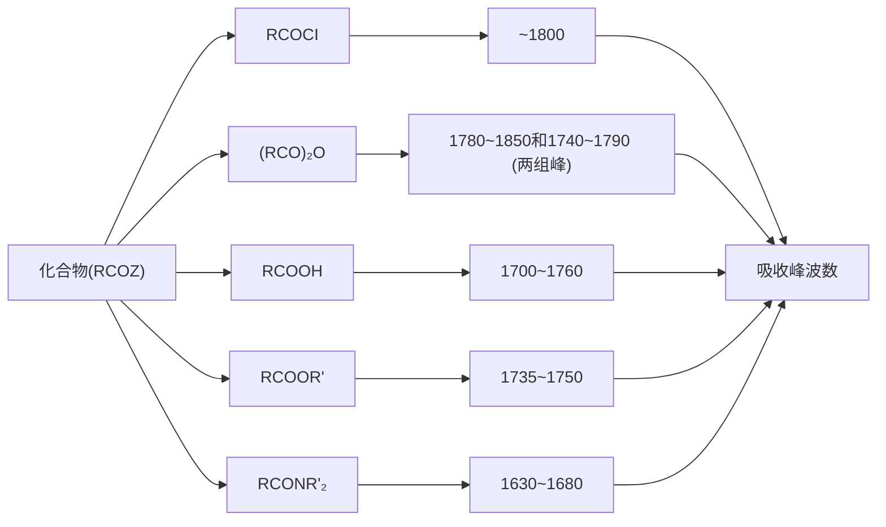

chemical

Chemical reaction equation showing the synthesis of acetic benzoic anhydride from acetic acid and benzoic acid under basic conditions

二元酸羧酸分子内脱水可形成环状酸酐。命名时，在二元羧酸的名称后加“酐”。英文名称将 acid 改为 anhydride。例如:

chemical

Chemical reaction equations showing the conversion of phthalic acid and butanedioic acid to their derivatives using -H2O

## 10.2.4 酯的命名

酸和醇的脱水产物称为酯（ester）。有机羧酸和醇的脱水产物为有机酸酯；含氧无机酸与醇的脱水产物为无机酸酯。命名时，将酸的名称放在前，烃氧的烃基部分放在后，最后加上酯。英文名称则将烃基部分放在前，羧酸的名称放在后，且羧酸的词尾 -ic acid 或 -ous acid 改为 -ate 或 -ite。例如:

flowchart

羧酸和羟基分子内脱水后生成的环状酯（cyclic ester）称为内酯（lactone）。环的大小可由希腊字母表示。五元环或六元环的内酯最易形成。命名时，将相应羧酸的“酸”改为“内酯”，并标明其位号。英文名称则将 -ic acid 改为 -olactone。例如:

γ-丁内酯
γ-butyrolactone

δ-戊内酯
δ-valerolactone

两分子（或多分子） $\alpha$ -羟基酸的羧基和羟基交互缩合脱去两分子（或多分子）水而形成的酯称为交酯（lactide）。命名时，将相应羧酸的“酸”改为“交酯”，并用二、三等字头表示所含的分子数。英文名称则将-ic acid改为-ide。例如:

chemical

Chemical reaction equation showing the conversion of (S)-lactic acid to (S,S)-lactide via dehydration under -2H₂O conditions

酸和硫醇的脱水产物称为硫酯（thioester）。命名时，将酯名称前加“硫代”。英文名称则将-oate或-carboxylate改为-thioate或-carbothioate。例如:

硫代丁酸甲酯
methyl butanethioate

硫代环己烷甲酸乙酯
ethyl cyclohexanecarbothioate

## 10.2.5 酰胺的命名

酰基与氮原子相连的化合物称为酰胺（amide）。依据与氮原子直接相连碳原子的数量，酰胺可以分为一级酰胺（1° amide）、二级酰胺（2° amide）和三级酰胺（3° amide）。对于一级酰胺，命名时则将羧酸的“酸”改为“酰胺”；对于二级或三级酰胺，命名时则需要先命名取代基团，再加上母体酰胺。英文名称则将词尾 -ic acid 改为 -amide。例如:

chemical

Structural formulas of ammonia and its derivatives including amine, 2-ethylamine, N,N-dimethylformamide, and N,N-dimethylacetamide

环内含有酰胺键的环状酰胺（cyclic amide）称为内酰胺（lactam）。命名时，称为某内酰胺，并标明其位号。英文名称则在相应烃名后加 lactam。例如:

chemical

Chemical structures of β-propiolactam and γ-butyrolactam with labeled alpha and beta positions

如果二元羧酸的两个羧羟基各被一个氨基取代，称为“某二酰胺”。英文名称将二元酸的词尾-dioic acid 改为 diamide。如果二元羧酸的两个羧羟基被同一个氨基取代，得到的环状化合物称为“某二酰亚胺”。英文名称将二元酸的词尾-dioic acid 改为 imide。例如:

丁二酰胺
butanediamide

丁二酰亚胺
succinimide

邻苯二甲酰亚胺
phthalimide

## 10.2.6 腈的命名

含有氰基（CN，cyano）的化合物称为腈（nitrile）。腈按照烷烃衍生物来命名。选取含有氰基的最长碳链为母体化合物，其中氰基中的碳计入烃的碳数内。命名时，在相应的烃名称后加上“腈”或“二腈”等；或者将相应羧酸的“酸”改为“腈”。英文名则在烃名后加上nitrile或dinitrile；或者将羧酸的词尾-oic acid或-ic acid改为-onitrile，亦或者将羧酸的词尾-carboxylic acid改为-carbonitrile。例如

(E)-戊-3-烯腈
(E)-pent-3-enenitrile

己二腈
hexanedinitrile

苯甲腈
benzonitrile

## 10.2.7 烯酮的命名

含有累积的（cumulated）羰基与碳碳双键的化合物叫作烯酮（ketene）。最简单的烯酮是乙烯酮（$\mathrm{CH}_2 = \mathrm{C} = \mathrm{O}$）。乙烯酮的衍生物一般采用取代命名法命名。例如:

乙基乙烯酮
ethyl ketene

乙酰基乙烯酮
propionyl ketene

## 10.3 羧酸及羧酸衍生物的物理性质

常温常压下， $C_{1}\sim C_{9}$  的直链脂肪羧酸是液体， $C_{10}$  及以上的羧酸是固体。甲酸、乙酸、丙酸和正丁酸均具有刺鼻性气味，固体羧酸通常无气味。羧酸是极性分子，羧羰基氧原子的电负性较强，使电子偏向氧原子，可以接近质子；并且羧酸也是很好的质子给体。所以羧酸可与水形成氢键，因而甲酸、乙酸、丙酸和正丁酸均可与水任意比例互溶。随着相对分子质量的增大，羧酸在水中的溶解度逐渐减小，高级脂肪酸是蜡状固体，不溶于水。芳香酸是结晶性固体，在水中溶解度不大。二元酸都是结晶性固体，低级的溶于水，在水中的溶解度随着相对分子质量的增大而减小。

羧酸的沸点比相对分子质量相近的醇的沸点高。例如，甲酸的沸点是 $101^{\circ}\mathrm{C}$，而与其相对分子质量相同的乙醇的沸点为 $78^{\circ}\mathrm{C}$。这是因为两分子羧酸间可以形成二缔合体。二缔合体具有较高的稳定性。低级羧酸甚至在气态下还能以二缔合体存在，这些均已被X射线衍射方法及凝固点降低法测定相对分子质量实验所证明。

羧酸与水形成的氢键

两分子羧酸的二缔合体

一些常见羧酸的名称及物理性质见表 10-1。

表 10-1 一些常见羧酸的名称及物理性质

<table><tr><td>化合物</td><td>系统命名法</td><td>普通命名法</td><td>熔点/°C</td><td>沸点/°C</td><td>溶解度 $\mathrm{g} \cdot (100\mathrm{g}\mathrm{H}_{2}\mathrm{O})^{-1}$ </td><td> $pK_{a1}$ </td><td> $pK_{a2}$ </td></tr><tr><td>HCOOH</td><td>甲酸 methanoic acid</td><td>蚁酸 formic acid</td><td>8.4</td><td>101</td><td>∞</td><td>3.77</td><td></td></tr><tr><td> $CH_3COOH$ </td><td>乙酸 ethanoic acid</td><td>醋酸 acetic acid</td><td>16.6</td><td>118</td><td>∞</td><td>4.74</td><td></td></tr><tr><td> $CH_3CH_2COOH$ </td><td>丙酸 propanoic acid</td><td>初油酸 propanoic acid</td><td>-22</td><td>141</td><td>∞</td><td>4.88</td><td></td></tr><tr><td> $CH_3(CH_2)_2COOH$ </td><td>丁酸 butanoic acid</td><td>酪酸 butyric acid</td><td>-5</td><td>163</td><td>∞</td><td>4.82</td><td></td></tr><tr><td> $CH_3(CH_2)_3COOH$ </td><td>戊酸 pentanoic acid</td><td>缬草酸 valeric acid</td><td>-35</td><td>187</td><td>3.7</td><td>4.85</td><td></td></tr><tr><td> $CH_3(CH_2)_{14}COOH$ </td><td>十六酸 hexadecanoic acid</td><td>软脂酸 palmitic acid</td><td>62.9</td><td>269/0.01 MPa</td><td>不溶</td><td></td><td></td></tr><tr><td> $CH_3(CH_2)_{16}COOH$ </td><td>十八酸 octadecanoic acid</td><td>硬脂酸 stearic acid</td><td>69.9</td><td>287/0.01 MPa</td><td>不溶</td><td></td><td></td></tr><tr><td></td><td>苯甲酸 benzoic acid</td><td>苯甲酸 benzoic acid</td><td>122</td><td>249</td><td>0.34</td><td>4.20</td><td></td></tr><tr><td></td><td>2-甲基苯甲酸2-methylbenzoic acid</td><td>邻甲基苯甲酸o-methylbenzoic acid</td><td>106</td><td>259</td><td>0.12</td><td>3.91</td><td></td></tr><tr><td></td><td>3-甲基苯甲酸3-methylbenzoic acid</td><td>间甲基苯甲酸m-methylbenzoic acid</td><td>112</td><td>263</td><td>0.10</td><td>4.27</td><td></td></tr><tr><td></td><td>4-甲基苯甲酸4-methylbenzoic acid</td><td>对甲基苯甲酸p-methylbenzoic acid</td><td>180</td><td>275</td><td>0.30</td><td>4.83</td><td></td></tr><tr><td>HOOCCOOH</td><td>乙二酸 ethanedioic acid</td><td>草酸 oxalic acid</td><td>189</td><td></td><td>8.6</td><td>1.27</td><td>4.27</td></tr><tr><td> $HOOCCH_2COOH$ </td><td>丙二酸 propanedioic acid</td><td>缩苹果酸 malonic acid</td><td>136</td><td></td><td>73.5</td><td>2.85</td><td>5.70</td></tr><tr><td> $HOOC(CH_2)_2COOH$ </td><td>丁二酸 butanedioic acid</td><td>琥珀酸 succinic acid</td><td>185</td><td></td><td>5.8</td><td>4.21</td><td>5.64</td></tr><tr><td> $HOOC(CH_2)_3COOH$ </td><td>戊二酸 pentanedioic acid</td><td>胶酸 glutaric acid</td><td>98</td><td></td><td>63.9</td><td>4.34</td><td>5.41</td></tr><tr><td> $HOOC(CH_2)_4COOH$ </td><td>己二酸 hexanedioic acid</td><td>肥酸 adipic acid</td><td>151</td><td></td><td>1.5</td><td>4.43</td><td>5.40</td></tr><tr><td></td><td>反丁烯二酸trans-butenedioic acid</td><td>富马酸 fumaric acid</td><td>302</td><td></td><td>0.7</td><td>3.00</td><td>4.20</td></tr><tr><td>化合物</td><td>系统命名法</td><td>普通命名法</td><td>熔点/°C</td><td>沸点/°C</td><td>溶解度 $\frac{g \cdot (100\ g\ H_2O)^{-1}}{}$ </td><td> $pK_{a1}$ </td><td> $pK_{a2}$ </td></tr><tr><td></td><td>顺丁烯二酸cis-butenedioic acid</td><td>马来酸maleic acid</td><td>131</td><td></td><td>79</td><td>1.90</td><td>6.50</td></tr><tr><td></td><td>1,2-苯二甲酸1,2-benzenedicarboxylic acid</td><td>邻苯二甲酸o-phthalic acid</td><td>213</td><td></td><td>0.7</td><td>3.00</td><td>5.39</td></tr><tr><td></td><td>1,3-苯二甲酸1,3-benzenedicarboxylic acid</td><td>间苯二甲酸m-phthalic acid</td><td>349</td><td></td><td>0.01</td><td>3.28</td><td>4.60</td></tr><tr><td></td><td>1,4-苯二甲酸1,4-benzenedicarboxylic acid</td><td>对苯二甲酸p-phthalic acid</td><td>300(升华)</td><td></td><td>0.002</td><td>3.82</td><td>4.45</td></tr></table>

低级酰氯和酸酐均具有刺鼻性气味。低级酯具有芳香性气味，存在于多种水果中，可用作香料。室温下，14个碳原子以下的脂肪羧酸的甲酯和乙酯、酰氯和腈均为液体。壬酸酐及以上的单酐均是固体。由于分子间氢键的缔合作用，乙酰胺及以上的一级酰胺（伯酰胺）均为固体；当氮原子上的氢原子被取代后，酰胺分子间的氢键缔合作用减少或消失，酰胺的熔点和沸点显著降低。例如:

<table><tr><td></td><td></td><td></td><td></td></tr><tr><td>种类</td><td>一级酰胺</td><td>二级酰胺</td><td>三级酰胺</td></tr><tr><td>熔点/°C</td><td>82</td><td>28</td><td>-20</td></tr><tr><td>沸点/°C</td><td>221</td><td>204</td><td>165</td></tr></table>

由于没有分子间氢键的缔合作用，酰氯、酸酐、酯、硫酯、腈和烯酮的沸点比相对分子质量接近的羧酸的沸点低。

酰氯和酸酐都不溶于水，且低级的酰氯和酸酐遇水分解；酯在水中溶解度很小，乙酸乙酯是常用的有机相萃取溶剂，也是很好的有机溶剂，常用于油漆工业；低级酰胺可溶于水，N,N-二甲基甲酰胺（N,N-dimethylformamide，DMF）和N,N-二甲基乙酰胺（N,N-dimethylacetamide，DMA）均为很好且常用的极性非质子溶剂（polar aprotic solvent），可与水任意比例互溶。酰氯、酸酐、酯、硫酯、腈和烯酮均可溶于有机溶剂。

一些常见羧酸衍生物的名称及物理性质见表 10-2。

表 10-2 一些常见羧酸衍生物的名称及物理性质

<table><tr><td>化合物</td><td>系统命名法</td><td>普通命名法</td><td>熔点/°C</td><td>沸点/°C</td></tr><tr><td></td><td>乙酰氯acetyl chloride</td><td>乙酰氯acetyl chloride</td><td>-112</td><td>51</td></tr><tr><td></td><td>乙酰溴acetyl bromide</td><td>乙酰溴acetyl bromide</td><td>-96</td><td>76.7</td></tr><tr><td></td><td>苯甲酰氯benzoyl chloride</td><td>苯甲酰氯benzoyl chloride</td><td>-1</td><td>197</td></tr><tr><td></td><td>4-硝基苯甲酰氯4-nitrobenzoyl chloride</td><td>对硝基苯甲酰氯p-nitrobenzoyl chloride</td><td>72</td><td>154/2 kPa</td></tr><tr><td></td><td>乙酸酐acetic anhydride</td><td>乙酸酐acetic anhydride</td><td>-73</td><td>140</td></tr><tr><td></td><td>丁二酸酐butanedioic anhydride</td><td>琥珀酸酐succinic anhydride</td><td>119</td><td>261</td></tr><tr><td></td><td>顺丁烯二酸酐(Z)-butenedioic anhydride</td><td>马来酸酐maleic anhydride</td><td>53</td><td>202</td></tr><tr><td></td><td>苯甲酸酐benzoic anhydride</td><td>苯甲酸酐benzoic anhydride</td><td>42</td><td>360</td></tr><tr><td></td><td>1,2-苯二甲酸酐1,2-benzenedicarboxylic anhydride</td><td>邻苯二甲酸酐phthalic anhydride</td><td>132</td><td>284</td></tr><tr><td></td><td>甲酸乙酯ethyl formate</td><td>甲酸乙酯ethyl formate</td><td>-80</td><td>54</td></tr><tr><td></td><td>乙酸乙酯ethyl acetate</td><td>乙酸乙酯ethyl acetate</td><td>-83</td><td>77</td></tr><tr><td></td><td>二碳酸二叔丁酯di-tert-butyl dicarbonate</td><td>Boc 酸酐Boc anhydride</td><td>22</td><td>56/66 Pa</td></tr><tr><td></td><td>2-甲基丙烯酸甲酯methyl 2-methylpropenoate</td><td>2-甲基丙烯酸甲酯methyl methacrylate</td><td>-50</td><td>100</td></tr><tr><td></td><td>苯甲酸乙酯ethyl benzoate</td><td>苯甲酸乙酯ethyl benzoate</td><td>-34</td><td>213</td></tr><tr><td></td><td>硫代乙酸甲酯methyl thioacetate</td><td>硫代乙酸甲酯methyl thioacetate</td><td></td><td>97</td></tr><tr><td></td><td>乙酰胺acetamide</td><td>乙酰胺acetamide</td><td>81</td><td>222</td></tr><tr><td></td><td>丙烯酰胺acrylamide</td><td>丙烯酰胺acrylamide</td><td>83</td><td>125</td></tr><tr><td></td><td>N,N-二甲基甲酰胺N,N-dimethylformamide</td><td>N,N-二甲基甲酰胺N,N-dimethylformamide</td><td>-61</td><td>153</td></tr><tr><td></td><td>苯甲酰胺benzamide</td><td>苯甲酰胺benzamide</td><td>130</td><td>290</td></tr><tr><td> $CH_3CN$ </td><td>乙腈acetonitrile</td><td>乙腈acetonitrile</td><td>-45</td><td>81</td></tr><tr><td></td><td>苯甲腈benzonitrile</td><td>苯甲腈benzonitrile</td><td>-10</td><td>70</td></tr><tr><td> $H_2C=C=O$ </td><td>乙烯酮ketene</td><td>乙烯酮ketene</td><td>-150</td><td>-56</td></tr></table>

## 10.4 羧酸及羧酸衍生物的结构与化学键

羰基最显著的特征包括:（1）羰基碳采用  $sp^{2}$  杂化，呈平面三角形，使得羰基空间上不拥挤；（2）负电性的氧原子极化羰基基团，使得羰基碳具有亲电性。

chemical

化学反应示意图，展示碳基碳亲电与sp²杂化、平面三角形、空间位阻小的反应关系

由于羧酸及羧酸衍生物的羰基均与含孤对电子的负电性原子 Z 相连，羰基与 Z 原子可形成一个三原子四电子的离域体系。因此，羧酸及羧酸衍生物可以画出三种共振结构（resonance structure），比相应的醛或酮多一种共振结构。通过电子离域，降低电子密度，进而稳定羧酸及羧酸衍生物。共振结构 2 和 3 对杂化体（hybrid）的贡献越大，杂化体越稳定。负电性原子 Z 的碱性决定了共振结构 3 对杂化体的贡献:原子 Z 的碱性越强，贡献越大。

chemical

Reaction mechanism diagram showing Z-oxide ring formation and its complex formation on a zwitterionic body

离去基团  $Z^{-}$  的碱性强弱，可由其共轭酸（HZ） $pK_{a}$  值的大小判断。

other

| Compound | Chemical Structure | \(Z-H_{2}\) Concentration | HZ Value |
| :--- | :--- | :--- | :--- |
| 1 | RCOCI | \(Cl^{-}\) | -7 |
| 2 | \((RCO)_{2}O\) | \(RCOO^{-}\) | 3~5 |
| 3 | \(RCOSR'\) | \(R'S^{-}\) | 9~11 |
| 4 | RCOOH | \(HO^{-}\) | 14.0 |
| 5 | \(RCOOR'\) | \(R'O^{-}\) | 15.5~18 |
| 6 | \(RCONR'_{2}\) | \({}^-\text{NR}'_{2}\) | 38~40 |

离去基团的碱性越低，离去能力越强，相应羧酸及羧酸衍生物的反应性越高，稳定性越差。所以酰氯是最不稳定的羧酸衍生物，因为 $\mathrm{Cl^-}$ 是最弱的碱；酰胺是最稳定的羧酸衍生物，因为 $\mathrm{NR}_2^{\prime}$ 是最强的碱。因此，羧酸及羧酸衍生物的稳定性排序如下:

反应活性

chemical

Chemical structures of various alcohols including chloroacetic acid, anhydride, thioester, carboxylic acid, ester, and amide with their corresponding substituents.

稳定性

一般情况下，羧酸中 C-O 单键的键长比醇中 C-O 单键的键长要短。例如，X 射线衍射实验证明，甲酸中 C=O 键的键长为 123 pm，C-O 键的键长为 136 pm。这证明羧酸中两个碳氧键是不一样的，且比甲醇中 C-O 键（键长为 143 pm）短。一方面，这是因为羧酸中 C-O 键的碳原子采用的是  $sp^{2}$  杂化，而甲醇中 C-O 键的碳原子采用的是  $sp^{3}$  杂化，由于  $sp^{2}$  杂化轨道中碳原子的 s 成分多，所以键长短。另一方面，这是由于羰基和与之相连的氧原子能形成一个三原子四电子的离域体系，从而使得羧酸中 C-O 键具有部分双键的性质，进而造成键长短。当羧羟基中的氢解离后，氧原子上带有一个负电荷，这能增强其与羰基  $\pi$  电子的共轭作用。在羧基负离子中，一个碳原子和两个氧原子各提供一个 p 轨道，形成一个具有三原子四电子的离域  $\pi$  分子轨道。在这个离域的  $\pi$  分子轨道中，负电荷不再集中于一个氧原子上，而是分散在两个氧原子上。X 射线衍射和电子衍射实验证明，甲酸钠中的两个碳氧键的键长均为 127 pm，无单键和双键的差别。

甲酸的结构

甲醇的结构

chemical

Molecular structure diagram showing carbon and oxygen atoms with dashed bonds indicating hydrogen bonding

羧基负离子的结构

甲酸钠的结构

酰卤、酸酐、硫酯、酯的结构与羧酸类似。其中，酰氯中 C-Cl 键的键长不比氯代烷烃中 C-Cl 键的键长短。这是因为在酰氯中氯有较强的电负性，其强的吸电子诱导效应占主导地位，而与羰基的共轭效应很弱。

chemical

Three chemical structures showing protonation and hydrolysis reactions with corresponding bond lengths in pm

腈和烯酮的结构与羧酸及羧酸衍生物的结构有很大不同。腈具有碳氮三键，烯酮具有累积的羰基与碳碳双键。腈分子中氰基的碳原子采用sp杂化，呈直线形，碳氮三键由一个 $\sigma$ 键和两个 $\pi$ 键组成。烯酮中与氧相连的碳原子采用sp杂化，呈直线形，碳氧双键中的 $\pi$ 键与碳碳双键中的 $\pi$ 键相互垂直。与羧酸及羧酸衍生物相同的是，腈和烯酮中均含有亲电性的碳原子，易与亲核试剂反应。

chemical

Chemical reaction equations showing epoxidation and methylation of thymidine derivatives with δ+ and δ- groups

## 10.5 羧酸及羧酸衍生物的谱图性质

## 10.5.1 红外吸收谱图

羧酸及羧酸衍生物和腈的红外吸收谱图最显著的特征如下:

（1）在  $1600 \sim 1850 \, cm^{-1}$  处有很强的 C=O 键伸缩振动吸收峰。
（2）羧酸（含游离 O-H 键）和一级或二级酰胺（含游离 N-H 键）在  $3200 \sim 3500 \, cm^{-1}$  处有伸缩振动吸收峰。
（3）腈的 C≡N 键伸缩振动在 2240\~2280 cm $^{-1}$ 处有吸收峰。

羧酸及羧酸衍生物 C=O 键伸缩振动吸收峰波数随着负电性原子 Z 而改变。一般而言，负电性原子 Z 的碱性增强，化合物的共振稳定性增强，C=O 键伸缩振动吸收峰波数变小。

flowchart

## 10.5.2 核磁共振谱图

羧酸及羧酸衍生物和腈的  ${}^{1}$ H NMR 谱图的特征如下:

（1）羰基  $\alpha-$  碳上氢原子核磁振动峰的化学位移在 2\~2.5。
（2）由于负电性原子 Z（氧或氮）的吸电子效应、羰基的去屏蔽效应及氢键的缔合作用，羧酸分子 O-H 质子的核磁振动峰出现在低场，其化学位移为 10.5\~13；1°和 2°酰胺中 N-H 质子的核磁振动峰出现在低场，且溶剂对其化学位移影响较大。

羧酸及羧酸衍生物和腈的  ${}^{13}$ C NMR 谱图的特征如下:

（1）由于羰基的去屏蔽效应，羧酸及羧酸衍生物羰基碳的化学位移出现在160\~180。
（2）由于碳原子采用 sp 杂化，腈基中碳的化学位移出现在 115\~120。

## »问题 10-1 用系统命名法命名下列化合物。

(1)

(2)

(3)

(4)

(5)

(6)

(7)

## 10.6 羧酸的化学性质

羰基与含孤对电子的负电性氧原子相连组成的结构单元是羧酸的特征官能团，也是其反应中心。羰基与含孤对电子的负电性氧原子结合后，会形成一个三原子四电子的离域体系。羰基的吸电子效应，一方面使得羧酸中羟基氢更容易离去，而展现出酸性；另一方面使得羧酸的 $\alpha$-氢具有一定的活性，能发生分子内失水反应，生成烯酮。受负电性原子 $Z$ 的影响，羧酸及羧酸衍生物展现出不同的酰基碳上亲核取代反应性能。羰基具有极性的 $\pi$ 键，在一定条件下，羧酸及羧酸衍生物能发生还原反应，也能与金属试剂发生反应。在一定条件下，羧酸分子中的 -COOH 结构单元可以从分子离去，发生脱羧反应。羰基与含孤对电子的负电性原子 $Z$ 两者相互影响，使得羧酸及羧酸衍生物展现出不同的化学性质，并不是两个结构单元性质的简单加合。

## 10.6.1 羧酸的酸性

羧酸具有明显的酸性，且比醇的酸性强很多，是强的 Brønsted 酸。

chemical

Three organic molecular structures with pKa values: 16, 10, and 4.74

因为在羧基负离子中，一个碳原子和两个氧原子各提供一个 $p$ 轨道，形成一个具有三原子四电子的离域 $\pi$ 分子轨道；在这个离域的 $\pi$ 分子轨道中，负电荷不再集中于一个氧原子上，而是分散在两个氧原子上，这有利于羧酸的解离。而醇解离产生的烷氧基负离子，负电荷被定域在一个氧原子上。因此，羧酸与碱（包括碳酸氢钠等弱碱）反应生成羧酸盐。羧酸盐是固体，是离子型化合物，不挥发，熔点高。羧酸的钾盐和钠盐不溶于非极性溶剂；一般少于10个碳原子的一元羧酸的钾盐和钠盐溶于水，羧酸的重金属盐不溶于水。

$$
\begin{array}{c} \mathrm{RCOOH} + \mathrm{NaOH} \longrightarrow \mathrm{RCOONa} + \mathrm{H} _ {2} \mathrm{O} \\ \mathrm{RCOOH} + \mathrm{NaHCO} _ {3} \longrightarrow \mathrm{RCOONa} + \mathrm{H} _ {2} \mathrm{O} + \mathrm{CO} _ {2} \uparrow \end{array}
$$

与无机强酸相比，大多数羧酸是弱酸，其 $\mathrm{pK_a}$ 一般在 $3\sim 5$ ，但比碳酸（ $\mathrm{pK_a = 6.36}$ ）强，因此羧酸可与 $\mathrm{NaHCO_3}$ 反应，放出 $\mathrm{CO}_{2}$ 。此外，向羧酸盐中加入过量无机强酸，羧酸又可以从水相中游离出来。

$$
\mathrm{RCOONa} + \mathrm{HCl} \longrightarrow \mathrm{RCOOH} + \mathrm{NaCl}
$$

利用上述反应和羧酸盐的物理性质，可在有机混合物中分离和提纯羧酸，并鉴定羧酸盐。例如，将混有羧酸的有机混合物与氢氧化钠水溶液混合，可将羧酸转化为易溶于水的钠盐，通过分液，可以移去不溶于氢氧化钠水溶液的有机相；所得水相，用无机强酸酸化，可将羧酸盐转化为羧酸。如果羧酸为固体，利用过滤法提纯，得到羧酸产物；如果羧酸为液体，可用有机溶剂萃取分液，再将有机溶剂蒸除，得到羧酸产物。

羧酸的酸性同样受电子效应和位阻效应的影响。吸电子基团会增强羧酸的酸性，给电子基团会降低羧酸的酸性。有利于氢离子（$\mathrm{H^{+}}$）解离的空间结构能增强羧酸的酸性，反之则降低羧酸的酸性。当羧羟基的氧作为电子给体形成氢键时，也能增强羧酸的酸性。

乙酸的  $\alpha-$  氢原子被氯原子取代后，氯原子的吸电子诱导效应沿着分子链传递，有利于氢离子的解离而增强酸性；同时，氯原子的吸电子诱导效应还能分散相应羧酸根的负电荷，使其稳定。显然，被氯取代的氢原子越多，羧酸根的负电荷越分散，羧酸根负离子越稳定，则越容易生成，相应羧酸的酸性也就越强。反之，乙酸的  $\alpha-$  氢原子被甲基取代后，甲基的给电子诱导效应沿着分子链传递，使得羧酸根的负电荷更加集中，羧酸根负离子越不稳定，也越不容易生成，则相应羧酸的酸性也就越弱。需要强调的是，取代基的诱导效应随着距离的增加而显著降低，一般超过四个饱和共价键的影响就很小了。

chemical

Chemical structures of pKa carboxylic acids with varying pKa values

苯甲酸的酸性要大于环己甲酸的酸性，因为苯环  $sp^{2}$  杂化碳原子的电负性要大于环己基中  $sp^{3}$  杂化碳原子的电负性，给电子能力更弱。同时，芳环上的取代基团也会对芳香羧酸的酸性产生影响。芳环上连有给电子取代基时，羧酸的酸性减弱；连有吸电子取代基时，羧酸的酸性增强。因此，对甲基苯甲酸的酸性低于苯甲酸的酸性；邻、间、对硝基苯甲酸的酸性均大于苯甲酸的酸性。这是因为甲基是给电子基团，而硝基是典型的吸电子基团。硝基既具有吸电子诱导效应，还具有吸电子共轭效应。由于硝基的吸电子共轭效应只能传递到邻、对位，所以邻、对硝基苯甲酸的酸性大于间硝基苯甲酸的酸性。由于位阻效应和吸电子诱导效应的影响，邻硝基苯甲酸具有更强的酸性。

chemical

Six substituted benzene rings with varying pKa values, labeled as COOH and NO₂ groups

对于邻位有取代基的苯甲酸，除了考虑电子效应外，还需考虑空间效应和氢键的作用。例如，因形成分子内氢键，邻羟基苯甲酸的酸性明显增强。

chemical

Three organic molecular structures with pKa values: 4.20, 4.57, and 2.98

表 10-3 列出了一些取代苯甲酸的  $pK_{a}$  值。可以看出，无论是给电子取代基还是吸电子取代基，邻位取代苯甲酸的酸性均大于相应间、对位取代苯甲酸的酸性。

表 10-3 一些取代苯甲酸的  $pK_{a}$  值

| 取代基 | o- | m- | p- |
| --- | --- | --- | --- |
| H | 4.20 | 4.20 | 4.20 |
| $CH_3$ | 3.91 | 4.27 | 4.38 |
| OH | 2.98 | 4.08 | 4.57 |
| $OCH_3$ | 4.09 | 4.09 | 4.47 |
| F | 3.27 | 3.86 | 4.14 |
| Cl | 2.92 | 3.83 | 3.97 |
| Br | 2.85 | 3.81 | 3.97 |
| I | 2.86 | 3.85 | 4.02 |
| $NO_2$ | 2.21 | 3.49 | 3.42 |

二元羧酸中含有两个羧基，有两个可解离的氢，有 $K_{\mathrm{a1}}$ 和 $K_{\mathrm{a2}}$ 两个解离常数。由于羧基（-COOH）是吸电子基团，具有强的吸电子诱导效应，使另一羧基中的氢原子较容易解离。但是，当羧基解离成羧酸根（-COO⁻）后，由于其带有负电荷，表现出给电子性，产生给电子诱导效应，使得第二个羧基氢的解离变难。因此，大多数二元酸的 $\mathfrak{p}K_{\mathrm{a2}}$ 大于乙酸的 $\mathfrak{p}K_{\mathrm{a}}$ 。

$$
\mathrm{HOOC} (\mathrm{CH} _ {2}) _ {n} \mathrm{COOH} \quad \stackrel {{K _ {\mathrm{a} 1}}} {{\rightleftharpoons}} \quad \mathrm{HOOC} (\mathrm{CH} _ {2}) _ {n} \mathrm{COO} ^ {-} + \mathrm{H} ^ {+}
$$

$$
\mathrm{HOOC} (\mathrm{CH} _ {2}) _ {n} \mathrm{COO} ^ {-} \quad \stackrel {{K _ {\mathrm{a2}}}} {{\rightleftharpoons}} \quad {} ^ {-} \mathrm{OOC} (\mathrm{CH} _ {2}) _ {n} \mathrm{COO} ^ {-} \quad + \quad \mathrm{H} ^ {+}
$$

由于通过诱导效应来影响两个羧基的解离，二元羧酸酸性的增强与减弱效应均与链的距离有关。一般情况下，二元羧酸的两个解离常数 $K_{\mathrm{a1}} > K_{\mathrm{a2}}$，即 $\mathrm{pK}_{\mathrm{a1}} < \mathrm{pK}_{\mathrm{a2}}$ （见表10-4）。

表 10-4 一些二元酸的 $\mathrm{p}K_{\mathrm{a}}$ 值

| 二元酸 | $pK_{a1}$ | $pK_{a2}$ |
| --- | --- | --- |
| HOOCCOOH | 1.27 | 4.27 |
| $HOOCCH_2COOH$ | 2.85 | 5.70 |
| $HOOC(CH_2)_2COOH$ | 4.21 | 5.64 |
| $HOOC(CH_2)_3COOH$ | 4.34 | 5.41 |

»问题 10-2 丁-3-炔酸（$\mathrm{pK_a = 3.30}$）比丙炔酸（$\mathrm{pK_a = 1.90}$）的酸性弱，试解释其原因。

»问题 10-3 3,5-二甲基苯甲酸（$\mathrm{pK_a = 4.33}$）比2,6-二甲基苯甲酸（$\mathrm{pK_a = 3.24}$）的酸性弱，试解释其原因。

## 10.6.2 羧羟基被卤原子取代的反应

羧羟基（-OH）不是一个很好的离去基团，因此羧酸的直接酰基碳亲核取代反应是比较难的。一般需要加入强酸催化剂来质子化羧羰基以增强其亲电性或将羧羟基转化为好的离去基团，以此来提升羧酸的反应性能。在合适的条件下，羧酸可以用来制备酰卤、酸酐、酯和酰胺。

羧酸与无机酰卤反应时，羧羟基被卤原子取代，得到酰卤产物。酰卤中最重要的是酰氯，常用氯化亚砜（thionyl chloride）、三氯化磷等与羧酸反应制备。

chemical

Chemical reaction equation showing condensation of a benzamide derivative with sulfoxide under sulfuric acid catalysis, yielding 95% yield and 70% product with 3CH3COOH and H3PO3.

氯化亚砜是实验室制备酰氯最常用的试剂之一。它既可作为反应试剂，也可作为反应溶剂。该反应条件温和，在室温或加热下即可反应，且产率高。使用稍过量的氯化亚砜促使羧酸反应完全，产物除酰氯外，其他均为气体，利于分离。反应结束后，通过蒸馏可分离过量的氯化亚砜，所得酰氯产物无须进一步提纯，可直接使用。

羧酸与氯化亚砜的反应机理如下:

chemical

Reaction mechanism diagram showing chlorination and sulfonation steps of a sulfonamide derivative with OSOCI group

酰溴常用三溴化磷（沸点  $173^{\circ}$ C）为卤化试剂来制备。

## 10.6.3 羧酸的酯化反应

在酸催化下，羧酸与醇生成酯的反应称为酯化反应（esterification reaction）。

$$
\mathrm{H} _ {3} \mathrm{C} \stackrel {\mathrm{O}} {\mathrm{C}} \mathrm{O} ^ {-} \mathrm{H} + \mathrm{H} _ {\mathrm{O}} \mathrm{CH} _ {3} \stackrel {\mathrm{H} ^ {+}} {\rightleftharpoons} \mathrm{H} _ {3} \mathrm{C} \stackrel {\mathrm{O}} {\mathrm{C}} \mathrm{O} \mathrm{CH} _ {3} + \mathrm{H} _ {2} \mathrm{O}
$$

常用的酸催化剂包括硫酸、氯化氢、苯磺酸或强酸性阳离子交换树脂等。酯化反应是可逆反应，且反应速率较慢。为了提高产率，必须移动平衡，使反应尽量向右进行。可采取的措施包括:① 增加其中反应物的量（从廉价、易得、易回收等方面考虑）；② 反应过程中移去产物（水或酯）。工业上生产乙酸乙酯时，采用乙酸过量，并不断蒸出乙酸乙酯和水的恒沸混合物（乙酸乙酯 93.9%，水 6.1%，恒沸点为 70.4 ℃），使反应平衡向右移动，并不断加入乙酸和乙醇，实现连续化生产。

羧酸盐与卤代烃发生  $S_{N}2$  取代反应，也能合成酯。

$$
\mathrm{H} _ {3} \mathrm{C} \stackrel {\mathrm{O}} {\mathrm{C}} \mathrm{ONa} + \mathrm{I} - \mathrm{CH} _ {3} \xrightarrow [ \text {丙酮} ]{\mathrm{S} _ {\mathrm{N}} 2} \mathrm{H} _ {3} \mathrm{C} \stackrel {\mathrm{O}} {\mathrm{C}} \mathrm{O} ^ {-} \mathrm{CH} _ {3} + \mathrm{Na}
$$

羟基酸是分子内具有羟基和羧基两个官能团的化合物，也称醇酸。羟基酸既可以发生分子间酯化反应（intermolecular esterification）生成交酯（lactide），也可以发生分子内酯化反应（intramolecular esterification）生成内酯（lactone）。

chemical

Chemical reaction equations showing the synthesis of β-lactones from alcohols and lactate under different conditions

$\omega-$ 羟基酸（碳原子数在9以上）在极稀的溶液中，可以发生分子内脱水形成大环内酯。但在酯化催化剂的作用下，更容易发生分子间脱水酯化，通过不断除去反应中生成的水，得到高相对分子质量的聚酯。催化剂常用质子酸或Lewis酸等；为了避免羟基酸分子内脱水等副反应，反应条件需要高温时，常使用 $\mathrm{Sb_2O_3}$ 、 $\mathrm{Zn(OAc)_2}$ 等Lewis酸催化剂。

$$
n \mathrm{HO} (\mathrm{CH} _ {2}) _ {8} \mathrm{COOH} \xrightarrow {\mathrm{Sb} _ {2} \mathrm{O} _ {3}} \mathrm{HO} (\mathrm{CH} _ {2}) _ {8} \stackrel {\mathrm{O}} {\mathrm{C}} \left[ \mathrm{O} (\mathrm{CH} _ {2}) _ {8} \stackrel {\mathrm{O}} {\mathrm{C}} \right] _ {n - 1} \mathrm{OH} + (n - 1) \mathrm{H} _ {2} \mathrm{O}
$$

根据羧酸和酯结构及反应条件的不同，羧酸的酯化反应可以按以下三种不同的反应机理来进行。

（1）羧酸酰基碳上的亲核取代反应（加成-消除机理）实验结果表明，大多数酯化反应会伴随水的生成，它源自羧酸提供羟基和醇提供氢。例如，质谱实验表明，含有 $^{18}$ O标记的醇和羧酸酯化时，主要产物为含有 $^{18}$ O标记的酯。

chemical

Chemical reaction equation showing the formation of 16O-CH3 from benzene and aldehyde under acidic conditions

手性醇与羧酸反应时，得到的酯也具有旋光性。这说明手性醇的 C-O 键未发生断裂，否则醇的手性中心会消失，得到外消旋的酯。

chemical

Chemical reaction equation showing condensation between a ketone and an aldehyde under acidic conditions

所以，乙酸和乙醇的酯化反应属于羧酸酰基碳上的亲核取代反应，其反应机理如下:

chemical

Chemical reaction mechanism showing protonation and hydrogenation of carboxylic acid to form acetaldehyde intermediate in two different forms

首先是乙酸羰基氧原子的质子化（protonation）。乙酸羰基氧上有孤对电子，具有碱性。通过羰基氧的质子化，使氧带有正电荷，而增大氧对碳氧双键上 $\pi$ 电子和 $\sigma$ 电子的吸引力，进而使乙酸羰基碳原子上电子密度进一步降低，有利于乙醇对乙酸羰基碳亲核加成，形成四面体中间体。随后发生质子转移（proton transfer），取代基OH以 $\mathrm{H}_2\mathrm{O}$ 的形式作为离去基团离去，最后脱去质子，而生成乙酸乙酯。

绝大多数羧酸与一级、二级醇的酯化反应会经历此反应机理。

（2）碳正离子机理 三级醇的空间位阻较大，不易形成四面体中间体，而三级碳正离子又较易形成，因此羧酸与三级醇发生酯化反应经历的是碳正离子中间体机理（carbocation intermediate mechanism）。具体过程如下:

$$
(\mathrm{CH} _ {3}) _ {3} \mathrm{C} ^ {- \ddot {\mathrm{OH}}} \xrightarrow [ - \mathrm{H} ^ {+} ]{\mathrm{H} ^ {+}} (\mathrm{CH} _ {3}) _ {3} \mathrm{C} ^ {- \stackrel {{+}} {\mathrm{OH}} _ {2}} \xrightarrow [ + \mathrm{H} _ {2} \mathrm{O} ]{- \mathrm{H} _ {2} \mathrm{O}} (\mathrm{CH} _ {3}) _ {3} \mathrm{C} ^ {+} \xleftrightarrow [ ]{\text {O=C(OH)CH} _ {3}} \mathrm{H} _ {3} \mathrm{C} ^ {\stackrel {{+}} {\mathrm{OH}}} \mathrm{OC} (\mathrm{CH} _ {3}) _ {3} \xrightarrow [ \mathrm{H} ^ {+} ]{- \mathrm{H} ^ {+}} \mathrm{H} _ {3} \mathrm{C} ^ {\stackrel {{\mathrm{O}}} {\mathrm{C}}} \mathrm{OC} (\mathrm{CH} _ {3}) _ {3}
$$

由于酯化反应是可逆反应，三级碳正离子 $(\mathrm{CH}_3)_3\mathrm{C}^+$ 更易与碱性较强的水结合，不易与羧酸的羰基氧结合。因此，羧酸与三级醇酯化反应的产率很低。

（3）酰基正离子机理 受空间位阻的影响，醇难以接近羧酸羰基碳，2,4,6-三甲基苯甲酸与醇的酯化反应不能按上述两种反应机理进行。若将羧酸先溶解于100%浓硫酸中，形成酰基正离子，然后将其倒入醇中，也可很顺利地得到相应的酯产物。该酯化反应需要分步进行，经历酰基正离子（acylcation）的产生与转化机理。

chemical

Reaction mechanism of glycogenic acid monomer intermediate with oxidation and reduction steps

酰基正离子的碳原子采取 sp 杂化，为直线形结构，与苯环共平面，且被苯环稳定。醇可以从平面上方或下方进攻酰羰基，进而以高产率得到 2,4,6-三甲基苯甲酸酯。

## 10.6.4 羧酸的胺（氨）解反应

羧酸与胺或氨可以生成羧酸铵盐。这是一个平衡反应，低温条件下有利于羧酸铵盐的产生。高温条件下，羧酸铵盐还可以进一步脱水分解成酰胺。这也是一个可逆反应。若将反应过程中产生的水不断移去，促进反应平衡向右移动，可获得很好的产率。

$$
\mathrm{C} _ {6} \mathrm{H} _ {5} - \mathrm{COOH} + \mathrm{C} _ {6} \mathrm{H} _ {4} - \mathrm{NH} _ {2} \rightleftharpoons \mathrm{C} _ {6} \mathrm{H} _ {5} - \mathrm{CO} _ {2} ^ {-} \mathrm{H} _ {3} \mathrm{N} ^ {+} - \mathrm{C} _ {6} \mathrm{H} _ {5} \xrightarrow [ 1 9 0 ^ {\circ} \mathrm{C} ]{\text {190°C}} \mathrm{C} _ {6} \mathrm{H} _ {5} - \mathrm{C} _ {6} \mathrm{H} _ {4} ^ {\mathrm{O}} + \mathrm{H} _ {2} \mathrm{O}
$$

该反应的一个重要应用是二元酸与二元胺反应，脱水形成线性聚酰胺。尼龙-66（nylon-66）是一种很重要的聚酰胺产品，是一种热塑性树脂，可用作合成纤维、工程塑料等。它以己二酸和己二胺为原料，脱水聚合而成。

$$
\mathrm{HOOC} \left(\mathrm{CH} _ {2}\right) _ {4} \mathrm{COOH} + \mathrm{NH} _ {2} \left(\mathrm{CH} _ {2}\right) _ {6} \mathrm{NH} _ {2} \longrightarrow {} ^ {-} \mathrm{OOC} \left(\mathrm{CH} _ {2}\right) _ {4} \mathrm{COO} ^ {-} \stackrel {+} {\mathrm{NH}} _ {3} \left(\mathrm{CH} _ {2}\right) _ {6} \stackrel {+} {\mathrm{NH}} _ {3} \text {尼龙盐}
$$

$$
n \left[ ^ {-} \mathrm{OOC} (\mathrm{CH} _ {2}) _ {4} \mathrm{COO} ^ {-} \stackrel {+} {\mathrm{NH}} _ {3} (\mathrm{CH} _ {2}) _ {6} \stackrel {+} {\mathrm{NH}} _ {3} \right] \xrightarrow [ 1 \mathrm{MPa} ]{2 7 0 ^ {\circ} \mathrm{C}} \left[ \begin{array}{c c} \mathrm{O} & \mathrm{O} \\ \mathrm{C} (\mathrm{CH} _ {2}) _ {4} & \mathrm{CNH} (\mathrm{CH} _ {2}) _ {6} \mathrm{NH} \end{array} \right] _ {n} + 2 n \mathrm{H} _ {2} \mathrm{O}
$$