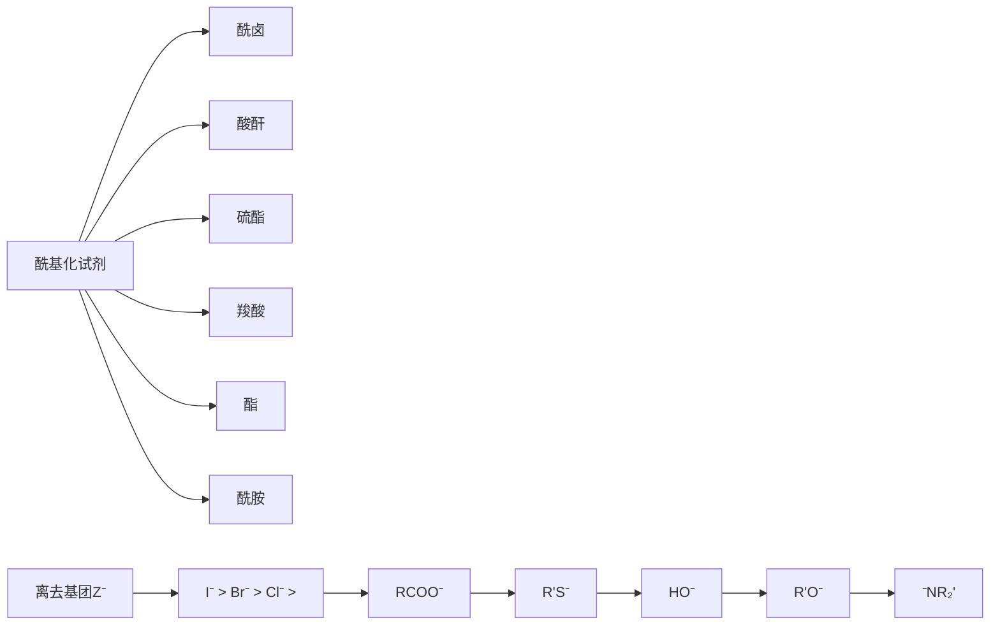
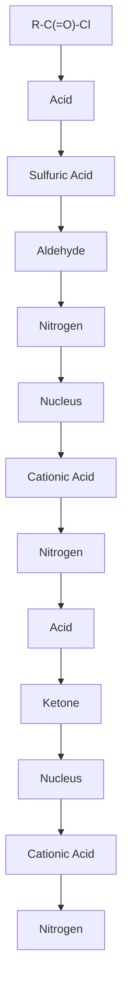
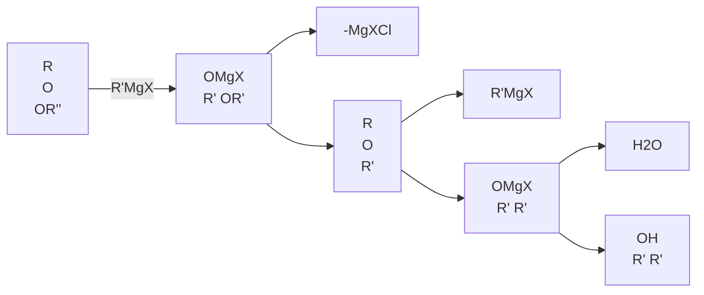
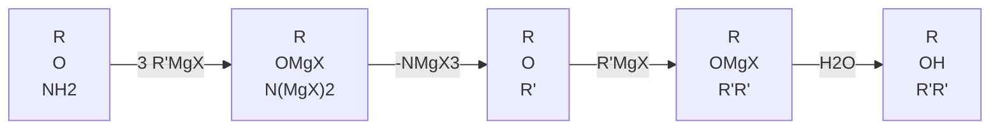

## 10.6.5 羧酸与有机金属化合物的反应

羧酸与格氏试剂反应生成羧酸镁盐。由于羧酸镁盐不溶于有机溶剂，且羧酸镁盐中羧羰基活性降低，因此其不会与格氏试剂进一步反应。

$$
\mathrm{RCOOH} + \mathrm{R} ^ {\prime} \mathrm{MgX} \longrightarrow \mathrm{RCOOMgX} \downarrow + \mathrm{R} ^ {\prime} \mathrm{H}
$$

羧酸与有机锂试剂反应先生成羧酸锂盐。与羧酸镁盐不同的是，羧酸锂盐在有机溶剂中的溶解性能很好，解离性能不是很高，且易接受亲核试剂对羧羰基的进攻。因此，当第二分子有机锂试剂与羧酸锂盐反应时，Lewis 酸性的锂先与氧接近，增加羧羰基碳的正电性，促使烷基向羧羰基碳进攻，形成稳定的中间体，然后水解得到酮。反应常用的有机溶剂是无水乙醚、无水四氢呋喃和无水苯等。这也是酮的有效合成方法。

chemical

Organic synthesis reaction sequence showing carboxylation of a ketone with ethyl lithium and water to form a diol compound

## 10.6.6 羧酸的还原反应

羧酸难以用催化氢化的方法还原，但可以用氢化铝锂或乙硼烷将羧酸还原成一级醇。该反应不仅产率高，而且还原不饱和酸时，碳碳双键不会被还原。

$$
\mathrm{CH} _ {2} \mathrm{COOH} \xrightarrow [ (1) \mathrm{LiAlH} _ {4} , \mathrm{Et} _ {2} \mathrm{O} ]{(2) \mathrm{H} _ {3} \mathrm{O} ^ {+}} \mathrm{CH} _ {2} \mathrm{CH} _ {2} \mathrm{OH} 88\%
$$

羧酸被亲核性较强的氢化铝锂还原时，首先形成羧酸盐，同时放出氢气；接着，羧酸盐被还原成醛，随后按照醛的还原过程还原成烷氧基铝，最后水解生成伯醇。用氢化铝锂还原羧酸常以无水乙醚、四氢呋喃为溶剂。

chemical

Reaction mechanism diagram showing aldehyde-catalyzed cyclization and reduction steps with water and aluminum ions

硼烷容易还原羧酸和酰胺，而且在有多个还原基团存在时，硼烷还原羧基的选择性很高。

chemical

Chemical reaction equation showing conversion of a cyclohexane derivative to a hydroxy carbocation using (1) BH3, THF and (2) H3O+

硼烷还原羧酸时，首先形成三酰基硼酸酯，并释放出氢气。这是反应的决速步。三酰基硼酸酯随后被硼烷还原为三烷基硼酸酯，最后水解得到一级醇。在三酰基硼酸酯中，硼原子空的 p 轨道与酰氧基共轭，致使酰羰基碳的电子密度降低。因此，三酰基硼酸酯的活性比通常的羧酸或羧酸盐的活性高，易被硼烷还原成一级醇。

flowchart

因此，硼烷与羰基氧的配位是关键。羰基氧的碱性越强，反应越容易进行。硼烷还原时，各种基团的反应性能顺序如下:

$$
- \mathrm{COOH} > \Bigg \rangle = \mathrm{O} > - \mathrm{CN} > - \mathrm{COOR} > - \mathrm{COCl}
$$

## 10.6.7 脱羧反应

在合适的条件下，一些羧酸容易发生失去二氧化碳的反应，即脱羧反应（decarboxylation）。

$$
\mathrm{R - COOH} \quad {\xrightarrow [ \triangle ]{\text {碱}}} \quad \mathrm{R-H} \quad + \quad \mathrm{CO} _ {2} \uparrow
$$

羧酸脱羧的常见反应机理有以下三种。

## 1. 环状过渡态机理

当羧酸的 $\alpha$-碳上连有不饱和键时，它一般会通过六元环状过渡态机理（cyclic transition state mechanism）脱羧。例如，由于氢键螯合（hydrogen bond chelation）作用，2,2-二甲基-3-氧亚基丁酸会形成螯合物，随后发生电子转移并脱羧，得到烯醇，再互变异构为酮。丙二酸类型化合物的脱羧反应一般按该反应机理进行。而且有些 $\beta$-酮酸的脱羧反应甚至可以在室温下进行。以丙二酸二乙酯和乙酰乙酸乙酯为原料，经烷基化和脱羧反应组合，制备羧酸和酮，这是丙二酸和 $\beta$-酮酸型化合物脱羧反应的重要用途之一。

chemical

Chemical reaction pathway showing conversion of cyclohexane to ketone via ester and alkene intermediates, with CO2 and Δ conditions indicated

## 2. 负离子机理

当羧基与强吸电子基团相连时，按负离子机理（anionic mechanism）脱羧。例如，三氯乙酸在水中解离成负离子；三个氯原子的强吸电子诱导效应使得碳碳间电子发生偏移，进而使羧基负离子上的电子偏移到碳氧之间；碳碳键异裂，释放出二氧化碳并形成三氯甲基碳负离子；三氯甲基碳负离子与水中的质子结合形成氯仿。 $\alpha$ -羰基羧酸的脱羧反应也是按碳负离子机理进行的。

$$
\mathrm{Cl} _ {3} \mathrm{C} \stackrel {\mathrm{O}} {\mathrm{C}} \mathrm{OH} \xrightarrow {- \mathrm{H} ^ {+}} \mathrm{Cl} _ {3} \mathrm{C} \stackrel {\mathrm{O}} {\mathrm{C}} \mathrm{O} ^ {-} \xrightarrow [ \mathrm{CO} _ {2} ]{\Delta} ^ {-} \mathrm{CCl} _ {3} \xrightarrow {\mathrm{H} ^ {+}} \mathrm{CHCl} _ {3}
$$

## 3. 自由基机理

羧酸盐电解脱羧生成烷基自由基，经二聚生成烷烃，这个反应称为 Kolbe（科尔贝）反应。通常使用高浓度的羧酸钠盐和铂电极，在较高的分解电压和较低的温度下，在中性或弱酸性溶液中进行电解。阳极处产生烷烃和二氧化碳，阴极处生成氢氧化钠和氢气。电解反应通过自由基机理进行:羧酸根负离子移向阳极，失去一个电子，生成羧基自由基，随后脱去二氧化碳产生烷基自由基，两分子烷基自由基偶联得烷烃。

$$
\mathrm{R} ^ {\mathrm{O}} \xrightarrow [ \text {电解氧化} ]{- \mathrm{e} ^ {-}} \mathrm{R} ^ {\mathrm{O}} \xrightarrow [ \text {羧基自由基} ]{- \mathrm{CO} _ {2}} \mathrm{R} \cdot \xrightarrow [ ]{\mathrm{R} \cdot} \mathrm{R} - \mathrm{R}
$$

Kolbe 反应在合成上非常有价值，可用于羧酸制备长碳链烷烃。例如，电解 6-氧亚基辛酸钠合成十四烷-3,12-二酮。

$$
2 \xrightarrow [ \text {电解} - 2\mathrm{CO} _ {2} ]{\text {电解}} \text {乙二醇} \quad 75\%
$$

## 10.6.8 二元羧酸的脱水、脱羧反应

二元羧酸受热易发生分解。由于两个羧基的相互位置不同，其相互作用不同，导致二元羧酸受热时，有的发生脱水反应，有的发生脱羧反应，有的发生脱水和脱羧反应。在有机反应中，有成环可能时，一般易形成五元环或六元环。这是Blanc在用各种二元酸和乙酸酐加热时所得到的实验结果，因此也称为Blanc规则。庚二酸以上的二元酸，在高温时发生分子间的失水反应，形成高分子酸酐，不易形成大于六元环的环酮。芳香二元酸也能进行上述反应。

$$
\begin{array}{c} \text {HOOCOOH} \xrightarrow [ \text {乙二酸} ]{180 ^ {\circ} \mathrm{C}} \quad \text {HCOOH} + \mathrm{CO} _ {2} \\ \text {HOOCCH} _ {2} \text {COOH} \xrightarrow [ \text {丙二酸} ]{160 ^ {\circ} \mathrm{C}} \quad \text {CH} _ {3} \text {COOH} + \mathrm{CO} _ {2} \\ \text {丁二酸} \xrightarrow [ 3 0 0 ^ {\circ} \mathrm{C} ]{\text {COOH}} \end{array}
$$

## 10.7 羧酸及羧酸衍生物酰基碳上的亲核取代反应

羧酸及羧酸衍生物的特征反应之一是酰基碳上的亲核取代反应。

chemical

Chemical reaction equation showing nucleophilic substitution of a carbonyl compound with HN and Z groups

亲核试剂Nu取代离去基团Z

与醛和酮相同的是，羧酸及羧酸衍生物具有亲电性和平面三角形的羰基碳，易与亲核试剂反应。与之不同的是，醛和酮分子中不具备离去基团，其与亲核试剂发生的是酰基碳的亲核加成反应（nucleophilic addition reaction）；而羧酸及羧酸衍生物发生的是酰基碳的亲核取代反应（nucleophilic acyl substitution reaction），这是因为其酰基上连有一个离去基团 $Z$ 。酰基碳的亲核取代反应分两步进行。在碱性或中性反应条件下，亲核试剂（HNu）首先解离为 $\mathrm{Nu}^{-}$，形成带负电荷的亲核试剂，并在羰基碳上发生亲核加成，形成四面体中间体（tetrahedral intermediate），然后消除一个离去基团 $Z^{-}$。其反应机理如下:

chemical

Chemical reaction pathway showing nucleophilic substitution of R' group to form Z group and intermediate, with H3O+ and Z⁻ reactions

位阻效应和电子效应是控制反应活性的两个重要因素。由于反应的第一步是亲核加成，形成一个带有负电荷的四面体中间体，因此原料中羰基碳的正电性越大、空间位阻越小，越有利于此步反应的发生；第二步消除反应取决于离去基团Z的性质，越易离去的基团，越利于反应的发生。可以看出，这两个步骤均能影响酰基碳亲核取代反应的综合反应速率，但亲核加成一般是该反应的决速步。

一般而言，同系羧酸衍生物发生酰基碳的亲核取代反应，位阻越小，其反应活性越高。

chemical

Chemical reaction sequence showing oxidation of a carbonyl compound to a carbonyl group

位阻效应对反应活性的影响

离去基团Z离去的难易程度与其碱性强弱有关。离去基团Z的碱性越弱，越容易离去，相应酰基化试剂的活性越强。因此，酰卤是最强的酰基化试剂，而酰胺是最弱的酰基化试剂。

flowchart

$Z^{-}$ 的离去能力

通常情况下，由于这些酰基化试剂反应活性的不同，可以由高活性的酰基化试剂制备低活性的酰基化试剂。例如，酰氯可以直接转化为酸酐、硫酯、酯和酰胺，而酰胺不能直接转化为酯、硫酯、酸酐和酰氯。因此，硫酯、酯和酰胺可以稳定存在于自然界中；而酰卤和酸酐不能长时间存在于活生物体中，因其能快速与水发生反应。比较亲核试剂（$\mathrm{Nu}^{-}$）与离去基团（$\mathsf{Z}^{-}$）的离去能力强弱，可以判断一个反应是否能发生。促使反应发生，离去基团 $\mathsf{Z}^{-}$ 的离去能力必须强于亲核试剂 $\mathrm{Nu}^{-}$ 的离去能力。

flowchart

在酸性介质中，亲核试剂（HNu）的解离受到抑制，主要以亲核性较弱的中性亲核试剂形式存在。但在酸催化条件下，酰基碳的亲核取代反应也可以进行。反应机理如下:

chemical

Chemical reaction mechanism showing protonation and quenchymalization of a zwitterionic intermediate with labeled products and electron transfer steps

首先是羰基氧原子的质子化。羧酸衍生物的羰基氧上有孤对电子，具有碱性。通过羰基氧的质子化，使氧带有正电荷，而增大氧对碳氧双键上 $\pi$ 电子和 $\sigma$ 电子的吸引力，进而使羰基碳原子上电子密度进一步降低，有利于亲核试剂（HNu）对羰基碳的亲核加成，形成四面体中间体。随后发生质子转移，取代基Z以HZ的形式作为离去基团离去，最后脱去质子，生成产物。

## 10.7.1 羧酸衍生物的醇解反应

羧酸衍生物的醇解（alcoholysis）是合成酯的重要方法，也属于酰基碳上的亲核取代反应。

## 1. 酰卤的醇解

酰卤很容易醇解，且酰卤的醇解是不可逆反应。用羧酸制备酰氯，再经酰氯醇解制备酯；虽然是两步反应，其结果往往比羧酸的直接酯化更好。通过加入氢氧化钠或三级胺如吡啶、三乙胺等碱，可有效促进反应活性弱的芳香酰卤或有位阻的脂肪酰卤与酚或三级醇的反应。反应体系中的碱能中和反应所产生的氢卤酸，也能起到催化作用。因此，酰卤是常用的酰基化试剂（acylation reagent）。

chemical

Two-step organic synthesis reaction scheme showing carboxylic acid and benzyl alcohol under different conditions with yields and reagents

## 2. 酸酐的醇解

酸酐也容易醇解，是很好的酰基化试剂。酸酐醇解得到一分子酯和一分子酸。

chemical

Chemical reaction equation showing pyridine-catalyzed cyclization of a benzyl alcohol with acetyl ether under pyridine catalyst to form a hydroxybenzene derivative.

环状酸酐（cyclic acid anhydride）醇解得到二元羧酸一某酯。

chemical

Chemical reaction equation showing acetylation of a ketone with methanol to form acetic acid and diethyl acetate

## 3. 硫酯的醇解（酰基转移反应）

硫酯中的烃硫基（$\mathrm{SR}^1$）被烃氧基（$\mathrm{OR}^2$）置换，称为硫酯的醇解，也称为酰基转移反应（acyl transfer reaction）。乙酰辅酶A（acetyl CoA）是辅酶A（coenzyme A, CoA）的乙酰化形式，是人体内的重要化学物质，也是自然界中常见的硫酯化合物之一。胆固醇（cholesterol）是一种脂类化合物，不溶于人体血液的水相环境。在酶催化下，一种脂肪酸的硫酯和胆固醇反应，生成胆固醇酯（cholesteryl ester）。胆固醇酯是胆固醇在人体内储存与传输的主要形式。

## 4. 酯的醇解（酯交换反应）

酯中的烃氧基（OR $^{1}$ ）被另一个烃氧基（OR $^{2}$ ）置换，称为酯的醇解，也称为酯交换反应（ester exchange reaction）。反应一般需要在酸（硫酸、盐酸或对甲苯磺酸等）或碱（烃氧基负离子）催化下进行。

$$
\mathrm{RCOOR} ^ {1} + \mathrm{R} ^ {2} \mathrm{OH} \xrightarrow {\mathrm{H} ^ {+} \text {或} \mathrm{R} ^ {2} \mathrm{O} ^ {-}} \mathrm{RCOOR} ^ {2} + \mathrm{R} ^ {1} \mathrm{OH}
$$

这是一个可逆反应，为了促使反应平衡向右移动，常使用过量的  $R^{2}OH$ ，或除去生成的  $R^{1}OH$ 。此反应可用于低沸点醇的酯制备高沸点醇的酯。

$$
\text {沸点/} ^ {\circ} \mathrm{C} \quad 8 0 \quad + \quad \mathrm{CH} _ {3} \mathrm{CH} _ {2} \mathrm{CH} _ {2} \mathrm{CH} _ {2} \mathrm{OH} \xrightarrow {\mathrm{H} ^ {+}} \quad \mathrm{CO} _ {2} \mathrm{CH} _ {2} \mathrm{CH} _ {2} \mathrm{CH} _ {2} \mathrm{CH} _ {3} + \quad \mathrm{CH} _ {3} \mathrm{OH}
$$

在反应过程中，应尽快将生成的甲醇除去，以提高产物收率。

维尼纶（vinylon）的主要成分是聚乙烯醇，一般通过聚乙酸乙烯酯制备。因聚乙酸乙烯酯不溶于水，不能在水中进行水解，可在碱催化条件下，用过量甲醇进行交换反应制备聚乙烯醇。

$$
\left[ \begin{array}{c} \mathrm{CH} - \mathrm{CH} _ {2} \\ \stackrel {!} {\mathrm{OCOCH}} _ {3} \end{array} \right] _ {n} \quad \xrightarrow [ \text {MeOH} ]{\mathrm{HO} ^ {-}} \quad \left[ \begin{array}{c} \mathrm{CH} - \mathrm{CH} _ {2} \\ \stackrel {!} {\mathrm{OH}} \end{array} \right] _ {n} + n \mathrm{CH} _ {3} \mathrm{COOCH} _ {3}
$$

聚对苯二甲酸乙二醇酯（polyethylene terephthalate，PET）是热塑性聚酯中最重要的品种之一，俗称涤纶（terylene）或“的确良”。它可由对苯二甲酸和乙二醇缩聚（condensation polymerization）制得，但对原料对苯二甲酸的纯度要求较高。由于对苯二甲酸的熔点高，且在水中溶解度小，提纯难度较高。因此，通过对苯二甲酸酯化反应，制备对苯二甲酸二甲酯，进而分馏提纯。提纯后的对苯二甲酸二甲酯与乙二醇共熔，在催化剂的作用下，通过酯交换反应制备 PET。

$$
n \mathrm{H} _ {3} \mathrm{CO} - \mathrm{C} - \left\langle \right\rangle - \mathrm{C} - \mathrm{OCH} _ {3} + n \mathrm{HOCH} _ {2} \mathrm{CH} _ {2} \mathrm{OH} \xrightarrow [ \Delta ]{\mathrm{Zn(OAc)} _ {2} , \mathrm{Sb} _ {2} \mathrm{S} _ {3}} \left[ \left. \mathrm{C} - \right\rangle - \left. \mathrm{C} - \mathrm{OCH} _ {2} \mathrm{CH} _ {2} \mathrm{O} \right] _ {n} \right. \tag {PET}
$$

## 10.7.2 羧酸衍生物的水解反应

羧酸衍生物及腈都能水解（hydrolysis），得到相应的羧酸产物。酰卤、酸酐、硫酯、酯、酰胺的水解在机理上有很多是相似的，也属于酰基碳上的亲核取代反应。酯水解的反应机理研究较为深入，用其加以说明，其他类推。

## 1. 酰卤的水解

酰卤很容易水解，并放热。酰卤的水解是不可逆反应，一般不需要外加催化剂。相对分子质量小的酰卤水解很猛烈，例如乙酰氯在潮湿的空气中会发烟，这是乙酰氯水解产生的氯化氢遇到空气中水的缘故。相对分子质量大的酰卤水解速率很慢，因为其在水中的溶解度很小。若加入溶剂，使酰卤和水成均相，则其水解反应能顺利进行。由于酰氯水解会产生氯化氢，在反应体系中，一般会加入碱如吡啶或氢氧化钠等除去所产的氯化氢，并抑制副反应的发生。

$$
\text {C}_6\text{H}_5\text{CH}_2\text{CH}_2\text{COCl} + \text {H}_2\text{O} \xrightarrow{\text {pyridine}} \text{C}_6\text{H}_5\text{CH}_2\text{CH}_2\text{COOH} + \text{C}_6\text{H}_5\text{N} \cdot \text{HCl} \tag{95\%}
$$

## 2. 酸酐的水解

酸酐不溶于水，与酰卤相比，其在室温下水解很慢。若加热成均相或加入溶剂，使酰酐和水成均相，则不用酸或碱催化，酸酐的水解反应能顺利进行。甲基丁烯二酸酐用理论量的水加热至均相反应，放置、固化，可得2-甲基顺丁烯二酸。

chemical

Chemical reaction equation showing oxidation of a cyclic ketone to form a diol with 94% yield

## 3. 硫酯的水解

碱性条件下，硫酯水解产生一分子羧酸盐和一分子硫醇，发生了酰硫键的断裂。

chemical

Chemical reaction scheme showing conversion of a benzothiazole derivative under KOH/EtOH at 80°C for 30 hours to form a ketone with 68% yield.

## 4. 酯的水解

酯水解产生一分子羧酸和一分子醇，发生了酰氧键的断裂。

$$
\mathrm{RCOOR} ^ {\prime} + \mathrm{H} _ {2} \mathrm{O} \rightleftharpoons \mathrm{RCOOH} + \mathrm{R} ^ {\prime} \mathrm{OH}
$$

酯的水解反应是酯化反应的逆反应，最后也会达到反应平衡。相比于酰氯和酸酐，酯的水解反应需要在酸或碱催化条件下进行，且常用碱作催化剂，促使反应转化完全。酯水解反应机理可分为以下三种

（1）酯的碱性水解机理 在碱性条件下，酯水解为羧酸盐和醇。

$$
\mathrm{RCOOR} ^ {\prime} + \mathrm{NaOH} \longrightarrow \mathrm{RCOONa} + \mathrm{R} ^ {\prime} \mathrm{OH}
$$

该类酯水解反应的反应机理如下:

chemical

Chemical reaction mechanism showing oxidation of a ketone to form an intermediate and then to form an alcohol

$\mathrm{HO}^{-}$ 是强的亲核试剂，容易对酯羰基进行亲核加成，形成四面体中间体，然后消除 $\mathrm{^{\prime}OR^{\prime}}$ ，这两步反应均是可逆的。在四面体中间体上消除 $\mathrm{HO}^{-}$，回到酯；消除 $\mathrm{^{\prime}OR^{\prime}}$ ，得到羧酸。由于反应是在碱性条件下进行，羧酸可以和碱发生中和反应，得到稳定的羧酸盐，进而促使反应平衡向右移动。此时，碱不仅是催化剂，而且还是反应试剂。因此，酯的碱性条件水解一般需要使用过量的碱。

同位素标记实验（isotope labeling experiment）证明:碱性条件下，酯在 $\mathrm{H}_2^{18}\mathrm{O}$ 中部分水解，可以得到一个 $^{18}\mathrm{O}$ 标记的羧酸和一个 $^{18}\mathrm{O}$ 标记的酯，也可得到两个 $^{18}\mathrm{O}$ 标记的羧酸。这表明:① 酯的水解，发生了酰氧键（acyl-oxygen bond）的断裂；② 所形成四面体中间体会发生质子转移。可以预见，与酯羰基相连的R基团为吸电子基团时，有利于增强酯羰基碳的亲电性，也可以稳定所生成的负离子，进而促进反应的发生。另外，小的空间位阻，有利于四面体中间体的形成，进而利于酯的水解反应。

chemical

Chemical reaction mechanism diagram showing quaternary and trioxide ring transformations in a cyclic system

（2）酯的酸性水解机理 酯的水解反应也可以在酸性条件下进行。其反应机理与在酸性条件下羧酸的酯化反应相似。由于这是一个可逆反应，反应体系中存在大量水时，可有效促使反应平衡正向移动，完成酯的水解反应。

chemical

Reaction mechanism diagram showing protonation and quenching reactions of carboxylic acid to form a ketone intermediate in four-dimensional intermediate body

与酯的碱性水解不同的是，与酯羰基相连的R基团为吸电子基团时，它会降低酯羰基氧的电子密度，不利于酸对酯的质子化过程。与之相同的是，它也能增强羰基碳的亲电性。

（3）$3^{\circ}$ 醇酯的酸性水解机理 空间位阻效应也能显著影响酯的水解反应历程。同位素标记实验表明，在酸催化下，$3^{\circ}$ 醇酯的水解，是通过烷氧键（alkyl-oxygen bond）断裂的机理进行的，不是酰氧键的断裂。

$$
\mathrm{H} _ {3} \mathrm{C} ^ {\mathrm{O}} \stackrel {{\mathrm{O}}} {{\mathrm{C}}} _ {1 8 \text {O}} - \mathrm{C} (\mathrm{CH} _ {3}) _ {3} + \mathrm{H} _ {2} \mathrm{O} \xrightarrow {\mathrm{H} ^ {+}} \mathrm{H} _ {3} \mathrm{C} ^ {1 8} \stackrel {{\mathrm{O}}} {{\mathrm{C}}} _ {\mathrm{OH}} + (\mathrm{CH} _ {3}) _ {3} \mathrm{C} - \mathrm{OH}
$$

反应机理:

chemical

Chemical reaction equation showing the formation of (CH3)3C+ from aldehyde and its deprotonated form

酸质子化  $3^{\circ}$  醇酯后形成三级碳正离子  $(\mathrm{CH}_{3})_{3}\mathrm{C}^{+}$  和羧酸。随后发生  $S_{N}1$  反应，三级碳正离子  $(\mathrm{CH}_{3})_{3}\mathrm{C}^{+}$  更易与碱性较强的水结合生成  $3^{\circ}$  醇，不易与羧酸的羰基氧结合。

## 5. 酰胺的水解

酰胺可以水解为羧酸（羧酸盐）和氨（胺），但绝大多数情况下，反应条件剧烈，需要在强酸或强碱的作用下，长时间回流才能完成。

chemical

Two-step organic synthesis reaction scheme showing benzene ring conversion under HCl and CO2, yielding 80% and 95% products respectively

酸催化时，酸除了使酰胺羰基质子化外，还将体系中生成的胺或氨转化为铵盐，促使反应平衡向水解方向移动。碱催化时，强亲核性的  $HO^{-}$ 进攻酰胺羰基碳，同时将产生的羧酸转化为羧酸盐。

对于有空间位阻的酰胺，较难水解。如果用亚硝酸钠处理，由亚硝酸（HONO）中的亚硝酰正离子（${}^{+}\mathrm{NO}$）将难离去的 $-\mathrm{NH}_2$ 基团转化为重氮基团（$-\mathrm{N}_2^+$），离去氮气（$\mathrm{N}_2$），酰基碳正离子与水结合，再失去质子得到羧酸。

chemical

Chemical reaction equation showing acetylation of aniline under sulfuric acid and water conditions to yield 80% alcohol

反应机理:

chemical

Chemical reaction pathway showing protonation and reduction steps of a ketone compound

因具有环张力，青霉素（盘尼西林，Penicillin）及  $\beta$ -内酰胺衍生物的酰胺键易被水解而开环。因此，一些  $\beta$ -内酰胺衍生物不能被注册为口服药物，因其易被胃酸分解而失去药效。

由于具有环张力，青霉素等也易被细菌糖肽转肽酶（glycopeptide transpeptidase）中亲核的OH基团进攻开环，致使细菌糖肽转肽酶失活，终止细胞壁构建，进而杀死细菌。由于哺乳动物细胞结构的不同，青霉素对其不产生影响。

chemical

Chemical reaction equation showing β-丙酰胺 (ring strength) reacting with H₂O to form a cyclic product with protonated hydrogen.

## 6. 腈的水解

在酸或碱的催化下加热，腈可以水解为酰胺，酰胺再进一步水解为羧酸。通过控制反应条件，腈水解可以得到酰胺产物。

$$
\mathrm{R} - \equiv \mathrm{N} + \mathrm{H} _ {2} \mathrm{O} \xrightarrow [ \Delta ]{\text {酸或碱}} \left[ \begin{array}{c} \mathrm{O} \\ \mathrm{R} ^ {\prime} \mathrm{C} = \mathrm{NH} _ {2} \end{array} \right] \xrightarrow [ \Delta ]{\text {酸或碱}} \begin{array}{c} \mathrm{O} \\ \mathrm{R} ^ {\prime} \mathrm{C} = \mathrm{OH} \end{array}
$$

酸催化腈水解的机理:

chemical

Reaction mechanism diagram showing protonation and deprotonation steps of a carbocation intermediate

酸性条件下，腈基与酰羰基类似，首先质子化腈基氮原子，进一步提高腈基碳原子的亲电性，随后与水发生亲核加成反应，脱去质子后得酰胺的互变异构体。在酸性条件下，酰胺可继续水解得到羧酸。

碱催化腈水解的机理:

chemical

Chemical reaction pathway showing hydrolysis of amine to form an amino acid and subsequent rearrangement with H2O

$\mathrm{HO}^{-}$ 是强的亲核试剂，进攻腈基碳，然后从水中夺取质子后，得酰胺的互变异构体。在碱性条件下，酰胺可继续水解得到羧酸盐，酸化得羧酸。

## 10.7.3 羧酸衍生物的胺（氨）解反应

羧酸衍生物的胺（氨）解（aminolysis）是制备酰胺的常用方法。由于胺（氨）的亲核性比水的亲核性大得多，羧酸衍生物的胺（氨）解反应可以在水中进行。

## 1. 酰卤的胺（氨）解

酰氯很容易与氨、1°胺或2°胺反应形成1°、2°、3°酰胺。该反应通常需要在碱性条件下进行，常用的碱有氢氧化钠、吡啶、三乙胺等。该反应也可以2当量的氨或胺为原料，其中一当量的氨或胺作为亲核试剂，取代酰氯中的卤原子形成酰胺产物；另一当量的氨或胺作为碱，与反应产生的卤化氢副产物形成铵盐。N,N-二乙基-3-甲基苯甲酰胺（DEET）是一种被广泛使用的高效无毒驱蚊剂。

chemical

Chemical reaction scheme showing synthesis of N,N-dimethyl-3-methylpropanoate (DEET) from carboxylic acid and 2NH3, yielding 83% and 85% respectively

## 2. 酸酐的胺（氨）解

常用的酸酐是乙酸酐。与乙酰氯相比，乙酸酐较不易水解。酸酐与胺反应，除产生酰胺外，还有一分子羧酸。对乙酰氨基酚（acetaminophen），又称扑热息痛，是镇痛和治疗发热的主要药物之一。

chemical

Chemical reaction equation showing hydroxybenzene reacting with (CH3CO)2O to form a benzene derivative, then producing ethylamine and methanol.

## 3. 酯的胺（氨）解

酯的胺（氨）解是酯与胺（氨）反应生成酰胺的反应。其中，胺（氨）作为亲核试剂，进攻酯羰基碳，得到酰胺产物。肼和羟胺等胺的衍生物也能与酯发生类似的反应，其中肼与酯的反应称为酯的肼解（hydrazinolysis）。

chemical

Chemical reaction equation showing ethyl ester reacting with ethylamine to form a ketone, yielding 90% product

chemical

Chemical reaction equations showing the synthesis of N-羟基酰胺 from acetoacetate and ethylamine under different conditions

»问题 10-4 完成下列反应，写出主要反应产物。

(1)

chemical

Chemical reaction showing chloroacetate reacting with a pyridine derivative to form an amino group

(2)

chemical

Chemical reaction equation showing condensation of a benzene derivative with an ester under NaOH/H2O and H3O+ conditions

»问题 10-5 写出下列反应的反应机理。

chemical

Chemical reaction showing conversion of a diol to a ketone using TsOH in methanol

## 10.7.4 羧酸衍生物与有机金属化合物的反应

有机金属化合物如格氏试剂（RMgX）、有机锂试剂（RLi）、有机铜锂试剂（ $R_{2}CuLi$ ）、有机镉试剂（ $R_{2}Cd$ ）等作为亲核试剂，容易与羧酸及羧酸衍生物发生反应。

## 1. 酰卤与有机金属化合物的反应

酰氯的羰基非常活泼，与格氏试剂、有机锂试剂反应首先发生加成-消除反应生成酮，但酮也易与有机金属化合物（格氏试剂、有机锂试剂）反应生成醇。若用2当量以上的格氏试剂或有机锂试剂，则主要产物为三级醇。

chemical

Chemical reaction pathway showing magnesium chloride conversion to a chlorinated alkene and subsequent ring-opening formation

酰氯的反应活性比酮的反应活性高很多，因此在酰氯过量且反应温度较低的条件下，反应可以停留在酮的阶段。例如，苯甲酰氯与2当量的乙基格氏试剂反应，水解后得到3-苯基戊-3-醇；低温条件下，乙酰氯与等当量正丁基格氏试剂反应，水解后得到己-2-酮。

chemical

Two-step organic synthesis reaction scheme showing chlorination and deacetylation steps with reagents and yields

有机铜锂试剂的反应活性不如格氏试剂，它可与酰卤、醛反应，但与酮反应很慢。而且在低温条件下，很多官能团如酯基、卤素、氰基等不能与其反应。因此，有机铜锂试剂常用于从酰氯合成酮，而且反应产率很高。需要说明的是，有机铜锂试剂与酰氯合成酮的反应，其反应机理通常是铜原子氧化加成，最后还原消除，即涉及氧化加成-还原消除过程，不是简单的有机铜锂试剂对酰羰基的亲核加成-消除历程。

chemical

Chemical reaction equation showing chlorination of a ketone using Me2CuLi catalyst in Et2O at 78°C, yielding 91% product

有机镉试剂（organocadmium reagent）反应活性较低，但易与酰氯反应，与酮反应很慢，因此可用于酮的合成。利用有机镉试剂能与酰氯反应，而不与酯基发生反应，可以用其合成酮酯（ketonic ester）。但有机镉试剂毒性太大，这限制了它的应用。

chemical

Chemical reaction equation showing conversion of a chloroalkane to an ethyl ester using Et2Cd in benzene, yielding 88% product

## 2. 酸酐与有机金属化合物的反应

酸酐与有机金属化合物反应时，酸酐的一部分会被浪费掉，致使反应的原子利用率较低，因此一般不采用该反应进行合成。但二元酸的酸酐不存在该问题，它们与格氏试剂反应可制备酮酸（ketonic acid）。

chemical

Chemical reaction equation showing the synthesis of a benzene derivative from a magnesium bromide and a cyclic ketone

## 3. 酯与有机金属化合物的反应

酯易与格氏试剂、有机锂试剂反应。它们首先发生加成-消除反应生成酮，但酯羰基的反应活性比酮羰基的差，因此生成的酮会优先与体系中的有机金属化合物反应，得到叔醇产物。所以反应难以停留在酮为产物的阶段。该反应常用于合成具有两个相同烃基的叔醇。

flowchart

## 4. 酰胺与有机金属化合物的反应

酰胺能与有机金属化合物反应，但对于氮上有活泼氢的酰胺，这些活泼氢会优先和有机金属化合物反应，然后发生亲核加成。因此，酰胺与有机金属化合物的反应，会消耗较多的有机金属化合物，从而降低其合成价值。

flowchart

## 5. 腈与有机金属化合物的反应

腈与有机金属化合物反应生成酮。

chemical

Chemical reaction equation showing the formation of a carbonyl compound from R-≡N and R'MgX

»问题 10-6 完成下列反应，写出主要反应产物。

## 10.7.5 羧酸衍生物的还原反应

## 1. 催化氢化还原

一般情况下，酰卤催化加氢还原首先生成醛，随后进一步加氢得到醇。如果使用部分毒化的钯催化剂，例如硫酸钡毒化的钯催化剂，则可以高收率得到醛。这个反应叫作 Rosenmund 还原，是制备醛的重要方法之一。

chemical

Chemical reaction equation showing chlorination of a naphthalene derivative using Pd/BaSO4/H2 in喹啉

在高温、高压条件下，以铜或亚铬酸铜等为催化剂，酯经催化氢化还原生成伯醇。苯环可兼容于催化加氢过程中。

chemical

Organic reaction equation showing benzene derivative reacting with hydrogen under copper catalysis to form a substituted phenol alcohol

腈较易发生催化加氢反应生成伯胺。

chemical

Chemical reaction equation showing synthesis of 97% isocyanate from NC(CH₂)₄CN and H₂ under Ni/C₂H₅OH catalyst at 70–90°C for 2–3 MPa

## 2. 金属氢化物还原

羧酸及羧酸衍生物可被金属氢化物（metal hydride）还原成伯醇、醛或胺。常用的金属氢化物有氢化铝锂（$\mathrm{LiAlH_4}$）、硼氢化钠（$\mathrm{NaBH_4}$）和硼烷（$\mathrm{BH_3}$）。其中氢化铝锂的还原能力最强，适用于各种羧酸及其衍生物的还原。它不仅能将醛、酮、羧酸、酰氯、酯还原为伯醇，还能将酰胺还原为胺。使用氘代氢化铝锂（$\mathrm{LiAlD_4}$）还原时，能有效引入同位素氘。同位素标记策略被广泛应用于反应机理研究。