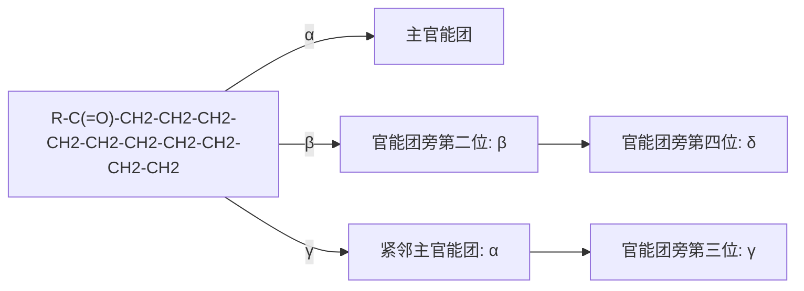
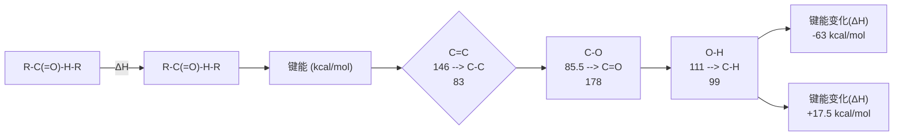
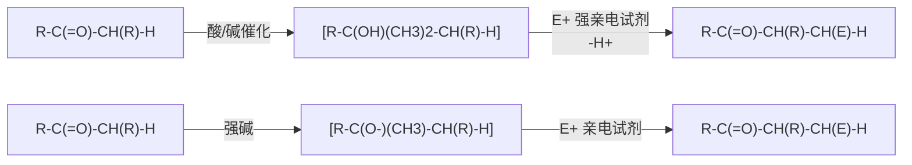
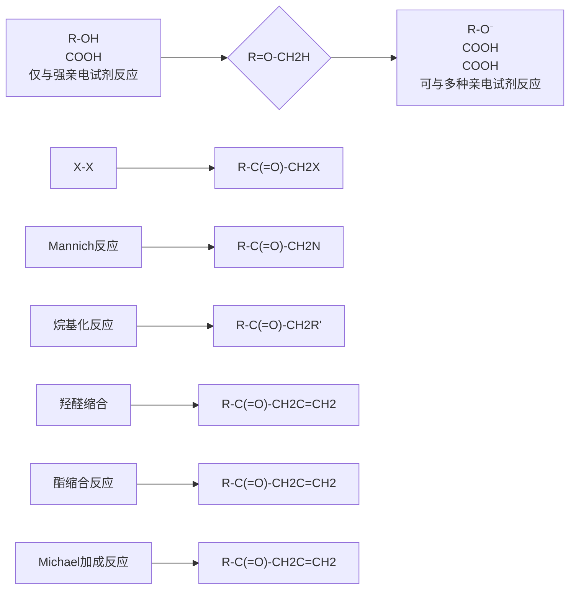

碳酸甲乙酯

碳酸乙烯酯

碳酸丙烯酯

氟代碳酸乙烯酯

## 习题

1. 用系统命名法命名下列化合物。

(1)

(2)

(3)

(4)

(5)

(6)

(7)

(8)

(9)

2. 回答下列问题。

（1）羧酸溶解于  ${}^{18}O$  标记的水（ $H_{2}{}^{18}O$ ）中，羧酸的两个氧原子均能被  ${}^{18}O$  标记，试解释其原因。

（2）在氢氧化钠水溶液中，烷基丙酸酯发生皂化反应的反应速率顺序如下所示，试解释其原因。

chemical

Four organic ketone structures showing different functional groups and stereochemistry

（3）羧酸和三氟乙酸酐反应得到非对称的酸酐，它随后与醇反应得到酯和三氟乙酸。为什么该反应不会得到三氟乙酸酯和羧酸？试解释其原因。

chemical

Chemical reaction equation showing esterification of aldehyde to form CF3 and then to form CF3CO2H

（4）乙酸中有乙酰基团（$\mathrm{CH}_3\mathrm{CO}-$），为什么乙酸不能发生碘仿反应？
（5）试比较酰氯和酰胺中  $\alpha-$  氢的酸性，并说明理由。
（6）比较下列化合物碱性，并说明理由。

chemical

Three chemical structures: amine, imide, and pyrrolidine with a ketone group

3. 完成下列反应式。

chemical

Chemical reaction equation showing a cyclic ester compound reacting with H3O+ to yield an unknown product

chemical

Chemical reaction equation showing phenyl carbonyl reacting with acetone under NaH and H3O conditions to yield phenyl isocyanate

chemical

Chemical reaction equation showing acetylation of a benzene derivative with acetyl group under pyridine and hydroxyl conditions

chemical

Chemical reaction scheme showing t-Bu-catalyzed transformation of a cyclic ether with PhCO2Na and DMF/Δ, followed by NaOH/H2O to yield product

chemical

Chemical reaction equation showing condensation between Boc-NH-CH(OH)-CH2-Ph and a pyrrolidine derivative under DCC/THF conditions

chemical

Chemical reaction equation showing brominated to carboxylic acid under SOCl₂ conditions

chemical

Chemical reaction equation showing chloroacetamide reacting with LiAlH4 and H3O+ to yield a product

chemical

Chemical reaction equation showing a ketone compound reacting with LiAlH4 and H3O+ to produce an unknown product.

chemical

Chemical reaction equation showing acetylation of aniline with pyridine under THF catalyst

chemical

Chemical reaction equation showing esterification of a ketone with ethyl ether under ethylamine catalysis

chemical

Chemical reaction equation showing bromination of a substituted indole derivative under basic conditions

chemical

Chemical reaction equation showing chloroacetate reacting with acetylamine to produce ammonia and another product

chemical

Chemical reaction equation showing hydroxybenzene reacting with carboxylic acid to form a ketone

4. 推测下列反应的可能机理。

chemical

Chemical reaction equation showing t-Bu-O-Cl reacting with NaN3 to form t-Bu-O-N3 and NaCl

chemical

Chemical reaction equation showing oxidation of a cyclic ester to form a cyclohexanone derivative

chemical

Chemical reaction equation showing oxidation of a ketone to form an aldehyde

chemical

Chemical reaction equation showing condensation of an amino acid with a ketone to form a hydroxyamine derivative and 2CH3CH2OH

(5) 二苯乙醇酸重排反应 (benzilic acid rearrangement):

chemical

Chemical reaction equation showing conversion of a ketone to a hydroxy ketone using NaOH and H2O under acidic conditions

（6）酸催化，扁桃酸与苯酚的反应:

chemical

Chemical reaction equation showing phenol-catalyzed cyclization and subsequent methylation of a benzene derivative

5. 从简单易得的原料和必要的有机、无机试剂合成下列化合物。

（1）布他西丁（Butacetin）是一种镇痛药物。试从商业可得的对硝基氟苯出发合成布他西丁。

chemical

Chemical reaction showing nitrobenzene reacting with a benzyl ether under conditions to form propyl ether (布他西丁)

（2）N,N-二乙基-3-甲基苯甲酰胺（DEET）是一种被广泛使用的高效无毒驱蚊剂。试从商业可得的3-溴甲苯出发合成DEET。

chemical

Chemical reaction showing brominated to N,N-diethyl-m-toluamide (DEET) under heating conditions

（3）二硝托胺是一种既能预防又有治疗效果的抗球虫药。试从商业可得的邻甲基苯甲酸出发合成二硝托胺。

chemical

Chemical reaction showing conversion of a benzoyl alcohol to a nitro-substituted benzamide derivative

二硝托胺

（4）褪黑素（Melatonin）是由脑松果体分泌的激素之一。试从5-羟色胺出发合成褪黑素。

chemical

Chemical reaction showing melatonin formation from a fused heterocyclic compound

（5）由苯出发，选用必要试剂，合成以下分子。

chemical

Chemical reaction showing benzene reacting with a thioether compound to form a sulfonyl group

（6）由环戊醇出发，选用必要试剂，合成以下分子。

chemical

Chemical reaction showing hydroxyl group reacting to form a cyclic ketone with two carbonyl groups

（7）由对羟基苯甲酸甲酯出发，选用必要试剂，合成以下液晶分子。

chemical

Chemical reaction equation showing conversion of a hydroxybenzoic acid derivative to a cyclic ester with methoxy and methyl substituents

(本章编者 竺传乐、江焕峰)

本章习题
参考答案

## 第十一章

## 羰基 $\alpha$-碳上的反应

11.1 羰基化合物  $\alpha-$  氢的性质 …… 102
11.2 经由烯醇中间体的反应 …… 112
11.3 经由烯醇负离子中间体的反应 · 117

11.4 经由烯醇硅醚和烯胺的反应 … 133
习题 138

在第九、十章的学习中，我们了解到羰基化合物（包括醛、酮、羧酸及其衍生物）属于典型的亲电试剂，其羰基部分易于接受亲核试剂的进攻。同时，在羰基的相邻位置（$\alpha$ 位）具有氢原子的羰基化合物也可以在一定条件下被转化为亲核试剂，与亲电试剂发生反应，这种反应称为羰基 $\alpha$-碳上的反应。这类反应适用于在羰基化合物的 $\alpha$ 位形成新的碳-碳键和碳-杂原子键，是有机合成化学中最常用的反应之一。本章主要讨论含有 $\alpha$-氢的羰基化合物通过形成两类关键中间体——烯醇和烯醇负离子——发生亲核取代和加成反应的性质。

flowchart

对于含有羰基的化合物，化学家们习惯用希腊字母描述每个碳原子与羰基的邻近程度。羰基基团本身不编号，与其紧邻的碳原子称为 $\alpha-$ 碳，次紧邻的碳原子称为 $\beta-$ 碳，再次紧邻的碳原子称为 $\gamma-$ 碳，以此类推。连接在羰基化合物 $\alpha-$ 碳上的氢原子称为羰基化合物的 $\alpha-$ 氢，本章探讨在羰基化合物 $\alpha$ 位发生的反应。

## 11.1 羰基化合物  $\alpha-$  氢的性质

羰基化合物  $\alpha-$  氢的酸性大大强于普通烷烃中氢原子的酸性。我们要学习的羰基化合物  $\alpha-$  碳上的反应与这一特点紧密相关。

## 11.1.1 羰基化合物 $\alpha$-氢的酸性

在第一章中，我们学习了有机化学中的酸碱理论。对于羰基化合物中  $\alpha-$  氢的酸性，我们可以用以下平衡表示:

chemical

Chemical reaction equation showing conversion of aldehyde to alkene and then to form products A and B

羰基化合物脱去质子形成羰基  $\alpha$  位碳负离子 A，其共振结构可以表示为 B，被称为烯醇负离子（enolate）。反应的平衡常数  $K_{a}$  可以表征羰基化合物  $\alpha-$  氢的酸性。通过结构分析可知，具有吸电子作用的羰基可以通过共轭效应和诱导效应稳定邻位的负电荷，因此羰基  $\alpha$  位 C-H 键的酸性远大于其他位置 C-H 键的酸性。

通过比较常见羰基化合物及其他酸性物质的 $\mathrm{pK_a}$ 数据，可以对羰基 $\alpha$ 位C-H键的酸性产生直观的印象。表11-1中给出了水中和二甲亚砜（DMSO）中的两组 $\mathrm{pK_a}$ 数据。

表 11-1 羰基化合物及相关有机物的 $\mathrm{pK}_{\mathrm{a}}$ 数据

| 化合物 |  |  |  |  |  |  |  |
| --- | --- | --- | --- | --- | --- | --- | --- |
| $pK_a(H_2O)$ | 16.7 | 19.3 | 16.7 | 24.5 | 29.4 | 28.9 | 10.2 |
| $pK_a(DMSO)$ | — | 26.5 | 25.8 | 29.5 | — | 31.3 | 17.2 |

同一种化合物在水中测得的  $pK_{a}$  与在有机溶剂中测得的  $pK_{a}$  往往有较大的差别。在水中，一般羰基化合物的  $pK_{a}$  在 16～29，说明羰基化合物  $\alpha-$  氢的酸性远强于普通烷烃中 C-H 键的酸性（ $pK_{a}\sim40$ ），一般弱于醇的酸性（ $pK_{a}=15\sim19$ ）。在 DMSO 中情况有所不同，羰基化合物  $\alpha-$  氢的酸性（ $pK_{a}=26\sim30$ ）略高于醇的酸性（ $pK_{a}=29\sim32$ ）。

可以将羰基 $\alpha$ 位C-H键看作一种“碳氢酸”，它与我们学习过的醇、酚、羧酸分子中的O-H键所代表的“氧氢酸”具有一定的相似性。值得注意的是，腈和硝基烷烃的 $\alpha$-氢同样具有酸性，它们与羰基化合物的 $\alpha$-碳具有相似的反应性。

当羰基化合物 $\alpha$ 位连接其他吸电子基团时，其酸性会进一步增强。例如，1,3-二羰基化合物的酸性与单羰基化合物相比可以提高几个数量级，相应的烯醇负离子更易形成。这一性质可以通过烯醇负离子的稳定化作用来解释:

chemical

Reaction mechanism diagram showing protonation and deprotonation steps with associated pKa values

1,3-二羰基化合物脱除  $\alpha$ -氢后形成的负离子可以被两个羰基共同稳定，可以看作负电荷分布在两个氧原子和一个碳原子上，因此比单羰基化合物  $\alpha$  位碳负离子更为稳定。以下是常见羰基化合物及其类似物的酸度系数范围（参考水中的数据）。

chemical

Chemical structures of various compounds including nitrobenzene, 1,3-dinitrophenyl, aldehyde, phenol, and acrylonitrile with their respective pKa values.

## 11.1.2 酮式-烯醇式互变

在羰基化合物解离的平衡式中，我们可以发现烯醇负离子是一种两位负离子（ambident anion），具有负电荷分布在碳上和分布在氧上两种共振结构。烯醇负离子在酸碱平衡中获得质子时，既可以在  $\alpha-$  碳上发生质子化回到羰基化合物，也可以在氧上发生质子化，形成烯醇（enol）。

chemical

Reaction mechanism diagram showing oxidation of aldehyde to form aldehyde and then to alcohol, with H⁺ and H⁻ conditions indicated

通过上述平衡，羰基化合物与相应的烯醇发生互变异构，具有  $\alpha-H$  的羰基化合物及其烯醇形式互为互变异构体（tautomeric isomer）。实际上，形成上述平衡后羰基化合物的酮式与烯醇式一般共同存在。

对于一种羰基化合物酮式与烯醇式的稳定性，可以通过键解离能（bond dissociation energy，BDE）数据进行粗略估算（这里仅考虑了焓而忽略了熵的贡献）:

flowchart

由上式可见，由烯醇式变为酮式，体系的总键能增大，说明酮式比烯醇式更为稳定。这一能量差将导致酮式-烯醇式平衡强烈倾向酮式一方，因此，在酮式-烯醇式平衡中烯醇式仅占很小的比例。事实上，实验结果表明大部分常见羰基化合物以酮式为主要存在形式，烯醇式的比例一般在0.1%以内，如表11-2所示。

表 11-2 一些羰基化合物的酮式-烯醇式平衡

<table><tr><td></td><td></td></tr><tr><td>K = 0.27</td><td>K = 99</td></tr></table>

从数据可以看出，一般而言  $\alpha-$  氢酸性越强的羰基化合物在酮式-烯醇式平衡中烯醇式的含量越高。其他可以稳定烯醇式的结构因素也会使酮式-烯醇式平衡向烯醇式移动，主要包括:① 烯醇碳碳双键上带有更多的取代基；② 烯醇的碳碳双键与其他基团共轭；③ 烯醇与其他基团形成分子内氢键。1,3-二羰基化合物的烯醇式含量显著高于单羰基化合物的烯醇式含量，是由于共轭效应和形成分子内氢键。

接下来分析羰基化合物酮式-烯醇式互变的机理。研究发现，这个互变异构可以在微量的碱或酸催化下进行。

以丙酮的酮式-烯醇式互变为例，碱催化的机理可以写成以下形式（以 $\mathrm{HO}^{-}$ 为催化剂）:

chemical

Chemical reaction mechanism showing hydrogen bonding and protonation steps between a ketone and an alkene

在第一步中，羰基化合物的 $\alpha$ 位被碱（$\mathrm{HO}^{-}$）去质子化形成烯醇负离子并同时生成 $\mathrm{H}_2\mathrm{O}$；随后烯醇负离子与前一步生成的 $\mathrm{H}_2\mathrm{O}$ 作用质子化形成烯醇，并重新生成 $\mathrm{HO}^{-}$。在这个过程中 $\mathrm{HO}^{-}$起到催化剂的作用，因此被称为碱催化的烯醇形成机理。

酸催化的机理可以写成以下形式（以  $H_{3}O^{+}$  作为催化剂）:

chemical

Hydrolysis reaction mechanism of acetic acid showing protonation and deprotonation steps

在第一步中，羰基首先被质子化，形成具有羟基稳定的碳正离子共振结构的活性中间体，其  $\alpha$  位的酸性显著增强。随后，这一质子化中间体羰基  $\alpha$  位去质子化形成烯醇，重新形成  $H_{3}O^{+}$ 。在这个过程中  $H_{3}O^{+}$ 起到催化剂的作用，因此被称为酸催化的烯醇形成机理。

在酸催化和碱催化的酮式-烯醇式异构化中都涉及相同的两个步骤——羰基的质子化和 $\alpha$ 位的去质子化，这两种机理的区别在于两个步骤的先后顺序。在碱性条件下，第一步是 $\alpha$ 位的去质子化，形成一个带负电荷的中间体；在酸性条件下，第一步是羰基的质子化，形成一个带正电荷的中间体。

在室温下，碱或酸催化的酮式-烯醇式异构化进行得非常迅速。即使体系中没有特意加入的碱或酸作为催化剂，羰基化合物仍会被盛放玻璃容器表面吸附的微量酸或碱催化而发生这种异构化。因此，在一般情况下羰基化合物会建立酮式-烯醇式的动态平衡，形成以更稳定异构体为主的混合物。烯醇异构体通常只少量存在，但它与相应的羰基化合物相比非常活泼，其 $\alpha$ 位具有亲核性，我们将会在11.2节中进行介绍。

虽然上述平衡反应可以看作一个异构化过程，但烯醇-OH基团中的质子并不一定来源于羰基化合物脱去的 $\alpha$-氢。因此，可以利用羰基化合物的酮式-烯醇式平衡，通过向体系中添加重水将其转化为 $\alpha$ 位氘代的羰基化合物。

$$
\mathrm{CH} _ {3} ^ {\mathrm{O}} \xrightarrow [ \mathrm{K} _ {2} \mathrm{CO} _ {3} , 6 5 ^ {\circ} \mathrm{C} ]{\mathrm{D} _ {2} \mathrm{O}} \mathrm{D} _ {3} \mathrm{C} \mathrm{C} = \mathrm{CD} _ {3}
$$

同样， $\alpha$  位有立体中心的羰基化合物的酮式-烯醇式平衡会导致立体中心的消旋化。若希望在反应中避免消旋化，涉及这类羰基化合物的反应一般需要避免使用强酸和强碱性条件。

从垂直于前手性面的方向向$\mathrm{sp}^{2}$碳原子看去，将该原子所结合的三个基团按顺序规则排列，若按照从大至小的顺序为顺时针方向，则此面记为$Re-$面；反之则记为$Si-$面。

chemical

Reaction mechanism diagram showing Si and Re surface attack on a cyclohexane derivative, involving hydroxyl and water oxidation steps

## 11.1.3 烯醇负离子的形成

含有  $\alpha-$  氢的羰基化合物与碱反应，可以得到烯醇负离子。

chemical

Chemical reaction equation showing benzene ring reacting with B⁻ to form a diester under DMSO conditions

弱碱不能完全攫取羰基化合物的 $\alpha-$ 氢，形成羰基化合物与烯醇负离子的混合物。使用强碱可以使上述平衡向右移动，使羰基化合物几乎完全转化为烯醇负离子。根据不同羰基化合物 $\alpha-$ 氢的 $\mathrm{p}K_{\mathrm{a}}$ 和强碱共轭酸的 $\mathrm{p}K_{\mathrm{a}}$ （表11-3），可以选择从羰基化合物形成烯醇负离子所需的碱。

表 11-3 常见碱及其共轭酸的 $\mathrm{p}{K}_{\mathrm{a}}$ 数据

| 碱 | NaOH | NaOEt | KO'Bu | NaH | $^i\mathrm {Pr}_2\mathrm {NLi}$ | $\mathrm {NaNH_2}$ |
| --- | --- | --- | --- | --- | --- | --- |
| 共轭酸 | $H_2O$ | EtOH | $^tBuOH$ | $H_2$ | $^i\mathrm {Pr}_2\mathrm {NH}$ | $NH_3$ |
| $pK_a(H_2O)$ | 15.7 | 16.0 | 19.2 | ~31 | ~36 | ~34 |
| $pK_a(DMSO)$ | 31.4 | 29.8 | 32.2 | — | — | 41 |

例如，以乙醇钠作为碱时，酮的  $\alpha$  位攫氢反应一般不能进行完全，会形成酮与相应烯醇负离子的平衡混合物；使用具有更强碱性的  ${}^{i}Pr_{2}NLi$  作为碱，或使用 NaH、KH 作为碱，使攫氢后生成的  $H_{2}$  离开反应体系，攫氢反应将不可逆地发生，将羰基化合物完全转化为烯醇负离子。

chemical

Chemical reaction mechanism showing carbocation and reduction of a ketone to form a lithium complex with hydrogen release

氨基金属化合物是最常用的强碱之一，下面列出了几种代表性氨基金属强碱的结构和名称缩写。它们的碱性相当，性状和在有机溶剂中的溶解度有所不同，常用于有机合成反应中。

chemical

Three lithium-based metal complexes with labeled ligands: LDA, LTMP, and KHMDS

对于酸性较强的羰基化合物，使用醇钠或醇钾等弱碱即可进行完全的攫氢反应，定量生成烯醇负离子。

由于  $\alpha$  位存在吸电性的共轭基团，这些化合物与普通羰基化合物相比酸性显著增强（上式中列出的是化合物在相应反应溶剂中的  $pK_{a}$ ）。它们在弱碱存在下即可生成稳定的烯醇负离子，在有机合成上有重要的应用（见 11.3.5 小节）。

## 11.1.4 烯醇与烯醇负离子形成的区域选择性

在前面两节中，我们学习了羰基化合物转化为烯醇与烯醇负离子两种重要的中间体。在学习它们的反应性之前，先简要讨论一下这两种中间体形成过程中的区域选择性。

例如，2-甲基环己酮形成烯醇或烯醇负离子时，烯醇或烯醇负离子可以通过攫取甲基取代碳原子上的 $\alpha$-氢形成，也可以通过攫取无甲基取代碳原子上的 $\alpha$-氢形成，这称为区域选择性。

chemical

Chemical reaction pathway showing conversion of cyclohexanol to ketone and then to cyclohexane with loss of a phenol group

烯醇或烯醇负离子形成的区域选择性决定了关键中间体的反应位点，对后续反应的结果具有重要影响。要分析这一问题，需要先判断反应由热力学控制还是动力学控制。

回顾在第一章学习过的反应势能曲线，对于反应前后吉布斯自由能变化较小的过程，反应具有可逆性，在反应条件下反应物与产物达到动态平衡。此时反应产物的分布由产物的热力学稳定性决定，这种控制方式称为热力学控制。对于反应后吉布斯自由能降低较多的过程，反应不可逆，此时反应产物的分布由相应过渡态的相对能量决定，这种控制方式称为动力学控制。

通过分析不难得出，酸、碱催化的羰基化合物酮式-烯醇式互变是一个可逆过程，其区域选择性是热力学控制的。用弱碱处理羰基化合物得到少量烯醇负离子的过程也是一个可逆的平衡过程，区域选择性同样由热力学控制。通过比较产物的热力学稳定性，可以分析得出反应的主要产物。

对于同一种羰基化合物,多取代的烯醇和烯醇负离子比少取代的烯醇和烯醇负离子更为稳定。这与烯烃的稳定性规律相同，由超共轭效应决定。因此，在热力学控制条件下，羰基化合物以生成多取代的烯醇和烯醇负离子为主。

chemical

对比烯醇与烯醇负离子的多取代和少取代稳定性，标注了不同化学形态

在低温下使用大位阻强碱攫取羰基化合物的 $\alpha$-H是不可逆的，反应单向发生，这一过程的区域选择性由动力学控制。碱攫取少取代的 $\alpha$-H时，过渡态结构中空间阻碍小，过渡态能量低，反应的能垒低；碱攫取多取代的 $\alpha$-H时，过渡态结构中空间阻碍大，过渡态能量较高，反应的能垒高。由于反应不可逆，这一过程将主要经由能垒较低的途径生成少取代的烯醇负离子。

chemical

Chemical reaction mechanism showing protonation of a ketone to form a cyclohexene derivative with δ⁻ counterion

位阻小，能垒低 $(\Delta G_{1}^{\ddagger})$

chemical

Chemical reaction mechanism showing protonation and deprotonation steps of a ketone derivative

位阻大，能垒高 $(\Delta G_{2}^{\ddagger})$

我们可以用势能图描述上述区域选择性攫氢反应（图 11-1）。需要注意的是，为确保反应由动力学控制，需要在低温下进行反应（一般为  $-78^{\circ}C$ ）以确保攫氢反应不可逆。

chemical

Chemical reaction diagram showing the formation of a ketone and its subsequent loss of alkenes, with labeled free energy changes ΔG.

图11-1 $\alpha$-甲基环己酮与碱反应形成烯醇负离子的势能曲线

一般而言，使用大位阻强碱（如 LDA）在低温下进行攫氢，反应不可逆，羰基化合物形成动力学控制的烯醇负离子；而在室温下进行攫氢反应时，反应可逆性增强，主要形成热力学更稳定的多取代烯醇负离子。基于这一规律，通过对反应条件的控制，人们可以控制羰基化合物形成烯醇负离子的区域选择性，进一步控制羰基化合物  $\alpha-$  碳上反应的区域选择性（表 11-4）。

表 11-4 控制烯醇负离子形成的区域选择性

chemical

Chemical reaction showing oxidation of a ketone to form compounds A and B under strong reagent

| 强碱 | 反应温度/°C | A:B | 区域选择性控制 |
| --- | --- | --- | --- |
| $LiN^{i}Pr_{2}$ (LDA) | 0 | 99:1 | 动力学控制 |
| $KN(SiMe_{3})_{2}$ (KHMDS) | -78 | 95:5 | 动力学控制 |
| $LiCPh_{3}$ | -78 | 90:10 | 动力学控制 |
| $LiCPh_{3}$ | 25 | 10:90 | 热力学控制 |
| NaH | 25 | 26:74 | 热力学控制 |

扩展内容:烯醇负离子形成的立体选择性

当链状羰基化合物的 $\alpha$-碳上带有其他取代基时，所形成的烯醇负离子具有立体异构体，其碳碳双键可能取不同构型。烯醇负离子的构型在立体选择性合成中是一个重要因素。例如，不同构型的烯醇负离子形成的烯醇硅醚在Lewis酸促进的羟醛缩合反应中生成具有不同相对构型的产物（参见11.4.1小节）。

chemical

Chemical reaction equation showing conversion of ester aldehyde to cis- and trans- enantiomers via strong alkene

因此，控制羰基化合物形成烯醇负离子的立体选择性很重要。研究表明，羰基化合物的结构与所使用强碱的性质决定反应的立体选择性。使用 LDA 作为强碱，羰基上取代基 R 的位阻越大越有利于 cis-构型烯醇负离子的形成；反之，trans-构型烯醇负离子为主要产物。

chemical

Chemical reaction equation showing cis- and trans-lyl isomers with R group under strong alkene at -78°C

R基团结构影响 (强碱 = LDA)

| R | cis:trans |
| --- | --- |
| Et | 30:70 |
| iPr | 60:40 |
| OMe | 5:95 |
| $NEt_2$ | >97:&lt;3 |

碱和反应条件的影响 $(\mathsf{R} = \mathsf{Et})$

| 强碱 | cis:trans |
| --- | --- |
| LiHMDS | 66:34 |
| LDA | 30:70 |
| LTMP | 14:86 |
| LTMP + HMPA | 92:8 |

对于同一种羰基化合物，使用不同的碱可以调控 cis-和 trans-产物的比例。随着氨基强碱氮原子上取代基位阻的增大，trans-烯醇负离子逐渐成为主要产物。有趣的是，使用 LTMP 和六甲基磷酰三胺（HMPA，一种  $Li^{+}$ 的良好络合剂）的组合，反应的选择性可以被翻转，生成 cis-产物为主的产物。使用上述反应条件，可以实现烯醇负离子立体构型的按需调控。

烯醇负离子形成过程中的立体选择性可由椅式六元环模型进行解释。羰基化合物与氨基锂反应时，通过形成如下图所示的六元环过渡态发生  $\alpha-$  氢原子的攫取反应。根据  $\alpha$  位取代基所处位置的不同，可形成 trans- 和 cis- 两种过渡态，分别对应于两种烯醇负离子产物。在 trans- 过渡态中，羰基取代基 R 与  $\alpha-$  碳上的甲基处于邻近位置，相互排斥；而在 cis- 过渡态中， $\alpha-$  碳上的甲基与氨基锂上的 R' 取代基具有 1,3-二直立键排斥作用。

flowchart

当 R 基团较大时，trans-过渡态中的排斥作用显著，因此反应以产生 cis-构型烯醇负离子为主；反之当 R 基团较小时，cis-过渡态中的 1,3-二直立键排斥作用占主导地位，trans-产物将成为主要产物。当加入 Li 离子络合剂 HMPA 时，反应不再通过上述六元环过渡态进行，攫氢时羰基取代基 R 与  $\alpha$ -碳取代基的排斥作用是主要的相互作用，因此反应以产生 cis-产物为主。

## 11.1.5 羰基化合物 $\alpha$-碳的反应模式

我们已经熟悉，羰基化合物可以在适当的条件下形成烯醇和烯醇负离子。羰基  $\alpha-$  碳上的反应经由这两个关键中间体发生。分析两者的结构特征，可以发现它们都具有氧原子取代的碳碳双键结构。

chemical

Chemical reaction equations showing methanol and its negative ion forming a ketone

在烯醇和烯醇负离子中，氧原子上的孤对电子与  $\pi$  键形成  $p-\pi$  共轭，羟基或氧负离子上的孤对电子向双键供电子，使得碳碳双键更富电子。根据两者的共振结构，它们的负电荷主要集中在  $\alpha$  位，此位点具有亲核性。因此，这两类中间体共同的反应模式是使用它们的  $\alpha$  位进攻亲电试剂，形成羰基  $\alpha-$  碳上的取代产物。

flowchart

烯醇与烯醇负离子的区别在于:① 烯醇负离子带有负电荷，与烯醇相比具有更强的亲核性，能与之反应的亲电试剂种类更多；② 在烯醇负离子的两种共振极限结构中，负电荷可以分别集中于碳端（ $\alpha$  位）或氧端，烯醇负离子可以分别使用这两个位点进攻亲电试剂形成相应的产物，是一种两可亲核试剂（ambident nucleophile），反应的区域选择性受亲电试剂性质的影响。

chemical

Reaction mechanism diagram showing electron transfer and oxidation steps between carbonyl and ester groups

烯醇负离子

在后续的章节中将分别介绍以烯醇和烯醇负离子为关键中间体的羰基  $\alpha-$  碳上的反应。下式中简要总结了所涉及的反应类型。

flowchart

事实上，烯醇和烯醇负离子可以与一系列亲电试剂发生取代和加成反应，生成结构多样的  $\alpha$ -官能化产物，在有机合成中具有重要的应用。

## 11.2 经由烯醇中间体的反应

羰基化合物在酸或碱的催化下可以形成烯醇中间体，之后与亲核试剂（E-X）作用，在 $\alpha$ 位发生取代反应形成C-E键，之后再脱去质子形成羰基 $\alpha$ 位取代的产物。净反应是羰基化合物与亲电试剂E-X发生反应，产生取代产物和HX。

chemical

Reaction mechanism showing weak acid/acid catalysis to form a protonated alkene with protonation steps

需要注意的是，由于大多数羰基化合物酮式-烯醇式平衡中烯醇式的含量很低，并且烯醇中间体的亲核性有限，因此需要使用活性较强的亲电试剂（如卤素、亚胺正离子等）才能发生反应。

## 11.2.1 $\alpha$-卤化反应

卤素单质常用作向有机分子内引入卤素取代基的试剂。溴和氯单质是强亲电试剂，可以与羰基化合物产生的烯醇中间体作用生成  $\alpha-$  卤代羰基化合物。醛/酮和羧酸的  $\alpha-$  卤化反应在有机合成中应用广泛，反应产生的  $\alpha-$  卤代醛/酮和  $\alpha-$  卤代羧酸可以被进一步转化为多样的  $\alpha-$  取代产物，是重要的合成中间体。

## 1. 酮的  $\alpha-$  卤化反应

在酸催化的条件下，醛和酮可以和卤素生成  $\alpha-$  卤代醛/酮。例如，环己酮的溴化反应:

chemical

Chemical reaction equation showing bromination of cyclohexenone under acidic conditions

反应可在多种溶剂中进行，例如乙酸、水、氯仿、N,N-二甲基甲酰胺等；可以使用HBr、$\mathrm{H}_2\mathrm{SO}_4$ 、TsOH等强酸作为催化剂。由于醛容易被卤素单质氧化为羧酸，酮比醛更常用于这一反应。反应的机理可以描述如下:

flowchart

首先，环己酮通过酸催化的烯醇化过程（参见11.1.2小节）形成烯醇中间体；之后富电子的烯醇中间体进攻溴单质，生成质子化的 $\alpha$-溴代环己酮；质子解离后生成 $\alpha$-溴代环己酮产物并释放出HBr。

有两个有趣的实验现象值得注意。第一，反应可以在不加入酸催化剂的情况下发生，开始反应很慢，但会逐渐加速。这是由于反应会产生强酸 HBr 作为副产物，而 HBr 可以催化烯醇中间体的生成，因此，这一反应具有自催化（autocatalytic）特性，也就是说反应产物之一即为反应的催化剂。第二，反应速率与卤素的浓度或种类无关，说明卤素没有参与这个多步反应的决速步。因此，烯醇中间体的形成是反应的决速步，反应的势能曲线如图 11-2 所示。

line

| Reaction Stage | Products |
| --- | --- |
| 烯醇形成 (慢) | Ethanol + Br2 |
| 烯醇卤化 (快) | Ethanol + Br2 + HBr |

图 11-2 环己酮  $\alpha-$  溴化反应的势能曲线

上述势能曲线中烯醇形成与烯醇卤化各自被简化为一个步骤。势能曲线中的慢步骤（烯醇形成）具有较高的活化能，而快步骤（烯醇卤化）具有较低的活化能。

非对称取代的酮发生  $\alpha-$  卤化反应时，卤化反应主要发生在多取代的一侧。

chemical

Organic reaction scheme showing bromination of a cyclohexanone under Br2/Et2O conditions to yield products 96, 3, and 1

2-甲基环己酮的溴化反应生成2-溴代产物和6-溴代产物的混合物。反应具有良好的区域选择性，2-溴代产物是主要产物，说明溴化反应主要发生在酮羰基多取代的一侧。因为酮的卤化反应中烯醇中间体的形成是反应的决速步，而烯醇的卤化是一个不可逆过程，两种烯醇的形成速率决定最终卤化产物的比例。一般情况下，热力学更稳定的多取代的烯醇形成速率更快，因此非对称取代酮的 $\alpha-$ 卤化反应主要发生在多取代的一侧。

chemical

Chemical reaction equation showing hydrogenation of a cyclohexane derivative with water under acidic conditions to form hydroxyl groups, and subsequent stabilization.

酮在碱性条件下也可以发生卤化反应。在氢氧根负离子作为碱时，酮可以经由烯醇负离子发生  $\alpha-$  卤化反应。这种卤化反应与酸催化的卤化反应相比活性更高，可将酮的所有  $\alpha-$  氢全部卤化。我们将在 11.3.1 小节中进行学习。

醛和酮的  $\alpha-$  卤化产物是一类非常有用的合成中间体。其中的碳-卤键可以被亲核试剂所取代，生成不同的  $\alpha-$  取代醛/酮产物。

仔细分析这一势能曲线，可以发现烯醇的形成步骤是不可逆的。也就是说，烯醇中间体形成之后会快速与  $Br_{2}$  发生反应生成产物，而不会再通过酮式-烯醇式互变重新形成环己酮。这一结论似乎与 11.1.2 小节中所述的酮式-烯醇式互变是一个可逆平衡的说法相矛盾。然而，这正体现了化学平衡的单独存在状态与反应条件下状态的区别。在没有  $Br_{2}$  存在时，仅有酮式-烯醇式互变存在，反应是可逆的平衡；在加入  $Br_{2}$  后，上述反应形成的烯醇式可以被迅速消耗而不能再发生逆向过程回到酮式。因此，在溴化反应条件下，环己酮形成烯醇的过程是不可逆的。这与羰基化合物的酮式-烯醇式互变是一个可逆平衡的特性并不矛盾。