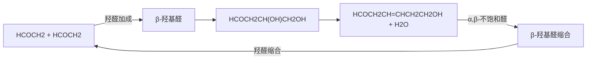

chemical

Two chemical reaction equations showing chlorination and phosphorus reduction steps with reagents and conditions

取代反应一般通过  $S_{N}2$  机理，而不是  $S_{N}1$  机理进行。与普通烷基卤代物相比， $\alpha-$ 卤代醛/酮发生  $S_{N}2$  反应的活性更高，而发生  $S_{N}1$  反应的活性低得多（请思考为什么）。

α-取代醛/酮在碱性条件下可以发生消除反应。顺序使用 α-卤化反应和消除反应，可以从酮制备 α,β-不饱和醛/酮。

chemical

Chemical reaction pathway showing bromination and reduction steps of a ketone to form an imidazolone

## 2. 羧酸的卤化反应

前面学习到使用卤素作为卤化试剂可以使醛/酮发生  $\alpha-$  卤化反应。然而，这个合成方法却对羧酸、酯、酰胺等化合物无效。这是因为这些羧酸衍生物不易通过酮式-烯醇式互变转化为烯醇式，因此难以与卤素发生  $\alpha-$  卤化反应。

化学家发现，在  $PBr_{3}$  存在的条件下羧酸可以与  $Br_{2}$  发生  $\alpha-$  溴化反应，这一反应被称为 Hell-Volhard-Zelinsky 反应。

chemical

Chemical reaction equation showing bromination of a ketone to form a hydroxy ester

如果不加入  $PBr_{3}$ ，溴化反应并不发生。一般认为，反应是通过酰溴中间体进行的:

chemical

Chemical reaction pathway showing conversion of aldehyde to bromoalkene and bromoacetate via PBr3 and bromoacetate intermediates

羧酸首先与 $\mathrm{PBr}_3$ 形成酰溴。由于酰卤基团的强吸电子作用，酰溴 $\alpha$-氢的酸性远强于羧酸 $\alpha$-氢的酸性，易于形成烯醇中间体。烯醇形成后作为亲核试剂与 $\mathrm{Br}_2$ 发生卤化反应，生成 $\alpha$-溴代酰溴。反应结束之后，经过水解处理即可获得 $\alpha$-溴代羧酸。

由于酰溴与羧酸之间可以通过平衡反应进行酰溴交换，在反应中使用催化量的 $\mathrm{PBr}_3$ 即可促进羧酸 $\alpha$-溴化反应的发生，在反应中直接生成 $\alpha$-溴代羧酸产物。

chemical

Chemical reaction equation showing brominated alkene reacting with an aldehyde to form a ketone

根据上述反应机理可以推断，直接以酰氯或酰溴作为原料与  $Br_{2}$  反应即可生成  $\alpha-$  溴代产物，而无须使用  $PBr_{3}$ ；使用催化量的酰氯、酰溴或其他可以将羧酸转化为酰卤的试剂代替  $PBr_{3}$ ，反应同样可以发生。

由于其他羧酸衍生物并不能像羧酸一样被原位转化为酰卤，它们不能使用 Hell-Volhard-Zelinsky 反应进行  $\alpha-$  卤化反应。要使它们发生  $\alpha-$  卤化反应，可以使用经由烯醇负离子的卤化方法（参见 11.3.1 小节）。

与单羰基化合物不同， $\alpha-$ 氢酸性较强的羰基化合物具有较高的烯醇式比例，可以无须转化为酰卤直接发生 $\alpha-$ 卤化反应。例如，丙二酸和丙二酸二乙酯均可直接与溴发生 $\alpha-$ 溴化反应。

chemical

Two-step organic reaction equations showing bromination and hydroacetylation steps

## 11.2.2 Mannich 反应

1912年，德国有机化学家Carl Mannich发现，一分子带有 $\alpha$-氢的羰基化合物（一般为酮）、一分子醛和一分子二级胺可以发生缩合反应，生成 $\beta$-氨基羰基化合物。

chemical

Chemical reaction equation showing the synthesis of Mannichic acid from α-hydroxyethylhydrazine and hydrazine under acidic conditions

由于反应产物  $\beta-$  氨基羰基化合物具有碱性而被称为 Mannich 碱，这个反应被称为 Mannich 反应。

反应通过烯醇与亚胺正离子的反应发生，反应分两个步骤进行。在反应混合物中同时存在两种羰基化合物——活性醛与具有 $\alpha$-氢的羰基化合物。在酸催化下，二级胺与活性醛首先发生反应生成亚胺正离子，作为亲电试剂。接下来，具有 $\alpha$-氢的羰基化合物发生酮式-烯醇式互变生成烯醇中间体，作为亲核试剂进攻前一步形成的亚胺正离子。生成的加成产物脱去质子后形成 Mannich 碱。

chemical

Reaction mechanism diagram showing protonation and deprotonation steps of a carbocation intermediate

可以看出，Mannich 反应的本质是亲核性的烯醇与反应体系中原位生成的亲电性亚胺正离子的加成反应。遵循这个反应机理，我们可以识别和理解很多 Mannich 反应的“变形”形式:

chemical

Chemical reaction mechanism showing protonation and deprotonation steps of a carbocation intermediate

在上面的反应中，所用的氨基化合物是碳酰胺而不是二级胺，它与苯甲醛缩合后生成碳酰亚胺作为亲电试剂，而不是标准 Mannich 反应机理中给出的亚胺正离子。由于氮原子上连接了酰基，碳酰亚胺的亲电性强于一般的亚胺的亲电性，因此也可以被 1,3-二羰基化合物形成的烯醇所进攻，形成相应的加成产物。

使用一级胺代替二级胺进行 Mannich 反应，将会产生一种有趣的情形:

chemical

Chemical reaction pathway showing Mannich reagent formation steps with R¹CHO and H₂N-R² under acidic conditions

由于一级胺参与 Mannich 反应的产物是带有二级胺结构的 Mannich 碱，其中的氨基还可以继续和醛发生反应生成亚胺正离子。因此一级胺可以发生两次 Mannich 反应，生成带有 2 个 β-氨基羰基化合物结构的 Mannich 反应产物。

Mannich 反应是我们学习的为数不多的三组分反应。变换反应组分，即可合成具有丰富结构的 Mannich 碱产物。如果将两个甚至三个组分置于同一分子内，可以通过分子内 Mannich 反应构建具有环状结构的 Mannich 碱，在复杂分子的合成中具有重要的应用。

Mannich 反应最有名的应用之一是 Robert Robinson 于 1917 年报道的颠茄酮的合成:

chemical

Chemical reaction equation showing the synthesis of a cycloalkane derivative from an amino acid and carboxylic acid under acidic conditions

反应巧妙地使用双官能团的活性醛化合物和1,3-二羰基化合物与一级胺，实现了两次连续的Mannich反应，最终Mannich碱产物发生脱羧反应生成颠茄酮。与Richard Willstatter在1902年报道的颠茄酮合成相比，Mannich反应将合成路线由21步直接缩短到2步，充分体现了新反应为复杂分子合成带来的革命性影响。

Mannich 反应在现代有机合成研究中同样具有重要的地位，是有机合成化学家构建复杂含氮分子骨架的常用方法之一。例如，我国科学家合成生物碱天然产物 arboridinine 的过程中巧妙利用多羰基化合物与甲醛和苄胺发生两次 Mannich 反应，使用一锅反应高效地合成了天然产物的三维立体骨架。

chemical

Chemical reaction scheme showing the synthesis of arboridinine from 2CH₂O and H₂N-CH₂Ph with Me group, yielding a fused ring system with Mannich reagent.

## 11.3 经由烯醇负离子中间体的反应

具有 $\alpha$-氢的羰基化合物在碱性条件下可以形成烯醇负离子。与烯醇相比烯醇负离子的亲核性更强，可以与更多种类的亲电试剂发生反应，带来更为丰富的羰基 $\alpha$-碳上的反应。在这一章节中，我们将着重介绍羰基化合物经由烯醇负离子中间体的反应。

## 11.3.1 羰基化合物在碱性条件下的 $\alpha$-卤化反应

## 1. 醛/酮在碱性条件下的  $\alpha$ -卤化反应

在 11.2.1 小节中，我们学习了醛/酮在酸性条件下与卤素发生  $\alpha-$  卤化反应的性质。类似的反应也可以在碱性条件下发生。

chemical

Chemical reaction showing bromination of a ketone under basic conditions to form a carbonyl compound with NaOH

反应机理如下所示，首先羰基化合物与碱反应生成烯醇负离子；之后强亲核性的烯醇负离子进攻卤素形成  $\alpha-$  卤代产物。

chemical

Reaction mechanism diagram showing slow and fast reaction pathways of a ketone with bromoalkyl groups

实验表明，反应速率与羰基化合物和碱的浓度成正比，而与卤素的浓度和种类无关。这与酸性条件下羰基化合物的 $\alpha$-卤化反应相似。这是因为烯醇负离子与卤素反应的活性很高，一旦形成即可快速与卤素反应，因此碱攫取羰基化合物的 $\alpha$-氢形成烯醇负离子一步是决速步骤。反应中无须使用强碱定量生成烯醇负离子，使用弱碱 NaOH 持续生成少量烯醇负离子即可使反应发生。

在  $\alpha-$  卤化反应发生后，由于卤素的吸电子作用， $\alpha-$  卤代醛/酮的  $\alpha-$  氢具有更强的酸性，更易被去质子而再次发生卤化反应，直到所有的  $\alpha-$  氢全部被卤素取代。因此，与酸性条件下的卤化反应不同，碱性条件下的醛/酮的卤化反应很难获得纯净的单卤化产物。

当使用过量的碱和卤素处理甲基酮时，产物并不是三卤甲基酮，而是一种羧酸:

chemical

Chemical reaction equation showing bromination and oxidation of a ketone to form an alcohol

反应首先生成三卤甲基酮，之后过量的氢氧根负离子进攻酮羰基，三卤甲基（此处为三溴甲基）被羟基所取代。

chemical

Organic reaction mechanism showing bromination and hydrolysis steps with reagents and conditions

因为三卤甲基上的负电荷可以被三个卤原子的吸电子诱导效应所稳定，三卤甲基负离子具有一定的稳定性。这可以从三氯甲烷在水中的酸度系数（$\mathrm{pK_a = 24.1}$）得到证实。因此，与酰基相连的三卤甲基可以作为离去基团被其他亲核试剂所取代，生成三卤甲烷和羧酸盐。

使用  $Cl_{2}$ 、 $Br_{2}$ 、 $I_{2}$  进行上述反应可以分别获得三氯甲烷（氯仿）、三溴甲烷（溴仿）和三碘甲烷（碘仿），因此这一反应被称为卤仿反应（haloform reaction）。

chemical

Two organic reaction equations showing cycloaddition of a ketone to form an alcohol and its subsequent chlorination with methyl chloride

由于三碘甲烷易于从反应溶液中结晶析出黄色晶体，化学家曾用碘仿反应作为鉴定甲基酮的方法。

## 2. 羧酸衍生物在碱性条件下的  $\alpha-$  卤化反应

对于 $\alpha$-氢酸性较弱而不易形成烯醇负离子的羧酸衍生物，使用上述适用于醛/酮卤化反应的方法往往不能获得良好的结果。使用强碱将这些化合物定量转化为烯醇负离子，可以实现它们的卤化反应。由于烯醇负离子的亲核性很高，往往使用亲电性更弱、更温和的卤化试剂来代替卤素单质，如NBS、$\mathrm{CBr_4}$ 等。

chemical

Organic synthesis reaction pathway showing LDA oxidation to a diol using CBr4 and H3O+ reagents

在上述反应中，使用过量的强碱 LDA 将羧酸先转化为羧酸锂盐，再去质子形成双烯醇负离子作为亲核试剂。这种卤化反应中没有以高活性的卤素单质作为试剂，因此可以使用分子内带有双键的羰基化合物作为原料。使用四卤化碳作为卤化试剂时，烯醇负离子进攻与碳原子相连的卤素，使 C-X 键发生异裂反应生成较为稳定的三卤甲基负离子，与卤仿反应的原理相似。

chemical

Chemical reaction equation showing oxidation of a carbonyl compound to form a substituted alkene with X and Cl/Br substituents

## 11.3.2 $\alpha$-烷基化反应

经由烯醇负离子，羰基化合物可以发生  $\alpha$ -烷基化反应。

chemical

Two-step organic synthesis reaction scheme: cyclopropyl ketone reacts with LDA/THF under PhCH2Br, then to form a cyclic ketone with phenyl and ethyl ester, followed by the formation of a ketone with KOtBu/DMF and MeI.

反应一般分为两个步骤:① 在强碱性条件下，羰基化合物被完全转化为相应的烯醇负离子；② 烯醇负离子作为亲核试剂进攻烷基化试剂（最常用卤代烷）。

chemical

Chemical reaction mechanism showing benzene ring release and methylation step

羰基化合物的 $\alpha$-烷基化反应中，烯醇负离子形成的区域选择性决定了烷基化反应的区域选择性。为确保烯醇负离子完全生成，应选用强碱[如LDA、$\mathrm{LiN(SiMe_3)_2}$ 和NaH等]进行反应。对于非对称取代酮的 $\alpha$-烷基化反应，使用大位阻强碱在低温下反应获得动力学优势的烯醇负离子，使用小位阻强碱在稍高的温度下反应获得热力学稳定的烯醇负离子（见11.1.3小节和11.1.4小节）。羧酸衍生物的 $\alpha$-烷基化反应没有区域选择性问题。

chemical

Chemical reaction scheme showing methylation of a ketone under LDA at -78°C and NaH reagent, followed by methylation to form two different aldehyde products.

烯醇负离子的烷基化过程按照  $S_{N}2$  机理发生。因此，烷基化反应遵循  $S_{N}2$  反应的一般规律和底物限制。烯醇负离子是一种强碱性强亲核性试剂，与  $1^{\circ}$  卤代烷发生  $S_{N}2$  反应最合适。当使用  $2^{\circ}$  或  $3^{\circ}$  卤代烷作为烷基化试剂时，往往主要生成消除产物。

扩展内容:羰基化合物的不对称  $\alpha$ -烷基化反应

当羰基化合物的 $\alpha$-碳是一个亚甲基或次甲基时，烷基化反应将形成一个新的立体中心。使用分子内无手性元素的羰基化合物进行反应，由于烯醇负离子中间体具有对称面，可以从两面等概率地进攻烷基化试剂，因此得到的烷基化产物是一对外消旋体。化学家们希望能够通过烷基化反应实现羰基化合物 $\alpha$ 位立体中心的不对称构建，发展了一种不对称诱导的烷基化反应。

chemical

Chemical reaction pathway showing transformation from a chiral amine precursor to a diester with R²-X reagent, involving LDA and R¹ substituents

chemical

Chemical reaction scheme showing the synthesis of a cyclic amide from a thioether precursor using LDA and R²-X reagents

使用具有立体中心的酰胺作为起始物，形成的烯醇负离子不再具有对称面，两个面进攻烷基化试剂的速率不同。通过这一手性诱导过程，可形成某一面进攻为主的 $\alpha$-烷基化产物，新形成的立体中心的构型由手性酰胺的结构决定。在这个过程中，手性胺结构称为“手性诱导辅基”。生成烷基化产物后，可以通过水解反应将手性诱导辅基脱去形成羧酸产物。

## 11.3.3 羟醛缩合反应

烯醇负离子与另一分子羰基化合物的反应代表了一大类羰基 $\alpha$-碳上的缩合反应，应用在多种有机化学品的合成中。其中最具代表性的实例是羟醛缩合反应:烯醇负离子中间体作为亲核试剂，对另一分子醛或酮的羰基发生亲核加成反应，形成新的C-C键。

## 1. 羟醛缩合反应的机理

以两分子醛发生的羟醛缩合反应为例了解其反应过程，整体分为两步。首先，在稀碱溶液中，两分子醛发生反应生成  $\beta-$  羟基醛，也称为羟醛加成。然后， $\alpha-$  碳上有氢原子的  $\beta-$  羟基醛受热容易失去一分子水，生成  $\alpha,\beta-$  不饱和醛。

flowchart

以上步骤的详细机理解析如下:首先，碱促进醛发生去质子化反应生成烯醇负离子，这一步骤与碱促进的卤仿反应启动步骤相似。在弱碱条件如氢氧化钠溶液中，醛生成烯醇负离子在热力学上不利，反应平衡偏向于醛一侧，因此仅生成较低浓度的烯醇负离子。第二步，烯醇负离子对另一分子醛或酮发生亲核加成反应，形成新的C-C键。最终，新生成的醇氧负离子中间体与反应体系中的质子结合，生成 $\beta$-羟基醛。

第一步:形成烯醇负离子

在碱促进下，$\beta$-羟基醛的 $\alpha$-氢被移除。这一反应得到的烯醇负离子中的羟基作为离去基团从分子中解离，从而生成一个 C=C 键并得到 $\alpha, \beta$-不饱和醛。这一步骤是典型的 E1cb 反应，也是有机化学中为数不多的消除氢氧根负离子的过程。

chemical

Chemical reaction mechanism showing β-羟基醛 and α,β-不饱和醛 reactions with oxidation/deprotonation steps

注意，通过羟醛缩合反应生成 $\beta-$ 羟基醛或 $\beta-$ 羟基酮的各个基元反应步骤均为可逆反应，在弱碱性条件下，通常存在醛与 $\beta-$ 羟基醛、酮与 $\beta-$ 羟基酮之间的平衡反应。对于醛，生成 $\beta-$ 羟基醛具有较强的热力学驱动力，例如室温下正丁醛在氢氧化钠水溶液中有 $75\%$ 转化为对应的羟醛缩合产物，即2-乙基-3-羟基己醛。然而，在同样的弱碱性条件下，环己酮仅有$20\%$ 以对应的羟醛缩合产物形式存在。这是由于酮比醛稳定，羟醛缩合反应驱动力小。

β-羟基醛/酮化合物在碱促进下脱水生成  $\alpha,\beta-$  不饱和醛/酮的反应具有很强的热力学驱动力，反应不可逆，因此会拉动缩合反应平衡向产物一侧移动。因此，在加热条件下，环己酮即可在弱碱溶液中 100% 转化为  $\alpha,\beta-$  不饱和酮。生成 C=C 键的立体化学也由该步骤决定，反应倾向于生成位阻小、热力学上更稳定的 E 式烯烃。

chemical

Chemical reaction equation showing conversion of acetaldehyde to E-type and Z-type alcohols under NaOH and heating

## 2. 非定向交叉羟醛缩合

从以上羟醛缩合反应的机理和产物可知，至少有一种反应物醛/酮必须具有  $\alpha-$  氢才能够生成烯醇负离子参与后续反应。那么，如果用两种均含有  $\alpha-$  氢的醛参与羟醛缩合反应，能够得到多少种缩合产物？

以乙醛和丙醛的羟醛缩合反应为例，反应具有以下四种可能的途径:①乙醛在弱碱性条件下生成烯醇负离子，对丙醛亲核加成后质子化，得到3-羟基戊醛；②丙醛生成烯醇负离子，对乙醛亲核加成后质子化，得到3-羟基-2-甲基丁醛；③乙醛生成烯醇负离子后与另一分子乙醛发生反应，得到3-羟基丁醛，而丙醛未参与反应；④两分子丙醛之间发生反应，得到3-羟基-2-甲基戊醛。由此可以看出，两种均含有 $\alpha$-氢的醛参与羟醛缩合反应一共得到4种产物，选择性低，不具备实用价值。

chemical

Chemical reaction equation showing acetylation of aldehyde with sodium hydroxide to form 4-羟醛缩合产物混合物

(1) 丙醛烯醇负离子对乙醛的加成

chemical

Chemical reaction diagram showing oxidation of a ketone to form an aldehyde, with curved arrows indicating electron transfer or reaction direction.

(3) 乙醛烯醇负离子对乙醛的加成

chemical

Chemical reaction equation showing oxidation of a ketone to form an aldehyde

未参与反应

(2) 乙醛烯醇负离子对丙醛的加成

chemical

Chemical reaction equation showing oxidation of a ketone to form an aldehyde

(4) 丙醛烯醇负离子对丙醛的加成

chemical

Chemical reaction equation showing oxidation of a ketone to form an aldehyde

未参与反应

那么，如何提高羟醛缩合反应的选择性，得到单一的缩合产物？对于两分子醛的分子间缩合，可使用一个没有 $\alpha$-H 的醛（不可烯醇化）与另一个有 $\alpha$-H 的醛（可烯醇化）发生交叉羟醛缩合，这类反应也称为 Claisen-Schmidt 缩合反应。为了避免有 $\alpha$-H 的醛自身缩合，通常需要在碱性条件下，将有 $\alpha$-H 的醛缓慢加入无 $\alpha$-H 的醛。甲醛、苯甲醛、新戊醛等没有 $\alpha$-H 的醛均可作为交叉羟醛缩合反应起始物。

chemical

Chemical reaction equation showing oxidation of a ketone to form an enone under acidic conditions

交叉羟醛缩合反应的应用之一是合成季戊四醇等多元醇及树枝状高分子。利用乙醛与三分子甲醛在氢氧化钙促进下发生三次羟醛缩合反应得到三羟甲基乙醛，再与一分子甲醛发生Cannizzaro反应即可得到季戊四醇。

当发生羟醛缩合反应的起始物是二醛或二酮等双羰基化合物时，在弱碱性条件下发生分子内羟醛缩合比分子间缩合熵更有利。由于生成环状烯烃更稳定，缩合反应的 $\beta-$ 羟基醛或酮更易在温和条件下脱水，得到环状 $\alpha, \beta-$ 不饱和醛/酮。具有两种 $\alpha-$ 氢的二酮化合物发生分子内羟醛缩合反应时，不同 $\alpha-$ 碳位点形成烯醇负离子后对另一酮羰基的亲核加成将可能得到混合物。由于弱碱性条件下去质子化得到烯醇负离子及分子内亲核加成均可逆，反应通常得到张力最小的环。例如，在氢氧化钠水溶液加热条件下，己-2,5-二酮发生分子内羟醛缩合反应时，1位发生去质子化后与5位的羰基缩合生成环张力较小的五元环，最终得到的主要产物是3-甲基环戊-2-烯酮。3位虽然也能够形成烯醇负离子，但其与5位羰基缩合将形成一个高张力的三元环，反应平衡导致最终形成热力学更稳定的五元环产物。

flowchart

## 3. 定向交叉羟醛缩合

另一种策略，则是利用强碱将羰基化合物定量转化为烯醇负离子，再与另一分子醛反应，从而避免作为亲电试剂的醛自身缩合。该类型反应称为定向羟醛缩合反应。例如，利用酮不易发生自身羟醛缩合反应的性质，在强碱条件下形成稳定的烯醇负离子，再与醛反应。分步反应可以避免醛和酮的自身缩合。

chemical

Organic reaction scheme showing oxidation of a ketone to an enolate using Pr2NLi catalyst, followed by acylation with water and hydrogen peroxide

## 4. 羟醛缩合的可逆性

羟醛缩合具有可逆性。 $\beta-$ 羟基羰基化合物在弱碱性条件下，首先发生羟基的去质子化得到烃氧基负离子。该中间体发生消除反应，切断 $\alpha$ 位与 $\beta$ 位之间的C-C键，并生成一个新的C=O键。这一过程中，烃氧基负离子可类比于羧酸衍生物酰基碳亲核加成后得到的碳四面体中间体，其消除反应将一个烯醇负离子作为离去基团。

chemical

Chemical reaction mechanism showing proton transfer and deprotonation of a ketone to form a ketone, with electron transfer and proton movement indicated.

## 5. Perkin 反应和 Darzens 反应

很多羰基化合物 $\alpha$-碳上的缩合反应看似复杂多样，但其反应机理本质与羟醛缩合相似，均涉及烯醇负离子或其类似物对醛或酮的亲核加成。这些反应与羟醛缩合反应的差别在于生成烯醇负离子的反应物不同。本节以Perkin反应和Darzens反应为例说明如何通过羟醛缩合反应的机理理解醛或酮作为亲电试剂的缩合反应。

首先介绍 Perkin 反应。早在 1868 年，化学家 Perkin 发现了水杨醛钠盐与乙酸酐在加热条件下发生缩合和环化得到香豆素类化合物，并在随后发展出不含有  $\alpha-H$  的芳香醛（如苯甲醛）与含有  $\alpha-H$  的有机酸酐在碱催化下发生缩合得到  $\alpha,\beta-$  不饱和羧酸盐的反应，并被称为 Perkin 反应，在有机合成中有重要应用。形式上，可以理解为酸酐的  $\alpha-$  碳与醛羰基碳之间形成新的 C=C 键并消除一分子水。

chemical

Chemical reaction equation showing oxidation of aldehyde to acyl alcohol and subsequent hydrolysis of α,β-unsaturated羧酸

以乙酸酐与醛的反应为例，该反应形成新 $\mathrm{C = C}$ 键的关键步骤是乙酸酐去质子化的烯醇负离子对醛的亲核加成反应，得到醇氧负离子中间体。随后该中间体发生分子内酰基转移，将乙酸酐未被去质子一侧的酰基转移到醇氧负离子，并释放一个羧基负离子用于与另一分子乙酸酐反应后再发生一步酰基转移生成混合酸酐。在碱促进下，混合酸酐 $\alpha -\mathrm{H}$ 去质子化引发消除反应，释放乙酸根负离子并生成 $\alpha ,\beta -$ 不饱和羧酸乙酸酐，后者水解即得到最终产物 $\alpha ,\beta -$ 不饱和羧酸。

chemical

Reaction mechanism diagram showing acylation and hydrolysis steps of a ketone derivative with R1 substituent

另一类与羟醛缩合机理相关的是 Darzens 反应, 即酮与具有  $\alpha-H$  的  $\alpha-$  卤代酸酯在碱性条件下缩合生成  $\alpha,\beta-$  环氧酸酯:

chemical

Chemical reaction equation showing esterification of aldehyde R¹C(=O)R² under chlorination and NaOEt conditions

该反应的亲核试剂为  $\alpha-$  卤代酸酯去质子化生成的  $\beta-$  卤代烯醇负离子，它对酮亲电试剂的亲核加成反应得到  $\beta-$  卤代醇氧负离子中间体，后者以分子内  $S_{N}2$  反应的途径消除卤离子并生成环氧乙烷结构。

chemical

Organic reaction mechanism showing chlorination and deprotection steps with EtOH and Me substituents

除了以上两例反应之外，还有一些经典的人名反应也与羟醛缩合反应的机理相关，它们的区别均在于烯醇负离子亲核试剂的差别。例如，Knoevenagel 反应是指  $\beta-$  二羰基化合物或其他具有活泼亚甲基的化合物与醛缩合得到  $\alpha,\beta-$  不饱和羰基化合物，亲核试剂是  $\beta-$  二羰基化合物等去质子化得到的离域稳定化的烯醇负离子。Reformatsky 反应则是指  $\alpha-$  卤代酸酯在锌粉存在下与醛/酮的缩合反应得到  $\beta-$  羟基酯，亲核试剂则是烯醇锌盐。常见经由羰基化合物烯醇负离子的缩合反应类型汇总如下:

<table><tr><td>亲核试剂</td><td>亲电试剂</td><td>产物</td><td>反应名称</td></tr><tr><td></td><td></td><td></td><td>羟醛缩合反应</td></tr><tr><td></td><td></td><td></td><td>酯缩合反应</td></tr><tr><td></td><td></td><td></td><td>Perkin 反应</td></tr><tr><td></td><td>RCHO</td><td></td><td>Knoevenagel 反应</td></tr><tr><td></td><td></td><td></td><td>Reformatsky 反应</td></tr><tr><td></td><td></td><td></td><td>Darzens 反应</td></tr></table>

## 11.3.4 共轭加成（Michael 加成）反应

上面介绍的羟醛缩合反应产物是 $\alpha, \beta-$ 不饱和醛/酮，它们与普通的醛/酮相比具有一些特殊的性质。这类分子中的碳碳双键与羰基共轭，受到羰基电子效应的影响，是极化的不饱和键。从共振论的角度进行分析，可以看到  $\alpha,\beta-$  不饱和醛/酮有两个分别在羰基碳与  $\beta-$  碳原子上带有正电荷的共振结构。

chemical

Chemical reaction mechanism showing oxidation of a ketone to form a carbonyl compound, with electron transfer indicated

这说明，$\alpha, \beta-$ 不饱和醛/酮有两个亲电位点——羰基碳原子和 $\beta-$ 碳原子，它们均可接受亲核试剂的进攻，分别发生对醛/酮羰基的加成反应（称为 1,2-加成反应），以及对 $\beta-$ 碳原子的加成反应（称为 1,4-加成反应或 Michael 加成反应）。

chemical

Chemical reaction pathway showing nucleophilic substitution and water oxidation steps

chemical

Chemical reaction pathway showing nucleophilic substitution and dehydration steps leading to hydroxylated urea

1,2-加成反应已经在醛和酮一章进行过详细的介绍。对于1,4-加成反应，亲核试剂首先进攻 $\beta$-碳原子致使电子发生重排生成烯醇负离子，在后处理时被加入的水或其他质子源转化为烯醇，再进一步通过酮式-烯醇式互变形成一种新的羰基化合物。在形式上这个反应相当于亲核试剂加成到 $\alpha, \beta$-不饱和醛/酮的碳碳双键上；而从反应机理的角度分析，这一加成反应是通过整个共轭体系的4个原子发生的，因此被称为1,4-加成或共轭加成反应。这类反应由有机化学家A.Michael首先发现，故也被称为Michael加成反应，$\alpha, \beta$-不饱和醛/酮则被称为Michael受体。除 $\alpha, \beta$-不饱和醛/酮外，其他 $\alpha, \beta$-不饱和化合物，如 $\alpha, \beta$-不饱和酯、$\alpha, \beta$-不饱和酰胺、硝基乙烯衍生物、丙烯腈衍生物等也可以发生Michael加成反应，是有机合成反应中常用的Michael受体。

$\alpha, \beta-$ 不饱和化合物与亲核试剂反应时，发生1,2-加成反应还是1,4-加成反应一般由亲核试剂的性质决定。例如，烷基格氏试剂和烷基锂试剂倾向于进攻羰基碳发生1,2-加成反应生成乙烯基醇产物；而烷基铜锂试剂则倾向于进攻 $\beta-$ 碳原子发生1,4-加成反应生成饱和的羰基化合物。

chemical

Chemical reaction pathway showing two isomers (1,2 and 1,4) with reagents and conditions labeled in Chinese

一般情况下，单羰基化合物形成的烯醇负离子与  $\alpha,\beta-$  不饱和醛/酮既可以发生 1,2-加成反应，也可以发生 1,4-加成反应。1,3-二羰基化合物形成的稳定烯醇负离子则更倾向于发生 1,4-加成反应。基于这一性质，可以利用 1,3-二羰基化合物与  $\alpha,\beta-$  不饱和酮在碱性条件下发生 Michael 加成-羟醛缩合串联反应来合成环状化合物，即 Robinson 环化反应（见 11.3.6 小节第 5 部分）。

## 11.3.5 酯缩合反应

在羰基 $\alpha$-碳的缩合反应中，另一类重要且在有机合成中具有广泛应用的是酯缩合反应，其关键步骤同样涉及烯醇负离子对另一分子羰基化合物的亲核加成反应。与羟醛缩合反应的区别在于酯作为亲电试剂。酮、酯等能够在碱促进下生成烯醇负离子的羰基化合物均可参与酯缩合反应。

## 1. Claisen 酯缩合反应和 Dieckmann 反应

两分子酯在当量醇钠的作用下形成  $\beta-$  羰基酯的反应代表了分子间酯缩合反应的最常见类型。该反应也被称为 Claisen 酯缩合反应。

chemical

Reaction equation showing the synthesis of β-carboxamide from a carbamate derivative using NaOEt and H3O+ reagents

思考:为什么不使用氢氧化钠或甲醇钠作为碱？

以乙酸乙酯的 Claisen 酯缩合反应为例理解它的机理途径。该反应通常使用乙醇钠等弱碱促进反应的发生。第一步，乙酸乙酯的酯基  $\alpha-$  氢的酸性（ $pK_{a} \sim 24$ ）相较于乙醇钠的酸性（ $pK_{a} \sim 16$ ）更弱，因此酯基  $\alpha-$  氢去质子化的化学平衡更倾向于反应物一侧，反应仅生成较低浓度的烯醇负离子。第二步，是烯醇负离子对另一分子乙酸乙酯发生亲核加成反应，形成碳四面体中间体。这一步生成了一根新的 C-C 键。第三步，碳四面体中间体消除乙氧基负离子并生成新的 C=O 键，得到缩合产物即乙酰乙酸乙酯，这也是酯缩合反应不同于羟醛缩合反应之处。以上两步反应均为可逆反应。

那么，酯缩合反应是否到此即结束？在11.1节中已经提到，与两个羰基相连的氢碳酸相比于只和一个羰基相连的氢碳酸具有更强的酸性，因此乙酰乙酸乙酯中亚甲基氢具有显著的酸性（$\mathrm{pK_a\sim 11}$）。由于消除得到的乙氧基负离子的碱性足够强，两者之间酸碱反应具有很强的热力学驱动力，根据勒夏特列原理，整个酯缩合反应得以持续向产物端推动，最终得到乙醇和一个可共振分散电荷的 $\beta-$ 羰基酯负离子。因此，酯缩合反应结束后，通常需要加入水或稀酸溶液将 $\beta-$ 羰基酯负离子转化为 $\beta-$ 羰基酯后进行分离纯化。

第一步:形成酯的烯醇负离子

chemical

Reaction equation showing epoxide ring conversion under NaOEt and thermal power, with pKa values for oxidation states

第二步:亲核加成

chemical

Chemical reaction equation showing carbocation rearrangement of a ketone with an aldehyde, resulting in a new C-C bond

第三步:消除

第四步: $\beta$ -羰基酯去质子化拉动反应平衡

chemical

Chemical reaction equation showing β-carbonic acid reacting with ethyl ether under basic conditions to form a ketone and HOEt

由以上机理分析可见，酯缩合反应的驱动力即在于碱促进产物  $\beta-$  羰基酯的彻底去质子化。对于只含有一个  $\alpha-$  氢的酯，如果仍然使用醇钠作为促进缩合反应发生的碱，缩合产物  $\beta-$  羰基酯中两个羰基之间不存在与碱反应的质子，因此反应缺乏热力学驱动力，化学平衡将不断向反应起始物端移动，导致产物难以形成。

chemical

Chemical reaction equation showing esterification with NaOEt under condition

(未观测到)

二酯发生分子内 Claisen 酯缩合得到环状  $\beta-$  羰基酯（ $\alpha-$  酯基环酮）的反应也被称为 Dieckmann 反应。该反应的机理与分子间 Claisen 反应类似，同样需要产物的环状  $\beta-$  羰基酯具有一个酸性较强、可被碱移除的质子拉动化学平衡向产物端移动。与分子内羟醛缩合反应相似之处在于反应倾向于生成低张力环，因此更容易形成五元或六元环酮。

chemical

Chemical reaction equation showing epoxide ring reacting with sodium and hydroxyl radicals under acidic conditions to form a cyclohexanone derivative

## 2. 非定向与定向交叉酯缩合

在碱促进下，相同的酯发生分子间非定向酯缩合，对称二酯亦能够通过分子内酯缩合反应得到单一产物。然而，使用两种结构不同、但均含有 $\alpha$-氢的酯进行酯缩合时，实验结果表明会得到4种酯缩合产物的混合物。这与使用两种均含有 $\alpha$-氢的醛发生非定向羟醛缩合得到4种混合物的现象类似，原因在于弱碱条件下无法选择性地将其中一种酯转化为烯醇负离子再进攻另一种酯。

chemical

Chemical reaction equation showing the synthesis of 4-iodoacetamide from ethanol and ethyl acetate under EtONa catalyst

为了提高弱碱性条件下酯缩合反应的选择性，关键策略在于仅将其中一种酯转化为烯醇负离子，并维持另一种酯的羰基结构。第一种方法，是使用不含有 $\alpha$-氢的酯（不可烯醇化）作为亲电试剂，与含有 $\alpha$-氢的酯（可烯醇化）进行交叉酯缩合。例如，使用乙酸乙酯与苯甲酸乙酯在乙醇钠存在下发生的酯缩合反应，选择性得到苯甲酰乙酸乙酯。由于酮的 $\alpha$-氢酸性（$\mathrm{pK_a\sim 20}$）比酯的 $\alpha$-氢酸性（$\mathrm{pK_a\sim 24}$）更强，具有 $\alpha$-氢的酮也能够与不含 $\alpha$-氢的酯发生交叉酮酯缩合。

chemical

Chemical reaction equations showing the formation of ketone derivatives under different conditions (α-H and α-H, with NaOEt/H3O+ or H3O+) for phenol and cyclohexene.

思考: 请列举不含  $\alpha-$  氢的酯。

chemical

Reaction equation showing the formation of a ketone from cyclohexane with α-H and ethyl ether under NaOEt and H3O+ conditions

第二种仅将其中一种含有 $\alpha$-氢的酯转化为烯醇负离子的方法，是使用强碱将其彻底定量去质子化，然后再加入作为亲电试剂的酯进行反应，从而实现定向酯缩合反应。例如，在低温下将二异丙基胺基锂（LDA，$\mathrm{pK_a} \sim 35$）与乙酸乙酯反应定量转化为烯醇锂盐后，再加入正丁酸乙酯发生酯缩合反应，水解后即可得到定向缩合产物正丁酰乙酸乙酯。

chemical

Chemical reaction scheme showing the synthesis of a ketone from ethyl acetate using Pr2NLi catalyst

由于强碱对酯 $\alpha-$ 氢的去质子化定量且不可逆，所生成的烯醇负离子可与另一酯分子发生缩合反应，因此适合仅有一个 $\alpha-$ 氢的酯作为亲核试剂进行酯缩合反应得到不含活泼 $\alpha-$ 氢的 $\beta-$ 羰基酯。而同样的反应物在弱碱性条件下发生的酯缩合反应可逆，且产物无活泼 $\alpha-$ 氢不能通过发生去质子化拉动平衡，因此无法顺利得到交叉酯缩合产物。以上反应性的差别反映了酯缩合反应中使用强碱和弱碱的区别。

chemical

Chemical reaction equation showing the synthesis of ethyl ester and its products with reagents and conditions

## 3. 酯缩合反应的可逆性

酯缩合反应具有可逆性。 $\beta-$ 羰基酯可在碱促进下发生酯缩合逆反应，重新生成两分子酯。不具有活泼 $\alpha-$ 氢的化合物由于不能被去质子化得到离域稳定化的烯醇负离子，更易发生该反应。由于 $\beta-$ 羰基酯中的酮羰基相较酯羰基具有更强的亲电性，碱对 $\beta-$ 羰基酯的酮羰基进行亲核加成得到碳四面体中间体。该中间体的消除反应释放第一分子酯并消除烯醇负离子作为离去基团，这一步骤类似于羟醛缩合反应逆过程的消除步骤。最终，烯醇负离子与反应体系中的质子结合生成第二分子酯。

chemical

Chemical reaction mechanism showing oxidation of a ketone to form a ketone with CH3CH2OH and subsequent dehydration steps

酯缩合反应的逆过程是很多  $\beta-$  羰基酯发生酸式分解生成羧酸的途径, 将会在下一小节展开介绍。

## 11.3.6 1,3-二羰基化合物的反应

在前序章节中，已经介绍了酯缩合反应会生成 $\beta$-羰基酯类化合物。除了 $\beta$-羰基酯外，

1,3-二酮、丙二酸酯等一系列化合物均具有两个羰基被一个亚甲基相间隔的共同结构特征，这类二羰基化合物叫作1,3-二羰基化合物或 $\beta$ -二羰基化合物。在本节中，将介绍1,3-二羰基化合物的酸性、烯醇负离子的形成与反应，并通过两类具有代表性的1,3-二羰基化合物的反应介绍它们在有机合成中的应用。

## 1.1,3-二羰基化合物的酸性

在11.1.1小节中已经介绍，1,3-二羰基化合物的 $\alpha$ -氢受两个羰基的影响，具有特殊的活泼性。这是由于去质子化后得到的碳负离子能够被两个具有吸电子效应的羰基稳定，形成的烯醇负离子结构与另一个羰基共轭，形成更加离域、稳定的共振式。根据羰基碳上取代基的不同，1,3-二羰基化合物在水溶液中的 $\mathrm{pK_a = 9\sim 13}$ （表11-5），表明其酸性显著强于单羰基化合物 $\alpha$ -氢的酸性（ $\mathrm{pK_a = 17\sim 26}$ )。1,3-二羰基化合物与单羰基化合物的酸性差异可通过与弱碱反应的彻底程度验证，例如当使用乙醇钠（ $\mathrm{pK_a\sim 15}$ ）作为碱时，乙酸乙酯（ $\mathrm{pK_a\sim 22}$ ）仅能生成较少量的烯醇负离子，而乙酰乙酸乙酯（ $\mathrm{pK_a\sim 11}$ ）则可以被彻底去质子化得到钠盐。当羰基上取代基的共轭给电子效应占优时， $\alpha$ -氢的酸性降低。因此，几种常见1,3-二羰基化合物的酸性具有以下顺序:1,3-二酮 $>\beta$ -酮酯 $>1,3-$ 二酯。

表 11-5 1,3-二羰基化合物及相关有机物的  $pK_{a}$  数据

<table><tr><td>化合物</td><td></td><td></td><td></td><td></td></tr><tr><td> $pK_a(H_2O)$ </td><td>8.4</td><td>9.0</td><td>13.3</td><td>10.2</td></tr><tr><td> $pK_a(DMSO)$ </td><td>14.2</td><td>13.3</td><td>16.4</td><td>13.1</td></tr><tr><td>化合物</td><td></td><td></td><td></td><td></td></tr><tr><td> $pK_a(H_2O)$ </td><td>—</td><td>11.0</td><td>11.2</td><td></td></tr><tr><td> $pK_a(DMSO)$ </td><td>14.4</td><td>14.2</td><td>11.1</td><td></td></tr></table>

与单羰基化合物的酮式-烯醇式互变异构类似，1,3-二羰基化合物也与其对应的烯醇式结构之间存在互变异构，其中烯醇式结构的含量与两个羰基上的取代基有关（具体数据见表11-2）。羰基上连接共轭给电子取代基时，不仅 $\alpha$-氢的酸性降低，其酮式-烯醇式互变异构中烯醇式结构的含量也降低。

## 2.1,3-二羰基化合物的反应

1,3-二羰基化合物能够便捷地被碱去质子化形成离域稳定的 $\beta$-羰基酯负离子，继而作为亲核试剂与卤代烃、醛/酮等一系列亲电试剂发生缩合反应，广泛应用于有机合成化学。通常使用醇钠等弱碱即可将其彻底去质子化。

在稀碱溶液中，$\beta$-羰基酯类在水解后发生脱羧反应。该反应的机理与酯水解类似，首先得到 $\beta$-氧代羧酸（$\beta$-酮酸）；由于碱浓度较低，对酮羰基的亲核加成速率更低而未发生。由于羰基的吸电子诱导效应，$\beta$-酮酸易在加热条件下脱羧，经历六元环状过渡态（机理见第十章），得到酮类化合物，因此也称为 $\beta$-酮酸酯的酮式分解途径。丙二酸酯的酸式分解途径类似，首先酯水解得到 $\beta$-羧基酯，加热条件下也经历六元环状过渡态脱除 $\mathrm{CO}_{2}$，并得到烯醇化的羧酸。