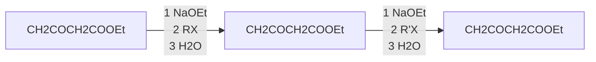
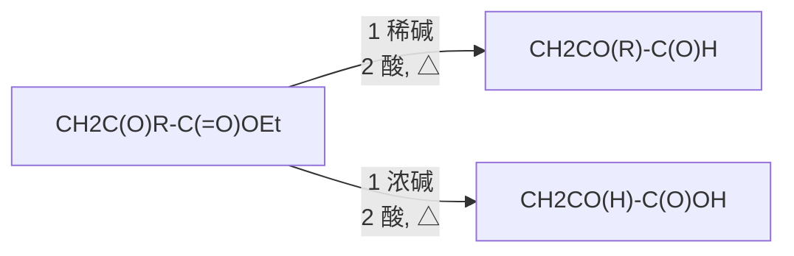
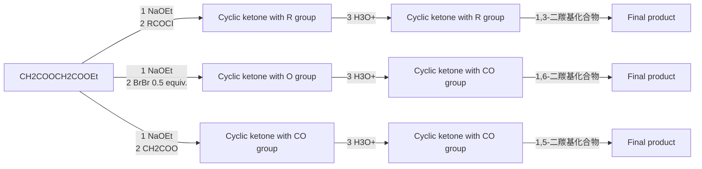

扩展内容:Krapcho 脱羧反应

与该反应类似的 Krapcho 脱羧反应指的是  $\beta-$  酮酸甲酯与 LiCl 在 DMSO 中加热生成酮的反应，常用于乙酰乙酸乙酯和丙二酸二乙酯合成中的脱羧步骤。

chemical

Chemical reaction equation showing esterification of a ketone with LiCl under DMSO/Δ conditions to form an aldehyde

在反应中，LiCl作为路易斯酸活化羰基，氯负离子进攻甲酯一侧（ $S_{N}2$  反应）生成氯甲烷并脱除 $CO_{2}$ 。

chemical

Organic reaction mechanism showing lithium ion binding to a ketone with LiCl and CO2, followed by post-processing to form a carbocation product.

而在浓碱溶液中，$\beta$-羰基酯类则会发生C-C裂解反应，在亲核试剂存在下脱去酰基。该反应的本质是酯缩合反应的逆反应，具体机理详见11.3.4小节。由于碱浓度较高，进攻酮羰基速率提高，从而使酯基水解的比例减少。发生酯缩合逆反应的结果是得到了两分子羧酸盐，因此也称为 $\beta$-酮酸酯的酸式分解途径。

Knoevenagel 反应代表了 1,3-二羰基化合物烯醇盐的一种经典反应途径，在弱碱（如六氢吡啶、乙二胺）催化下，利用 1,3-二羰基化合物烯醇盐或其他含有活泼亚甲基的化合物与醛/酮发生类似羟醛缩合的反应，可方便地制备  $\alpha,\beta-$  不饱和酮（思考:如果用丙酮与醛能否得到上述产物？）。

1,3-二羰基化合物
或其他活泼亚甲基化合物

chemical

Chemical reaction equation showing amine reacting with water to form a cyclic ketone structure

$\alpha,\beta-$ 不饱和羰基化合物

亚胺正离子亲电试剂

chemical

Organic reaction scheme showing esterification with nBuCHO under KOH at 10% catalyst, followed by cyclization to form a ketone product with 74% yield.

由于 1,3-二羰基化合物不仅容易在温和条件下作为亲核试剂实现结构衍生化，亦可方便地水解脱羧，因此乙酰乙酸乙酯、丙二酸二乙酯等化合物可分别作为丙酮负离子等价物、乙酸负离子等价物用作合成前体，从而避免了直接使用丙酮、乙酸等  $\alpha$ -氢酸性较弱的分子作为烯醇负离子前体。

chemical

Chemical reaction diagram showing acetylation of ethyl acetate with ethyl ether under light irradiation

丙酮负离子等价物

chemical

Chemical reaction diagram showing conversion of ethyl ester to carboxylic acid using acetic anhydride

乙酸负离子等价物

## 3. 乙酰乙酸乙酯合成法

利用乙酰乙酸乙酯烯醇盐作为亲核试剂与卤代烃、酰氯等亲电试剂的反应，继而发生酮式分解，可以制备取代的甲基酮化合物。反应分为三个步骤:乙酰乙酸乙酯在碱作用下制备烯醇盐、加入亲电试剂发生亲核取代、发生 $\beta$-羰基酯的酮式或酸式分解。重复上述过程，可制备二取代丙酮类化合物。该类化合物的前体 $\alpha, \alpha-$ 二取代乙酰乙酸乙酯难以通过酯缩合反应直接合成。因此，乙酰乙酸乙酯可作为丙酮负离子的等价物应用于有机合成。

flowchart

flowchart

酸式分解

chemical

Reaction pathway showing epoxide ring conversion to ester and alcohol using phenol and acid derivatives

酸式分解

如果要通过逆合成分析策略找到制备取代丙酮类化合物的方法，那么找出丙酮部分，即来源于乙酰乙酸乙酯，然后将烷基部分转化为卤代烃即可。例如，从乙酰乙酸乙酯出发，在两当量碱存在下与一分子二卤代物发生两次亲核取代反应，水解后可以得到环状取代基的甲基酮。与一分子的酰氯反应，水解脱羧后得到1,3-二酮；与一分子的1,2-二卤代物反应，水解脱羧后得到1,6-二酮；与 $\alpha,\beta-$ 不饱和酮发生Michael加成，水解脱羧后得到1,5-二酮。

flowchart

flowchart

## 4. 丙二酸二乙酯合成法

另一类在有机合成中应用广泛的1,3-二羰基化合物是丙二酸酯，其中最常见的化合物是丙二酸二乙酯，可通过溴代乙酸钠与氰化钠在乙醇中反应制备。丙二酸二乙酯的 $\alpha$-H也具有较强的酸性，同样可以利用碱对其去质子化后与亲电试剂发生缩合反应，通过酸水解和加热脱羧获得取代乙酸类化合物。因此，丙二酸二乙酯可被用作乙酸负离子的等价物。

举例说明，将丙二酸二乙酯在碱作用下与1,2-二溴乙烷发生两次亲核取代反应，在水解脱羧后可获得1,6-二羧酸，而使用碘单质参与反应则可发生两分子烯醇盐之间的C-C键偶联，水解脱羧后得到1,4-二羧酸。如果令丙二酸二乙酯烯醇盐与等当量二卤代物发生两次亲核取代，则能够在丙二酸二乙酯的 $\alpha$ 位形成两根C-C键并构建碳环，该方法适用于构建含有小环碳环的羧酸，例如下图中的螺环羧酸化合物。此外，醛/酮、$\alpha, \beta-$ 不饱和化合物、环氧化合物等其他亲电试剂也可与丙二酸二乙酯反应。

chemical

Organic reaction scheme showing esterification and hydrolysis steps with brominated alkene

## 5. Robinson 环化反应

Robinson 环化反应是通过缩合反应构建碳环的一种重要方法，该反应由英国化学家 Robinson 在 1935 年首先发现。Robinson 环化反应是在碱催化下，环己酮及其衍生物首先生成较低浓度的烯醇盐，继而与  $\alpha,\beta-$  不饱和酮发生 Michael 加成，再串联分子内羟醛缩合反应并脱水，是构建双环环己烯酮类化合物的高效方法。此外，Robinson 环化反应适合在两个环相稠合的碳原子上引入甲基取代基，称为角甲基。

chemical

Chemical reaction equation showing Michael addition to a ketone under NaOEt and NaOH conditions, followed by ring alkylation to form a ketone product with water loss.

## 11.4 经由烯醇硅醚和烯胺的反应

除烯醇和烯醇负离子之外，还有一些它们的类似物可以作为羰基  $\alpha-$  碳上取代反应的关键中间体，包括烯醇硅醚和烯胺。这些中间体的共同特征是具有富电子的  $\pi$  体系，可在  $\alpha$  位发生亲核取代反应。

## 11.4.1 烯醇硅醚的形成和反应性

## 1. 烯醇硅醚的合成

烯醇硅醚（silyl enol ether）是将烯醇中羟基上的氢替换为硅基的化合物。硅原子可以带有不同的取代基，最为常见的是烯醇三甲基硅基（TMS）醚和烯醇叔丁基二甲基硅基（TBS）醚。烯醇硅醚可由烯醇负离子与相应的硅基亲电试剂反应来合成，醛/酮、酯、酰胺等羰基化合物均可形成烯醇硅醚。

使用强碱与含有  $\alpha-$  氢的羰基化合物反应生成烯醇负离子，再加入氯硅烷即可得到烯醇硅醚。在这个反应中，亲核取代发生在烯醇负离子的氧端而不是碳端，这是烯醇负离子两可反应性的体现。

chemical

Chemical reaction equation showing conversion of a ketone to a tert-butyl ester using LDA and TMSCl under different conditions

反应的区域选择性由烯醇负离子的生成步骤决定。对于非对称取代的酮，使用大位阻强碱在低温下进行反应主要得到从位阻小的  $\alpha-$  碳上攫氢的产物。

chemical

Chemical reaction equation showing conversion of a ketone to a cyclohexanone using LDA and TMSCI reagents

另一种从羰基化合物合成烯醇醚的方法是使用三氟甲磺酸硅酯和弱碱的组合作为烯醇硅醚化反应的试剂，在该条件下易形成热力学稳定的烯醇硅醚。

chemical

Chemical reaction scheme showing TBSOTf-mediated cyclization of a ketone to form OTBS and Si groups

反应的机理是底物中的羰基先进攻强亲电性的三氟甲磺酸硅酯，形成硅基取代的羰基正离子。这种中间体的  $\alpha-$  氢非常活泼，三乙胺即可使其脱去质子形成烯醇硅醚产物。

chemical

Chemical reaction mechanism showing silane-catalyzed cyclization of a ketone to form a silane product with ethylamine and ethyl ether groups

由于羰基化合物的亲核性弱，反应中需使用亲电性较强的硅基亲电试剂。除三氟甲磺酸硅酯外，碘代和溴代硅烷（如 TMSI 和 TMSBr）也可以用作硅基化试剂。若使用亲电性较弱的 TMSC1 作为试剂，则需要在较高的温度下进行反应。

与烯醇负离子的形成类似，采用不同的反应条件可以合成具有不同区域选择性的烯醇硅醚。烯醇硅醚是一种具有一定稳定性的中性分子，可以进行分离纯化以用于取代、加成等后续反应。

## 2. 烯醇硅醚的反应

与烯醇类似，烯醇硅醚可以发生亲核取代和加成反应:

chemical

Organic reaction mechanism showing oxidation of a cyclohexene derivative with SiMe3 and X⁻ to form a ketone product

烯醇硅醚的亲核性适中,需要较强的亲电试剂  $E^{+}$ 与之作用,形成硅氧基稳定的碳正离子。来自亲电试剂或外加试剂的阴离子  $X^{-}$ 进攻硅基后即可生成取代产物并脱除副产物  $R_{3}Si-X$ 。

烯醇硅醚可在 Lewis 酸的作用下与二级或三级卤代烷反应生成  $\alpha$ -烷基化产物。

反应中  $TiCl_{4}$  作为 Lewis 酸活化叔丁基氯生成亲电试剂——叔丁基碳正离子，并提供最终用于脱除硅基的  $Cl^{-}$ 。该反应是典型的  $S_{N}1$  反应，其反应机理与烯醇负离子的烷基化反应机理不同。需要注意的是，由于其亲核性弱，在没有 Lewis 酸存在的条件下烯醇硅醚一般不能与卤代烷直接发生反应。

同样在 Lewis 酸存在的条件下，烯醇硅醚可以与醛、酮反应生成羟醛缩合产物。与碱性条件下的羟醛缩合反应有所不同，此时醛/酮的羰基先与  $TiCl_{4}$  配位生成活化的羰基化合物，之后被烯醇硅醚亲核进攻形成加成产物。

扩展内容:利用烯醇硅醚进行不对称Aldol反应

根据上述反应机理，使用手性 Lewis 酸作为催化剂，可以实现烯醇硅醚与醛的不对称加成反应，即手性催化的羟醛缩合反应。

chemical

Reaction equation showing the synthesis of anti- and syn- products using Lewis acid, involving (Z)- or (E)- intermediates

反应可以使用多种 Lewis 酸进行催化，如  $\mathrm{Cu(II)}$ 、 $\mathrm{Sn(IV)}$ 、 $\mathrm{Mg(II)}$ 、 $\mathrm{Zn(II)}$ 、 $\mathrm{In(III)}$  等。匹配合适的手性配体可实现不对称羟醛缩合反应。一般认为反应经由线形过渡态（而不是环状过渡态）发生，Lewis 酸配位活化的醛作为强亲电试剂与烯醇硅醚直接作用。烯醇硅醚上两个取代基  $R^{2}$  和  $R^{3}$  的大小及烯醇的  $(Z)$ -或  $(E)$ -构型对最终产物的构型有重要影响。

chemical

Chemical reaction equation showing synthesis of a bis(oxazolone derivative) from TMS and BnO-CH=CHOSiMe3 under catalytic conditions

在这一反应中，炔基醛与烯醇硅醚在 Sn 和手性胺配体组合而成的手性 Lewis 酸催化下发生反应，以高产率、高非对映选择性和高对映选择性获得了羟醛缩合产物。

## 11.4.2 烯胺的形成和反应性

## 1. 烯胺的形成

在之前的章节中学习过，醛/酮与二级胺在酸催化下会可逆地生成烯胺（enamine）。人们经常使用的二级胺包括四氢吡咯、哌啶、吗啉等。

chemical

Chemical reaction equation showing the formation of propylamine from amine and ketone under acidic conditions

这是一个缩合反应，以水作为副产物。使用分水器在反应过程中将水不断地移出反应体系，或者使用化学干燥剂除去反应生成的水，可以高收率地获得烯胺分子，作为活性反应中间体用于后续反应。

chemical

Two chemical reaction equations showing amide formation and subsequent cyclization of a cyclohexanone derivative

值得注意的是，与形成烯醇的区域选择性不同，非对称取代的酮与二级胺反应时倾向于生成取代较少的烯胺。

chemical

Chemical reaction equation showing conversion of a ketone to a pyridine derivative under acidic conditions, followed by addition of secondary products.

这是由于形成烯胺之后，酮的 $\alpha-$ 取代基与 $N-$ 取代基之间具有较大的排斥作用，多取代烯胺产物的能量高，而少取代烯胺中不具有这一排斥作用，产物的能量低。烯胺的形成反应是一个可逆过程，因此，反应的区域选择性由产物的热力学稳定性决定。

## 2. 烯胺的反应

与烯醇负离子和烯醇类似，分析烯胺的共振结构可知，它的  $\alpha$  位是亲核性位点。由于氮原子通过  $p-\pi$  共轭向双键给电子的能力比氧原子强，烯胺的亲核性显著强于烯醇和烯醇硅醚。因此烯胺可与多种亲电试剂反应，与烯醇硅醚相比反应的适用范围更加广泛。

chemical

Chemical reaction mechanism showing electron transfer between nitrogen and alkene intermediates

烯胺可与卤代烷直接发生  $S_{N}2$  反应生成  $\alpha-$  烷基化亚胺正离子，与酰氯发生  $\alpha-$  酰基化反应，与  $\alpha,\beta-$  不饱和羰基化合物发生加成反应。这些产物经过酸性水解可以分别获得  $\alpha-$  烷基羰基化合物、1,3-二羰基化合物和 1,5-二羰基化合物，在有机合成上具有重要价值。

chemical

Chemical reaction pathway showing transformation of a ketone to a carbamate derivative via intermediates and reagents

将烯胺的生成反应、烯胺的亲核取代或加成反应及水解反应组成一个多步合成路线，可以从醛/酮制备 $\alpha-$ 取代醛/酮。这一反应的适用范围与经由烯醇负离子反应的适用范围非常类似，但无须使用强碱定量生成烯醇负离子，操作简便易行。

chemical

Chemical reaction scheme showing cycloaddition of a ketone to form a cyclic ester with two different alkyne structures

扩展内容:烯胺催化与不对称烯胺催化

从上述烯胺参与的反应可以看出，二级胺在反应过程中并未被消耗。如果能将烯胺的形成、反应及亚胺正离子的水解在同一个反应体系中实现，则可以仅使用催化量的二级胺促进这些反应的进行。

下面的催化循环（catalytic cycle）图展示了这个过程的机理。在整个过程中仅用二级胺和弱酸性条件进行催化，无须使用强碱即可实现醛/酮的  $\alpha$  位取代反应。由于这个过程以烯胺作为关键反应中间体，人们将其称为烯胺催化（enamine catalysis），也可将其称为二级胺催化（secondary amine catalysis）。

chemical

Reaction mechanism diagram showing protonation and reduction reactions of a carbocation intermediate with R groups

人们发现，将普通二级胺改为带有手性基团的二级胺——(S)-脯氨酸，在烯胺与亲电试剂反应的步骤中立体中心的形成将受到脯氨酸上已有立体中心的诱导，可以实现不对称催化的醛/酮 $\alpha$ 位取代反应。最早发现的这类反应被称为Hajos-Parrish-Eder-Sauer-Wiechert反应，是一个脯氨酸催化的分子内羟醛缩合反应。

chemical

Chemical reaction equation showing conversion of a ketone to a lactam using (S)-phosphorylamine under 3 mol% conditions, yielding 93% ee

3 mol%表示
摩尔分数为 3%。

反应也可以在分子间发生。例如，丙酮和苯甲醛在(S)-脯氨酸的催化下发生不对称羟醛缩合反应得到手性羟醛缩合产物。

chemical

Chemical reaction scheme showing esterification of a ketone with phenyl under DMSO conditions to form a hydroxy ester, followed by deprotection and subsequent cyclization.

B. List 等人提出，关键的加成步骤经过一个六元环过渡态发生，脯氨酸的羧基起到关键的导向作用，通过氢键将醛置于与羧基相同的一侧，决定了新形成立体中心的构型。

## 习题

## 基础习题

1. 将下列化合物按照酸性由弱至强排序。

chemical

Four organic molecular structures: acetoacetone, acetone, isocyanate, and hydroxyl group

2. 将乙酰乙酸乙酯、戊-2,4-二酮、丙二酸二乙酯、$\alpha$-氰基乙酸乙酯、$\alpha$-硝基乙酸乙酯的酸性按照由强到弱的顺序排序，并简述理由。

3. 以下两种羰基化合物烯醇化异构体的占比差异很大。试解释这一现象。

4. 画出以下反应的机理，并说明为什么同样是酸性条件，底物发生亲核进攻的位点却不相同。

chemical

Chemical reaction pathway showing bromination and acid-catalyzed transformation of a ketone to a ketone using HClO4

5. 请写出下列酮发生溴化反应的主要产物。

6. 完成下列反应。

chemical

Chemical reaction equation showing cyclohexanone reacting with HCHO and NHMe2 under acidic conditions to form an aldehyde product

7. 以下五种化合物均为1,3-二羰基化合物，A、B主要以烯醇化异构体的形式存在。而C、D、E存在形式为 $100\%$ 的酮式异构体。请结合它们的烯醇式结构解释这一现象。

A

B

C

D

E

8. 请画出 2-甲基环己酮分别在两种条件下生成的烯醇盐结构，并解释原因。

chemical

Chemical reaction scheme showing conversion of compound A to B under different conditions: LDA at 23°C and -78°C

9. 完成下列反应。

chemical

Chemical reaction equation showing DMAP formation of a pyridine derivative using chloroacetate and DMAP

10. 请写出以下化合物在两种条件下反应的主要产物。

chemical

Chemical reaction scheme showing conversion of compound A to B using LDA and MeBr at -78°C, with NaH/MeBr reagent

11. 完成下列反应。

chemical

Chemical reaction equation showing methoxybenzene reacting with a benzyl alcohol under Ac2O and NEt3 conditions to form a product with Δ.

12. 完成下列反应。

chemical

Chemical reaction equation showing cyclohexene reacting with chloroethanol to form tert-butanol and tert-butyl alcohol

13. 完成下列反应。

14. 完成下列反应。

chemical

Chemical reaction equation showing condensation of a cyclohexanone derivative with an aldehyde under KOH/CH3OH catalysis

15. 完成下列反应。

chemical

Chemical reaction equation showing acrylate reacting with ethyl ester to form a pyridine derivative

16. 完成下列反应。

chemical

Organic reaction scheme showing conversion of a ketone to acetaldehyde and then to product B via methanol and hydrogenation steps

17. 完成下列反应。

chemical

Chemical reaction scheme showing cycloaddition of a ketone to form a pyrrolidone derivative and chloroacetate

## 综合习题

18. 以乙酰乙酸乙酯和不超过四个碳原子的原料合成以下化合物。

19. 以环己酮和不超过四个碳原子的原料合成以下化合物。

20. 以丙二酸二乙酯和常见有机原料合成以下化合物。

21. 乙酰乙酸苄酯是一种性质优良的 $\beta$-酮酸酯试剂，其苄基可以在催化氢化的条件下选择性地脱除。请以乙酰乙酸苄酯为原料，选用常见试剂完成以下合成。

chemical

Chemical reaction showing conversion of a carboxylic acid to a ketone using ethyl ester and CO2Et groups

22.1,4-二酯类化合物与醛/酮在碱性下的缩合反应称为Stobbe反应，如下所示，请画出其反应机理。

chemical

Chemical reaction equation showing condensation of a ketone with methoxybenzaldehyde under LiOMe catalysis

23. 下列缩合反应与 Perkin 反应的机理有类似之处，试画出这一反应的机理。

chemical

Chemical reaction equation showing conversion of a cyclic acyl compound to a heterocyclic product using tBuOK and PhCHO under tBuOH-DMF conditions

24. 硼介导的缩合反应在形成碳碳键时具有很高的立体选择性，这可以归因于烯醇硼酸酯中硼氧键键长很短，与醛反应形成紧密的六元环椅式过渡态。D.A.Evans等人在烯醇组分中引入共价连接的手性噁唑烷酮助剂，在特异性形成 $Z$ 型烯醇硼酸酯后发生缩合，可以实现syn型绝对立体化学的控制。这一反应立体选择性可以用Zimmerman-Traxler过渡态模型来解释。下图中过渡态A在能量上是最有利的，也即对应了手性缩合的主要产物。请从极性与空间位阻的角度，分析过渡态A在能量上优势最大的原因，并画出此模板下Evans aldol缩合的主产物。

chemical

Chemical reaction scheme showing Z-enolate reacting with DCM to form intermediate A, B, C, and D, then to syn-产物 or anti-产物

25. 使用下式（1）所示反应能得到 $60\%$ 产率的缩合产物，请分析该缩合为什么能够较好发生，并指出其存在的副反应。使用下式（2）的方法能得到更高产率的目标产物，请分析这种方法如何避免按式（1）合成时遇到的副反应。

26. 为了合成以下三种分子设计了三个反应，然而每个反应的主要产物都不是预期产物。请分析每种反应条件无法得到目标产物的原因，且给出新的合成路线制备这些分子。

chemical

Multi-step organic synthesis reaction scheme showing transformations of ketone derivatives with alkyne and carboxylic acid intermediates

(本章编者 焦雷、张韶光、赵亮、陈超)

本章习题

参考答案

## 第十二章

## 胺和含氮芳香杂环化合物

12.1 胺类化合物的结构和命名 …… 142 12.4 芳基重氮盐 …… 176
12.2 胺类化合物的制备…… 145 12.5 芳香含氮杂环化合物 …… 181
12.3 胺类化合物的物理化学性质…… 165 习题…… 200

酰胺

脒基

脲基

胍基

chemical

Chemical structure of a substituted indole derivative with hydroxyl and amino groups

血清素

毒芹碱

尼古丁

氮元素位于元素周期表的第2周期第5主族，有一个半充满的p轨道。在空气中氮是含量最高的元素，而氮原子与碳原子相连组成的有机化合物数量也相当庞大。生物碱、氨基酸、含氮杂环化合物等有机化合物中都有含氮官能团。在众多含氮有机化合物中，氮元素可以与其他元素形成丰富的官能团类型，例如，常见的有氨基 $\left(-\mathrm{NH}_{2}\right)$ ；氮与氧形成羟胺 $\left(>\mathrm{N}-\mathrm{OH}\right)$ 、亚硝基 $(-\mathrm{NO})$ 和硝基 $\left(-\mathrm{NO}_{2}\right)$ ，以及胺氧化物 $\left(\equiv\mathrm{N}\rightarrow\mathrm{O}\right)$ ；氮和碳可以组成饱和的单键，也可以组成不饱和的双键——亚胺 $\left(>\mathrm{C}=\mathrm{N}-\right)$ 和叁键——氰基 $(-\mathrm{CN})$ ；氮自身还可以形成包含氮氮单键的肼 $\left(-\mathrm{NHNH}_{2}\right)$ 、包含氮氮双键的偶氮化合物 $\left(-\mathrm{N}=\mathrm{N}-\right)$ 和包含氮氮叁键的重氮盐 $\left(-\mathrm{N}_{2}^{+}\right)$ ；叠氮化合物则含有 $-\mathrm{N}_{3}$ 官能团；氮元素自身或与其他杂原子一起参与到杂环化合物的构建中。酰胺的羰基置换为亚胺则构成脒基，脲基的羰基置换为亚胺则构成胍基……不同官能团的不同性质使含氮有机化合物呈现出多种多样的物理化学性质。

在自然界，除以氨基酸为基本单元通过肽键组成的多肽、蛋白质以外，氮元素大量出现在杂环结构中。例如，血清素（serotonin）又名5-羟色胺，由于最早从血清中发现而被命名为血清素。它主要存在于中枢神经系统，是一种调节神经活动的重要物质。血清素通过抑制其他神经递质的过量分泌，帮助人们感受愉悦、放松和自信，从而产生满足感和幸福感，因此被称为快乐神经递质。血清素的母核吲哚是一种含氮芳香苯并杂环。毒芹碱（coniine）是伞形科毒参属二年生草本植物毒参的主要有毒成分，属于一种生物碱，其结构中存在含氮脂肪杂环哌啶。烟草中的尼古丁（nicotine）俗名烟碱，是导致吸烟成瘾的主要化学物质，其结构中存在含氮芳香杂环吡啶和含氮脂肪杂环吡咯烷。

本章主要学习胺类化合物和含氮芳香杂环化合物的结构及性质，含氮脂肪杂环化合物与相应开环含氮化合物的性质类似，本章不做专门介绍。

## 12.1 胺类化合物的结构和命名

胺类化合物（amines）指  $sp^{3}$  杂化氮为中心，分别与碳、氢成键饱和的一类化合物。如果氮分别与一个碳和两个氢相连，得到的是伯胺，或称为一级胺（primary amine），血清素的吲哚骨架上有一个含氨基的烷基取代基，它属于伯胺；与两个碳相连是仲胺（secondary amine），如毒芹碱；以此类推，与三个碳相连是叔胺（tertiary amine），尼古丁就有这样一个三级胺结构。根据氮原子所连接的含碳基团的种类，直接相连的碳都是 $\mathfrak{sp}^3$ 杂化碳的是脂肪胺；有一个是芳基取代基的就是芳香胺。这几种胺类化合物的氮上还有一对孤对电子，这是这类化合物性质的重要结构依据，其将进一步参与到有机化学转化中。与碳中心化合物不同的是，若胺类化合物的氮原子上有4个含碳基团则构成季铵盐。伯胺、仲胺、叔胺氮上的一对孤对电子表现出Brønsted碱性，可以结合质子，这样得到的铵盐是普通铵盐。季铵盐与普通铵盐的性质差别很大，在后续课程中将深入学习。

## 12.1.1 胺类化合物的命名

根据2017版《有机化合物命名原则》，当胺为主特性基团时，胺类化合物的命名通常是将氮上的基团视为取代基，在其后加上后缀“氮烷（-azane）”或“胺（-amine）”；或称为“某烷胺”，在不引起歧义的情况下可以省略“烷”而直接称为“某胺”。本章中采取“胺”为后缀的命名方式。例如，最简单的芳香胺——氨基取代苯，命名为苯胺，这一俗名一直沿用，也作为母体使用。氨基取代吡啶，吡啶的氮杂原子编号最小，因此这里氨基取代基位于4位，命名为吡啶-4-胺。苯环上既有氨基取代基，又有羧基取代基，这时羧基作为主特性基团，苯甲酸是母体，氨基是取代基，所以是4-氨基苯甲酸。母体上的取代基用数字编号，连同氮原子上的取代基，以 $N-$ 标识，都写在母体名称前，如 $N,4-$ 二甲基苯胺、$N,N-$ 二甲基苯胺，$N$ 需以斜体表示。

苯胺

aniline

吡啶-4-胺

pyridin-4-amine

4-氨基苯甲酸

4-aminobenzoic acid

N,4-二甲基苯胺

N,4-dimethylaniline

N,N-二甲基苯胺

N,N-dimethylaniline

简单烃基取代的脂肪胺，就是将相应烃的命名词尾加上胺，在不引起歧义的情况下，烷可以省略。例如，乙烷胺，通常称为乙胺；也以取代基命名，如二乙基胺，这里多个相同取代基合并。常用的有机碱三乙基胺，氮上连有3个相同的乙基，英文简写为TEA。当氮原子上连有不同取代基时，简单的烃基为取代基。例如，N-乙基-N-甲基环丙基胺，注意取代基按照其英文首字母顺序排序。乙二胺的命名属于俗名，IUPAC命名为乙烷-1,2-二胺。有多个氨基时，其中一个氨基也可以与相连的烃基共同组成取代基，如2-(氨基甲基)丙烷-1,3-二胺。有长链取代基时，选取最长碳链为母体，再标识取代基的位置，如N-甲基庚烷-2-胺。

乙胺

ethanamine

二乙基胺

diethylamine

三乙基胺

triethylamine

N-乙基-N-甲基环丙基胺

N-ethyl-N-methylcyclopropanamine

乙二胺

乙烷-1,2-二胺

ethane-1,2-diamine

2-(氨基甲基)丙烷-1,3-二胺

2-(aminomethyl)propane-1,3-diamine

N-甲基庚烷-2-胺

N-methylheptan-2-amine

伯胺(一级胺)

仲胺(二级胺)

叔胺(三级胺)

季铵盐(四级铵盐)

普通铵盐

GABA 是  $\gamma-$  氨基丁酸的缩写，是一种重要中枢神经系统抑制性神经递质，生理上有促进乙酰胆碱合成、镇定安神等作用，这里氨基取代基的位置按照主链上与主特性基团羧基的位置关系，以希腊字母顺序依次排列，命名为  $\gamma$  位。

γ-氨基丁酸

γ-aminobutanoic acid

## 12.1.2 胺类化合物的手性

胺类化合物的氮原子一般采取 $\mathrm{sp}^3$ 杂化，如果氮原子连有3个不同的原子或基团，连同氮上的一对孤对电子形成假四面体排列，理论上这个氮是不对称中心。如图12-1所示，观察化合物A和化合物C的结构，其中取代基 $\mathbb{R}^1$ 和 $\mathbb{R}^2$ 位置互换，这意味着化合物A和化合物C互为实物和镜像的关系，是一对对映体。如果沿着虚线轴将化合物C翻转 $180^{\circ}$ 得到化合物B，比较发现，化合物B与化合物A是构型翻转的关系，如同大风吹翻伞面的情况。通常条件下，当氮上有一对孤对电子时，在室温条件下并不能将两种化合物拆分，所以一般胺类化合物不表现出光学活性。这是由于两个对映体互相转化的能垒非常小，在室温条件下就能发生翻转。

chemical

Reaction mechanism diagram showing fast rotation of a nitrogen-containing molecule with 180° rotation, labeled A, B, and C

图 12-1 胺类化合物氮中心的快速翻转

chemical

Chemical structures of quinone salt and acetylene monomers with labeled R groups

如果这种内翻转受到限制，胺类化合物就会表现出手性，例如，当季铵盐或叔胺氧化物的烃基取代基都不同时，与碳中心手性化合物相似，氮是手性中心。当三价氮的内翻转受到限制时，也成为不对称中心。例如，如图12-2(a)所示，二苯甲酮与甲胺反应得到的亚胺，以氯仿为溶剂，在 $-20^{\circ}\mathrm{C}$ 条件下可以被 $(+)$-过氧樟脑酸不对称环氧化，得到 $(-)$-2-甲基-3,3-二苯基-1,2-氧杂氮杂环丙烷，这一手性化合物可以直接经柱色谱分离得到。减压蒸馏不会影响其光学纯度，其手性完全来源于结构中的不对称氮原子。而氮杂环丙烷化合物的内翻转相对较快，氮上不同烷基取代时翻转速率不同。相对来说，氮上引入卤素取代基会使氮杂环丙烷的内翻转变慢。2,2-二苯基氮杂环丙烷经 $(-)$-异冰片基次氯酸盐不对称氯代合成得到 $(+)$-1-氯-2,2-二苯基氮杂环丙烷，但是其在 $0^{\circ}\mathrm{C}$ 条件下放置4天后发生完全消旋化。而在邻二甲苯稀溶液中，1-氯-2,2-二甲基氮杂环丙烷在 $120^{\circ}\mathrm{C}$ 条件下也未观测到内翻转，计算表明其翻转能垒达约 $88\mathrm{kJ / mol}$ 。2-甲基氮杂环丙烷的翻转能垒约为 $70\mathrm{kJ / mol}$，显著高于一般仲胺的翻转能垒，但还不足以实现室温条件下的非对映体拆分。而引入吸电子基团取代后的1-氯-2-甲基氮杂环丙烷，其翻转能垒提高到 $112\mathrm{kJ / mol}$，可以在 $25^{\circ}\mathrm{C}$ 条件下将非对映体分离[图12-2(b)]。

图12-2（a）有不对称氮中心的三元含氮杂环化合物举例及（b）氮杂环丙烷的内翻转及其翻转能垒

1887 年，Tröger 通过对甲苯胺与二甲氧基甲烷在盐酸水溶液中缩合得到了 Tröger 碱，不过其结构问题直到 1935 年才由美国伊利诺伊大学的 Spielman 解决，其具有 V 形  $C_{2}$  对称性结构，桥头氮原子是手性中心。同年，Wagner 提出了反应的可能机制。1986 年，Wilcox 报道了 Tröger 碱的晶体结构，证实了之前的推测，结构中两个芳基平面几乎互相垂直。1991 年其绝对构型被确定， $(+)$ -Tröger 碱的两个氮中心的构型为  $(S, S)$ 。Tröger 碱是第一种通过手性固定相被分离得到的手性化合物，因此通过液相色谱来拆分外消旋 Tröger 碱的技术很早就已经被掌握。不过使用商品化 HPLC 手性柱来拆分 Tröger 碱衍生物的方案近期才获得较好解决。现在，Tröger 碱及其衍生物的一对对映体都可以实现半制备分离，功能化的 Tröger 碱衍生物已被广泛应用于超分子化学、材料科学和药物设计等领域。

chemical

Chemical structure of a fused heterocyclic compound with methyl and thienyl substituents

$(+)$-Tröger碱

chemical

Chemical structure of a fused heterocyclic compound with methyl and amide substituents

(-)-Tröger碱

## 12.2 胺类化合物的制备

对胺类化合物制备的研究由来已久，合成方法多种多样。最常用的策略之一是含氮化合物的还原及多种方法构建碳氮键，高级胺也可以低级胺为原料合成。近年来还不断发展了新的可持续的绿色合成方法。

## 12.2.1 硝基还原法

硝基官能团还原是制备伯胺的重要方法之一。不论是脂肪硝基化合物还是芳香硝基化合物，硝基都可以在多种还原条件下被还原为氨基。由于芳香硝基化合物较为易得，且苯胺衍生物有广泛用途，芳香硝基化合物的还原尤为常见。例如，苯胺是一种重要的化工原料，在树脂、橡胶、染料及医药等很多领域有广泛用途，多年来占据全球销售额前10位的小分子药物中很多含有苯胺结构单元。当底物中有多种官能团时需要注意反应条件的化学选择性。

chemical

Chemical structure of a complex organic molecule with fused rings, amine, and methoxy substituents

阿哌沙班 Apixaban

chemical

Chemical structure of a fused heterocyclic compound with indole and amide groups

来那度胺 Lenalidomide

chemical

Chemical structure of a heterocyclic compound with chlorinated benzene and sulfonamide groups

利伐沙班 Rivaroxaban

chemical

Chemical structure of a fluorinated heterocyclic compound with trifluoromethyl and cyano substituents

恩扎卢胺 Enzalutamide