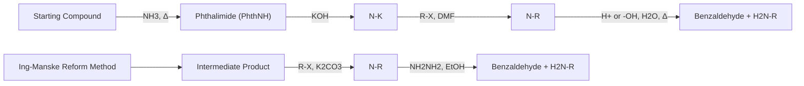
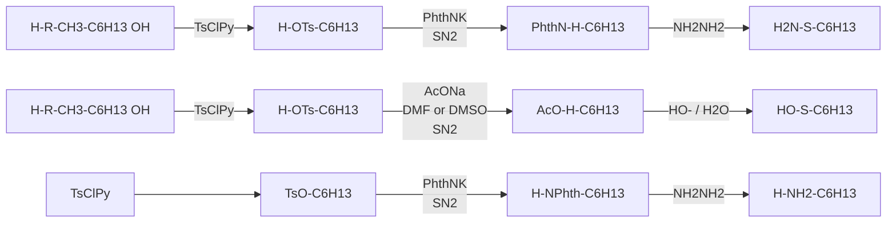

## 1. Béchamp 还原法

常用的还原硝基为氨基的方法有铁或亚铁在酸性条件下的还原。1854年Béchamp发现Fe/HOAc条件下硝基苯被还原为苯胺。Béchamp还原也可以使用盐酸、硫酸等无机酸，且可用于脂肪硝基化合物的还原。如图12-3所示，邻硝基苯甲醛在Fe/HCl条件下可以实现定量还原，且这一条件下甲酰基不被还原。在酸性条件下铁和硫酸亚铁还原2-甲基-2-硝基丙醇，以高收率得到2-氨基-2-甲基丙醇，该方法放大到 $10\mathrm{kg}$ 级仍能够以 $82\%$ 收率得到相应还原产物。由于成本优势，铁粉还原法曾经在工业上广泛应用，不过过量的铁粉和盐酸所产生的铁泥带来严重的环境污染问题，设备维护费用也较高，反应所产生的铁氧化物副产物需求过剩，而且化学剂量的合成工艺无论从经济角度还是绿色化学和可持续发展的角度来看，都没有优势。现在Béchamp还原法在工业上已经禁用，取而代之的是流化床气相催化加氢生产工艺等催化氢化方法。除铁粉以外，实验室中在酸性条件下以锌、锡等金属单质或硫酸亚铁、氯化亚锡等金属盐为还原剂还原硝基，这一条件下醛基、苄氧基等官能团不能被还原，反应具有很好化学选择性（图12-3）。反应过程中金属提供单电子，Brønsted酸提供质子，硝基化合物经过亚硝基化合物、羟胺中间体，最终被还原为伯胺（图12-4）。


<details>
<summary>flowchart</summary>

```mermaid
graph LR
  A["Nitrobenzaldehyde (CHO)"] -->|"Fe, 1 mol/L HCl\nEtOH, 回流, 2 h"| B["Nitrobenzaldehyde (CHO)"]
  C["Amino compound with Me group"] -->|"Fe/FeSO4, H2SO4aq.\n回流, 1 h"| D["Amino compound with Me group"]
  E["&quot;BnO-C6H3-OMe"] -->|"Zn/HCl\nMeOH/THF(2:1)\n回流, 10 h"| F["&quot;BnO-C6H3-OMe"]"]
  G["N,N-(CH2-C6H3)-NO2"] -->|"SnCl2, 浓 HCl\nEtOH, r.t., 48 h"| H["N-(CH2-C6H3)-NH2"]
  B -->|"100%"| D
  D -->|"90%"| F
  F -->|"91%"| H
  H -->|"97%"| I
```
</details>

图12-3 酸性条件下还原硝基制备伯胺化合物


<details>
<summary>flowchart</summary>

```mermaid
graph LR
  A["Ar-NO2"] -->|"M, H+"| B["Ar-NO"]
  B -->|"M, H+"| C["Ar-NHOH"]
  C -->|"M, H+"| D["Ar-NH2"]
  
  E["Ar-N⁺O⁻"] -->|"亚硝基化合物"| F["Ar-N⁺OH"]
  G["Ar-N⁺OH"] -->|"亚硝基化合物"| H["Ar-N⁺OH"]
  I["Ar-N⁺O⁻"] -->|"亚硝基化合物"| J["Ar-N⁺OH"]
  K["Ar-N⁺OH"] -->|"亚硝基化合物"| L["Ar-N⁺OH"]
  M["Ar-N⁺OH"] -->|"亚硝基化合物"| N["Ar-N⁺OH"]
  O["Ar-N⁺OH"] -->|"亚硝基化合物"| P["Ar-N⁺OH"]
  Q["Ar-N⁺OH"] -->|"亚硝基化合物"| R["Ar-N⁺OH"]
  S["Ar-N⁺OH"] -->|"亚硝基化合物"| T["Ar-N⁺OH"]
  U["Ar-N⁺OH"] -->|"亚硝基化合物"| V["Ar-N⁺OH"]
  W["Ar-N⁺OH"] -->|"亚硝基化合物"| X["Ar-N⁺OH"]
  Y["Ar-N⁺OH"] -->|"亚硝基化合物"| Z["Ar-N⁺OH"]
  AA["Ar-N⁺OH"] -->|"亚硝基化合物"| AB["Ar-N⁺OH"]
  AC["Ar-N⁺OH"] -->|"亚硝基化合物"| AD["Ar-N⁺OH"]
  AE["Ar-N⁺OH"] -->|"亚硝基化合物"| AF["Ar-N⁺OH"]
  AG["Ar-N⁺OH"] -->|"亚硝基化合物"| AH["Ar-N⁺OH"]
  AI["Ar-N⁺OH"] -->|"亚硝基化合物"| AJ["Ar-N⁺OH"]
  AK["Ar-N⁺OH"] -->|"亚硝基化合物"| AL["Ar-N⁺OH"]
  AM["Ar-N⁺OH"] -->|"亚硝基化合物"| AN["Ar-N⁺OH"]
  AO["Ar-N⁺OH"] -->|"亚硝基化合物"| AP["Ar-N⁺OH"]
  AQ["Ar-N⁺OH"] -->|"亚硝基化合物"| AR["Ar-N⁺OH"]
  AS["Ar-N⁺OH"] -->|"亚硝基化合物"| AT["Ar-N⁺OH"]
  AU["Ar-N⁺OH"] -->|"亚硝基化合物"| AV["Ar-N⁺OH"]
  AW["Ar-N⁺OH"] -->|"亚硝基化合物"| AX["Ar-N⁺OH"]
  AY["Ar-N⁺OH"] -->|"亚硝基化合物"| AZ["Ar-N⁺OH"]
  BA["Ar-N⁺OH"] -->|"亚硝基化合物"| BZ["Ar-N⁺OH"]
  BB["Ar-N⁺OH"] -->|"亚硝基化合物"| BC["Ar-N⁺OH"]
  BD["Ar-N⁺OH"] -->|"亚硝基化合物"| BE["Ar-N⁺OH"]
  BF["Ar-N⁺OH"] -->|"亚硝基化合物"| BG["Ar-N⁺OH"]
  BH["Ar-N⁺OH"] -->|"亚硝基化合物"| BI["Ar-N⁺OH"]
  BJ["Ar-N⁺OH"] -->|"亚硝基化合物"| BK["Ar-N⁺OH"]
  BL["Ar-N⁺OH"] -->|"亚硝基化合物"| BM["Ar-N⁺OH"]
  BN["Ar-N⁺OH"] -->|"亚硝基化合物"| BO["Ar-N⁺OH"]
  BP["Ar-N⁺OH"] -->|"亚硝基化合物"| BOB["Ar-N⁺OH"]
  BR["Ar-N⁺OH"] -->|"亚硝基化合物"| BS["Ar-N⁺OH"]
  BT["Ar-N⁺OH"] -->|"亚硝基化合物"| BU["Ar-N⁺OH"]
  BV["Ar-N⁺OH"] -->|"亚硝基化合物"| BUB["Ar-N⁺OH"]
  BW["Ar-N⁺OH"] -->|"亚硝基化合物"| BUC["Ar-N⁺OH"]
  BUD["Ar-N⁺OH"] -->|"亚硝基化合物"| BUE["Ar-N⁺OH"]
  BUF["Ar-N⁺OH"] -->|"亚硝基化合物"| BUG["Ar-N⁺OH"]
  BUH["Ar-N⁺OH"] -->|"亚硝基化合物"| BUI["Ar-N⁺OH"]
  BUJ["Ar-N⁺OH"] -->|"亚硝基化合物"| BUK["Ar-N⁺OH"]
  BUL["Ar-N⁺OH"] -->|"亚硝基化合物"| BUM["Ar-N⁺OH"]
  BUN["Ar-N⁺OH"] -->|"亚硝基化合物"| BUO["Ar-N⁺OH"]
  BUP["Ar-N⁺OH"] -->|"亚硝基化合物"| BUQ["Ar-N⁺OH"]
  BUR["Ar-N⁺OH"] -->|"亚硝基化合物"| BUU["Ar-N⁺OH"]
  BUV["Ar-N⁺OH"] -->|"亚硝基化合物"| BUW["Ar-N⁺OH"]
  BUX["Ar-N⁺OH"] -->|"亚硝基化合物"| BUY["Ar-N⁺OH"]
  BUZ["Ar-N⁺OH"] -->|"亚硝基化合物"| BUUO["Ar-N⁺OH"]
  BUVQ["Ar-N⁺OH"] -->|"亚硝基化合物"| BUUQ["Ar-N⁺OH"]
  BUVQO["Ar-N⁺OH"] -->|"亚硝基化合物"| BUUQO["Ar-N⁺OH"]
  BUVQOQ["Ar-N⁺OH"] -->|"亚硝基化合物"| BUUQOQ["Ar-N⁺OH"]
  BUVQOQO["Ar-N⁺OH"] -->|"亚硝基化合物"| BUUQOQOQOQOQOQOQOQOQOQOQOQOQOQOQOQOQOQOQOQOQOQOQOQOQOQOQOQOQOQOQOQOQOQOQOQOQOQOQOQOQOQOQOQOQOQOQOQOQOQOQ0EQOQOQOQOQOQOQOQ0EQOQOQOQOQOQ0EQOQOQOQOQ0EQOQOQOQOQ0EQ0EQ0EQ0EQ0EQ0EQ0EQ0EQ0EQ0EQ0EQ0EQ0EQ0EQ0EQ0EQ0EQ0EQ0EQ0EQ0EQ0EQ0EQ0EQ0EQ0EQ0EQ0EQ0EQ0EQ0EQ0EQ0EQ0EQ0EQ0EQ0EQ0EQ0EQ0EQ0EQ0EQ0EQ0EQ0EQ0EQ0EQ0EQ0EQ0EQ0EOQOEQEQEQEQEQEQEQEQEQEQEQEQEQEQEQEQEQEQEQEQEQEQEQEQEQEQEQEQEQEQEQEQEQEQEQEQEQEQEQEQEQEQEQEQEQEQEQEQEQEQEQEQEQEQEQEQEQEQEQEQEQEQEQEQEQEQEQEQEQEQEQEQEQEQEQEQEQEQEQEQEQEQEQEQEQEQEQEQEQEQEQEQEQEQEQEQEQEQEQEQEQAQEQEQEQEQEQEQEQEQEQEQEQEQEQEQEQEQEQEQEQEQEQEQEQEQEQEQEQEQEQEQEQAQEQAQEQAQEQAQEQAQEQAQAQAQAQAQAQAQAQAQAQAQAQAQAQAQAQAQAQAQAQAQAQAQAQAQAQAQAQAQAQAQAQAQAQAQAQAQAQAQAQAQAQAQAQAQAQAQAQAQAQAQAQAQAQAQAQAQAQAQAQAQAQAQAQAQAQAQAQAQAQAQAQAQAQAQAQAQAQAQAQAQAQAQAQAQAQAQAQAQAQAQAQAQAQAQAQAQAQAQAQBEAQCEAQCEAQCEAQCEAQCEAQCEAQCEAQCEAQCEAQCEAQCEAQCEAQCEAQCEAQCEAQCEAQCEAQCEAQCEAQCEAQCEAQCEAQCEAQCEAQCEAQCEAQCEAQCEAQCEAQCEAQCEAQCEAQCEAQCEAQCEAQCEAQCEAQCEAQCEAQCEAQCEAQCEAQCEAQCEAQCEAQCEAQCEAQCEAQCEAQCEAQMCEAQAEQTAEQTAEQTAEQTAEQTAEQTAEQTAEQTAEQTAEQTAEQTAEQTAEQTAEQTAEQTAEQTAEQTAEQTAEQTAEQTAEQTAEQTAEQTAEQTAEQTAEQTAEQTAEQTAEQTAEQTAEQTAEQTAEQTAEQTAEQTAEQTAEQTAEQTAEQTAEQTAEQTAEQTAEQTAEQTAEQTAEQTAEQTAEQTAEQTAEQTAEQtaeqtaeqtaeqtaeqtaeqtaeqtaeqtaeqtaeqtaeqtaeqtaeqtaeqtaeqtaeqtaeqtaeqtaeqtaeqtaeqtaeqtaeqtaeqtaeqtaeqtaeqtaeqtaeqtaeqtaeqtaeqtaeqtaeqtaeqtaeqtaeqtaeqtaeqtaeqtaeqtaeqtaeqtaeqtaeqtaeqtaeqtaeqtaeqtaeqtaektaeqtaeqtaeqtaeqtaeqtaeqtaeqtaeqtaeqtaeqtaeqtaeqtaeqtaeqtaeqtaeqtaeqtaeqtaeqtaeqtaeqtaeqtaeqtaeqtaeqtaeqtaeqtaeqtaeqtaeqtaeqtaeqtaeqtaeqtaeqtaeqtaeqtaeqtaeqtaeqtaeqtaeqtaeqtaeqtaeqtaeqtaeqtaeQtAeytaeQtAeytaeQtAeytaeQtAeytadtAeytadtAeytadtAeytadtAeytadtAeytadtAeytadtAeytadtAeytadtAeytadtAeytadtAeytadtAeytadtAeytadtAeytadtAeytadtAeytadtAeytadtAeytadtAeytadtAeytadtAeytadtAeytadtAeytadtAeytadtAeytadtaeytadtAeytadtAeytadtAeytadtAeytadtAeytadtAeytadtAeytadtAeytadtAeytadtAeytadtAeytadtAeytadtAeytadtAeytadtAeytadtAeytadtAeytadtAeytadtAeytadtAeytadtAeytadtAeytadtAeytadtAeytadtAyeyaoeyaoeyaoeyaoeyaoeyaoeyaoeyaoeyaoeyaoeyaoeyaoeyaoeyaoeyaoeyaoeyaoeyaoeyaoeyaoeyaoeyaoeyaoeyaoeyaoeyaoeyaoeyaoeyaoeyaoeyaoeyaoeyaoeyaoeyeyaoeyaoeyaoeyaoeyaoeyaoeyaoeyaoeyaoeyaoeyaoeyaoeyaoeyaoeyaoeyaoeyaoeyaoeyaoeyaoeyaoeyaoeyaoeyaoeyaoeyaoeyaoeyaoeyaoeyaoeyaoeyaoeyaoeyeyaoeyeyeyeyeyeyeyeyeyeyeyeyeyeyeyeyeyeyeyeyeyeyeyeyeyeyeyeyeyeyeyeyeyeyeyeyeyeyeyeyeyeyeyeyeyeyeyeyeyeyeyeyeyeyeyeyeyeyeyeyeyeyeyeyeyeyeyeyeyeyeyeyeyeyeyeyeyeyeyeyeyeyeyeyeyeyeyeyeyeyeyeyeyeyeyeyeyeyeyeyeveaeeveaeeveaeeveaeeveaeeveaeeveaeeveaeeveaeeveaeeveaeeveaeeveaeeveaeeveaeeveaeeveaeeveaeeveaeeveaeeveaeeveaeeveaeeveaeeveaeeveaeeveaeeveaeeveaeeveaeeveaeeveaeeveaeeveaeevedaynedeavesuevaedaynedeavesuevaedaynedeavesuevaedaynedeavesuevaedaynedeavesuevaedaynedeavesuevaedaynedeavesuevaedaynedeavesuevaedaynedeavesuevaedaynedeavesuevaedaynedeavesuevaedaynedeavesuevaedaynedeavesuevaedaynedeayendeavesuevaedaynedeavesuevaedaynedeavesuevaedaynedeavesuevaedaynedeavesuevaedaynedeavesuevaedaynedeavesuevaedaynedeavesuevaedaynedeavesuevaedaynedeavesuevaedaynedeavesuevaedaynedeavesuevaedaynedeavesusseavesuevaedaynedeavesuevaedaynedeavesuevaedaynedeavesuevaedaynedeavesuevaedaynedeavesuevaedaynedeavesuevaedaynedeavesuevaedaynedeavesuevaedaynedeavesuevaedaynedeavesuevaedaynedeavesuevaedaynedeavesuevadaynedeavesuevaedaynedeavesuevaedaynedeavesuevaedaynedeavesuevaedaynedeavesuevaedaynedeavesuevaedaynedeavesuevaedaynedeavesuevaedaynedeavesuevaedaynedeavesuevaedaynedeavesuevaedaynedeavesuevaedaynedevassevietadevassevietadevassevietadevassevietadevassevietadevassevietadevassevietadevassevietadevassevietadevassevietadevassevietadevassevietadevassevietadevassevietadevassevietadevassevietadevassevietadevassesvieetadevassevietadevassevietadevassevietadevassevietadevassevietadevassevietadevassevietadevassevietadevassevietadevassevietadevassevietadevassevietadevassevietadevassevietadevassevietadevassevietadevansaieevatdaieevatdaieevatdaieevatdaieevatdaieevatdaieevatdaieevatdaieevatdaieevatdaieevatdaieevatdaieevatdaieevatdaieevatdaieevatdaieevatdaieevatdaieevatdaieevatdaieevatdaieevatdaieevatdaieevatdaieevatdaieevatdiaieevatdiaieevatdiaieevatdiaieevatdiaieevatdiaieevatdiaieevatdiaieevatdiaieevatdiaieevatdiaieevatdiaieevatdiaieevatdiaieevatdiaieevatdiaieevatdiaieevatdiaieevatdiaieevatdiaieevatdraieevatdraieevatdraieevatdraieevatdraieevatdraieevatdraieevatdraieevatdraieevatdraieevatdraieevatdraieevatdraieevatdraieevatdraieevatdraieevatdraieevatdraieevatdraieevatdraieevatdariaegvtidafteagteagteagteagteagteagteagteagteagteagteagteagteagteagteagteagteagteagteagteagteagteagteagteagteagteagteagteagteagteagteagteagteagteagteagteagteagteagteagteagteagteagteagteagteagteagteagteagteagteagteakidafteagteagteagteagteagteagteagteagteagteagteagteagteagteagteagteagteagteagteagteagteagteagteagteagteagteagteagteagteagteagteagteagteaqidafteagteagteagteagteagteagteagteagteagteagteaqidafteaqidafteagteagteagteaqidafteaqidafteaqidafteaqidafteaqidafteaqidafteaqidafteaqidafteaqidafteaqidafteaqidafteaqidafteaqidafteaqidafteaqidafteaqidafteaqidafteaqidafteaqidafteaqidafteaqidafteaqidafteaqidafteaqidafteaqidafteaqidahidafteagteagteagteagteagteagteagteagteagteagteagteagteagteagteagteagteagteagteaqidafteaqidafteaqidafteaqidafteaqidafteaqidafteaqidafteaqidafteaqidafteaqidafteaqidafteaqidafteaqidafteaqidafteaqidafateakidafetadevassevietadevassevietadevassevietadevassevietadevassevietadevassevietadevassevietadevassevietadevassevietadevassevietadevassevietadevassevietadevassevietadevassevietadevassevietadevassevietadevabsdivaesvdaadesivaesvdaadesivaesvdaadesivaesvdaadesivaesvdaadesivaesvdaadesivaesvdaadesivaesvdaadesivaesvdaadesivaesvdaadesivaesvdaadesivaesvdaadesivaesvdaadesivaesvdaadesivaesvdaadesivaesvdaadesivaesvdaadesivaesvdaadesivaesvdaadesivaesvdaadesivaesvdaalesdvaesvdaadesivaesvdaadesivaesvdaadesivaesvdaadesivaesvdaadesivaesvdaadesivaesvdaadesivaesvdaadesivaesvdaadesivaesvdaadesivaesvdaadesivaesvdaadesivaesvdaadesivaesvdaadesivaesvdaadesivaesvdaadesivaesvdaadesivaesvdaadesivaesvdaadesivaesvdaadesildsdvaesvdaadesivaesvdaadesivaesvdaadesivaesvdaadesivaesvdaadesivaesvdaadesivaesvdaadesivaesvdaadesivaesvdaadesivaesvdaadesivaesvdaadesivaesvdaadesivaesvdaadesivaesvdaadesivaesvdaadesivaesvdaadesivaesvdaadesivaesvdaadesivaesvdaadesivaesvdaalesddvvaesddvvaesddvvaesddvvaesddvvaesddvvaesddvvaesddvvaesddvvaesddvvaesddvvaesddvvaesddvvaesddvvaesddvvaesddvvaesddvvaesddvvaesddvvaesddvvaesddvvaesddvvaesddvvaesddvvaesddvvaesddvvaesddvvaesddvvaesddvvaesddvvaesddvvaesddvvaesddvvaesddvvaesdedlviesdvssdvssdvssdvssdvssdvssdvssdvssdvssdvssdvssdvssdvssdvssdvssdvssdvssdvssdvssdvssdvssdvssdvssdvssdvssdvssdvssdvssdvssdvssdvssdvssdvssdvssdvssdvssdvssdvssdvssdvssdvssdvssdvssdvssdvssdvssdvssdvssdvssdvssdvsdpviesdvpsdvpsdvpsdvpsdvpsdvpsdvpsdvpsdvpsdvpsdvpsdvpsdvpsdvpsdvpsdvpsdvpsdvpsdvpsdvpsdvpsdvpsdvpsdvpsdvpsdvpsdvpsdvpsdvpsdvpsdvpsdvpsdvpsdvpsdvpsdvpsdvpsdvpsdvpsdvpsdvpsdvpsdvpsdvpsdvpsdvpsdvpsdvpsdvpsdvpsdvsdevpviesdvpsdvpsdvpsdvpsdvpsdvpsdvpsdvpsdvpsdvpsdvpsdvpsdvpsdvpsdvpsdvpsdvpsdvpsdvpsdvpsdvpsdvpsdvpsdvpsdvpsdvpsdvpsdvpsdvpsdvpsdvpsdvpsdvpsdvpsdvpsdvpsdvpsdvpsdvpsdvpsdvpsdvpsdvpsdvpsdvpsdvpsdvpsdvpsdvsdevvpiesbviespviesbviespviesbviespviesbviespviesbviespviesbviespviesbviespviesbviespviesbviespviesbviespviesbviespviesbviespviesbviespviesbviespviesbviespviesbviespviesbviespviesbviespviesbviespviesbviespviesbviespviesbviespviesbviespviesbviespviesbviespviesbviesrvesmviespviesbviespviesbviespviesbviespviesbviespviesbviespviesbviespviesbviespviesbviespviesbviespviesbviespviesbviespviesbviespviesbviespviesbviespviesbviespviesbviespviesbviespviesbviespviesbviespviesbviespviesbviespviesbviespviesbviespviesbviessvesmviespviesbviespviesbviespviesbviessvesmviespviesbviespviesbviessvesmviespviesbviespviesbviessvesmviespviesbviessvesmviespviesbviessvesmviespviesbviessvesmviespviesbviessvesmviespviesbviessvesmviespviesbviessvesmviespviesbviessvesmviespviessvesmviespviessvesmviessvesmviessvesmviessvesmviessvesmviessvesmviessvesmviessvesmviessvesmviessvesmviessvesmviessvesmviessvesmviessvesmviessvesmviessvesmviessvesmviessvesmviessvesmviessvesmviessvesmviessvesmviessvesmviessvesmviessvesmviessveskvdsrvcsrvcsrvcsrvcsrvcsrvcsrvcsrvcsrvcsrvcsrvcsrvcsrvcsrvcsrvcsrvcsrvcsrvcsrvcsrvcsrvcsrvcsrvcsrvcsrvcsrvcsrvcsrvcsrvcsrvcsrvcsrvcsrvcsrvcsrvcsrvcsrvcsrvcsrvcsrvcsrvcsrvcsrvcsrvcsrvcsrvcsrvcsrvcsrvcsrvcsrvscrvsdrvsdrvsdrvsdrvsdrvsdrvsdrvsdrvsdrvsdrvsdrvsdrvsdrvsdrvsdrvsdrvsdrvsdrvsdrvsdrvsdrvsdrvsdrvsdrvsdrvsdrvsdrvsdrvsdrvsdrvsdrvsdrvsdrvsdrvsdrvsdrvsdrvsdrvsdrvsdrvsdrvsdrvsdrvsdrvsdrvsdrvsdrvsdrvsdrvsdrvscrdvrsdevpdvrsdevpdvrsdevpdvrsdevpdvrsdevpdvrsdevpdvrsdevpdvrsdevpdvrsdevpdvrsdevpdvrsdevpdvrsdevpdvrsdevpdvrsdevpdvrsdevpdvrsdevpdvrsdevpdvrsdevpdvrsdevpdvrsdevpdvrsdevpdvrsdevpdvrsdevpdvrsdevpdvrsdevpdvrsdevPdvrsdevpdvrsdevpdvrsdevpdvrsdevpdvrsdevpdvrsdevpdvrsdevpdvrsdevpdvrsdevpdvrsdevpdvrsdevpdvrsdevpdvrsdevpdvrsdevpdvrsdevpdvrsdevpdvrsdevpdvrsdevpdvrsdevpdvrsdevpdvrsdevpdvrsdevpdvrsdevpdvrsdevpdvrsdevpgsrsedvrsdevpdvrsdevpdvrsdevpdvrsdevpdvrsdevpdvrsdevpdvrsdevpdvrsdevpdvrsdevpdvrsdevpdvrsdevpdvrsdevpdvrsdevpdvrsdevpdvrsdevpdvrsdevpdvrsdevpdvrsdevpdvrsdevpdvrsdevpdvrsdevpdvrsdevpdvrsdevpdvrsdevpdvrsdevgdrlsedvrsdevpdvrsdevpdvrsdevpdvrsdevpdvrsdevpdvrsdevpdvrsdevpdvrsdevpdvrsdevpdvrsdevpdvrsdevpdvrsdevpdvrsrevsdlrsedvrsrevsdlrsedvrsrevsdlrsedvrsrevsdlrsedvrsrevsdlrsedvrsrevsdlrsedvrsrevsdlrsedvrsrevsdlrsedvrsrevsdlrsedvrsrevsdlrsedvrsrevsdlrsedvrsrevsdlrsedvrsrevsdlrsedvrsrevsdlrsedvrsrevsdlrsedvrsrevsdlrsedvrsrevsdlrsedvrsrevscrdlrsedvrstsedvrstsedvrstsedvrstsedvrstsedvrstsedvrstsedvrstsedvrstsedvrstsedvrstsedvrstsedvrstsedvrstsedvrstsedvrstsedvrstsedvrstsedvrstsedvrstsedvrstsedvrstsedvrstsedvrstsedvrstsedvrstsedvrstsedvrstsedvrstsedvrstsedvrstsedvrstsedvrstsedvrstsesndlrsedfrstsedhrstsedhrstsedhrstsedhrstsedhrstsedhrstsedhrstsedhrstsedhrstsedhrstsedhrstsedhrstsedhrstsedhrstsedhrstsedhrstsedhrstsedhrstsedhrstsedhrstsedhrstsedhrstsedhrstsedhrstsedhrstsedhrstsedhrstsedhrstsedhrstsedhrstsedhrstsedhrstsedhrstsedhrshsgndlrsedfrstsedhrstsedhrstsedhrstsedhrstsedhrstsedhrstsedhrstsedhrstsedhrstsedhrstsedhrstsedhrstsedhrstsedhrstsedhrstsedhrstsedhrstsedhrstsedhrstsedHrshsgndlrsedfrstsedhrstsedhrstsedhrstsedhrstsedhrstsedhrstsedhrstsedHrshsgndlrsedfrstsedhrstsedhrstsedhrstsedHrshsgndlrsedfrstsedhrstsedHrshsgndlrsedfrstsedHrshsgndlrsedHrshsgndlrsedHrshsgndlrsedHrshsgndlrsedHrshsgndlrsedHrshsgndlrsedHrshsgndlrsedHrshsgndlrsedHrshsgndlrsedHrshsgndlrsedHrshsgndlrsedHrshsgndlrsedHrshsgndlrsedHrshsgndlrsendrspsbngdrspsbngdrspsbngdrspsbngdrspsbngdrspsbngdrspsbngdrspsbngdrspsbngdrspsbngdrspsbngdrspsbngdrspsbngdrspsbngdrspsbngdrspsbngdrspsbngdrspsbngdrspsbngdrspsbngdrspsbngdrspsbngdrspsbngdrspsbngdrspsbngdrspsbnsdrspsbngdrspsbngdrspsbngdrspsbngdrspsbngdrspsbngdrspsbngdrspsbngdrspsbngdrspsbngdrspsbngdrspsbngdrspsbngdrspsbngdrspsbngdrspsbngdrspsbngdrspsbngdrspsbngdrspsbngdrspsbngdrspsbngdrspsbngdrspsbngdrspsbnbdrspsbngdrspsbngdrspsbngdrspsbngdrspsbngdrspsbngdrspsbngdrspsbngdrspsbngdrspsbngdrspsbngdrspsbngdrspsbngdrspsbngdrspsbngdrspsbngdrspsbngdrspsbngdrspsbngdrspsbngdrspsbngdrspsbngdrspsbngdrspsbngdrspsbnadbsrvedfrsfdbsrvedfrsfdbsrvedfrsfdbsrvedfrsfdbsrvedfrsfdbsrvedfrsfdbsrvedfrsfdbsrvedfrsfdbsrvedfrsfdbsrvedfrsfdbsrvedfrsfdbsrvedfrsfdbsrvedfrsfdbsrvedfrsfdbsrvedfrsfdbsrvedfrsfdbsrvedfrsfdbsrvedfrsfdbsrvedfrsfdbsrvedfrsfdbsrvedfrgfdbsrvedfrsfdbsrvedfrsfdbsrvedfrsfdbsrvedfrsfdbsrvedfrsfdbsrvedfrsfdbsrvedfrsfdbsrvedfrsfdbsrvedfrsfdbsrvedfrsfdbsrvedfrsfdbsrvedfrsfdbsrvedfrsfdbsrvedfrsfdbsrvedfrsfdbsrvedfrsfdbsrvedfrsfdbsrvedfrsfdbsrvedfrsfdbsrvedfrfdbsrvedfrsfdbsrvedFrsfdbsrvedFrsfdbsrvedFrsfdbsrvedFrsfdbsrvedFrsfdbsrvedFrsfdbsrvedFrsfdbsrvedFrsfdbsrvedFrsfdbsrvedFrsfdbsrvedFrsfdbsrvedFrsfdbsrvedFrsfdbsrvedFrsfdbsrvedFrsfdbsrvedFrsfdbsrvedFrsfdbsrvedFrsfdbsrvedFrsfdbsrvedFrsfdbsrvedErfsdbsrvederfsdbsrvederfsdbsrvederfsdbsrvederfsdbsrvederfsdbsrvederfsdbsrvederfsdbsrvederfsdbsrvederfsdbsrvederfsdbsrvederfsdbsrvederfsdbsrvederfsdbsrvederfsdbsrvederfsdbsrvederfsdbsrvederfsdbsrvederfsdbsrvederfsdbsrvederfsdbsrvedrgsdfrsdfrsdfrsdfrsdfrsdfrsdfrsdfrsdfrsdfrsdfrsdfrsdfrsdfrsdfrsdfrsdfrsdfrsdfrsdfrsdfrsdfrsdfrsdfrsdfrsdfrsdfrsdfrsdfrsdfrsdfrsdfrsdfrsdfrsdfrsdfrsdfrsdfrsdfrsdfrsdfrsdfrsdfrsdfrsdfrsdfrsdfrsdfrsdfrsdfrsdfrgsdfrsdfrsdfrsdfrsdfrsdfrsdfrsdfrsdfrsdfrsdfrsdfrsdfrsdfrsdfrsdfrsdfrsdfrsdfrsdfrsdfrsdfrsdfrsdfrsdfrsdfrsdfrsdfrsdfrsdfrsdfrsdfrsdfrsdfrsdfrsdfrsdfrsdfrsdfrsdfrsdfrsdfrsdfrsdfrsdfrsdfrsdfrsdfrsdfrgsfdsfdsfdsfdsfdsfdsfdsfdsfdsfdsfdsfdsfdsfdsfdsfdsfdsfdsfdsfdsfdsfdsfdsfdsfdsfdsfdsfdsfdsfdsfdsfdsfdsfdsfdsfdsfdsfdsfdsfdsfdsfdsfdsfdsfdsfdsfdsfdsfdsfdsfosfeisfeisfeisfeisfeisfeisfeisfeisfeisfeisfeisfeisfeisfeisfeisfeisfeisfeisfeisfeisfeisfeisfeisfeisfeisfeisfeisfeisfeisfeisfeisfeisfeisfeisfeisfeisfeisfeisfeisfeisfeisfeisfeisfeisfeisfeisfeisfeisfeisfeisfeinfeisfeisfeisfeisfeisfeisfeisfeisfeisfeisfeisfeisfeisfeisfeisfeisfeisfeisfeisfeisfeis["BUUQOQOQOQOQOQOQOQOQOQOQOQOQOQOQOQOQOQOQOQOQOQOQOQOQOQOQOQOQOQOQOQOQOQOQOQOQOQOQOQOQOQOQOQOQOQOQOQOQOQOQ0EQOQOQOQOQOQOQOQ0EQOQOQOQOQOQ0EQOQOQOQOQ0EQOQOQOQOQ0EQ0EQ0EQ0EQ0EQ0EQ0EQ0EQ0EQ0EQ0EQ0EQ0EQ0EQ0EQ0EQ0EQ0EQ0EQ0EQ0EQ0EQ0EQ0EQ0EQ0EQ0EQ0EQ0EQ0EQ0EQ0EQ0EQ0EQ0EQ0EQ0EQ0EQ0EQ0EQ0EQ0EQ0EQ0EQ0EQ0EQ0EQ0EQ0EQ0EQ0EOQOEQEQEQEQEQEQEQEQEQEQEQEQEQEQEQEQEQEQEQEQEQEQEQEQEQEQEQEQEQEQEQEQEQEQEQEQEQEQEQEQEQEQEQEQEQEQEQEQEQEQEQEQEQEQEQEQEQEQEQEQEQEQEQEQEQEQEQEQEQEQEQEQEQEQEQEQEQEQEQEQEQEQEQEQEQEQEQEQEQEQEQEQEQEQEQEQEQEQEQEQEQAQEQEQEQEQEQEQEQEQEQEQEQEQEQEQEQEQEQEQEQEQEQEQEQEQEQEQEQEQEQEQEQAQEQAQEQAQEQAQEQAQEQAQAQAQAQAQAQAQAQAQAQAQAQAQAQAQAQAQAQAQAQAQAQAQAQAQAQAQAQAQAQAQAQAQAQAQAQAQAQAQAQAQAQAQAQAQAQAQAQAQAQAQAQAQAQAQAQAQAQAQAQAQAQAQAQAQAQAQAQAQAQAQAQAQAQAQAQAQAQAQAQAQAQAQAQAQAQAQAQAQAQAQAQAQAQAQAQAQAQAQAQBEAQCEAQCEAQCEAQCEAQCEAQCEAQCEAQCEAQCEAQCEAQCEAQCEAQCEAQCEAQCEAQCEAQCEAQCEAQCEAQCEAQCEAQCEAQCEAQCEAQCEAQCEAQCEAQCEAQCEAQCEAQCEAQCEAQCEAQCEAQCEAQCEAQCEAQCEAQCEAQCEAQCEAQCEAQCEAQCEAQCEAQCEAQCEAQCEAQCEAQCEAQMCEAQAEQTAEQTAEQTAEQTAEQTAEQTAEQTAEQTAEQTAEQTAEQTAEQTAEQTAEQTAEQTAEQTAEQTAEQTAEQTAEQTAEQTAEQTAEQTAEQTAEQTAEQTAEQTAEQTAEQTAEQTAEQTAEQTAEQTAEQTAEQTAEQTAEQTAEQTAEQTAEQTAEQTAEQTAEQTAEQTAEQTAEQTAEQTAEQTAEQTAEQTAE QTAEQTAEQTAEQTAEQTAEQTAEQTAEQTAEQTAEQTAEQTAEQTAEQTAEQTAEQTAEQTAEQTAEQTAEQTAEQTAEQTAEQTAEQTAEQTAEQTAEQTAEQTAEQTAEQTAEQTAEQTAEQTAEQTAEQTAEQTAEQTAEQTAEQTAEQTAEQTAEQTAEQTAEQTAEQTAEQTAEQTAEQTAEQTAEQTAEQTAEKTAEQTAEQTAEQTAEQTAEQTAEQTAEQTAEQTAEQTAEQTAEQTAEQTAEQTAEQTAEQTAEQTAEQTAEQTAEQTAEQTAEQTAEQTAEQTAEQTAEQTAEQTAEQTAEQTAEQTAEQTAEQTAEQTAEQTAEQTAEQTAEQTAEQTAEQTAEQTAEQTAEQTAEQTAEQTAEQTAEQTAEQTAEQTAE QT AEYTAE QT AEYTAE QT AEYTAE QT AEYTADT AEYTADT AEYTADT AEYTADT AEYTADT AEYTADT AEYTADT AEYTADT AEYTADT AEYTADT AEYTADT AEYTADT AEYTADT AEYTADT AEYTADT AEYTADT AEYTADT AEYTADT AEYTADT AEYTADT AEYTADT AEYTADT AEYTADT AEYTADT AEYTADT AEYTADTAEYTADT AEYTADT AEYTADT AEYTADT AEYTADT AEYTADT AEYTADT AEYTADT AEYTADT AEYTADT AEYTADT AEYTADT AEYTADT AEYTADT AEYTADT AEYTADT AEYTADT AEYTADT AEYTADT AEYTADT AEYTADT AEYTADT AEYTADT AEYTADT AEYTADT AYEYAOEYAOEYAOEYAOEYAOEYAOEYAOEYAOEYAOEYAOEYAOEYAOEYAOEYAOEYAOEYAOEYAOEYAOEYAOEYAOEYAOEYAOEYAOEYAOEYAOEYAOEYAOEYAOEYAOEYAOEYAOEYAOEYAOEYAOEYEYAOEYAOEYAOEYAOEYAOEYAOEYAOEYAOEYAOEYAOEYAOEYAOEYAOEYAOEYAOEYAOEYAOEYAOEYAOEYAOEYAOEYAOEYAOEYAOEYAOEYAOEYAOEYAOEYAOEYAOEYAOEYAOEYAOeYEYAOEYEYEYEYEYEYEYEYEYEYEYEYEYEYEYEYEYEYEYEYEYEYEYEYEYEYEYEYEYEYEYEYEYEYEYEYEYEYEYEYEYEYEYEYEYEYEYEYEYEYEYEYEYEYEYEYEYEYEYEYEYEYEYEYEYEYEYEYEYEYEYEYEYEYEYEYEYEYEYEYEYEYEYEYEYEYEYEYEYEYEYEYEYEYEYEYEYEYEYEYEVEAEEVEAEEVEAEEVEAEEVEAEEVEAEEVEAEEVEAEEVEAEEVEAEEVEAEEVEAEEVEAEEVEAEEVEAEEVEAEEVEAEEVEAEEVEAEEVEAEEVEAEEVEAEEVEAEEVEAEEVEAEEVEAEEVEAEEVEAEEVEAEEVEAEEVEAEEVEAEEVEAEEVEAEEVEDAYNEDEAVESUEVAEDAYNEDEAVESUEVAEDAYNEDEAVESUEVAEDAYNEDEAVESUEVAEDAYNEDEAVESUEVAEDAYNEDEAVESUEVAEDAYNEDEAVESUEVAEDAYNEDEAVESUEVAEDAYNEDEAVESUEVAEDAYNEDEAVESUEVAEDAYNEDEAVESUEVAEDAYNEDEAVESUEVAEDAYNEDEAVESUEVAEDAYNEDEAYENDEAVESUEVAEDAYNEDEAVESUEVAEDAYNEDEAVESUEVAEDAYNEDEAVESUEVAEDAYNEDEAVESUEVAEDAYNEDEAVESUEVAEDAYNEDEAVESUEVAEDAYNEDEAVESUEVAEDAYNEDEAVESUEVAEDAYNEDEAVESUEVAEDAYNEDEAVESUEVAEDAYNEDEAVESUEVAEDAYNEDEAVESUSSEAVESUEVAEDAYNEDEAVESUEVAEDAYNEDEAVESUEVAEDAYNEDEAVESUEVAEDAYNEDEAVESUEVAEDAYNEDEAVESUEVAEDAYNEDEAVESUEVAEDAYNEDEAVESUEVAEDAYNEDEAVESUEVAEDAYNEDEAVESUEVAEDAYNEDEAVESUEVAEDAYNEDEAVESUEVAEDAYNEDEAVESUEVADAYNEDEAVESUEVAEDAYNEDEAVESUEVAEDAYNEDEAVESUEVAEDAYNEDEAVESUEVAEDAYNEDEAVESUEVAEDAYNEDEAVESUEVAEDAYNEDEAVESUEVAEDAYNEDEAVESUEVAEDAYNEDEAVESUEVAEDAYNEDEAVESUEVAEDAYNEDEAVESUEVAEDAYNEDEAVESUEVAEDAYNEDEVASSEVIETADEVASSEVIETADEVASSEVIETADEVASSEVIETADEVASSEVIETADEVASSEVIETADEVASSEVIETADEVASSEVIETADEVASSEVIETADEVASSEVIETADEVASSEVIETADEVASSEVIETADEVASSEVIETADEVASSEVIETADEVASSEVIETADEVASSEVIETADEVASSEVIETADEVASSESVIEETADEVASSEVIETADEVASSEVIETADEVASSEVIETADEVASSEVIETADEVASSEVIETADEVASSEVIETADEVASSEVIETADEVASSEVIETADEVASSEVIETADEVASSEVIETADEVASSEVIETADEVASSEVIETADEVASSEVIETADEVASSEVIETADEVASSEVIETADEVASSEVIETADEVANSAIEEVATDAIEEVATDAIEEVATDAIEEVATDAIEEVATDAIEEVATDAIEEVATDAIEEVATDAIEEVATDAIEEVATDAIEEVATDAIEEVATDAIEEVATDAIEEVATDAIEEVATDAIEEVATDAIEEVATDAIEEVATDAIEEVATDAIEEVATDAIEEVATDAIEEVATDAIEEVATDAIEEVATDAIEEVATDAIEEVATDIAIEEVATDIAIEEVATDIAIEEVATDIAIEEVATDIAIEEVATDIAIEEVATDIAIEEVATDIAIEEVATDIAIEEVATDIAIEEVATDIAIEEVATDIAIEEVATDIAIEEVATDIAIEEVATDIAIEEVATDIAIEEVATDIAIEEVATDIAIEEVATDIAIEEVATDIAIEEVATDRAIEEVATDRAIEEVATDRAIEEVATDRAIEEVATDRAIEEVATDRAIEEVATDRAIEEVATDRAIEEVATDRAIEEVATDRAIEEVATDRAIEEVATDRAIEEVATDRAIEEVATDRAIEEVATDRAIEEVATDRAIEEVATDRAIEEVATDRAIEEVATDRAIEEVATDRAIEEVATDARIAEGVTIDAFTEAGTEAGTEAGTEAGTEAGTEAGTEAGTEAGTEAGTEAGTEAGTEAGTEAGTEAGTEAGTEAGTEAGTEAGTEAGTEAGTEAGTEAGTEAGTEAGTEAGTEAGTEAGTEAGTEAGTEAGTEAGTEAGTEAGTEAGTEAGTEAGTEAGTEAGTEAGTEAGTEAGTEAGTEAGTEAGTEAGTEAGTEAGTEAGTEAGTEAGTEAKIDAFTEAGTEAGTEAGTEAGTEAGTEAGTEAGTEAGTEAGTEAGTEAGTEAGTEAGTEAGTEAGTEAGTEAGTEAGTEAGTEAGTEAGTEAGTEAGTEAGTEAGTEAGTEAGTEAGTEAGTEAGTEAGTEAGTEAQIDAFTEAGTEAGTEAGTEAGTEAGTEAGTEAGTEAGTEAGTEAGTEAQIDAFTEAQIDAFTEAGTEAGTEAGTEAQIDAFTEAQIDAFTEAQIDAFTEAQIDAFTEAQIDAFTEAQIDAFTEAQIDAFTEAQIDAFTEAQIDAFTEAQIDAFTEAQIDAFTEAQIDAFTEAQIDAFTEAQIDAFTEAQIDAFTEAQIDAFTEAQIDAFTEAQIDAFTEAQIDAFTEAQIDAFTEAQIDAFTEAQIDAFTEAQIDAFTEAQIDAFTEAQIDAFTEAQIDAHIDAFTEAGTEAGTEAGTEAGTEAGTEAGTEAGTEAGTEAGTEAGTEAGTEAGTEAGTEAGTEAGTEAGTEAGTEAGTEAQIDAFTEAQIDAFTEAQIDAFTEAQIDAFTEAQIDAFTEAQIDAFTEAQIDAFTEAQIDAFTEAQIDAFTEAQIDAFTEAQIDAFTEAQIDAFTEAQIDAFTEAQIDAFTEAQIDAFATEAKIDAFETADEVASSEVIETADEVASSEVIETADEVASSEVIETADEVASSEVIETADEVASSEVIETADEVASSEVIETADEVASSEVIETADEVASSEVIETADEVASSEVIETADEVASSEVIETADEVASSEVIETADEVASSEVIETADEVASSEVIETADEVASSEVIETADEVASSEVIETADEVASSEVIETADEVABSDIVAESVDAADESIVAESVDAADESIVAESVDAADESIVAESVDAADESIVAESVDAADESIVAESVDAADESIVAESVDAADESIVAESVDAADESIVAESVDAADESIVAESVDAADESIVAESVDAADESIVAESVDAADESIVAESVDAADESIVAESVDAADESIVAESVDAADESIVAESVDAADESIVAESVDAADESIVAESVDAADESIVAESVDAADESIVAESVDAADESIVAESVDAALESDVAESVDAADESIVAESVDAADESIVAESVDAADESIVAESVDAADESIVAESVDAADESIVAESVDAADESIVAESVDAADESIVAESVDAADESIVAESVDAADESIVAESVDAADESIVAESVDAADESIVAESVDAADESIVAESVDAADESIVAESVDAADESIVAESVDAADESIVAESVDAADESIVAESVDAADESIVAESVDAADESIVAESVDAADESIVAESVDAADESILDSDVAESVDAADESIVAESVDAADESIVAESVDAADESIVAESVDAADESIVAESVDAADESIVAESVDAADESIVAESVDAADESIVAESVDAADESIVAESVDAADESIVAESVDAADESIVAESVDAADESIVAESVDAADESIVAESVDAADESIVAESVDAADESIVAESVDAADESIVAESVDAADESIVAESVDAADESIVAESVDAADESIVAESVDAADESIVAESVDAALESDDVVAESDDVVAESDDVVAESDDVVAESDDVVAESDDVVAESDDVVAESDDVVAESDDVVAESDDVVAESDDVVAESDDVVAESDDVVAESDDVVAESDDVVAESDDVVAESDDVVAESDDVVAESDDVVAESDDVVAESDDVVAESDDVVAESDDVVAESDDVVAESDDVVAESDDVVAESDDVVAESDDVVAESDDVVAESDDVVAESDDVVAESDDVVAESDDVVAESDDVVAESDEDLVIESDVSSDVSSDVSSDVSSDVSSDVSSDVSSDVSSDVSSDVSSDVSSDVSSDVSSDVSSDVSSDVSSDVSSDVSSDVSSDVSSDVSSDVSSDVSSDVSSDVSSDVSSDVSSDVSSDVSSDVSSDVSSDVSSDVSSDVSSDVSSDVSSDVSSDVSSDVSSDVSSDVSSDVSSDVSSDVSSDVSSDVSSDVSSDVSSDVSSDVSSDVSDPVIESDVPSDVPSDVPSDVPSDVPSDVPSDVPSDVPSDVPSDVPSDVPSDVPSDVPSDVPSDVPSDVPSDVPSDVPSDVPSDVPSDVPSDVPSDVPSDVPSDVPSDVPSDVPSDVPSDVPSDVPSDVPSDVPSDVPSDVPSDVPSDVPSDVPSDVPSDVPSDVPSDVPSDVPSDVPSDVPSDVPSDVPSDVPSDVPSDVPSDVPSDVSDEVPVIESDVPSDVPSDVPSDVPSDVPSDVPSDVPSDVPSDVPSDVPSDVPSDVPSDVPSDVPSDVPSDVPSDVPSDVPSDVPSDVPSDVPSDVPSDVPSDVPSDVPSDVPSDVPSDVPSDVPSDVPSDVPSDVPSDVPSDVPSDVPSDVPSDVPSDVPSDVPSDVPSDVPSDVPSDVPSDVPSDVPSDVPSDVPSDVPSDVSDEVVPIESBVIESPVIESBVIESPVIESBVIESPVIESBVIESPVIESBVIESPVIESBVIESPVIESBVIESPVIESBVIESPVIESBVIESPVIESBVIESPVIESBVIESPVIESBVIESPVIESBVIESPVIESBVIESPVIESBVIESPVIESBVIESPVIESBVIESPVIESBVIESPVIESBVIESPVIESBVIESPVIESBVIESPVIESBVIESPVIESBVIESPVIESBVIESPVIESBVIESPVIESBVIESRVESMVIESPVIESBVIESPVIESBVIESPVIESBVIESPVIESBVIESPVIESBVIESPVIESBVIESPVIESBVIESPVIESBVIESPVIESBVIESPVIESBVIESPVIESBVIESPVIESBVIESPVIESBVIESPVIESBVIESPVIESBVIESPVIESBVIESPVIESBVIESPVIESBVIESPVIESBVIESPVIESBVIESPVIESBVIESPVIESBVIESPVIESBVIESPVIESBViesSVESMVIESPVIESBVIESPVIESBVIESPVIESBViesSVESMVIESPVIESBVIESPVIESBViesSVESMVIESPVIESBVIESPVIESBViesSVESMVIESPVIESBViesSVESMVIESPVIESBViesSVESMVIESPVIESBViesSVESMVIESPVIESBViesSVESMVIESPVIESBViesSVESMVIESPVIESBViesSVESMVIESPVIESBViesSVESMVIESPViesSVESMVIESPViesSVESMViesSVESMViesSVESMViesSVESMViesSVESMViesSVESMViesSVESMViesSVESMViesSVESMViesSVESMViesSVESMViesSVESMViesSVESMViesSVESMViesSVESMViesSVESMViesSVESMViesSVESMViesSVESMViesSVESMViesSVESMViesSVESMViesSVESMViesSVESMViesSVESMViesSVESKVDSRVCSRVCSRVCSRVCSRVCSRVCSRVCSRVCSRVCSRVCSRVCSRVCSRVCSRVCSRVCSRVCSRVCSRVCSRVCSRVCSRVCSRVCSRVCSRVCSRVCSRVCSRVCSRVCSRVCSRVCSRVCSRVCSRVCSRVCSRVCSRVCSRVCSRVCSRVCSRVCSRVCSRVCSRVCSRVCSRVCSRVCSRVCSRVCSRVCSRVCSRVSCRVSDRVSDRVSDRVSDRVSDRVSDRVSDRVSDRVSDRVSDRVSDRVSDRVSDRVSDRVSDRVSDRVSDRVSDRVSDRVSDRVSDRVSDRVSDRVSDRVSDRVSDRVSDRVSDRVSDRVSDRVSDRVSDRVSDRVSDRVSDRVSDRVSDRVSDRVSDRVSDRVSDRVSDRVSDRVSDRVSDRVSDRVSDRVSDRVSDRVSDRVSCRDVRSDEVPDVRSDEVPDVRSDEVPDVRSDEVPDVRSDEVPDVRSDEVPDVRSDEVPDVRSDEVPDVRSDEVPDVRSDEVPDVRSDEVPDVRSDEVPDVRSDEVPDVRSDEVPDVRSDEVPDVRSDEVPDVRSDEVPDVRSDEVPDVRSDEVPDVRSDEVPDVRSDEVPDVRSDEVPDVRSDEVPDVRSDEVPDVRSDEVPDVRSDEV PDVRSDEVPDVRSDEVPDVRSDEVPDVRSDEVPDVRSDEVPDVRSDEVPDVRSDEVPDVRSDEVPDVRSDEVPDVRSDEVPDVRSDEVPDVRSDEVPDVRSDEVPDVRSDEVPDVRSDEVPDVRSDEVPDVRSDEVPDVRSDEVPDVRSDEVPDVRSDEVPDVRSDEVPDVRSDEVPDVRSDEVPDVRSDEVPDVRSDEVPGSRSEDVRSDEVPDVRSDEVPDVRSDEVPDVRSDEVPDVRSDEVPDVRSDEVPDVRSDEVPDVRSDEVPDVRSDEVPDVRSDEVPDVRSDEVPDVRSDEVPDVRSDEVPDVRSDEVPDVRSDEVPDVRSDEVPDVRSDEVPDVRSDEVPDVRSDEVPDVRSDEVPDVRSDEVPDVRSDEVPDVRSDEVPDVRSDEVPDVRSDEVGDRLSEDVRSDEVPDVRSDEVPDVRSDEVPDVRSDEVPDVRSDEVPDVRSDEVPDVRSDEVPDVRSDEVPDVRSDEVPDVRSDEVPDVRSDEVPDVRSDEVPDVRSREVSDLRSEDVRSREVSDLRSEDVRSREVSDLRSEDVRSREVSDLRSEDVRSREVSDLRSEDVRSREVSDLRSEDVRSREVSDLRSEDVRSREVSDLRSEDVRSREVSDLRSEDVRSREVSDLRSEDVRSREVSDLRSEDVRSREVSDLRSEDVRSREVSDLRSEDVRSREVSDLRSEDVRSREVSDLRSEDVRSREVSDLRSEDVRSREVSDLRSEDVRSREVSCRDLRSEDVRSTSEDVRSTSEDVRSTSEDVRSTSEDVRSTSEDVRSTSEDVRSTSEDVRSTSEDVRSTSEDVRSTSEDVRSTSEDVRSTSEDVRSTSEDVRSTSEDVRSTSEDVRSTSEDVRSTSEDVRSTSEDVRSTSEDVRSTSEDVRSTSEDVRSTSEDVRSTSEDVRSTSEDVRSTSEDVRSTSEDVRSTSEDVRSTSEDVRSTSEDVRSTSEDVRSTSEDVRSTSEDVRSTSEDVRSTSESNDLRSEDFRSTSEDHRSTSEDHRSTSEDHRSTSEDHRSTSEDHRSTSEDHRSTSEDHRSTSEDHRSTSEDHRSTSEDHRSTSEDHRSTSEDHRSTSEDHRSTSEDHRSTSEDHRSTSEDHRSTSEDHRSTSEDHRSTSEDHRSTSEDHRSTSEDHRSTSEDHRSTSEDHRSTSEDHRSTSEDHRSTSEDHRSTSEDHRSTSEDHRSTSEDHRSTSEDHRSTSEDHRSTSEDHRSTSEDHRSTSEDHRSHSGNDLRSEDFRSTSEDHRSTSEDHRSTSEDHRSTSEDHRSTSEDHRSTSEDHRSTSEDHRSTSEDHRSTSEDHRSTSEDHRSTSEDHRSTSEDHRSTSEDHRSTSEDHRSTSEDHRSTSEDHRSTSEDHRSTSEDHRSTSEDHRSTSED HRSHSGNDLRSEDFRSTSEDHRSTSEDHRSTSEDHRSTSEDHRSTSEDHRSTSEDHRSTSEDHRSTSED HRSHSGNDLRSEDFRSTSEDHRSTSEDHRSTSEDHRSTSED HRSHSGNDLRSEDFRSTSEDHRSTSED HRSHSGNDLRSEDFRSTSED HRSHSGNDLRSED HRSHSGNDLRSED HRSHSGNDLRSED HRSHSGNDLRSED HRSHSGNDLRSED HRSHSGNDLRSED HRSHSGNDLRSED HRSHSGNDLRSED HRSHSGNDLRSED HRSHSGNDLRSED HRSHSGNDLRSED HRSHSGNDLRSED HRSHSGNDLRSED HRSHSGNDLRSENDRSPSBNGDRSPSBNGDRSPSBNGDRSPSBNGDRSPSBNGDRSPSBNGDRSPSBNGDRSPSBNGDRSPSBNGDRSPSBNGDRSPSBNGDRSPSBNGDRSPSBNGDRSPSBNGDRSPSBNGDRSPSBNGDRSPSBNGDRSPSBNGDRSPSBNGDRSPSBNGDRSPSBNGDRSPSBNGDRSPSBNGDRSPSBNGDRSPSBNGDRSPSBNSDRSPSBNGDRSPSBNGDRSPSBNGDRSPSBNGDRSPSBNGDRSPSBNGDRSPSBNGDRSPSBNGDRSPSBNGDRSPSBNGDRSPSBNGDRSPSBNGDRSPSBNGDRSPSBNGDRSPSBNGDRSPSBNGDRSPSBNGDRSPSBNGDRSPSBNGDRSPSBNGDRSPSBNGDRSPSBNGDRSPSBNGDRSPSBNGDRSPSBNBDRSPSBNGDRSPSBNGDRSPSBNGDRSPSBNGDRSPSBNGDRSPSBNGDRSPSBNGDRSPSBNGDRSPSBNGDRSPSBNGDRSPSBNGDRSPSBNGDRSPSBNGDRSPSBNGDRSPSBNGDRSPSBNGDRSPSBNGDRSPSBNGDRSPSBNGDRSPSBNGDRSPSBNGDRSPSBNGDRSPSBNGDRSPSBNGDRSPSBNADBSRVEDFRSFDBSRVEDFRSFDBSRVEDFRSFDBSRVEDFRSFDBSRVEDFRSFDBSRVEDFRSFDBSRVEDFRSFDBSRVEDFRSFDBSRVEDFRSFDBSRVEDFRSFDBSRVEDFRSFDBSRVEDFRSFDBSRVEDFRSFDBSRVEDFRSFDBSRVEDFRSFDBSRVEDFRSFDBSRVEDFRSFDBSRVEDFRSFDBSRVEDFRSFDBSRVEDFRSFDBSRVEDFRGFDBSRVEDFRSFDBSRVEDFRSFDBSRVEDFRSFDBSRVEDFRSFDBSRVEDFRSFDBSRVEDFRSFDBSRVEDFRSFDBSRVEDFRSFDBSRVEDFRSFDBSRVEDFRSFDBSRVEDFRSFDBSRVEDFRSFDBSRVEDFRSFDBSRVEDFRSFDBSRVEDFRSFDBSRVEDFRSFDBSRVEDFRSFDBSRVEDFRSFDBSRVEDFRSFDBSRVEDFRFDBSRVEDFRSFDBSRVED FRSFDBSRVED FRSFDBSRVED FRSFDBSRVED FRSFDBSRVED FRSFDBSRVED FRSFDBSRVED FRSFDBSRVED FRSFDBSRVED FRSFDBSRVED FRSFDBSRVED FRSFDBSRVED FRSFDBSRVED FRSFDBSRVED FRSFDBSRVED FRSFDBSRVED FRSFDBSRVED FRSFDBSRVED FRSFDBSRVED FRSFDBSRVED FRSFDBSRVED ERFSDBSRVEDERFSDBSRVEDERFSDBSRVEDERFSDBSRVEDERFSDBSRVEDERFSDBSRVEDERFSDBSRVEDERFSDBSRVEDERFSDBSRVEDERFSDBSRVEDERFSDBSRVEDERFSDBSRVEDERFSDBSRVEDERFSDBSRVEDERFSDBSRVEDERFSDBSRVEDERFSDBSRVEDERFSDBSRVEDERFSDBSRVEDERFSDBSRVEDERFSDBSRVEDRGSDFRSDFRSDFRSDFRSDFRSDFRSDFRSDFRSDFRSDFRSDFRSDFRSDFRSDFRSDFRSDFRSDFRSDFRSDFRSDFRSDFRSDFRSDFRSDFRSDFRSDFRSDFRSDFRSDFRSDFRSDFRSDFRSDFRSDFRSDFRSDFRSDFRSDFRSDFRSDFRSDFRSDFRSDFRSDFRSDFRSDFRSDFRSDFRSDFRSDFRSDFRGSDFRSDFRSDFRSDFRSDFRSDFRSDFRSDFRSDFRSDFRSDFRSDFRSDFRSDFRSDFRSDFRSDFRSDFRSDFRSDFRSDFRSDFRSDFRSDFRSDFRSDFRSDFRSDFRSDFRSDFRSDFRSDFRSDFRSDFRSDFRSDFRSDFRSDFRSDFRSDFRSDFRSDFRSDFRSDFRSDFRSDFRSDFRSDFRSDFRGSFDSFDSFDSFDSFDSFDSFDSFDSFDSFDSFDSFDSFDSFDSFDSFDSFDSFDSFDSFDSFDSFDSFDSFDSFDSFDSFDSFDSFDSFDSFDSFDSFDSFDSFDSFDSFDSFDSFDSFDSFDSFDSFDSFDSFDSFDSFDSFDSFDSFDSFOSFEISFEISFEISFEISFEISFEISFEISFEISFEISFEISFEISFEISFEISFEISFEISFEISFEISFEISFEISFEISFEISFEISFEISFEISFEISFEISFEISFEISFEISFEISFEISFEISFEISFEISFEISFEISFEISFEISFEISFEISFEISFEISFEISFEISFEISFEISFEISFEISFEISFEISFEINFEISFEISFEISFEISFEISFEISFEISFEISFEISFEISFEISFEISFEISFEISFEISFEISFEISFEISFEISFEISFEIS"]
```
</details>

图12-4 酸性条件下金属（M）还原硝基为氨基的过程

## 2. Zinin 还原法

1842年，俄国化学家Zinin发现，硫二价负离子（$\mathrm{S}^{2-}$）可用于还原芳香硝基化合物，其来源主要是 $\mathrm{Na}_2\mathrm{S}$、$(\mathrm{NH}_4)_2\mathrm{S}$、$\mathrm{NH}_4\mathrm{HS}$ 或其他多硫化物。Hojo等的反应动力学研究表明，$\mathrm{S}_2^{2-}$ 还原硝基苯的速率比 $\mathrm{S}^{2-}$ 快得多，以甲醇/水为介质，增加水的比例将大大增加反应速率。增加碱的浓度也将控制反应平衡以保证 $\mathrm{S}_2^{2-}$ 的浓度。$\mathrm{S}_2^{2-}$ 进攻硝基是反应的决速步，其首先将硝基还原为亚硝基，再还原为羟胺，最后还原得到芳香胺类化合物。反应中间体与酸性条件下金属还原过程中的相同。从成本角度看，Zinin还原不如Béchamp还原。Zinin还原虽然适用于大量合成，但随着催化氢化还原策略的发展，需要化学计量还原剂条件的Zinin还原在工业上和实验室中的应用有所减少。不过，对于那些有酸敏感基团或易于被催化氢化还原官能团的底物，Zinin还原更为适用。

$$
\mathrm{S} _ {2} ^ {2 -} + \mathrm{H} _ {2} \mathrm{O} \rightleftharpoons \mathrm{HS} _ {2} ^ {-} + \mathrm{HO} ^ {-}
$$

Zinin 还原具有高反应选择性，对硝基以外的很多官能团都呈惰性。更为独特的是，对于多硝基化合物，Zinin 反应选择性还原其中一个硝基。一般情况下，位阻较小的硝基优先被还原，当有甲氧基或羟基等取代基时，甲氧基或羟基邻位的硝基优先被还原。


<details>
<summary>chemical</summary>

Nitration reaction equations of benzene derivatives under different conditions, showing yields and reagents
</details>

Zinin 反应被用于新型抗结核候选药物 Sutezolid 的全合成中，其优势在于避免使用过渡金属或贵金属等试剂。首先，二乙醇胺作为亲核试剂与 1,2-二氟-4-硝基苯发生芳香亲核取代反应，过量的二乙醇胺同时作为缚酸剂结合生成的 HF；随后所得产物在三乙胺作用下与 MsCl 反应生成二甲磺酰化产物，其在  $Na_{2}S$  作用下实现一锅煮的硝基还原和关环，得到 Sutezolid 全合成的关键中间体——硫代吗啉取代的苯胺衍生物。相较于直接使用硫代吗啉为原料，这一策略降低了原料成本，无须柱色谱分离纯化，且放大到 100 g 级仍能保证优秀的收率和产物纯度。


<details>
<summary>chemical</summary>

Chemical reaction scheme showing fluorination and chlorination steps with yields and conditions
</details>


<details>
<summary>chemical</summary>

Chemical reaction scheme showing synthesis of Sutezolid from diazo compounds under specified conditions
</details>

硝基化合物可以在多种无金属参与条件下还原。例如，芳香或脂肪硝基化合物在  $Et_{3}N$  或 DIEA 等叔胺存在下被  $HSiCl_{3}$  还原为相应的伯胺，氰基、酰胺、羰基、羧基、卤素及氧或氮上烯丙基/苄基保护基等均不受影响。 $\mathrm{B}_{2}(\mathrm{OH})_{4}$  在  $H_{2}O$  或 4,4'-联吡啶存在下还原芳香硝基化合物为苯胺衍生物，同样具有很高的官能团容忍性。 $KBH_{4}/I_{2}$  能够原位生成  $BI_{3}$  还原剂，在温和条件下高效还原芳香硝基化合物，氰基、羰基、卤素等官能团不被还原，反应体系中加入聚苯乙烯为基质的离子交换树脂（Amberlite IR120  $Na^{+}$ ）能有效清除反应中生成的自由基，从而提高反应收率。

## 3. 催化氢化

催化氢化是中性条件下还原硝基的常用方法，现代工业中应用非常多，对于存在酸性或碱性条件下不稳定官能团的底物更为适用。生产苯胺及其衍生物的首选方法是相应芳香族硝基化合物的催化氢化还原。近年来工业上发展了不少催化剂用于芳香硝基化合物的催化氢化，所使用的催化剂种类大致有:Bayer公司采用镍的硫化物、$\mathrm{Pd / Al_2O_3}$ 等；BASF公司使用 $\mathrm{Cu / SiO_2}$，以Cr、Ba和Zn为促进剂；DuPont公司使用Pd-Pt/C，以Fe为改性剂……这些催化剂大多兼具高活性和重复利用性，有的在重复使用时需要再活化。不过由于属于商业机密，这些催化体系的细节并未公开。催化氢化的一大挑战是反应选择性。硝基化合物可能被还原为多种还原产物，当底物中存在易被还原的官能团时，也可能被同时还原。常用的氢化催化剂，如骨架镍、钯、Adams催化剂（$\mathrm{PtO_2}$）等可用于还原硝基，但这些催化剂可能同时还原卤素、甲酰基等官能团，基于钌、铑等的催化剂在剧烈条件下还可能还原苯基或发生脱硝基反应。为避免还原硝基的同时还原 $\mathrm{C = C}$ 、 $\mathrm{C\equiv C}$ 、 $\mathrm{C = O}$ 、 $\mathrm{BnO}$ 、 $\mathrm{C = N}$ 或CN等，发展了一些双金属催化剂，如 $\mathrm{Pt - Fe / TiO_2}$，$\mathrm{Rh - Fe / C}$，$\mathrm{Pb - Pd / CaCO_3}$，Ni、Ce或Fe掺杂的Pt等。当底物中存在卤素时，它们往往与硝基同时被还原。卤素的种类和在苯环上所处的位置会影响反应结果，碘取代基最易被还原，处于硝基间位的卤素则不易被还原。虽然温度、氢气压力和溶剂等反应条件都对反应选择性有显著影响，但是通过发展选择性催化剂以期抑制副反应发生的研究最为集中。例如，用Zn、Pb、Bi、Sn、Ge、Ag等金属添加剂或吗啉、磷酸等碱性/酸性添加剂改性的Pt/C或Pd/C催化剂，对Cl或Br等简单卤化硝基芳烃的还原显示出高选择性。碘代硝基化合物的选择性还原极具挑战性，两个官能团易于同时被还原，使用 $\mathrm{Pb - Pd / CaCO_3}$ 或磷酸修饰的Pt/C催化剂能够取得较好的硝基还原选择性。


<details>
<summary>chemical</summary>

Two-step organic synthesis reaction scheme showing conversion of nitrobenzene to p-nitrophenyl chloride using H2 catalysts
</details>

1898 年，Haber 根据电化学实验结果提出了硝基苯氢化还原的两条反应途径（图 12-5），

近年研究发现，$\mathrm{TiO_2}$ 负载剂对反应的化学选择性影响很大，以 $\mathrm{TiO_2}$ 负载的 Au 纳米粒子（$\mathrm{Au / TiO_2}$）作为催化剂的还原体系表现出卓越的反应选择性，除了 Au 以外，Pt、Ru、Ni 等金属纳米粒子负载于 $\mathrm{TiO_2}$ 的催化剂都取得了很好的化学选择性，对于卤素（Cl、Br、I）、C=O、C=C、C≡C、CN 等官能团都表现为惰性，以优异的收率获得苯胺衍生物。


<details>
<summary>flowchart</summary>


</details>

图12-5 硝基苯还原的（a）直接途径和（b）缩合途径

其一是直接途径(a)，其二是缩合途径(b)，目前这一机制仍被普遍接受。通常反应经直接途径还原，硝基苯首先被快速还原为亚硝基苯，其在金属表面吸附非常强，并迅速氢化为羟胺中间体。亚硝基中间体以非常微量的浓度存在，而羟胺中间体的浓度变化很大，取决于底物结构、反应温度、氢气压力、溶剂、催化剂和 $\mathrm{pH}$ 等因素。羟胺还原为苯胺是反应的决速步。缩合途径则是亚硝基苯和 $N-$ 苯基羟胺两个反应中间体发生缩合，分子间脱水得到 $N-$ 氧化偶氮苯，其再还原为偶氮苯、氢化偶氮苯，最后被还原为苯胺。除非存在强碱，一般情况下缩合过程不会发生。研究表明，以 $\mathrm{TiO_2}$ 为负载时，其表面的亚硝基苯浓度非常低，降低了亚硝基苯和 $N-$ 苯基羟胺接触的可能性，避免了缩合途径的反应过程，因此高选择性地得到单分子还原产物。当使用 $\mathrm{CeO_2}$ 负载的Au纳米粒子（$\mathrm{Au / CeO_2}$）为催化剂时，催化剂表面吸附的亚硝基苯非常稳定，其进一步氢化速率降低而偶联反应速率增大，相较于 $N-$ 氧化偶氮苯，偶氮苯在催化剂表面的吸附较弱，这也阻滞了偶氮苯被进一步还原，因此最终高选择性（$>97\%$）得到偶氮苯。这一方面揭示了负载剂对反应选择性的影响，另一方面也证实了反应可能经历缩合途径。


<details>
<summary>chemical</summary>

Nitration reaction equation of benzene
</details>

近年来过渡金属催化还原体系成为合成化学前沿研究领域，基于 Fe、Mn、Co 等过渡金属的均相或非均相催化剂都有了很大发展。虽然过渡金属催化剂并不代表着低毒性和生物相容性，但其相较于贵金属确实有价格和地壳中含量的优势。例如，氮掺杂石墨负载的三氧化二铁( $Fe_{2}O_{3}/NGr@C$ )作为催化剂进行催化氢化，以 96% 的收率还原 2-氯-1-碘-4-硝基苯为 3-氯-4-碘苯胺，转化过程中卤素未被还原。还原硝基为氨基，除了用非均相催化剂，还可以在均相催化氢化及多种金属催化剂条件下，以 HCOOH、 $CO/H_{2}O$ 、 $N_{2}H_{4}$ 、i-PrOH/KOH、 $NaBH_{4}$ 等为还原剂的转移氢化策略。例如， $Au/TiO_{2}$ 作为催化剂，在 CO 气氛下以水为氢源，将脂肪族硝基化合物几乎定量地转化为氨基化合物。


<details>
<summary>chemical</summary>

Chemical reaction equation showing chlorination of a nitrobenzene derivative using Fe2O3/NGr@C catalyst under H2 atmosphere
</details>

## 4. 双分子还原及联苯胺重排

在碱性条件下 Zn 作为还原剂还原硝基苯，得到氢化偶氮苯，系统命名是 1,2-二苯基肼，这里涉及两分子硝基苯的反应，称为双分子还原。底物中取代基的位置在反应前后相对于含氮官能团不发生变化。


<details>
<summary>chemical</summary>

Chemical reaction equation showing nitration of a benzene derivative under zinc and NaOH conditions to form a fused heterocyclic compound with 54% yield
</details>

如前所述，这显然经过了缩合反应历程。Zn还原硝基苯生成的中间体亚硝基苯与 $N-$ 苯基羟胺首先进行亲核加成反应，再脱去氢氧根负离子得到 $N-$ 氧化偶氮苯（azoxybenzene）。由于 $\alpha$ 效应，羟胺有很强亲核性，在碱性条件下亲核性进一步增强，使这一过程有其合理性。$N-$ 氧化偶氮苯进一步被还原得到偶氮苯衍生物，再氢化就生成氢化偶氮苯衍生物。


<details>
<summary>chemical</summary>

Chemical reaction pathway showing zinc-catalyzed transformation of azoxybenzene to form an aryl group, with intermediate Zn/H2O conversion.
</details>

Hofmann 在研究偶氮苯的还原反应过程中偶然发现，氢化偶氮苯衍生物在质子酸作用下发生重排反应得到联苯胺衍生物，称为联苯胺重排（benzidine rearrangement）。重排的主要产物是氮氮键发生断裂，氨基对位两个碳发生偶联的 4,4'-联苯胺和邻位碳与对位碳偶联的 2,4'-联苯胺，比例约为 7:3。此外还可能生成少量的 2,2'-联苯胺、o-苯氨基苯胺和 p-苯氨基苯胺。联苯胺作为重要的偶氮染料工业原料，在很长一段时间里其合成被广泛关注。联苯胺也是在细胞生物学和临床上使用的重要染色剂。不过由于其强致癌性，现在已经被大多数国家禁用，取而代之的是不具有致癌性的 3,3',5,5'-四甲基联苯胺（TMB）。


<details>
<summary>chemical</summary>

Chemical reaction equation showing the synthesis of 4,4'-联苯胺 and 2,4'-联苯胺 from a benzylamine derivative under acidic conditions
</details>

早期研究表明，联苯胺重排是一种分子内重排反应，这可以用以下实验来验证。将甲基或乙基取代的氢化偶氮苯以等比例混合，在酸性条件下发生重排，分析反应产物的结构发现，没有交叉反应产物生成，产物都来自自身的反应，这说明发生了分子内重排反应。


<details>
<summary>chemical</summary>

Chemical reaction equation showing synthesis of a bisphenol derivative from aniline and benzene under acidic conditions
</details>

自1862年联苯胺重排反应被报道以来，其反应机理一直存在争议。从质子酸浓度（$[\mathrm{H}^{+}]$）对反应速率影响来看，对于不同底物，反应速率对 $[\mathrm{H}^{+}]$ 表现出一级动力学或二级动力学，甚至介于一级动力学和二级动力学之间，由此认为氢化偶氮苯的两个氮上发生单质子化、双质子化或者双质子化和单质子化并行的机制均有可能性。20世纪50年代，Dewar提出 $\pi-$ 复合

α 效应:最早由 Edwards 和 Pearson 提出（J. Am. Chem. Soc., 1962, 84: 16），他们发现当一个亲核位点相邻的原子带有孤对电子时，该位点的亲核性会增强。例如， $HO_{2}^{-}$ 比  $HO^{-}$ 的亲核性强。近年来，Hamlin 等通过理论计算深入研究了 α 效应的本质（Angew. Chem. Int. Ed., 2021, 60: 20840）。

物机理，Dewar 根据对 $\left[\mathrm{H}^{+}\right]$ 的二级反应动力学结果进一步提出在决速步形成了双自由基正离子中间体，其后重排经分步过程实现。1964 年，Banthorpe，Hughes 和 Ingold 等人则提出了极化过渡态理论，认为通过[5,5] σ 迁移的协同过程发生重排（图 12-6）。一般来说，芳香堆积常采取 T 型或错位交叠模式，重叠模式有较大电荷排斥作用，但在某些受限空间或晶体结构中常可以观察到重叠堆积模式。协同的[5,5] σ 迁移很好地解释了 4,4'-联苯胺的生成机制。Shine 等人通过重原子动力学同位素效应（KIE）实验支持这种协同反应历程。但是协同反应机制无法解释 2,4'-联苯胺等其他重排产物的生成，双自由基正离子中间体似乎能够更好地符合其反应进程。最近的理论计算结果表明，氢化偶氮苯单质子化后经协同机理生成联苯胺的反应活化能为 $146.5 \mathrm{~kJ/mol}$；而双质子化以后经过自由基正离子偶联的反应活化能为 $108.8 \mathrm{~kJ/mol}$，因此推测在通常实验的酸浓度条件下更倾向于发生双质子化的分步反应历程。在手性磷酸催化的 2,2'-二萘基肼的不对称联苯胺重排反应中观测到了显著的负非线性效应，提示反应中存在双质子化反应中间体。尽管各种研究使认识不断深入，但是要完全揭示联苯胺重排反应的机理还有待新的实验结果出现。


[5, 5] σ迁移属于周环反应中的 σ迁移反应，具体见第13章相关内容。


<details>
<summary>chemical</summary>

Reaction mechanism diagram showing protonation and rearrangement of a diamine ligand to form a tetrahydroquinone derivative with [5,5]σ reagent
</details>

图 12-6 联苯胺重排的极化过渡态机理

## 12.2.2 腈还原法

## 1. 催化氢化

腈类化合物还原是伯胺的重要制备方法之一。氰基催化氢化得到氨基，腈就转化为伯胺。腈的催化氢化易生成副产物，催化剂等反应条件是成功转化的关键。常用的金属催化剂有Ni、Pd、Co、Cu、Ir、Ru等，一般需要在较高温度和压力条件下进行。这是由于 $\mathrm{C}\equiv \mathrm{N}$ 键催化加氢分步进行，腈首先被还原为伯亚胺（$1^{\circ}$），再进一步加氢得到伯胺（图12-7）。亚胺键属于动态共价键，体系中生成的伯胺与反应中间体伯亚胺发生亲核加成再消除，得到仲亚胺中间体（$2^{\circ}$），其还原导致仲胺副产物的生成。伯亚胺中间体与仲胺反应再氢化就生成叔胺。要提高反应选择性，避免仲胺和叔胺副产物的生成，可以加大氢气压力，使伯亚胺中间体尽快转化为产物，并使用强酸捕获生成的伯胺成盐，以降低其亲核性。加入氨气等添加物则可以通过影响反应平衡使其更倾向于伯亚胺，并最终被还原为伯胺。由于氰基相对来说有更高的氧化还原电位，并且C-CN键的解离能较低，反应中还可能发生脱氰基还原及亚胺中间体与其他亲核物种的副反应。另外，氰基催化氢化也面临其他官能团的兼容性问题。氰基还原为氨基转化过程的关键是避免副反应发生。目前已经发展了一些基于Ru、Rh、Pd、Mn、Fe、


<details>
<summary>chemical</summary>

Chemical reaction pathway showing conversion of amine to amide and subsequent cyclization to isocyanate
</details>

图12-7 腈催化氢化还原制备伯胺的分步氢化过程及副产物的生成

Co、Ni、Ir、Pt等复合物的高效高选择性均相或非均相催化剂，用于芳香或者脂肪腈类化合物还原（图12-8）。底物和催化剂等条件对反应化学选择性影响很大。腈在过渡金属催化下用过量的 $\mathrm{NH_3\cdot BH_3}$ 或醇等试剂进行转移氢化还原也可以转化为伯胺。近年来还实现了无催化剂条件下 $\mathrm{NH_3\cdot BH_3}$ 对腈类化合物的高选择性还原。电化学还原也展现出其优势。


<details>
<summary>chemical</summary>

Multi-step organic synthesis reaction scheme for synthesizing substituted benzene derivatives using ruthenium catalysts and palladium catalysts
</details>

图12-8 腈类化合物选择性还原为伯胺举例

## 2. 金属氢化物还原

腈也可以被化学计量的金属氢化物还原。由于 $\mathrm{C} \equiv \mathrm{N}$ 中氮原子的电负性大于碳原子的电负性，因此碳表现亲电性，能够和亲核试剂反应。用 $\mathrm{LiAlH_4}$ 为还原剂可以在室温条件下还原腈为相应的伯胺，用 $\mathrm{NaBH_4}$ 则需要在较高温度条件下反应。二异丙氨基硼烷 $[\mathrm{BH}_2\mathrm{N}(^i\mathrm{Pr})_2]$/催化量 $\mathrm{LiBH_4}$ 体系是近年发展的一种还原体系，以高收率还原芳香或脂肪腈类化合物，这一条件不还原卤素，但同时还原醛基。当苯环上有吸电子基取代时，反应条件温和，有给电子基取代时，提高反应温度为四氢呋喃回流也可以实现完全还原。


<details>
<summary>chemical</summary>

Two-step organic synthesis reaction scheme showing chlorination and ring closure steps with yields and conditions
</details>

## 12.2.3 酰胺还原法

强还原剂 $\mathrm{LiAlH_4}$ 还原酰胺得到相应的胺类化合物（图12-9）。由于氨基氮上孤对电子的共轭给电子效应，羰基碳的正电性降低，需与强亲核试剂反应。$\mathrm{LiAlH_4}$ 提供 $\mathrm{H}^-$ 对酰胺羰基发生亲核加成，经亚胺正离子中间体再还原得到相应的胺。被Cbz（COOBn）保护的氨基也被还原，反应过程中苄氧基为离去基团，得到 $N-$ 甲酰基中间体，再还原为 $N-$ 甲基。还原时控制反应温度使半缩醛胺中间体不分解，经后处理就得到醛（图12-10）。例如，$N,N-$ 二甲基苯甲酰胺在 $0^{\circ}\mathrm{C}$ 条件下被 $\mathrm{LiAlH_4}$ 还原，以 $80\%$ 收率得到苯甲醛。


<details>
<summary>chemical</summary>

Multi-step organic synthesis reaction scheme showing fluorinated and carbonyl-substituted furan derivatives with yields and reagents
</details>

图 12-9 LiAlH$_{4}$ 还原酰胺制备胺类化合物


<details>
<summary>chemical</summary>

Reaction mechanism diagram showing lithium-catalyzed transformation of a carbonyl compound with aluminum and hydrogen substituents
</details>

图12-10 $\mathrm{LiAlH_4}$ 还原酰胺反应的可能机理

$\mathrm{LiAlH_4}$ 非常活泼，遇水剧烈反应并产生氢气，易燃，实验操作时需要注意安全，溶剂等应绝对无水。三乙基氧鎓四氟硼酸盐（Meerwein试剂， $\mathrm{Et}_3\mathrm{O}^+\mathrm{BF}_4^-$ ）作为强的乙基化试剂，可以在 $\mathrm{CH}_2\mathrm{Cl}_2$ 中实现酰胺氧上的乙基化而高效转化为亚胺正离子，再以过量 $\mathrm{NaBH_4}$ 为还原剂、乙醇为溶剂条件下反应，就可以在温和条件下得到相应的胺类化合物。这也是仲/叔酰胺还原为相应仲/叔胺的重要策略。


<details>
<summary>chemical</summary>

Chemical reaction scheme showing synthesis of a diamine derivative with ethyl ester and sodium borohydride under specified conditions
</details>

除此以外，乙硼烷、硼烷复合物（$\mathrm{BH}_3\cdot \mathrm{THF}$，$\mathrm{BH}_3\cdot \mathrm{SMe}_2$ 等）、二异丁基氢化铝（$\mathrm{HAl}^i\mathrm{Bu}_2$，即DIBAL-H）、二氢双(2-甲氧基乙氧基)铝酸钠$[\mathrm{NaAlH}_2(\mathrm{OCH}_2\mathrm{CH}_2\mathrm{OCH}_3)_2$，商品名Red-Al，Vitride]、三乙酰氧基硼氢化钠$[\mathrm{NaBH(OAc)}_3]$等都可以将酰胺还原为胺类化合物。偶然发现的氨基氢化硼锂试剂（LAB）也是一种强还原剂，其安全性大大高于$\mathrm{LiAlH_4}$。固体LAB试剂在干燥空气中的稳定性与$\mathrm{NaBH}_4$类似，在$25^{\circ}\mathrm{C}$氮气氛干燥条件下储存半年，其化学活性仍能够保持；在$\mathrm{pH} > 4$的质子性溶剂中仅缓慢释放氢气。LAB试剂即使在THF溶剂中回流也不还原伯酰胺和仲酰胺。当叔酰胺位阻较小时，使用LAB试剂还原得到醇；当叔酰胺位阻较大时，还原产物取决于LAB试剂的位阻。LAB试剂的位阻也较大时，反应得到叔胺。这是因为叔酰胺受到$\mathrm{H^-}$亲核进攻后的中间体进一步与氨基硼烷反应，当叔酰胺与LAB试剂的位阻都较小时，中间体的氧原子和氮原子都与氨基硼烷反应，进一步发生C-N键断裂消除，得到醛中间体，其被还原得到醇；当叔酰胺与LAB试剂的位阻都较大时，只有中间体的氧原子与氨基硼烷反应，进一步发生C-O键断裂消除，得到亚胺正离子中间体，其被还原得到叔胺。LAB试剂在加热（$65^{\circ}\mathrm{C}$）条件下还原氰基得到伯胺，在室温条件下不反应，控制反应温度可以实现选择性还原。


<details>
<summary>chemical</summary>

Chemical reaction scheme showing synthesis of arylboronic acid derivatives using LiH3BN(¹Pr)₂ and NBH₃Li under THF at 25°C for 3 hours, yielding 95% products.
</details>

除了使用化学计量还原剂在剧烈条件下的酰胺还原以外，还可以使用  $H_{2}$ 、 $R_{3}SiH$ 、 $R_{2}BH$  等为氢源，过渡金属复合物催化的酰胺还原。近年还发展了不需金属催化剂、条件温和的酰胺还原策略。还原为胺的过程面临 C-O 键和 C-N 键的选择性断键问题，不论是金属催化剂活化，还是使用 Lewis/Brønsted 酸等试剂活化酰胺键，其关键都在于推动反应生成活化的亚胺或亚胺正离子中间体，再还原为相应的胺类化合物。

## 12.2.4 Gabriel 伯胺合成法

1887年，Gabriel报道了一种合成伯胺的方法，现在称为Gabriel伯胺合成法。邻苯二甲酰亚胺（PhthNH）是其核心试剂，以邻苯二甲酸酐为原料在高温下与氨气反应制得。用KOH将PhthNH制备为钾盐（PhthNK），其作为亲核试剂与卤代烃发生亲核取代反应实现氮上烷基化，在DMF等非质子性极性溶剂中反应遵循 $\mathrm{S_N2}$ 机理。位阻较大的卤代烃不适用，叔卤代烃不仅位阻大，且易发生消除副反应，所以不能作为烷基化试剂。 $N$ -烷基化邻苯二甲酰亚胺（PhthNR）在强酸或强碱加热条件下水解得到伯胺 $\mathrm{RNH_2}$ 。使用Gabriel合成策略不会发生氮上多取代，因此这是优秀的伯胺合成方法。由于酰亚胺须在强酸性或强碱性条件下水解以释放伯胺，所以官能团兼容性不好。1926年，Ing和Manske对Gabriel伯胺合成法进行改良，一是以碳酸钾为碱，PhthNH与过量卤代烃反应直接得到PhthNR；二是使用水合肼在乙醇溶剂中回流进行肼解得到伯胺。现在除了卤代烃，还可以使用其他有良好离去基团的底物，如对甲苯磺酸酯、甲磺酸酯等。水合肼肼解的过程类似酰胺的胺解反应，反应条件温和，相较于强酸性或强碱性条件下酰亚胺水解，在合成应用中更占优势。


<details>
<summary>flowchart</summary>


</details>

考虑水合肼试剂的毒性，近来进一步改进了酰亚胺的断键策略。例如，发展了过渡金属Ru、Mn、$\mathrm{Ag / TiO_2}$ 等催化的还原策略切断酰亚胺的C-N键，释放出伯胺。邻苯二甲酰亚胺则被还原为1,2-二羟甲基苯或异苯并呋喃-1(3H)-酮。以四氟邻苯二甲酰亚胺钾盐（$^{4F}\mathrm{PhthNK}$）替代PhthNK与三价碘化合物[ArIPh]OTf发生偶联反应，得到 $N-$ 芳基取代四氟邻苯二甲酰亚胺，由于吸电子基团的取代使酰亚胺的羰基亲电性增强，这时只需要在加热条件下使用乙二胺进行胺解，就可以顺利得到伯胺产物。


<details>
<summary>chemical</summary>

Chemical reaction scheme showing synthesis of a fluorinated indole derivative with 78% yield and 99% final product under specified conditions
</details>

Gabriel伯胺合成法可用于设计以醇为原料合成手性伯胺。例如，以 $(R)$ -辛-2-醇为原料，首先将羟基转化为好的离去基团OTs，再通过Gabriel伯胺合成法就合成到构型翻转的伯胺(S)-辛烷-2-胺。其中关键的一步是PhthNK与对甲苯磺酸酯的 $\mathrm{S_N}2$ 反应。由于醇转化为对甲苯磺酸酯和肼解反应都不涉及手性中心，构型保持，所以最终得到构型翻转的产物。以(S)-辛-2-醇为原料，通过相同的转化过程将得到(R)-构型伯胺。如果以(R)-辛-2-醇为原料，合成构型保持的(R)-辛烷-2-胺，需要设计所有反应均构型保持或发生两次构型翻转的立体专一性反应。Gabriel合成法有一次构型翻转过程，因此需要设计有两次构型翻转的转化。使用醋酸钠与对甲苯磺酸酯在非质子性极性溶剂DMF或者DMSO中先发生一次 $\mathrm{S_N2}$ 反应，这样就得到了构型翻转的醋酸酯，随后进行酯水解，这是一个构型保持的过程，于是就得到了(S)-辛-2-醇，以其为原料再重复上述过程就得到了(R)-辛烷-2-胺，最终实现构型保持的转化。


<details>
<summary>chemical</summary>

Chemical reaction pathway showing hydrolysis of a ketone to form acetaldehyde and aldehyde, followed by acidification and dehydration.
</details>

构型翻转


<details>
<summary>flowchart</summary>


</details>

以上合成设计中，手性醇构型翻转是核心策略。其中包含:将手性醇转化为对甲苯磺酸酯，构建好的 OTs 离去基团，常用的亲核试剂为四丁基醋酸铵，在 DMF 溶剂中发生  $S_{N}2$  反应而引入乙酰氧基，再进行酯水解，得到构型翻转的手性醇。这一路径也成为手性醇构型翻转的通用方法，然而这一策略路线较长。

1967 年，光延旺洋（Oyo Mitsunobu）发现，仲醇在 DEAD/PPh₃ 作用下可以高效地与醋酸反应实现乙酰化，并且能够使手性醇立体专一性地发生构型翻转，这使得对手性醇引入构型翻转的乙酰氧基过程一步完成，因此成为醇手性中心构型翻转的高效策略。亲核试剂一般是弱酸性试剂，如羧酸、醇、酚、硫醇、仲胺、叠氮酸等。因此，Mitsunobu 反应与 Gabriel 合成法协同，即在 DEAD/PPh₃ 反应条件下，以 PhthNH 为亲核试剂，得到取代产物，再通过肼解，就制备得到伯胺（图 12-11）。反应过程中三苯基膦首先对偶氮二甲酸二乙酯（DEAD）


<details>
<summary>chemical</summary>

Multi-step organic synthesis reaction scheme for synthesizing a MBH intermediate, involving phosphine derivatives and ester intermediates
</details>

图12-11 Mitsunobu反应用于胺类化合物制备及其反应机理

发生 Michael 加成得到 Morrison-Brunn-Huisgen (MBH) 两性离子中间体, 随后醇与 MBH 中间体发生亲核取代反应得到氧杂磷叶立德中间体, 这是活化醇的关键步骤, DEAD 则被还原为肼衍生物。最后亲核试剂 $(\mathrm{Nu}^{-})$ 与氧杂磷叶立德发生 $\mathrm{S}_{\mathrm{N}}2$ 反应得到构型翻转的产物, 三苯氧膦为离去基团。近年发展的氧化还原驱动或中性氧化还原过程的催化 Mitsunobu 反应取得了出色的研究成果, 避免了传统 Mitsunobu 反应需要使用化学剂量的偶氮二甲酸酯和膦(Ⅲ)试剂, 以及反应后生成大量的肼和三苯氧膦。最近还发展了一种通用试剂——BEHT 三氟甲磺酸盐 (BEHT·OTf), 可在温和条件下立体专一性地将醇转化为相应的胺类化合物。

## 12.2.5 Staudinger 反应

有机叠氮化合物也是伯胺的重要前体。Bose 发展了以叠氮磷酸二苯酯（DPPA）为亲核试剂，通过 Mitsunobu 反应策略将醇转化为叠氮化合物，这成为一种立体专一性叠氮化合物制备方法。以下列举了奎宁衍生的硫脲有机小分子催化剂的千克级合成。首先通过 Bose-Mitsunobu 反应立体专一性地引入叠氮基团，再以 Staudinger 反应还原为氨基，与 3,5-双(三氟甲基)苯基异硫氰酯反应后重结晶，以 70.7% 的总收率合成得到 14.7 kg 有机硫脲催化剂。


这里第二步反应是1953年由高分子化学学科的创立者Staudinger发展的叠氮还原反应，称为Staudinger反应。在 $\mathrm{PPh}_3$ 作用下，叠氮基团被还原为氨基，反应中需要有水参与。如图12-12所示， $\mathrm{PPh}_3$ 首先对叠氮化合物发生亲核加成，然后发生类似Wittig反应的过程，四元环中间体由顺式构型的前体化合物反应得到，消除以后得到氮杂磷叶立德，随后水解得到三苯氧膦和还原产物伯胺。Bose-Mitsunobu反应与Staudinger反应联用，成为由醇转化为伯胺的有效策略（图12-13）。Staudinger反应可以单独进行水解步骤，也可以使用加入少量水的混合溶剂。需要注意，相对分子质量较小的叠氮化合物有爆炸危险，在实验过程中要特别注意操作安全。DPPA试剂相对比较稳定，安全性高，但仍需要注意保存在阴凉干燥的环境中，如果长期存放吸潮，会生成有爆炸危险的叠氮酸。


<details>
<summary>chemical</summary>

Chemical structure of a triazole derivative with Ph3P+, EtO2C, CO2Et, and OTf groups
</details>


<details>
<summary>chemical</summary>

Chemical reaction mechanism showing phosphorus-containing heterocyclic compounds reacting with amine and phenyl groups
</details>

图12-12 Staudinger反应可能机理


<details>
<summary>chemical</summary>

Multi-step organic synthesis reaction scheme showing chlorination, bromination, and cyclization steps with reagents and yields
</details>

图12-13 Staudinger反应举例

Roche 制药公司的奥司他韦（Oseltamivir）生产路线中也几次运用了 Staudinger 反应。奥司他韦的商品名为达菲，是一种应对流感的药物，属于神经氨酸酶特异性抑制剂，通过抑制成熟的流感病毒脱离宿主细胞来阻止流感病毒在人体内的传播。这一结构的获得得益于计算机精准辅助药物设计。达菲对禽流感的显著疗效，使其在禽流感肆虐时期成为明星药物。专利持有者 Roche 制药公司使用莽草酸为原料，经 14 步反应，以 18% 的总收率制得磷酸奥司他韦（图 12-14）。莽草酸首先经 6 步反应转化为环氧中间体 A，然后用  $NaN_{3}$  开环，引入叠氮基团，随后在三苯基膦/三乙胺/甲磺酸（MsOH）条件下发生Staudinger反应得到氮杂环丙烷C，再次用 $\mathrm{NaN}_3$ 开环，氨基用乙酰基保护得到叠氮化合物D，再一次Staudinger反应还原叠氮基团为氨基就得到了Oseltamivir。在叠氮化物B转化为氮杂环丙烷C的反应中，$\mathrm{PPh}_3$ 首先将B转化为氮杂磷叶立德中间体，在MsOH的活化下，与邻位羟基发生分子内亲核加成关环得到五元环中间体，再断裂氮磷键，得到氧杂磷叶立德，随后氨基为亲核试剂发生分子内亲核取代，三苯氧膦为离去基团，从而构建了氮杂环丙烷结构（图12-15）。


<details>
<summary>flowchart</summary>


</details>

图 12-14 Roche 制药公司的奥司他韦（Oseltamivir）部分合成路线


<details>
<summary>chemical</summary>

Multi-step organic synthesis reaction scheme showing transformations of a cyclic ester with carboxylic acid and phosphine groups
</details>

图12-15 叠氮化物B转化为氮杂环丙烷C的反应可能机理

以上合成设计中使用叠氮化钠合成叠氮化合物，这也是常用的叠氮化试剂。利用其强亲核性，常用于与卤代烃等发生亲核取代反应来制备叠氮化合物。一般需要在不高于 $35^{\circ}\mathrm{C}$ 条件下长时间反应，后处理较为烦琐，生成的叠氮化物常常有爆炸性，蒸馏时也需特别注意。进行大规模生产时更需关注反应过程中的安全性问题。例如，当存在质子性溶剂时，很难避免剧毒爆炸性试剂 $\mathrm{HN}_3$ 的生成。


<details>
<summary>chemical</summary>

Nitration reaction equation of benzene
</details>

除了Staudinger反应还原叠氮化合物制备伯胺，催化氢化和 $\mathrm{LiAlH_4}$ 等试剂条件都可以还原叠氮化合物。经典Staudinger反应产生大量三苯氧膦等副产物，给产物分离纯化带来一定困难。催化氢化和 $\mathrm{LiAlH_4}$ 还原等策略都需注意官能团的选择性。近年发现，NaI在酸性离子交换树脂或HCl等强酸条件下可以高效实现叠氮基团还原为氨基，该策略有很好的官能团兼容性，不会还原苄基、硝基、 $\mathrm{C = C}$ 等易被还原的官能团。


<details>
<summary>chemical</summary>

Chemical reaction equation showing synthesis of a bis(4-nitro-2-yl)aniline using NaI and Amberlite IR-120 H+ under specified conditions
</details>

## 12.2.6 Delépine 反应

乌洛托品（urotropine）也称六亚甲基四胺（HMTA）。由于烷基的给电子作用，乌洛托品有较强的亲核性，其与伯卤代烷发生亲核取代反应得到季铵盐，然后在浓酸作用下水解制得伯胺。这是1895年由Delépine发展的伯胺合成法。相对来说，这一方法条件温和，产物分离简便，一般不需要柱色谱。季铵盐的制备中绝大多数以氯仿为溶剂，这是由于HMTA可以溶于加热回流的氯仿溶液中，而产物季铵盐则会析出，便于分离。但这也恰是该反应的缺陷之处，因为氯仿属于有毒有害溶剂。另外，反应会有致癌物二氯甲基醚生成，还存在原子经济性问题。本着可持续和绿色化学原则，近年来人们对反应条件做了一定改进，例如，在叔丁氧羰基（Boc）保护的2,5-二氢-1H-吡咯的合成中，HMTA与1,4-二氯丁-2-烯的反应以更加绿色的碳酸二甲酯为溶剂，以几乎定量的收率得到季铵盐，然后以甲醇为溶剂一锅煮实现Boc保护二氢吡咯的构建，产率 $86\%$ 。注意Delépine反应与Sommelet反应的区别。Sommelet反应同样以HMTA和卤代烃为原料，反应经历负氢迁移过程，然后在水溶液或 $50\%$ 醋酸溶液或 $\mathrm{EtOH / H_2O}$ 溶液中加热得到相应的醛，多数用于芳香醛的制备。


<details>
<summary>flowchart</summary>

```mermaid
graph LR
  A["Br-CH2-CH(Br)-C(=O)"] --> B["(HMTA)-N-(CH2Cl3)-N-(CH2N2)-N-(CH2N4)-N-(CH2N6)-N-(CH2N8)-N-(CH2N10)-N-(CH2N12)-N-(CH2N14)-N-(CH2N16)-N-(CH2N18)-N-(CH2N20)-N-(CH2N22)-N-(CH2N24)-N-(CH2N26)-N-(CH2N28)-N-(CH2N30)-N-(CH2N32)-N-(CH2N34)-N-(CH2N36)-N-(CH2N38)-N-(CH2N40)-N-(CH2N42)-N-(CH2N44)-N-(CH2N46)-N-(CH2N48)-N-(CH2N50)-N-(CH2N52)-N-(CH2N54)-N-(CH2N56)-N-(CH2N58)-N-(CH2N60)-N-(CH2N62)-N-(CH2N64)-N-(CH2N66)-N-(CH2N68)-N-(CH2N70)-N-(CH2N72)-N-(CH2N74)-N-(CH2N76)-N-(CH2N78)-N-(CH2N80)-N-(CH2N82)-N-(CH2N84)-N-(CH2N86)-N-(CH2N88)-N-(CH2N90)-N-(CH2N92)-N-(CH2N94)-N-(CH2N96)-N-(CH2N98)-N-(CH2N100)-N-(CH2N101)-N-(CH2N102)-N-(CH2N103)-N-(CH2N104)-N-(CH2N105)-N-(CH2N106)-N-(CH2N107)-N-(CH2N108)-N-(CH2N109)-N-(CH2N110)-N-(CH2N111)-N-(CH2N112)-N-(CH2N113)-N-(CH2N114)-N-(CH2N115)-N-(CH2N116)-N-(CH2N117)-N-(CH2N118)-N-(CH2N119)-N-(CH2N120)-N-(CH2N121)-N-(CH2N122)-N-(CH2N123)-N-(CH2N124)-N-(CH2N125)-N-(CH2N126)-N-(CH2N127)-N-(CH2N128)-N-(CH2N129)-N-(CH2N130)-N-(CH2N131)-N-(CH2N132)-N-(CH2N133)-N-(CH2N134)-N-(CH2N135)-N-(CH2N136)-N-(CH2N137)-N-(CH2N138)-N-(CH2N139)-N-(CH2N140)-N-(CH2N141)-N-(CH2N142)-N-(CH2N143)-N-(CH2N144)-N-(CH2N145)-N-(CH2N146)-N-(CH2N147)-N-(CH2N148)-N-(CH2N149)-N-(CH2N150) N+(K₂CO₃, MeOH) → Cyclic intermediate → Product → Product → Product → Product → Product → Product → Product → Product → Product → Product → Product → Product → Product → Product → Product → Product → Product → Product → Product → Product → Product → Product → Product → Product → Product → Product → Product → Product → Product → Product → Product → Product → Product → Product → Product → Product → Product → Product → Product → Product → Product → Product → Product → Product → Product → Product → Product → Product → Product → Product → Products: K₂CO₃ (MeOH), Cyclic intermediate (H), Boc₂O (MeOH), Boc (Boc).
```
</details>

## 12.2.7 醛/酮与氨衍生物缩合产物还原

## 1. Leuckart-Wallach 反应和 Eschweiler-Clarke 反应

醛/酮易与氨衍生物发生缩合反应，乌洛托品就是甲醛和氨缩合得到的产物。1885年，

Leuckart 发现芳香醛/酮在加热条件下与甲酸铵反应，得到相应的伯胺。其后 Wallach 提出了反应的可能机理，并将这一反应拓展到脂肪醛/酮底物。从反应结果看，氨基的来源是甲酸铵，在酸性条件下首先醛/酮与氨反应生成亚胺正离子中间体，随后甲酸作为还原剂，提供负氢与正离子中间体发生亲核加成反应生成伯胺，同时脱去一分子二氧化碳气体。也有人认为，反应先生成甲酰胺，在不同温度条件下经历了不同的反应途径。


<details>
<summary>chemical</summary>

Reaction mechanism diagram showing protonation and deprotonation steps of a carbocation intermediate
</details>

Eschweiler-Clarke 反应也称胺甲基化反应,可看作改进的 Leuckart 反应。对于伯胺或仲胺,在甲醛和甲酸的作用下一锅反应实现胺甲基化。反应机理与 Leuckart 反应的机理相似,首先胺衍生物和甲醛生成亚胺正离子,甲酸作为还原剂还原亚胺正离子,从而实现胺甲基化。


<details>
<summary>chemical</summary>

Reaction mechanism diagram showing protonation and carbonylation steps of a carboxylic acid derivative
</details>

以上两类反应均先形成亚胺正离子中间体，再用甲酸还原，选择不同的醛/酮与胺为原料可以制备多种类型的胺类化合物。例如，异丁醛和杂环化合物吗啉在甲酸作用下反应，以 $57\%$ 的收率得到氮上烷基化的吗啉。(2S,6S)-2-异丙基-6-甲基-1,4,7-三氮杂环壬烷在甲醛和甲酸加热条件下以 $90\%$ 的收率发生胺甲基化反应。


<details>
<summary>chemical</summary>

Chemical reaction scheme showing two-step synthesis of pyridine derivatives with yields and conditions
</details>

## 2. 还原胺化

醛/酮和氨衍生物缩合有多种中间体生成。对于氨或伯胺，半缩合的醇胺中间体脱水生成亚胺（Schiff碱），再还原为伯胺或仲胺。在氨过量条件下还原胺化可以避免产生仲胺副产物。不论使用气态氨还是液态氨，实验操作中都不太方便，甲酸铵、硫酸铵、碳酸铵等固体铵盐作为氨的等价物更易于处理，这些试剂通过溶解或加热在实验过程中原位产生氨。需要注意的是，铵盐在低极性有机溶剂中溶解度一般较差，另外有的铵盐容易吸潮，对于水敏感


<details>
<summary>chemical</summary>

Chemical reaction equation showing amide bond formation with R1 and R2 substituents
</details>


<details>
<summary>chemical</summary>

Chemical reaction equation showing condensation between amine and carbonyl groups with a diastereomeric excess
</details>