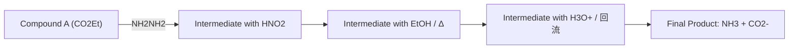

④ 将嘧啶的两个氮原子各用 3% 的  ${}^{15}$ N 标记，发现最终产物中同位素含量大约减少一半，说明一个环氮原子已被所用试剂中的氮原子所替代。

chemical

Reaction pathway of a brominated pyridine derivative under various conditions including temperature, water, and POBr3 catalysts

1903年，Zincke发现 $N-(2,4-$ 二硝基苯基)吡啶盐可以与胺发生交换反应，这一反应称为Zincke反应。 $N-(2,4-$ 二硝基苯基)吡啶盐与一分子伯胺共热时，胺对吡啶发生加成，引发吡啶开环。开链的中间体继续与第二分子胺作用得到König盐。König盐可以通过 $\sigma$ 重排反应或自身兼性离子的亲核加成生成环化中间体，这一步是反应的决速步。随后发生质子化并消除胺得到最终吡啶盐产物。

chemical

Nitration reaction pathway of nitrobenzene to form a bis-lactam salt, showing intermediate and subsequent reactions

## 5. 氧化还原反应

由于缺电子性，吡啶环通常较难被氧化。但与苯环相比，吡啶在催化氢化反应中表现得更加活泼，可以加氢生成六氢吡啶。该反应通常需要使用铂、钯或镍等催化剂。在催化剂的作用下，氢分子被活化并与吡啶环发生加氢反应。例如，N-(3-吡啶基)-3,4,5-三甲氧基苯甲酰胺在加氢后可以得到相应的六氢吡啶衍生物。这一六氢吡啶衍生物的商品名为曲昔派特（Taspogotran），可用于治疗消化道溃疡。

chemical

Chemical reaction equation showing hydrogenation of a piperidine derivative under H2 and 5% Pd/C catalyst at 70–80°C

## 6. 吡啶侧链  $\alpha-H$  的反应

吡啶在2位、4位或6位上的烷基 $\alpha$-H和羰基 $\alpha$-H类似，表现出一定的酸性，在碱作用下可形成稳定的负离子。吡啶侧链 $\alpha$-H的酸性通常比羰基 $\alpha$-H的酸性弱，但两者在酸性机制上具有相似之处。吡啶侧链的 $\alpha$-H酸性使得它在某些反应中表现出亲核性，能够进一步与其他电正性试剂反应。N-烷基吡啶盐的侧链  $\alpha-H$  更活泼，能够在弱碱性条件下发生侧链上的反应。

chemical

Multi-step organic synthesis reaction scheme involving pyridine derivatives and amide intermediates

虽然吡啶本身不易被氧化，但其侧链较容易被氧化成醛或羧酸。烷基取代吡啶发生侧链氧化，根据氧化剂的不同，分别生成吡啶甲酸衍生物或吡啶甲醛衍生物。

chemical

Chemical reaction pathway showing oxidation and reduction steps of a substituted pyridine derivative using O2/DMF, tBuOK, HNO3, SeO2, and KMnO4.

## 7. 吡啶的制备

吡啶及某些简单的烷基吡啶可以从煤焦油中提取。亲核取代和亲电取代反应是合成吡啶衍生物的常用途径。吡啶骨架则有多种合成策略，主要可以通过缩合反应制备。

（1）Hantzsch 吡啶合成法 两分子 $\beta$-二羰基化合物与醛和氨缩合生成二氢吡啶，随后经过氧化脱氢生成多取代吡啶，这是一种经典的吡啶合成方法，称为 Hantzsch 吡啶合成法。例如，$\beta$-酮酸酯与醛和氨反应，首先生成 1,4-二氢吡啶衍生物，再用硝酸进行氧化，最终得到吡啶-3,5-二甲酸双酯，后者可通过酯水解和脱羧进一步转化为取代吡啶。

chemical

Chemical reaction scheme showing the synthesis of a substituted pyridine derivative from ester and carboxylic acid under various conditions

(2)  $\beta-$ 二羰基化合物与氰基乙酰胺合成法

chemical

Chemical reaction pathway showing the synthesis of a chlorinated pyridine derivative from an aldehyde and a pyrrolidine derivative under different conditions (PCl5, H2/Ni)

(3)  $\beta-$ 二羰基化合物和  $\beta-$ 氨基- $\alpha,\beta-$ 不饱和羰基化合物合成法

chemical

Chemical reaction equation showing condensation between a ketone and a pyridine derivative under heating

在实际应用中，二氢吡啶的合成也可以通过分步反应实现。例如，在降压药物非洛地平的工业化合成中，采用了分步进行的合成方法，通过逐步构建二氢吡啶结构，确保合成效率和产物的高纯度。

chemical

Chemical reaction pathway showing conversion of a ketone to a pyrimidine derivative using dichloromethane and ammonia, leading to the formation of non-alkaldehyde.

## 8. 嘧啶的制备

β-二羰基化合物（或类似物）与脲、硫脲、胍和脒等化合物进行反应可以合成多种结构复杂的杂环化合物。常用的含氮化合物有:

脲

硫脲

胍

脒

以下为若干嘧啶衍生物骨架的合成举例:

chemical

Chemical reaction equation showing the synthesis of a pyridine derivative from an amino acid and ammonia under acidic conditions

chemical

Chemical reaction pathway showing the synthesis of a triazole derivative from an enone and amine under various conditions including NaOH, EtOH, and Raney Ni catalysts.

## 12.5.4 喹啉和异喹啉

喹啉和异喹啉是常见的芳香性稠杂环化合物。喹啉为无色吸湿性液体，具有强烈臭味，沸点为  $237\;^{\circ}C$ ，可溶于醇、醚等有机溶剂，但微溶于水。异喹啉的熔点为  $26.5\;^{\circ}C$ ，沸点为  $243\;^{\circ}C$ 。

喹啉 quinoline

异喹啉 isoquinoline

它们都是具有 10 个  $\pi$  电子的芳香性体系，氮原子上有一对孤对电子，具备碱性和亲核性。由于氮原子的吸电子作用，芳环的电子密度较低，特别是吡啶环的电子密度较苯环更低，亲电取代反应主要发生在苯环上。

## 1. 喹啉和异喹啉的碱性

与吡啶类似，喹啉和异喹啉也具有一定的碱性。其中，喹啉的碱性较吡啶稍弱，其共轭酸的  $pK_{a}$  为 4.94，而吡啶的  $pK_{a}$  为 5.23。相较之下，异喹啉的碱性略强于吡啶的碱性，共轭酸的  $pK_{a}$  为 5.40。当芳环上有给电子基团时，碱性会增强，例如 8-羟基喹啉的共轭酸  $pK_{a}$  为 5.13，碱性比喹啉强。

## 2. 喹啉和异喹啉的化学性质

（1）亲电取代反应 喹啉和异喹啉在酸的作用下，杂环中的氮原子能够接受质子，从而带有正电荷。因此，亲电取代反应难以在吡啶环上进行，而容易在苯环上发生，且主要位于5位和8位。然而，其反应活性低于苯和萘。例如，喹啉的硝化、磺化等亲电取代反应多在较高温度或更剧烈的条件下才能进行。

chemical

Nitration reaction equations of naphthalene under different conditions, showing yields and temperature variations

chemical

Chemical reaction scheme showing conversion of naphthalene to a sulfonamide under sulfuric acid and water conditions

（2）亲核取代反应 与吡啶相似，喹啉和异喹啉也能通过加成-消除机理或芳炔机理发生亲核取代反应，且相较于吡啶更为容易。反应中，喹啉的亲核取代主要发生在2位，而4位产物较少；如果2位被取代，反应发生在4位。异喹啉的亲核取代反应主要发生在1位，几乎不产生3位取代的产物。

chemical

Chemical reaction showing the synthesis of a fused heterocyclic compound from naphthalene under sodium ammonia and ammonia conditions

chemical

Chemical reaction equation showing chlorination of a naphthalene derivative using CH₂(COOEt)₂ in NaH at 140 °C

喹啉 N-氧化物在酰基化试剂存在下，也能够与亲核试剂发生反应，生成亲核取代产物。其反应机理与吡啶 N-氧化物的反应相似，通常是通过加成-消除的过程来实现的。氧上首先发生酰基化或磺酰基化而成为好的离去基团。这使得相较于通过 Chichibabin 反应引入氨基，喹啉 N-氧化物的亲核取代反应更加便捷。

chemical

Chemical reaction scheme showing the synthesis of a quinazoline derivative from naphthalene under different conditions (RNH2, TsCl, KCN, PhCOCl)

(3)氧化还原反应 一些强氧化剂可以将喹啉和异喹啉进行氧化断裂，形成单环化合物。氧化反应优先在电子密度较高的苯环上进行，因此吡啶环在反应中得以保留。这种选择性使得喹啉和异喹啉在氧化过程中的结构变化更为可控。

chemical

Chemical reaction equation showing conversion of a pyridine derivative to a substituted pyridine under KMnO4/KOH conditions

喹啉和异喹啉可以被还原，并且根据不同的反应条件会得到不同的还原产物。还原反应通常优先作用于相对缺电子的吡啶环。例如，在催化氢化或金属还原条件下，喹啉和异喹啉的吡啶环会首先被还原，得到部分或全氢化的产物。这种选择性还原使得吡啶环的双键优先与氢结合，逐步削弱其芳香性。

chemical

Chemical reaction pathway showing conversion of a naphthalene derivative to a fused heterocyclic compound using H2/Pt and Et2AlH/Et2O reagents

## 3. 喹啉和异喹啉的合成

合成喹啉环的经典方法之一是 Skraup 喹啉合成法。该反应将苯胺、甘油、硫酸和硝基苯（或其他氧化剂）混合，通过“一锅法”生成喹啉。反应具有较高的产率，并且操作简单，通常一步即可完成。

chemical

Chemical reaction equation showing the synthesis of a fused heterocyclic compound from benzenesulfonic acid and hydroxybenzaldehyde under concentrated sulfuric acid and phenyl nitrate conditions.

这一反应的机理还没有完全定论，一种历程大致如下所示。首先，甘油在浓硫酸的作用下发生脱水反应，生成丙烯醛。随后，丙烯醛与苯胺发生 Michael 加成，生成 3-苯氨基丙醛。此中间体在酸的作用下进一步发生环化、脱水反应，最终经过氧化脱氢形成喹啉。

flowchart

This image displays a chemical reaction pathway for Friedel-Crafts, showing the synthesis of a final product from starting materials like 1-aminobutyric acid and 2-methylamine via Michael addition to form a fused bicyclic structure.

推测的另一种反应途径相对较为复杂。苯胺与丙烯醛反应生成的 Schiff 碱，在酸促进下发生两分子反应生成 1,3-二氮杂环丁烷中间体，再经过开环关环等转化，最后脱去一分子 Schiff 碱生成 1,2-二氢喹啉。二氢喹啉同样经过氧化脱氢得到喹啉。

chemical

Reaction mechanism of Schiff base with ammonia and benzene, showing intermediates and electron transfer steps

如果用  $\alpha,\beta-$  不饱和醛或酮替代甘油，可以直接进行反应。例如，将苯胺与  $\alpha,\beta-$  不饱和酮混合反应，形成相应的喹啉衍生物。这种方法能够有效地合成喹啉结构，并且通常具备较高的选择性和反应速率。

chemical

Chemical reaction equation showing the synthesis of a substituted quinolinone derivative using FeCl3/ZnCl2 catalyst in ethanol

合成异喹啉的经典方法是Pomeranz-Fritsch反应。该反应涉及苯甲醛与2,2-二烷氧基乙胺（即 $\alpha$-氨基乙醛的缩醛）之间的缩合反应。反应首先形成亚胺，然后发生分子内的Friedel-Crafts反应，最后消除芳构化得到异喹啉。硫酸或Lewis酸等可用作催化剂。

chemical

Chemical reaction equation showing the formation of a fused heterocyclic compound from benzaldehyde and ethylamine

## 12.5.5 嘌呤

嘌呤 purine

嘌呤是一类重要的杂环化合物，其结构由两个环组成，即一个五元环（咪唑环）和一个六元环（嘧啶环）。嘌呤有9H-嘌呤和7H-嘌呤两个互变异构体，通常以9H-嘌呤为主。嘌呤为无色晶体，熔点约为212℃，具有一定的碱性，能与酸反应形成盐。

chemical

Chemical reaction showing conversion of compound 9H-嘌呤 to 7H-嘌呤

腺嘌呤（adenine）、鸟嘌呤（guanine）、尿酸（uric acid）和咖啡因（caffeine）都是嘌呤的重要衍生物。腺嘌呤和鸟嘌呤是DNA和RNA中的两种重要碱基，在遗传信息的存储和传递中发挥重要作用。腺嘌呤的衍生物ATP是细胞内能量转移的主要分子，参与细胞的能量代谢过程。腺嘌呤还参与细胞信号传导过程，通过cAMP等分子调节多种生理功能。尿酸是嘌呤代谢的最终产物，主要通过肾排出体外。尿酸过量可导致痛风等疾病。咖啡因则是最广泛使用的中枢神经系统兴奋剂。

腺嘌呤

鸟嘌呤

咖啡因

总的来说，含氮有机化合物种类繁多，数量庞大，展现了丰富的理化性质，在生物、医药、材料等领域有重要用途。

## 习题

1. Prelog 等发现 Tröger 碱 (+)-A 在稀酸介质中会缓慢发生消旋化，Greenberg 等则发现 (+)-B 在浓酸条件下不会消旋化。多个研究小组发现 Tröger 碱的类似物 (+)-B 不会发生类似的消旋化过程。请基于以上事实提出反应机理解释 Tröger 碱 (+)-A 在稀酸中消旋化的历程，并阐述为什么在浓酸条件下不会发生消旋化。

chemical

Chemical reaction scheme showing conversion of a quinazoline derivative to (+)-A and its subsequent reduction under dilute HCl and concentrated H+ conditions

chemical

Chemical reaction showing the formation of (+)-B from a benzimidazole derivative under HCl (aq.) conditions

2. 诺丁汉大学的 Denton 研究组设计了以下合成路线，从异戊醇出发以 43% 的总收率合成得到具有硫脲结构的抗结核药物 Thiocarlide。（1）请结合反应条件给出 Thiocarlide 的结构。（2）反应关键步骤异戊基芳基醚的合成使用了有机小分子催化条件下的 Mitsunobu 反应，请提出合理的反应机理解释其催化过程。

flowchart

3. 亚硝基苯（PhNO）可以替代 DEAD、DIAD 等缩合剂用于 Mitsunobu 反应，请为以下转化提出合理的反应机理。

chemical

Chemical reaction equation showing phenol reacting with carboxylic acid under PhNO and PPh3 conditions to yield a ketone product with 47% yield.

4. Roche 制药公司的达菲合成路线中以莽草酸为原料合成以下环氧关键中间体。请将反应补充完整，并写出这一步反应的转化机理。请推测为什么不在第一次双羟基保护时直接使用戊-3-酮，而是使用丙酮缩二甲醇。

chemical

Chemical reaction scheme showing conversion of benzoic acid to oxymers using various reagents and conditions

5. 推测产物是否有旋光性，并为下列转化提供合理的反应机理。

chemical

Chemical reaction equation showing conversion of a pyridine derivative to a carbonyl ester under PPh3 catalysis

6. 分析 Delépine 反应和 Sommelet 反应得到不同产物的原因。

7. 以下提供了一条氨基酸合成路线，请将反应补充完整，并给出化合物 B 转化为化合物 C 的反应机理。

flowchart

8. 环辛四烯的结构在芳香性的概念论证中有重要作用，曾通过伪石榴碱为原料合成，请根据以下提示完成具体的合成路线。

chemical

Chemical reaction pathway showing conversion of 伪石榴碱 to cyclohexene using bromine and cyclopropyl groups

9. 分析以下转化的反应产物，并解释生成相应产物的原因。

chemical

Chemical reaction pathway showing transformation of a steroid derivative with HNO2 under different conditions

10. 以下转化得到了单一异构体，请解释此反应的机理。

chemical

Chemical reaction equation showing condensation of a ketone with aniline under BF3·OEt2 and NaHCO3 conditions to form a fused bicyclic product

11. 将以下转化补充完整，最后在二甲苯加热条件下重排得到比例为 $1:1$ 的两种产物，而其类似物在加热条件下只得到单一产物。分析两者之间的差异，提出最后一步转化的关键中间体。

chemical

Organic synthesis reaction scheme showing multi-step transformation of a ketone derivative with formaldehyde, chloroform, and sulfonamide under specified conditions

12. 举例说明芳基重氮盐的自由基反应历程。
13. 对比芳基重氮盐与次磷酸和乙醇反应的差异。
14. 列举芳基重氮盐所能发生的偶联反应类型。

15. 画出甲基橙指示剂的作用机理。
16. 以邻氨基苯甲醛和苯乙酸为初始原料合成菲，写出合成路线。
17. 完成下列反应式并写出相应反应机理。

chemical

Chemical reaction equation showing synthesis of compound A from benzene and amide under specified conditions

18. 设计合理的合成路线。

19. 从简单原料出发合成维生素  $B_{6}$ 。
20. 写出下列反应的主要产物。

21. 写出下列反应的产物。

22. 解释下面两个实验结果。

chemical

Nitration reaction equation of benzene

23. 在酸性条件下，喹啉和异喹啉的亲电取代反应为什么在 C5 位和 C8 位上发生。
24. 分析喹啉的 N-氧化物的亲电取代反应在哪个位置发生并说明反应机理。
25. 用以下重氮盐为原料，设计曲坦类药物舒马曲坦的合成路线。通过文献查阅此药物的大规模制备路线。

chemical

Chemical structure of a sulfonamide derivative with chlorine, ethyl, and methyl substituents

26. 从简单原料出发合成以下化合物。

chemical

Two organic molecular structures: a substituted pyridine ring with phenyl and methyl groups, and a fused heterocyclic compound with nitro, ester, and ethoxy substituents.

27.“雷米封”是一种很好的医治结核病的药物，其结构如下，选用不超过四个碳的原料合成该化合物。

本章习题
参考答案

28. 写出苯肼和丙酮在氯化锌催化作用下生成 2-甲基吲哚的反应机理。
29. 写出陶贝合成法（Traube synthesis）合成尿酸的反应路线。
30. 具体说明吡啶和吡啶 N-氧化物在化学性质上的差异。
31. 写出 Chichibabin 反应及其反应机理。
32. 举例说明 ANRORC 机理。

(本章编者 张丹维、孙兴文)

13.1 基础知识……205 13.5 Alder-烯反应……228
13.2 电环化反应……209 13.6 周环反应在合成中的综合应用 … 229
13.3 环加成反应……216 习题……230
13.4 σ-迁移反应 223

## 13.1 基础知识

## 13.1.1 周环反应及其特点

19 世纪末至 20 世纪初，化学家们发现 1,3-共轭二烯与烯烃可以发生加成反应，但对其产物结构的鉴定存在争论。直至 1928 年，O. Diels 和 K. Alder 正确阐述了二烯合成产物的结构（图 13-1），还进一步将二烯合成反应进行了扩展应用。

chemical

Chemical reaction equation showing cycloaddition of a ketone to form a double product, with cyclohexene and cyclopropyl substituents

图13-1 对苯二醌与环戊二烯的加成反应

20 世纪 60 年代前后，化学家们发现前维生素 D2 的各种有趣转化（图 13-2）:前维生素 D2 在加热的条件下可以转化为焦钙化甾醇和异焦钙化甾醇，该反应是可逆的；前维生素 D2 在光照的情况下与光甾醇和麦角甾醇之间可以互相转化；前维生素 D2 可以进一步转化成维生素 D2（也称麦角钙化甾醇，ergocalciferol），该反应在避光的条件下进行缓慢，光照（即使是太阳光）可以使该反应大大加速。

以上这些反应不受酸、碱和溶剂极性的影响，既不产生自由基，也不形成离子型的活性中间体，不能用通常的离子型反应机理和自由基反应机理解释。反应在加热或光照的条件下就可以进行，而且在加热和光照条件下反应产物的立体结构不同，具有高度的立体选择性。还有许多重要的反应，如 Claisen 重排反应、Alder-烯反应和 Nazarov 环化等反应都有相似的特点。这些反应通常都经过一个环状过渡态，反应中旧键的断裂和新键的生成是同时发生且协同进行的，这一类反应称为周环反应（pericyclic reactions）。周环反应主要包括电环化反应（electrocyclic reactions）、环加成反应（cycloaddition reactions）、$\sigma-$迁移反应（sigmatropic rearrangements）和 Alder-烯反应（Alder-ene reactions）等。

chemical

Chemical reaction pathway showing conversion of vitamin D2 to pyrocalciferol, lumisterol, and ergosterol under sunlight

图 13-2 前维生素 D2 的周环反应

## 13.1.2 分子轨道对称性守恒原理

1965 年，著名有机化学家 R. B. Woodward 和量子化学家 R. Hoffmann 在大量实验事实和理论研究的基础上进行了总结，发现分子轨道的对称性是控制这一类反应进程的关键因素，提出了协同反应中分子轨道对称性守恒原理（conservation principle of the molecular orbital symmetry）。分子轨道对称性守恒原理认为:在协同反应中，由反应物到产物，轨道的对称性始终不变，即在分子轨道重新组合的过程中，分子轨道的对称性是守恒的。分子轨道对称守恒原理可以很好地解释和预测周环反应发生的条件和立体化学，但需要分析反应物和产物的分子轨道对称性。分子轨道对称性守恒原理的建立是有机化学的重大成就之一。

## 13.1.3 前线分子轨道理论

分子轨道对称性守恒原理的分析方法有多种，包括前线分子轨道理论、芳香性过渡态理论和轨道对称性一般规则等。本章主要在前线分子轨道理论的基础上进行讨论。

前线分子轨道理论由福井谦一（Kenichi Fukui）在1952年提出。前线分子轨道理论认为:在由原子结合成分子的化学反应中，原有的原子轨道通过线性组合成新目标分子的分子轨道，原来各原子所带电子重新从能级最低的分子轨道开始依次填充到各分子轨道上，这样进入成键轨道的电子数多于进入反键轨道的电子数，从而使体系能量降低。其中，被电子占据的能量最高的轨道称为最高占有轨道（highest occupied molecular orbital, HOMO），没有被电子占据的能量最低的轨道称为最低未占轨道（lowest unoccupied molecular orbital, LUMO）。有的共轭体系中含有奇数个电子，它的已占有电子的能级最高的轨道只有一个电子，这样的轨道称为单占轨道（singly occupied molecular orbital, SOMO），SOMO既是HOMO也是LUMO。HOMO和LUMO都称为前线分子轨道（frontier molecular orbital, FMO）。

前线分子轨道上的电子称为前线电子（frontier electron）。当两个分子相互作用时，前线电子是关键，相当于原子中的“价电子”。当一个分子的HOMO与另一个分子的LUMO相互作用时，即形成新目标分子中的成键轨道和反键轨道，前线电子以一定顺序填充到能量较低的成键轨道上，反键轨道则为无电子填充的空轨道，这样新目标分子体系的总能量得到降低。在由若干个小分子结合成新的分子时，对成键作出贡献的也是最外层的分子轨道和外层电子。

Hoffmann 和福井谦一因分子轨道对称性守恒原理和前线分子轨道理论共同获得 1981 年诺贝尔化学奖。Woodward 于 1979 年去世，否则他会毫无疑问地再次获得诺贝尔化学奖（1965 年，他因在天然产物合成方面的贡献获得了诺贝尔化学奖）。

## 13.1.4 直链共轭多烯的前线分子轨道及其对称性

分子轨道的对称性与对称操作元素有关。通常选用的对称元素有二阶对称轴 $(C_{2})$ 和对称面(m)。对称面垂直于分子所在平面且将其分为互为镜像的两个相等部分。 $C_{2}$ 为分子平面与对称面的交线（图13-3）。

text_image

m
分子所在平面
C₂

图 13-3 乙烯中  $\pi$  分子轨道的对称元素  $C_{2}$  和 m

若对某一对称元素操作后，其分子轨道得到“重现”，即与对称操作前完全一样，则称分子轨道对该对称元素是对称的，用 S 表示。若操作后分子轨道形状相同，但相位相反，则称分子轨道对该对称元素是反对称的，用 A 表示。

分子轨道对称性守恒原理的意义在于:在基元反应的整个反应过程中，反应物、过渡态及产物的分子轨道的对称性始终保持不变，是对称性允许的反应，反应所需活化能较低，可以顺利进行。如果在反应过程中分子轨道的对称性发生变化，则为对称性禁阻的反应。需要指出的是，对称性禁阻的反应并不是反应完全不能进行，只是协同反应时所需活化能很高，通常情况下不易发生。

分子轨道可用波函数 $\psi$ 表示，也可用几何图形表示。以乙烯为例，两个 $p$ 轨道组合成两个分子轨道 $(\psi_{1}$ 和 $\psi_{2})$ ，一个是 $\pi_1$ 成键轨道，另一个是 $\pi_2^*$ 反键轨道。图13-4给出了乙烯的 $\pi$ 轨道示意图和对称元素。从图13-4中可以看出，乙烯的 $\pi$ 和 $\pi^{*}$ 轨道对对称元素 $C_2$ 和 $m$ 的反映是不同的。

text_image

对称元素
C₂ m
ψ₂ (π₂*反键轨道) S A
ψ₁ (π₁成键轨道) A S

图13-4 乙烯的 $\pi$ 轨道示意图和对称元素

在丁-1,3-二烯中，四个 p 轨道组合成四个分子轨道（ $\psi_{1}$ ， $\psi_{2}$ ， $\psi_{3}$  和  $\psi_{4}$ ），其中  $\pi_{1}$  和  $\pi_{2}$  是成键轨道， $\pi_{3}^{*}$  和  $\pi_{4}^{*}$  是反键轨道。图 13-5 给出了丁-1,3-二烯的  $\pi$  轨道示意图和对称元素。

text_image

对称元素
C₂ m
ψ₄ { (π₃*, π₄*反键轨道)
ψ₃ A S
ψ₂ { (π₁, π₂成键轨道)
ψ₁ A S
A S

图13-5 丁-1,3-二烯的 $\pi$ 轨道示意图和对称元素

在已-1,3,5-三烯中，6个p轨道组合成6个分子轨道（$\psi_1$，$\psi_2$，$\psi_3$，$\psi_4$，$\psi_5$和$\psi_6$），$\pi_1$，$\pi_2$和$\pi_3$是三个成键轨道，$\pi_4^*$，$\pi_5^*$和$\pi_6^*$是三个反键轨道。图13-6给出了已-1,3,5-三烯的$\pi$轨道示意图和对称元素。

text_image

对称元素
C₂ m
ψ₆
S A
ψ₅ { (π₄*, π₅*, π₆*) (反键轨道) } A S
ψ₄
S A
ψ₃
A S
ψ₂ { (π₁, π₂, π₃) (成键轨道) } S A
ψ₁
A S

图13-6 己-1,3,5-三烯的 $\pi$ 轨道示意图和对称元素

烯丙基自由基（正离子、负离子）和戊二烯自由基（正离子、负离子）的  $\pi$  轨道如图 13-7 所示。虚线以下是成键轨道，虚线以上是反键轨道，处于虚线位置的是非键轨道。

text_image

反键轨道
非键轨道
成键轨道
烯丙基自由基的π轨道
戊二烯自由基的π轨道

图13-7 烯丙基自由基和戊二烯自由基的 $\pi$ 轨道示意图

由图 13-8 可以看到, 对共轭多烯自由基而言, 分子轨道中 HOMO 是  $\pi$  体系的非键轨道, 非键轨道上偶数碳原子上的电子密度为零, 而奇数碳原子上的电子密度数值相等, 但相位交替变化, 即每增加两个原子, 相位改变一次。

chemical

Diagram of a molecular chain with numbered atoms and bonds, showing a linear arrangement from 1 to 11

图 13-8 奇数碳原子共轭多烯自由基的非键轨道

## 13.2 电环化反应

## 13.2.1 电环化反应的定义和规律

线型共轭多烯经过环状过渡态, 共轭多烯的两个末端碳原子上的  $\pi$  电子环合成一个新的  $\sigma$  键, 生成比原来共轭多烯少一个碳碳双键的环烯烃反应及其逆反应称为电环化反应 (electrocyclic reactions)。

$\pi$ 键是由轨道经侧面平行重叠而形成的，而 $\sigma$ 键是由轨道轴向重叠形成的，因此在发生电环化反应时，末端的碳原子必须旋转才能发生环化。通常使用顺旋（conrotatory）和对旋（disrotatory）来描述电环化反应的环化过程。顺旋是指两根键朝同一个方向旋转，顺时针方向和逆时针方向均可。对旋是指两根键朝相反的方向旋转，向内和向外均可。环化过程的旋转方式决定产物的立体化学。