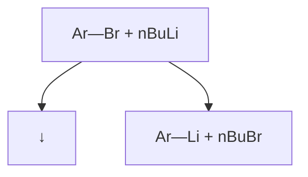
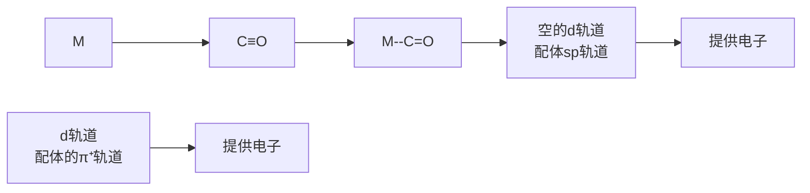

同面相互作用发生在体系的同一侧，异面相互作用发生在体系的两个相反侧面。对于  $\sigma$  体系，就同面相互作用而言，两个弧形曲线须同时画在  $\sigma$  键轨道的内叶或外叶，而对于异面相互作用，其中一根曲线要画在内叶，另一根曲线要画在外叶。

## 2. 碳原子 $[1,i]\sigma$ 迁移

碳原子发生[1,i] $\sigma$ 迁移，采用前线分子轨道理论可以深入了解这些反应。图13-21表示对一个角锥形基团的[1,3]和[1,5]碳迁移反应所作的分析。$\sigma$ 键可以被看作HOMO或LUMO，但通常都把它画成HOMO；$\pi$ 体系画作LUMO。基团进行[1,3]碳迁移时，要用 $\sigma$ 键的后部来保持同相位相互作用，在反应的过渡态中的迁移碳原子的杂化由 $\mathrm{sp}^3$ 转变成 $\mathrm{sp}^2$ ，最终产物的构型发生了翻转，发生了 $\sigma$ 键异面迁移过程，热重排是允许的。基团进行[1,5]碳迁移时，同样 $\sigma$ 体系画作HOMO，$\pi$ 体系画作LUMO，迁移碳原子直接移至 $\pi$ 体系的末端，相位匹配，产物构型保持不变，热重排经历 $\sigma$ 键同面迁移过程。

图13-21 碳原子[1,3] $\sigma$ 迁移和[1,5] $\sigma$ 迁移的立体化学

例如，二环[3.2.0]庚烯体系可以通过热重排转变成一个降冰片体系。当迁移基团是手性基团时，在发生[1,3]碳迁移过程中其立体化学发生翻转，表明发生了异面相互作用，与前面的预测相吻合。

chemical

Chemical reaction scheme showing transformation of a cycloalkane derivative under 300 °C to form a cyclic ketone, with stereochemistry indicated.

## 3. 氢原子 $[1, i]$ $\sigma$ 迁移

对于氢原子迁移，[1,5]氢迁移是较常见的一种 $\sigma$ 迁移方式，热重排经历同面迁移；[1,3]氢迁移必须在 $\pi$ 体系的异面发生，而这却是一个很难达成的几何方式，如图13-22所示。

chemical

Molecular orbital diagram showing LUMO and HOMO orbitals with electron density distribution

[1,5]氢迁移
允许

chemical

Molecular orbital diagram showing LUMO and HOMO orbitals with electron density clouds

[1,3]氢迁移
不允许

[1,2]氢迁移2电子允许

图13-22 氢原子[1,i]迁移情况

另一种 $\sigma$ 氢迁移是与碳正离子有关的[1,2]氢迁移，虽然不经常这样分析，但这种迁移包含在一个具有Hückel芳香性的两电子环状体系中。具体见碳迁移和氢迁移规则总结表（表13-3）。

表 13-3 [1,i]碳迁移和氢迁移规则

<table><tr><td>迁移类型</td><td>[1,i] σ迁移</td><td>同面或异面</td><td>允许或禁阻</td><td>立体化学</td></tr><tr><td rowspan="2">碳迁移</td><td>[1,3] σ迁移</td><td>异面</td><td>允许</td><td>翻转</td></tr><tr><td>[1,5] σ迁移</td><td>同面</td><td>允许</td><td>保持</td></tr><tr><td rowspan="3">氢迁移</td><td>[1,2] σ迁移(邻位是碳正离子情况)</td><td>同面</td><td>允许</td><td></td></tr><tr><td>[1,3] σ迁移</td><td>异面</td><td>不易进行</td><td></td></tr><tr><td>[1,5] σ迁移</td><td>同面</td><td>允许</td><td></td></tr></table>

[1,5]氢迁移经历了 $\pi$ 体系的同面迁移，它的立体化学已经被研究证实。如图13-23所示，该化合物具有 $S / E$ 立体构型（$S$ 表示四面体手性碳原子的立体构型，$E$ 表示双键的构型）。由于 $\sigma$ 键可以旋转，氢原子（蓝色标出）可以在 $\pi$ 体系的上方也可以在下方。通过允许的同面[1,5]氢迁移可以得到 $S / Z$ 和 $R / E$ 两种立体化学的产物，实际观察到了所预测的立体专一性，从而证实了[1,5]氢迁移的同面特性。

chemical

Hydrogenation reaction of a diene derivative under hydrogen-1,5σ conditions

图13-23 [1,5]氢迁移的立体化学

在1,3-环戊二烯结构中[1,5]氢迁移极易进行，该迁移过程的速率快到无法分离出单取代环戊二烯的各个单一的异构体，如方程式中所示的甲基环戊二烯，因为各异构体之间通过[1,5]氢迁移保持平衡，该反应看上去像是[1,2]氢迁移，但它其实是一个六电子的过程，所以用[1,5]氢迁移来描述更为恰当。

chemical

Chemical reaction mechanism showing cycloaddition of a cyclopentene with hydrogen and alkene substituents

## >>问题

## 13-8

请分析各种碳迁移和氢迁移过程中立体化学的变化，并举例说明。

## 4. 迁移反应在合成中应用

在合成 calyciphylline A 类虎皮楠生物碱骨架的方法中，人们采用氰酸酯到异氰酸酯的  $[3,3]-\sigma$  迁移重排构建六元环上的一个含氮手性中心（图 13-24），同时在氮原子上连接官能团为后续合成做准备。

chemical

Multi-step organic synthesis reaction scheme involving chlorinated benzene derivatives and OTBS reagents

图13-24 迁移反应在calyciphyllineA合成中的应用

## 13.5 Alder-烯反应

Alder-烯反应（Alder-ene reaction），又叫氢-烯丙基加成反应，这是一个基团转移的周环反应，亲烯体（enophile）经过烯丙基转移加成到烯烃上。该反应是由 Alder 等人发现的。

该反应是一个烯烃双键的2个 $\pi$ 电子和烯丙基C-H键的2个 $\sigma$ 电子与亲烯体的2个 $\pi$ 电子的六电子体系的周环反应。从前线分子轨道理论来看，Alder-烯反应就是烯丙基HOMO与亲烯体LUMO的相互作用，从图13-25可以看出，该反应是轨道对称性允许的反应，可以在加热（或Lewis酸）的条件下进行。如果在光照条件下，发生与另一个双键之间的[2+2]环加成，而不会发生Alder-烯反应。

chemical

Chemical reaction equation showing enolysis of enene to form enophile and then to form a cyclohexane derivative with HOMO and LUMO ligands

图 13-25 Alder-烯反应

以下给出了 Alder-烯反应的一些具体的实例。

chemical

Chemical reaction scheme showing the synthesis of a fused bicyclic ketone from an epoxide and a substituted cyclohexane under chlorination and 140°C conditions

## »问题 13-9 写出以下反应的产物。

chemical

Chemical reaction equation showing acetylation of an aldehyde with a cyclic ketone under heating

## 13.6 周环反应在合成中的综合应用

周环反应在合成中有着非常广泛的应用，历史上有很多精彩的例子。K. C. Nicolaou 等人在 endiandric acids 的全合成中就综合运用了多种周环反应。例如，在 endiandric acid A 的合成中，他们先后使用了  $8\pi$  体系的顺旋电环化、 $6\pi$  体系的对旋电环化和 Diels-Alder 环加成等周环反应。

chemical

Reaction pathway of endiandroic acid A using SiᵗBuPh₂ catalyst under diels-Alder conditions

L. E. Overman 等人在合成马钱子碱（strychnine）的时候，也运用了非常精彩的串联反应。二级胺首先与多聚甲醛原位生成亚胺正离子，然后发生 aza-Cope 重排，得到的中间体继续发生分子内 Mannich 反应，构建了马钱子碱核心的 5/6/6 三环骨架。

chemical

Chemical reaction pathway showing Mannich reaction to form strychnine via aza-Cope reagent

1. 完成下面的反应，包括产物明确的立体化学。

2. 给出以下反应的合理机理。

3. 试写出最后一步反应的机理，并解释产物的立体选择性。

chemical

Chemical reaction equation showing synthesis of a cyclic amide with tert-butyl and benzene under specified conditions

4. 试写出第一步和第二步(1)与(3)的机理。

chemical

Chemical reaction scheme showing synthesis of a complex from an imidazole derivative under specified conditions

5. 我国著名的有机化学家陆熙炎院士于1995年首次报道了叔膦催化的[3+2]环加成反应（如下）。这一反应被称为陆熙炎环化反应，多次被用于复杂天然产物的全合成。这一反应的[3+2]环加成是分步进行的，试写出该反应的催化机理。

chemical

Chemical reaction equation showing esterification of a ketone to form a cyclohexane derivative using PPh3 in benzene solvent

6. 角鲨烯(squalene)是一种从深海鲨鱼的肝油中分离得到的油状液体,后来人们发现角鲨烯也存在于橄榄油和人类分泌的皮脂中。角鲨烯具有丰富的生物活性，如携氧作用、抗氧化活性、抗肿瘤活性等，并因其润肤作用被应用于护肤品中。除了作为药物和保健品，角鲨烯还是生物体中各种各样的甾体化合物的来源。除了从自然界提取，人们很早就开始了对角鲨烯化学合成的研究。角鲨烯的一条全合成路线如下，试补充路线中的中间体，并说明涉及的周环反应及其机理。

chemical

Organic synthesis reaction scheme showing multi-step transformations of aldehyde, carboxylic acid, and squalene with reagents and conditions

【提示】Johnson-Claisen 重排的前体:

chemical

Chemical reaction scheme showing hydrolysis of a cyclohexanol derivative using ethyl acetate and ethylene, followed by acidification to form a cyclic ester product.

(本章编者 俞寿云、沈增明)

本章习题
参考答案

14.1 金属有机化学的起源和发展 … 233 14.5 偶联反应简介 … 242
14.2 金属有机化学的定义 …… 234 14.6 钯催化剂前体 …… 251
14.3 过渡金属配合物的结构特点 … 235 习题 … 252
14.4 四大基元反应 239

金属有机化学（organometallic chemistry）包括无机化学中关于配合物的研究和有机化学的合成方法，主要研究有机分子或官能团和无机金属元素之间的相互作用，并融入了其他学科。金属有机化学极大地拓展了有机化学的范畴，例如钯催化的碳碳键偶联反应革新了传统构筑化学键的模式，有力提升了人类的分子合成能力，如今已经得到广泛应用。在学习本章之前，读者需要复习《无机化学》中配位化学相关内容。

## 14.1 金属有机化学的起源和发展

1757 年，法国化学家 Cadet de Gassicourt 在将含砷的钴矿石与醋酸钾混合来试验隐形墨水的过程中，偶然分离得到了四甲基二肿，又名二甲肿。虽然砷本身并不是真正的金属，但具有和金属类似的一些性质，称为类金属，因此四甲基二肿被认为是第一种金属有机化合物。1927 年，丹麦有机化学家 Zeise 通过将四氯化铂加入沸腾的乙醇中，合成了第一种含有过渡金属的金属有机化合物——三氯-(乙烯)-铂合钾（Zeise 盐，蔡司盐）。在当时，学术界对 Zeise 盐的结构有许多质疑，直到 20 世纪 X 射线晶体学的出现才验证了其结构的正确性。尽管当时的化学家并不确切知道这种化合物形成的原因或方式，然而 Zeise 盐的合成引发了人们对金属有机化合物的兴趣。1848 年，Frankland 利用锌和碘乙烷合成了二乙基锌。1890 年，英国化学家 Mond 合成了四羰基镍，开创了一种全新的化合物类型，称为金属羰基化合物。

$As_{2}(CH_{3})_{4}$ 
四甲基二肿

$K^{+}[PtCl_{3}(C_{2}H_{4})]^{-}$ 
蔡司盐

Ni(CO) $_{4}$ 
四羰基合镍

$Zn(CH_{2}CH_{3})_{2}$ 
二乙基锌

法国化学家 Barbier 和 Grignard 发现，烷基/芳基卤代物与金属反应后生成的试剂可以与酮/醛发生亲核加成生成醇，在此基础上发展了有机镁试剂（也称格氏试剂，Grignard reagent）。相关的研究席卷了 20 世纪初的化学实验室，Grignard 也因此获得 1912 年诺贝尔

在二茂铁被正式报道之前，人们曾经两次意外合成了该化合物，但没能确认结构。其实，即使在Pauson和Kealy的报道中，二茂铁也被误认为具有链式结构。

二茂铁

化学奖。一百多年后的今天，格氏试剂仍然被广泛用作亲核试剂。

1913 年，瑞士化学家 Werner 因其提出的配位理论而获得了诺贝尔化学奖，他对氯化六氨合钴(Ⅲ)等化合物的结构研究对化学家进一步深入探索金属有机配合物的结构和参与的反应提供了帮助和启发。

chemical

Chemical structure of a cobalt complex with NH3 substituents and 3 Cl⁻ counterion

氯化六氨合钴

1951年美国化学家Pauson和Kealy通过将环戊二烯基溴化镁和氯化铁加热反应，首次报道了橙色的二茂铁的合成。随后，英国化学家Wilkinson与美国化学家Woodward合作，揭示了二茂铁的夹心结构，即铁夹在两个环戊二烯负离子之间。在二茂铁中，每个环戊二烯负离子都表现出芳香性，两个环戊二烯负离子上所有12个电子与铁原子的d轨道成共价键，形成了非常稳定的18电子结构。与此同时，德国化学家Fischer独立得出了相同的结论，认识到这种夹心化合物的形成是环戊二烯配体与金属相互作用的结果。随后，Fischer将夹心金属化合物扩展到其他金属，如Cr、Zr、Ru、Ni、Co等。Wilkinson与Fischer因在金属有机领域的杰出贡献而共同获得1973年诺贝尔化学奖。

$C_{10}H_{10}Fe$

二茂铁

$C_{10}H_{10}Cl_{2}Zr$

双(环戊二烯)二氯化锆

$C_{10}H_{10}Ni$

二茂镍

$C_{14}H_{18}Cr$

二苯铬

这些金属有什么特点？能参与什么反应？如何参与反应？在之前学习过的主族金属试剂的基础上，本章学习过渡金属的特点及性质，再以此为基础学习金属参与反应的基本方式——四大基元反应，最后对常用的过渡金属催化的有机反应进行简要介绍。

二茂铁的发现是金属有机化学早期研究最重要的内容之一。化学家 Ziegler 和 Natta 发展了以双(环戊二烯基)二氯化锆(IV)为代表的催化剂，实现了末端烯烃的聚合反应。这一研究催生了两大类金属有机催化剂:过渡金属（IVB 族金属，如 Ti、Zr、Hf）催化剂和有机铝助催化剂。这些试剂现在称为 Ziegler-Natta（齐格勒-纳塔）催化剂，他们二人于 1963 年获得了诺贝尔化学奖。此后，过渡金属有机化学迎来了蓬勃发展，21 世纪以来有三次诺贝尔化学奖颁发给了过渡金属催化相关的成果。2001 年诺贝尔化学奖授予在过渡金属催化不对称氢化和钛催化不对称氧化反应领域做出突出贡献的 Knowles、Noyori 和 Sharpless；2005 年诺贝尔化学奖授予在过渡金属催化烯烃复分解反应领域做出突出贡献的 Chauvin、Schrock 和 Grubbs；2010 年诺贝尔化学奖授予在钯催化交叉偶联反应领域做出突出贡献的 Heck、Negishi 和 Suzuki。

## 14.2 金属有机化学的定义

金属有机化学是研究金属-碳键及金属-氢键形成与断裂的反应。

在理解金属有机化合物性质之前，先回顾有机化学中的极化作用。分子由原子通过共价键构成，但共价键中的电子并不总是在原子之间均匀共享。当两个电负性明显不同的原子形成一个共价键时，电负性较高的原子上会积累部分负电荷（用符号  $\delta-$  表示），电负性较低的原子则相应地带有部分正电荷（用符号  $\delta+$  表示）。在许多有机官能团中（如羰基），碳与电负性更高的元素结合，使相应碳带有部分正电荷和亲电性。如下所示，巯基负离子和 1-氯正丁烷的取代反应、甲氧基负离子和环氧化合物的开环反应、醛的还原反应都属于对亲电性碳的进攻。

chemical

Reaction mechanism diagram showing photochemical transformations of acrylate (SN2) and its oxidation products with NaBH4 elimination

| F | O | Cl |
| --- | --- | --- |
| 3.98 | 3.44 | 3.16 |
| N | Br | I |
| 3.04 | 2.96 | 2.66 |
| S | C | Au |
| 2.58 | 2.55 | 2.54 |
| H | Pd | P |
| 2.20 | 2.20 | 2.19 |
| B | Ag | Ni |
| 2.04 | 1.93 | 1.91 |
| Si | Cu | Zn |
| 1.90 | 1.90 | 1.65 |
| Al | Mg | Li |
| 1.61 | 1.31 | 0.98 |

部分元素的电负性
Pauling
electronegativity

当碳与电负性较低的元素、特别是金属结合时，它则带有部分负电荷，表现出亲核性。这种极化作用及其对分子反应性的影响是理解金属有机化合物性质的关键。金属有机化合物中，金属具有较低的电负性，碳倾向作为亲核试剂（或碱）。我们已经学习过的三种金属有机化合物:有机锂化合物、有机镁化合物和有机铜试剂（Gilman试剂）都表现出一定的亲核性和碱性。在过渡金属配合物中，通过调节金属价态和配体，能够进一步调节相应碳-金属键的性质。

chemical

Chemical structure of lithium compound showing hydrogen bonding between carbon and lithium groups

碳的电负性为2.55

## 14.3 过渡金属配合物的结构特点

过渡金属配合物包括中心金属和配体两个部分。本部分将简要介绍配体类型、18电子规则、中心金属氧化态、中心金属所形成的化学键等内容。

## 14.3.1 配体类型

配体作为能提供一对或多对电子给中心金属原子的分子或离子，在配位化合物的形成中扮演关键角色。根据其与金属原子配位的齿数（即配位原子数），配体通常可分为以下三类:单齿配体、多齿配体（也称为螯合配体）及大环配体。

锂试剂通常由正丁基锂与卤代物通过锂卤交换反应制备，并原位发生后续反应。

flowchart

## 1. 单齿配体

单齿配体是指在配位化合物中，只有一个供电子的原子与中心金属原子形成配位键的配体。这类配体通常只与一个金属原子配位，但在某些情况下，也可以通过桥联作用与两个金属原子配位。典型的单齿配体包括水分子（$\mathrm{H}_2\mathrm{O}$）、氨（$\mathrm{NH}_3$）、一氧化碳（CO）、膦（$\mathrm{PR}_3$）等。例如，在 $[\mathrm{Cu}(\mathrm{NH}_3)_4]^{2+}$ 中，每个 $\mathrm{NH}_3$ 分子通过其氮原子与铜离子形成配位键。

## 2. 多齿配体

多齿配体（螯合配体）具有多个供电子原子，可以同时与一个或多个金属原子形成多个配位键。这类配体的配位模式更为复杂，通常能形成更加稳定的配位化合物。常见的多齿配体包括乙二胺、联吡啶、1,10-菲咯啉、二酮、双膦等具有两个配位点的配体，三联吡啶等具有三个配位点的配体，以及酞菁、卟啉等具有四个配位点的配体等。这些多齿配体通过它们的多个配位点与中心金属原子结合，形成环状的螯合环，大大增加了配位化合物的稳定性。以乙二胺（en）为例，它是一个双齿配体，其两个氮原子可以同时与一个中心金属形成配位键，如在 $\left[\mathrm{Ni}(\mathrm{en})_{3}\right]^{2+}$ 中，三个乙二胺分子与一个镍离子配位，形成一个高度稳定的配合物。

chemical

Molecular structure of [Ni(en)3]²⁺ ion, showing nickel center coordinated with hydrogen atoms and ligands

chemical

Molecular structure of a symmetric heterocyclic compound with two pyridine rings and a central nitrogen-containing heterocycle

酞菁
phthalocyanine

chemical

Chemical structure of a purine derivative with two NH groups and six fused pyridine rings

卟啉
porphyrin

## 3. 大环配体

大环配体是一类特殊的多齿配体，它们含有一个大的环状结构，能够通过环内多个供电子原子与中心金属原子形成稳定的螯合复合物。这类配体的典型例子包括冠醚、环糊精和多酮等。由于其独特的结构，大环配体在配位化学和超分子化学中具有重要的应用，也可用于催化、分子识别和药物输送等领域。

配体的种类及其与金属原子的配位方式是理解配位化学的基础。单齿配体、多齿配体和大环配体这三类配体，因其结构的不同，展现出不同的配位特性和化学反应性，这为设计和合成新型配位化合物提供了广泛的可能性。

## 14.3.2 18 电子规则

1927 年，Sidgwick 提出配位键起源于配体向金属中心提供电子对。他认为，金属配合物拥有 18 个电子，可能表现出良好的热力学稳定性。研究表明，许多过渡金属配合物在其价层达到 18 个电子时最为稳定。和主族元素不同，过渡金属配合物价层轨道的一个 s 轨道（2 电子）、三个 p 轨道（6 电子）和五个 d 轨道（10 电子）均参与成键，合计 18 个电子，称为 18 电子规则。该规则类似于主族元素遵守的“八隅体规则”。18 电子规则在合成、催化及理解金属配合物的性质和反应机制方面都具有重要意义。例如，在合成一种新的催化剂或配合物时，化学家会尝试引入不同的配体来调整中心金属的电子数目，以达到或接近18电子结构。值得注意的是，18电子规则并不是绝对的，存在许多例外的情况。一些稳定的配合物可能有16个电子或20个电子，特别是那些后过渡金属（如铂、金等），因为它们的d轨道能量更低，对电子的吸引力更强。表14-1给出了常见过渡金属的价电子数。

表 14-1 常见过渡金属的价电子数

<table><tr><td rowspan="2">族价电子数目</td><td>IVB</td><td>VB</td><td>VIB</td><td>VII B</td><td></td><td>VIII</td><td></td><td>I B</td></tr><tr><td>4</td><td>5</td><td>6</td><td>7</td><td>8</td><td>9</td><td>10</td><td>11</td></tr><tr><td>3d 电子</td><td>Ti</td><td>V</td><td>Cr</td><td>Mn</td><td>Fe</td><td>Co</td><td>Ni</td><td>Cu</td></tr><tr><td>4d 电子</td><td>Zr</td><td>Nb</td><td>Mo</td><td>Tc</td><td>Ru</td><td>Rh</td><td>Pd</td><td>Ag</td></tr><tr><td>5d 电子</td><td>Hf</td><td>Ta</td><td>W</td><td>Re</td><td>Os</td><td>Ir</td><td>Pt</td><td>Au</td></tr></table>

18 电子规则计算方法的详细内容请阅读《无机化学》中配位化学相关章节的内容。以下是一般计算步骤:

计算中心金属的价电子数:查找中心金属的价电子数目，这通常是其原子序数的最后一个d轨道上的电子数加上最外层的s轨道电子数。

计算配体提供的电子数:对于每个配体，确定它提供给中心金属的电子数。单齿配体通常提供2个电子，而多齿配体则根据其齿数提供相应的电子数。例如，一个双齿配体会提供4个电子（每个齿2个），而一个三齿配体会提供6个电子。

桥联配体电子数的调整: 通常每个桥联配体只提供一个电子对, 中心金属之间共享电子, 因此在计算电子数时注意不能重复。

正负电荷的考虑:如果配合物整体带有正或负电荷，需要相应地减去或加上电子数，因为带正电荷的配合物意味着它失去了电子，而带负电荷则意味着它获得了电子。

总电子数的计算:将所有配体提供的电子数目加上中心金属的价电子数目并考虑电荷，计算总电子数。

18 电子规则只是一个指导原则，并非所有金属配合物都遵守:如果总电子数等于 18，则该配合物符合 18 电子规则，预期是稳定的。如果少于或多于 18 电子，那么该配合物不符合 18 电子规则，但这不一定意味着它就不稳定，这取决于其他因素。例如，在铁羰基配合物 Fe(CO) $_{5}$ 中，铁的价电子数为 8 个（6 个来自 3d 轨道，2 个来自 4s 轨道），每个羰基配体提供 2 个电子，共提供 10 个电子，总电子数为 18 个，因此符合 18 电子规则；而在钒氨基配合物 $[V(NH_{3})_{6}]^{3+}$ 中，钒的价电子数为 5 个，每个氨配体提供 2 个电子、6 个氨配体共提供 12 个电子，配合物带 3 个正电荷，因此总电子数为 17 - 3 = 14 个，不符合 18 电子规则，但仍然是稳定的。

## 14.3.3 中心金属氧化态

中心金属的氧化态指的是金属原子在配合物中的有效电荷状态，即它失去或获得电子的数目，这是影响金属配合物化学性质的关键因素之一。不同的氧化态可以导致中心金属的电子结构发生变化，从而影响配合物的反应性和稳定性。此外，金属的氧化态还可以影响其与配体的结合能力和整个配合物的几何构型。确定中心金属的氧化态的方法如下:

配合物的总电荷:配合物的总电荷通常在化学式中给出，如 $\left[\mathrm{Fe}(\mathrm{CN})_{6}\right]^{4-}$ ，配合物的总电荷是-4。

大位阻的配体会妨碍中心金属形成18电子结构，例如  $\mathrm{Pt}(\mathrm{P}^{\prime}\mathrm{Bu}_{3})_{2}$  是14电子的。

配体的电荷:确定每个配体的电荷。一些常见的配体，如  $NH_{3}$  和 CO，是中性的，对总电荷没有贡献。而  $CN^{-}$  和  $HO^{-}$  等阴离子配体，每个会贡献 -1 的电荷。

计算:通过配合物的总电荷与所有配体的电荷总和相减，可以得出金属的氧化态。例如，在 $\left[\mathrm{Fe}(\mathrm{CN})_{6}\right]^{4-}$ 中，每个 $CN^{-}$ 配体贡献-1电荷，共有6个 $CN^{-}$ ，那么总的贡献是-6电荷。配合物总电荷是-4，所以Fe的氧化态是+2，具体计算方法为-4(配合物电荷)-(-6)(配体电荷)=+2(金属的氧化态)。

符号:氧化态用罗马数字表示，并在金属元素的符号之后以括号形式给出，例如 Fe(II) 表示铁的氧化态是 +2。

## 14.3.4 中心金属所形成的化学键

齿合度（hapticity）是指一个配体中和中心金属配位的连续的原子个数，用Hapto数 $\left(\eta^{n}\right)$ 表示。

齿合度

中心金属所形成的化学键对于理解配位化合物至关重要。在这类化合物中，金属原子或离子通常位于中心位置，与一个或多个配体原子形成化学键。这些化学键的性质和特点如下:

配位键:配位键是配体提供一对电子，与金属形成的共价键。配位键主要可以分为  $\sigma$  键和  $\pi$  键， $\sigma$  键是通过配体的单个原子提供的孤对电子和中心金属的空轨道“头对头”重叠形成的。若配体有 p 或 d 轨道，则可以进一步和金属的 d 轨道通过“肩并肩”重叠形成  $\pi$  键。

金属-金属键:在某些多核配合物中，金属原子之间可以直接形成金属-金属键，这些键可能是单键、双键甚至叁键，取决于所涉及的轨道。

桥联配体:在一些配合物中，一个配体可以同时与两个或多个中心金属形成配位键，这种配体称为桥联配体。例如，CO 可以作为桥联配体与两个中心金属成键。

配体和中心金属成键后，两者的性质都会发生改变。如下所示，当配体和金属形成  $\sigma$  键时，配体的  $sp^{n}$  轨道和金属的空轨道（dsp）重叠，配体的孤对电子填充到金属的空轨道中。该配位方式使得金属的电子密度升高，更富电子。

chemical

Diagram of molecular orbital interaction involving dispersion and spin components

烯烃和过渡金属的配位模型是由 Dewar、Chatt 和 Duncanson 提出来的 (Dear-Chatt-Duncanson model)，用于解释 Zeise 盐的结构。通过反馈键使烯烃的碳碳键的强度降低，这种降低的程度取决于金属的性质。

金属填充电子的 d 轨道也可以和配体的空轨道成键，例如对称性相同的 d 轨道和配体  $\pi^{*}$  轨道形成的反馈键（back-bonding）会使金属的电子密度降低。又如，过渡金属和 CO 形成羰基配合物（metal carbonyls），CO 配体中碳原子上的孤对电子和金属空轨道形成配位键，同时金属的 d 轨道和 CO 的  $\pi^{*}$  轨道形成配位键。

flowchart

当配体（不饱和键）和金属配位形成  $\pi$  键配合物时，配体的  $\pi$  电子和金属的空 d 轨道成键，同时金属的 d 轨道电子和配体的  $\pi^{*}$  轨道成键，形成配位键和反馈键，所形成的配合物中，金属和配体不饱和键所在的平面互相垂直。

chemical

化学反应示意图，展示金属轨道从空轨道到d轨道的电子迁移过程及最终聚合物生成的反应

## 14.4 四大基元反应

过渡金属有机化合物的反应种类繁多，要将其分类非常困难。随着人们对过渡金属有机化学认识的不断深入，逐渐将其归纳为若干基元反应。需要注意的是，这些基元反应并非基于机理的分类，而只是对反应的分类，以便于人们认识、学习、研究和讨论反应，并能够在一定程度上预测反应结果。本部分将学习常见的四种基元反应，包括配体的配位与解离反应、氧化加成反应与还原消除反应、插入反应与反插入反应、配合物中的配体接受外来试剂的进攻反应。

## 14.4.1 配体的配位与解离反应

$$
\mathrm{ML} _ {3} + \mathrm{L} ^ {\prime} \Longleftrightarrow \mathrm{ML} _ {3} \mathrm{L} ^ {\prime} \quad K = \frac {[ \mathrm{ML} _ {3} \mathrm{L} ^ {\prime} ]}{[ \mathrm{ML} _ {3} ] [ \mathrm{L} ^ {\prime} ]}
$$

配体 $\mathrm{L}'$ 与配合物 $\mathrm{ML}_3$ 发生配位可生成 $\mathrm{ML}_3\mathrm{L}'$ ，该过程的平衡常数为 $K$ 。当 $K$ 值较大时，配合物 $\mathrm{ML}_3\mathrm{L}'$ 的稳定性较高，相应的反应活性较低（因为金属配位饱和）；当 $K$ 值较小时，金属配合物的稳定性较差。因此，具有较高反应活性的金属配合物往往具有两个特点:① 中心金属M易与配体 $\mathrm{L}'$ 配位生成配位饱和的配合物（一般遵循18电子规则），便于分离纯化，进而能够稳定保存和使用；② 金属配合物在特定的条件下易于解离，生成配位不饱和的配合物，解离后的金属配合物往往具有较高的活性，易和反应底物配位。

例如，经典的过渡金属催化剂 $\mathrm{Pd}(\mathrm{PPh}_3)_4$ ，中心金属Pd满足18电子规则，稳定性较好，能够在氮气氛围中较长时间保存。而在反应溶液中，一分子 $\mathrm{PPh}_3$ 会发生配体的解离，形成配位不饱和的 $\mathrm{Pd}(\mathrm{PPh}_3)_3$ 配合物，进而与其他分子发生配位并参与反应。一般情况下，配体的解离和配位往往是金属有机化合物参与反应的起始点。

$$
\mathrm{Pd} (\mathrm{PPh} _ {3}) _ {4} \quad \rightleftharpoons \quad \mathrm{Pd} (\mathrm{PPh} _ {3}) _ {3} \quad + \quad \mathrm{PPh} _ {3}
$$

不同电子的金属配合物在催化反应时，活性会有较大差别。

$$
\begin{array}{c} \mathrm{PPh} _ {3} \\ | \\ \mathrm{Ph} _ {3} \mathrm{P-Pd-PPh} _ {3} \\ | \\ \mathrm{PPh} _ {3} \end{array}
$$

18 电子

稳定配合物

$$
\begin{array}{c} \mathrm{PPh} _ {3} \\ | \\ \mathrm{Ph} _ {3} \mathrm{P-Pd-PPh} _ {3} \end{array}
$$

16 电子

$$
\mathrm{Ph}_3\mathrm{P} - \mathrm{Pd} - \mathrm{PPh}_3
$$

14 电子

高催化活性

## 14.4.2 氧化加成反应与还原消除反应

过渡金属催化反应的过程中往往伴随着中心金属价态的改变。一般将中心金属价态升高的过程称为氧化加成反应（oxidative addition），将中心金属价态降低的过程称为还原消除反应（reductive elimination）。下面分别介绍氧化加成反应和还原消除反应。

## 1. 氧化加成反应

大多数过渡金属（以 4d、5d 金属为主）在氧化加成反应中往往经历如下所示的双电子转移过程，即中心金属价态升高 2 价的过程。

根据前文中所学的金属中心的电子结构，金属在发生氧化加成反应时需要一个空轨道。在反应中，催化剂先与底物配位，再发生氧化加成反应。

$$
\mathrm{M} ^ {n} + \mathrm{A} - \mathrm{B} \quad \Longleftrightarrow \quad \begin{array}{c} \mathrm{A} \\ \mathrm{B} \end{array} \mathrm{M} ^ {n + 2}
$$

中心金属与一根共价键（$\sigma$ 键或 $\pi$ 键）发生化学键的断裂和重组，一般表现为共价键A-B发生断裂，中心金属M同时与A、B相连，形成M价态升高的新金属配合物A-M-B。常见的反应模式有两种形式:低价金属或其配合物对 $\sigma$ 键的氧化加成；低价金属或其配合物对 $\pi$ 键的氧化加成。

此外，在过渡金属催化的过程中，铁、钴、镍（以 3d 金属为主）等金属容易发生仅失去一个电子的氧化加成过程，即金属价态只升高 1 价，称为单电子氧化加成。

$$
\begin{array}{c} \mathrm{A-B} \\ \downarrow \\ \mathrm{M} ^ {n} + \mathrm{A} ^ {\cdot} \iff \mathrm{A-M} ^ {n + 1} \end{array}
$$

影响氧化加成反应的因素:

（1）富电子配体 由于在氧化加成反应过程中，中心金属失去电子，其电子密度降低，而富电子配体的配位有利于稳定这一过程，促进氧化加成反应的发生或改变氧化加成反应的速率。例如，不同类型的三烷基膦配体的给电子能力顺序为:$\mathrm{PMe}_3 < \mathrm{PEt}_3 < \mathrm{P}^i\mathrm{Pr}_3 < \mathrm{P}^t\mathrm{Bu}_3$。在大多数反应中，使用 $\mathrm{P}^t\mathrm{Bu}_3$ 作为配体时，其氧化加成的速率一般高于以 $\mathrm{PMe}_3$、$\mathrm{PEt}_3$、$\mathrm{P}^i\mathrm{Pr}_3$ 为配体时氧化加成反应的速率。
（2）亲电试剂 具有亲电性的极性底物通常被认为是较好的氧化加成试剂。例如，烷基卤代物（R-X）、芳基卤代物（Ar-X）易与低价态的铂族金属配合物发生氧化加成反应。卤代烃与过渡金属的氧化加成可看作过渡金属对卤代烃的亲核取代反应。以芳基卤代物为例，当Ar带有吸电子基时，氧化加成的速率快；卤素的离去性能也影响氧化加成，一般反应活性为 $\mathrm{I} > \mathrm{Br} > \mathrm{Cl}$，而氟代烃几乎不能发生氧化加成反应。

$$
\mathrm{PdL} _ {n} + \mathrm{R-X} \Longleftrightarrow \mathrm{L} _ {n} \mathrm{Pd} _ {\mathrm{X}} ^ {\mathrm{R}}
$$

键能较高的化学键一般难以发生氧化加成反应，但如果在氧化加成过程中能够形成一种较为稳定的金属螯合物中间体使反应体系能量降低，则能促进氧化加成过程的进行。例如，下图所示的螯合配位促进的氧化加成例子中，B是具有一定配位能力的基团，中心金属M和B配位后，再对较为惰性的C-A氧化加成，形成稳定的环状金属螯合物，从而促进了该氧化加成过程的发生。

$$
\text {C} _ {\mathrm{CH}} ^ {- \mathrm{A}} \mathrm{B} + \mathrm{M} \longrightarrow \text {C} _ {\mathrm{CH}} ^ {- \mathrm{M}} \mathrm{B} ^ {\mathrm{A}}
$$

## 2. 还原消除反应

还原消除反应是中心金属上的两个配体以形成  $\sigma$  键的形式消去，中心金属的配位数减少并伴随着中心金属的氧化态降低的反应。从中心金属价态变化的角度理解，还原消除反应可以看作氧化加成反应的逆过程。与氧化加成过程类似，大多数过渡金属在还原消除反应过程中也经历双电子的还原消除过程。

$$
\mathrm{M} _ {\mathrm{B}} ^ {\mathrm{A}} \quad \Longleftrightarrow \quad \mathrm{M} + \quad \mathrm{A-B}
$$

影响还原消除反应的因素:一般来说，大位阻的配体会促进还原消除。此外，向反应中加入额外的可分散中心金属电子的配体也可以促进还原消除，主要包括以下两类。

（1）吸电子烯烃 吸电子烯烃是一种  $\pi$  酸，能接受过渡金属 d 轨道电子的反馈。反应体系中加入吸电子烯烃与中心金属配位后，金属的电子流向烯烃，从而促进了还原消除过程。如下所示，联吡啶配位的二烷基镍配合物具有较高的稳定性，但加入吸电子烯烃后，还原消除反应得以实现，且随着烯烃上基团吸电子能力的上升，其还原消除反应加快。

chemical

Chemical reaction equation showing nickel complex formation with R-group elimination and reduction to form nC4H10

（2）一氧化碳 CO 是一种  $\pi$  酸，在反应体系中通入 CO 能促进金属配合物的还原消除反应，因为 CO 具有较强的配位能力，并且具有较强的电子接受能力。配位过程中，金属上的电子反馈到 CO 的  $\pi^{*}$  轨道上，降低金属和待消除配体之间化学键的电子密度，从而促进了还原消除过程。

除上述原因外，影响氧化加成和还原消除的因素还有很多，需要在具体反应中加以讨论和理解。

## 14.4.3 插入反应与反插入反应

## 1. 插入反应

插入反应（也称迁移插入，migratory insertion）是指不饱和键插入 M-R 键中，形成新的金属配合物。一般来说，插入反应主要分为如下所示两类:M-R 被不饱和键 A=B 插入后，A=B 的 π 键发生断裂，形成新的 A-M 和 B-R 键（1,2-插入）；M-R 被不饱和键插入后，A=B 分子中两个原子只有一个原子同时与金属及配体相连，形成新的 A-M 键和 A-R 键（1,1-插入）。

$$
\begin{array}{l l l l} \mathrm{M-R} & + & \mathrm{A=B} & \longrightarrow \\ & & & \mathrm{M-R} \\ \mathrm{M-R} & + & : \mathrm{A} \stackrel {{\leftarrow}} {{=}} \mathrm{B} & \longrightarrow \end{array} \quad \begin{array}{l l l l} \mathrm{M-R} \\ \mathrm{A-B} \\ \mathrm{M-A-R} \\ \mathrm{B} \end{array}
$$

（1）烯烃的插入反应 不饱和烃的插入反应是过渡金属催化反应中常见的一类反应。其中，烯烃、炔烃的插入反应往往需经过一个包含过渡金属的四元环过渡态，即双键或叁键与M-R键处于顺式共平面。中心金属d轨道上的电子反馈到烯烃的 $\pi^{*}$ 轨道上，活化烯烃，并削弱了M-R键，通过四元环过渡态的方式形成新的碳金属键。炔烃的插入反应和烯烃的过程类似。

常见插入反应的底物中， $\eta^{1}$  配体（如一氧化碳、异腈等）会发生 1,1- 插入。 $\eta^{2}$  配体（如常见的烯烃、炔烃、羰基、亚胺等）则会发生 1,2- 插入。 $SO_{2}$  是一种常见的具有两种插入方式的配体。