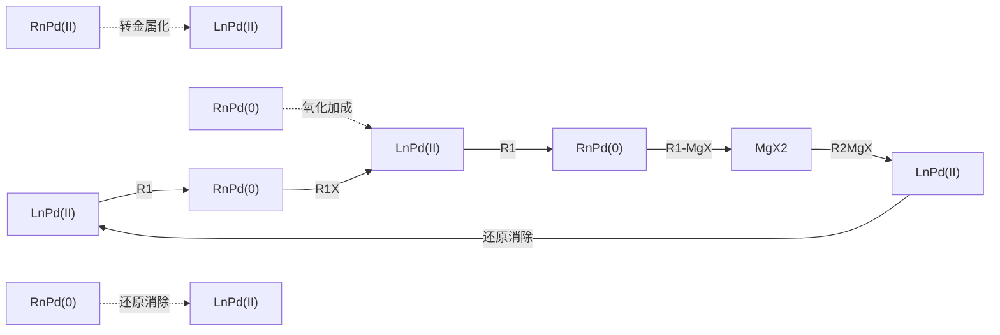
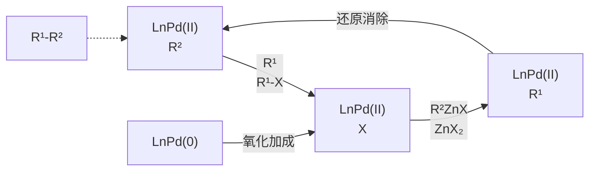
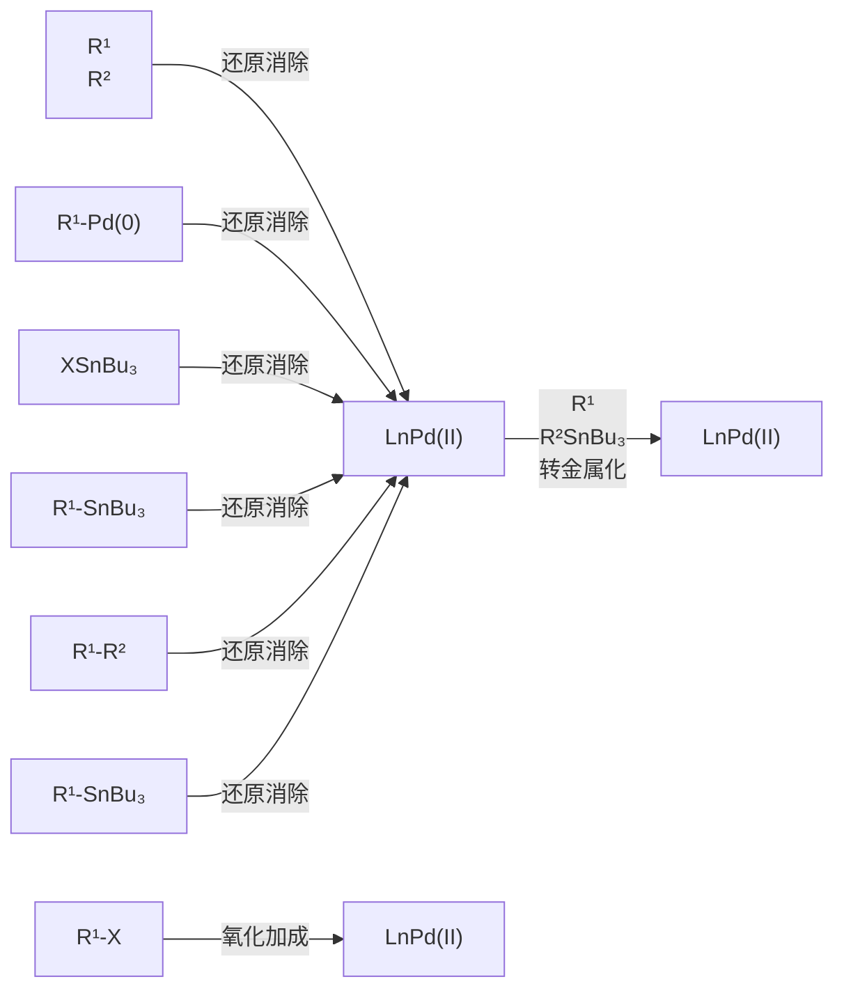
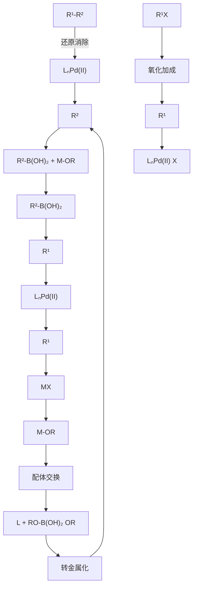
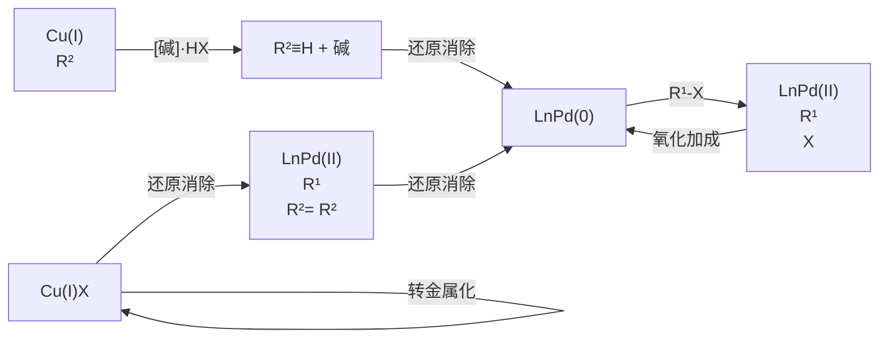

chemical

Chemical reaction diagram showing transformation from a cyclopentadienyl ether to a cyclopentadienyl ether with four-membered ring transition state and monomer formation

（2）CO 的插入反应 CO 是一种容易发生 1,1- 插入反应的分子。CO 的插入反应过程主要包括 CO 与金属的配位和 CO 的插入。CO 作为一种 π 酸，可以接受金属的 d 电子向 CO 的 π\* 键反馈，CO 中的碳氧键被削弱，同时导致 M-R 键被削弱。

chemical

Chemical equilibrium diagram showing a macrocyclic compound with R and C=O substituents

## 2. 反插入反应( $\beta$ -元素消除反应)

插入反应的逆过程为反插入反应，即  $\beta-$  元素消除反应（ $\beta-$ elimination）。在大部分反插入反应中，往往是顺式共平面的  $\beta-H$  消除反应，同时也存在  $\beta-O$ 、 $\beta-N$ 、 $\beta-F$  等多种  $\beta-$  元素消除反应。反插入反应需要满足如下条件:① 中心金属存在空配位点，可供  $\beta-$  元素消除反应后与不饱和键的配位；② M-C 和 C-X 在消除过程中须处于顺式共平面状态；③ 能够消除生成不饱和键。

$$
\begin{array}{c} \mathrm{X-CHR} \\ \mid \\ \mathrm{L} _ {n} \mathrm{M-CH} _ {2} \end{array} \quad \Longleftrightarrow \quad \left[ \begin{array}{c} \mathrm{X--CHR} \\ \mid \\ \mathrm{L} _ {n} \mathrm{M--CH} \end{array} \right] ^ {\ddagger} \quad \Longleftrightarrow \quad \begin{array}{c} \mathrm{X} \\ \mid \\ \mathrm{L} _ {n} \mathrm{M--II} \\ \mathrm{CH} _ {2} \end{array}
$$

## 14.4.4 配合物中的配体接受外来试剂的进攻反应

含有不饱和键的化合物与过渡金属配位后，中心金属的电子和立体空间效应使得不饱和键被活化，可以接受外来亲核试剂的进攻。例如，烯烃、炔烃、CO等与过渡金属配位后，由于中心金属对不饱和化合物 $\pi^{*}$ 轨道的电子反馈，使得不饱和键被活化，更容易被外来亲核试剂进攻。进攻的立体化学表现为亲核试剂从烯烃与金属配位的反面进攻，这一过程称为反式亲核金属化。

chemical

Chemical reaction diagram showing nucleophilic attack on a macrocyclic compound with L-M and -L groups

## 14.5 偶联反应简介

传统的偶联反应通常是指在过渡金属配合物催化下芳（烯）基卤代物与金属试剂形成碳碳键或碳-杂原子键的反应。本部分主要介绍几种常见的偶联反应。

## 14.5.1 Kumada 偶联反应

Kumada 偶联反应是指过渡金属催化的格氏试剂和芳基、烯基卤代物的偶联反应。早在 1960 年，Chatt 和 Shaw 等就发现，金属镍的配合物[如二(三乙基膦)二溴化镍]能和芳基格氏试剂发生转金属化反应生成单芳基镍。

chemical

Chemical reaction equation showing bromination of Ni(PEt3)2 with magnesium bromide under benzene at -10°C to yield a substituted benzene product with 84% yield.

1970 年，Uchino 等发现联吡啶二乙基镍能与氯苯反应生成苯基氯化镍，原来两个与镍相连的乙基通过还原消除形成偶联产物正丁烷。

chemical

Chemical reaction equation showing nickel complex formation with PhCl under nitrogen atmosphere

1972 年，Kumada 综合上述两个反应，在  $NiCl_{2}(dppe)$  的催化下实现了金属镁试剂与芳基卤代物的偶联反应，生成了新的碳碳键。同年 Corriu 也发表了类似的工作。

chemical

Chemical reaction equation showing synthesis of dpphenylphosphine from EtMgBr and PhCl under NiCl2 catalyst

Kumada 反应对烯基卤代物具有立体专一性，一般情况下能保持其双键的构型。在反应中分别使用顺式和反式烯基溴化合物作为底物均能得到相应构型保持的偶联产物。

chemical

Two organic reaction equations showing the formation of alkene from phenyl bromide and methylmagnesium bromide under NiCl2L2 catalysis

但是在反应中烯基格氏试剂的双键构型可能会发生变化，其原因是格氏试剂中的碳碳双键在镍的作用下会发生双键的异构化而转化为热力学上更稳定的反式烯基格氏试剂。例如(Z)-2-苯乙基溴化镁与芳基卤代物在镍催化下发生偶联反应，生成了立体选择性混合的产物，其中以(E)-构型的产物为主。

chemical

Organic synthesis reaction scheme showing conversion of MgBr to PMe2 using NiCl2(dmpe) catalyst under THF/50°C for 40 hours

后续研究中发展的钯催化的 Kumada 偶联反应具有更广阔的底物范围。利用 Kumada 偶联反应的立体专一性，可以高立体选择性地合成共轭二烯。例如，当使用(E)-烯基碘化物和乙烯基格氏试剂反应得到相应的共轭二烯时，碘代物原料中烯烃的立体化学被完全保留。

chemical

Organic synthesis reaction scheme showing palladium-catalyzed cyclization of a substituted oxazolone with MgBr under palladium catalysis

催化机理:钯催化的 Kumada 偶联反应机理得到了深入的研究。反应从零价钯启动，零价钯先和芳基或烯基卤代物 $(\mathrm{R}^{1} - \mathrm{X})$ 发生氧化加成反应生成二价钯中间体，再和格氏试剂 $(\mathrm{R}^{2} - \mathrm{MgX})$ 转金属化生成中间体 $\mathrm{R}^{1} - \mathrm{PdL}_{n} - \mathrm{R}^{2}$ 。该中间体通过还原消除得到偶联产物 $\mathrm{R}^{1} - \mathrm{R}^{2}$，并再生零价钯催化剂完成催化循环 $(\mathrm{X} = \mathrm{Cl}, \mathrm{Br}, \mathrm{I})$。

在使用仲碳格氏试剂时，其转金属生成的仲碳镍物种倾向于异构为对应的伯碳镍物种。使用能降低 $\beta-H$ 消除反应速率并提高还原消除反应速率的配体（如dppf）能抑制该异构化反应。

flowchart

一般认为镍催化 Kumada 偶联的机理和钯催化的机理类似，但是受反应的具体条件影响较大，不同的底物和配体都可能使反应机理有所变化。

## 14.5.2 Negishi 偶联反应

在过渡金属（主要是钯或者镍）催化下，有机锌试剂与炔基、烯基、芳基卤代物及芳基三氟甲磺酸酯的偶联反应，被命名为Negishi偶联反应。1976年，Negishi等报道了烯基铝试剂与烯基或芳基卤代物在钯或镍催化下能发生立体专一性的偶联反应。随后，他们对此反应进行了深入的研究，发现将金属试剂更换为有机锌试剂时，产率有较好的提升，且其副产物联苯(Ph-Ph)的生成量有明显的下降。

chemical

Two-step organic synthesis reaction scheme: palladium-catalyzed coupling of aldehyde and imidazole with Pd(PPh3)4 catalysts, yielding 74% and 87% yields respectively.

有机锌化合物的制备主要有如下两种方法:

（1）金属锌与活泼卤代烃的氧化加成反应。

$$
\mathrm{R-X} \quad \xrightarrow {\mathrm{Zn}} \quad \mathrm{R-ZnX}
$$

（2）金属交换反应，用其他易得的金属试剂如镁试剂、锂试剂、铝试剂等与锌盐发生金属交换。

$$
\mathrm{R} - \mathrm{Li} \xrightarrow {\mathrm{ZnCl} _ {2}} \mathrm{R} - \mathrm{ZnCl}
$$

催化机理（以零价钯催化剂为例）:零价钯催化剂与卤代烃（$\mathrm{R}^{1}-\mathrm{X}$）发生氧化加成，生成二价钯中间体，该中间体与锌试剂（$\mathrm{R}^{2}-\mathrm{ZnX}$）发生转金属化反应，再经过还原消除得到碳碳键偶联产物并再生零价钯催化剂，完成催化循环（$\mathrm{X} \doteq \mathrm{Cl}, \mathrm{Br}, \mathrm{I}$）。

flowchart

## 14.5.3 Stille 偶联反应

钯催化下卤代烃与有机锡化合物的偶联反应称为 Stille 偶联反应。1976 年，Eaborn 等首次报道了钯催化下溴苯和六丁基二锡的偶联反应，其产物为联苯。该反应中实际发生了两次偶联:溴苯和六丁基二锡首先发生偶联反应生成苯基三丁基锡，随后苯基三丁基锡再和溴苯发生偶联反应生成联苯。

$$
\mathrm{PhBr} + \mathrm{Bu} _ {3} \mathrm{SnSnBu} _ {3} \xrightarrow [ \text {toluene, 120 °C, 40 h} ]{\mathrm{Pd} (\mathrm{PPh} _ {3}) _ {4} (0 . 6 \mathrm{mol} \%)} \mathrm{Ph-Ph} + \mathrm{PhSnBu} _ {3} 31 \% 28
$$

1977 年，Kosugi 和 Migita 发现钯催化下烯丙基锡可以和酰氯或芳基卤代物发生偶联反应生成酮或 3-苯丙烯。自 1978 年始，Stille 对有机锡试剂的偶联反应进行了深入的研究，发展了一系列条件温和及官能团兼容性好的有机锡试剂和芳基、烯基、烯丙基卤代烷的偶联反应，并系统研究了反应的机理。基于三人的贡献，Stille 偶联反应也称为 Migita-Kosugi-Stille 偶联反应。

$$
\mathrm{R} ^ {1} \stackrel {\mathrm{O}} {\mathrm{C}} \text {Cl} \quad \text {或} \quad \mathrm{R} ^ {2} \mathrm{X} + \quad \mathrm{R} ^ {3} [ \mathrm{Sn} ] \xrightarrow {\mathrm{PdL} _ {n}} \mathrm{R} ^ {1} \stackrel {\mathrm{O}} {\mathrm{C}} \mathrm{R} ^ {3} \quad \text {或} \quad \mathrm{R} ^ {2} - \mathrm{R} ^ {3}
$$

$$
\mathrm{R} ^ {1} = \text {aryl, alkyl}; \mathrm{R} ^ {2} = \mathrm{R} ^ {3} = \text {allyl, alkenyl, aryl}; [ \mathrm{Sn} ] = \mathrm{SnMe} _ {3}, \mathrm{SnBu} _ {3}
$$

Stille 偶联反应机理与上述 Kumada 和 Negishi 偶联的机理类似，都经历了金属有机试剂和钯物种的转金属过程，具体历程如下所示:零价钯催化剂和卤代物（以  $R^{1}-X$  为例，X 为卤素）发生氧化加成，形成二价钯中间体，再与有机锡试剂（以  $R^{2}-SnBu_{3}$  为例）发生转金属化，得到新的二价钯中间体，后经还原消除形成偶联产物并再生零价钯催化剂，完成催化循环。

flowchart

常用有机锡试剂制备方法如下:

（1）有机锂试剂和三烷基氯化锡发生金属交换反应生成烯基锡试剂。

chemical

Organic synthesis reaction sequence showing conversion of a ketone to a thioether derivative using tBuLi and Me3SnCl catalysts at -78°C

（2）炔丙醇与氢化铝锂生成环铝中间体，再与 $^{n}Bu_{3}SnOTf$ 反应。

chemical

Organic synthesis reaction scheme showing aluminum-catalyzed transformation of aldehyde to allylic alcohol and then to selenoalkane

（3）三烷基锡钠与芳基卤代物直接反应可生成芳基锡试剂。

$$
\mathrm{PhBr} \quad + \quad \mathrm{Me} _ {3} \mathrm{SnNa} \quad \xrightarrow [ \mathrm{NH} _ {3} (\mathrm{l}) ]{0 ^ {\circ} \mathrm{C}} \quad \mathrm{PhSnMe} _ {3}
$$

值得注意的是，锡原子上的四个取代基在 Stille 偶联反应的转金属化步骤中存在明显的迁移速率差异。由于甲基和正丁基等一级烷基通常不会发生迁移反应，一般使用三甲基或者三丁基锡化合物作为偶联试剂。其他迁移基团的迁移顺序如下:

chemical

Chemical reaction conditions showing hydrogenation and arylization steps with alkene formation

Stille 偶联反应具有非常好的底物兼容性、对于烯基偶联试剂也具有很好的立体专一性。此外有机锡试剂对空气稳定且易于制备，因此该偶联反应在合成中得到了广泛的应用，但是该反应仍存在一个严重的问题，即有机锡试剂具有很高的毒性。

## 14.5.4 Suzuki 偶联反应

钯催化下芳基或烯基硼化合物（硼酸或硼酸酯）和芳基卤代物（或三氟甲磺酸酯）的交叉偶联反应称为 Suzuki 偶联反应，是碳碳键构筑应用最广泛的偶联反应之一。

相较于前文所述的锂试剂、格氏试剂、锌试剂，锡试剂的活性更低，因此 Stille 偶联反应有显著的官能团耐受性优势。由于锡试剂有剧毒，科学家们也发展了使用催化量锡试剂的方法，在偶联反应的同时进行炔烃的锡氢化反应以实现锡试剂循环。

1979 年，Suzuki 等报道了 1-烯基硼烷和碘苯在  $\mathrm{Pd}(\mathrm{PPh}_{3})_{4}$  催化下的偶联，生成了烯烃构型保持的  $(E)-1-$  苯基-1-己烯。

chemical

Chemical reaction equation showing palladium-catalyzed cyclization of a boron-containing compound with Pd(PPh3)4 catalyst under EtOH/EtONa/2h conditions

在 Suzuki 报道的基础上，后续研究极大拓展了此类偶联的底物类型和应用领域。亲电试剂可以是烷基、烯基和(杂)芳基卤代物（或三氟甲磺酸酯、磷酸酯）；亲核试剂中，烷基、烯基、炔基、(杂)芳基硼烷、硼酸、硼酸酯以及硼酸盐均可兼容。

chemical

Chemical structures of R-B(OH)₂, R-B(=O)-O-CH₃, R-B(O)-C₆H₄, and R-BF₃K⁺

Suzuki 偶联反应一般反应历程如下:零价钯与卤代烃（以  $R^{1}-X$  为例，X 为卤素）发生氧化加成生成二价钯中间体，其上的卤素阴离子再与碱发生配体交换形成钯氧键；另外，芳基硼酸（以  $\mathrm{R}^{2}-\mathrm{B}(\mathrm{OH})_{2}$  为例）和碱形成硼阴离子化合物。该阴离子化合物和钯配合物发生转金属化反应，再经过还原消除得到偶联产物并再生零价钯物种，完成催化循环。

flowchart

常用的有机硼试剂的制备方法有:

（1）烯烃或炔烃和硼烷的硼氢化反应。

chemical

Chemical reaction equation showing formation of a boron-containing heterocyclic compound under THF catalyst

（2）锂试剂或格氏试剂和硼酸酯反应后再水解。

chemical

Chemical reaction equation showing bromination of a bisphenol to form a bisphenol derivative with 96% yield

（3）钯催化的卤代芳烃和联硼酸酯间的 Miyaura 偶联反应经常被用于芳基硼酸酯的制备。

chemical

Chemical reaction equation showing bromination of a bromo-substituted benzene with boronate and palladium catalyst under specified conditions

烷基硼化合物也可应用于Suzuki偶联反应。回忆一下烷基硼化合物的制备方法。

Suzuki 偶联反应对水不敏感，但需要在无氧条件下进行，即使是溶剂中少量溶解的氧气也可能导致底物发生自偶联反应，降低目标产物的产率。

Suzuki 偶联反应具有良好的底物兼容性。和有机镁、有机锌等活泼金属试剂相比，有机硼试剂具有更好的稳定性和结构多样性，带有常见官能团（如醛、酮、酯、氰基等）的有机硼试剂都易于制备并在反应中能被兼容。鉴于此，Suzuki 反应在复杂分子合成中得到了广泛的应用。例如，在合成酶蛋白酶体抑制剂 TMC-95A 的步骤中，就利用芳基碘化物和芳基硼酸酯的 Suzuki 交叉偶联构建了化合物中的联芳基部分。

Suzuki 偶联反应是从 Pd(0) 启动的，但是本小节的具体反应例使用了 Pd(Ⅱ) 配合物作为催化剂。请思考 Pd(Ⅱ) 还原成 Pd(0) 的可能机理。

无论对于烯基卤代物还是烯基硼酸，Suzuki偶联反应都具有高度的立体专一性，底物的立体构型能够保留在产物中。例如，在黏沙酰胺A（myxalamide A）的合成中，一个关键步骤是通过(E)-乙烯基硼酸酯和(Z)-碘代三烯之间的Suzuki交叉偶联把原料中的立体化学信息完整地引入产物中。

chemical

Chemical reaction scheme showing synthesis of myxalamide A from a bidentate and its precursor using Pd(OAc)2 and iPrNEt2 catalysts

## 14.5.5 Heck 反应

Heck 反应（也称 Mizoroki-Heck 反应）是不饱和卤代烃（或三氟甲磺酸酯）在零价钯催化下与烯烃偶联得到取代烯烃的反应。

1971 年, Mizoroki 发现碘苯和苯乙烯能在氯化钯的催化下发生偶联反应得到 1,2-二苯乙烯。

chemical

Palladium-catalyzed cyclization reaction of benzene to styrene under palladium catalyst and methanol conditions

1972 年，Heck 独立发现在不同钯源、碱及在无溶剂条件下，上述反应也能得到相同产物。使用醋酸钯为催化剂，碘代芳烃在  $100\;^{\circ}C$  下能迅速反应，溴代芳烃即使在  $150\;^{\circ}C$  下反应也非常缓慢，但是氯代芳烃几乎不反应。进一步研究发现体系中加入膦配体时，能有效促进反应。例如，如下溴苯的反应可以取得 85% 的收率。

Heck 反应的亲电试剂主要是芳基、烯基卤代物（氯/溴/碘）及芳基三氟甲磺酸酯；含吸电子基团的烯烃有利于反应进行。

Heck 反应的机理如下:零价钯与卤代烃（以  $R^{1}-X$  为例，X 为卤素）氧化加成得到二价钯中间体，这是反应的决速步；随后烯烃与钯配位并随后迁移插入碳钯键中，形成烷基钯物种，该物种经过 C-C 单键的旋转使钯与氢达到顺式共平面后发生  $\beta-H$  消除生成取代烯烃产物和钯氢物种。钯氢与碱结合后还原消除再生零价钯，完成催化循环。

chemical

Palladium-catalyzed reaction mechanism showing reduction, oxidation, and C-C bond rotation steps

在 Heck 反应中，缺电子烯烃通常有较高的产率。该反应速率受烯烃的立体位阻影响很大，烯烃上取代越多，反应速率越慢。

Heck 反应是合成带取代基不饱和化合物的有效方法之一，在工业上被广泛应用于药物、染料及有机发光材料的合成等领域。

烯烃插入烷基钯的区域选择性由烯烃的位阻和电性决定。产物的顺反构型主要受 $\beta$-H 消除步骤和烯烃底物控制:$\beta$-H 消除要求氢原子与钯处于顺式共平面，烯烃插入后，烷基钯物种单键通过旋转，使位阻较大基团相对远离。

## 14.5.6 Sonogashira 偶联反应

Sonogashira 偶联反应是指在钯和铜共催化下端炔和卤代物偶联生成碳碳键的反应。1975 年，Cassar、Heck 和 Sonogashira 三个课题组分别独立报道了芳基卤代物和苯乙炔的偶联反应。其中，Cassar 和 Heck 使用了钯催化的单一体系，反应需要较高的温度(100 °C)，而 Sonogashira 在体系中添加了碘化亚铜作为共催化剂，在室温下便可以获得优秀的产率。

Sonogashira 偶联反应在实践中被广泛用于制备炔烃。在反应中可直接使用碱（如  $NEt_{3}$ ）作为溶剂。与 Suzuki 偶联反应类似，该反应不需要严格无水，但需要除去体系中的氧气。

chemical

Organic synthesis reaction scheme showing palladium-catalyzed cyclization of benzene to form a substituted benzene product with 90% yield

Sonogashira 偶联反应是钯和铜协同催化的过程，包括两个催化循环。铜催化循环:炔和亚铜配位增加炔烃末端质子的酸性，碱对炔烃去质子化生成炔基亚铜并参与下面和钯的转金属化过程。钯催化循环:二价钯催化剂先与炔基铜发生转金属化反应得到二炔基钯，随后还原消除生成具有高活性的零价钯催化剂。零价钯和芳基/烯基卤代物发生氧化加成得到芳基/烯基钯物种，再与炔基亚铜发生转金属化生成炔基钯中间体并再生亚铜催化剂，最后炔基钯发生还原消除得到偶联产物并再生零价钯催化剂，完成催化循环。

除了以上所讲述的偶联反应外，还有许多不同类型的偶联反应，例如 C-N 偶联、C-O 偶联等。过渡金属催化的有机反应丰富多彩，在这一领域的发展过程中，我国科学家也作出了出色的贡献。

C-N 偶联

flowchart

上述机理中，钯和碳卤键（亲电试剂）的氧化加成步骤是 Sonogashira 偶联反应的决速步，底物中碳卤键反应活性越高，偶联反应速率越快，所需的反应条件更温和，产率也更高。常用的亲电试剂包括芳基卤代物、芳基三氟甲磺酸酯、烯基卤代物等。

由于 Sonogashira 偶联反应温和的反应条件、优秀的官能团兼容性和广泛的底物普适性，它能促进复杂分子的快速构建，被广泛应用于药物分子、天然产物、有机材料、纳米材料等合成中。以下是两个 Sonogashira 偶联反应的例子。

chemical

Two organic reaction schemes showing palladium-catalyzed coupling of brominated and imidazolone derivatives with yields, followed by palladium-catalyzed cyclization to yield a diimide product.

## 14.6 钯催化剂前体

本部分所介绍的偶联反应都是从零价钯启动，和亲电试剂发生氧化加成，经过系列基元反应，最后以还原消除形式再生零价钯。在实验中，使用二价钯前体原位还原生成零价钯，往往具有更好的催化活性。常见的二价钯前体有 $\mathrm{PdCl_2}$ 、 $\mathrm{Pd(PPh_3)_2Cl_2}$ 、 $\mathrm{Pd(MeCN)_2Cl_2}$ 、$\mathrm{Pd(OAc)_2}$ 等，还原剂包括膦配体、胺、烯烃、醇、金属有机试剂等，如上文中所述的Sonogashira偶联反应中，作为还原剂的就是反应中产生的炔铜。以 $\mathrm{Pd(OAc)_2}$ 的还原为例，典型的过程如下:

（1）膦配体作为还原剂

chemical

Reaction mechanism showing palladium-catalyzed cyclization of Pd(OAc)2 to form Ph3P-Pd(0), with acetyl group and phosphorus counterion

(2) 胺为还原剂

flowchart

(3) 烯烃为还原剂

chemical

Chemical reaction equation showing palladium-catalyzed cyclization of Pd(OAc)2 to form H-Pd-OAc and Pd(0)

（4）金属有机试剂

本章介绍的偶联反应构建了碳碳单键。过渡金属催化也可以实现碳碳双键的断裂和重组，从烯烃原料合成新的烯烃，称为烯烃复分解反应。2005年，Yves Chauvin、Robert H. Grubbs 和 Richard R. Schrock 三位科学家因为在烯烃复分解反应研究方面的贡献而获得了诺贝尔化学奖。

烯烃复分解

## 习题

1. 简述 18 电子规则，并应用 18 电子规则说明下列化合物的稳定性差异。

$$
\mathrm{Fe} (\eta^ {5} \text {-C}_5\mathrm{H}_5)_2 \qquad \mathrm{Ti}(\eta^ {5} \text {-C}_5\mathrm{H}_5)_2
$$

2. 指出下列金属价层中的电子数、氧化态和 d 电子数。

$$
\mathrm{Ni(CO)}_4
$$

$$
(\mathrm{OC}) _ {4} \mathrm{Re} \begin{array}{c} \mathrm{Cl} \\ \mathrm{Cl} \end{array} \mathrm{Re} (\mathrm{CO}) _ {4}
$$

3. 指出下列配合物中金属的配位数、杂化方式以及构型。

$$
\mathrm{Ag(NH}_3)_2^+
$$

$$
\mathrm{Ni(CN)}_4^-
$$

$$
\mathrm{Fe(CO)}_5
$$

$$
\mathrm{W(CO)} _ {5}
$$

4. 判断下列配合物是否满足 18 电子规则。

5. Stille 偶联、Sonogashira 偶联和 Heck 反应通常都使用二价钯配合物作为催化剂前体。然而，这些反应是由 Pd(0) 启动的。加入三乙胺往往可以用来还原 Pd(Ⅱ)。还原反应是如何发生的？请给出合理的机理。

钯催化交叉偶联反应中加入膦配体可以将 $\mathrm{Pd(II)}$ 还原生成 $\mathrm{Pd}(0)$，以 $\mathrm{PPh}_3$、$\mathrm{Pd(OAc)_2}$ 为例给出相应的反应机理。

6. 试写出下列反应的产物和相应反应的名称。

chemical

Chemical reaction scheme showing palladium-catalyzed cyclization of a brominated pyridine derivative with boronic acid to form a fluorinated pyrimidine derivative, followed by reagents and conditions.

7. 试对下列卤代物和 Pd(0) 发生氧化加成速率进行排序。

8. 试写出下列反应的中间体和产物。

chemical

Organic synthesis reaction scheme showing conversion of nC7H15 to (A) and (B) using Cp2ZrCl2 catalysts and CuI reagents

9. 试写出下列反应的中间体和产物。

chemical

Chemical reaction scheme showing conversion of a chiral aldehyde to a piperidine derivative using Cp2ZrHCl and ZnCl2 catalysts

10. 指出下列反应属于哪种交叉偶联并写出目标产物。

chemical

Chemical reaction equation showing bromination of a brominated benzene derivative with boronate to form a bis(4-bromobenzoyl)benzoate under palladium catalysis and potassium phosphate conditions.

11. 试画出下列反应的催化循环，并指出其中涉及的基元反应。

chemical

Chemical reaction equation showing palladium-catalyzed cyclization of an iodinated benzene derivative with a ketone to form a fused bicyclic compound under specified conditions.

12. 试画出下列反应的机理。

chemical

Chemical reaction equation showing palladium-catalyzed coupling of boronate and acetaldehyde with Pd(OAc)2/PPh3 under dioxane at 100°C

13. 写出下列反应的中间体和产物。

chemical

Chemical reaction scheme showing Piers-Grubbs II catalyst preparation and synthesis steps with reagents and conditions

本章习题
参考答案

（本章编者 刘文博、陈宜鸿、程鸿刚、陆展）

## 第十五章

## 糖类化合物

15.1 单糖的结构 254 15.4 二糖 269
15.2 单糖的性质 260 15.5 寡糖和多糖 272
15.3 单糖构型及环大小的测定 …… 267 习题 …… 278

植物的细胞组织、果实、机体骨架等的主要成分都是碳水化合物（carbohydrates），其因为最早知道的这类物质的分子式都符合通式 $C_{x}(H_{2}O)_{y}$ 而得名。随着科学发展和对这一大类化合物研究的深入，人们发现它们实际上是一类多羟基醛/酮或水解后能形成多羟基醛/酮的物质。这类物质中，大多数化合物的分子式都符合通式 $C_{x}(H_{2}O)_{y}$，如葡萄糖 $C_{6}H_{12}O_{6}$ 、蔗糖 $C_{12}H_{22}O_{11}$ 等。但也有少数化合物的分子式与碳水化合物通式不符合，如鼠李糖的分子式为 $C_{6}H_{12}O_{5}$ 。另外一些分子，如甲醛（$CH_{2}O$）、乙酸（$C_{2}H_{4}O_{2}$）、乳酸（$C_{3}H_{6}O_{3}$）等虽然符合碳水化合物通式，但并不属于碳水化合物。因此，“碳水化合物”仅是一个不严谨的、沿用传统习惯的名称，现在常用糖类来指代这类化合物。

自然界几乎所有的生物能源及有机物都源自植物的光合作用。植物中的叶绿素作为催化剂将光能转化为化学能，帮助水分子分解释放氧气，产生的能量随后用于碳反应合成葡萄糖。

$$
x \mathrm{CO} _ {2} + y \mathrm{H} _ {2} \mathrm{O} + h \nu \xrightarrow [ \text {光合作用} ]{\text {叶绿素}} \mathrm{C} _ {x} (\mathrm{H} _ {2} \mathrm{O}) _ {y} + x \mathrm{O} _ {2}
$$

通过光合作用，太阳能被储存到糖中。在动物或人体内，糖被酶水解，再经过复杂的分解氧化过程，最后又变为  $CO_{2}$  和  $H_{2}O$ ，同时释放出能量作为生命活动所需的能源。因此，糖类是人和动植物生命活动的必需物质。

糖类可根据其单元组成分为以下几类:那些不能再水解的多羟基醛/酮称为单糖（monosaccharides）；二糖（disaccharides）由两个单糖分子共价连接而成，可以水解为两个单糖；寡糖（oligosaccharides）通常由3～10个单糖分子组成；而多糖（polysaccharides）则由更多的单糖分子共价连接而成。

chemical

Chemical structure of D-甘油醛 with labeled hydroxyl groups and functional groups

1,3-二羟基丙酮

## 15.1 单糖的结构

单糖具有多羟基醛/酮的结构，常见的单糖含有3～6个碳原子。按照碳原子的数目，可将单糖分为三碳糖（丙糖）、四碳糖（丁糖）、五碳糖（戊糖）、六碳糖（己糖）等；根据羰基的结构，单糖则可分为醛糖和酮糖。最简单的单糖是甘油醛和1,3-二羟基丙酮，它们分别是丙醛糖和丙酮糖。

习惯上常用费歇尔投影式和 D/L 构型命名法来表示单糖的立体结构。自然界中存在的糖绝大多数为 D 构型，即费歇尔投影式最下方的手性碳原子（编号最大的手性碳原子）上的羟基朝右的构型。以下是几种常见的四碳、五碳醛糖。它们分别有 2 个和 3 个手性碳原子，因此分别存在 4 种和 8 种可能的立体异构体。需要注意的是，同种单糖的 D 构型和 L 构型互为对映异构体。

chemical

五种有机化合物结构式，分别为D-赤藓糖、D-苏阿糖、D-核糖、D-脱氧核糖、D-阿拉伯糖和L-阿拉伯糖

## 15.1.1 单糖的构造确定

单糖的多羟基醛/酮结构最初是通过系列的化学反应确定的。例如，对于最常见的葡萄糖，元素分析或其他方法测得其分子式为 $\mathrm{C_6H_{12}O_6}$ 。人们根据以下反应，确定了葡萄糖分子中的原子连接方式:

（1）与乙酸酐反应，可引入5个乙酰基，说明分子中含有5个羟基；
（2）与羟胺反应，得到一元肟，说明分子中含有一个羰基；
（3）能与溴水发生氧化反应，生成相同碳原子数的羧酸，说明羰基是醛而不是酮（酮不能被溴水氧化）；
（4）用强还原剂——磷和氢碘酸还原，可使葡萄糖还原生成正己烷，说明葡萄糖分子中的碳链是一条直链。

由此可以确定，葡萄糖分子含有一个醛基，5个羟基则分别位于另外5个碳原子上（因为两个羟基位于同一个碳原子上是不稳定的），因此葡萄糖为六碳醛糖，具有如下所示的骨架结构。类似的方法也可以确定其他糖的骨架结构，例如，果糖具有相同的分子式，但它是己酮糖。

葡萄糖

果糖

## 15.1.2 单糖的构型

葡萄糖作为己醛糖，其分子中有4个手性碳原子，因此存在如下所示的 $2^{4} = 16$ 个旋光异构体，它们组成了8对D/L-对映体。为简便起见，在横键方向常只用一条横线代表羟基的朝向。

chemical

Chemical structure of a branched hydrocarbon with two CHO groups and two CH2OH substituents

阿洛糖
(allose)

chemical

Two identical chemical structures with CHO and CH2OH groups attached to each carbon

阿卓糖
(altrose)

chemical

Two identical chemical structures with CHO and CH2OH groups attached to a central carbon

葡萄糖
(glucose, Glc)

chemical

Two identical chemical structures with CHO and CH2OH groups, likely representing a polymer or glycol chain

甘露糖
(mannose, Man)

D/L构型只能确定一个手性碳原子的构型，要精确命名每一个手性碳的构型，仍需要用$R / S$ 命名法，如D-葡萄糖的系统命名应为(2R,3S,4R,5R)-2,3,4,5,6-五羟基己醛。所有的己醛糖中，只有D-葡萄糖、D-甘露糖和D-半乳糖存在于自然界中，其余都是通过合成得到的。

## 15.1.3 单糖的环状结构

## 1. 变旋光现象

将 D-葡萄糖分别从冷乙醇和热吡啶溶液中结晶，得到的晶体具有如下所示的不同性质。将两种晶体分别溶于水，或者把两种晶体按任意比例混合后溶于水，其比旋光度都会逐渐变化至+52.7。其他单糖也具有类似的现象，人们称其为变旋光现象。

chemical

Chemical reaction equation showing conversion of D-glucose to glucose using cold ethanol and hot dihydride crystals

可以预料，这两种结晶产物应该是不同的化合物，但二者在水溶液中可以相互转化，并存在平衡，因此才能具有变旋光性，而 $+52.7$ 即是达到平衡后的特定比例混合物的比旋光度。

另外，将D-葡萄糖与甲醇在HCl存在下反应，并不能得到缩醛。这不符合醛的特征。结合变旋光现象，可以推测单糖分子在溶液中可能并非以费歇尔投影式所示的开链形式存在，而是存在其他更稳定的结构。

## 2. 环状结构

如前所述， $\gamma-$  或  $\delta-$  羟基醛由于分子中两个官能团位置适中，容易形成稳定的五元或六元环状半缩醛。

chemical

Chemical reaction mechanism showing cycloaddition of a diol with hydroxyl groups, forming a cyclohexanol derivative with δ bond

与此相似，单糖也存在 $\gamma-$ 或 $\delta-$ 羟基醛的结构，因此其主要以环状半缩醛形式存在，并与开链结构形成动态平衡。由于环状结构稳定，因此开链式在平衡体系中的含量很低。葡萄糖的紫外光谱中见不到羰基吸收带；红外光谱中也看不到羰基伸展振动吸收带；核磁共振波谱上也不存在醛 H 峰。

chemical

Chemical structure of D-glucose showing its chain and ring structure, followed by哈沃斯投影式

单糖的环状结构可表述为更加符合实际的哈沃斯（Haworth）投影式。将费歇尔投影式向右侧放倒并弯曲碳链，使开链结构中左侧的羟基位于上方、右侧的羟基位于下方。此时进攻醛基形成半缩醛的5位羟基也位于环的下方，为了便于其进攻，可将C4-C5单键旋转，使5位羟基位于环平面，这样6位的羟甲基就位于环的上方。由于5位羟基是决定D/L构型的羟基，因此对于D-型糖，哈沃斯式中的6位羟甲基总是朝上。

chemical

Chemical structures showing a glycoside-like molecule with multiple hydroxyl groups and numbered carbon positions, followed by a cyclic structure with OH groups.

一旦成环后，羰基碳原子即成为手性碳原子，形成的半缩醛羟基和其他羟基一样，也可以位于环平面的两侧，从而得到一对非对映异构体，通常称它们为异头物（anomer）或端基差向异构体（差向异构体之间只有一个对应的手性碳原子构型相反），可以用“\~\~\~”键代表此处构型不明或无须注明的情况。这一对非对映异构体可以通过开链结构互变并在水溶液中形成平衡，它们正是之前提到的在不同溶液中结晶所得到的两种不同的D-葡萄糖环状结构。其中，半缩醛羟基和决定构型的羟基（即5位羟基）位于环平面同侧的称为 $\alpha$ 型，位于环平面异侧的则称为 $\beta$ 型。对于D型糖，5位羟基总是朝下的，因此半缩醛羟基朝下的为 $\alpha$ 型，朝上的为 $\beta$ 型。

chemical

Chemical reaction scheme showing conversion of α-D-吡喃葡萄糖 to β-D-吡喃葡萄糖 via enzyme chain structure

糖的环状结构，可根据相应的含氧杂环来命名。含六元杂环的糖称为吡喃糖，含五元杂环的糖称为呋喃糖。X射线衍射法已证明，六碳单糖绝大部分是以六元环状存在的，但也可以五元环状存在。例如，果糖在游离状态下是吡喃糖，结合状态下常呈呋喃糖结构。