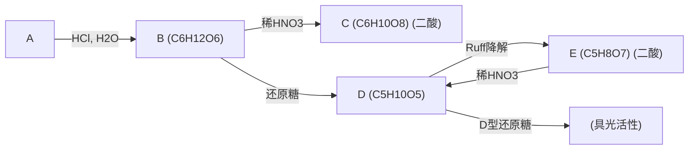
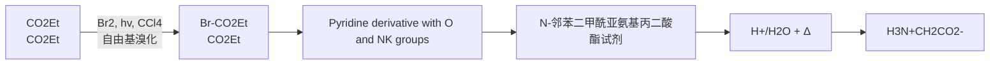

chemical

Chemical structure of a cyclic glycoside with multiple glucose units and hydroxyl groups

α-CD

chemical

Chemical structure of a cyclic glycoside molecule with multiple hydroxyl groups and sugar moieties

β-CD

chemical

Chemical structure of a cyclic glycoside with multiple glucose units and hydroxyl groups

γ-CD

由于连接葡萄糖单元的糖苷键不能自由旋转，环糊精形成略呈锥形的中空圆筒状结构。其外侧上端（较大开口端）由C2位和C3位的二级羟基构成，下端（较小开口端）由C6位的一级羟基构成，两端均具有亲水性；而内侧由于受到C-H键的屏蔽作用而形成疏水空腔。环糊精有较好的热稳定性，无一定熔点，加热到约 $200^{\circ}\mathrm{C}$ 开始分解；无吸湿性，但容易形成各种稳定的水合物。环糊精溶于水，不溶于典型的有机溶剂，在水溶液及醇水溶液中能很好地结晶；但是水溶性有限，$\alpha-$ 环糊精和 $\gamma-$ 环糊精的溶解度分别是 $145\mathrm{mg/mL}$ 和 $232\mathrm{mg/mL}$，而 $\beta-$ 环糊精的溶解度仅为 $18.5\mathrm{mg/mL}$，这主要是因为晶体中存在较强的分子间氢键。环糊精的疏水性空腔内可嵌入各种有机化合物而形成主客体包接复合物，从而改变客体分子的理化和生物特性，如增加水溶性，提高稳定性，降低刺激性、毒性和副作用，实现药物的缓释以延长药物的半衰期等。另外，由于被包结的客体分子固定在特殊的羟基附近，因此环糊精能够作为酶的简单模型。环糊精自身已经被发现对某些化学反应呈现出催化活性。例如，在 $\mathrm{pH}$ 为10.6的环境下，$\alpha-$ 环糊精能使乙酸苯酯的碱水解速率提高9.7倍，但只能使乙酸对甲苯酯的水解速率提高3.8倍；然而，乙酸间甲苯酯的水解速率能提高39倍，乙酸间叔丁基苯酯的水解速率能提高226倍，充分说明了催化剂与底物间结构匹配的重要性，很好地模拟了酶催化高度专一性的特点。

chemical

Molecular structure diagrams showing alpha, beta, and gamma electron shells with interatomic distances labeled

α-环糊精、β-环糊精和γ-环糊精的空腔内径分别为0.56 nm、0.70 nm和0.88 nm。由于α-环糊精的分子空腔较小，通常只能包封较小的客体分子，应用范围较小；γ-环糊精的分子空腔大，但其生产成本高，工业上不能大量生产，其应用受到限制；β-环糊精的分子空腔适中，应用范围广，生产成本低，是目前使用最多的环糊精产品。同时，通过化学手段在环糊精骨架上引入修饰基团，可改变环糊精的性质或赋予其新的功能，极大地拓展了环糊精的应用范围。如舒更葡糖是羧基硫醚修饰的 $\gamma$-环糊精，其钠盐可以特异性包封全身麻醉剂罗库溴铵或维库溴铵分子，从而逆转该类麻醉剂造成的神经肌肉阻滞。环糊精化学是超分子化学领域的一个重要分支。

## 15.5.2 多糖

根据组成的单糖分子的不同，多糖可分为同聚多糖和杂聚多糖，其中前者仅由一种单糖分子组成，后者则由两种及两种以上单糖分子组成（常由两种单糖分子间隔组成）。多糖一般无甜味，不溶于水或在水中形成胶体溶液，没有还原性和变旋光现象。与人类生活密切相关的多糖有三种，即淀粉、糖原和纤维素，它们都是由葡萄糖分子组成的同聚多糖，在生物体内分别起到储存和架构的作用。另外，由 $N-$ 乙酰基葡萄糖胺同聚生成的多糖——甲壳素，为虾蟹和昆虫等动物提供了坚硬的外壳。

## 1. 淀粉

作为人类的主要食物，淀粉（starch）广泛存在于植物的根、茎、种子中，市售淀粉主要以玉米、土豆、小麦和大米为原料生产。大米中淀粉的含量约为75%，小麦中淀粉的含量为60%～65%。淀粉是葡萄糖分子通过 $\alpha-(1\rightarrow4)$ 糖苷键缩聚而成的高聚物，所以也可看作麦芽糖的聚合体，用酶水解淀粉可得到麦芽糖。

淀粉由直链淀粉（amylose，约 20%）和支链淀粉（amylopectin，约 80%）两部分组成。热水可以使淀粉颗粒溶胀，使得其中的直链淀粉和支链淀粉分开，二者都可溶于热水，但直链淀粉在冷水中的溶解度较低。直链淀粉中的糖苷键均为  $\alpha-(1\rightarrow4)$  糖苷键，分子量可以从数千到上百万不等。支链淀粉则存在分支，分子量也大得多，最高可达 2 亿。其主链上仍通过  $\alpha-(1\rightarrow4)$  糖苷键连接，分支处则是通过  $\alpha-(1\rightarrow6)$  糖苷键连接的，每 24～30 个葡萄糖单元出现一个分支。

chemical

Chemical structure of a glycoside with labeled alpha-β chain points and functional groups

直链淀粉的长链并不是一条直链，而是盘绕成螺旋形（称为二级结构），每转一圈大约含有六个葡萄糖单元，盘绕的链又弯折形成不规则的立体结构（称为三级结构），如下图所示。

直链淀粉遇碘变为蓝色，这是因为螺旋盘旋的“隧道”正好能容纳碘分子而形成蓝色复合物。实验室中常用淀粉检查碘的存在或用碘检查淀粉的存在，也可用碘化钾淀粉试纸检查氧化剂的存在。支链淀粉遇到碘分子不变蓝，而是形成紫红色复合物。

## 2. 糖原

糖原（glycogen）是动物体内储存能量的物质，功能相当于植物体内的淀粉，因此又被称为动物淀粉。糖原在体内主要分布于肝和骨骼肌中，分别称为肝糖原和肌糖原。人类肝中糖原的含量是肝干重的10%左右。糖原是与支链淀粉结构极为相似的多糖，在需要能量时便会水解释放出葡萄糖。相较于淀粉，糖原的支链更多，平均每8～12个葡萄糖单元就存在一个分支，其分子量可高达10亿。

人和动物对糖原的降解利用是一个涉及三种酶的复杂精妙过程:包括糖原磷酸化酶从多个非还原端逐个切下葡萄糖、转移酶将短支链葡萄糖单元转移到长支链，以及  $\alpha-(1\rightarrow6)$  葡萄糖苷酶的去支化。那么生命体为什么不直接储存葡萄糖而需要将其以淀粉或糖原的形式储存呢？这主要有两方面的原因。第一是渗透压:肝细胞中糖原的浓度以葡萄糖计为 0.4 mol/L；而以糖原分子计，浓度只有 0.01 μmol/L。且糖原不溶于水，因此对细胞的渗透压没有影响。如果细胞液中的葡萄糖都以单糖形式存在，那么浓度为 0.4 mol/L 的葡萄糖会大大改变胞内的渗透压，使细胞外的水分大量涌入，导致细胞发生破裂。第二则涉及葡萄糖的胞内外传输:细胞外的葡萄糖浓度只有 5 mmol/L（哺乳动物血浆），如果胞内有 0.4 mol/L 的葡萄糖，那么细胞储存葡萄糖将是一个非常耗能的过程。

## 3. 纤维素及其衍生物

纤维素分布很广，存在于棉、麻、竹和木材中，是自然界中含量最多的多糖。纤维素是葡萄糖分子通过  $\beta-(1\rightarrow4)$  糖苷键缩聚而成的无支链高聚物，与无机酸共热，可完全水解为葡萄糖；用酶部分水解，则得到纤维二糖，因此纤维素也可看作纤维二糖的聚合体。

与直链淀粉类似，纤维素分子也具有直链结构，没有分支。用甲基化-水解的方法，将生成的三-O-甲基葡萄糖（主要产物）和四-O-甲基葡萄糖（链端的葡萄糖分子）分离后，计算其相对比例，可获得关于纤维素链长的信息。由此方法可测得棉花纤维素分子大约含3000个葡萄糖单元，其平均分子量约为50万。这种通过端基在分子中所占比例来测定链长的方法，叫作端基分析法。但由于分离时总带有部分降解，所以测得的纤维素的分子量比实际的数值低。自然界中存在的纤维素链实际上更长，含1万～1.5万个葡萄糖分子。

chemical

纤维素分子链结构示意图，展示多糖链内各链上的有机化合物与碱基连接

通过 X 射线衍射分析和电子显微镜观察, 可以发现这些纤维素长链通过氢键彼此缠绕成束, 纤维素束的结构对它的化学稳定性和机械性能起着重要作用。人眼所见到的纤维, 就是由这种链束捻成像绳索一样结构的排列体。

纤维素不溶于水及各种有机溶剂，但能溶于氢氧化铜的氨溶液及氢氧化钠的二硫化碳溶液。纤维素分子中每一个葡萄糖单元上还有三个游离羟基，因此可将其分子式写成 $\left[\mathrm{C}_{6}\mathrm{H}_{7}\mathrm{O}_{2}(\mathrm{OH})_{3}\right]_{n}$ ，这些羟基也能成醚、成酯。纤维素醚和酯的衍生物已在工业上得到广泛应用。

纤维素溶解在二硫化碳和氢氧化钠的水溶液中，发生反应得到纤维素黄原酸钠。其在少量水中是一种黏稠溶液，将它通过喷丝头的细孔压入稀硫酸溶液中，则被酸分解，并使纤维素形成长丝状再生，经纺织成为人造丝。这种制造人造纤维的方法称为黏胶法。纤维素溶于铜氨溶液后，经细孔压入稀硫酸中，也可制得人造纤维（铜氨法）。如果让黏胶溶液通过一个窄缝，使纤维素成薄片状再生，再将其用甘油软化，可用作保护膜。

chemical

Chemical structure of a sulfonated polymer with hydroxyl and sodium thiol groups

纤维素黄原酸钠

用硝酸、硫酸处理纤维素，可制得纤维素硝酸酯，又叫硝酸纤维素，其用途取决于硝化的程度。含氮在 $12.5\% \sim 13.6\%$ （三硝基纤维素）时，其可用于制造无烟火药；含氮低于 $13\%$ （低氮纤维）时，其可用于制造喷漆、赛璐珞及照相胶片等。

chemical

Chemical structure of a polymeric polymer with repeating units containing nitro and nitric oxide groups

硝酸纤维素

若用乙酸酐、乙酸和少量硫酸处理纤维素，生成三乙酸酯，并经部分水解，去掉一些乙酸根，得到的乙酸纤维素（相当于每个葡萄糖分子上约含两个乙酸根）可用作胶片、薄膜，也可作人造丝。

在碱性条件下，纤维素与氯代烷反应，可制得纤维素醚，可用作塑料、绝缘材料、胶黏剂、涂料等。

chemical

Chemical reaction equation showing esterification of a cyclic ether with 3n C2H5Cl and 3n NaOH under 80–100°C conditions

氯乙酸与纤维素反应，则生成羧甲基纤维素，通常以钠盐（sodium carboxymethyl cellulose，简写 CMC-Na 或 CMC）的形式存在，具有很高的表面活性。其在石油开采中用作增稠剂，橡胶工业上用其作为胶乳稳定剂保护胶体，纺织工业上用作上浆剂，造纸工业上用于增强纸张的耐油性、吸墨性和增加强度等。在有机化学实验室，CMC 是制作薄层色谱板的常用黏合剂。

chemical

Chemical reaction equation showing polymerization of a cyclic ether with dichloroacetic acid and sodium hydroxide to form a polyether product.

## 4. 甲壳素与壳聚糖

甲壳素，又名几丁质（Chitin），是一种广泛存在于低等植物菌类、甲壳动物（虾、蟹、昆虫等）的外壳和真菌的细胞壁中作为结构材料的多糖。甲壳素是法国人 Bracolmot 于 1811 年在蘑菇中发现的，并命名为 Fungine；1823 年，法国人 Odier 从甲壳类昆虫的翅鞘中分离出同样的物质，并命名为 Chitin；1859 年，法国人 Rouget 将甲壳素放在浓氢氧化钾溶液中煮沸，取出洗净后发现其可溶于有机酸；1894 年，德国人 Ledderhose 确认 Rouget 制备的改性甲壳素是脱掉了部分乙酰基的甲壳素，并命名为 Chitosan，即壳聚糖；直到 1939 年，英国诺贝尔化学奖得主 Haworth 才最终确定了甲壳素的结构。

chemical

Chemical structure of a polymeric glycoside with hydroxyl and amine functional groups

甲壳素

chemical

Chemical structure of a polymeric polymer with repeating units containing hydroxyl, amide, and amino groups

壳聚糖

透明质酸

代糖

在糖类化合物中，氨基替换羟基所得的糖称为氨基糖。甲壳素是纤维状的 $\beta-(1\rightarrow 4)$ 糖苷键连接的2-乙酰氨基-2-脱氧-D-葡萄糖的聚合物，分子量通常在100万以上，$N-$ 乙酰化的程度约为 $80\%$ ，与纤维素相似，链间通过氢键作用紧密缠绕成束，因此溶解性极差，也表现出化学惰性，为甲壳动物提供了坚硬的外部保护。在2500万年前的甲壳虫化石中也能分离得到甲壳素，可以说其是地球上最古老、含量最丰富的有机化合物之一，是除纤维素外的另一大类重要多糖。甲壳素在碱催化下脱乙酰基得到的壳聚糖不溶于水和稀碱，可溶于稀酸，其溶解性与脱乙酰度和分子量有关，脱乙酰度越高，分子量越小，越易溶于水。壳聚糖带有的氨基具有较强的化学反应能力，经化学修饰的壳聚糖在功能生物材料领域发挥着重要的作用。

1. 按糖的分类法将下列各化合物分类。

2. 写出丁醛糖各异构体的构型式，并分别用 D/L 和 R/S 法命名。
3. 写出 $\beta -\mathrm{D}-$ 吡喃葡萄糖的对映体、端基差向异构体和差向异构体的数目及名称。
4. 以下哪些结构属于 D 型糖?

(1)

(2)

(3)

(5)

5. 根据异头碳效应，解释为何 1,2-二氟乙烷的邻位交叉构象比对位交叉构象更稳定。

6. 写出 D-(+)-甘露糖与下列试剂反应的主要产物及其结构式和名称。

(1)  $NH_{2}OH$

(6)  $Ac_{2}O$

(2)  $PhNHNH_{2}$

(7)  $CH_{3}OH$ , HCl

(3)  $Br_{2}, H_{2}O$

(8) a. $CH_{3}OH$, HCl; b. $(CH_{3})_{2}SO_{4}$, HO$^{-}$; c.稀 HCl

(4)  $HNO_{3}$

(9)(8)的产物 $+\mathrm{HNO}_3$

(5)  $HIO_{4}$

(10) $\mathrm{H}_2 / \mathrm{Ni}$, 或 $\mathrm{NaBH}_4$

7. 推测下列 D-甘露糖衍生物 I、Ⅱ、Ⅲ、Ⅳ的结构。

(Ⅰ) + 4 HIO₄ → 3 HCOOH + HCHO + HOOCCHO

(Ⅱ) $+5\mathrm{HIO}_4 \longrightarrow 4\mathrm{HCOOH} + 2\mathrm{HCHO}$

(Ⅲ) $+4\mathrm{HIO}_4 \longrightarrow 4\mathrm{HCOOH} + \mathrm{HOOCCHO}$

(IV) + 3 HIO₄ → 2 HCOOH + 2 HOOCCHO

8. $\mathrm{NaBH}_4$ 还原葡萄糖只得到葡萄糖醇，还原果糖却得到两种异构体，其中一种即是葡萄糖醇，解释其原因，并指出另一种产物的名称。

9. 完成下列转变。

(1) 由 D-半乳糖合成 D-来苏糖

(2) 由 D-葡萄糖合成 D-果糖

（3）由 D-半乳糖合成 6-脱氧-D-半乳糖

chemical

Chemical structure of a dihydroxybenzoic acid derivative with acetyl group and hydroxyl substituents

10. 如何鉴别下列各对化合物。

(1) a. 阿拉伯糖

b. 核糖

(2) a. 葡萄糖

b. 麦芽糖

(3) a. 阿拉伯糖

b. 葡萄糖

(4) a. 麦芽糖

b. 乳糖

(5) a. 蔗糖

b. 纤维二糖

(6) a. 甲基-D-吡喃葡萄糖苷

b. 2-O-甲基-D-吡喃葡萄糖

(7) a. 戊醛

b. 甘露糖

11. (R)-5-羟基庚醛存在为两种环状半缩醛式（1）和（2），写出其构象式。哪一种更稳定？写出在酸催化下异构体间转变的机理。

12. 葡萄糖的酵解过程中最关键的一步是一分子果糖-1,6-二磷酸在醛缩酶的作用下分裂为两分子三碳糖，即磷酸二羟基丙酮和3-磷酸甘油醛。请根据反应物名称写出该反应式，并推断其机理。

13. A、B、C 三种己醛糖，催化加氢时，A、B 生成相同的光活性的糖醇，当用过量苯肼处理时，A 和 B 生成不同的脲，B 和 C 生成相同的脲，但 B 和 C 的还原产物不同。设所有糖都呈 D 型，写出 A、B、C 的结构和名称。

14. 某天然产物:

chemical

Chemical reaction equation showing conversion of compound A to products (1) and (2)

flowchart

（1）推测 A～E 的结构。

（2）根据所给条件，哪个化合物的结构不能确定？

15. 化合物 A  $\left(\mathrm{C}_{5}\mathrm{H}_{10}\mathrm{O}_{4}\right)$ ，用  $Br_{2}-H_{2}O$  氧化得到酸  $C_{5}H_{10}O_{5}$ ，该酸很容易形成内酯。化合物 A 与  $Ac_{2}O$  反应生成三乙酸酯，与过量  $PhNHNH_{2}$  反应生成脲。用  $HIO_{4}$  氧化 A，只消耗一分子  $HIO_{4}$ ，推测 A 的结构。

16. 推断下列二糖的结构。

（1）二糖 $\left(\mathrm{C}_{10}\mathrm{H}_{18}\mathrm{O}_{9}\right)$ 用溴水氧化而后甲基化，再用α-葡糖苷酶水解，得到2,3,5-三-O-甲基-D-木糖和2,3,5-三-O-甲基-L-阿拉伯糖酸。
（2）海藻糖 $\left(\mathrm{C}_{12}\mathrm{H}_{22}\mathrm{O}_{11}\right)$ 是非还原糖，用 $\alpha-$ 葡糖苷酶或酸水解只得到葡萄糖，若甲基化后再水解，则只得到2,3,4,6-四-O-甲基-D-葡萄糖。
（3）龙胆二糖是一种植物配糖体，为还原性二糖，水解后只产生D-葡萄糖，它能被 $\beta$ -糖苷酶水解，但不被 $\alpha$ -糖苷酶水解。用硫酸二甲酯完全甲基化后再水解，得到2,3,4,6-四-O-甲基-D-葡萄糖和2,3,4-三-O-甲基-D-葡萄糖，写出龙胆二糖的结构并进行系统命名。

(本章编者 张骥、高戈)

本章习题
参考答案

16.1 氨基酸 281 16.4 核酸 305
16.2 肽和蛋白质 291 习题 311
16.3 酶 301

有机分子是构成生命体系的基础，其包括各种物质，如激素、氨基酸、磷脂、单糖等小分子，以及多糖、蛋白质和核酸等生物大分子。其中，蛋白质（protein）和核酸（nucleic acid）是生物体中至关重要的分子，它们对于维持生物体的正常功能和生存起着不可替代的作用。蛋白质是生物体内最丰富的有机物之一，它们主要是由20种不同的氨基酸（amino acid）通过肽键连接而成的一条或多条多肽链。在生物体中，蛋白质起着重要的作用，扮演着酶（enzyme）、结构支架等多种角色。而核酸则是储存和传递遗传信息的分子，包括DNA和RNA，它们是生命的遗传物质，通过编码和传递基因信息，控制着生物的生长、发育和遗传特征的表达。研究蛋白质和核酸的结构、功能及相互作用，不仅有助于深入理解生命的起源和演化，还对人们了解健康与疾病的发生和发展具有重要的意义。本章将主要讨论蛋白质的组成基石——氨基酸，并简要介绍与生命相关的蛋白质和核酸生物大分子的结构。

## 16.1 氨基酸

## 16.1.1 氨基酸的结构与命名

氨基酸是带有氨基的羧酸。自然界中绝大多数天然氨基酸为  $\alpha-$  氨基酸，其通式为  $\mathrm{RCH(NH_{2})COOH}$ ，其氨基是在 C2 位，即  $\alpha-$  碳上。R 基团可以是 H、烷基或芳基，它可以含有羟基、巯基、氨基、羧基、脒基或咪唑等基团。

chemical

Chemical reaction diagram showing protonation of amino acid to form a variable group, with CO2H and R substituents

自然界中约有 500 多种氨基酸，而构成生物蛋白质的氨基酸仅有 20 种，它们均为  $\alpha-$  氨基酸。除 R 为 H 的甘氨酸外，其他 19 种氨基酸的  $\alpha-$  碳原子均为手性碳原子。 $\alpha-$  氨基酸中的手性碳原子可以用 R 和 S 构型法标记，但与糖类类似，迄今人们仍然习惯使用 D 或 L 标记。以丙氨酸（R=CH $_{3}$ ）为例，将  $\alpha-$  氨基酸用 Fisher 投影式表示的方式如下:

chemical

Chemical structures of L-丙氨酸 (S构型) and D-丙氨酸 (R构型) with corresponding molecular formulas

组成蛋白质的氨基酸主要是 $\alpha-$ 氨基酸。R 基团的多样性决定了氨基酸种类的多样性。

氨基和羧基数目相等的为中性氨基酸；羧基多的为酸性氨基酸；氨基多的为碱性氨基酸。

羧基写在竖线上方，R 基团写在竖线下方，氨基和氢写在横线两侧。如果氨基在左侧，则称为 L-氨基酸；反之，则称为 D-氨基酸。19 种天然氨基酸均为 L-氨基酸，除半胱氨酸外，其手性碳原子均为 S 构型。

氨基酸可以按照系统命名法来命名，但通常习惯使用俗名来表示。表 16-1 中展示了 20 种天然氨基酸的结构、名称、缩写符号及物理性质。根据氨基酸的侧链结构，可以将 20 种天然氨基酸进一步分为中性氨基酸、酸性氨基酸和碱性氨基酸。其中，15 种氨基酸具有中性的侧链，2 种氨基酸（天冬氨酸和谷氨酸）的侧链带有额外的羧基官能团，而 3 种氨基酸（赖氨酸、精氨酸和组氨酸）的侧链含有碱性氨基团。需要注意的是，尽管半胱氨酸（硫醇）和酪氨酸（酚）通常被归类为中性氨基酸，但它们的侧链仍然具有弱酸性，可在足够碱性溶液中去质子化。

表 16-1 20 种天然氨基酸的结构、名称、缩写符号和物理性质

<table><tr><td colspan="8">中性氨基酸</td></tr><tr><td>结构式</td><td></td><td></td><td></td><td></td><td></td><td></td><td></td></tr><tr><td>中文名称</td><td>甘氨酸</td><td>丙氨酸</td><td>缬氨酸*</td><td>亮氨酸*</td><td>异亮氨酸*</td><td>苯丙氨酸*</td><td>脯氨酸</td></tr><tr><td>英文名称</td><td>glycine</td><td>alanine</td><td>valine</td><td>leucine</td><td>isoleucine</td><td>phenylalanine</td><td>Proline</td></tr><tr><td>三字符</td><td>Gly</td><td>Ala</td><td>Val</td><td>Leu</td><td>lle</td><td>Phe</td><td>Pro</td></tr><tr><td>单字符</td><td>G</td><td>A</td><td>V</td><td>L</td><td>I</td><td>F</td><td>P</td></tr><tr><td> $pK_a$  (α-COOH)</td><td>2.34</td><td>2.34</td><td>2.32</td><td>2.34</td><td>2.36</td><td>1.93</td><td>1.99</td></tr><tr><td> $pK_a$  ( $α-NH_3^+$ )</td><td>9.60</td><td>9.69</td><td>9.62</td><td>9.60</td><td>9.60</td><td>9.13</td><td>10.60</td></tr><tr><td> $pK_a$ (侧链)</td><td>—</td><td>—</td><td>—</td><td>—</td><td>—</td><td>—</td><td>—</td></tr><tr><td>等电点</td><td>5.97</td><td>6.01</td><td>5.96</td><td>5.97</td><td>5.98</td><td>5.48</td><td>6.30</td></tr><tr><td>结构式</td><td></td><td></td><td></td><td></td><td></td><td></td><td></td></tr><tr><td>中文名称</td><td>丝氨酸</td><td>半胱氨酸</td><td>苏氨酸*</td><td>甲硫氨酸*</td><td>天冬酰胺</td><td>谷氨酰胺</td><td>酪氨酸</td></tr><tr><td>英文名称</td><td>Serine</td><td>cysteine</td><td>threonine</td><td>methionine</td><td>asparagine</td><td>glutamine</td><td>tyrosine</td></tr><tr><td>三字符</td><td>Ser</td><td>Cys</td><td>Thr</td><td>Met</td><td>Asn</td><td>Gln</td><td>Tyr</td></tr><tr><td>单字符</td><td>S</td><td>C</td><td>T</td><td>M</td><td>N</td><td>Q</td><td>Y</td></tr><tr><td> $pK_a$  (α-COOH)</td><td>2.21</td><td>1.96</td><td>2.09</td><td>2.28</td><td>2.02</td><td>2.19</td><td>2.02</td></tr><tr><td> $pK_a$  ( $α-NH_3^+$ )</td><td>9.15</td><td>10.28</td><td>9.10</td><td>9.21</td><td>8.80</td><td>9.67</td><td>9.11</td></tr><tr><td> $pK_a$ (侧链)</td><td>—</td><td>8.18 (SH)</td><td>—</td><td>—</td><td>—</td><td>—</td><td>10.07 (OH)</td></tr><tr><td>等电点</td><td>5.58</td><td>5.02</td><td>5.60</td><td>5.74</td><td>5.41</td><td>5.65</td><td>5.57</td></tr></table>

续表

<table><tr><td colspan="4">酸性氨基酸</td><td colspan="3">碱性氨基酸</td></tr><tr><td>结构式</td><td></td><td></td><td></td><td></td><td></td><td></td></tr><tr><td>中文名称</td><td>色氨酸*</td><td>天冬氨酸</td><td>谷氨酸</td><td>赖氨酸*</td><td>精氨酸*</td><td>组氨酸*</td></tr><tr><td>英文名称</td><td>tryptophan</td><td>aspartic acid</td><td>glutamic acid</td><td>lysine</td><td>arginine</td><td>histidine</td></tr><tr><td>三字符</td><td>Trp</td><td>Asp</td><td>Glu</td><td>Lys</td><td>Arg</td><td>His</td></tr><tr><td>单字符</td><td>W</td><td>D</td><td>G</td><td>K</td><td>R</td><td>H</td></tr><tr><td> $pK_a$  (α-COOH)</td><td>2.43</td><td>1.88</td><td>2.19</td><td>2.18</td><td>2.17</td><td>1.82</td></tr><tr><td> $pK_a$  ( $α-NH_3^+$ )</td><td>9.44</td><td>9.60</td><td>9.67</td><td>8.96</td><td>9.04</td><td>6.00</td></tr><tr><td> $pK_a$ (侧链)</td><td>—</td><td>3.65</td><td>4.25</td><td>10.28</td><td>12.48</td><td>9.17</td></tr><tr><td>等电点</td><td>5.89</td><td>2.77</td><td>3.22</td><td>9.74</td><td>10.76</td><td>7.59</td></tr></table>

\*必需氨基酸。

在这些氨基酸中，有 8 种氨基酸人体不能合成，2 种合成量不足，必须从食物中得到补充，否则会营养不良而引起疾病，这些氨基酸常称为必需氨基酸（essential amino acid）。能提供所有必需氨基酸的蛋白质称为“完整蛋白质”，包括鱼、肉、蛋和牛奶等。人食用的蛋白质在消化道内全部水解成氨基酸，然后被组织吸收，用于合成构建各组织自身的蛋白质。需要注意的是，许多常见的主食并不含所有的氨基酸，例如大米缺乏赖氨酸和苏氨酸，豆类缺乏甲硫氨酸，玉米和小麦缺乏赖氨酸和色氨酸。因此，合理的膳食结构对于人们摄取所有必需氨基酸是非常重要的。

除上述 20 种氨基酸外，还存在一些不常见的氨基酸，在特定的生物过程中发挥作用，或者作为特定蛋白质的组成部分存在。这些不常见的氨基酸都是由上述 20 种天然氨基酸衍生而来的。例如，5-羟基色氨酸是色氨酸的代谢产物，可用于补充血清素；4-羟基脯氨酸和 5-羟基赖氨酸普遍存在于胶原蛋白中，是胶原蛋白结构的重要组成部分。

chemical

Chemical structure of a substituted indole derivative with hydroxyl, amide, and carboxylic acid groups

5-羟基色氨酸

4-羟基脯氨酸

chemical

Chemical structure of a dipeptide with amino and carboxyl groups

5-羟基赖氨酸

自然界中还存在很多氨基酸，它们不参与蛋白质的合成，这些氨基酸称为“非蛋白质氨基酸”。这些氨基酸多以游离或短肽的形式存在于生物体的各种组织或细胞中，在细胞代谢或其他生物过程中发挥特定的功能。如 $\beta$-丙氨酸（$\beta$-alanine）是维生素 $\mathrm{B}_5$ 分子的组成部分；$\gamma$-氨基丁酸（缩写GABA）是哺乳动物中枢神经系统中的抑制性神经递质，能够抑制神经元的兴奋状态，调节中枢神经系统的功能；甲状腺素（thyroxine，简称T4，即四碘甲腺原氨酸）是一种由甲状腺分泌的重要激素，在人体内起着关键的代谢调节作用。

β-丙氨酸

γ-氨基丁酸

chemical

Chemical structure of a substituted benzene derivative with hydroxyl, methoxy, and carboxylic acid functional groups

甲状腺素T4

## 16.1.2 $\alpha$-氨基酸的酸碱性

## 1. 两性离子性

α-氨基酸分子中同时含有酸性的羧基和碱性的氨基，既是酸性的又是碱性的，因此氨基酸是两性的（amphoteric）。在中性条件下，羧基基团（ $pK_{a}$  为 2\~5）可以使氨基（ $pK_{a}$  为 10\~11）质子化，形成两性离子（zwitterion，德语，“zwitter”代表混合）。

chemical

Chemical reaction diagram showing acid-catalyzed transformation of a protonated amine to an ester with R group

因为两性离子的形成，使得氨基酸具有较大的极性，在有机溶剂中溶解度较低，而在水中有一定的溶解度。而固态条件下，由于两性离子间强的静电引力使得氨基酸具有很高的熔点，在受热时分解而不是熔融。

## 2. 等电点

氨基酸是两性的，其在水溶液的结构形式取决于溶液 pH 的大小。例如，甘氨酸在中性溶液中的结构主要为两性离子（A），但在强酸性（pH<1）溶液中主要以正离子（B）形式存在，而在强碱性（pH>13）溶液中则以负离子（C）形式存在。这些结构形式通过酸碱平衡相互转化:

chemical

Chemical reaction equations showing protonation and hydrolysis reactions of acetic acid under different pH conditions

甘氨酸盐酸盐的存在形式为 B 离子类型，是一个二元酸，具有两个  $pK_{a}$ ，分别对应如下解离平衡:

$$
\mathrm{H} _ {3} ^ {+} \mathrm{NCH} _ {2} \mathrm{COOH} \xrightarrow {K _ {\mathrm{a} 1}} \mathrm{H} _ {3} ^ {+} \mathrm{NCH} _ {2} \mathrm{COO} ^ {-} + \mathrm{H} ^ {+} \quad K _ {\mathrm{a} 1} = \frac {\left[ \mathrm{H} _ {3} ^ {+} \mathrm{NCH} _ {2} \mathrm{COO} ^ {-} \right] \left[ \mathrm{H} ^ {+} \right]}{\left[ \mathrm{H} _ {3} ^ {+} \mathrm{NCH} _ {2} \mathrm{COOH} \right]} = 1 0 ^ {- 2. 3 4}
$$

$$
\mathrm{H} _ {3} ^ {+} \mathrm{NCH} _ {2} \mathrm{COO} ^ {-} \xrightarrow {\mathrm{K} _ {\mathrm{a} 2}} \mathrm{H} _ {2} \mathrm{NCH} _ {2} \mathrm{COO} ^ {-} + \mathrm{H} ^ {+} \quad K _ {\mathrm{a} 2} = \frac {\left[ \mathrm{H} _ {2} \mathrm{NCH} _ {2} \mathrm{COO} ^ {-} \right] \left[ \mathrm{H} ^ {+} \right]}{\left[ \mathrm{H} _ {3} ^ {+} \mathrm{NCH} _ {2} \mathrm{COO} ^ {-} \right]} = 1 0 ^ {- 9. 6 0}
$$

如图16-1所示，在使用碱滴定的过程中，首先是羧酸质子与碱反应，当碱使用量为0.5当量时，溶液中甘氨酸盐酸盐（B离子）与甘氨酸两性离子（A离子）浓度相等，此时溶液$\mathrm{pH}$ 正好等于 $\mathrm{pK_{a1}}$ 。继续滴定到碱的使用量为1.0当量时，溶液中两性离子的量达到最大，分子的净电荷为零；当碱的使用量为1.5当量时，两性离子继续被中和，溶液中甘氨酸两性离子（A离子）和甘氨酸盐（C离子）的浓度相等，此时溶液的 $\mathrm{pH}$ 等于其 $\mathrm{pK_{a2}}$ 。当碱的使用量大于等于2.0当量时，溶液中甘氨酸全部为甘氨酸盐（C离子）。

contour

| Species | pH |
| --- | --- |
| \(H_{3}NCH_{2}COOH\) | 6.01 |
| \(H_{2}NCH_{2}COO^{-}\) | 9.60 |
| \(pK_{a1}\) | 2.34 |

图 16-1 甘氨酸盐酸盐酸碱滴定曲线

当溶液处于某一特定的 $\mathrm{pH}$ 时，氨基酸的质子化和去质子化倾向等同，$\mathrm{NH}_3^+$ 的数目和 $\mathrm{COO}^-$ 的数目相同，其净电荷为0，这一 $\mathrm{pH}$ 称为氨基酸的等电点（isoelectric point，pI）。在等电点下，电中性的两性离子形式的浓度达到最大值。

氨基酸的等电点与氨基酸的结构有一定的关系。对于中性氨基酸，其等电点等于羧酸基团和氨基基团 $\mathrm{pK_a}$ 值之和的一半。例如，丙氨酸的羧酸基团的 $\mathrm{pK_a}$ 值为2.34，氨基基团的 $\mathrm{pK_a}$ 值为9.69，其等电点为6.02 $[=(\mathrm{pK_{a1}+pK_{a2}})/2=(2.34+9.69)/2]$；对于酸性氨基酸（天冬氨酸和谷氨酸），其等电点等于 $\alpha-\mathrm{CO_2H}$ 基团和侧链羧基基团的 $\mathrm{pK_a}$ 值之和的一半 $[=(\mathrm{pK_{a1}+pK_{a2}})/2]$。同样，对于碱性氨基酸（组氨酸、赖氨酸和精氨酸），其等电点则等于 $\alpha-\mathrm{NH_3^+}$ 基团和侧链碱性基团的 $\mathrm{pK_a}$ 值之和的一半 $[=(\mathrm{pK_{a2}+pK_{a3}})/2]$。简而言之，氨基酸的等电点等于氨基酸处于中性物种时左右两侧 $\mathrm{pK_a}$ 之和的均值。

表16-1中列出了20种天然氨基酸的 $\mathrm{pK_a}$ 值和等电点。值得注意的是，第一解离平衡为$\alpha$ -羧基的质子解离，其解离平衡常数比醋酸 $[\mathrm{pK_a(CH_3COOH)} = 4.74]$ 高出两个数量级，这一现象在其他 $\alpha$ -氨基酸中同样存在。这一差异主要来源于形成的 $\mathrm{NH}_3^+$ 强的吸电子诱导作用。正是由于这种作用，酸性氨基酸中 $\alpha$ -COOH比一般远端羧基具有更强的酸性。类似的，由于羧酸根负离子的吸电子作用， $\alpha -\mathrm{NH}_3^+$ 的酸性比远处 $\mathrm{NH}_3^+$ 的酸性更强，即 $\alpha -\mathrm{NH}_2$ 的碱性更弱:

等电点也可以称为等电 pH。

需要指出的是，蛋白质中离子化侧链的 $\mathrm{pK_a}$ 值通常与游离的氨基酸不同。有两个因素会改变 $\mathrm{pK_a}$ 值。首先，当 $\alpha -\mathrm{NH}_3^+$ 和 $\alpha -\mathrm{CO}_2\mathrm{H}$ 基团在蛋白质中通过肽键连接时，它们失去了电荷，因此不再对其邻近侧链产生强烈的电感应效应。其次，离子化侧链在蛋白质的三维结构中的位置可以影响其 $\mathrm{pK_a}$ 值。例如，核酸酶A含有四个组氨酸残基，每个侧链的 $\mathrm{pK_a}$ 值略有不同，因为它们所处的环境略微不同。

多肽和氨基酸均有等电点。

## 16.1.3 $\alpha$-氨基酸化学反应和生化反应

## 1. 氨基酸的基本化学反应

氨基酸同时含有羧基和氨基，可以发生许多典型的胺和羧酸分子的反应，其中氨基酸的

酯化与酰化反应是最重要的两个反应，也是合成多肽中最常用的反应。

氨基酸的羧基可以与醇发生酯化反应。例如，在氨基酸的甲醇溶液中通入干燥的 HCl 气体或加入  $SOCl_{2}$  进行加热回流可以得到氨基酸酯产物。由于氨基酸中的氨基以  $NH_{3}^{+}$  的形式存在，因此不会在氨基上反应。

$$
\mathrm{H} _ {3} \mathrm{N} ^ {+} \xrightarrow [ \Delta ]{\mathrm{R}} \mathrm{CO} _ {2} ^ {-} \xrightarrow [ \mathrm{HCl或SOCl} _ {2} ]{\mathrm{MeOH}} \mathrm{H} _ {3} \mathrm{N} ^ {+} \xrightarrow [ \mathrm{CO} _ {2} \mathrm{CH} _ {3} ]{\mathrm{R}}
$$

氨基酸的氨基可以在碱性条件下与酸酐、酰氯等发生 N-酰基化反应。例如，氨基酸在碱性条件下与苯甲酰氯反应形成酰基化的氨基酸衍生物。

$$
\mathrm{H} _ {3} \mathrm{N} ^ {+} \stackrel {\mathrm{R}} {\mathrm{C}} \mathrm{CO} _ {2} ^ {-} \xrightarrow [ (2) \mathrm{HCl} ]{(1) \text {PhCOCl, NaOH, H} _ {2} \mathrm{O}} \mathrm{PhCHN} _ {\mathrm{O}} ^ {\mathrm{R}} \mathrm{CO} _ {2} \mathrm{H}
$$

## 2. 氨基酸与茚三酮的反应

氨基酸的氨基与茚三酮作用后会显示出独特的蓝紫色——罗曼紫（Ruhemann's purple），该反应十分灵敏，凭借这一性质茚三酮被广泛用于胺类化合物，特别是氨基酸和多肽化合物的检测，在刑侦领域也是鉴定指纹的重要手段。其反应过程如下:

chemical

Chemical reaction pathway showing the synthesis of a cyanide derivative from phenol and its acetaldehyde under various conditions

需要指出的是，并非所有氨基酸及具有游离  $\alpha-$  氨基的肽与茚三酮反应都生成蓝紫色物质，例如脯氨酸和羟脯氨酸与茚三酮反应后则会生成黄色物质。

## 3. 与金属离子作用

金属离子，尤其是过渡金属离子很容易与各种  $\alpha-$  氨基酸，如组氨酸、色氨酸、半胱氨酸等以一定的比例（1:1 或 1:2）进行螯合配位，形成金属螯合物。利用这一性质，可以沉淀某些蛋白质，并对蛋白质进行纯化分析。例如，甘氨酸与铜离子可以形成如下四配位的螯合铜结构:

将金属进行固载后再与蛋白质作用，蛋白质表面存在的氨基酸残基会与金属螯合配位，从而将蛋白质分子吸附在固载的物体表面。生物化学家利用该作用原理进行蛋白质纯化，从而发展了金属螯合亲和色谱，又称固定化金属离子亲和色谱（immobilized metal ion affinity chromatography，简称 IMAC）。通常使用的金属离子包括镍（Ni$^{2+}$）、铜（Cu$^{2+}$）、锌（Zn$^{2+}$）等。目前常用的方法是将带有六个组氨酸的蛋白质吸附在镀镍的玻璃板上，发展了 His-Tag 纯化标签，结合固定化金属离子亲和色谱，为重组蛋白质的分离与纯化提供了一个强有力的工具。

## 4. $\alpha$-氨基酸的生化反应

作为生物体内蛋白质的基本构成单元，氨基酸参与了生命体系中的许多生化反应。对于这些单元反应的理解有助于人们深入、准确地了解并解释生命中的很多现象。

氨基酸的许多生化反应都是在辅酶 5'-磷酸吡哆醛（pyridoxal-5-phosphate，简称 PLP）的参与下实现的。在与氨基酸反应前，PLP 的甲酰基首先与相应酶蛋白（enzyme）中赖氨酸的氨基进行缩合，随后这个被酶活化的 PLP 席夫碱可以与氨基酸中的氨基反应。

chemical

Chemical reaction equation showing PLP reacting with H3N+ to form a pyridine derivative

（1）脱羧反应 如下所示，被酶活化的 PLP 席夫碱与氨基酸作用，释放出酶催化剂，随后脱羧并异构化得到新的亚胺中间体，最后在酶的作用下形成脱羧产物，并再生酶活化的 PLP 席夫碱。

chemical

Chemical reaction mechanism showing protonation and deprotonation steps of a pyridine derivative

许多氨基酸均可在辅酶 PLP 的作用下发生脱羧反应。例如，组氨酸可以通过脱羧形成组胺，这是一种活性胺化合物，能够松弛血管平滑肌使血管扩张。

（2）转氨反应 如下所示，辅酶与氨基酸作用形成磷酸吡哆胺，随后与羰基化合物形成席夫碱，经过异构化后水解形成转氨产物，并再生酶活化的PLP席夫碱。

亲和色谱

5'-磷酸吡哆醛是100多种细胞反应的必需酶辅因子，在代谢过程中发挥着重要作用。PLP缺乏会导致严重的影响，包括脂溢性皮炎、抽搐、小血球性贫血、癫痫和抑郁等。

chemical

Chemical reaction pathway showing the synthesis of a phosphonate derivative from an amino acid and carboxylic acid under PLP/ester conditions

PLP 还可以催化其他类似的反应，如氨基酸的消旋化反应等，其本质都是通过形成的活性席夫碱亚胺结构实现的，这里就不一一介绍了。

## 16.1.4 氨基酸的合成

随着时代的发展, 现在大部分天然氨基酸已可以通过生物发酵法制备, 如常见的谷氨酸、赖氨酸和苏氨酸等, 这是生物发酵合成的一个很大的成就。此外, 氨基酸也可以通过化学方法合成, 尤其是一些非天然氨基酸的制备。

## 1. 氨基酸的消旋合成法

（1）$\alpha$-溴代羧酸胺化法 此法首先是对羧酸的 $\alpha$ 位进行溴化，得到 $\alpha$-卤代羧酸，然后与过量的氨进行 $\mathrm{S_N2}$ 反应，生成氨基酸。由于 $\alpha$-氨基酸中 $\alpha$-羧基的存在使得氨基的亲核性减弱，避免了再次烷基化。如下所示，通过两步反应可以将丙酸转化成外消旋的丙氨酸:

chemical

Chemical reaction scheme showing conversion of acetic acid to 2-methylpropanoic acid and then to amine under specified conditions

（2）Gabriel 合成法 这是制备伯胺重要的方法，通过该法可以制备高纯度的氨基酸。该法主要以溴代丙二酸二乙酯为原料，通过与邻苯二甲酰亚胺钾的  $S_{N}2$  反应形成 N-邻苯二甲酰亚氨基丙二酸酯试剂，随后水解得到甘氨酸。

flowchart

N-邻苯二甲酰亚氨基丙二酸酯试剂的  $\alpha$  位具有较强的酸性，可以在碱的作用下形成碳负离子，因此可以通过各种亲核取代反应制备相应的氨基酸，如蛋氨酸、丝氨酸、天冬氨酸、苯丙氨酸等。

chemical

Chemical reaction scheme showing the synthesis of N-phenylamine and its deprotonated form from pyridine under various conditions

（3）Strecker 合成法 Strecker 法是用醛与氢氰酸和氨（或氰化铵）发生作用得到 2-氨基腈中间体，之后水解得到所需的氨基酸。该合成方法于 1850 年由德国化学家 Strecker 报道，是最早发展的合成氨基酸的方法。Zelinsky 后来对该方法进行了改良，使用氯化铵和氰化钾的混合水溶液从而避免了直接使用氢氰酸或氰化铵。

chemical

Chemical reaction mechanism showing dehydration and oxidation steps of a diester compound

（4）还原胺化法 $\alpha$-酮酸与氨反应形成亚胺中间体，随后再经 $\mathrm{NaBH}_4$ 等还原剂还原即生成 $\alpha$-氨基酸。

chemical

Chemical reaction equation showing amide bond formation with sodium borohydride and ammonia group

## 2. 光学纯的氨基酸合成

前面所述的合成方法获得的都是外消旋氨基酸。然而，天然的氨基酸都是L构型的，多肽、蛋白质及许多药物的合成也需要光学纯的L-氨基酸。为了满足这一要求，需要拆分外消旋的氨基酸，或者发展不对称合成方法，通过对映选择性合成光学纯的氨基酸。

（1）拆分法分离光学纯氨基酸 化学拆分法一般是将外消旋氨基酸的氨基酰化保护，随后与光学活性的胺或生物碱（如番木鳖碱、马钱子碱等）作用，形成两种非对映体盐。随后通过分步结晶的方法将两种盐分开，再经过后续处理得到光学纯的 D-氨基酸和 L-氨基酸。然而，该过程在实践中操作可能比较烦琐，且产率较低。

另一种方法则是酶拆分法。酶的活性中心具有不对称结构，有利于识别外消旋体，在一定条件下，酶的高度专一性能使其选择性地催化其中一个对映体发生反应而形成不同的化合物，另一个对映体则不反应，从而使得两个对映体分开。例如，D-苯基甘氨酸是合成抗菌素类药物的重要中间体，其可以由化学合成法制备外消旋体，利用L-氨肽酶实现拆分而得到。

chemical

Chemical reaction pathway showing the conversion of a diester to an amide via L-amine enzyme, followed by acidification to form a final product.

