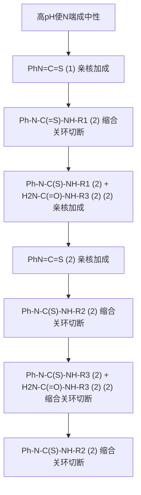

（2）对映选择性合成光学纯氨基酸 拆分法在实际操作中较为烦琐，且一次操作最多只能得到 $50\%$ 的所需氨基酸（如果所需为D-或L-氨基酸中的一种）。相较于拆分法，对映选择性合成可以从源头上得到单一的光学纯的氨基酸，具有更高的实用价值。为了得到光学纯的氨基酸，科学家们已经发展了多种不对称合成方法，包括当量手性助剂、手性催化剂和酶催化的氨基酸不对称合成等，其核心在于构造不对称的反应条件或手性环境。下面简单介绍手性催化合成法制备光学纯氨基酸。

①不对称 Strecker 反应:如前所述，Strecker 反应是最早发现的合成氨基酸的方法之一。如果在 Strecker 反应中控制氰基基团对亚胺加成的立体选择性，就可以得到单一的光学纯的氨基酸。不对称 Strecker 反应通过不对称催化剂（包括手性过渡金属催化剂或有机分子催化剂）与亚胺作用进行不对称诱导，实现氰基的选择性加成，最终得到光学纯的  $\alpha$ -氨基酸。例如，苯甲醛亚胺在不对称硫脲作用下可以实现不对称的氰基加成，得到 98% ee 光学纯的氰胺，通过后续的脱保护、水解等操作即可得到光学纯的非天然氨基酸。

chemical

Chemical reaction scheme showing conversion of a thiazole derivative to a chiral amine under catalytic conditions, with 98% ee and 98% yield indicated

②不对称氢化反应:此法的关键是制备具有空间结构的加氢催化剂，使得氢原子可以选择性地从烯烃的一侧进行加成，从而得到光学纯的氨基酸。目前已开发了很多手性配体用于不对称氢化反应，其中BPE型配体是一种广泛用于氨基酸不对称合成的配体。使用$(R,R)$-Ph-BPE配位的金属铑催化剂对下列(Z)-2-乙酰氨基-3-苯基-2丙烯酸甲酯进行氢化，氢原子会选择性地从烯烃一侧加成，最后通过水解可以得到$S$构型含量>99%的氨基酸。相反，选择(S,S)-Ph-BPE配体则可以得到$R$构型的氨基酸。

chemical

Rhodium-catalyzed cyclization reaction scheme using Rh-BPE catalyst and 99% ee, yielding 100% product with 98% yield

除了上述介绍的方法，氨基酸衍生物  $\alpha$  位的不对称烷基化及前面提及的酶催化的转胺反应也可以实现氨基酸的对映选择性合成，这里就不做详细介绍了。

## 16.2 肽和蛋白质

$\alpha$-氨基酸可以通过酰胺键形成寡聚体或生物大分子，即人们常说的肽和蛋白质，后者是生物结构的主要成分之一。从化学结构来看，生命体的肽和蛋白质没有严格的区别，只不过肽分子较蛋白质分子小。一般将长的肽链（大于50个氨基酸）称为蛋白质。由于蛋白质的肽链更长，可以进行更复杂的弯曲与折叠以形成高级结构，从而赋予蛋白质不同的功能，这也使得蛋白质具有极其广泛的生物学作用。

## 16.2.1 肽的一级结构和命名

α-氨基酸是构建肽的基本结构单元。一分子氨基酸的羧基和另一分子氨基酸的氨基经过脱水缩合形成酰胺键，得到的新化合物称为肽，其中的酰胺键叫作肽键。

chemical

Chemical reaction equation showing deprotection of a peptide with an amino acid to form a modified peptide with a side chain and labeled as the peptide bond.

由两个氨基酸组成的肽叫作二肽，由三个氨基酸组成的称为三肽，以此类推。含有少量氨基酸（少于10个氨基酸）的肽通常被称为寡肽，含有较多氨基酸（10\~50个氨基酸）的肽则称为多肽。肽骨架中由酰胺键构成的链称为主链，肽链上的取代基均称为侧链，而形成肽的各个氨基酸单元称为残基。

多肽酰胺键中氮原子的孤对电子与羰基共轭，使得 C-N 键具有部分双键特性，其长度（132 pm）介于单纯的 C-N 单键（147 pm）和双键（127 pm）之间。C-N 键部分双键的特性使得围绕 C-N 键的旋转能垒较高，羰基碳、氮及与之直接相连的原子处于一个平面且无法自由旋转。同时，肽键中的 N-H 上的氢与羰基氧原子几乎总是处于反式位置。因此，肽键在室温下是相对刚性的，这对于多肽结构的稳定是较为重要的。另外，与肽键邻近的各个 σ 键都能自由地旋转，使其具有充分的活动性，可以产生多种构象。因此，多肽能够以不同的方式进行折叠，大多数生物功能和活性就是由这种折叠产生的，直链通常是没有生物活性的。

chemical

Chemical reaction diagram showing C-N complex rotation and direct polymerization forming a plane

多肽的一级结构可以用氨基酸的序列和连接方式来表示。在多肽化合物的表示方法中，通常把N-端（保留氨基的一端）氨基酸残基放在最左边，C-端（保留羧基一端）氨基酸残基放在最右边。多肽的命名则以肽链为主链，以N-端氨基酸残基开始，将各个氨基酸的名字按序列依次连在一起，每一个看作下一个氨基酸的酰基取代基，并结束于C-端氨基酸残

从肽到多肽，再到蛋白质就是氨基酸单元连接增加、分子量增大的过程，当然，随着链的增长，分子内氢键作用会导致高级结构的出现。

基，各酰基之间用短线分开，代表肽键。例如，甘氨酸和丙氨酸形成的两种二肽，分别命名为甘氨酰-丙氨酸与丙氨酰-甘氨酸，简称甘-丙或丙-甘；由苯丙氨酸、丙氨酸和苏氨酸形成的三肽命名为苯丙氨酰-丙氨酰-苏氨酸（简称苯-丙-苏）。

然而，随着肽链的增长，氨基酸的数目也越来越多，上述命名方式就显得比较烦琐，于是就采用氨基酸缩写的三字码或单字码来表示多肽。例如，上面提到的三肽:苯丙氨酰-丙氨酰-苏氨酸，就可以用Phe-Ala-Thr或者F-A-T来表示。如果肽链的N-端或C-端被衍生化了，在符号前或后写出取代基即可。例如，在食品添加剂中使用较多的甜味剂阿斯巴甜（aspartame）是天冬氨酸和苯丙氨酸形成的二肽，其末端为甲酯，则可用符号表示为Asp-Phe-OMe。

多肽并不完全是开链结构，也存在环状的肽，称为环肽。例如:短杆菌肽S是由一种短芽孢杆菌产生的环状肽类抗生素多肽，其由首尾相连的两个相同的五肽构成。它含有 $R$ -苯丙氨酸和少有的鸟氨酸（Orn，赖氨酸的同系物，侧链少一个 $\mathrm{CH}_2$ )。该环肽的三字码表示为:环-(Leu-D-Phe-Pro-Val-Orn-Leu-D-Phe-Pro-Val-Orn)，其中字母D表示氨基酸的构型为 $R$ 。

在天然氨基酸中，半胱氨酸具有特殊的反应性，其侧链的 SH 基团可以被温和氧化，通过二硫键形成胱氨酸；当然，胱氨酸也可以被还原形成两个半胱氨酸。因此，当一个多肽链中存在能够相互靠近的两个半胱氨酸时，就可以通过二硫键结合成环，形成一个胱氨酸残基。

例如，催产素，产生于下丘脑，是一种哺乳动物肽类激素，能在分娩时促进宫缩，刺激乳汁排出，在医学上用于引产。其化学结构式如下:

chemical

Complex peptide or nucleotide molecular structure with labeled amino acid residues and a linked sugar moiety

在催产素中，N-端的半胱氨酸和6位的半胱氨酸上的两个巯基被氧化形成二硫键，使得催产素成为一个环肽。其C-端以酰胺结束，所以最后用Gly-NH $_{2}$ 表示。

当然，两个多肽也可以通过二硫键结合起来。例如，胰岛素是一种由胰腺分泌的蛋白质激素（氨基酸数目大于50），它在调节血糖水平和能量代谢方面起着重要的作用，是治疗糖尿病的重要药物。胰岛素由两条肽链组成，其中A链由21个氨基酸组成，含有4个半胱氨酸，B链由30个氨基酸组成，含有2个半胱氨酸残基。A链和B链由两个二硫键连在一起，形成一个大环，另一个二硫键链接A链的第6位和11位半胱氨酸形成小环。牛胰岛素的结构如下:

chemical

RNA secondary structure diagram showing A and B chains with amino acid residues and side chain segments labeled S

## 16.2.2 蛋白质的二级、三级和四级结构

前面介绍，蛋白质的一级结构指氨基酸的序列和连接方式，那蛋白质的二级结构是什么呢？在多肽骨架中，由于肽键的刚性结构及氢键、范德华引力等非共价相互作用，氨基酸残基在空间排列时会诱导链的折叠，从而形成多肽的二级结构（secondary structure）。其中， $\alpha-$ 螺旋（ $\alpha-helix$ ）和 $\beta-$ 折叠（ $\beta-sheet$ ）是两种最常见的二级结构。

α-螺旋结构中，多肽链围绕一个中心轴线形成螺旋结构。链中邻近（空间邻近而不是次序邻近）氨基酸之间形成氢键:第 n 个肽键的酰胺氧与第  $n+3$  个肽键的酰胺氢相互作用，氢键的形成使得螺旋结构更加稳定。X 单晶衍射表明螺旋绕轴大约每 3.6 个氨基酸残基螺旋一圈，每个残基之间的旋转角度约为  $100^{\circ}$ ，相邻两圈距离为 540 pm。螺旋中的氨基酸侧链（包

不同属性的胰岛素结构类似，只有个别氨基酸不同，例如人胰岛素的A链8位为苏氨酸，10位为异亮氨酸，B链C-端为苏氨酸，而牛胰岛素A链8位为丙氨酸，10位为缬氨酸，B链C-端为丙氨酸。

括疏水侧链）朝向螺旋外部，肽键的酰胺碳氧与氮氢在方向上相反，形成的氢键方向与螺旋长轴基本平行。右手  $\alpha-$  螺旋结构是最稳定的，在许多蛋白质中都很常见，如人胰岛素和肌红蛋白。图 16-2 展示出了  $\alpha-$  螺旋结构示意图与人胰岛素的结构。

图16-2 $\alpha$-螺旋结构示意图与人胰岛素的结构

彩图16-2

并非所有的多肽链都能形成 $\alpha$-螺旋。当相近侧链的体积过大或带有相同类型电荷时，空间位阻和静电斥力会影响螺旋的稳定性，使其不能正确适配成 $\alpha$-螺旋而造成更多的无规则取向。一般来说，在20种氨基酸中，丙氨酸（Ala）、谷氨酸（Glu）、亮氨酸（Leu）和甲硫氨酸（Met）可以很好地用于 $\alpha$-螺旋的形成，而酪氨酸（Tyr）、丝氨酸（Ser）、甘氨酸（Gly）和脯氨酸（Pro）不利于螺旋的形成。特别是脯氨酸，当脯氨酸残基被引入时，参与肽键形成的氮原子上就不再有氢原子，会中断氢键形成；同时，其刚性环结构也会造成 $\alpha$-螺旋扭曲。

β-折叠结构也通过肽键之间的氢键相互连接，但在这种结构中，两个或更多的多肽链并行排列，并通过主链的 C=O 和 N-H 基团之间的氢键以规律的方式相连形成一个锯齿形的二级结构。与 α-螺旋一样，β-折叠也非常稳定，因为除了位于折叠边缘的肽键，其余肽键都参与形成两个氢键。不过，β-折叠中的所有氢键都是由多肽的不同片段之间形成的，而在 α-螺旋中所有的氢键都处于相同的二级结构元素中。通常，在 β-折叠结构中，通过反向转弯（β-转角）相邻排列的多肽链段之间是反平行排列（反平行 β-折叠片），而侧链交替地位于 β-折叠的锯齿形平面的上方和下方，不过也会出现平行排列的（平行 β-折叠片）。β-折叠结构如图 16-3 所示。

在二级结构的基础上，多肽链自身进一步卷曲、折叠和聚集成最终的三维结构。一般来说，具有相似氨基酸序列的多肽链会折叠成相似的三维结构。三级折叠依赖于氨基酸的侧链之间的相互作用，主要包括极性侧链的亲水性、非极性侧链的疏水作用力及二硫键等（图16-4）。值得一提的是，疏水相互作用在生物学中具有重要的影响。在蛋白质折叠中，疏水效应推动了疏水性侧链的紧密聚集，从而形成了蛋白质的结构。类似地，在脂质双层中，疏水性脂肪酸尾部相互聚集，形成疏水核心，而亲水性头部与水相互作用。这些疏水相互作用不仅在生物学中起着结构稳定的作用，还参与了许多生物过程，如蛋白质折叠、酶催化和膜结构的形成等。

chemical

Diagram illustrating β-transferase structure and its corresponding reverse polymerization fragments (β-折叠片 vs. β-折叠链)

图16-3 $\beta$ -折叠结构示意图

彩图 16-3

chemical

化学结构示意图，展示静电作用与二硫键作用的化学反应路径

图 16-4 多肽链折叠中的相互作用力

组成多肽的氨基酸有20种之多，因此存在多种不同的最终三维构象，不过大多数多肽形成的是大致球形的三级结构，球蛋白就是其中的一大类。对蛋白质三维结构的研究表明，已知的成千上万种蛋白质实际上是由相对较少的结构模体（structural motif）构建起来的。这些结构模体通常由几个 $\alpha-$ 螺旋和/或 $\beta-$ 折叠连接在一起形成一个有用且可识别的结构。

例如，在哺乳动物肌细胞内有转运和储存氧作用的肌红蛋白（Myoglobin，Mb），它是由一条多肽链和一个血红素辅基组成的结合蛋白，肽链中 $78\%$ 是 $\alpha-$ 螺旋，含8个 $\alpha-$ 螺旋片段。X射线单晶衍射表明，肌红蛋白的多肽通过侧链折叠出一个疏水口袋，血红素分子正好可以嵌进去，同时附近的组氨酸与铁中心配位。五配位的铁中心可以与氧分子配位，从而达到转运氧的功能。而外围极性侧链的亲水作用，使得肌红蛋白具有可溶性（图16-5）。

蛋白质的三级结构主要是由一些较弱的作用力来维持的。在一定的条件下其空间结构会被破坏，从而导致其物理、化学性质的改变和生物活性的降低或丧失，这称为蛋白质的变性（denaturation of protein）。变性可以由各种因素引起，包括高温、变化的 pH、有机溶剂、离子浓度的变化、物理力或化学物质的作用等。常见的变性效应包括蛋白质的解离、螺旋结构的展开、氨基酸侧链的解离、氢键和疏水相互作用的破坏等。可以想象人们在准备餐食，把生鸡蛋倒入热的砂锅，或者把蛋清用搅拌机快速搅动发生的现象，这正是蛋白质变性造成的。需要注意的是，蛋白质的变性并非都是永久性的改变，有些情况下，通过恢复适宜的条件，蛋白质可能重新折叠和恢复其功能。

彩图 16-5

natural_image

3D protein structure visualization showing alpha helices and beta sheets (no labels or text)

图16-5 肌红蛋白的三维结构

实际上，许多蛋白质由多个单独的多肽链组成，尤其是总分子量远远大于 50 000 Da（约 400 个氨基酸）的蛋白质。这些多肽链本身具有特定的三级结构，称为亚基（subunit）。这些多个亚基组装就形成了四级结构。需要注意的是，只有一条多肽链的蛋白质没有四级结构。亚基通常以偶数个存在，最常见的是二或四个，少于 10% 的多聚体蛋白质具有奇数个亚基。二聚体、三聚体、四聚体、寡聚体和多聚体分别指具有二、三、四、几个和多个亚单位的结构。四级结构可以完全相同、完全不同或由几个不同类型的亚基组合而成。例如，乳糖阻遏蛋白由四个相同的亚基组成，而血红蛋白有两个  $\alpha$  亚基和两个  $\beta$  亚基（血红蛋白  $\alpha$ -链和  $\beta$ -链的三级结构与上面提到的肌红蛋白相似）。

随着技术的进步，大量的蛋白质三维结构已经被 X 射线晶体衍射解析，其三维结构可以通过 PDB 蛋白质结构数据库（Protein Data Bank, PDB）查看获取。而 AI 时代的到来，以 AlphaFold 为代表的深度学习和机器学习人工智能技术在预测蛋白质的三维结构上展示出巨大的潜力，这将成为生命科学研究和药物设计强有力的工具。

## 16.2.3 多肽结构的测定:氨基酸测序

多肽和蛋白质的高级结构赋予了其独特的生物功能，而肽链上氨基酸的组成和排列顺序，即一级结构，决定了多肽和蛋白质如何组装成三维结构。因此，蛋白质一级结构的确定，即氨基酸测序，对深入理解蛋白质的功能机制非常重要。下面介绍一种目前常用的肽链测序化学方法:Edman 降解法。

Edman 降解法是利用异硫氰酸苯酯 PhN=C=S（phenylisothiocyanate，PITC）从肽链的 N-端逐个剪断氨基酸，然后将断裂下来的氨基酸分离和鉴定，重复上述循环过程，直到完全确定整个肽的序列。具体工作原理如下:

flowchart

在高 pH 条件下，多肽的 N-端氨基不带电荷，其与异硫氰酸苯酯发生反应，生成苯基硫脲衍生物（PTC-肽）。然后，在酸性条件下，硫脲与 N-端氨基酸的羰基碳反应关环，将第一个氨基酸剪断并形成硫代乙内酰脲，在反应条件下多肽链中的其余肽键不受影响。形成的硫代乙内酰脲经过鉴定即可推知 N-端原有的氨基酸结构。反应后 N-端少一个氨基酸的肽被分离后可以继续经过下一个降解循环，测定新的 N-端氨基酸。重复该循环，就可以测定肽链的氨基酸序列。目前，Edman 降解已实现自动化，这些仪器非常高效，可以从少至 1\~5 pmol（相当于不到 0.1 μg）的样品中获取序列信息。

需要指出的是，现有的基于 Edman 降解策略的自动蛋白质测序仪一般可以进行多达 50 个重复测序循环，超过这个数目降解反应产生的杂质会干扰测序结果。因此，对于更长肽链，可以通过酶切的方法，选择合适的水解酶将肽链以选择性和可预见性的方式切割成比较小的

Sanger 法是利用氨基与 2,4-二硝基氟苯发生芳香亲核取代，形成 N-端带有 2,4-二硝基苯基的肽，随后彻底水解肽链，水解产物中只有一个氨基酸与 2,4-二硝基苯相连，此氨基酸即为 N-端氨基酸。

Sanger 法

氨基酸测序

片段进行测序。使用不同的酶进行多次切割测序，并通过对多次测序结果的分析，“拼接”出整个肽链的氨基酸顺序。

此外，还需要注意的是，当肽的 N-端发生化学修饰（如乙酰化）时，Edman 降解法测序将无法进行。此外，如果遇到非  $\alpha$ -氨基酸（如异天冬酰氨酸）或脯氨酸，异硫氰酸苯酯将无法与其发生反应，测序将停止。

随着技术的发展，Edman 降解法测序的应用逐渐减少，现代蛋白质测序方法，如质谱法（mass spectrometry）和高通量测序方法（high-throughput sequencing），已经成为常见的选择。然而，Edman 降解法仍然是一些蛋白质结构分析的方法。例如，它可用于验证重组蛋白质的 N-端边界，确定蛋白质中抗蛋白酶结构域的 N-端，特别是当蛋白质或结构域的分子量在 40～80 kDa 或不能很容易地纯化时。它还可以用于识别蛋白质片段中的新 N-端和蛋白水解切割位点。此外，对于一些尚无质谱数据库可用于 MS/MS 数据库搜索的新型蛋白质和肽段，可用 Edman 降解法分析。

除了 Edman 降解法，Sanger 法也可以对 N-端氨基酸进行分析，不过 Sanger 法在确定 N-端氨基酸的同时，其他肽键也会被破坏。而通过羧肽酶对游离羧基相近肽键的选择性切断则可以实现对 C-端氨基酸的鉴定，通过重复循环则有望推断 C-端氨基酸的序列，然而实际上，此法最多只能测定 4 个左右 C-端氨基酸。

## 16.2.4 多肽的合成

多肽是由氨基酸通过肽键形成的聚合物，其合成看似非常简单，只需要通过氨基酸之间脱水缩合形成酰胺即可，但实际上情况比这复杂得多。例如，甘氨酸和丙氨酸进行缩合反应，可以得到多种无规则序列的二肽、三肽及其他多肽等。

chemical

Molecular diagram showing glycol and ala monomers reacting to form a mixed polymer

为了能够让多肽合成过程中肽键按照预期选择性地形成，就必须对参与反应氨基酸的羧基或氨基进行保护。下面介绍多肽合成中几种氨基酸保护方法及多肽的合成方法。

## 1. 氨基的保护与脱保护

氨基保护基团的选择（或者称为封闭）需要考虑后续脱保护的问题，以能在温和的条件下进行脱保护使氨基游离出来参与新肽键的构建，而原有肽键在该条件下不受影响。目前，氨基端常用苄氧羰基（简称 Cbz 或 Z）来保护，其可以通过氨基酸与氯甲酸苄酯（CbzCl）反应实现。Cbz 保护的氨基酸可以在很温和的条件下通过 Pd/C 催化氢解脱除保护，反应十分高效，额外形成的甲苯和二氧化碳也不会对分离纯化产生干扰。

chemical

Chemical reaction pathway showing oxidation of an amino acid to form a β-lactam, followed by deprotection with Pd/C catalyst and CO2 release.

二碳酸二叔丁酯（$\mathrm{Boc}_2\mathrm{O}$）是另一个常用的氨基端保护试剂，其与氨基酸反应可以在N上实现叔丁氧羰基（简称Boc）保护基的引入。Boc保护基对碱和氢解不敏感，但在温和的酸性条件下，如盐酸或三氟乙酸作用下，很容易水解脱保护得到氨基酸，并释放出二氧化碳和异丁烯。

chemical

Chemical reaction scheme showing the synthesis of a bocyanate derivative from an amino acid and its ester under different conditions (Et3N, H3O+, Boc, CF3COOH)

还有一种保护基是9-芴甲氧羰基（简称Fmoc），通过氨基酸与9-芴甲氧羰酰氯（Fmoc-Cl）反应实现氨基的保护。与Boc保护基相反，该保护基对酸较稳定，但在温和的碱性条件下，很容易脱保护得到氨基酸。

chemical

Chemical reaction scheme showing the synthesis of a fused bicyclic compound from Fmoc-Cl, involving reagents and conditions

## 2. 羧基的保护与脱保护

羧基的保护就是将羧基转变为后期易脱保护的酯，如甲酯、乙酯、叔丁酯和苄酯。一般甲酯和乙酯在碱性条件下通过酯的水解来脱保护，不过碱的使用可能使氨基酸中 $\alpha-$ 碳去质子，从而导致产物消旋化。叔丁酯可以在温和的酸性条件下水解；而苄酯则可以在中性条件下通过催化氢化脱除。因此，叔丁酯和苄酯是在氨基酸羧基保护中最常用的两种保护基。

## 3. 羧基活化形成肽键

使用氨基保护的单元和羧基保护的单元就可以实现肽键的选择性生成。不过，保护基一般对酸碱比较敏感，因此必须对羧基进行活化，使得缩合反应能在较为温和的条件下进行。对羧基活化可以将羧酸制备成混合酸酐、活化酯等，不过目前较常用的是二环己基碳二亚胺（DCC）缩合剂与羧酸原位形成 $O-$ 酰基异脲中间体，实现羧基中的羰基的活化，使其更容易被胺亲核进攻，从而实现温和条件下肽键的形成。活化试剂DCC最终转变为不溶的二环己基脲，有利于体系的后续纯化。

chemical

Chemical reaction scheme showing the synthesis of 二环己基脲 from carboxylic acid and diethylamine using O-酰基异脲

有了上述基础后，就可以实现二肽、三肽及更长肽链的合成。回到前面讲到的甘氨酸与丙氨酸合成二肽，利用氨基保护的甘氨酸和羧基保护的丙氨酸，在 DCC 条件下缩合，再脱保护就可以得到单一的 Gly-Ala 二肽。将缩合得到的含保护基的二肽选择性脱除羧基保护，再与羧基保护的苯丙氨酸缩合，最终可以得到三肽 Gly-Ala-Phe。反之，如果选择性脱除氨基保护，再与氨基保护的苯丙氨酸缩合，则最终可以实现三肽 Phe-Gly-Ala 的制备。

chemical

Reaction mechanism diagram showing glycolysis of Gly-Ala-Phe and Phe-Gly-Ala enzymes with DCC, involving intermediates and reagents

正交保护指在N-端和C-端选择不同类型的保护基，使得在一端脱除保护基的条件下，另一端保护基不受影响。

Merrifield 因发明多肽固相合成法，对新药物和遗传工程的发展做出重大贡献而获得1984年诺贝尔化学奖。

值得指出的是，尽管氨基和羧基端可以选择多种保护基进行保护，但在多肽的合成中，一般需要对氨基和羧基端采取正交保护，这样就可以选择性地对氨基或羧基进行脱保护，而另一端的保护基不受影响，从而提高多肽合成效率。

重复以上流程则可以合成更长链的多肽。不过，当合成更长链的多肽时，相较于上述线性合成，更有效率的是先合成出几个短链的多肽，再通过上述方法把它们接起来，即可得到长链多肽。通过这种策略，我国化学家在1965年首次成功合成了由51个氨基酸组成的多肽——牛胰岛素，其具有与天然牛胰岛素类似的活性。

## 4. 多肽的固相合成

多肽的合成中，产物的分离与纯化较为烦琐且费时，也会造成合成的损失。1962年，Merrifield应用聚苯乙烯作为固相载体，通过将多肽锚定在该载体上，成功实现了多肽的固相合成。由于多肽被固载，反应结束后只需要通过溶剂洗涤就可以实现多肽的纯化。

固相合成所用的树脂结构如下,其通过聚苯乙烯中部分苯环的 Friedel-Crafts 烷基化实现氯甲基的引入。固相合成基本步骤如下: ① 通过羧酸根负离子对苄基的亲核取代将 Boc 保护的氨基酸锚定在树脂上; ② 用酸脱除 Boc 保护基; ③ 脱除 Boc 保护的氨基与另一分子 Boc 保护的氨基酸在 DCC 的作用下缩合形成肽。重复②和③的操作, 最后用 HF 处理, 使产物从树脂上剥离下来, 就可以得到更长链的多肽。

flowchart

固相合成的优点是每一步反应结束后只需要使用溶剂洗涤树脂就可以达到多肽的分离纯化，极大地简化了后续操作。1969年，Merrifield使用自动化的多肽合成仪，用时仅6周就完成了由124个氨基酸组成的核糖核酸酶A的首次人工合成。

## 16.3 酶

已经知道，每种类型的蛋白质都由一系列精确的氨基酸序列组成，使其能够折叠成特定的三维形状或构象。但蛋白质并不是完全固定不变的，它们通常具有精密的活动部分，其机械运动与化学事件相互关联。与其他分子结合的能力使蛋白质能够充当催化剂、信号受体、开关、电动机或微型泵的角色。下面简要介绍在生命体内催化生物化学反应的重要角色——酶。

酶通常是蛋白质，不过也有一些酶是核酸。根据催化的反应类型，酶主要可以分为以下七类:氧化还原酶（oxidoreductases）、水解酶（hydrolases）、转移酶（transferases）、连接酶（ligases）、异构酶（isomerases）、裂解酶（lyases）及2018年新增的转位酶（translocases）。根据酶的组成则可以将其分为简单蛋白质和结合蛋白质。简单蛋白质的催化活性由蛋白质本身的结构决定。结合蛋白质则由酶蛋白和辅助因子（cofactor）或辅酶（co-enzyme）共同组成。其中，辅助因子一般为无机金属离子，辅酶则为一些有机小分子或金属络合物。

对于结合蛋白质组成的酶（或称全酶），在催化反应中，酶蛋白决定了反应的立体专一性和高效率，而辅酶则提供酶进行其特定催化反应所需的必要化学基团或电子。只有辅酶与酶蛋白结合形成全酶，才能表现出酶活性。辅酶种类多样，其中最重要的是核苷和核苷酸衍生物。一些常见的辅酶如下:

chemical

辅酶A分子结构式，标注主要功能为乙酰基转移

主要功能: 乙酰基转移

chemical

Chemical structure of a phosphonate ester derivative with multiple azo and hydroxyl groups

辅酶I (R=H，烟酰胺腺嘌呤二核苷酸，NAD $^{+}$ )
辅酶Ⅱ(R=PO $_{3}^{2-}$ ，烟酰胺腺嘌呤二核苷酸磷酸，NADP $^{+}$ )

chemical

Chemical structure of a phosphonate ester with phosphate groups and a pyridine ring

三磷酸腺苷酶 (ATP)

主要功能: 磷酸转移

反应类型:氧化、还原

chemical

Chemical structure of β-ketoxybutyrate (β-ketoxybutyrate) with labeled functional groups and stereochemistry

黄素腺嘌呤二核苷酸 (辅酶FAD)

反应类型:氧化、还原

chemical

Chemical structure of a sulfonamide derivative with amide and hydroxyl substituents

S-腺苷蛋氨酸 (SAMe)

主要功能: 甲基转移

chemical

Chemical structure of a peptide derivative with amide and ester functional groups

四氢叶酸 (辅酶FH4)

功能: 转移C1基团

chemical

Chemical structure of a phosphonate compound with pyridine and amide functional groups

硫胺素二磷酸 (TPP脱羧酶)

主要功能:脱羧

硫辛酸 (SAMe)

主要功能:酰基转移

chemical

Chemical structure of a substituted pyrimidine derivative with hydroxyl, methoxy, and phosphate groups

磷酸吡哆醛 (PLP)

主要功能: 氨基转移等

chemical

Chemical structure of a thioamide derivative with amide and carboxylic acid substituents

生物素 (辅酶R)

主要功能:羧化反应

酶具有强大的催化能力和专一性,不同的酶促反应表现的专一性内涵也有所差异,有“结构专一性”“旋光专一性”和“顺反专一性”等。1959年，D. Koshland提出了“诱导契合”假说（induced fit hypothesis）用于解释酶的专一性。“诱导契合”假说认为:当底物分子靠近酶时，酶蛋白受底物分子的诱导，其构象会发生有利于与底物结合的变化，在此基础上酶与底物互补契合。正如前面提及的，蛋白质（酶）结构并不是固定的，而是可以精密活动的，所有蛋白质都会与其他分子结合，只是有些结合非常紧密，而有些结合较弱且短暂。X射线单晶衍射测试表明未结合底物的自由羧肽酶与结合了Ala-Gly底物的羧肽酶在构象上有很大区别，该结果支持了“诱导契合”假说。

酶通过将底物和其他反应物分子聚集在一起，将它们保持在反应所需的方向，提供任何必要的酸性或碱性位点来催化特定的步骤，并稳定过渡态以促进反应。其实，整个酶中只有一小部分位点与底物作用，这些位点称为活性中心。活性位点一般位于酶结构的深处，类似于一个洞或一个小凹陷。它在酶内的位置确保底物分子与催化残基紧密接触，从而实现高效的酶活性。尽管活性位点占酶体积的相对较小部分，通常为10%\~20%，但它是最关键的区域，因为它直接催化化学反应。酶活性位点的特异性（使酶能够与特定底物结合）是由各种特征决定的，包括尺寸和性质、电荷分布、亲疏水性和其他分子特性等。通过结合这些不同的特征，酶的活性位点被微调以结合特定的底物。活性位点独特的序列、结构和物理性质使酶表现出高度的特异性，确保它们精确地催化特定反应。

下面以丝氨酸蛋白酶为例，简要介绍其在肽键水解的催化机制。丝氨酸蛋白酶的活性位点包含三个氨基酸的催化三元组:57号位的组氨酸（His）、195号位的丝氨酸（Ser，因此得名“丝氨酸蛋白酶”）和102号位的天冬氨酸（Asp）。这三个关键氨基酸在蛋白质的主序列中相互距离较远，但由于折叠，在酶的核心部位它们会非常靠近。多肽底物进入活性位点后，底物的羰基碳位于活性位点丝氨酸残基附近。在天冬氨酸残基的作用下，组氨酸残基通过酸碱催化从活性位点中夺取丝氨酸醇的质子。通常来说，这对于天冬氨酸来说比较困难，因为天冬氨酸的侧链的 $pK_{a}$ 在水环境中比组氨酸的 $pK_{a}$ 低得多。然而，当多肽底物停靠在酶的活性位点时，通过去溶剂化排除了该区域的水，并创建了一个疏水的微环境。这有效地提高了天冬氨酸的 $pK_{a}$，从而导致其可以夺取组氨酸的质子。其反应机理类似于酸碱催化的酰胺水解，图16-6展示了该酶催化的详细过程。

丝氨酸蛋白酶能在特定氨基酸的羧基侧断裂肽键，而其特异性则由适配到酶的结合口袋的氨基酸侧链的大小、形状和电荷等决定（图16-7）。胰蛋白酶、胰凝乳蛋白酶和弹力蛋白酶是三个具有高序列同源性的类胰蛋白酶家族成员，但蛋白酶结合口袋中氨基酸残基的不同使得这三个蛋白酶的裂解位点各不相同。胰蛋白酶的结合口袋含有一个带有负电荷的酸性氨基酸（天冬氨酸），在静电作用下它能够与底物的碱性残基（如赖氨酸和精氨酸）相互作用，从而在碱性氨基酸的羧基侧水解蛋白质；胰凝乳蛋白酶结合口袋具有较大的疏水性，能够容纳底物的芳香性残基，因此可以在芳香性疏水氨基酸（如苯丙氨酸、酪氨酸和色氨酸）之后进行水解；而弹力蛋白酶结合口袋较小且具有疏水性，只允许其他小的疏水性氨基酸侧链停靠在此位置，最终在小的疏水残基（如甘氨酸、丙氨酸和缬氨酸）之后进行水解。

酶催化中底物与酶的作用其实是非常复杂的，但从上面可以看出，酶催化的化学反应是由酶分子的结构，特别是活化区域决定的，而其本质大多是由氨基酸序列和其三维空间所决定的。

酶催化具有催化效率高、专一性好、条件温和和绿色环保等优点，许多酶催化的转化已经工业化。不过，天然酶催化的反应类型还比较局限，这主要受限于天然氨基酸和辅因子。现在，通过定向进化、基因编码和化学修饰的方法对酶进行改造，甚至从头设计新酶，并基于改造或设计的人工酶，人们已经可以实现一些非天然的酶催化反应。例如，通过定向进化

RNA 也可以作为酶，例如核酶（ribozyme），是一类具有催化活性的 RNA 分子，能够催化化学反应，特别是催化 RNA 分子的剪切、连接和修饰等反应。核糖酶的发现改变了人们对遗传信息传递和生物催化的理解，揭示了 RNA 不仅仅是信息的载体，还可以作为催化剂。

技术改造P450酶实现了卡宾与烯烃的不对称环丙烷化反应；利用基因密码子拓展技术编码光敏活性非天然氨基酸开发了三重态人工光酶，实现了不对称的[2+2]环加成。可以设想，非天然酶的设计与开发将为有机合成带来新机遇。

chemical

Chemical reaction pathway showing conversion of 195Ser and 102Asp to intermediate 195Ser via intermediates 57His, with R group addition and H2N-R' reagent.

图 16-6 丝氨酸蛋白酶催化肽键的水解

chemical

三种胰蛋白酶结构示意图，分别展示胰蛋白酶、胰凝乳蛋白酶和弹力蛋白酶的化学结构与连接关系

图 16-7 不同结合口袋的丝氨酸蛋白酶选择性催化肽键水解

## 16.4 核酸

生命需要的要素有很多，其中有一样是绝对必要的:一个生物体必须能够自我复制。为了能够进行自我复制，一个生物体必须拥有关于自身的完整描述。这个描述以一种信息的形式代代相传并指定精确复制所需的每一步。在我们的世界中，自我复制所需的全部遗传信息储存在脱氧核糖核酸（deoxyribonucleic acid, DNA）中。信息只有在存在表达机制的情况下才有用。DNA中的信息被复制到一种相关的分子，核糖核酸（ribonucleic acid, RNA）中。制造RNA的复制过程称为转录（transcription）。转录的RNA分子中包含的信息随后被翻译成前面所介绍的大分子——蛋白质。核酸，包括DNA和RNA，就是本节要介绍的生物大分子。

## 16.4.1 核酸基本结构单位:核苷酸

核酸（nucleic acid）是一种聚合物，其基本结构单位是核苷酸（nucleotide）。核苷酸是由含氮的碱基（base）、戊糖（pentose）和一个或多个磷酸基团组成。没有磷酸基团的称为核苷（nucleoside），因此核苷酸也是由核苷和磷酸基团组成的。根据戊糖的不同，核酸分为两类，即 DNA 和 RNA。

在核酸中，糖环均以五元环的呋喃糖形式存在，DNA 中为脱氧核糖，而 RNA 中为核糖，这也是两类核酸的命名来源。

2-脱氧核糖

核糖

DNA 和 RNA 均含有四种碱基，但核酸中的碱基总共只有五种:腺嘌呤（A）、鸟嘌呤（G）、胞嘧啶（C）、胸腺嘧啶（T）和尿嘧啶（U）。DNA 中的四种碱基为腺嘌呤（A）、鸟嘌呤（G）、胞嘧啶（C）、胸腺嘧啶（T）；而在 RNA 中，只是尿嘧啶（U）代替了胸腺嘧啶（T）。五种碱基的结构如下:

腺嘌呤
adenine (A)

鸟嘌呤
guanine (G)

胞嘧啶
cytosine (C)

胸腺嘧啶
thymine (T)

尿嘧啶
uracil (U)

用一个碱基取代糖环 C1 位的羟基，就得到了核苷。糖环和碱基 N 原子相连的键称为 N-苷键，在嘌呤中以 N9 原子成键，而嘧啶中以 N1 成键。核苷中糖上的位置则以 1'、2' 表示，以区别于杂环标注。当核苷糖环的 C5' 位羟基被磷酸化形成磷酸酯，就形成了核苷酸。当然 C3' 位羟基也可以磷酸化，不过生物体内游离的核苷酸大多是 C5' 位羟基磷酸化的。值得一提的是，以核苷或核苷酸为基础结构的核苷类药物是一类重要的药物分子，具有广泛的应用领域，特别是在抗病毒药物和抗癌药物中。

DNA 中四个 2-脱氧核苷和脱氧核苷酸的结构如下: