# 2 生物统计学基础

原始 PDF 第 40–105 页。

## 生物统计学基础

生物信息学是处理和分析生物数据的学科，统计学是数据分析的基础学科，生物统计学则是限定于生物数据的统计学，是生物信息学的数学基础和统计基础。本章将详细介绍生物统计学的基础理论和方法、基本的统计模型、统计学习的主要思想、高维统计推断和统计因果推断，帮助读者更好地理解本书后续章节中涉及的生物数据分析方法，为自主研究生物信息学算法打好基础。

## 2

---

026

2 生物统计学基础

## 2.1 生物统计简介

在生物学领域，科研人员能够通过各种科学实验、临床试验、田野调查、仪器测量等，获得各种类型的研究数据。统计学（statistics）是一门研究如何有效地收集、分析和解释数据的学科，能够将数学语言引入各个学科领域，把具体的研究问题抽象为统计学问题并解决。生物统计学（biostatistics）是统计学在生物学领域中的应用，属于应用统计学的一个分支，它运用统计学理论和方法来收集生物学数据，并分析和解释其中的各种现象和问题。一些常见的生物统计学应用包括以下6方面。

① 实验设计 统计学在确定实验设计方面发挥重要作用。合理的实验设计可以减少偏倚，确保结果具有代表性和可推广性。
② 数据分析与展示 应用描述统计学方法（如均值、标准差、频率分布等），可以对数据进行总结和描述，并通过合适的图形（如箱线图、直方图、折线图等）进行数据展示。
③ 统计推断 通过区间估计和假设检验等方法，从样本数据中推断总体特征，从而评估实验结果之间的差异是否由生物学本质决定的。
④ 相关性分析 统计学方法可用于分析生物数据之间的相关性。例如，通过计算相关系数（如皮尔逊相关系数），可以确定两个变量之间的线性相关程度。
⑤ 数据建模与预测 统计学方法可以用于生物数据的建模和预测。例如，回归分析可以用于建立变量之间的关系模型，并用于预测未来的结果。
⑥ 实验结果验证与重复 统计学方法可用于验证实验结果的可靠性和重复性。通过进行重复实验和运用统计学方法，可以确定实验结果是否具有一致性，并评估结果的稳定性。

## 2.1.1 总体与样本

## 2.1.1.1 总体与个体

对于一个生物统计学问题，我们将感兴趣的所有研究对象所构成的集合称为总体（population），该集合的每一个元素称为个体（individual）。一些总体的例子

如某个植物园内的所有柏树、国内所有的乳腺癌患者。

## 2.1.1.2 样本与随机抽样

在实际研究中，由于成本、时间等限制，通常无法观测到所有个体，因此不能获得总体的所有数据，例如所有乳腺癌患者的各项生理指标和治疗效果。为了研究总体的性质，我们只能使用合适的方法从中抽取一部分个体作为总体的代表（图2-1）。总体中抽出的若干个体所构成的集合（即构成总体的集合中的一个子集）称为样本（sample），包含的个体数目称

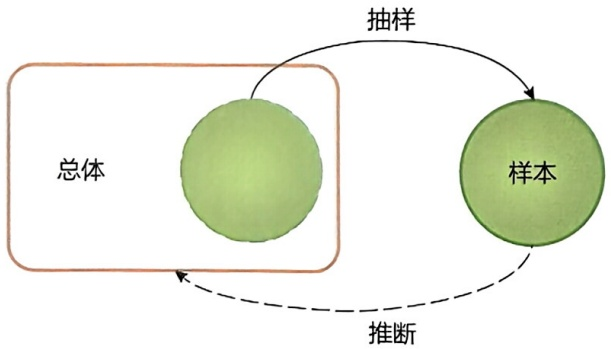

flowchart

图2-1 总体与样本的关系

---

2.1 生物统计简介

027

为样本容量（sample size），通常记为 n。样本能够用于估计总体的性质，例如某个临床试验中招募的 100 位乳腺癌患者，是所有乳腺癌患者总体的一个样本（n = 100），能够用于研究某个药物是否对治疗乳腺癌具有显著效果。

从总体进行随机抽样的方法包括简单随机抽样、系统抽样、分层抽样、整群抽样等。其中最常用的抽样方法是简单随机抽样（simple random sampling），即对于容量为 $n$ 的样本，总体中每个个体都有相同的概率被抽取入样，并且每个个体之间相互独立（即某一个体被抽取到的概率与其他个体无关）。因此简单随机抽样保证样本具有代表性和独立性，能够很好地代表总体。基于随机抽样方法得到的所有随机样本，构成随机抽样模型（random sampling model），它是假设检验、参数估计、相关性分析等统计学方法和模型的理论基础。

## 2.1.2 数据特征及描述

## 2.1.2.1 数据类型

数据集中包括描述或量化个体的各种属性。一个人的特点可以用身高、体重、性别等来表示，生物学数据同样包括各种与每个个体相关的信息。在统计学中，这些以数值或类型表示观测个体的属性称为变量（variable）。

在统计学中，数据类型（data type）决定了我们可以使用哪些统计方法进行分析，每个变量都属于一个数据类型，掌握数据各个变量及其数据类型有助于确定最适合的分析方法和模型。常见的数据类型如表2-1所示。

表 2-1 常见数据类型

<table><tr><td colspan="2">数据类型</td><td>定义</td><td>示例</td></tr><tr><td rowspan="2">数值型(numeric)</td><td>连续型(continuous)</td><td>表示在一定范围内可以取任意数值的数据</td><td>身高、体重、温度等</td></tr><tr><td>离散型(discrete)</td><td>表示在有限或可数数值集合中取值的数据</td><td>体检次数、家庭人数等</td></tr><tr><td colspan="2">分类型(categorical/nominal)</td><td>表示不同类别或属性的数据,没有数值意义,只表示不同的类别</td><td>性别、血型等</td></tr><tr><td colspan="2">顺序型(ordinal)</td><td>表示按照一定顺序排列的数据,但不能进行精确的数值计算</td><td>肿瘤分期、烧伤程度等</td></tr></table>

## 2.1.2.2 数据特征

数据特征（data feature），即数据的统计特性，通常指的是描述数据分布或数据集总体特点的一些测量值。这些测量值可以帮助我们了解数据的主要特性，包括数据的集中趋势、分布形状、离散程度等。

在统计学中,样本的数据特征(均值、标准差、中位数等)可以称为统计量(statistic)。设 $X_{1},X_{2},\cdots,X_{n}$ 为总体X中抽取的样本,若某一函数 $T=T(X_{1},X_{2},\cdots,X_{n})$

---

028

2 生物统计学基础

不含有未知参数，那么 T 称为统计量。

理论上，总体中的每个个体都可以视为一个数据点，有些数据点出现的次数多，有些数据点出现的次数少，当我们从中抽取样本来研究总体时，可以理解为不同的数据点被抽取到的概率不同，因此使用一个合适的概率分布来描述总体的特征是合理的。类似于样本的数据特征称为统计量，总体的数据特征称为参数（parameter），一些常用的统计量和参数记号见表2-2。

表 2-2 一些常用的统计量和参数记号

| 特征 | 样本-统计量 | 总体-参数 |
| --- | --- | --- |
| 均值 | $\overline{X}$ | $\mu$ |
| 中位数 | $\widetilde{X}$ | $\widetilde{\mu}$ |
| 方差(标准差) | $s^{2}(s)$ | $\sigma^{2}(\sigma)$ |
| 比例 | $\widehat{p}$ | $p$ |
| 众数 | $\widehat{Mo}$ | $Mo$ |
| 极差 | $r$ | $R$ |
| 四分位距 | IQR | — |
| 变异系数 | $s/\overline{X}$ | $\sigma/\mu$ |
| 偏度 | $g_{1}$ | $\gamma$ |
| 峰度 | $g_{2}$ | $\kappa$ |

进一步，总体就是一个分布，推断总体的特征就是确定总体分布的参数；样本与总体属于相同的分布，利用统计量来推断总体分布的未知参数，从而研究总体的性质是统计推断的经典任务。描述数据分布的概括性指标包括集中趋势（均值、中位数、众数等）、离散程度（极差、方差、四分位距、变异系数等）和分布形状（偏度、峰度等）。展示数据的常用图表包括频数频率表、直方图、散点图、折线图、箱线图等。

表 2-2 所示的常用样本统计量的定义如下:

## (1) 均值

均值（mean）是某组数据的总和除以该组数据的数量，是用来表示数据集的集中趋势的一种度量。样本均值定义为

$$
\overline {{X}} = \frac {X _ {1} + X _ {2} + \cdots + X _ {n}}{n} = \frac {1}{n} \sum_ {i = 1} ^ {n} X _ {i} \tag {2-1}
$$

## (2) 中位数

中位数（median）是将数据按照从小到大的顺序排列后，处于中间位置的数值，用于表示数据的中心位置。当数据集有奇数个数据时，中位数是排序后中间的值；当数据集有偶数个数据时，中位数是排序后中间两个数的均值。

将样本  $X_{1}, X_{2}, \cdots, X_{n}$  从小到大排列后，记  $X_{i}$  表示第 i 个最小观测值，则样本的中位数定义为

---

2.1 生物统计简介

029

$$
\widetilde {X} = \left\{ \begin{array}{l l} {{X _ {\frac {n + 1}{2}}}} & {{(n \text {为奇数})}} \\ {{\frac {1}{2} \left(X _ {\frac {n}{2}} + X _ {\frac {n}{2} + 1}\right)}} & {{(n \text {为偶数})}} \end{array} \right. \tag {2-2}
$$

## (3) 众数

众数（mode）是数据中出现频率最高的值，代表了数据集中最常见值的集合。对于离散型数据样本，选择具有最高频数的一个或多个数值或类别作为样本的众数；对于连续型数据样本，一般将数据进行分组或分区间计算频数，选择具有最高频数的一个或多个区间作为样本的众数。

## (4) 极差

极差（range）是数据中最大值与最小值之间的差值，表示了数据的全局范围。计算极差的方法是将最大值减去最小值。

## (5) 方差

方差（variance）是每个数据点与均值之间差值的平方和除以样本量，用来衡量一组数据的离散程度。标准差（standard deviation）是方差的平方根。

样本的方差和标准差分别定义为

$$
s ^ {2} = \frac {1}{n - 1} \sum_ {i = 1} ^ {n} (X _ {i} - \overline {{X}}) ^ {2}, \quad s = \sqrt {s ^ {2}} \tag {2-3}
$$

## (6) 四分位距

四分位距（interquartile range，IQR）是数据的上四分位数减去下四分位数之间的差值，其中上四分位数和下四分位数分别为数据按从小到大的顺序四等分后，较大四分之一数据的分界数值和较小四分之一数据的分界数值，分别记为 $Q_{3}$ 和 $Q_{1}$ （图2-2）。

## (7) 变异系数

变异系数（coefficient of variation）是标准差与均值的比值的百分数表示，即 $s/\overline{X} \times 100\%$，用来衡量数据相对于其均值的离散程度。变异系数较低表示数据相对于均值的离散程度较小，而较高的变异系数表示数据相对于均值的离散程度较大。

## (8) 偏度

衡量数据分布的不对称程度，用于测量数据分布尾部的相对长度和方向。当数据分布呈现左偏态时，尾部偏向左侧；当数据分布呈现右偏态时，尾部偏向右侧；当数据分布基本对称时，偏度（skewness）接近于0。

样本的偏度定义为

$$
g _ {1} = \frac {\frac {1}{n} \sum_ {i = 1} ^ {n} \left(X _ {i} - \overline {{X}}\right) ^ {3}}{\left[ \frac {1}{n} \sum_ {i = 1} ^ {n} \left(X _ {i} - \overline {{X}}\right) ^ {2} \right] ^ {3 / 2}} \tag {2-4}
$$

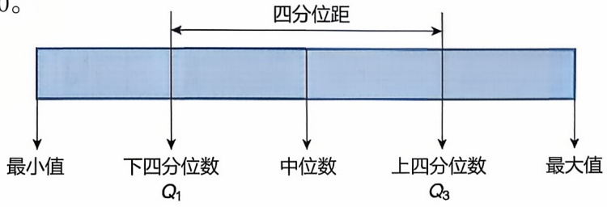

text_image

四分位距
最小值 下四分位数 Q₁ 中位数 上四分位数 Q₃ 最大值

图2-2 四分位数及四分位距示意

---

030

2 生物统计学基础

## (9) 峰度

衡量数据分布的峰态，反映数据分布的尖峭或扁平程度，以及离群值的数量。如果数据分布与正态分布的形状相同，那么峰度（kurtosis）为0；如果峰度大于0，那么数据分布比正态分布更尖峭，即数据更集中，或者说离群值更多；如果峰度小于0，那么数据分布比正态分布更扁平，即数据更分散，或者说离群值较少。

样本的峰度定义为

$$
g _ {2} = \frac {\frac {1}{n} \sum_ {i = 1} ^ {n} \left(X _ {i} - \overline {{X}}\right) ^ {4}}{\left[ \frac {1}{n} \sum_ {i = 1} ^ {n} \left(X _ {i} - \overline {{X}}\right) ^ {2} \right] ^ {2}} - 3 \tag {2-5}
$$

## 2.1.2.3 常用图表

## (1) 频数频率表

频数频率表（frequency and relative frequency table）是一种将数据分成不同区间或类别，然后列出每个区间内的观测频数和相对频率的表格（表2-3）。它可以用来总结和呈现数据的分布情况，显示不同区间中的观测频数和比例，帮助了解数据的范围、集中趋势和分散程度。

表 2-3 一个频数频率表的例子

| 物种 | A | B | C | D | 总和 |
| --- | --- | --- | --- | --- | --- |
| 频数 | 55 | 38 | 87 | 20 | 200 |
| 频率 | 0.275 | 0.190 | 0.435 | 0.100 | 1.000 |

## (2) 折线图

折线图（line chart）是一种通过连接数据点来显示随时间、顺序或其他连续变量变化趋势的图形。它常用于显示连续变量的变化趋势，帮助观察数据随时间或其他变量的变化情况，探索趋势和周期性（图2-3）。

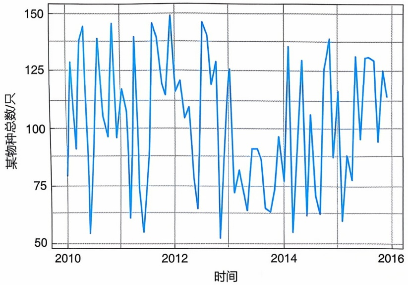

line

| 时间 | 某物种总数/只 |
| --- | --- |
| 2010 | ~80 |
| 2010 | ~128 |
| 2010 | ~90 |
| 2010 | ~140 |
| 2010 | ~145 |
| 2010 | ~55 |
| 2010 | ~138 |
| 2010 | ~98 |
| 2010 | ~145 |
| 2010 | ~97 |
| 2010 | ~115 |
| 2010 | ~108 |
| 2010 | ~62 |
| 2010 | ~138 |
| 2010 | ~55 |
| 2011 | ~85 |
| 2011 | ~145 |
| 2011 | ~140 |
| 2011 | ~115 |
| 2011 | ~150 |
| 2011 | ~115 |
| 2011 | ~120 |
| 2011 | ~105 |
| 2011 | ~110 |
| 2011 | ~65 |
| 2011 | ~145 |
| 2012 | ~140 |
| 2012 | ~120 |
| 2012 | ~130 |
| 2012 | ~52 |
| 2012 | ~125 |
| 2012 | ~72 |
| 2012 | ~82 |
| 2012 | ~65 |
| 2013 | ~90 |
| 2013 | ~90 |
| 2013 | ~65 |
| 2013 | ~63 |
| 2013 | ~95 |
| 2013 | ~78 |
| 2013 | ~55 |
| 2013 | ~135 |
| 2014 | ~62 |
| 2014 | ~130 |
| 2014 | ~63 |
| 2014 | ~63 |
| 2014 | ~138 |
| 2014 | ~88 |
| 2014 | ~60 |
| 2014 | ~88 |
| 2014 | ~78 |
| 2014 | ~95 |
| 2014 | ~130 |
| 2014 | ~95 |
| 2014 | ~130 |
| 2014 | ~95 |
| 2014 | ~95 |
| 2014 | ~125 |
| 2014 | ~95 |
| 2014 | ~115 |

图2-3 一个折线图的例子

---

2.1 生物统计简介

031

## (3) 直方图

直方图（histogram）是一种将数据分成一系列的区间（或称为柱），绘制每个区间内的观测频数或相对频率的图形（图2-4）。它可以更直观地显示数据的分布情况，包括数据的峰值、对称性、偏态等，帮助了解数据的分布形态以及在不同区间中的集中程度。

## (4) 散点图

散点图（scatter plot）是在坐标平面上绘制每个观测点来显示两个连续变量之间关系的图形（图2-5）。它可以用于探索变量之间的关系、趋势以及可能的离群值，帮助判断两个变量是否有线性或非线性关系，以及变量之间的相关性。

## (5) 箱线图

箱线图（box-plot）是展示数据的中位数、四分位数、离群值和分布范围来表示数据分布情况的图形。它可以帮助了解数据的分布形态、集中趋势、离群值等，

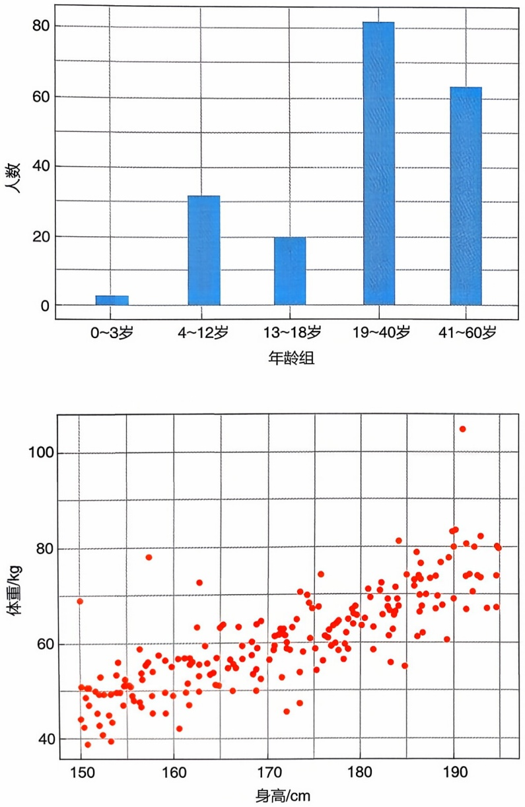

图2-4 一个直方图的例子

图2-5 一个散点图的例子

---

032

2 生物统计学基础

图2-6 箱线图的基本组成

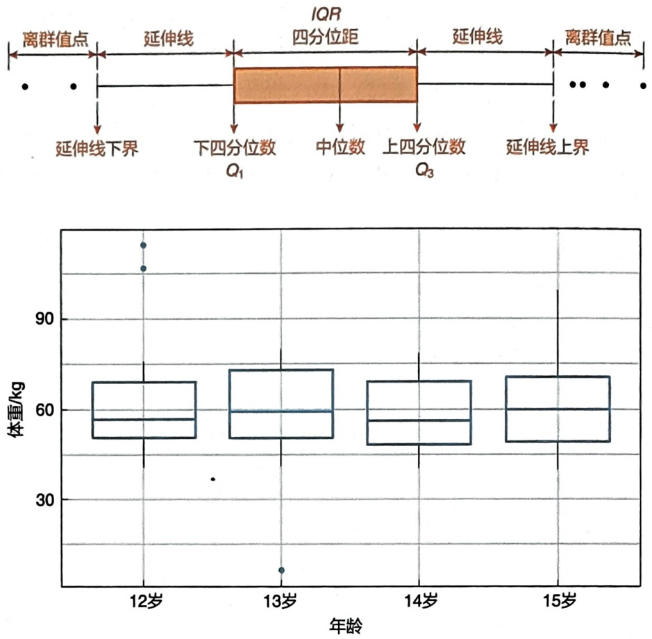

图2-7 一个箱线图的例子

从而更好地理解数据的统计特征。箱线图包括箱体、延伸线和离群值点（图2-6），箱体上边界和下边界分别是上四分位数 $Q_{3}$ 和下四分位数 $Q_{1}$，箱体中间横线是中位数，延伸线向上延伸到 $(Q_{3} + 1.5 \times IQR)$，向下延伸到 $(Q_{1} - 1.5 \times IQR)$，离群值点是位于上下延伸线以外的数据点（图2-7）。

## 2.2 参数估计和假设检验

统计推断（statistical inference）是根据样本信息对总体分布或总体特征进行推断。统计推断主要包括参数估计和假设检验。参数估计（parameter estimation）是使用样本来估计总体分布中包含的未知参数或参数函数的方法。假设检验（hypothesis testing）是在抽样分布和小概率原理的基础上，使用样本对总体的分布或分布中所含参数的假设进行检查的方法和过程。很多生物学问题都可以直接或者间接地转化为统计推断问题。例如，基因 $X$ 的高表达是否会导致表型 $Y$ 的变化，转化成统计语言就是要检验基因 $X$ 与表型 $Y$ 是否相关；差异表达的基因是否富集在某一条KEGG（Kyoto Encyclopedia of Genes and Genomes）通路上，本质上就是要检验这些差异表达的基因是否与该KEGG通路相关。因此，充分理解生物学问题的本质是熟练运用统计学工具或方法的重要前提。

---

2.2 参数估计和假设检验

033

## 2.2.1 抽样分布

## 2.2.1.1 抽样分布的定义

生物统计学分析的关键在于区分数据特征是由真正的生物学本质所决定的，还是偶然效应所造成的。随机抽样模型为解决这一问题提供了理论基础，如果将得到的数据看作是来自总体的随机样本，那么偶然效应就等同于抽样误差，即样本与总体之间由于抽样的随机性带来的差异。基于样本构造统计量的分布称为抽样分布（sampling distribution）。

## 2.2.1.2 样本均值的分布

对于不同的数据特征（如均值、中位数等），抽样分布的形状、集中趋势和离散程度并不相同。本章中，我们关注最常用的样本均值  $\overline{X}$  的分布（图 2-8）。

从均值为 $\mu$ ，标准差为 $\sigma$ 的总体中，抽取样本容量为 $n$ 随机样本，其均值 $\overline{X}$ 的分布具有以下性质:

①  $\mu_{\overline{X}} = \mu$ ，即  $\overline{X}$  的均值等于总体均值。
②  $\sigma_{\overline{X}} = \sigma / \sqrt{n}$ ，即  $\overline{X}$  的标准差等于总体标准差除以样本容量的平方根。
③ 如果总体服从正态分布 $X \sim N(\mu, \sigma^2)$，那么 $\overline{X} \sim N(\mu, \sigma^2 / n)$；如果总体不服从正态分布，依据中心极限定理，当 $n$ 足够大时，$\overline{X}$ 也近似服从该正态分布。

## 2.2.2 区间估计

在统计推断中，参数估计是一个重要的任务，其目标是利用可观测的数据来估计总体的参数，并评估这些估计的准确性。

## 2.2.2.1 标准误差及置信区间

假设总体 X 均值为  $\mu$ ，标准差为  $\sigma$ ，并且  $X_{1}, X_{2}, \cdots, X_{n}$  是来自该总体的一个随机样本。我们已知样本均值  $\overline{X}$  的抽样分布的均值为  $\mu$ ，标准差为  $\sigma_{\overline{X}} = \sigma / \sqrt{n}$ 。将

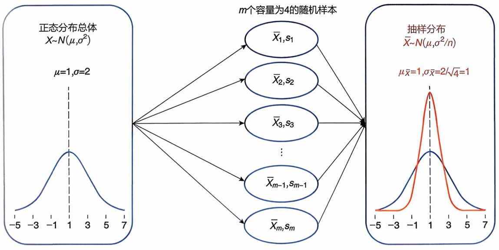

flowchart

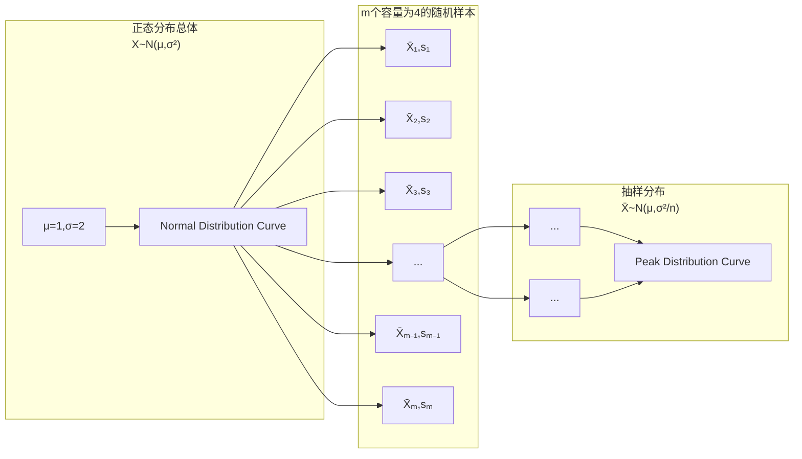

图2-8 样本均值 $\overline{X}$ 的抽样分布示意

---

034

2 生物统计学基础

样本标准差 $s$ 作为 $\sigma$ 的估计值，可以得到 $\overline{X}$ 的标准误差（standard error）

$$
S E _ {\overline {{X}}} = \frac {s}{\sqrt {n}} \tag {2-6}
$$

$SE_{\overline{X}}$ 作为 $\sigma_{\overline{X}}$ 的估计值描述了 $\overline{X}$ 抽样分布的离散程度。标准误差越小代表 $\overline{X}$ 的准确度越高。

置信区间（confidence interval）是在给定的置信水平 $1 - \alpha$ 下，基于统计量构造的总体参数的一种区间估计。对于正态总体 $X$ 的均值 $\mu$ ，已知 $\sqrt{n} (\overline{X} -\mu) / \sigma$ 服从标准正态分布，故

$$
P [ - Z _ {1 - \alpha / 2} <   \sqrt {n} (\overline {{X}} - \mu) / \sigma <   Z _ {1 - \alpha / 2} ] = 1 - \alpha \tag {2-7}
$$

进而

$$
P (\overline {{X}} - Z _ {1 - \alpha / 2} \times \sigma / \sqrt {n} <   \mu <   \overline {{X}} + Z _ {1 - \alpha / 2} \times \sigma / \sqrt {n}) = 1 - \alpha \tag {2-8}
$$

其中， $Z_{1 - \alpha /2}$ 是标准正态分布的上 $\alpha /2$ 分位点。当标准差 $\sigma$ 已知时，区间

$$
\overline {{X}} \pm Z _ {1 - \alpha / 2} \times \frac {\sigma}{\sqrt {n}} \tag {2-9}
$$

是均值 $\mu$ 的置信水平为 $1 - \alpha$ 的置信区间。通常，取 $\alpha = 0.01$ 或 $\alpha = 0.05$。

## 2.2.2.2 学生t分布

在实际数据分析中，如果总体的标准差 $\sigma$ 是未知的，可以用样本标准差 $s$ 代替。1907年英国人威廉·戈塞特（William Gosset）以笔名Student发表的论文中，给出了$\sqrt{n} (\overline{X} -\mu) / s$ 的抽样分布，被人们称为学生 $t$ 分布（Student's t-distribution）（以下简称 $t$ 分布）。该分布的整体形状与自由度（degree of freedom, df）有关（图2-9）。当自由度趋近于无穷，$t$ 分布接近于标准正态分布。

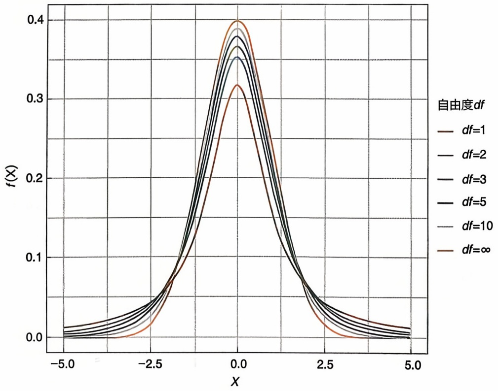

line

| X | df=1 | df=2 | df=3 | df=5 | df=10 | \(df=\infty\) |
|---|---|---|---|---|---|---|
| -5.0 | ~0.01 | ~0.01 | ~0.01 | ~0.01 | ~0.01 | ~0.01 |
| -2.5 | ~0.04 | ~0.04 | ~0.04 | ~0.04 | ~0.04 | ~0.04 |
| 0.0 | ~0.39 | ~0.38 | ~0.37 | ~0.36 | ~0.35 | ~0.32 |
| 2.5 | ~0.04 | ~0.04 | ~0.04 | ~0.04 | ~0.04 | ~0.04 |
| 5.0 | ~0.01 | ~0.01 | ~0.01 | ~0.01 | ~0.01 | ~0.01 |

图2-9 不同自由度下的t分布

---

2.2 参数估计和假设检验

035

t 分布在统计分析中应用广泛，其中包括置信区间的构建。当总体标准差未知时，区间

$$
\overline {{X}} \pm t _ {1 - \alpha / 2} (n - 1) \times S E _ {\overline {{X}}} \tag {2-10}
$$

是总体均值 $\mu$ 的置信水平为 $1 - \alpha$ 的置信区间。其中，$t_{1 - \alpha /2}(n - 1)$ 是自由度为 $n - 1$ 的 $t$ 分布的上 $\alpha /2$ 分位点。

## 2.2.3 假设检验

通过假设检验，我们能够区分某一数据特征的变化是由抽样的随机误差引入的，还是由真实的生物学本质决定的。

一般情况下，假设检验包括 4 个步骤。

## 2.2.3.1 提出假设

假设检验首先要根据实际问题提出合理的假设，一个是原假设（null hypothesis），记作 $H_0$；另一个是备择假设（alternative hypothesis），记作 $H_A$。原假设是预先设立的假设，通常是基于先前的分析或专业知识做出的初始声明，“原”就是原来就有的结论或事实。备择假设是当原假设不成立时准备接受的结论，即拒绝原假设后可供选择的假设，如认为数据特征的变化是由于样本所属总体与假定总体的参数不同所引起的。

原假设的形式是多样的，随研究内容不同而变化，但必须是有意义的，根据原假设是否成立，可以对问题作出回答。例如，考察某个总体的均值 $\mu$ 是否大于某已知常数 $\mu_0$ ，即考虑以下假设检验问题，原假设和备择假设分别为

$$
H _ {0}: \mu \leqslant \mu_ {0} \Longleftrightarrow H _ {A}: \mu > \mu_ {0}
$$

## 2.2.3.2 确定检验统计量以及拒绝域的形式

在检验一个假设时用到的统计量称为检验统计量（test statistic）。例如，上述总体均值的假设检验问题，可以使用样本均值  $\overline{X}$  作为检验统计量。根据备择假设  $H_{A}$  的实际意义，需要寻找适当的使原假设  $H_{0}$  被拒绝的样本所在区域 D，称 D

为拒绝域（rejection region）。在常见的假设检验问题中拒绝域通常可以转化为检验统计量所处的区域，如假设检验问题的拒绝域形式为 $D = \{\overline{X} > C\}$，其中常数 $C$ 称为临界值（critical value）。拒绝域和置信区间的关系示意图如图2-10所示。

## 2.2.3.3 给定显著性水平，求出拒绝域

显著性水平（significance level）是预先人为给定的一个较小的数，用于表示检验统计量落入拒绝域的概率，通常选择 $\alpha = 0.05$ 或 $\alpha = 0.01$ 。当原假设成立时，通过控制将其错误拒绝的概率小于或等于给定的显著性水平 $\alpha$ ，给出关于临界值的方程，解出临界值 $C$ ，这样就确定了检验的拒绝域。

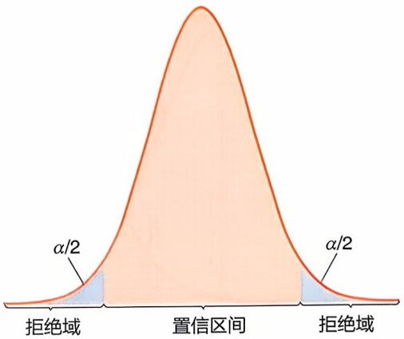

text_image

α/2
拒绝域
置信区间
α/2
拒绝域

图2-10 置信区间和拒绝域示意图

---

036

2 生物统计学基础

## 2.2.3.4 推断是否拒绝原假设

通过给定的样本，可以算出检验统计量的值。若检验统计量的值落在拒绝域中，则拒绝原假设 $H_0$ ，否则不能拒绝原假设 $H_0$ ，只能被动接受原假设。除了使用拒绝域来做判断，还可以计算 $p$ 值（$p$ value），即在观测数据下拒绝原假设的最小显著性水平。如果 $p$ 值小于给定的显著性水平 $\alpha$ ，则拒绝原假设 $H_0$ ，否则接受 $H_0$ 。

## 2.2.3.5 I型和Ⅱ型错误

由于我们是根据样本做检验，而样本具有随机性，所以进行假设检验并不能保证判断一定是正确的，根据错误情况不同，可以将错误分为Ⅰ型和Ⅱ型错误（表2-4）。Ⅰ型错误（type I error）也称为弃真错误，指的是当 $H_{0}$ 实际是正确的时候，假设检验否定了 $H_{0}$ 。Ⅱ型错误（type II error）也称为存伪错误，指的是当 $H_{0}$ 实际是错误的时候，假设检验接受了 $H_{0}$ 。

表 2-4 假设检验不同推断的可能结果

<table><tr><td rowspan="2">观测样本</td><td colspan="2">总体</td></tr><tr><td> $H_0$ 为真</td><td> $H_A$ 为真</td></tr><tr><td>接受  $H_0$ </td><td>正确</td><td>II型错误</td></tr><tr><td>拒绝  $H_0$ </td><td>I型错误</td><td>正确</td></tr></table>

记犯 I 型错误的概率为  $\alpha$ ，犯 II 型错误的概率为  $\beta$ 。我们希望犯两类错误的概率都尽量小，但是这是不可能的。对给定的样本，要减少犯 I 型错误的概率，必然会增加犯 II 型错误的概率，反之亦然（图 2-11）。因此，有个谁优先的问题。J. Neyman 提出先保证犯 I 型错误的概率不超过某个给定的很小的数，在此基础上使犯 II 型错误的概率尽量小。如果仅仅考虑控制犯 I 型错误的概率，而不涉及犯 II 型错误的概率所得到的检验，称为显著性检验（significance test）。

## 2.2.4 正态总体均值的检验

对于单个正态总体均值  $\mu$  的假设检验问题，在应用中常见的情形有以下 3 种:

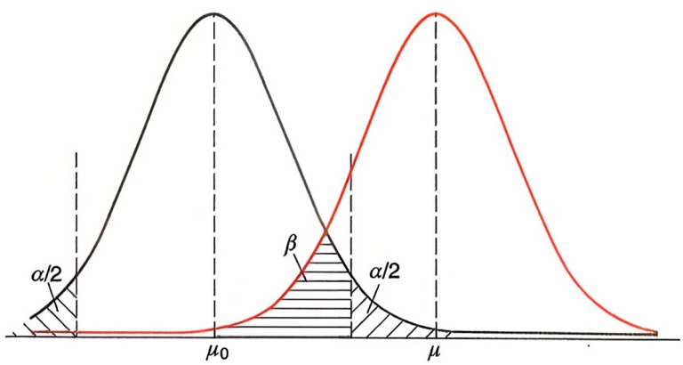

area

| Category | Description |
| --- | --- |
| Black Curve | Normal distribution curve (α/2) |
| Red Curve | Normal distribution curve (β) |
| Shaded Area 1 | Left of the black curve (α/2) |
| Shaded Area 2 | Right of the red curve (β) |
| Center Point | \(\mu0\) |
| Right Peak | \(\mu\) |

图2-11 假设检验中两类统计错误的关系

① $H_0: \mu \leqslant \mu_0 \Longleftrightarrow H_A: \mu > \mu_0$
② $H_0: \mu \geqslant \mu_0 \Longleftrightarrow H_A: \mu < \mu_0$
③ $H_0: \mu = \mu_0 \Longleftrightarrow H_A: \mu \neq \mu_0$

其中，$\mu_0$ 是给定的常数。前两种检验问题称为单侧检验（one-sided test），即均值 $\mu$ 是否显著地大于（或小于）给定的常数 $\mu_0$；第三种是双侧检验（two-sided test），即均值 $\mu$ 是否显著地不等于给定的常数 $\mu_0$。

总体方差 $\sigma^2$ 是否已知对检验方法的选择有影响。在已知 $\sigma^2 = \sigma_0^2$ 的情况下，可以使用Z检验。

---

2.2 参数估计和假设检验

037

## 2.2.4.1 Z检验

Z 检验（Z-test）是统计学中最基本的一种假设检验方法，被广泛用于比较一个总体均值与给定的常数有无显著差异。假设正态总体 X 均值为  $\mu$ ，标准差为  $\sigma$ ，并且  $X_{1}, X_{2}, \cdots, X_{n}$  是来自该总体的一个随机样本。Z 检验假定  $\sigma = \sigma_{0}$  已知，对应的检验统计量为

$$
Z = \frac {\overline {{X}} - \mu_ {0}}{\sigma_ {0} / \sqrt {n}} \tag {2-11}
$$

在原假设 $H_0$ 成立时，该统计量服从标准正态分布，$Z \sim N(0,1)$。根据备择假设 $H_A$ 的具体形式，可以用 R 语言计算临界值，进而确定检验的拒绝域。

## 2.2.4.2 t检验和韦尔奇t检验

当总体标准差未知时，Z 检验无法使用。如果将样本标准差代替总体标准差，可以得到 t 检验（t-test），其检验统计量为

$$
T = \frac {\overline {{X}} - \mu_ {0}}{s / \sqrt {n}} \tag {2-12}
$$

在原假设 $H_0$ 成立时，该统计量服从自由度为 $n - 1$ 的 $\mathrm{t}$ 分布，$T \sim t(n - 1)$。与 $\mathbf{Z}$ 检验类似，根据备择假设 $H_A$ 的具体形式，可以用 $\mathbf{R}$ 语言计算临界值，进而确定拒绝域。

在实际问题中，除了单样本检验，两样本检验同样具有重要的意义。假设有两个正态总体，其均值分别为 $\mu_{1}$ 和 $\mu_{2}$，方差分别为 $\sigma_1^2$ 和 $\sigma_2^2$。我们考虑以下3种假设检验问题:

① $H_0: \mu_1 \leqslant \mu_2 \Longleftrightarrow H_A: \mu_1 > \mu_2$
② $H_0:\mu_1\geqslant \mu_2\Longleftrightarrow H_A:\mu_1 <   \mu_2$
③ $H_0: \mu_1 = \mu_2 \Longleftrightarrow H_A: \mu_1 \neq \mu_2$

（1）如果 $\sigma_1^2$ 和 $\sigma_2^2$ 均已知，可以使用两样本Z检验。记两个样本的均值分别为$\overline{X}_1$ 和 $\overline{X}_2$ ，样本容量分别为 $n_1$ 和 $n_2$ ，Z检验统计量为

$$
Z = \frac {\overline {{X}} _ {1} - \overline {{X}} _ {2}}{\sqrt {\frac {\sigma_ {1} ^ {2}}{n _ {1}} + \frac {\sigma_ {2} ^ {2}}{n _ {2}}}} \tag {2-13}
$$

它在原假设  $H_{0}$  成立时服从标准正态分布，即  $Z \sim N(0,1)$ 。

（2）如果 $\sigma_1^2$ 和 $\sigma_2^2$ 未知，但样本容量 $n_1$ 和 $n_2$ 足够大，仍可以使用Z检验。记两个样本的标准差分别为 $s_1$ 和 $s_2$ ，Z检验统计量为

$$
Z = \frac {\overline {{X}} _ {1} - \overline {{X}} _ {2}}{\sqrt {\frac {s _ {1} ^ {2}}{n _ {1}} + \frac {s _ {2} ^ {2}}{n _ {2}}}} \tag {2-14}
$$

它在原假设  $H_{0}$  成立时近似服从标准正态分布。

（3）如果 $\sigma_1^2$ 和 $\sigma_2^2$ 未知，且样本容量较小，则需要使用两样本t检验。

---

038

2 生物统计学基础

① 当  $\sigma_{1} = \sigma_{2}$  时，t 检验统计量为

$$
T = \frac {\overline {{X}} _ {1} - \overline {{X}} _ {2}}{s _ {w} \sqrt {\frac {1}{n _ {1}} + \frac {1}{n _ {2}}}} \tag {2-15}
$$

其中

$$
s _ {w} ^ {2} = \frac {(n _ {1} - 1) s _ {1} ^ {2} + (n _ {2} - 1) s _ {2} ^ {2}}{n _ {1} + n _ {2} - 2}
$$

在原假设 $H_0$ 成立时，该统计量服从自由度为 $n_1 + n_2 - 2$ 的t分布，即 $T\sim t(n_{1} + n_{2} - 2)$。

② 当 $\sigma_{1} \neq \sigma_{2}$ 时，可以使用韦尔奇 t 检验（Welch's t-test），其检验统计量为

$$
T = \frac {\overline {{X}} _ {1} - \overline {{X}} _ {2}}{\sqrt {\frac {s _ {1} ^ {2}}{n _ {1}} + \frac {s _ {2} ^ {2}}{n _ {2}}}} \tag {2-16}
$$

它在原假设 $H_0$ 成立时服从自由度为 $v$ 的 $\mathfrak{t}$ 分布，$T \sim t(v)$，其中

$$
v = \frac {\left[ (s _ {1} ^ {2} / n _ {1}) + (s _ {2} ^ {2} / n _ {2}) \right] ^ {2}}{\left[ \frac {(s _ {1} ^ {2} / n _ {1}) ^ {2}}{(n _ {1} - 1)} + \frac {(s _ {2} ^ {2} / n _ {2}) ^ {2}}{(n _ {2} - 1)} \right]}
$$

配对数据（paired data）是两样本检验中的一种特殊情况。例如，比较同一批乳腺癌患者在使用某种治疗方案前后的癌症指标水平。在处理配对数据时，直接使用两样本检验方法可能会引入条件内部差异，而实际上希望检验的是由于条件不同而产生的差异。在这种情况下，应该使用配对样本检验。注意到，检验配对数据均值 $\mu_{1}$ 与 $\mu_{2}$ 之间的关系，等价于检验配对数据均值差 $d = \mu_{1} - \mu_{2}$ 与0之间的关系。此时，两样本检验问题转化为单样本检验问题，根据适用范围可选择单样本Z检验或t检验。表2-5总结了正态总体均值的各类假设检验方法。

例题2-1:一家制药公司开发了一种新的降血压药物。为了测试新药的效果，他们进行了一项临床试验，随机选择了100名高血压患者参加试验。试验前，这些患者的平均血压为 $150\mathrm{mmHg}$，标准差为 $15\mathrm{mmHg}$。试验后，这些患者的平均血压为 $140\mathrm{mmHg}$，标准差为 $10\mathrm{mmHg}$。这个数据是否能确定新药的有效性？（显著性水平取 $\alpha = 0.05$）

检验过程:由于样本容量大于30，因此根据中心极限定理可以使用Z检验进行假设检验。原假设和备择假设分别为

$$
H _ {0}: \text {试验前后患者的平均血压无显著差异} (\mu_ {1} = \mu_ {2}) \Longleftrightarrow
$$

$$
H _ {A}: \text {试验前后患者的平均血压有显著差异} (\mu_ {1} \neq \mu_ {2})
$$

通过计算，Z检验统计量为

$$
Z = \frac {\overline {{X}} _ {1} - \overline {{X}} _ {2}}{\sqrt {\frac {s _ {1} ^ {2}}{n _ {1}} + \frac {s _ {2} ^ {2}}{n _ {2}}}} = \frac {1 5 0 - 1 4 0}{\sqrt {\frac {1 5 ^ {2}}{1 0 0} + \frac {1 0 ^ {2}}{1 0 0}}} = 5. 5 4 7
$$

---

2.2 参数估计和假设检验

039

表 2-5 正态总体均值的参数假设检验方法

<table><tr><td colspan="2">样本情况</td><td>检验方法</td><td>原假设 $H_0$ </td><td>备择假设 $H_A$ </td><td>检验统计量</td><td>拒绝域</td></tr><tr><td rowspan="6">单样本(包括配对数据)</td><td rowspan="3">方差已知</td><td rowspan="3">Z 检验( $\sigma = \sigma_0$ )</td><td> $\mu \leqslant \mu_0$ </td><td> $\mu >\mu_0$ </td><td rowspan="3"> $Z=\frac{\overline{X}-\mu_0}{\sigma_0/\sqrt{n}}$ </td><td> $Z \geqslant Z_{1-\alpha}$ </td></tr><tr><td> $\mu \geqslant \mu_0$ </td><td> $\mu < \mu_0$ </td><td> $Z \leqslant Z_\alpha$ </td></tr><tr><td> $\mu = \mu_0$ </td><td> $\mu \neq \mu_0$ </td><td> $|Z| \geqslant Z_{1-\alpha/2}$ </td></tr><tr><td rowspan="3">方差未知</td><td rowspan="3">t 检验</td><td> $\mu \leqslant \mu_0$ </td><td> $\mu >\mu_0$ </td><td rowspan="3"> $T=\frac{\overline{X}-\mu_0}{s/\sqrt{n}}$ </td><td> $T \geqslant t_{1-\alpha}(n-1)$ </td></tr><tr><td> $\mu \geqslant \mu_0$ </td><td> $\mu < \mu_0$ </td><td> $T \leqslant t_\alpha(n-1)$ </td></tr><tr><td> $\mu = \mu_0$ </td><td> $\mu \neq \mu_0$ </td><td> $|T| \geqslant t_{1-\alpha/2}(n-1)$ </td></tr><tr><td rowspan="12">两样本</td><td rowspan="3">方差已知</td><td rowspan="3">Z 检验( $\sigma_1$  和  $\sigma_2$  均已知)</td><td> $\mu_1 \leqslant \mu_2$ </td><td> $\mu_1 >\mu_2$ </td><td rowspan="3"> $Z=\frac{\overline{X}_1 - \overline{X}_2}{\sqrt{\frac{\sigma_1^2}{n_1} + \frac{\sigma_2^2}{n_2}}}$ </td><td> $Z \geqslant Z_{1-\alpha}$ </td></tr><tr><td> $\mu_1 \geqslant \mu_2$ </td><td> $\mu_1 < \mu_2$ </td><td> $Z \leqslant Z_\alpha$ </td></tr><tr><td> $\mu_1 = \mu_2$ </td><td> $\mu_1 \neq \mu_2$ </td><td> $|Z| \geqslant Z_{1-\alpha/2}$ </td></tr><tr><td rowspan="9">方差未知</td><td rowspan="3">t 检验( $\sigma_1 = \sigma_2$ )</td><td> $\mu_1 \leqslant \mu_2$ </td><td> $\mu_1 >\mu_2$ </td><td rowspan="3"> $T=\frac{\overline{X}_1 - \overline{X}_2}{s_w\sqrt{\frac{1}{n_1} + \frac{1}{n_2}}}$ </td><td> $T \geqslant t_{1-\alpha}(n_1 + n_2 - 2)$ </td></tr><tr><td> $\mu_1 \geqslant \mu_2$ </td><td> $\mu_1 < \mu_2$ </td><td> $T \leqslant t_\alpha(n_1 + n_2 - 2)$ </td></tr><tr><td> $\mu_1 = \mu_2$ </td><td> $\mu_1 \neq \mu_2$ </td><td> $|T| \geqslant t_{1-\alpha/2}(n_1 + n_2 - 2)$ </td></tr><tr><td rowspan="3">Z 检验( $n_1$  和  $n_2$  足够大)</td><td> $\mu_1 \leqslant \mu_2$ </td><td> $\mu_1 >\mu_2$ </td><td rowspan="3"> $Z=\frac{\overline{X}_1 - \overline{X}_2}{\sqrt{\frac{s_1^2}{n_1} + \frac{s_2^2}{n_2}}}$ </td><td> $Z \geqslant Z_{1-\alpha}$ </td></tr><tr><td> $\mu_1 \geqslant \mu_2$ </td><td> $\mu_1 < \mu_2$ </td><td> $Z \leqslant Z_\alpha$ </td></tr><tr><td> $\mu_1 = \mu_2$ </td><td> $\mu_2 \neq \mu_2$ </td><td> $|Z| \geqslant Z_{1-\alpha/2}$ </td></tr><tr><td rowspan="3">韦尔奇 t 检验( $\sigma_1 \neq \sigma_2, n_1$  和  $n_2$  较小)</td><td> $\mu_1 \leqslant \mu_2$ </td><td> $\mu_1 >\mu_2$ </td><td rowspan="3"> $T=\frac{\overline{X}_1 - \overline{X}_2}{\sqrt{\frac{s_1^2}{n_1} + \frac{s_2^2}{n_2}}}$ </td><td> $T \geqslant t_{1-\alpha}(v)$ </td></tr><tr><td> $\mu_1 \geqslant \mu_2$ </td><td> $\mu_1 < \mu_2$ </td><td> $T \leqslant t_\alpha(v)$ </td></tr><tr><td> $\mu_1 = \mu_2$ </td><td> $\mu_1 \neq \mu_2$ </td><td> $|T| \geqslant t_{1-\alpha/2}(v)$ </td></tr></table>

这是一个双侧检验，通过查表可知临界值为 $1.96 < 5.547$ ，或者统计软件计算可知 $p$ 值小于0.05，因此拒绝原假设，表明试验前后患者的平均血压具有显著差异。

例题2-2:如果例题2-1中的临床试验患者数变为20名，试验前后血压数据同例题2-1，假设数据服从正态分布且试验前后总体方差相同，如何确定新药的有效性？

检验过程:由于样本容量小于30，且试验前后总体方差相同，因此可以使用t检验进行假设检验。原假设和备择假设分别为

$$
H _ {0}: \text {试验前后患者的平均血压无显著差异} (\mu_ {1} = \mu_ {2}) \Longleftrightarrow
$$

$$
H _ {A}: \text {试验前后患者的平均血压有显著差异} (\mu_ {1} \neq \mu_ {2})
$$

通过计算，t 检验统计量为

$$
T = \frac {\overline {{X}} _ {1} - \overline {{X}} _ {2}}{s _ {w} \sqrt {\frac {1}{n _ {1}} + \frac {1}{n _ {2}}}} = \frac {1 5 0 - 1 4 0}{s _ {w} \sqrt {\frac {1}{2 0} + \frac {1}{2 0}}} = 2. 4 8 \sim t (3 8)
$$

其中

$$
s _ {w} ^ {2} = \frac {(n _ {1} - 1) s _ {1} ^ {2} + (n _ {2} - 1) s _ {2} ^ {2}}{n _ {1} + n _ {2} - 2} = 1 6 2. 5
$$

---

040

2 生物统计学基础

通过查表可知 t 检验在自由度为 38 时，临界值为 2.02 < 2.48，或者通过统计软件计算可知 p 值为 0.0177 < 0.05，因此拒绝原假设，表明试验前后患者的平均血压具有显著差异。

例题2-3:在例题2-1的试验中，假如有10名患者的试验前后数据均是可获得的，具体如表2-6所示。假设数据服从正态分布且试验前后总体方差相同，这个数据是否能支持确定新药的有效性？

表 2-6 10 名受试患者血压情况表

| 患者 | 试验前血压/mmHg | 试验后血压/mmHg |
| --- | --- | --- |
| 1 | 152 | 150 |
| 2 | 153 | 135 |
| 3 | 155 | 146 |
| 4 | 146 | 142 |
| 5 | 166 | 140 |
| 6 | 160 | 150 |
| 7 | 141 | 141 |
| 8 | 152 | 129 |
| 9 | 151 | 127 |
| 10 | 151 | 137 |

检验过程:这是一个配对样本，由于样本容量小于30，所以应使用配对t检验。原假设和备择假设分别为

$$
H _ {0}: \text {试验前后患者的平均血压无显著差异} (d = \mu_ {1} - \mu_ {2} = 0) \Longleftrightarrow
$$

$$
H _ {A}: \text {试验前后患者的平均血压有显著差异} (d = \mu_ {1} - \mu_ {2} \neq 0)
$$

通过计算，10位患者试验前后血压差值为 $2\mathrm{mmHg}$ 、 $18\mathrm{mmHg}$ 、 $9\mathrm{mmHg}$ 、 $4\mathrm{mmHg}$ 、 $26\mathrm{mmHg}$ 、 $10\mathrm{mmHg}$ 、 $0\mathrm{mmHg}$ 、 $23\mathrm{mmHg}$ 、 $24\mathrm{mmHg}$ 、 $14\mathrm{mmHg}$，均值为 $\overline{d} = 13.0\mathrm{mmHg}$，标准差为 $s_{\overline{d}} = 9.5\mathrm{mmHg}$ 。t检验统计量为

$$
t = \frac {\overline {{d}} - 0}{s _ {\overline {{d}}} / \sqrt {n}} = \frac {1 3 . 0 - 0}{9 . 5 / \sqrt {1 0}} = 4. 3 2 7 \sim t (9)
$$

查表可知双侧检验下，t 分布在自由度为 9 时临界值为 $2.262 < 4.327$，通过统计软件可以计算出 $p$ 值为 $0.0019 < 0.05$，因此拒绝原假设，表明试验前后患者的平均血压具有显著差异。

## 2.2.5 方差分析

前文介绍的是针对一个或两个总体均值的假设检验方法。在实际应用中，我们常会遇到多个总体均值的比较问题。例如，某个药品在对照组、青少年实验组、中

---

2.2 参数估计和假设检验

041

年实验组和老年实验组中使用，需要比较药效在不同组间是否有差异。方差分析（analysis of variance, ANOVA）是一种用于比较多个组之间均值是否存在显著差异的统计方法。其基本原理在于通过对总体方差的分解和比较，评估不同组之间均值的差异是否超出了由随机误差引起的范围。本节主要介绍单因素方差分析和双因素方差分析。

## 2.2.5.1 单因素方差分析

单因素方差分析（one-way ANOVA）用于比较一个变量在多个组别之间的差异，其中组别之间只有一个因素（变量）不同。假设有 k 个组，其总体均值分别为  $\mu_{1}, \mu_{2}, \cdots, \mu_{k}$ 。考虑以下假设检验问题

$$
H _ {0}: \mu_ {1} = \mu_ {2} = \dots = \mu_ {k} \Longleftrightarrow H _ {A}: \mu_ {j}, j = 1, \dots , k \text {不全相等}
$$

该方法将总体方差分解为组间方差（variance between laboratories）和组内方差（variance within laboratory），通过计算组间方差与组内方差的比值来判断这两种方差是否显著不同。我们称该比值为 F 统计量。如果 F 统计量很大，即组间方差显著大于组内方差，那么组间均值存在显著差异。单因素方差分析要求数据满足 3 个假设:正态性、组间方差齐性和独立性。

假设第 j 组数据有  $n_{j}$  个观测值，即  $X_{ij}, i = 1, \cdots, n_{j}$ 。记 n 为总观测数据量， $\overline{X}_{j}$  为第 j 组的均值， $\overline{X}$  为所有组的均值，即

$$
n = \sum_ {j = 1} ^ {k} n _ {j}, \quad \overline {{X}} _ {j} = \frac {1}{n _ {j}} \sum_ {i = 1} ^ {n _ {j}} X _ {i j}, \quad \overline {{\overline {{X}}}} = \frac {\sum_ {j = 1} ^ {k} n _ {j} \overline {{X}} _ {j}}{\sum_ {j = 1} ^ {k} n _ {j}}
$$

我们可以将 $X_{ij}$ 与 $\overline{X}$ 之间的差异分解为组内和组间两部分，即

$$
X _ {i j} - \overline {{\overline {{X}}}} = \left(X _ {i j} - \overline {{X}} _ {j}\right) + \left(X _ {j} - \overline {{\overline {{X}}}}\right)
$$

类似地，可以将总平方和分解为组内和组间两部分，即

$$
S S _ {T} = S S _ {W} + S S _ {B}
$$

其中

$$
S S _ {T} = \sum_ {j = 1} ^ {k} \sum_ {i = 1} ^ {n _ {j}} \left(X _ {i j} - \overline {{\overline {{X}}}}\right) ^ {2}
$$

$$
S S _ {W} = \sum_ {j = 1} ^ {k} \sum_ {i = 1} ^ {n _ {j}} \left(X _ {i j} - \overline {{X}} _ {j}\right) ^ {2} = \sum_ {j = 1} ^ {k} (n _ {j} - 1) s _ {j} ^ {2}
$$

$$
S S _ {B} = \sum_ {j = 1} ^ {k} \sum_ {i = 1} ^ {n _ {j}} \left(\overline {{X}} _ {j} - \overline {{\overline {{X}}}}\right) ^ {2} = \sum_ {j = 1} ^ {k} n _ {j} \left(\overline {{X}} _ {j} - \overline {{\overline {{X}}}}\right) ^ {2}
$$

---

042

2 生物统计学基础

在组间方差齐性的假设下，可以分别计算组内方差估计和组间方差估计为

$$
M S _ {W} = \frac {S S _ {W}}{\sum_ {j = 1} ^ {k} (n _ {j} - 1)} = \frac {S S _ {W}}{n - k}
$$

$$
M S _ {B} = \frac {S S _ {B}}{k - 1}
$$

因此，我们可以写出单因素方差分析的 F 统计量为

$$
F = \frac {M S _ {B}}{M S _ {W}} = \frac {S S _ {B} / (k - 1)}{S S _ {W} / (n - k)} \tag {2-17}
$$

在原假设 $H_0$ 成立时，该统计量服从自由度为 $k - 1$ 和 $n - k$ 的 $\mathbf{F}$ 分布，即 $F \sim F(k - 1, n - k)$。当 $\mathbf{F}$ 统计量的值落入拒绝域 $\{F : F > F_{1-\alpha}(k - 1, n - k)\}$ 时，拒绝原假设，认为这 $k$ 组数据的总体均值不全相同。一般地，我们可以使用方差分析表来展示整个计算过程，如表2-7。

表 2-7 方差分析表

| 来源 | 平方和 | 自由度 | 均方和 | F 统计量 | 拒绝域 |
| --- | --- | --- | --- | --- | --- |
| 组间 | $SS_B$ | k-1 | $MS_B$ | $F = MS_B / MS_W$ | $F > F_{1-\alpha}(k-1, n-k)$ |
| 组内 | $SS_W$ | n-k | $MS_W$ |  |  |
| 总和 | $SS_T$ | n-1 |  |  |  |

## 2.2.5.2 双因素方差分析

当所有组别是由两个因素的组合产生时，可以使用双因素方差分析（two-way ANOVA）。我们称每个因素的不同取值为水平（level）。通过对总体方差进行分解，双因素方差分析不仅可以检验这两个因素各自对结果的影响，还可以检验它们的交互效应，即它们一起对结果的影响是否显著。双因素方差分析同样要求数据满足正态性、组间方差齐性和独立性。

下面依据每个组别下观测值是否有重复分别讨论。

首先，我们从无重复观测的情况出发，引入随机区组（randomized block）的概念。随机区组指的是将整个数据分为若干个不同的区组，每个区组对应两个因素各取一个水平条件下的所有观测值。这种分组是随机进行的，以确保不同组之间的差异是由因素的变化引起的，而不是其他混杂因素。例如，研究一种新药物的疗效，考虑药物剂量和患者性别两个因素，可以将患者随机分成不同的区组，每个区组对应一种剂量和性别组合，然后对每个区组的患者进行观察并记录结果。通过这种随机分组的设计，可以将性别和剂量这两个因素的影响独立地分析，以确定它们对药物疗效的影响程度。

随机区组设计下，数据可以整理成表 2-8 的形式。

---

2.2 参数估计和假设检验

043

表 2-8 无重复观测的随机区组设计

<table><tr><td rowspan="2">因素 A</td><td colspan="4">因素 B</td><td rowspan="2">因素 A 均值</td></tr><tr><td>1</td><td>2</td><td>......</td><td>b</td></tr><tr><td>1</td><td> $X_{11}$ </td><td> $X_{12}$ </td><td>......</td><td> $X_{1b}$ </td><td> $\overline{X}_{1}^{[A]}$ </td></tr><tr><td>2</td><td> $X_{21}$ </td><td> $X_{22}$ </td><td>......</td><td> $X_{2b}$ </td><td> $\overline{X}_{2}^{[A]}$ </td></tr><tr><td>......</td><td>......</td><td>......</td><td>......</td><td>......</td><td>......</td></tr><tr><td>a</td><td> $X_{a1}$ </td><td> $X_{a2}$ </td><td>......</td><td> $X_{ab}$ </td><td> $\overline{X}_{a}^{[A]}$ </td></tr><tr><td>因素 B 均值</td><td> $\overline{X}_{1}^{[B]}$ </td><td> $\overline{X}_{2}^{[B]}$ </td><td>......</td><td> $\overline{X}_{b}^{[B]}$ </td><td> $\overline{\overline{X}}$ </td></tr></table>

总平方和可以分解为组间因素A平方和、组间因素B平方和，以及误差（组内）平方和，即

$$
S S _ {T} = S S _ {A} + S S _ {B} + S S _ {E r r o r}
$$

其中

$$
S S _ {T} = \sum_ {i = 1} ^ {a} \sum_ {j = 1} ^ {b} \left(X _ {i j} - \overline {{\overline {{X}}}}\right) ^ {2}
$$

$$
S S _ {A} = b \sum_ {i = 1} ^ {a} \left(\overline {{X}} _ {i} ^ {[ A ]} - \overline {{\overline {{X}}}}\right) ^ {2}
$$

$$
S S _ {B} = a \sum_ {j = 1} ^ {b} \left(\overline {{X}} _ {j} ^ {[ B ]} - \overline {{\overline {{X}}}}\right) ^ {2}
$$

$$
S S _ {E r r o r} = S S _ {T} - S S _ {A} - S S _ {B}
$$

进而，我们可以写出对应的方差估计值 $MS_{A} = SS_{A} / (a - 1)$，$MS_{B} = SS_{B} / (b - 1)$，$MS_{Error} = SS_{Error} / (n - a - b + 1)$。因此，无重复观测的双因素方差分析的F统计量为

$$
F _ {A} = \frac {M S _ {A}}{M S _ {E r r o r}} \tag {2-18}
$$

它在原假设 $H_0$ 成立时服从自由度为 $a - 1$ 和 $n - a - b + 1$ 的F分布，即 $F_{A}\sim F(a - 1,n - a - b + 1)$；以及

$$
F _ {B} = \frac {M S _ {B}}{M S _ {E r r o r}} \tag {2-19}
$$

它在原假设 $H_0$ 成立时服从自由度为 $b - 1$ 和 $n - a - b + 1$ 的 $\mathrm{F}$ 分布，即 $F_{B} \sim F(b - 1, n - a - b + 1)$。

类似地，该假设检验过程可以使用一个方差分析表展示，如表2-9。

如果我们想知道两个因素之间的交互效应对各组均值的影响是否有显著性差异，就需要考虑有重复观测的双因素方差分析。假设每个区组内重复观测 $r$ 次，记 $X_{ijk}$ 为因素A的第 $i$ 个水平和因素B的第 $j$ 个水平条件下第 $k$ 个观测值， $\overline{X}_{ij} = \frac{1}{r}\sum_{k = 1}^{r}X_{ijk}$ 为因素A的第 $i$ 个水平和因素B的第 $j$ 个水平条件下所有观测值的均值，则可

---

044

2 生物统计学基础

表 2-9 无重复观测的双因素方差分析表

| 来源 | 平方和 | 自由度 | 均方和 | F 统计量 | 拒绝域 |
| --- | --- | --- | --- | --- | --- |
| 因素 A | $SS_A$ | a-1 | $MS_A$ | $F_A = \frac{MS_A}{MS_{Error}}$ | $F_A > F_{1-\alpha}(a-1, n-a-b+1)$ |
| 因素 B | $SS_B$ | b-1 | $MS_B$ | $F_B = \frac{MS_B}{MS_{Error}}$ | $F_B > F_{1-\alpha}(b-1, n-a-b+1)$ |
| 误差 | $SS_{Error}$ | n-a-b+1 | $MS_{Error}$ |  |  |
| 总和 | $SS_T$ | n-1 |  |  |  |

以计算

$$
S S _ {B l o c k} = r \sum_ {i = 1} ^ {a} \sum_ {j = 1} ^ {b} \left(\overline {{X}} _ {i j} - \overline {{\overline {{X}}}}\right) ^ {2}
$$

$$
S S _ {A} = b r \sum_ {i = 1} ^ {a} \left(\overline {{X}} _ {i} ^ {[ A ]} - \overline {{\overline {{X}}}}\right) ^ {2}
$$

$$
S S _ {B} = a r \sum_ {j = 1} ^ {b} \left(\overline {{X}} _ {j} ^ {[ B ]} - \overline {{\overline {{X}}}}\right) ^ {2}
$$

$$
S S _ {A B} = S S _ {B l o c k} - S S _ {A} - S S _ {B}
$$

$$
S S _ {T} = \sum_ {i = 1} ^ {a} \sum_ {j = 1} ^ {b} \sum_ {k = 1} ^ {r} \left(X _ {i j k} - \overline {{\overline {{X}}}}\right) ^ {2}
$$

$$
S S _ {E r r o r} = S S _ {T} - S S _ {B l o c k}
$$

对应的方差分析表可见表 2-10。

表 2-10 有重复观测的双因素方差分析表

<table><tr><td colspan="2">来源</td><td>平方和</td><td>自由度</td><td>均方和</td><td>F统计量</td><td>拒绝域</td></tr><tr><td rowspan="4">区组</td><td>因素A</td><td> $SS_A$ </td><td>a-1</td><td> $MS_A$ </td><td> $F_A = \frac{MS_A}{MS_{Error}}$ </td><td> $F_A > F_{1-\alpha}[a-1, ab(r-1)]$ </td></tr><tr><td>因素B</td><td> $SS_B$ </td><td>b-1</td><td> $MS_B$ </td><td> $F_B = \frac{MS_B}{MS_{Error}}$ </td><td> $F_B > F_{1-\alpha}[b-1, ab(r-1)]$ </td></tr><tr><td>A×B</td><td> $SS_{AB}$ </td><td>(a-1)(b-1)</td><td> $MS_{AB}$ </td><td> $F_{AB} = \frac{MS_{AB}}{MS_{Error}}$ </td><td> $F_{AB} > F_{1-\alpha}[(a-1)(b-1), ab(r-1)]$ </td></tr><tr><td>区组和</td><td> $SS_{Block}$ </td><td>ab-1</td><td></td><td></td><td></td></tr><tr><td colspan="2">误差</td><td> $SS_{Error}$ </td><td>ab(r-1)</td><td> $MS_{Error}$ </td><td></td><td></td></tr><tr><td colspan="2">总和</td><td> $SS_T$ </td><td>n-1</td><td></td><td></td><td></td></tr></table>

## 2.2.6 多重检验校正

在进行大量假设检验时，如果不采取措施来控制错误率，那么由于偶然性引起的错误可能会大幅增加。例如，一个由4组数据组成的数据集，通过单因素方差分析发现4组均值并不相等。此时，我们关心究竟是哪一对（或哪几对）的均值不相

---

2.2 参数估计和假设检验

045

等。如果两两进行比较，需要进行6次检验。假设单次检验的显著性水平都是 $\alpha$ 。不难发现，6次检验累积的I型错误概率将大于 $\alpha$ 。

多重检验校正（multiple test correction）是统计学中一个重要的概念，目的在于控制进行多个假设检验时由于随机性引起的错误率增加。常用的多重检验校正方法有 Bonferroni 校正和 Benjamini-Hochberg 校正。

## 2.2.6.1 Bonferroni 校正

Bonferroni 校正是一种非常保守的校正方法，其基本思想是将单个检验的显著性水平除以检验的总次数。例如，设定整体的显著性水平为 0.05，如果进行了 5 次检验，那么每个检验的显著性水平将变成 $0.05 / 5 = 0.01$（或者将每个检验的 $p$ 值乘以总次数，称为校正后的 $p$ 值，再与显著性水平 0.05 比较）。这种方法的优点是非常简单和直观，但缺点是当进行大量检验时，可能会过于保守，导致显著性结果的发现率降低。

## 2.2.6.2 Benjamini-Hochberg 校正

Benjamini-Hochberg 校正（简称 BH 校正）是一种控制错误发现率（false discovery rate，FDR）的方法。FDR 是指被错误地拒绝的假设（即假阳性）占被拒绝的假设总数（即所有阳性）的比例。例如，进行 100 次假设检验，其中有 6 个真实存在的效应，但我们发现了 10 个显著效应，那么其中 4 个是假阳性，FDR 就是 $4/10 = 0.4$，即发现的显著效应中有 $40\%$ 是假的。

相比于Bonferroni校正，BH校正在保证统计效力的同时，也能控制假阳性的比例。其步骤如下:

① 将所有检验的 p 值从小到大排序;
② 对每一个 $p$ 值分配一个秩次，最小的被赋予最小的秩次（$i = 1$），第二小的被赋予 $i = 2$，以此类推，最大的被赋予 $i = n$，其中 $n$ 是检验的总次数；
③ 对每一个 $p$ 值乘以总次数再除以位次来得到校正后的 $p$ 值（即 $p_{adjust} = p \times n / i$);
④ 所有校正后的 p 值小于等于显著性水平的检验被认为是显著的。

例题 2-4:一位生物学家想要研究 4 种肥料（A、B、C、D）对植物生长的影响。他在实验室里种植了 40 棵同一品种的植物，每种肥料分别用于 10 棵植物，其他条件相同。经过一段时间后，他测量了每株植物的高度（表 2-11）。

假设数据符合正态分布，该生物学家想知道 4 种肥料对植物生长的影响有无差异？如果有，是哪种肥料存在显著差异？（真实情况为肥料 C 与其他 3 种有显著差异）

检验过程:由于是4组样本的比较，组间仅有一个因素（肥料种类）不同，因此应使用单因素方差分析检验。原假设和备择假设分别为

$$
H _ {0}: 4 \text {种肥料对植物生长的影响没有显著差异} (\mu_ {A} = \mu_ {B} = \mu_ {C} = \mu_ {D}) \Longleftrightarrow
$$

$H_{A}$ :至少一种肥料对植物生长的影响与其他肥料相比有显著差异

$$
(\mu_ {A}, \mu_ {B}, \mu_ {C}, \mu_ {D} \text {不全相等})
$$

---

046

2 生物统计学基础

表 2-11 施用不同肥料植物的高度

| A/cm | B/cm | C/cm | D/cm |
| --- | --- | --- | --- |
| 18.3 | 13.0 | 20.9 | 15.3 |
| 19.3 | 20.4 | 19.1 | 16.5 |
| 24.7 | 24.4 | 26.0 | 17.2 |
| 20.2 | 7.3 | 23.3 | 20.9 |
| 20.4 | 21.1 | 23.3 | 13.0 |
| 25.1 | 21.5 | 28.1 | 19.0 |
| 21.4 | 16.1 | 23.1 | 14.3 |
| 16.2 | 16.3 | 25.0 | 21.8 |
| 17.9 | 16.2 | 27.1 | 15.5 |
| 18.7 | 14.5 | 24.2 | 19.7 |

通过计算:

$$
\overline {{X}} _ {1} = 2 0. 2 2, \quad \overline {{X}} _ {2} = 1 7. 0 8, \quad \overline {{X}} _ {3} = 2 4. 0 1, \quad \overline {{X}} _ {4} = 1 7. 3 2, \quad \overline {{\overline {{X}}}} = 1 9. 6 5 7 5
$$

$$
S S _ {T} = \sum_ {j = 1} ^ {4} \sum_ {i = 1} ^ {1 0} \left(X _ {i j} - \overline {{\overline {{X}}}}\right) ^ {2} = 7 5 3. 0 7 7 8
$$

$$
S S _ {B} = \sum_ {j = 1} ^ {4} \sum_ {i = 1} ^ {1 0} \left(\overline {{X}} _ {j} - \overline {{\overline {{X}}}}\right) ^ {2} = 3 1 3. 6 8 0 8
$$

$$
S S _ {W} = \sum_ {j = 1} ^ {4} \sum_ {i = 1} ^ {1 0} \left(X _ {i j} - \overline {{X}} _ {j}\right) ^ {2} = 4 3 9. 3 9 7 0
$$

查F分布临界值表可知在 $\alpha = 0.05$ 的显著性水平下，F分布在自由度为3和36时临界值为2.867，F统计量 $8.5667 > 2.867$ 位于拒绝域，通过统计软件可以计算出 $p$ 值为 $0.0002 < 0.05$ ，因此拒绝原假设，表明至少有一种肥料对植物生长的影响与其他肥料相比有显著差异（表2-12）。

表 2-12 计算结果统计

| 来源 | 平方和 | 自由度 | 均方和 | F 统计量 | 拒绝域 |
| --- | --- | --- | --- | --- | --- |
| 组间 | 313.6808 | 3 | 104.5603 | $F = \frac{MS_B}{MS_W} = 8.5667$ | $F > F_{1-\alpha}(k-1, n-k)$ |
| 组内 | 439.3970 | 36 | 12.2055 |  |  |
| 总和 | 753.0778 | 39 |  |  |  |

在此基础上，我们可以使用多重 t 检验确定有显著差异的肥料种类，校正方式分别选择 Bonferroni 校正和 BH 校正（表 2-13）。

从结果中可以看出，校正前后A-D检验对的 $p$ 值由小于0.05转为大于0.05。由于真实情况是只有肥料C与其他3种肥料有显著不同，因此经过校正的 $p$ 值准确识别出A-C、B-C、C-D3组具有显著差异的同时，避免了A-D具有显著差异的

---

2.2 参数估计和假设检验

047

表 2-13 多重 t 检验校正方式

| 检验对 | 原始p值 | Bonferroni 校正 | BH 校正 |
| --- | --- | --- | --- |
| A-B | 0.1044 | 0.6264 (0.1044 × 6) | 0.1253 (0.1044 × 6/5) |
| A-C | 0.0072 | 0.0432 (0.0072 × 6) | 0.0144 (0.0072 × 6/3) |
| A-D | 0.0380 | 0.2280 (0.0380 × 6) | 0.0570 (0.0380 × 6/4) |
| B-C | 0.0017 | 0.0102 (0.0017 × 6) | 0.0051 (0.0017 × 6/2) |
| B-D | 0.8970 | 1.0000 (0.8970 × 6) | 0.8970 (0.8970 × 6/6) |
| C-D | 0.00005 | 0.0003 (0.00005 × 6) | 0.0003 (0.00005 × 6/1) |

错误结论。

## 2.2.7 卡方检验

卡方分布（chi-square distribution）是一种常见的概率分布，用于描述 $k$ 个独立的标准正态随机变量的平方和，记作 $\chi^2 (k)$，其中 $k$ 是自由度参数。卡方分布的自由度决定了分布的形状，当自由度较大时，卡方分布近似于正态分布（图2-12）。卡方检验常用于验证数据是否遵循某种假设的分布，以及评估对数据的拟合程度。

## 2.2.7.1 拟合优度检验

拟合优度检验（goodness of fit test）是一种用于检验观测数据与理论分布之间是否存在显著差异的统计方法。假设的理论分布并不总是正态分布、泊松分布、二项分布等常见分布，也可能是与生物学本质有关的分布，例如孟德尔杂交试验中两对杂合子产生的4种性状，应当满足频数比例为9:3:3:1。

拟合优度检验的基本思想是比较观测频数与期望频数之间的差异。期望频数是根据所选的理论分布以及总体参数计算出来的。通过计算观测频数与期望频数之间的差异，可以得到一个卡方统计量及拒绝域，从而判断理论分布对于观测数据偏离程度。注意该检验需要满足所有期望频数大于等于1，且不超过 $20\%$ 的期望频数小于5。

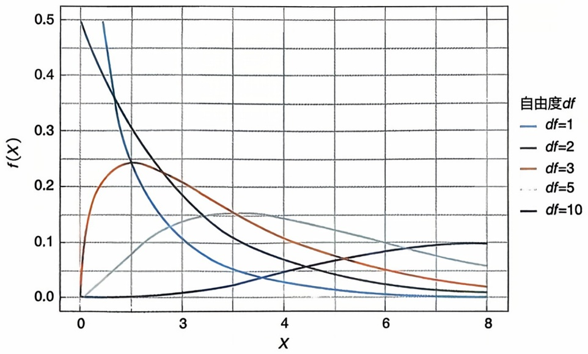

line

| X | df=1 | df=2 | df=3 | df=5 | df=10 |
|---|---|---|---|---|---|
| 0 | ~0.5 | ~0.5 | 0 | 0 | 0 |
| 1 | ~0.35 | ~0.35 | ~0.24 | ~0.08 | ~0.01 |
| 2 | ~0.2 | ~0.2 | ~0.24 | ~0.12 | ~0.01 |
| 3 | ~0.1 | ~0.12 | ~0.2 | ~0.14 | ~0.02 |
| 4 | ~0.05 | ~0.07 | ~0.15 | ~0.15 | ~0.04 |
| 5 | ~0.03 | ~0.05 | ~0.1 | ~0.14 | ~0.06 |
| 6 | ~0.02 | ~0.03 | ~0.07 | ~0.12 | ~0.08 |
| 7 | ~0.01 | ~0.02 | ~0.05 | ~0.1 | ~0.09 |
| 8 | ~0.01 | ~0.01 | ~0.03 | ~0.08 | ~0.1 |

图2-12 不同自由度下的卡方分布

---

048

2 生物统计学基础

考虑有 $k$ 个类别或分组的样本，容量为 $n$ ，观测频数和期望频数分别记为 $O_{i}$ 和 $E_{i}$ ，代表第 $i$ 个类别或分组内的观测频数和期望频数大小。拟合优度检验的原假设和备择假设分别为

$$
H _ {0}: \text {样本数据服从假设分布} \iff H _ {A}: \text {样本数据不服从假设分布}
$$

拟合优度检验的过程为:

① 设置显著性水平  $\alpha$ ;
②对于每个类别或水平，计算观测数据频数 $O_{i}$ ;
③ 根据理论分布在不同类别或水平的概率 $p_i$，计算期望频数 $E_i = np_i$;
④ 计算拟合优度检验统计量

$$
X ^ {2} = \sum_ {i = 1} ^ {k} \frac {(O _ {i} - E _ {i}) ^ {2}}{E _ {i}}
$$

该统计量在原假设 $H_0$ 成立时近似服从自由度为 $k - 1$ 的卡方分布，即 $X^2 \sim \chi^2(k - 1)$;

⑤ 查表确定 $\chi^2 (k - 1)$ 的下 $1 - \alpha$ 分位数，进而确定检验的拒绝域。

拟合优度检验的过程可以用表 2-14 展示。

表 2-14 拟合优度检验统计量计算表

<table><tr><td>分组</td><td>1</td><td>2</td><td>......</td><td>k</td><td>总和</td></tr><tr><td>观测频数/ $O_i$ </td><td> $O_1$ </td><td> $O_2$ </td><td>......</td><td> $O_k$ </td><td>n</td></tr><tr><td>期望频数/ $E_i$ </td><td> $E_1 = np_1$ </td><td> $E_2 = np_2$ </td><td>......</td><td> $E_k = np_k$ </td><td>n</td></tr><tr><td> $X^2$ </td><td colspan="5"> $\sum_{i=1}^{k} \frac{(O_i - E_i)^2}{E_i}$ </td></tr></table>

## 2.2.7.2 独立性卡方检验

独立性卡方检验（chi-square test for independence）是一种用于检验两个分类变量之间是否独立的统计方法。独立性卡方检验的原假设和备择假设分别为

$$
H _ {0}: \text {两个变量相互是独立的} \iff H _ {A}: \text {两个变量相互是不独立的}
$$

独立性卡方检验通常应用于列联表（contingency table）数据，其中一个变量作为行变量，另一个变量作为列变量。列联表展示了两个变量之间的交叉分布，其中每个单元格包含了两个变量特定组合下的频数。

独立性卡方检验的基本思想同样是比较观测频数与期望频数之间的差异，以评估两个变量之间的关联程度。期望频数是基于独立性假设计算得出的。通过计算观测频数与期望频数之间的差异，可以得到一个卡方统计量。然后，将该统计量与卡方分布的分位数进行比较，从而判断两个变量之间是否存在显著的关联。

考虑一个包括变量 A（m 个类别）和变量 B（k 个类别）的样本，容量为 n，观

---

2.2 参数估计和假设检验

049

测频数和期望频数分别记为 $O_{ij}$ 和 $E_{ij}$，代表同时属于变量A的第 $i$ 个类别和变量B的第 $j$ 个类别的观测频数或期望频数大小。独立性卡方检验的过程为:

① 设置显著性水平  $\alpha$ ;
② 对于变量 A 的每个类别 i 和变量 B 的每个类别 j，计算观测频数  $O_{ij}$ ，第 i 行和  $R_{i}=\sum_{j=1}^{k}O_{ij}$  以及第 j 列和  $C_{j}=\sum_{i=1}^{m}O_{ij}$ ;

③ 基于原假设的独立性，计算每个单元格期望频数

$$
E _ {i j} = \frac {R _ {i} \times C _ {j}}{n}
$$

④ 计算独立性卡方检验统计量:如果所有单元格  $E_{ij}$  均大于 5，

$$
X ^ {2} = \sum_ {i = 1} ^ {m} \sum_ {j = 1} ^ {k} \frac {(O _ {i j} - E _ {i j}) ^ {2}}{E _ {i j}}
$$

如果存在 $E_{ij}$ 小于5，那么需要进行耶茨连续性校正（Yates's continuity correction）来提高卡方检验的稳健性，此时统计量变为 $X^{2} = \sum_{i=1}^{m} \sum_{j=1}^{k} \frac{(|O_{ij} - E_{ij}| - 0.5)^{2}}{E_{ij}}$。在原假设 $H_{0}$ 成立时，上述统计量近似服从自由度为 $(m-1)(k-1)$ 的卡方分布，即 $X^{2} \sim \chi^{2} \{(m-1)(k-1)\}$;

⑤ 查表确定 $\chi^2\{(m - 1)(k - 1)\}$ 的下 $1 - \alpha$ 分位数，进而确定检验的拒绝域。独立性卡方检验的过程可以用表2-15展示。

表 2-15 独立性卡方检验统计量计算表

<table><tr><td rowspan="2">变量A</td><td colspan="4">变量B</td><td rowspan="2">总和</td></tr><tr><td>1</td><td>2</td><td>......</td><td>k</td></tr><tr><td>1</td><td> $O_{11}$  $(E_{11}=R_1C_1/n)$ </td><td> $O_{12}$  $(E_{12}=R_1C_2/n)$ </td><td>......</td><td> $O_{1k}$  $(E_{1k}=R_1C_k/n)$ </td><td> $R_1$ </td></tr><tr><td>2</td><td> $O_{21}$  $(E_{21}=R_2C_1/n)$ </td><td> $O_{22}$  $(E_{22}=R_2C_2/n)$ </td><td>......</td><td> $O_{2k}$  $(E_{2k}=R_2C_k/n)$ </td><td> $R_2$ </td></tr><tr><td>......</td><td>......</td><td>......</td><td>......</td><td>......</td><td>......</td></tr><tr><td>m</td><td> $O_{m1}$  $(E_{m1}=R_mC_1/n)$ </td><td> $O_{m2}$  $(E_{m2}=R_mC_2/n)$ </td><td>......</td><td> $O_{mk}$  $(E_{mk}=R_mC_k/n)$ </td><td> $R_m$ </td></tr><tr><td>总和</td><td> $C_1$ </td><td> $C_2$ </td><td>......</td><td> $C_k$ </td><td>n</td></tr><tr><td> $X^2$ </td><td colspan="5"> $\sum_{i=1}^{m}\sum_{j=1}^{k}\frac{(O_{ij}-E_{ij})^2}{E_{ij}}$ 或 $\sum_{i=1}^{m}\sum_{j=1}^{k}\frac{(|O_{ij}-E_{ij}|-0.5)^2}{E_{ij}}$ (连续性校正)</td></tr></table>

## 2.2.7.3 Fisher 精确性检验

对于两个二分类变量（2×2列联表），除了独立性卡方检验外，还可以使用Fisher精确检验（Fisher's exact test）。该检验基于超几何分布（hypergeometric distribution），优先适用于以下两种情况之一:

---

050

2 生物统计学基础

① 整个 $2 \times 2$ 列联表总观测频数小于 20，即 $n < 20$;

② 整个 $2 \times 2$ 列联表总观测频数介于10和40之间，并且4个单元格中存在至少一个观测频数小于5，即 $10 < n < 40$ 且 $\min_{ij} E_{ij} < 5$。Fisher精确检验的原假设和备择假设分别为

$H_0$ :两个变量相互是独立的 $\Longleftrightarrow H_A$ :两个变量相互不是独立的

考虑一个 $2 \times 2$ 列联表，包括变量A（2个类别）和变量B（2个类别）的样本，容量为 $n$ ，如表2-16所示。

表 2-16 用于 Fisher 精确检验的 $2 \times  2$ 列联表

<table><tr><td rowspan="2">变量 A</td><td colspan="2">变量 B</td><td rowspan="2">总和</td></tr><tr><td>1</td><td>2</td></tr><tr><td>1</td><td>a</td><td>b</td><td> $a + b$ </td></tr><tr><td>2</td><td>c</td><td>d</td><td> $c + d$ </td></tr><tr><td>总和</td><td> $a + c$ </td><td> $b + d$ </td><td>n</td></tr><tr><td> $P(O_{11} = a)$ </td><td colspan="3"> $\frac{(a + b)!(c + d)!(a + c)!(b + d)!}{n!a!b!c!d!}$ </td></tr></table>

需要注意的是，$p$ 值的含义是如果原假设为真，观察到当前数据或更极端数据的概率。因此计算 Fisher 精确检验的 $p$ 值时，需要同时考虑当前数据出现的可能性以及更极端数据出现的可能性，这些可能性的总和才是最终的 $p$ 值。

例如，对于数据 $a = 1, b = 9, c = 10, d = 4$ ，在保持行列总和不变的情况下，更极端数据为 $a = 0, b = 10, c = 11, d = 3$ 。此时，两种数据 $p$ 值分别为

$$
P (O _ {1 1} = 1) = \frac {(1 + 9) ! (1 0 + 4) ! (1 + 1 0) ! (9 + 4) !}{2 4 ! 1 ! 9 ! 1 0 ! 4 !} = 0. 0 0 4
$$

$$
P (O _ {1 1} = 0) = \frac {(0 + 1 0) ! (1 1 + 3) ! (0 + 1 1) ! (1 0 + 3) !}{2 4 ! 0 ! 1 0 ! 1 1 ! 3 !} = 0. 0 0 0   1 5
$$

因此，p 值为  $P(O_{11}=1)+P(O_{11}=0)=0.00415$ 。

例题2-5:一位生物学家想要研究某植物基因型（ $AA, Aa, aa$ ）是否与某种疾病的发生有关。他收集了200个样本，其中有的样本患有疾病，有的样本则没有。数据如下:

◇ AA 基因型:患病 38 株，未患病 12 株；

◇ Aa 基因型:患病 40 株，未患病 33 株；

◇ aa 基因型:患病 52 株，未患病 25 株。

检验过程:判断基因型与疾病是否相关可以用独立性卡方检验。原假设和备择假设分别为

$H_0$ :基因型与疾病无关(独立) $\Longleftrightarrow H_A$ :基因型与疾病相关(不独立)

列表 2-17 计算相关数据（括号内为期望频数）:

---

2.2 参数估计和假设检验

051

表 2-17 基因型与疾病相关性统计数据

<table><tr><td rowspan="2">基因型</td><td colspan="2">是否患病</td><td rowspan="2">总和</td></tr><tr><td>是</td><td>否</td></tr><tr><td>AA</td><td>38(50×130/200=32.5)</td><td>12(50×70/200=17.5)</td><td>50</td></tr><tr><td>Aa</td><td>40(73×130/200=47.45)</td><td>33(73×70/200=25.55)</td><td>73</td></tr><tr><td>aa</td><td>52(77×130/200=50.05)</td><td>25(77×70/200=26.95)</td><td>77</td></tr><tr><td>总和</td><td>130</td><td>70</td><td>200</td></tr><tr><td>X2</td><td colspan="3"> $\sum_{i=1}^{3}\sum_{j=1}^{2}\frac{(O_{ij}-E_{ij})^2}{E_{ij}} = 6.218$ </td></tr></table>

独立性卡方检验统计量为6.218，查表可知卡方分布在自由度为2时分位数为$5.991 < 6.218$ ，通过统计软件可以计算出 $p$ 值为 $0.045 < 0.05$ ，因此拒绝原假设，表明基因型与疾病相关。

例题2-6:生物学家想要验证孟德尔杂交试验，将红花长荚豌豆与白花短荚豌豆进行杂交。根据自由组合定律，$\mathrm{F}_2$ 代的红花长荚、红花短荚、白花长荚、白花短荚豌豆的比例应该是 $9:3:3:1$ 。在试验中得到以下数据:

◇ 红花长荚豌豆:315
◇ 红花短荚豌豆:108
◇ 白花长荚豌豆:101
◇ 白花短荚豌豆:32

该数据是否可以验证自由组合定律？

检验过程:判断该数据是否符合自由组合定律可以用拟合优度检验。原假设和备择假设分别为

$$
\begin{array}{l} H _ {0}: \text {该数据符合自由组合定律 (比例为} 9: 3: 3: 1) \iff \\ H _ {A}: \text {该数据不符合自由组合定律 (比例不为} 9: 3: 3: 1) \\ \end{array}
$$

列表 2-18 计算相关数据:

表 2-18 验证孟德尔杂交试验统计数据

<table><tr><td>分组</td><td>红花长荚</td><td>红花短荚</td><td>白花长荚</td><td>白花短荚</td><td>总和</td></tr><tr><td>观测频数 $/O_i$ </td><td>315</td><td>108</td><td>101</td><td>32</td><td>556</td></tr><tr><td>期望频数 $/E_i$ </td><td> $556 \times \frac{9}{16} = 312.75$ </td><td> $556 \times \frac{3}{16} = 104.25$ </td><td> $556 \times \frac{3}{16} = 104.25$ </td><td> $556 \times \frac{1}{16} = 34.75$ </td><td>556</td></tr><tr><td> $X^2$ </td><td colspan="5"> $\sum_{i=1}^{4} \frac{(O_i - E_i)^2}{E_i} = 0.47$ </td></tr></table>

拟合优度检验统计量为 0.47，查表可知卡方分布在自由度为 3 时分位数为 7.81 > 0.47，通过统计软件可以计算出 p 值为 0.93 > 0.05，因此无法拒绝原假设，表明该数据符合比例为 9:3:3:1 的自由组合定律。

---

052

2 生物统计学基础

## 2.2.8 非参数检验方法

前文介绍了几种参数检验的方法，如 Z 检验、t 检验和 F 检验等，都要求数据服从或近似服从正态分布。但是当实际数据不满足正态性要求且样本量较小，参数检验的方法将不再适用。这种情况下，我们可以使用非参数检验（non-parametric test）方法。

相比于参数检验方法，非参数检验方法不需要假设数据分布的具体形式。但是这个优点并不是“免费的午餐”，当数据满足参数检验的分布假设时，参数检验结果通常比非参数检验方法精确性高且更具统计效力。

## 2.2.8.1 符号秩检验

符号秩检验（signed rank test）是用于评估两个配对样本是否来自同一分布的非参数检验方法，与配对 $t$ 检验对应。秩（rank）是指数据值在数据集中的从小到大的位置或顺序，最小的值秩为1，以此类推，多个相同大小的值取相同的秩，大小为它们理论上所占秩的均值，如一组数据 $\{15, 10, 15, 5, 25\}$ 中每一个数据的秩分别为 $\{3.5, 2, 3.5, 1, 5\}$ 。

符号秩检验的原假设和备择假设分别为

$$
H _ {0}: \text {两个样本来自同一分布} \iff H _ {A}: \text {两个样本来自不同分布}
$$

两个样本分别记为  $X_{1}^{[1]}, X_{2}^{[1]}, \cdots, X_{n}^{[1]}$  和  $X_{1}^{[2]}, X_{2}^{[2]}, \cdots, X_{n}^{[2]}$ ，那么符号秩检验的过程为:

① 设置显著性水平  $\alpha$ ;
② 配对样本各自作差，求出每个差值 $D_{i} = X_{i}^{[1]} - X_{i}^{[2]}$;
③ 计算差值的绝对值 $|D_i|$ 并从小到大排序（若 $D_i = 0$，则不参与排序），得到每一个差值对应的秩 $R_i$;
④ 分别计算 $D_{i}$ 为正值和负值的部分对应的秩之和 $T^{+}$ 和 $T^{-}$，即

$$
T ^ {+} = \sum_ {i: D _ {i} > 0} R _ {i}, \quad T ^ {-} = \sum_ {i: D _ {i} <   0} R _ {i};
$$

⑤ 选择两个秩和中最小的，作为检验统计量  $T = \min(T^{+}, T^{-})$ ;
⑥ 查表确定在样本量为 $n'$（去除 $D_{i} = 0$ 的部分之后有效的样本量）下的临界值，进而确定检验的拒绝域。

## 2.2.8.2 秩和检验

秩和检验（rank sum test），又称曼-惠特尼 U 检验（Mann-Whitney U test），是用于评估两个独立样本是否来自同一分布的非参数检验方法，与两样本 t 检验对应。秩和检验的原假设和备择假设分别为

$$
H _ {0}: \text {两个样本来自同一分布} \iff H _ {A}: \text {两个样本来自不同分布}
$$

两个样本容量分别记为 $n_1$ 和 $n_2$ ，秩和检验的过程为:

① 设置显著性水平  $\alpha;$

---

2.2 参数估计和假设检验

053

② 将两个样本数据一起从小到大排序，得到每一个观测值对应的秩 $R_{i}$；
③ 分别计算两个样本数据的秩之和 $T_{1}$ 和 $T_{2}$, 即

$$
T _ {1} = \sum_ {i} R _ {i}, \quad T _ {2} = \sum_ {j} R _ {j}
$$

④ 如果 $n_1 = n_2$ ，那么检验统计量 $T = \min (|T_1|, |T_2|)$；如果 $n_1 \neq n_2$，那么检验统计量 $T$ 选择容量小的样本对应的秩和；
⑤ 查表确定在样本量为 $n_1$ 和 $n_2$ 下的临界值，进而确定检验的拒绝域。

## 2.2.8.3 Kruskal-Wallis 检验

Kruskal-Wallis 检验（简称 KW 检验）是用于检验三组或多组独立样本是否来自同一分布的非参数检验方法，是秩和检验在多组独立样本情况下的推广。当数据不满足正态性或组内方差齐性假设时，单因素方差分析不适用，可使用 KW 检验。

考虑 k 个独立样本，样本容量为  $n_{1}, \cdots, n_{k}$ ，KW 检验的过程为:

① 设置显著性水平  $\alpha$ ;
② 将 $k$ 个样本数据一起从小到大排序，得到第 $i$ 个样本的第 $j$ 个观测值对应的秩 $R_{ij}$；
③ 样本容量总和为 $N = \sum_{i=1}^{k} n_i$，每一个样本的秩和为 $T_i = \sum_{j=1}^{n_{ij}} R_{ij}$;

④ 计算统计量

$$
H = \frac {1 2}{N (N + 1)} \times \sum_ {i = 1} ^ {k} \frac {T _ {i} ^ {2}}{n _ {i}} - 3 (N + 1)
$$

⑤ 该统计量近似服从 $\chi^2 (k - 1)$，查表确定自由度为 $k - 1$ 时 $\chi^2$ 下 $1 - \alpha$ 分位数，进而确定检验的拒绝域。

例题2-7:在例题2-1的试验中，假如有10名患者的试验前后血压数据均是可获得的（表2-19），但是数据不符合正态分布，这个数据中试验前后是否分布相同？

表 2-19 10 名受试患者血压数据

| 患者 | 试验前血压/mmHg | 试验后血压/mmHg |
| --- | --- | --- |
| 1 | 143 | 147 |
| 2 | 164 | 166 |
| 3 | 129 | 133 |
| 4 | 151 | 142 |
| 5 | 171 | 155 |
| 6 | 153 | 153 |
| 7 | 134 | 142 |
| 8 | 128 | 143 |
| 9 | 164 | 136 |
| 10 | 154 | 151 |

---

054

2 生物统计学基础

检验过程:这是一个配对样本，由于数据不符合正态分布，所以应使用符号秩检验（表2-20）。原假设和备择假设分别为

$H_{0}$ :试验前后数据属于同一分布 $\Longleftrightarrow H_{A}$ :试验前后数据不属于同一分布

表 2-20 符号秩检验统计数据

| 患者 | 试验前血压/mmHg | 试验后血压/mmHg | 差值 | 差值的绝对值 | 秩 | 符号 |
| --- | --- | --- | --- | --- | --- | --- |
| 1 | 143 | 147 | -4 | 4 | 3.5 | - |
| 2 | 164 | 166 | -2 | 2 | 1 | - |
| 3 | 129 | 133 | -4 | 4 | 3.5 | - |
| 4 | 151 | 142 | 9 | 9 | 6 | + |
| 5 | 171 | 155 | 16 | 16 | 8 | + |
| 6 | 153 | 153 | 0 |  |  |  |
| 7 | 134 | 142 | -8 | 8 | 5 | - |
| 8 | 128 | 143 | -15 | 15 | 7 | - |
| 9 | 164 | 136 | 28 | 28 | 9 | + |
| 10 | 154 | 151 | 3 | 3 | 2 | + |

计算秩和为 $T^{+} = 25, T^{-} = 20$ ，因此符号秩检验统计量为 $T = \min (T^{+}, T^{-}) = 20$ 。

查表可知双侧检验下，符号秩检验在样本容量为9时临界值为6和39 $(6 < 20 < 39)$，通过统计软件可以计算出 $p$ 值为 $0.77 > 0.05$，因此无法拒绝原假设，表明试验前后数据属于同一分布。

例题2-8:假如例题2-7中的数据变为非配对的数据，来自20名患者，每10名患者为一组，假设数据不符合正态分布，这个数据中试验前后是否分布相同？

检验过程:这是一个非配对样本，由于数据不符合正态分布，所以应使用秩和检验（表2-21）。原假设和备择假设分别为

$H_0$ :两组数据属于同一分布 $\Longleftrightarrow H_A$ :两组数据不属于同一分布

表 2-21 秩和检验统计数据

| 第一组血压/mmHg | 秩 | 第二组血压/mmHg | 秩 |
| --- | --- | --- | --- |
| 143 | 8.5 | 147 | 10 |
| 164 | 17.5 | 166 | 19 |
| 129 | 2 | 133 | 3 |
| 151 | 11.5 | 142 | 6.5 |
| 171 | 20 | 155 | 16 |
| 153 | 13.5 | 153 | 13.5 |
| 134 | 4 | 142 | 6.5 |
| 128 | 1 | 143 | 8.5 |
| 164 | 17.5 | 136 | 5 |
| 154 | 15 | 151 | 11.5 |

---

2.3 统计模型

055

计算秩和为 $T_{1} = 110.5, T_{2} = 99.5$ ，因此秩和检验统计量为 $T = \min (T_{1}, T_{2}) = 99.5$ 。

查表可知双侧检验下，秩和检验在样本容量为 $n_1 = 10, n_2 = 10$ 时，临界值为78(99.5 > 78)，通过统计软件可以计算出 $p$ 值为 $0.68 > 0.05$ ，因此无法拒绝原假设，表明两组数据属于同一分布。

## 2.3 统计模型

构建变量 $X$ 和 $Y$ 之间的依赖关系是统计分析的一个重要目标，其目的是构建响应变量 $Y$ 的统计预测模型 $f(X)$ 。这个构建变量之间具体关系的过程就称为统计建模。统计建模的目的在不同的应用场景下有所不同，例如:预测、假设检验、理解某个系统的内部机制等。

假设 $X = (X_{1}, \cdots, X_{p})$ 是 $p$ 维的自变量，$Y$ 表示应变量，则 $\{X_{i} = (X_{i1}, \cdots, X_{ip}), y_{i}: i = 1, 2, \cdots, n\}$ 表示 $n$ 个样本的观测数据。统计建模的方法因 $Y$ 的数据类型而变。在实际应用中，$Y$ 可以是连续变量，如身高、体重、基因的表达量等；也可以是二值变量，如是否生病、血压的高低等；也可以是类别变量，如T细胞、B细胞等；还可以是有序变量，如少年、青年、中年、老年。下面我们根据 $Y$ 的数据类型分别介绍常用的统计模型。

## 2.3.1 线性模型

假设应变量 Y 是连续的随机变量，自变量 X 和因变量 Y 满足以下线性关系:

$$
Y = \beta_ {0} + \sum_ {j = 1} ^ {p} \beta_ {j} X _ {j} + \varepsilon \tag {2-20}
$$

其中， $\beta_{0},\beta_{1},\cdots,\beta_{p}$ 是未知参数， $\varepsilon$ 则是均值为0，方差有限的误差项且与自变量独立。在实际应用中，通常假设 $\varepsilon$ 服从正态分布 $N(0,\sigma^{2})$ 。当p=1时，此模型称为简单的线性回归模型；当p>1时，则称为多元线性回归模型。据此，对新样本 $X^{*}$，可做以下预测:

$$
Y ^ {*} = \beta_ {0} + \sum_ {i = 1} ^ {p} \beta_ {i} X _ {i} ^ {*} \tag {2-21}
$$

然而，参数  $\beta_{0}, \beta_{1}, \cdots, \beta_{p}$  是未知的，因此需要从观测数据中估计这些参数。在统计学中，通常用最小二乘法估计这些参数。根据假设，每个观测样本  $(X_{i}, Y_{i})$  都满足线性模型，即

$$
Y _ {i} = \beta_ {0} + \sum_ {j = 1} ^ {p} \beta_ {j} X _ {i j} + \varepsilon_ {i} \tag {2-22}
$$

---

056

2 生物统计学基础

最小二乘法的原理是通过最小化所有样本的误差的平方和来求解模型中的未知参数，即最小化以下目标函数

$$
L (y, \widehat {y}) = \frac {1}{n} \sum (y _ {i} - \widehat {y} _ {i}) ^ {2} \tag {2-23}
$$

其中 $\widehat{y}_i = \beta_0 - \sum_{j=1}^{p} \beta_j X_{ij}, L(y, \widehat{y})$ 称为用 $\widehat{y}$ 预测 $y$ 的损失函数，它是用来衡量预测或者模型准确性的标准。理论上讲，一个损失函数 $L(y, \widehat{y})$ 需要满足以下两个条件:

① 对任意的  $\hat{y}$  都有  $L(y,\hat{y})\geqslant0$  ，当  $y=\hat{y}$  时， $L(y,\hat{y})=0$ ;
②  $L(y, \widehat{y})$  是  $\widehat{y}$  的凸函数。

这两个条件是为了保证最小化损失函数 $L(y, \widehat{y})$ 存在唯一解。换句话说，满足这两个条件的函数 $L(y, \widehat{y})$ 都可以作为用于估计 $\beta$ 的损失函数。实际上，满足这样条件的损失函数很多，例如

$$
L _ {q} (y, \widehat {y}) = \frac {1}{n} \sum_ {i = 1} ^ {n} | Y _ {i} - \beta_ {0} - \sum_ {j = 1} ^ {p} \beta_ {j} X _ {i j} | ^ {q} \quad (q \geqslant 1) \tag {2-24}
$$

当 $q = 1$ 时，$L_{q}(y, \widehat{y})$ 称为绝对损失函数；$q = 2$ 则对应于常用的均方损失。在均方损失下，可以轻易地求得 $\beta$ 的估计值为

$$
\widehat {\beta} = (Z ^ {\prime} Z) ^ {- 1} Z ^ {\prime} Y \tag {2-25}
$$

其中，Z 是  $n \times (1 + p)$  的矩阵，它的第 i 行为  $(1, X_{i}), Y = (y_{1}, \cdots, y_{n})$  是  $n \times 1$  的向量。在式 (2-25) 中，代入 Y 的表达式有

$$
\widehat {\beta} = (Z ^ {\prime} Z) ^ {- 1} Z ^ {\prime} (Z \beta + \varepsilon) \tag {2-26}
$$

定义2-1

无偏估计

假设  $\widehat{\beta}$  是参数  $\beta$  的估计，若  $E\widehat{\beta} = \beta$ ，则称  $\widehat{\beta}$  是  $\beta$  的无偏估计。

在式(2-26)的两边对 $\varepsilon$ 求数学期望，有

$$
E \widehat {\beta} = (Z ^ {\prime} Z) ^ {- 1} Z ^ {\prime} Z \beta = \beta
$$

即  $\widehat{\beta}$  是  $\beta$  的无偏估计。这意味着，在样本量 n 足够大时，可以准确地估计未知参数  $\beta$ 。进一步，当误差项  $\varepsilon$  服从正态分布时， $\varepsilon \sim N(0, \sigma^{2})$ ， $\widehat{\beta}$  也服从正态分布，即: $\widehat{\beta} \sim N(\beta, \Sigma)$ ，其中， $\Sigma = (Z'Z)^{-1} \sigma^{2}$ ，由此可以求得  $\beta$  的 95% 置信区间。

例题2-9:根据世界卫生组织的标准，对居住在某地区年满21岁、拥有皮马印第安血统的200位女性进行了糖尿病检测，其中包含了血糖浓度、BMI和年龄，该数据可从R语言的MASS包中获得（Pima.tr糖尿病数据）。将血糖浓度（glu）作为应变量，BMI和年龄作为自变量，利用线性模型研究血糖浓度、BMI和年龄之间的关系。结果如图2-13所示。

在线性回归分析中，“Residuals vs. Fitted”图是一种诊断图，显示了模型的预测值（fitted values）与残差（residuals）之间的关系。若残差随拟合值随机分布，且

---

2.3 统计模型

057

在零附近均匀分布，则表明模型拟合良好。由图2-13中可以看出，残差在零附近均匀分布，但部分数据点的残差较大。由模型的参数估计的 $p$ 值可以看出，血糖浓度（glu）与BMI和年龄是线性相关的。

## 2.3.2 极大似然估计法

假设 $(x_{1},x_{2},\cdots,x_{n})$ 是随机变量X的n个独立同分布的观测样本。X的密度函数为 $f_{\theta}(x)$ ，其中， $\theta\in R$ 是未知参数。密度函数估计的目标是从X的观测样本中估计未知参数 $\theta$ 。假设，X的真实密度函数为 $g(x)=f_{\theta_{0}}(x)$ 。为估计未知参数，需要一个损失函数来评价用 $f_{\theta}(x)$ 估计 $g(x)$ 的效果，并通过最小化损失函数求得未知参数 $\theta$ 的估计。注意: $f_{\theta}(x)$ 和 $g(x)$ 都是密度函数，即: $\int g(x)dx=1,\int f_{\theta}(x)dx=1$ 。因此，Kullback-Leibler（KL）距离可用于度量密度函数估计的准确性

$$
K L \left(f _ {\theta}, g\right) = \int g (x) \ln \frac {g (x)}{f _ {\theta} (x)} d x \tag {2-27}
$$

|  | 估计值 | 标准差 | p值 | Pr(>\|t\|) |
| --- | --- | --- | --- | --- |
| 血糖浓度 | 65.158 4 | 12.115 1 | 5.378 | 2.12e-07 |
| 年龄 | 0.924 4 | 0.191 4 | 4.829 | 2.75e-06 |
| BMI | 0.901 6 | 0.342 7 | 2.630 | 0.009 2 |

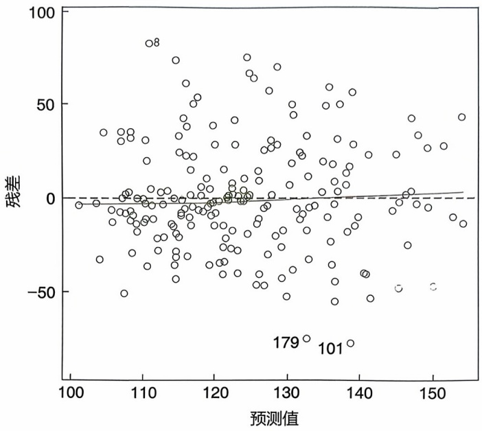

scatter

| 预测值 | 残差 |
| --- | --- |
| ~102 | ~-5 |
| ~103 | ~-30 |
| ~104 | ~35 |
| ~105 | ~35 |
| ~106 | ~35 |
| ~107 | ~35 |
| ~108 | ~35 |
| ~109 | ~35 |
| ~110 | ~85 |
| ~111 | ~85 |
| ~112 | ~75 |
| ~113 | ~60 |
| ~114 | ~50 |
| ~115 | ~50 |
| ~116 | ~40 |
| ~117 | ~30 |
| ~118 | ~25 |
| ~119 | ~25 |
| ~120 | ~25 |
| ~121 | ~25 |
| ~122 | ~25 |
| ~123 | ~25 |
| ~124 | ~25 |
| ~125 | ~25 |
| ~126 | ~25 |
| ~127 | ~25 |
| ~128 | ~25 |
| ~129 | ~25 |
| ~130 | ~25 |
| ~131 | ~25 |
| ~132 | ~25 |
| ~133 | ~25 |
| ~134 | ~25 |
| ~135 | ~25 |
| ~136 | ~25 |
| ~137 | ~25 |
| ~138 | ~25 |
| ~139 | ~25 |
| ~140 | ~25 |
| ~141 | ~25 |
| ~142 | ~25 |
| ~143 | ~25 |
| ~144 | ~25 |
| ~145 | ~25 |
| ~146 | ~25 |
| ~147 | ~25 |
| ~148 | ~25 |
| ~149 | ~25 |
| ~150 | ~25 |
| 179 | -79 |
| 101 | -79 |

图2-13 血糖浓度、BMI和年龄之间的关系

可以证明 $KL(f_{\theta},g)\geqslant 0$ ，见习题2-10。由此可以得到

$$
\int g (x) \ln g (x) d x \geqslant \int g (x) \ln f _ {\theta} (x) d x \tag {2-28}
$$

根据数学期望的定义，式(2-28)的右边即为 $E[\ln f_{\theta}(x)]$ 。根据大数定律

$$
E [ \ln f _ {\theta} (x) ] \cong \frac {1}{n} \sum_ {i = 1} ^ {n} \ln f _ {\theta} (x _ {i}) \tag {2-29}
$$

其中，式(2-29)的右边是似然函数。即:似然函数有一个上界，且当它达到最大值时 $f_{\theta}(x)$ 最接近真实的密度函数 $g(x)$ 。因此极大似然估计就是最小化KL损失得到的估计。

例题 2-10: 用极大似然估计法估计线性模型中的未知参数 $\beta$ 。

令 $Z = (1, X)$，并假设其中的随机误差 $\epsilon$ 服从正态分布:$\epsilon \sim N(0, \sigma^2)$，则:$Y \sim N(Z\beta, \sigma^2)$ 从而观测值 $Y$ 的密度函数为

$$
f _ {\beta} (y) = \frac {1}{\sigma \sqrt {2 \pi}} \exp \left[ - \frac {(y - \beta^ {T} Z) ^ {2}}{2 \sigma^ {2}} \right]
$$

根据似然函数的定义，我们有

$$
L (\beta) = \frac {1}{n} \sum_ {i = 1} ^ {n} \ln f _ {\beta} (y _ {i}) = \ln \frac {1}{\sigma \sqrt {2 \pi}} - \frac {1}{2 n \sigma^ {2}} \sum_ {i = 1} ^ {n} \left(y _ {i} - \beta^ {T} z _ {i}\right) ^ {2}
$$

---

058

2 生物统计学基础

当  $\sigma$  给定时，最大化上述似然函数等价于最小二乘估计。

## 2.3.3 Logistic 回归模型

当 $Y$ 的取值为0或1时，线性模型两边的取值范围不一致:等式左边的取值为0或1，而等式右边的取值范围是 $(-\infty, +\infty)$，因此线性模型不适用于 $Y$ 为0或1的情况。下面将讨论如何对 $Y$ 进行建模。首先，假设自变量还是通过线性方式起作用。为此，引入一个新的隐变量 $U$，即无法直接观测到的变量，并令

$$
U = \beta_ {0} + \sum_ {j = 1} ^ {p} \beta_ {j} X _ {j} + \varepsilon \tag {2-30}
$$

接着，对 $Y$ 进行建模

$$
Y = \left\{ \begin{array}{l l} 0 & (U <   0) \\ 1 & (U \geqslant 0) \end{array} \right.
$$

根据此模型， $U < 0$ 的概率为

$$
P (U <   0) = P _ {e} \left(\varepsilon + \beta_ {0} + \sum_ {j = 1} ^ {p} \beta_ {j} X _ {j} <   0\right) \tag {2-31}
$$

类似地，可以求得 $P(U\geqslant 0)$。

因此, 只需要对 $\varepsilon$ 的分布做进一步假设即可完成统计建模过程。当 $\varepsilon$ 服从 Logistic 分布, 该模型称为 Logistic 回归模型。当 $\varepsilon$ 服从正态分布, 该模型则称为 Probit 回归模型。注意, 这两种模型的区别在于 Probit 回归模型中, 误差是服从正态分布的, 这更符合实际情况。而 Logistic 回归模型的优势在于模型更易求解。

例题2-11:利用极大似然估计方法求解Logistic回归模型中的未知参数。

首先，根据模型假设有

$$
P (Y <   0) = P _ {\varepsilon} (\varepsilon + \beta_ {0} + \sum_ {j = 1} ^ {p} \beta_ {j} X _ {j} <   0)
$$

进一步，在 Logistic 回归模型中，$\varepsilon$ 服从 Logistic 分布，从而

$$
P _ {\varepsilon} \left(\varepsilon + \beta_ {0} + \sum_ {j = 1} ^ {p} \beta_ {j} X _ {j} <   0\right) = \frac {1}{1 + e ^ {\beta^ {T} Z}}
$$

其中， $Z = (1,X)$ 。类似地， $P(Y = 1) = 1 - \frac{1}{1 + e^{\beta^T Z}} = \frac{1}{1 + e^{-\beta^T Z}}$ 。则 $Y$ 服从$p_{\beta}(z) = \frac{1}{1 + e^{-\beta^T Z}}$ 的二项分布，似然函数为

$$
L (\beta) = \frac {1}{n} \sum_ {i = 1} ^ {n} \ln \{p _ {\beta} (z _ {i}) ^ {y _ {i}} [ 1 - p _ {\beta} (z _ {i}) ^ {1 - y _ {i}} ] \}
$$

其中， $p_{\beta}(z_i) = \frac{1}{1 + e^{-\beta^T Z_i}}$ 。化简可得

---

2.3 统计模型

059

$$
L (\beta) = \sum_ {i = 1} ^ {n} [ y _ {i} \beta^ {T} z _ {i} - \ln (1 + e ^ {\beta^ {T} Z _ {i}}) ]
$$

通过梯度下降法等方法最大化上述似然函数，即可得到Logistic回归所估计出的系数。

例题2-12:研究人员记录了178个新生儿的体重及其母亲的一些医学特点（R语言中MASS的birthwt数据集）。请用Logistic和Probit回归模型，探讨哪些因素与新生儿的体重有关系。

用 R 语言中的 glm 函数做模型求解问题，得到如表 2-22 的结果。

表 2-22 Logistic 和 Probit 回归模型数据

<table><tr><td rowspan="2">因素</td><td colspan="3">Logistic 回归模型</td><td colspan="3">Probit 回归模型</td></tr><tr><td>估计值</td><td>标准误</td><td>p 值</td><td>估计值</td><td>标准误</td><td>p 值</td></tr><tr><td>intercept</td><td>-0.0790</td><td>1.2763</td><td>0.95066</td><td>-0.0688</td><td>0.7485</td><td>0.92674</td></tr><tr><td>age</td><td>-0.0358</td><td>0.0365</td><td>0.32569</td><td>-0.0224</td><td>0.0214</td><td>0.29398</td></tr><tr><td>lwt</td><td>-0.0124</td><td>0.0066</td><td>0.06111</td><td>-0.0072</td><td>0.0038</td><td>0.06059*</td></tr><tr><td>race</td><td>0.4534</td><td>0.2153</td><td>0.03520*</td><td>0.2726</td><td>0.1255</td><td>0.02978*</td></tr><tr><td>smoke</td><td>0.9373</td><td>0.3985</td><td>0.01866*</td><td>0.5711</td><td>0.2327</td><td>0.01412*</td></tr><tr><td>ptl</td><td>0.5421</td><td>0.3462</td><td>0.11736</td><td>0.3204</td><td>0.2087</td><td>0.12478</td></tr><tr><td>ht</td><td>1.8307</td><td>0.6941</td><td>0.00835**</td><td>1.1008</td><td>0.4156</td><td>0.00808**</td></tr><tr><td>ui</td><td>0.7220</td><td>0.4632</td><td>0.11906</td><td>0.4553</td><td>0.2809</td><td>0.10508</td></tr><tr><td>ftv</td><td>0.0635</td><td>0.1698</td><td>0.70854</td><td>0.0319</td><td>0.1003</td><td>0.75053</td></tr></table>

根据模型估计系数的 $p$ 值可以看出，与新生儿体重具有显著关系的因素有母亲是否有高血压病史 (ht)、是否吸烟 (smoke) 以及母亲的种族 (race)。

## 2.3.4 泊松回归模型

在实际数据分析中，经常会遇到应变量为非负整数的情况，如转录组测序得到的每个基因的表达量就是一个非负整数；下面就介绍这类数据的建模方法，即泊松回归模型。泊松回归假设应变量 $Y$ 服从泊松分布，并假设它的期望值的对数可被自变量的线性组合建模。具体地，假设 $Y$ 表示某事件发生 $k$ 次的概率为

$$
P (Y = k) = \frac {\lambda^ {k}}{k !} e ^ {- \lambda}.
$$

其中，$\lambda$ 即为单位时间内事件发生次数的期望，是一个非负是实数。进一步假设其对数可被自变量的线性组合建模，即

$$
\log (\lambda) = \beta_ {0} + \beta_ {1} x _ {1} + \beta_ {2} x _ {2} + \dots + \beta_ {p} x _ {p} + \varepsilon
$$

其中， $(x_{i},k_{i})$ 是第 i 个样本的观测值， $x_{i}=(x_{i1},x_{i2},\cdots,x_{ip})$ 。根据模型，可以得到其似然函数为

---

060

2 生物统计学基础

$$
L (\Theta) = \prod_ {i = 1} ^ {n} \frac {\lambda (x _ {i}) ^ {k _ {i}}}{k _ {i} !} \exp [ - \lambda (x _ {i}) ]
$$

其中  $\Theta=(\beta_{0},\beta_{1},\cdots,\beta_{p})^{\prime},\log\lambda(x_{i})=\beta_{0}+\beta_{1}x_{i1}+\cdots+\beta_{p}x_{ip}$ 。极大化上述似然函数即可得到参数的极大似然估计。

## 2.3.5 Cox 比例风险模型

生存分析模型是生物医学数据分析中常用的模型，主要用于分析某些因素，如基因的表达量或者细胞类型的含量，对患者生存时间的影响。常用的生存分析模型为 Cox 比例风险模型，这是一种半参数的多因素模型，可以研究多个协变量对于生存时间的影响。

Cox 比例风险模型的基本形式为

$$
h (t, x) = h _ {0} (t) \exp \left(\beta_ {1} x _ {1} + \beta_ {2} x _ {2} + \dots + \beta_ {p} x _ {p}\right)
$$

式中的 $x$ 为可能影响患者生存时间的 $p$ 维协变量，如患者的年龄、性别、接受的不同治疗方式等。$t$ 表示生存时间，$h(t, x)$ 称为具有协变量 $x$ 的个体在 $t$ 时刻的风险函数，表示生存时间已达 $t$ 的个体在 $t$ 时刻的瞬时风险率。$h_0(t)$ 称为基线风险函数，表示所有 $x$ 都取 0 时个体在 $t$ 时刻的瞬时风险率。若 $x_j$ 是非暴露组观察对象的各因素取值，$x_i$ 是暴露组观察对象的各因素取值，则暴露组对非暴露组的相对危险度 $RR$ 定义为

$$
R R = \frac {h (t , x _ {i})}{h (t , x _ {j})} = \frac {h _ {0} (t) \exp (\beta^ {T} x _ {i})}{h _ {0} (t) \exp (\beta^ {T} x _ {j})} = \exp [ \beta^ {T} (x _ {i} - x _ {j}) ] \tag {2-32}
$$

该比值保持一个恒定的比例，与时间 $t$ 无关，称为风险比例假定。

从式(2-32)中可以看出，无论随时间变化的基线风险函数 $h_0(t)$ 是何种形式，一旦从样本数据中求出回归系数，给定非0的 $x$ 值时个体的相对危险度就是一定的，而各个协变量与时间无关的相对危险度正是多因素分析时最关注的问题，因而Cox比例风险模型巧妙地将非参数与参数部分结合起来，在生存分析的应用中备受青睐。参数 $\beta_{i}$ 可以通过偏极大似然估计得出，偏极大似然估计对观测到的数据进行优化，考虑了因为截尾而没有观测到的数据。对回归模型的假设检验通常采用得分检验、Wald检验和似然比检验，这些检验统计量均为卡方分布，自由度为模型中待检验的协变量个数。

例题2-13:在R语言的survival包中，提供了Cox回归的函数coxph()，并且给出了一组肺癌数据，该数据包含来自某癌症中心的晚期肺癌受试者。它包括机构代码、时间等10个变量。请构建预测患者生存时间的生存分析模型。

利用 R 语言中 coxph() 函数进行 Cox 生存回归分析，将 age, sex 和 ph.ecog 纳入多元模型中，得到回归模型，通过 summary() 函数查看模型的各种统计结果。通过绘制的实际生存曲线，以及样本平均值对应的预测生存曲线，可以看出估计得到

---

2.3 统计模型

061

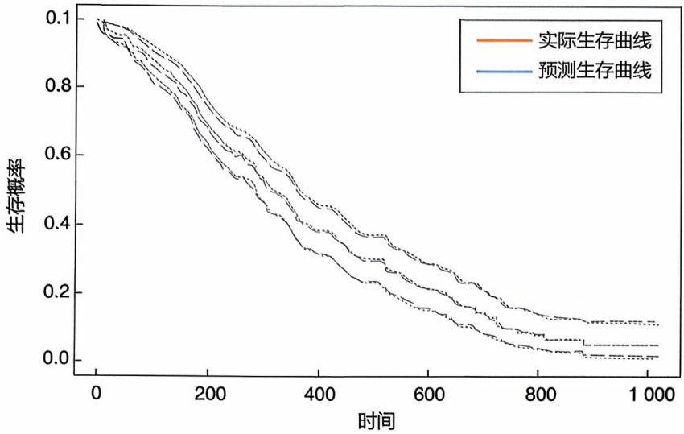

survival

| 时间 | 实际生存曲线 (生存概率) | 预测生存曲线 (生存概率) |
| --- | --- | --- |
| 0 | ~0.10 | ~0.10 |
| 200 | ~0.65 | ~0.70 |
| 400 | ~0.35 | ~0.45 |
| 600 | ~0.15 | ~0.25 |
| 800 | ~0.05 | ~0.10 |
| 1000 | ~0.02 | ~0.08 |

的生存分析模型具有较好的预测效果（图 2-14）。

## 2.3.6 线性混合效应模型

在常见的回归分析中，回归误差项通常被认为是独立分布且服从正态分布。但在实际应用中，对于内部存在层次结构的数据，误差项之间可能并不独立。例如，医学研究中对于每个受试者的多次观测值，每个受试者的各次测量值是相关的，不同受试者之间可以认为是相互独立的，而总体的模型误差不是相互独立的。

线性混合效应模型同时考虑了固定效应和随机效应，其中固定效应指数据中所有级别的总体效应，随机效应是指数据中个体或群体的效应。线性混合效应模型的数学表达式为

$$
y = X \beta + Z u + \varepsilon
$$

其中，$y$ 是 $n \times 1$ 维的结果变量，$X \in R^{n \times p}$ 和 $Z \in R^{n \times q}$ 是设计矩阵，$\beta$ 是 $p$ 维的固定效应的参数向量，$u$ 是 $q$ 维的随机效应的参数向量，$\varepsilon$ 为 $n$ 维的误差项，假定其服从多元正态分布。一般情况下，假定 $u$ 服从多元正态分布

$$
u \sim N (0, G)
$$

其中，协方差矩阵 $G$ 具有形式 $G = \sigma(\theta)$，$\theta$ 为需要估计的参数。线性混合效应模型的参数估计通常使用极大似然估计或限制性极大似然估计。R语言包 lme4 可用于线性混合效应模型的求解。

例题2-14:睡眠剥夺试验。在睡眠剥夺研究中，受试者第0天有正常的睡眠时间，从这天晚上开始，他们每晚的睡眠时间被限制为 $3\mathrm{h}$ （数据可从R语言包lme4中获得)。变量表示每个受试者每天进行的一系列测试的平均反应时间，同时数据中还记录了研究进行的天数和受试者的编号。平均反应时间受到研究进行天数的影响，同时不同的受试者之间也会有自身的差异。将天数视为固定效应，编号视为随机效应，用线性混合模型来评估这两种效应的显著性。图2-15展示了拟合结果。

图2-14 Cox比例风险模型在肺癌数据中的应用示例

---

062

2 生物统计学基础

图2-15 线性混合效应模型真实值与预测值的散点图

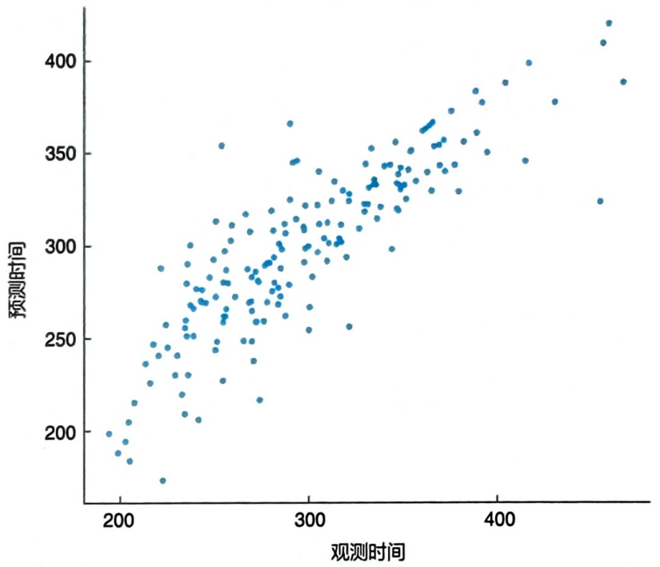

scatter

| 观测时间 (range) | 预测时间 (range) |
| --- | --- |
| 200~480 | 175~430 |

## 2.3.7 隐马尔可夫模型

隐马尔可夫模型在生物学中有重要应用，如序列比对等。它以马尔可夫模型为基础。马尔可夫模型是一种常用的随机过程模型。它是一个较为宽泛的概念模型，马尔可夫链、马尔可夫决策过程和隐马尔可夫链等随机模型都可视为马尔可夫模型中的一种。

离散时间马尔可夫过程即为马尔可夫链。记 I 为所有状态的取值构成的集合，称之为状态空间。对于  $i \in I, X_{n} = i$  表示随机过程在 n 时刻处于状态 i。若对于任意的  $n \geqslant 0$ ，任意的状态 i, j 以及  $i_{0}, i_{1}, \cdots, i_{n-1}$  有

$$
P (X _ {n} = j | X _ {n - 1} = i _ {n - 1}, \dots , X _ {0} = i _ {0}) = P _ {k} (X _ {n} = j | X _ {n - k}, \dots , X _ {n - 1} = j)
$$

则称随机过程  $\{X_{n}: n=1,2,\cdots\}$  为 k 阶马尔可夫过程。若  $P_{k}(X_{n+1}=j|X_{n-k},\cdots,X_{n}=j)$  不依赖于 k 则称该马尔可夫链为齐次马尔可夫链。当 k=1 时，是一阶马尔可夫链，记  $p_{ij}=P(X_{n}=j|X_{n-1}=i)$  为从状态 i 到状态 j 的转移概率，设  $m=|I|$ ，则

$$
P = \left\{ \begin{array}{c c c c} p _ {1 1} & p _ {1 2} & \dots & p _ {1 m} \\ p _ {2 1} & p _ {2 2} & \dots & p _ {2 m} \\ \vdots & \vdots & \ddots & \vdots \\ p _ {m 1} & p _ {m 2} & \dots & p _ {m m} \end{array} \right\}
$$

被称为马尔可夫链的转移矩阵。该矩阵中的每一行元素之和为1，且所有元素非负。令  $\pi^{t}=(\pi_{1}^{t},\pi_{2}^{t},\cdots,\pi_{m}^{t})$  为时刻 t 的分布，其中  $\pi_{i}^{t}=P(X_{t}=i)$ 。则由马尔可夫链的性质，可以得到状态转移方程为

$$
\pi^ {t + 1} = \pi^ {t} P
$$

---

2.3 统计模型

063

递推可得时刻 n 的状态分布为  $\pi^{t} = \pi^{0} P^{t}$ ，这里  $P^{t}$  称为 t 步概率转移矩阵。

例题2-15:已知人和黑猩猩的珠蛋白 $\alpha 1$ 亚基基因（HBA1）在843个核苷酸位点中有807个相同，试使用连续马尔可夫模型——JC69模型（核苷酸间替换速率相同，均为 $\lambda$ ）计算人和黑猩猩HBA1基因的实际碱基替换数 $k$ 。假设人的核苷酸突变率是每世代每个位点 $4.33\mathrm{e}^{-8}$，每世代时间是27年，计算人和黑猩猩大致的分化时间。

JC69模型中，一个碱基以相同的速率 $\lambda$ 分别突变为其他3种碱基，因此替换速率矩阵

$$
Q = \left[ \begin{array}{c c c c} {- 3 \lambda} & {\lambda} & {\lambda} & {\lambda} \\ {\lambda} & {- 3 \lambda} & {\lambda} & {\lambda} \\ {\lambda} & {\lambda} & {- 3 \lambda} & {\lambda} \\ {\lambda} & {\lambda} & {\lambda} & {- 3 \lambda} \end{array} \right]
$$

连续马尔可夫模型中，转移概率矩阵

$$
P (t) = e Q t = \left[ \begin{array}{l l l l} \frac {1}{4} + \frac {3}{4} \mathrm{e} ^ {- 4 \lambda t} & \frac {1}{4} - \frac {1}{4} \mathrm{e} ^ {- 4 \lambda t} & \frac {1}{4} - \frac {1}{4} \mathrm{e} ^ {- 4 \lambda t} & \frac {1}{4} - \frac {1}{4} \mathrm{e} ^ {- 4 \lambda t} \\ \frac {1}{4} - \frac {1}{4} \mathrm{e} ^ {- 4 \lambda t} & \frac {1}{4} + \frac {3}{4} \mathrm{e} ^ {- 4 \lambda t} & \frac {1}{4} - \frac {1}{4} \mathrm{e} ^ {- 4 \lambda t} & \frac {1}{4} - \frac {1}{4} \mathrm{e} ^ {- 4 \lambda t} \\ \frac {1}{4} - \frac {1}{4} \mathrm{e} ^ {- 4 {\lambda t}} & \frac {1}{4} - \frac {1}{4} \mathrm{e} ^ {- 4 {\lambda t}} & \frac {1}{4} + \frac {3}{4} \mathrm{e} ^ {- 4 {\lambda t}} & \frac {1}{4} - \frac {1}{4} \mathrm{e} ^ {- 4 {\lambda t}} \\ \frac {1}{4} - \frac {1}{4} \mathrm{e} ^ {- 4 {\lambda t}} & \frac {1}{4} - \frac {1}{4} \mathrm{e} ^ {- 4 {\lambda t}} & \frac {1}{4} - \frac {1}{4} \mathrm{e} ^ {- 4 {\lambda t}} & \frac {1}{4} + \frac {3}{4} \mathrm{e} ^ {- 4 {\lambda t}} \end{array} \right]
$$

假设两物种分化时间为 $t$，则进化上相距的时间为 $2t$，碱基替换数 $k = 2t \times 3\lambda$。根据转移概率矩阵可知 $d = 3 \times \left(\frac{1}{4} - \frac{1}{4}\mathrm{e}^{-4\lambda \times 2t}\right)$，则可得到公式 $k = -\frac{3}{4}\ln \left(1 - \frac{4}{3} d\right)$。由此，可以求得人和黑猩猩 HBA1 基因的核苷酸差异 $d = (843 - 807)/807 = 0.0447$，因此实际碱基替换数 $k = -\frac{3}{4}\ln \left(1 - \frac{4}{3} d\right) = 0.0440$。因此，人和黑猩猩大致分化时间 $t = 0.0440/(2 \times 3 \times 4.33\mathrm{e}^{-8}/27) = 4.6\mathrm{Myr}$。

马尔可夫链主要描述的是不同状态之间的转移关系。然而，在实际问题中，通常还有依赖于状态变量的观测变量。马尔可夫链就不能够描述这样的现象。例如，状态变量为一天的天气，观测变量为一天的活动。显然这一天会举行什么活动取决于今天的天气状况，如下雨的时候通常会选择室内活动，阴天可以选择爬山、打球等，晴天可以选择户外摄影等。隐马尔可夫模型（hidden Markov model, HMM）就是用于描述这样的现象。

记  $Q = \{q_{1}, q_{2}, \cdots, q_{N}\}$  为所有 N 种可能的状态的集合， $V = \{v_{1}, v_{2}, \cdots, v_{M}\}$  是所有 M 种可能的观测集合， $S = (s_{1}, s_{2}, \cdots, s_{T})$  是长度为 T 的状态序列， $O = (o_{1}, o_{2}, \cdots, o_{T})$  为对应的观测序列。隐马尔可夫模型由两部分构成:① 状态转移概率矩阵  $A = (a_{ij})_{N \times N}$ ， $a_{ij} = P(s_{t+1} = q_{j} | s_{t} = q_{i})$ ；② 观测概率矩阵  $B = (b_{jk})_{N \times M}$ ，其中  $b_{jk} = P(o_{t} = v_{k} | s_{t} = q_{j})$ 。初始状态概率向量  $\pi = (\pi_{1}, \pi_{2}, \cdots, \pi_{N})$ ，其中

---

064

2 生物统计学基础

$\pi_{i} = P(s_{1} = q_{i})$ 。注意:观测值即可以是离散值也可以是连续值。如果是连续值，那么观测模型 $P(o_{i} = v_{k}|s_{i} = q_{j})$ 是连续的分布函数。

可以看出、隐马尔可夫模型由初始概率分布  $\pi$  、状态转移概率矩阵 A 和观测概率矩阵 B 决定，因此隐马尔可夫模型可以用三元符合表示，即

$$
\lambda = (A, B, \pi)
$$

隐马尔可夫模型有 3 个基本问题。

① 概率计算问题 又称评估问题，给定模型  $\lambda = (A, B, \pi)$  和观测序列  $O = (o_{1}, o_{2}, \cdots, o_{T})$ ，计算在模型  $\lambda$  的观测下序列 O 出现的概率  $P(O|\lambda)$ 。通常使用向前算法来求解。
② 预测问题 又称解码问题。已知观测序列 O 和模型参数  $\lambda$ ，求对给定观测序列下最可能的隐藏状态序列，即最大化概率  $P(I|O)$ 。通常使用维特比算法求解。
③ 学习问题 已知观测序列 $O$，估计模型 $\lambda = (A, B, \pi)$ 中的参数，使得在该模型下 $P(O|\lambda)$ 最大化，即用极大似然估计的方法估计参数，通常使用 Baum-Welch 算法来解决。

这里之所以称为是隐马尔可夫模型，是因为状态空间不可以直接观测。如果状态空间可以直接观测，通常称为状态空间模型。隐马尔可夫模型在医学领域有许多应用，如用于疾病进展的建模、基因序列的分析等。以下给出一个简化的例子，利用隐马尔可夫模型来模拟一种疾病的进展。

例题2-16:隐马尔可夫模型模拟疾病进展。假设一种疾病有3种状态:“健康”“轻度疾病”和“重度疾病”。这3种状态是隐状态，不能直接观测。但是，根据这3种状态，患者可以有不同的症状，如“无症状”“轻微症状”和“严重症状”，这是可以观测到的。R语言的HMM包提供了隐马尔可夫模型相关算法的实现。首先定义隐状态和观测状态，然后给出模型的参数，即初始状态的概率分布 $\pi$ 、状态转移概率矩阵 $A$ 以及观测概率矩阵 $B$ 。

这里取 $\pi = (0.7, 0.2, 0.1)$，表示初始状态为健康的概率为 0.7，轻度和重度疾病的概率分别为 0.2 和 0.1。状态转移概率矩阵 $A$ 和观测概率矩阵 $B$ 分别为

$$
A = \left( \begin{array}{c c c} 0. 7 & 0. 2 & 0. 1 \\ 0. 1 & 0. 6 & 0. 3 \\ 0. 0 5 & 0. 1 5 & 0. 8 \end{array} \right) \quad B = \left( \begin{array}{c c c} 0. 9 & 0. 0 8 & 0. 0 2 \\ 0. 0 5 & 0. 9 & 0. 0 5 \\ 0. 0 1 & 0. 2 & 0. 7 9 \end{array} \right)
$$

其中，$A$ 的第一行表示对于处于健康状态的人，其下一步变为轻度疾病和重度疾病的概率分别为0.2和0.1，而 $B$ 的第一行表示处于健康状态的人，有0.9的概率表现为无症状，0.08的概率表现为轻微症状，以及0.02的概率表现为严重症状。

假设已有一个观测的状态序列 $O =$ （无症状，轻微症状，无症状，轻微症状，严重症状），考虑隐马尔可夫模型的预测问题，请用维特比算法来求解在该观测序列下最可能的状态序列。利用viterbi可得最可能的状态序列为 $\mathrm{I} =$ （健康，轻度疾病，

---

2.3 统计模型

065

轻度疾病，轻度疾病，轻度疾病）。

## 2.3.8 贝叶斯统计基础

生物数据分析分为两步:模型构建和求解。前面的章节介绍了经典的统计建模及求解方法。其实，在很多实际问题中，这些模型有以下缺陷:① 模型中很难加入人们对数据的先验认知；② 复杂的模型很难求解。为此，通常需要寻求其他的建模方法。贝叶斯统计模型为复杂的情形提供了很好的解决方案。贝叶斯模型主要基于贝叶斯公式，其背后的逻辑更符合常规的推理逻辑:基于先验认知，从数据中获取对现象的新见解。

贝叶斯模型有3个重要的组成部分:似然函数 $f(D|\theta)$ 、先验分布 $f(\theta)$ 和后验分布 $f(\theta |D)$，它们之间满足贝叶斯公式:

$$
f (\theta | D) = \frac {f (D | \theta) f (\theta)}{\int f (D | \theta) f (\theta) d \theta} \tag {2-33}
$$

其中，$\theta$ 是未知的参数，$D$ 是观测数据。似然函数概括了数据中所包含的信息，先验分布代表着对模型或现象的先验认知，而后验分布则综合了模型的先验知识和数据中的信息，从而获取了对模型的新认知。也就是说参数的后验分布包含了参数的所有的信息，因此在贝叶斯框架下，所有的统计推断都是基于参数的后验分布，从而产生了后验均值估计、最大后验概率估计、后验中位数估计等。

## 2.3.8.1 先验分布

先验分布是对先验认知的概括。按照先验分布中包含信息量的多少，先验分布可以分为无信息先验、弱信息先验和强信息先验。假设，参数 $\theta$ 的先验分布均值为0，方差为 $\sigma$ 的正态分布 $N(0,\sigma^2)$ 。那么当 $\sigma$ 很小时，该先验分布为强先验分布。如 $\sigma = 0$ ，那么参数值就只能为0，无论数据中包含什么信息，参数估计值都为0，先验信息非常强。而当 $\sigma$ 比较大时，如

$\sigma = 5$ ，则称为弱先验分布。自然地，当 $\sigma = +\infty$ 时，就是无信息先验，此时 $f(x)\propto 1$ 即参数的分布是实数空间上的均匀分布。

## 2.3.8.2 贝叶斯估计和极大似然估计之间的关系

根据贝叶斯公式，有

$$
f (\theta \mid D) \propto f (D \mid \theta) f (\theta) = \prod_ {i = 1} ^ {n} f \left(D _ {i} \mid \theta\right) f (\theta) = \exp \{n L (\theta) + \log f (\theta) \}
$$

其中， $L(\theta) = \frac{1}{n}\sum \log f(D_i|\theta)$ 是似然函数。因此，当样本量足够大且先验分布的支撑集包含极大似然估计值时，或者先验分布为无信息先验时，最大后验概率估计就等价于极大似然估计。

定义2-2

## 支撑集

密度函数 $f(x)$ 的支撑集定义为 $\{x:f(x) > 0\}$，即密度不为0的点集。

---

066

2 生物统计学基础

例题 2-17: 设 $X_{1}, X_{2}, \cdots, X_{n} \sim N(\theta, \sigma^{2})$，其中 $\sigma$ 已知，$\theta$ 的先验分布为 $N(\mu_{0}, \sigma_{0}^{2})$，其中 $\mu_{0}, \sigma_{0}^{2}$ 已知，求贝叶斯后验均值估计。

根据题目，其似然函数为

$$
\begin{array}{l} p \left(\theta \mid x _ {1}, x _ {2}, \dots , x _ {n}\right) \propto \exp \left[ - \frac {1}{2 \sigma_ {0} ^ {2}} \left(\theta - \mu_ {0}\right) ^ {2} \right] \times \exp \left[ - \frac {n}{2 \sigma^ {2}} \left(\theta - \bar {x} _ {n}\right) ^ {2} \right] \\ = \exp \left\{- \frac {1}{2} \left[ \frac {n}{\sigma^ {2}} \left(\theta - \bar {x} _ {n}\right) ^ {2} + \frac {1}{\sigma_ {0} ^ {2}} \left(\theta - \mu_ {0}\right) ^ {2} \right] \right\} \\ \end{array}
$$

考虑指数部分，注意到

$$
\begin{array}{l} \frac {n}{\sigma^ {2}} \left(\theta - \bar {x} _ {n}\right) ^ {2} + \frac {1}{\sigma_ {0} ^ {2}} \left(\theta - \mu_ {0}\right) ^ {2} = \left(\frac {n}{\sigma^ {2}} + \frac {1}{\sigma_ {0} ^ {2}}\right) \theta^ {2} - 2 \left(\frac {n}{\sigma^ {2}} \bar {x} _ {n} + \frac {1}{\sigma_ {0} ^ {2}} \mu_ {0}\right) \theta + c \\ = \left(\frac {n}{\sigma^ {2}} + \frac {1}{\sigma_ {0} ^ {2}}\right) \left[ \theta - \frac {\frac {n}{\sigma^ {2}} \bar {x} _ {n} + \frac {1}{\sigma_ {0} ^ {2}} \mu_ {0}}{\frac {n}{\sigma^ {2}} + \frac {1}{\sigma_ {0} ^ {2}}} \right] ^ {2} \\ = \frac {1}{\frac {\sigma^ {2} \sigma_ {0} ^ {2}}{\sigma^ {2} + n \sigma_ {0} ^ {2}}} \left[ \theta - \frac {n \bar {x} _ {n} \sigma_ {0} ^ {2} + \sigma^ {2} \mu_ {0}}{n \sigma_ {0} ^ {2} + \sigma^ {2}} \right] ^ {2} \\ \end{array}
$$

因此，$\theta$ 的后验分布为均值为 $\mu_{1}$，方差为 $\sigma_1^2$ 的正态分布，其中

$$
\mu_ {1} = \frac {n \bar {x} _ {n} \sigma_ {0} ^ {2} + \sigma^ {2} \mu_ {0}}{n \sigma_ {0} ^ {2} + \sigma^ {2}}, \quad \sigma_ {1} ^ {2} = \frac {\sigma^ {2} \sigma_ {0} ^ {2}}{\sigma^ {2} + n \sigma_ {0} ^ {2}}
$$

贝叶斯估计得到的  $\theta$  的估计值即为  $\mu_{1}$ 。

## 2.3.8.3 共轭先验

先验分布除了可以按照分布中含有信息量的多少来区分外，还可以根据先验分布与后验分布的形式来分。如果先验分布和后验分布属于同一个分布族，该先验分布称为共轭先验。否则称为非共轭先验。共轭先验可以大大简化后验分布的表达式，提高贝叶斯推断的效率。

例题2-18:假设有一个硬币，想估计硬币正面朝上的概率 $p$ 来判读它是否是均匀的。为此，做了 $n$ 次抛掷，并观测到 $y$ 次正面朝上。请证明Beta分布是 $p$ 的共轭先验分布。

$p$ 的似然函数为

$$
L (p) = \complement_ {n} ^ {y} p ^ {y} (1 - p) ^ {n - y}
$$

若选择 Beta 分布作为 $p$ 的先验分布，则

$$
B e t a (p; \alpha , \beta) = \frac {p ^ {\alpha - 1} (1 - p) ^ {\beta - 1}}{B (\alpha , \beta)}
$$

其中， $B(\alpha ,\beta)$ 是Beta函数。根据贝叶斯公式， $p$ 的后验分布为

$$
f (y | p) \propto L (p) \times B e t a (p; \alpha , \beta) = p ^ {y} (1 - p) ^ {n - y} \times p ^ {\alpha - 1} (1 - p) ^ {\beta - 1}
$$

---

2.4 高维统计方法

067

不难发现，$p$ 的后验分布与先验分布具有相同的形式，同属于 Beta 分布族。因此，Beta 分布为二项分布的共轭先验。

## 2.4 高维统计方法

随着技术的发展，测量手段的增多，在实际的数据分析中，经常会遇到未知变量的个数 $p$ 比样本量 $n$ 多的情况，即 $p > n$ 的问题，统称为高维统计问题。此时，传统的建模方法无法求解，因此需要引入高维统计推断的新方法。

## 2.4.1 正则化方法

假设  $\{X_{1}, X_{2}, \cdots, X_{p}\}$  是 p 个自变量，Y 是应变量。这里先假设应变量 Y 是连续型的随机变量。把数据做标准化处理使得所有观测变量的均值为 0，方差为 1，根据最小二乘原理，自变量的回归系数可以最小化以下目标函数获得

$$
\min \sum_ {i = 1} ^ {n} \frac {1}{2} \left(y _ {i} - \sum_ {j = 1} ^ {p} \beta_ {j} x _ {i j}\right) ^ {2} = \frac {1}{2} \| Y - X \beta \| _ {2} ^ {2}
$$

其中，X 的第 i 行  $(x_{i1},\cdots,x_{ip})$  是第 i 个样本的标准化后的观测值， $\beta=(\beta_{1},\beta_{2},\cdots,\beta_{p})$  是回归系数， $Y=(y_{1},y_{2},\cdots,y_{n})$ 。

从方程组求解的角度看，该模型中有 $n$ 个方程 $p$ 个未知数。当 $p = n$ 时，该方程组有唯一解；当 $n > p$ 时，可以用最小二乘法求得唯一解

$$
\hat {\beta} = (X ^ {\prime} X) ^ {- 1} X ^ {\prime} Y
$$

而当 $p > n$ 时，该方程组没有唯一解。本质上是因为矩阵 $X'X$ 不可逆。为此，可以人为地加入一个很小的扰动，即用 $X'X + \gamma I$ 替代 $X'X$ ，其中 $\gamma > 0$ 是一个很小的常数使得 $X'X + \gamma I$ 可逆。这就是岭回归（ridge regression）的思想。基于此思想得到的回归系数称为岭估计。

不难发现，岭估计

$$
\hat {\beta} _ {\gamma} = (X ^ {\prime} X + \gamma I) ^ {- 1} X ^ {\prime} Y
$$

是以下最小化问题的解

$$
\frac {1}{2} \| Y - X \beta \| _ {2} ^ {2} + \gamma \| \beta \| _ {2} ^ {2}
$$

即，在最小二乘法的最优化目标的基础上加上了一个正则化项:$\gamma \| \beta \|_2^2$。

值得注意的是，由岭回归得到的参数估计值不会严格为0，因此缺乏解释性。然而在实际问题中，通常认为不是所有的变量都对应变量有预测作用。这就引出了高维统计推断的基本假设:回归系数是稀疏的，即:回归系数中只有一小部分不为0。模型中有用的变量个数定义为回归系数 $\beta$ 中不为零的个数，即回归系数 $\beta$ 的 $L_{0}$ 范数为

---

068

2 生物统计学基础

$$
\| \beta \| _ {0} = \sum_ {j = 1} ^ {p} I (\beta_ {j} \neq 0)
$$

在稀疏性假设下，求解最小二乘回归问题，本质上就是求解以下最优化问题

$$
\sum_ {i = 1} ^ {n} \left(y _ {i} - \sum_ {j = 1} ^ {p} \beta_ {j} x _ {i j}\right) ^ {2}, \text {s.t.} \| \beta \| _ {0} \leqslant t
$$

即，把最小二乘回归的解限制在空间 $\{\beta : \| \beta \|_0 \leqslant t\}$ 上，由此，最小二乘回归就有了变量选择功能。当 $p$ 比较小的时候，可以用穷举法求解该问题。然而当 $p$ 很大的时候，如 $p = 20000$ ，穷举法就不再适用。观察发现，以上最优化问题并不是一个凸优化问题，因为 $L_0$ 范数不是 $\beta$ 的凸函数，因此不容易求解。为此，可以把 $L_0$ 范数的限制条件弱化为 $L_1$ 范数的限制条件，即，求解以下最优化问题

$$
\sum_ {i = 1} ^ {n} \left(y _ {i} - \sum_ {j = 1} ^ {p} \beta_ {j} x _ {i j}\right) ^ {2}, \text {s.t.} \| \beta \| _ {1} \leqslant t
$$

其中

$$
\| \beta \| _ {1} = \sum_ {j = 1} ^ {p} | \beta_ {j} |
$$

根据拉格朗日对偶原理，该最优化问题等价于

$$
\min \frac {1}{2} \| Y - X \beta \| _ {2} ^ {2} + \lambda \| \beta \| _ {1}
$$

其中，$\lambda$ 是未知参数，通常利用交叉验证的方法选择。这就是著名的 LASSO（least absolute shrinkage and selection operator）方法。R 语言中的 glmnet 包可以用于求解 LASSO 问题。LASSO 在组学数据分析（如表型组数据分析、转录组数据分析等）中有着重要的作用。详见本书的后面章节。

## 2.4.2 变量筛选

当变量的个数非常大时，正则化的最小二乘方法不再适用，原因是数据量太大无法求解。一个典型的例子就是全基因组关联分析（genome-wide association study, GWAS）。例如，在人类疾病的大队列研究中通常要收集上万人的全基因组数据，其中的单核苷酸多态性（single nucleotide polymorphism, SNP）个数达到了千万级别，即有上千万个协变量。此时，常用的方法就是变量筛选。即把多元回归模型简化为简单回归模型求解

$$
Y = \sum_ {i = 1} ^ {q} z _ {i} + \beta \mathrm{SNP} + \eta
$$

其中， $z_{i}$  是需要矫正的协变量，如性别、年龄等；Y 是感兴趣的表型，如 BMI、身高。这一思想本质上是检验每个 SNP 与经协变量矫正后的残差之间的相关性，即

---

2.4 高维统计方法

069

$$
Y - \sum_ {i = 1} ^ {q} z _ {i} \text {v.s. SNP}
$$

因此是一个多重假设检验问题。

换句话说，GWAS 分析就是分两步走:① 计算应变量（残差）与 SNP 之间的相关系数及其 $p$ 值；② 做多重假设检验矫正，如用 Bonferroni 矫正，并报告显著的 SNP 位点。③ 当 $p$ 值小于阈值 $c$ 时，认为 SNP 与应变量相关。在实际中，通常通过经验来确定阈值 $c$，如在 GWAS 中，一般取 $5 \times 10^{-8}$ 。变量筛选方法的缺点是它只考虑变量的边际作用，而忽略了联合作用。GWAS 方法可以推广为更为一般的变量筛选方法，只需要把用于度量应变量与 SNP 之间相关性的相关系数更换为其他的相关性度量方法即可。GWAS 相关应用可参阅第 6 章和第 10 章。

## 2.4.3 LASSO 方法的讨论

## 2.4.3.1 LASSO 问题的求解

坐标下降法（coordinate descent）是一个经典的优化算法。坐标下降法的主要思想是每次迭代时，只对一个坐标轴方向进行优化，其他坐标轴的值固定不变，从而使得多变量优化问题变成单变量优化问题。记 LASSO 问题中的目标函数为 $f(\beta)$，则

$$
\begin{array}{l} f (\beta) = \frac {1}{2} \| Y - X \beta \| _ {2} ^ {2} + \lambda \| \beta \| _ {1} \\ = \frac {1}{2} \sum_ {i = 1} ^ {n} \left(y _ {i} - \sum_ {j = 1} ^ {p} x _ {i j} \beta_ {j}\right) ^ {2} + \lambda \sum_ {j = 1} ^ {p} | \beta_ {j} | \\ \end{array}
$$

根据坐标下降法的原理，考虑求第 $k$ 个坐标轴方向的最优值，其余的 $\beta_{j}(j\neq k)$ 视为已知且固定不变。对目标函数求偏导可得

$$
\begin{array}{l} \frac {\partial f (\beta)}{\partial \beta_ {k}} = - \sum_ {i = 1} ^ {n} \left(y _ {i} - \sum_ {j = 1} ^ {p} x _ {i j} \beta_ {j}\right) x _ {i k} + \frac {\partial \left(\lambda \left| \beta_ {k} \right|\right)}{\partial \beta_ {k}} \\ = - \sum_ {i = 1} ^ {n} \left(y _ {i} - \sum_ {j \neq k} x _ {i j} \beta_ {j}\right) x _ {i k} + \sum_ {i = 1} ^ {n} x _ {i k} ^ {2} \beta_ {k} + \frac {\partial (\lambda | \beta_ {k} |)}{\partial \beta_ {k}} \\ = - r _ {k} + z _ {k} \beta_ {k} + \frac {\partial (\lambda | \beta_ {k} |)}{\partial \beta_ {k}} \\ \end{array}
$$

其中

$$
r _ {k} = \sum_ {i = 1} ^ {n} \left(y _ {i} - \sum_ {j \neq k} x _ {i j} \beta_ {j}\right) x _ {i k}, z _ {k} = \sum_ {i = 1} ^ {n} x _ {i k} ^ {2}
$$

对于偏导数的最后一项，要引入次梯度（subgradient）的概念，即

$$
\frac {\partial \left(\lambda | \beta_ {k} |\right)}{\partial \beta_ {k}} = \left\{ \begin{array}{l l} \lambda & \beta_ {k} > 0 \\ [ - \lambda , \lambda ] & \beta_ {k} = 0 \\ - \lambda & \beta_ {k} <   0 \end{array} \right.
$$

---

070

2 生物统计学基础

从而令梯度为0，我们可以得到第 $k$ 个坐标轴方向的最优值为

$$
\beta_ {k} ^ {*} = \left\{ \begin{array}{l l} \frac {r _ {k} - \lambda}{z _ {k}} & r _ {k} > \lambda \\ 0 & - \lambda \leqslant r _ {k} \leqslant \lambda \\ \frac {r _ {k} + \lambda}{z _ {k}} & r _ {k} <   - \lambda \end{array} \right.
$$

由此，得到 LASSO 问题的解。该算法总结如下:

## 坐标下降法求解 LASSO

① 给定初始值  $\beta$ ，设定迭代终止条件；
② 选择某个分量 $k$，其余分量固定，更新 $\beta_{k}$，

$$
\beta_ {k} = \left\{ \begin{array}{l l} \frac {r _ {k} - \lambda}{z _ {k}} & r _ {k} > \lambda \\ 0 & - \lambda \leqslant r _ {k} \leqslant \lambda \\ \frac {r _ {k} + \lambda}{z _ {k}} & r _ {k} <   - \lambda \end{array} \right.
$$

其中

$$
r _ {k} = \sum_ {i = 1} ^ {n} \left(y _ {i} - \sum_ {j \neq k} x _ {i j} \beta_ {j}\right) x _ {i k}, \quad z _ {k} = \sum_ {i = 1} ^ {n} x _ {i k} ^ {2}
$$

③ 若达到迭代终止条件，则迭代终止；否则，继续上一步迭代

## 2.4.3.2 LASSO思想的扩展

在实际应用中发现，LASSO 存在以下缺陷:两个相关的自变量，其中一个自变量的系数为 0，而另外一个自变量的系数则不为 0（见例题 2-19）。

例题 2-19: （LASSO 的缺点）我们构建如下模拟数据: $x_{2}, x_{3} \in R^{100}$ ，服从标准正态分布，且  $x_{2}$  与  $x_{3}$  相互独立。 $x_{1} = 0.8x_{2}$ ， $x_{4} = x_{3}$ ， $x_{5} = 1.2x_{3}$ ，即  $x_{1}$  与  $x_{2}$  高度相关， $x_{3}, x_{4}, x_{5}$  高度相关，再产生相互独立的  $x_{6}, x_{7}, \cdots, x_{10} \in R^{100}$ 。令  $X = (x_{1}, x_{2}, \cdots, x_{10}) \in R^{100 \times 10}$ ， $y = x_{1} + x_{2} + x_{3} + \varepsilon$ ，其中  $\varepsilon$  为高斯噪声。

运用LASSO来求解这个回归问题，对于 $\lambda = 0.2$ ，得到的自变量对应的回归系数为

$$
\hat {\beta} = (0, 1. 5 6, 0, 0, 0. 6 4, 0, 0, 0, 0, 0)
$$

即只有 $x_{2}$ 和 $x_{5}$ 对应的系数非零，但实际上 $x_{1}$ 与 $x_{2}$ 是高度相关的特征，$x_{3}, x_{4}$ 与 $x_{5}$ 高度相关，因此LASSO得到的变量选择不符合真实情况。这显然不符合常理。针对这一缺点，研究人员提出了ElasticNet，即求解以下最优化问题

$$
\min \frac {1}{2} \| Y - X \beta \| _ {2} ^ {2} + \lambda_ {1} \| \beta \| _ {1} + \lambda_ {2} \| \beta \| _ {2} ^ {2}
$$

我们可以把 LASSO 问题写成更一般的数学形式，即

$$
\min \frac {1}{2} \| Y - X \beta \| _ {2} ^ {2} + P _ {\lambda} (\beta)
$$

---

2.5 统计学习基础

071

其中， $P_{\lambda}(\beta)$ 是惩罚函数，该问题统称为正则化最小二乘问题。

在 LASSO 问题中，

$$
P _ {\lambda} (\beta) = \| \beta \| _ {1}
$$

而在 Elastic Net 问题中，

$$
P _ {\lambda} (\beta) = \lambda_ {1} \| \beta \| _ {1} + \lambda_ {2} \| \beta \| _ {2} ^ {2}
$$

LASSO 的变量选择思想在其他问题中也有广泛的应用，从而引申出了很多 LASSO 方法。

## (1) 融合 LASSO

融合 LASSO（fused LASSO）是一种对具有空间相关性或时间相关性的数据进行建模的变体。它在标准 LASSO 模型的基础上引入了附加的平滑性约束。融合 LASSO 的目标是在保持稀疏性的同时，尽可能地将相邻的特征或变量值归为一组，以便更好地捕捉数据中的结构信息。这对于处理图像、基因组数据和时间序列数据等具有空间或时间结构的数据非常有用。融合 LASSO 的目标函数包括 L1 范数项和平滑性惩罚项，其中平滑性惩罚项通常是相邻特征之间差异的 L1 范数。

## (2) 图 LASSO

图LASSO（graph LASSO）是一种用于建模具有图结构的数据变体。它结合了图论和LASSO回归的概念，用于估计具有稀疏精度矩阵的高维数据。在图LASSO中，数据被视为图中的节点，而节点之间的关系则由边表示。图LASSO的目标是找到一个稀疏的精度矩阵，其中非零元素对应于图中连接的节点对应的条件依赖关系。这种方法可以用于网络分析、脑连接研究和金融风险建模等领域。图LASSO在基因调控网络的推断中有着重要作用。

## (3) 结构约束 LASSO

结构约束 LASSO（structure constraint LASSO）是一种在 LASSO 回归中引入额外结构约束的变体。它通过约束模型参数之间的关系，以更好地利用领域知识或先验信息。例如，可以约束模型参数具有特定的排序、分组或稀疏性模式。这种方法可以用于特征选择、模型解释和领域知识引导的建模等任务。结构约束 LASSO 的具体形式取决于所引入的结构约束，可以通过添加适当的正则化项来实现。

## (4) 贝叶斯 LASSO

即把正则化条件放入参数的先验分布中。贝叶斯 LASSO 的优点是在复杂的问题中可以更方便地求解。

## 2.5 统计学习基础

本章节主要介绍常用的统计学习算法思想。主要包括以下内容:有监督学习算法和无监督学习算法（聚类算法和降维方法）。

---

072

2 生物统计学基础

## 2.5.1 有监督学习

有监督学习考虑的问题是自变量 $X$ 如何影响应变量 $Y$ 。按照响应变量 $Y$ 的数据类型分，可进一步分为回归学习（即 $Y$ 是连续的变量）和分类学习（即 $Y$ 是类别变量）。本章第2.3节中介绍的统计模型都属于有监督学习的范畴。本章节将介绍一些其他的有监督学习方法。这些方法与之前介绍的统计模型有很大的区别，大多数属于启发式的算法，也可以理解为是非参数方法。

## 2.5.1.1 回归树和决策树

根据物以类聚的基本理念，可以先对自变量进行聚类分析，并且在特征空间里相近的样本具有高度的相似性。换句话说，如果可以将特征空间切分为较小的碎块，然后为每一个碎块内的样本配置一个统一的因变量取值，就有机会做出误差较小的预测。从数学上讲，回归树的构造思想是用分段阶梯函数来逼近任意的未知函数 $f(x)$，即:

$$
f (x) = \sum_ {k} c _ {k} I (a _ {k - 1} <   x \leqslant a _ {k}) \tag {2-34}
$$

其中 $a_0, c_k, a_k, k = 1, 2, \cdots$，是未知参数。实际中，我们通常用 if-else 的语句来构造回归树，并估计模型中的未知参数。当应变量为类别变量时，回归树则称为决策树。

## 2.5.1.2 模型平均（bagging算法）

目前，已经介绍了多种不同的模型，然而不同的模型在相同的数据集中预测精度会很不一样。换句话说，模型的预测方差会比较大。为了缩减模型的预测方差，研究人员提出了模型平均思想。假设，有 m 个模型可用来预测身高 Y，记作: $f_{k}(x), k=1,2,\cdots,m$ 。模型平均就是把这 m 个模型加权成为一个最终的模型，即

$$
f (x) = \sum_ {k = 1} ^ {m} w _ {k} f _ {k} (x) \tag {2-35}
$$

其中， $w_{k}$ 是第 k 个模型的权重。在上述模型中，有两个重要的因素:权重 $w_{k}$ 和模型 $f_{k}(x)$ 。对于权重，最直接的方法是取 $w_{k}=1/m$，即每个模型是等效的，没有偏好性。或者， $w_{k}$ 可以取第 k 个模型的预测精度的函数，使得模型的预测精度越高，权重就越大。对于模型 $f_{k}(x)$，形式上可以把 $f_{k}(x)$ 看成是一组基函数，那么最终模型 $f(x)$ 就是在基函数的展开。从实践上看，可以用 bagging 的思想来构造模型 $f_{k}(x)$。即利用 bootstrap 的方法，在样本 $\{(x_{i},y_{i}):i=1,2,\cdots,N\}$ 上利用 bootstrap 重抽样技术得到不同的样本，并拟合一个模型 $f^{b}(x)$。重复这个过程 B 次，就得到 B 个不同的模型。此时，最后的预测模型即为 $f(x)=\frac{1}{B}\sum_{b=1}^{B}f^{b}(x)$。重复的次数越多，预测的方差就会越小。

分类问题中也有对应的 boosting 方法。它的思想是把几个预测效果不好的模型联合在一起成为一个预测更好的模型。通俗地说就是弱弱联合变成强者。最受欢迎的

---

2.5 统计学习基础

073

boosting 方法是由 Freund 和 Schaprie 于 1997 年针对二分类问题提出的 AdaBoost M1 算法。在实际问题中，boosting 算法要比 bagging 算法的效果好，因此也更常用。

## 2.5.1.3 随机森林

随机森林本质上是在回归树（决策树）的基础上利用 bagging 算法来提升模型的预测精度。在原始的 bagging 算法中，不难看出基于 bootstrap 样本得到的预测模型之间有一定的相关性。这是因为 bootstrap 样本之间有一定的重复性。而随机森林就是为了去除这样的重复性，从而得到更好的预测模型。

## 随机森林算法

① 对于 $b = 1 \sim B$

(a) 从训练集中重抽样本数为 $N$ 的样本 $Z^{*}$;
(b) 从重抽的样本中构建决策树 $T_{b}$ 。对树的每个叶节点，递归地重复下述步骤，直到达到最小的节点数。

(i) 随机地从 $p$ 变量中选择 $m$ 变量；

(ii) 在 $m$ 变量中选择最好的可作为分裂点的变量；

(iii) 将该节点分裂为两个子节点。

② 输出决策树 $\{T_b\}_{b=1}^B$ 所构成的随机森林

对于新的样本点 $x$ 做预测时:

回归问题: $\widehat{f}^B (x) = \frac{1}{B}\sum_{b = 1}^{B}T_{b}(x)$

分类问题:令 $\widehat{C}_b(x)$ 表示第 $b$ 个决策树的预测，则随机森林的预测结果由 $B$ 个决策树通过多数表决决定

以上介绍的方法主要用于处理结构数据，而对于图像、视频等非结构数据则无法适用。随着计算机技术的发展，神经网络模型的学习能力逐渐体现，并成为处理复杂数据的重要模型。在简单的数据类型中，神经网络模型也可以取得很好的效果。关于神经网络模型及深度学习模型的介绍详见第3章。值得注意的是，虽然统计学习和深度学习都属于机器学习范畴，但两者有着很大的区别。统计学习更加强调模型的可解释性，而深度学习则是一种端到端的学习范式，在某种程度上缺乏可解释性。然而，可解释性是我们理解生命过程和生命现象的重要前提。因此，在选用机器学习算法时，必须明确当前问题的特点和目标，这样才能得到想要的结果。

## 2.5.1.4 模型评估和模型选择

模型构建完成后就可以得到分析和预测结果。这自然会想到以下几个模型评估（model assessment）问题:如何衡量模型的正确性和有效性？该模型能否推广应用到其他类似的数据集上？在统计学习中，模型的泛化能力是指模型在独立的测试集上的预测能力，即:刻画模型是否能被广泛地应用于其他类似的数据集。因此，模型泛化能力的刻画是模型评估的重要组成部分，同时，也是模型选择的重要指标。

模型选择（model selection）有两层含义:① 在假设空间上训练得到的模型可能不止一个，需要从中进行选择；② 对于具体问题，可以尝试不同的建模方法，于是就有了不同的模型。在这些模型训练结束后，需要决定使用哪一个。当数据足

---

074

2 生物统计学基础

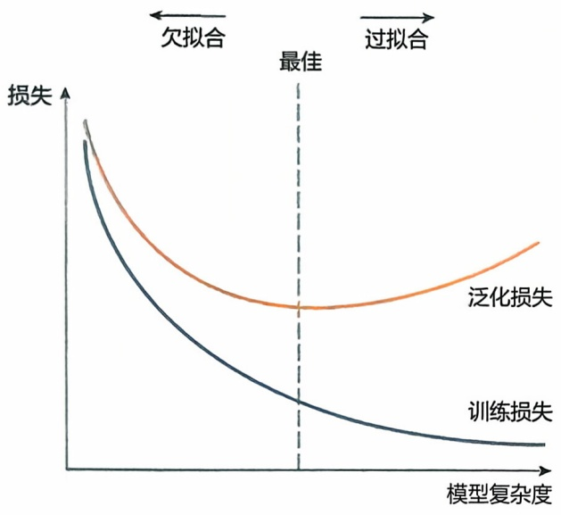

line

| 模型复杂度 | 训练损失 (Y) | 泛化损失 (Y) |
| --- | --- | --- |
| 最佳 | ~低值 | ~中值 |

图2-16 模型的欠拟合和过拟合

够多时，可以将数据分为三部分:训练集、验证集和测试集。训练集用来训练模型，验证集用来评估模型的精度和选择模型，测试集则用来评估模型的泛化能力。

模型拟合时会出现两种现象（图2-16）:①欠拟合，即:模型在训练集和测试集中的表现都不好；②过拟合，即:模型在训练集中表现很好，但在测试集中表现一般；过拟合的模型往往在训练集中有着很小的误差，但是测试集中误差较大。因此在模型评估和模型选择时，不仅要考虑其在训练集上的误差，还要考虑模型的泛化能力和模型的复杂度。

在实际应用中，通常采用交叉验证（cross-validation）法来评估模型在测试集上的误差。交叉验证中常用的方法为 $K$ 折验证:将训练集分为 $K$ 份大小相同的数据集，选取其中 $K - 1$ 份作为训练集，将剩下的一份作为验证集，估计误差。如

此重复 $K$ 次，用 $K$ 份验证集上的平均误差或方差等信息来评估模型的泛化能力，进而进行模型选择。

## 2.5.1.5 支持向量机

支持向量机（support vector machine，SVM）是一个常用的分类算法。给定数据集  $\{(x_{i},y_{i}),i=1,2,\cdots,n\}$ ，其中  $x_{i}\in R^{d},y_{i}\in\{-1,1\}$ ，我们希望构造一个分类器来区分这两类。假设，我们的分类器是超平面 wx-b=0，若  $wx_{i}-b>0$ ，则  $y_{i}=1$ ，否则  $y_{i}=-1$ 。然而，这样的分类器得到的结果中，两个类别的分界线可能会比较模糊。因此，可以构造有清楚分类边界的分类器，例如

$$
y _ {i} = \left\{ \begin{array}{l l} 1 & (w x _ {i} - b \geqslant \eta) \\ - 1 & (w x _ {i} - b \leqslant - \eta) \end{array} \right. \tag {2-36}
$$

分界线之间的距离为 $\frac{2\eta}{\|w\|^2}$，$\eta$ 越大，两个类别的分界线就越明显（图 2-17）。

因此，分界线之间的距离越大，就意味着分类器效果越好。从而根据以下最优化问题求解 w, b:

$$
\min _ {w, b} \frac {2 \eta}{| w | ^ {2}}, \quad \text {s.t.} y _ {i} (w x _ {i} - b) \geqslant \eta \tag {2-37}
$$

其中， $y_{i}(wx_{i}-b)\geqslant\eta$ 是保证每个点都被正确地分类， $\eta$ 和未知参数无关，通常取为1。

因此 SVM 寻找最大间隔超平面等价于求解问题:

$$
\max _ {w, b} \frac {1}{2} \| w \| ^ {2}
$$

$$
\mathrm{s.t.} \quad y _ {i} (w ^ {T} x _ {i} + b) \geqslant 1
$$

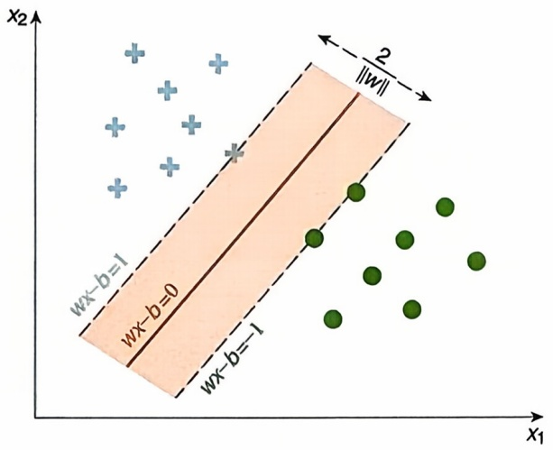

text_image

x2
wx-b=1
wx-b=0
wx-b=1
2
||w||
x1

图2-17 最大间隔超平面的示意图

当数据集线性不可分的时候，我们可以允许 SVM 在少量样本上出错，即将之前的硬间隔最大化条件放宽一点，为此引

---

2.5 统计学习基础

075

入“软间隔（soft margin）”的概念。即允许少量样本不满足约束 $y_{i}(w^{T}x_{i} + b) \geqslant 1$ 。为此我们引入一个松弛变量 $\xi_{i}$，令 $\xi_{i} \geqslant 0$，且 $1 - y_{i}(w^{T}x_{i} + b) - \xi_{i} \geqslant 0$，从而增加了软间隔SVM的优化问题转换为

$$
\min _ {w} \frac {1}{2} \| w \| ^ {2} + C \sum_ {i = 1} ^ {m} \xi_ {i}
$$

$$
\text {s.t.} \quad g _ {i} (w, b) = 1 - y _ {i} (w ^ {T} x _ {i} + b) - \xi_ {i} \leqslant 0, \quad \xi_ {i} \geqslant 0, \quad i = 1, 2, \dots , n
$$

其中， $C$ 是一个大于0的常数，可以理解为错误样本的惩罚程度，若 $C$ 为无穷大，$\xi_{i}$ 必然无穷小，如此一来线性SVM就又变成了线性可分SVM；当 $C$ 为有限值的时候，才会允许部分样本不遵循约束条件。

当数据集中的样本大多数不是线性可分的时候, 我们可以通过引入核函数, 将原空间的数据映射到一个新空间中 (如更高维甚至无穷维的空间), 然后在新空间里用线性方法从训练数据中去学习得到模型, 就是非线性的 SVM。在 SVM 中引入核函数的方法是基于其对偶问题, 将对偶问题中的  $(x_{i} \cdot x_{j})$  替换为核函数  $K(x_{i}, x_{j}) = [\phi(x_{i}) \cdot \phi(x_{j})]$ , 也就是将分割超平面转化为  $f(x) = w\phi(x) + b$ , 从而将非线性 SVM 的对偶问题变成

$$
\begin{array}{l} \min _ {\lambda} \left\{\frac {1}{2} \sum_ {i = 1} ^ {n} \sum_ {j = 1} ^ {n} \lambda_ {i} \lambda_ {j} y _ {i} y _ {j} [ \phi (x _ {i}) \cdot \phi (x _ {j}) ] - \sum_ {j = 1} ^ {n} \lambda_ {i} \right\} \\ \text {s.t.} \quad \sum_ {i = 1} ^ {n} \lambda_ {i} y _ {i} = 0, \quad \lambda_ {i} \geqslant 0, \quad C - \lambda_ {i} - \mu_ {i} = 0 \\ \end{array}
$$

通过二次规划问题求解算法或者SMO（sequential minimal optimization）算法得到最优解 $\widehat{\lambda}$，选择满足 $0 < \lambda_{j} < C$ 的一个分量，计算

$$
\hat {b} = y _ {j} - \sum_ {i \in S V} \hat {\lambda} _ {i} y _ {i} K (x _ {j}, x _ {i})
$$

来构造最终的决策函数

$$
f (x) = \mathrm{sign} \left[ \sum_ {i \in S V} \hat {\lambda} _ {i} y _ {i} K (x _ {j}, x _ {i}) + \hat {b} \right]
$$

## 2.5.1.6 SVM问题的求解

SVM 的优化问题可以通过拉格朗日乘数法，转换为对偶问题去求解。我们构造拉格朗日函数

$$
\begin{array}{l} \min _ {w, b} \max _ {\lambda} L (w, b, \lambda) = \frac {1}{2} \| w \| ^ {2} + \sum_ {i = 1} ^ {n} \lambda_ {i} \left[ 1 - y _ {i} (w ^ {T} x _ {i} + b) \right] \\ \mathrm{s.t}, \quad \lambda_ {i} \geqslant 0 \\ \end{array}
$$

利用强对偶性转化为

$$
\max _ {\lambda} \min _ {w, b} L (w, b, \lambda)
$$

---

076

2 生物统计学基础

对参数 $w$ 和 $\lambda$ 求导，并令它们等于零可得

$$
\begin{array}{l} \sum_ {i = 1} ^ {n} \lambda_ {i} x _ {i} y _ {i} = w \\ \sum_ {i = 1} ^ {n} \lambda_ {i} y _ {i} = 0 \\ \end{array}
$$

代入拉格朗日函数可得

$$
\begin{array}{l} L (w, b, \lambda) = \frac {1}{2} \sum_ {i = 1} ^ {n} \sum_ {j = 1} ^ {n} \lambda_ {i} \lambda_ {j} y _ {i} y _ {j} (x _ {i} \cdot x _ {j}) + \sum_ {i = 1} ^ {n} \lambda_ {i} - \sum_ {i = 1} ^ {n} \lambda_ {i} y _ {i} \left[ \sum_ {j = 1} ^ {n} \lambda_ {j} y _ {j} (x _ {i} \cdot x _ {j}) + b \right] \\ = \frac {1}{2} \sum_ {i = 1} ^ {n} \sum_ {j = 1} ^ {n} \lambda_ {i} \lambda_ {j} y _ {i} y _ {j} (x _ {i} \cdot x _ {j}) + \sum_ {i = 1} ^ {n} \lambda_ {i} - \sum_ {i = 1} ^ {n} \sum_ {j = 1} ^ {n} \lambda_ {i} \lambda_ {j} y _ {i} y _ {j} (x _ {i} \cdot x _ {j}) - \sum_ {i = 1} ^ {n} \lambda_ {i} y _ {i} b \\ = \sum_ {j = 1} ^ {n} \lambda_ {i} - \frac {1}{2} \sum_ {i = 1} ^ {n} \sum_ {j = 1} ^ {n} \lambda_ {i} \lambda_ {j} y _ {i} y _ {j} (x _ {i} \cdot x _ {j}) \\ \end{array}
$$

从而将原问题转换为对偶问题

$$
\begin{array}{l} \max _ {\lambda} \left[ \sum_ {j = 1} ^ {n} \lambda_ {i} - \frac {1}{2} \sum_ {i = 1} ^ {n} \sum_ {j = 1} ^ {n} \lambda_ {i} \lambda_ {j} y _ {i} y _ {j} (x _ {i} \cdot x _ {j}) \right] \\ \text {s.t.} \quad \sum_ {i = 1} ^ {n} \lambda_ {i} y _ {i} = 0 \quad \lambda_ {i} \geqslant 0 \\ \end{array}
$$

这是一个二次规划问题，问题规模正比于训练样本数，我们常用SMO算法求解。

## 2.5.2 无监督学习

在有监督学习中，同时有自变量和因变量的观测。而在无监督学习中，只有自变量的观测，其主要目的是聚类，即:识别数据中相似的样本群体，并发现一些内在的规律。随着新一代测序技术的发展，单细胞转录组测序（scRNA-Seq）使我们能够在单细胞分辨率上研究基因的表达模式。例如，研究人员可以用单细胞测序技术收集外周血单个核细胞（peripheral blood mononuclear cell, PBMC）单细胞数据，并以此为基础来了解外周血中都有哪些细胞类型？都有什么特征？这就是一个典型的聚类分析问题。另外，不难发现，单细胞数据是一个高维数据，它所测量的是上千个细胞中几万个基因的表达量，因此，无监督学习又分为两步，降维和聚类。

## 2.5.2.1 降维

假设数据集  $\{X_{i} \in R^{m}, i = 1, 2, \cdots, n\}$  是 n 个细胞中 m 个基因的表达数据。在 PBMC 数据中，n = 2700, m = 13714，维度很高，无法直接把数据用二维图，或者三维图呈现出来。因此希望构造新的变量 Z 来表示原数据，而且还满足以下性质:① Z 的维度更低，最好是二维，或者三维；② Z 保留了原始数据的信息。下面介绍构造 Z 的几个常用方法。

---

2.5 统计学习基础

077

## (1) 主成分分析

主成分分析（principal component analysis, PCA）最直接的思想是新变量 $Z$ 是原变量的线性组合，即:$Z = X\beta$，这样就把一个 $m$ 维的数据变成了一维。类似的，可以定义 $Z_{1} = X\beta_{1}, Z_{2} = X\beta_{2}, \dots, Z_{k} = X\beta_{k}$，把原数据 $X$ 映射到 $k$ 维空间中 $(k < m)$。从这个角度看，降维就是构造高维空间到维空间的映射。上面构造的是一个线性映射，即

$$
Z = A X \tag {2-38}
$$

其中， $A \in R^{k \times m}$ 是一个矩阵， $Z \in R^{k}$ 。若 $k = 3$ ，原数据则从 $m$ 维空间投影到了三维空间上，完成了第一目标。现在的问题是如何选取 $\beta$ 才能保留原始数据的信息？直觉上，可以让线性变换后的变量方差尽可能大，即:最大化 $Z$ 的方差 $Var(X' \beta)$ 。因此，$\beta$ 是以下最优化问题的解: $\max Var(X' \beta) = \beta' \Sigma \beta$ ，其中 $\Sigma$ 是 $X$ 的协方差矩阵。为了让解具有唯一性，需要加入条件 $\| \beta \| = 1$ 。因此，可以通过求解以下问题找到线性降维的映射关系

$$
\max V a r (X ^ {\prime} \beta) = \beta^ {\prime} \Sigma \beta , \text {s.t.} \| \beta \| = 1 \tag {2-39}
$$

用样本协方差阵 $\widehat{\Sigma}$ 替代 $\Sigma$，即可用拉格朗日乘子法求解上述问题。经过简单的推导知道 $\widehat{\Sigma}$ 的最大特征值所对应的特征向量就对应着方差最大的低维变量，称为第一主成分，特征值 $\lambda_1$ 正好对应该成分的方差。由此，可以推知 $\widehat{\Sigma}$ 的第 $i$ 大特征值对应的特征向量对应于第 $i$ 主成分，特征值 $\lambda_i$ 正好对应该成分的方差。实际应用中，通常要确定主成分的个数 $k$，这可以根据它们的方差贡献度来确定，即:$p_k = \frac{\sum_{i \leqslant k} \lambda_i}{\sum_{i \leqslant m} \lambda_i}$，其中分子是前 $k$ 个主成分对总方差的贡献，分母是总方差。

## (2) 低维空间嵌入

PCA 的目的是在低维空间中寻找方差最大的量来替代原数据，从而达到在降维过程中保留信息的目的。另外一个更为直接的保留信息的方法是把高维空间中的数据按照一种特定的规则嵌入到低维空间中，即低维空间嵌入（low dimensional embedding）。假设  $X = (X_{1}, \cdots, X_{n})$  为高维空间  $R^{p}$  中的 n 个观测点， $Y = (Y_{1}, \cdots, Y_{n})$  是它在低维空间  $R^{k}$  中的嵌入。记  $d_{ij} = d(X_{i}, X_{j})$  是原空间中任意两个点之间的距离， $d'_{ij} = d(Y_{i}, Y_{j})$  为低维空间中任意两点之间的距离，那么，低维空间嵌入就是要在一个低维空间中重构原数据之间的相对位置关系，即: $d_{ij} = d'_{ij}$ 。为了求得高维空间中的数据在低维空间的表示，需要构建一个最优化目标  $L(Y)$ ，不同的优化目标就对应着不同的方法。

① 高维尺度分析（multidimensional scaling, MDS）

$$
L (Y) = \sum (d _ {i j} ^ {\prime} - d _ {i j}) ^ {2} \tag {2-40}
$$

② 等距特征映射（isometric mapping, ISOMAP）

等距特征映射与 MDS 的区别在于高维空间中任意两点之间距离的计算方式。

---

078

2 生物统计学基础

如果高维空间中的数据存在于一个流形上, 那么两点之间的距离需要基于流形计算, 而不是两点之间的欧氏距离。因此, 等距特征映射也称为非度量 MDS (non-metric MDS)。

③ 局部线性嵌入（local linear embedding）

$$
L (Y) = \sum \left(Y _ {i} - \sum_ {j \in R _ {i}} w _ {i j} Y _ {j}\right) ^ {2} \tag {2-41}
$$

其中， $R_{i}$ 是 $X_{i}$ 的 $k$ 阶邻居，即: $R_{i} = \{j|d(X_{j},X_{i})\leqslant d_{k}\}$ ，权重 $w_{ij}$ 表示用 $X_{i}$ 的邻居预测 $X_{i}$ 的回归系数。

④ 局部线性映射（local linear mapping）

$$
L (Y) = \sum (Y _ {i} - Y _ {j}) ^ {2} w _ {i j} \tag {2-42}
$$

其中， $w_{ij}$ 是基于 $X_{i}, X_{j}$ 得到的权重。低维空间中的两个点离得越远，权重就越大。

⑤ t 分布式随机邻域嵌入（t-distributed stochastic neighbor embedding, t-SNE）和统一流形逼近与投影（uniform manifold approximation and projection, UMAP）则考虑保持低维空间中所有点之间的位置分布关系不变。这里不再详细叙述。

## 2.5.2.2 聚类分析

聚类分析是分析样本之间的相似性，把相似的样本聚集到一起，不相似的样本则尽可能分开。因此，样本之间的相似性度量是聚类分析的第一步。最常用的相似性度量是欧式距离，即: $d(x,y)=\sqrt{\sum_{\{i=1\}}^{d}(x_{i}-y_{i})^{2}}$ ，其中 x,y 是 d 维向量。除了欧式距离外，还有其他的相似度量，详见表 2-23。

表 2-23 常用的相似性度量

| 方法 | a=(a1,a2,···,ap),b=(b1,b2,···,bp),p≥1之间的相似性 |
| --- | --- |
| 欧几里得距离 | d(a,b)=√∑(ai-bi)2 |
| 切比雪夫距离 | d(a,b)=max1≤i≤p\|ai-bi\| |
| 曼哈顿距离 | d(a,b)=∑\|ai-bi\| |
| 堪培拉距离 | d(a,b)=∑\|ai-bi\|/ai+bi |
| 闵可夫斯基距离 | d(a,b)=√q∑(ai-bi)q,q≥1 |
| Cosine距离 | Cos(a,b)=∑aibi/∑ai2∑bi2 |
| Pearson相关系数 | ρ(a,b)=∑(ai-ā)(bi-bar)/√Var(a)Var(b),bar=1/p∑ai |
| Spearman相关系数 | ρ(Ra,Rb),Ra,Rb分别表示a和b的秩向量 |

---

2.5 统计学习基础

079

## (1) $K$-means 算法

假设  $\{x_{1}, x_{2}, \cdots, x_{n}\}$  是 p 维随机变量  $X \in R^{p}$  的 n 个独立观测，那么聚类算法本质上是从样本点到类别的一个映射: $C: X \to k, k \in \{1, 2, \cdots, K\}$ ，即: $C(x_{i}) = k$ ，简写为  $C(i) = k$ ，其中  $i = 1, 2, \cdots, n$ 。换句话说，聚类问题就是要求解未知的函数 C。这首先需要一个用于衡量聚类效果的目标函数。根据聚类的结果可以定义以下两种距离。

① 类内距离，即属于相同类别的两个点之间距离的总和，即

$$
W (C) = \frac {1}{2} \sum_ {k = 1} ^ {K} \sum_ {C (i) = k} \sum_ {C (i ^ {\prime}) = k} d (x _ {i}, x _ {i ^ {\prime}}) \tag {2-43}
$$

类内距离衡量的是一个类内部对象的相似程度，其中距离函数 $d$ 用来度量任意两个样本点之间的相似性。因此，聚类算法的一个直接目标函数是最小化类内距离。

② 总间距，即所有点之间距离的总和定义为

$$
T = \frac {1}{2} \sum_ {i} \sum_ {i ^ {\prime}} d (x _ {i}, x _ {i ^ {\prime}}) = \frac {1}{2} \sum_ {k = 1} ^ {K} \sum_ {C (i) = k} \left[ \sum_ {C (i ^ {\prime}) = k} d (x _ {i}, x _ {i ^ {\prime}}) + \sum_ {C (i ^ {\prime}) \neq k} d (x _ {i}, x _ {i ^ {\prime}}) \right] \tag {2-44}
$$

由此，有 $T = W(C) + B(C)$，其中，

$$
B (C) = \frac {1}{2} \sum_ {k = 1} ^ {K} \sum_ {C (i) = k} \sum_ {C (i ^ {\prime}) \neq k} d (x _ {i}, x _ {i ^ {\prime}})
$$

是类间距。因此，最小化类内距离就等价于最大化类间距。最小化类内距离本质上是一个组合最优化问题，然而当 n 很大，K 也比较大的时候，这个问题很难求解。

当采用欧式距离来度量任意两个样本点之间的相似度时，类间距就写成:

$$
W (C) = \frac {1}{2} \sum_ {k = 1} ^ {K} \sum_ {C (i) = k} \sum_ {C (i ^ {\prime}) = k} \| x _ {i} - x _ {i ^ {\prime}} \| ^ {2} = \sum_ {k = 1} ^ {K} N _ {k} \sum_ {C (i) = k} \| x _ {i} - \overline {{x}} _ {k} \| ^ {2} \tag {2-45}
$$

其中， $\overline{x}_{k}=(\overline{x}_{1k},\overline{x}_{2k},\cdots,\overline{x}_{pk})$ 是第 k 个类的中心， $\overline{x}_{jk}=\frac{1}{N_{k}}\sum_{i=1}^{n}x_{ij}I[C(i)=k],j=1,2,\cdots,p,N_{k}=\sum_{i=1}^{n}I[C(i)=k]$ 。此时，存在一个高效的算法用于求解该问题，名为 K-means 算法，见以下说明。需要注意的是，当样本点的数量很大时，K-means 算法很可能会给出一个局部最优解，而不是全局最优解。

## K-means 算法

① 对于数据点集 D，聚类数 K，初始化 K 个聚类中心，通常是从 D 中随机选择。
② 重复:

(a) 对于 $D$ 中的每一个数据点 $x_{i}$, 为其分配最近的聚类中心;
(b) 对每一个聚类中心  $C_{j}, j = 1, \cdots, K$ ，更新  $C_{j}$  的中心为  $C_{j}$  中所有点的均值。直到聚类中心点不再变化或达到最大迭代次数

---

080

2 生物统计学基础

## (2) 层次聚类算法

层次聚类（hierarchical clustering）是聚类算法的一种，通过计算不同类别数据点间的相似度来创建一棵有层次的嵌套聚类树（表2-24）。在聚类树中，不同类别的原始数据点是树的最低层，树的顶层是一个聚类的根节点。数据集的划分可采用“自底而上”的聚合策略，也可采用“自顶向下”的拆分策略。“自底而上”的算法开始时把每一个原始数据看作一个单一的聚类簇，然后不断聚合小的聚类簇成为大的聚类。“自顶向下”的算法开始把所有数据看作一个聚类，通过不断分割大的聚类直到每一个单一的数据都被划分。

表 2-24 层次聚类算法中的类之间的距离

| 聚类方式 | 说明 |
| --- | --- |
| 最短距离法 | 一个簇和另外一个簇中的不同向量互相之间的距离最小值为两个簇的距离 |
| 最大距离法 | 一个簇和另外一个簇中的不同向量互相之间的距离最大值为两个簇的距离 |
| 平均距离/UPGMA 法(unweighted pair group method using arithmetic mean) | 一个簇和另外一个簇中不同向量两两之间距离的平均值为两个簇的距离 |
| WPGMA 法(weighted pair group method using arithmetic mean) | 一个簇和另外一个簇中不同向量两两之间距离的加权平均值为两个簇的距离 |
| UPGMC 法(unweighted pair group method using centroids) | 两个簇的质心之间的距离为两个簇的距离 |
| WPGMC 法(weighted pair group method using centroids) | 两个簇的加权质心之间的距离为两个簇的距离 |

根据聚类簇之间距离的计算方法的不同，层次聚类算法可以大致分为:单链接算法、全链接算法或均链接算法。单链接算法用两个聚类簇中最近的样本距离作为两个类簇之间的距离；全链接算法计算两个聚类簇中最远的样本距离；均链接算法中两个聚类之间的距离由两个簇中所有的样本共同决定。

对于 “自底而上” 聚合策略的层次聚类算法，其在算法初始阶段将每个数据点都视为一个单独的类，在每次迭代中选择两个距离最小的类簇，将它们聚合为一个新的类簇，再继续迭代，直到达到我们想要的类簇个数或者所有数据点都聚合为一个类。在实际应用中这种策略的层次聚类算法相比于拆分策略的使用更为广泛。

## 2.6 统计因果推断

因果推断是一种用于确定变量之间因果关系的统计方法，目标是计算出一个变量（如某种治疗）对另一变量（如某种疾病）的影响效果，即因果效应。在生物医学领域，因果推断具有重要价值。我们常常需要明确哪些行为或环境因素会增加疾病风险，哪些治疗措施会改善病情，而回答这些问题则需要运用因果推断的方法来进行分析。例如，临床随机对照试验（randomized controlled trial, RCT）便是因果

---

2.6 统计因果推断

081

推断的重要方法，通过随机分配干预措施，使研究者能够评估干预对结果的因果效应。但 RCT 往往会受限于昂贵的试验成本和伦理道德，从观察性研究中获得因果效应则变得极为重要。在观察性研究中，因果推断的主要挑战在于如何排除混杂因素的干扰。混杂因素指的是对拟研究的两个变量均具有影响作用的因素，下面这个悖论可以很好地说明混杂因素给确定因果关系带来的干扰。

## 2.6.1 辛普森悖论

辛普森悖论（Simpson's paradox）是1951年由英国统计学家爱德华·辛普森（Edward Simpson）提出，该悖论指出在一组数据中，两个变量 $X$ 和 $Y$ 的边缘相关性和给定 $Z$ 后的条件相关性可能是完全相反的。下面，我们通过一个例子来体会该悖论的深刻含义。

体育运动是否能够增加睡眠时间呢？这是一个有趣的问题。假如我们进行了一项观察性研究，收集了一组个体的运动时间（X）及其当天的睡眠时间（Y）。经过分析后我们惊讶地发现，运动时间竟然和睡眠时间呈现负相关（图2-18a）。分析结果似乎在告诉我们体育运动会降低睡眠时间，这显然有悖于我们的常识。之后，我们根据年龄对数据进行分组，在每个亚组内单独进行相关性分析，我们发现所有亚组的结果均表明运动时间和睡眠时间为正相关（图2-18b）。至此，我们得到了两个完全相反的结论——X和Y边际负相关，但是给定年龄后，在每一个年龄水平上X和Y是正相关的，即条件正相关。那运动时间和睡眠时间的真实关系到底是怎样的呢？为什么会得到两个相反的结果呢？这一问题将会在下一小结中给出答案。由该悖论可以看出，从观察性研究数据中推断因果关系是一件困难的事情，一不小心就可能会得出错误结论。

## 2.6.2 关联与因果

在数据的统计分析中，我们常常会被告诫“关联不等于因果”这一原则。它告诉我们，仅仅因为两个变量之间存在统计上的关联，我们并不能就此得出其中一个变量是导致另一个变量变化的原因。因为观测到的相关性有可能是因果导致的关联，也有可能是混杂导致的伪关联（spurious association）。例如，我们发现一个城市的冰激凌销量和溺水事故的数量之间存在强烈的正相关，这并不意味着冰激凌消费的增加导致了溺水事故的增多。实际上，这两个变量可能都是由第三个变量（如气温）影响的。在炎热的夏天，人们更愿意购买冰激凌，同时也更可能去游泳，这可能导致溺水事故的增加。冰激凌销量和溺水之间没有任何因果关系，存在的相关性也只是气温这一混杂因素导致的伪关联（图2-19a）。因此，想要计算变量间的因果关系，必须排除混杂因素的干扰。在上一节提到的运动时间和睡眠时间的悖论中，年龄则作为混杂因素存在，其既可以影响锻炼时间，又可以影响胆固醇水平（图2-19b）。根据因果推断的方法，我们需要对混杂进行控制，因此应该在不同年龄阶

---

082

2 生物统计学基础

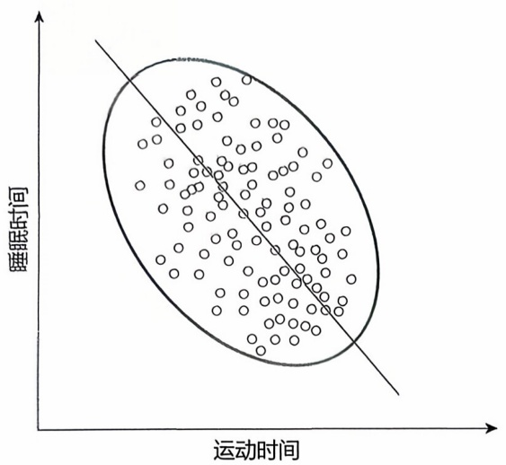

scatter

| 运动时间 (range) | 睡眠时间 (range) |
| --- | --- |
| 0~100 | 0~100 |

(a)

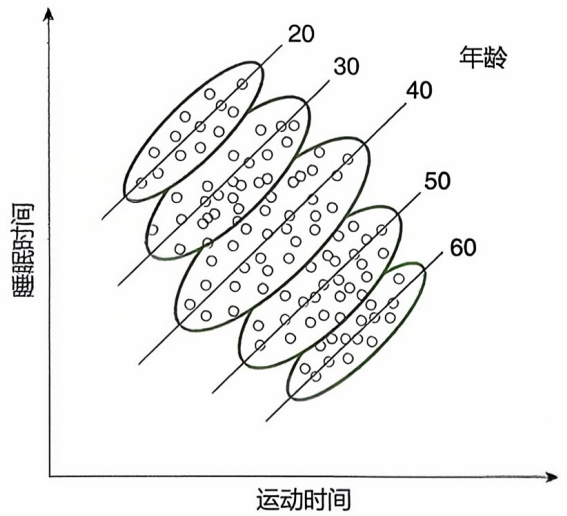

scatter

| 年龄 | 运动时间 (range) | 睡眠时间 (range) |
| --- | --- | --- |
| 20 | ~15 ~45 | ~35 ~75 |
| 30 | ~20 ~55 | ~30 ~65 |
| 40 | ~30 ~65 | ~25 ~55 |
| 50 | ~35 ~70 | ~20 ~45 |
| 60 | ~45 ~80 | ~15 ~35 |

(b)

图2-18 辛普森悖论

text_image

Diagram illustrating sunlight heating with ice cream and water, showing sun entering ice cream and water entering ice.

(a)

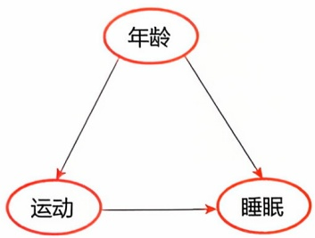

flowchart

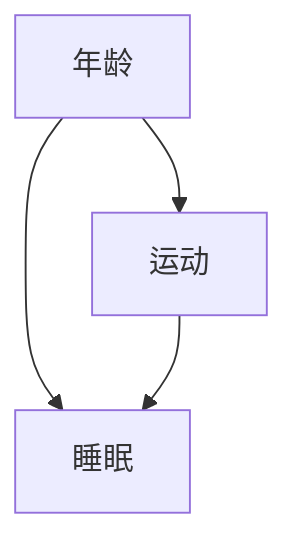

(b)

图2-19 混杂因素的干扰

段的亚组内进行分析。

关联并不等同于因果，是发展因果推断方法的出发点。与关联分析不同，在进行因果推断时，识别并控制混杂因素是非常重要的。未被控制的混杂因素可能会导致我们得到错误的因果关系，做出错误决策。近些年来因果推断受到越来越多的关注，在不同学科中都具有重要价值，相关的理论方法也在不断完善。此时此刻，我们正在经历一场“因果革命”。

## 2.6.3 因果效应的定义与识别

目前，因果推断主要存在两大模型:一个是唐纳德·鲁宾（Donald Rubin）在1978年提出的潜在结果模型（potential outcome model, POM）；另一个是朱迪亚·珀尔（Judea Pearl）在1995年提出的结构因果模型（structural causal model, SCM）。这两个模型提供了理解因果关系的不同视角，POM基于反事实（counterfactual）的概念用潜在结果定义因果效应，而SCM以因果图为基础引入“do”算子来定义因果效应。两种模型并非互斥，而是相互联系的，珀尔在2000年说明了这两个模型的等价性。POM广泛应用于流行病学和生物统计学等领域，本节主要介绍POM相关概念和内容，从POM的角度来介绍主要的因果效应估计方法。

## 2.6.3.1 潜在结果

潜在结果是因果推断中的一个重要概念，因果效应便是利用潜在结果来进行定义的。在这一小节，我们通过一个例子来说明什么是潜在结果。假如我们正在进行一项阿司匹林是否能够缓解头痛的研究，二分类变量 $T$ 表示接受的干预措施，$T = 1$ 表示服用阿司匹林，$T = 0$ 表示服用安慰剂。连续变量 $Y$ 表示头痛程度的评分，$X$ 表示协变量（受试者的基线信息）。我们将 $Y_{i}(1)$ 表示为假如个体 $i$ 服用阿司匹林

---

2.6 统计因果推断

083

$(T = 1)$ 后的头痛程度，类似地，$Y_{i}(0)$ 表示假如个体 $i$ 服用安慰剂（$T = 0$）后的头痛程度，$Y_{i}(1)$ 和 $Y_{i}(0)$ 被称为潜在结果。显然，在研究中个体 $i$ 只能接受其中一种干预措施（服用阿司匹林或者安慰剂），不可能同时接受两种干预措施，因此对于个体 $i$ 的两种潜在结果 $[Y_{i}(1)$ 和 $Y_{i}(0)]$ 我们仅能观测到其中一个，要么是服用阿司匹林后的结果，要么是服用安慰剂后的结果。最终，本研究全部受试者的观测结果如表2-25。

表 2-25 受试者的观测结果

| 个体 | T | Y(1) | Y(0) |
| --- | --- | --- | --- |
| James | 1 | 12 | * |
| Sarah | 1 | 10 | * |
| Emily | 1 | 9 | * |
| Michael | 0 | * | 13 |
| David | 0 | * | 16 |
| Elizabeth | 0 | * | 14 |

从表2-25中不难看出，对于任何一个观测个体，我们在现实世界中只能观测到其中一个潜在结果。如果一个人服用了阿司匹林，我们就只能观测到他在服用阿司匹林后的状况，而我们无法得知他如果服用安慰剂的状况会是怎样的。不可观测的那部分潜在结果被称为反事实结果（counterfactual outcome）。

## 2.6.3.2 因果效应的识别

有了潜在结果后, 我们便可以定义因果效应。个体因果效应（individual causal effect, ICE）定义为

$$
I C E _ {i} \triangleq Y _ {i} (1) - Y _ {i} (0) \tag {2-46}
$$

ICE 被定义为特定个体在接受不同干预下的潜在结果之间的差异。然而，对每个个体我们只能观测到一种潜在结果，另一种潜在结果必然缺失，因此 ICE 是不可识别的。除了个体水平上的因果效应之外，我们也感兴趣一组个体的平均因果效应（average causal effect, ACE），ACE 定义为

$$
A C E \triangleq \mathbb {E} \left[ Y _ {i} (1) - Y _ {i} (0) \right] = \mathbb {E} \left[ Y _ {i} (1) \right] - \mathbb {E} \left[ Y _ {i} (0) \right] = \mathbb {E} \left[ Y (1) \right] - \mathbb {E} \left[ Y (0) \right] \tag {2-47}
$$

ACE表示为研究中的所有个体ICE的平均值。同样，由于反事实结果不可观测，ACE也面临着不可识别的问题。为了解决这一问题，我们通过引入3个假设来使得ACE可识别。3个重要假设如下。

## 2.6.3.3 可忽略性假设

可忽略性（ignorability）假设是因果推断中的一个核心假设，也为随机对照试验提供了理论基础，其核心思想是干预与潜在结果相互独立。即

$$
[ Y (1), Y (0) ] \perp T \tag {2-48}
$$

该假设的含义为干预 $T$ 是随机分配的，与潜在结果无关。这一假设允许我们从

---

084

2 生物统计学基础

观测数据中计算 ACE

$$
\begin{array}{l} A C E = \mathbb {E} \left[ Y (1) \right] - \mathbb {E} \left[ Y (0) \right] \\ = \mathbb {E} [ Y (1) | T = 1 ] - \mathbb {E} [ Y (0) | T = 0 ] \\ = \mathbb {E} [ Y | T = 1 ] - \mathbb {E} [ Y | T = 0 ] \tag {2-49} \\ \end{array}
$$

式(2-49)说明在假设满足的情况下，ACE可从观测数据中通过计算条件期望得到。这一假设也说明了随机化试验能够进行因果推断的理论基础——随机化保证了干预 $T$ 和潜在结果是相互独立的，因此RCT是因果效应估计的金标准。然而在观察性研究中，$T$ 往往不是随机化的，故可忽略性假设往往得不到满足。为此我们引入更弱化的条件可忽略性（conditional ignorability）假设

$$
[ Y (1), Y (0) ] \perp T | X \tag {2-50}
$$

假设要求在给定一组协变量 $X$ 后，干预与潜在结果相互独立。此时，ACE可以从观测数据中计算得到:

$$
\begin{array}{l} A C E = \mathbb {E} \left[ Y (1) \right] - \mathbb {E} \left[ Y (0) \right] \\ = \mathbb {E} _ {x} \left\{\mathbb {E} \left[ Y (1) | X \right] - \mathbb {E} \left[ Y (0) | X \right] \right\} \\ = \mathbb {E} _ {x} \left\{\mathbb {E} [ Y (1) | T = 1, X ] - \mathbb {E} [ Y (0) | T = 0, X ] \right\} \\ = \mathbb {E} _ {x} \left\{\mathbb {E} [ Y | T = 1, X ] - \mathbb {E} [ Y | T = 0, X ] \right\} \tag {2-51} \\ \end{array}
$$

条件可忽略性假设告诉我们，在观察性研究中，应尽可能多地收集协变量 $X$ ，让该假设尽可能被满足。根据前面混杂因素的定义可知，混杂因素会破坏该假设，所以当 $X$ 包含了所有的混杂因素时，该假设严格成立，这也是在因果推断中需要矫正混杂因素的理论基础。

## 2.6.3.4 正性假设

正性假设（positivity）为

$$
0 <   P (T = 1 | X = x) <   1 \tag {2-52}
$$

为什么需要正性假设？我们从推导上来进行解释，根据式(2-51)

$$
\begin{array}{l} A C E = \mathbb {E} _ {x} \left\{\mathbb {E} \left[ Y | T = 1, X \right] - \mathbb {E} \left[ Y | T = 0, X \right] \right\} \\ = \sum_ {x} P (X = x) \left[ \sum_ {y} y P (Y = y | T = 1, X = x) - \sum_ {y} y P (Y = y | T = 0, X = x) \right] \\ = \sum_ {x} P (X = x) \left[ \sum_ {y} y \frac {P (Y = y , T = 1 , X = x)}{P (T = 1 | X = x) P (X = x)} - \sum_ {y} y \frac {P (Y = y , T = 0 , X = x)}{P (T = 0 | X = x) P (X = x)} \right] \tag {2-53} \\ \end{array}
$$

由式(2-53)可以看出， $P(T = 1|X = x)$ 位于分母，正性假设保证了分母不为0，否则无法定义 $\mathrm{ACE}$ 。类似的， $P(T = 0|X = x)$ 位于分母， $P(T = 1|X = x) < 1$

---

2.6 统计因果推断

085

保证了 $P(T = 0|X = x) \neq 0$ 。直观上理解，正性假设目的是保证我们在进行因果效应估计时有足够的数据进行比较。例如，如果在给定协变量 $X$ 的某个值的情况下，当所有的样本都接受了 $T = 1$ （或者都接受 $T = 0$），那么我们就无法通过比较 $T = 1$ 和 $T = 0$ 的样本来估计 $T$ 的因果效应。

## 2.6.3.5 个体处理稳定性假设

个体处理稳定性假设（stable unit treatment value assumption, SUTVA）一般分为两个部分:无干扰性和一致性。

无干扰性是指给定个体的干预结果不会受到其他个体是否接受干预的影响，每个个体的潜在结果不依赖于其他个体的干预状态。简单地说，个体服用阿司匹林后的效果，不应受到其他人是否服用阿司匹林的影响。一致性是指个体之间的干预水平是相同的。例如，对于干预组的个体，服用阿司匹林的规格应当是相同的。SUTVA假设保证了

$$
\mathbb {E} \left[ Y (1) | T = 1, X \right] = \mathbb {E} \left[ Y | T = 1, X \right] \tag {2-54}
$$

然而，SUTVA 假设在许多实际情况下并不成立，例如，在传染性疾病的例子中，一个人是否接种疫苗是会影响其他人的。对于这些情况，我们需要更复杂的方法来处理。

最后，ACE 的识别过程可以总结如下，帮助大家理解以上 3 个假设是如何在识别过程中发挥作用的。

$$
\begin{array}{l} A C E = \mathbb {E} \left[ Y (1) - Y (0) \right] \\ = \mathbb {E} \left[ Y (1) \right] - \mathbb {E} \left[ Y (0) \right] \\ = \mathbb {E} _ {x} \left\{\mathbb {E} \left[ Y (1) | X \right] - \mathbb {E} \left[ Y (0) | X \right] \right\} \\ = \mathbb {E} _ {x} \left\{\mathbb {E} \left[ Y (1) | T = 1, X \right] - \mathbb {E} \left[ Y (0) | T = 0, X \right] \right\} \quad (\text {条件可忽略性和正性}) \\ = \mathbb {E} _ {x} \left\{\mathbb {E} \left[ Y | T = 1, X \right] - \mathbb {E} \left[ Y | T = 0, X \right] \right\} \tag {SUTVA} \\ \end{array}
$$

以上介绍了什么是潜在结果，如何用潜在结果定义因果效应以及ACE的识别过程。在基于3个假设保证ACE可识别后，我们接下来介绍ACE常见的3种估计方法。

## 2.6.4 因果效应的估计

## 2.6.4.1 逆倾向得分加权

2.6.3 小节中我们提到，ACE 的识别公式为

$$
A C E = \mathbb {E} _ {x} \left\{\mathbb {E} \left[ Y | T = 1, X \right] - \mathbb {E} \left[ Y | T = 0, X \right] \right\} \tag {2-55}
$$

如果协变量 $X$ 仅是一个二值变量（如性别），那ACE的估计变得简单，在$X = 0$ 和 $X = 1$ 两个亚组内分别计算 $ACE_0$ 和 $ACE_{1}$ ，再根据 $X = 1$ 和 $X = 0$ 的比例进行加权求和即可。然而，很多情况下 $X$ 是高维的，根据 $X$ 进行分层时会得

---

086

2 生物统计学基础

到很多亚组，有的亚组会出现没有样本的情况，并且部分 $X$ 可能是连续值，无法进行分层。针对这个问题，Rosenbaum 和 Rubin (1983) 提出来倾向得分的方法，倾向得分定义为

$$
e (X) \triangleq P (T = 1 | X) \tag {2-56}
$$

由定义可以看出，倾向得分可由拟合逻辑回归模型估计得到。这样，我们可以得到 ACE 的逆倾向得分加权（inverse propensity score weighting, IPW）估计量:

$$
\widehat {A C E} _ {I P W} = \frac {1}{n} \sum_ {i = 1} ^ {n} \left[ \frac {Y _ {i} T _ {i}}{\widehat {e} (X _ {i})} + \frac {Y _ {i} (1 - T _ {i})}{1 - \widehat {e} (X _ {i})} \right] \tag {2-57}
$$

其中， $\widehat{e}(X_{i})$  为通过拟合逻辑回归模型  $P(T=1|X)$  得到的倾向得分。

## 2.6.4.2 结果回归

在结果回归（outcome regression，OR）中，我们通过回归模型来估计因果效应。我们构建如下回归模型

$$
Y = \beta_ {0} + \beta_ {t} T + \beta_ {x} X + \varepsilon \tag {2-58}
$$

其中，$\varepsilon$ 为随机项，$\mathbb{E}(\varepsilon) = 0$，$X$ 为可能的混杂因素。有

$$
\mathbb {E} \left[ Y | T, X \right] = \beta_ {0} + \beta_ {t} T + \beta_ {x} X \tag {2-59}
$$

故可得

$$
\begin{array}{l} A C E = \mathbb {E} _ {x} \left\{\mathbb {E} \left[ Y | T = 1, X \right] - \mathbb {E} \left[ Y | T = 0, X \right] \right\} \\ = \mathbb {E} _ {x} \left[ \beta_ {0} + \beta_ {t} + \beta_ {x} X - \beta_ {0} - \beta_ {x} X \right] \\ = \beta_ {t} \tag {2-60} \\ \end{array}
$$

因此，回归模型中的偏回归系数 $\beta_{t}$ 便是ACE。在实际应用时，可以通过求解上述回归模型，得到 $\widehat{\beta}_t$ 作为ACE的估计。所以

$$
\widehat {A C E} _ {O R} = \widehat {\beta} _ {t} \tag {2-61}
$$

## 2.6.4.3 双稳健估计

双稳健估计（doubly robust, DR）其实是IPW和结果回归的结合。IPW的关键在于正确的估计倾向分数 $e(X)$，而结果回归方法的关键在于正确的构造回归模型，两种方法均有可能造成偏差。为了让估计更加稳健，两种方法进行结合，便得到双稳健估计

$$
A C E = \mathbb {E} \left[ \frac {Y T}{e (X)} - \frac {T - e (X)}{e (X)} m _ {1} (X) \right] - \mathbb {E} \left[ \frac {Y (1 - T)}{1 - e (X)} + \frac {T - e (X)}{1 - e (X)} m _ {0} (X) \right] \tag {2-62}
$$

其中， $e(X)$ 为IPW中的倾向分数， $m_{1}(X)$ 和 $m_0(X)$ 分别为回归模型中的 $\mathbb{E}[Y|T = 1,X]$ 和 $\mathbb{E}[Y|T = 0,X]$ 。双稳健估计量具有良好的理论性质，IPW和OR估计量只要有一个具有一致性，则双稳健估计便是一致估计。关于双稳健估计的更多理论性质我们不在此进行阐述。

---

2.6 统计因果推断

087

## 2.6.5 工具变量

以上介绍的几种因果效应的估计方法，均要求我们观测到了所有的混杂因素 $X$ ，并在模型中对混杂因素进行了有效控制。然而，在观察性研究中经常存在未被观测的混杂因素，因此这一要求往往得不到满足。当存在未被观测的混

杂因素时，我们该如何去估计 ACE 呢？对此，敏感性分析（sensitivity analysis）提供了一种可能的解决方案，它通过评估所用方法对违反假设的敏感程度，使我们能认识到所得结果的稳健性。除了敏感性分析方法，使用工具变量也是处理这一问题的有效途径。

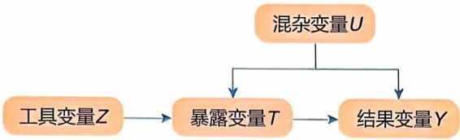

flowchart

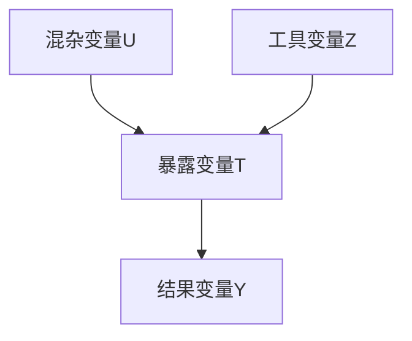

图2-20 工具变量模型

## 2.6.5.1 工具变量的概念

工具变量指的是与暴露变量有关联，但对结果没有直接作用的变量（图2-20）。其背后的核心思想是，如果工具变量与暴露变量以及工具变量与结果变量之间均不存在混杂因素时，即使在没有观测到混杂因素的情况下，我们也可以借助工具变量来计算暴露对结果的因果效应。需要注意的是，一个变量能够作为工具变量，需要满足以下3个条件。

① 相关性（relevance） 工具变量 Z 与暴露变量 T 具有显著的统计关联，即  $Z \not\perp T$ 。
② 排他性限制（exclusive restriction） 在给定暴露变量 T 和混杂变量 U 的条件下，工具变量 Z 对结果变量 Y 没有直接作用，即  $Y \perp Z |T, U$ 。
③ 无混杂性（unconfoundedness） 工具变量 Z 与混杂变量 U 相互独立，即  $Z \perp U$ 。

在实际应用中，通常根据不同的研究领域和不同的场景来选择合适的工具变量。例如，在经济学研究中，工具变量通常是政策变化、地理位置或历史事件等。在遗传学研究中，则将基因组上的某些变异位点作为工具变量，以探索暴露变量（生活方式、环境因素等）对疾病的影响，这也就是孟德尔随机化方法，该方法我们会在后面做进一步介绍。

## 2.6.5.2 工具变量的识别与估计

工具变量法在不做任何模型假设的情况下因果效应是无法识别，下面我们在线性模型假设下，即变量之间为线性关系，讨论工具变量的识别问题。

## (1) 二分类工具变量下 ACE 的识别

首先我们考虑工具变量 $Z$ 为二分类情况，并假设结果 $Y$ 是暴露变量 $T$ 和未被观测的混杂变量 $U$ 的线性函数，即

$$
Y = \alpha T + \beta U + \varepsilon \tag {2-63}
$$

其中，$\alpha$ 即为我们感兴趣的因果效应。根据上述工具变量所要满足的3个条件，我们可以证明

---

088

2 生物统计学基础

$$
\begin{array}{l} \mathbb {E} (Y | Z = 1) - \mathbb {E} (Y | Z = 0) = \mathbb {E} (\alpha T + \beta U + \varepsilon | Z = 1) - \mathbb {E} (\alpha T + \beta U + \varepsilon | Z = 0) \\ = \alpha [ \mathbb {E} (T | Z = 1) - \mathbb {E} (T | Z = 0) ] + \beta [ \mathbb {E} (U | Z = 1) \\ \left. - \mathbb {E} (U | Z = 0) \right] + \left[ \mathbb {E} (\varepsilon | Z = 1) - \mathbb {E} (\varepsilon | Z = 0) \right] \\ = \alpha [ \mathbb {E} (T | Z = 1) - \mathbb {E} (T | Z = 0) ] \tag {2-64} \\ \end{array}
$$

进一步则可以得到

$$
\alpha = \frac {\mathbb {E} (Y | Z = 1) - \mathbb {E} (Y | Z = 0)}{\mathbb {E} (T | Z = 1) - \mathbb {E} (T | Z = 0)} \tag {2-65}
$$

其中，分子部分为工具变量 $Z$ 与结果变量 $Y$ 的关联，分母部分为工具变量 $Z$ 与暴露变量 $T$ 的关联。

## (2) 连续型工具变量下 ACE 的识别

接下来，我们考虑工具变量为连续型变量时 ACE 的识别。与二分类情况类似，在线性模型假设下可以得到

$$
\begin{array}{l} \operatorname{Cov} (Y, Z) = \mathbb {E} (Y Z) - \mathbb {E} (Y) \mathbb {E} (Z) \\ = \mathbb {E} \left[ (\alpha T + \beta U + \varepsilon) Z \right] - \mathbb {E} (\alpha T + \beta U + \varepsilon) \mathbb {E} (Z) \\ = \alpha \left[ \mathbb {E} (T Z) - \mathbb {E} (T) \mathbb {E} (Z) \right] + \beta \left[ \mathbb {E} (U Z) - \mathbb {E} (U) \mathbb {E} (Z) \right] + \left[ \mathbb {E} (\varepsilon Z) - \mathbb {E} (\varepsilon) \mathbb {E} (Z) \right] \\ = \alpha \operatorname{Cov} (T, Z) + \beta \operatorname{Cov} (U, Z) + \operatorname{Cov} (\varepsilon , Z) \\ = \alpha \operatorname{Cov} (T, Z) \tag {2-66} \\ \end{array}
$$

因此

$$
\alpha = \frac {\mathrm{Cov} (Y , Z)}{\mathrm{Cov} (T , Z)} \tag {2-67}
$$

无论工具变量为二分类还是连续型，我们可以看到识别公式中均不包含 $U$ ，因此工具变量法可以实现在不观测混杂变量 $U$ 的情况下来估计ACE。

## (3) 两阶段最小二乘法估计

我们得到工具变量的识别公式后，便可以根据识别公式来估计因果效应。常用的估计方法为两阶段最小二乘法（two stage least squares, 2SLS），2SLS 还可以帮助我们从另外一个视角理解工具变量。在 2SLS 中，第一阶段为使用暴露变量 T 对工具变量 Z 进行回归

$$
T = \gamma Z + \varepsilon_ {T} \tag {2-68}
$$

并得到预测的暴露变量 $\hat{T}$

$$
\widehat {T} = \widehat {\gamma} Z \tag {2-69}
$$

此时 $\hat{T}$ 只与 $Z$ 有关，而与 $U$ 无关（图2-20）。第二阶段，研究者使用结果变量 $Y$ 对第一阶段预测的 $\hat{T}$ 进行回归，

---

思考与练习题

089

$$
Y = \alpha \widehat {T} + \beta U + \varepsilon_ {Y} \tag {2-70}
$$

求解得到因果效应的估计值 $\hat{\alpha}$ 。这两步过程将消除混杂变量的影响，提供 $T$ 和 $Y$ 之间因果效应的无偏估计。然而如果工具变量不满足与暴露变量相关（即工具变量有效）并且与误差项不相关（即工具变量外生）的条件，那么两阶段最小二乘法将会产生有偏的结果（图2-21）。

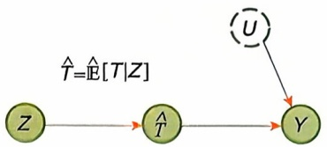

flowchart

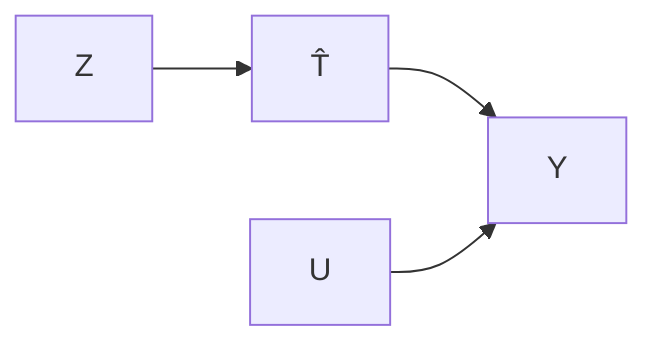

图2-21 两阶段最小二乘法

值得注意的是，上述 ACE 的识别均需要依赖线性参数化的假设，在借助工具变量估计 ACE 时如果不做任何模型假设，ACE 是无法识别的。然而，线性假设暗含一个内容，即对于所有个体的处理效应均是完全相同的。这个条件在真实研究中往往难以满足。除了线性假设外，在工具变量的分析中我们也可以做单调性假定，即假设随着工具变量水平的增加，结果水平也会随之增加。在单调性假设下，ACE 同样也是可识别的。

## ※ 推荐阅读

1. Hastie T, Tibshirani R, Friedman J. The elements of statistical learning [M]. 2nd ed. Berlin: Springer, 2009.
点评:该书详细介绍了统计学习的重要内容，有助于扩展相关内容的知识面。
2. Pearl J, Mackenzie D. The book of why: the new science of cause and effect [M]. New York: Basic Books, 2018.
点评:该书详细介绍了因果推断的重要思想和发展历史。

## ※ 思考与练习题

1. 极大似然估计方法和最小二乘法的区别是什么？
2. 贝叶斯极大后验估计与极大似然估计之间是什么关系？
3. 请在理解 I 型与 II 型错误的基础上，思考如何权衡二者。
4. 在哪些场景下中位数比均值更为可靠？
5. 如何理解双因素方差分析中的交互效应。
6. 为什么 Benjamini-Hochberg 方法可以控制 FDR?
7. 思考参数方法和非参数方法的优缺点，并举例说明各自的适用场景。
8. 分析随机区组设计如何帮助减轻实验中未知混杂变量的影响。
9. 当工具变量与暴露变量的相关性比较弱时，会出现弱工具变量问题。请思考弱工具变量会对因果推断造成哪些影响，如何检测和处理弱工具变量问题？
10. 为什么随机化实验被认为是因果推断的金标准？请结合可忽略性假设进行阐述。

---

090

2 生物统计学基础

## ※ 讨论题

1. 试论述描述性统计学在数据分析中的作用及其重要性。
2. 通过实际案例，解释单侧和双侧检验的区别和应用。
3. 探讨对比不同的图表（如箱线图、散点图、直方图）在数据展示中的作用和优势。
4. 比较 Bonferroni 校正与 Benjamini-Hochberg 校正的优缺点，并举例说明。
5. 为什么传统的 Bonferroni 校正方法可能不适用于基因表达数据的多重检验？
6. 探讨在生物信息大规模数据分析中，如何选择合适的多重检验校正方法。

## ※ 参考文献

1. Fan J, Li R. Variable selection via nonconcave penalized likelihood and its oracle properties [J]. Journal of the American statistical association, 2002, 96(456): 1348-1360.
2. Ishwaran H, Rao S. SPIKE and SLAB variable selection: frequentist and Bayesian strategies [J]. The annals of statistics, 2005, 33(2): 730-773.
3. LeCun Y, Bengio Y, Hinton G. Deep learning [J]. Nature, 2015, 521(7553): 436-444.
4. Park T, Casella G. The Bayesian LASSO [J]. Journal of the American statistical association, 2008, 103(482): 681-686.
5. Scott S L. Bayesian methods for hidden Markov models [J]. Journal of the American statistical association, 2002, 97(457): 337-351.
6. Tibshirani R. Regression shrinkage and selection via the LASSO [J]. Journal of the royal statistical society series B: statistical methodology, 1996, 58(1): 267-288.
7. Zou H, Hastie T. Regularization and variable selection via the elastic net [J]. Journal of the royal statistical society series B: statistical methodology, 2005, 67(2): 301-320.

编者:蒋杭进（浙江大学）

王涛（上海交通大学）

审读:李婧（上海交通大学）
