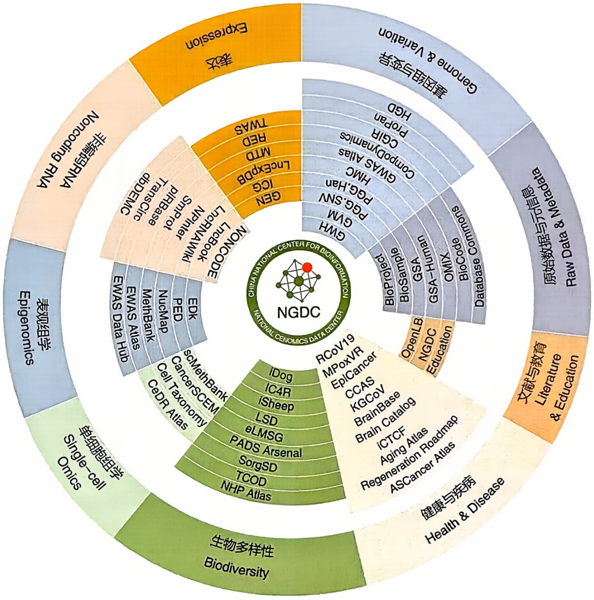
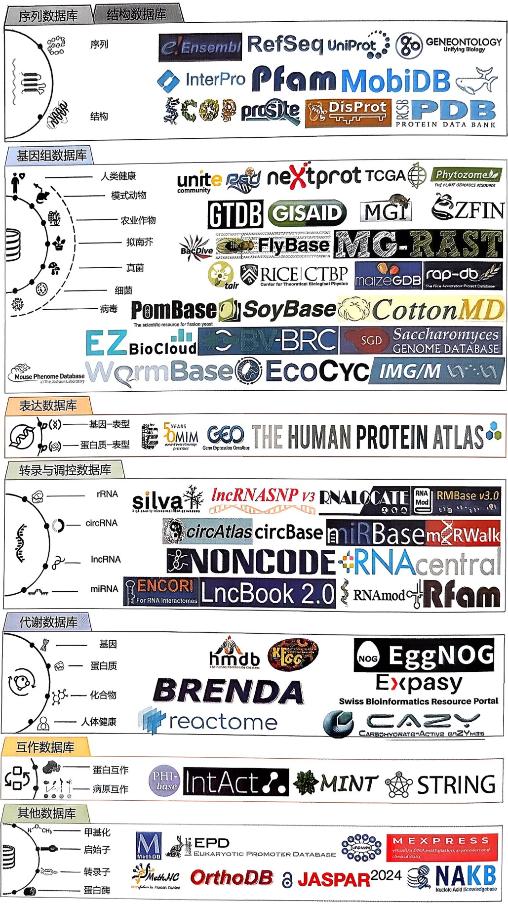
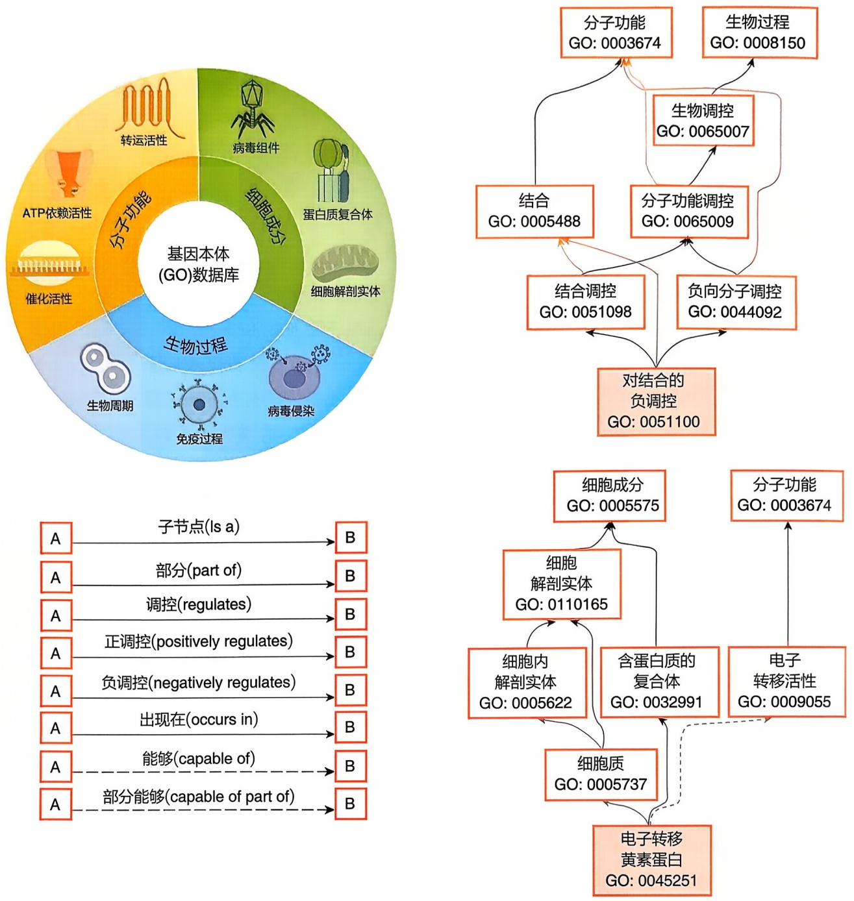

# 4 生物信息资源

原始 PDF 第 130–161 页。

## 生物信息资源

生物信息学既是一门基础学科也是一项研究工具。通过对海量生物数据和信息进行收集、整理、储存、管理、发布与应用，进而形成种类繁多、丰富多样的生物数据库，为用户提供生物数据的访问、检索、管理、更新等服务。目前生物数据库使用多种不同的数据库结构类型:平面文件、关系型数据库、面向对象数据库、基于互联网平台的XML等。生物数据库具备以下特征:①持续整合和更新，数据容量不断增加；②通过字段对原始生物数据及其生物学意义注释的多维属性特征进行规范化记录；③提供基础的访问、检索和浏览，以及特定需求的上传、下载和可视化等一系列网络服务；④部分数据库提供不同生物数据库之间的交叉引用。通过生物数据库的构建，有助于生物信息资源的高效管理和利用，为全球用户获取资源提供便利，支撑和服务于生命科学领域的快速发展，为数据的安全管理和共享保驾护航。

## 4

---

116

4 生物信息资源

## 4.1 生物数据库简介

生物数据库是生命科学发展不可或缺的信息资源，也是合成生物学、生物医药与生物技术产业赖以发展的基础。生物数据库的建设、维护与安全关系人口健康、生物安全和可持续发展，是国家重要战略资源。

生物数据库的建立和发展为生物学研究、药物研发和医学应用等提供了非常重要的支持。借助生物数据库，生物信息学从业者和生命科学研究人员可以快速地获取海量的生物数据，进行数据挖掘、分析和再加工，从而更好地理解生物学现象和生命机制，发现新的生物学规律。例如，通过基因组数据库，可以对不同物种的基因组进行比较，发现基因的演化规律和功能，从而更好地理解生物的进化和适应性；通过某物种泛基因组序列比较，可以挖掘群体/个体的特有基因，在全基因组水平上了解个体间共性与特性，进而了解该物种基因组结构和基因功能，探究特有基因与特殊生物学性状之间的关系，有助于阐释物种演化地位及适应性机制。基于已有生物数据库的重要信息，研究人员可以快速地进行药物靶点的筛选和优化，并利用生物大数据和人工智能指导新药研发和优化治疗方法，例如，通过蛋白质数据库，可以对蛋白质结构和功能进行研究，发现和设计新的药物靶点，优化和创新疾病治疗方法。

虽然我国的各大科研院所和高校已经建立了类型丰富的生物数据库，但与领域内国际顶尖生物数据库相比，在基础设施、数据汇交管理、好用易用性等方面仍存在差距，尤其在数据库的权威性、完整性、多维度、使用界面友好度、数据上传与下载快捷性、不同数据库智能关联性、人工智能辅助应用等方面存在较大差距。因此，鉴于生物数据库在生命科学基础研究和应用研究上的重要性，我们倡议加大我国生物信息学建设和人才队伍培养力度，加快完善国内生物数据资源汇总、储存、共享与保障机制，健全科学数据库管理体系建设并最大限度发挥生物数据库的价值。

## 4.1.1 生物数据库分类

生物数据库类型种类繁多。根据存储数据内容的不同，可以分为 DNA 数据库、RNA 数据库、蛋白质数据库、物种特异性数据库、其他数据库等。基于数据获取的规模和复杂性程度，可将生物数据库细分为一级数据库和二级数据库，或者用户针对性更强的专用数据库等。

DNA 数据库存储 DNA 序列及相关关联数据，包括核酸序列数据库、基因组数据库、功能基因数据库、基因型与表型数据库、基因表达数据库、功能元件数据库、表观遗传信息数据库等。目前主要的四大核酸序列数据库为:美国国家生物技术信息中心（National Center for Biotechnology Information, NCBI）的 GenBank 数据库、欧洲生物信息学研究所（European Bioinformatics Institute, EBI）的 EMBL（European

---

41 生物数据库简介

317

Molecular Biology Laboratory）数据库、日本国立遗传学研究所（National Institute of Genetics，NIG）的 DDBJ（DNA Data Bank of Japan）数据库、中国国家生物信息中心（China National Center for Bioinformation，CNCB）的 NGDC（National Genomics Data Center）数据库，这些数据库中的每条数据记录都是一个纯文本文件，由核苷酸碱基序列和文字注释组成，两者都有固定格式。其中 GenBank 数据库、EMBL 数据库和 DDBJ 数据库之间以天为单位进行 DNA 和 RNA 序列数据的交换和更新。基因组数据库主要包括 EBI 的 Ensembl 数据库和 NCBI 的 RefSeq 数据库（Reference Sequence Database），它们整合了各种生物类群的基因组、转录本、蛋白质参考序列的二级核酸数据，以及比较基因组学、变异、调控等拓展信息。功能基因数据库主要包括解释基因表达、蛋白质功能、基因调控和进化过程的基因本体（Gene Ontology，GO）数据库，整合基因组、生物途径、疾病、药物等系统功能信息的京都基因与基因组百科全书（Kyoto Encyclopedia of Genes and Genomes, KEGG），对同源基因组进行分类和注释的 COG（Clusters of Orthologous Genes）数据库等。基因型与表型数据库主要包括存储外显子测序、基因型和表型数据的 dbGaP 数据库（Database of Genotypes and Phenotypes），存储基因组范围关联分析结果的 GWAS（Genome-Wide Association Study）数据库等。基因表达数据库主要收录高通量转录组、单细胞转录组、时空转录组等数据，包括 NCBI 的 GEO（Gene Expression Omnibus）数据库，DDBJ 的 GEA（Genomic Expression Archive）数据库，EBI 的 ArrayExpress 数据库、CNCB 的 GEN（Gene Expression Nebulas）数据库等。功能元件数据库如真核生物启动子数据库（Eukaryotic Promoter Database, EPD），其提供转录起始位点信息以及相应的功能基因组学数据。表观遗传信息数据库存储表观基因组学数据，涵盖 DNA 甲基化、表观基因组关联分析、表观遗传与疾病等方面信息。

RNA 数据库存储各种不同类型 RNA 及其生物学功能数据信息，包括 RNA 综合数据库、非编码 RNA 数据库等。常见的 RNA 综合数据库主要有涵盖 RNA 注释和结构家族集合的 Rfam 数据库，收录 mRNA 修饰信息的 RNAmod 数据库，整合 RNA 转录后修饰、microRNA 结合以及 RNA 结合蛋白的 RMBase 数据库，收录 RNA 亚细胞定位的 RNALocate 数据库等。常见非编码 RNA 数据库收录 miRNA、siRNA、piRNA、snRNA、snoRNA、lncRNA、circRNA 等不同类型非编码 RNA，如 miRBase、RNAcentral、lncRNAdb 数据库。

蛋白质数据库包括蛋白质与基因组学数据库、蛋白质分类与注释数据库、蛋白质空间结构数据库、蛋白质互作数据库、蛋白质结构域数据库、酶数据库等。蛋白质与基因组学数据库主要包括收录蛋白质信息最丰富、资源最广的 UniProt（Universal Protein）数据库，提供蛋白质功能分析的 InterPro 数据库，整合超过 160 个数据库和软件工具专门用于蛋白质和蛋白质组学分析的 Expasy 数据库资源门户等。蛋白质分类与注释数据库主要有 CATH 数据库、SCOP 数据库、PRINTS 数据库。蛋白质空间结构数据库主要收录生物大分子（蛋白质、核酸）和小分子结构信息，

---

118

4 生物信息资源

PDB（Protein Data Bank）是国际上具有代表性的生物大分子结构数据库，收录基于实验获得的蛋白质三维结构和基于计算机模拟或人工智能预测的蛋白质三维结构，CCDC（Cambridge Crystallographic Data Centre）是收录小分子结构信息的代表性数据库。蛋白质互作数据库主要包括 IntAct 数据库、MINT 数据库（Molecular Interaction Database）、BioGRID 数据库（Biological General Repository for Interaction Datasets）、STRING 数据库（Search Tool for the Retrieval of Interacting Genes/Proteins）等。酶数据库主要包括整合酶和代谢途径的 BRENDA 数据库（Braunschweig Enzyme Database）、存储糖类活性酶的 CAZy 数据库（Carbohydrate-active Enzymes Database）等。

物种特异性数据库是专门针对某一种或某一类生物物种的基因组和生物信息数据库，满足特定的多样化需求。目前，生物数据资源中物种特异性数据库大体分为:人与人类疾病相关数据库，动物、植物、微生物相关数据库等。某些情况下，某一特定物种或某种属物种会有一个专属数据库，尤其是一些重要模式生物都有其专属的基因组数据库，专门收录该物种参考基因组或泛基因组信息，或其近缘物种的比较基因组信息，甚至是多维组学数据信息等，并提供基因组可视化等分析工具，为生物学研究提供极大的便利。

此外，更多的专业数据库被开发以满足特定生物学研究团体对特定类型生物数据的访问和检索需求。如分子功能互作数据库、细胞通信数据库、代谢数据库、生物反应数据库、单细胞数据库、突变数据库等。这些数据库不仅收录特定类型生物数据，还提供用户数据查询和数据分析的基本工具。

大多数情况下，上述各种数据库之间相关条目数据通过交叉引用实现互访，即可以通过从某一数据库检索到的生物数据记录所提供的外部链接，直接跨数据库访问和检索其他相关库的生物数据信息。大多数综合型数据库，如NCBI、EBI、DDBJ、CNCB，它们是生物信息学门户站点，整合了种类繁多的一级和二级数据库，链接了大量非自身维护的有用站点和资源，提供了多种分析工具，可以满足大多数用户对不同类型生物数据的访问和检索需求。

## 4.1.2 生物数据库期刊

目前生物数据库主要收录于以下几个出版社发行的相关杂志期刊:牛津大学出版社（Oxford University Press）发行的 Nucleic Acids Research, Database, Genomics Proteomics & Bioinformatics, Bioinformatics, Bioinformatics Advances, Briefings in Bioinformatics 等期刊；施普林格·自然出版社（Springer Nature）发行的 BMC Bioinformatics 期刊；边沁科学出版社（Bentham Science Publishers）发行的 Current Bioinformatics 期刊；世界科技出版公司（World Scientific Publishing）发行的 Journal of Bioinformatics and Computational Biology 期刊。这些生物数据库期刊发表的文章包括新开发数据库或者已有数据库的更新迭代。生物信息学从业者和生命科学研

---

4.2 国际主要数据中心

119

究人员可以就某类型生物数据进行收集和整理，开发成特定类型生物数据库，发表在相关生物数据库期刊上。

《核酸研究》（Nucleic Acids Research，NAR）杂志是分子生物学研究的权威期刊。从1994年开始，NAR杂志每年第一期为生物数据库专辑，概要介绍过去一年NAR发表的新开发或更新的生物数据库，同时提供各类生物数据库访问网址，在2004年正式定名为数据库专辑（Database Issue）。截至2024年12月，NAR数据库专辑收录的主要分子生物学数据库达到2236个。数据库专辑收录的公共生物数据库分为九大类:大型综合数据库，核苷酸序列、结构、调控类数据库，蛋白质序列、结构、结构域类数据库，代谢、信号途径、酶类数据库，病毒、细菌、原生动物、真菌类数据库，人类基因组、模式生物、比较基因组类数据库，基因组变异、疾病、药物类数据库，植物类数据库，其他类数据库。从2003年开始，NAR杂志每年7月发行一期网络服务器专辑（Web Server Issue），为用户提供基于网络的数据分析及可视化软件资源。截至2024年7月，NAR网络服务器专辑收录的生物数据库链接达到2633个。网络服务器专辑收录的各类公共生物数据库分为11大类:计算机相关、DNA、教育、表达、人类基因组、文献、模式生物、其他分子、蛋白质、RNA、序列比较。虽然NAR统计的数据库专辑和网络服务器专辑所包含的数据库有一定的区别，但基本涵盖了主流的生物学数据库资源，为生物信息学从业者和生命科学研究人员提供了可靠的生物数据信息来源。

## 4.2 国际主要数据中心

随着生命科学蓬勃发展，生物信息数据体量呈指数级递增，组学数据资源的收集管理已成为生物信息研究领域的基础需求。建立数据资源库和生物信息数据中心，是能够最有效地管理和使用海量生物大数据的有效途径。20世纪80年代，以美国、欧洲和日本为代表的国际社会陆续起步建设国家级的国家生物信息中心，包括美国国家生物技术信息中心、欧洲生物信息学研究所和日本DNA数据库中心，三家建立并维护的核酸数据库于2005年成立了国际核酸序列数据库联盟（International Nucleotide Sequence Database Collaboration, INSDC），逐渐形成了垄断全球生物大数据的局面。INSDC建立统一的技术体系与标准规范，每日分享并交换各自收录的组学数据，实现全球数据在美国、欧洲和日本的属地化管理，在提供全球数据共享服务的同时，也极大地方便了本国科学家对组学数据的使用。同时，得益于国际期刊对INSDC数据库系统的认可和推荐使用，全球的科研人员在发表科研成果时，需要将其数据提交至INSDC数据库，这也促进了INSDC数据库的发展。另外，中国国家生物信息中心/国家基因组科学数据中心（CNCB-NGDC）近年来逐渐发展起来，逐步在国际生物信息领域占有一席之地（表4-1）。

---

120

4 生物信息资源

表 4-1 国际主要数据中心概况

| 数据中心 | 成立年份 | 主要内容与数据类型 |
| --- | --- | --- |
| 美国国家生物技术信息中心（NCBI） | 1988 | 多维组学数据、文献信息以及医学数据资源 |
| 欧洲生物信息学研究所（EBI） | 1994 | 基因组、转录组、蛋白质组、表观组等多维组学数据和文献信息 |
| 日本 DNA 数据库中心（DDBJ） | 1986 | 以基因组数据为主 |
| 国家生物信息中心/国家基因组科学数据中心（CNCB-NGDC） | 2019 | 多维组学数据-信息-知识资源 |

## 4.2.1 中国国家生物信息中心/国家基因组科学数据中心

随着生命科学的蓬勃发展，我国产出的生物数据呈爆发式增长态势，由于我国在生物信息数据的存储和管理方面起步晚，严重依赖国际生物信息数据库，生物数据“多而不强”，国际话语权不重，资源分散、标准缺乏、共享不畅、利用不足、管理滞后等问题较为突出。为了应对我国生物大数据安全、共享和利用存在的问题和挑战，几代科学家一直呼吁建设我国自己的生物信息中心，这引起了国家层面的高度重视。2019年6月11日，科技部和财政部联合发布《关于国家科技资源共享服务平台优化调整名单的通知》，其中，依托中国科学院北京基因组研究所建设国家基因组科学数据中心，合作共建单位为中国科学院生物物理研究所和上海营养与健康研究所，其前身是中国科学院北京基因组研究所生命与健康大数据中心（BIG Data Center，BIGD）。同年11月13日，经中央编制委员会批准，中央机构编制委员会办公室发文，在中国科学院北京基因组研究所加挂“国家生物信息中心”牌子，整合中国科学院和全国优势力量，建设国家生物信息中心。作为CNCB的重要组成部分，NGDC（以下简称CNCB-NGDC）已初步建成涵盖基础组学、国家人类遗传、重要战略生物、生物安全等信息库以及生物信息分析工具和平台等在内的多组学数据资源体系（图4-1），为数据汇交共享、安全管理和挖掘利用提供一站式支撑，为人口健康、公共安全、育种改良、生物多样性等相关研究提供重要参考资料。2018—2023年连续六年被生物信息学领域国际权威期刊《核酸研究》称为“全球主要生物数据中心”之一。

面向国家人口健康和社会可持续发展的重大战略需求，为解决数据孤岛和数据外流问题，提高组学数据管理、挖掘与再利用的效率，CNCB-NGDC 成立几年来，已经逐步建设完成了一系列具有自主知识产权的组学数据基础库，支撑多维组学数据的汇交、存储、管理和共享。CNCB-NGDC 的组学数据基础库（图 4-1 和表 4-2）主要包括生物项目数据库（BioProject）、生物样本数据库（BioSample）、组学原始数据归档库（Genome Sequence Archive, GSA）、基因组数据库（Genome Warehouse, GWH）、基因序列数据库（GenBase）和基因组变异库（Genome Variation Map, GVM）等，

---

4.2 国际主要数据中心

121

其中组学原始数据归档库家族包括组学原始数据归档库（Genome Sequence Archive, GSA）、人类遗传资源组学原始数据归档库（Genome Sequence Archive for Human, GSA-Human）多元数据归档库（Open Archive for Miscellaneous Data, OMIX）。针对人类遗传资源的特殊管理需求，受科技部委托，2022年7月18日，CNCB-NGDC开通运行了人类遗传资源信息管理备份平台（Human Genetic Resource Information Management and Backup Platform, HGRIP），实现了人类遗传资源信息管理、备份、发布与共享的一站式管理。为了扩大中心的国际影响力，CNCB-NGDC在与NCBI初步建立了数据交换共享机制基础上，持续推进探索全面的数据交换共享。此外中心的组学数据基础库也持续镜像和更新NCBI对标基础库的数据资源，与中心自主开发数据库进行一体化整合，方便国内科研人员查询和获取数据的效率。基于新数据资源的不断挖掘和海量文献的知识审编，中心构建了许多专业化的特色资源库和多维组学知识库（如图4-1所示），如基因表达数据库（Gene Expression Nebulas, GEN）、甲基化数据库（MethBank）、人类长非编码RNA数据库（LncBook）、新冠病毒信息库(RCoV19)、生命科学文献库（OpenLB）、全球生物数据库目录（Database Commons）等。

flowchart

This image displays a circular diagram representing the architecture of NGDC (National Cancer Data Center), detailing its functional modules and associated research areas.

图4-1 CNCB-NGDC多组学数据库资源体系建设情况

---

122

4 生物信息资源

表 4-2 CNCB-NGDC 的代表性资源

| 数据库名称 | 数据库简称 | NCBI 对标数据库简称 | 创建年份 | 数据库功能 |
| --- | --- | --- | --- | --- |
| BioProject | BioProject | BioProject | 2015 | 生物项目信息的汇交、管理和共享 |
| BioSample | BioSample | BioSample | 2015 | 生物样本信息的汇交、管理和共享 |
| Genome Sequence Archive | GSA | SRA | 2015 | 原始测序数据的汇交、管理和共享 |
| Genome Warehouse | GWH | GenBank | 2017 | 多物种基因组组装序列和注释信息汇交、管理和共享 |
| GenBase | GenBase | GenBank | 2022 | 病毒、细胞器或基因片段的核酸序列和注释信息的汇交、管理和共享 |
| Genome Variation Map | GVM | dbSNP | 2016 | 基因组变异数据的汇交、管理和共享 |
| Open Archive for Miscellaneous Data | OMIX | / | 2020 | 基因组统计分析、蛋白质、代谢、临床等数据的汇交、管理与共享 |
| Gene Expression Nebulas | GEN | GEO | 2019 | 基因表达谱数据以及元信息的审编、整合、解析、管理和共享 |
| Methylation Bank | MethBank | / | 2014 | 甲基化数据、知识和工具的审编、整合、管理和共享 |
| Genome-Wide Association Study Atlas | GWAS Atlas | / | 2019 | 基因型与表型关联知识数据审编、整合、管理和共享 |
| Epigenome-Wide Association Study Atlas | EWAS Atlas | / | 2018 | 表观与表型关联数据、知识和工具的审编、整合、管理和共享 |
| Resource for Coronavirus 2019 | RCoV19 | / | 2020 | 新冠病毒基因组、变异组以及元信息等数据整合、解析、管理和共享 |
| LncBook | LncBook | / | 2018 | 人类长非编码 RNA 数据整合和多组学注释 |
| Database Commons | Database Commons | / | 2015 | 全球生物数据库收集、分类、信息审编、系统评价 |

CNCB-NGDC 持续贯彻落实生物大数据国家科技发展战略和重大任务需求，紧跟生命科学领域前沿，持续推进生物信息挖掘和知识转化进程，在全球范围内为推动生命和健康科学的发展提供开放的资源家族，服务于科学研究和产业应用。

## 4.2.2 美国国家生物技术信息中心

美国国家生物技术信息中心（NCBI）位于美国马里兰州的贝塞斯达，隶属于美国国家医学图书馆（National Library of Medicine, NLM），1988年由美国国会立法建立，旨在开发新的生物信息技术，推动生命科学与健康医学的创新发展，年度运行经费由政府稳定投入支持。其成立的原因是已故的参议院议员克劳德·派帕尔（Claude Pepper）发现计算信息处理方法对生物医学研究的重要性，因此，在1988年11月4日提案建立NCBI，作为美国国立卫生研究院（National Institutes of Health, NIH）中的美国国家医学图书馆的一个部门。由于NLM具有建设与维护生物医学数据库经验，且因它是NIH的下属单位，NIH的研究部门集合在一起，构建了世界上最大的生物医学研究机构。

---

4.2 国际主要数据中心

123

NCBI的主要目标是为科学家、医生、学生和一般公众提供有关生物医学和基因组学的广泛资源和工具（表4-3）。目前，NCBI管理和维护着一组多样化的数据库资源，根据数据资源类型可分为文献（literature）、基因组（genomes）、基因（genes）、临床（clinical）、蛋白质（proteins）和化学物质（chemicals）六大类。文献方面的主要数据库资源有生物医学文献库（PubMed）、PubMed Central（PMC）等。PubMed是一个免费的生物医学文献数据库，包括了来自全球生物医学文献的摘要，研究人员可以使用PubMed搜索并获取相关的科学论文信息。基因组方面有全核苷酸数据库（Nucleotide）、序列读段归档库（Sequence Read Archive, SRA）、物种分类数据库（Taxonomy）等。基因方面有基因表达数据库（Gene Expression Omnibus, GEO），GEO收录了世界各国研究机构提交的基因表达数据，主要包括芯片表达数据和高通量测序表达数据。临床方面有单核苷酸多态性数据库（Database of Single Nucleotide Polymorphisms, dbSNP）、染色体结构变异数据库（Database of Genomic Structural Variation, dbVar）、基因型和表型数据库（Database of Genotypes and Phenotypes, dbGap）和在线人类孟德尔遗传（Online Mendelian Inheritance in Man, OMIM）等。

表 4-3 NCBI 的代表性资源

| 数据库名称 | 简称 | 创建年份 | 功能 |
| --- | --- | --- | --- |
| GenBank | GenBank | 1982 | 归档基因序列信息的公共存储库 |
| Reference Sequence | RefSeq | 1986 | 提供具有生物学意义的非冗余基因和蛋白质序列的数据库 |
| Sequence Read Archive | SRA | 2007 | 存储来自下一代测序平台测序数据的数据库 |
| Gene Expression Omnibus | GEO | 2000 | 归档基因表达数据,包括芯片表达数据和高通量测序表达数据 |
| Database of Single Nucleotide Polymorphisms | dbSNP | 1999 | 存储核苷酸突变、微卫星、小规模插入和确实信息的数据库 |
| Database of Genotypes and Phenotypes | dbGap | 2006 | 存储基因型和表型相互作用研究结果和描述信息的数据库 |
| Database of Genomic Structural Variation | dbVar | 2009 | 存储大规模基因组变异相关信息的数据库 |
| Online Mendelian Inheritance in Man | OMIM | 1966 | 综合的、权威的研究人类表型和基因型关系的数据库 |
| Taxonomy | Taxonomy | 1991 | 包含NCBI所有数据库中出现的物种信息,包括生物的名称、系统发育谱系的数据库 |
| PubMed | PubMed | 1996 | 提供生物医学方面的论文搜索以及摘要的数据库 |
| PubMed Central | PMC | 2000 | 归档生物医学和生命科学期刊文献的免费全文的数据库 |
| Molecular Modeling DataBase | MMDB | 1996 | 关于三维生物分子结构的数据库 |
| PubChem | PubChem | 2004 | 有机小分子生物活性数据,是一种化学模组的数据库 |
| Basic Local Alignment Search Tool | BLAST | 1990 | 查找序列之间局部相似区域的工具 |

---

124

4 生物信息资源

蛋白质方面主要有三维蛋白结构的分子模型数据库（Molecular Modeling DataBase, MMDB）。化学物质方面主要有有机小分子生物活性数据（PubChem）。另外，NCBI 还提供各类生物信息工具，其中最有名的是基于局部比对算法的搜索工具（Basic Local Alignment Search Tool, BLAST），BLAST 是一个用于序列比对的工具，能够比较一个输入序列与数据库中的其他序列，并找到相似的序列，这对基因功能预测和比较基因组学研究非常重要。

现今，美国国家生物技术信息中心主要针对的是生物技术和生物医学领域的数据，致力于创立自动化系统用于储存和分析相关数据和知识，促进科研和医疗团体对这些数据库进行数据获取与使用，协调国内外生物数据信息的收集与整合。

## 4.2.3 欧洲生物信息学研究所

欧洲生物信息学研究所（EBI）成立于1994年，位于英国剑桥南部的维康信托基因园，隶属于欧洲分子生物实验室（EMBL），是全球收集和传播生物数据、提供免费生物信息服务的欧洲节点。EBI主要职责是存储和分析生命科学领域的数据，是一个集生物信息学研究和服务于一体的研究机构。

EBI的发展可以追溯到1974年，当时欧洲分子生物学实验室建立了其第一个数据库——欧洲蛋白质数据库（European Protein Database, EPD），用于存储和分享蛋白质序列信息。随着技术的进步和生物信息学的兴起，EMBL逐渐意识到数据存储和分析对于生物研究的重要性，并于1994年成立了EBI作为其生物信息学部门。在建立初期，EBI的主要任务是为EMBL和欧洲科研社区提供数据积累和管理的支持。随着技术和需求的发展，EBI的规模和任务也逐渐扩大。1997年，EBI开始与其他全球生物信息学中心合作，共同建设和维护INSDC。随后的几年里，EBI不断扩大了其数据库和服务的范围。2002年，EBI推出了蛋白质数据库（UniProt），成为全球蛋白质序列和功能信息的重要资源之一。2003年，基因组数据库（Ensembl）被引入，提供了多种物种的基因组注释和浏览功能。随着时间的推移，EBI不仅扩展了数据库和工具的数量，也提高了对技术的应用和创新。

欧洲生物信息学研究所管理维护着多个大型生物信息公共数据库，包括基因组学、蛋白质组学、化学信息学、转录组学和系统生物学等。其中很多是生物学家熟悉的数据库，如欧洲核酸序列数据库（European Nucleotide Archive, ENA）、欧洲基因组表型档案馆（European Genome-Phenome Archive, EGA）、Ensembl、基因表达数据库（Expression Atlas）、功能基因组数据库（ArrayExpress）、蛋白质序列数据库（UniProtKB）、InterPro 数据库、RNA 家族数据库（Rfam）、动物基因系统发育树数据库（TreeFam）等。EBI 还提供了许多其他资源和工具，如科研文献资料库（Europe PMC）、化学生物学数据库（ChEMBL）。这些资源和服务使得研究人员能够更好地利用生物信息学和基因组学的方法来解决生命科学中的问题（表 4-4）。

---

4.2 国际主要数据中心

125

表 4=4 EMBL-EBI 的代表性资源

| 数据库名称 | 数据库简称 | 创建年份 | 数据库功能 |
| --- | --- | --- | --- |
| European Nucleotide Archive | ENA | 1982 | 归档核酸测序原始数据、序列拼装和功能注释信息的数据库 |
| Ensembl | Ensembl | 1999 | 是一个基因组浏览器和注释平台,可以注释基因,计算多重比对,预测调节功能和收集疾病数据等功能 |
| UniProt | UniProt | 2002 | 蛋白质序列和功能数据库,归档和收集蛋白质序列和相关信息 |
| ArrayExpress | ArrayExpress | 2002 | 归档功能基因组学数据集的公共存储库 |
| GWAS Catalog | GWAS Catalog | 2008 | 收集已发表的 GWAS 研究的数据库 |
| InterPro | InterPro | 1999 | 集成的蛋白质结构域和功能位点数据库 |
| Rfam | Rfam | 2003 | 存储 RNA 分类信息的数据库 |
| TreeFam | TreeFam | 2006 | 提供所有动物基因家族的系统发育树 |
| European Genome-Phenome Archive | EGA | 2008 | 存档和共享个人可识别的基因、表型和临床数据 |
| Expression Atlas | Expression Atlas | 2010 | 为用户提供查找基因和蛋白质表达的信息 |
| Europe PMC | Europe PMC | 2011 | 学术文献资源库,为用户提供世界范围内的生命科学相关的文章、书籍、专利和临床指南 |

## 4.2.4 日本 DNA 数据库中心

日本 DNA 数据库中心（DDBJ）隶属于日本国立遗传学研究所（National Institute of Genetics，NIG），成立于 1987 年。作为 INSDC 联盟创始成员之一，主要运维收集核苷酸序列（DRA:测序原始数据；DDBJ:基因组序列和注释信息）、生物项目（BioProject）和生物样本 (BioSample) 信息的归档库，并提供公开共享服务，以推进生命科学研究。此外 DDBJ 中心还提供功能基因组学（GEA:基因组表达归档库）、代谢组学（MetaboBank）、人类遗传和表型数据（JGA:日本基因型-表型档案）和人类相关多维数据专用库（NHA）等的数据资源服务（表 4-5）。

表 4-5 DDBJ 的代表性资源

| 数据库名称 | 数据库简称 | 创建年份 | 功能 |
| --- | --- | --- | --- |
| DDBJ Sequence Read Archive | DRA | 2008 | 归档测序原始数据和比对信息的公共存储库 |
| DDBJ | DDBJ | 2008 | 归档组装/注释的核苷酸序列 |
| Japanese Genotype-Phenotype Archive | JGA | 2013 | 归档人类个体水平的基因型和表型信息,并提供数据的受控访问 |
| NBDC Human Database | NHA | 2016 | 归档人类相关的基因组、遗传信息、临床信息、影像等数据,并提供数据的公开/受控访问 |
| Genomic Expression Archive | GEA | 2018 | 归档芯片和高通量测序实验中的功能基因组学数据 |
| MetaboBank | MetaboBank | 2020 | 归档从质谱、核磁共振和成像质谱获得的代谢组学数据的公共存储库 |

---

126

4 生物信息资源

## 4.3 代表性生物数据库

按照4.1的分类，以下将介绍一些具有代表性的生物数据库（图4-2）。

图4-2 部分代表性数据库分类

---

4.3 代表性生物数据库

127

## 4.3.1 序列数据库

Ensembl 是一个综合性的生物信息学研究项目，起初以脊椎动物的基因组及相关注释为主，另有包括线虫、酵母、拟南芥和水稻在内的常见模式生物的信息。近年来，随着测序技术的不断发展，越来越多的基因组数据被添加到 Ensembl。与此同时，Ensembl 提供的生物信息学服务也进行了比较基因组学、变异与调控的注释等功能的拓展。另外，作为基因组可视化的最佳工具之一，Ensembl 提供的基因组浏览器被广泛用于基因组展示工作。

与Ensembl类似的RefSeq数据库是由NCBI建成和维护的，包含了各种生物类群的高质量、无冗余、完整、经过充分注释的基因组、转录本和蛋白质参考序列的二级核酸数据。RefSeq建立一套标准化流程来筛选参考基因组和代表性基因组，并建立一套标准化注释流程和注释质量评估标准，实现对基因组序列的标准化注释及其注释结果的质量控制，从而保证其权威性，为基因识别、基因功能注释、突变和多态性、基因表达、比较基因组学等研究提供了可靠的参考。

GO 数据库，旨在建立一个适用于各种物种，对基因和蛋白质功能进行限定和描述，并能随着研究不断深入而更新的语义词汇标准。基因命名法侧重于基因和基因产物，而基因本体论侧重于基因和基因产物的功能定义。随着生物信息学工具和技术的发展，GO 数据库的使用变得更加广泛，研究人员可以使用 GO 注释来进行功能富集分析，解释基因表达数据、蛋白质功能、基因调控和进化过程。GO 数据库中最核心的概念是 ontology，即为“本体”。它是指对实体的一种明确的定义，由可检测或可直接观察的事物的描述以及这些事物之间的关系组成。生物学及相关领域没有通用的标准术语，这使得基因数据的交流和共享变得非常困难。GO 数据库使用“term”来描述基因和基因产物特性（图 4-3）。通过为每个基因指定标签，使研究者能够通过标签快速寻找到目标基因。每两个标签间的关系可用 is\_a, part\_of, has\_part 或 regulates 来表示。若将每个标签看作一个节点，标签之间的关系看作两节点间的一条边链接的话，就可以在多个节点基础之上构建有向无环图，形成诸多标签的关系网络。GO 共提供了三层结构的系统定义方式，用于描述基因产物的功能:分子功能（molecular function, MF），表述基因产物在分子水平上的基本活动，如结合或催化；细胞成分（cellular component, CC），表述细胞或其细胞外环境的部分；生物过程（biological process, BP），表述具有明确开始和结束的生物学事件的过程、操作或分子作用事件的集合，与细胞、组织、器官和有机体等综合生命单位的功能相关。

UniProt 是信息最丰富、资源最广的蛋白质数据库。它的数据主要来自基因组测序项目完成后，得到的蛋白质序列经处理后存入 UniParc（UniProt archive），通过进一步整理得到 UniProt 知识库（UniProt Knowledge Base, UniProtKB）。UniProtKB 是经过专家校验的数据集，主要由 Swiss-Prot（包含检查过的、手工注释的条目）和 TrEMBL（包含未校验的、自动注释的条目）组成。前文提到的 UniParc 是 UniProt

---

128

4 生物信息资源

图4-3 GO数据库示意图

左上:GO数据库定义功能基因的方式；左下:GO数据库定义“term”之间的关系；右:GO数据库条目示意图

下的非冗余数据库，由于蛋白质可能在不同的数据库中存在，并且可能在同一个数据库中有多个版本，为了去冗余，UniParc对每条唯一的序列只存一次。无论是否为同一物种的序列，只要序列相同就被合并为一条记录，每条序列提供稳定的、唯一的编号。

PRINTS（compendium of diagnostic protein family fingerprints）是一个用于研究和分析蛋白质序列的数据库。它基于蛋白质的保守结构域和模体，帮助科学家识别、分类和研究蛋白质。PRINTS 数据库包含由多序列比对产生的蛋白质模式。这些模式是一些高度保守的序列片段，存在于不同蛋白质中，并具有相似的结构或功能。

DisProt（Database of Protein Disorder）是一个专门用于记录和分析蛋白质无序区域的数据库。蛋白质无序区域是指缺乏规则三维结构的序列区域，这些区域通

---

4.3 代表性生物数据库

129

常表现为灵活、随机卷曲的结构，在蛋白质功能中发挥着重要作用，涉及信号转导、分子识别和蛋白质-蛋白质相互作用等生物学过程。

MobiDB（Database of Protein Disorder and Mobility Annotations）是一个储存、检索和分析蛋白质无序（intrinsically disordered）和可折叠（intrinsically structured）区域信息的数据库。无序蛋白质区域缺乏规则的三维结构，而可折叠蛋白质区域具有明确的三维结构。这些区域在蛋白质功能中发挥着重要作用，与信号传导、蛋白质-蛋白质相互作用、蛋白质调控等生物学过程密切相关。MobiDB 数据库包含大量关于这些区域的实验和计算数据，包括序列、长度、结构域界限和功能信息。该数据库还提供了详细的区域注释信息，包括生物学功能、亚细胞定位、疾病关联等。此外，MobiDB 数据库还提供了用于搜索、浏览和分析蛋白质区域数据的工具和界面，以帮助科学家研究这些区域的序列和结构。

## 4.3.2 结构数据库

核酸数据库（Nucleic Acid Database，NDB）是一个专注于储存和提供核酸分子（如 DNA 和 RNA）的三维结构信息的数据库。它包含了大量的生物分子结晶学和核磁共振数据，这些数据可用于研究 DNA 和 RNA 的构象、交互作用、功能以及与其他生物分子的相互作用。而核小体数据库（Nucleome Data Bank，NDB）重点关注染色质的空间结构、基因组亚结构以及与基因表达调控相关的信息，其提供了各种染色质结构数据，包括染色质在细胞核内的三维组织、染色质亚结构的信息。

InterPro 数据库旨在提供蛋白质序列的功能分析并归纳为不同的蛋白质家族，同时预测蛋白质的结构域和功能位点。InterPro 通过整合多个蛋白质相关的数据库，为蛋白质序列功能注释提供了一个方便的平台。该数据库结合了蛋白质结构域、蛋白质家族、功能位点和结合位点等信息并去除了冗余，提供了一个统一的接口进行序列功能注释。InterPro 数据库包含来自多个成员数据库的预测模型和人工注释文件，形成了对蛋白质家族、结构域和功能位点的独特描述。成员数据库包括 Coils、Gene3D、Pfam、PRINTS、ProSitePatterns、ProSiteProfiles、SMART、SUPERFAMILY、TIGRFAM、ProDom 和 PIR。

Pfam（Protein Families Database）数据库是由大量蛋白质家族组成的集合。每个蛋白质家族都以多序列比对和隐马尔可夫模型（HMM）的形式来表示。Pfam的条目按照四种方式进行分类:家族（family）、结构域（domain）、重复（repeat）和模体（motifs）。这些条目通过序列、结构或 $p$-HMM的相似性相关联。数据来源于UniProt Reference Proteomes，用户可以通过输入蛋白质序列来获取有关单个UniProtKB序列的信息。Pfam提供多种访问方式，如搜索UniProt和NCBI GI数据库，并允许用户选择不同级别的序列冗余。该数据库提供了有关每个蛋白质家族和结构域的详细注释信息，包括其功能、结构特征、生物学作用和相关文献引用。

CATH 和 SCOP 是两个重要的蛋白质结构分类数据库。CATH 这个数据库的

---

130

4 生物信息资源

名字 C (class)、A (architecture)、T (topology)、H (homologous superfamily) 是数据库中四种结构分类层次的首字母。所有蛋白质结构域在 CATH 中被首先分成 4 种 “class”，即 C。四种 “class” 分别是全 α 型、全 β 型、α + β 型、低二级结构型。SCOP 数据库与 CATH 类似，也属于蛋白质结构分类数据库，但 SCOP 的分类原则更多考虑蛋白质间的进化关系，并主要依赖于人工验证。和 CATH 一样，SCOP 的结构分类也基于四个层次。第一层也称为 “class”，是基于二级结构的分类。“class”之下是 “fold”，主要考虑结构的空间几何关系。再往下是 “superfamily”，基于远源的蛋白质进化关系进行分类。最后是 “family”，基于近源的蛋白质进化关系分类。值得注意的是，SCOP 和 CATH 里面都使用了 “superfamily” 这个术语，但含义并不相同。CATH 中，“superfamily” 表示结构分类的一个层次名称，而在 SCOP 中，“superfamily” 则是结构分类的第三个层次的名称，它更强调蛋白质的进化关系。

PDB（Protein Data Bank）是由结构生物信息学研究合作组织（Research Collaboratory for Structural Bioinformatics，RCSB）维护的蛋白质结构数据库。类似于核酸序列数据库，科学家可以通过网络直接向PDB提交数据。PDB是收集生物大分子（蛋白质、核酸和糖类）结构的主要数据库，这些结构是通过X射线单晶衍射、核磁共振、电子衍射等实验手段确定。该数据库包含了成千上万个生物大分子的三维结构数据，包括蛋白质、核酸、多肽、配体和其他生物大分子，这些结构数据包括原子坐标、结构域信息和结构解析报告。该数据库提供了每个结构的注释信息，包括生物学功能、生物学组装、配体结合位点、分子交互作用等。PDB在结构生物学、药物研发、基因功能预测和生物学研究等领域中发挥着关键作用。

PROSITE（Protein Sequence Motif Database）主要用于识别蛋白质序列中的保守域、结构域和功能模式，其目标是帮助科学家和研究人员理解和预测蛋白质序列的功能和结构特征。每个蛋白模式都伴随着详细的描述，包括序列、功能和结构信息。PROSITE 提供了用于搜索蛋白质序列模式的工具和界面。用户可以将未知蛋白质序列与数据库中的进行比对，以识别可能的功能和结构特征。

随着深度学习在蛋白质诸多领域的深入应用，其强大的预测能力和准确性也突破了人们的想象，利用大语言模型预测蛋白质结构信息成为研究蛋白质更为强大的武器，较为典型的有 AlphaFold 和 ESMfold。AlphaFoldDB 是一个与 DeepMind 的 AlphaFold 项目相关联的数据库，用于存储经 AlphaFold 深度学习预测的蛋白质三维结构数据。该数据库提供了高分辨率的蛋白质结构信息，并包含了关于每个预测结构的质量评估数据，如置信度分数和结构可靠性指标。此外，AlphaFoldDB 还提供了有关蛋白质的序列、结构与和功能预测等注释信息。AlphaFoldDB 通过深度学习技术实现了高度准确的蛋白质结构预测，在结构生物学、生物信息学、药物研发、基因功能预测和生物学研究等领域中发挥着关键作用。与之类似的是 ESM Atlas，其基于 ESM（Evolutionary Scale Modeling）实现预测，是第一个全面覆盖宏基因组蛋白质的数据库。该数据库利用 150 亿个参数的蛋白质语言模型进行预测，提供了大量高分辨率的蛋白质结构数据。ESM Atlas 的蛋白质结构数据为了解自然界的

---

4.3 代表性生物数据库

131

广泛性和多样性提供了一个前所未有的视角，并有助于加速在医学、绿色化学、环境应用和可再生能源等领域的研究和应用。

## 4.3.3 物种特异性数据库

模式动物研究有助于进行跨物种比较，通过比较不同物种的基因、蛋白质和生物学过程，科学家可以揭示物种间的共性和差异，从而更好地理解生物多样性和进化。为方便模式动物相关数据的整合与共享，如模式动物的遗传信息、基因表达数据、图像和实验结果等，诸多模式动物数据库应运而生，为模式动物研究提供了集中管理的平台。例如，果蝇遗传资源整合的数据库 FlyBase、线虫遗传资源整合的数据库 WormBase、爪蟾遗传资源整合的数据库 Xenbase、小鼠和大鼠遗传资源整合的数据库 MGI（Mouse Genome Informatics）和 RGD（Rat Genome Database），以及斑马鱼形成的遗传数据资源网络 ZFIN（the Zebrafish Information Network）。这些数据库均集成了包括基因组浏览器、信息检索工具、序列比对工具、同源建模检索、文献关联检索、比较基因组学分析、突变注释、表型特征关联查询等生物信息学分析工具。此外，它们还提供了针对特定物种特有特征的个性化分析功能，如:WormBase 数据库中提供了线虫的生命周期信息，包括不同发育阶段的特征和时间表；ZFIN 中包含斑马鱼的突变体和转基因系、解剖学和遗传图谱等信息；以及 Xenbase 中提供了爪蟾的基因与 OMIM 基因的同源关联信息。这些功能支持了物种相关的生物学与组学研究，并为模式动物在人类医学研究中的应用提供了重要支持。

植物在地球上具有极其重要的地位，对人类和整个生态系统都具有不可估量的价值。目前建立的植物数据资源涵盖了植物代谢组、基因组、重要粮食作物与经济作物等方面，包含有关植物物种、遗传信息、分布、分类、形态特征等诸多生物信息。例如，植物代谢组数据库（Golm Metabolome Database, GMD）、植物基因组数据库（Phytozome）、拟南芥数据资源库（the Arabidopsis Information Resource, TAIR）、玉米遗传资源数据库（Maize Genetics and Genomics Database, MaizeGDB）、棉花遗传资源数据库（CottonMD）、大豆的遗传信息数据库（SoyBase及Legume Information System, LIS）、马铃薯数据库（Spud DB）、小麦组学数据库（WheatOmics）、水稻注释数据库（the Rice Annotation Project, RAP）等。这些数据库对于植物学研究、生物多样性保护、农业、环境保护和生态学等领域具有重要参考价值，为科学家提供了丰富的工具和数据支持。

微生物是地球上最丰富的生命形式之一，对于研究地球生物多样性至关重要，也在人类健康和疾病发展中扮演关键角色。代表性的微生物数据资源系统包括细菌病毒生物信息资源库（Bacterial and Viral Bioinformatics Resource Center, BV-BRC）和病原组学资源整合系统（Pathosystems Resource Integration Center, PATRIC），它们在微生物研究的各个领域中广泛应用。随着微生物组研究的进展，大量数据资源被收集和整理。例如，IMG/M（the Integrated Microbial Genomes and Microbiomes）

---

132

4 生物信息资源

是一个整合微生物基因组和微生物组数据集的经典数据库；HOMD（Human Oral Microbiome Database）则专注于人类口腔微生物组数据的整合，均极大推动着微生物组领域的发展。此外，还有一些针对特定需求的数据库，如酵母基因组数据库（PomBase）、流感基因组共享数据库（Global Initiative on Sharing Avian Influenza Data, GISAID）、噬菌体数据库（PhagesDB）等。值得一提的是GISAID在流感病毒研究中发挥了重要作用，并在COVID-19疫情期间迅速整合和共享了新冠病毒数据，为全球疫情防控提供了支持。EzTaxon和SILVA等数据库在原核生物分类和系统发育分析方面提供了重要的资源，而GTDB（Genome Taxonomy Database）则为原核生物提供了基于全基因组的新分类体系，为原核生物分类提供更准确和可靠的信息。

此外，面向多样化的微生物研究需求，存储了大量包括原核微生物形态学特征、生理生化特征、生活史、细胞形态、细胞组分、代谢产物等细菌表型数据库（Bacterial Diversity Metadatabase, BacDive）也被微生物学家广泛使用。一些功能数据库如抗体与次级代谢产物库（Antibiotics and Secondary Metabolite Analysis Shell, antiSMASH）、毒力因子数据库（Virulence Factors Database, VFDB）、抗性基因数据库（the Comprehensive Antibiotic Resistance Database, CARD）均可以方便微生物研究人员进行重要功能基因注释。另有一些关注特定微生物功能的数据库，如专注于细菌DNA复制起始点的数据库（Database of Origins of Replication, DoriC），可以在不同层次和维度上满足多元化的研究需求。

## 4.3.4 基因型与表型数据库

dbGaP（Database of Genotypes and Phenotypes）收录来自 NIH 资助的 GWAS 结果。该数据库存储外显子测序和 DNA 测序数据，包含大量基因型和表型数据，用于研究表型和基因型之间的关系。dbGaP 涵盖的研究领域广泛，包括遗传疾病、癌症研究、心血管疾病、精神疾病、生长发育研究、药物反应等。由于数据包含敏感信息，dbGaP 实施严格的数据访问控制，需要研究人员经过审查和授权才能访问特定数据集。

GWAS Catalog (Genome-Wide Association Study Catalog) 是一个储存基因组范围关联研究结果的数据库，集成了各种研究中发现的基因型与表型关联数据。该数据库提供的内容包括:关联的基因和基因变异、关联疾病或表型特征、关联研究的文献引用和出版物，关联的遗传变异的基因组位置、关联效应的大小和统计学显著性。

基因表达数据库（Gene Expression Omnibus，GEO），是由NCBI管理的世界上最大的高通量分子数据存储库之一，专门用于存储来自芯片和二代测序等高通量功能基因组学实验的数据。除了基因表达数据之外，GEO还存储基因组拷贝数变异数据、基因组-蛋白相互作用数据和基因组甲基化数据等。GEO数据库主要分为两个部分:GEO Profiles，收录一个基因在一次实验中的定量基因表达数据；GEO

---

4.3 代表性生物数据库

133

DataSets，收录了整个实验的数据，包括原始数据、已处理数据和元数据，这些数据被索引、交叉链接并且可搜索。所有这些数据都可以多种形式免费下载。GEO 还提供了多种基于网络的工具和策略，帮助用户查询、分析和可视化数据。

人类蛋白质图谱（Human Protein Atlas，HPA）旨在提供关于人类蛋白质在各种组织和细胞中的表达和亚细胞定位信息，涵盖组织特异性表达、亚细胞定位、蛋白质功能以及与疾病相关的信息。该项目利用多种生物学实验技术，包括免疫组织化学、免疫印迹、质谱分析、高通量显微镜以及生物信息学分析，绘制每个人类基因编码蛋白质在各种组织和细胞中的表达图谱。

OMIM（Online Mendelian Inheritance in Man）提供了有关遗传性疾病、基因和遗传变异的信息，是一个重要的基因型与表型关系的数据库。OMIM的初衷是为医学遗传学家、临床医生和研究人员提供集成的资源，以便了解遗传性疾病及其相关的基因信息，支持临床诊断和研究。它提供了遗传疾病和基因的目录，包括疾病描述、基因信息、表型特征、参考文献和文献链接等内容；基因图谱显示基因在染色体上的位置；临床工具如症状搜索等。OMIM为遗传疾病的研究与诊断提供了重要支持，促进了基因治疗和个性化医疗的发展。

## 4.3.5 转录与调控数据库

转录因子（transcription factor，TF）是参与基因表达调控的蛋白质，在转录水平上发挥重要作用。它们通过特异性的DNA结合结构域（DNA-binding domain, DBD）与DNA相互作用，结合到特定的DNA序列位点，称为转录因子结合位点（transcription factor binding site, TFBS）。AnimalTFDB是一个综合数据库，涵盖183种动物基因组中的全基因组转录因子（TF）和转录辅因子的分类和注释。AnimalTFDB v4.0收录了27万个转录因子，根据它们的DNA结合结构域分为73个家族和六大类，同时还包括15万个转录辅因子，分为82个家族和六大类。数据库提供详细的注释信息，包括基本基因信息、同源基因信息、转录因子结合位点、通路、表型、翻译后修饰和突变等。PlantTFDB则专注于植物转录因子的信息，覆盖了主要谱系物种，并提供简单易懂的操作界面和查询工具。KnockTF2.0是一个包含人类和小鼠转录因子敲除基因表达谱的数据库，包括了从1093个数据集中手动筛选出的RNA-Seq和微阵列数据。该数据库提供转录因子的靶基因表达信息，以及相关的通路分析和功能注释，如GSEA、GO和KEGG富集分析等。

Rfam 是目前最全面的 RNA 家族序列和比对信息的数据库之一，包括非编码 RNA 基因和顺式调控元件。每个家族由多序列比对和协方差模型表示。Rfam 提供了 RNA 家族的概要描述、序列种子对齐、序列、RNA 二级结构、关联物种、系统发育树、PDB 结构与 Rfam 注释之间的映射关系、参考文献、手动校对信息。目前，Rfam 数据库中含有 2000 多个协方差模型，可以使用 Rfam 数据库提供的 INFRNAL 软件对这些协方差模型与靶序列进行比对，寻找与特定模型有序列和结构相似性的

---

134

4 生物信息资源

区域，通过打分、排序和去除阈值以下的匹配，达到了较高的灵敏度和特异度，不足之处则是计算复杂度非常高。

RNA亚细胞定位数据库RNALocate，根据GO数据库的定义记录了9种RNA类型（包括mRNA、miRNA、lncRNA等）和42种亚细胞定位（主要包括细胞核、细胞质、内质网和核糖体）。RNALocate在深入探究机制和开发新方法上有不可或缺的作用。

非编码 RNA（non-coding RNA，ncRNA）是一类不编码蛋白质的 RNA，包含 rRNA、tRNA、lncRNA、snRNA、snoRNA、circRNA 和 miRNA 等多种类型。综合性的 ncRNA 数据库包括 NONCODE、RNAcentral、LncBook 和 lncRNASNP 等，它们在数据收集上各有侧重。NONCODE 和 RNAcentral 是综合性的非编码 RNA 数据库，收录了多种类型的非编码 RNA 信息。LncBook 专注于人类长非编码 RNA 及其与疾病的关联，对数据进行严格控制并整合大规模多组学数据及注释信息，为功能实验研究及生物信息学分析提供了大量有用的信息。lncRNASNP 则是一个专门提供人类和小鼠 lncRNA 中的单核苷酸变异的数据库。

miRNA 是在基因调控与表达过程中非常重要的一类 RNA 分子，相关数据库包括:miRBase、PolymiRTS、miRWalk、microRNA.org 等。其中，miRBase 作为一个综合性数据库提供了包括 miRNA 序列、注释、结构、表达、进化等多方面的数据。miRBase 对 miRNA 的注释进行了系统性的分级，包括家族归属、起始位置、成熟序列、靶标信息等非常详细的信息。此外，miRBase 还提供了 miRNA 的二级结构信息，展示了 miRNA 的折叠状态和可能的结构特征。PolymiRTS 则关注于 miRNA 及其靶点的多态性，这些多态性可能与疾病的发展有关。PolymiRTS 通过扫描人和小鼠 mRNA 的 3'-UTR 来寻找 miRNA 靶点上的 SNP 和 InDel（insertion and deletion），从而构建了多态性数据库。

circRNA 被发现后拓宽了人们对 RNA 的认知，其具有以多种方式间接调控 DNA 转录过程的重要功能。CircBase 数据库作为 circRNA 代表性数据库之一，收录了多个物种的 circRNA 信息，是一个比较早期的 circRNA 数据库。而 circAtlas 在已有的 circRNA 数据库的基础上做了大量的整合，包括结合 miRNA，结合 RBP、circRNA 编码小肽、疾病相关性、组织特异性、物种多样性以及 ID 转换的功能。此外，circAtlas 数据库通过构建 circRNA-miRNA/RBP/mRNA 网络，对 circRNA 的功能进行了 GO 和 KEGG 富集。circAtlas 除了全面分析现有的短片段测序数据，还集成了三代长片段测序结果，使得数据库中大量的序列完整性可以达到全长 circRNA 的级别，从数据量、数据质量、数据获取手段与资源覆盖性多个方面来讲，是当前研究 circRNA 全面的综合数据资源。

SILVA是核糖体RNA数据库之一，其提供全面的三个生命域（细菌、古菌和真核生物）中的小亚基（简称SSU，包括16S/18S rRNA）和大亚基（简称LSU，包括23S/28S rRNA）核糖体RNA（rRNA）序列数据集。其收录全面、更新比较及时，是目前高通量测序常用的SSU和LSU参考数据库之一。SILVA数据库可以用于菌

---

4.3 代表性生物数据库

135

种鉴定和物种的分类鉴定，可以通过上传 rRNA 序列来确定序列的分类学信息。此外还有 RDP（Ribosomal Database Project）、Greengene、EzTaxon 数据库等，均围绕着 rRNA 进行收集和整理。

RNAmod 是一个综合性的 RNA 数据库，提供了多个物种的 mRNA 修饰信息，整合了已知的 RNA 修饰位点，以及数百种 RNA 结合蛋白的结合位点数据。此外，还支持用户一站式自动分析，帮助用户将其修饰数据与已知修饰进行比较，并探索与已知 RNA 结合蛋白（RNA-binding protein，RBP）结合位点的关系。RNAmod 整体工作流程如下:从参考基因组注释中提取基因特征，将提交的修饰位点映射到不同的 RNA 特征上，随后执行各种覆盖率计算、元基因分析以及针对 mRNA 的注释。注释部分内容包括位点分布注释、覆盖率分析、转录起始/终止位点和翻译起始/终止位点附近的位点分布注释、剪接连接位点周围的位点分布注释、修饰基因与其他基因的比较、修饰位点热图分析、元基因分析、修饰基序富集分析和功能富集分析等。RMBase 与 RNAmod 有所区别，其关注的是 RNA 的转录后修饰及其与 miRNA（microRNA）结合事件以及疾病相关 SNP 和 RNA 结合蛋白的关系。

## 4.3.6 代谢数据库

KEGG（Kyoto Encyclopedia of Genes and Genomes）是一个整合了基因组、生物途径、疾病、药物和化学物质等系统功能信息的综合性数据库，旨在揭示生命现象的遗传物质与化学反应关系。它是由日本京都大学生物信息学中心于1995年建立，由于其收集数据量大而广，已经成为国际最常用的生物信息数据库之一。KEGG作为一个综合数据库可大致分为系统信息、基因组信息、化学信息和健康信息四大部分，共由15个主要的子数据库组成（表4-6）。例如，KEGG PATHWAY 数据

表 4-6 KEGG 数据库组成及分类

| 分类 | 数据库 |
| --- | --- |
| 系统信息 | KEGG PATHWAYKEGG BRITEKEGG MODULE |
| 基因组信息 | KEGG ORTHOLOGYKEGG GENOMEKEGG GENES |
| 化学信息 | KEGG COMPOUNDKEGG GLYCANKEGG REACTIONKEGG ENZYME |
| 健康信息 | KEGG DISEASEKEGG DRUGKEGG ENVIRONKEGG NETWORKKEGG MEDICUS |

---

136

4 生物信息资源

库，即通路数据库，是 KEGG 资源的核心。其整合了许多实体的通路图，包括基因、蛋白质、RNA、化合物、聚糖和化学反应，以及疾病基因和药物靶标。除了提供常规的代谢途径图之外，还可绘制全局图，显示代谢通路的整体图景。相比之下，KEGG MODULE 数据库中的 KEGG 模块是更高分辨率的局部接线图，代表通路中更紧密的功能单元。KEGG GENES 数据库包含基因/蛋白质水平信息，而 KEGG GENOME 数据库包含这些基因组的生物体水平信息。

COG（Clusters of Orthologous Groups of Proteins）是一个同源蛋白数据库，包含了关于同源基因组的注释信息和分类数据。COG 数据库将同源基因分为不同的 COG 类别，每个类别代表一组在不同生物物种中具有相同生物学功能的同源基因。这些 COG 类别按照功能和进化关系进行分类。每个 COG 类别由一个字母表示，如 J (translation, ribosomal structure, and biogenesis)、K (transcription) 和 S (function unknown)，截至目前，COG 数据库共有 26 个功能分类，由字母 A\~Z 标记。COG 数据库为每个 COG 类别提供了详细的基因注释信息，包括基因的功能描述、结构域信息、基因本体术语、参与的代谢通路等。COG 分类系统提供了关于同源基因组的进化关系的信息，显示了同源基因在不同物种中的演化关系，并且呈现了哪些基因是保守的。KOG 数据库更加关注真核生物蛋白质的相邻类聚簇，与 COG 数据库类似，提供了对同源基因组的进化关系信息和保守性的理解。

EggNOG (Evolutionary Genealogy of Genes: Non-supervised Orthologous Groups) 是对 COG 数据库以及 KOG 数据库的拓展，收集了更广泛的物种和更大量的蛋白序列数据。EggNOG 采用了非监督聚类方法进行计算，对每个同源基因类进行了系统发育树构建、HMM 模型构建、GO 注释、KEGG PATHWAY 注释、SMART/PFAM 结构域注释、CAZyme 注释等。它提供了本地化软件和网页工具进行注释，适用于不同分类水平的蛋白质直系同源分组（orthologous groups），包括真核生物、原核生物和病毒。该数据库拓展了 COG 的分类体系，通过全基因组范围内的无监督聚类算法推导基因功能，特别适合谱系特征基因的分析研究。

Expasy 是由瑞士生物信息学研究所开发的生物信息学资源门户，集成了超过 160 个数据库和软件工具，如用于蛋白质研究的 UniProtKB/Swiss-Prot 数据库和蛋白质互作的 STRING 数据库。Expasy 涵盖了从基因组学、蛋白质组学和结构生物学到进化和系统发育、系统生物学和医学化学的多个生命科学和临床研究领域。虽然 Swiss-Prot 等数据库提供了大量的蛋白质信息，但对于一些复杂的蛋白质、未知功能的蛋白质以及与疾病相关的蛋白质，仍然需要更多详细和准确的注释。NextProt 数据库应运而生，其目标是提供高质量的蛋白质注释，包括功能、结构、亚细胞定位、相互作用、表达、变异等方面的信息。其所包含的资源与工具可以提供蛋白质的质谱数据和鉴定信息；展示蛋白质与其他蛋白质的相互作用信息；提供与蛋白质相关的变异和突变信息，包括 SNP、致病性和相关疾病；提供蛋白质家族和亲缘关系信息，用于了解蛋白质的分类和进化等。NextProt 的建立丰富了蛋白质的注释相关信息，有助于推动生物医学研究、药物开发和疾病研究。此外，NextProt 的开发

---

4.3 代表性生物数据库

137

反映了生物信息学和生物医学领域对蛋白质数据的广泛需求，促进了生命科学领域的学科发展和技术创新。

HMDB（Human Metabolome Database）数据库提供了全面的、可访问的人类遗传代谢资源，旨在帮助研究人员理解人类生物体内的代谢过程。HMDB收录了代谢物的化学信息、生物学功能、参与的代谢途径、与疾病的关联等。HMDB所具有的生物学资源包括:搜索引擎（search engine），其允许用户根据代谢物的名称、化学结构、生物学功能等关键词来搜索代谢物信息；代谢途径（metabolic pathways），这个工具提供了详细的代谢途径信息，展示了代谢物如何相互作用并参与生物化学反应；化学信息（chemical information），HMDB包含有关代谢物的化学结构、分子式、分子量等信息，有助于理解代谢物的性质；生物学功能（biological functions），数据库提供了与代谢物相关的生物学功能信息，如生理学作用、酶反应等；疾病关联（disease associations），提供了代谢物与不同疾病之间的关联信息，帮助研究人员了解代谢异常与疾病之间的联系。

ENCODE（Encyclopedia of DNA Elements）数据库旨在识别人类基因组中的功能元件，包括在蛋白质和 RNA 水平上起作用的元件，以及控制细胞和基因的调控元件。功能元件的发现和注释主要是通过对各种 RNA 来源的测序、比较基因组学、综合生物信息学方法等来完成。调控元件通常通过 DNA 超敏性测定、DNA 甲基化测序和与 DNA 及 RNA 相互作用的蛋白质（即修饰的组蛋白、转录因子、染色质调节因子和 RNA 结合蛋白）的免疫沉淀研究获得。

Reactome 是一个专注于细胞生物学、生物化学和代谢途径的综合数据库，旨在提供高质量的生物学数据及其相互关系的全面资源。Reactome 涵盖了从分子相互作用到复杂生物过程的多层次信息，为研究人员提供了强大的平台，用于分析和解释基因组学、蛋白质组学和代谢组学数据。通过 Reactome，用户可以深入了解各种生物途径及其在健康与疾病中的角色，从而在生命科学研究、药物研发和系统生物学领域获得宝贵的见解。BiGG（Biochemical Genetic and Genomic）数据库提供了用于存储和分析代谢网络的一系列计算工具和数据资源，其中包括了全基因组代谢模型、代谢通路途径、反应速率限制计算等扩展应用。BiGG 可以帮助研究人员加深理解生物体内的生物化学反应和代谢过程，从而有助于生物制药、生物合成等领域的发展。

BRENDA（BRaunschweig ENzyme DAtabase）是一个综合性数据库，收集了全球范围内酶的详细信息，包括其命名、分类、反应机制、催化反应、产物、底物特异性、结构信息等。该数据库主要基于十余万种参考文献手动提取，数据内容涵盖多个生物学领域，包括酶的名称、酶分类号码、反应方程式、底物、产物、酶的生理作用和分布等，有助于科学家准确地定位和研究特定酶。此外，数据库提供了酶催化反应的详细机制信息，包括反应的化学步骤和催化机制。BRENDA 还包括酶对不同底物的特异性信息，有助于研究者了解酶的底物范围。

CAZy（Carbohydrate-Active enZymes）是专注于糖类活性酶的数据库，用于研

---

138

4 生物信息资源

究和分类生物体内涉及多糖（如纤维素、淀粉和木聚糖）降解和合成的酶。dbCAN（Database for Carbohydrate-Active enZymes）则是基于CAZy库的数据，提供了更广泛的功能和工具，用于分析和预测糖类相关酶的基因和蛋白质序列。dbCAN包含了CAZy分类系统中的糖类活性酶的详细信息，包括名称、家族、结构域、反应机制等。该数据库利用CAZy的分类系统将糖类活性酶分为多个家族和亚家族，有助于更好地理解它们的功能和进化关系。两个数据库的结合使用，可以使研究人员了解糖类活性酶的分类和功能，并且有助于识别和注释这些酶的基因，预测其功能，以便更好地理解酶的特性。

## 4.3.7 互作数据库

IntAct（Interactions Database）是一个专门用于存储和提供蛋白质互作数据的生物学数据库。它汇总了生物学和生物化学研究中关于蛋白质间相互作用的信息，包括蛋白质-蛋白质相互作用、蛋白质-核酸相互作用、蛋白质-小分子相互作用等。IntAct包含了大量来自生物学实验、文献报道和高通量筛选的蛋白质间相互作用数据。这些数据涉及的相互作用包括物理相互作用、直接相互作用、间接相互作用等。此外，该数据库记录了每个蛋白质互作实验所使用的方法，如免疫共沉淀、酵母双杂交、质谱分析等。

MINT（Molecular INTeraction Database）是一个专注于蛋白质相互作用信息的生物数据库，所有数据均由专家审核过，并有实验证据支持，可用于研究蛋白质的功能、信号传导、通路和生物学过程。这些数据描述了蛋白质之间的物理和功能性相互作用，用户可以查看原始文献以获取更多背景信息。MINT 可以生成蛋白质互作网络图，可视化蛋白质间的相互作用关系，有助于研究蛋白质的功能和复杂性。数据库还提供有关相互作用蛋白质的分子特性和功能信息，包括基因本体注释、亚细胞定位、结构域等。BioGRID（Biological General Repository for Interaction Datasets）是一个综合性的生物学数据库，专注于存储和提供蛋白质、化学和遗传相互作用数据。与 MINT 和 IntAct 相比，BioGRID 是一个非常经典的数据库，收集了来自多个物种和多种实验方法的相互作用数据。它的数据来源包括实验室实验、文献报道以及高通量筛选，因此具有较大的数据覆盖范围，并且 BioGRID 注重数据的质量和验证，提供了一些数据筛选和质量控制步骤。

STRING（Search Tool for Retrieval of Interacting Genes/Proteins）数据库是一个高质量的种内蛋白质互作数据库，专门用于存储和检索生物序列数据。该数据库包含来自多个物种（包括人类、小鼠、线虫等常见的模式生物以及一些稀有物种）的大量蛋白质互作数据，通过实验验证和计算预测，确保数据准确性，并避免冗余。STRING 数据库提供了直观的可视化界面和多种可视化工具，如网络图和表格，帮助用户理解和分析相互作用。数据库支持强大的搜索、筛选功能，此外，STRING 还提供了数据分析功能，如序列比对、功能注释、网络分析和富集分析，帮助用户

---

4.3 代表性生物数据库

139

深入挖掘生物学信息。

ConsensusPathDB 数据库整合了人类蛋白质相互作用、遗传相互作用信号、新陈代谢、基因调控和药物靶点相互作用的信息。ConsensusPathDB 的关键任务是将不同来源的数据整合到一个一致的框架中，并开发分析工具来研究基因、蛋白质和代谢通路之间的相互作用。这种整合分析有助于识别生物学过程中的关键元件和通路，从而推动疾病机制的研究。该数据库提供的工具有:生物通路搜索、通路可视化工具、基因表达分析、蛋白质互作网络、通路注释和富集分析、跨数据库整合等。ConsensusPathDB 数据库为生物学研究提供了重要的资源，用于探索分子通路和相互作用网络在健康和疾病中的作用。

PHI-base（the Pathogen-Host Interactions Database）是一个记录病原菌和宿主互作信息的数据库，提供关于感染动物、植物、真菌和昆虫宿主的真菌、卵菌和细菌病原体的经实验验证的致病性、毒力和效应基因信息。该数据库支持序列比对、交互式信息检索、相互作用网络分析、文献引用和注释等。该数据库的建立为微生物学、传染病研究和宿主-病原体相互作用研究提供了强有力的支持，帮助研究人员深入理解病原体如何与宿主相互作用，从而揭示疾病的发生机制和潜在的治疗策略。

## 4.3.8 其他数据库

真核生物启动子数据库 EPD（Eukaryotic Promoter Database）提供了准确的转录起始位点信息以及相应的功能基因组学数据，用户可以在基于 UCSC 的启动子基因组浏览器中查看，也可以通过 Web 界面进行查询或分析，或者以标准格式导出进行后续分析。

TCGA（the Cancer Genome Atlas）旨在深入研究多种癌症类型的遗传和分子特征，推动癌症研究的进展及促进个性化医疗的发展。TCGA通过应用大规模的基因组学分析技术，如基因组测序，系统地研究并描述了多种癌症的基因组变异。它提供了多种功能工具，包括数据访问与下载，很好地支持了基因表达分析、基因突变分析、DNA甲基化分析、生存分析等生物信息学研究工作的推动。TCGA的研究成果促进了免疫疗法、癌症干细胞研究、肿瘤进化等领域的发展，为癌症治疗提供了新的机会和理念。

ClinVar 提供了多种工具和资源，包括数据库搜索引擎，允许用户根据基因、突变、疾病名称或其他关键词搜索数据库中的遗传变异信息，查找与临床相关的遗传变异；此外，还提供遗传变异报告，对每个记录的遗传变异提供详细的报告，内容涵盖变异的描述、临床意义、致病性评估、相关文献引用以及相关的临床试验信息。遗传变异分类工具则用于对变异的致病性进行评估，如将其分类为有害、可能有害、可能无害等。变异统计信息则提供不同遗传变异类型和频率的统计数据，展示特定变异的普遍性和分布情况等信息。

NetPath 是一个经过人工审编的数据库，专注于存储和提供细胞信号通路的详

---

140

4 生物信息资源

细信息，特别关注于人类信号转导通路。NetPath 数据库包含了多种细胞信号通路的组成部分、相互作用、调控机制，以及与这些通路相关的基因、蛋白质和小分子化合物的数据。这些数据被收集、整理并提供给研究人员，帮助研究人员深入理解细胞内不同信号传导的运作机制和其在生理和病理过程中的作用。

化学反应动力学数据库 SABIO-RK（SABIO-Reaction Kinetics）是一个搜集酶反应动力学的数据库，它包括所有可用的动力学参数及其相应的速率方程、动力学定律和参数类型，以及确定动力学数据的实验和环境条件。SABIO-RK 数据库为研究人员提供了丰富的反应动力学数据资源，对于生物化学、系统生物学、药物研发和生物工程等领域的研究非常有价值。

单细胞转录组测序（single-cell RNA sequencing, scRNA-Seq）技术是在单细胞分辨率水平上研究基因表达的新兴测序技术，被应用在包括空间组学等多个方面。而对scRNA-Seq测序结果的分析也离不开细胞标记方面的数据库。细胞标志物数据库CellMarker是一个用于单细胞RNA测序数据分析的工具和资源。它主要用于鉴定和注释scRNA-Seq数据中的不同细胞类型和亚型。细胞标志物（cell marker）是定义和分选细胞的重要标志，既用于流式细胞术等实验中捕获特定细胞类型，也用于scRNA-Seq数据中精确鉴定细胞类型。scRNASeqDB是第一个人类单细胞转录组数据库。它包含了几乎所有可用的人类单细胞转录组数据集，功能齐全，提供基因或细胞类型的基因表达信息查询和可视化工具，包括差异表达基因的注释，但该数据库2017年已停止更新。

HGMD（the Human Gene Mutation Database）是一个专门用于存储和管理人类遗传疾病相关突变信息的数据库，该数据库主要记录与人类遗传疾病相关的已知致病性突变、可能致病性突变和其他疾病相关的突变数据，是研究遗传疾病和基因突变的重要资源之一。HGMD存储的信息包括突变的类型（如点突变、缺失、插入等）、突变的位置信息、突变的效应（如损害功能、获得功能等）以及突变的功能注释。该数据库的建立为遗传疾病研究、临床诊断、基因突变研究和医学教育提供了重要的资源。HGMD有助于增进我们对遗传疾病和基因突变的理解，促进医学和生物学领域的学科进展，并在药物研发和个性化医疗中具有广泛的应用。

## 4.4 生物数据库发展趋势

## 4.4.1 生物数据库发展现状

## 4.4.1.1 数据量爆炸式增长

随着生命科学的迅猛发展，生命科学技术与大数据技术相结合速度加快，生物数据产出量迅速增长，全球已经进入生物大数据时代。特别是下一代测序技术快速发展和广泛应用，产生海量的多组学数据，并且呈指数级增长。如何长期稳定存

---

4.4 生物数据库发展趋势

141

储海量数据已成为亟待解决的一大难题。截至 2019 年底，CNCB-NGDC 汇交了约 3 PB 的生物组学数据，至 2023 年底，汇交数据量就达到了 40 PB。截至 2023 年底，中国国家基因库生命大数据平台（China National GeneBank DataBase，CNGBdb）的数据存储板块——国家基因库序列归档系统（China National Sequence Archive, CNSA），用户汇交数据量约 11 PB，公开数据量达 1.5 PB。TCGA 数据库收录了 33 种癌症类型的数据，数据总量达 6.8 PB。

## 4.4.1.2 数据多维异构

生物数据库中存储的生物信息，包括器官、组织、细胞以及代谢、生化、遗传、进化等水平上的各类不同数据，生物数据的属性或特征复杂多样，每一维度的数据都蕴含着丰富的生物信息，且各维度之间相互影响。高维的生物信息数据在数据库中的存储字段一般是由键值对类型的数据构成，常常采用面向对象的方式进行组织，可多层嵌套，可以用字典类型表示。同时，由于测序仪种类繁多（如常见的高通量测序仪器有Illumina系列、DNBSEQ、PacBio、Ion Torrent、Nanopore等），存储在数据库中的数据格式也不尽相同。生物数据大多采用半结构化或非结构化存储，且数据的价值密度较低。因此，从海量的生物数据挖掘出高价值的数据迫切需要新的建模方法。

## 4.4.1.3 知识服务创新多样化

随着生物数据的快速增长，生物信息数据库的功能也在不断拓展，包括生物数据的深度挖掘和知识服务等。例如，由结构生物信息学研究合作组织管理和维护的PDB数据库，是目前国际上著名的、完整的蛋白质三维结构数据库。由PDB优化发展而来的PDB-101数据库是由美国国家科学基金会、美国能源部、美国国家癌症研究所等单位共同建设的一个用户学习社区。世界各地的研究人员可以从PDB-101数据库中免费获得蛋白质的3D结构，有利于从微观层面理解生物分子结构、蛋白质折叠和酶促催化位点等信息，这对生物分子结构数据的可视化及结构生物学的教学和科研工作具有重要意义。又如cBioPortal数据库整合了多个平台肿瘤基因组研究的数据，包括TCGA、ICGC、GDAC、IGV、UCSC、Oncomine等，用于多个肿瘤基因组学数据集的交互式探索。cBioPortal数据库的信息挖掘和知识服务显著降低了科研人员获取复杂的肿瘤基因组数据的障碍，促进快速、直观、高质量地探索肿瘤基因组学数据的分子谱和临床预后相关性，便于科研人员将其转化为生物医学知识和临床应用。

## 4.4.2 生物数据库发展面临的挑战

## 4.4.2.1 多维数据整合与知识挖掘发现

建设多源异构数据整合存放的数据仓库，是生物大数据分析和应用的基础。数据的“抽取—转换—加载”（the extract-transform-load, ETL），首先需要将来源不同、类型不同的数据抽取出来，如关系数据、平面数据文件等，然后进行清洗、转

---

142

4 生物信息资源

换、集成，最后加载到数据仓库或数据集，成为联机分析处理、数据挖掘的基础。

生物数据的高维特性对传统研究方法提出了巨大挑战。传统的数据集成为物理和逻辑集成技术，包括将数据从其源存储库物理传输到暂存点，在暂存点进行清洗、映射和转换，再将数据物理传输到目标系统（如数据仓库或数据集）。

知识服务是生物数据库的重要功能之一，重点体现在生物数据库提供的分析工具的数据挖掘能力。生物数据库仓库面临的主要挑战在于:需要高效的数据压缩、传输、分析方法来应对海量数据增长；需要更加准确的降维方法来应对越来越复杂的数据维度。目前，图形处理器（graphics processing unit, GPU）、现场可编程门阵列（field programmable gate array, FPGA）等硬件技术，对传统生物信息分析的限速步骤进行算法优化，在序列比对、分子对接等领域得到越来越广泛的应用。

## 4.4.2.2 数据资源交互与信息共建共享

随着生物领域相关产业对经济社会、国家安全的重要性日益凸显，生物数据库的战略性影响不断增强，相关利益分享机制也开始出现争议。目前，国际上三大核苷酸序列数据库（GenBank、ENA、DDBJ）主要由美国、欧洲和日本建设和维护。我国在这方面的建设起步较晚，所建立的数据库与世界一流数据库相比，在基础设施、数据汇交、数据管理、共建共享等方面仍然存在较大的差距。各种生物信息数据分散在不同的平台或系统，且生物信息的表示方式各异，数据烟囱、信息孤岛和知识碎片化严重阻碍生物信息的共建共享。

数据共享是一种极具价值的数据管理方式，但也存在一些问题和挑战，主要表现为生物数据库中的数据描述缺乏标准规范、数据资源交互协议不统一等。数据资源交互，需要保证信息的准确性、完整性、可靠性和安全性。常用的信息交互标准一般可分为数据标准、通信协议标准、数据安全标准三类。数据标准分为术语集、数据格式标准、综合标准等，其中综合标准包括如国际标准化组织（ISO）健康信息学标准化技术委员会（TC215）发布的系列标准、HL7（卫生信息交换标准）等，这些标准的范围远超生命科学领域的数据标准，包括词典术语、数据描述、技术操作和应用开发等。

目前，生物信息标准主要集中在术语集方面的数据标准，不同的标准之间的兼容性和延续性不够，且对生物数据的原始属性、分析挖掘的规范较少，这在一定程度上限制了生物信息数据的接收、转发、整合和集成，从而不利于生物信息数据资源的共享、平台的开发应用和系统健壮性维护。因此，生物信息数据亟待加强数据标准体系的建设，以及数据分析相关标准的开发，全面支撑生命科学研究的数据共建共享，支撑生物医学和健康信息学等领域的基础研究、开发应用研究和实践推广。

## 4.4.2.3 数据隐私安全与知识产权保护

生物数据库的建设与维护关系卫生健康和生物安全，是国家可持续发展的重要战略资源。生物数据库中的数据信息若被窃取或泄露，甚至用于非法牟利，将会给个人和社会带来重大损失。因此需要充分考虑生物数据库的数据访问和使用权限，以及数据安全和隐私问题，加强生物数据库数据资源开放共享各个环节的管控，并

---

4.4 生物数据库发展趋势

143

提升生物数据库的网络安全风险防范能力，推动生物数据库的数据依法安全监管和开放共享。目前，世界上大多数国家的版权法未单独划定“数据库”这一保护对象，大多版权保护的内容只限于汇编的结构，不延及汇编的数据本身，而在数据库中最有价值的部分往往是数据内容。

目前，我国尚未颁布专门针对生物数据库进行知识产权保护的法律法规，而是通过《中华人民共和国著作权法实施条例》实现对生物数据库的知识产权保护。截至2023年5月，历经两次修订的我国《著作权法》规定:“汇编若干作品、作品的片段或者不构成作品的数据或者其他材料，对其内容的选择或者编排体现独创性的作品，为汇编作品，其著作权由汇编人享有，但行使著作权时，不得侵犯原作品的著作权。”

世界贸易组织《与贸易有关的知识产权协定》（Agreement on Trade-Related Aspects of Intellectual Property Rights, TRIPS），该协议保护的范围包括:版权及相关权、商标、地域标识、工业品外观设计、专利、集成电路布图设计、未公开的信息（包括商业秘密）等七种知识产权。《世界知识产权组织版权条约》（World Intellectual Property Organization Copyright Treaty, WCT）第5条（数据或其他资料的汇编，无论采用任何形式，只要由于其内容的选择或排列构成智力创作，其本身即受到保护。这种保护不延及数据或资料本身，亦不损害汇编中的数据或资料已存在的任何版权）保护的范围，与《保护文学和艺术作品伯尔尼公约》第2条的规定一致，并与TRIPS协定的有关规定相同。

中国是以上三个协定的成员国之一，以上协定都把数据库归为汇编作品进行保护，生物数据库是数据库一种类型之一，也应纳入知识产权保护的范围，这些协定对我国生物数据库的知识产权保护有重要的参考价值。

## 4.4.3 生物数据库未来趋势

## 4.4.3.1 基于多源异构数据整合的数据存储

在生物信息数据密集型科学研究背景下，对多源异构生物数据的整合有利于深入挖掘内在价值，对于在建或规划的综合性生物数据库要打破传统的生物数据存储模式，面向生物信息基础数据库的管理与共享需求，制定多源异构生物信息数据采集、汇交、整合、质控、审编以及共享的标准体系，建立数据分析、访问检索、隐私保护等共性服务的标准与规范；开发异构生物数据资源获取与整合技术、海量生物数据可扩展存储与管理技术、异构生物数据资源索引与检索技术、生物信息基础数据并行访问技术等关键技术，构建海量生物信息基础数据平台的基础设施架构。

建立生命科学基础数据库、组学数据库、生物资源数据库、精准医学数据库等数据汇交平台，建立具有性能良好的数据集成和共享体系；研究重要生物数据的安全存储和共享平台安全访问技术，建立生物信息基础库和共享平台的安全运行保障机制，从而建立国家生物大数据安全体系。

---

144

4 生物信息资源

## 4.4.3.2 基于生物信息知识检索的数据交互

为了解决各个生物数据库的数据不融通而导致的数据烟囱、信息孤岛和知识碎片化问题，需要建立生物数据库搜索引擎之间的通信协议标准，满足跨多个数据库或者单个数据库的高效快速检索。此外，还需要建立数据库之间的信息交叉互链，形成数据信息的互联互通，方便数据的关联查询和检索。搜索引擎不仅支持全文检索功能，实现快速检索的目的，还可以对检索的结果进行综合评分排序，将最匹配的最符合用户检索目的数据排在前列，可以查看检索出的每一条数据的详细信息。

搜索引擎还需要实现分布式的实时文件存储，每个字段都被索引并可被搜索，可以扩展到更多的服务器，处理结构化或非结构化数据，提供深层次的数据、信息和知识的关联和交互。在此基础上，进一步拓展基于生物数据多维特征的辅助搜索功能，如文献推荐功能、同义词转换功能、高级检索功能和过滤检索功能，并结合人工智能的智能语义识别和知识图谱技术，使得搜索更加智能。

## 4.4.3.3 基于智能分析技术的生物信息挖掘

人工智能、云计算、雾计算、边缘计算、深度学习、大语言模型等新兴信息技术能构建跟人类相似甚至超越人类的推理、认知、规划、学习、交流、感知等能力体系，基于信息智能分析技术的认知、决策、反馈的优化过程，可以实现对生物信息数据的深度挖掘和智能分析。在生物信息学、计算生物学、系统生物学等学科理论和方法的支持下，基于SAS、MATLAB、Python、R语言等高级程序语言的生物信息智能建模与分析，已成为生物数据库中实现数据价值挖掘的重要途径。

未来将广泛应用于生物数据库中的生物智能算法，包括遗传算法、人工神经网络、蚁群算法、粒子群算法等，覆盖生物数据库中的基因组、转录组、蛋白质组、代谢组等组学数据的预处理、传输、分析、共享等环节，提升生物数据挖掘能力，整合并提供序列比对、结构模拟、网络拓扑结构分析、功能富集分析、肿瘤免疫浸润分析、权重基因共表达网络分析、多因素生存分析、泛癌分析、空间组学等在线分析工具。

## ※ 推荐阅读

1. International Society for Biocuration. Biocuration: distilling data into knowledge [J]. PLoS biology, 2018, 16: e2002846.
点评:该文系统阐释了生物数据注释与管理的核心价值，其倡导的结构化知识转化模式，已成为生命科学领域多学科交叉研究的关键支撑。
2. Stein L D. Integrating biological databases [J]. Nature reviews genetics, 2003, 4: 337-345.
点评:该文作为早期数据整合的经典论述，提出了跨平台数据标准化的框架，为大规模数据整合提供了方法论基础。

---

参考文献

145

## ※ 思考与练习题

1. 试述生物信息资源在国际安全、科学研究和产业发展的意义。
2. 全球重要生物数据库有哪些？
3. 国际主要生物数据中心的特色数据库有哪些？
4. 如何建设形成具有国际影响力的生物数据库？
5. 试述生物数据库在大数据时代和人工智能背景下的发展趋势。

## ※ 讨论题

1. 生物数据库如何保障实现开放共享和安全合理利用？
2. 生物数据库与人工智能如何有机融合发展？
3. 生物信息资源及其数据库如何推动科学研究范式变革？

## ※ 参考文献

1. Arita M, Karsch-Mizrachi I, Cochrane G. The international nucleotide sequence database collaboration [J]. Nucleic acids research, 2021, 49(D1): D121-D124.
2. CNCB-NGDC Members and Partners. Database resources of the National Genomics Data Center, China National Center for Bioinformation in 2023 [J]. Nucleic acids research, 2023, 51(D1): D18-D28.
3. Li W, O'Neill K R, Haft D H, et al. RefSeq: expanding the prokaryotic genome annotation pipeline reach with protein family model curation [J]. Nucleic acids research, 2021, 49(D1): D1020-D1028.
4. Luo J. GSA and BIGD: filling the gap of bioinformatics resource and service in China [J]. Genomics, proteomics & bioinformatics, 2017, 15(1): 11-13.
5. Ma L, Zou D, Liu L, et al. Database commons: a catalog of worldwide biological databases [J]. Genomics, proteomics & bioinformatics, 2023, 21: 1054-1058.
6. Martin F J, Amode M R, Aneja A, et al. Ensembl 2023 [J]. Nucleic acids research, 2023, 51(D1): D933-D941.
7. Minoru K, Miho F, Mao T, et al. KEGG: new perspectives on genomes, pathways, diseases and drugs [J]. Nucleic acids research, 2017(D1): D353-D361.
8. Sayers E W, Bolton E E, Brister J R, et al. Database resources of the National Center for Biotechnology Information in 2023 [J]. Nucleic acids research, 2023, 51(D1): D29-D38.
9. Tanizawa Y, Fujisawa T, Kodama Y, et al. DNA Data Bank of Japan (DDBJ)

---

146

4 生物信息资源

update report 2022 [J]. Nucleic acids research, 2023, 51(D1): D101-D105.

10. Thakur M, Bateman A, Brooksbank C, et al. EMBL's European Bioinformatics Institute (EMBL-EBI) in 2022 [J]. Nucleic acids research, 2023, 51(D1): D9-D17.

编者:章 张（中国科学院北京基因组研究所）

胡德华（中南大学）

袁猛（华中农业大学）

张子丁（中国农业大学）

审读:陈迪俊（南京大学）
