# 5 序列比对与分析

原始 PDF 第 162–183 页。

## 序列比对与分析

包括DNA、RNA和氨基酸在内的生物序列是生物信息学的主要研究对象之一。序列分析的基本思路可以划分为两大类:一类是着眼于序列自身，通过多种方法提取并解析其中的结构与功能信息，从而揭示DNA、RNA或蛋白质的生物学特性。例如，分析基因组序列的组成可以帮助我们理解基因的结构，预测潜在的编码区域，并探索基因调控机制；同样，通过分析蛋白质序列，可以预测蛋白质的理化性质及其结构特征，并推测其功能和与其他分子的相互作用。另一类则是从序列之间的关系出发，通过定量刻画不同的生物分子序列之间的相似性和差异性，来推测它们的功能关联与演化关系。例如，通过寻找与目标序列相似的已知序列，可用于识别未知目标序列的功能和特性；再如通过比较不同物种或不同个体间的序列差异，可以构建演化树并进而解析其间的演化联系。通过结合不同的分析方法，生物信息学家能够在大量的序列数据中发现潜在的生物学模式与规律，进而为后续的基因功能研究、药物研发和疾病诊断等领域提供关键基础。

## 5

---

148

5 序列比对与分析

## 5.1 序列特征解析

DNA 是遗传信息的载体，其碱基组成和排列顺序决定生物的遗传性状。通过对 DNA 进行基本序列分析，不仅可以揭示与特定功能相关的特征信息，也为基因预测提供了重要基础。以下介绍部分典型分析工具与数据库，更多内容可见后续章节（如第 9 章中的蛋白质分析）。

由于DNA序列具有双链互补性，在进行某些DNA序列分析时，需要获得DNA序列的互补序列、反向序列、反向互补序列等，此类操作可称为序列变换。序列变换的在线程序有著名的生物信息学软件包EMBOSS中REVSEQ程序和SMS中的Reverse Complement程序。另外，常见的生物信息学软件如DNAMAN、BioEdit和DNASTAR等都支持序列变换（表5-1）。

表 5-1 常见的 DNA 序列分析工具与数据库

<table><tr><td>程序或软件名</td><td>描述</td></tr><tr><td colspan="2">整合序列分析工具</td></tr><tr><td>BioEdit</td><td>用于分析、编辑和处理 DNA 序列数据的生物信息学软件</td></tr><tr><td>EMBOSS</td><td>综合在线分析软件包</td></tr><tr><td>DNAMAN</td><td>LynnonBiosoft 公司开发的高度集成化的 DNA 序列编辑软件</td></tr><tr><td>DNASTAR</td><td>基于 Windows 和 Macintosh 平台的序列分析软件</td></tr><tr><td colspan="2">序列变换</td></tr><tr><td>REVSEQ</td><td>EMBOSS 软件包中的序列变换程序之一</td></tr><tr><td>Reverse Complement</td><td>Sequence Manipulation Suite (SMS) 中的序列变换程序</td></tr><tr><td colspan="2">限制性内切酶位点分析</td></tr><tr><td>REBASE</td><td>限制性内切酶数据库</td></tr><tr><td>NEBcutter</td><td>限制性内切酶酶切位点分析工具,整合 REBASE</td></tr><tr><td>WebCutter</td><td>限制性内切酶酶切位点分析工具,支持线性和环状 DNA 序列分析以及寻找沉默诱变位点</td></tr><tr><td>RestrictionMapper</td><td>限制性内切酶酶切位点分析工具,支持线性和环状 DNA 序列分析</td></tr><tr><td colspan="2">重复序列分析</td></tr><tr><td>RepBase</td><td>真核生物转座子和重复序列数据库</td></tr><tr><td>STRBase</td><td>短串联重复序列 (STR) 数据库</td></tr><tr><td>RepeatMasker</td><td>散布重复和低复杂性重复序列分析工具,使用 RepBase 和 Dfam 重复序列数据库</td></tr><tr><td>CENSOR</td><td>使用 RepBase 查找重复序列</td></tr><tr><td>Tandem Repeats Finder</td><td>串联重复序列分析工具</td></tr></table>

在分子生物学实验中，通常需要对 DNA 序列进行限制性酶切位点分析，以便为后续的克隆鉴定提供参考。限制性内切酶（restriction endonuclease）是识别特定的 DNA 序列，并在每条链中特定部位的两个核苷酸之间的磷酸二酯键进行切割的一类酶。限制性内切酶识别 DNA 序列中的回文结构序列，识别的序列长度最

---

5.1 序列特征解析

149

常见的是 4 个或 6 个核苷酸，少见 5 个、7 个、9 个、10 个和 11 个核苷酸。限制性内切酶数据库（REBASE）中含有已知限制性内切酶的识别序列位点、裂解位点、甲基化特异性、酶的商业来源及参考文献等重要信息。REBASE 数据库还提供了一些非常有用的相关免费在线工具，如酶切图谱分析工具 NEBcutter 等。此外，一些常用的集成化软件如 BioEdit、DNAMAN 和 DNASTAR 等也具有限制性酶切位点分析功能。

重复序列（repetitive sequence）是指基因组中重复出现的核苷酸序列。重复序列在病毒和原核生物中很少出现，在真核生物中则广泛分布。这些序列一般不编码多肽，其组织形式有两种:串联重复序列和散在重复序列。前一种成簇存在于染色体的特定区域，后一种分散于染色体的各位点上。由于重复序列的大量存在往往会影响序列的正确分析，如影响数据库的搜索和同源性分析，或错误的功能注释等，因此在分析真核基因序列前，最好能把重复序列从序列中找出并屏蔽掉。寻找重复序列的方法之一是在给定序列中搜索已知的存放于数据库中的重复序列和低复杂度区域，如RepBase是真核基因组重复序列的首要数据库，STRBase是短串联重复序列（short tandem repeat，STR）数据库。另一种方法是应用分析程序基于特定的概率模型直接鉴定，如Tandem Repeats Finder等。

由于真核生物编码基因的复杂性, 通常需要利用基因序列或编码序列上已知的一些统计特征或信号来准确预测基因的位置。如真核生物核心启动子 (core promoter) 通常包含富含 TA 核苷酸对的典型元件 TATA 框; 真核生物的外显子-内含子连接绝大多数情况下满足 GT-AG 规律: 内含子序列 5' 端的起始两个核苷酸总是 GT, 并且其 3' 端的最后两个核苷酸总是 AG, 即 5'-GT……AG-3'。

在过去的几十年内，生物信息学家已基于多种不同的方法尝试整合、分析这些信息，以挖掘出其中潜藏的重要生物信号。早期的工作一般是在经典统计推断框架

下，通过显式引入特定的统计模型来对 DNA 序列进行建模与推断。如通过引入隐马尔可夫模型（hidden Markov model, HMM, 详见 2.3.7），可以将 DNA 序列视为由一组包含多个隐状态的马尔可夫过程“生成”的观测序列。具体来说，根据生物学知识，我们猜测不同位置有不同的统计学特性，如人类基因组上存在着众多富 GC 区域（可假设 C/G 各 40%, A/T 各 10%），而非其他区域（可假设其他区域每种碱基含量 25%），假设两类区域出现概率均为 0.5，并且在给定当前碱基位置的区域类型时，下一个碱基位置和当前碱基位置处于同一类区域的概率为 60%，则可以构造 HMM（图 5-1）。

针对图中给出的碱基序列和状态转移路径  $\pi$ ，可以得到在参数为  $\theta$  的 HMM 条件下，总体概率  $\log P(S, \pi|$

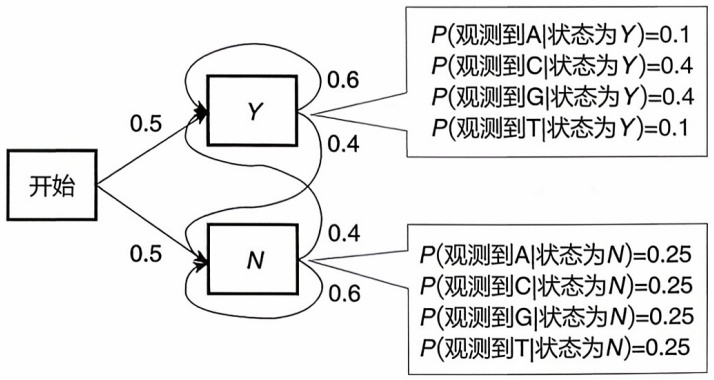

<details>
<summary>flowchart</summary>

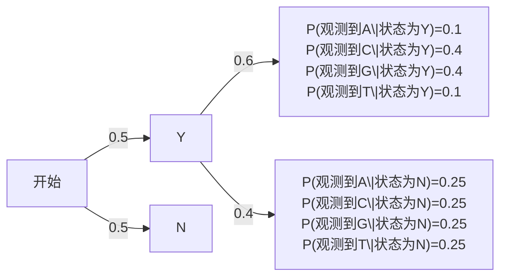
</details>

观测到的碱基序列: AATCAAGCCGGCGCTTAA
最可能的状态路径: NNNNNNYYYYYYYYNNNN

图5-1 结合序列特征构建隐马尔可夫模型以检测富GC区域HMM包含2个状态:Y（富GC区域）、N（其他区域）。每一个状态都有自己的生成概率，同时，每个状态也包含自己的转移概率，即表示从当前状态转移至下一状态的概率

---

150

5 序列比对与分析

$\mathrm{HMM}, \theta) = -41.22$ 。因此，通过使用维特比（Viterbi）算法即可得到最可能的状态序列，并进而预测这段序列中富GC区域的位置。

与之类似，美国麻省理工学院的克里斯·伯奇（Chris Burge）和塞缪尔·卡林（Samuel Karlin）于1997年开发的GenScan，是基于广义隐马尔可夫模型的人类及脊椎动物基因预测软件。GenScan通过识别序列中的统计特征，如密码子使用频率、外显子和内含子边界信号的共识序列等，对基因进行预测。它还考虑了基因的起始和终止区域，以及潜在的启动子信号，以提供全面的基因结构预测。

近年来，随着数据的积累与算力的提升，支持向量机（SVM）、随机森林或神经网络等机器学习方法也被广泛应用于基因预测。与早期的显式建模不同，这些方法通过直接学习原始的基因组注释、转录组测序数据等训练数据，“自动”识别出序列中的特定模式，并用这些模式来预测新序列中的基因。

值得注意的是，虽然类似的模型与算法可以以“从头预测”的方式在不同物种的序列上工作，但考虑上述序列特征在物种间的变化，这些预测算法往往需要事先设定物种相关的参数。

## 5.2 序列比对和分析

量化衡量序列之间的相似性和差异性是解析序列间关系的核心前提。为此，需要首先厘清几个概念:同源（homologous）是一个演化概念。序列之间“同源”即指它们拥有一个或多个共同的起源（祖先）。在实践中，通常通过序列相似性（similarity）来衡量序列之间的同源关系。值得指出的是，根据“序列-结构-功能”这一关联链条，具有相似序列的分子往往也具有相似的功能，因此与已知功能序列的高相似性也常常被用来推断未知序列的功能。

## 5.2.1 基于动态规划的双序列比对

| GAATC | GAAT-C | -GAAT-C |
| --- | --- | --- |
| CATAC | C-ATAC | C-A-TAC |
| GAATC- | GAAT-C | GA-ATC |
| CA-TAC | CA-TAC | CATA-C |

图5-2 序列联配演示

其中，上下对齐的不同残基对应于替代，而用“-”表示的空位（gap）则对应插入/删除事件。可以看出，在双序列联配中，一条序列中发生的插入即对应于另一条序列中发生的删除，因此，在实践中往往将插入/删除事件合并成为插入/缺失（InDel）事件

一般来说，序列之间的差异可以由两类生物学事件导致，即替代和插入/删除。替代是指序列中残基的改变。替代不会改变序列的长度。

与替代不同，由于 DNA 复制错误及其修复过程等因素导致的插入/删除事件会导致序列长度的变化。

直观上，可以将两条序列之间的联配（alignment，也称比对）定义为序列中残基的对应关系。如对于两条 DNA 序列 GAATC 和 CATAC，图 5-2 均为它们之间可能的联配。

为了准确揭示序列间的相似性，通常希望寻找序列间的最优联配，使得序列之间的相同/相似部分能

---

5.2 序列比对和分析

151

够尽可能地对应，并同时尽可能减少增删事件。例如，针对序列GACGGATTAG和GATCGGAATAG，如果第一种联配是:

$$
\begin{array}{l} \text {GACGGATTAG - } \\ \text {GATCGGAATAG} \\ \end{array}
$$

第二种联配是:

$$
\mathrm{GA-CGGATTAG}
$$

$$
\text {GATCGGAATAG}
$$

可以看到第二种联配较第一种联配更好地揭示了两条序列的相似性。

为了使用有效找到序列间的最优联配，首先需要引入记分系统以量化衡量序列间的差异。通常使用替换矩阵（substitution matrix）来衡量替换前后残基的相似性，其中不同的残基替换被赋予不同的分数，反映它们之间的相似度。对于比较简单的核酸序列，可用简单的匹配/不匹配矩阵（match/mismatch matrix）来描述（如在BLAST中对匹配/不匹配分别赋予+1分和-3分）。但对于蛋白质序列，因为组成蛋白质的20种氨基酸具有不同的理化性质，情况较为复杂，存在不同的蛋白质替换矩阵。

① 遗传密码矩阵 通过计算一个氨基酸转变为另一个氨基酸所需密码子核苷酸变化的数目得到，矩阵元素的值对应于变化代价。常用于演化距离的计算，优点在于计算结果可以直接用于绘制进化树，但在蛋白质序列比对（尤其是相似性很低的蛋白质序列）中很少被使用。
② PAM 矩阵（point accepted mutation） 基于氨基酸演化的点突变模型，即如果两种氨基酸替换频繁，说明自然界易接受这种替换，那么这对氨基酸替换得分就应该高。
③ BLOSUM 矩阵（blocks substitution matrix）是由 Henikoff 提出的另一种氨基酸替换记分矩阵，也是通过统计相似蛋白质序列的替换率得到的。PAM 矩阵是基于蛋白质序列的全局比对结果推导出来的，而 BLOSUM 是从保守无空位（gap）的蛋白质序列块（短序列）推导出来的。

另一方面，考虑插入/缺失事件通常会改变序列的功能，在序列比对中对于插入/缺失事件对应的空位赋予负分，即空位罚分（gap penalty）。

在确定了替换矩阵与空位罚分规则后，即可定义特定联配的分数。如针对打分规则 $w(\text{匹配}) = +1$；$w(\text{错配}) = -3$；$w(\text{空位}) = -2$，可知前述第一种联配对应的分数为 $1 + 1 + (-3) + (-3) + 1 + (-3) + (-3) + (-3) + (-3) + (-3) + (-3) + (-2) = -20$，而第二种联配对应的分数为 $1 + 1 + (-2) + 1 + 1 + 1 + 1 + (-3) + 1 + 1 + 1 = 4$，大于第一种联配对应的分数。由此，可以进一步将两条序列之间的最优联配定义为分数最高的联配。

可以使用动态规划算法来寻找两条序列间的最优联配。根据目标最优联配特点的不同，又可以主要分成基于全局比对的 Needleman-Wunsch 算法和基于局部比对的 Smith-Waterman 算法。

---

152

5 序列比对与分析

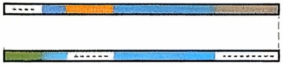

<details>
<summary>text_image</summary>

Diagram showing two horizontal bars with colored segments and a dashed line, likely representing a segmented or labeled structure.
</details>

图5-3 全局比对

## 5.2.1.1 全局比对

全局比对是指将两条序列里面的所有字符进行比对，主要被用来寻找关系密切的序列。其代表是Needleman-Wunsch算法（图5-3）。

算法思想:

① a, b 是序列（DNA 或蛋白质），m 为 a 的长度，n 为 b 的长度。前缀  $a[1 \cdots i]$  与  $b[1 \cdots j]$  分别为 a 的前  $1 \sim i$  个残基，以及 b 的前  $1 \sim j$  个残基构成的子序列， $i = 1, 2, \cdots, m; j = 1, 2, \cdots, n;$

② $S(i,j)$ 是按照某打分矩阵得到的前缀 $a[1\cdots i]$ 与 $b[1\cdots j]$ 最大相似性得分；

$$
S (i, j) = \max \text {of} \left\{ \begin{array}{l l} S (i - 1, j) + w (a _ {i}, -) & (a _ {i} \text {与序列} b \text {的空位对应}) \\ S (i, j - 1) + w (-, b _ {j}) & (b _ {j} \text {与序列} a \text {的空位对应}) \\ S (i - 1, j - 1) + w (a _ {i}, b _ {j}) & (\text {匹配或错配}) \end{array} \right.
$$

$w(c,d)$ 是残基（或空位）c 和 d 按照打分矩阵计算的得分；

③ 边界条件为  $S(0,0)=0$ 。

示例:对于序列 $a = \mathrm{ACACACTA}$，$b = \mathrm{AGCACACA}$，记分规则 $w$ (匹配) = +2；$w$ (错配) = $w$ (空位) = -1，获得的动态规划记分表格如图5-4a所示，由记分表格右下角出发，反向搜索至起点，同时记下路径（图5-4b）。

最后构建最佳联配。在路径中，对角线对应匹配或错配，上下箭头对应删除，左右箭头对应插入，依次得到本例的最佳匹配为:

$$
\text {序列} \mathrm{a} = \mathrm{A} - \mathrm{C} \mathrm{A} \mathrm{C} \mathrm{A} \mathrm{C} \mathrm{T} \mathrm{A}
$$

$$
\text {序列} \mathrm{b} = \mathrm{A} \mathrm{G} \mathrm{C} \mathrm{A} \mathrm{C} \mathrm{A} \mathrm{C} - \mathrm{A}
$$

## 5.2.1.2 局部比对

局部比对不追求对两个完整的序列进行比对，而是在每个序列中使用某些局部区域片段（蓝色区域）进行比对，其代表是Smith-Waterman局部比对算法（图5-5）。

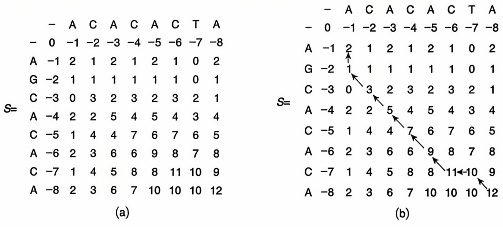

图5-4 全局比对动态规划记分表格

---

5.2 序列比对和分析

153

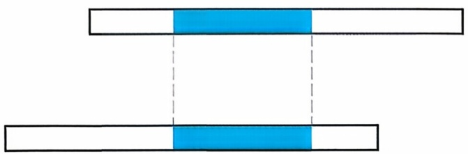

<details>
<summary>natural_image</summary>

Two horizontal bars with a blue highlighted segment between them, no text or symbols present.
</details>

图5-5 局部比对

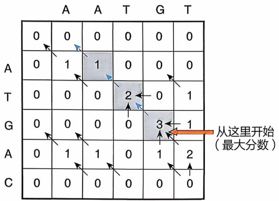

<details>
<summary>text_image</summary>

A A T G T
0 0 0 0 0 0
A 0 1 1 0 0 0
T 0 0 0 2 0 1
G 0 0 0 0 3 1
A 0 1 1 0 1 2
C 0 0 0 0 0 0
从这里开始
(最大分数)
</details>

图5-6 局部比对动态规划记分表格

算法思想:

与全局比对相比，这种算法的改变是在每一步计算时，确保值不会小于一个常数（0），从而让相似性的计算可以丢弃前缀序列联配中差异巨大的部分，而以当前局部序列的联配差异为主。对应的相似性得分 $S(i,j)$ 为:

$$
S (i, j) = \max \text {of} \left\{ \begin{array}{l l} S (i - 1, j) + w (a _ {i}, -) & (a _ {i} \text {与序列} b \text {的空位对应}) \\ S (i, j - 1) + w (-, b _ {j}) & (b _ {j} \text {与序列} a \text {的空位对应}) \\ S (i - 1, j - 1) + w (a _ {i}, b _ {j}) & (\text {匹配或错配}) \\ 0 & \end{array} \right.
$$

示例: 对于序列 a=AATGT, b=ATGAC, 记分规则  $w(\text{匹配}) = +1$ ;  $w(\text{空位}) = -2$ ,  $w(\text{错配}) = -1$ ，获得的动态规划记分表格如图 5-6 所示。从记分表格的最大分值单元（橙色箭头所指处）开始回溯，直至分值为 0，此路径即最佳局部匹配。

得到的最佳匹配为: AATGT

ATGAC

## 5.2.2 序列比对的应用与拓展

## 5.2.2.1 序列数据库检索

基于序列比对，可以进一步开发序列数据库检索算法，通过把待查询序列与数据库中存储的大量生物序列数据进行系统比对，以寻找与查询序列相似的已知序列，从而为后续功能预测、演化分析等研究提供基础。

基本局部比对搜索工具（Basic Local Alignment Search Tool, BLAST），是一种广泛使用的数据库检索算法。它一方面通过在 Smith-Waterman 算法前引入一系列对数据库序列预筛选的步骤，大幅提升了针对大规模数据库检索的搜索效率；另一方面通过对搜索结果构造统计检验，进一步降低了搜索的假阳性率。接下来将对这些改进进行详细介绍。

在预筛选数据库序列方面,为了快速访问,BLAST算法首先会将序列连续分割成若干等长的“词”(word),如对蛋白质序列:MVLSEMVLQLVLSEWAKVEAMVLSEGQ,

---

154

5 序列比对与分析

可以分割为若干长度为 3 的 “词” MVL、VLS、LSE、SEG……EGQ。对于 DNA 或 RNA 序列，通常会设置较长的片段以确保每个片段含有足够的信息量。需要注意的是，前后相邻的 “词” 在序列上会有重叠（如 MVL 和 VLS），以确保这些 “词” 构成的整体仍能够充分表征原始序列。

对于待检索的序列数据库中每个序列完成分“词”后，BLAST会进一步创建索引，从而方便后续步骤的快速定位。例如，基于哈希表构造索引:

```python
"MVL": [index1, index6, index21, ...]
"VLS": [index2, index11, index22, ...]
"LSE": [index3, index12, index23, ...]
... ...
```

可以在近常数时间内实现对数据库内任意“词”的快速定位。

在此基础上，BLAST 进一步引入播种-延伸（seeding-extending）策略以便加速比对。具体来说，BLAST 首先会基于查询序列的分“词”结果选取“种子词”（seed words），这些“种子词”应该具有较高的信息熵并在查询序列中高频出现，从而方便后续更精确地定位与查询序列相似的数据库序列。随后，BLAST 将利用前面建立的数据库“词”索引快速定位相关“种子词”在数据库序列中的位置（“播种”），并从“种子”的位置开始向左右两个方向进行延伸。在延伸的过程中，BLAST 会基于前述的替换矩阵来尝试找到尽可能长的相似序列区域，从而在数据库中快速定位可能的相似序列，作为后续 Smith-Waterman 算法比对的基础。可以看到，BLAST 算法通过播种-延伸策略首先进行快速预筛选，大大减少了 Smith-Waterman 算法的实际运行次数，从而使得 BLAST 算法可以更为高效地检索大规模序列数据库。

在检验搜索结果方面，因为数据库通常非常庞大，随机噪声可能会产生看似显著但实际上没有生物学意义的比对。因此，BLAST引入了期望值（E-value）来衡量特定比对的统计显著性。具体来说，期望值可以认为是:在给定的数据库大小和搜索参数下，若随机选取的一对序列的比对得分大于或等于当前实际比对得分，则这种随机选取的序列对的期望个数即期望值。因此，期望值越小，表示当前比对越不可能是随机产生的。实践中，往往会选择一个较小的期望值（通常低于0.01或0.001）以尽可能移除那些随机噪声导致的假阳性匹配。

期望值的计算公式通常表示为:

$$
E = k m n e ^ {- \lambda S}
$$

其中，$m$ 和 $n$ 分别是查询序列和数据库中序列的长度，$S$ 是比对得分，$k$ 和 $\lambda$（均大于0）是基于替换矩阵与空位罚分规则综合计算出的归一化系数。由上式可以看出，一方面，对于高得分比对，$e^{-\lambda S}$ 可以使得期望值显著降低，从而更容易凸显出高度相似的序列。另一方面，数据库规模（由 $n$ 体现）直接影响比对显著性。特别对于相同的比对，数据库越大，期望值越高，也就越容易出现假阴性。

---

5.2 序列比对和分析

155

BLAST算法种类繁多，每种算法都是为特定形式的序列比较而设计的。以下是4种最常见的BLAST。

① BLASTn 用于将核苷酸序列与核苷酸数据库进行比较。它主要用于识别DNA序列中的相似性和定位同源区域。
② BLASTp 用于将蛋白质序列与蛋白质序列数据库进行比较。它有助于识别相似的蛋白质序列，从而揭示蛋白质的功能、结构和演化。
③ BLASTx 用于将核苷酸查询序列与蛋白质数据库进行比较。它在所有 6 个阅读框中翻译查询的 DNA 序列，并将得到的氨基酸序列与蛋白质数据库进行比较。
④ tBLASTn 将蛋白质查询序列与核苷酸数据库进行比较。它将核苷酸数据库序列翻译成 6 个读码框中的每一个，然后将得到的氨基酸序列与蛋白质查询序列进行比较。

除了标准 BLAST 算法（BLASTn、BLASTp、BLASTx、tBLASTn）外，还有一些针对序列分析中的特定需求而开发的特殊 BLAST。

① 位置特异性迭代 BLAST（Position-Specific Iterated BLAST，PSI-BLAST）PSI-BLAST 是 BLASTp 的迭代版本，旨在改进远缘蛋白质序列的检测。它根据之前迭代中发现的比对结果，建立位置特异性打分矩阵（position specific scoring matrix, PSSM），从而识别出差异更大的同源物。
② PHI-BLAST（Pattern-Hit Initiated BLAST）PHI-BLAST 用于识别和比对包含特定模式的序列。它整体思路与 BLAST 类似，但只考虑包含用户所指定的特定模式的数据库序列。

BLAST 首次实现了对大规模序列数据库的快速检索，从而使得研究人员能够快速识别和分析生物序列，在基因识别与注释、蛋白质功能预测、同源基因鉴定等领域均有广泛应用。目前，BLAST 已成为生物信息学领域中最重要的工具之一。

## 5.2.2.2 基于序列比较的序列聚类

通常认为，序列上相似的蛋白质或者基因往往具有相似的功能，而且相似的程度往往和功能相似的程度正相关；类似地，序列相似程度在不考虑趋同演化等特殊事件的前提下也可以作为序列间演化关系远近的表征。因此，通过将蛋白质或者DNA序列按照互相之间的相似程度分成多个簇（cluster）进行序列聚类（sequence clustering），可以实现对蛋白质或DNA分子的功能与演化分类。其中具有代表性的算法包括CD-HIT、UCLUST和Linclust。CD-HIT和UCLUST使用了类似的贪心增量策略（greedy incremental strategy）来实现序列的聚类。其基本步骤包括以下3步（图5-7）。

① 根据长度或 “词” 数将序列从大到小进行排序，将排第一的序列放入第一个簇，并视其为该簇的代表性序列（representative sequence）或者种子（seed）；
② 将第二条序列与第一个簇的代表性序列进行双序列比对，当序列相似性超过事先确定的阈值时，则认为该序列和上述代表性序列属于同一个簇，否则认为该序列是一个新簇的代表性序列或者种子；

---

156

5 序列比对与分析

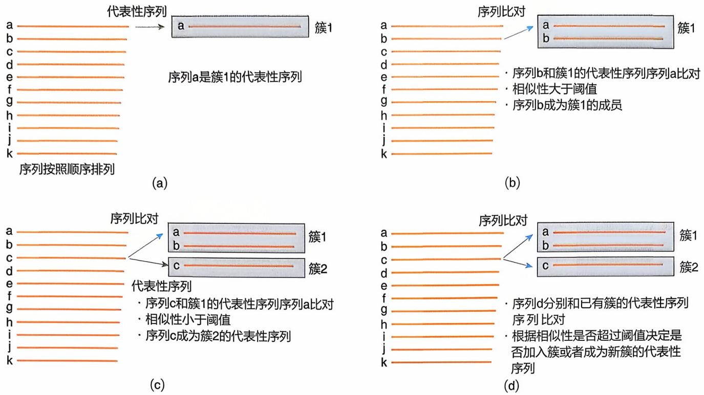

图5-7 使用贪心增量策略进行序列聚类的原理

③ 对剩余序列依次进行上述比对，当序列同某一个簇的代表性序列之间的序列相似性超过阈值时，将该序列归入这个簇，并更新该簇的代表性序列（具体更新方法取决于具体算法实现），否则认为这个序列是一个新簇的代表性序列，将其放入新簇。

使用贪心增量策略进行序列聚类的算法限于其基本原理，所需要进行的序列比对个数大致同其序列的个数和簇的个数成正比[时间复杂度 $O(KN)$，$K$ 是簇的个数，$N$ 是序列的个数]。由于序列的个数和簇的个数往往在一个数量级上，因此计算的时间大致同进行分析的序列个数的平方成正比，这限制了序列聚类算法在大规模数据上的应用。为了解决这一问题，2018年马丁·斯特内格（Martin Steinegger）和约翰内斯·泽丁（Johannes Söding）开发了Linclust算法，试图在获得相似聚类效果的同时大幅降低计算所用时间[时间复杂度 $O(N)$，$N$ 是序列的个数]，其基本步骤包括以下6步（图5-8）。

① 在每个序列中选择一定数量具有最低哈希值的 $k$-mer（指从一个序列中连续取出的长度为 $k$ 的子序列，如对于 DNA 序列“AGCTAGCT”，当 $k$ 为 3 时，其 $k$-mer 包括“AGC”“GCT”“CTA”“TAG”等）；
② 将拥有一个相同 $k$-mer 的序列合并为一组（此处同一条序列可以出现在多个组中）；
③ 将每一组中最长的一个序列设定为中心序列（center sequence）;
④ 将拥有同一个中心序列的不同的组进行合并；
⑤ 将组内的非中心序列同中心序列进行双序列比对；
⑥ 使用贪心增量策略完成序列聚类。

在实践中，通常采取某些经验性阈值作为功能或者演化的分类标准，如当两个

---

5.2 序列比对和分析

157

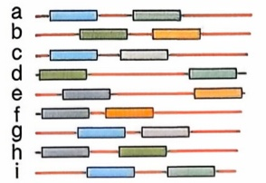

<details>
<summary>text_image</summary>

a
b
c
d
e
f
g
h
i
</details>

9条序列, 分别选取2个k-mer

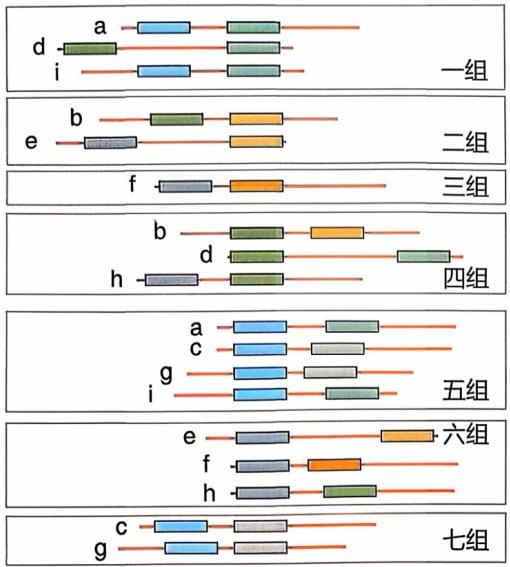

· 将拥有相同 $k$-mer的序列合并为组
· 最长的序列(每组第一条序列)为中心序列

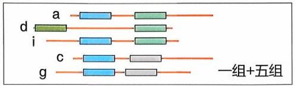

<details>
<summary>text_image</summary>

d a
i
c
g
一组+五组
</details>

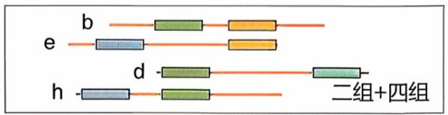

<details>
<summary>text_image</summary>

b
e
d
h
二组+四组
</details>

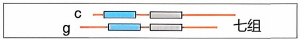

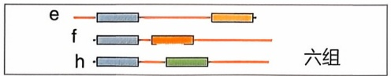

<details>
<summary>text_image</summary>

e
f
h
六组
</details>

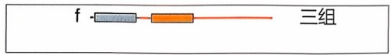

· 将具有相同的中心序列的组合并
- 将同组内的序列比对到中心序列

(a)

(b)

(c)

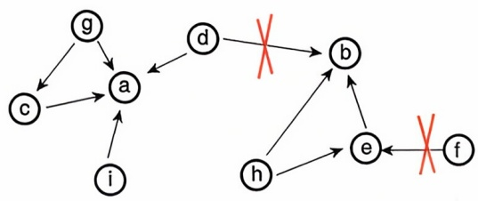

<details>
<summary>flowchart</summary>

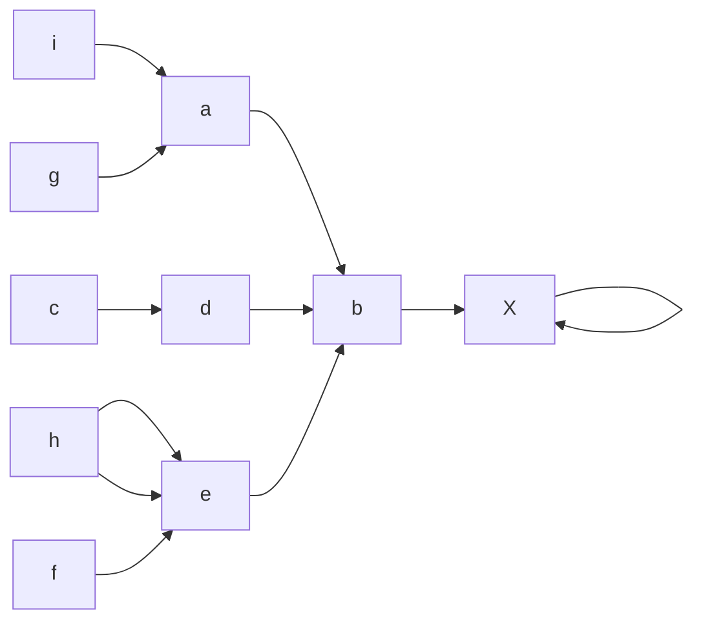
</details>

· 建立基于比对关系的图
- 删除低于阈值的比对关系
· 进一步使用比对验证已有比对关系的正确性

(d)

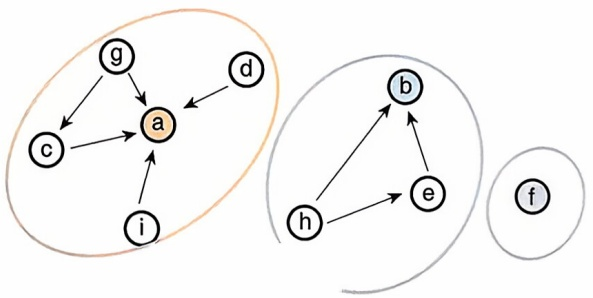

<details>
<summary>flowchart</summary>

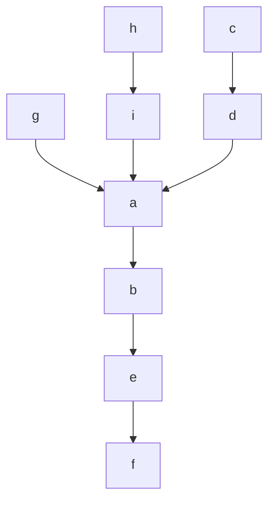
</details>

使用贪婪增量算法构建序列簇

(e)

蛋白质序列相似性大于 $60\%$ 时，假定这两个蛋白质具有相似的功能；当两个细菌的16S rDNA序列相似性大于 $97\%$ 时，假定这两个细菌属于同一个种。

需要指出的是，基于序列比较的聚类并不能确保可以对输入序列进行无歧义的划分:考虑 A、B、C 三个序列，A 与 B 之间的序列相似性为 98%，B 与 C 之间的序列相似性为 98%，A 与 C 之间的序列相似性为 96%，那么当采用 97% 作为序列聚类的阈值时，因为 A 与 B 之间的相似性大于 97%，A 与 B 显然属于同一个簇，同时 B 与 C 之间的相似性大于 97%，B 与 C 也属于同一个簇，这样 A、B、C 应当属于同一个簇，但是 A 和 C 之间的相似性小于 97%，它们又不属于同一个簇，这就产生了悖论。因此，对程序得到的聚类结果需要进行具体分析。

尽管存在上述的缺陷，聚类分析在序列分析中仍有着广泛的用途。通过序列聚类，可以显著降低研究的工作量，如可使用一个簇的代表性序列的性质推断其他簇

图5-8 Linclust算法

---

158

5 序列比对与分析

成员的性质；也可以将大规模的数据变得更加有条理，易于理解，并和功能、演化关系等生物学上的重要性联系起来。

序列聚类在相当多的数据库和算法中得到了应用。如国际上最为著名的蛋白质数据库，通用蛋白质信息库（Universal Protein Knowledge Base, UniProtKB）开发了UniProt参考簇（UniProt Reference Clusters, UniRef）功能，用于将数据库中所有的蛋白质序列进行聚类，使得人们可以更容易地进行功能和演化分析。该数据库中将其中所有储存的664596873个蛋白质序列（获取时间2024年12月10日，下同）按照序列相似性 $100\%$ 聚类为UniRef100数据库，其中含有435574000个不同的蛋白质/簇，使用MMSeqs2软件中的Linclust算法进一步聚类为Uniref90数据库（序列相似性至少 $90\%$ ，199553294个簇）和Uniref50数据库（序列相似性至少$50\%$ ，68360540个簇）。这一聚类使得在对所有蛋白质的检索过程中，所需要检索的对象减少了 $58\%$ （Uniref90）到 $79\%$ （Uniref50），从而大幅降低了计算时间，在实际生物信息学研究和应用过程中有着重要的意义。

## 5.2.2.3 多重序列比对

多序列比对（也称多序列联配，multiple sequence alignment, MSA）是双序列比对的一般化推广。当两条序列不能很好地比对并揭示序列变化蕴含的信息时，多序列比对能有效地将其关联起来。直观上，可以将 Needleman-Wunsch 算法和 Smith-Waterman 双序列比对算法简单扩充至多序列情形。然而，这些基于动态规划的算法当比对的序列增加到 3 条或更多时，计算复杂性呈指数级增长:假设比对 $p$ 条序列，每条序列长度为 $n$，则全局多序列比对的复杂度为 $O(n^p)$，计算量巨大。因此，通常需要针对多序列比对开发针对性算法。

目前的多序列比对算法很多，大致可分为渐进对齐算法、迭代算法、启发式算法、机器学习和分治法。渐进对齐算法的基本思想是先进行双序列比对，然后根据聚类将序列逐步合并，代表性的算法有 ClustalW。具体来说，首先采用 Needleman-Wunsch 算法或 Smith-Waterman 算法将每对序列两两比对，使用比对得分来计算序列之间的距离矩阵。在此基础上，从全体序列集合中抽出最相似（即最接近）的一对序列，将其划为一组，放回该序列集合，并构造这组里序列的比对，以评估这一组和全体序列集合中剩余其他序列各自的相似性，从而完成一轮迭代，再从新的序列/序列组集合中抽出最相近的一对序列/序列组，进入下一轮迭代。通过逐步迭代此过程，生成最终的多序列比对。在此过程中，由于最大的计算量仅存在于最早进行 $n$ 条序列里每对序列两两比对的步骤中，故渐进对齐算法能显著降低计算复杂度到 $O(n^{2})$ 量级，从而可以高效处理多条序列。然而，由于渐进式比对依赖于初始的距离矩阵，如果矩阵计算有偏差，则可能影响整个比对过程，无法像基于动态规划算法一样保证全局最优。

迭代算法的基本思想是先进行一次渐进对齐，然后根据某种准则对比对结果进行评价和调整，重复这个过程直到达到收敛或者满足某种条件，代表性的算法有MUSCLE。启发式算法的基本思想是利用一些启发式的规则或者策略来加速比对的

---

5.3 分子进化树构建

159

过程，牺牲一定的准确性来换取效率，代表性的算法有MAFFT。机器学习利用机器学习的方法来学习序列之间的相似性或者差异性，然后根据学习到的模型来生成或者优化比对结果。分治法是将一个复杂的多序列比对问题分解为若干个简单的子问题，然后分别求解子问题，再将子问题的解合并为原问题的解，代表性的算法有T-Coffee。

## 5.3 分子进化树构建

系统发育树（phylogenetic tree，或称进化树）是用以表示分支进化史的树状图表，在现代生物学中发挥着重要作用，其二叉分支的拓扑结构能简洁有效地定位类群的共同祖先和进化事件。

系统发育树是一种类似树的有向无环的特殊图结构，通常包括节点（node）和分支（branch）等。每一节点表示一个分类学单元（属、种群、个体等），内部结点是树中支系的分叉点，可以对应于一个假设的共同祖先。位于树末端的节点可称为外部节点或叶节点（leaf），代表着现存的物种或者被研究的特定样本。树最基部的根节点（root）代表所有分支的共同祖先，依据有无根节点可将进化树分为有根树和无根树，我们在构建进化树时可通过指定外类群确定进化树的根。基于进化树的构建方法，我们还可以得到一些额外的信息，如支持度，用于衡量系统发育树中每个分支的可信度，可来自自展值（bootstrap value）或后验概率（posterior probability）等；分支长度，基于物种间遗传差异的程度评估进化距离，或者直接用已知的进化时间标定。

正如 Phylogenetics in the Genome Era 所述:系统发育树提供了一种自然的方式来理解从个体到物种的生命连续性。地球上的每一个生物都有一个或两个直系祖先，而这些祖先同样也有祖先。当我们在系统发育树上行走时，通过追溯时间，从一个祖先到另一个祖先，追溯生物的进化史。共同祖先提供了一种自然的方式来理解不同种群和不同物种个体之间的联系，而树状图是一种自然的方式来可视化和总结共同祖先。树结构在不同的尺度上都很好用，从基因树到物种树，从物种间的联系到类群间的联系，直到“生命之树”。

从表型的角度而言，生命之树的特定分支出现的某种特征可能会成为从该分支衍生的所有生物的特征，即共同祖先的特征可能会出现在后代中。基于性状构建一棵描述生物间亲缘关系的进化树是看上去很自然的做法。例如，哺乳动物的乳腺在不同物种中相似，因为它们来自共同的祖先；但鸟类、蝙蝠和昆虫的翅膀是独立进化的，并且相似，因为它们代表了对类似生物功能的适应。这表明，以性状构建进化树可能并不能反映真实进化历史，以分子数据建树往往更加可靠。

根据共同祖先来定义亲缘关系使我们能够创建具有进化意义的分类系统。在这样的系统中，生物被分配到与进化史一致的命名组，称为分类单元。分类单元中的

---

160

5 序列比对与分析

所有生物彼此之间的亲缘关系比分类单元外的任何生物之间的亲缘关系更密切。依靠这样的反映进化史的分类系统很重要，能更好地根据物种所属的类群跟踪其特征的变化和基因的历史。这也是为什么我们根据分子生物学的最新证据不断更新物种的分类。

构建系统发育树的意义如上所述。问题在于如何去构建这样一棵树？如何计算不同序列间的距离？两条序列间的碱基/氨基酸数量差异可以有效地表征序列间关系的远近，然而，考虑在进化过程中可能出现 $\mathrm{A} \rightarrow \mathrm{C} \rightarrow \mathrm{A}$ 这样的回复突变，碱基数量差异与进化距离的关系并不是简单的线性关系。我们需要构建统计模型，将进化的随机性纳入考量。构建这样的进化模型使我们能够用数学方法描述各种生物现象，估计相关参数，如选择强度和进化事件发生率。

在构建模型时，我们应有效结合生物过程的先验知识，而不应过度参数化模型，否则将导致模型泛化能力不足。在分子系统发育学中，马尔可夫模型（Markov model）是一类特定的随机模型，被广泛用于分析序列数据和量化基因和基因组的进化动态。马尔可夫模型认为，未来的状态仅依赖于当前的状态，而不受过去状态的影响，即在给定当前状态的情况下，未来状态的条件概率分布独立于之前的所有状态。这很符合我们在生物学上的认识，即一个碱基A当前突变为C还是T的概率，不受这个碱基A在100年前是A还是C的影响。

连续时间马尔可夫链（continuous-time Markov chain，CTMC）是系统发育分析中最常用的马尔可夫模型类型。它允许状态转换发生在任意时刻，并且能够捕捉到不同进化分支上的速率变化。CTMC 模型以转移概率矩阵 Q 定义从一个状态到另一个状态（或者说从一个碱基/氨基酸到另一个碱基/氨基酸）的瞬时转换速率，我们可以从 Q 矩阵推导给定时间间隔内的转移概率矩阵 P（t），进而计算进化距离与碱基/氨基酸差异比例的关系。根据矩阵 Q 参数的不同，对于核苷酸序列，我们可以有 Jukes-Cantor（JC）模型、Kimura 双参数（K2P）模型、Hasegawa-Kishino-Yano（HKY85）模型等，它们本质上是对不同碱基间替换的概率做出了不同的参数假设。下面，我们将以实例演示构建进化树的具体算法。

通过系统比较不同物种或不同个体间的序列差异，可以构建进化树以解析其间的演化联系，并进而表征特定 DNA/蛋白质分子从共同祖先逐渐演化分化的过程。进化树是一种针对特定演化关系的图形表示，类似于家谱图，进化树提供了生物多样性和演化历史的重要信息，可用于解释生物特征的起源和演化。特别是，考虑在演化过程中较为“接近”的序列之间一般较远缘序列更为相似，可以利用分子序列之间的距离来推断演化关系。

一种常见的基于距离的方法是非加权组平均法（unweighted pair group method with arithmetic mean, UPGMA）。UPGMA 的基本想法是将建树过程类比为一个层次聚类问题，依照距离自底向上逐步合并（聚类），直到全部完成。

例如，针对 5 条序列 A、B、C、D、E，已知它们彼此的距离如下:

---

5.3 分子进化树构建

161

|  | A | B | C | D | E |
| --- | --- | --- | --- | --- | --- |
| B | 2 |  |  |  |  |
| C | 4 | 4 |  |  |  |
| D | 6 | 6 | 6 |  |  |
| E | 6 | 6 | 6 | 4 |  |
| F | 8 | 8 | 8 | 8 | 8 |

则首先可以选出其中距离最小的一对（A，B），将之合并。

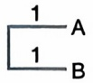

而后重新计算距离矩阵:

$$
\text {dist} (A, B), C = (\text {dist} A, C + \text {dist} B, C) / 2 = (4 + 4) / 2 = 4
$$

$$
\text {dist} (A, B), D = (\text {dist} A, D + \text {dist} B, D) / 2 = (6 + 6) / 2 = 6
$$

$$
\text {dist} (\mathrm{A}, \mathrm{B}), \mathrm{E} = (\text {dist A,E} + \text {dist B,E}) / 2 = (6 + 6) / 2 = 6
$$

$$
\text {dist} (\mathrm{A}, \mathrm{B}), \mathrm{F} = (\text {dist A}, \mathrm{F} + \text {dist B}, \mathrm{F}) / 2 = (8 + 8) / 2 = 8
$$

注意在这个过程中，AB 聚类后重新计算距离时均采取了简单的算术平均，这暗示着在对应的演化过程中不同分支的演化速率相同（分子钟模型）。

|  | AB | C | D | E |
| --- | --- | --- | --- | --- |
| C | 4 |  |  |  |
| D | 6 | 6 |  |  |
| E | 6 | 6 | 4 |  |
| F | 8 | 8 | 8 | 8 |

由此逐步迭代，直到最终完成整个建树过程:

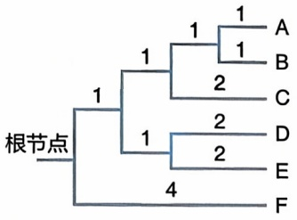

<details>
<summary>flowchart</summary>


</details>

UPGMA 在计算上直观明了，但其恒定演化速率的假设在现实分析中往往过于理想化，因此，斋藤成也（Naruya Saitou）与根井正利（Masatoshi Nei）在 1987 年提出了邻接法（neighbor joining，NJ）。邻接法去除了恒定演化速率的假设，因此在处理不同谱系的变速演化时更为灵活。同时，邻接法引入了“邻居”（neighbor）的概念，通过迭代地连接（joining）最近的“邻居”来构建最终的进化树。与 UPGMA 在合并时仅考虑给定序列之间的关系不同，邻接法中选择最近“邻居”同时考虑了

---

162

5 序列比对与分析

给定序列与其他输入序列的关系，因此能更好地刻画多个输入序列的全局关联并确保最终得到的进化树各个分支的总长度最小。

例如，针对序列A、B、C、D、E、F、G，已知它们彼此的距离 $d$ 如下:

|  | A | B | C | D | E | F |
| --- | --- | --- | --- | --- | --- | --- |
| B | 63 |  |  |  |  |  |
| C | 94 | 79 |  |  |  |  |
| D | 111 | 96 | 47 |  |  |  |
| E | 67 | 16 | 83 | 100 |  |  |
| F | 23 | 58 | 89 | 106 | 62 |  |
| G | 107 | 92 | 43 | 20 | 96 | 102 |

以此为基础，可以计算每个序列到其他序列的平均距离 r:

$$
r _ {i} = \frac {1}{N - 1} \sum_ {k \neq i} d _ {i k}
$$

| $r_{A}$ | $r_{B}$ | $r_{C}$ | $r_{D}$ | $r_{E}$ | $r_{F}$ | $r_{G}$ |
| --- | --- | --- | --- | --- | --- | --- |
| 93 | 80.8 | 87 | 96 | 84.8 | 88 | 92 |

接下来，通过综合考虑序列之间的直接距离  $d_{ij}$  与  $r_{i}$ 、 $r_{j}$ ，可以计算邻接距离  $D_{ij}$ :

$$
D _ {i j} = d _ {i j} - r _ {i} - r _ {j}
$$

|  | A | B | C | D | E | F |
| --- | --- | --- | --- | --- | --- | --- |
| B | -110.8 |  |  |  |  |  |
| C | -86 | -88.8 |  |  |  |  |
| D | -78 | -80.8 | -136 |  |  |  |
| E | -110.8 | -149.6 | -88.8 | -80.8 |  |  |
| F | -158 | -110.8 | -86 | -78 | -110.8 |  |
| G | -78 | -80.8 | -136 | -168 | -80.8 | -78 |

从中可以看到 D、G 之间的邻接距离最小（-168），为最近的“邻居”，可以首先合并:

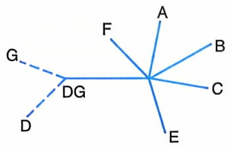

<details>
<summary>text_image</summary>

G
DG
D
F
A
B
C
E
</details>

值得注意的是，这里需要重新计算 D、G 到合并后节点 DG 的距离:

---

5.3 分子进化树构建

163

$$
d _ {i, (i j)} = \frac {1}{2} d _ {i j} + \frac {1}{2} \left(r _ {i} - r _ {j}\right)
$$

$$
d _ {j, (i j)} = \frac {1}{2} d _ {i j} + \frac {1}{2} \left(r _ {j} - r _ {i}\right)
$$

即:

$$
d _ {\mathrm{D,DG}} = \frac {1}{2} d _ {\mathrm{D,G}} + \frac {1}{2} (r _ {\mathrm{D}} - r _ {\mathrm{G}}) = \frac {1}{2} \times 2 0 + \frac {1}{2} (9 6 - 9 2) = 1 2
$$

$$
d _ {\mathrm{G,DG}} = \frac {1}{2} d _ {\mathrm{D,G}} + \frac {1}{2} (r _ {\mathrm{G}} - r _ {\mathrm{D}}) = \frac {1}{2} \times 2 0 + \frac {1}{2} (9 2 - 9 6) = 8
$$

由此，可以重新计算 $d$ 矩阵:

|  | A | B | C | DG | F |
| --- | --- | --- | --- | --- | --- |
| B | 63 |  |  |  |  |
| C | 94 | 79 |  |  |  |
| E | 67 | 16 | 83 |  |  |
| F | 23 | 58 | 89 | 62 |  |
| DG | 99 | 84 | 35 | 88 | 94 |

平均距离 $r$ :

| $r_{A}$ | $r_{B}$ | $r_{C}$ | $r_{E}$ | $r_{F}$ | $r_{DG}$ |
| --- | --- | --- | --- | --- | --- |
| 86.5 | 75 | 95 | 79 | 81.5 | 100 |

以及邻接距离 d:

|  | A | B | C | E | F | DG |
| --- | --- | --- | --- | --- | --- | --- |
| B | -98.5 |  |  |  |  |  |
| C | -87.5 | -91 |  |  |  |  |
| E | -98.5 | -138 | -91 | -80.8 |  |  |
| F | -145 | -98.5 | -87.5 | -78 | -98.5 |  |
| DG | -87.5 | -91 | -160 | -168 | -91 | -87.5 |

由此，可以继续迭代直至整个建树完成:

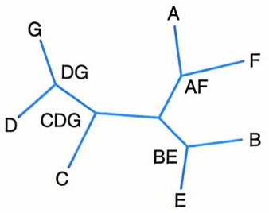

<details>
<summary>chemical</summary>

Chemical structure diagram with labeled atoms including A, B, C, D, E, F, G, AF, BE, CDG, DG
</details>

基于距离的方法计算效率高，在简单性和准确性之间提供了良好的平衡，特别适合处理包含成千上万序列的大数据集，已在流行病学、保护生物学等领域获得了

---

164

5 序列比对与分析

广泛应用。

值得一提的是，基于距离的方法将序列数据简化为成对距离，这虽然有效提升了处理效率，但也导致了序列组成等细节的丢失。因此，如果需要对演化细节进行解析，可以考虑采用如基于最大简约法（maximum parsimony, MP）、最大似然法（maximum likelihood, ML）等基于序列特征的建树方法。

## 5.4 序列比对与分析的总结与展望

序列比对与分析不仅是早期经典生物信息学研究的核心问题，也在当今组学研究中发挥着不可替代的核心作用。

序列比对在组学研究中，最常见的就是将测序数据比对到参考基因组。不论是基因组研究中的全基因组测序（whole genome sequencing，WGS）、全外显子组测序（whole exome sequencing，WES）和靶向测序；还是在转录组研究中的 RNA-Seq、microRNA-Seq 和 circRNA-Seq；或是在表观组学和三维基因组学中，比对到参考基因组几乎都是首要的分析环节。一般来说，比对的类型可以基于测序技术的差异分为两大类，一类是高通量的短读长测序技术，另一类是三代的长读长测序技术。关于短读长测序的序列比对，传统的双序列比对算法如动态规划和 BLAST 并不能很好地应对其海量的序列比对需求。一种高性能的序列比对算法 BWA，被广泛用于基因组二代测序数据的参考基因组比对。BWA 算法的核心是 Burrows-Wheeler 变换（Burrows-Wheeler transform，BWT）和创建查找表（graph FM-index），通过 BWT 将参考基因组和测序数据转化为可高效搜索的一种压缩格式，再使用 FM-index 高效地在基因组中搜索匹配的序列。相比基因组数据的比对，转录组数据比对的需求更加多样，如需要考虑剪接位点对测定序列分段比对的影响。HISAT2 是一种专门用于 RNA-Seq 数据快速比对的工具，它在基因组比对中引入了查找表来提高速度，具有较低的内存占用和高效的多线程处理能力。

最基本的生物分子序列表示方法是使用标准的IUPAC代码:对于DNA和RNA序列，我们使用“A”“C”“G”和“T/U”来表示核苷酸；对于蛋白质序列，我们使用单个字母代码来表示氨基酸。近年来，深度学习模型在生物信息学领域取得了重大进展。通过将生物序列编码为高维向量可以有效刻画序列中的复杂模式，从而为序列比对与分析提供了新的机遇与可能。具体来说，在人工智能大语言模型中可以用one hot等多种编码形式表示特定序列、序列比对及其集合，然后使用向量相似度度量（如余弦相似度）来评估它们的相似性。在此过程中，通过将传统的线性序列表示更换为高维空间的向量表示，不仅可以提升对测序错误等噪声的稳健性，更使得千万级别的超大规模序列分析成为可能。值得一提的是，通过将DNA、RNA、蛋白质等不同类型的序列向量表示投射到同一空间，可以实现跨序列类型的统一整合分析，从而为后续多组学整合提供了统一的框架（图5-9）。

---

5.4 序列比对与分析的总结与展望

165

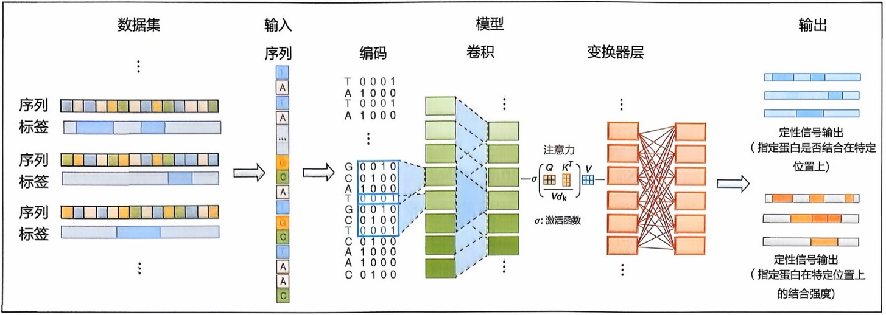

<details>
<summary>flowchart</summary>

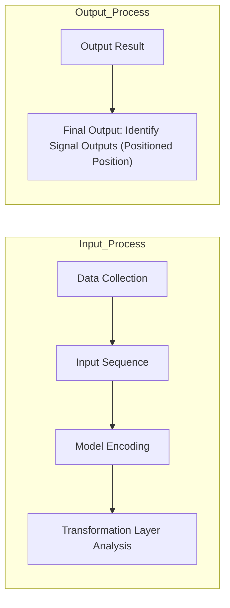
</details>

图5-9 跨序列类型的统一整合分析

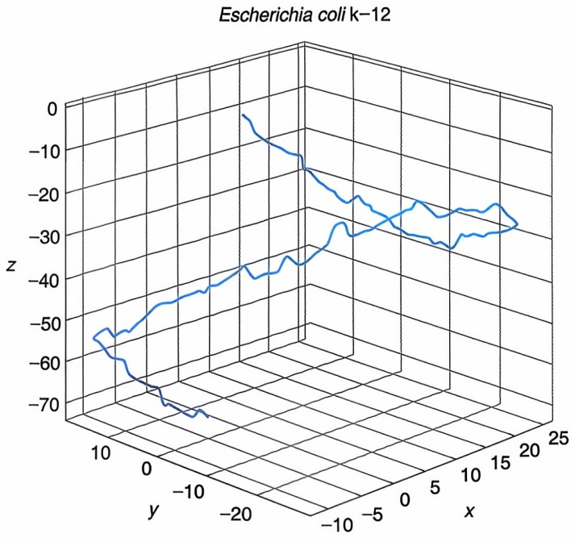

<details>
<summary>line</summary>

| X | Y | Z |
| --- | --- | --- |
| ~0 | ~5 | ~-2 |
| ~5 | ~5 | ~-8 |
| ~10 | ~5 | ~-12 |
| ~15 | ~5 | ~-15 |
| ~20 | ~5 | ~-18 |
| ~0 | ~10 | ~-30 |
| ~5 | ~10 | ~-32 |
| ~10 | ~10 | ~-35 |
| ~15 | ~10 | ~-38 |
| ~20 | ~10 | ~-40 |
| ~0 | ~15 | ~-45 |
| ~5 | ~15 | ~-48 |
| ~10 | ~15 | ~-50 |
| ~15 | ~15 | ~-52 |
| ~20 | ~15 | ~-55 |
| ~0 | ~20 | ~-60 |
| ~5 | ~20 | ~-62 |
| ~10 | ~20 | ~-65 |
| ~15 | ~20 | ~-68 |
| ~20 | ~20 | ~-70 |
| ~0 | ~25 | ~-72 |
| ~5 | ~25 | ~-73 |
| ~10 | ~25 | ~-75 |
| ~15 | ~25 | ~-78 |
| ~20 | ~25 | ~-80 |
</details>

图5-10 基于大肠杆菌k-12菌株构建的 $Z$ 曲线

值得一提的是，我国生物信息学家张春霆教授于1994年提出DNA序列的 $Z$ 曲线理论，证明任一核酸序列均可用唯一的一条三维空间曲线表示。具体来说，$Z$ 曲线表示使用3个正交坐标轴 $(x,y,z)$ 来描述不同类型碱基沿序列的分布，每个子序列都对应一个三维坐标点，通过连接这些点就可以得到一条连续的空间曲线。这种表示方法将一维序列映射到三维空间曲线，可以捕捉核酸序列中的周期性、对称性等特征，也开创了一条用几何学方法分析核酸序列的新途径（图5-10）。

$$
x _ {n} = (A _ {n} + G _ {n}) - (C _ {n} + T _ {n})
$$

$$
y _ {n} = (A _ {n} + C _ {n}) - (G _ {n} + T _ {n})
$$

$$
z _ {n} = (A _ {n} + T _ {n}) - (C _ {n} + G _ {n})
$$

$$
n = 0, 1, 2, \dots N
$$

---

166

5 序列比对与分析

## ※ 推荐阅读

1. Durbin R, Eddy S R, Krogh A, et al. Biological sequence analysis: probabilistic models of proteins and nucleic acids [M]. Cambridge: Cambridge University Press, 1998.

点评:该书以核酸/蛋白质序列分析为核心，系统介绍了基于概率模型对核酸与蛋白质序列进行建模解析的核心概念、思路、方法与应用。

2. Pevsner J. Bioinformatics and functional genomics [M]. 3rd ed. New Jersey: Wiley-Blackwell Publishing, 2015.

点评:该书基于大量实例全面介绍了多种序列分析方法的实现与应用过程。

## ※ 思考与练习题

1. 基于人类基因组数据训练得到的剪切位点 HMM 可以用于在果蝇基因组中鉴定新剪切位点吗？为什么？
2. 全局比对与局部比对的应用场景分别是什么？试解释其原理。
3. BLASTx 和 tBLASTn 的应用场景分别是什么？
4. 是否可以将一组序列根据序列相似性分成若干组，确保每组内部序列的相似性小于某一个阈值，且不同组序列的相似性大于某一个阈值？为什么？
5. UPGMA 法和 NJ 法的区别是什么？具体在算法步骤中的体现是什么？

## ※ 讨论题

1. 一个 $E = 10$ 的 BLAST 检索结果有意义吗？为什么？

2. 不同于UPGMA法构建的进化树总有唯一根（即最终合并的根节点），NJ法构建的进化树无法简单确定一个根，你认为这合理吗？为什么？

## ※ 参考文献

1. Altschul S F, Gish W, Miller W, et al. Basic local alignment search tool [J]. Journal of molecular biology, 1990, 215(3):403-410.
2. Burge C, Karlin S. Prediction of complete gene structures in human genomic DNA [J]. Journal of molecular biology, 1997, 268(1): 78-94.
3. Dayhoff M O, Schwartz R M, Orcutt B C. A model of evolutionary change in proteins [M].//Atlas of protein sequence and structure. Maryland: National Biomedi-

---

参考文献

167

cal Research Foundation, 1978: 345-352.

4. Henikoff S, Henikoff J G. Amino acid substitution matrices from protein blocks [J]. Proceedings of the national academy of sciences of the United States of America, 1992, 89(22): 10915-10919.
5. Katoh K, Standley D M. MAFFT multiple sequence alignment software version 7: improvements in performance and usability [J]. Molecular biology and evolution, 2013, 30(4): 772-780.
6. Needleman S B, Wunsch C D. A general method applicable to the search for similarities in the amino acid sequence of two proteins [J]. Journal of molecular biology, 1970, 48(3): 443-453.
7. Saitou N, Nei M. The neighbor-joining method: a new method for reconstructing phylogenetic trees [J]. Molecular biology and evolution, 1987, 4(4): 406-425.
8. Smith T F, Waterman M S. Identification of common molecular subsequences [J]. Journal of molecular biology, 1981, 147(1): 195-197.
9. Steinegger M, Söding J. Clustering huge protein sequence sets in linear time [J]. Nature communications, 2018, 9(1): 2542.
10. Thompson J D, Higgins D G, Gibson T J. CLUSTAL W: improving the sensitivity of progressive multiple sequence alignment through sequence weighting, position-specific gap penalties and weight matrix choice [J]. Nucleic acids research, 1994, 22(22): 4673-4680.

编者:高歌（北京大学）

胡德华（中南大学）

石铁流（华东师范大学）

田卫东（复旦大学）

王明钰（山东大学）

审读:曹志伟（复旦大学）

---


