# 6 基因组学

原始 PDF 第 184–225 页。

## 基因组学

本章对基因组学和宏基因组学领域进行全面概述，涵盖了从基本概念到前沿技术与应用的内容。首先定义了基因组学，并讨论了获得和解读基因组序列的方法，以及如何将这些知识应用于实践。接着，介绍了高通量测序技术在动植物和微生物DNA测序中的应用，并探讨了遗传信息数据分析和基因组学数据可视化的策略。在基因组组装、预测和注释方面，详细讨论了基因组组装的算法、基因预测技术和基因组注释的方法。此外，还深入探讨了序列变异检测的基本原理和技术，包括单碱基替换、短插入缺失和结构变异的检测技术。宏基因组学部分概述了微生物组学的概念、数据分析方法，以及在健康和环境领域的应用，并对未来的发展方向进行了展望。本章结合基础知识与实际案例，提供了对基因组学和宏基因组学研究过程及其相关数据库、分析方法和软件的综合理解，旨在为读者在该领域的研究和应用提供指导。

## 6

---

170

6 基因组学

## 6.1 基因组学概述

## 6.1.1 基因组学的概念

基因组学（genomics），简单来说就是研究基因组（genome）的科学。基因组是生物体内所有遗传物质的总和，包括所有染色体、线粒体、叶绿体（植物）等DNA序列或RNA序列（RNA病毒）。这些基因组序列均由A/C/G/T（U）组成，有些位置的碱基可能带有不同修饰（如5mC、 $m^{6}A$ 等）。不同物种的基因组大小（DNA序列总长）和复杂性（重复序列多样性和数目）千差万别。这些基因组序列编码了重要的遗传信息，构成了我们生命的蓝图。基因组学是对生物体所有基因进行集体表征、定量研究及不同基因组比较研究的一门交叉生物学学科，主要研究基因组的结构、功能、进化、合成/编辑等，以及它们对生物体的影响。

在基因组学中所研究的问题主要分为三类:如何获得基因组序列；如何解读/解码基因组；如何重写/编写新的基因组。第一类问题的解决方案随着 DNA 测序技术的发展越来越成熟，第二和第三类问题是目前生命科学基础研究中的前沿领域，而生物信息学在其中都扮演着非常重要的角色。

获得一个物种的高质量基因组序列是其相关科学研究的基础，具有重要的科学意义。基因组测序之前，我们通常需要估计其基因组大小，而在得到大量的基因组片段的序列后，我们需要进行基因组序列的拼接和组装。近年来，许多生物信息学算法和工具被设计和开发出来解决此方面的问题，如 Hifiasm、Verkko、NextDenovo、Canu、Flye 等。

在获得基因组序列后，我们需要对其进行解读，理解基因组和表型，这是基因组学中重要的研究内容，也是非常有挑战的系列科学问题。这些内容可以概括为多个层次的研究，如 DNA 序列层次的基因组注释，RNA 序列层次的转录组及其调控，表观遗传信息层次的调控，基因组三维结构层次的调控，跨物种层次的基因组进化研究等。基于单细胞测序技术的发展，这些研究又都在步入单细胞层次。

生物信息学在这些研究中都发挥着重要的作用。例如，基因组注释包括在基因组 DNA 序列上寻找编码基因、微 RNA 基因、长非编码 RNA 基因等，以及鉴定重要的调控元件。很多的生物信息工具被开发出来解决这些问题，主要是基于编码基因、非编码 RNA 的序列和结构特点，结合机器学习等方法来训练预测器。在转录和表观遗传调控方面，高通量的组学技术不断被建立，如 RNA-Seq 及变体技术，ChIP-Seq 及变体技术等，这些技术产生的组学数据需要更好的算法和工具去分析。单细胞测序技术产生的新型组学数据也催生了很多生物信息工具的开发。

---

6.1 基因组学概述

171

## 6.1.2 高通量测序技术

生物信息学作为现代生命科学的重要分支, 随着科技的不断进步与创新, 为我们揭示了许多生命的奥秘。在过去几十年里, 测序技术的迅速发展极大地推动了基因组学、转录组学、蛋白质组学等领域的进步, 为深入了解生命分子机制提供了基础。

## 6.1.2.1 一代测序技术原理及其应用

作为第一代 DNA 测序技术的代表，弗雷德里克·桑格（Frederick Sanger）于 20 世纪 70 年代基于 DNA 复制的自然过程提出了双脱氧链终止法（dideoxy chain-termination method，也称桑格测序法）来快速确定 DNA 序列。

脱氧核苷三磷酸（deoxynucleotide triphosphate，dNTP）是DNA的基本单位，每个dNTP都可以通过五碳糖3'处的羟基与下一个dNTP的磷酸形成磷酸二酯键，从而连接对应碱基形成DNA长链。桑格测序法的关键思想是在DNA合成反应中掺入双脱氧核苷三磷酸（dideoxynucleotides，ddNTP）。与dNTP不同，在ddNTP的五碳糖结构中，3'碳上的羟基（—OH）被氢原子（—H）取代，这使其无法提供形成磷酸二酯键所需要的反应位点，因此无法继续与下一个dNTP或ddNTP正常形成磷酸二酯键，从而终止了DNA链的延伸。通过在DNA合成反应中随机掺入ddNTP（分为A/C/G/T四个反应）就可以得到一系列不同长度的DNA片段，这些片段的3'端都是与原始模板DNA对应位置碱基互补的一个双脱氧的核苷酸残基。通过DNA片段5'端的放射性标记在PAGE凝胶上对四个反应中不同长度的DNA片段进行显影，可依次从小到大直接读出DNA的序列。

基于桑格测序法，美国应用生物系统公司（Applied Biosystems）于1987年推出第一台自动化DNA测序仪。在自动DNA测序中不再使用放射性脱氧核苷酸，而是将四种不同类型的ddNTP用不同的荧光染料标记，从而可以使所有反应都在单个管中完成。测序仪自动读取每个DNA片段上 $3^{\prime}$ 端碱基上的荧光标签（对应于模板链上特定位置的碱基）来确定模板DNA片段中的核苷酸序列（图6-1）。

桑格测序法每次可以测序 100～1000 个碱基，为了满足对更大基因组的测序需求，鸟枪测序法（shotgun sequencing）问世，其基本思想是通过将长 DNA 序列随机打断成小片段，通过对大量小片段进行 DNA 测序，然后通过末端重叠的原理将小片段逐步拼接成更长片段以至获得基因组序列。桑格法和鸟枪测序法的改进使科学家能够对多样化且结构复杂生物体的基因组进行测序。

人类基因组计划（Human Genome Project，HGP）的国际合作项目于1990年启动，目标是在15年内确定整个人类基因组的DNA序列。该计划采用层次测序策略，通过构建DNA大片段克隆文库以及重叠克隆群和物理图谱，再进行逐个克隆鸟枪法测序，即将单个克隆片段分别打断成小片段构建亚克隆后测序，然后逐步拼接和组装出基因组序列。该策略的基本思想是将复杂问题化整为零、分而治之。HGP系统地将人类基因组的染色体克隆测序任务分配给各参与国和研究机构并行推进完成，实现共需共为。1999年9月8日，Celera Genomics公司宣布开展人类基

---

172

6 基因组学

图6-1 一代和二代测序技术原理示意图

(a) Sanger 测序法基本原理及其毛细管电泳自动化；(b) 二代高通量并行测序原理。

Sanger测序法/双脱氧链终止法

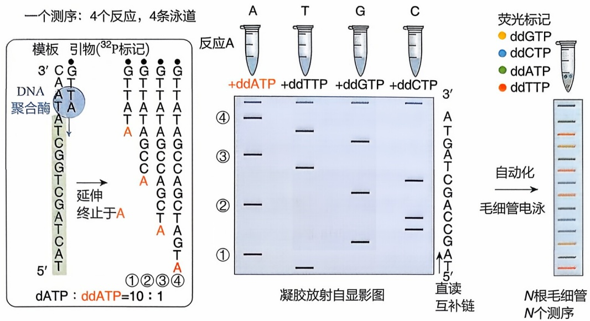

<details>
<summary>text_image</summary>

一个测序：4个反应，4条泳道
模板 引物(32P标记)
DNA
聚合酶
A
G
T
T
T
T
A
A
A
A
A
A
A
A
A
A
A
A
A
A
A
A
A
A
A
A
A
A
A
A
A
A
A
A
A
A
A
A
A
A
A
A
A
A
A
A
A
A
A
A
A
A
A
A
A
A
1②③④
dATP : ddATP=10 : 1
反应A
+ddATP +ddTTP +ddGTP +ddCTP 3'
④ A
③ A
② A
① A
凝胶放射自显影图
↑↑↑↑↑↑↑↑↑↑↑↑↑↑↑↑↑↑↑↑↑↑↑↑↑↑↑↑↑↑↑↑↑↑↑↑↑↑↑↑↑↑↑↑↑↑↑↑↑↑↑↑↑↑↑↑↑↑↑↑↑↑↑↑↑↑↑↑↑↑↑↑↑↑↑↑↑↑↑↑↑↑↑↑↑↑↑↑↑↑↑↑↑↑↑↑↑↑↑↑↓
直接互补链
荧光标记
● ddGTP
● ddCTP
● ddATP
● ddTTP
→ 自动化毛细管电泳 → N根毛细管N个测序
</details>

(a)

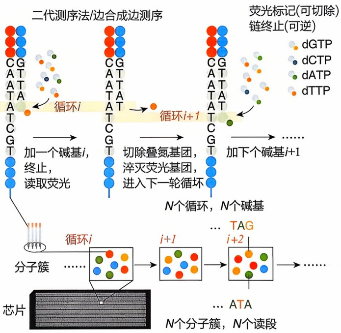

<details>
<summary>flowchart</summary>

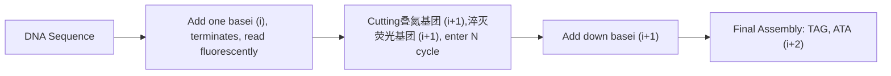
</details>

(b)

因组测序项目，不同于 HGP 的技术路线，该公司主要采用全基因组鸟枪法进行测序，并通过计算机完成组装。Celera Genomics 的加入及其与国际人类基因组计划的合作加速了整个测序工作的进程。2001 年，国际人类基因组计划测序联盟和 Celara Genomics 公司分别在《自然》（Nature）和《科学》（Science）杂志上公布了人类基因组草图序列。此后，联盟继续对测序草图进行细致的校对和查漏补缺。这个由来自美国、英国、法国、德国、日本和中国 20 个机构的 2800 多名研究人员组成的国际团队于 2003 年 4 月提前两年交付了人类基因组精细序列图谱，覆盖人类基因组的 93% 以上区域，碱基准确率在 99.99% 以上，这是 21 世纪初生命科学最伟大的

---

6.1 基因组学概述

173

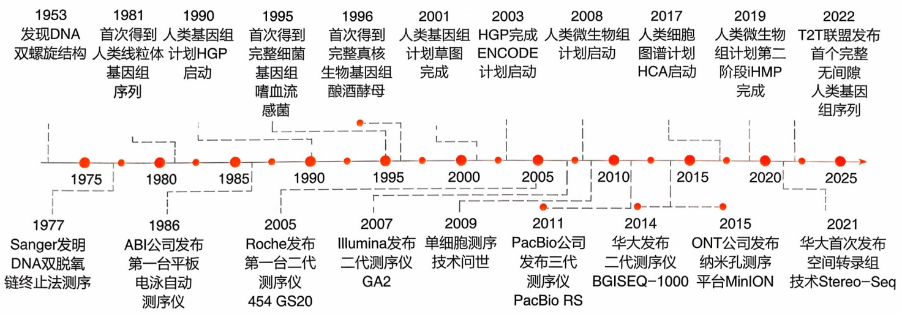

<details>
<summary>state_timeline</summary>

| Year | Milestone |
| --- | --- |
| 1953 | 发现DNA双螺旋结构 |
| 1975 | Sanger发明DNA双脱氧链终止法测序 |
| 1980 | 首次得到人类线粒体基因组序列 |
| 1986 | ABI公司发布第一台平板电泳自动测序仪 |
| 1990 | 人类基因组计划HGP启动 |
| 1985 | Roche发布第一台二代测序仪454 GS20 |
| 1995 | 首次得到完整细菌基因组嗜血流感菌 |
| 1996 | 首次得到完整真核生物基因组酿酒酵母 |
| 1990 | Illumina发布二代测序仪GA2 |
| 1995 | 单细胞测序技术问世 |
| 2001 | 人类基因组计划草图完成 |
| 2003 | HGP完成ENCODE计划启动 |
| 2005 | PacBio公司发布三代测序仪PacBio RS |
| 2008 | 人类微生物组计划启动 |
| 2010 | 华大发布二代测序仪BGISEQ-1000 |
| 2014 | ONT公司发布纳米孔测序平台MinION |
| 2017 | 人类细胞图谱计划HCA启动 |
| 2015 | T2T联盟发布首个完整无间隙人类基因组序列 |
| 2019 | 人类微生物组计划第二阶段iHMP完成 |
| 2020 | 转录组技术Stereo-Seq |
| 2021 | 华大首次发布空间转录组技术Stereo-Seq |
</details>

图6-2 基因组学研究和测序技术发展的时间轴

成就之一。

中国科学家在人类基因组计划中承担了 $1\%$ 的测序任务，成功完成了人类3号染色体端部的约3000万个碱基对的DNA测序工作。通过参与该计划，中国科学家得以在较短时间内学习和跟进世界先进测序技术，推动了国内测序仪的研发以及生物信息学软件的开发。基因组学的发展很大程度上是由HGP推动的，而HGP的进展又推动了DNA测序技术和生物信息学的发展。HGP完成之后测序技术得到了进一步的发展，从二代高通量并行测序，到三代单分子长读长测序。图6-2列举了基因组学和测序技术发展历程中的一些代表性重要事件。

## 6.1.2.2 二代测序技术原理及其应用

二代测序技术，又称下一代测序技术（next generation sequencing，NGS）或高通量测序技术（high throughput sequencing，HTS），是一类革命性的DNA测序方法，以其高效、快速、成本效益显著等特点在生物信息学和基因组研究领域引发了革命性的变革。相比传统的桑格测序法，二代测序技术不仅能够同时测序数百万条DNA片段，而且还显著降低了测序的成本和时间。这一技术的迅猛发展，使得我们能够在更多层面上揭示基因组结构、变异、表达以及其他生物学过程，从而加速了生命科学研究的进展。

第二代测序平台，以其显著降低的成本和巨大的数据通量，结合高效的计算分析工具，使得对基于测序的实验数据进行大规模分析成为可能。然而，较短的读长意味着重复的DNA区域（如着丝粒）会比桑格测序时代产生更大的问题:这些重复序列可能导致序列拼装错误，甚至会连接两个不属于彼此的染色体区域而产生嵌合体。

目前 Illumina 公司的 Solexa 和 HiSeq 技术是全球使用量最大的二代测序技术。Solexa 和 HiSeq 技术的核心原理是一致的，都采用了桥式 PCR 扩增（bridge PCR amplification）和边合成边测序（sequencing by synthesis, SBS）两个关键步骤。其流程包括:① DNA 文库制备；② Flow Cell 杂交；③ 桥式 PCR 扩增，以增加模板分子拷贝数目从而增强荧光信号；④ 边合成边测序，循环可逆地（掺入终止碱基/读取信号/去除终止基团和信号）对百千万甚至上亿的模板分子进行并行测序。

---

174

6 基因组学

相较于 Solexa，HiSeq 在测序效率、通量和数据质量等方面都取得了显著突破。HiSeq 在核心原理上延续了 Solexa 的荧光标记可逆终止方法，但进行了一些优化。首先，HiSeq 引入了双端测序（paired-end sequencing）的方法，通过在两端分别进行测序，提高了序列读长和数据生成的速率。其次，HiSeq 采用了全新的光学系统，包括更先进的荧光探测器和光学组件。这些改进大幅提高了荧光信号的检测精度和稳定性，进一步提高了数据质量。最后，HiSeq 技术实现了更高的通量，每次运行可以产生数百万到数十亿条序列。类似于 Illumina 测序技术，我国的华大基因在收购 Complete Genomics 的基础上，基于边合成边测序技术原理，通过自主创新研发了 BGISEQ 测序技术。BGISEQ 技术采用了联合探针锚定和滚环扩增（combinational probe-anchor synthesis and rolling circle replication，cPAS）技术来生成高质量的测序数据。cPAS 是一种新型的测序方法，结合了 DNA 纳米球（DNA nano ball，DNB）技术和 $\varphi29$ 聚合酶滚环扩增技术。cPAS 技术的工作过程大致如下。

① 文库制备 首先，输入的 DNA 样本被分解成小片段，然后通过末端修复和接头连接，生成一个带有特定接头的文库。
② 生成 DNA 纳米球（DNB） 接着，通过滚环扩增，每个 DNA 片段会在  $\varphi29$  DNA 聚合酶的作用下复制成约 500 个拷贝，形成一个紧密的 DNA 纳米球。
③ 测序 最后，DNA 纳米球被固定在光学芯片上进行测序。每一个 DNB 都被锚定在一种特殊的探针上，然后通过测序引物和四种荧光标记的 dNTPs 进行测序反应。在 DNB 的多个拷贝序列上，每次同步加入一个 dNTP，DNB 就会发出特定的荧光，通过检测这种荧光，就可以确定相应的碱基。

## (1) 测序数据的格式

测序数据通常会保存为 FASTQ 格式的文件，然后通过不同工具进行后续质控和处理，见于多种基因组学研究的分析场景。获得的基因组序列通常按染色体命名或编号保存为 FASTA 格式。相关文件格式如下:

① FASTA 文件格式 FASTA 文件主要用于存储核酸序列和氨基酸序列，每条记录包含两个部分。第一部分为一行，以 “>” 开始，主要存储序列的 ID 和描述信息。第二部分为序列本身，可分行储存，直到下一个 “>” 出现为止。
② FASTQ 文件格式 FASTQ 格式是测序数据下机的格式，每条记录包含四个部分。

第一行以 “@” 开头，后面是测序序列或读段（read）的基本信息，包括 ID 和可选的描述信息，中间以空格分隔。ID 部分是每条读段的唯一标识，它包含多个字段，每个字段之间用冒号分隔；描述区域是可选的，用来保存一些自定义的信息，如测序时用到的引物序列信息、读段长度信息等。

第二行是碱基序列（分 ATCGN 五种情况，N 代表不确定碱基类型）。

第三行以 “+” 开头，随后为测序标识符，为占位行。

第四行为对应碱基序列的测序质量（以 ASCII 码形式储存，与第二行的碱基序列一一对应），在测序后续的分析阶段中会使用该质量值，如数据质控、序列比对、

---

6.1 基因组学概述

175

变异检测等步骤。

## (2) 测序覆盖度和测序深度

测序获得的序列占整个基因组的比例称为覆盖度（coverage），它反映了基因组中至少被检测到一次的区域所占整个基因组的比例。由于基因组中存在高GC含量和重复序列等复杂结构，经测序、拼接和组装获得的序列通常无法覆盖基因组全部区域，这些未被覆盖的区域被称为空位（gap）。例如，对一个细菌基因组测序，如果覆盖度是 $97\%$ 则有 $3\%$ 的序列区域没有被测序获得。测序深度（depth）指测序获得的总碱基数与待测基因组大小的比值，通常用来表示基因组中每个碱基被测到的平均次数。如果一个基因组大小为2GB，测序获得的总碱基数为 $20\mathrm{G}$，则测序深度为 $10\mathrm{X}$。

## (3) 基因组大小的估计

在从头测序组装一个未知基因组之前，可以通过 $k$-mer分析来粗略估计基因组大小。$k$-mer指长度为 $k$ 的短DNA序列，如 $k = 17$ 表示长度为17个碱基的序列。对于一定测序深度的基因组二代测序数据，通过统计不同 $k$-mers在这些测序数据中的频率，可以对基因组大小进行估计。假设一个读段读长为 $l$，则这条读段能取出 $l - k + 1$ 个相互重叠的 $k$-mers。每个 $k$-mer在读段总数中的出现次数为 $k$-mer的深度，统计同样深度的 $k$-mer占全部 $k$-mer总数的比例，可以画出 $k$-mer深度频数分布曲线。$k$-mer深度频数分布服从泊松分布，可将峰值对应深度作为 $k$-mer期望深度，而基因组大小可由 $k$-mer总数/$k$-mer期望深度估计得到。

## 6.1.2.3 三代测序技术原理及其应用

第三代测序技术，以其单分子实时（single molecule real-time，SMRT）长读长测序能力著称，代表了测序领域的又一次技术革新。与第二代测序技术相比，第三代测序技术提供了更长的DNA序列信息，提供更高的覆盖度。太平洋生命科学有限公司（PacBio）是第三代测序技术的先驱，与桑格法不同的是，PacBio测序方法在4种dNTP的磷酸基团结合四色荧光标记基团，实现了在纳米井（nano well）中对单个DNA分子进行直接测序。这样，当DNA聚合酶在单个DNA模板上合成新链并掺入特定的dNTP时，即可产生对应的荧光信号，这些荧光信号形成的图像经计算分析即可得到模板DNA的对应序列（图6-3）。

PacBio 改造了 DNA 聚合酶，使其具有很长的持续 DNA 合成能力，因此在测序读长方面较前期测序技术有较大改进，一次可以测序 15000～20000 bp 的长片段，因此该技术擅长于异构体（isomer）的识别和定量，包括 mRNA 转录本异构体、基因组中结构变异的识别等。值得注意的是，在此过程中不涉及 PCR 过程，因此可直接测序富含 AT 或 GC 的区域、高度重复序列、回文序列甚至碱基修饰等。

牛津纳米孔技术（Oxford nanopore technologies，ONT）是第一家提供纳米孔测序仪的公司，第一个原型 MinION 于 2014 年发布。Nanopore 测序技术的核心原理是将核酸分子通过动力蛋白引导通过特殊的纳米孔，核酸通过时会引发电阻膜上电流的微小变化，基于 ATCG 每个碱基的带电性质不同产生不同的电流信号，从而推导确定碱基序列。ONT 测序可提供长度超过 300 kb 的超长读长，其纳米孔平

---

176

6 基因组学

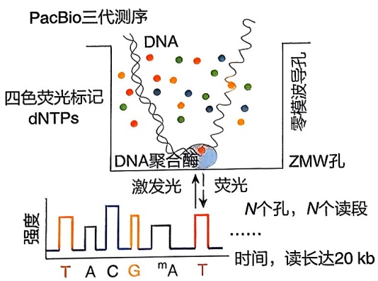

<details>
<summary>text_image</summary>

PacBio三代测序
DNA
四色荧光标记
dNTPs
DNA聚合酶
激发光
荧光
零模波导孔
ZMW孔
强度
T A C G m A T
N个孔，N个读段
……
时间，读长达20 kb
</details>

(a)

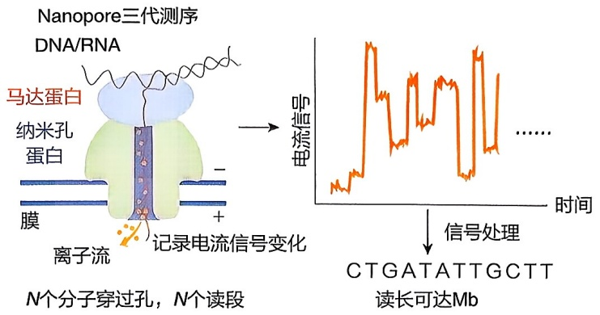

<details>
<summary>flowchart</summary>

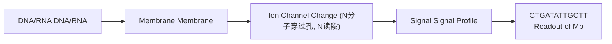
</details>

(b)

图6-3 三代测序技术原理示意图

(a) PacBio 长读长测序技术的基本原理；(b) Nanopore 长读长测序技术的基本原理

台 MinION 是一个小型移动平台手机大小的可移动 USB 设备，已被用于生成细菌基因组参考序列和靶向扩增子。值得注意的是，MinION 快速的运行时间和紧凑的设计特性也提供了现场测序的机会。在几内亚埃博拉病毒暴发期间，MinION 平台成功地在现场对采集的样本进行了实时测序，证明了其在紧急公共卫生响应中的实用性和便捷性。Nanopore 测序技术的一个独特优点是它可以直接测定 RNA 序列以及 RNA 上的特定修饰。

PacBio 和 ONT 平台都具有读取长度长的优势，PacBio 的 Sequel II 技术可以产生约 20 kb 的读段，而 ONT 则可以产生大于 2 Mb 的超长读段。但它们也有类似的缺点:首先，制备 DNA 文库需要新鲜材料或完整的细胞，处理超长高分子量 DNA 的方案需要进一步改进。其次，三代测序技术面临着更高的测序错误率和系统误差的挑战，特别是纳米孔技术的错误率达到 15%，近期得到大幅改进，但仍高于短读长测序技术。纳米孔技术的高错误率主要源于无法控制 DNA 分子通过孔的速度，导致信号的采集存在偏差（这些都是系统误差）。此外，DNA 聚合酶分子活性在测序过程中逐渐衰竭导致加入错误核苷酸的概率升高，影响测序的准确性。这种高错误率给单核苷酸的识别分析带来了挑战，如转录本的准确测序、剪接位点的鉴定和 SNP 识别。另外，与高通量的二代测序技术相比，第三代测序技术的低通量也影响定量分析，如基因/异构体丰度估计。尽管 PacBio 的 CCS 和 ONT 的双端共识策略可以降低错误率，但相应的读段长度会变短，通量会变低。最后，三代测序技术的成本仍然远高于二代短读长的测序技术。综上所述，尽管第三代测序技术在长读长方面具有明显优势，但为了实现其在科研和临床中的广泛应用，仍需要在提高准确性、增加通量以及降低成本等方面进行持续的技术创新和改进。

为了克服以上缺陷，整合三代测序和二代测序数据的混合测序“Hybrid-Seq”已成为一种在二代短测序数据的帮助下解决与三代测序数据分析相关的局限性的方法。例如，二代测序的短读段对PacBio或ONT长读段进行纠错，可提高长读段的准确性和可映射性。混合测序可应用于基因组组装和转录组表征，提高整体性能和分辨率。虽然错误率很高，但多种算法和多模板拷贝的测序深度将准确率几何级数地提高到了 $99.99\%$ 以上。

---

6.1 基因组学概述

177

一代、二代、三代测序技术的共同点在于基于在 DNA 复制中对掺入的 A/C/G/T 引入标记信号，通过不同的方法读出 DNA 序列:一代测序技术通过按片段大小依次读出末端终止碱基；二代测序技术并行、循环可逆地边合成边读取信号（掺入终止碱基/读取信号/去除终止基团和信号）；三代测序技术并行、以单分子实时读取掺入的碱基信号。它们的主要区别在于:一代测序技术通量最低、读长稍长于二代测序技术；二代测序技术读长最短，但通量最大；三代测序技术读长最长，但通量低于二代测序技术。

## 6.1.3 基因组测序新策略

目前很多已测序基因组还存在很多没有测出来的空缺区域，即空位（gap），并不是基因组的完全图（complete map）。为更全面地研究基因组，我们期望获得更多动植物和微生物的无空位（gap-free）的基因组完全图。端粒到端粒（telomere-to-telomere，T2T）联盟整合利用了PacBio和Nanopore平台的长读长测序技术、高深度二代测序、Hi-C等多种技术，实现了一种高质量的基因组测序，从染色体的端粒（telomere）到另一端的端粒，覆盖整个基因组。2022年，针对人类基因组尚未解析的 $8\%$ 区域，T2T联盟对完整的葡萄胎细胞系（complete hydatidiform mole, CHM）进行测序，绘制了人类基因组30.55亿碱基对的序列T2T-CHM13，实现了除Y染色体部分区域外所有染色体的无空缺组装。2023年，T2T联盟组装了Y染色体的伪常染色体区（pseudo-autosome region, PAR）、扩增和回文序列区、着丝粒卫星和q臂异染色质的序列，绘制了Y染色体的完整序列T2T-Y，并将其与之前的T2T-CHM13组装结合起来，整合群体遗传变异、临床变异和功能基因组学数据，提出了人类24条染色体的完整全面的参考序列图T2T-CHM13+Y，为科研人员提供了一个全面准确的基因组资源。

## 6.1.4 基因组学数据可视化

将基因组学及蛋白质组学、代谢组学等多组学数据进行有效可视化，可以便于研究人员查看、检索和分析，也是发现新的现象、模式和规律的关键途径之一。

## 6.1.4.1 基因组浏览器简介

基因组浏览器（genome browser）是一种用于可视化和分析基因组数据的生物信息学工具。它使得科研人员可以很方便地查看基因组上相关信息，如 DNA 序列、基因结构、转录异构体、RNA 表达、表观遗传学修饰、序列保守性、重复元件、疾病突变等，有助于深入理解基因组的结构和功能。

常见的基于网络的集成基因组浏览器包括:UCSC Genome Browser、Ensembl Genome Browser、NCBI Genome Data Viewer 等，提供了涵盖多个物种的基因组数据和工具。本地基因组浏览器包括 IGV（Integrative Genomics Viewer）、IGB（Integrated Genome Browser）等。用户可下载安装包在个人电脑上安装并在本地查

---

178

6 基因组学


拓展阅读6-1 UCSC Genome Browser介绍

看基因组数据，允许用户自定义数据集和视图。

UCSC Genome Browser 支持多种不同生物物种的基因组数据，包括人类、小鼠、果蝇、斑马鱼、大鼠等；它整合了大量的注释信息，包括基因的多种注释、功能、表达数据、翻译起始位点、转录因子结合位点等；提供了对 Hi-C 数据的可视化，有助于理解基因组结构与表达调控；整合了单核苷酸多态性（single nucleotide polymorphism, SNP，在基因组水平上单个核苷酸的变异）、拷贝数变异（copy number variation, CNV，是由基因组发生重排而导致的，一般指长度为 1 kb 以上的基因组大片段的拷贝数增加或者减少，主要表现为亚显微水平的缺失和重复）和其他遗传变异信息；允许用户在不同物种之间比较基因组区域，从而揭示进化保守性和变异性。

基因组浏览器将很多基因组相关的数据信息以直观的图形元素进行表示和整合展示，便于理解和发现有趣的现象。为可视化自己的组学数据，用户只需要根据相应的格式规范写好数据文件即可。这些浏览器一般都支持多种数据格式，如 BED、WIG、BedGraph、GTF、hic 等。用户可在会话界面登录并保存自己的数据记录，并可以通过分享链接供其他研究者查看同样的数据信息。

近年来，一些非浏览器型的基因组可视化工具相继被开发出来，如 pyGenomeTracks、Trackplot 等。用户通过自定义配置文件，可以批量地以及自动化地生成多种组学数据的高质量视图。

## 6.1.4.2 基因注释的图形化和文本化表示

基因组中的重要信息之一是基因注释。研究人员制定了一套规范格式（browser extensible data，BED）来对基因信息进行文本形式的编码，并进行图形化展示。一方面便于生物信息学程序化分析，一方面便于研究人员进行表示和交流讨论。基因的图形表示方式是:细线表示内含子、矩形表示外显子、箭头表示基因转录方向；对于编码基因，小矩形表示 UTR，大矩形是编码区。如图 6-4 中的 GENCODE 基因注释，我们可以直接从图形很容易地理解基因的结构特征。

基因的文本表示方式为 BED12 格式，用于存储基因的信息。BED12 格式一共有 12 列，每一列的具体含义如下:

chrom，基因所在染色体。

chromStart，基因起始位点。注意 BED 格式中起始位点是 0-based，即索引从 0 开始。

chromEnd, 基因终止位点。例如, chr3: 0-1000 表示 3 号染色体的前 1000 个碱基。

name，基因的名字 / 标签。

score, 0\~1000 的分数值，或用 “.” 代替。

strand，基因所在链，正链 +:forward，负链 -:reverse；.:未知。

thickStart，编码区 CDS 起始位置。

thickEnd，编码区 CDS 终止位置。

itemRgb, RGB 颜色值。

blockCount，外显子的数量。

---

6.1 基因组学概述

179

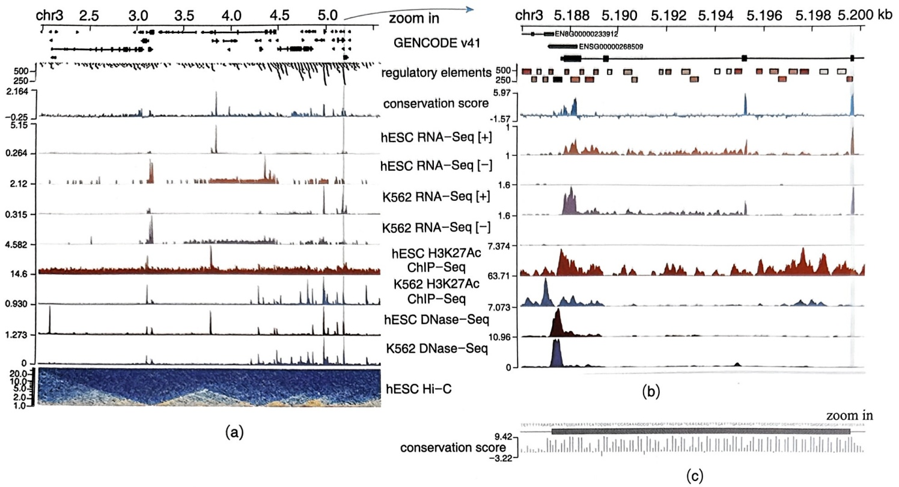

<details>
<summary>manhattan</summary>

| Metric | Value |
| --- | --- |
| hESC H3K27Ac ChIP-Seq | 7.374 |
| hESC DNase-Seq | 63.71 |
| K562 DNase-Seq | 7.073 |
| hESC Hi-C | 10.96 |
</details>

图6-4 基因组学数据的可视化示例

(a) 3 号染色体上一段区域的代表性基因组数据可视化示例。相关基因组信息分别由对应的数据轨（data track）表示，从上至下分别为:基因组坐标（zoom in）、基因注释（GENCODE v41）、顺式调控元件（regulatory elements）、基于 100 个物种的序列保守性（conservation score）、来源于 hESC 和 K562 的 RNA-Seq 数据信号（区分正负链）及其 H3K27Ac ChIP-Seq 信号和 DNase-Seq 数据信号、Hi-C 数据（显示染色质相互作用的频率）；（b）放大图（a）中的蓝色高亮区域至单基因水平示例；（c）放大图（b）中的蓝色高亮区域至单碱基水平示例。内含子序列以 GT 起始，AG 结束

blockSizes，外显子的大小，多个外显子的大小用“,”相连。

blockStarts，外显子的相对起始位置，多个外显子的位置用“,”相连。

对于一些简单的区段，如ChIP-Seq鉴定到的峰值区域或者功能元件区域（如图6-4中的顺式调控元件），可以用简单的BED6（前6列），或BED4（前4列）来表示。

## 6.1.4.3 定量数据的图形化和文本化表示

除了区段类的信息外，另一类典型的基因组数据是表示基因组特定位置上的定量信息。例如，基因组序列的保守性分数、RNA-Seq 数据的信号是转录本上每一个位置检测到的读段数目，以及 ChIP-Seq 数据的信号表示基因组 DNA 上每一个位置检测到的读段数目等（图 6-4）。这些需要按基因组位置编码的定量信息可用 WIG 格式表示，有可变步长和固定步长两种方式。

可变步长这种方式比较灵活和常用，按染色体（chrom）对给定位置赋予对应的数值。在以 variableStep 声明染色体后，每行用两列（pos，value）来编码位置和信号。可选参数跨度（span）表示对每个位置之后特定窗口大小的位置赋予同样的数值，默认值为 1。这样可以尽可能少地文本表示基因组规模的位置和定量信息。其

---

180

6 基因组学

大致格式如下:

```txt
variableStep chrom=chrN [span=windowSize]
pos1 value1
pos2 value2
......#
```

注意 WIG 格式中位置是 1-based，即索引从 1 开始。定量信息正负数值均可。如图 6-4c 中示例所示，我们可以从基因注释及序列保守性的特征直接看到内含子末端的 GT、AG 剪接位点是很保守的，与外显子区域的保守性相似。

## 6.2 基因组的组装、预测和注释

完成基因组测序后，需要将读段通过互相之间的重叠序列拼接相对完整的基因组序列。这一过程称为基因组组装。组装好的基因组将进一步进行基因的预测，获得基因组包含基因的信息。最后对基因组中的基因进行注释，通过各种算法标注各基因在数据库中的功能。在本节中，我们将对基因组组装、预测和注释的主要算法和工具进行介绍。

## 6.2.1 基因组的组装

要介绍基因组的组装，首先要介绍三个概念，即读段（read，其长度被称为读长）、叠连群（contig）和支架（scaffold）。读段是测序后直接得到的序列片段。读段经过互相之间重叠的部分进行拼接并进行延展，得到的最长序列，称为叠连群。叠连群进一步通过末端配对测序（paired-end sequencing）的方法进行组装，形成支架。三者之间的关系如图6-5所示。

从图6-5可以看到，支架是基因组组装能够得到的最大序列单位。现在，由于测序及拼装技术的进步、成本的下降，使得高深度测序成为可能。同时，将叠连群拼装成为支架又在叠连群之间的序列部分未知的情况。因此，人们在大多数情况下只需要将读段拼接为叠连群。判断一个基因组的测序及组装的效果，通常使用叠连

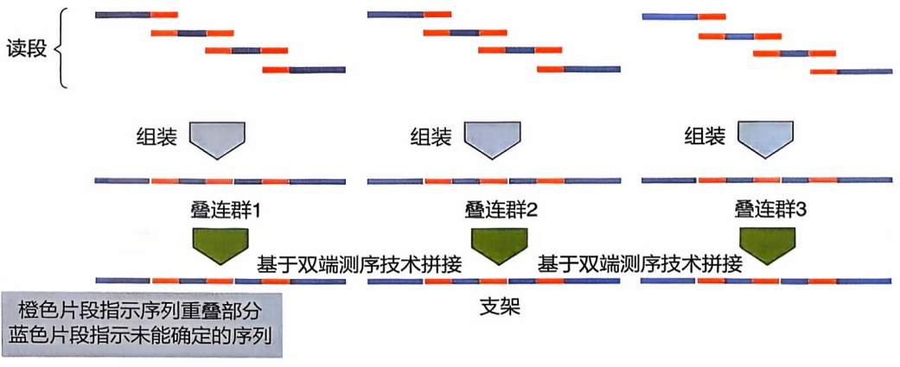

<details>
<summary>flowchart</summary>

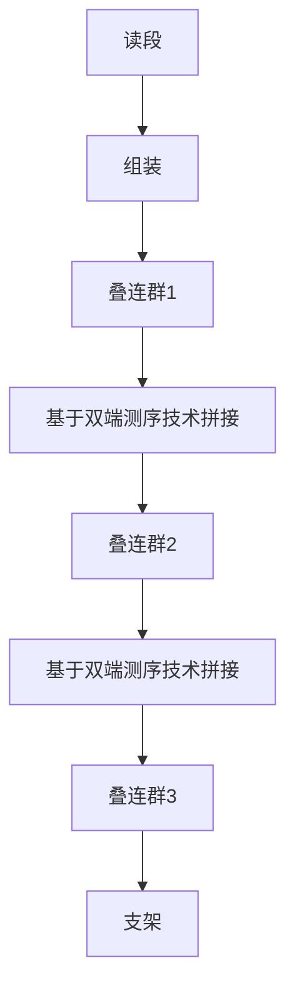
</details>

图6-5 读段、叠连群和支架的关系示意图

---

6.2 基因组的组装、预测和注释

181

群的长度分布来进行。一个常用的指标是各叠连群长度的中位数，即 N50。一般来说，N50 越长，基因组质量越高。同时，人们也常考虑所测得基因组大小和同物种或者同属其他生物基因组大小之间的比较，如相差太远，则基因组测序质量不高。提高基因组测序的质量，最简单的方法就是提高测序的深度，或覆盖度（coverage），即测序的总碱基数量和该物种基因组大小的比值。对于一个细菌来说，使用二代测序技术，通常 100 倍以上的测序深度就可以实现较好的基因组组装结果；三代测序技术则可以使用较低的测序深度（如 30 倍）达到相似的结果。

当前，有大量的开源工具可以对基因组进行高质量组装。大多数的开源工具所使用的算法都是基于德·布鲁因图（de Bruijn graph，DBG）的算法。下面，我们将对这一算法进行简单介绍。

选定一个 $k$ 值，将基因组测序得到的所有读段拆分为长度为 $k$ 的短片段（$k$-mer）。尽管没有严格的限制，通常来说 $k$ 值不超过读段长度的 $2/3$。且 $k$ 值必须为奇数。以序列ATGCGGAT为例，如果 $k = 5$，我们将可以得到ATGCG、TGCGG、GCGGA、CGGAT四个5-mer。将不同读段拆分得到的相同的 $k$-mer进行合并，获得基因组测序得到的所有 $k$-mer。

然后，以 $k$-mer作为顶点（node），在不同的 $k$-mer之间建立边（edge），形成一个有向图，即DBG图。两个顶点（$k$-mer）之间建立边的条件是两个 $k$-mer是拥有 $k-1$ 个连续相同的碱基，仅分别在 $5'$ 端和 $3'$ 端有一个不同的碱基。边从 $5'$ 端有不同碱基的序列指向在 $3'$ 端有不同碱基的序列。以ATGCG、TGCGG两个顶点为例，它们拥有TGCG这个共同的4个连续碱基，边是从ATGCG指向TGCGG的。一个DBG图的例子如图6-6所示。在一个完美测序且没有测序错误的基因组中，DBG图包含且仅包含一条链路，从基因组的第一个（$5'$ 端）$k$-mer单向地指向最后一个（$3'$ 端）$k$-mer。请注意:由于基因组内天然存在重复序列，这种完美的

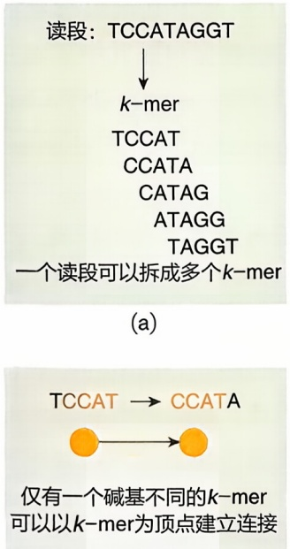

(b)

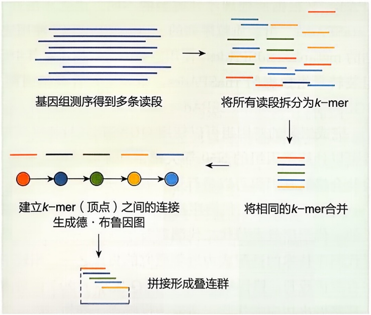

<details>
<summary>flowchart</summary>

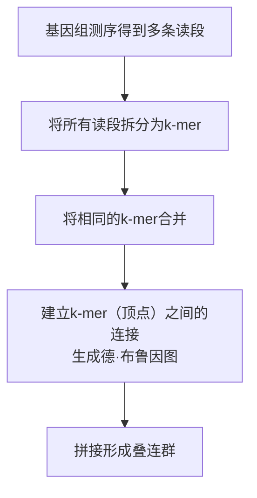
</details>

(c)

图6-6 德·布鲁因图构建示例

（a）由读段拆分为 $k$-mer 的过程；（b）$k$-mer 之间的连接；（c）由读段拼接形成叠连群的过程

---

182

6 基因组学

图6-7DBG中的“气泡”示例不同叠连群的拼接顺序，用不同箭头组成的路径颜色表示

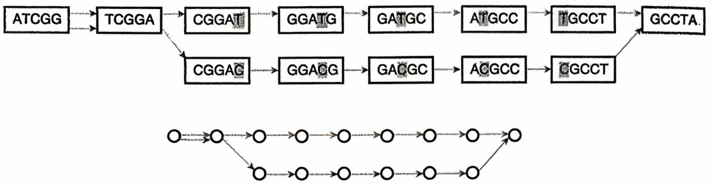

<details>
<summary>flowchart</summary>

This flowchart illustrates a genetic construct or gene expression pathway, showing the sequential transformation of ATCGG and TCGGA to various GATA and GCCT genes, followed by a downstream loop of circular nodes indicating structural changes.
</details>

DBG 几乎是不可能存在的。

由于高通量测序会产生一定比例的错误碱基，因此 DBG 中会出现错误的连接。作出 DBG 的下一步工作就是对 DBG 中的错误连接进行处理，如去掉短的侧枝、对“气泡”进行整合等。图 6-7 展示了一个测序过程中产生的“气泡”的例子。在这个 DBG 中，由于产生了一个单核苷酸突变（用阴影表示），在 DBG 中以“气泡”的形式产生了两条链路。在此对错误连接的处理方式不再予以详述。最后，将 DBG 中拥有同样顶点的不同链路进行拆分，形成叠连群（contig）。

当前，有大量的对二代和三代测序数据进行组装的软件得到了广泛应用。同时也存在二代和三代测序数据“混合组装”的策略。这种“混合组装”的目的在于利用二代测序数据的高准确率（$Q$ 值普遍在 $30 \sim 40$）矫正三代测序的数据，实现高完整度和高准确率兼得。同时，由于三代测序的准确性近年来迅速提高，也出现了仅用三代测序数据即可获得高质量基因组的方法。除传统的DBG算法外，也有使用重叠布局共识（overlap layout concensus, OLC）算法的软件得到了广泛应用。部分代表性的组装软件如表6-1所示。

这些不同的基因组组装软件在基于 DBG 算法的基础上做出了各种不同的算法改进。例如，SPAdes 考虑了双端测序的数据，优化并构建了成对德·布鲁因图（paired de Bruijn graphs, PDBGs），并提高了基因组组装的效果。在此基础上，SPAdes 又根据所处理序列类型的不同，优化算法并开发了组装宏基因组数据的 metaSPAdes、组装质粒序列的 plasmidSPAdes、使用宏基因组数据组装其中质粒序列的 metaplasmidSPAdes、使用宏基因组数据组装其中病毒序列的 metaviralSPAdes、组装转录组数据的 rnaSPAdes、组装生物合成基因簇（biosynthetic gene clusters, BGCs）的 biosyntheticSPAdes 等。

完成组装的基因组可以使用 QUAST、CheckM 等软件进行组装质量的检测。前者可以计算基因组的 N50 等关键信息，后者可以检测基因组是否被其他物种污染。检验合格的基因组可以进行下一步的分析。

近年来，伴随三代测序技术的成熟，特别是测序错误率的逐渐降低，使用长读段的三代测序技术替代二代测序技术逐渐成为一种趋势。因此，基因组组装技术对三代测序技术的适配成为近年研究的焦点之一。相较于二代测序数据，三代测序数据有着读段长、错误率高（>1%，Q值小于20）的特点，因此各个基因组组装的算法都将做出相应的优化以适应数据特点。例如，Flye使用了重复图（repeat graph）

---

6.2 基因组的组装、预测和注释

183

表 6-1 部分代表性基因组组装软件

| 软件 | 应用 | 算法基础 |
| --- | --- | --- |
| SOAPdenovo | 二代测序数据基因组组装 | 基于DBG算法 |
| SPAdes | 二代测序数据基因组组装 | 基于DBG算法 |
| Velvet | 二代测序数据基因组组装 | 基于DBG算法 |
| ALLPATHS-LG | 二代测序数据基因组组装 | 基于DBG算法 |
| SGA | 二代测序数据基因组组装 | 基于string graph算法 |
| ABySS | 二代测序数据基因组组装 | 基于DBG算法 |
| Flye | 三代测序数据基因组组装 | 基于DBG算法 |
| Canu | 三代测序数据基因组组装 | 基于OLC算法 |
| Miniasm | 三代测序数据基因组组装 | 基于OLC算法 |
| Shasta | 三代测序数据基因组组装 | 基于DBG算法 |
| Hifiasm | 三代测序数据基因组组装 | 基于OLC算法 |
| ABruijn | 三代测序数据基因组组装 | 基于DBG算法 |
| Marvel | 三代测序数据基因组组装 | 基于OLC算法 |
| Raven | 三代测序数据基因组组装 | 基于OLC算法 |
| NECAT | 三代测序数据基因组组装 | 基于OLC算法 |
| Peregrine | 三代测序数据基因组组装 | 基于OLC算法 |
| HINGE | 三代测序数据基因组组装 | 基于OLC算法 |
| FALCON | 三代测序数据基因组组装 | 基于OLC算法 |
| SMARTdenovo | 三代测序数据基因组组装 | 基于OLC算法 |
| Verkko | 三代测序数据基因组组装 | 基于DBG算法 |
| Meraculous | 二三代测序数据混装 |  |
| MaSuRCA | 二三代测序数据混装 |  |
| DBG2OLC | 二三代测序数据混装 |  |
| HASLR | 二三代测序数据混装 |  |
| HybridSPAdes | 二三代测序数据混装 |  |
| Wengan | 二三代测序数据混装 |  |

代替了DBG进行了基因组的组装。重复图使用了相近的序列比对（而非完全相同的 $k$-mer）进行基因组组装，能够接受更高的错误率，也能够更好地应对基因组中出现的重复序列。

## 6.2.2 基因组的结构预测

在完成基因组的组装，得到合格的基因组序列后，对基因组进行分析的下一步是对基因组的结构进行预测（或者结构注释）。这包括对其中的编码基因、非编码序列、基因结构、剪接形式等结构性信息进行分析、预测。其中，对编码基因的预测是重点，也是发展较为成熟的部分。由于真核生物和原核生物基因结构不同，人们往往使用不同的软件来分别预测这两类生物基因组中的基因。代表性基因预测软件包括广泛应用在原核生物中的Prodigal、GeneMarkS、Glimmer和真核生物中的Augustus、Genscan、GeneID、GlimmerHMM、GeneMarkES和Snap等。

上述大多数基因预测软件是基于隐马尔可夫模型（hidden Markov model, HMM）算法开发的。基因组序列是典型的一维有向序列信号，拥有明确的字符集（ATCG

---

184

6 基因组学

四个碱基），完全符合隐马尔可夫模型（HMM）的应用范围。因此，HMM算法被广泛应用在基因预测中，在通过使用已知的基因序列进行模型训练后，可通过DNA序列计算最大概率的状态序列（即某个位置/碱基是否属于基因的一部分）来推断基因的序列。上述算法大多使用了HMM算法来进行基因预测。需要指出的是，HMM模型的参数严格依赖用于训练的数据。因此，不同的生命类型（如真核生物、原核生物等）甚至不同的物种都可以使用生命类型或物种特异的HMM模型，以达到更好的基因预测效果。同时使用HMM模型来预测某个碱基是否属于基因或基因构件（如5'-UTR、外显子、内含子等）和基于相似性搜索来查找具有序列特异性的基因组分（如起始密码子等）可进一步提高基因预测效果。最后需要指出的是:HMM方法特别适用于处理具有复杂模式和不确定性的生物信息学数据，尽管它依赖于高质量的训练数据集，并且需要仔细调整模型参数以获得最佳预测效果。

除上述介绍外，较为常用的是基因从头预测（de novo gene prediction），还可以依据序列同源性和转录组信息进行结构预测。需要指出的是，对于真核生物，上述多种方法（从头预测、同源性预测、转录组预测）提供的多方面证据均可以用于辅助实现更加精确的结构预测。当前，Evidence Modeler等软件都可以协助人们进行基因组的结构注释。

据估计，高等生命体内仅有不足 $5\%$ 的碱基参与编码结构基因，而约 $80\%$ 的碱基得到了转录。这表明了非编码RNA的广泛存在。非编码RNA在生命体中起到了广泛的调控等作用，有着多种不同的类型和作用机制。在基因的预测之外，人们也开发了多种对非编码RNA的预测工具。例如，对于miRNA，miPred可以基于随机森林模型预测miRNA，miRDeep可以根据miRNA-Seq数据预测miRNA，此外还有着大量的基于结构、进化保守性、热力学稳定性、机器学习、高通量测序的预测算法；对于lncRNA，基于逻辑回归的lncScore和基于支持向量机模型的lncRScan-SVM均可以实现lncRNA的预测，随机森林模型、神经网络模型也在lncRNA预测中得到了广泛应用；对于circRNA，基于伪参考集（pseudo-reference-based，如KNIFE）和片段化读段（fragmented read-based，如CIRC2）的算法均得到了广泛的应用，也存在如CircPlant的整合软件。

基因及非编码区域的预测软件通常使用基因组的序列文件（fasta 格式）作为输入，以基因组索引文件（GFF/GTF 格式）作为输出。当进行基因预测时，预测得到的基因序列文件（fasta 格式）、蛋白质序列文件（fasta 格式）也通常是输出的一部分。

GFF（general feature format）和 GTF（gene transfer format）格式是常见的基因组索引文件格式。在本质上，这两个文件都可以被视为 TSV（tab-separated values）表格类型的文件，可以用文本编辑工具（如记事本）或者表格编辑工具（如 Excel）很容易地打开。文件中每一行代表一个特征，即一个基因/外显子/编码序列等。这两者的格式非常相似，但是不同的软件对于基因组注释文件的要求有所不同。

人类对基因组的认识仍在不断深化，从早期的以结构基因为主的功能性认识到

---

6.2 基因组的组装、预测和注释

185

非编码区域的重要作用，到表观遗传的关键作用，再到基因组动态远距三维关联的重要意义，近20年来的持续性突破让人们在生物学上逐步阐明基因组序列-结构-功能-调控的关系网络，也伴随着基因组结构预测的生物信息学工具的不断完善。生物信息学工具与算法，如结合长短时记忆网络和残差网络用以预测时空Hi-C数据的HiC4D等，正在不断推陈出新。该领域的研究正是当前生物信息学研究的生长点之一。

## 6.2.3 基因组的功能注释

基因注释（gene annotation）是指将基因组中所含有的编码基因功能使用各种数据库和软件进行标注，使得人们可以对基因的功能有所了解。根据基因组的分析者对基因组不同功能的关心程度不同，人们可以使用很多种方法对基因组进行功能注释。其中，最常见的是对基因组进行 GO（Gene Ontology）、KEGG（Kyoto Encyclopedia of Genes and Genomes）、NR（Genbank 的 nr 蛋白库）注释，也有许多其他面向所有生物和部分生物（如仅面向细菌等）的注释方法。以下我们分别对这几个功能注释的内容和方法进行介绍。

GO 数据库是一类基于基因本体（ontology）进行记录的数据库。基因本体指的是一系列标准化的概念，人们可以将一个基因定义到这个概念上，表明这个基因具有或属于这个概念所描述的分子功能（molecular function）、细胞成分（cellular component）及/或生物过程（biological process）。GO 数据库定义了一系列的基因本体，并描述了基因本体之间的关系。例如，编号为 GO: 0019319 的基因本体（六糖生物合成途径，hexose biosynthetic process）“是”（is\_a）一个 GO: 0019318 基因本体（六糖生物代谢途径，hexose metabolic process）。

KEGG 数据库是一个对生物化学途径和酶学性质进行记录的数据库。同 GO 注释相类似，人们可以将基因定义到 KEGG 途径（如三羧酸循环途径）中，以完成 KEGG 注释。

NR 数据库是由 NCBI 所维护的非冗余（non redundant）蛋白质数据库，包含由 Genbank 所收录的所有序列不同的蛋白质，共有约 7.2 亿个蛋白质。进行 NR 注释需要使用序列比对软件（如 blastp），在 NR 数据库中找到和基因所编码的蛋白质最为相似的蛋白质，从而依据该蛋白质的名称及功能推断所分析的基因功能。相类似地，也可以使用 UniProt（包括作为其一部分的 Swiss-Prot）等蛋白质序列数据库，根据序列相似性来进行注释。

RAST（Rapid Annotation using Subsystem Technology）是一种可以直接从原核生物基因组序列进行注释的工具。它整合了 $f$ 基因预测（可使用GLIMMER3、GeneMarkS或者Prodigal）和生物功能的子系统（subsystem）注释，从而能够实现基因组的直接注释。

Biocyc 是面向物种的、经专家注释的数据库, 其中包含了 20050 个基因组 (468

---

186

6 基因组学

个古菌、19435个细菌、39个真核生物）及其注释。同时，Biocyc和KEGG相类似，也构建了生物过程，将基因组中所含有的基因依据其生理功能和序列相似性分配到生物过程中。因此，可以对重测序的基因组，按照和KEGG相似的方法进行途径注释。Biocyc本身提供了相应的工具进行途径注释。

Pfam 是一个蛋白质家族分类数据库，基于序列比对和隐马尔可夫模型（HMM）对蛋白质进行分类和功能预测。对基因组的 Pfam 注释可以更好地从蛋白质功能角度反映基因的生理活性。目前，Pfam 连同 PRINTS、PANTHER、Prosite 等蛋白质分类数据库统一被整合至 InterPro 数据库，并可通过统一的接口和工具进行访问。

COG（Clusters of Orthologous Genes）数据库是由 NCBI 开发的原核生物蛋白质功能注释数据库，其中包括了 1187 个细菌基因组和 122 个古菌基因组。COG 将这些基因组中所编码的蛋白质分为了 4877 类（即 4877 个 COGs），并进一步将其分为 26 个功能类别。这些功能类别分别使用一个大写字母进行标注（如 A-RNA processing and modification），因此在经 COG 注释后可以清晰地表明基因组中各主要生理功能的基因数量。相类似功能的注释工具还包括 KOG（EuKaryotic Orthologous Groups，针对真核生物的 COG 数据库）和 EggNOG 等。

除了上述主要的功能注释工具外，还存在大量的用于具体功能的基因组注释工具。这些工具往往针对特定类群生物的特定功能，因此可以在研究者有特定需求时使用。例如，用于注释膜转运蛋白的 TCDB（Transporter Classification Database）、用于注释糖类活性酶的 CAZy（Carbohydrate-Active enZYmes Database）、用于注释生物合成基因簇（Biosynthetic Gene Cluster，BGC）的 antiSMASH、用于注释病原体与宿主互作的 PHI（Pathogen Host Interactions）、用于注释细菌致病因子的 VFDB（Virulence Factor Database）、用于注释抗生素耐药基因的 CARD（the Comprehensive Antibiotic Resistance Database）和 AMRFinderPlus 等。

## 6.3 序列变异检测原理与技术

遗传物质的序列并非恒定不变,而是动态演化的。基因组突变(genomic mutation)作为进化论的核心机制之一,对物种的演化历程起着决定性作用。这些突变包括但不限于有益突变、中性突变和有害突变,它们共同构成了生命多样性的基石。

基因组变异（genomic variation）反映的是不同种群、不同个体或者同一个体不同样本、细胞间的遗传物质差异。基因组变异有多种类型（图6-8），其中主要包括单碱基变异（single nucleotide variation，SNV）、小于50 bp的短插入缺失（short insertion/deletion, InDel）以及更大段的基因组结构变异（structural variation, SV）。千人基因组项目的深入研究显示人类基因组个体差异大约占总基因组总长的 $0.4\%$ ，其中约 $0.1\%$ 为单碱基变异，约 $0.3\%$ 为其他类型变异。这 $0.4\%$ 内的序列变异很大

---

6.3 序列变异检测原理与技术

187

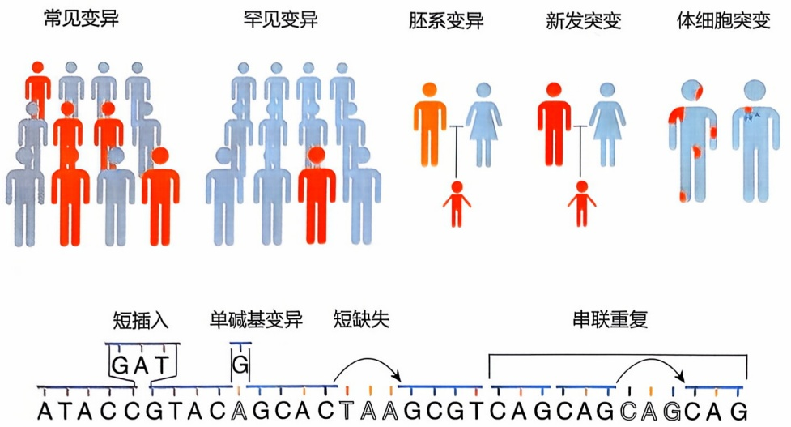

<details>
<summary>flowchart</summary>

This diagram illustrates the genetic differentiation process of human chromosomes, showing how various mutation types (常见变异, 罕见变异, 胚系变异, 新发突变, 体细胞突变) lead to specific genetic variants (GAT, G, CAGCAGCAGCAG), which are then linked to a sequence of repeats.
</details>

大段缺失

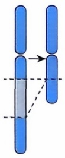

大段插入

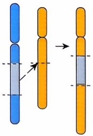

<details>
<summary>text_image</summary>

Diagram illustrating chromosome separation and rearrangement, showing blue and orange chromosomes with labeled positions and arrows indicating transformation.
</details>

拷贝数增加

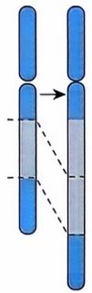

倒位

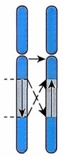

易位

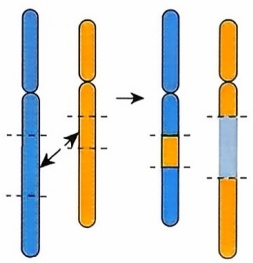

<details>
<summary>text_image</summary>

Diagram illustrating chromosome separation and rearrangement, showing blue and orange segments with directional arrows indicating transformation.
</details>

图6-8 各种类型的基因组变异

主要包括单碱基变异、短插入缺失以及各种结构变异

程度上导致了我们在人类中观察到的巨大差异性，包括身体外貌的差异、疾病易感性的差异和对药物反应的差异等。研究个体间基因组变异对于理解人类演化、群体遗传学和复杂疾病的遗传基础等至关重要。

## 6.3.1 序列变异检测的基本原理

检测序列变异也就是寻找不同基因组间的序列差异。理想情景中，为了比较基因组间的序列差异，最直接的策略是对目标个体或种群的基因组进行独立组装，继而直接进行序列对比，识别变异位点。然而这一过程远比设想的复杂:人类单倍体基因组总长高达约30亿个碱基对，其结构之复杂，尤以大量重复序列和难测序区域为甚，加之受限于当前测序技术的局限——短读长（例如，二代测序的读长通常为 $100\sim 250$ bp）、较高的测序错误率（二代测序的错误率约为千分之一，而三代测序的错误率则高达 $5\% \sim 10\%$），以及基因组不同区域的捕获与测序效率不均，使得完整基因组的无瑕组装与拼接面临着严峻挑战。因此，DNA序列变异的检测主要涉及两个步骤，序列比对和变异检测。

根据算法的种类和特点，检测基因组序列的生物信息学方法大致可以分为以下几类。

---

188

6 基因组学

① 启发式或 “经验法则” 式方法（heuristic methods） 主要基于经验值来迅速减少候选位点数量或者锁定候选位点。
② 概率统计方法 如采用贝叶斯模型推断候选位点基因型。
③ 机器学习方法 包括传统机器学习方法以及深度学习方法。
④ 基于图（graph）的方法 如进行局部序列拼接的方法、基于泛参考基因组图开发的变异检测方法等。

上述多种方法结合,如很多工具都会先采用启发式方法来迅速缩小候选变异位点池,再采用概率统计模型或者机器学习等方法来进一步对候选位点的基因型进行判断。

## 6.3.2 单碱基替换变异的检测

单碱基变异是 DNA 序列变异的最简单形式，其生物信息学检测方法在各种变异类型中是最为丰富和成熟的（表 6-2）。本小节将以此为例，举例说明各种生物信息学工具是如何从多维角度收集信息和建立模型，对单碱基变异做出准确检测的。

表 6-2 检测单碱基序列变异的常用工具

| 方法分类 | 全身性变异 | 癌症体细胞突变 | 非癌体细胞突变、单细胞突变 |
| --- | --- | --- | --- |
| 启发式算法 | / | Varscan | LiRA |
| 统计模型 | GATK-HaplotypeCaller,Samtools,FreeBayes,Platypus,Octopus | Somatic,Mutect2,Octopus,Vardict | Monovar,Sccaller,ScanSNV,SCAN2,LoFreq,MosaicHunter,Monopogen |
| 机器学习和深度学习模型 | DeepVariant,Strelka2 | Strelka2 | MosaicForecast,DeepMosaic |
| 图模型 | Dragen,Pangenie | / | / |

最常用来推断候选单碱基变异位点基因型的信息是候选位点处堆叠的读段纵向的测序数据信息，这种信息常以“pileup”（又称“samtools pileup”）的文件格式来呈现（表6-3）。

表 6-3 pileup 文件示例行

| 染色体 | 坐标 | 参考碱基 | 测序深度 | 多条测序读段在该位置读出的碱基 | 碱基质量 |
| --- | --- | --- | --- | --- | --- |
| chr3 | 53 673 804 | G | 24 | ,$.A.A,a.a.,AA.,a,Aa..^+. | &lt;&lt;&lt;+;&lt;&lt;&lt;&lt;&lt;&lt;&lt;&lt;&lt;&lt;=;&lt;;&lt;;7&lt;&amp; |

Pileup 文件中包含候选位点在基因组中的具体位置、参考基因组该位置的等位基因和每一条回帖到该位置的读段在候选位点的碱基序列、碱基测序质量、读段回帖质量等信息，利用这些信息可以很方便地对候选位点基因型进行推断。举概率统计方法中常用的贝叶斯模型为例:

---

6.3 序列变异检测原理与技术

189

$$
P (G \mid D) = \frac {P (D \mid G) P (G)}{P (D)} = \frac {P (D \mid G) P (G)}{\sum_ {i = 1} ^ {n} P \left(D \mid G _ {i}\right) P \left(G _ {i}\right)} \tag {6-1}
$$

式(6-1)中所求目标 $P(G\mid D)$ 是候选位点基因型的后验概率值，整个式子根据贝叶斯理论展开；其中“G”指代基因型（genotype），“D”指代测序数据（data，也就是pileup文件中有多少），$P(G)$ 指代基因型的先验概率值，$P(G\mid D)$ 是在指定基因型下观察到当前数据的似然值。由于人是二倍体基因组，且在覆盖当前位点的读段中只观测到两种碱基（A和G），因此当前位点最有可能的基因型只有三种:GG纯合（$G = \text{refhom}$），AG杂合（$G = \text{het}$）和AA纯合（$G = \text{althom}$）。根据群体遗传学中的哈迪-温伯格定律，三种基因型的先验概率分别为:

$$
P (G = r e f h o m) = f _ {G} ^ {2} \tag {6-2}
$$

$$
P (G = h e t) = 2 f _ {G} f _ {A} \tag {6-3}
$$

$$
P (G = a l t h o m) = f _ {A} ^ {2} \tag {6-4}
$$

其中，式(6-2)和式(6-4)中的人群等位基因频率 $f_{j}$ 可从人群基因组变异数据库中获得（如dbSNP、gnomAD、1000 genomes、COSMIC等）。

$$
P (D \mid G = r e f h o m) \sim \prod_ {i = 1} ^ {n _ {r e a d s}} Q _ {i} \tag {6-5}
$$

$$
P (D \mid G = h e t) \sim 0. 5 ^ {n _ {r e a d s}} \tag {6-6}
$$

$$
P (D \mid G = a l t h o m) \sim \prod_ {i = 1} ^ {n _ {r e a d s}} Q _ {i} \tag {6-7}
$$

$$
Q _ {i} = \left\{ \begin{array}{l l} 1 - e _ {i} & o _ {i} = r _ {i} \\ \frac {e _ {i}}{3} & o _ {i} \neq r _ {i} \end{array} \right. \tag {6-8}
$$

最后再算出观测数据在指定基因型下的似然值 [式 (6-5) \~ 式 (6-8)，其中 $e$ 指代根据测序质量转换的碱基测序错误率，$Q$ 指代实际观测到的碱基，$r$ 指代真实碱基，$i$ 表示第 $i$ 条读段]，把式 (6-2) \~ 式 (6-8) 全部代入式 (6-1) 中，即可求出当前位置三种基因型分别的后验概率。

上述经典的基因型分析算法被一系列工具广泛采纳。然而该算法的似然函数设计中只考虑了候选位点单点处堆叠读段的部分纵向信息，即读段的数量与碱基质量，而忽略了更为丰富的信号维度。实际上，堆叠的读段中蕴含的多重信息对于变异的准确鉴定至关重要，如读段的回帖质量（mapping quality）、回帖位置（mapping position）、硬截断（hard-clip）和软截断（soft-cilp）读段的比例、候选位点在每条读段上面的具体定位、ref 和 alt 读段的链偏倚（strand bias）、每条读段的错配数量、候选位点邻近的单碱基均聚物（homopolymer）与读段中是否存在插入缺失，以及位点邻域的序列特征，如 GC 含量、三碱基突变特征等。仅凭候选位点单点的读段纵列信息进行变异检测，无疑是一种过于简化的视角，难以保证检测结果的准确性与全面性。

针对这一挑战, 各类变异检测工具采取了多元化的策略来整合上述信息, 以提升

---

190

6 基因组学

变异检测的精准度和可靠性。一些工具通过设置一系列“硬过滤标准”（hard filter），如GATK的实践，来筛除低置信度的变异位点，确保最终结果的高置信度。另一些工具则倾向于构建统计模型，如线性回归、逻辑回归，或运用机器学习模型，如支持向量机、随机森林。以Strelka2为例，实现高置信位点的识别。更有前沿的工具，如DeepVariant，采取图像识别与深度学习的方法，对高/低置信位点进行智能分类，彰显了深度学习在复杂模式识别上的强大能力。与传统统计学方法相比，机器学习与深度学习方法虽在准确性上展现出显著优势，但其逻辑性与可解释性相对受限，尤其是深度学习模型，常被视为“黑盒子”，其内部决策机制不易解析。对于依托机器学习与深度学习的工具而言，构建一个全面反映真实数据特征的训练集，是确保模型泛化能力与可靠性的关键。若训练集设计不足或有偏，极易导致模型在复杂数据上出现过拟合现象，即模型在训练数据上表现优异，但在未知数据上泛化能力差。因此，如何平衡模型的复杂度与训练数据的代表性，是提升变异检测精度与模型可靠性的重要课题。

近年来，单倍型（haplotype）分析驱动的变异检测技术，已崭露头角，成为单核苷酸变异检测领域的主导方法（图6-9）。相较于传统的基于单个位置的分析策

人群单倍型文库

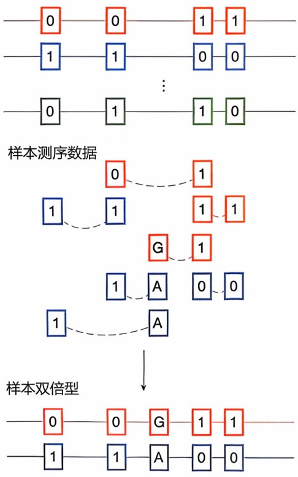

<details>
<summary>flowchart</summary>

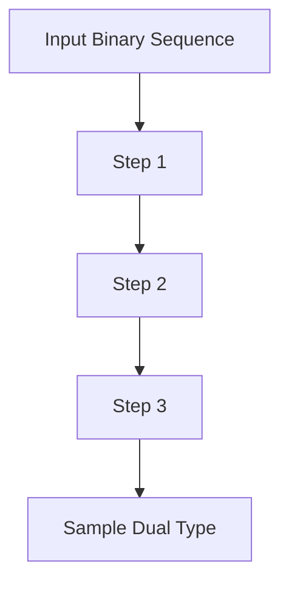
</details>

图6-9 利用人群单倍型信息和测序数据中多变异位点等位基因连锁关系进行单倍型分析和基因型推断简图

其中样本测序数据中的弧形虚线连接的两端读段是一对读长对

略，这类方法展现出了更强的鲁棒性，尤其在处理序列比对误差与测序错误时，能够提供更高的信噪比，从而显著提升变异检测的精度与可靠性。单倍型分析的核心，是利用基因组不同位置变异在人群基因组中所展现的连锁关系，来优化基因型插补（genotype imputation）的效能。具体而言，人群中多态性遗传变异之间的相互关联，常被用于推断缺失或不确定的基因型。算法层面，此过程通常基于隐马尔可夫模型（HMM）实现，尤其在低测序深度的情形下，基因型插补技术能够显著提升高频率等位基因变异在测序数据中被有效检测的灵敏度与准确率。在单细胞基因组变异检测这一领域，上述方法的应用显得尤为关键。由于单细胞内基因组DNA量极为有限，进行测序前，必须先进行全基因组扩增。然而，扩增过程易引致等位基因的不平衡表达与缺失，进而影响后续的变异检测。为克服这一挑战，研究者们巧妙地运用人群遗传变异间的连锁关系，结合测序数据，发展了多种策略以矫正单细胞扩增中出现的等位基因缺失或不平衡问题，从而更准确地推断单细胞的基因型信息。例如，ScanSNV与Monopogen等算法，正是基于这一原理，有效提升了单细胞基因组变异检测的准确度与完整性。综上所述，单倍型分析技术，特别是其在单细胞基因组变异检测中的应用，不仅揭示了人群遗传变异的连锁规律，也为高通量、高精度的单细胞变异分析提供了坚实的理论与技术支撑。这一领域的发展，正推动着基因组学研究迈入一个全新的阶段，有望为个体化医疗、疾病早期诊断及精准治疗等前沿领域带来革命性的突破。

---

6.3 序列变异检测原理与技术

191

## 6.3.3 短插入缺失的检测

短插入缺失（short insertion/deletion, InDel），特指长度小于 50 个碱基对的序列插入或删除，是基因组变异中的重要类型之一。相较于单碱基序列变异，短插入缺失的检测与识别面临更为复杂且独特的挑战，主要体现在以下几个方面。

首先，多数序列比对算法在设计上对插入/缺失（InDel）的惩罚得分往往显著高于错配（mismatch），这种设定在处理携带 InDel 的读段时，可能诱导比对错误。具体而言，算法倾向于选择罚分较低的错配，而忽视了应生成空位状态的真实情况，从而导致序列比对的准确性与可靠性下降。

其次，当 InDel 长度较长，尤其是其位置靠近读段的末端时，序列比对过程中容易触发 “强制截断”（clip）现象，即比对程序为避免高罚分，会人为 “剪断” 读段，导致其无法完整比对到基因组上，进而造成变异信息的部分或全部丢失。

再者，对于发生在重复序列区域内的 InDel，比对过程会遭遇多重定位问题，即多个基因组位置对插入缺失的罚分相同。这一现象，如图 6-10 所示，极大地增加了变异识别的复杂性，使得准确判定 InDel 的真实位置与性质变得异常困难。

鉴于上述挑战，短插入缺失的检测不仅要求序列比对算法具备高度的灵活性与精确度，还需要在变异识别流程中融入更复杂的生物信息学处理策略，以确保变异检测的全面性与准确性。

常用解决方案有:

① 局部序列重新比对 这一策略的核心在于综合利用公共数据库,如 dbSNP、1000 genomes 等,以及原始序列比对中暗示有 InDel 存在的读段信息,来精确定位可能携带 InDel 的基因组区间。随后,通过对这些疑似区间重新定义并构建可能的单倍型,进行局部序列的重新比对,以识别最优解。虽然该方法能够有效提升 InDel 的检测精度,但也存在固有缺陷:一方面,未收录于公共数据库的 InDel 可能被遗漏,导致较高的错误率;另一方面,对于较短的 InDel 检测效果较好,但在处理复杂区间(如长 InDel 导致序列无法准确比对的情况)时,准确率和效率均大幅下降。
② 局部单倍型拼接 此策略基于原始序列比对结果，定位可能包含变异的区

间。随后，使用这些区间内的读段进行拼接，重构局部单倍型，并在此基础上执行变异检测（如 GATK haplotypecaller、Platypus 等软件的处理方式）。与前一种方法不同，局部单倍型拼接不依赖于基于参考基因组的比对，而是直接构建局部单倍型，这对复杂区间内变异的检测尤其有利。然而，该方法的计算复杂度较高，限制了其在大规模数据集上的应用效率。

充分利用拆分读段（split reads）的信息和未成功比对读段中的序列信息。这一策略聚焦于利用那些在常规比对中被分割或未能成功比对的读段，从中提取序列信息，重构出局部单倍型，进而识别更长的InDel。以Pindel、Vardict等软件为代表，此方法对于长InDel的检测

参考基因组序列

CGTATGATCTAGCGCGCTAGCTAGCTAGC

五种罚分等同的缺失发生位置

CGTATGATCTA--GCGCTAGCTAGCTAGC
CGTATGATCTAG--CGCTAGCTAGCTAGC
CGTATGATCTAGC--GCTAGCTAGCTAGC
CGTATGATCTAGCG--CTAGCTAGCTAGC
CGTATGATCTAGCGC--TAGCTAGCTAGC

图6-10 重复序列区间的插入缺失，可见“GC”或“CG”缺失发生在多个位置罚分等同

---

192

6 基因组学

效果显著，但对算法的序列处理能力和计算资源提出了更高要求。

短串联重复区，又称微卫星序列或简单重复序列的插入缺失是一类比较特殊的插入缺失，其突变发生率是非常高的，占插入缺失变异的很大一部分比例。识别和量化这些重复序列变异对于法医鉴定、亲子鉴定、遗传疾病诊断、群体遗传学研究、种群管理和保护等生命科学的多个领域具有广泛的应用价值。然而检测串联重复区序列变异面临着多重挑战，尤其是如何准确地定义和分割串联重复序列与侧翼序列（flanking sequence）。重复序列的定义是相对模糊的，其中包括完美的重复序列和中断的重复序列。如（CT） $_{10}$ 代表“CT”序列精确重复了10次；而（CT） $_{2}$ A（CT） $_{8}$ 表示在两段“CT”重复之间存在一次非重复的碱基“A”。这种序列的存在使得重复单元的定义变得模糊，增加了变异检测的难度:准确地区分重复序列与侧翼序列至关重要，不精确的分割会导致重复单元的错误识别，从而影响变异检测的准确性和可靠性。分割算法主要有基于打分的算法和基于统计学的概率算法:其中基于打分的算法（如MSIprofiler、MSIsensor）通过扫描序列信息，判断其是否为完美重复而加分或者减分，通过打分阈值的序列被判断为重复，因而可以容忍一定数量的序列打断；而统计学的方法多基于隐马尔可夫链（如HipSTR），HMM能够模拟序列的生成过程，从而识别重复序列的结构，即使在序列中断或变异时也能保持较高的识别率。值得指出的是，较长的串联重复序列扩增变异（tandem repeat expansion）对于在一系列神经疾病，如脆性X综合征的发生发展中扮演着核心角色，对于这类较长的突变，序列比对准确性和灵敏度有限，基于序列拼接的算法（如expansion hunter de novo）具有更好的表现。

## 6.3.4 结构变异的检测

如前文所述，大于 $50\mathrm{bp}$ 的基因组变异统称为结构变异。然而这些大于 $50\mathrm{bp}$ 的变异异质性很强，基于突变产生机制的不同分为非常多的亚类，而不同亚类的结构变异具有不同的变异长度、内部序列、断点序列和密度等特征。表6-4展示了几种常见结构变异的发生机制及特征。

表 6-4 不同变异机制以及其引发的结构变异类型和特征

| 变异机制 | 非等位基因同源重组 | 非同源末端连接 | 复制叉停滞和模板交换 | 转座子反转录转座 |
| --- | --- | --- | --- | --- |
| 结构变异类型 | 重复、缺失、倒位 | 重复、缺失 | 重复、缺失、倒位、复杂结构变异 | 序列插入 |
| 断点处侧翼是否有同源序列 | 是 | 否 | 否 | 否 |
| 断点序列特征 | 内部同源性 | 额外的插入或缺失,或微同源序列 | 微同源序列 | 无特别特征 |
| 结构变异内部序列特征 | 任何 | 任何 | 任何 | 转录本序列 |

---

6.3 序列变异检测原理与技术

193

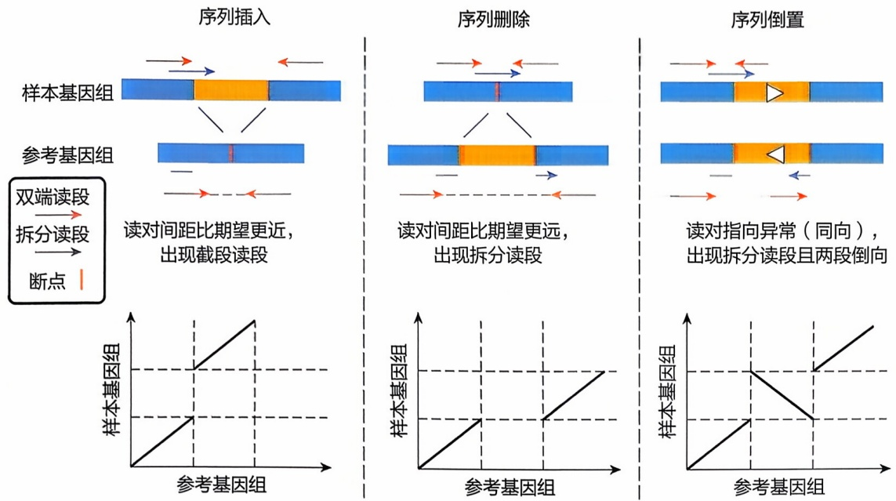

图 6-11 结构变异断点附近的双端测序数据（上）和用 reads 拼装好的连续片段（下）比对到参考基因组后呈现的特征

尽管种类繁多，但所有结构变异具有一个共同的特征:每个结构变异至少有一个“断点”（breakpoint）。所谓断点，就是DNA发生断裂和重排的具体位置。由于在断点处发生了DNA的断裂和重排，因此断点上下的DNA序列来自基因组的不同区域。如图6-11所示，在二代双端测序数据中，断点处和断点附近的测序读对比对到参考基因组后常见以下特征:

① 读对间距异常 两个读对相距太近或者太远，与测序文库中片段的平均长度不符，提示发生了序列删除或插入；
② 读对指向异常（discordant read pair） 读对的方向不是如预期的那样相互指向，而是相反或者同向，提示发生了序列倒置、易位或序列重复；
③ 读对回帖到基因组不同位置 两条读段回帖到基因组完全不同的位置和区域，这些区域相距很远，提示发生了序列易位；
④ 单端读段没有回帖到基因组 读对中一条读段的序列无法回帖到基因组上，提示发生了序列插入；
⑤ 测序读段断开 读段序列断开，分段回帖到基因组的不同位置，即拆分读段（split read），提示发生了序列易位；或者有一段读段可以回帖到基因组上，另一段无法回帖，即截断读段（clipped read），提示发生了序列插入；序列在断点处断开。

结构变异不仅以“断点”为显著特征，其中相当一部分还会引发基因组DNA的“剂量变化”，即变异区域内拷贝数的增减，这类变异统称为拷贝数变异（copy number variation, CNV）。拷贝数变异的存在，直接反映在测序读段深度的显著变化上:当拷贝数增加时，对应区域的读段深度会显著提升；反之，拷贝数减少，则会导致读段深度的下降（图6-12）。这种深度的变化，为拷贝数变异的检测提供了直观的指示信号。此外，拷贝数变异还会导致B等位基因频率（B allelic frequency, BAF，即特定区域内单核苷酸多态性的等位基因频率）发生偏离。在正常的二倍体

---

194

6 基因组学

图6-12 拷贝数变异引起的变化情况

（a）测序数据特征变化；（b）用读段拼装好的连续片段比对到参考基因组后呈现的特征；（c）一组真实癌症数据中的拷贝数变异。红色区段为算法推断的拷贝数增加，蓝色区段为拷贝数减少

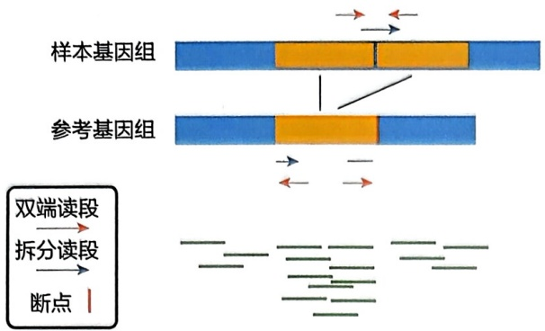

<details>
<summary>flowchart</summary>

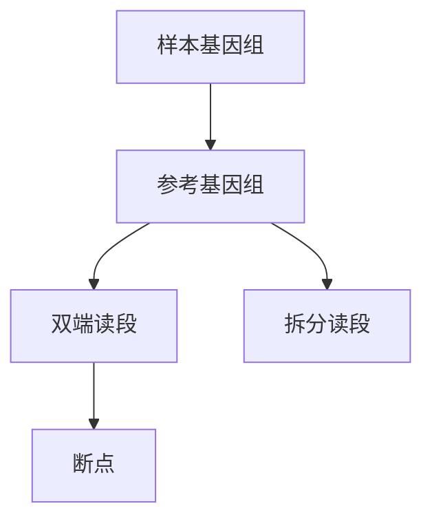
</details>

(a)

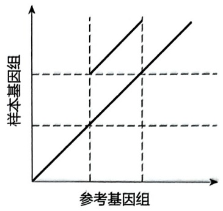

<details>
<summary>line</summary>

| 参考基因组 | 样本基因组 |
| --- | --- |
| 0 | 0 |
| ~0.25 | ~0.25 |
| ~0.75 | ~0.75 |
</details>

(b)

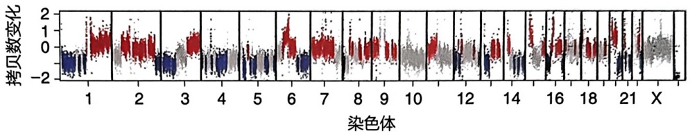

<details>
<summary>boxplot</summary>

| 染色体 | Q1 | Q2 (Median) | Q3 |
| --- | --- | --- | --- |
| 1 | ~-1.5 | ~-0.5 | ~0.5 |
| 2 | ~-1.0 | ~0.0 | ~0.8 |
| 3 | ~-1.5 | ~-0.5 | ~0.5 |
| 4 | ~-1.5 | ~-0.5 | ~0.0 |
| 5 | ~-1.5 | ~-0.5 | ~0.0 |
| 6 | ~-1.5 | ~-0.5 | ~0.5 |
| 7 | ~-1.5 | ~-0.5 | ~0.5 |
| 8 | ~-1.5 | ~-0.5 | ~0.5 |
| 9 | ~-1.5 | ~-0.5 | ~0.5 |
| 10 | ~-1.5 | ~-0.5 | ~0.0 |
| 12 | ~-1.5 | ~-0.5 | ~0.5 |
| 14 | ~-1.5 | ~-0.5 | ~0.5 |
| 16 | ~-1.5 | ~-0.5 | ~0.5 |
| 18 | ~-1.5 | ~-0.5 | ~0.5 |
| 21 | ~-1.5 | ~-0.5 | ~0.5 |
| X | N/A | N/A | N/A |
</details>

(c)

基因组中，BAF 值主要集中在 0、0.5、1 这三个理论值附近。然而，当基因组发生拷贝数变异时，变异区域内的 BAF 值往往会偏离这些常规值，呈现出非典型分布。这种偏离现象，成为拷贝数变异检测中的另一重要线索。

从二代测序数据中检测结构变异的工具多达上百种，如 2019 年一篇发表在 Genome Biology 上的文章比较了 60 余种工具。绝大多数变异检测算法围绕上述讨论的两点特征:断点和 DNA 拷贝数变化展开，有的算法直接基于短读段的特征和分布进行建模（如 BreakDancer、Pindel、DELLY、Meerkat、BICseq2、Control-FreeC 等），有的算法则基于读段特征以及读段拼接的连续片段进行建模（如 GRIDSS、Manta 等）。

例如，经典的结构变异检测算法 DELLY 首先计算出测序文库插入片段的长度分布，然后找出间距显著偏离分布的测序读段簇来定位序列删除的大致区间、用指向异常（同向）的读段簇来定位序列倒置区间、用指向相反且朝外的读段簇来定位串联重复变异区间、用比对到不同染色体上的读段来定位序列易位区间。在此基础上，DELLY 在上述包含断点的区间内进一步搜寻最可能包含断点的读段（包括 split reads 和只有单端比对到基因组上的读段），将这些读段重新比对到这个区间内做好索引的参考序列上，并计算每个读段对参考序列对角线上的七碱基对 k-mer 匹配数。对于所有读段，计算两个支持度最高的序列比对对角线之间的偏移量，此偏移量即是发生结构变异的长度，两端即是结构变异断点。

除了较为简单的单发性结构变异，还有更加复杂的结构变异事件，复杂的结构变异事件指的是同时发生或协调进行的多个基因组结构变化。这些事件的特点是在基因组的某个区域内存在多个结构变异（最常见的例子之一是插入序列中同时存在一段缺失，尤其在基因组不稳定性较高的癌症基因组中通常涉及非常复杂的基因组断裂（甚至碎裂）和重排。

---

6.3 序列变异检测原理与技术

195

由于读长较短（通常 $150\sim 250$ bp），基于二代测序数据检测复杂结构变异、较长的结构变异，以及断点在重复序列区间结构变异的灵敏度和准确性均存在上限。另外，表征结构变异的变异长度、断点数量和密度、单倍型、断点上下文序列等对于对结构变异进行分类、理解结构变异的突变发生机制具有重要意义，然而由于二代测序数据读长短，基于二代测序数据刻画结构变异的各类特征具有巨大困难。三代测序方法（如PacBio、Nanopore等）的出现为解决上述困难带来了机遇。由于读长较长（通常 $10\mathrm{kb}$ 以上），用三代测序读长往往可以直接读通多个断点的染色体单倍型和读通重复序列区，从而不需要进行复杂的建模和算法来推断断点位置和单倍型连锁关系；由于其相对于短读长测序手段巨大的优势，基于三代测序数据进行结构变异的方法出现了井喷。采用长读长测序手段后结构变异的检测灵敏度普遍提升 $2\sim 10$ 倍。

尽管具有独特的优势，但三代测序数据也不是完美的。相比二代测序数据，三代测序数据的测序准确性偏低很多，这给测序数据的准确比对、结构变异和断点位置的准确判断带来了新的挑战。从三代测序数据检测结构变异的方法也大致可以分为基于序列比对和基于序列组装两大类。对基于序列比对的方法来说，序列比对算法和比对参数的设置对结构变异的准确检测有很大的影响，因而有些软件专门开发了针对三代测序数据的序列比对算法（如 Sniffles 的解决方案），有些软件则采用现成的序列比对软件比对后再比对结果进一步优化（如 Picky、SENSV）。与从二代测序数据检测结构变异类似，这些算法也会从比对的测序读段中抓取结构变异的常见特征，如空位、拆分读段和截断读段等。由于三代测序数据普遍错误率较高、结构变异的断点位置常发生在高度重复序列区等问题，不同读段从同一个结构变异中抓取的特征（如断点位置）往往不一致，因而将多个读段抓取的特征值合理地分割成来自不同结构变异的特征值，并分别统一成一个共同的特征值尤为重要。多数软件采取聚类的方法，基于不同类型结构变异的经验特征分布来分割和合并多条读段的特征值。这种基于人为定义规则的结构变异检测和分类策略势必会造成一定的偏差，尤其新型的、复杂的结构变异难以用经验规则来定义和分类。深度学习算法为从计算机角度定义和准确鉴定各种类型的结构变异提供了崭新的角度（如 Svision、BreakNet、MAMnet 等）。基于序列组装的方法大致可以分为从头组装和先比对后组装两种策略。相对于原始读段，组装好的序列长度更长、碱基准确度更高，且序列组装策略在序列比对容易出错的区间（如高度重排区）表现更好，组装好的序列进行可视化也非常清晰。但序列组装方案需要的测序深度和成本较高。

长读长测序加持下的“端到端”参考基因组以及泛基因组参考图谱的构建对于结构变异的检测具有里程碑式的重要意义。“端到端”参考基因组填补了之前参考基因组中没有解决的高度重复序列区间，而泛基因组参考图谱包括了人群中各种可能发生的常见结构变异，这些对于测序数据的精确比对和变异的准确检出非常重要。此外，其他新型测序数据的涌现，如Hi-C、Strand-Seq、单细胞多组学测序数据等的出现为检测不同突变机制、不同丰度的结构变异提供了新的可能性。总之，新型

---

196

6 基因组学

测序技术和下游生物信息学方法的快速发展对检测结构变异有重要的推进作用。

本节内容并未涵盖所有突变检测方法，但已经足以看出，对于特定的变异类型可以有多种多样的生物信息学方法来检测，它们分别从不同角度来看待问题，运用了不同的信息、不同的模型来解决问题。伴随着生物信息学领域的不断发展和新测序方法的涌现，序列变异检测所聚焦的内容和挑战也发生着动态的变化。总体而言，序列变异检测从①检测高丰度、高信噪比的胚系变异转移到检测低丰度、低信噪比的体细胞突变和嵌合突变；②从检测单碱基变异、非重复区间变异迁移到复杂结构变异、重复序列区变异的检测；③从检测bulk测序数据中的突变迁移到检测单细胞、单分子测序数据中的突变；④从二代测序数据中检测变异转移到从三代测序数据中检测变异；⑤从DNA测序数据中检测变异转移到从其他组学数据的应用场景，如从RNA测序数据、ATAC测序数据、其他表观组测序数据、三维基因组测序数据中检测各种类型的变异。扎实的数理统计知识和数据处理技巧是方法实现的基础，对基因组、变异特征、测序数据的深刻理解是各种方法另辟蹊径解决问题的必要条件，而新型测序数据的不断涌现和大量基因组测序数据的快速积累导致变异的准确和快速检测面临挑战，是各种算法开发的原始动力。

## 6.4 宏基因组学

## 6.4.1 微生物组概述

微生物是普遍存在于自然界中的生命体，常以微生物群落的形式存在，微生物组（microbiome）就是指这些微生物遗传信息的总和。其中，微生物群、宏基因组和微生物组是微生物组学研究中三个非常重要的概念，其主要区别在于研究对象范围的大小（图6-13）。

其中，微生物群（microbiota）既包括植物体上共生或病理的微生物生态群体，也包括在土壤、水体和空气等环境中自由生存的细菌、古菌、原生动物、真菌

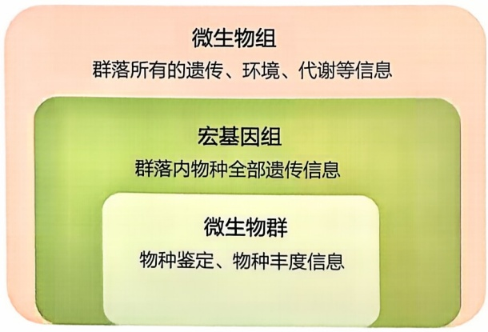

<details>
<summary>flowchart</summary>

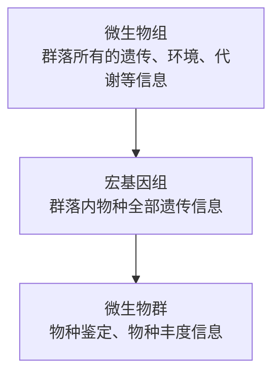
</details>

图6-13 微生物群、宏基因组和微生物组的关系

和病毒。宏基因组（metagenome）又称元基因组或微生物环境基因组，其定义是“生境中全部微生物遗传物质的总和”。它将包含了可培养的和未可培养的微生物群落的所有遗传物质作为研究对象，广义来说其包括环境基因组学、生态基因组学和群体基因组学。微生物组（microbiome）包括微生物（细菌、古细菌、低等或高等真核生物和病毒）的基因组，以及其周围环境，也就是说微生物组既包括微生物物种，又包括各个物种的基因组以及相关环境因素和代谢产物。微生物组是结合了宏基因组学、代谢组学、宏转录组学，以及宏蛋白质组学等和临床/环境数据的集合。

---

6.4 宏基因组学

197

微生物组学是指对微生物组数据进行研究的学科，其研究内容一般可以分为三大类:① 微生物培养，这是了解微生物形态结构和生理功能最直接的方法，但是微生物培养一般费时费力，且许多微生物是不可培养的，基于高通量测序可以解决这些问题。② 微生物测序，高通量测序技术的进步极大地促进了微生物相关研究，基于高通量技术的微生物研究平台主要包括扩增子测序技术和宏基因组测序技术等。③ 多组学研究，基因测序方法不能直接测定微生物的功能活性，难以鉴定微生物中的关键功能分子，单独使用时无法回答何种微生物通过何种方式影响宿主等关键问题。单一组学研究弊端已日益显现出来，而微生物组学与代谢组学等多组学联用的优势逐渐突出，其关联分析在宿主生理、疾病病理、药物药理等领域已取得众多进展，具有良好应用前景。

群落内各物种的组成（composition）与分布（distribution）是形成一个特定群落的基础，也是群落之间差异的来源。通常使用和多样性来评估微生物组的总体变异模式，利用差异丰度分析识别不同组之间丰度显著差异的微生物，相关性分析可用于揭示分类单元与样本元数据之间的相互关系，利用网络分析直观地表示群落中各种微生物物种之间的相互作用关系。

## 6.4.1.1 $\alpha$ 多样性

$\alpha$ 多样性（$\alpha$-diversity）是评估微生物组样本中不同特征的多样性的方法，被表征为一个特定群落或样本内的物种多样性。它常用来描述单个样本的丰度和均匀度。常见的数学定义包括:

① Shannon 多样性指数（Shannon diversity index, H）

$$
H = - \sum_ {i = 1} ^ {S} p _ {i} \ln (p _ {i}) \tag {6-9}
$$

其中，$S$ 是样本中物种的总数，$p_i$ 是第 $i$ 个物种相对于样本的比例。

② 辛普森指数（Simpson's index, D）

$$
D = 1 - \sum_ {i = 1} ^ {S} p _ {i} ^ {2} \tag {6-10}
$$

辛普森指数考虑了物种的丰富度和优势度，指数越高，代表多样性越高。

③ 物种丰度（species richness，R）

$$
R = S \tag {6-11}
$$

即样本中观察到的物种总数。

## 6.4.1.2 $\beta$ 多样性

$\beta$ 多样性（$\beta$-diversity）是一种评估不同微生物组样本之间特征差异的方法，其衡量的是不同样本或群落之间的物种多样性差异，常用于比较不同群落的物种组成。根据研究的目的和数据的类型，需要选择合适的度量方法来计算多样性。常见的数学定义包括:

---

198

6 基因组学

① Jaccad 相似系数（Jaccard similarity coefficient）

$$
J a c c a r d = \frac {| A \cap B |}{| A \cup B |} \tag {6-12}
$$

其中， $|A\cap B|$ 是在两个样本中都存在的物种数， $|A\cup B|$ 是两个样本中存在的所有物种数。

② Bray-Curtis 相异度（Bray-Curtis dissimilarity）

$$
B r a y - C u r t i s = \frac {\sum_ {i = 1} ^ {S} | a _ {i} - b _ {i} |}{\sum_ {i = 1} ^ {S} (a _ {i} + b _ {i})} \tag {6-13}
$$

其中， $a_{i}$  和  $b_{i}$  是两个样本中第 i 个物种的丰度。

③ 差异表达分析 差异表达分析（differential expression analysis）揭示不同条件下的微生物群落变化，有助于识别潜在的生物标志物。差异表达分析的常用方法包括 edgeR、DESeq2 和 LefSe，这些方法在归一化、技术变异性建模方面略有不同，适用于不同的数据分布情况。
④ 相关性分析 相关性分析（correlation analysis）有助于我们深入了解微生物之间以及微生物与环境之间的关联。皮尔逊相关系数（Pearson correlation coefficient）和斯皮尔曼等级相关系数（Spearman's rank correlation coefficient）是两种基础的分析相关性统计方法。
⑤ 网络分析 网络分析（network analysis）是一种研究和分析网络结构、元素之间的关系和网络整体特性的方法，可用于理解微生物物种之间的关系和相互作用。利用微生物组数据可以构建物种相互作用网络，为深入了解微生物生态系统提供了帮助。相互作用网络包括共现网络和生态网络，可以直观地表示各种微生物物种之间的相互作用关系，在微生物组数据分析中广泛应用。

## 6.4.2 微生物组数据及其主流分析方法

微生物组大数据是微生物群落在数据层面的体现，能够反映微生物群落在不同角度的多种特征（图6-14），具有多模态、多组学整合研究的典型特征。这些基于不同角度产生的与微生物群落相关的数据，是微生物组研究的主要对象，其中微生物组学数据，是微生物组大数据的核心和挖掘的主要对象。

随着组学研究的发展，单一的组学数据已经难以满足需求，整合多组学数据以揭示其生理过程成为主要的研究方法。另外，人工智能方法的发展也极大地促进了面向微生物群落的知识发现。在多组学研究中，多组学整合、富集分析、相关性分析、预测模型建立与优化，是最核心的分析模块，也是人工智能技术能够大幅度改善分析效果的环节（图6-15）。其中涉及多个层次的组学和相关数据，分为三个部分:先进的分析方法、各类组学数据，以及复杂的预测应用场景。其中深度学习的方法，就是整个分析场景中的核心分析方法。


拓展阅读6-2

MGnify 数据库和分析平台


---

6.4 宏基因组学

199

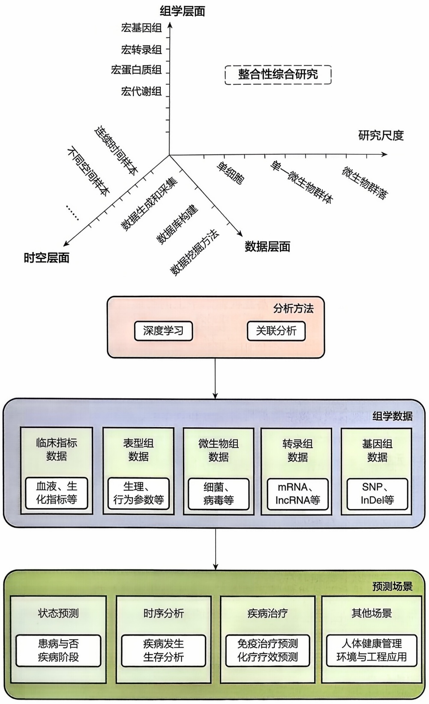

<details>
<summary>flowchart</summary>

This image is a hierarchical flowchart illustrating the research framework for comprehensive analysis of genetic data. It details the progression from individual research groups through time-series analysis to detailed group data and finally to prediction scenarios.
</details>

图6-14 微生物组大数据研究的角度基于不同的组学、时空、研究尺度、数据处理方法进行微生物群落的综合性研究

图6-15 深度学习助力多组学整合分析与研究

## (1) 宏基因组数据

宏基因组数据是指微生物群落中遗传物质 DNA 的测序数据。能够反映微生物群落中的物种、基因等众多信息，是目前微生物组研究中主要的数据类型。微生物宏基因组测序数据，包括 16S rRNA 测序数据和全基因组测序数据，其中 16S rRNA

---

200

6 基因组学

测序数据只能够反映群落的物种信息，而全基因组测序数据不仅能够反映群落的物种信息，还能反映群落中的功能基因信息。

## (2) 宏转录组数据

宏转录组数据是指微生物群落中RNA的测序数据。能够反映微生物群落中基因表达和基因调控等功能相关的信息，是目前微生物组研究中能够反映群落功能的主要数据类型。

## (3) 宏蛋白质组数据

宏蛋白质组数据是指微生物群落中蛋白质的质谱数据。能够反映微生物群落中蛋白质表达和蛋白质功能等相关的信息，是目前微生物组研究中能够反映群落功能的重要数据类型。然而，由于微生物群落中蛋白质的质谱数据在覆盖度和精确度上的限制，目前微生物宏蛋白质组数据并不是很多。

## (4) 宏代谢组数据

宏代谢组数据主要指微生物群落中细菌代谢物的质谱数据。微生物组相关的宏代谢组数据，能够反映微生物群落在代谢水平上的功能信息，是目前微生物组研究中能够反映群落功能的重要数据类型。在多组学研究中，常常将微生物组相关的宏代谢组数据与其他组学数据整合使用，可以发掘微生物群落的代谢规律。

## (5) 宏表型组数据

宏表型组数据是指微生物群落中细菌表型的数据，包括微生物群落图像数据、微生物群落单细胞表型、微生物群落时空分布数据等，能够反映微生物群落中各个物种的时空分布和动态变化规律。

## (6) 元数据

元数据（meta-data）主要是指微生物群落在采样、测序和分析过程中涉及的环境指标、测序参数和分析参数等各类数据。元数据通常会结合组学数据进行关联分析，以及辅助样本的分组分析。

## 6.4.2.1 宏基因组的主流数据分析方法和软件

随着高通量测序技术的发展和应用，积累了海量的微生物组数据，微生物组研究相关的分析方法和工具也取得了快速发展，大批优秀的软件、流程和可视化工具相继发布（表6-5），进一步推动了本领域的发展。

## (1) 宏基因组分析软件

宏基因组测序相较于扩增子测序不仅可以获得更准确的物种组成，还可以获得相应的功能信息。

① 基于参考数据库比较的快速宏基因组物种和功能成分量化是在许多研究中常用的方法，序列物种分类软件 MetaPhlAn2、Kraken2 和功能成分量化的 HUMAnN2 都是基于该策略开发的。
② 缺乏高质量宏基因组参考数据库的领域是需要从头拼接宏基因组数据并进行基因预测。宏基因组拼接的挑战在于处理来自不同物种的混杂数据和高复杂度的微生物群落，因此拼接的结果通常呈现为宏基因组拼接组（metagenome-assembled

---

6.4 宏基因组学

201

表 6-5 代表性的宏基因组学数据分析方法和软件

| 名称 | 简介 | 应用场景 | 特点 |
| --- | --- | --- | --- |
| Trimmomatic | 一种用于Illumina NGS数据低质量、引物和接头序列去除工具 | 常用于高通量测序数据的预处理,确保数据质量 | 快速、灵活,支持多线程 |
| MetaPhlAn2 | 用于从宏基因组中分析微生物群落的组成 | 常用于人体和环境样本的微生物群落分析,广泛用于微生物组研究 | 准确度高,数据库广泛更新 |
| HUMAnN2 | 可以高效、准确地分析一个群落中微生物路径存在/缺失和丰度 | 特别适合复杂环境中微生物功能分析,如肠道微生物功能研究 | 兼容MetaPhlAn |
| MEGAHIT | 超快、省内存的宏基因组组装软件 | 适用于大型宏基因组样本的组装,尤其适合低存储条件下的快速组装 | 运行速度快,占用资源少 |
| QIIME 2 | 用于微生物组数据的分析软件,它可以帮助进行序列质量控制、特征分类和统计分析 | 适用于宏基因组学中的16S rRNA、ITS和其他基因的序列数据的分析 | 具有插件系统,社区支持强大,并提供丰富的可视化功能 |
| CD-HIT | 构建非冗余基因集 | 常用于基因集的去冗余,确保数据简化,提高分析效率 | 参数丰富,灵活性高 |
| Kraken2 | 超快速的微生物群落分类工具,用于分类宏基因组数据 | 可用于快速分类宏基因组样本中的细菌、病毒等微生物群落 | 速度快,基于k-mer算法,具有高准确性 |
| Canopy | 用于宏基因组序列装配和差异比较的工具 | 适合对比不同样本间的宏基因组数据,探索群落差异 | 支持长读长数据,装配功能强 |

genome, MAG) 的形式, 其中每个 MAG 代表一组叠连群的聚类, 潜在包括一个微生物物种的多个片段。常见的拼接算法包括基于重叠图的算法、de Bruijn 图算法和混合组装方法。基于重叠图的算法通过寻找片段之间的重叠区域进行拼接, de Bruijn 图算法则通过构建 $k$-mer 图来识别片段间的连接关系。混合组装方法结合了上述两种算法的优点, 提高拼接精度和效率。常用的宏基因组拼接软件有 MEGAHIT、metaSPAdes、Prokka 等。常用的宏基因组基因预测软件跟基因组预测软件类似。

③ 在多个样本或批次的宏基因组数据的组合分析中，通常需要用 CD-HIT 构建一个非冗余基因集，以实现基于统一参考序列的所有样本的定量和比较。糖类基因数据库（CAZy）、抗生素耐药基因综合数据库（CARD）、细菌致病因子数据库（VFDB）是应用广泛的蛋白质功能注释数据库，将获得的基因集与之比对，可以为生物学研究提供更多的视角。
④ 宏基因组测序数据还可以用分箱（binning）组装出单个细菌的基因组。常用的分箱工具包括 MetaBAT 2、MaxBin 2 和 CONCOCT 等。

## (2) 统计和可视化工具

基于宏基因组分析中会得到包含物种或功能组成的表即特征表（feature table），是二代测序数据分析结果中常见的格式。R软件包、图形界面、命令行或网络版本工具，可以在下游分析中转换和呈现数据。Bioconductor网站用于生物数据分析的R

---

202

6 基因组学

软件包集合已达数千个，如计数型数据可选基于负二项分布模型的差异统计 R 软件包 edgeR，组成型数据差异分析可选 limma。LEfSe 可寻找特征向量，其原理是基于线性判别分析，结果可用柱状图或基于 GraPhlAn 绘制的进化分枝图（cladogram）展示方式。STAMP 可以实现主成分分析、多种统计方法进行两组或多组差异比较。

## 6.4.2.2 宏基因组数据分析流程

随着高通量测序技术的发展，微生物组分析方法也不断涌现，如扩增子、宏基因组、宏转录组等，技术的发展进一步推动了该领域的进步。目前，微生物研究从样本类型可以分为三类。① 微生物组层面:在这一层面上培养组学（culturome）是最重要的研究手段，在人类、拟南芥、水稻等物种都已经有应用和报道；② DNA 层面:为了获得 DNA 的序列信息，扩增子、宏基因组和宏病毒组等测序方法相继问世，其中扩增子测序可以获得研究对象的物种组成信息，宏基因组测序还可以进一步研究物种所携带的功能基因；③ mRNA 层面:对微生物组样本提取 RNA 进行宏转录组（metatranscriptome）测序，基于基因表达谱可以进一步揭示微生物群落原位功能。

其中宏基因组数据分析流程包括以下 6 步:

① 原始数据解析 二代测序技术所获得的原始数据为 fastq 格式，对于所获得的原始数据可以使用 FastQC 对其测序质量进行可视化，得到质检报告。
② 质控 Trimmomatic 是一个便捷好用的 Illumina 测序数据质控工具。
③ 数据筛选去除宿主序列 将质控后的序列和人类基因组序列进行比对，将比对上的序列去除，常用软件有 BWA、Bowtie、BBMap 等。
④ 宏基因组组装 将短序列组装为叠连群，目前常用的高通量测序组装软件有Velveth、SOAPdenovo、IDBA、Megahit等。
⑤ 基因预测 原核生物基因预测软件常用的有 GeneMark、Prodigal 等，真核生物基因预测软件有 GENSCAN、Augustus、GlimmerHMM 等。
⑥ 未组装的宏基因组群落分析 MetaPhlAn 是宏基因组分析微生物群落物种（细菌、古菌、真核生物和病毒）组成的常用软件。

## 6.4.2.3 宏基因组分析示例

肠道微生物群和代谢物的紊乱与炎症性肠病（inflammatory bowel disease, IBD）的发生密切相关。然而，各研究的不一致结果阻碍了对其在IBD中的作用及其作为可靠的诊断生物标志物潜力的全面了解。为了应对这一挑战，研究人员全面分析了来自不同人群的IBD的9个宏基因组和4个代谢组学队列。通过跨队列综合分析（cross-cohort integrative analysis, CCIA），确定了共生肠道微生物群的一致特征。

具体而言，根据纳入和排除标准招募志愿者队列，在此项工作中包括 IBD 患者和正常对照两组，所有参与者在报名时均须提供至少 3.0 g 的粪便样本。使用 HiPure Stool DNA Mini Kit 提取粪便样本中的 DNA。通过琼脂糖凝胶电泳和 Qubit™ 4 荧光计评估提取的 DNA 质量、大小和浓度。随后，NeoBIO 技术利用 Hieff NGS® Ultima DNA Library Prep Kit for Illumina® 按照制造商的方案构建了宏基因组文

---

6.4 宏基因组学

203

库。在保证文库质量后，在 NovaSeq 6000 平台进行高通量测序。研究利用 bioBakery 元组学工作流程从宏基因组数据生成分类和功能图谱。为了确保使用不受污染的高质量微生物读数，采用 KneadData 进行数据过滤。使用 MetaPhlan3 进行分类分析，它利用进化枝特异性标记库来提供泛微生物分析。$\alpha$ 多样性指标，用于评估群落内物种的多样性和均匀性，使用统计工具 MMUPHin 研究 IBD 和对照样本之间 $\alpha$ 多样性的差异。通过计算 Bray-Curtis 相异度来评估 $\beta$ 多样性，该距离量化了样本中微生物群落的差异。不同组间差异丰度（difference abundance，DA）的显著性使用 R 软件包中的“coin”包和 Wilcoxon 检验进行评估。此外，使用广义倍数变化（gFC）方法来计算对照和 IBD 样本之间的差异幅度，使用 R 软件包“clusterProfiler”对 KO 基因进行 KEGG 直系同源富集分析。为了最大限度地减少误诊 IBD 的风险，我们通过分析使用最有效的特征组构建的模型的 AUROC 值来评估宏基因组标记的特异性。

通过跨队列综合分析（CCIA），研究确定了共生肠道微生物群的一致特征。特别是三种细菌，即 Asaccharobacter celatus、Gemmiger formicilis 和 Erysipelatoclostridium ramosum，这在 IBD 中很少报道。宏基因组功能分析表明，与粪便钙卫蛋白相关的双组分系统途径的必需基因与 IBD 有关。代谢组学分析显示 36 种已鉴定的代谢物具有显著差异，但这些代谢物在 IBD 中的作用仍不清楚。为了进一步阐明肠道微生物群与代谢物之间的关系，研究构建了多组学相关图，该图突出了肠道微生物生物转化缺陷和氨酰-tRNA 合成酶的显著变化。最后，确定了用于 IBD 诊断的多组学生物标志物，并在多个全球队列中进行了验证（AUROC 值范围为 0.92～0.98）。

## 6.4.3 微生物组大数据挖掘

微生物组大数据的挖掘，根据其研究对象主要可以分为微生物基因组、微生物转录组、微生物蛋白质组、微生物单细胞组，以及微生物组相关多种组学的整合与挖掘等方法；按其研究目的和方法，可以分为相关性的回归分析、分类的随机森林、聚类的神经网络、预测分析的深度学习等方法。

微生物组学大数据分析和整合研究已经逐渐涉及生物信息学的各个方面，其中，统计和模式识别方法是理解微生物数据的基础，生物网络建模和模式挖掘是研究微生物分子生态系统的核心。为此，面向微生物组学大数据的特点，设计开发新的模式挖掘、统计模式识别、网络构建与分析方法具有非常高的价值。基于这些方法，能够从微生物组学大数据中提取与疾病相关的微生物标记，并将其用于微生物相关疾病的生物诊断和治疗。

生物标志物是一种对治疗后状态、病理过程以及利用药物后的集体反应进行客观判断的指示物。是临床诊断方面常用的辅助工具，其可以反映和检测生物集体和环境之间发生作用时的特征性改变，根据特定的改变可以有效判断疾病发生原因，并对其发展方向和后续的治疗手段提供指导。但是生物标志物的选择是一个异常艰

---

204

6 基因组学

难的过程，需要进行研究和详细的临床医学验证，以及在特殊情况下的可行性也需要充分考虑。

随着科学技术的发展，临床上对生物标志物的使用也更加广泛，将生物标志物与常规检测手段相结合是临床诊断的一大发展方向。例如，纤维肌痛症是一种复杂且相对未知的疾病，其主要特征是弥漫性肌肉疼痛，常伴有多种非特异性症状但原因不明，研究发现大部分患者有躯体或精神创伤史。研究人员结合了不同的组学技术来分析微生物组和血清组分，深入了解纤维肌痛的发病机理并鉴定诊断性生物标志物。研究选取了105例纤维肌痛患者以及54例年龄和环境条件匹配的健康个体对照者，收集了粪便和血液样本，结合微生物组、血清代谢组、循环细胞因子和miRNAs数据来寻找潜在的生物标志物。其结果如下:

① 对照样本和纤维肌痛样本之间多元无监督主成分分析未显示任何差异，但是监督的偏最小二乘判别分析（partial least squares discriminant analysis, PLS-DA）两个样本组区别明显。对照组呈现出更加多样化的细菌群落。两个样品组的比较显示，健康对照组中的梭状芽孢杆菌比纤维肌痛患者中丰富，尽管差异没有统计学意义。在将临界值降低到普遍存在的 $50\%$ 之后，观察到两组核心微生物组之间的差异。具体来说，在纤维肌痛核心微生物组中不存在的两个细菌家族，即双歧杆菌科和拟杆菌属，它们代表对照核心微生物组。

② 纤维肌痛组和对照组之间有 228 个特征不同。在这 228 个特征中，只有 88 个在 METLIN 数据库中具有暂定 ID。使用质谱/质谱数据和化学标准品，发现纤维肌痛样品中这些代谢物的 7 种水平发生了显著变化:鸟氨酸、L-精氨酸、Nε-甲基-L-赖氨酸、L-谷氨酸、L-谷氨酰胺、不对称二甲基精氨酸（asymmetric dimethylarginine, ADMA）和血小板活化因子（platelet activating factor, PAF）C-16。其中一个与新陈代谢相关的改变特征初步确定为 L-苏氨酸或 DL-高丝氨酸，通过 MetScape 和 IPA（Ingenuity Pathway Analysis）分析表明，细胞信号传导、炎症反应和超敏反应是最相关的生物学过程。最典型的代谢途径是精氨酸、一氧化氮（NO）和谷氨酸代谢。

③代谢组学特征和微生物组变量的相关性研究发现，基于相关性，代谢物可分为两个簇。第一簇含有4种代谢物（3-甲基-L-赖氨酸、PAF C-16、ADMA、L-赖氨酸），第二簇是由8种代谢产物（谷氨酸、L-苏氨酸/DL-高丝氨酸、谷氨酰胺、Nε-甲基-L-赖氨酸、肌酸酐、鸟氨酸、精氨酸和乙酰肉碱）形成的，尽管在这个簇中乙酰肉碱的代谢产物与其他代谢产物的行为不同。双歧杆菌在纤维肌痛患者中的丰度降低，与第一代谢物簇负相关，与第二簇正相关。研究人员在纤维肌痛患者中的丰度增加，与第一个代谢物簇呈正相关，与第二个代谢物簇呈负相关。

## 6.4.4 宏基因组学在健康和环境领域的应用

微生物无处不在，其会受到所处环境的影响，反过来也会对环境产生强烈的反馈效应。基于宏基因组学数据进行多学科研究，在健康、环境、能源、工程等领域

---

6.4 宏基因组学

205

中有重要应用。目前，基于宏基因组技术在微生物与不同宿主相互作用、人体健康、环境保护等方面取得许多成就。

## 6.4.4.1 疾病治疗

靶向PD-1/PD-L1轴的免疫检查点抑制剂（immune checkpoint inhibitors, ICIs）在少数癌症患者中诱导持续的临床反应。研究人员发现对ICIs的原发性耐药可归因于肠道微生物组组成异常。对ICIs有反应的癌症患者的粪便微生物群移植（fecal microbiota transplantation, FMT）到无菌或抗生素治疗的小鼠中，改善了PD-1阻断的抗肿瘤作用，而来自无反应患者的粪便微生物群移植（FMT）则没有这样的效果。诊断时患者粪便样本的宏基因组学显示，ICIs的临床应答与嗜黏液芽孢杆菌的相对丰度存在相关性。无应答性FMT后口服补充嗜黏液芽孢杆菌，通过增加小鼠肿瘤中 $\mathrm{CCR9 + CXCR3 + CD4 + T}$ 淋巴细胞的募集，以白细胞介素-12依赖的方式恢复PD-1阻断的疗效。

胰腺导管腺癌（pancreatic ductal adenocarcinoma，PDAC）具有高发病率，但是只有不到一半的患者对PDAC化疗的主要治疗有反应。饮食是影响治疗反应的环境因素，但其在PDAC中的作用尚不清楚。约瑟夫·廷特诺特（Joseph Tintelnot）等使用宏基因组测序和代谢组学筛选，发现微生物来源的色氨酸代谢物吲哚-3-乙酸（3-IAA）在对治疗有反应的患者中富集。粪便微生物群移植、短期饮食控制色氨酸和口服3-IAA可提高PDAC人源化非生物小鼠模型的化疗效果。通过功能丧失和功能获得实验的结合，证明了3-IAA和化疗的疗效是由中性粒细胞衍生的髓过氧化物酶作用的。总之，研究确定了一种微生物衍生的代谢物，其在PDAC的治疗中具有临床意义，为癌症患者治疗期间考虑营养干预提供了动力。

## 6.4.4.2 人体健保

世界范围内的肥胖流行促使人们努力确定影响能量平衡的宿主和环境因素。通过比较遗传肥胖的小鼠和它们较瘦的同伴，以及肥胖和瘦的人类志愿者的远端肠道微生物群。彼得·特恩博（Peter Turnbaugh）等通过宏基因组和生化分析证明，肥胖与两种主要细菌种类，即拟杆菌门和厚壁菌门的相对丰度变化有关，这些变化会影响小鼠肠道微生物群的代谢潜力。研究结果表明，肥胖的微生物群从饮食中获取能量的能力增强了。此外，这种特性是可传染的，与“肥胖微生物群”的定植相比，带有“肥胖微生物群”的无菌小鼠体脂总量显著增加。这些结果确定肠道微生物群是肥胖病理生理的另一个促进因素。

人体微生物群是人体不可分割的组成部分，也是多种健康状况的共同决定因素。然而，人际关系在多大程度上塑造了微生物组的个体基因组成及其在种群内和种群间的传播仍不得而知。米雷娅·科洛默尔（Mireia Colomer）等利用超过9700个人类宏基因组和计算菌株水平分析，检测到个体之间广泛的细菌菌株共享，具有不同的母婴、家庭内和群体内传播模式。母婴肠道微生物组的传播在婴儿期相当可观且稳定，并且在老年时仍可检测到。相比之下，口腔微生物群的传播主要是水平发生的，并且随着同居时间的延长而增强。同居个体之间存在大量的菌株共享，肠道和

---

206

6 基因组学

口腔微生物组的菌株共享率中位数分别为 $12\%$ 和 $32\%$ ，同居时间比年龄或遗传更能影响菌株共享。这项工作所描述的微生物传播程度强调了其在人类微生物组研究中的相关性，特别是在非传染性微生物组相关疾病中的研究。

## 6.4.4.3 环境和工程领域

营养供应调节浮游植物的活动，但全球生物地理学对营养限制和共同限制知之甚少。原绿球藻通过基因的获得和损失来适应当地环境，卢卡斯·厄斯蒂克（Lucas Ustick）等使用基因组变化作为适应营养胁迫的指标。作为全球海洋船舶水文调查计划（Bio-GO-SHIP）的一部分，研究收集了主要海洋区域的宏基因组，并量化了参与氮、磷和铁同化的基因变化，发现了不同压力类型和严重程度的区域变化。

## 6.4.5 宏基因组学的挑战与策略

近年来，宏基因组研究和临床应用方兴未艾，已经形成了较为成熟的分析流程、数据库和分析平台，以及产生了大量的成功应用案例。然而，随着越来越多宏基因组数据的生成，对于更广泛和深入的微生物组应用研究提出了新要求。就目前来说，微生物数据挖掘和临床应用在数据整合、数据挖掘、数据深度理解等方面还存在巨大的鸿沟，亟须系统性、智能化的生物信息学分析。

需要注意的是，现在宏基因组中，极端环境的微生物群落因其独特的生存策略和生物多样性而备受关注。这些环境包括但不限于南北极的冰川、青藏高原的高海拔地区、海底深渊以及极端温度和压力的生态系统。这些极端环境中的微生物往往具有独特的代谢途径和生存机制，它们的蛋白质序列与已知微生物的蛋白质序列在同源性上存在显著差异，这给传统的功能注释方法带来了巨大挑战。

因此，开发新的功能注释方法显得尤为迫切。这些新方法可能包括基于机器学习的结构预测、从头预测、蛋白质相互作用网络分析、代谢途径重建等。通过这些方法，研究人员可以预测未知蛋白质的三维结构、功能域，以及它们在代谢网络中的角色。

## 6.5 基因组学的总结与展望

本章深入探讨了基因组学及宏基因组学的核心概念、关键技术和应用前景。基因组学部分详细阐述了基因组序列的获取、解读和应用，强调了高通量测序技术在推动基因组研究中的重要性。介绍了基因组组装、基因预测和基因组注释的主流方法，同时讨论了序列变异检测技术，包括单碱基替换、短插入缺失和结构变异的检测原理与技术。宏基因组学部分则涵盖了微生物组的概述、数据及其分析方法，特别强调了宏基因组学在健康和环境领域的应用潜力，以及如何通过微生物组数据挖掘来揭示微生物群落的功能和作用。

随着测序技术的进步和生物信息学工具的不断发展，基因组学和宏基因组学将

---

思考与练习题

207

继续在疾病诊断、精准医疗、环境监测和生态系统研究中发挥关键作用。此外，整合多组学数据和利用深度学习等先进的数据分析技术，将进一步促进我们对复杂生物系统的理解，为未来的研究提供新的视角和工具。

人工智能技术，特别是深度学习，在这一过程中扮演着至关重要的角色。人工智能算法能够从复杂的生物信息数据中学习模式，并预测蛋白质的功能，即使在缺乏直接同源性信息的情况下也可以更多地挖掘遗传资源。例如，深度学习模型可以通过学习已知蛋白质的结构-功能关系，来预测未知蛋白质的功能。此外，人工智能还可以帮助识别基因组和宏基因组中的新型生物标志物，以及发现新的生物活性分子。随着技术的进步，未来的研究将能够更深入地探索极端环境中的生物多样性，揭示它们在生态系统中的角色，以及它们对生物技术和医学研究的潜在价值。

## ※ 推荐阅读

1. Carvalho C M B, Lupski J R. Mechanisms underlying structural variant formation in genomic disorders [J]. Nature reviews genetics, 2016, 17: 224-238.
点评:该文概述了基因组疾病的分子基础，尤其是结构变异对疾病的贡献。文中用一系列图片形象化地展现了各种结构变异的发生机制和序列特征，阐释了基因组自身结构特点在一系列结构变异形成过程中发挥的普遍作用。
2. Knight R, Vrbanac A, Taylor B C, et al. Best practices for analysing microbiomes [J]. Nature reviews microbiology. 2018, 16(7): 410-422.
点评:该综述讨论了微生物研究的最佳方式，包括实验设计、分子分析技术的选择、数据分析方法及多生物组学数据集的整合。讨论了进行微生物学研究的所有阶段，从设计实验到收集和存储样品，再到从序列数据图中获得见解，能够对结果及其生物学阐述产生实质性影响。

## ※ 思考与练习题

1. 思考基因组学如何为个性化医疗提供支持，以及这些技术改变疾病治疗的策略。
2. 一代测序、二代测序和三代测序的原理分别是什么？各有哪些优缺点和应用场景？
3. 当前测序技术快速发展，未来的新技术应该如何改进？对生物信息学领域有何影响？
4. 思考如何通过跨学科合作，如生物信息学、遗传学、医学和环境科学，来推动基因组学研究的发展。
5. 鉴定样本间基因组变异时，通常需要把多个样本的测序数据分别回帖到参考

---

208

6 基因组学

基因组上，找出各样本基因组与参考基因组的差别，然后再比较“差别和差别间的差别”。这种间接的比较可能会造成什么问题？怎样来解决这些问题？

6. 讨论宏基因组学如何帮助我们更好地理解环境变化对生态系统的影响。
7. 请指出以下 DBG 中有几个叠连群拼接方法。

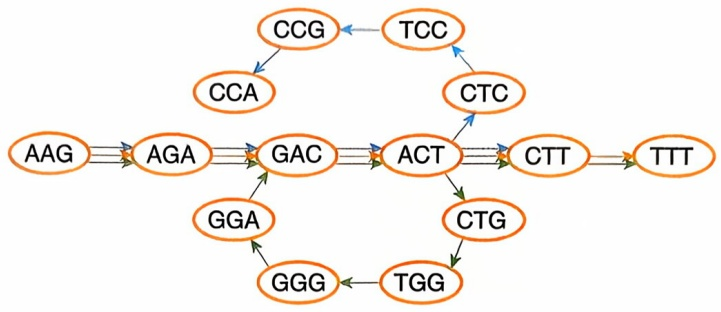

<details>
<summary>flowchart</summary>

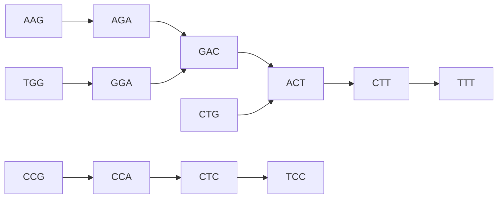
</details>

## ※ 讨论题

1. 试述高通量测序技术在临床应用中的挑战和机遇。
2. 请讨论各种变异检测算法的性能。
3. 试述微生物组与人类健康的关联。

## ※ 参考文献

1. Ahsan M U, Liu Q, Perdomo J E, et al. A survey of algorithms for the detection of genomic structural variants from long-read sequencing data [J]. Nature methods, 2023, 20(8): 1143-1158.
2. Langmead B, Salzberg S L. Fast gapped-read alignment with Bowtie 2 [J]. Nature methods, 2012, 9(4): 357-359.
3. Ning L, Zhou Y L, Sun H, et al. Microbiome and metabolome features in inflammatory bowel disease via multi-omics integration analyses across cohorts [J]. Nature communications, 2023, 14(1): 7135.
4. Nurk S, Koren S, Rhie A, et al. The complete sequence of a human genome [J]. Science, 2022, 376(6588): 44-53.
5. Rhie A, Nurk S, Cechova M, et al. The complete sequence of a human Y chromosome [J]. Nature, 2023, 621(7978): 344-354.
6. Stanke M, Waack S. Gene prediction with a hidden Markov model and a new intron submodel [J]. Bioinformatics, 2003, 19(suppl\_2): ii215-ii225.
7. Turnbaugh P J, Ley R E, Mahowald M A, et al. An obesity-associated gut microbiome with increased capacity for energy harvest [J]. Nature, 2006, 444(7122):

---

参考文献

209

1027-1031.

8. Ustick L J, Larkin A A, Garcia C A, et al. Metagenomic analysis reveals global-scale patterns of ocean nutrient limitation [J]. Science, 2021, 372(6539): 287-291.
9. Valles-Colomer M, Blanco-Míguez A, Manghi P, et al. The person-to-person transmission landscape of the gut and oral microbiomes [J]. Nature, 2023, 614(7946): 125-135.
10. Yang L, Luquette L J, Gehlenborg N, et al. Diverse mechanisms of somatic structural variations in human cancer genomes [J]. Cell, 2013, 153(4): 919-929.
11. Zerbino D R, Birney E. Velvet: algorithms for de novo short read assembly using de Bruijn graphs [J]. Genome research, 2008, 18(5): 821-829.

编者:宁康（华中科技大学）

窦岩梅（西湖大学）

王明钰（山东大学）

王涛（上海交通大学）

周宇（武汉大学）

审读:李兴旺（华中农业大学）

---


