# 8 转录调控和表观遗传

原始 PDF 第 274–317 页。

## 转录调控和表观遗传

转录因子和表观遗传修饰在基因转录过程中发挥着重要作用:转录因子通过响应各种内部和外部信号精确调控基因转录；表观遗传修饰通过改变染色质结构等方式，影响转录因子发挥功能。这两种机制的协同作用确保了基因在正确的时间、位置和水平上表达，从而维持细胞和整个生物体的正常功能。在过去20多年中，对转录调控与表观遗传的研究一直是生物信息学的核心方向之一，内容广泛且复杂。本章无意于全面地介绍转录调控与表观遗传的知识体系，而是力求简化和提炼，重点介绍转录调控与表观遗传的核心概念、重要组学技术的原理、数据特点及其分析方法的基本思路。具体内容包括转录因子结合模体的经典分析方法、转录因子ChIP-Seq数据的特点和分析方法、DNA甲基化和组蛋白修饰等重要表观遗传修饰的基本描述，以及WGBS和Hi-C等常用组学技术的数据分析方法等。本章旨在为读者理解转录调控和表观遗传的复杂机制提供生物信息学知识框架。此外，从本书的整体编排考虑，表观转录组学的内容也包含在本章。

## 8

---

260

8 转录调控和表观遗传

## 8.1 转录调控与表观遗传概述

转录因子与表观遗传修饰在基因转录调控中发挥重要作用:一方面，转录因子能够对各种细胞内外的信号做出反应，特异性地控制基因转录；另一方面，表观遗传修饰通过调节染色质结构，间接影响转录因子的功能（图8-1）。

## 8.1.1 转录调控的基本概念

人类基因组编码两万多个基因，其中多数基因只在特定组织或发育阶段表达。从一套基本不变的基因组中产生出多元化的表达图谱，是由调控基因活性的各种信号途径所控制的。转录是基因表达过程的第一步，也是调控基因活性的核心步骤。转录因子（transcription factor，TF）通过特异地结合靶基因启动子（promoter）或增强子（enhancer）区域，来控制基因转录的发生及转录效率。转录因子结合位点（transcription factor binding site，TFBS）是指基因组DNA上特定的序列，这些序列能够与转录因子相互作用，并在基因转录调控中发挥关键作用。很多转录因子结合位点具有特定的序列模式，这些序列模式称为转录因子结合模体（binding motif）。分析转录因子结合模体和识别转录因子在基因组上的结合位点，对于研究基因转录调控的机制具有重要意义。

转录因子结合模体分析包括两类问题。第一，已知模体扫描（known motif scan），根据已知的转录因子结合模体，在关注的基因组区域内搜索该转录因子潜在的结合位点。第二，模体从头发现（de novo motif finding），在关注的一组基因组区域内，识

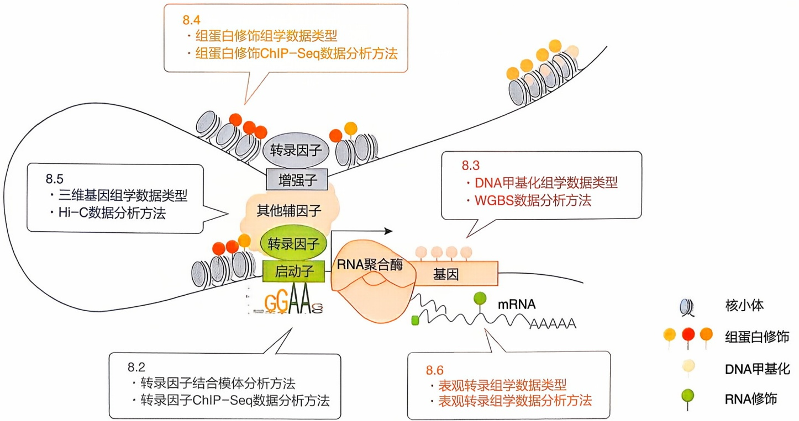

flowchart

This diagram illustrates the molecular biology pathway of RNA polymerase activity, showing how different factors influence the initiation and formation of a gene complex.

图8-1 转录调控与表观遗传概述

---

8.2 转录调控分析

261

别具有统计显著性的 DNA 短片段模式，作为潜在的转录因子结合模体。随着第二代测序技术的迅猛发展，染色质免疫共沉淀测序技术（chromatin immunoprecipitation sequencing, ChIP-Seq）已被广泛应用于识别转录因子全基因组结合位点。借助日益完善的生物信息学分析工具，研究人员可以开展转录因子结合模体分析和 ChIP-Seq 数据分析，这种综合分析为深入探索基因转录调控的复杂机制提供了新的视角。

## 8.1.2 表观遗传学的基本概念

表观遗传学（epigenetics）一词的内涵在科学史上经历了多次的修正。1942年，康拉德·沃丁顿（Conrad Waddington）提出了表观遗传学的术语，将其定义为“研究基因及其产物之间因果相互作用，并产生表型的生物学分支”。1990年，罗宾·霍利迪（Robin Holliday）将表观遗传学的内涵重新定义为“研究复杂生物发育过程中在时间和空间上调控基因活性的机制”。1996年，阿瑟·里格斯（Arthur Riggs）将表观遗传学的内涵定义为“研究不能用DNA序列改变来解释的，在有丝分裂或减数分裂中可遗传的基因功能改变”。2008年，冷泉港会议对表观遗传学特征的共识为“染色质的改变，而非DNA序列的改变，所导致的稳定遗传的表型”。自20世纪90年代末以来，表观遗传学得到迅猛发展，是生命科学领域的研究热点之一。

表观遗传信息包括 DNA 甲基化、组蛋白修饰、三维基因组等，这些信息与染色质环境及基因表达调控网络相关。表观遗传信息是决定细胞分化和细胞命运的关键因素之一，表观遗传信息的异常可引发衰老和癌症，也可能导致精神性疾病和自身免疫性疾病等。高通量组学技术的发展及其在表观遗传研究中的应用，产生了大量高通量表观遗传组学数据。表观遗传信息类型多样，绘制其在基因组上分布的组学技术原理各异，对应的分析方法及思路不同。

## 8.2 转录调控分析

## 8.2.1 转录因子结合模体表示方法

转录因子结合模体有三种常用的表示方法，分别是DNA共有序列、位置频率矩阵和序列标识图（图8-2）。

## 8.2.1.1 DNA 共有序列

转录因子结合模体的最简单的表示方法是DNA共有序列（consensus sequence）。产生DNA共有序列的步骤如下:对一个转录因子结合的多条DNA片段进行排列，在每个位置上选择最可能出现的碱基，构成共有序列。除了A、T、C、G之外，DNA共有序列还采用其他字符（IUPAC简并码）来表示某个位置可能的碱基组合:W（A或T）、R（A或G）、K（G或T）、S（C或G）、Y（C或T）、M（A或C）、B

---

262

8 转录调控和表观遗传

图8-2 转录因子结合模体的表示方法

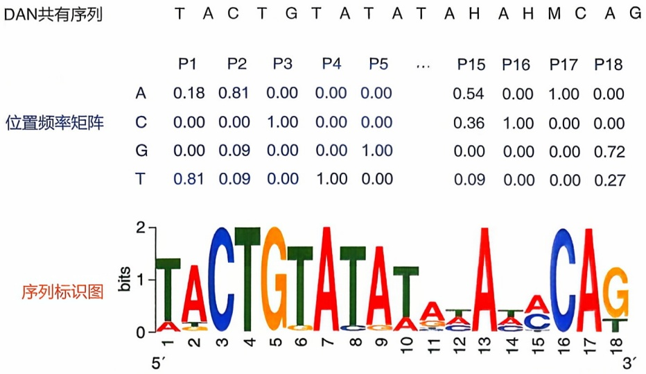

heatmap

| Position Frequency Matrix | P1 | P2 | P3 | P4 | P5 | ... | P15 | P16 | P17 | M | C | A | G |
| :--- | :--- | :--- | :--- | :--- | :--- | :--- | :--- | :--- | :--- | :--- | :--- | :--- | :--- |
| A | 0.18 | 0.81 | 0.00 | 0.00 | 0.00 | — | 0.54 | 0.00 | 1.00 | 0.00 | — | — | — |
| C | 0.00 | 0.00 | 1.00 | 0.00 | 0.00 | — | 0.36 | 1.00 | 0.00 | 0.00 | — | — | — |
| G | 0.00 | 0.09 | 0.00 | 0.00 | 1.00 | — | 0.00 | 0.00 | 0.00 | 0.72 | — | — | — |
| T | 0.81 | 0.09 | 0.00 | 1.00 | 0.00 | — | 0.09 | 0.00 | 0.00 | 0.27 | — | — | — |

The bottom section shows a sequence logo with letters A through T representing nucleotide bases, and numbers 1-3' at the base indicating positions along the sequence.

(非 A)、D (非 C)、H (非 G)、V (非 T)、N (任意)。

DNA 共有序列可以表示转录因子结合模体中哪些位置的碱基是保守的，哪些位置的碱基是多样的。如图 8-2 所示，DNA 共有序列 “TACTGTATATAHAHMCAG” 表示，在该转录因子结合模体中，第 1 个位置大概率是碱基 “T”，第 12 个位置大概率是 “A” “C” 或 “T”，第 15 个位置大概率是碱基 “A” 或 “C”。虽然 DNA 共有序列表示方法简明易懂，但是这种方法无法反映每个位置上不同碱基出现的概率。

## 8.2.1.2 位置频率矩阵

相较于DNA共有序列的表示方式，位置频率矩阵（position frequency matrix, PFM）能够更准确地揭示每一位置上不同碱基的出现频率。该方法假设每个位置上碱基的出现是相互独立的，即一个位置上碱基的出现不会受到其他位置上碱基出现的影响。位置频率矩阵中的每一行对应一个碱基，每一列对应模体的一个位置。矩阵中的每个元素表示对应碱基在对应位置的出现频率。例如，对于长度为 $n$ 的模体，碱基 $i$ 在模体第 $j$ 个位置上出现的频率为 $q_{i,j}$，则模体用位置频率矩阵表示如下:

$$
\left[ \begin{array}{c c c c} q _ {A, 1} & q _ {A, 2}, & \dots , & q _ {A, n} \\ q _ {C, 1} & q _ {C, 2}, & \dots , & q _ {C, n} \\ q _ {G, 1} & q _ {G, 2}, & \dots , & q _ {G, n} \\ q _ {T, 1} & q _ {T, 2}, & \dots , & q _ {T, n} \end{array} \right]
$$

某个转录因子的多条 DNA 结合序列如下:

| T | A | C | T | G | T | A | T | A | T | A | A | A | A | C | C | A | G |
| --- | --- | --- | --- | --- | --- | --- | --- | --- | --- | --- | --- | --- | --- | --- | --- | --- | --- |
| T | A | C | T | G | T | A | T | A | T | A | T | A | C | A | C | A | G |
| T | A | C | T | G | T | A | T | A | T | A | A | A | A | A | C | A | G |
| T | A | C | T | G | T | A | T | A | A | A | T | A | A | A | C | A | G |
| T | A | C | T | G | T | A | T | A | T | A | A | A | C | A | C | A | T |
| A | A | C | T | G | T | A | T | A | T | A | C | A | C | A | C | A | G |
| T | G | C | T | G | T | A | T | A | T | A | A | A | A | A | C | A | G |
| T | A | C | T | G | T | A | T | A | T | G | T | A | T | C | C | A | T |
| T | A | C | T | G | T | A | T | A | T | G | T | A | T | C | C | A | T |
| T | A | C | T | G | T | A | T | A | T | T | C | A | T | T | C | A | G |
| A | T | C | T | G | T | A | T | A | T | A | T | A | C | C | C | A | G |

---

8.2 转录调控分析

263

对于上述序列，可以按照以下方法计算出该转录因子的位置频率矩阵:

首先，逐一检查每个序列中的每个位置上的碱基，并在相应的矩阵位置上增加计数，得到以下矩阵:

$$
\begin{array}{l} \text {A} \\ \text {C} \\ \text {G} \\ \text {T} \end{array} \left[ \begin{array}{c c c c c c} 2 & 9 & 0 & 0 & \dots & 0 \\ 0 & 0 & 1 & 0 & \dots & 0 \\ 0 & 1 & 0 & 0 & \dots & 8 \\ 9 & 1 & 0 & 1 & \dots & 3 \end{array} \right]
$$

然后，计算每个位置上每种碱基出现的频率 $q_{i,j}$ （每个位置上4种碱基的频率之和为1），可以得到位置频率矩阵:

$$
\begin{array}{l} \text {A} \\ \text {C} \\ \text {G} \\ \text {T} \end{array} \left[ \begin{array}{c c c c c c} 0. 1 8 & 0. 8 2 & 0. 0 0 & 0. 0 0 & \dots & 0. 0 0 \\ 0. 0 0 & 0. 0 0 & 1. 0 0 & 0. 0 0 & \dots & 0. 0 0 \\ 0. 0 0 & 0. 0 9 & 0. 0 0 & 0. 0 0 & \dots & 0. 7 3 \\ 0. 8 2 & 0. 0 9 & 0. 0 0 & 1. 0 0 & \dots & 0. 2 7 \end{array} \right]
$$

## 8.2.1.3 序列标识图

序列标识图（sequence logo）是一种用于表示 DNA、RNA 或蛋白质多序列比对结果的图形表示法，将其应用于转录因子结合模体的表示，可以直观地展示结合模体上某一位置的碱基偏好性。在序列标识图中，每个位置的碱基用堆叠的字母来表示，字母的大小反映了该位置上碱基出现的相对频率，更大的字母表示该碱基在该特定位置出现的频率更高。序列标识图第 j 位上某个碱基 i 的高度  $height_{i,j}$  用该位置的信息量  $R_{j}$  与该碱基出现的频率  $q_{i,j}$  的乘积来表示:

$$
h e i g h t _ {i, j} = q _ {i, j} \times R _ {j} \tag {8-1}
$$

其中，该位置的信息量 $R_{j}$ 定义为每个位置的最大可能熵与该位置的实际信息熵之差。信息熵衡量了信息的不确定性，一个位置的熵值越高，该位置的碱基不确定性越大。当4种碱基在一个位置上均匀分布时，该位置的信息熵达到最大值。而该位置的实际信息熵值越小，其碱基的不确定性就越小，代表该位置所含的信息量越大。所以，信息量 $R_{j}$ 的计算方法如下:

$$
R _ {j} = H _ {\max} - (H _ {j} + e _ {n}) \tag {8-2}
$$

其中，给定位置的信息熵  $H_{j}$  的定义为:

$$
H _ {j} = - \sum_ {i = 1} ^ {4} q _ {i, j} \times \log_ {2} q _ {i, j} \tag {8-3}
$$

当 4 种碱基均匀分布时，每个碱基出现的概率都为 $\frac{1}{4}$，所以 $H_{\max}$ 的值为 2。$e_n$ 是针对小样本的近似矫正，对于碱基序列，$s$ 等于 4，$n$ 为 DNA 序列个数:

$$
e _ {n} = \frac {1}{\ln 2} \times \frac {s - 1}{2 n} \tag {8-4}
$$

---

264

8 转录调控和表观遗传

根据上述公式可以看出，序列标识图中每个位置的符号高度之和均不超过2个单位。

## 8.2.1.4 基于已知模体的转录因子结合位点预测

在给定的 DNA 序列中查找已知的转录因子结合模体, 称为已知模体扫描 (motif scanning)。其作用是判断某一长度为 $n$ 的 DNA 序列片段与给定的长度为 $n$ 的位置频率矩阵相匹配的程度。但由于背景 DNA 序列中可能存在某些碱基的固有偏好, 直接使用位置频率矩阵来评估某个位置上各碱基的出现频率可能会使得预测结果有很大的偏差。例如, 在某生物体的基因组中, 碱基 A 的出现频率异常高, 达到了 $70\%$, 而其他碱基的出现频率相对较低。因此, 任何随机选取的 DNA 片段都有很高的概率包含大量的碱基 A。现在, 已知有一个转录因子的结合模体为 AAXA, 其中 X 可以是任何碱基。如果直接使用此模体去扫描整个基因组, 很可能会发现大量匹配此模体的片段, 仅仅是因为碱基 A 的自然出现频率就很高, 并非所有这些片段都是真正的转录因子结合位点。

为了校正这种天然偏好性,位置频率矩阵通常会被转换为位置权重矩阵（position weight matrix, PWM）。在以上示例中，PWM考虑基因组中碱基A的高出现频率，并为模体中的碱基A分配一个相对较低的权重，从而使得预测更加准确。这意味着，只有当某个DNA片段不仅与模体匹配，而且其碱基A的出现频率远高于背景水平时，这个片段才会被认为是一个真正的结合位点。

对于长度为 $n$ 的模体, 位置权重矩阵表示如下:

$$
\left[ \begin{array}{c} S _ {A, 1}, S _ {A, 2}, \dots , S _ {A, n} \\ S _ {C, 1}, S _ {C, 2}, \dots , S _ {C, n} \\ S _ {G, 1}, S _ {G, 2}, \dots , S _ {G, n} \\ S _ {T, 1}, S _ {T, 2}, \dots , S _ {T, n} \end{array} \right]
$$

其中，

$$
S _ {i, j} = \log_ {2} \left(\frac {q _ {i , j}}{b _ {i}}\right) \tag {8-5}
$$

其中， $q_{i,j}$ 是位置频率矩阵中的元素， $b_{i}$ 是碱基 $i$ 在背景序列中出现的频率，用以对DNA序列碱基组成偏向性造成的影响进行消除。

应用位置权重矩阵对某段长度为 $n$ 的DNA序列进行打分，用以评估该序列是否与转录因子结合模体匹配:

$$
S = \sum_ {j = 1} ^ {n} S _ {i, j} \tag {8-6}
$$

其中，i 表示相应序列第 j 个位置上出现的碱基。由上式计算出给定序列的打分 S，如果 S 大于等于给定的阈值，这段序列就被视为潜在的转录因子结合位置。在实际应用中，如需要考察一段长度为 l 的区域上是否存在某一转录因子的潜在结合位点，可以用一个长度为 n 的窗口以 1 bp 为步长在该序列上滑动，对滑动得到的所

---

8.2 转录调控分析

265

CTTATTACGCTGGCCACTAGCGGGCGCGTTGTAA CGCTG

|  | P1 | P2 | P3 | P4 | P5 | P6 | P7 | P8 | P9 | P10 | P11 |
| --- | --- | --- | --- | --- | --- | --- | --- | --- | --- | --- | --- |
| A | 0.203 8 | 0.048 3 | 0.000 0 | 0.621 8 | 0.056 7 | 0.092 4 | 0.903 4 | 0.099 0 | 0.386 6 | 0.023 1 | 0.006 3 |
| C | 0.071 0 | 0.865 0 | 0.995 0 | 0.035 0 | -0.055 0 | 0.552 0 | 0.018 0 | 0.200 0 | 0.000 0 | 0.033 0 | 0.002 0 |
| G | 0.596 6 | 0.052 5 | 0.004 2 | 0.264 7 | 0.369 7 | 0.077 7 | 0.058 8 | -0.050 0 | 0.613 4 | 0.699 6 | 0.991 6 |
| T | 0.128 2 | 0.033 6 | 0.000 0 | 0.077 7 | 0.016 8 | 0.277 3 | 0.018 9 | 0.497 0 | 0.000 0 | 0.243 7 | 0.000 0 |

0.596 6+0.865 0+0.995 0+0.621 8-0.055 0+0.277 3+0.903 4-0.050 0+0.000 0+0.699 6+0.991 6=5.845 3

有长度为 n 的片段进行遍历并进行打分，筛选出打分高于阈值的那些片段，为对应转录因子的潜在结合位点（图 8-3）。阈值的选择至关重要:阈值设置过高，会错过潜在的转录因子结合位点；而阈值设置过低，会增大预测的假阳性率。实际应用中，可以根据所研究的问题，在高检出率和低假阳性率之间取折中值。

## 8.2.2 转录因子结合模体从头发现

转录因子结合模体从头发现的核心思想是在多条相关的DNA序列中（如受到某一转录因子调控的一组基因的启动子区域或增强子区域）搜索具有统计显著性的短片段模式，并将其预测为该转录因子潜在的结合模体。按照转录因子结合模体的表示方法，可以将结合模体的从头发现分成两类，分别是基于共有序列的方法和基于位置频率矩阵的方法。前者的方法是穷举所有可能的序列组合来识别统计上显著的短序列模式，如MobyDick等。后者则通过贪婪算法、期望最大化（expectation maximization，EM）或吉布斯抽样（Gibbs sampling）等方法来确定统计显著的位置频率矩阵，如MEME和Gibbs Motif Sampler等为此类方法的代表。

## 8.2.2.1 基于共有序列的识别方法

基于共有序列的识别方法通过穷举所有可能的碱基组合来识别统计上显著的DNA模式。这类方法筛选满足特定条件的片段，并对其一致性进行打分，主要步骤为:①设待搜索的片段长度为 $l$ ，穷举所有由A、T、C、G四种碱基组成的长度为$l$ 的序列，并将其作为候选序列集合；②统计候选序列集合中每条片段在所有DNA序列中出现的次数（允许少量碱基错配），从中筛选出在大多数序列中均有出现的片段；③采用合适的统计方法，量化所挑选片段的一致性，并将一致性最高的共有序列作为预测的结果。如果不确定结合模体的长度 $l$ ，则需要根据先验信息确定其取值范围，然后逐一进行尝试。上述穷举策略的计算复杂度为 $4^{l}$ ，不适用于 $l$ 较大的情况。

## 8.2.2.2 基于EM算法的识别方法

EM算法是一种迭代算法，用于在统计模型中寻找似然函数的局部最大值，特别是当模型中存在一些未观测到的（隐含的）数据时。EM算法迭代地进行以下两个步骤直至收敛。①期望步骤（E-step）:通过观察数据和现有模型来估计参数，然

图8-3 应用位置权重矩阵预测转录因子潜在结合位点

---

266

8 转录调控和表观遗传

后固定这个估计的参数值（如位置频率矩阵）来计算似然函数的期望值，即预测最有可能的结合位点的位置；②最大化步骤（M-step）:固定预测出的结合位点的位置，更新模型参数以最大化观测数据的似然。EM算法可以保证在每次迭代之后似然函数的值都会增加，从而在有限的循环次数下得到最优解。

在期望步骤中，假设已知结合模体的位置频率矩阵，则需要通过计算似然函数的期望值来计算结合模体在 DNA 序列上出现匹配的位置。例如，对于给定序列:

$$
\mathrm{CCGGCAGCGGGTGGCGCTG}
$$

假设转录因子结合模体的长度为 9，位置频率矩阵为:

$$
\begin{array}{l} \text {A} \left[ \begin{array}{l l l l l l l l l} 0. 2 6 1 & 0. 0 2 8 & 0. 4 9 9 & 0. 9 5 6 & 0. 0 0 5 & 0. 0 9 5 & 0. 0 7 5 & 0. 0 0 2 & 0. 7 1 0 \\ C & 0. 0 0 5 & 0. 0 0 2 & 0. 1 9 4 & 0. 0 0 4 & 0. 6 7 0 & 0. 0 0 4 & 0. 0 1 7 & 0. 9 6 6 & 0. 1 1 4 \\ G & 0. 6 7 8 & 0. 9 3 0 & 0. 0 0 5 & 0. 0 3 0 & 0. 2 0 2 & 0. 0 0 3 & 0. 9 0 5 & 0. 0 1 1 & 0. 0 6 7 \\ T & 0. 0 5 6 & 0. 0 4 0 & 0. 3 0 2 & 0. 0 1 0 & 0. 1 2 3 & 0. 8 9 9 & 0. 0 0 3 & 0. 0 2 1 & 0. 1 0 9 \end{array} \right] \end{array}
$$

利用位置频率矩阵,对给定序列中的每个长度为9的片段,计算似然比(likelihood ratio),如下所示:

$$
\begin{array}{ccccccccccccccccc}C & C & G & G & C & A & G & C & G & G & G & T & G & G & C & G & C & T & G & L R _ {1} \\ C & C & G & G & C & A & G & C & G & G & G & T & G & G & C & G & C & T & G & L R _ {2} \\ C & C & G & G & C & A & G & C & G & G & G & T & G & G & C & G & C & T & G & L R _ {3} \\ C & C & G & G & C & A & G & C & G & G & G & T & G & G & C & G & C & T & G & L R _ {4} \\ C & C & G & G & C & A & G & C & G & G & G & T & G & G & C & G & C & T & G & L R _ {5} \\ C & C & G & G & C & A & G & C & G & G & G & T & G & G & C & G & C & T & G & L R _ {6} \\ C & C & G & G & C & A & G & C & G & G & G & T & G & G & C & G & C & T & G & L R _ {7} \\ C & C & G & G & C & A & G & C & G & G & G & T & G & G & C & G & C & T & G & L R _ {8} \\ C & C & G & G & C & A & G & C & G & G & G & T & G & G & C & G & C & T & G & L R _ {9} \\ C & C & G & G & C & A & G & C & G & G & G & T & G & G & C & G & C & T & G & L R _ {1 0} \\ C & C & G & G & C & A & G & C & G & G & G & T & G & G & C & G & C & T & G & L R _ {1 1} \end{array}
$$

其中， $LR_{n}$  表示长度为 9 的短片段似然比。以第 3 个短片段为例:

$$
L R _ {3} = \frac {P (\mathrm{GGCAGCGGGG} | \theta)}{P (\mathrm{GGCAGCGGGG} | \theta_ {0})} \tag {8-7}
$$

其中，$\theta$ 为位置频率矩阵，$\theta_0$ 为4种碱基分别在基因组上出现的频率，此处假设4种碱基在基因组中出现的频率均为0.25，则:

$$
L R _ {3} = \frac {0 . 6 7 8 \times 0 . 9 3 0 \times 0 . 1 9 4 \times 0 . 9 5 6 \times 0 . 2 0 2 \times 0 . 0 0 4 \times 0 . 9 0 5 \times 0 . 0 1 1 \times 0 . 0 6 7}{0 . 2 5 \times 0 . 2 5 \times 0 . 2 5 \times 0 . 2 5 \times 0 . 2 5 \times 0 . 2 5 \times 0 . 2 5 \times 0 . 2 5 \times 0 . 2 5 \times 0 . 2 5} = 0. 0 1 6
$$

以此类推，可以计算得到所有 11 个片段的似然比。

接下来，在最大化步骤中，以期望步骤得到的似然比为权重，计算结合模体9个位置上4种不同碱基的得分，得到一个新的位置频率矩阵。例如，第1、2、5、8个短片段的第一个位置均为C，那么在结合模体第一个位置上碱基C的分数为:

---

8.2 转录调控分析

267

$$
C _ {1} = \frac {L R _ {1} + L R _ {2} + L R _ {5} + L R _ {8}}{\sum_ {1} ^ {1 1} L R _ {i}} \tag {8-8}
$$

下一步，将最大化步骤得到的新的位置频率矩阵作为期望步骤的输入，随后得到新的短片段似然比，再进行新一轮的最大化步骤。通过这种迭代方式，位置频率矩阵最终会达到稳定，这时的矩阵即为目标转录因子的 DNA 结合模体。

MEME 方法对 EM 算法进行了改进，遍历所有可能的起始矩阵，筛选出来具有统计学显著性的矩阵输入给 EM 算法，然后通过循环迭代得到最优解。注意，基于 EM 算法的结果一定程度上依赖于输入的初始位置频率矩阵，虽然该方法可以处理某些不确定性，如未知的确切结合位点，但是可能收敛到局部最优而不是全局最优。

## 8.2.2.3 基于吉布斯抽样法的识别方法

吉布斯抽样法采用马尔可夫链蒙特卡罗（Markov chain Monte Carlo，MCMC）技术，随机选择和移除 DNA 片段，再根据剩余片段更新位置频率矩阵，计算被移除片段最可能的模体位置并将移除片段重新纳入考虑。这一迭代过程持续进行，直到位置频率矩阵收敛，从而在给定的 DNA 序列集合中发现最可能的转录因子结合模体。基于吉布斯抽样法的识别方法基于一个假设:每条 DNA 序列有且仅有 1 个长度为 n 的结合模体匹配片段，吉布斯抽样法识别结合模体的步骤如下:① 从多条 DNA 序列中选出一条序列  $S_{1}$ ，并从剩余的每条 DNA 序列中随机选取给定长度为 n 的片段，形成初步的位置频率矩阵。② 基于该位置频率矩阵对序列  $S_{1}$  中的每个长度为 n 的片段计算似然比。③ 基于该似然比，从序列  $S_{1}$  中随机取一段长度为 n 的片段，更新位置频率矩阵，并进行多轮迭代，直至确定结合模体在序列  $S_{1}$  上的匹配位置。④ 放回序列  $S_{1}$ ，取出序列  $S_{2}$ ，进行同样的操作，得到序列  $S_{2}$  上结合模体匹配的位置。⑤ 用相同的方法，对所有 DNA 序列进行处理，确定每条序列上的结合模体位置。最终，整合所有序列的结果，得到完整的结合模体。

利用吉布斯抽样法识别模体可以避免得到局部最优解，因为它是一种随机化方法，可以探索更广泛的可能性空间。然而，其结果可能受到初始选择的影响，并且可能需要多次运行以确保找到真正的全局最优解。值得注意的是，这种方法虽然强大，但在大数据集上可能会非常耗时，因此，需要特定的优化策略或并行计算技术来提高其效率。Gibbs Motif Sampler 是基于吉布斯抽样法识别结合模体的代表性方法，计算速度快，但需要多次重复实验得到稳定的结果。

## 8.2.3 转录因子 ChIP-Seq 技术原理及数据质量控制

目前，ChIP-Seq 是应用最为广泛的识别转录因子全基因组结合位点的方法。除 ChIP-Seq 外，CUT&RUN 和 CUT&Tag 技术也得到了广泛应用。由于 CUT&RUN 和 CUT&Tag 数据的质量控制及分析方法与 ChIP-Seq 数据类似，本节仅介绍转录因子 ChIP-Seq 技术原理、质量控制及分析方法。ChIP-Seq 数据的质量控制涉及三个层面:测序读长、信号峰和注释。由于 ChIP-Seq 数据在测序读长层面的质量控

---

268

8 转录调控和表观遗传

图8-4 转录因子ChIP-Seq实验原理

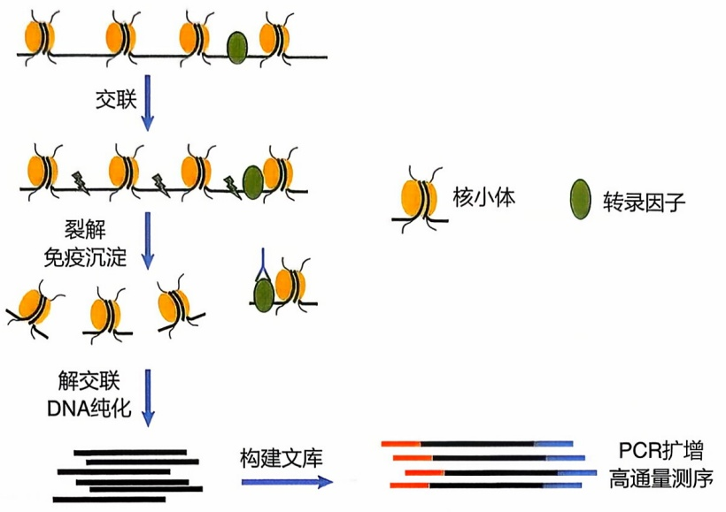

flowchart

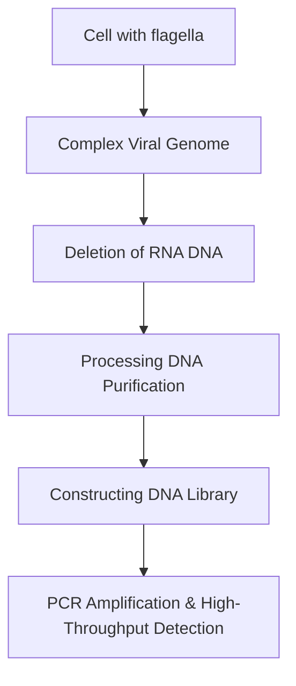

制与其他基于第二代测序技术的组学数据质量控制相同，本节仅介绍在信号峰层面和注释层面的质量控制。ChiLin软件是常用的ChIP-Seq数据质量控制工具，兼具了测序读长、信号峰、注释三个层面的质量控制。

## 8.2.3.1 转录因子 ChIP-Seq 技术原理

转录因子 ChIP-Seq 技术的步骤如下（图 8-4）。① 交联:利用甲醛等交联剂以共价键的形式固定转录因子和 DNA 的相互作用。② 裂解:利用超声波将染色质打断，通过控制超声波裂解的时间及频率，得到不同的 DNA 片段长度分布，ChIP-Seq 实验中 DNA 片段的平均长度约为 200 bp。③ 免疫沉淀:使用特异性抗体选择性地沉淀与特定转录因子结合的 DNA 片段，洗脱未与抗体结合的染色质片段。④ 解交联:将免疫共沉淀反应的染色质片段进行解交联反应，并进行 DNA 纯化。⑤ 高通量测序:应用二代测序技术对 DNA 进行测序。

测序深度的确定是转录因子 ChIP-Seq 实验中的关键一环，因为测序深度关系 ChIP-Seq 数据所识别的信号峰数量。随着测序深度的增加，新识别出来信号峰通常展现较低的富集水平。目前，对于人类或小鼠中的转录因子，一次 ChIP-Seq 实验通常需要测定 2000 万个 DNA 片段，且需要进行生物学重复以增加信号峰识别的可靠度。

## 8.2.3.2 信号峰层面的质量控制

## (1) ChIP-Seq 信号可视化展示

转录因子 ChIP-Seq 数据的质量在很大程度上受到抗体质量和染色质免疫共沉淀效率的影响。抗体特异性不够理想或免疫共沉淀的效率不达标等情况都会导致 ChIP-Seq 数据中混入过多无关的基因组序列，从而增加背景噪声。因此，信号峰层面的质量控制在转录因子 ChIP-Seq 分析中是至关重要的。ChIP-Seq 信号的可视化展示是信号峰层面质量控制的重要手段。通过图形化展示数据，用户可以直观地评估实验结果的质量。为了可视化这些数据，用户可以将 FASTQ 格式的 ChIP-Seq 数据转换为 bigWig 或 bedGraph 格式，并通过基因组浏览器软件对数据进行展示。

---

8.2 转录调控分析

269

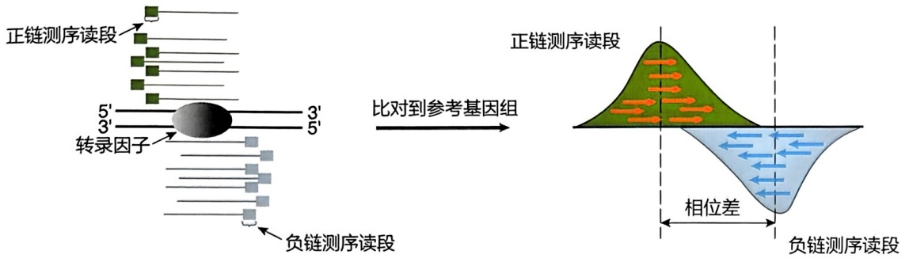

flowchart

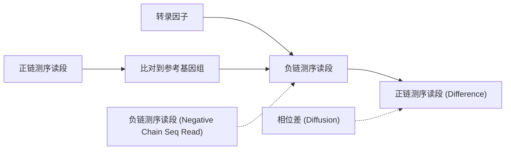

图8-5 转录因子结合位点读段分布示意图

ChIP-Seq 实验中，经由纯化步骤得到的 DNA 片段不仅包含那些与转录因子直接结合的 DNA 片段，还会包含一些转录因子周围的 DNA 片段。由于第二代测序读段短，难以测通这些片段，最终只能得到片段某一端（如 150 bp）的信息，所以转录因子结合位点附近的测序读段会分别映射到正链和负链。考虑这种读段分布，预期在转录因子结合位置的上游和下游都会看到一个读段富集区域，即比对到正链的读段与比对到负链的读段之间会产生一个相位差（图 8-5），而在其他区域，两者之间不存在相位差。因此，在基因组浏览器中展示高质量的转录因子 ChIP-Seq 数据的信号峰时，可以观察到比对到正链的读段较比对到负链的读段整体向基因组上游偏移。此外，通过对 ChIP-Seq 信号进行可视化展示，用户可以直观地比较 ChIP-Seq 样品与对照样品的信号分布，并可以对 ChIP-Seq 样品背景噪声的高低产生直观的判断。尽管对 ChIP-Seq 信号进行可视化展示不能定量评估数据质量，但在研究中仍是最常用的质量控制手段之一。

## （2）测序读段位于信号峰的比例

测序读段位于信号峰的比例（fraction of reads in peaks，FRiP）计算落入信号峰区域的读段占所有读段的比例，即文库中结合位点片段占背景读段的比例，用以定量描述测序读段在信号峰区域的富集程度，是评估 ChIP-Seq 数据质量的一个重要指标。较高的 FRiP 值通常表示大部分测序读段集中在信号峰区域，指示特异性富集和低背景噪声，因此被视为高质量数据的标志；而较低的 FRiP 值可能暗示较高的背景噪声或实验特异性不足。FRiP 指标可以直观地指征测序读段在信号峰的富集程度，适用于以下情况:对同一转录因子，应用不同的抗体或实验条件产生多套 ChIP-Seq 数据，可以应用 FRiP 指标判断采用哪种抗体或实验条件的效果更好。FRiP 指标的局限性在于:① FRiP 值的大小与信号峰的数量正相关，对同一套 ChIP-Seq 数据应用不同的信号峰识别软件或使用不同阈值均会改变值的大小；② 由于抗体不同、结合位点数量不同，FRiP 值在不同转录因子间通常不具备可比性。

## (3) 互相关分析

互相关（cross-correlation，cc）分析指标用于衡量测序读段在信号峰的富集程度。上文中的 ChIP-Seq 信号可视化部分提到，在转录因子 ChIP-Seq 数据的信号峰区域，比对到正链与比对到负链的读段之间会产生一个相位差。通常这个相位差与片段长度相关，在理想情况下，这种相位差应该是预期片段大小的一半。互相关分析就是为了检测这种相位差，从而估计 ChIP-Seq 数据中的片段大小。具体的方

---

270

8 转录调控和表观遗传

图8-6 互相关分析示意图

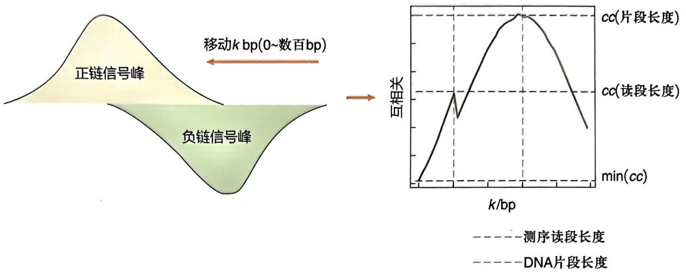

line

| k/bp | cc (片段长度) | cc (读段长度) |
| --- | --- | --- |
| ~0.1 | ~min(cc) | ~min(cc) |
| ~0.2 | ~max(cc) | ~max(cc) |
| ~0.3 | ~max(cc) | ~max(cc) |
| ~0.4 | ~max(cc) | ~max(cc) |
| ~0.5 | ~max(cc) | ~max(cc) |
| ~0.6 | ~max(cc) | ~max(cc) |
| ~0.7 | ~max(cc) | ~max(cc) |
| ~0.8 | ~max(cc) | ~max(cc) |
| ~0.9 | ~max(cc) | ~max(cc) |
| ~1.0 | ~max(cc) | ~max(cc) |

法是:将比对到负链的读段向其  $3'$  端方向移动 k bp（k 的取值范围从一至数百），每次移动后计算正链和负链信号的皮尔逊相关系数，得到相关系数随移动距离变化的曲线（图 8-6）。对于质量较好的 ChIP-Seq 数据，该曲线会出现两个峰值，对应的移动距离分别为测序读段长度（reads length）和染色质免疫共沉淀实验得到的 DNA 片段长度（fragment length），其中 DNA 片段长度对应的相关系数较高；对于质量不佳的 ChIP-Seq 数据，由于测序读段在信号峰的富集程度较低，DNA 片段长度对应的相关系数较低。为了简洁地展示互相关分析的结果，研究人员引入了 NSC（normalized strand coefficient）和 RSC（relative strand correlation）两个指标:

$$
N S C = \frac {\mathrm{cc} (\text {fragment length})}{\min c c} \tag {8-9}
$$

$$
R S C = \frac {\mathrm{cc} (\text {fragment length}) - \min (c c)}{\mathrm{cc} (\text {reads length}) - \min (c c)} \tag {8-10}
$$

NSC 值、RSC 值与 FRiP 值之间正相关，它们均可指征测序读段在信号峰的富集程度。NSC 和 RSC 指标的局限性在于，对于在基因组上结合位点数目过少的转录因子，即使 ChIP-Seq 数据质量较高，NSC 值和 RSC 值仍较低。

## (4) 不可重复发现率

不可重复发现率（irreproducible discovery rate, IDR）用于衡量 ChIP-Seq 信号峰在生物学重复之间的可重复性。以两套生物学重复的情形为例，可重复发现的信号峰指的是在两套数据中均能识别的信号峰，不可重复发现的信号峰指的是仅在一套数据中识别的信号峰。对每个信号峰得到一个 IDR 值，用于反映其不可被重复发现的概率，IDR 值越低，表明该信号峰的可重复性越好；因此，IDR 指标可以作为识别信号峰的阈值（图 8-7）。相对于 $p$ 值、$q$ 值等表征富集显著性的阈值，以 IDR 指标作为阈值使得信号峰数量在不同实验之间具有更好的可比性。IDR 指标的局限性在于，如果两套生物学重复实验中有一套质量较差，那么大量真实的信号峰也会被认为是不可重复发现的。

## 8.2.3.3 注释层面的质量控制

识别转录因子 ChIP-Seq 数据的信号峰后，研究人员可以基于基因组分布特征、序列保守性分析、DNA 模体分析等信号峰注释层面的指标进行质量控制。

---

8.2 转录调控分析

271

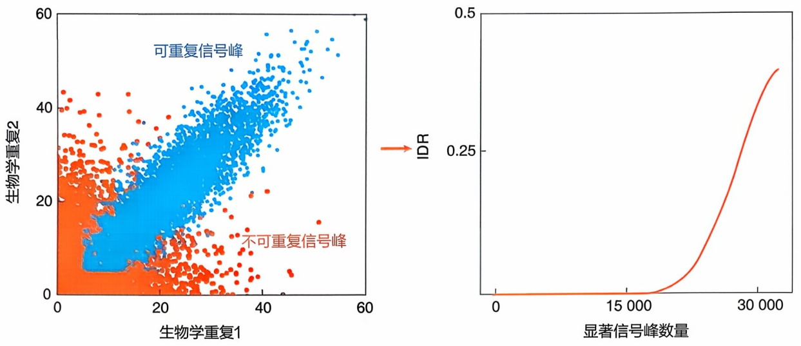

图8-7 不可重复发现率原理示意图

## (1) 基因组分布特征

转录因子在基因组中的结合位点主要集中在基因的启动子和增强子区域。这些区域中信号峰的富集程度，可以直观反映出 ChIP-Seq 数据的质量。对于高质量的转录因子 ChIP-Seq 数据，信号峰将显著富集于启动子和增强子区域。

## (2) 序列保守性分析

转录因子通过与染色体结合以起到转录调控的作用，因此其结合位点在进化过程中倾向于保守。研究者可以从UCSC基因组浏览器获取所研究物种基因组的每个碱基的序列保守性得分，即PhastCons值。然后计算信号峰及其附近区域的平均序列保守性得分。高质量ChIP-Seq数据的信号峰顶点位置往往具有比其周围区域更高的序列保守性。

## (3) DNA 模体分析

对于已知结合模体的转录因子，结合模体出现的位置和频率是评估 ChIP-Seq 数据的有效指标。对于高质量的 ChIP-Seq 数据，结合模体出现的频率较高，且更倾向于出现在信号峰顶点的位置。

## 8.2.4 转录因子 ChIP-Seq 数据分析方法

## 8.2.4.1 识别 ChIP-Seq 数据信号峰

常用的识别转录因子 ChIP-Seq 数据信号峰（peak calling）的方法包括 MACS、CisGenome、SISSRs 等，本节以 MACS 方法为例介绍识别转录因子 ChIP-Seq 数据信号峰的原理。MACS 方法主要包含以下两个步骤（图 8-8）:第一步，基于 ChIP-Seq 数据的测序读长在基因组上分布的特点，估计比对到正链的读长与比对到负链的读长之间的相位差 $d$，并将所有测序读长分别向其 $3'$ 端移动 $d/2$，从而有效提高识别出的信号峰的分辨率。第二步，应用动态泊松分布计算信号峰的统计显著性，即基于对照实验的测序读长数目或 ChIP-Seq 数据中落入信号峰之外的测序读长数目，估计该区域的局部 $\lambda$ 值，如果该值大于等于基因组整体估计的 $\lambda$ 值，则基于该值计

---

272

8 转录调控和表观遗传

图8-8 MACS方法原理示意图

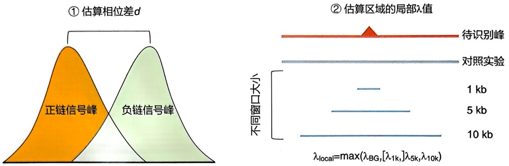

算该区域内信号峰的统计显著性。进行该评估的原因在于，ChIP-Seq 数据的背景噪声在参考基因组上的分布受到染色质环境和拷贝数的影响，造成不同区域的背景噪声差别较大，采用上述方法可以降低信号峰识别的假阳性率。

## 8.2.4.2 识别 ChIP-Seq 数据差异信号峰

对于同一个转录因子而言，在不同条件下或不同组织中产生两套 ChIP-Seq 数据，识别差异信号峰即比较两套 ChIP-Seq 数据之间的差异。识别差异信号峰的方法可以分为定量比较与定性比较两种，其中定量比较方法的思路与基于组蛋白修饰 ChIP-Seq 数据识别差异信号峰基本相同（详见 8.4.3）。定性比较方法的基本思路是:在两套 ChIP-Seq 数据中均采用两个阈值分别识别信号峰，对于在一套数据中用较严格的阈值识别的信号峰，如果在另一套数据中用较宽松的阈值仍不能识别为信号峰，则该信号峰为仅在一套数据中出现的信号峰，即差异信号峰。由于转录因子信号峰的强度在一定范围内与其转录调控功能之间的关系相关性较弱，而定性的方法识别出的差异信号峰均为仅在一套数据中出现的信号峰，其与转录调控功能之间的关系较为明确，因此适用于识别转录因子 ChIP-Seq 数据差异信号峰。

## 8.2.4.3 预测转录因子靶基因

识别转录因子的靶基因是揭示其转录调控机制的重要环节，因此预测转录因子靶基因是 ChIP-Seq 数据分析的重要步骤。目前，转录因子靶基因的预测方法主要基于 ChIP-Seq 信号峰与基因转录起始位点（transcription start site，TSS）之间的距离，其基本步骤如下:第一步，将信号峰与基因进行关联；第二步，对信号峰设置权重，并对打分进行整合。将信号峰与基因进行关联的方法包括:①以基因转录起始位点为中心，关联与其最近的信号峰，或与其距离一定范围之内的所有信号峰；②以信号峰为中心，关联与其距离最近的转录起始位点。对信号峰设置权重的方法包括:①权重为布尔值（存在关联的信号峰是 1，不存在是 0）；②权重随信号峰与转录起始位点的距离线性衰减或指数衰减；③权重与信号峰的强度正相关。有研究显示，在预测靶基因的两个步骤中，将信号峰与基因进行关联的步骤对靶基因预测结果的影响较大。

这种基于距离的方法相对简单，容易操作。但是，该方法并不能表征转录调控过程的复杂性。因此，为了获得更加全面和准确的结果，部分预测转录因子靶基因的方法会整合转录组数据，其基本假设是:如果某基因的转录起始位点周围有某个

---

8.3 DNA甲基化组学数据分析

273

转录因子的结合位点，并且在敲除、敲降或过表达该转录因子的情况下，该基因的转录水平发生了显著的变化，那么该基因很可能是该转录因子的直接靶基因。其中BETA（binding and expression target analysis）方法是常用的联合转录组数据的靶基因预测方法。

## 8.2.4.4 ChIP-Seq 数据功能注释

对转录因子 ChIP-Seq 数据进行功能注释的方法主要分为两类:一类是基于 ChIP-Seq 数据预测转录因子的靶基因列表，再应用超几何分布检验或费希尔精确检验等方法得到靶基因列表所富集的基因本体论（GO）条目或 KEGG 通路等；另一类是基于转录因子 ChIP-Seq 数据信号峰的分布，可以直接得到与信号峰分布相关的 GO 条目或 KEGG 通路等，而不需要预测靶基因列表。GREAT 与 Cistrome-GO 是代表性的 ChIP-Seq 数据功能注释在线服务器，它们基于转录因子 ChIP-Seq 数据信号峰的分布，直接得到与信号峰分布相关的 GO 条目或 KEGG 通路。

## 8.3 DNA 甲基化组学数据分析

## 8.3.1 DNA 甲基化修饰概述

## 8.3.1.1 DNA 甲基化的定义

DNA 甲基化（DNA methylation）是指发生在 DNA 序列上的化学修饰，即甲基（—CH₃）共价结合到脱氧核糖核苷酸上。DNA 甲基化是一种相对稳定的修饰状态，在 DNA 甲基转移酶的作用下可随 DNA 的复制遗传给子代 DNA。真核生物中，DNA 甲基化主要发生在 CpG 二核苷酸（其中 p 代表连接脱氧胞嘧啶核苷和脱氧鸟嘌呤核苷的磷酸基团）中胞嘧啶的 5 号碳位，称为 5-甲基胞嘧啶（5-methylcytosine, 5-mC），其化学式如图 8-9 所示。5-mC 包含 CG、CHG 以及 CHH（H 代表除 G 以外的碱基）三种形式。除 5-mC 外，腺嘌呤的 6 位氮原子也可发生甲基化，称为 N⁶-甲基腺嘌呤（N⁶-methyladenine, 6-mA）。DNA 的 6-mA 修饰广泛存在于原核生物中，在真核生物中亦有报道，但在哺乳动物中是否存在以及是否发挥功能目前尚存争议，因此本节中提及的 DNA 甲基化修饰，如无特殊情况说明，均指真核生物中的 5-mC 修饰。

DNA 甲基化在基因表达调控、染色质稳定性维持、人类疾病、衰老和肿瘤发生等多种生物学过程中都扮演着重要的角色。DNA 甲基化的情况在物种之间有很大的不同，在哺乳动物基因组中 $60\% \sim 90\%$ 的 CpG 二核苷酸被甲基化，而在一些物种中，如秀丽隐杆线虫或真菌，几乎不存在甲基化现象。本节中如无特殊说明，涉及的物种均为哺乳动物。此外，DNA 甲基化在个体、组织甚至基因组区域间都有着差异的

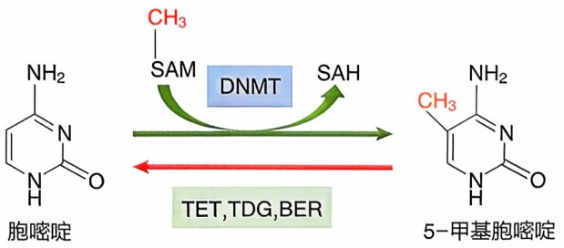

chemical

Chemical reaction diagram showing the conversion of cytosine to 5-aminobutyric acid via SAM and SAH enzymes, with DNMT as a cofactor.

图8-9 甲基化和未甲基化的胞嘧啶

---

274

8 转录调控和表观遗传

甲基化模式。

## 8.3.1.2 DNA甲基化的建立、维持与去除

DNA 甲基化状态分为全甲基化、半甲基化和未甲基化三种。全甲基化是指 DNA 两条链的胞嘧啶均发生甲基化；半甲基化是指仅有一条 DNA 链的胞嘧啶发生甲基化；未甲基化是指 DNA 两条链的胞嘧啶均未发生甲基化。DNA 甲基化水平变化受 DNA 甲基化和去甲基化过程的动态调控，这些过程受不同酶的催化。

DNA 甲基化分为 DNA 甲基化从头建立和 DNA 甲基化维持。DNA 甲基化从头建立是指在本身没有甲基化的 DNA 双链上进行甲基化的过程。在该过程中，DNA 甲基转移酶（DNA methyltransferase, DNMT）DNMT3A、DNMT3B 以 S-腺苷甲硫氨酸（S-adenosyl methionine, SAM）为甲基供体将胞嘧啶（C）甲基化为 5-甲基化胞嘧啶（5-mC）。DNA 甲基化维持是指在新生链相应位置上进行 DNA 甲基化修饰的过程。在 DNA 半保留复制过程中，来自模板的 DNA 单链有甲基化修饰，而新合成的 DNA 链没有任何被修饰的碱基，新合成的 DNA 双链由原来的完全甲基化变为半甲基化状态。DNA 甲基转移酶 DNMT1 能特异性地识别半甲基化的 CpG 二核苷酸，催化 DNA 甲基化，使甲基化状态在有丝分裂过程中得以相对稳定的维持。

DNA 去甲基化分为两种机制:主动去甲基化和被动去甲基化。主动去甲基化过程中 5-mC 在 TET 家族蛋白作用下先被氧化为 5-羟甲基胞嘧啶（5-hydroxymethylcytosine, 5-hmC），再被氧化为 5-甲酰基胞嘧啶（5-formylcytosine, 5-fC），最后被氧化为 5-羧基胞嘧啶（5-carboxylcytosine, 5-caC）。然后，胸腺嘧啶 DNA 糖基化酶（thymine DNA glycosylase, TDG）和碱基切除修复（base excision repair, BER）将处于修饰状态的 5-fC、5-caC 碱基切除。被动去甲基化过程依赖于 DNA 复制过程，由于甲基化维持酶 DNMT1 失活或不表达，基因组上的 DNA 甲基化无法在 DNA 复制过程中维持，导致 DNA 甲基化随细胞分裂逐渐被稀释，即被动去甲基化。

## 8.3.1.3 CpG岛与DNA甲基化的关系

在哺乳动物中 CpG 以两种形式存在:一种分散存在于 DNA 序列中；另一种呈现高度聚集状态，即 CpG 岛（CpG island）。CpG 岛主要位于基因的启动子 5' 端非翻译区和第一个外显子区域，哺乳动物中大约 60% 基因的启动子含有 CpG 岛。CpG 岛中 5-mC 程度通常很低，不影响转录因子与启动子区域的结合；当 CpG 高度甲基化时，部分转录因子无法与 DNA 结合，从而导致转录沉默。5-mC 可经脱氨基反应突变为胸腺嘧啶，造成哺乳动物基因组中 CpG 出现频率远低于期望；启动子区域由于甲基化程度通常很低，避免了 CpG 的大量丢失，从而形成了 CpG 岛。

目前已有多种识别 CpG 岛的计算方法。早在 1989 年就有研究者首次以脊椎动物的测序数据为基础开展了 CpG 岛的大规模计算分析，并给出了 3 个定量标准:长度 >200 bp，GC 含量 >50%，实际 CpG 与预期 CpG 之比（Obs-CpG/Exp-CpG）≥0.6。该算法通过人为设置阈值筛选出 CpG 岛区域，其缺点是对专家经验的依赖性较强，推广能力较弱。基于统计特征的 CpG 岛识别方法主要应用机器学习手段，挖掘出 CpG 岛片段区别于其他 DNA 序列片段的特征，然后构建 CpG 岛识别模型，

---

8.3 DNA甲基化组学数据分析

275

并应用该模型识别新序列中的 CpG 岛片段，其特点是泛化能力较强。常用的计算方法包括 CpGCluster、ClusterPSO 等。

## 8.3.1.4 DNA甲基化的生物学功能

## (1) 基因表达调控

DNA 甲基化与基因转录水平存在一定相关性，启动子的高甲基化通常与转录抑制相关，而外显子的高甲基化与转录活跃相关。基因启动区的 CpG 位点甲基化对基因转录活性的影响主要表现在两个方面:一是 DNA 序列甲基化阻碍转录因子的结合，直接调控基因转录；二是甲基 CpG 结合蛋白结合到甲基化 CpG 位点并与其他转录抑制因子相互作用，间接调控基因转录。DNA 甲基化修饰可调控特异基因的表达，进而调控机体的生长发育。

## (2) 转座子激活

转座子是一类可以在基因组中移动或复制的 DNA 片段，它们在基因组稳定性及其调控过程中具有重要作用。DNA 甲基化可以抑制转座子的活性和稳定性，从而调控它们在基因组中的位置和表达。

## (3) X 染色体失活

X 染色体失活是指雌性哺乳动物细胞中两条 X 染色体中的一条在胚胎发育早期发生基因转录沉默，防止雌性个体出现双倍 X 染色体基因表达的情况，DNA 甲基化在 X 染色体失活中发挥重要功能。

## （4）印记基因

在配子及合子发生期间，亲本等位基因间发生不同程度的 DNA 甲基化修饰，使子代中该等位基因产生不同的表达活性，即印记基因。按其来源可分为两类，一类是父源印记基因（母源表达），另一类是母源印记基因（父源表达）。印记基因的正确表达对于个体生长发育、营养代谢等至关重要。

## (5) 癌症及衰老

DNA 甲基化水平的改变，如整体甲基化水平的降低，会导致原癌基因表达、抑癌基因失活、转座子活化，染色体不稳定等，从而引发癌症。DNA 甲基化在衰老过程中总体水平降低，但同时又伴随着启动子区域许多基因的超甲基化；DNA 甲基化水平的降低与衰老过程中 DNMT1 的活性降低相关，也可能与 DNA 损伤积累和修复能力的下降有关。

## 8.3.2 DNA 甲基化组学数据类型

目前主流的 DNA 甲基化组学测序技术从实验方法上大致分为三类:亚硫酸盐转化方法、DNA 甲基化免疫共沉淀方法以及第三代测序方法。

## 8.3.2.1 亚硫酸盐转化方法

近年来，将 DNA 进行亚硫酸盐转变后再进行 PCR 扩增和测序已成为检测 DNA 甲基化的 “金标准”。亚硫酸盐处理过的 5-mC 不会变化，但是非甲基化的 C 会

---

276

8 转录调控和表观遗传

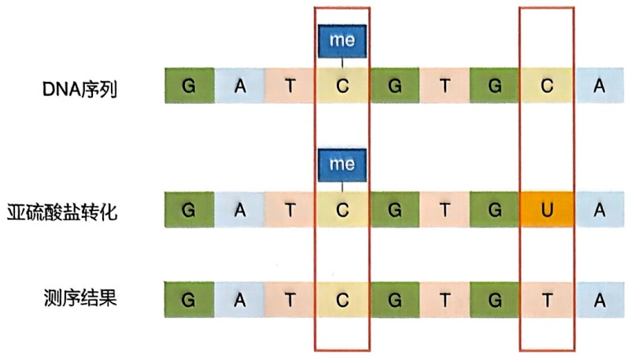

text_image

me
DNA序列 G A T C G T G C A
me
亚硫酸盐转化 G A T C G T G U A
测序结果 G A T C G T G T A

图8-10 亚硫酸盐转化测序技术原理

转化成尿嘧啶（U），DNA 序列的碱基发生了改变，经过聚合酶链反应（polymerase chain reaction, PCR）扩增后，胸腺嘧啶（T）代替尿嘧啶（U）在序列中出现，而 5-mC 依旧保留在 DNA 序列中（图 8-10）。全基因组重亚硫酸盐测序（whole-genome bisulfite sequencing, WGBS）将亚硫酸盐转化和第二代测序结合使用，该方法可以快速便捷地捕获全基因组水平上的 DNA 甲基化状态，实现定点定量的检测，将得到的测序结果与参考基因组进行比对:参考基因组是 C 而

测序结果是 T 的位点表示并未发生甲基化修饰，而参考基因组和测序结果中均是 C 的位点则表示发生了甲基化修饰。WGBS 的应用范围较广，能够最大限度地获得完整的全基因组甲基化信息，但也意味着测序成本较高。简化代表性重亚硫酸盐测序（reduced representation bisulfite sequencing，RRBS）技术通过限制性内切酶对基因组的 C-GGG 位点识别并且进行酶切，富集启动子区域以及 CpG 岛的 DNA 片段，可以用较低成本反映出 CpG 岛和启动子区域的甲基化情况。WGBS 和 RRBS 实验均可在单细胞样品中完成。除了与第二代测序技术相结合，亚硫酸盐转化的方法还能与 DNA 芯片技术相结合。目前主要有 Illumina 公司的 450 K 芯片（Illumina Human Methylation 450 K BeadChip）和 850 K 芯片（Infinium MethylationEPIC BeadChip）两种。

需要注意的是，基于亚硫酸盐的转化反应不能区分 5-mC 和 5-hmC，在测定过程中，所有的 5-hmC 会被错误地识别为 5-mC，这会导致一些 CpG 二核苷酸位点 DNA 甲基化水平略微偏高。

## 8.3.2.2 DNA甲基化免疫共沉淀方法

对 DNA 的富集沉淀可以通过特异性针对 5-mC 的抗体或者甲基结合蛋白完成，前者为甲基化 DNA 免疫沉淀（methyl-DNA immunoprecipitation，MeDIP）方法，后者包括含有甲基化 CpG 结合区（methyl CpG-binding domain，MBD）结构域的 MeCP2 和 MBD2 蛋白，富集得到的 DNA 可以通过高通量测序检测甲基化水平。MeDIP-Seq 技术原理是通过 5-mC 抗体特异性捕获样本中甲基化水平比较高的 DNA 片段，之后通过第二代测序在全基因组水平上进行高甲基化区域的检测。MBD-Seq 技术与 MeDIP-Seq 不同的是通过特异性结合甲基化 DNA 的蛋白去富集高甲基化的 DNA 片段，然后在全基因组范围内检测甲基化位点。MeDIP-Seq 和 MBD-Seq 方法虽然能够覆盖全基因组，但是不能获得单碱基分辨率的 DNA 甲基化水平，并很难检测到差异甲基化 DNA 区域。

## 8.3.2.3 第三代测序方法

以 Oxford Nanopore Technologies（ONT）公司的纳米孔测序技术和 PacBio 公司的 SMRT（single molecule real-time sequencing technology）技术为代表的第三代

---

8.3 DNA 甲基化组学数据分析

277

测序方法能够直接对 DNA 序列进行甲基化的测定。ONT 测序是基于纳米孔单分子实时电信号测序技术，能够检测 DNA 分子本身的物理化学特性，DNA 链上不同碱基位点在有无甲基化修饰时会存在一定的化学性质差异，因此，当单个碱基通过纳米孔通道时会产生不同的电信号，ONT 能够以电流强度差异检测有无甲基化修饰。相比二代测序，ONT 具有超长测序读长，能够区分 5-mC 和 5-hmC。和 ONT 不同的是，PacBio 测序技术通过实时记录的荧光信号来确定 DNA 序列及其甲基化状态；在此过程中，带有荧光标记的核苷酸被 DNA 聚合酶逐个添加到 DNA 链上，正确加入时会释放出光信号；DNA 上的甲基化修饰改变了信号的强度和持续时间，使 PacBio 能够同时检测碱基序列和甲基化状态。目前第三代测序方法的单次测序错误率都比较高，只有达到一定的测序深度时，测序错误才可以被修正。基于对技术发展趋势的推测，未来第三代测序技术在 DNA 甲基化数据产生方面将展现出巨大的应用潜力。

## 8.3.3 WGBS 数据分析方法

使用不同实验方法获得的 DNA 甲基化数据的处理流程和分析手段是不同的，其中，WGBS 数据是目前最常见的 DNA 甲基化测序数据类型，具有定量化、单碱基分辨率、能够覆盖全基因组范围等优点。此外，WGBS 实验可以在单细胞水平实现，称为单细胞 WGBS（single cell WGBS, scWGBS）。scWGBS 能够揭示单个细胞的 DNA 甲基化模式，但需要高效的单细胞分离技术和敏感的 DNA 扩增方法来从单个细胞中获取足够的 DNA 进行测序。与传统的 WGBS 相比，scWGBS 面临更多技术挑战，包括扩增过程中的偏差和相对较高的错误率；因此，在分析 scWGBS 数据时，需要使用专门设计的算法来校正这些偏差。

本节主要介绍 WGBS 数据的分析方法及工具，包括原始数据质量控制、序列比对、DNA 甲基化水平推断、差异修饰位点/区域分析、甲基化修饰位点/区域鉴定注释等。

## 8.3.3.1 原始数据质量控制

应用 TrimGalore 工具对下机原始测序数据进行质量控制，主要是过滤掉过短序列、污染序列和尾端低质量序列等，并采用 FastQC 对于过滤前后的数据进行质控，可以得到碱基质量、GC 含量、长度分布等分析结果。

## 8.3.3.2 序列比对

亚硫酸盐转化过程将非甲基化的 C 转化为 U，并在之后的文库构建过程中转化为 T，降低了序列的复杂性，导致 C 到 T 的比对比较难，同时，亚硫酸盐转化只发生在碱基 C 上而不会在碱基 G 上，使得转化的两条链不再互补。因此，亚硫酸盐转化后的读段比对具有挑战性。为了解决该问题，研究人员开发出专门的数据比对算法。WGBS 的比对工具大多基于两种算法:通配符（wild-card）和三字符（3-letter）（图 8-11）。通配符比对是在参考基因组中将所有的碱基 C 替换成 Y，这

---

278

8 转录调控和表观遗传

图8-11 WGBS数据比对算法原理

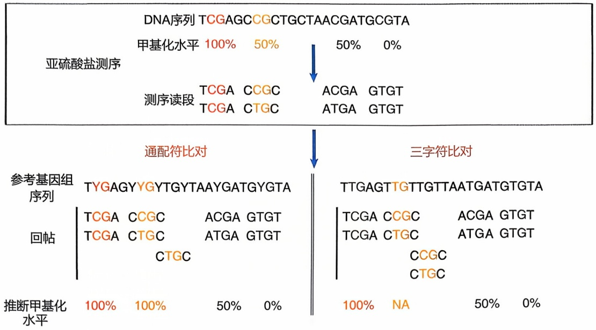

flowchart

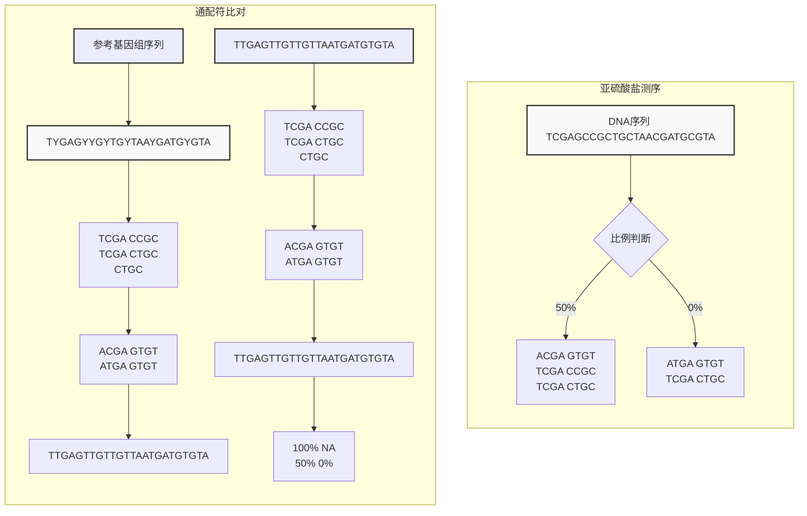

使得含有碱基 C 和含有碱基 T 的读段都可以比对到参考基因组上。这种算法具有较高的基因组覆盖率，但是部分位点上推断的甲基化水平较实际值偏高。三字符对比是将参考基因组中所有的碱基 C 转换成 T，该算法成功率较低，但是不会给后续甲基化水平的推断带来偏差。

目前已有多种 WGBS 标准分析比对软件，其中，Bwa-meth、BSBolt、BSMAP、Bismark 和 Walt 五种软件表现出更高的比对序列唯一性、比对精确率和召回率等，其中，基于三字符算法的 Bismark 和基于通配符算法的 BSMAP 应用较为广泛。Bismark 在比对前会将所有序列进行 C→T 转换（另一条链进行 G→A 转换），并且将参考基因组同样进行这两种转换。如果建库的方式是非链特异性的，读段的方向无法确定，则转换后的两种序列要分别与参考基因组的两种情况进行比对，相当于每条序列进行 4 次不同比对，从中选择最佳的比对结果。如果建库方式是链特异性的，已知序列属于哪一条链，则只需要与已知的那条参考基因组进行比对。这种比对方式比较准确，使用率高，还集成了提取甲基化位点、去重等功能。与 Bismark 不同的是，BSMAP 不转换基因组序列，而是用参考基因组创建种子列表，每一个种子中的每一个 C 都有可能是甲基化的 C 或者非甲基化的 C，种子列表中包含 C→T 转换的全组合。例如，参考序列的某个种子中有 3 个 C，每一个 C 所在的位置都有甲基化（C）和非甲基化（T）两种情况，那么该种子对应的列表中就有 2³ 种 C→T 转换的组合。BSMAP 方法将序列与种子列表比对，选择最优的一种比对情况作为最终的比对结果。

## 8.3.3.3 DNA甲基化水平推断

在 WGBS 数据中，甲基化和非甲基化的 C 呈现出不同的信号，理论上可以推断每个位点或区域的 DNA 甲基化水平（图 8-12）。推断 DNA 甲基化水平的常用软件包括 Bismark、MOABS、BSmooth、Bis-SNP 等。

在实际的处理过程中，计算 DNA 甲基化水平首先需要消除一系列因素的影响，去除这些因素影响的基本原理如下。

---

8.3 DNA甲基化组学数据分析

279

## (1) DNA 片段末端修复

在测序文库制备步骤中, 未甲基化的 C 会加到 DNA 片段末端进行末端修复, 导致 DNA 片段末端的甲基化水平低于实际值。统计 5-mC 在测序读段上的比例分布可以帮助识别末端修复的干扰, BSeQC 等软件则可以去除该因素的影响。

## (2) 测到接头序列

如果测序文库长度小于测序读段长度,测得的DNA片段末端可能会包含接头序列（adaptor），其中非甲基化的C亦对甲基化水平产生影响。可采用与去除DNA片段末端修复影响相同的方法

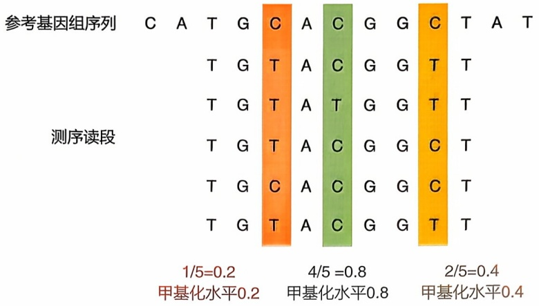

text_image

参考基因组序列 C A T G C A C G G C T A T
T G T A C G G T T
T G T A T G G T T
T G T A C G G C T
T G C A C G G C T
T G T A C G G T T
测序读段
1/5=0.2 4/5=0.8 2/5=0.4
甲基化水平0.2 甲基化水平0.8 甲基化水平0.4

图8-12 WGBS数据DNA甲基化水平推断示意图

识别及去除该因素的干扰，也可以使用 TrimGalore 去除接头序列和低质量数据。

## （3）亚硫酸盐转化效率

在甲基化文库中，亚硫酸盐对非甲基化的 C 的转化效率一般是在 99% 左右。而 DNA 片段 5' 端的亚硫酸盐转化效率较低，导致甲基化水平偏高。除了上述方法消除该因素的影响之外，还可以通过使用内参对照品（如  $\lambda$  噬菌体 DNA）对实验的转化效率进行质量控制。

## (4) 3' 端测序质量下降

由于第二代测序技术的局限性，随着测序读段的长度增加，3'端测序质量下降，其DNA甲基化水平的推断也会产生偏差。FastQC可以统计测序质量在测序读段上的分布从而识别该因素的影响。

## (5) 不均衡扩增

制备测序文库时，不均衡扩增会影响用于计算DNA甲基化水平的DNA片段分布比例，从而导致甲基化水平推测产生偏差。利用Bismark、Samtools等工具可以去除重复读段。

## (6) 混入 5-hmC 修饰

由于亚硫酸盐的转化反应不能区分 5-mC 和 5-hmC，在测定过程中，5-hmC 会被误读为 5-mC，从而导致一些 CpG 二核苷酸位点的甲基化水平被高估。TAB-Seq（TET-assisted bisulfite sequencing）利用了 TET 蛋白家族的氧化活性，将 5-hmC 特异性地氧化为 5-caC，再经亚硫酸盐处理和测序，从而可以将 5-hmC 和 5-mC 区分开来。

## 8.3.3.4 差异甲基化区域鉴定

差异甲基化区域（differentially methylated region，DMR）是指在不同生物样本或条件下，基因组中一系列连续的 CpG 位点的甲基化状态发生显著变化的区域。DMR 用于指征不同样本之间甲基化水平的差异，有助于揭示甲基化修饰与基因表达变化的关联。用于鉴定 DMR 的常用软件包括 methylKit、MOABS、QDMR、BSmooth、dmrFinder、IMA 等。几种常见的鉴定 DMR 的思路如下。

---

280

8 转录调控和表观遗传

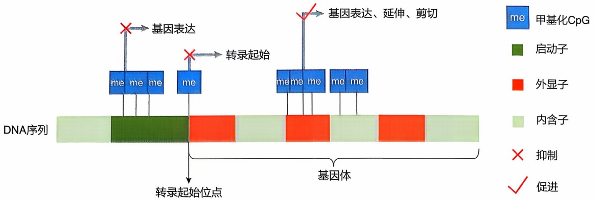

flowchart

```mermaid
graph LR
  subgraph Gene_Structure
    direction TB
  A["me (myelium)"] --> B{"Gene Activation"}
  C["meme (memelium)"] --> D{"Transmembrane Region"}
  E["me (myelium)"] --> F{"Transmembrane Position"}
  G["meme (memelium)"] --> H{"Transmembrane Position"}
  I["me (myelium)"] --> J{"Transmembrane Position"}
  end

  subgraph DNA_Pathway
    K["DNA Sequence"] -.-> L["Transmembrane"]
    M["Transmembrane"]
  end

  style A fill:#f9f9f9,stroke:#333,stroke-width:2px
  style C fill:#f9f9f9,stroke:#333,stroke-width:2px
  style E fill:#f9f9f9,stroke:#333,stroke-width:2px
  style F fill:#f9f9f9,stroke:#333,stroke-width:2px
  style G fill:#f9f9f9,stroke:#333,stroke-width:2px
  style H fill:#f9f9f9,stroke:#333,stroke-width:2px
  style I fill:#f9f9f9,stroke:#333,stroke-width:2px
  style J fill:#f9f9f9,stroke:#333,stroke-width:2px
  style K fill:#f9f9f9,stroke:#333,stroke-width:2px
  style L fill:#f9f9f9,stroke:#333,stroke-width:2px
  style M fill:#f9f9f9,stroke:#333,stroke-width:2px
  style N fill:#f9f9f9,stroke:#333,stroke-width:2px
  style O fill:#f9f9f9,stroke:#333,stroke-width:2px
  style P fill:#f9f9f9,stroke:#333,stroke-width:2px
  style Q fill:#f9f9f9,stroke:#333,stroke-width:2px
  style R fill:#f9f9f9,stroke:#333,stroke-width:2px
  style S fill:#f9f9f9,stroke:#333,stroke-width:2px
  style T fill:#f9f9f9,stroke:#333,stroke-width:2px
  style U fill:#f9f9f9,stroke:#333,stroke-width:2px
  style V fill:#f9f9f9,stroke:#333,stroke-width:2px
  style W fill:#f9f9f9,stroke:#333,stroke-width:2px
  style X fill:#f9f9f9,stroke:#333,stroke-width:2px
  style Y fill:#f9f9f9,stroke:#333,stroke-width:2px
  style Z fill:#f9f9f9,stroke:#333,stroke-width:2px
  style AA fill:#f9f9f9,stroke:#333,stroke-width:2px
  style AB fill:#f9f9f9,stroke:#333,stroke-width:2px
  style AC fill:#f9f9f9,stroke:#333,stroke-width:2px
  style AD fill:#f9f9f9,stroke:#333,stroke-width:2px
  style AE fill:#f9f9f9,stroke:#333,stroke-width:2px
  style AF fill:#f9f9f9,stroke:#333,stroke-width:2px
  style AG fill:#f9f9f9,stroke:#333,stroke-width:2px
  style AH fill:#f9f9f9,stroke:#333,stroke-width:2px
  style AI fill:#f9f9f9,stroke:#333,stroke-width:2px
  style AJ fill:#f9f9f9,stroke:#333,stroke-width:2px
  style AK fill:#f9f9f9,stroke:#333,stroke-width:2px
  style AL fill:#f9f9f9,stroke:#333,stroke-width:2px
  style AM fill:#f9f9f9,stroke:#333,stroke-width:2px
  style AN fill:#f9f9f9,stroke:#333,stroke-width:2px
  style AO fill:#f9f9f9,stroke:#333,stroke-width:2px
  style AP fill:#f9f9f9,stroke:#333,stroke-width:2px
  style AQ fill:#f9f9f9,stroke:#333,stroke-width:2px
  style AR fill:#f9f9f9,stroke:#333,stroke-width:2px
  style AS fill:#f9f9f9,stroke:#333,stroke-width:2px
  style AT fill:#f9f9f9,stroke:#333,stroke-width:2px
  style AU fill:#f9f9f9,stroke:#333,stroke-width:2px
  style AV fill:#f9f9f9,stroke:#333,stroke-width:2px
  style AW fill:#f9f9f9,stroke:#333,stroke-width:2px
  style AX fill:#f9f9f9,stroke:#333,stroke-width:2px
  style AZ fill:#f9f9f9,stroke:#333,stroke-width:2px
  style BA fill:#f9f9f9,stroke:#333,stroke-width:2px
  style BB fill:#f9f9f9,stroke:#333,stroke-width:2px
  style BC fill:#f9f9f9,stroke:#333,stroke-width:2px
  style BCII fill:#e10000000000000000000000000000000000000000000000000000000000000000000000000000000000000000000000000000
```

图8-13 WGBS数据差异甲基化区域分布及调控示意图

## (1) 滑动窗口方法

将基因组划分为相邻的窗口，通过比较不同样本间每个窗口的甲基化水平，并运用 t 检验、方差分析（analysis of variance, ANOVA）、Wilcoxon 秩和检验等统计方法来识别显著变化的甲基化区域，有助于捕获连续的甲基化水平变化。

## (2) 基因组功能分区方法

将基因组划分为不同的功能区域，如启动子、外显子、内含子等，对这些区域的甲基化水平进行比较，并使用相应的统计学方法分析，以研究特定功能区域的甲基化调控。

## (3) 时间序列分析

适用于研究动态变化的甲基化情况，如在发育过程中 DNA 甲基化的变化。通过对不同时间点的甲基化数据进行序列分析，可以识别 DNA 甲基化随时间变化的特定区域。

## 8.3.3.5 差异甲基化区域注释

启动子区域甲基化水平的提高具有潜在抑制基因转录的功能，而基因区域高甲基化与基因表达具有正相关关系，所以研究这两个区域在不同样本或条件下甲基化水平有差异的基因，可以帮助我们研究与DNA甲基化调控相关的功能（图8-13）。HOMER、ChIPseeker等软件可以对差异甲基化区域进行注释，得到差异甲基化区域对应的基因以及所在的基因组位置（包括启动子、外显子、内含子、基因间区等）。

## 8.4 组蛋白修饰组学数据分析

## 8.4.1 组蛋白修饰概述

## 8.4.1.1 组蛋白修饰的定义

核小体（nucleosome）是构成真核生物染色质的基本单位，由组蛋白核心和包裹在组蛋白核心周围的 DNA 组成（图 8-14）。组蛋白有五个家族:H1/H5（连接组蛋白）、H2、H3 和 H4（核心组蛋白）。核心组蛋白和连接组蛋白都富含带正电荷的

---

8.4 组蛋白修饰组学数据分析

281

精氨酸（R）和赖氨酸（K）残基，这些残基通过静电作用与带负电荷的DNA骨架磷酸盐相互作用。每个核心组蛋白都有一个游离在外的N端氨基酸尾部结构。这些尾部多肽链可以在相关酶的作用下产生多种共价修饰，如乙酰化、甲基化、磷酸化、泛素化、SUMO化和ADP-核糖化等，统称为组蛋白修饰（histone modification）。这些修饰在基因转录、DNA修复、DNA复制、可变剪接和染色质凝聚等过程中都产生了广泛的影响。组蛋白修饰类型众多，目前通过组学手段研究组蛋白修饰，主要集中于组蛋白的乙酰化和甲基化；本节内容主要介绍组蛋白的乙酰化和甲基化两类修饰。

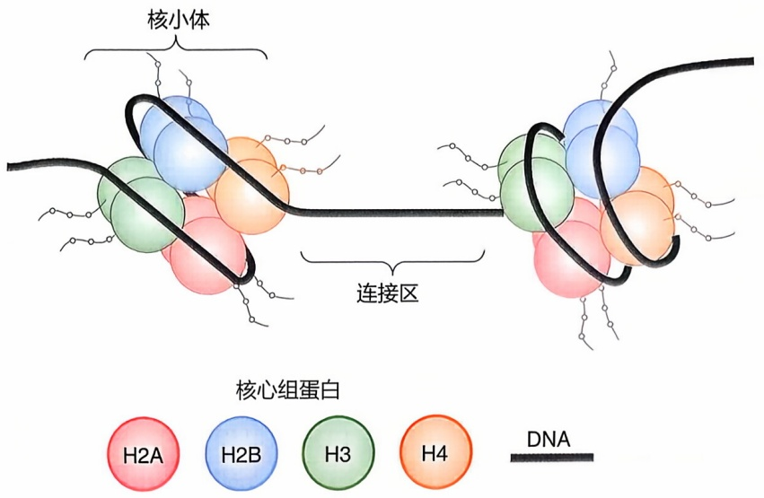

text_image

核小体
连接区
核心组蛋白
H2A	H2B	H3	H4	DNA

图8-14 核小体与组蛋白示意图

## 8.4.1.2 组蛋白修饰的命名

组蛋白修饰的命名由四部分组成:组蛋白类型、发生修饰的氨基酸残基名称、发生修饰的氨基酸残基位置以及修饰的类型。例如，H3K27me3修饰代表发生在H3组蛋白第27位赖氨酸的三甲基化修饰（即增加3个甲基基团）；H3K9ac修饰代表发生在H3组蛋白第9位赖氨酸的乙酰化修饰；H2BK120ub修饰代表发生在H2B组蛋白第120位赖氨酸的泛素化修饰。

## 8.4.1.3 组蛋白修饰的建立、去除与识别

组蛋白修饰是一个高度动态的过程，涉及很多种类的酶，是典型的酶促反应。这些修饰的发生、去除及发挥作用主要由组蛋白修饰酶及相应的辅因子调控，包括写入器（writer）、读取器（reader）和擦除器（eraser）三大类（图8-15）。组蛋白修饰写入器是催化化学基团添加到组蛋白上以对其进行修饰的酶，包括组蛋白赖氨酸甲基转移酶、组蛋白精氨酸甲基转移酶和组蛋白乙酰转移酶。组蛋白赖氨酸甲基转移酶可以在单个赖氨酸残基上添加多达3个甲基，从而形成单甲基化（me1）、二甲基化（me2）和三甲基化（me3）状态。精氨酸残基在不同类别精氨酸甲基转移酶的催化下可以进行单甲基化（me1）、对称二甲基化（me2s）和非对称二甲基化（me2a）修饰。组蛋白乙酰转移酶将乙酰基从乙酰CoA转移到组蛋白的赖氨酸残基上。组蛋白修饰的读取器是识别特定翻译后修饰的底物并与之特异性结合的蛋白质或蛋白质复合物，其分类很广。这些蛋白质都含有有助于识别这些修饰的特殊结构域。组蛋白修饰的擦除器是从组蛋白上去除这些修饰的酶，包括去甲基化酶、去乙

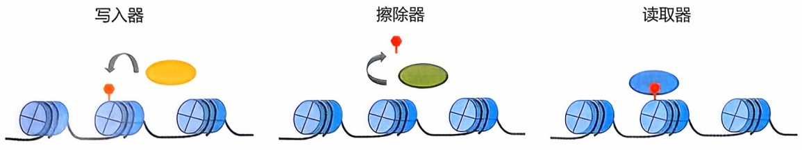

图8-15 组蛋白修饰相关的染色质调控因子

---

282

8 转录调控和表观遗传

酰化酶、磷酸酶等。组蛋白赖氨酸残基的去甲基化酶成员具有多种作用底物和生物学功能，它们主要包括两个家族（KDM1/LSD1 和 JmjC），分别采用不同的酶学机制进行反应。组蛋白的去乙酰化是由组蛋白去乙酰化酶（HDAC）完成的，它能去除组蛋白赖氨酸残基上的乙酰基。组蛋白修饰之间不是互相独立的，而是存在紧密的关联:组蛋白修饰写入器、擦除器、读取器负责介导组蛋白修饰之间的交叉对话（crosstalk）。

## 8.4.1.4 组蛋白修饰的生物学功能

## (1) 影响基因转录调控

组蛋白修饰常常富集于不同的基因组位置，它们的存在与基因转录活性密切相关。一些组蛋白修饰可以作为转录激活或抑制状态的标志物:与转录激活状态相关的组蛋白修饰包括各位点的乙酰化修饰、H3K4me2/3、H3K9me1、H3K27me1、H3K79me2/3、H3K36me3等，与转录抑制状态相关的组蛋白修饰包括H3K9me2/3、H3K27me2/3、H4K20me3等。组蛋白乙酰化通常发生在组蛋白的赖氨酸残基上，中和了赖氨酸的正电荷，使其与带负电荷的DNA之间的亲和力降低，导致染色质结构松散，使得转录因子和RNA聚合酶更容易访问染色质，从而显著增加基因表达。H3K4me3富集在真核生物中大多数活跃基因的启动子区域，在转录起始位点（transcription start site, TSS）附近达到峰值，能够促进转录机器的招募，如招募转录起始因子TFIID的亚基TAF4，从而增强靶基因的表达。H3K9me3是组成型异染色质的标记，在基因组的转录沉默区域富集，不仅标记不同生物体中着丝粒相关、端粒相关和其他重复序列，而且还标记沉默基因。H3K9me3可以招募并结合异染色质蛋白1（HP1），HP1通过其寡聚化特性、可能的相变作用以及招募其他异染色质相关蛋白，来促进H3K9me3标记区域的压缩，从而阻止转录因子的结合。人类和小鼠的胚胎干细胞中，与发育紧密相关的基因，某些与发育紧密相关的基因的启动子区域呈现H3K4me3和H3K27me3两种组蛋白修饰，这代表了一种预备转录的状态。

## (2) 参与减数分裂

减数分裂重组发生在富含开放染色质标记 H3K4me3 和 H3K36me3 的基因组热点区域，这些标记由 PRDM9 识别，并与 HELLS 形成先驱复合体，为减数分裂重组打开染色质；这些区域创造的环境可促进程序性 DNA 双链断裂（double-strand breakage，DSB）的产生和后续修复。

## (3) 参与 DNA 修复

组蛋白甲基化修饰对于 DNA 损伤后的转录沉默至关重要。例如,多种 H3K4me2/3 去甲基酶被招募到 DSB 位点,抑制转录并刺激 DNA 修复因子的结合。错配识别蛋白 MSH6 通过其 PWWP 结构域识别 H3K36me3 修饰,并介导 DNA 错配修复。

## (4) 参与 DNA 复制

组蛋白修饰在调节 DNA 复制起始方面具有重要作用。例如，组蛋白 H4 在 K5、K8 和 K12 处的乙酰化会打开染色质结构，从而促进人类细胞中的预复制复合物的形成；组蛋白 H4K20me 水平的调节在后生动物基因组的复制启动中也发挥着关键作用。

---

8.4 组蛋白修饰组学数据分析

283

## （5）参与三维基因组结构形成

组蛋白甲基化在三维基因组结构域形成过程中发挥重要功能。例如，H3K9me2/3富集在细胞核周边相关的染色质，形成核纤层相关结构域；H3K27me3通过招募PRC1，影响多梳蛋白相关结构域的形成。

## 8.4.2 组蛋白修饰组学数据类型

ChIP-Seq 是目前应用最为广泛的绘制组蛋白修饰全基因组分布图谱的技术之一，根据是否需要交联及染色质的打断方式，分为 X-ChIP-Seq 和 N-ChIP-Seq 两种。X-ChIP-Seq 需要对 DNA 和蛋白质进行交联，以稳定它们之间的相互作用，并依靠超声将 DNA 打断成 200～1000 个碱基对大小的片段（详见 8.2.3）。N-ChIP-Seq 则无须事先进行交联，并应用微球菌核酸酶（micrococcal nuclease，MNase）将染色质切断。通过这种酶消化的方式生成的片段只有单个核小体大小，可提供单核小体分辨率的图谱。N-ChIP-Seq 适用于大部分组蛋白修饰，不仅可以绘制组蛋白修饰全基因组分布图谱，还可以在组蛋白修饰富集的区域提供核小体定位的信息。近年来，出现了 CUT&RUN 和 CUT&Tag 技术:CUT&RUN 技术利用特异性抗体靶向特定的组蛋白修饰，并将 MNase 与抗体融合，在加入钙离子后激活 MNase 切割组蛋白修饰位点附近的 DNA；CUT&Tag 技术通过特异性抗体识别目标组蛋白修饰，但使用的是融合转座酶的抗体复合物，转座酶在组蛋白修饰位点附近插入测序接头并同时切割 DNA，生成带有接头的 DNA 片段，可直接用于测序。CUT&RUN 和 CUT&Tag 技术显著降低了组蛋白修饰全基因组分布图谱的背景噪声，尤其适用于细胞数量较少的样本。

## 8.4.3 组蛋白修饰 ChIP-Seq 数据分析方法

组蛋白修饰 ChIP-Seq、CUT&RUN 和 CUT&Tag 数据的分析方法基本相同，与转录因子 ChIP-Seq 数据的分析方法及工具（详见 8.2.4）有同有异。本节着重讲授

组蛋白修饰 ChIP-Seq 数据异于转录因子 ChIP-Seq 数据的分析要点及工具。

## 8.4.3.1 注释层面的 ChIP-Seq 数据质量控制

组蛋白修饰 ChIP-Seq 数据质量依赖于抗体质量、实验者操作等因素，在应用数据前需要评估其质量。一些组蛋白修饰在基因组特定区域（如基因区域）具有特定的分布特征（图 8-16）。例如，H3K4me3 的 ChIP-Seq 信号富集在活性或预备转录基因的启动子区域；H3K36me3 和 H3K79me2 的 ChIP-Seq 信号富集在活性基因体区域，H3K27me3 的 ChIP-Seq 信号富集在

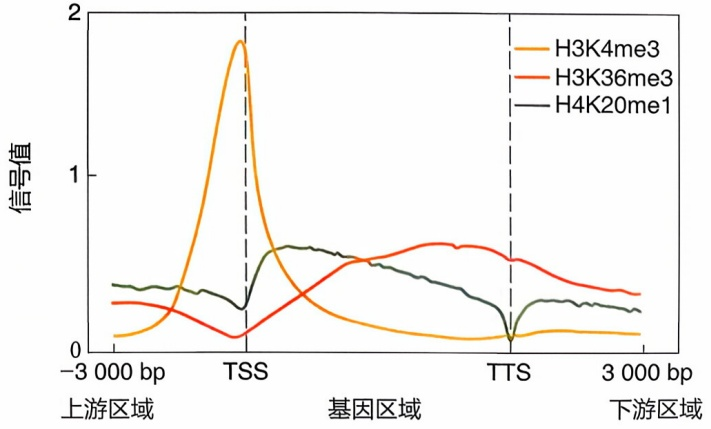

line

| Genomic Region | H3K4me3 | H3K36me3 | H4K20me1 |
| --- | --- | --- | --- |
| -3 000 bp | ~0.1 | ~0.3 | ~0.4 |
| TSS | ~1.8 | ~0.1 | ~0.2 |
| TTS | ~0.1 | ~0.5 | ~0.1 |
| 3 000 bp | ~0.1 | ~0.3 | ~0.2 |

图8-16 组蛋白修饰分布特征

---

284

8 转录调控和表观遗传

图8-17 组蛋白修饰 ChIP-Seq数据类型

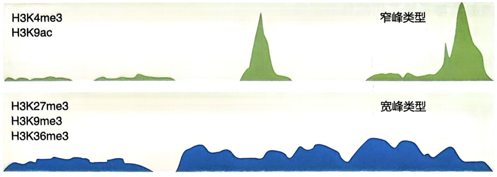

text_image

H3K4me3
H3K9ac
窄峰类型
H3K27me3
H3K9me3
H3K36me3
宽峰类型

基因丰富区域的转录抑制的基因启动子上以及发育调节因子和或预备转录基因的启动子区域。对于基因组特定区域内的组蛋白修饰 ChIP-Seq 数据，可以将特定区域划分为数个等长的区间并对每个区间上的 ChIP-Seq 信号取平均值，绘制 ChIP-Seq 信号在特定基因组区域各位置的平均值折线图；对于高质量的 ChIP-Seq 数据，预期折线图符合该组蛋白修饰独特的分布特征。用于绘制 ChIP-Seq 信号在特定基因组区域各位置的平均值折线图的常用软件包括 CEAS、deepTools 等。

## 8.4.3.2 识别组蛋白修饰富集区域

根据测序读长在基因组上的分布特征，可以将组蛋白修饰的 ChIP-Seq 数据分为两种类型（图 8-17）。第一类是窄峰类型:测序读长聚集形成尖锐且离散的信号峰，信号峰与基因组背景信号差异显著，如 H3K4me3、H3K9ac 等与转录起始位点或增强子区域紧密关联的组蛋白修饰的 ChIP-Seq 数据。第二类是宽峰类型:测序读长难以聚集形成长达数万、数十万 bp 乃至更大的信号富集区域，如 H3K9me3、H3K27me3、H3K36me3 等组蛋白修饰的 ChIP-Seq 数据。

对于窄峰类型的组蛋白修饰 ChIP-Seq 数据，识别组蛋白修饰富集区域的方法与识别转录因子 ChIP-Seq 数据信号峰的方法基本相同（详见 8.2.4）。对于宽峰类型的组蛋白修饰 ChIP-Seq 数据，测序读长形成跨越大片段的信号富集区域，且信号的幅度在富集区域内部具有较大的波动，富集区域与基因组背景信号差异不显著，因此识别组蛋白修饰富集区域的方法与识别转录因子 ChIP-Seq 数据信号峰的方法有较大区别。用于识别宽峰类型 ChIP-Seq 数据组蛋白修饰富集区域的常用软件包括 MACS（宽峰模式）、SICER、SPP 等。

## 8.4.3.3 识别组蛋白修饰差异富集区域

用于定量比较识别组蛋白修饰差异富集区域的方法包括 MACS、MAnorm、ChIPDiff 等，本节以 MAnorm 方法为例来介绍其原理。MAnorm 方法假设两套 ChIP-Seq 数据共有的组蛋白修饰富集区域在样本间具有相同的信号强度。基于该假设，MAnorm 方法对两套 ChIP-Seq 数据进行归一化，并应用经验贝叶斯模型计算共有的组蛋白修饰富集区域在两个样本间差异的统计显著性，从而识别出具有统计显著性的差异富集区域，这种方法可以避免不同样品信噪比不同的问题。

## 8.4.3.4 基于组蛋白修饰图谱推断染色质状态

组蛋白的不同修饰与染色质的状态密切相关，可以分别作为转录激活状态、转

---

8.5 三维基因组学数据分析

285

录抑制状态、组成性异染色质、兼性异染色质等染色质状态的标志物。通过组合这些修饰的信息，研究者可以绘制出一个更为详细的染色质状态图谱，从而更深入地理解基因的表达调控。这种被称为“染色质状态”的模式不仅能捕捉到已知类别的基因组元素，如启动子、增强子、转录区、抑制区和重复区，还能发现新类别或亚类别的元素。通过确定染色质状态在不

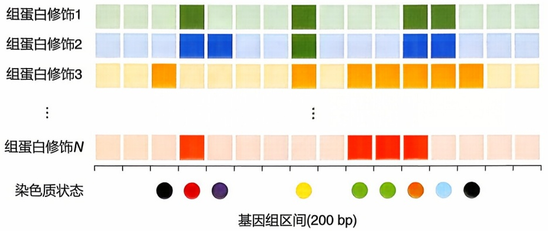

heatmap

| Group | Gene Expression Pattern Distribution |
| --- | --- |
| Group N | Light pinkish-brown, pale pinkish-brown, pale pinkish-brown, red-orange |
| Legend | Color Code (Black to Black) |

图8-18 基于组蛋白修饰推断染色质状态的原理

同细胞类型中的分布，研究者可为不同细胞类型的 DNA 元素和调控控制区提供系统的注释。此外，这些信息对解读全基因组关联分析（genome-wide association study, GWAS）的结果、研究基因调控和分析细胞分化过程等都具有重要价值。常用的基于组蛋白修饰推断染色质状态的方法包括 ChromHMM、SegWay、HMMseg 等。本节以 ChromHMM 方法为例介绍其原理（图 8-18）。ChromHMM 方法首先将基因组划分为连续的长度为 200 bp 的区间，检查每个 200 bp 的片段是否存在某种修饰的标记，并据此为每个片段分配一个修饰“组合”的标识。ChromHMM 使用多元隐马尔可夫模型（hidden Markov model, HMM）来学习染色质状态特征。也就是基于 ChIP-Seq 数据中的组合标识来“学习”基因组中可能存在的染色质状态。这意味着模型会尝试找出哪些组蛋白修饰标记组合最有可能对应于某种特定的染色质状态。通过上述学习过程，ChromHMM 最终能够为每个 200 bp 的基因组片段分配一个“最可能”的染色质状态，从而为整个基因组生成注释。这种注释有助于研究者理解在特定细胞类型中，哪些基因区域是活跃的、哪些是沉默的，或者哪些区域正在进行其他类型的调控。

## 8.5 三维基因组学数据分析

## 8.5.1 三维基因组学数据概述

## 8.5.1.1 三维基因组结构的定义

人类基因组长达 2 m，而细胞核的直径大约 6 μm；染色质在细胞核内进一步有序折叠组装，以保证细胞精确执行重要的生物学功能（如 DNA 复制、转录、细胞分化等），这种和功能相适应的染色质组折叠方式称为三维基因组结构。

## 8.5.1.2 三维基因组结构的层级

三维基因组结构可以分为几个层级（图8-19）。第一，每个染色体各自在核内占据相对独立的位置，这称为染色体领域（chromosome territory）。这是由于每条

---

286

8 转录调控和表观遗传

图8-19 染色质三维结构的不同层级

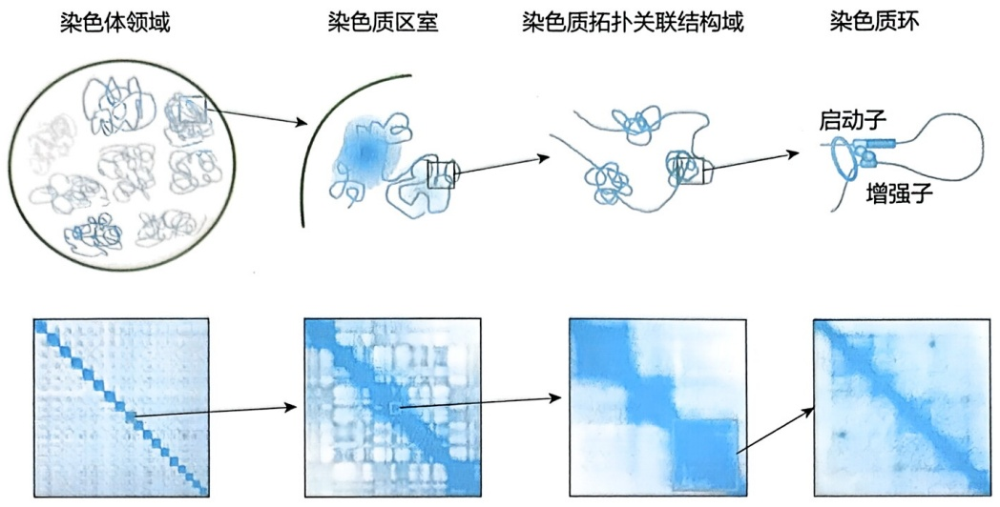

flowchart

染色体是相互独立的连续 DNA 和染色质大分子，在受共价连接的情况下自由运动会形成相对连贯的区域。第二，根据转录活性，基因组又划分为转录活性高的常染色质区域和转录抑制的区域，他们在基因组上以一至数十 Mb 的长度交替存在，不同类型区域之间的相互作用较弱，同类区域之间的相互作用较强，称为染色质区室（chromatin compartments）。第三，在区室之内，相邻的染色质形成连续的紧密结构单元，这些结构单元称为染色质拓扑关联结构域（topologically associating domain, TAD），长度通常为数百 kb 到数 Mb。位于特定拓扑结构域当中的染色质相互作用较强，它们与其他拓扑结构域中的染色质交互较弱。第四，在拓扑结构域中，存在点对点的强相互作用，这称为染色质环（chromatin loop），染色质环通常发生在顺式作用调控元件之间，如增强子和启动子，或者绝缘子蛋白 CTCF 的结合位点之间。

## 8.5.2 三维基因组学数据类型

研究三维基因组的技术主要分为两类。一类是以显微成像为基础，观察细胞核当中染色质的三维构象。由于产生高通量三维基因组数据的显微成像方法还处在较初级的阶段，本节不进行介绍。另一类技术基于染色质构象捕获（chromatin conformation capture, 3C）技术，以 Hi-C 和 ChIA-PET 为代表。

## 8.5.2.1 Hi-C 技术

Hi-C 技术的基本步骤包括以下 5 步。① 固定:使用交联剂将 DNA 与其周围的蛋白质交联，确保染色体上的相邻区域在后续步骤中保持接触。② 消化:使用限制性内切酶（如 MboI）对化学交联剂固定的 DNA 进行酶切。③ 末端修复:得到的片段具有平端或黏端，在补齐末端的时候加上生物素标记。④ 连接及解交联:对钝性末端重新连接，形成环状。将连接 DNA 片段的蛋白质消化掉，得到交联片段。⑤ 打断和测序:将环状 DNA 片段打断，富集带有生物素的杂合分子，使用高通量测序仪对杂合 DNA 分子进行检测（图 8-20）。由于两个 DNA 片段在空间上的距离越接近，其形成杂合分子的概率就越大，所以可以用两个 DNA 片段形成杂合分

---

8.5 三维基因组学数据分析

287

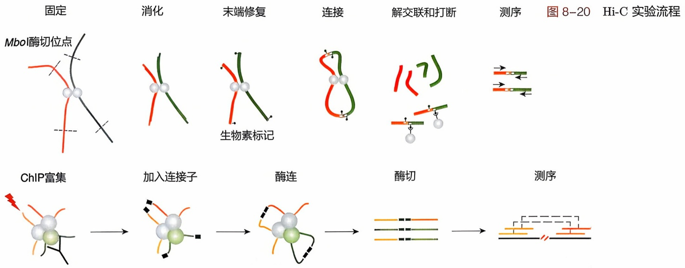

flowchart

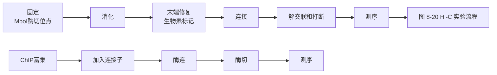

子的相对比例来表示其空间的相对距离。Hi-C技术可以无差别地测量全基因组范围的染色质互作和结构，而且操作步骤简单，是目前应用最广泛的产生三维基因组数据的技术。由于限制性内切酶在基因组上的酶切位点分布不均匀，Hi-C数据存在着对特定区域捕获的特异性不足、分辨率不高等问题，同时难以提供染色质相互作用位点间的具体信息。为了解决这些问题，研究者们开发了多种Hi-C的变体技术，包括:DNase Hi-C（使用DNase I进行切割，以提高分辨率）、Capture Hi-C（通过富集，专注于特定染色质区域的相互作用）、Micro-C（利用MNase酶切，达到核小体级别的高分辨率）等。此外，Hi-C实验可以在单细胞样品中完成，为研究细胞类型差异、发育动态变化以及疾病状态提供了单细胞层面的细胞核内部视角。

图8-21 ChIA-PET实验流程

## 8.5.2.2 ChIA-PET 技术

ChIA-PET 技术的基本步骤如图 8-21 所示:首先，用甲醛和 EGS 固定细胞；接着，用超声波打断染色质，并利用 ChIP 富集这些染色质片段；富集的 DNA 序列连接半连接子（half-linker）或桥连接子（bridge linker）并在低浓度下进行酶连；然后，用限制性内切酶 Mme I 酶联产物进行酶切（或用 Tn5 转座酶对酶联产物进行片段化），形成 DNA 序列-连接子-DNA 序列的结构，称为配对末端标签（paired-end tag, PET）。与 Hi-C 技术不同，ChIA-PET 技术针对特定蛋白对 DNA 片段进行富集，使得信号特异性更强且背景噪声更低。ChIA-PET 可以在全基因范围内检测某种蛋白质介导的染色质远程相互作用，分辨率可达到 $100 \mathrm{bp}$，可以鉴定与特定蛋白结合的功能元件的交互，如启动子和增强子之间的交互以及增强子和增强子之间的交互。

## 8.5.3 三维基因组学数据分析方法

由于 Hi-C 数据是目前最常见的三维基因组数据类型，因此本节主要讲解 Hi-C 数据的分析要点，并简要提及 ChIA-PET 数据的分析要点。

---

288

8 转录调控和表观遗传

## 8.5.3.1 Hi-C 数据分析方法

Hi-C 的数据分析主要包含以下几个步骤:数据预处理和生成相互作用矩阵、数据可视化、识别染色质区室、识别染色质拓扑结构域、识别染色质环、基因组组装和重排。

## （1）数据预处理以及产生染色质相互作用矩阵

Hi-C 数据的 DNA 分子是由两个不同位置的 DNA 序列连接杂合而成的嵌合分子，所以其数据均需要双端测序，测序深度至少有 3 亿个读长。与 ChIP-Seq、ATAC-Seq 这些一维的数据不同，Hi-C 产生的相互作用矩阵是二维的数据，它的处理有一定的特殊性。常用的 Hi-C 数据预处理软件有 HiC-Pro 和 Juicer。

首先，由于 Hi-C 的文库序列是嵌合分子，在序列比对的时候可采用对 5' 端优先的比对方法，这样可以回避嵌合分子序列比对不上的情况。接着，对有效的嵌合分子进行筛选。因为 Hi-C 实验步骤中包含由限制性内切酶（一般为 4 碱基识别的 MboI）进行酶切和连接而产生的文库，而且大部分文库的片段长度为 1000 bp 以内，所以有效的嵌合分子比对到的基因组位置应该都处在酶切位点附近；离酶切位点过远（如超过 1000 bp）的序列，或者由于酶切片段首尾相连的无效片段，都应被过滤。

接下来，将基因组划分成等距离的区间，统计区间之间的相互作用读长的数量，得到以区间为单位的相互作用矩阵。区间大小的选择取决于测序的深度，以及想要研究的染色质构象。一般而言，对于哺乳动物的基因组，100 kb 左右足够识别染色质区室，40 kb 较适合识别染色质拓扑结构域，而识别染色质环需要 5 kb \~ 10 kb 的分辨率（相应的测序深度也要达到 10 亿序列以上）。

最后，进行矩阵校准。由于 GC 含量、酶切位点数量和序列可比对性的不同，可能造成某些区间的相互作用数量高过其他区间，造成系统性的偏差。修正这些偏差有两种方法:一种是显式的方法，它将相互作用数量与 GC 含量，酶切位点数量和序列可比对性等因素进行回归，然后得到一个回归之后校准的相互作用数量；另一种是隐式校准法，即矩阵平衡法（matrix balancing），其关键假设是每一个区间与其他所有区间的相互作用理应是一致的，因此平衡的目标是使得矩阵里所有的行和列的和是一致的，具体的步骤是将矩阵依次每行除以该行的平均值，然后每列除以该列的平均值，如此往复直到结果收敛为止。

## (2) Hi-C 数据可视化

Hi-C 数据可视化是分析和解读 Hi-C 数据的重要步骤。Hi-C 数据常用二维热图展示，可以用正方形形式的完整矩阵展示，也可以用三角形形式（因为从对角线对折是完全的镜像）和弧形形式（图 8-22）。常用的 Hi-C 可视化软件包括 JuiceBox、HiGlass、WashU browser 和 3D genome browser。这些软件在展示 Hi-C 互作矩阵的同时也支持嵌入其他表观组学的数据，包括 ATAC-Seq、ChIP-Seq 等，进行联合分析。

---

8.5 三维基因组学数据分析

289

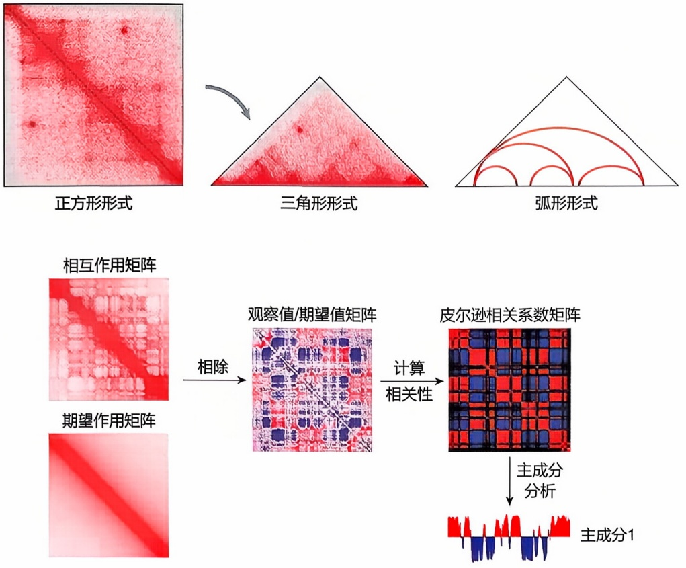

flowchart

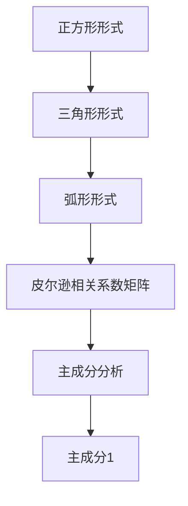

图8-22 Hi-C数据的三种展示方式

图8-23 识别染色质区室的分析步骤

## (3) 识别染色质区室

染色质区室是在基因组上以 $1\mathrm{Mb}\sim 10\mathrm{Mb}$ 交替出现的大型结构域，同类区室之间的相互作用较强，不同区室之间的相互作用较弱，由此在相互作用矩阵里形成了棋盘状的特征。可以用主成分分析来识别区室（图8-23）。通常的做法如下:首先，将相互作用矩阵对期望值进行标准化，其中期望值的计算思路是，因为Hi-C的相互作用频率随着基因组的距离呈现指数下降的趋势，所以可以计算相同基因组距离下的平均相互作用频率以作为该距离下的预期相互作用值。然后，将矩阵换算成皮尔逊相关系数矩阵。最后，对该矩阵进行主成分分析，第一个主成分的特征值符号就可以区分染色质区室（正值为区室A，负值为区室B）。

## （4）识别染色质拓扑结构域

染色质拓扑结构域（TAD）被认为是限制增强子调控区间的基本单元。在 Hi-C 相互作用矩阵里，染色质拓扑结构域显示为明显的三角形区块。在其内部，通常还存在称为 subTAD 的次级结构，表现为在三角形区块内更细致的交互模式，提供了关于基因转录调控的更多信息。识别染色质拓扑结构域及其次级结构的常见策略是对这样的三角形区块及其内部结构进行划分。识别染色质拓扑结构域的代表性方法是方向指数（directionality index）和绝缘指数（insulation score），本节仅介绍方向指数（图 8-24）。

方向指数基于 Hi-C 数据来评估染色质片段与其上游和下游片段相互作用的趋势。对于某一个基因组区间（以 40 kb 为例），将其对上游 2 Mb 内的相互作用数目

---

290

8 转录调控和表观遗传

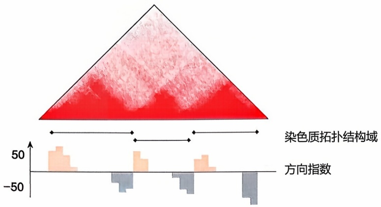

bar

| Region | Direction Index (Range) |
| --- | --- |
| Top-Left | ~50 to ~60 |
| Middle-Left | ~-40 to ~-20 |
| Middle-Right | ~-30 to ~-10 |
| Bottom-Right | ~-70 to ~-50 |

图8-24 使用方向指数识别染色质拓扑结构域的示例

定义为 A，对下游 2 Mb 内的相互作用数目定义为 B，A 和 B 的均值为 E，则方向指数的公式为:

$$
D I = \frac {B - A}{| B - A |} \left[ \frac {(A - E) ^ {2}}{E} + \frac {(B - E) ^ {2}}{E} \right] \tag {8-11}
$$

从公式中可以看出，假如某个区间与其上游的相互作用比与下游的相互作用大很多，则 DI 会呈现较大的负值，反之则会出现较大的正值，如果 A 与 B 比较接近，则 DI 趋近于 0。拓扑结构域的边界通常会出现 DI 值从负值到正值的跳转。根据 DI 值，利用隐马可夫模型可以识别拓扑结构域的

左边界和右边界，并且通过同样的方法，可以进一步分辨出更细粒度的亚 TAD 结构。

## (5) 识别染色质环

染色质环是位于基因组上两个线性距离较远，但是在三维空间上距离较近的区间之间的相互作用，这两个区间之间的相互作用要比它们周围其他区间之间的相互作用更高。识别染色质环最常见的算法是 HiCCUPS，其检验一个最基本的假设:两个区间的相互作用是否比周围其他区间的相互作用更强（图 8-25）。HiCCUPS 首先将要检验的相互作用周围的区域分为几个区域，分别取它们的均值作为背景，然后将中心的相互作用值作为峰值。由于测序数据符合负二项分布，可以通过统计检验峰值是否显著高于其周围的背景 $50\%$ 以上来识别该峰值区域是否为染色质环。

## （6）基因组组装和识别染色体重排

由于 Hi-C 数据中绝大多数读长对来自相同的染色体，Hi-C 数据可以用来帮助基因组组装（详细内容见基因组组装的章节）。另外，Hi-C 矩阵中的相互作用频率随着 DNA 线性距离的增加会呈现单调下降的趋势，然而在发生染色体重排的基因组中，Hi-C 热图会呈现出违反这种趋势的特异性的布局（图 8-26）。基于这种现象，研究人员可以通过图像识别和深度学习的方法来识别染色体重排现象。

## 8.5.3.2 ChIA-PET 数据分析方法

ChIA-PET 数据分析的主要步骤如下: 对双末端标签读段进行接头过滤, 并将其比对到参考基因组。然后唯一比对的双末端标签进一步分类为自连接、间连接和其

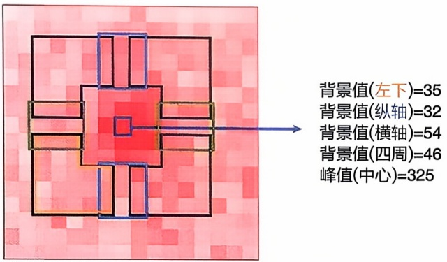

text_image

背景值(左下)=35
背景值(纵轴)=32
背景值(横轴)=54
背景值(四周)=46
峰值(中心)=325

图8-25 HiCCUPS识别染色质环的方法

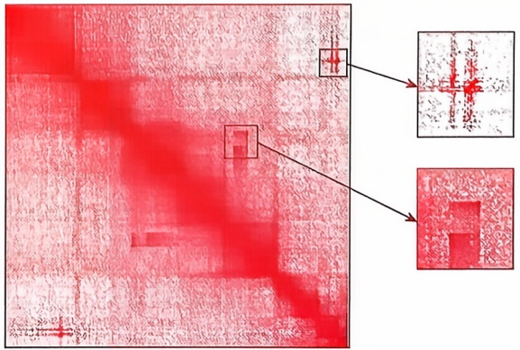

text_image

Image showing a red pixelated heatmap with two inset images highlighting specific regions, likely from a scientific or technical document.

图8-26 识别染色体重排的图像示例

---

8.6 表观转录组学数据分析

291

他双末端标签，其中前两类为有效标签。此外，可以将 ChIA-PET 数据的相互作用信息忽略，将其视作 ChIP-Seq 数据并识别信号峰，并将区域作为给定的锚定位点，以检测信号簇和识别特定的染色质相互作用。ChIA-PET Tools 是常用的 ChIA-PET 数据分析软件。

## 8.6 表观转录组学数据分析

表观转录组学（epitranscriptomics），也称为 RNA 表观遗传学（RNA epigenetics），是指不涉及 RNA 序列改变的转录组水平上功能相关变化的集合，研究的核心焦点在于 RNA 分子上的化学修饰（RNA 修饰）。目前，已知的 RNA 修饰超过 170 种，它们存在于真核生物、细菌和古细菌这三个系统发育域中，还广泛分布在 mRNA、tRNA 和 rRNA 等多种类型 RNA 中。RNA 修饰可能引发 RNA 分子的碱基配对性质、热力学特性以及三维结构性能的变化，从而影响 RNA 的剪接、翻译、定位、稳定性以及与蛋白质的相互作用。RNA 修饰在许多生命活动中都具有关键作用，包括细胞命运的决定、性别分化的调控，以及细胞分化过程中的调节等过程。此外，动态可逆性也是  $m^{6}A$  等 RNA 修饰的一个重要特点，这意味着细胞可以在 RNA 的生命周期内通过添加或者去除这些修饰来实现更为直接、瞬时的基因表达调控，从而更快速地应对外界环境的变化。

由于 RNA 表观遗传信息的多样性以及表观转录组学技术的原理差异，相应的数据分析方法和思路也各异。本节将从 4 个主要方向入手，即数据预处理、基因组比对、RNA 修饰的鉴定以及 RNA 修饰图谱的可视化，分别介绍有代表性的表观转录组学技术的原理、数据特点、分析工具以及关键要点。

## 8.6.1 RNA 修饰概述

## 8.6.1.1 RNA 修饰的定义及类型

RNA 分子中的 4 种碱基以及核糖都可以成为被修饰的目标。根据发生修饰的位置，可以将 RNA 修饰分为碱基修饰、核糖修饰和混合型修饰。其中，碱基修饰包括甲基化修饰、假尿嘧啶化修饰、次黄嘌呤修饰等。甲基化修饰涵盖了 N$^{6}$-甲基腺苷修饰（N$^{6}$-methyladenosine, m$^{6}$A）、N$^{1}$-甲基腺苷修饰（N$^{1}$-methyladenosine, m$^{1}$A）、N$^{5}$-甲基胞苷修饰（N$^{5}$-methylcytidine, m$^{5}$C）和 N$^{7}$-甲基鸟苷修饰（N$^{7}$-methylguanosine, m$^{7}$G）等（图 8-27）。假尿苷（pseudouridine, Ψ）修饰由尿苷（U）异构化生成，尿嘧啶通过 C1'-C5 而不是 C1'-N1 与核糖结合。次黄嘌呤修饰是指由腺苷（A）发生脱氨作用生成含次黄嘌呤的肌苷（I），是 RNA 编辑的一种类型（A-I）。由于 I 优先于与胞苷（C）配对，从而有效地使其与鸟苷（G）等同。核糖修饰主要包括 2'-O-核糖甲基化修饰（2'-O ribose methylation modification, 2'-O-Me, Nm），分为 2'-O-甲基腺苷（2'-O-methyladenosine, Am）、2'-O-甲基胞苷（2'-O-methylcytidine, Cm）、

---

292

8 转录调控和表观遗传

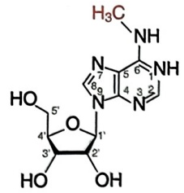

chemical

Chemical structure of a nucleoside analog with labeled carbon positions and hydroxyl groups

$N^{6}$ -甲基腺苷

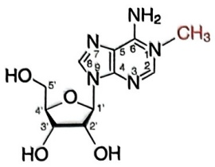

chemical

Chemical structure of a nucleoside analog with hydroxyl and amino substituents

$N^{1}$ -甲基腺苷

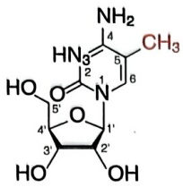

chemical

Chemical structure of a nucleoside analog with labeled atoms and bonds

$N^{5}$ -甲基胞苷

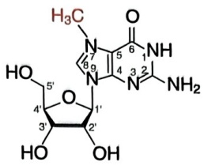

chemical

Chemical structure of a nucleoside analog with labeled atoms and bonds

$N^{7}$ -甲基鸟苷

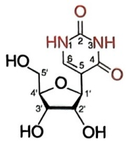

假尿苷

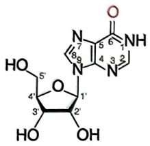

chemical

Chemical structure of a nucleoside analog with labeled carbon positions and functional groups

次黄嘌呤

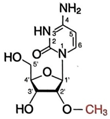

chemical

Chemical structure of a nucleoside analog with labeled atoms and bonds

2'-O-甲基胞苷

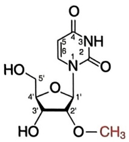

chemical

Chemical structure of a nucleoside derivative with hydroxyl and methyl substituents

2'-O-甲基尿苷

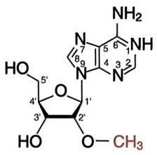

chemical

Molecular structure of a nucleoside analog with labeled atoms and bonds

2'-O-甲基尿苷

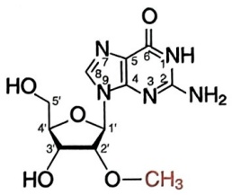

chemical

Chemical structure of a nucleoside analog with labeled atoms and bonds

2'-O-甲基鸟苷

图8-27 不同类型RNA中的转录后RNA修饰

2'-O-甲基鸟苷（2'-O-methylguanosine，Gm）和 2'-O-甲基尿苷（2'-O-methyluridine，Um）四种类型等。混合型修饰则是指在同一个核苷上发生多种不同类型的修饰。例如，混合型甲基化修饰 N$^{6}$-腺苷和 2'-O-甲基腺苷（N$^{6}$，2'-O-dimethyladenosine，m$^{6}$Am）在腺苷的第 6 位和核糖的 2' 位上均发生了甲基化。

## 8.6.1.2 RNA修饰的生成机制

现有研究发现，RNA 修饰的生成机制有两种主要方式，一种是只在特异性酶的催化下形成，另一种是在核仁小 RNA（small nucleolar RNA, snoRNA）的指导下完成特定酶的催化生成。目前已经发现了超过 150 种与 RNA 修饰相关的酶。在仅依赖特异性酶催化生成的修饰中， $m^{6}A$  修饰是被研究得最为广泛的。 $m^{6}A$  甲基转移酶复合体使用 S-腺苷甲硫氨酸（SAM）作为底物，将其中的甲基基团转移到腺苷中的  $N^{6}$  位，从而引发  $m^{6}A$  修饰的发生。近年来，在动物基因组中  $m^{6}A$  甲基转移酶（METTL3、METTL14、WTAP 等）、 $m^{6}A$  去甲基酶（FTO、ALKBH5）和  $m^{6}A$  结合蛋白（YTHDF1/2/3、YTHDC1/2、IGF2BP1/2/3）的发现及其功能研究还揭示了 RNA 甲基化修饰同 DNA 甲基化修饰一样是动态可逆的（图 8-28）。依赖 snoRNA 指导完成的修饰，包括有 2'-O-Me 修饰和  $\Psi$  修饰。snoRNA 与相应的蛋白结合形成核仁小核糖核蛋白（small nucleolar ribonucleoprotein, snoRNP）复合物。snoRNP 复合物可以分为两类，包括 C/D box snoRNP 和 H/ACA box snoRNP。前者由 C/D snoRNA 与甲基转移酶 FBL、NOP56、NOP58 和 15.5 K 结合组成，指导 rRNA、snRNA 和 tRNA 等 RNA 实现特异性的 2'-O-Me 修饰。后者由 H/ACA snoRNA 与  $\Phi$  修饰合成酶 DKC1、GAR1、NHP2 和 NOP10 结合组成，指导 rRNA 和 tRNA 等 RNA 发生位点特异性  $\Psi$  修饰。这种催化功能的 snoRNP 在真核生物、细菌和古细菌中都是保守的。

## 8.6.1.3 RNA修饰的生物学功能

RNA修饰极大地增强了结构与功能的多样性，并在一系列生物过程中发挥着

---

8.6 表观转录组学数据分析

293

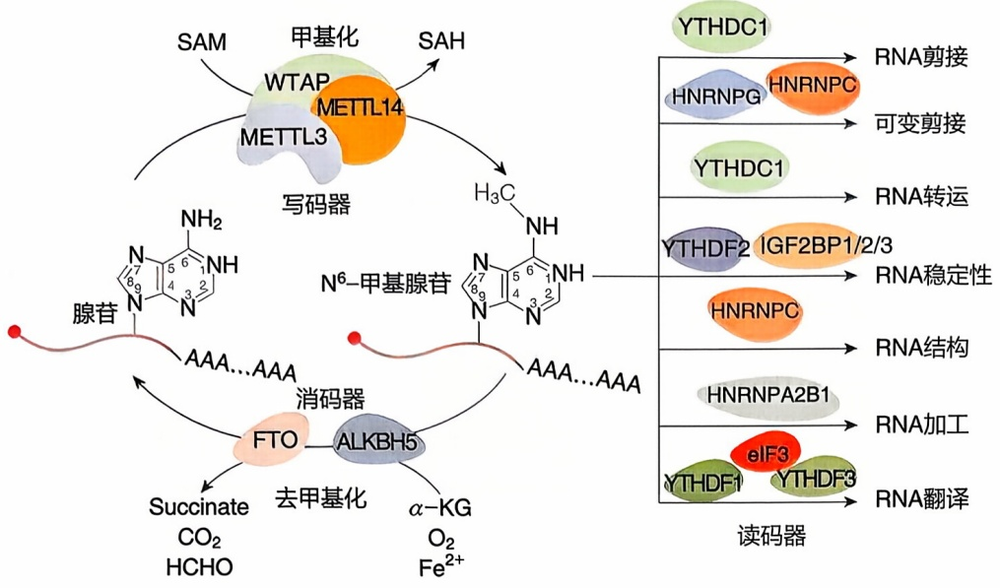

flowchart

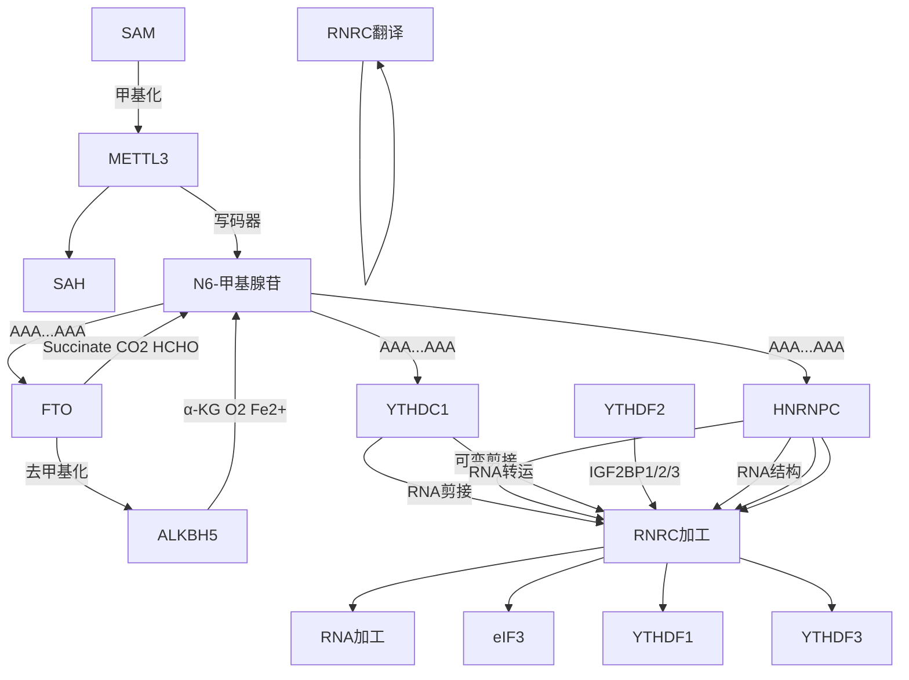

图8-28 RNA甲基化的建立、维持与去除机制和生物学功能

重要的调控作用。RNA 分子中的化学修饰具有改变电荷、碱基配对电位、二级结构和蛋白质-RNA 相互作用等特性，并进一步影响 RNA 的加工、运输、翻译和降解，从而影响基因表达和细胞过程。RNA 修饰在干细胞的增殖和分化、精子细胞的增殖和运动、卵母细胞的增殖和成熟、下丘脑的昼夜调节、果蝇的性别决定以及拟南芥的生长发育等过程中都扮演着重要的角色。 $m^{6}A$  修饰在多个生物学领域都有广泛的功能研究；其他修饰如  $m^{5}C$ 、 $m^{1}A$ 、 $\Psi$  等也在 RNA 代谢及翻译调节中发挥作用。多种组蛋白修饰（如 H3K36me3）可以与 mRNA 上  $m^{6}A$  修饰形成互作网络从而调控 RNA 修饰的生物生成和影响细胞的生物学功能。tRNA 是拥有最多 RNA 修饰的分子之一，通过选择性保护编码框、提高解码能力以及调整密码子-反密码子配对等方式来调控分子机制。此外，疾病相关的各种生物学过程受到多种 RNA 修饰（如  $m^{6}A$ 、 $m^{5}C$  和 A-I 编辑）及其互作的 RNA 修饰蛋白的调控。

## 8.6.2 表观转录组学数据类型

RNA 修饰的种类较多，鉴定这些修饰的表观转录组实验方法大致可分为四类:基于亲和纯化的方法、基于反转录诊断事件的方法、基于对化学或酶消化抗性的方法和基于第三代测序技术的方法。

## 8.6.2.1 基于亲和纯化的方法

$\mathrm{m^6A}$ 修饰是一种常见的RNA修饰类型，在转录组内检测 $\mathrm{m^6A}$ 修饰最常见的方法是RNA免疫沉淀（RNA immunoprecipitation，RIP）（图8-29）。 $\mathrm{m^6A - Seq}$ 和MeRIP-Seq是常用的RIP方法，它们利用 $\mathrm{m^6A}$ 特异性识别抗体富集含有 $\mathrm{m^6A}$ 修饰的RNA片段。然而，这些方法的分辨率较低，精度约为200核苷酸（nt）。$\mathrm{m^6A - label - Seq}$ 方法使用一种特殊的代谢标记物Se-烯丙基-L-硒基同型半胱氨酸替代$\mathrm{m^6A}$ 修饰，形成 $\mathrm{N^6 - }$ 烯丙基腺苷（ $\mathrm{N^6 - }$ allyladenosine， $\mathrm{a^6A}$ ）， $\mathrm{a^6A}$ 能够被抗体富集，并在碘诱导下发生环化。$\mathrm{m^6A - label - Seq}$ 方法可通过在反转录过程中检测环化后的

---

294

8 转录调控和表观遗传

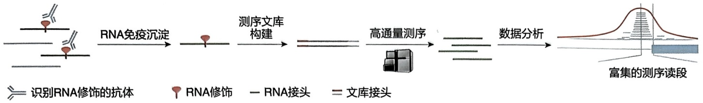

flowchart

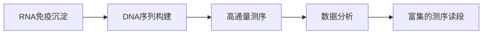

图8-29 基于亲和纯化的测序技术原理

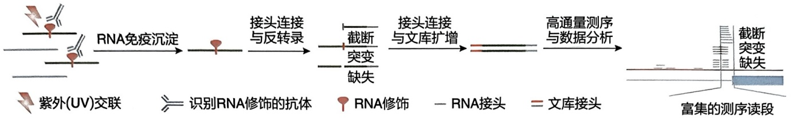

flowchart

图8-30 基于反转录诊断事件的测序技术原理

$\mathrm{a}^{6}\mathrm{A}$ 产生的碱基错配，实现对 $\mathrm{m}^{6}\mathrm{A}$ 修饰的单碱基分辨率鉴定。然而，该方法所使用的Se-烯丙基-L-硒基同型半胱氨酸的代谢只能在细胞内发生，限制了其在组织中的使用。亲和纯化的方法不仅广泛用于 $\mathrm{m}^{6}\mathrm{A}$ 修饰，还被应用于各种RNA修饰类型（如 $\Psi$ 、ac4C）的全转录组的鉴定。

## 8.6.2.2 基于反转录诊断事件的方法

一些检测 RNA 修饰的测序方法利用在建库的反转录过程中产生的诊断事件（diagnostic event），如在 RNA 修饰位点引入截断、缺失或突变，来定位 RNA 修饰的位置（图 8-30）。例如，PA-m$^{6}$A-Seq 方法通过将 4-硫脲（4SU）整合到 mRNA 中，并在 365 nm 的紫外照射下使 4SU 与 m$^{6}$A 抗体附近的芳香氨基酸残基发生共价交联，在后续的反转录过程中，会将 m$^{6}$A 修饰附近的 U 碱基误判为 C，从而以大约 20 nt 的分辨率鉴定 m$^{6}$A 修饰位点。miCLIP 则利用 254 nm 的紫外照射，将 RNA 与 m$^{6}$A 抗体交联，从而在反转录过程中使 m$^{6}$A 位点附近的核苷酸发生错配或截断，以单碱基的分辨率鉴定 m$^{6}$A 修饰。然而，由于交联效率低，该方法只能鉴定到有限数量的 m$^{6}$A 修饰位点。

对于 $\mathrm{m}^5\mathrm{C}$ 修饰，可以使用经过亚硫酸盐处理的RNA高通量测序（RNA-BisSeq）进行检测。该测序将所有未修饰的C转化为U，只有修饰的C不受影响。假尿嘧啶修饰的检测则利用化学试剂羧甲基纤维素（carboxymethyl cellulose，CMC）或CMC衍生物，在修饰处引入一个庞大的基团，导致反转录提前终止，如 $\Psi$ -Seq、PSI-Seq、Pseudo-Seq和CeU-Seq。RBS-Seq则通过亚硫酸盐处理RNA，导致在 $\Psi$ 修饰位点处缺失反转录碱基，从而高效地鉴定 $\Psi$ 。某些RNA修饰本身也可以影响反转录过程，如 $\mathrm{m}^1\mathrm{A}$ -MAP和 $\mathrm{m}^1\mathrm{A}$ -Seq-TGIRT这两种方法，基于 $\mathrm{m}^1\mathrm{A}$ 修饰在反转录过程中诱导碱基错配的原理。同时，它们利用了耐高温的Ⅱ型内含子反转录酶TGIRT，以增加 $\mathrm{m}^1\mathrm{A}$ 修饰导致的错配率。

## 8.6.2.3 基于对化学或酶消化抗性的方法

一些检测方法基于 RNA 修饰对化学或酶消化的抗性，可在单碱基精度鉴定各种 RNA 修饰，本节主要介绍运用于鉴定 2'-O-Me 修饰的测序方法。

---

8.6 表观转录组学数据分析

295

RiboMeth-Seq 技术的原理如下:2'-O-Me 修饰几乎可以完全消除 2'-OH 氧原子的亲核性，极大地增强了 3'-邻近的磷酸二酯键对碱水解的抗性。当 2'-O-Me 出现在 3' 端核苷酸上时，可以阻止末端被氧化从而保护末端核糖，而没有发生 2'-O-Me 修饰的 3' 端会发生碱水解而降解成短的 RNA 片段。在分析测序数据时将读段（read）比对到基因组，可确定 RNA 片段 3' 端或 5' 端的准确位置，通过检测被保护的末端从而以单核苷酸精度鉴定出 2'-O-Me 修饰位点。然而，该方法背景噪声高，需要高的测序深度，无法检测低丰度的 RNA，并依赖于 RNA 片段的大小。

Nm-Seq 是基于 2'-O-Me 对高碘酸盐（NaIO₄）降解的抗性开发的技术。RNA 片段 3' 端核苷酸无 2'-O-Me 修饰时，其顺-二醇核糖易被高碘酸盐氧化生成二醛，进一步的 β-消除反应后，水解 3' 端核苷酸，生成 3' 端带磷酸基团的 RNA 片段，此端不能连接 3' 接头；而 RNA 片段 3' 端核苷酸有 2'-O-Me 修饰时，RNA 片段可以与 3' 接头连接。因此，文库中富集的都是 3' 端含有发生 2'-O-Me 修饰的 RNA 片段，从而通过分析很容易得到转录组范围内的 2'-O-Me 修饰位点。但这种方法用到的碎片化试剂对序列具有偏好性，导致 RNA 的裂解不是真正随机发生的。而且在 2'-O-Me 修饰位点处发生裂解的效率非常低，因此该方法需要进行多次的氧化、β-消除、去磷酸化的循环，从而导致 RNA 损耗量大，且其效果依赖于 RNA 片段大小，无法保证恰能够暴露 2'-O-Me 位点。

Nm-REP-Seq 技术结合了化学与酶处理, 可以在单核苷酸精度下鉴定出 2'-O-Me 修饰位点 (图 8-31)。Nm-REP-Seq 技术的原理如下: 由于生殖衣原体 RNase R (MgR) 消化至 2'-O-Me 修饰位点前一位会发生显著的停顿, 而氧化消除去磷酸化 (oxidation elimination dephosphorylation, OED) 的化学处理则消化至 2'-O-Me 修饰位点处发生停顿。Nm-REP-Seq 结合化学与酶处理的方法, 不仅提供了更高的精确性, 还减少了背景信号, 大大降低了鉴定的假阳性率。

## 8.6.2.4 基于第三代测序技术的方法

与检测 DNA 甲基化类似，ONT 测序技术（详见本章 8.2）可以有效鉴定  $m^{6}A$ 、 $\Phi$  和 2'-O-Me 修饰。未来，第三代测序方法有望得到广泛应用，同时绘制多种 RNA 修饰类型的信息。

## 8.6.3 表观转录组学数据分析方法

表观转录组学数据的分析是从原始组学数据出发，获取 RNA 修饰水平图谱，并进一步通过分析获得相关生物学结论的过程。在处理不同实验方法获得的 RNA 修饰数据时，其处理流程和分析手段存在一定的差异。主要的分析方法包括鉴定 RNA 修饰富集区域、鉴定 RNA 修饰位点，以及对 RNA 修饰位点进行注释。

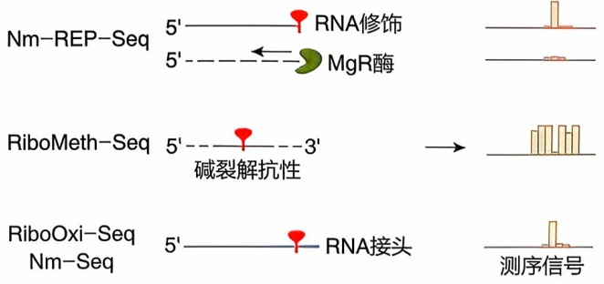

flowchart

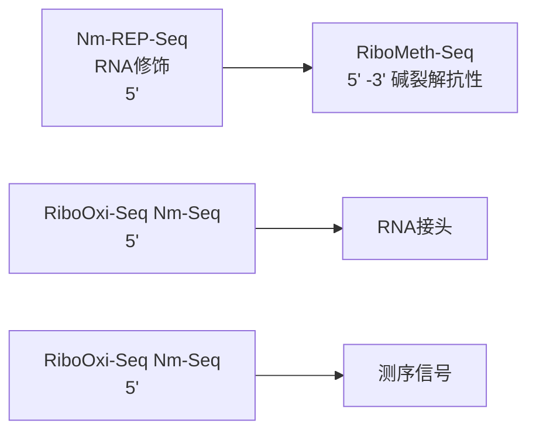

图8-31 结合化学与酶处理的高通量测序方法

---

296

8 转录调控和表观遗传

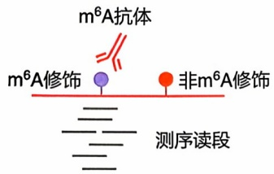

text_image

m⁶A抗体
m⁶A修饰
非m⁶A修饰
测序读段

图8-32 识别RNA修饰富集区域原理

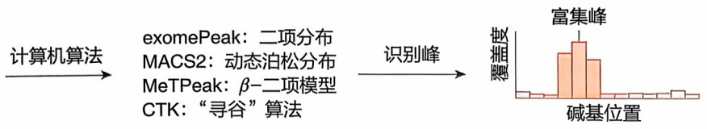

flowchart

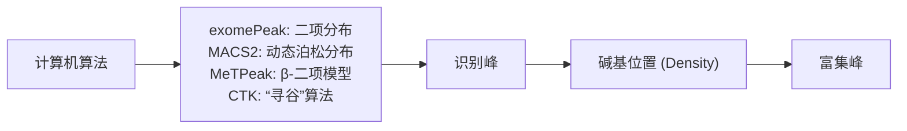

## 8.6.3.1 基于亲和纯化数据识别 RNA 修饰富集区域

基于亲和纯化的测序方法所产生的测序数据通常只能获得经过抗体富集的RNA修饰区域，无法实现单碱基的分辨率。在此背景下，用于鉴定RNA修饰富集区域的分析方法起到了关键作用。一些常用的分析工具包括exomePeak、MACS、MeTPeak和CTK等。这些软件在鉴定修饰富集区域时，大致遵循如图8-32所示的原理。例如，exomePeak通过将抗体富集的读长数（IP read）除以抗体富集的读长数加上无抗体富集对照组的读长数（IP read + input read）来计算总体修饰的程度。它使用C检验（C test）来确定修饰的位点，其假设特定位置所有的抗体富集的读长数符合相同的二项分布，该分布由整体修饰程度进行参数化，由此将两个泊松分布的比较转换为基于二项分布的检验。在此基础上，MeTPeak软件采用了分层 $\beta$-二项模型来模拟读长富集的方差，并使用隐马尔可夫模型来解释相邻富集的依赖性，从而可以更有效地鉴定RNA修饰的富集区域。

由于用于测定 RNA 修饰的 CLIP 测序文库的复杂性和测序深度的增加，多个读长簇或峰可能无法明确分离，尤其是在转录本富集的情况下。为了解决这个问题，CTK 软件使用一种新的“寻谷”算法进行峰值判定。简单来说，CTK 计算每个基因组位置重叠的读长数量，以找到局部最大值。只有当两个相邻的局部最大值的峰高度分别为 $h_1$ 和 $h_2$，并且由深度为 $d = h - v$ 的谷分隔时，才被认为是两个不同的峰，其中 $h = \min(h_1, h_2)$，$v$ 为谷位置的读长覆盖率。用户需要指定相对谷深（如 $v / h \geqslant 0.9$），以适应不同丰度的转录本。为了定义更严格的 CLIP 标签峰值子集，CTK 使用不同的背景模型和扫描统计数据，评估观察到的峰值高度是否超过了偶然预期。

## 8.6.3.2 基于反转录诊断事件识别RNA修饰单位点

CTK工具包不仅可以用于获取RNA修饰富集的区域，还可以根据反转录诊断事件的测序数据来鉴定诊断事件，从而实现对RNA修饰位点的单核苷酸分辨率鉴定，其基本原理如图8-33所示。不同测序原理的测序方法需要关注不同的诊断事件，如miCLIP关注 $\mathrm{m^6A}$ 模体“GGAC”中的C到T的突变。首先，针对每种类型的诊断事件，如突变，根据基因组坐标对读段进行聚类。如果修饰引起的突变存在足够的测序深度，那么多个读段应该能够重复地支持该突变。相反，由于测序或比对误差或其他噪声源引入的突变应该是随机分布的。因此，通过统计分析可以识别由修饰引起的突变，其发生频率高于偶然预期。衡量真实的由修饰引起的突变的两个重要参数是每个突变位点重叠的读段总数（ $k$ ）和该位点上具有特定类型突变的读段数量（ $m$ ）。可以使用基于排列的方法来评估在特定位置上观察到具有突变的

---

8.6 表观转录组学数据分析

297

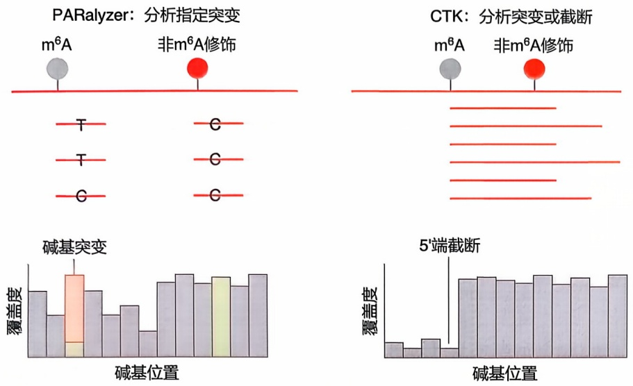

图8-33 识别RNA修饰单位点原理

$m$ 个标签是否在总共与该位置重叠的 $k$ 个标签上具有统计学意义。在排列中，将每个突变插入随机选择的CLIP标签中，其相对于读段 $5^{\prime}$ 端的偏移与原始标签中观察到的偏移相同。因此，这种排列保留了转录组中CLIP标签的分布，以及观察到的测序错误的位置偏差。根据实际数据和排列数据中 $k$ 和 $m$ 这两个参数的比较，可以为每个突变位点分配经验FDR。

此外，还有其他的一系列软件能够以单核苷酸精度来鉴定 RNA 修饰位点。例如，PARalyzer 可以用于分析用户指定的突变事件。此外，对于突变，还可以通过排除与已知单核苷酸多态性（single nucleotide polymorphism，SNP）重叠的突变来降低检测的假阳性率。另外，由于  $m^{6}A$  修饰发生在明显的 “RRAC” 模体中，因此最终还可以在 miCLIP 数据中通过模式匹配判断 C 到 T 突变位点是否位于 “RRAC” 模体中，而  $m^{6}A$  修饰位点则位于 C 到 T 突变位点上游 1 nt 的位置。

## 8.6.3.3 基于对化学或酶消化的抗性的数据鉴定 RNA 修饰位点

基于反转录截断事件识别 RNA 修饰单位点，主要利用了读段的 5' 端信号；与

此不同的是, 基于对化学或酶消化的抗性的数据鉴定 RNA 修饰, 往往利用读段的 3' 端信号 (图 8-34)。本节以同时结合了化学与酶处理的 Nm-REP-Seq 测序方法为例, 若 RNA 上带有 2'-O-Me (Nm) 修饰, 酶消化至修饰位点前一位会发生显著的停顿, 而化学处理则消化至修饰位点处发生停顿, 即两种处理均形成显著的 3' 端信号。利用 endSeeker 软件可以高效地对 3' 端信号进行鉴定。为了确定显著富集的 3' 端信号, endSeeker 计算了所有注释转录本中每个位置测序读段 3' 端的覆盖度。显著富集的 3' 端信号位点的覆盖度应该明显高于上游和下游的一个核苷酸, 也高于空白对照组 (未经过酶或化学处理的测序样本) 中的对应位置, 空白对照组的设置有利于降低鉴定

flowchart

图8-34 endSeeker的计算原理

---

298

8 转录调控和表观遗传

图8-35 EpiNano-SVM计算原理

flowchart

的假阳性。endSeeker 进一步计算位点的倍数变化（fold change, FC）: upFC = 候选位点处的覆盖度/上游一位碱基的覆盖度; downFC = 候选位点处的覆盖度/下游一位碱基的覆盖度; upCtrlFC = 修饰位点的 upFC/对照组同一位点的 upFC; downCtrlFC = 修饰位点的 downFC/对照组同一位点的 downFC。结合上述产生的 4 个变量（upFC、downFC、upCtrlFC、downCtrlFC）可筛选精确的 2'-O-Me 修饰位点。

## 8.6.3.4 基于第三代测序技术的方法鉴定RNA修饰

目前，主要使用 EpiNano 软件对纳米孔测序产生的数据进行 RNA 修饰的鉴定。该软件包含两种模式，即 EpiNano-Error 和 EpiNano-SVM，用于在纳米孔测序数据中识别 RNA 修饰。EpiNano-Error 模式专注于成对样本的分析，即将敲除或敲低 RNA 修饰相关的酶后的样本与未经处理的样本进行比较。在 EpiNano-Error 模式下，该软件可分析成对样本中碱基识别错误（包括突变、删除、插入）的频率，以及每个碱基识别质量的变化。RNA 修饰的预测是基于在这两个匹配样本中观察到的错误模式的差异。EpiNano-SVM 模式则使用基于支持向量机（support vector machine, SVM）训练的模型来鉴定特定的 RNA 修饰位点，其原理如图 8-35 所示。EpiNano-SVM 根据已知的修饰信息和特征，识别出纳米孔测序数据中可能的 RNA 修饰位点。目前，EpiNano 软件可以用于分析纳米孔技术测序的 $\mathrm{m}^6\mathrm{A}$、$\Psi$ 和 $2'$-O-Me 等修饰的数据。

## 8.6.3.5 绘制 RNA 修饰位点的分布特征

鉴定出候选的 RNA 修饰位点后，一个重要问题是研究这些修饰位点在转录本

text_image

GGACo
5'非编码区 编码区 3'非编码区
RNA修饰

图 8-36 ${\mathrm{m}}^{6}\mathrm{\;A}$ 的元基因图谱

中的分布特征。元基因图谱（metagene profile）呈现了在转录本模型上的位点频率图，包括 5' 非编码区、编码区和 3' 非编码区（图 8-36）。MetaPlotR 软件能够生成针对 mRNA 的元基因图谱，揭示出 RNA 修饰的特征，如  $m^{6}A$  修饰的峰值位于终止密码子附近。MetaPlotR 使用了归一化的概念，将 RNA 修饰位点所在的转录本区域的坐标转换为元坐标。这相当于将转录组坐标映射到一个简化的转录模型上。例如，出现在 5' 非编码区中的位点在元基因图谱中的位置从 0 到 1，其中 0 和 1 分别代

---

推荐阅读

299

表 $5^{\prime}$ 非编码区的 $5^{\prime}$ 端和 $3^{\prime}$ 端。类似地，编码区中位点的值从1到2，而 $3^{\prime}$ 非编码区的值从2到3。

## 8.7 转录调控和表观遗传的总结与展望

高通量组学技术的发展及其在转录调控和表观遗传研究中的应用，产生了大量转录调控和表观遗传组学数据。为了有效利用转录调控和表观遗传组数据，生物信息学研究人员开发了多种生物信息学算法、模型、数据库及软件，为解析海量转录调控及表观遗传组学数据以及克服数据存在的异质性作出了重要贡献。转录调控和表观遗传内容众多，由于篇幅所限，本章着重介绍了转录因子结合模体分析、转录因子ChIP-Seq数据特点及分析方法、几种最常见的表观遗传信息类型的组学数据特点及分析方法。考虑本书作为生物信息学教材的定位，本章对涉及的每一种表观遗传信息的建立机制及生物学功能仅作简要描述，有兴趣的读者可以扩展阅读相关的表观遗传学参考书。绘制不同表观遗传信息的基因组分布所需的技术原理不同，对应的分析方法及思路也不同。本章围绕“组学技术决定数据特点，数据特点决定分析思路”的理念，为每种表观遗传信息概述了代表性的表观遗传组学技术基本原理，并对一些组学技术所产生数据的典型特点及分析方法进行着重阐述。本章提及的每一个分析方法，目前均有多种生物信息学软件或在线服务器可用于实现。为便于课程教学，本章仅列出个别工具的名称，建议涉及这些分析方法的读者，可以扩展阅读相关综述及工具性能比较文章。

新的组学技术不断涌现，单细胞、长读长、多维度是转录调控和表观遗传组学技术进一步发展的方向。在研究工作中，读者若接触到新的组学技术，期冀可以举一反三，根据实验原理来理解其数据特点，进而确定分析思路，并视具体情况选择已有的分析工具或开发新的工具。

## ※ 推荐阅读

1. 于文强，徐国良. 表观遗传学 [M]. 北京:科学出版社. 2023.

点评:表观遗传学是一个内容繁多的研究领域，该书较为全面地涵盖了表观遗传学基础、应用及方法学。鉴于该书篇幅庞大，不宜通读，建议读者根据自己的兴趣，有选择性地阅读相关章节。
2. Landt S G, Marinov G K, Kundaje A, et al. ChIP-Seq guidelines and practices of the ENCODE and modENCODE consortia [J]. Genome research, 2012, 22(9): 1813-1831.

点评:ChIP-Seq 技术作为第二代测序技术的最早应用，其数据质量控制和分析策略的制定深受数据特点的影响。通过阅读该文，去理解那些虽然实用但不优雅的

---

300

8 转录调控和表观遗传

策略是如何制定的，为将来面对全新的生物信息问题时如何在实用与优雅之间进行选择提供历史的借鉴。

## ※ 思考与练习题

1. 基于已知模体预测转录因子结合位点时用位置权重矩阵代替位置频率矩阵的原因是什么？
2. 为什么可以用互相关分析评估 ChIP-Seq 数据的质量？对于宽峰类型的 ChIP-Seq 数据仍适用吗？
3. 组蛋白修饰 ChIP-Seq 和转录因子 ChIP-Seq 数据分析上有哪些主要异同点？
4. 为什么 WGBS 技术是目前检测全基因组 DNA 甲基化状态的 “金标准”？
5. 为什么在 Hi-C 数据预处理时需要进行矩阵校准？该步骤会对下游的分析产生哪些影响？

## ※ 讨论题

1. 表观遗传信息存在复杂的交互，若能开发出同时捕获同一段染色质片段的多种表观遗传信息的技术，将有助于深入理解这些复杂的交互。请基于本章的内容，设计可以同时检测两种或两种以上表观遗传信息的实验。同时，请对这些技术可能产生的数据特点进行预测和讨论。
2. 第三代测序技术具有长读长的优势，请根据其技术特点（详见第6章），讨论哪些类型的表观遗传信息可以直接利用该技术进行检测。对于不能直接适用的表观遗传信息，请设计实验，通过信息的转化，使其能够适用于第三代测序技术。同时，请思考并讨论这些信息转化过程中可能遇到的挑战和解决方案。
3. 随着转录因子全基因组结合位点数据和表观遗传组数据的日益丰富，可以通过整合和深入挖掘这些数据来解决新的生物学问题。请选择一个感兴趣的与转录调控或表观遗传学相关的生物学问题，思考并讨论如何利用现有的组学数据资源开展研究？通过设计怎样的数据整合策略来有效推动对所选问题的解决？
4. 染色质可及性（即局部染色质开放程度）是一种与转录调控紧密相关的重要表观遗传信息，有研究者开发了 ATAC-Seq 技术，用于描述染色质可及性。ATAC-Seq 数据是通过富集局部开放染色质区域的 DNA 片段并对其进行测序获得的，请参照转录因子 ChIP-Seq 数据分析方法，并阅读本章参考文献 4 了解 ATAC-Seq 数据的特点，设计 ATAC-Seq 数据的分析方法。

---

参考文献

301

## ※ 参考文献

1. 李婷婷，蒋博，汪小我, 等. 转录因子结合位点的计算分析方法 [J]. 生物物理学报, 2008, 24(5): 334-347.
2. Ay F, Noble W S. Analysis methods for studying the 3D architecture of the genome [J]. Genome biology, 2015, 16: 183.
3. Bock C. Analysing and interpreting DNA methylation data [J]. Nature reviews genetics, 2012, 13: 705-719.
4. Buenrostro J D, Giresi P G, Zaba L C, et al. Transposition of native chromatin for fast and sensitive epigenomic profiling of open chromatin, DNA-binding proteins and nucleosome position [J]. Nature methods, 2013, 10(12): 1213-1218.
5. Li X, Xiong X, Yi C. Epitranscriptome sequencing technologies: decoding RNA modifications [J]. Nature methods. 2016, 14(1): 23-31.
6. Schmitt A D, Hu M, Ren B. Genome-wide mapping and analysis of chromosome architecture [J]. Nature reviews molecular cell biology, 2016, 17(12): 743-755.
7. Schones D E, Zhao K. Genome-wide approaches to studying chromatin modifications [J]. Nature reviews genetics, 2008, 9(3): 179-191.
8. Zhang Y, Liu T, Meyer C A, et al. Model-based analysis of ChIP-Seq (MACS) [J]. Genome biology, 2008, 9(9): R137.

编者:张勇（同济大学）

杨建华（中山大学）

张延晓（西湖大学）

孙宝发（南开大学）

黄佳良（厦门大学）

李兴旺（华中农业大学）

审读:田卫东（复旦大学）

---

