# 9 蛋白质组学和代谢组学

原始 PDF 第 318–379 页。

## 蛋白质组学和代谢组学

蛋白质是由氨基酸组成的生物大分子，是生命活动的主要承担者。蛋白质直接参与每一个细胞的生物进程，具有结构、代谢、运输、免疫、信号和调节等许多作用。蛋白质组学是研究细胞、组织或生物体蛋白质组成及其变化规律的科学。代谢组学是对某一生物或细胞在特定生理时期内所有低分子量代谢产物同时进行定性和定量分析的一门学科。蛋白质组学和代谢组学是生命组学的重要研究内容，为基因组学和转录组学提供了重要的补充信息。随着基因组学、蛋白质组学以及结构生物学研究的深入开展，我们已经积累了大量的蛋白质序列、结构和功能数据。近年来，以深度学习为代表的人工智能技术在蛋白质生物信息学中的应用也取得了重大突破。本章将对蛋白质组学、蛋白质生物信息学和代谢组学提供全景式的介绍，为读者深度挖掘和理解蛋白质组学和代谢组学大数据中蕴含的生物学规律奠定基础。

## 9

---

304

9 蛋白质组学和代谢组学

## 9.1 蛋白质组学概述

蛋白质组学（proteomics）这个词语源于蛋白质（protein）与基因组（genome）两个词的组合，最早由马克·威尔金斯（Marc Wilkins）在1994年提出，指一种细胞乃至一种生物所表达的全部蛋白质。蛋白质组学的研究内容是在大规模水平上研究蛋白质的特征，包括蛋白质在不同时空、生理、病理状态下的结构、表达水平、氨基酸变异、翻译后修饰、蛋白质之间的相互作用以及蛋白质功能等，由此获得蛋白质水平上的关于疾病发生、细胞代谢等过程的整体而全面的认识。

根据研究目的和研究方法的不同，蛋白质组学可以分为表达蛋白质组学、结构蛋白质组学和功能蛋白质组学。表达蛋白质组学，也称为高通量蛋白质组学，是指在高通量水平研究分析鉴定生物体中所有的蛋白质是否表达及其表达丰度。结构蛋白质组学是通过实验与理论研究检测或计算推导预测蛋白质的空间结构，或者探索蛋白质动态结构变化，全面了解蛋白质结构信息。功能蛋白质组学以细胞内蛋白质的功能及其蛋白质之间的相互作用为研究目的，对选定的蛋白质组进行研究和描述，能够提供有关蛋白质的翻译后修饰、蛋白质信号转导通路、疾病机制或蛋白质-药物之间的相互作用等重要信息。

高通量蛋白质组学是基于串联质谱的蛋白质组研究，以“自底向上”（bottom-up）和“自顶向下”（top-down）两种方法为主要研究策略，对蛋白质的表达实现大规模定性与定量研究。“自底向上”方法也称为鸟枪（shotgun）法，将蛋白质用蛋白酶水解产生肽段混合物，再通过液相色谱等技术将肽段分离并轰击碎裂，根据碎裂的碎片离子在质谱仪中形成谱图离子峰，结合数据库搜索鉴定肽段，再对肽段进行蛋白质组装或搜库即可推断出样本中的蛋白质；“自顶向下”方法则不再需要蛋白酶水解蛋白质，以完整的蛋白质混合物为分析对象，通过串联质谱技术对其进行碎裂以直接获取蛋白质水平的鉴定结果。“自底向上”的鸟枪法因可以在短时间内获得大量的鉴定结果而在蛋白质组学研究中被广泛应用。

21 世纪以来，以人类基因组计划（Human Genome Project, HGP）为开端，生命科学领域飞速发展。随着人类基因组计划的完成，生命科学的研究进入了“后基因组”时代，蛋白质组学则成为该时代的研究重点。2001 年 Nature 和 Science 公布人类基因组草图，同时发布“And Now for the Proteome”和“Proteomics in the Genomeland”的评述，由此拉开蛋白质组学的序幕。同年即成立人类蛋白质组组织（Human Proteome Organization, HUPO），旨在通过国际合作来研究人类蛋白质组，次年启动人类蛋白质组计划（Human Proteome Project, HPP）。Science 将蛋白质组学列为当年的六大研究热点之一。

人类的基因组共有 2 万多个基因，理论上可能编码约 10 万种蛋白质形式，鉴定每一种形式的具体功能将会是巨大的挑战。全基因组测序的完成很大程度上帮推动了生物学不同领域的研究，包括蛋白质组学。长期以来，蛋白质组学技术在深度和广度上都无法与基因组测序技术相媲美，而在人类基因组计划完成的十几年后，

---

9.1 蛋白质组学概述

305

2014 年 Nature 发表两篇封面文章，发布了人类蛋白质草图。蛋白质组学的发展受新技术的驱动，包括蛋白质的分离技术、质谱分析技术、同位素标记定量技术和生物信息学的数据分析技术。串联质谱技术的出现与发展使其成了高通量蛋白质分析的主要工具，在过去的 20 多年里，用于分析蛋白质的质谱仪在分辨率、质量精度、敏感性和扫描率上都得到了很大程度的提高。

## 9.1.1 蛋白质高通量检测技术

## 9.1.1.1 质谱技术原理

质谱鉴定技术在有机分子的鉴定方面发挥着非常重要的作用。它能快速而准确地测定生物大分子的分子量，使蛋白质组研究从蛋白质鉴定深入到高级结构研究以及各种蛋白质之间的相互作用研究。由于具有迅速、灵敏、准确的优点，并能进行蛋白质序列分析和翻译后修饰分析，生物质谱已经无可争议地成为蛋白质组学中分析与鉴定肽和蛋白质的最重要的手段。质谱分析法是通过测定被测样品离子的质荷比进行分析的方法。被分析的样品首先要离子化，然后利用不同离子在电场或磁场的运动行为的不同，把离子按质荷比（即离子质量与离子所带电荷之比）分开而得到质谱，通过样品的质谱和相关信息，可以得到样品的定性定量结果。质谱仪一般由样品导入系统、离子源、质量分析器、检测器、数据处理系统等部分组成。质谱仪种类非常多，工作原理和应用范围也有很大的不同。从应用角度来讲，蛋白质组学用到的质谱仪属于有机质谱仪。有机质谱仪包括气相色谱-质谱联用仪

(GC-MS)、液相色谱-质谱联用仪（LC-MS）、基质辅助激光解吸飞行时间质谱仪（MALDI-TOF-MS）和傅里叶变换质谱仪（FT-MS）等。蛋白质组学主要利用的是 LC-MS 和 MALDI-TOF 的分析，最终得到蛋白质的分子量和氨基酸序列。

## 9.1.1.2 蛋白质的质谱高通量鉴定

蛋白质组的鸟枪法质谱技术流程包括实验和计算两部分（图9-1），实验部分包括提取分离蛋白质、蛋白酶水解蛋白质为肽段[一般使用胰蛋白酶（trypsin）]、液相色谱法分离肽段、串联质谱分析多肽序列并获得肽段质量谱图；计算部分包括肽段-谱图匹配、肽段-蛋白质匹配、蛋白质鉴定。其中，在蛋白质水解为肽段后，可根据定量实验设计需求对肽段进行标记（TMT-labeled、iTRAQ-labeled）或者不进行标记（label-free）处理。我们以液相

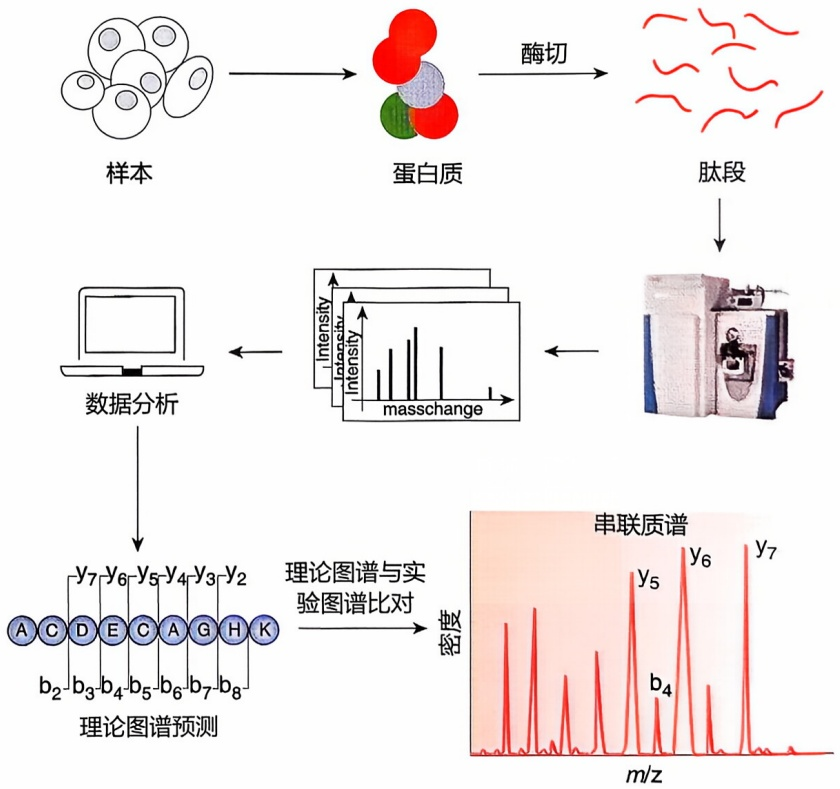

<details>
<summary>flowchart</summary>

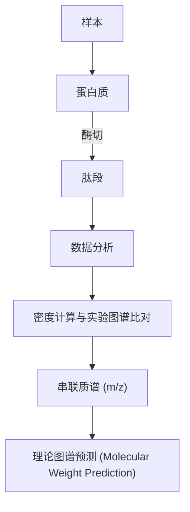
</details>

图9-1 “自底向上”（鸟枪法）蛋白质组学的实验流程

---

306

9 蛋白质组学和代谢组学

色谱串联质谱（liquid chromatography-mass spectrometry，LC-MS/MS）的实验技术为例，蛋白质被蛋白酶水解为肽段后，经由液相色谱分离，采用电喷雾电离（electrospray ionization，ESI）等离子源离子化进入质谱仪，在磁场作用下，这些离子化的肽段被仪器检测扫描形成一级谱图（MS1）。一级谱图由包含着质荷比及信号强度（用于反映离子数目）的谱峰构成。然后，这些一级谱图中的离子化肽段作为母离子（parent ion），被碰撞诱导解离（collision-induced dissociation，CID）或高能碰撞解离（high-energy collision dissociation，HCD）等方式再次碎裂为不同的带电碎片离子（子离子，fragment ion）。在母离子碎裂过程中，根据母离子序列断裂的位置，如果正电荷在子离子的N端，则形成的是a、b、c离子，如果正电荷在子离子的C端，则形成的是x、y、z离子。质谱检测的信号以b离子和y离子为主，如图9-1中肽段ACDECAGHK。子离子通过磁场经扫描形成二级质谱图（MS2）。二级谱图包含肽段的质量、电荷组成的母离子信息，以及不同质荷比、强度组成的碎片离子信息。最后通过对谱图的解析可以实现高通量的肽段与蛋白质的定性与定量研究。

## 9.1.2 蛋白质翻译后修饰

## 9.1.2.1 蛋白质翻译后修饰介绍

据研究估计, 人类约 2 万多个基因, 受可变剪接与翻译后修饰 (post-translational modification, PTM) 影响, 可能产生超过百万种不同的蛋白质形式 (proteoforms)。蛋白质翻译后修饰是指在蛋白质氨基酸残基上通过添加或移除特定的基团进而调节蛋白质活性、定位、表达以及与其他细胞分子相互作用的一种调控方式。常见的蛋白质翻译后修饰包括磷酸化 (phosphorylation)、乙酰化 (acetylation)、糖基化 (glycosylation)、泛素化 (ubiquitination) 和羟基化 (hydroxylation) 等。目前已知的翻译后修饰类型已有几百种, 并且不断有新修饰被发现, 如琥珀酰化 (succinylation)、巴豆酰化 (crotonylation)、2-羟基异丁酰化 (2-hydroxyisobutyrylation) 等。这些新修饰增加了蛋白质组的多样性。

磷酸化修饰是真核细胞中最常见、最重要的一种蛋白质翻译后修饰，现有研究估计，细胞中超过3/4的蛋白质是经过磷酸化修饰的，人类细胞中发生了成千上万种不同的磷酸化事件。蛋白质磷酸化修饰以快速且可逆的方式调节着蛋白质活性和细胞生理信号，它在几乎所有真核细胞过程的调节中均起着核心作用，包括转录调控、细胞周期控制、细胞代谢调节、细胞分化、信号转导等。据研究观察，在丝氨酸（serine）上的磷酸化是最常见的磷酸化修饰，其次是苏氨酸（threonine）和酪氨酸（tyrosine），且它们经常与癌症、阿尔茨海默病、糖尿病等疾病的发展相关。对磷酸化修饰的深入研究，可能为疾病的理解、诊断和治疗均提供巨大的机会。

## 9.1.2.2 蛋白质翻译后修饰检测技术

鉴定、表征和定位蛋白质翻译后修饰对于理解它们的生物学功能至关重要。由于翻译后修饰的低化学计量，在质谱表征前，必须先将翻译后修饰蛋白质富集（en-

---

9.1 蛋白质组学概述

307

richment）。富集，指的是将分子捕获并浓缩在色谱树脂、吸附剂等，或者是通过应用选择性沉淀方法来浓缩分子的过程。富集技术的发展以及液相色谱和质谱仪器的改进推动了研究者们对翻译后修饰的了解不断增长。下面以磷酸化修饰为例展开介绍。

典型的磷酸化蛋白质组工作流程包括:样品制备（蛋白质提取和酶解、磷酸化肽富集），色谱分离，串联质谱分析，数据处理，数据分析，生物学机理推断。在富集之前，蛋白质被酶解为肽，最常用的酶为胰蛋白酶。对于磷酸化修饰，常用的富集策略为基于金属离子的富集策略，其中包括固定化金属离子亲和色谱（immobilized metal affinity chromatography，IMAC）和二氧化钛（$\mathrm{TiO_2}$）等，以及基于抗体的富集策略。在磷酸肽进入质谱仪之前，为了提高蛋白质组覆盖率，需要利用色谱法（chromatography）先将其进行分离。随后与常规蛋白质组的分析类似，将制备好的待测样品中的离子按质荷比分离后，进行标记或非标的串联检测和定量的分析。生物质谱技术的发展进步实现了对细胞内蛋白质组的修饰类型和相应修饰位点的系统性鉴定和定量，促进了人们对蛋白质翻译后修饰的复杂性和多样性的生物学功能认知。

## 9.1.3 蛋白质组数据分析流程

## 9.1.3.1 蛋白质组数据质控分析

蛋白质组数据的质控，可以分别从样本原始数据谱图数、肽段及蛋白质的鉴定数量、内参样本间一致性、组间样本的主成分分析、组内样本的相关性等多个角度的统计分析进行质量评估。

## 9.1.3.2 蛋白质的质谱鉴定算法

从生物样本中提取的蛋白质经过酶切、分离与串联质谱分析，最终获得由所有多肽序列产生的质量谱图。接下来可以利用计算方法从质量谱图中推断该生物样本中所表达的肽段，再通过后续组装分析，完成蛋白质的鉴定，即回答哪些蛋白质在样本中表达。

目前对质谱数据的解析主要有基于蛋白质序列数据库比对的搜库算法、de novo测序算法以及基于谱图比对检索算法。搜库算法根据研究对象构建候选序列库，通过理论计算产生候选序列库可能产生的理论谱图，再将其与实际的谱图进行相似性匹配打分，进而推断出与谱图相对应的肽段。基于搜库算法，也被称为搜索引擎，已有X!Tandem、MaxQuant、pFind、MS-GF+、Comet、MSFragger等一系列开源软件工具被开发和广泛使用。但是，搜库算法依赖于候选序列库，对于未知序列或未知复杂序列变异等难以准确鉴定。De novo测序算法通过机器学习、深度学习、动态规划、图论等复杂计算过程，根据谱图中的信号直接对肽段序列进行从头推算。De novo测序算法不受搜索库的限制，可以鉴定未知序列；但该方法对谱图质量要求高，当碎片离子的信号不完整时，则很难正确解析，而且计算过程复杂、假阳性

---

308

9 蛋白质组学和代谢组学

高，相关工具仍待优化。基于谱图检索的方法是在已有图谱分析研究的基础上，从经过大量研究得到的正确肽段-谱图匹配结果中提取谱图构建一个谱图库，通过将未知的谱图与谱图库进行比较来找出相似性最高的匹配结果。该方法在速度、准确性、敏感度上都优于基于数据库搜索的方法，但对于还未曾被谱图注释的肽段无法被检测。上述三个方法各自有长处与不足，当前搜库算法由于其结果的可靠性是应用最为广泛的肽段鉴定策略。

基于串联质谱技术的蛋白质肽段鉴定目前主要是基于搜库算法。如图9-2所示，质谱产生的二级谱图作为搜索引擎的输入，搜库算法会将每张二级谱图和可能产生这张谱图的肽段序列相匹配，同时会为每一个匹配结果进行打分。搜索引擎首先根据谱图母离子的质量，在理论肽段参考库中挑选满足一定范围内的候选肽段；这些候选肽段模拟理论碎裂的过程，并产生带有质量信息的相同强度的理论谱峰；最后在一定的误差范围内，比对理论谱峰和实际二级谱峰。在这个比对过程中，搜索引擎会对每一个候选肽段的匹配质量进行打分，选取最高得分的肽段-谱图匹配（peptide-spectrum match，PSM）作为该谱图的解析结果。

搜库完成后，即可得到所有谱图与肽段的匹配结果。得分最高的最佳匹配也并不表明所对应的肽段鉴定结果一定是真实、正确的。此时需要进一步通过计算错误发现率（false discovery rate, FDR）对最佳匹配结果的假阳性进行评估，根据 FDR

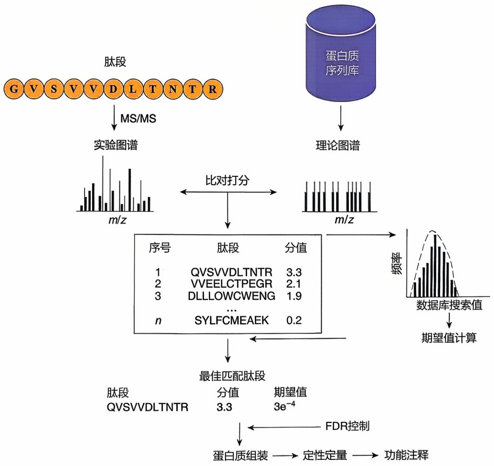

<details>
<summary>flowchart</summary>

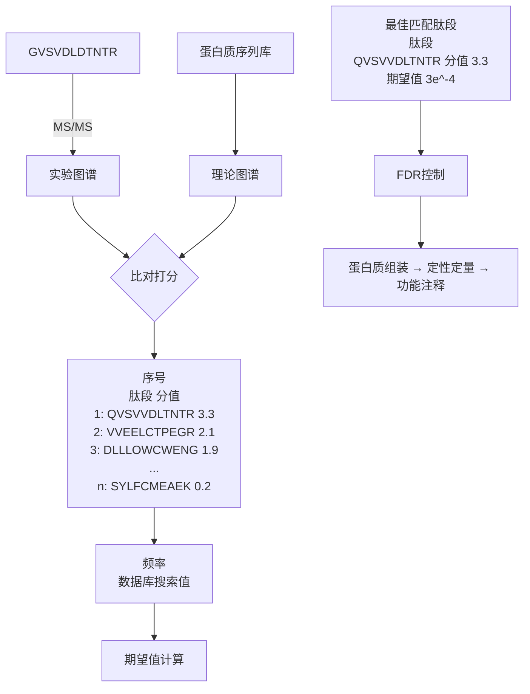
</details>

图9-2 蛋白质组搜库过程示意图

---

9.1 蛋白质组学概述

309

阈值筛选可信的鉴定结果。目标-诱饵库搜库策略（target-decoy search strategy）是被应用最为广泛的假阳性控制方法。该方法的思路是构建一个并不是真实存在的序列库作为诱饵（decoy），与目标序列（target）同时用于搜库鉴定。一般会使用随机序列或目标库的反库作为诱饵库。反库序列与真实的序列有着一样的氨基酸分布，但它们被认为不存在于自然状态中。例如，序列“TILSNQTVDIPENVDITLK”的反库序列即为“KLTIDVNEPIDVTQNSLIT”。在谱图与肽段匹配过程中，假如谱图匹配到反库序列，就认为这样的匹配为假阳性的随机错误匹配。目标-诱饵库搜库策略的基本假设是目标库中的随机错误匹配与诱饵库中的匹配概率相等，基于该假设，即可通过计算假阳性率为肽段谱图匹配的结果进行质控。

从搜库策略上来讲，根据是否将目标库与诱饵库分开搜库，有“混合搜库”与“分开搜库”两种方式。混合搜库即将目标库与诱饵库合并为一个搜索库同时搜索，对于每一张谱图的匹配，正确匹配一定来源于目标序列。该方法在搜库过程中两部分序列之间可以存在竞争关系，这样就可以淘汰源于反库的错误匹配结果。不过也有研究人员指出这样的方法可能导致一些高分目标匹配被更高分反库匹配淘汰而造成假阴性，因而更支持分开搜库。分开搜库则是分别对两部分序列库进行搜库，提取目标与诱饵库匹配结果的得分用于计算FDR。不同的方法各有优劣，目前针对不同策略均有后续适用工具供选择。对于混合库搜库常用式(9-1)进行FDR计算:

$$
F D R = 2 R / (F + R) \tag {9-1}
$$

其中，$F$ 为所有匹配到目标库的谱图中得分超过该PSM得分的数目，$R$ 为所有匹配到诱饵库的谱图中得分超过该PSM得分的数目。使用该公式是认为在混合搜库的过程中，目标库出现错误匹配的概率与诱饵库出现错误匹配的概率相等。对于分开搜库的策略，常用式(9-2)进行FDR计算，这与式(9-1)有着相同的假设条件。通常FDR选用0.01作为阈值，只有达到该阈值限制的匹配结果才会认为是可靠的鉴定结果，用于下游分析。

$$
F D R = R / F \tag {9-2}
$$

得到肽段鉴定结果之后，推断肽段与蛋白质之间的从属关系，从而拼装样本中所有的蛋白质。蛋白质的相对定量则是通过肽段的质谱信号计算。

## 9.1.3.3 蛋白质组装与定量

从上文基于搜库的肽段鉴定算法介绍中不难发现，在从肽段到蛋白质的组装过程中有两个难题:①经过蛋白酶水解的不同蛋白质，特别是同源蛋白质可能会产生相同的酶切肽段序列；在肽段与谱图匹配过程中，无法区分这些肽段具体源于哪个蛋白质；②不同质谱仪器、不同数据库搜索引擎、不同蛋白质序列目标库等因素，都会一定程度上造成肽段鉴定结果的偏差，进而也会影响对蛋白质鉴定结果的判断。此外，由于实验和计算过程中存在无法避免的误差、噪声等干扰，在蛋白质组装，即从表达肽段来推测蛋白质的过程中，假阳性风险控制需要谨慎考虑。

---

310

9 蛋白质组学和代谢组学

目前，已经有一些使用较为广泛的方法及工具被开发并用于蛋白质组装鉴定。其中，使用最广泛的方法是基于最大简约原则，也称为 Occam's Razor 原则。简单地说，就是用最少的蛋白质序列解释全部的表达肽段。该原则在蛋白质组装的算法中被广泛应用，Protein Prophet、PGA 等工具都调用了该方法。

具体来说，由肽段组装蛋白质的过程主要有四步:①对于搜索引擎检索后匹配到谱图肽段进行FDR质控过滤；②根据搜库结果获取鉴定到的肽段与蛋白质的匹配关系；③将与表达肽段相匹配的蛋白质进行分组，使每一组之间没有相同的肽段；④对每一组的蛋白质根据简约原则进行组装，选出每个组鉴定到的蛋白质。具体地，在第四步组装算法中，主要分为布尔型与概率型两种方案。布尔型将所有可靠鉴定到的表达肽段视为同等存在，根据简约原则对蛋白质进行推算，通过使用启发式或者贪婪算法，获取最终蛋白质组装结果；概率型基于概率模型，借助肽段水平的置信度为蛋白质水平的组装结果打分，对于一个肽段，首先，考虑其所属蛋白质受其他肽段的影响程度，对这一个肽段的概率进行修正，再对蛋白质中所匹配到的肽段中至少一条为正确鉴定的概率进行计算，使用期望值最大的方法为蛋白质计算概率，如果有重复鉴定，则为其选最大值，在迭代过程中，与其他蛋白质所共有的肽段概率在所有匹配蛋白质中不断被分配直到概率趋于稳定，最后将根据简约原则未被组装到蛋白质的肽段概率定义为零，如此即可得到最终蛋白质鉴定的结果。简约原则可以过滤掉很多不存在的假阳性蛋白质，以提高蛋白质鉴定的可靠性，且对冗余度高或者包含不同物种同源序列的搜索库同样有效。但不可否认的是，这样的计算方法仍会造成一定程度的假阳性，如果能结合新的实验技术手段或者提供更多的先验信息来辅助蛋白质组装，结果将会更加可靠。

## 9.1.3.4 蛋白质定量统计

在进行蛋白质定量时，根据实验设计不同，主要有两种定量策略，分别是通过比较质谱信号强度（以肽段的色谱峰积分面积为基础，比较不同样品中对应蛋白酶解后多肽的色谱峰面积来相对定量）和谱图计数（以肽段被质谱检测到的次数即肽段二级图谱匹配数），来分析不同来源样本蛋白量的变化。在得到蛋白质定量矩阵之后，可根据表达谱数据的分布以及缺失值等情况，利用统计学模型和生物信息学算法对数据进行深度分析，如聚类分型、相关性分析、差异分析、功能富集分析等。需要注意的是，在数据统计分析之前一般都需要对数据进行清理、整合、归一化等处理。

## 9.1.4 蛋白质组数据与软件资源

质谱技术的发展促进了蛋白质磷酸化的定量研究和磷酸化蛋白质组学数据集的不断生成。鉴于蛋白质组在疾病研究中的重要性，美国癌症研究院临床蛋白质组协会（Clinical Proteomic Tumor Analysis Consortium，CPTAC）于2014年启动了人类癌症蛋白质组计划，与此同时，我国也启动了中国人群大规模蛋白质组学计划（China Human Proteome Project，CNHPP）。至今，国内外已公布了十余种癌症类

---

9.2 蛋白质结构分析

311

型的蛋白质组学研究成果和相应癌症蛋白质组学原始数据集，包括结直肠癌、卵巢癌、乳腺癌、胃癌、肝癌、肾癌、子宫内膜癌、肺癌、头颈癌等。不断积累的癌症蛋白质组数据为其生物信息的深度解析提供了前所未有的机遇和科学挑战，在不同癌症种类背景下进行的蛋白质组研究正在拓宽人们对于癌症的认识和理解，助力生物学、医学技术的进步和发展。

在蛋白质组学研究中，数据的开放共享也成为领域共识。自2012年以来，国际蛋白质组数据联盟（Proteome Xchange，PX）在全球范围内对蛋白质组质谱实验数据的提交和发布制定了国际标准，致力于协调和稳定蛋白质组数据的共享，PX目前包括PRIDE、PeptideAtlas、MassIVE、jPOST、iProX和Panorama共6个成员数据库，用户可以进行蛋白质组原始数据的浏览、查询与下载。

有些生物信息学软件工具已经将蛋白质组的搜库软件和蛋白质拼装软件整合在一起，这使得蛋白质组学的分析逐渐更加易于操作，也更加标准化，如 pFind Studio、MaxQuant、Proteome Discoverer 等。

## 9.2 蛋白质结构分析

## 9.2.1 蛋白质结构概述

## 9.2.1.1 蛋白质结构组织层次

蛋白质的结构一般可以分为一级、二级、三级和四级结构。在二级结构和三级结构之间还存在超二级结构和结构域两个层次。这些丰富的蛋白质结构组织层次的划分有助于我们系统理解蛋白质结构的多样性和复杂性。

蛋白质的一级结构一般是指构成蛋白质肽链的氨基酸残基的排列次序，有时也称为氨基酸序列。构成蛋白质肽链的常见氨基酸有20种。每一种氨基酸在结构上有着共同的特征:一个中心碳原子 $C_{\alpha}$ 以及与之相连的一个氢原子、一个氨基（—NH₂）和一个羧基（—COOH）。用于区分不同氨基酸的是与 $C_{\alpha}$ 连接的侧链基团（R）。氨基酸侧链的理化性质包括所带电荷、疏水性和极性等，这些性质是蛋白质的结构与功能的基础。

蛋白质的二级结构是多肽链主链原子借助氢键形成的周期性构象，它们是形成完整肽链构象的结构单元，是蛋白质复杂空间构象的基础。二级结构的形成主要是通过肽链骨架中羰基上的氧原子和酰胺基上的氢原子之间的氢键作用。在球状蛋白中，二级结构的三个基本单元是:$\alpha$ 螺旋、$\beta$ 折叠和环区（loop regions）。$\alpha$ 螺旋是最常见的二级结构单元。在 $\alpha$ 螺旋中，同一肽链上的第 $i$ 个残基的酰胺氢原子和位于它后面的第 $i + 4$ 个残基上的羰基氧原子形成氢键，这种氢键大致与螺旋轴平行。$\beta$ 折叠（也称为 $\beta$ 片层）是另外一种常见的二级结构单元。$\beta$ 折叠是由多肽链的几个区域结合而成。通常每个 $\beta$ 片层长度为 $5 \sim 10$ 个残基，这些残基几乎都呈现出

---

312

9 蛋白质组学和代谢组学


<details>
<summary>natural_image</summary>

Colorful 3D ribbon-like objects arranged in a diagonal pattern (no text or symbols)
</details>

1EC5

(a)


<details>
<summary>natural_image</summary>

Colorful electrical circuit lines with no visible text or symbols
</details>

1LK2\_B

(b)

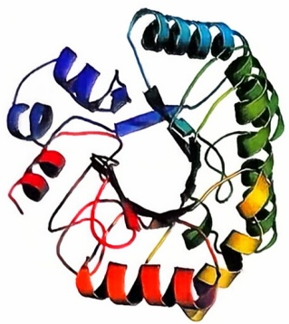

<details>
<summary>natural_image</summary>

3D ribbon diagram of a protein structure with alpha helices and beta sheets (no text or labels)
</details>

1TML

(c)

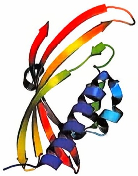

<details>
<summary>natural_image</summary>

3D ribbon diagram of a protein structure with alpha helices and beta sheets (no text or labels)
</details>

1IDP\_A

(d)

图9-3 四类蛋白质结构域

(a) $\alpha$ 结构域 (PDB 号: 1EC5); (b) $\beta$ 结构域 (PDB 号: 1LK2\_B); (c) $\alpha/\beta$ 结构域 (PDB 号: 1TML); (d) $\alpha + \beta$ 结构域 (PDB 号: 1IDP\_A)

完全伸展的构象。 $\beta$  折叠分为平行的和反平行两种类型。大多数蛋白质的结构是由  $\alpha$  螺旋和  $\beta$  片层这两种二级结构组合构成的，它们之间由不同长度和不规则形状的环区相连。环区通常位于蛋白质结构的表面，暴露在溶剂中，环区中带正电或带极性的亲水氨基酸可能与水分子形成氢键。不同物种的同源蛋白序列比对发现，残基的插入和缺失更容易发生在环区内。环区结构有时对发挥蛋白质的功能是至关重要的。例如，研究发现环区经常参与蛋白质功能位点的形成。环区也具有一些频繁出现的优先结构，如转角结构。

两个或多个二级结构单元可以组装成具体有特异几何排列的局部空间结构，这些局部空间结构称为超二级结构。几个超二级结构可以进一步组合形成紧密的球状结构，称为结构域。三级结构的基本单元是结构域，通常

一条长的多肽链可折叠成几个结构域。结构域之间也有相互作用，但是这些相互作用比起每个结构域内部的二级结构元件之间的相互作用要弱。稳定蛋白质三级结构主要是依靠氨基酸之间的各种非共价键和疏水作用。蛋白质结构域可分为四种主要类型:$\alpha$、$\beta$、$\alpha/\beta$ 和 $\alpha+\beta$ 结构域（图 9-3）。$\alpha$ 结构域的核心区主要由 $\alpha$ 螺旋构成，$\beta$ 结构域的核心区主要由 $\beta$ 片层构成，$\alpha/\beta$ 和 $\alpha+\beta$ 结构域的核心区既含有 $\alpha$ 螺旋也含有 $\beta$ 片层，其中 $\alpha/\beta$ 型主要含有平行 $\beta$ 片层，$\alpha+\beta$ 型主要含有反平行 $\beta$ 片层。

许多蛋白质含有一条以上的多肽链，多肽链之间的相互作用形成了蛋白质复合物，也称为蛋白质四级结构。这些相互作用包括二硫键、疏水相互作用、范德华力、静电力以及氢键。这些独立的多肽链一般称为蛋白质分子的亚基。具有四级结构的蛋白质根据亚基的组成可以分为由相同亚基和不同亚基构成的两大类型。许多蛋白质都具有四级结构，并在亚基间的界面上形成催化或功能活性位点。四级结构还具有明显的优势，即配体或底物的结合能够改变整个复合物的构象，为生物活性的调节提供了可能。

## 9.2.1.2 蛋白质结构的实验测定方法

蛋白质的三维结构可以通过实验方法进行测定。到目前为止，蛋白质空间结构的实验测定方法主要有三种:X射线衍射法、核磁共振（nuclear magnetic resonance, NMR）技术和低温冷冻电子显微镜技术。X射线衍射技术是用于测定蛋白质结构

---

9.2 蛋白质结构分析

313

最精确的方法之一，目前已知结构中有超过 $80\%$ 是通过这种技术获得的。应用X射线衍射技术测定蛋白质结构，蛋白质溶液样品必须具有足够高的浓度并在合适的条件下形成晶体。晶体通过X射线衍射到探测装置得到衍射图像，进而推导出蛋白质的结构。X射线的波长（$0.05 \sim 0.15 \mathrm{~nm}$）适合用于测量原子间距，因而可以用来对蛋白质侧链进行细致的研究。核磁共振技术是另外一种重要的蛋白质结构实验测定方法。其主要原理是将蛋白质溶液置于磁场中，观察特征性的化学位移，从化学位移中推测蛋白质的结构。由核磁共振技术测定的蛋白质分子量一般不超过80000，这比由X射线衍射测得结构的蛋白质要小得多。但是核磁共振技术不需要复杂的结晶过程，这是它的一个明显优点。此外，低温冷冻电子显微镜技术是近些年来兴起的蛋白质结构解析的新方法。得益于检测器和计算机图像处理技术的快速发展，低温冷冻电子显微镜技术可以高分辨率地重构生物大分子的三维结构。该技术对很多蛋白质有独特的优势，如难以结晶的膜蛋白和大分子复合物等。

一般来讲，实验科学家在正式发表蛋白质结构数据之前，均需要将结构数据提交到蛋白质结构数据库（Protein Data Bank，PDB）。PDB是目前最主要的收集生物大分子三维结构的数据库，其中绝大多数是蛋白质结构数据。该数据库已在本书第4章中详细介绍，在此不再赘述。随着结构测定实验技术的不断进步，PDB中存储的蛋白质分子结构数据量迅速上升。截至2023年6月底，PDB共收录超过22万条实验测定的蛋白质结构记录。值得一提的是，电子显微镜技术测定的蛋白质结构呈逐年增多的趋势。PDB以文本文件的方式存放蛋白质结构数据，每个分子各用一个独立的文件（称为PDB文件）。除了原子坐标外，PDB文件还包括物种来源、化合物名称、结构提交时间以及有关文献等基本注释信息。

## 9.2.1.3 蛋白质结构比较与分类

蛋白质三维空间结构的相似性比较（也称为蛋白质结构比对）是蛋白质结构分析的重要手段。与蛋白质序列比对相比，蛋白质结构比对要复杂得多。一个完整的蛋白质结构比对的结果不仅要定量描述蛋白质结构相似性，还要产生基于结构的序列比对，同一比对位置上的残基意味着它们在空间结构上具有相似性。此外，结构比对还要产生结构叠加后的结构文件，通过蛋白质结构图形显示软件，可以具体观测蛋白质结构的相似性。蛋白质结构比对通常有以下几个方面的应用:①探索蛋白质进化及同源关系，特别是分析那些在结构上相似而序列不相似的弱同源蛋白；②为蛋白质结构自动化分类提供依据；③为一些以结构为基础的功能注释方法提供帮助，其基本原理是结构相似的蛋白质往往具有相似的功能。

蛋白质结构比对方法主要原理是采用启发式的方法，首先对两个结构定义一系列结构相似的部分（也称为共同子结构），然后通过多次迭代策略，从中找出最优的结构比对，即找到两个蛋白质空间上最大的重叠部分。迄今为止，已有几十种的结构比对方法被相继开发。以下简要介绍目前流行的两种常用蛋白质结构比对方法（DALI 和 TM-align）。

DALI 主要策略是通过将结构比对上的氨基酸片段拼接成一个完整的结构比对。

---

314

9 蛋白质组学和代谢组学

在计算相似性分数时，DALI采用分子内距离矩阵来计算两个共同子结构的相似性。该方法采用蒙特卡罗模拟来决定如何将结构比对上的氨基酸片段拼接成一个完整的结构比对。最终比对上的两个蛋白质共同子结构的分子内均方根距离作为DALI比对的原始分数。为尽可能获得最优的结构比对，DALI使用许多初始比对，来搜索分数最高的比对。为直观表征两个蛋白质结构相似性，DALI还提供具有统计意义的Z分数（Z score）。在其Web界面能对用户指定的蛋白质结构开展结构比对及结构相似性数据库搜索分析。DALI同时也提供了可供用户本地使用的结构比对软件包。

TM-align 主要用于寻找两个蛋白质结构之间的全局结构相似性。TM-align 是一种高效的算法，能够在短时间内找到最优的结构比对。TM-align 方法采用分子间距离的方式来比较两个蛋白质结构。它首先将两个结构进行刚体转化，然后通过最大化 TM-score 来寻找最优的分子叠加。TM-score 是一个评估结构相似性的指标，它是在两个结构分子叠加的基础上计算得出的，其数值范围为 $0 \sim 1$，TM-score 越接近 1 表示相似性越高。在 TM-align 中，采用动态规划算法来寻找最优的分子叠加。TM-align 方法已广泛应用于蛋白质结构比对和结构相似性搜索。此外，TM-align 还拓展到蛋白质复合物之间的结构比对。

不同的蛋白质可以具有相似的空间结构，因此有必要开展系统的蛋白质结构分类研究。迄今为止，蛋白质结构分类主要采用分层次的分类方法，许多结构分类数据库已建成。由于蛋白质结构繁多，大小不一，有的多肽链只有一个结构域，有的则由多结构域组成，构建结构分类数据库是一项十分繁杂的工作。SCOP（Structural Classification of Proteins）是迄今为止应用最广、影响力最大的蛋白质结构分类数据库。SCOP 数据库首先用结构比对程序对蛋白质结构进行自动化比较，然后通过人工检查来建立结构的系统分类。在 SCOP 数据库中，蛋白质结构被分为类型、折叠子（fold）、超家族和家族四个层次。折叠子是蛋白质结构分类中最重要的一个层次。普遍认为，自然界中蛋白质折叠子数目是有限的。尽管近年来新解析出来的蛋白质结构数目猛增，但是折叠子的数目并没有大量增加。

## 9.2.1.4 蛋白质结构可视化

PDB 中的蛋白质结构的记录信息，是以文本的形式存放，为了更加直观地观察蛋白质的三维结构，许多分子结构显示软件已相继开发。蛋白质结构显示软件正朝着操作简单化、功能多样化、结构显示精美化的方向发展。目前代表性的软件有 PyMol 和 Chimera。

PyMOL 是一款功能强大且广泛使用的蛋白质结构可视化软件，由计算结构生物学家沃伦·德拉诺（Warren DeLano）于 2000 年开发，目前由 Schrödinger 公司商业化运营。PyMOL 具有付费的商用版和开源的学术版两个版本。PyMOL 可以在 Linux、macOS 和 Windows 等操作系统上运行。PyMOL 支持多种文件格式，包括 PDB、CIF、MOL、SDF 等。PyMOL 的主要特点和功能包括:① 能够加载蛋白质的 PDB 文件，将蛋白质的三维结构以图形的形式呈现出来；用户可以通过旋转、平移、缩放等操作从不同角度来观察蛋白质的构象。② 提供了多种渲染选项，可以

---

9.2 蛋白质结构分析

315

生成高质量的蛋白质结构图像和动画；用户可以调整颜色、透明度、光照等参数，使图像更具表现力和美观性。③ 支持蛋白质结构比对，可以将不同蛋白质的结构进行叠加，比较它们之间的相似性和差异性。④ 可以绘制蛋白质的分子表面，并可以根据原子电荷、亲/疏水性和溶剂可及性等属性进行着色，从而帮助人们更好地理解蛋白质的结构和功能。⑤ 支持 Python 脚本编程，用户可以编写脚本来实现自定义的功能和批量处理。⑥ 支持插件扩展，用户可以通过安装插件来增加新的功能和工具。

Chimera也是一款功能强大的生物分子可视化和分析软件，由美国加州大学旧金山分校的计算生物学实验室开发。它是以BSD license方式进行开源。它广泛应用于蛋白质结构和分子对接结果分析。Chimera具有丰富的功能和用户友好的界面，可以展示蛋白质、核酸和其他生物分子的三维结构。用户可以旋转、缩放、平移和裁剪分子，以便更好地观察和理解分子的结构和功能。该软件提供丰富的分子结构分析工具，可以计算分子的几何参数、氢键、范德华力、电荷分布等，还可以对蛋白质结构进行表面计算、表面电荷可视化等分析。

## 9.2.2 蛋白质结构预测

## 9.2.2.1 蛋白质折叠问题

蛋白质的一级结构通常需要折叠成特定的三级结构来行使特定的生物学功能。一旦错误折叠，就可能导致严重的问题，如牛海绵状脑病（疯牛病）、阿尔茨海默病等。1954年，生化学家克里斯蒂安·安芬森（Christian Anfinsen）利用变性剂破坏了核糖核酸酶的三级结构，当去除变性剂之后，他发现核糖核酸酶又能自发地重折叠回其天然结构，并恢复其功能。因此他猜测形成蛋白质三级结构所需要的全部信息都包含在其一级结构内，这一生物过程与折叠的路径和方式无关，而是由热力学决定。这一猜想被称为安芬森法则（Anfinsen's dogma），也被称为蛋白质折叠的热力学假说（thermodynamic hypothesis）。

如果把蛋白质看成是分子机器的话，那么，它是如何实现精准和快速的自发折叠的呢？这就是著名的蛋白质折叠问题，它被认为是生物、物理和计算机科学家们面临的共同挑战，也被誉为生物物理学的一座圣杯。在2005年，Science杂志将蛋白质折叠问题称为科学界尚未解决的125个重要问题之一。蛋白质折叠问题实际上包含了三个子问题。

① 给定一级结构，能否推测出其三级结构？这也就是著名的蛋白质结构预测问题。近年来受益于人工智能算法的进展，在这个问题上人们已经取得了重大突破。
② 折叠过程是怎么发生的？这是一个机制问题。在折叠过程中，除了共价二硫键外，主要是氢键、范德华力和盐键等一些非共价键的断裂和形成。为了揭秘这一过程，人们需要掌握蛋白质的氨基酸序列与控制其折叠的物理相互作用力之间的复杂联系。

---

316

9 蛋白质组学和代谢组学

③ 折叠过程为什么如此精准且快速？这是一个理论生物物理问题。1968年在意大利举行的一个会议上，赛勒斯·莱文萨尔（Cyrus Levinthal）做了这样的一个思想实验:对于一个由100个左右氨基酸组成的蛋白质，如果每个氨基酸存在3种可能构象，则这个蛋白质可折叠成 $3^{100}$ 或 $10^{47}$ 种不同构象，那即便每次尝试一种可能构象仅需要0.1 ps（ $10^{-13}$ s），也需要 $10^{34}$ s或 $10^{27}$ y（参照:宇宙的年龄= $10^{10}$ y）找到其正确的天然构象。但是实际上，大多数蛋白质可在毫秒级或甚至微秒级时间尺度上实现折叠，这就是困扰人们多年的Levinthal悖论。

关于子问题 ①，在本章节接下来部分我们将对蛋白质结构预测的发展历史和最新进展作详细介绍。分子动力学模拟是研究子问题 ② 和子问题 ③ 的重要工具，我们将在本章下一节对分子动力学模拟的基本原理、实现过程和模拟技巧进行详细介绍。

## 9.2.2.2 蛋白质结构预测历史回顾

可以说安芬森法则奠定了蛋白质结构预测的理论基础，即蛋白质的空间结构是由其一级序列决定；同时，它的提出也揭开了蛋白质结构预测的序幕。迄今为止，蛋白质结构预测已走过半个世纪多的历程，取得巨大的进步，许多预测方法已经被开发，并被频繁地应用在生命科学研究中的诸多领域（图9-4）。传统的蛋白质结构预测方法，主要可分为三类:同源建模、折叠识别和从头计算方法。近年来，随着以深度学习为代表的人工智能技术的不断发展，蛋白质结构预测迎来了突破性进展，取得了可与实验测定相媲美的结果。代表性的方法有:AlphaFold2、RoseTTAFold和ESMFold等。为方便读者，表9-1列出不同类型蛋白质三级结构预测的代表性方法。

然而，在很长一段时间内预测蛋白质的三级结构是一个非常挑战性的任务，因此许多研究人员转向预测蛋白质结构性质，希望通过结构性质的预测加强对蛋白质

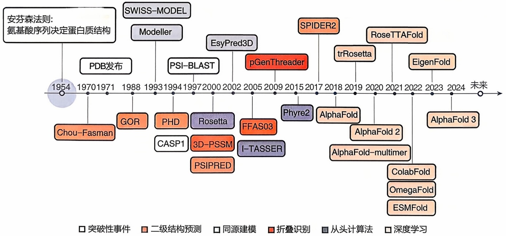

<details>
<summary>state_timeline</summary>

| Model | Start Year | End Year |
| :--- | :--- | :--- |
| Chou-Fasman | 1954 | 1970 |
| PDB发布 | 1970 | 1988 |
| GOR | 1988 | 1993 |
| SWISS-MODEL | 1993 | 1997 |
| Modeller | 1997 | 2002 |
| PSI-BLAST | 2002 | 2005 |
| EsyPred3D | 2005 | 2009 |
| pGenThreader | 2009 | 2015 |
| AlphaFold | 2015 | 2018 |
| trRosetta | 2018 | 2019 |
| RoseTTAFold | 2019 | 2021 |
| EigenFold | 2021 | 2023 |
| AlphaFold-multimer | 2019 | 2021 |
| ColabFold | 2021 | 2023 |
| OmegaFold | 2021 | 2023 |
| ESMFold | 2021 | 2023 |
| PhD | 1994 | 2005 |
| CASP1 | 1994 | 2005 |
| Rosetta | 1997 | 2009 |
| PSIPRED | 1997 | 2009 |
| FFAS03 | 2005 | 2015 |
| I-TASSER | 2005 | 2015 |
| Phyre2 | 2015 | 2018 |
| SpIDER2 | 2017 | 2018 |
| AlphaFold_3 | 2023 | Future |

Legend: □ 突破性事件, □ 二级结构预测, □ 同源建模, ■ 折叠识别, ■ 从头计算法, □ 深度学习
</details>

图9-4 蛋白质结构预测历史回顾

---

9.2 蛋白质结构分析

317

表 9-1 一些常用的蛋白质三级结构预测方法

| 方法 | 预测方法类型 |
| --- | --- |
| Modeller | 同源建模 |
| SWISS-MODEL | 同源建模 |
| EsyPred3D | 同源建模 |
| 3D-PSSM | 折叠识别 |
| pGenThreader | 折叠识别 |
| FFAS03 | 折叠识别 |
| Phyre2 | 同源建模/折叠识别 |
| Rosetta | 从头计算法 |
| I-TASSER | 从头计算法 |
| AlphaFold2 | 深度学习 |
| RoseTTAFold | 深度学习 |
| trRosetta | 深度学习 |
| ESMFold | 深度学习 |
| ColabFold | 深度学习 |
| OmegaFold | 深度学习 |

空间结构的理解。常见的蛋白质结构性质预测问题有:蛋白质二级结构预测、蛋白质表面可及性预测、膜蛋白的跨膜区预测、氨基酸残基接触预测和蛋白质无序区预测，等等。这些蛋白质结构性质预测也是蛋白质结构预测的重要组成部分。

## 9.2.2.3 蛋白质结构性质预测

蛋白质结构性质预测的总体思路是利用统计理论或机器学习算法从结构已知的蛋白质数据中学习和归纳一些预测规则，用于待测蛋白的结构性质预测。本小节将主要介绍蛋白质二级结构预测和无序区预测。

## (1) 二级结构预测

二级结构预测的主要目标是要预测蛋白序列中每个氨基酸所处的二级结构类型，包括 $\alpha$ 螺旋、$\beta$ 折叠片和环区。对实验测定的蛋白质结构的统计分析表明，不同位置残基及其所处的上下游残基片段（sequence context），决定了其形成特定二级结构的倾向性。二级结构预测的基本原理就是通过对结构已知蛋白质的序列和其二级结构对应关系的统计分析，学习和归纳出一些预测规则，用于待测蛋白质的二级结构预测。在统计结构已知蛋白质中序列与其二级结构关系时，需要从实验测定的蛋白质空间结构定义出二级结构；目前最常用的程序有蛋白质二级结构定义法（definition of secondary structure of proteins, DSSP），该方法通过计算结构中的氢键模式来定义不同的二级结构。对于二级结构预测的精度评价，使用最多的参数就是三态预测准确率（$Q_{3}$），它直观反映一个蛋白质中多少百分比残基的二级结构能被正确预测。蛋白质二级结构预测开始于20世纪60年代中期，迄今为止，已报道超过数十种不同的预测方法。在预测精度方面也取得较为满意的结果，目前一些主流的蛋白质二级结构预测方法其预测精度可超过 $80\%$。

---

318

9 蛋白质组学和代谢组学

为方便读者理解，可以将已开发的二级结构预测方法的发展大致分为三代。第一代方法指的是1980年以前开发的方法，主要特点是采用简单的统计方法，基于对单个残基形成不同二级结构倾向性的统计，代表性的方法有Chou-Fasman法，总体上预测准确性不超过 $60\%$ 。第二代方法指的是1980—1992年开发的方法，主要特点是采用更为复杂的统计方法（如基于信息论的方法）对待测残基所处的上下游氨基酸片段予以综合考虑，代表性的方法有GORⅢ，第二代方法的总体精度不超过$65\%$ 。第三代方法指的是1992年以后开发的预测方法，其显著特点是采取更为先进的机器学习方法，将多序列比对作为预测的输入，代表性的方法有PHD、PSIPRED和SPIDER2，第三代方法预测精度普遍可超过 $70\%$ ，特别是一些基于深度学习的方法预测精度可超过 $80\%$ 。总体上，到了第三代方法，二级结构预测的精度已经令人满意并具有实际应用价值。以PSIPRED为例，该方法是英国大卫·琼斯（DavidJones）课题组在1999年开发的，主要策略是联合序列进化信息和神经元网络方法来实现二级结构的预测。该方法中多序列比对是通过PSI-BLAST自动搜索NCBI-NR数据库来获得。然后，获得的多序列比对，作为神经元网络输入预测二级结构。经测试，PSIPRED的预测准确度（ $Q_{3}$ ）超过 $75\%$ ，是公认的较为准确的二级结构预测方法。由于PSIPRED提供了免费下载的版本，使得该方法得到了广泛应用。

## (2) 蛋白质无序区预测

研究发现，许多蛋白质中部分序列片段在生理条件下，不能形成固定的二级结构，即不能折叠成稳定的三维构象。这种区域通常称为蛋白质无序区（intrinsically disordered regions，IDRs）。蛋白质中存在大量这样的无序区，如人类蛋白质中30%～40%的残基是处于无序区的。蛋白质无序区在蛋白质与其他分子相互作用中起着关键作用，参与了信号传导、转录、翻译等重要的生物学过程。蛋白质无序区的预测也隶属于蛋白质结构性质的预测，是近十几年来蛋白质组生物信息学中的一个热点课题。

常见的蛋白质无序区预测方法主要有三类。① 基于序列打分函数的预测方法:这些方法主要根据影响蛋白质折叠的一些理化性质，设计序列的打分函数用来识别无序区，代表性的方法有 IUPred 等。② 基于传统机器学习的预测方法:这些方法利用机器学习算法，如支持向量机（SVM）、随机森林（random forest）等，从已知的蛋白质序列和对应的无序区数据中训练模型，然后对未知蛋白质无序区进行预测。代表性方法有 SPINE-D、DisPredict 和 RONN 等。③ 基于深度学习的方法:近年来深度学习在蛋白质生物信息学领域的许多问题都有成功应用，也包括蛋白质无序区的预测，并且取得了较好的预测效果。代表性的方法有 SPOT-Disorder、fIDPnn 和 rawMSA 等。需要指出的是，虽然蛋白质无序区的预测取得了不错的效果，但还远未完善。

## 9.2.2.4 传统的蛋白质三级结构预测方法

蛋白质结构同源建模（又称比较建模）的理论基础是:如果两个蛋白质享有足够的序列相似性，那么它们的三维结构也非常相似。因此，如果其中一个蛋白质的

---

9.2 蛋白质结构分析

319

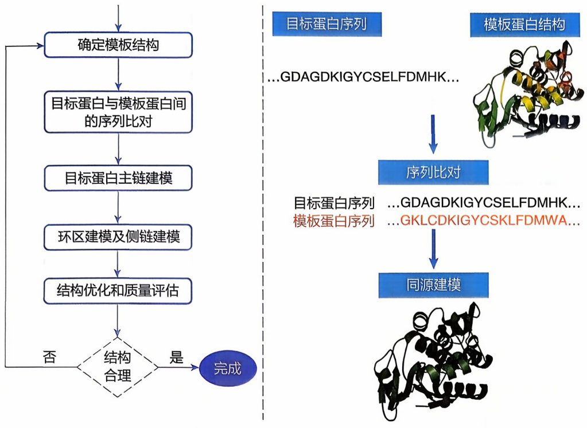

<details>
<summary>flowchart</summary>

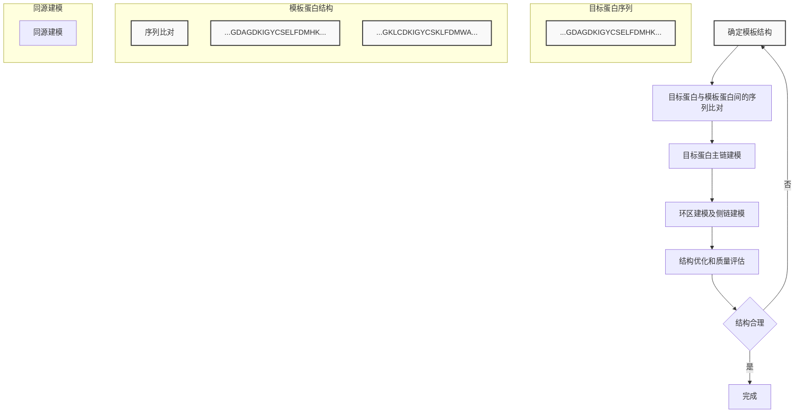
</details>

图9-5 蛋白质结构同源建模流程图

空间结构已被实验测定，则可以以该结构为模板来预测另一蛋白质的空间结构。同源建模一般可分为以下几个步骤:① 模板的选择；② 目标蛋白与模板蛋白的序列比对；③ 同源模型的建立；④ 同源模型的评估。图 9-5 给出同源建模的流程图。

模板的选择是通过对蛋白质结构数据库的序列同源性搜索来实现。一般情况下，当序列和候选模板蛋白具有 $30\%$ 以上的序列全同率时，候选模板是较为合理的。除了序列全同率外，一些统计参数（如BLAST中的E-value）也可用来判断序列与模板的相似性。一旦模板确定后，下一步就是要对目标蛋白及结构模板的全长序列进行序列比对。接下来进入同源建模的核心部分，包括三个步骤:① 目标蛋白的主链建模；② 环区建模；③ 侧链建模。主链建模非常容易，目标蛋白中比对上的氨基酸的主链可以从模板中相应位置氨基酸的主链拷贝得到。通常，目标蛋白与模板蛋白的比对经常伴随着插入/删除造成的空位，造成目标蛋白主链结构不连续或一些氨基酸的主链结构缺失，因此有必要进行调整和修补，即环区建模。侧链建模中，如果序列比对某些位置具有相同残基，首先可以将模板中相同残基的坐标直接作为目标蛋白的残基坐标，但是对于不完全匹配的残基，其侧链构象是不同的，需要进一步预测。结构建模中获得的初始模型仍不可避免含有结构不合理的地方，如不合适的键角和键长、过近的原子接触等。有必要采用合适的势能函数，对模型进行能量最小化，能够消除结构中的不合理的地方，达到模型精修的目的。对于同源建模获得的模型必须进行必要的评估。最常见的评估手段就是绘制蛋白质主链二面角的Ramachandran图，判断是否氨基酸都处于Ramachandran图中许可的区域，进而评估所建模型的立体化学性质的好坏。

总体上,同源建模技术已经相当成熟,文献上已报道多种的同源建模方法(表9-1)。一般来说,当待测序列与模板享有较高的序列全同率,不同方法均可得到准确的预

---

320

9 蛋白质组学和代谢组学

测模型。

蛋白质折叠识别（fold recognition）方法，是从蛋白质结构数据库中识别与查询序列具有相似折叠类型的模板，进而实现对查询序列蛋白质的结构预测。其理论依据是蛋白质空间结构比序列更为保守，许多蛋白质享有很低的序列相似性，仍可能具有相同的折叠类型。折叠识别的关键步骤是设计合适的打分函数来衡量查询序列与模板数据库中结构的相容性，进而找到合适的模板并给出待测序列和模板蛋白的序列比对。一旦模板及比对确定下来，同样采用同源建模的相应步骤实现对目标蛋白的三维结构建模。

折叠识别按其发展过程可以分为两代方法。第一代折叠识别方法通常指的是2000年以前开发的方法，更多情况下被称为穿针引线法（threading）。其主要思路是，在计算待测序列与模板序列比对时，考虑了待测序列与模板的结构相容性。第二代方法指的是2000年后开发的折叠识别算法，主要特点是:序列的进化信息被充分考虑；不同信息通过复杂的数学算法被整合成一个具有统计意义的打分函数。第二代折叠识别方法已成为蛋白质结构预测的主流方法，代表性的方法有3D-PSSM、pGenThreader和FFAS03等。

从头计算法（ab initio method），其原理是蛋白质的天然构象对应的是其能量最低的构象，通过构造合适的能量函数及优化方法，可以实现从蛋白质序列直接预测其三维结构。由于很难找到精准的能量函数，以及能量优化过程中存在大量的局部最小，从头计算法还远未实用，但其物理意义明晰，不依赖于模板，有可能预测到全新的蛋白质结构，所以一直受到许多研究人员的青睐。经过不懈努力，从头计算法也取得很大的突破，对一些分子量较小的蛋白质，有可能预测得到高精度的三维结构。所以，从头计算法可以作为同源建模和折叠识别的有益补充。比较流行的两种从头计算法分别是 Rosetta 和 I-TASSER。下面以 Rosetta 法为例，介绍其核心算法思想。

Rosetta 法是美国华盛顿大学大卫·贝克（David Baker）课题组开发的一种从头预测结构计算法。其主要原理是蛋白质中氨基酸片段的结构可以从已知结构蛋白的相似氨基酸片段的结构拷贝得到。首先，目标蛋白质的氨基酸片段通过预测其二级结构及序列相似性比较，从蛋白质氨基酸片段模板结构库中找到其可能采取的构象。然后这些氨基酸片段的构象（一般长度为 9 个残基）通过蒙特卡罗（Monte Carlo, MC）模拟退火方法被组装起来，得到一系列非天然构象（decoy conformation），进一步采用基于统计的能量打分函数，对这些构象进行评价，通常能量越低，越应该接近天然构象。在 Rosetta 软件包中，蛋白质构象是粗粒化表示（每个残基考虑骨架重原子， $C_{\beta}$ 原子以及侧链原子的质心），在模型精修阶段，蛋白质构象采用全原子模型表示，采用基于物理的更为精确的能量函数。

CASP 竞赛（Critical Assessment of Techniques for Protein Structure Prediction）是蛋白质结构预测学术界通过与实验科学家合作，开展的蛋白质结构“双盲”预测竞赛。结构生物学家提供结构已测定但未公开的蛋白质给 CASP 竞赛参加者，CASP

---

9.2 蛋白质结构分析

321

竞赛参加者通过他们各自的方法对蛋白质结构进行预测，然后将结果提交给 CASP 组委会。运用结构比对的方法，将这些预测的结构与实验测定的蛋白质结构进行比较，然后评估预测模型的精度。CASP 竞赛起源于 1994 年，每两年举行一次。该竞赛极大地促进了蛋白质结构预测的发展，提升了公众对蛋白质结构预测的了解和兴趣，堪称蛋白质结构预测的奥林匹克竞赛。

## 9.2.2.5 蛋白质三级结构预测新方法

AlphaFold2是由谷歌DeepMind团队开发的一种先进的蛋白质结构预测新方法。其采用了基于attention机制的深度学习算法，实现了端到端直接从蛋白质序列出发精确预测三维结构坐标，并在CASP14比赛中展现出了非常出色的表现。AlphaFold2采用了与以往方法不同的全新算法设计，具有很强的创新性。AlphaFold2主要包括三个部分:特征嵌入（feature embedding）、Evoformer编码器和解码器结构模块。在特征嵌入模块，它利用了两种关键信息:来自蛋白质序列的残基共进化信息［通过多序列比对（multiple sequence alignment，MSA）获得］以及蛋白质结构模板信息（图9-6）。通过在数据库中搜索同源序列和结构，生成MSA特征以及氨基酸对间的初始化接触信息。在Evoformer编码器模块中，研究人员使用了各种attention架构，将以上两种信息相互交织在一起，通过不断地迭代优化，最终获得能最大化表示蛋白质氨基酸间进化关系的MSA特征以及氨基酸对间的接触信息。解码器结构模块的工作是将蛋白质结构的抽象表示转化为具体的三维坐标。这一过程利用了多序列比对中第一条序列（即目标蛋白序列）的信息，同时也考虑了氨基酸对之间的接触信息。在结构模块中，每个氨基酸残基都被看作一个单独的对象，借助一种称为不变点注意力（invariant point attention）的框架以及Residue Gas框架，通过多次迭代来预测每个氨基酸残基的旋转和平移，最终得到整个蛋白质的精确三维结构。

AlphaFold2 成功的关键在于它使用了多种 attention 架构，尤其是在 Evoformer 模块中，通过不断迭代优化序列信息与氨基酸残基间的接触信息，与蛋白质折叠的物理化学机制相吻合。完整的序列库和大量已知的蛋白质结构也为 AlphaFold2

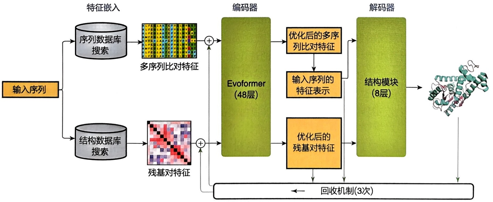

<details>
<summary>flowchart</summary>

```mermaid
graph LR
  A["输入序列"] --> B["序列数据库搜索"]
  A --> C["结构数据库搜索"]
  
  subgraph Embedding ["编码器"]
  B --> D["多序列比对特征"]
  C --> E["残基对特征"]
  D --> F["Evoformer (48层)"]
  E --> G["+"]
  F --> H["优化后的多序列比对特征"]
  F --> I["优化后的残基对特征"]
  end
  
  subgraph Decoder ["解码器"]
  H --> J["结构模块 (8层)"]
  I --> J
  J --> K["结构模块 (8层)"]
  end
  
  L["回收机制(3次)"] -.->|"+"| F
  M["输入序列的特征表示"] -.-> J
  N["输入序列"] -.-> J
  O["输入序列"] -.-> J
  P["输入序列"] -.-> J
  Q["输入序列"] -.-> J
  R["输入序列"] -.-> J
  S["输入序列"] -.-> J
  T["输入序列"] -.-> J
  U["输入序列"] -.-> J
  V["输入序列"] -.-> J
  W["输入序列"] -.-> J
  X["输入序列"] -.-> J
  Y["输入序列"] -.-> J
  Z["输入序列"] -.-> J
  AA["输入序列"] -.-> J
  AB["输入序列"] -.-> J
  AC["输入序列"] -.-> J
  AD["输入序列"] -.-> J
  AE["输入序列"] -.-> J
  AF["输入序列"] -.-> J
  AG["输入序列"] -.-> J
  AH["输入序列"] -.-> J
  AI["输入序列"] -.-> J
  AJ["输入序列"] -.-> J
  AK["输入序列"] -.-> J
  AL["输入序列"] -.-> J
  AM["输入序列"] -.-> J
  AN["输入序列"] -.-> J
  AO["输入序列"] -.-> J
  AP["输入序列"] -.-> J
  AQ["输入序列"] -.-> J
  AR["输入序列"] -.-> J
  AS["输入序列"] -.-> J
  AT["输入序列"] -.-> J
  AU["输入序列"] -.-> J
  AV["输入序列"] -.-> J
  AW["输入序列"] -.-> J
  AX["输入序列"] -.-> J
  AY["输入序列"] -.-> J
  AZ["输入序列"] -.-> J
  BA["输入序列"] -.-> J
  BC["输入序列"] -.-> J
  BD["输入序列"] -.-> J
  BE["输入序列"] -.-> J
  BF["输入序列"] -.-> J
  BG["输入序列"] -.-> J
  BH["输入序列"] -.-> J
  BI["输入序列"] -.-> J
  BJ["输入序列"] -.-> J
  BK["输入序列"] -.-> J
  BL["输入序列"] -.-> J
  BM["输入序列"] -.-> J
  BN["输入序列"] -.-> J
  BO["输入序列"] -.-> J
  BP["输入序列"] -.-> J
  BR["输入序列"] -.-> J
  BC["输入序列"] -.-> J
  BD["输入序列"] -.-> J
  BE["输入序列"] -.-> J
  BF["输入序列"] -.-> J
  BG["输入序列"] -.-> J
  BH["输入序列"] -.-> J
  BI["输入序列"] -.-> J
  BJ["输入序列"] -. ~2000"]
  BT["输入序列"] -. ~2000"]
  BU["输入序列"] -. ~2000"]
  BV["输入序列"] -. ~2000"]
  BW["输入序列"] -. ~2000"]
  BX["输入序列"] -. ~2000"]
  BY["输入序列"] -. ~2000"]
  BWZ["输入序列"] -. ~2000"]
  BXZ["输入序列"] -. ~2000"]
  BXZZ["输入序列"] -. ~2000"]
  BXZZ["输入序列"] -. ~2000"]
  BXZZZ["输入序列"] -. ~2000"]
  BXZZZ["输入序列"] -. ~2000"]
  
  A --> B
  A --> C
  B --> D
  C --> E
  D --> F
  E --> G
  F --> H
  G --> I
  H --> J
  I --> K
  J --> L
  K --> M
  L --> N
  M --> O
  N --> P
  O --> Q
  P --> R
  Q --> S
  R --> T
  S --> U
  T --> V
  U --> W
  V --> X
  W --> Y
  X --> Z
```
</details>

图9-6 AlphaFold2方法流程图

---

322

9 蛋白质组学和代谢组学

的成功作出了很大贡献。此外，AlphaFold2还引入了一系列新技术，如回收机制（recycling）和自蒸馏（self-distillation），这些技术首次应用于蛋白质结构预测领域，显著提高了预测水平。

RoseTTAFold是由华盛顿大学大卫·贝克（David Baker）研究团队开发的一种蛋白质结构预测方法，与AlphaFold2同时问世。RoseTTAFold的工作流程可以分为三个部分:特征嵌入、三轨（three-track）编码器和解码器。首先，它和AlphaFold2一样，在数据库中搜索同源序列和结构。为了减轻计算压力，研究人员将目标序列分成了许多不连续的小片段，进一步生成MSA特征和氨基酸间接触信息。接着，模型会处理每一个片段进行MSA特征和氨基酸间接触信息的处理，这一过程也涉及各种attention架构。最后，模型会将这两部分信息综合起来，生成蛋白质的三维结构。RoseTTAFold模型在生成最终的三维结构时采用了两种不同的策略:第一种是利用pyRosetta，它会根据预测的氨基酸间距离和方向分布来生成全原子结构；第二种是用SE（3）等变性Transformer，对不同片段的特征和接触信息进行平均后，直接生成主链坐标（端到端）。这两种方法各有优缺点，前者可以得到更准确结构，但计算量更大；后者速度更快，但准确性可能略低于前者。RoseTTAFold的秘诀在于采用了三轨架构，分别关注氨基酸序列，氨基酸间接触信息以及蛋白质可能的三级结构，再借助attention机制将三者连接起来，从而使得神经网络可以综合推理这些不同层面的信息。研究表明，这种三轨模型在CASP14蛋白质结构预测挑战中虽然性能不及AlphaFold2，但仍表现出色，优于现有的许多方法。

ESMFold 是由 Meta AI 研究团队开发的一种端到端的蛋白质结构预测模型。它利用了大型预训练语言模型 ESM-2，可以直接从蛋白质序列中推断出蛋白质三维结构。ESMFold 的架构与 AlphaFold2 类似，主要分为三个部分:特征嵌入、Fold trunk 编码器和解码器结构模块。ESMFold 在特征嵌入模块中利用 ESM-2 为目标序列生成了序列特征，并从语言模型的 attention 机制中提取了氨基酸间的接触信息，不再像 AlphaFold 和 RoseTTAFold 那样依赖于多序列比对。接下来的两个模块与 AlphaFold2 类似，通过一系列折叠块交替更新序列表示和氨基酸对表示，然后将这些块的输出传递给等变性 Transformer 结构模块，在最终输出蛋白质的原子级结构和预测的置信度之前，执行了三次回收机制。ESMFold 优势在于它简化了模型设计，语言模型内化了与结构相关的进化模式，不再需要用复杂的 attention 机制将多序列比对（MSA）集成到神经网络中，从而大大提高了预测速度。相较于 AlphaFold2，在较短的序列上 ESMFold 的预测速度快了 60 倍，同时保持了出色的模型准确性。因此，是在探索海量宏基因组蛋白质的结构空间方面，ESMFold 表现更为高效。

## 9.2.3 功能蛋白质的从头设计

在从一级序列出发的蛋白质结构预测方法逐渐走向成熟的同时，人们自然地将目光转向了如何通过设计一个蛋白质的一级序列，使得其拥有所期待的功能这一科

---

9.2 蛋白质结构分析

323

学问题上。设计并合成一个指定功能的蛋白质的工作，就叫功能蛋白质的从头设计（de novo design）。人们已知最早的蛋白质从头设计的工作发生在1979年，Bernd Gutte及合作者基于物理学模型手动设计了一个含有34个氨基酸的RNA结合蛋白。随后，伴随着人们对蛋白质结构-序列的关系和蛋白质生物物理学的进一步理解，以及计算机科学的进步，在20世纪80年代末到21世纪初，蛋白质从头设计取得了长足的进展。其中一个里程碑式的突破是在2003年Kuhlman等成功设计出了第一个自然界中不存在的蛋白质折叠。

我们知道，在结构生物学和蛋白质化学中的一个人们共同认可的基本理论是:尽管有着蛋白质修饰等影响蛋白质结构和功能的其他影响因素，蛋白质的一级序列是决定蛋白质三维结构和功能的主要因素。因此，在理论上，当我们穷尽一个蛋白质的所有一级序列时，我们一定能够得到具有某个特定功能或者功能最优化的蛋白质。然而，这一方法面临着无法逾越的计算和实验障碍。以一个30个氨基酸的小蛋白为例，其所有可能的蛋白质序列个数为:

$$
2 0 ^ {3 0} \approx 1. 0 7 \times 1 0 ^ {3 9}
$$

如考虑同种氨基酸的不同构象，序列数可能更多。这个数量的蛋白质显然已经超出了实验验证的数量范围，也超过了使用计算方法预测其结构和功能的数量范围。然而，以 AlphaFold2 为代表的，基于深度学习方法的蛋白质结构预测方法给了人们以启发。既然使用深度学习的方法能够实现在不对蛋白质所有原子的所有位置和构象进行遍历的情况下高精度预测蛋白质结构，能够避免基于“第一性原理”进行蛋白质结构预测的天量计算量需求，我们是否可以采取类似的方法实现高精度的蛋白质从头设计？

尽管目前科学家们尚未取得普遍性的解决方案，在功能蛋白质的从头设计领域，人们做出了许多尝试。这些尝试的基本思路是:通过已知功能蛋白质获得结构或者序列上的保守特征，并设计大量符合结构或序列保守特征的蛋白质；通过先验知识获得蛋白质功能的相关特征并建立评价函数（如和某个底物或者辅酶的结合能），进而对所设计的蛋白质进行评价；最终，将评价得分较高的蛋白质进行实验验证，明确蛋白质功能水平。

近几年来，以来自美国华盛顿大学的大卫·贝克（David Baker）教授为代表的计算生物学家在使用深度学习方法设计功能蛋白质领域开展了大量工作，取得了丰硕的成果。这里以贝克教授团队在2023年发表在Nature杂志上的一篇论文为例，对这一领域取得的进展进行简单介绍。

这一项研究的任务是设计新型的萤光素酶，这是一种可以自然发光的蛋白质，在生物科学中具有广泛的应用价值。研究人员选择了一种合成的荧光素发光基团二苯基四嗪（diphenylterazine，DTZ）作为目标发光基团，力图设计能结合该基团并发光的蛋白质。他们将DTZ同4000个已知序列-结构关系的蛋白质进行分子对接，发现很多核转运因子2（nuclear transporter factor 2，NTF2）类似蛋白拥有与DTZ

---

324

9 蛋白质组学和代谢组学

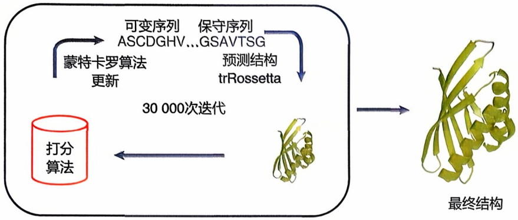

<details>
<summary>flowchart</summary>

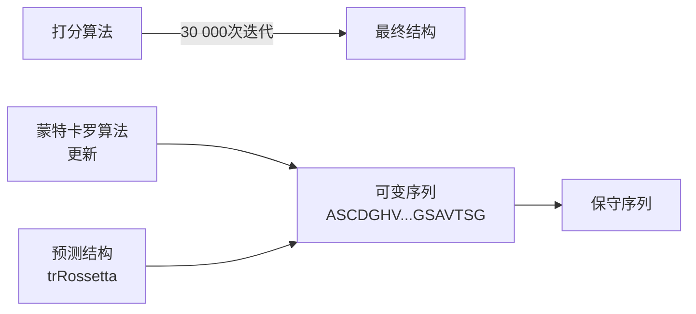
</details>

图9-7 “全家族幻视”算法

大小和形状相吻合的结合位点，因此选择了NTF2超家族作为设计的目标拓扑结构。

研究人员下一步的目的是产生足够多的设计蛋白质分子。他们使用了一种称为“全家族幻视”（family-wide hallucination）的方法，从2000个自然存在的NTF2出发，使用蒙特卡罗算法（Monte-Carlo algorithm）搜索序列空间，在每一步搜索使

用 trRossetta 深度学习算法预测蛋白质结构，并综合使用神经网络模型置信度、结构变化导致的关键折叠损失、氢键网络等数据计算其得分，并进行反复迭代。通过这种方法，研究人员一共得到了 1615 个新的 NTF2 结构（图 9-7）。

通过生物化学实验和量子化学计算研究，人们已经得知生物发光反应同DTZ的阴离子状态相关，且DTZ周边环境能显著降低同 $^{8}O_{2}$ 的单电子传导（single-electron transfer，SET）自由能。研究人员从这些已知的“先验信息”出发进一步开展了蛋白质分子设计工作。他们首先产生了DTZ的各种结构状态，并使用RIFGen方法对每一种状态进行分析，计算其“旋转异构体相互作用场”（rotamer interaction field, RIF）。然后，他们使用RIFDock方法将每一个DTZ状态及其相关的RIF同所设计的蛋白质进行对接，最大化其蛋白质-DTZ相互作用。经序列优化后，研究人员挑选了7648个人工设计的蛋白质分子，并进行了进一步验证（图9-8）。

通过进一步的实验验证，研究人员发现所设计的 LuxSit-i 人工合成萤光素酶不仅比已知的所有人工设计的萤光素酶活性都高，和天然的萤光素酶活性相仿，而且有着完全不同的蛋白质结构组织形式，并且和底物的结合能力高于天然萤光素酶。这表明了这一设计策略的成功。

使用深度学习的方法进行功能蛋白质的从头设计是一个正在极速发展的科研领域，一些成功的蛋白质分子设计案例不断涌现，相信本领域还会持续取得新的里程碑式的进步。

图9-8 萤光素酶蛋白质的设计

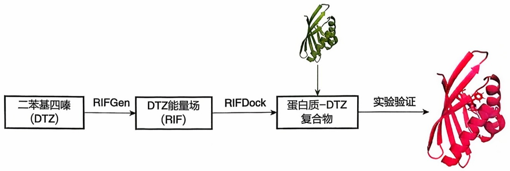

<details>
<summary>flowchart</summary>

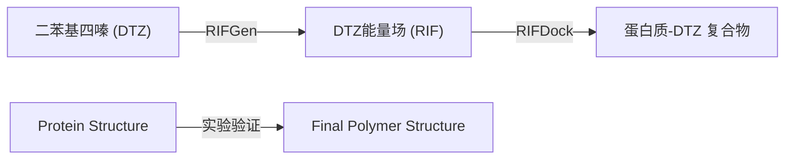
</details>

---

9.3 蛋白质分子动力学模拟

325

## 9.3 蛋白质分子动力学模拟

## 9.3.1 分子动力学模拟发展简史

认识蛋白质首先需要认识两个基本的关系:一个是序列-结构关系，即蛋白质折叠问题；另一个是结构-功能关系。序列-结构关系实际上是蛋白质怎么从无序的新生肽链到有序三维结构的问题，而结构-功能关系实际上是蛋白质如何实现从一种特定构象到另一种特定构象的问题。这两个问题都涉及蛋白质的构象动力学，而分子模拟正是一种非常强大的研究蛋白质构象动力学的工具。在20世纪70年代，马丁·卡普拉斯（Martin Karplus）、迈克尔·莱维特（Michael Levitt）和亚利耶·瓦谢尔（Arieh Warshel）等多位科学家首次实现了在计算机上来模拟蛋白质的构象动力学。随后的近半个世纪，分子模拟已经取得了巨大的进展，并成为研究生物大分子的动力学和功能的强有力的工具（图9-9a）。其中最常见的分子模拟方法有两种:分子动力学（molecular dynamics，MD）和蒙特卡罗（Monte Carlo，MC）。

MD 通过建立包含蛋白质或其他相关分子及其周围环境（如水分子、离子、磷脂双层膜等）的原子模型，然后根据经典力学原理计算各个原子之间的相互作用力和加速度，从而预测体系的运动轨迹。具体来说，MD 模拟首先需要确定初始构象，为各原子指定初始位置，随后根据势能函数计算原子间的作用力和加速度，接着利用牛顿运动方程计算原子在飞秒时间内的位移，不断重复上述计算步骤，最终得到体系的运动轨迹，类似一个三维电影。因为模拟可以在原子水平观察生物大分子的动力学过程，时间分辨率达到飞秒量级，因此可以提供实验很难观察到的原子细节和揭示微观的分子机制。

MC 方法是一种很强大的随机抽样技术，它被广泛应用于统计物理和计算化学中，在蛋白质模拟领域也发挥着重要作用。蒙特卡罗方法起源于 20 世纪 40 年代，约翰·冯·诺依曼（John von Neumann）和斯坦尼斯拉夫·乌拉姆（Stanislaw Ulam）以摩纳哥著名的赌场蒙特卡罗为其命名，因为该方法与轮盘游戏具有相同的随机特征。1953 年，尼古拉斯·梅特罗波利斯（Nicholas Metropolis）等提出著名的 Metropolis 算法，将 MC 方法成功引入统计物理研究。该方法根据体系的能量函数，按一定概率随机选择新的构象，并按平衡分布接受或拒绝新的构象。在蛋白质结构预测领域，MC 方法于 20 世纪 70 年代首次用于研究蛋白质链的构象采样。随后，多种改进的 MC 算法被提出并应用于蛋白质构象采样和优化。MC 算法是蛋白质构象搜索和折叠研究的一个重要补充手段，其随机采样本质允许其更广泛访问构象空间。类似于 MD，MC 算法也是根据统计力学原理构建，可有效跳出局部能量势阱，对蛋白质构象空间进行全局采样，因此可有效搜索构象空间和折叠路径。然而 MC 算法通常用于计算一些与动力学无关的平衡态性质，相比于 MD 的应用场景更局限一些，本节后面将重点介绍 MD 模拟方法。

---

326

9 蛋白质组学和代谢组学

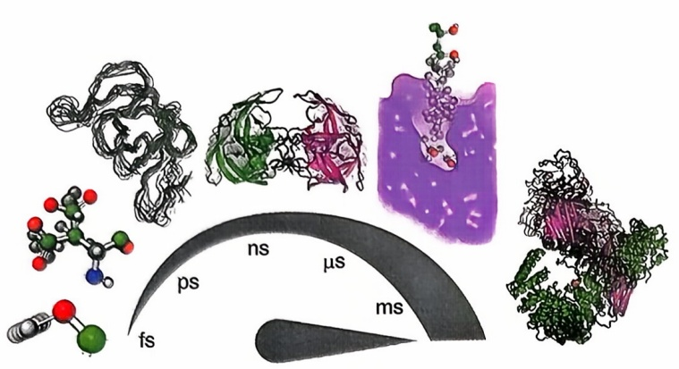

<details>
<summary>chemical</summary>

Molecular structure diagram showing protein domains with labeled regions (ps, ns, μs, ms) and molecular models
</details>

(a)

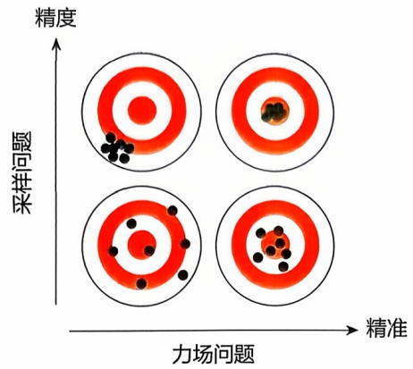

<details>
<summary>flowchart</summary>

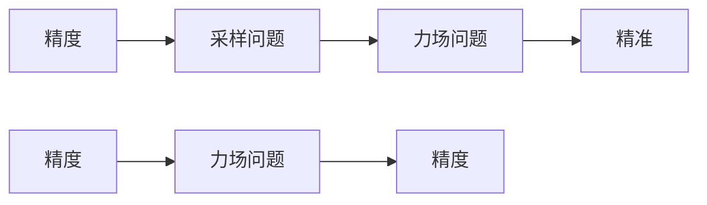
</details>

(b)

图9-9 蛋白质构象动力学的不同时间尺度（a, Surpeta Bartłomiej et al., 2020）和分子动力学模拟（b）的两大经典问题

蛋白质的折叠和去折叠可能在毫秒到微秒以上尺度发生；药物分子在蛋白靶标上的解离可能需要数秒甚至更长的时间。模拟运算速度取决于硬件算力和体系大小等，常规蛋白质体系在主流显卡（如英伟达RTX4090、RTX5090）上，通常每天可以计算几十到上百纳秒。

因为 MD 模拟中的单位时间步长通常在飞秒量级，而常规 MD 所能及的时间尺度通常在微秒量级，但是许多生物构象动力学发生的时间尺度在毫秒量级以上，这导致模拟时间尺度和现实尺度存在一条鸿沟。也就是说计算机模拟的时间尺度对于现实时间尺度来说太慢了，这就是时间尺度问题或者“采样问题”（图 9-9b）。尽管计算机算力和模拟算法都在快速发展，但模拟长时间尺度（毫秒以上时间尺度）的生物事件仍有可能相当困难。另外 MD 模拟结果的精确程度高度依赖于力场参数的准确性，即便力场参数只是存在很小的误差，在很多步 MD 积分之后也会累积到非常大的误差。当前常规蛋白质的力场已经相对准确，但对其他生物分子，如核酸，仍有较大改进空间，这就是“力场问题”（图 9-9b）。力场问题和采样问题是分子动力学模拟的核心难点，但也是活跃的研究方向。随着计算机技术进步和新理论方法出现，这两个问题都将获得很大进展。力场和采样的改进将大幅增强分子动力学的预测能力和应用场景。

## 9.3.2 分子动力学基本原理

## 9.3.2.1 统计力学基础

模拟产生的大量体系微观构象需要统计力学作为桥梁来计算自由能等宏观热力学量。根据是否考虑量子效应可以将统计力学分为经典统计力学和量子统计力学。经典统计力学是连接物质微观运动和宏观性质的桥梁，也是分子动力学的基础。在分子水平上，基于波恩·奥本海默近似（Born-Oppenheimer approximation，忽略电子的运动，而将系统的能量视为原子核空间位置的函数），经典牛顿力学定律是可以近似适用的，对于 $N$ 个粒子组成的系统，其中的粒子 $i$ 的状态可以通过其位置$r_i$ 和动量 $p_i$ 确定，位置和动量都是时间的函数，且具有笛卡尔坐标系 $x$ 、 $y$ 、 $z$ 三方向上的三个自由度。因此， $N$ 粒子系统的经典动力学可以用6N个函数的完整集

---

9.3 蛋白质分子动力学模拟

327

合  $\{r_{1}(t),\cdots,r_{N}(t),p_{1}(t),\cdots,p_{N}(t)\}$  表示。在任意时刻 t，系统的所有信息都可以由这 6N 个函数描述，由此可以确定系统的完整时间演化。这 6N 个函数定义的维度空间被称为相空间。相空间中的任意一个点，都对应了一个系统的状态，而系统随时间的变化，可以体现为相空间轨迹。

在统计力学中，系统的宏观性质是微观状态的统计平均值。系综（ensemble）是统计力学中非常重要的概念，一个系统处于的热力学状态通常可以通过一系列的参数来描述，如粒子数目、压强、温度等。而一个体系的宏观性质是由这些参数所决定的。

下面介绍几个在分子动力学模拟中常用的系综。

① 正则系综（canonical ensemble） 又称为 NVT 系综，用于表示在固定温度下通过热浴法达到热平衡的系统所有可能状态的集合。该系综的粒子数 N、体积 V 及温度 T 保持恒定，系统通常与外界热浴处于热平衡以保持温度不变。
② 等温等压系综（isothermal-isobaric ensemble）又称为 NPT 系综，其粒子数 N、压强 p 及温度 T 保持恒定。由于体系的压强 p 与体积 V 是共轭量，可以通过调节体系的体积来实现压强恒定。对于在溶液中发生的生物过程，如果体系的压强和体积变化不大，在模拟中使用 NVT 和 NPT 系综的差别一般也不显著。
③ 微正则系综（micro-canonical ensemble）即 NVE 系综。该系综下系统的粒子数 N、体积 V 及能量 E 不变，体系沿着相空间的恒定能量轨道演化。平衡体系为孤立系统，与外界既无能量交换，也无粒子交换。因为形式简单，微正则系综常见于验证新的算法和程序中。
④ 巨正则系综（grand-canonical ensemble）是正则系综的推广，总化学势、体积和温度保持不变，可以允许粒子的增加或减少。

一个生物过程能否发生取决于其始末态的自由能差，因此，自由能是最关键的热力学量之一。在热力学中存在亥姆霍兹自由能和吉布斯自由能两种定义。亥姆霍兹自由能定义为:

$$
F = U - T S \tag {9-3}
$$

其中，U 为内能，T 为温度，S 为系统的熵。

吉布斯自由能定义为:

$$
G = H - T S \tag {9-4}
$$

其中，H 为系统的焓，焓的定义为:

$$
H = U + p V \tag {9-5}
$$

其中，p 为压强，V 为系统的体积。

两种自由能定义都包含了一个内能相关项和一个熵相关项，这说明自由能受到原子间相互作用的变化和熵变化的影响。两种定义的差异在于 $pV$ 项。亥姆霍兹自由能适用于恒定体积（NVT系综），而吉布斯自由能适用于恒定压强（NPT系综），其中 $pV$ 项量化了与体积变化相关的功。一般生理过程可以看作等压过程，系统的

---

328

9 蛋白质组学和代谢组学

演化由吉布斯自由能梯度所驱动。

系统演化所形成的自由能地貌可以完整地描述系统的热力学和动力学性质。在相空间体积 $A$ 中出现系统的概率 $p_A$ 直接与自由能相关:

$$
p _ {A} = \frac {e ^ {- \beta F _ {A}}}{e ^ {- \beta F}} \tag {9-6}
$$

其中， $F_{A}$ 是相空间体积 $A$ 的自由能， $F$ 是在整个相空间上计算的自由能， $\beta = \frac{1}{k_B T}$，$k_B$ 为玻尔兹曼常数， $T$ 为温度。

对于 A、B 两状态的自由能差，可以表示如下:

$$
\Delta F _ {A B} = F _ {A} - F _ {B} = - \frac {1}{\beta} \ln \frac {p _ {A}}{p _ {B}} \tag {9-7}
$$

从式(9-7)可知，要计算自由能差，可以通过对于A和B状态的采样进行计数以统计其概率实现，如统计两种配体与同受体结合的概率。虽然这种方法较为简单，但其计算成本和时间尺度往往过大。另一种方法就是估计配分函数，对于相互作用复杂的粒子，需要对其坐标和动量进行数值积分。对于多粒子系统，对所有自由度积分在计算上是不可行的。因此，通常使用模拟来对可访问的相空间体积进行采样。在模拟中，体系通常需要很长的计算时间才能偶尔采样到高能微观态，因此该方法通常不适合用来计算绝对自由能，不过可用来评估不同状态的相对自由能。

## 9.3.2.2 分子力场

分子动力学通过一系列分子力场势函数来描述分子内和分子间的相互作用，进而计算分子的势能。与基于第一性原理的从头计算不同，分子力场势函数使用经验公式描述分子状态，是一种对于波函数的近似和简化。简单来说，分子势能的基本函数形式包括键合能和非键相互作用能两项:

$$
E _ {t o t a l} = E _ {b o n d e d} + E _ {n o n b o n d e d} \tag {9-8}
$$

对能量项进一步细分，键合能可以分为键长的伸缩能、键角的弯曲能、二面角扭转能；非键相互作用能可以分为静电相互作用能和范德华相互作用能:

$$
E _ {b o n d e d} = E _ {b o n d} + E _ {a n g l e} + E _ {d i h e d r a l} \tag {9-9}
$$

$$
E _ {\text {nonbonded}} = E _ {\text {electrostatic}} + E _ {\text {vanderWaals}} \tag {9-10}
$$

不同的力场中，函数组成形式可能略有不同。

对于势函数的各个能量项，需要选取合适的经验公式和力场参数来描述，这里以 AMBER 力场为例，简单介绍其力场参数的选择。

对于键长的伸缩能和键角的弯曲能，力场使用谐振子势能公式拟合:

$$
E _ {b o n d} = \sum_ {b o n d s} \frac {K _ {r}}{2} (r - r _ {e q}) ^ {2} \tag {9-11}
$$

$$
E _ {a n g l e} = \sum_ {a n g l e s} \frac {K _ {\theta}}{2} (\theta - \theta_ {e q}) ^ {2} \tag {9-12}
$$

---

9.3 蛋白质分子动力学模拟

329

其中， $r_{eq}$  和  $\theta_{eq}$  为平衡状态下标准键长和键角； $K_{r}$  和  $K_{\theta}$  为力常数；r 与  $\theta$  则为瞬时的键长与键角。

对于二面角扭转能，使用傅里叶级数进行拟合:

$$
E _ {d i h e d r a l} = \sum_ {d i h e d r a l s} \sum_ {n = 0} ^ {N} \frac {V _ {n}}{2} [ 1 + \cos (n \phi - \gamma) ] \tag {9-13}
$$

其中， $V_{n}$ 为势垒高度，用于描述二面角旋转的难度； $n$ 为多重度，指键在一个周期内旋转过程中能量极小点的个数； $\gamma$ 为相位因子，为能量最低时对应二面角的大小。

对于静电相互作用能，原子对被视为带电电荷 $q_{i}$ 、 $q_{j}$ 的粒子（电荷通过电荷分配方法赋予），按库仑定律计算:

$$
E _ {e l e c t r o s t a t i c} = \sum_ {i <   j} \frac {q _ {i} q _ {j}}{4 \pi \epsilon_ {0} r _ {i j}} \tag {9-14}
$$

对于范德华相互作用能，使用 Lennard-Jones 势函数来描述:

$$
E _ {v a n d e r W a a l s} = E _ {L J} (r) = \sum_ {i <   j} \epsilon_ {i j} \left[ \left(\frac {\sigma_ {i j}}{r _ {i j}}\right) ^ {1 2} - \left(\frac {\sigma_ {i j}}{r _ {i j}}\right) ^ {6} \right] \tag {9-15}
$$

其中，$\epsilon_{ij}$ 表示势阱深度；$\sigma_{ij}$ 表示对应势能为0时的原子间距离。

这样就可以使用配套的力场参数来表示力场的势函数 $U$ ，这些力场参数一般由拟合实验数据确定，或是由量化计算拟合得到。

通过选择合适的力场参数，MD 方法可以对分子运动提供精确度接近量子力学方法的解，而所需的计算资源则要少许多。

## 9.3.2.3 牛顿运动方程

势函数 $U$ 是计算原子受力的基础，通过势函数计算出原子的势能和其对原子位置的导数，对处于 $x_{i}$ 位置的 $i$ 原子，其受力为:

$$
F = - \frac {\partial U}{\partial x _ {i}} \tag {9-16}
$$

根据牛顿运动方程，可以进一步计算其瞬时加速度:

$$
a _ {i} = \frac {F _ {i}}{m _ {i}} = - \frac {1}{m _ {i}} \frac {\partial U}{\partial x _ {i}} \tag {9-17}
$$

对处于 $t$ 时刻的原子，给定其位置、速度以及加速度，就可以计算出其在一个

时间步长后 $t + \delta t$ 的速度和位置，从而得出其运动轨迹，并推进模拟进行到下一步，分子动力学模拟就是这一过程的不断迭代（图9-10）。

由于分子动力学模拟需要处理的是一个多原子的复杂体系，需要使用有限差分法（如 Verlet 算法、蛙跳算法和速度-Verlet 算法等）来计算。Verlet 算法计算位置和速度的公式如下:

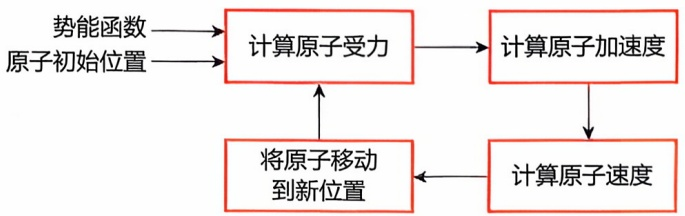

<details>
<summary>flowchart</summary>

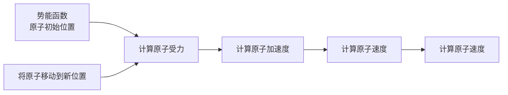
</details>

图9-10 分子动力学模拟计算牛顿运动方程流程简图

---

330

9 蛋白质组学和代谢组学

$$
x (t + \delta t) = x (t) + \frac {x ^ {(1)} (t)}{1 !} \delta t + \frac {x ^ {(2)} (t)}{2 !} (\delta t) ^ {2} + \frac {x ^ {(3)} (t)}{3 !} (\delta t) ^ {3} + O \left[ (\delta t) ^ {4} \right] \tag {9-18}
$$

$$
x (t - \delta t) = x (t) - \frac {x ^ {(1)} (t)}{1 !} \delta t + \frac {x ^ {(2)} (t)}{2 !} (\delta t) ^ {2} - \frac {x ^ {(3)} (t)}{3 !} (\delta t) ^ {3} + O \left[ (\delta t) ^ {4} \right] \tag {9-19}
$$

$$
v (t) = \frac {1}{2 \delta t} [ x (t + \delta t) - x (t - \delta t) ] \tag {9-20}
$$

在算法运行前，原子的位置 $x(t_0)$ 为已知量，速度 $v(t_0)$ 可以自行赋值，加速度 $a(t)$ 则始终由势函数得到，也是已知量。之后就可以不断迭代计算，最终得出原子的运动轨迹。

用于更新原子运动速度和位置的改进算法还有很多，如蛙跳算法和速度-Verlet算法，其共同目标在于利用势函数得到原子瞬时加速度的基础上，更准确和更有效率地计算原子下一时刻的状态。

## 9.3.2.4 周期性边界条件

对于现今的计算能力，模拟宏观的体系（原子数量级达到 $10^{23}$）是一个巨大挑战。因此，在MD中通常使用包含较少粒子的模拟盒（simulation box）进行模拟。模拟盒是一个定义了模拟中分子运动空间的虚拟容器。为了用模拟盒模拟生物体系（可视为无限大的系统），正确处理边界和边界效应对于模拟结果至关重要。周期性边界条件（periodic boundary conditions，PBCs）是常见的处理边界条件的方法之一。通过周期性边界条件，MD模拟可以通过镜像来填满整个空间，镜像的状态与模拟盒同步。如图9-11所示，中间区域为模拟盒，而周围的区域均为镜像，原子可以自由地跨越盒子的边界，当一个分子扩散穿过模拟盒的边界时，它会重新出现在另一侧。因此，中心模拟盒内的原子数保持不变，每个分子总是与其相邻的原子相互作用，即使它们可能位于模拟框的相对两侧。周期性边界条件使得可以通过使用一小部分（晶胞）来近似无限系统。

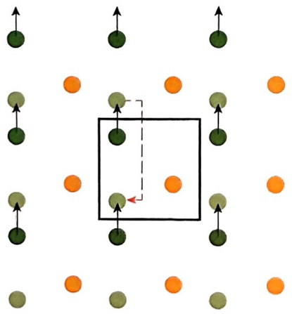

<details>
<summary>natural_image</summary>

Diagram showing a central square with directional arrows and surrounding colored dots, no text or symbols present.
</details>

图9-11 周期性边界条件

假设中央模拟盒中左上角显示为绿色的原子正在向上运动出模拟盒，其会表现为在盒子左下方重新出现在这一模拟盒中

## 9.3.3 蛋白质分子动力学模拟过程

## 9.3.3.1 模拟体系建模

在开始分子动力学模拟之前，首先要明确所需要解决的科学问题，然后根据科学问题的属性来构建体系模型，并选取合适的模拟软件和分子力场。本节展示了模拟过程中的几个一般性步骤，具体的文件规范、输入指令等还需要根据使用软件的不同去确定。蛋白质三维结构是进行模拟的起点。对于已经通过结构生物学方法解析出结构的蛋白质，可以从PDB数据库去获取其结构文件。对于尚不存在已知结构的蛋白质，也可以使用同源建模或者AI预测的方式去获取其可能的结构。

然而需要注意的是，即便是实验解析的结构（如晶体结构、冷冻电镜结构和核磁共振结构），它们也都通常是通过计算机建模的方式来获得的。对于从PDB数据库获取到的结构，需要仔细检查其细节的合理性和进一步补

---

9.3 蛋白质分子动力学模拟

331

充缺失的细节。例如，冷冻电镜结构中缺失的氢原子，在全原子力场中需要根据蛋白质所处 pH 环境（如生理 pH 条件）确定氨基酸残基的质子化状态，再补全氢原子；晶体结构中的一些非关键溶剂分子和离子也可以根据具体情况在建模中不予考虑；对于缺失的无序结构区域，可以通过建模软件来补全；如果是预测的结构，结构的局部可信度也需要检查。初始结构和局部细节的处理对于模拟的结果影响很大，在模拟软件中也往往存在相关的算法模块，帮助使用者进行结构的调节优化。

模拟盒的性质是根据所需的模拟条件设置的。例如，对盒子溶剂化处理，并添加适当浓度的离子来模拟胞内环境；而如果要模拟膜蛋白，通常需要将蛋白质置于适当的磷脂双分子层中。盒子的形状和大小也需要仔细考虑，由于周期性边界条件的存在，为了避免蛋白质与自身发生非现实的相互作用，盒子不能设置得太小，而过大的盒子则会浪费计算资源，总之，盒子的调整需要兼顾准确性和计算效率。同样地，这一步处理往往也可以使用模拟软件或者网站工具（如CHARMM-GUI）辅助完成。

## 9.3.3.2 参数设置

处理完三维结构并准备好模拟输入文件后，则需要设置好模拟的相关参数，如模拟的温度、压强、时间步长和步数、合理的相互作用截断距离等。

在这一环节要定义好指定的算法、步长和步数，这需要根据模拟需求所设置；对于模拟产生的坐标、温度和能量等信息以及日志文件，要根据需要指定其更新频率；温度设置是通过系统和热浴的耦合实现的，需要定义温度耦合算法，参照温度和耦合时间常数；压强控制是通过恒压器实现的，同样需要定义压强耦合方式，参照恒压值和耦合时间常数；另外还要设置好构象约束、相互作用截断，库仑力计算方式等。参数设置对模拟有重要影响，针对不同的体系和目的，需要选择合适的参数组合。

## 9.3.3.3 体系平衡和轨迹生成

在开始长时间尺度成品模拟之前，还需要检查两个关键点:① 模拟的结构是否存在一些不合理之处，如原子距离过近或者键角处于非自然状态，这可能使系统处于非正常的高能状态；② 系统的压强、温度等性质是否与设定值存在较大的偏差。这些性质的瞬时波动可能导致体系的能量溢出甚至崩溃。这些潜在的问题一般可以通过能量最小化和平衡两个步骤来解决。

能量最小化过程的目标是搜索系统势能的极小值，不同模拟软件进行能量最小化的策略有所不同，目前比较常用的有最陡下降法和共轭梯度法。在模拟过程中，可以通过体系势能的变化来观察能量最小化的效果。平衡是为了使体系到达合理的初始状态，如使用NVT系综调整体系压强，并使用NPT系综调整体积。可以通过监控压强、温度等指标来观察平衡过程。

体系达到平衡之后，就可以进入长时间尺度的成品模拟阶段，并通过采样得到体系的演化轨迹，这通常包括原子的坐标、速度，还有体系的能量、温度和压强等。

---

332

9 蛋白质组学和代谢组学

## 9.3.3.4 结果分析

分子动力学轨迹文件能够提供体系随时间的演化过程。通过分析轨迹，可以得到体系的构象变化过程、构象分布等。可视化软件可以帮助研究者更直观地观察和分析分子结构；在轨迹分析方面也有一些工具（如 MDAnalysis、MDtraj、PLUMED 等，见 9.3.5.3）。

分子动力学模拟得到的分子电影只是一种基于模型的“观察”，而非“答案”。对轨迹的分析则是一个从模拟结果中提取关键信息，回答科学问题的过程。跟做实验一样，模拟是计算机实验，也需要考虑结果的可重复性，因此需要足够的统计，即结果需要具备各态历经性和收敛性。

## 9.3.4 高级算法和最新进展

## 9.3.4.1 增强采样

常规时间尺度（微秒量级）的全原子 MD 模拟通常只能观察到体系在能量局部极小点附近的热涨落，很难跨越较高能垒实现大尺度的构象状态变化，也就难以观察有较大生物意义的构象变化过程。这就需要通过增强采样算法，来帮助体系跨越高能垒，从而采样到更长时间尺度的体系动态变化过程。因为增强采样算法通常需要对体系添加额外的偏置势（biased potential）来加速体系的动力学，因此常规的 MD 模拟也被称为无偏分子动力学（unbiased MD）模拟。这里，“无偏”是指体系中不存在力场之外的额外偏置力。比较经典的增强采样方法有伞形采样（umbrella sampling,

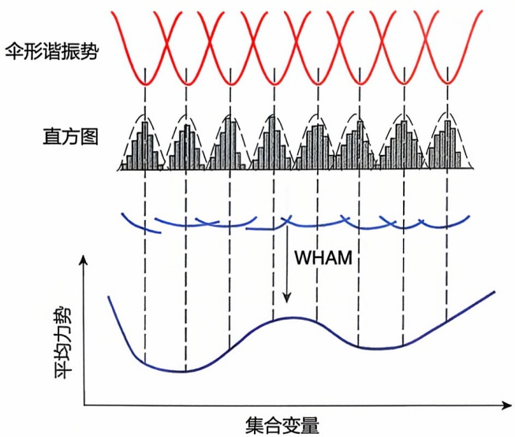

<details>
<summary>line</summary>

| 集合变量 | 平均力势 (Red Line) | 平均力势 (Blue Line) |
| --- | --- | --- |
| 1 | High | Low |
| 2 | Low | Minimum |
| 3 | High | Low |
| 4 | Low | Minimum |
| 5 | High | Low |
| 6 | Low | Minimum |
| 7 | High | Low |
| 8 | Low | Minimum |
| 9 | High | Low |
| 10 | Low | Minimum |
| 11 | High | Low |
| 12 | Low | Minimum |
| 13 | High | Low |
| 14 | Low | Minimum |
| 15 | High | Low |
| 16 | Low | Minimum |
| 17 | High | Low |
| 18 | Low | Minimum |
| 19 | High | Low |
| 20 | Low | Minimum |
| 21 | High | Low |
| 22 | Low | Minimum |
| 23 | High | Low |
| 24 | Low | Minimum |
| 25 | High | Low |
| 26 | Low | Minimum |
| 27 | High | Low |
| 28 | Low | Minimum |
| 29 | High | Low |
| 30 | Low | Minimum |
| 31 | High | Low |
| 32 | Low | Minimum |
| 33 | High | Low |
| 34 | Low | Minimum |
| 35 | High | Low |
| 36 | Low | Minimum |
| 37 | High | Low |
| 38 | Low | Minimum |
| 39 | High | Low |
| 40 | Low | Minimum |
| 41 | High | Low |
| 42 | Low | Minimum |
| 43 | High | Low |
| 44 | Low | Minimum |
| 45 | High | Low |
| 46 | Low | Minimum |
| 47 | High | Low |
| 48 | Low | Minimum |
| 49 | High | Low |
| 50 | Low | Minimum |
| 51 | High | Low |
| 52 | Low | Minimum |
| 53 | High | Low |
| 54 | Low | Minimum |
| 55 | High | Low |
| 56 | Low | Minimum |
| 57 | High | Low |
| 58 | Low | Minimum |
| 59 | High | Low |
| 60 | Low | Minimum |
| 61 | High | Low |
| 62 | Low | Minimum |
| 63 | High | Low |
| 64 | Low | Minimum |
| 65 | High | Low |
| 66 | Low | Minimum |
| 67 | High | Low |
| 68 | Low | Minimum |
| 69 | High | Low |
| 70 | Low | Minimum |
| 71 | High | Low |
| 72 | Low | Minimum |
| 73 | High | Low |
| 74 | Low | Minimum |
| 75 | High | Low |
| 76 | Low | Minimum |
| 77 | High | Low |
| 78 | Low | Minimum |
| 79 | High | Low |
| 80 | Low | Minimum |
| 81 | High | Low |
| 82 | Low | Minimum |
| 83 | High | Low |
| 84 | Low | Minimum |
| 85 | High | Low |
| 86 | Low | Minimum |
| 87 | High | Low |
| 88 | Low | Minimum |
| 89 | High | Low |
| 90 | Low | Minimum |
| 91 | High | Low |
| 92 | Low | Minimum |
| 93 | High | Low |
| 94 | Low | Minimum |
| 95 | High | Low |
| 96 | Low | Minimum |
| 97 | High | Low |
| 98 | Low | Minimum |
| 99 | High | Low |
</details>

图9-12 伞形采样过程（Róg et al., 2021）

整个过程可概述为以下步骤:① 依集合变量将构象空间划分为多个窗口，并在每一窗口内添加谐振势；② 在特定偏置势下，用直方图表示对集体变量空间的采样分布；③ 用 WHAM 方法整合所有窗口的数据，进行重加权，重建整个无偏的自由能面

US）、副本交换分子动力学（replica exchange molecular dynamics，REMD）、元动力学（metadynamics）等。

## (1) 伞形采样

由乔治·托里（George Torrie）和约翰·瓦罗（John Valleau）于1977年首次提出，其核心思想是将构象转变过程划分成多个窗口采样，通过引入偏置势（通常是谐振势）优化每个窗口的采样，避免体系困在低能态，可以有效地采样反应过程中的高能状态。然后通过算法（如weighted histogram analysis method, WHAM）将所有窗口的统计结果整合起来，可以重建整个无偏的自由能面（图9-12）。

伞形采样法是基于特定的集合变量（collective variable, CV）进行的，集合变量一般为基于体系中特定原子坐标 $x$ 的函数，如原子间距离、键角等，即:

$$
s (x) = f (x) \tag {9-21}
$$

确定好能正确描述某一过程的集合变量后，伞形采样将该集合变量所定义的势能面分成多个窗口，在每一窗口

---

9.3 蛋白质分子动力学模拟

333

中添加谐振势  $\omega_{i}(x)$ :

$$
\omega_ {i} (x) = \frac {1}{2} k [ s (x) - s _ {i} ^ {r e f} ] ^ {2} \tag {9-22}
$$

其中，k 为自定义力常数， $s(x)$  为当前构象对应集合变量的值， $s_{i}^{ref}$  为窗口 i 模拟对应的集合变量的平衡值。可以看出，该谐振势在体系偏离平衡时，为体系提供一个外力，将体系限制在窗口采样范围内，起到增强该窗口区域采样的效果。将不同窗口的模拟数据合并，再通过重加权（reweighting）去掉谐振势的影响，就可以将所需要观测的全局自由能面还原出来。

## （2）副本交换分子动力学

最初由杉田有治（Yuji Sugita）和冈本祐幸（Yuko Okamoto）在1999年提出，其通过并行多

个不同哈密顿量（在不同温度）的独立模拟，并允许相邻副本（即 replica，是指在模拟过程中独立运行的一个系统配置。每个副本通常具有不同的条件，如温度、压强或其他控制参数）之间进行交换，从而扩展了模拟所探索到的构象空间（图 9-13）。例如，通过高温对体系进行加速而采样到的构象可以被交换到常温副本中，从而提高常温副本中的构象探索效率。为使每个副本采集到的构象符合该温度下的玻尔兹曼分布，副本间的交换必须满足细致平衡条件，通常需要遵循 Metropolis 准则（Metropolis criteria），两副本进行交换的概率 $p$ 为:

$$
\left\{ \begin{array}{l l} p = 1, & \Delta \leqslant 0 \\ p = e ^ {- \Delta}, & \Delta > 0 \end{array} \right. \tag {9-23}
$$

其中，

$$
\Delta = (\beta_ {i} - \beta_ {j}) [ E (x _ {j}) - E (x _ {i}) ] \tag {9-24}
$$

这里的 $E(x)$ 为对应构象的能量。高温构象的能量如果低于低温构象，则副本交换一定发生；否则将进行依赖于构象能量差的随机交换。

## (3) 元动力学

由米歇尔·帕里内洛（Michelle Parrinello）课题组在2002年提出并持续发展，采用不断在集合变量空间的势能面添加偏置势（通常是高斯势，Gaussian potential），帮助体系克服高能垒，并引导系统探索高能构象空间，从而可以在短的模拟时间尺度内观察到长时间尺度的生物事件（图9-14）。现在被广泛使用的元动力学方法是改进版本的WT-MetaD（well-tempered metadynamics）。元动力学类似于伞状采样算法，也同样依赖于集合变量。在每一时刻，根据当前的集合变量值添加对应高斯势。随着当前集合变量值总偏置势的累积，所添加的高斯势衰减，从而可以避免体在高温副本中加速采样到的构象可与常温副本构象交换，以加速构象探索效率

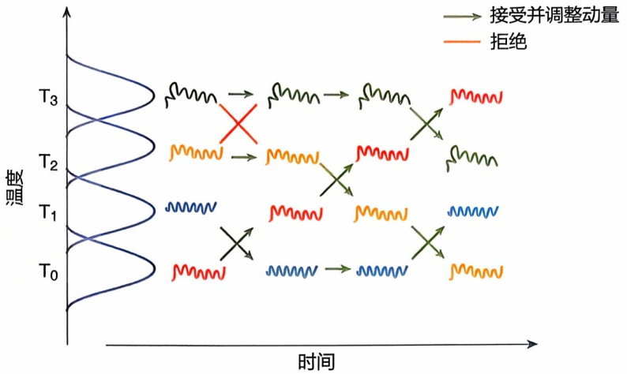

<details>
<summary>flowchart</summary>

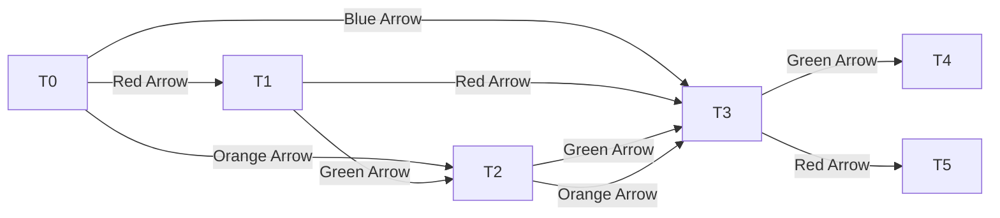
</details>

图9-13 副本交换分子动力学过程（Rög et al., 2021）

---

334

9 蛋白质组学和代谢组学

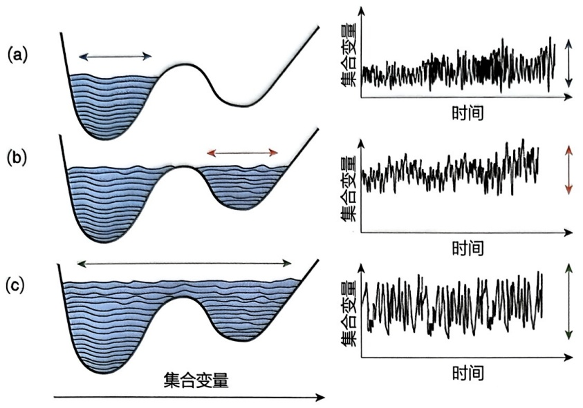

图9-14 元动力学过程（Rög et al., 2021）

（a）体系处于某势阱中并通过不断累积偏置势，逐渐接近能垒；（b）体系越过能垒并进入另一势阱，此时偏置势主要施加在新的势阱中；（c）两势阱的能垒都被施加的偏置势所克服，此时体系在两亚稳态间的转变已不需要跨过能垒，体系中偏置势继续累积，寻找能垒更高的亚稳态

系搜索到非物理高能态区域，并加速对新的构象空间的探索。随着高斯势添加，系统中的总偏置不断累计，直至体系脱离势能阱，并进入新的势能阱，直到几乎填平整个势能面，最终达到收敛。和伞形采样一样，元动力学方法也可通过重加权技术复原任意集合变量。与伞形采样相比，元动力学不需要构建多个窗口独立模拟，而具有自动快速探索势能面的特点。

总的来说，增强采样算法的主要挑战是针对不同系统需要采用不同的采样方法，并且其所需计算量仍然不小。目前增强采样算法和机器学习方法的结合已经展现出很大的潜力。将来增强采样在分子模拟中的应用将更加广泛和高效，这将大幅推进对蛋白质构象变化机制的深入理解。

## 9.3.4.2 粗粒化建模

粗粒化建模通常是指使用粗粒度更高的简化模型来模拟复杂系统的建模方法。粗粒化模型广泛用于各种分子的建模，如蛋白质、核酸、脂质和糖类等。虽然粗粒化模型会忽略掉一些分子细节，但是可以极大地拓展模拟体系的大小和时间尺度，因此广泛应用于研究生物大分子体系。在分子动力学模拟发展的早期，粗粒化建模方法就已经得到了应用。在20世纪70年代，迈克尔·莱维特（Michael Levitt）和亚利耶·瓦谢尔（Arieh Warshel）就使用粗粒化方法研究了蛋白质折叠的问题。

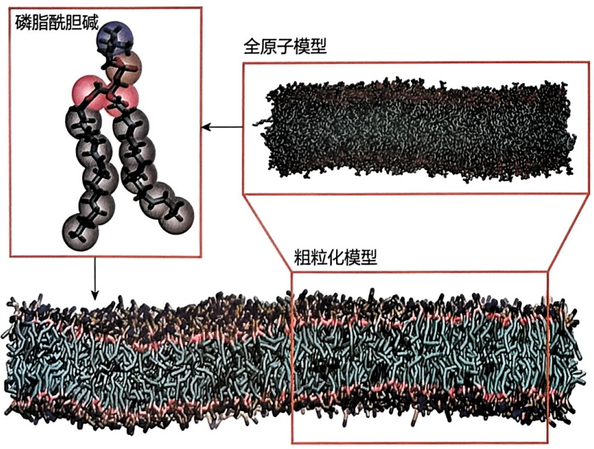

<details>
<summary>text_image</summary>

磷脂酰胆碱
全原子模型
粗粒化模型
</details>

图9-15 全原子模型的粗粒化建模（Bradley & Radhakrishnan, 2013）

目前应用比较广泛的粗粒化力场包括MARTINI力场,其是由格罗宁根大学的Marrink等于2004年开发的（图9-15）。最初MARTINI力场仅用于模拟磷脂，通常用于理解生物膜行为方面的生物问题。2007年，其应用范围扩展到蛋白质和核酸等其他各类分子。2021年，最新版的MARTINI3力场发布，进一步提高了对局部细节的敏感度和小分子模拟的精确度。典型的MARTINI模型将化学原子基团简化为珠子，从而精简了体系中的粒子数。其定义了四大类粗粒化珠子:Q（charged）、P（polar）、N（nonpolar）和C（apolar），并且可以进一步细分为总共20种珠子类型。对于珠子大小，MARTINI有

---

9.3 蛋白质分子动力学模拟

335

普通型、小型和微型三种规格可以选择，分别映射4个、3个或2个重原子。普通型珠子最为常用，也最为高效；小型珠子主要用于表示环状结构；微型珠子一般用于表示核酸分子。

## 9.3.4.3 整合结构生物学与分子动力学模拟

目前，分子动力学模拟技术在结构生物学研究中的应用已相当广泛。从优化低分辨率结构到解释生物学功能，分子模拟技术都显示出了其独特的优势。这一方法不仅拓展了结构生物学研究的深度，还有助于挖掘单一结构背后的服务多构象动力学信息。对于高度柔性的生物大分子，如固有无序蛋白或含有无序区的蛋白，单一实验技术难以获得精确的全局构象模型。这时，整合多种信息和方法的技术就显得尤为重要。基于物理的分子动力学模拟正是整合多种结构生物学数据（如X射线晶体学、冷冻电镜、核磁共振光谱、小角X射线散射和交联质谱等数据）的强大工具。这就涉及新兴的整合结构生物学技术。通常，各种实验技术只能提供生物大分子的部分信息，如X射线晶体学和冷冻电镜技术只能提供有序结构部分的信息，核磁共振光谱和小角X射线散射可以提供一些动力学和系综平均的信息等。在整合结构生物学中，计算模拟可以整合分子力场和多种信息，补充实验无法观察到的细节，生成生物大分子的结构系综，从而获取实验技术难以测定的高时空分辨率信息。通过整合各种实验数据，并结合分子动力学模拟的能量地貌全景描绘，研究人员可以对生物大分子有更系统、全面准确的认知。这正是整合结构生物学技术的目标和意义所在。

## 9.3.4.4 蛋白质模拟的硬件进展

在过去的几十年里，计算硬件以及用于分子动力学的算法和软件的改进允许在更长的时间尺度下进行模拟，同时极大地节约了计算的成本，最近的改进尤其显著。高度专业化的硬件导致最大可实现速度的大幅提高，允许某些模拟达到实验级的时间尺度。如 D. E. Shaw Research 公司开发的超级计算机 Anton 系列，其使用特制的硬件，即定制的集成电路，以便于更快、更高效地进行蛋白质折叠计算；IBM 开发了计算生物超级计算机 Blue Gene，用于研究复杂的生物系统，包括蛋白质折叠；斯坦福大学创建了 Folding@Home，这是一个分布式计算项目，它利用普通家用计算机的算力来模拟蛋白质折叠和其他分子动力学。

## 9.3.5 主流分子动力学软件和力场介绍

## 9.3.5.1 开源和商业分子动力学软件包

分子动力学软件最核心的功能就是进行分子动力学模拟的计算，早期的分子动力学软件只是配合不同分子力场而开发的不同计算工具，功能相对单一；现如今的分子动力学软件往往会打包一些辅助工具，帮助进行模型构建以及应对不同的计算需求等，有些软件也能够支持多种力场输入。根据运营模式，本节分别介绍开源和商业化分子动力学软件（表9-2）。

---

336

9 蛋白质组学和代谢组学

表 9-2 几种主流分子动力学模拟软件

| 软件名 | 收费方式 | 运营团队 |
| --- | --- | --- |
| OpenMM | 开源 | 斯坦福大学 |
| GROMACS | 开源 | 格罗宁根大学 |
| Charmm | 商用/开源学术版 | Biovia 公司 |
| Amber | 商用/开源学术版 | David Case 等 |
| NAMD | 开源 | 伊利诺伊大学厄巴纳-香槟分校 |
| LAMMPS | 开源 | 桑迪亚国家实验室 |
| DESMOND | 商用 | D. E. Shaw Research 公司、Schrödinger 公司 |
| ACEMD | 商用 | Acellera Solutions 公司 |

开源的分子动力学软件具有代码开放、高度自定义等显著优势。与商业软件不同，开源软件源代码对用户完全透明，允许用户查看算法实现的每一个细节，这有助于加深对理论方法的理解。用户也可以基于开源代码修改或者添加功能，使软件更切合特定的科研需求。开源软件开发者也会及时采用和实现最新的理论进展与算法优化，使软件功能保持与前沿发展接轨。此外，由于无须支付高额许可费，开源软件的使用成本较低。开源软件促进了科研界的互动交流和协作，用户可以得到广泛的社区技术支持。因此，开源软件更受到学术界的青睐。但需要注意的是，开源软件界面普遍不如商业软件友好精致，使用难度较大，需要对理论方法和编程有一定了解。

GROMACS 和 NAMD 是两款开源的分子动力学模拟软件。GROMACS 最初由格罗宁根大学生物物理化学系开发，现在由世界各地的大学和研究中心的研究人员共同维护。GROMACS 是最快、最流行的分子动力学软件包之一，可支持 GPU 运算。GROMACS 通过命令行界面进行操作，使用文件进行输入和输出。其支持使用大部分主流的分子力场，操作灵活性高。NAMD 是由伊利诺伊大学厄巴纳-香槟分校理论与计算生物物理学组和并行编程实验室合作开发的。其主要特点是并行效率高，常用于模拟大型系统，可通过可视化软件 VMD 进行交互式模拟。

商业分子动力学模拟软件一般需要支付费用购买使用权。商业软件的优势在于界面友好、使用简便，能够提供完善的技术支持和用户培训。商业软件往往集成了从建模、模拟到分析的各个功能模块，不同任务环节可以较好衔接，工作流程的连贯性较好。此外，商业软件较为重视图形界面的开发和结构可视化效果的呈现，能够帮助科研人员直观理解模拟系统，操作起来十分便利。软件开发商也会持续根据用户的反馈开发新功能，保证软件与前沿科研需求对接。总体而言，商业软件可以提供专业可靠的服务和良好的用户体验，但其使用价格往往较为昂贵。

对于研究者而言，使用商业软件能够更轻松地解决科学问题，而不用耗费时间在学习编程、软件开发以及分子动力学原理上。即使使用商业软件，也不应该让模拟成为一个“黑盒”，进行机械化的工作，仍然应该明确每一步工作的原理和意义，对分子模拟有更深层的掌握。

---

9.3 蛋白质分子动力学模拟

337

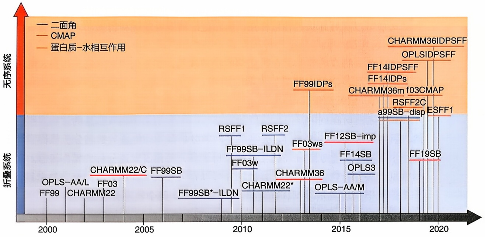

<details>
<summary>state_timeline</summary>

| Mutation | Type | Status |
| :--- | :--- | :--- |
| OPLS-AA/L | Bifacial/Chromatin | Two-Section |
| CHARMM22 | Chromatin | Two-Section |
| CHARMM22/C | Chromatin | Two-Section |
| FF99SB | Bifacial/Chromatin | Two-Section |
| FF99SB*-ILDN | Chromatin | Two-Section |
| RSFF1 | Chromatin | Two-Section |
| FF99SB-ILDN | Chromatin | Two-Section |
| FF03w | Chromatin | Two-Section |
| CHARMM22* | Chromatin | Two-Section |
| RSFF2 | Chromatin | Two-Section |
| CHARMM36 | Chromatin | Two-Section |
| FF03ws | Chromatin | Two-Section |
| FF99IDPs | Chromatin | Two-Section |
| OPLS-AA/M | Chromatin | Two-Section |
| FF12SB-imp | Chromatin | Two-Section |
| FF14SB | Chromatin | Two-Section |
| OPLS3 | Chromatin | Two-Section |
| FF14IDPSFF | Chromatin | Two-Section |
| FF14IDPs | Chromatin | Two-Section |
| CHARMM36m f03CMAP | Chromatin | Two-Section |
| a99SB-disp | Chromatin | Two-Section |
| RSFF2C | Chromatin | Two-Section |
| ESFF1 | Chromatin | Two-Section |
| CHARMM36IDPSFF | Chromatin | Two-Section |
| OPLSIDPSFF | Chromatin | Two-Section |
| FF19SB | Chromatin | Two-Section |
</details>

图9-16 近年来蛋白质分子力场的发展（Mondal et al., 2022）

较为著名的商业软件包包括 Amber 和 Charmm 等。Amber 和 Charmm 均为适配于各自同名分子力场的模拟软件。AMBER 力场和模拟软件 Amber 最初由加州大学旧金山分校的 Peter Kollman 团队开发；CHARMM 力场及模拟软件最初由哈佛大学 Martin Karplus 团队开发。Amber 和 Charmm 如今都分为商用版和开源学术版两个版本，研究者也可以方便地构建体系和进行模拟。

在药学领域，由于大批量药物筛选的需要，商用软件的应用十分广泛。如知名的商业软件包 Schrödinger，其可以提供分子建模、分子动力学模拟、轨迹分析、分子可视化等一系列服务，但这类软件开发主要服务于商业潜力巨大的药学研究。

## 9.3.5.2 蛋白质力场

分子力场规定了模拟中各类相互作用的形式和参数，是分子动力学模拟的基础。使用的力场准确与否，会对模拟的可信程度产生直接影响。随着各类力场的版本不断更新，近年来推出的力场计算精度和效率显著提高，针对不同的体系，也有各种特异性力场推出，对特定类型分子进行优化（图9-16）。力场的不断发展为更准确预测蛋白质结构、动力学性质和相互作用提供了可能。在使用力场时，要注意对于体系的适用性。

以下是几种经典的蛋白质力场:① AMBER 力场，该力场是最早和最具代表性的力场之一，由加州大学旧金山分校开发。不同版本的 AMBER 力场包括 FF94、FF96、FF99、FF99SB、FF14SB、FF19SB 等；② CHARMM 力场，其由哈佛大学开发，针对蛋白质、DNA 和糖类分子，参数化更为精细和复杂。不同版本包括 CHARMM22、CHARMM27、CHARMM36 等；③ GROMOS 力场，由瑞士巴塞尔大学开发，不同版本包括 43A1、43B1、43A2、53A5、53A6 等；④ OPLS 力场，由奥勒岗州立大学开发，与 AMBER 力场类似，侧重于小分子，包括 OPLS-AA、OPLS-UA 等版本。

在这些经典力场中，键拉伸和角度弯曲的动力学通过简谐振动来描述，且省略了键拉伸和角度弯曲之间的相关性。也有一些力场将非调和三次或四次项添加到

---

338

9 蛋白质组学和代谢组学

键和角度的势能中，还包含描述相邻键、角度和二面角之间耦合的交叉项。高阶项和交叉项可以更好地描述相互作用，从而更准确地再现键和角振动。这类力场包括MMFF94、UFF等。

此外，有的力场会考虑有机化学的特殊效果，如极化、立体电子效应、电负性等。这类力场包括 AMOEBA、DRUDE 等。

## 9.3.5.3 数据分析工具

正如之前所提到的，模拟轨迹分析就是从实验结果中提取信息的过程，很自然地，研究者会开发各种工具，去满足不同的分析需求。轨迹数据的分析软件实际上是一个工具库，通过整合并优化多种分析工具，简化了轨迹分析的操作流程。在使用常见方法分析轨迹时，使用分析软件可以省去寻找工具或是自行开发的麻烦，提升工作效率。这里介绍 MDAnalysis 和 PLUMED 两个轨迹分析工具。

MDAnalysis 是一个开源 Python 包，用于读取分子动力学轨迹数据并进行分析。MDAnalysis 作为一款面向对象的软件，对每一类对象（如原子、原子簇、轨迹）有一套属性和操作方法的定义，这形成了其开发和使用的规则。MDAnalysis 为不同格式的模拟轨迹提供了通用接口，并对用户以统一界面展示，这使得用户可以轻松地以相同的逻辑处理不同软件产生的轨迹。MDAnalysis 可以处理来自 NAMD、Amber、Gromacs、Charmm、LAMMPS 等几乎所有格式的输入轨迹文件，处理轨迹文件大小可以达到 TB 级。自 2011 年发布以来，由于 MDAnalysis 对模拟软件的普适性，其更新得到了世界各地开发者的支持，这也使得其成为目前最重要的专业分子动力学轨迹分析软件。

PLUMED 是一款开源插件，旨在插入分子动力学模拟软件中并拓展其功能。其可以支持 NAMD、GROMACS、Amber 等软件。PLUMED 可以支持模拟后的轨迹分析，也可以在模拟过程中实时分析。PLUMED 具有编码形式简单，灵活性高，开发社区活跃等优势。除此之外，PLUMED 也是一个强大的增强采样插件，其可以通过与主流 MD 软件核心代码的对接，实现多种增强采样算法。

## 9.4 蛋白质功能预测与分析

## 9.4.1 蛋白质功能概述

在后基因组时代（post-genomic era），我们被海量的蛋白质序列数据所淹没。相比较之下，功能已知的蛋白质数目非常有限。如何采用计算的手段，从已有的数据出发加快蛋白质功能的鉴定和分析是生物信息学家最重要的任务之一。

蛋白质功能是生命科学中常见的一个概念，每个人似乎都对其有直观的理解。但是随着对蛋白质功能的深入研究，我们发现蛋白质功能具有复杂性和多层次性，难以归纳概括。因此，我们迫切需要一套统一的体系去综合刻画不同蛋白质的功能。基因本体（Gene Ontology，GO）就是为实现这一目的而设计的。作为一个全球性

---

9.4 蛋白质功能预测与分析

339

的生物信息学项目，基因本体旨在提供一个标准的词汇（也称为术语）体系来描述基因和蛋白质（或其他基因产物，如非编码 RNA）的功能属性。

广义上讲，与蛋白质功能相关的生物信息学预测问题都属于蛋白质功能预测，包括蛋白质功能属性预测、功能家族预测、功能位点预测。近年来，基因本体在蛋白质功能注释应用越来越多。狭义上讲，功能预测通常指的是未知蛋白质的 GO 注释预测。由于基因本体可以提供标准化的语言用于描述蛋白质功能，这使得研究人员可以更容易地理解和评估他人的数据和方法，从而加速了蛋白质功能预测算法开发的进程，也催生了著名的蛋白质功能预测 CAFA 竞赛（Critical Assessment of Functional Annotation）。借鉴蛋白质结构预测 CASP 竞赛，CAFA 是一个定期举行的蛋白质功能预测竞赛，于 2010 年第一次举办，随后又在 2013 年、2016 年、2017 年、2019 年、2023 年举办了五次。通过与实验科学家合作，CAFA 使用一个由未注释蛋白质序列组成的数据集作为评估的基础。CAFA 的主要目标是评估不同蛋白质功能注释方法和工具的性能，进而推动功能注释领域的发展。

本节主要介绍蛋白质功能预测与分析，由于功能涉及的内容太广，我们无法对所有的功能预测问题进行一一介绍。相反，我们主要关注蛋白质功能预测的一些普遍性原理和策略。一般来讲，蛋白质的序列和结构信息常常用于预测蛋白质功能，蛋白质的分子网络数据以及相关的组学数据也可用于蛋白质功能预测。本节主要从蛋白质序列、结构和网络角度来介绍蛋白质功能预测（图9-17）。


<details>
<summary>flowchart</summary>

```mermaid
graph TD
  subgraph Sequence
  A["普遍性功能预测"] --> B["基于序列相似性"]
  B --> C["GO功能注释"]
  C --> D["其他功能性质预测"]
  D --> E["信号肽"]
  E --> F["亚细胞定位"]
  end

  subgraph Network
  G["常见方法"] --> H["神经网络"]
  H --> I["功能模块"]
  I --> J["蛋白质与多肽"]
  J --> K["蛋白质与小分子"]
  end

  subgraph Average Method
  L["已知功能"] --> M["连接法 (主要原理)"]
  M --> N["预测的功能"]
  N --> O["未知的功能"]
  end

  subgraph General Methods
  P["功能推断"] --> Q["蛋白质和核苷作用网络"]
  Q --> R["功能模块"]
  R --> S["连接网络"]
  S --> T["神经网络"]
  T --> U["功能模块"]
  U --> V["连接网络"]
  end

  subgraph DALI
  W["基于结构的相似性"] --> X["PROTEIN STRUCTURE COMPARISON SERVER"]
  X --> Y["结构比对方法"]
  Y --> Z["TM-align\nQuick & Accurate Structural Alignment"]
  end

  subgraph ProFunc
  AA["ProFunc"] --> AB["COFACTOR\nStructure-based function production\n专门的预测方法"]
  end

  subgraph Network
  AC["蛋白质与蛋白质/多肽"] --> AD["蛋白质与蛋白质/多肽"]
  end
```
</details>

图9-17 本节涉及的蛋白质功能的预测与分析的主要内容

---

340

9 蛋白质组学和代谢组学

## 9.4.2 基于序列的蛋白质功能分析

## 9.4.2.1 基于序列相似性的普遍性功能预测

从蛋白质序列出发预测蛋白质功能仍然是目前蛋白质功能预测的最常规的手段，其原理是蛋白质的序列相似，结构也相似，发挥的功能亦相似。因此，通过序列相似性搜索工具，可以快速搜索到与待分析蛋白质同源的功能已知的蛋白质，进而推断待分析蛋白质可能发挥的功能。常用的生物信息学序列分析工具BLAST就频繁用于蛋白质功能预测与分析。除此以外，还有一些更加敏感的序列相似性搜索方法，如PSI-BLAST也可用于蛋白质功能预测。蛋白质行使功能往往和其含有的结构域和模体息息相关。因此，除关注蛋白质序列全长分析外，往往我们必须关注蛋白质结构域和模体这两层次的序列分析。表9-3列出了一些常见的基于序列的蛋白质功能预测方法。

表 9-3 常见的基于序列和结构的蛋白质功能预测方法

| 名称 | 类型 |
| --- | --- |
| PFP | GO 功能注释工具 |
| ESG | GO 功能注释工具 |
| PANNZER | GO 功能注释工具 |
| GOLabeler | GO 功能注释工具 |
| SignalP | 信号肽预测工具 |
| PrediSi | 信号肽预测工具 |
| PSORT | 亚细胞定位预测工具 |
| TargetP | 亚细胞定位预测工具 |
| WoLF PSORT | 亚细胞定位预测工具 |
| DeepLoc | 亚细胞定位预测工具 |
| ProFunc | 基于结构的功能预测工具 |
| COFACTOR | 基于结构的功能预测工具 |

结构域（domain）是蛋白质多肽链中的一部分，一般具有独立折叠单元并能执行某些特定的功能。结构域的存在和划分使得蛋白质具有模块化的特征，是蛋白质功能分析的重要切入点。InterPro数据库是代表性的蛋白质结构域数据库资源。模体（motif）是指在蛋白质序列中具有一定模式或共享特征的短片段。模体可能是保守的氨基酸残基序列、功能位点或其他重要的序列模式。通过鉴定蛋白质序列中潜在的模体，可以用于分析和识别蛋白质的特定功能或结构。模体一般可以表示为一个短字符串，采用正则表达式来描述。例如，序列模体“L-x(2,3)-L-x(2,3)-[IV]”表示具有一个保守的亮氨酸（L）残基，随后是2～3个非特定的残基，然后是另一个亮氨酸，接着是2～3个非特定的残基，最后是异构亮氨酸（I）或缬氨酸（V）。代表性的模体数据库有ELM（Eukaryotic Linear Motif），它收集了大量已知的真核生物模体的数据，并提供了详细的注释和功能信息。

---

9.4 蛋白质功能预测与分析

341

## 9.4.2.2 基于序列的 GO 功能注释

基于待测蛋白与功能已知蛋白的序列同源性，可以实现对待测蛋白的功能注释。目前基于序列的 GO 功能注释主要就是利用这个原理，实现对功能未知蛋白自动化高通量的功能注释。已相继有一系列方法开发（表 9-3），在历届 CAFA 竞赛中取得很好的预测效果。以下介绍几种常见的基于序列的 GO 功能注释方法。

PFP 通过对待测蛋白进行 PSI-BLAST 搜索，综合考虑搜索得到 E-value 小于一定阈值的所有序列，计算出每个可能 GO 注释的分数，最终获得 GO 功能注释。与传统 PSI-BLAST 搜索仅仅依赖一个严格的阈值（如 E-value < 0.001）进行功能预测相比，PFP 也考虑了更多的弱同源序列，这些序列里共同出现的 GO 条目，有可能被合理地预测出来。进一步，PFP 的作者还开发了 ESG 方法，用于增强注释的特异性。其主要策略是每一次 PSI-BLAST 迭代搜索到的序列对应的 GO 注释都加以考虑，用来预测待测蛋白的功能。换言之，一个 GO 条目如果频繁出现在多轮迭代的同源序列中，将赋予更高的分数，并预测为待测蛋白的功能。相比较之下，ESG 比 PFP 预测得到更少的 GO 条目。在早期的 CAFA 竞赛中，PFP 和 ESG 均表现优异。

PANNZER 是一款流行的、全自动的未知蛋白功能注释工具。对每一个待测蛋白，它主要通过 UniProt 数据库进行序列同源性搜索，采用带权重的 KNN 算法找到若干相似性显著同源蛋白，并对同源蛋白的 GO 条目进行富集和打分，最终实现对待测蛋白进行 GO 注释。此外，PANNZER 还基于同源蛋白的功能描述，通过聚类和统计，实现对待测蛋白的总体功能描述。新版的 PANNZER 采用了 SANSparallel 进行同源性搜索，具有比 BLAST 更快的搜索速度，这使得 PANNZER 可以同时对成千上万条的蛋白质序列进行功能注释。目前该方法已广泛应用于许多原核和真核生物的全蛋白质组范围内的 GO 功能注释。

虽然基于同源性搜索的方法仍然是主流的 GO 注释方法，但对于那些找不到同源蛋白的待测蛋白难以获得可靠的功能注释。为解决这个问题，除了考虑同源信息外，还需要整合其他序列信息进行功能推断。例如，GOLabeler 采用 LTR（Learn to Rank）方法整合了基于序列的多分类器实现对蛋白质功能全自动预测。在 CAFA3 竞赛中，GOLabeler 取得了优异的表现。

## 9.4.2.3 基于序列的其他蛋白质功能性质预测

有许多针对蛋白质特定功能性质的预测，包括信号肽预测、亚细胞定位、蛋白质特定功能家族预测、蛋白质功能位点预测等。总体上，仍然可以采用基于序列相似性的原理进行预测。许多情况下，具有相同功能性质的蛋白质并不具有明显的序列相似性，因此必须采用基于其他序列特征的统计和机器学习方法。由于篇幅所限，下面仅介绍信号肽预测和亚细胞定位预测。

信号肽（signal peptide）是蛋白质序列中一段特殊序列，通常位于蛋白质的氨基端，长度为 $5\sim 30$ 个氨基酸。信号肽在蛋白质的合成过程中首先被翻译出来，其主要功能是指导新合成的蛋白质到达正确的细胞器或者细胞位置。信号肽发挥功能

---

342

9 蛋白质组学和代谢组学

后通常会被蛋白酶剪切掉，从而释放出成熟的蛋白质。信号肽的识别和分析也有相当成熟的生物信息学软件。SignalP 是一款广泛使用的信号肽预测工具，具有友好的用户交互界面。它基于蛋白质序列的氨基酸特性和模式，使用神经网络或隐马尔可夫模型进行预测。PrediSi 是一个基于序列特性的信号肽预测工具，它使用决策树进行预测。

对于蛋白质功能的分析，蛋白质的亚细胞定位注释也是不可或缺的一环。细胞中主要的蛋白质亚细胞定位包括:细胞质、细胞核、线粒体、内质网、高尔基体、溶酶体、过氧化物酶体、核糖体、中心粒、微管和微丝，以及可能存在的叶绿体、液泡；如果是分泌蛋白，还可能处于囊泡或细胞外基质。Uniprot数据库中有许多经过实验验证（文献判读）的蛋白质亚细胞定位信息，这为蛋白质亚细胞定位的生物信息学算法开发提供了重要数据基础。在过去的几十年中，已经开发了许多基于蛋白质序列特征的亚细胞定位预测方法。例如，PSORT是一种基于序列的亚细胞定位预测方法，它利用蛋白质序列中的各种特征（如信号肽、跨膜螺旋等）来预测蛋白质的亚细胞定位；TargetP同样是一种基于序列的预测方法，它主要通过识别蛋白质序列中的信号肽和跨膜区来预测蛋白质的亚细胞定位；WoLF PSORT是一个基于序列和蛋白质特性的亚细胞定位预测方法，它结合了多种预测方法的优点，提供了更准确的预测结果；DeepLoc是一种基于深度学习的亚细胞定位预测方法，它可以自动学习和识别蛋白质序列中的复杂模式，从而进行亚细胞定位预测。这些方法在预测蛋白质的亚细胞定位时，都需要考虑蛋白质序列的各种特性，如氨基酸组成、二级结构、疏水性、电荷等。同时，它们也都利用了机器学习或统计模型来进行预测，这使得预测结果更加准确和可靠。

## 9.4.3 基于结构的蛋白质功能分析

蛋白质通过其特定的三维结构来行使其生物学功能。毫无疑问，蛋白质空间结构的信息对深入了解蛋白质的生物学功能是非常有帮助的。例如，蛋白质催化功能域的结构可以用来研究酶催化机制；蛋白质四级结构可以用来研究蛋白质不同亚基之间的互作界面，可以从分子机器的角度来研究蛋白质实现其功能的分子机制。从生物信息学角度，蛋白质结构信息的获得，大大加快了蛋白质功能的预测和注释。

## 9.4.3.1 基于结构相似性的功能预测

当我们能够得到待分析蛋白质的结构时，可以利用结构比对进行功能预测。结构比对能够发现许多序列比对无法发现的特征，如有一些蛋白质在序列上不相似，但是结构上非常相似，发挥的功能也很相似，从而拓宽基于序列相似性的功能预测。常用的结构比对方法，如 DALI 和 TM-align，均可用来开展基于结构的功能注释。蛋白质功能存在趋同进化，也就是两个蛋白质总体结构不同，但它们存在相关的功能位点，仍有可能行使相同的生物学功能。可以将已知功能位点的空间结构（如酶催化位点）作为模板，查找待测蛋白中与已知功能位点空间结构相似的子结构，进

---

9.4 蛋白质功能预测与分析

343

而预测待测蛋白可能的功能。

基于以上原理，一些专门的基于结构的功能预测工具已相继开发（表9-3），代表性的方法有ProFunc和COFACTOR。

ProFunc 整合一系列蛋白质序列和结构分析方法，从待测蛋白的序列和空间结构出发，实现对待测蛋白功能全方位的预测。首先，该方法对待测蛋白序列进行标准的序列分析，以鉴定其与已有蛋白质结构同源性、残基保守性以及功能位点。其次，该方法还利用待测蛋白的空间结构三维坐标开展结构相似性搜索，进一步得到待测蛋白可能的功能；通过鉴定待测蛋白的结合口袋发现待测蛋白可能的功能位点；进一步，该方法还通过与已知蛋白功能位点三维模板，包括酶活性位点，DNA 结合位点和配基结合位点，进行局部结构相似性比较来推断待测蛋白潜在的功能及功能位点。最终，ProFunc 可以将以上序列和结构分析的结果汇总得到对待测蛋白质综合的功能注释。

COFACTOR 是一个基于结构的蛋白质功能注释系统。从实验测定或预测得到的蛋白质空间结构出发，COFACTOR 首先将待测蛋白结构比对（包括全局和局部结构比较）到功能已知的代表性蛋白质结构模板库，构建打分函数，将已知蛋白的三个方面的功能信息（配基结合位点、酶分子 EC 号、GO 条目）迁移到待测蛋白上，从而实现待测蛋白的功能注释。经过大规模的测试，COFACTOR 展示出优越的预测性能，特别是在配体结合位点预测方面。

## 9.4.3.2 分子对接用于研究蛋白质与其他分子的相互作用

一旦蛋白质的空间结构获得解析，可以采用分子模拟手段研究蛋白质行使功能的分子机制。本章前一节介绍的分子动力学模拟就是通过模拟蛋白质在不同条件下空间构象的动态变化来理解蛋白质的功能。除了分子动力学模拟外，分子对接也是一个重要的分子模拟手段，它主要是通过计算的手段来研究蛋白质和配体分子的相互作用。从蛋白质和配体分子三维结构出发，分子对接就是要找到它们的结合模式并预测其亲和力。根据配体分子不同，可以将分子对接分为蛋白质-小分子对接、蛋白质-蛋白质对接和蛋白质-多肽对接等。分子对接方法根据分子结构的处理通常又可以分为三类:刚性对接、半柔性对接和柔性对接。刚性对接固定了受体和配体的构象，主要用于蛋白质-蛋白质或蛋白质-核酸等大分子对接。半柔性对接允许小分子的构象变化，而受体蛋白保持刚性，通常用于蛋白质-小分子对接。柔性对接允许受体和配体的构象均发生变化，用于研究分子之间的精确结合方式，精度高但计算成本也比较高。

分子对接方法可用于模拟小分子和蛋白质在原子水平上的相互作用（图9-18），这使我们能够深入了解小分子与靶蛋白的结合模式，并阐明基本的生化过程。蛋白质-小分子对接流程如下。

## (1) 小分子处理

大部分小分子结构可以从 Pubchem/Chemspider 等数据库里面下载到 sdf 或者 pdb 格式的 2D/3D 结构文件，此外对于新合成的化合物没有收录进数据库，可以

---

344

9 蛋白质组学和代谢组学

图9-18 蛋白质与小分子对接示意图


<details>
<summary>chemical</summary>

Molecular docking process diagram showing interaction between receptor protein and small molecule with molecular structure, followed by final molecular binding.
</details>

使用 ChemDraw 进行绘制，并对小分子化合物进行结构建模和优化。

## (2) 蛋白质受体处理

大部分蛋白质的结构可以从 PDB 数据库获取，并进行预处理，主要是加氢、加电荷、二硫键和质子化状态方面的处理；对于三维结构未知的蛋白质受体，可以使用同源模拟和 AlphaFold2 等方法进行建模获取目标蛋白结构。

## （3）寻找潜在的结合位点（口袋）

分子对接的关键步骤之一是先要找到受体分子的活性口袋。可以参照文献或实验数据进行口袋选择，对于没有活性位点报道的蛋白质受体，也可以用cavityplus等工具进行口袋预测。如果无法获得口袋信息，还可以默认对蛋白质进行全局对接。

## (4) 建立对接盒子

选择受体中口袋的残基作为盒子中心，调整盒子的大小，盒子需要足够大，能把口袋完全包裹住，且可以完全容纳配体分子。

## （5）选择对接精度，完成对接

分子对接的过程主要是寻找配体在受体对接口袋中可能存在的最佳结合构象。通常关于构象的搜索方法有片段生长法、系统搜索法、Monte Carlo 模拟法和遗传算法等。对于单个的小分子一般选取精度最高的选项完成对接，获得对接后蛋白质和小分子的结合构象以及对应的对接打分。

蛋白质与小分子对接也是计算机辅助药物设计的重要手段，可以用于高通量药物分子虚拟筛选。虚拟筛选的主要原理是将大型化合物数据库中的所有分子与特定靶标蛋白进行对接，以便筛选出最具结合力的候选分子，其优势是短时间内处理数千种化合物，获得具有结构多样性的潜在先导化合物，从而降低了药物研发成本。

与蛋白质-小分子对接类似，蛋白质-蛋白质对接的目的就是要模拟已知三维结构的两个蛋白质的最佳结合模式，可以分为自由对接和基于模板的对接。自由对接主要包括四个步骤:第一步，通过刚性对接或简单的几何形状互补搜索两个蛋白质所有可能的结合模式；第二步，根据能量或聚类大小等评价标准过滤掉不合理的结合模式；第三步，对剩余构象进行能量优化，允许主链骨架和残基侧链的运动，同时移除侧链冲突的结合模式；第四步，利用精细的打分函数排序结合模式并挑选少数几个最接近天然状态的构象，其中，打分函数对最终预测结果的准确性有至关重要的影响。打分函数通常考虑了几何形状、范德华相互作用、静电相互作用、统计势能、去溶剂化能、溶剂化能、蛋白质相互作用界面面积等因素，可分为基于力场的打分函数、基于知识的打分函数和基于经验的打分函数。尽管以上蛋白质-蛋

---

9.4 蛋白质功能预测与分析

345

白质对接方法可以用于预测蛋白质复合物的三维结构，但其计算量较大且不会给出每一对蛋白质复合物唯一的三维结构，总体上蛋白质复合体结构预测精度还有待提高。迄今为止，已有不少蛋白质-蛋白质自由对接方法，包括ZDOCK、GRAMM-X和HADDOCK等。相比之下，基于模板的对接方法准确性更高。顾名思义，基于模板的对接是指以实验方法解析的蛋白质复合体结构为模板，推断两个目标蛋白的结合模式，即构建目标蛋白复合体的三维结构，该方法最重要的一个步骤是构建模板库。近年来，随着解析蛋白复合体结构的实验方法的日益成熟，PDB数据库中可用的模板不断增加，进一步加快了基于模板的对接方法的发展。目前，已有很多基于模板的对接方法被开发。

生物体内还广泛存在蛋白质和多肽之间的相互作用。揭示蛋白质-多肽复合物的结构细节对于理解蛋白质-多肽识别的分子机制和多肽药物研发至关重要。然而，由于蛋白质与多肽相互作用的高度动态和瞬时性质，实验解析蛋白质-多肽复合物结构受到了极大的阻碍。因此，作为补充实验技术的重要替代方法，已经开发了各种蛋白质-多肽对接方法，用于预测蛋白质-多肽复合物的三维结构。同样，蛋白质-肽段对接算法大致可分为两类:基于模板的对接和无模板的对接。基于模板的对接方法使用类似复合物的结构作为模板来预测蛋白质-肽段复合物的结合结构，如 GalaxyPepDock。尽管取得了一些成功，但基于模板的对接方法受限于已知模板的数量，因此在一般应用中存在固有的限制。相比之下，无模板对接不需要任何模板，根据结合位点是否已知，可以细分为全局对接和局部对接。全局对接在蛋白质的整个表面上执行详尽搜索，以捕获肽段的结合位点和结合模式，如 pepATTRACT、MDockPeP、CABS-dock、ClusPro PeptiDock、PIPER-FlexPepDock 和 HPEPDOCK。局部对接则是在用户定义的结合位点周围搜索肽段的结合姿势。典型的局部对接方法包括 HADDOCK peptide docking、PEP-FOLD 3、DINC 和 AutoDock CrankPep (ADCP)。此外，值得一提的是，ADCP 还可以处理环状肽段的对接。

一般情况下，分子对接软件都会给出蛋白质与配体的打分，总体上能反映蛋白质和配体的结合力，但准确性往往不够。为更准确地评估两者之间的结合力，需要计算蛋白质与配体之间的结合自由能（$\Delta G_{\mathrm{bind}}$）来确定。目前，已经开发了多种方法来预测结合自由能，包括分子力学-泊松玻尔兹曼表面积（molecular mechanics-poisson boltzmann surface area, MM-PBSA）、分子力学-广义波恩表面积（molecular mechanics-generalized born surface area, MM-GBSA）、热力学积分（thermodynamics integration, TI）和自由能微扰（free energy perturbation, FEP）。其中，MM-PBSA 和 MM-GBSA 是近年来使用最广泛的方法。

## 9.4.4 基于网络的蛋白质功能分析

基于序列同源性或结构相似性的预测方法利用已知蛋白质的同源关系或结构相似性，具有较高的预测精度。然而，这种方法依赖于已知蛋白质的同源信息，对于

---

346

9 蛋白质组学和代谢组学

没有已知同源物的蛋白质功能预测效果不佳。近年来，丰富的组学数据不断涌现，包括转录组学和蛋白质互作组学数据等。这些数据可以表征成生物分子网络。生物分子网络是系统生物学研究的重要内容，在本书的第11章将详细介绍常见的生物分子网络构建方法，重要的网络拓扑参数定义及复杂网络分析方法。这些生物分子网络的获得为系统层面理解基因/蛋白质功能提供了重要视角。以蛋白质-蛋白质相互作用（protein-protein interaction，PPI）网络为例，高连接度的“枢纽”蛋白质通常在生物过程中起关键作用，互作的两个蛋白质往往倾向于行使相似的生物学功能，而网络模块化结构则有助于识别共同参与特定生物过程的蛋白质集合。当前，以PPI网络为代表的生物分子网络已广泛应用于蛋白质的功能预测。总体上，基于网络来推测未知蛋白功能的核心思想是“连坐法”（guilt-by-association），其主要原理是两个蛋白质如果在网络中具有相似的网络拓扑特征，其功能也具有相似性。

## 9.4.4.1 基于邻域的蛋白质功能预测方法

基于网络的蛋白质功能预测方法中，邻域法（neighborhood method）最为简单直接。其核心假设是网络中距离较近的蛋白质可能具有相似的功能。邻居计数法是其中最直接的方法，即将邻居节点中出现频率最高的功能直接分配给目标蛋白。另外一些方法则使用  $\chi^{2}$  检验等方法来确定邻居蛋白中显著富集的功能，并仅将这些功能分配给目标蛋白。邻居扩展法则通过将邻居蛋白扩展到包括其一阶邻居的近邻蛋白，然后使用富集显著性检验等方法来预测目标蛋白的功能。

更复杂的模型则考虑了网络的全局拓扑结构。例如，马尔可夫随机场（Markov random field, MRF）方法通过建模蛋白质相互作用网络中节点之间的依赖关系，然后利用吉布斯抽样或变分推断等方法进行概率推断，以预测未注释蛋白质的功能状态。这种方法不仅考虑了局部邻域的信息，还能够利用全局网络拓扑结构对功能预测进行更精确和可靠的推断，从而提高了预测的准确性和可靠性。

## 9.4.4.2 基于网络模块划分的预测方法

基于网络模块划分的预测方法不直接预测单个节点的功能，而是先识别网络中的紧密连接节点群（即模块），然后根据模块内部的功能分布来预测未注释蛋白质的功能。目前存在多种模块识别方法，包括基于层次聚类、随机游走、模块度和图分割等策略。

## （1）基于层次聚类的模块发现方法

该方法关键在于如何利用网络信息来衡量蛋白质对之间的相似度。一种直观的方法是通过计算网络中蛋白质对之间的距离，然后基于这些距离进行层次聚类。然而，许多蛋白质对之间的网络距离相同，这对聚类方法构成挑战。解决这一问题的方法之一是增加相似度度量的多样性，如结合节点度、介数中心性、邻域重叠度等网络拓扑特征，以提高相似度度量的区分度。另一种策略是利用边的强度、可靠性或生物学相关性等加权信息来丰富距离度量，使其更具区分性，或者采用多种距离度量的加权组合以获得更精确的相似度评估。此外，引入随机性可以避免算法陷入局部最优解而提高聚类效果。这些策略为解决蛋白质相互作用网络中距离相同问题

---

9.4 蛋白质功能预测与分析

347

提供了理论和应用基础。

## (2) 基于随机游走的模块发现方法

在复杂网络中，模块内部节点之间的连接通常更为密集。这意味着，如果从模块内的任一节点开始进行随机游走（random walks），到达相邻节点的概率远高于离开当前模块的概率。通过多次随机游走，我们有可能发现网络中的模块或社区结构，这是利用随机游走来识别网络功能模块的基本思想。

马尔可夫聚类算法（Markov cluster algorithm，MCL）是一种经典的基于随机游走的算法，其核心思想是模拟信息在网络中的流动，通过反复的扩展（expansion）和膨胀（inflation），加强模块内部的连接并削弱模块之间的连接，从而识别出网络中的模块。下面以一个简单的网络为例，展示 MCL 算法的计算过程:

在图9-19所示的网络中，节点A、B、C相互连接，节点E仅与D连接，节点D仅与B、E连接。MCL算法的第一步是在网络的邻接矩阵中添加每个节点的自环，允许节点可以作为自身的邻居。第二步是对矩阵进行归一化处理，生成概率转移矩阵，该矩阵表示了从一个节点随机游走到其邻居节点的转移概率。例如，从节点A随机游走到A、B、C的概率均为0.3333。第三步是进行矩阵扩展操作，即通过多步马尔可夫过程计算随机游走路径的概率转移。例如，从A经过两步随机游走到A、B、C、D的概率分别为0.3056、0.3056、0.3056、0.0833。第四步是矩阵膨胀操作，通过平方化矩阵元素并按列归一化，加强高概率转移路径的权重，减弱低概率转移路径的权重。此时，从A到A、B、C、D的转移概率分别为0.3253、


<details>
<summary>flowchart</summary>


</details>

(a) 一个简单的网络及其邻接矩阵


(b) 第一步: 添加自连接


<details>
<summary>flowchart</summary>

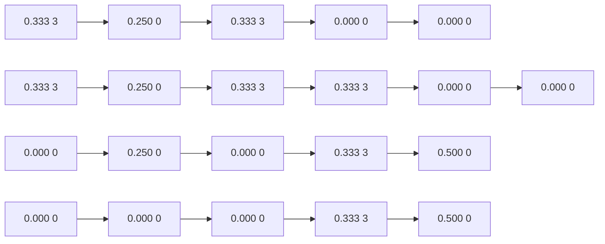
</details>

(c) 第二步:矩阵归一化(列)


<details>
<summary>text_image</summary>

(0.305 6 0.229 2 0.305 6 0.083 3 0.000 0
0.305 6 0.312 5 0.305 6 0.194 4 0.166 7
0.305 6 0.229 2 0.305 6 0.083 3 0.000 0
0.083 3 0.145 8 0.083 3 0.361 1 0.416 7
0.000 0 0.083 3 0.000 0 0.277 8 0.416 7)
</details>

(d) 第三步:矩阵扩展(矩阵平方)


<details>
<summary>text_image</summary>

(0.093 6 0.052 4 0.093 6 0.006 9 0.000 0
0.093 6 0.097 3 0.093 6 0.037 6 0.027 9
0.093 6 0.052 4 0.093 6 0.006 9 0.000 0
0.006 9 0.021 3 0.006 9 0.130 3 0.173 9
0.000 0 0.006 9 0.000 0 0.077 3 0.173 9)
</details>

(e) 第四步: 矩阵膨胀——矩阵元素平方化


<details>
<summary>flowchart</summary>

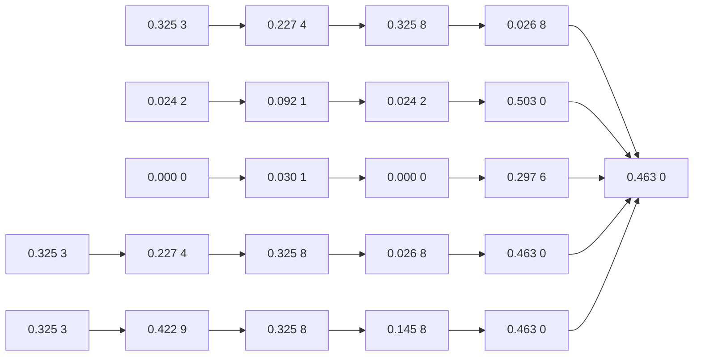
</details>

(f) 第四步: 矩阵膨胀——按列归一化

$$
\left( \begin{array}{c c c c c} 0 & 0 & 0 & 0 & 0 \\ 1 & 1 & 1 & 0 & 0 \\ 0 & 0 & 0 & 0 & 0 \\ 0 & 0 & 0 & 1 & 1 \\ 0 & 0 & 0 & 0 & 0 \end{array} \right)
$$

(g) 重复第三、四步, 得到最终收敛的矩阵图9-19 MCL算法示意图

---

348

9 蛋白质组学和代谢组学

0.325 3、0.325 3、0.024 2。通过反复进行扩展和膨胀操作，最终使矩阵收敛，并形成对角块结构，其中每个块内的节点即为网络中的紧密连接子群（模块）。在例子中，可以看到（A，B，C）形成一个紧密模块，而（D、E）则形成另一个模块。

随机游走重启（random walk with restart，RWR）是一种常见的随机游走算法。它允许从已知的种子节点开始随机游走，并在每一步中以一定的概率返回到种子节点，这样的设计保证了算法能够同时探索网络的局部和全局结构。通过 RWR 算法，我们可以量化其他节点与种子节点之间的关联程度。举例来说，RWR 算法可应用于疾病基因研究中，从已知的疾病基因出发，利用网络信息识别与这些基因密切相关的潜在疾病基因。

## （3）基于模块度的模块发现方法

模块度（modularity）的概念最早由马克·纽曼（Mark Newman）和米歇尔·吉尔凡（Michelle Girvan）于2004年提出。他们在研究社会网络和互联网拓扑结构时，引入了一种可量化网络内部模块化程度的指标 $Q$ :

$$
Q = \frac {1}{2 m} \sum_ {i j} \left(A _ {i j} - \frac {k _ {i} k _ {j}}{2 m}\right) \delta (i j) \tag {9-25}
$$

其中，$m$ 为图中所有节点的度数之和，$k_{i}$ 和 $k_{j}$ 为节点 $i$ 和 $j$ 在网络中的度数。符 $\sigma(ij)$ 表示节点 $i$ 和 $j$ 是否属于同一个模块，为1表示属于同一模块，否则为0。$A_{ij}$ 为节点 $i$ 和 $j$ 在网络中的实际连接强度，而 $\frac{k_i k_j}{2m}$ 则是它们在一个随机网络中的期望连接强度。模块度 $Q$ 的取值范围为 $-1 \sim 1$，越接近1则表示网络模块结构越清晰。

Newman 也提出了一个基于最大化 $Q$ 指标的算法来划分模块。该算法的核心是通过不断迭代来优化节点的分组，使得网络内部连接更密集，而不同模块之间的连接较少。Louvain 算法是另一种基于模块度的算法，它是一种基于贪心的启发式算法，在每一步迭代中通过将节点移动到新的模块中，以增加当前网络的模块度。由于采用高效的近似方法，Louvain 算法特别适合处理大规模网络，能够在短时间内找到相对较好的解。

## （4）基于图分割的模块发现方法

基于图分割（graph partitioning method）的模块划分算法利用图的特性，将图分割成多个子图（模块），使得子图内部连接密集，而子图之间连接稀疏。其中，一类代表性算法是最小化跨子图的边数或权重总和，如 Kernighan-Lin 算法。该算法首先将图随机分成两个子集，然后计算每对节点交换后的跨子集边的权重收益，并选择收益最大的节点对进行交换。通过反复交换两个子集中的节点，逐步最小化跨子集的边权重。此过程持续进行，直至收益不再增加，从而优化图的分割。

另一类算法则利用图的拓扑结构和特征进行分割，其中谱聚类算法（spectral clustering）是一个典型例子。谱聚类算法利用图的拉普拉斯矩阵的特征向量来实现图的划分。具体而言，该方法首先计算图的拉普拉斯矩阵。对于一个给定的图，拉

---

9.4 蛋白质功能预测与分析

349

普拉斯矩阵定义为 $L = D - A$，$D$ 为图的度矩阵，$A$ 是图的邻接矩阵。然后，通过计算标准化拉普拉斯矩阵的特征值和特征向量，将图的节点映射到这些特征向量构成的低维特征空间。最后，在此特征空间中利用 $K$-means 等聚类算法进行节点的划分，以实现高效的模块化划分。谱聚类方法适用于处理大型网络，并且能够有效应对稀疏图的挑战，尽管其计算复杂度较高。

## （5）网络模块识别后的蛋白质功能预测方法

在网络中识别模块后，可以通过几种方法来预测蛋白质功能。一种简单的方法是直接将模块内已注释蛋白质的功能分配给模块内的每一个未注释蛋白质。更为可靠的办法是使用  $\chi^{2}$  检验或 Fisher 精确检验对模块内部的功能进行富集分析，以确定模块内是否显著富集某些特定的功能或生物过程，再进行功能注释。此外，还可以通过训练机器学习模型，结合网络拓扑特征（如节点度、介数中心性、聚类系数等）和已知功能蛋白质的信息，来预测未知蛋白质的功能。总体而言，识别网络模块后的蛋白质功能预测方法多种多样，每种方法都有其特定的应用场景和优缺点。通过结合这些方法，可以更准确和全面地推测蛋白质的功能。

## 9.4.4.3 基于网络整合的蛋白质功能预测方法

整合多种组学数据网络以预测基因功能是生物信息学和系统生物学中的关键研究领域。该方法旨在有效利用高通量技术生成的大量数据，揭示基因之间的功能和相互关系。核心思想是结合不同类型的生物学数据，如蛋白质-蛋白质相互作用、基因共表达、遗传相互作用、代谢通路和基因本体注释等，构建多个网络，并通过算法将这些网络整合，从而提高基因功能预测的准确性和覆盖范围。随着技术和数据的不断进步，这种方法为理解基因功能和生物系统复杂性提供了强大的工具。

两个典型的算法例子是 GeneMANIA 和基于贝叶斯网络的方法（如 GAIN）。GeneMANIA 采用监督学习方法，通过线性回归学习每个网络的权重，然后利用这些权重创建一个加权整合网络。该整合网络的邻接矩阵结合了多个网络的信息，更准确地反映了基因之间的功能关联性。GeneMANIA 接着使用标签传播算法在整合网络上进行蛋白质功能预测，为每个未注释基因分配一个与已知功能基因集合相关性的功能得分。

而基于贝叶斯网络的方法（如 GAIN），则采用概率图模型的框架。它将每个数据网络视为独立的证据，利用条件概率表示基于每个网络证据的情况下蛋白质具有特定功能的概率。然后，通过贝叶斯规则将这些证据整合，推断蛋白质具有特定功能的后验概率。贝叶斯方法保持每个网络的独立性，通过概率推理进行整合，直接输出蛋白质具有特定功能的概率估计。

## 9.4.4.4 基于机器学习的网络预测方法

序列、结构和网络信息可以分别预测蛋白质的功能，一个非常自然的想法是将这几种不同的数据整合进一步提升预测精度，通常整合采用的是机器学习算法。例如，GOLabeler的改进方法NetGO通过整合蛋白质序列和蛋白质-蛋白质相互作用网络信息用于全自动的蛋白质功能注释。除了传统的浅层机器学习模型，基于深度

---

350

9 蛋白质组学和代谢组学

学习的网络预测方法已经在生物信息学领域广泛应用。在处理如蛋白质-蛋白质相互作用网络等生物网络时，深度学习模型通常需要将网络中的节点映射到低维向量空间中，以便于捕捉节点及其邻域的结构信息。以下介绍几种典型的网络嵌入方法及其相关的功能预测方法。

DeepWalk 是一种经典的网络嵌入算法，其核心思想是通过随机游走策略在网络中生成大量节点序列，模拟局部邻域结构。然后，利用这些序列训练神经网络模型，学习每个节点的低维向量表示。这些向量保留了节点在整个图结构中的语义和关系信息，可用于节点分类、连接预测等图分析任务，成为图机器学习领域的重要工具。

DeepGO 是一个基于深度学习的蛋白质功能预测模型。它首先利用 DeepWalk 方法生成 PPI 网络中每个节点的 256 维网络拓扑特征。同时，它对蛋白质序列进行 3-mer 编码，并通过 1D 卷积和最大池化层提取序列特征。DeepGO 通过整合网络和序列特征，设计了一个分层神经网络模型来预测功能，确保结果符合 GO 分类结构的从属关系。

图神经网络（graph convolutional network，GCN）直接对网络进行图卷积操作，从中提取节点的特征表示。每个蛋白质节点的特征由其邻居节点的特征聚合得到，多层卷积叠加可以捕捉更高阶的邻域信息。DeepGraphGO 是一个端到端的功能预测模型。它首先构建了一个 17 个物种的 PPI 网络，进而利用 GCN 提取多物种 PPI 网络的网络特征。然后，将蛋白质序列特征与网络特征融合，构建图神经网络来预测蛋白质功能。

## 9.5 代谢组学

## 9.5.1 代谢组学概述

代谢组学（metabonomics）是对生物体内代谢产物的组成及其变化进行系统性研究的新兴组学领域，是系统生物学的重要组成部分。

代谢组学是研究处于特定时期（如不同发育状态等）或受到特殊扰动（如伤病、给药等）的生物体内所有代谢物组成及其变化的学科。代谢组学主要针对的是分子量小于1000的内源性分子，包括糖类、脂质、氨基酸、芳香烃等。代谢物在不同物种中数量存在差异，一般动物约有2500种、微生物约有1500种，植物约有20万种。

作为基因表达的下游产物，代谢物在生理过程中的作用不可忽视。生物机体中的生理活动由基因、蛋白质以及代谢物共同调节，而上游大分子（核酸、蛋白质等）的变化大多最终会体现在代谢物层面，如细胞间通信、激素调控、受体作用效应等。值得注意的是，虽然代谢物处于基因调控网络和蛋白互作网络的下游，但其也能够

---

9.5 代谢组学

351


<details>
<summary>flowchart</summary>

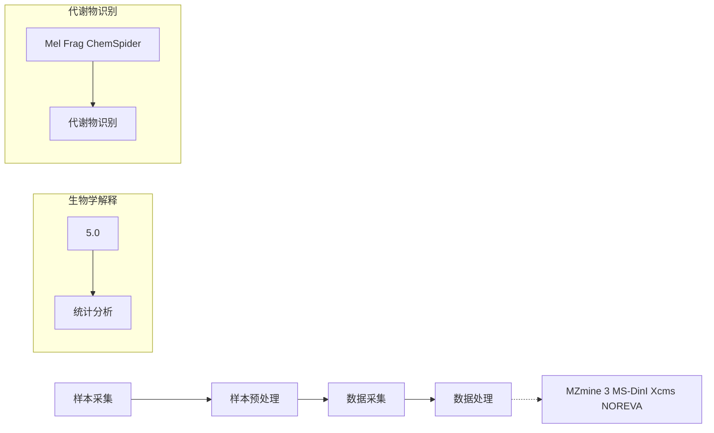
</details>

图9-20 代谢组学研究中的主要环节

通过与上游基因、蛋白质进行相互作用，实现对上游生命活动网络的反馈，参与众多生理过程的调控。

本节将对代谢组学进行简要介绍，包括其发展历程、样本制备、主要实验技术平台、数据处理以及下游分析等（图9-20）。重点强调了代谢组学研究中的一些注意事项，并给出了数据处理过程的详细讲解，以帮助读者理解如何获得高质量的代谢组学数据。

## 9.5.1.1 代谢组学发展历程

代谢组学相关的研究起源于20世纪70年代的代谢谱分析，而代谢组学的概念在20世纪90年代首次被英国帝国理工大学杰里米·尼科尔森（Jeremy Nicholson）教授提出。在代谢组学发展的早期，人们通常使用核磁共振技术（NMR）来检测代谢物，然而这种方法存在样本需求量大、灵敏度低等问题，不能满足对人体代谢物全面、定量分析的需求。随着质谱（MS）技术的发展，质谱与气相、液相色谱技术的联用被广泛用于代谢组学的数据获取，通过质荷比、相对丰度等信息反映代谢物的结构和丰度。到21世纪，代谢组学检测技术已经有了巨大的进步，三维荧光液相色谱、同位素示踪等方法得到了广泛应用。而随着近几年单细胞技术的发展，研究者能够检测单个细胞中的代谢物含量及其变化，单细胞代谢组学正在兴起。

## 9.5.1.2 代谢组学的样本制备

由于代谢物能够随着体液被排出机体，因此代谢组学样本的获取相较其他组学更加便捷。尿液、血液、动物粪便提取物、植物组织提取物等能够快速获取的生物体液是代谢组学研究中最常用的样本。正是因为代谢组学研究的生物样本易获取，其在医疗诊断领域具有极大的应用前景。此外，代谢组学研究的对象也可以是各种临床上或动植物实验中取得的实体组织样本等较复杂的生物样本。

需要注意的是，收集代谢组学样本的过程需要进行严格的把控。收集样本时应该根据实验设计综合考虑采样时间、样本保存条件以及保存时间等实验因素的一致性。在收集临床生物样本时，还有必要尽量保证实验组与对照组之间的年龄、性别、膳食、生活作息、病史、用药状况等多方面因素的一致性。这些与实验目的无关的外在因素均可能导致代谢组学数据的变化，影响最终的实验结果。

生物样本中的代谢物容易受到环境中众多因素的影响（如由于样本中残留酶活

---

352

9 蛋白质组学和代谢组学

性而降解原有代谢物、产生新的代谢物），因此通常需要对样本尽快进行淬灭，并且进行合适的提取。不同的代谢组学技术平台的样本提取方法不同，需要根据实际使用的技术平台以及实验目的来确定使用的提取方法。

相较于基因和蛋白质，代谢物处于生命活动的下游，动态波动性大。因此需要更多生物学重复来增加数据的可靠性和说服力，一般情况，不同类型的样本生物学重复如下:

① 植物样本 至少 6 次生物学重复，建议 8 次以上；
② 模式动物及微生物样本 至少 8 次生物学重复，建议 10 次以上；
③ 临床样本 至少 30 次生物学重复，建议 50 次以上。

## 9.5.1.3 代谢组学的实验技术

完成样本收集和提取后，研究者应当根据样本性质、实验目的以及目标代谢物的理化性质，选择合适的实验技术平台。目前在代谢组学中最常用的样品分析平台可以根据核心检测仪器的不同分为两种类别:基于核磁共振的技术平台、基于质谱的技术平台。

## (1) 基于核磁共振 (NMR) 的技术平台

基于NMR的技术平台对生物样本中所有化合物的灵敏度都一致，并没有与代谢物相关的偏向性，不需要复杂的前处理并且可以进行实时动态的数据监测。最关键的优势是基于NMR的代谢组学检测不会对样本造成损伤，不会改变生物样本的结构和性质。如果计划在代谢组学后继续对样本进行其他的检测分析，基于NMR的技术平台是较好的选择。

然而，需要注意的是，基于 NMR 的技术平台灵敏度较低（相较基于 MS 的技术平台低几个数量级），难以检测到样本中低丰度的代谢物，且研究者需要根据核磁共振结果提供的结构片段信息进行代谢物的身份推断，这通常比较困难。

## （2）基于质谱（MS）的技术平台

在基于MS的代谢组学数据获取中，通常将MS与色谱联合使用，利用色谱对代谢物进行分离，将样本分别送入MS，然后借助MS的分子身份识别能力对样本中的代谢物进行定性或定量分析。得益于质谱极高的灵敏度，基于质谱的技术平台通常能够获得更多低丰度代谢物的信息，这在生理病理过程的机制探究中至关重要。最常用的基于MS的技术平台包括液相色谱-质谱联用（LC-MS）技术平台以及气相色谱-质谱联用（GC-MS）技术平台。

LC-MS是一种广泛使用的物质分离分析技术，具有灵敏度较高、动态范围较宽、无须衍生化等优点。LC-MS通常被用于GC-MS难以分析的强极性、难挥发、热不稳定性代谢物的检测分析。

GC-MS 主要用于挥发性物质的代谢组学研究,得益于有 NIST（National Institute of Standards and Technology）数据库提供相对完善的小分子电子电离质谱（EI-MS）信息，在代谢物身份识别方面较为便利，目前已经在植物样本代谢组学研究中得到广泛的应用。在动物样本代谢组学研究中，由于动物的内源性代谢物多为不挥发性

---

9.5 代谢组学

353

代谢物，很大程度上限制了 GC-MS 的使用。但值得注意的是，随着衍生化方法的创新，GC-MS 也逐渐在动物样本的代谢组学研究中得到广泛应用。与 LC-MS 相比，GC-MS 所检测的化合物主要集中在极性程度低，分子量相对小的代谢物（<300）。

## 9.5.1.4 代谢组学数据分析流程概况

代谢组学研究产生大量的数据首先需要进行提取、峰对齐、去噪等处理，然后进行数据处理，最终进行模式识别、多元统计分析等下游数据分析，从海量的数据中获得关键信息。代谢组学数据分析通常包含三个环节:①生成数据矩阵，基于MS/NMR技术平台获得的原始数据图谱，使用相应软件平台转换为定量的数据矩阵；②数据处理，去除数据中的低质量数据并减少非生物变异，调整数据分布，为后续数据分析做准备；③下游分析，对经过合适处理的数据进行差异分析、聚类分析、时序分析等，挑选出能够有效鉴别不同类别、不同时期生物样本的关键差异代谢物，或寻找到不同类别间代谢物的特定表达模式。经过上述数据处理，找到关键的代谢物之后，通过代谢通路网站的搜索，结合代谢通路等信息探究它们代表的生物学意义，从而将实验数据结果和体内的生物学变化结合起来。

## 9.5.1.5 代谢组学数据库

HMDB数据库是由加拿大代谢组学创新中心于2007年开发并长期维护的一个综合的代谢组学数据库网站，其中主要收录人体内源性代谢产物并提供代谢物相关的信息，包括代谢物的化学式、化学分类、理化性质、代谢通路、部分MS/MS图谱等。该数据库目前支持化合物名字搜索、分子量搜索、分子结构搜索，MS/MS搜索；该数据库目前不支持批量搜索，仅限于单个代谢产物搜索，搜索效率较低。不支持代谢通路搜索、代谢化合物浓度搜索等。

KEGG 数据库是由日本京都大学于 1995 年创立，是世界上最大、最全的生物信息学数据库之一。含有部分代谢组学信息。主要偏重代谢通路和整合代谢、基因和蛋白质通路信息。目前含有 372 条代谢通路和超过 15000 个各类代谢产物（动物、植物和细菌等）。该数据库最大特点是收录全，包括基因、蛋白质和代谢产物等信息，但是缺少这些代谢产物在生物体内的浓度、功能和疾病相关信息。

Metlin 数据库是由 The Scripps Institute Gary Siuzdak 组创立，主要侧重应用于非靶向代谢组学（non-targeted metabolomics）代谢产物鉴定。网站的主要特征是具有大量代谢产物的 MS/MS 图谱，而且每个化合物都有不同的碰撞能。用户还可以获得分子量、化学结构式、化学结构等信息。该数据库的主要缺陷是没有代谢产物在生物体中的浓度、代谢通路等信息，没有临床相关的信息，偏重化学分析。

MetaboLights 数据库是由欧洲生物信息学研究所开发和维护的一个开放的代谢组学数据库，旨在存储、共享和分析代谢组学实验数据。收集和整理了来自各种代谢组学研究的实验数据，包括质谱和核磁共振等技术生成的代谢物谱图、代谢物注释信息、样品和实验设计等相关数据。这些数据可以通过 MetaboLights 网站进行搜索和访问。MetaboLights 提供了一系列功能，使用户能够浏览、搜索和下载代谢组学数据。用户可以根据关键词、实验类型、物种等条件进行搜索，并查看与特定

---

354

9 蛋白质组学和代谢组学

实验相关的详细信息。此外，MetaboLights 还提供了数据分析工具和资源，包括用于代谢物注释和通路分析的工具。用户可以使用这些工具对下载的数据进一步分析和解释。MetaboLights 支持数据共享和数据集发布。研究人员可以将自己的代谢组学数据上传到 MetaboLights 数据库，并选择是否将其公开共享，已经成为代谢组学数据存储和检索的重要平台。

Metabolomics Workbench 数据库是一个由美国国立卫生研究院（NIH）支持的综合性代谢组学数据库，旨在存储、共享和分析代谢组学实验数据。它收集和整理了来自各种代谢组学研究的实验数据，包括质谱和核磁共振等技术生成的代谢物谱图、代谢物注释信息、样品和实验设计等相关数据。这些数据可以通过网站进行搜索和访问。用户可以根据关键词、实验类型、物种等条件进行搜索，并查看与特定实验相关的详细信息。Metabolomics Workbench 同样支持数据共享和数据集发布。

## 9.5.2 代谢组学数据处理

随着检测技术的发展，代谢组学一次实验能够运行的样本数、检测到的代谢物数量飞速增加。代谢组学数据的复杂性也随之快速提高，有必要在后续分析之前进行完善的数据处理，以提供后续数据分析的可靠性。通常，基于 NMR 技术平台获取的原始数据通过代谢物注释（annotation）获得数据矩阵（行为样本，列为代谢物），而基于质谱技术平台获取的原始数据通过峰检测（peak detection）获取数据矩阵（行为样本，列为代谢物碎片离子峰）。针对所得数据矩阵的常用的数据处理

流程包括缺失值填充（imputation）、数据转换（transformation）、数据归一化（normalization）、数据缩放（scaling）。具体流程见图9-21。

## 9.5.2.1 缺失值填充

代谢组学实验中，部分代谢物产生的信号峰质量较差或者代谢物含量较低而无法被检测到，导致数据矩阵中出现相应的缺失值。对于缺失值，可以选择适当的填充方法，如均值替换、中值替换、最近邻替换等，以保持数据的完整性和一致性。

## 9.5.2.2 数据转换

许多统计分析假设数据的分布符合正态分布，然而实际数据矩阵中的特征分布可能并不是正态分布，而是偏态分布，需要在后续分析前使其呈现近似正态分布。此外，数据经常会受到来自各种来源的异方差噪声的影响，而分析时通常假设噪声是同方差的。对数据矩阵进行数据转换就是为了纠正异方差和偏态分布，为后续分析提供便利。常用的数据转换方法包括对数


<details>
<summary>flowchart</summary>

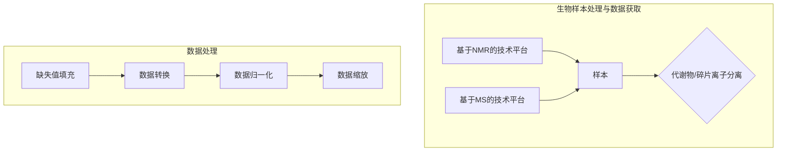
</details>

图9-21 代谢组学数据获取与数据处理

---

9.5 代谢组学

355

变换、方根变换等。

## 9.5.2.3 数据归一化

数据归一化是为了消除样本间不需要的变异（如不同的样本液体浓度等），并允许对样本进行定量比较。常见的归一化策略是为数据表中的样本计算归一化系数，然后将矩阵中的每一行（行代表样本）除以归一化系数，以消除样本间的不必要变异，如总面积归一化法（total area normalization）、概率商归一化法（probabilistic quotient normalization）等。也有部分归一化方法不需要计算归一化系数，如分位数归一化法（quantile normalization）等。

## 9.5.2.4 数据缩放

在数据矩阵中，丰度较高的代谢物表现出较高的数值，与丰度较低的代谢物相比，在样本间显示出更大的差异。后续分析中采用的部分方法（如PCA）基于方差进行分析，这可能会导致丰度较高的代谢物被认为是关键代谢物，而部分在生物学上有重要意义但丰度较低的代谢物则被忽视。因此，有必要对数据矩阵中的代谢物特征（列代表代谢物或代谢物碎片离子峰）表达值进行缩放，以平衡代谢物间的表达值差异。常用的缩放包括自动缩放（auto-scaling）、范围缩放（range scaling）等。

## 9.5.2.5 代谢组学数据处理的软件和工具

对于代谢组学数据，选择适合自己研究目的和数据类型的软件和工具进行数据处理是很重要的。常见的数据处理工具如下。

## (1) XCMS

XCMS 是一个用于代谢组学数据处理和分析的流行开源软件包。它提供了用于峰识别、对齐、配准和归一化的功能，可以处理质谱和色谱数据。

## (2) MetaboAnalyst

MetaboAnalyst 是一个集成的在线平台，用于代谢组学数据处理、统计分析和功能解释。它提供了丰富的工具和算法，包括数据处理、多变量分析、通路富集分析等。

## (3) MZmine

MZmine 是一个用于质谱数据处理和分析的开源软件。它支持从原始质谱数据中进行特征提取、峰识别和定量分析，还提供了工作流的创建和自定义功能。

## (4) MS-Dial

MS-Dial 是一个用于代谢组学数据处理和分析的开源软件工具。它专门设计用于处理液相色谱-质谱联用（LC-MS）和气相色谱-质谱联用（GC-MS）数据，旨在帮助研究人员从复杂的代谢组学数据中提取有关样品中代谢物的信息。

## (5) NOREVA

NOREVA 是一个专业用于代谢组学数据处理的工具。它支持数百种不同的代谢组学数据处理流程，并能够对这些数据处理流程的性能进行评估。

---

356

9 蛋白质组学和代谢组学

## 9.5.3 代谢组学下游分析

## 9.5.3.1 聚类分析

聚类分析常被用于对经过数据处理的代谢组数据进行数据挖掘。它可用于对一组对象进行分组，其中相似的对象比那些关系较远的对象分组得更紧密。聚类不是单一算法，而是指一组不同的算法，这些算法在确定关系的方法上存在显著差异。

代谢组学数据的聚类分析主要有两种目的，一种是对包含所有代谢物表达信息的数据矩阵进行聚类，比对实验设计中的样本组学分类与聚类结果中的样本分类，以此检查样本重复性以及实验操作的质量；另一种是对具有相近表达模式的代谢物进行聚类，以此观察代谢物丰度在各类别中的变化规律，识别关键的代谢物。目前可选的聚类方法众多，最常用的包括 $K$-means 聚类、层次聚类等方法，聚类方法的选择需要考虑数据维度、样本数、数据分布等条件，聚类结果的可视化通常采用聚类树状图和热图。

## 9.5.3.2 差异分析

通过差异分析，研究者能够快速找到不同组别中的差异代谢物，如疾病与健康状态下的关键生物标志物。通常使用t检验、ANOVA检验，识别出不同组别之间的差异代谢物，也可以结合多元统计分析的结果对关键代谢物进行识别。在差异分析中，常用的图形表示为差异柱状图、火山图、差异热图等。

## 9.5.3.3 通路分析

代谢组学的通路分析是对代谢物进行功能注释和关联分析，以揭示代谢物之间的相互关系以及其参与的生物过程和代谢通路。代谢通路是一系列相互作用的化学反应，负责维持生物体内代谢平衡和能量转化。通过通路分析，可以识别出与特定生物过程或疾病相关的代谢通路，并深入了解其调控机制。通路分析有助于深入理解代谢物在生物体内的作用和调控机制。通常基于KEGG数据库进行代谢组数据的通路分析。

部分代谢组学通路分析的方法直接借鉴基因通路分析的方法，如过表征分析（over-representation analysis, ORA）。ORA 是一种用于确定在给定数据集中是否存在显著过度表示的统计方法。通常使用一些统计检验方法（如超几何分布、Fisher 精确检验等）来计算基因集合或代谢物集合（代谢通路）中的实际数量与预期数量之间的差异，被用于确定某些基因集合或代谢物集合是否在给定的实验条件下过度表示，是否有显著差异。

## 9.5.3.4 蛋白质与代谢物关联分析

蛋白质与代谢物的关联分析可以帮助我们理解蛋白质在代谢过程中的作用和调控机制。以下是一些常见的蛋白质与代谢物关联分析的方法:

## (1) 代谢组学和蛋白质组学的整合分析

对蛋白质组和代谢组两个组学数据进行整合分析，快速筛选数据，找到共同参与某类代谢通路或者具有相同变化趋势的差异蛋白和差异代谢物，系统描述生物体

---

9.5 代谢组学

357

内的分子调控机制，为后续实验验证与分析提供数据基础。例如，可以将代谢物与相应的酶或转运蛋白进行关联分析，以了解蛋白质在代谢途径中的功能和调节。

## (2) 蛋白质-代谢物网络分析

通过构建蛋白质与代谢物之间的相互作用网络，揭示两者之间的关联模式和蛋白质与代谢物之间的相互作用关系、调控机制和生物功能。

## （3）代谢酶和蛋白质相互作用分析

通过研究代谢酶与其他蛋白质之间的相互作用，可以了解代谢途径的调节机制。例如，可以使用蛋白质-蛋白质相互作用网络数据库和相关的实验技术，揭示代谢酶与其他蛋白质（如转录因子或底物结合蛋白）之间的相互作用关系，从而解析代谢调控的分子机制。

## 9.5.4 代谢组学应用实例

## 9.5.4.1 代谢组学在疾病诊断中的应用

代谢组学在疾病诊断中已经得到广泛研究和应用。通过分析和解读人体内代谢产物的组合和数量变化，可以揭示疾病的生物标志物、疾病机制以及个体化医学相关信息。以下是代谢组学在疾病诊断中的几个常见应用。

## （1）疾病早期筛查和诊断

代谢组学可以通过比较正常人群和患者群体之间的代谢物谱图差异，寻找特异性的代谢标志物，从而进行疾病早期筛查和诊断。例如，通过代谢物组合的分析可以帮助早期发现某些遗传代谢病、代谢综合征、癌症等多种疾病。

## (2) 疾病分类与亚型识别

代谢组学可以对不同类型或亚型的疾病进行分类和识别。通过分析代谢物组合的模式，可以将同一疾病的不同亚型进行区分，并为治疗选择提供指导。例如，针对一些特殊的难治型肿瘤亚型（如三阴性乳腺癌），研究者们也在不断地通过对大规模队列的多组学测序，揭示其内在亚型分类及对应的生物学特性。代谢组学在肿瘤分类、心血管疾病亚型的识别和糖尿病类型的确定等方面具有潜在应用价值。

## （3）疾病进展监测和预后评估

代谢组学可以通过监测代谢物组合的动态变化，帮助监测疾病的进展和治疗效果，并评估患者的预后情况。例如，代谢组学可以用于监测癌症患者的肿痛负荷，评估疾病复发和转移风险。

## （4）药物疗效评估和个体化治疗

代谢组学可以帮助评估药物在个体水平的疗效和副作用。通过分析代谢物组合的变化，可以预测个体对特定药物的反应并为个体化药物治疗提供指导。这对于优化药物治疗方案、减少药物不良反应和提高治疗效果非常重要。

## 9.5.4.2 代谢组学在药物靶标发现中的应用

发现潜在治疗靶标是针对特定疾病开发新药的首个关键环节。目前，新药临床

---

358

9 蛋白质组学和代谢组学

研究的高失败率很大程度上归因于选择的靶标可药靶性不佳。因此，代谢组学在药物靶标发现方面的应用可以帮助揭示药物与生物体内代谢物之间的相互作用关系，从而鉴定潜在的药物靶标。以下是代谢组学在药物靶标发现中的几个常见应用:

## （1）靶标识别和验证

通过分析药物处理后的代谢产物组合，可以确定与药物相互作用的蛋白质靶标。这可以通过使用代谢物组合与已知药物靶标数据库进行比对来实现。一旦潜在的目标被确定，进一步的实验验证可以通过体外或体内方法进行，以确认代谢组学的预测结果。

## (2) 作用机制研究

代谢组学还可以帮助了解药物与其靶标之间的作用机制。通过分析药物的代谢产物变化及其影响的代谢途径，可以推断药物对靶标的调节方式、信号传导通路以及可能的副作用。

## （3）副作用评估

代谢组学可以帮助评估药物的副作用。通过分析药物对代谢物组合的影响，可以检测药物是否对代谢通路产生意外的影响，从而揭示潜在的副作用机制和可能的安全性问题。

## 9.5.4.3 代谢组学在肠道微生物研究中的应用

越来越多的证据表明，肠道菌群可以调节饮食，改变宿主的新陈代谢和代谢紊乱的发生。肠道菌群会产生极为多样的代谢产物，并在宿主中发挥重要的生理作用。在人类和动物模型中进行的多项研究表明，肠道菌群对各种代谢特征和功能障碍有重要贡献。在无菌小鼠中的研究表明，产生丁酸盐的细菌定殖使结肠上皮摆脱了在无菌结肠上皮中观察到的能量饥饿状态和自噬。此外，肠道乳酸菌还产生亚油酸代谢产物 KetoA，它在全身能量代谢中起着重要作用，饮食中摄取 KetoA 可以增加小鼠的能量消耗，从而保护小鼠免于饮食引起的肥胖。流行病学和实验室研究报告表明，肠道微生物群依赖的代谢产物，如短链脂肪酸（short chain fatty acid, SCFA），在能量获取中的作用与代谢综合征的发展密切相关。因此，肠道代谢产物被认为是将肠道菌群与代谢综合征联系起来的主要因素。

经过代谢组学分析，可以了解微生物参与的代谢途径、产生的代谢产物对宿主的影响，研究肠道微生物与饮食、药物与疾病的相互作用关系，指导精准医学中的个体化治疗等。

## 9.5.4.4 代谢组学在植物研究中的应用

植物的代谢组学研究是指通过对植物中代谢产物的组成和变化进行高通量分析，来揭示植物代谢途径、调控机制以及与环境互作等方面的信息，为植物科学、农业和食品工业等领域提供科学依据和技术支持。

## (1) 植物代谢途径分析

代谢组学能够有效探究植物的代谢途径及其调控机制。通过分析植物中代谢产物的组合和浓度变化，可以了解不同代谢途径的相互关系和调控网络。这有助于深

---

9.6 蛋白质组学和代谢组学的总结与展望

359

入理解植物的生物合成途径、能量代谢和信号转导机制。

## (2) 逆境响应研究

代谢组学可以帮助研究植物对逆境条件的响应机制。通过比较正常生长和逆境条件下植物的代谢物组合差异，可以了解逆境对植物代谢途径的影响，并鉴定与逆境响应相关的关键代谢物。这有助于揭示植物逆境耐受机制和适应策略，为育种和遗传改良提供指导。

## （3）品质评估与优化

代谢组学可以用于评估植物的品质特性。通过分析不同植物品种或不同生长条件下的代谢物组合，可以定量和比较其中的营养成分、药用化合物和风味物质等。这有助于优化植物品种选择、种植管理和加工工艺，提高农产品的营养价值和质量特性。

## (4) 植物与环境互作研究

代谢组学可以揭示植物与环境之间的相互关系。通过分析植物代谢物的变化，可以了解植物对环境因子（如温度、湿度、光照等）的响应和适应方式。这有助于研究气候变化对植物生长和生态系统稳定性的影响。

## (5) 功能基因组学研究

代谢组学可以帮助揭示植物基因功能及其调控网络。通过整合基因组学和代谢组学数据，可以确定基因与代谢物之间的关系，进一步理解基因的功能和调控机制。这对于植物育种和基因工程具有指导意义。

## 9.6 蛋白质组学和代谢组学的总结与展望

## 9.6.1 蛋白质组学和代谢组学的最新进展及发展趋势

蛋白质组学和代谢组学作为系统生物学中两个密切相关的领域，它们共同致力于揭示生物体内复杂的分子机制。蛋白质组学提供了蛋白质表达和修饰的信息，而代谢组学揭示了蛋白质功能活动产生的代谢产物，两者相互补充，共同揭示生物体的生理和病理状态。通过对蛋白质组学和代谢组学数据的联合分析，可以更准确地识别生物标志物和药物靶点，更深入地建立生物体基因型和表型的关系，从而获得对生物系统更全面的理解。近些年来，蛋白质组学和代谢组学均取得许多令人瞩目的新进展。

随着高精度检测技术的发展，高通量蛋白质组测定的敏感度与覆盖度在持续提升。同时，质谱进一步结合高内涵成像（high content imaging）与激光显微切割技术，使得单细胞蛋白质组与空间蛋白质组的发展与应用正在成为热点。细胞是生物体生命活动的基本单元。生物体内同一组织或器官中存在着空间定位不同、种类亚型各异的多种细胞，细胞间的异质性是生物系统的普遍特征。大规模蛋白质组鉴定

---

360

9 蛋白质组学和代谢组学

了成千上万个细胞的蛋白质表达，并提供了模糊单个细胞之间关键差异的平均蛋白质丰度，难以满足对细胞间差异的分析需求。此外，大规模蛋白质组无法对罕见细胞群进行研究，因为不具备检测癌症干细胞等罕见细胞的灵敏度。研究人员清醒认识到对单细胞蛋白质组测定的需求，进而推动了单细胞质谱技术的发展。单细胞质谱技术旨在通过创新样本制备方法，将多肽从单个细胞高效地输送到质谱仪器中。第一个使用液相色谱-质谱联用方法（LC-MS）成功测定单细胞质谱的方法称为SCoPE-MS，该方法通过将样品制备体积减小到低微升尺度，并采用一个包含200个细胞的载体通道，确保足够的碎片离子强度用于肽鉴定。大多数的单细胞蛋白质组研究要么集中在实验室培养提取的细胞中，要么集中在液体活检样本上。然而，由于要使用单细胞分离方法，单细胞蛋白质组学往往会丢失有价值的空间信息。为了解决这个问题，空间蛋白质组利用高精度激光捕获显微切割（LCM）技术切取感兴趣的组织区域（20～100  $\mu$ m，5～10个细胞），经过超微量样本无损提取技术提取并酶解蛋白质为肽段，进而使用高敏感质谱，分析得到蛋白质在不同空间位置的表达特征。

近年来，高分辨率质谱技术的发展极大地提高了代谢物检测的灵敏度和准确性，使得研究人员能够鉴定出更多低丰度的代谢产物。液相色谱-质谱联用（LC-MS）和气相色谱-质谱联用（GC-MS）等技术的不断优化，使得代谢物的定性和定量变得更加精确和高效。随着这些技术的进步，代谢组学研究正朝着更高通量、更广覆盖的方向发展，为揭示生物体内的代谢途径和代谢网络提供了强大的工具。此外，代谢组学领域中单细胞代谢组学和空间代谢组学技术正在快速发展并备受研究者关注。从理论上讲，单细胞研究是唯一能够描述实时生化反应的分析类型，而这些反应通常只需几秒或几分钟即可发生。不仅如此，细胞行为的不同步，使得在研究细胞周期等复杂问题时必须在单细胞的层面研究，以获得准确的代谢特征。目前来说，单细胞代谢组学的分析技术仍处于起步阶段，其灵敏度以及样本吞吐量仍然难以满足研究的需求，但其分析技术正在飞速进步，有望在未来数年间得到广泛应用。空间代谢组学同样作为代谢组学中的新兴技术被众多研究者关注。空间代谢组学可用于组织切片，能够获得接近单细胞的分辨率并且保留样本中代谢物分布的空间信息，这在检测细胞代谢状态及其异质性、在微米尺度上探测宿主-微生物代谢相互作用、揭示代谢细胞命运轨迹和创建代谢活动的空间图谱等方面都具有广阔的应用前景。然而空间代谢组学目前同样面临众多挑战，包括灵敏度不足、检测速率较慢、代谢物注释困难等。值得庆幸的是，研究者对该领域的高度关注正在推动空间代谢组学技术快速革新。

蛋白质组学和代谢组学数据的迅猛增加，相关新技术伴随着不断提高的分析难度以及人工智能的应用都推动了数据分析方法的迭代。在蛋白质组学数据解析方面，人工智能的引入显著地提升了谱图解析率，特别是在肽段的从头测序中表现尤为突出。先进的深度学习算法与超高灵敏度的质谱相结合的技术展现出巨大的潜力。一项开创性的工作流程被称为“深度视觉蛋白质组学”，结合了先进的免疫荧

---

9.6 蛋白质组学和代谢组学的总结与展望

361

光成像和 LCM 技术，从而实现了在福尔马林固定和石蜡包埋（formalin-fixed and parriffin-embedded, FFPE）样本中保留空间信息的情况下，对汇总的单细胞蛋白质组进行 LC-MS 测量。尽管高通量测量空间分辨的真实单细胞蛋白质组仍然具有挑战性，但作者展示了将该技术与固有的单细胞分辨率（即显微镜检查）、先进的机器学习算法和超高灵敏度质谱结合的广阔潜力。由于代谢组学数据集庞大且其中的数据模式复杂，传统分析方法难以满足研究者的分析需求，越来越多的研究使用 AI 进行代谢组学分析。在代谢物的鉴别中，通过训练模型来预测未知代谢物的身份，AI 技术能够提高代谢物的鉴定效率。例如，基于 Transformer 框架开发的 MassGenie 工具，以计算机方式探索数百万种碎片模式，展现出从质谱数据中识别小分子前所未有的能力。在代谢组学生物标志物的识别中，基于支持向量机（SVM）和递归特征消除所构建的稳定识别算法，通过整合多重随机抽样和一致性打分，将代谢组学生物标志物识别的稳定性提高了一个数量级。在基于代谢组学的疾病预测、患者分型等任务中，机器学习、深度学习的方法同样得到广泛的应用。传统机器学习模型，如 XGBoost 和 SVM，在数据量较小时通常表现出较好的效果，而深度学习方法则在有大量训练数据时表现出优异的性能。随着算法的不断进步和完善，未来 AI 技术将在代谢组学研究中发挥更加重要的作用，为代谢生物学的研究带来革命性的变化。

## 9.6.2 蛋白质结构与功能预测的最新进展及发展趋势

当以 AlphaFold2 为代表的基于深度学习的蛋白质结构预测取得重大突破后，研究人员自然把目光转向更为挑战性的任务，即蛋白质与其他分子复合物的三维结构预测。DeepMind 团队对 AlphaFold2 进行了多项修改，包括对多序列比对构建的改进，推出了 AlphaFold-Multimer，专门用于蛋白质复合物结构预测的工具。在最新的 AlphaFold3 中，开发者对模型架构和训练过程进行了重大改进，新版本不仅能够预测单链蛋白质结构和蛋白复合物结构，还能准确预测蛋白质与 DNA、RNA 及配体等分子相互作用的复合物结构。AlphaFold3 在预测蛋白复合物结构表现出色，尤其在抗体-抗原互作界面预测比 AlphaFold-Multimer 有显著改善。

蛋白质结构预测的突破使得从结构出发预测蛋白质功能越来越可行。2023年澳大利亚的Ascher研究团队开发了LEGO-CSM方法，该方法从蛋白质序列及AlphaFold2预测的结构模型出发，运用基于结构的CSM（cutoff scanning matrix）算法同时预测蛋白质的亚细胞定位，酶分子功能（EC号）和GO条目，进而实现对蛋白质功能的综合准确的预测。蛋白质的结构实现准确预测后，大大拓宽了利用生物分子模拟研究蛋白质功能的应用场合。对尚未实验解析结构的蛋白质，可以利用AlphaFold2预测得到的结构模型，进一步采用分子动力学模拟及分子对接研究蛋白质构象动态变化以及它与其他分子相互作用的动态过程。人工智能的新技术在蛋白质功能预测中也发挥着越来越重要的作用。近年来在人工智能领域，自然语言处理（natural language processing，NLP）取得重大进展。将NLP中的语言模型概

---

362

9 蛋白质组学和代谢组学

念复制到蛋白质研究中，一系列蛋白质语言模型被相继开发。具体来说，将蛋白质序列中的氨基酸看作语言模型的词，将整个蛋白质视为语言模型中的句子。首先，将这些语言模型以自监督的方式进行训练，本质上是学习预测已知序列中隐藏的氨基酸。然后，通过训练得到的蛋白质语言模型可以实现对每个残基及每个蛋白质的表征，进而用于蛋白质相关的分类任务。ProtTrans 是一个蛋白质语言模型，在包含 3930 亿个氨基酸的 UniRef 和 Big Fantastic Database 数据集上进行训练得到。ESM（evolutionary scale modeling）是由 Facebook 提出，基于 2.5 亿个蛋白质序列训练大容量的 Transformer 语言模型，并使用该语言模型学习和表征蛋白质的生物学特性。总体上，无论是 ProTrans 还是 ESM 模型都含有丰富的蛋白质语义信息，这些信息对蛋白质序列、结构、功能和进化关系进行了深入刻画。这些预训练的蛋白质语言模型在蛋白质功能预测中有着优秀的表现。

人工智能的革命性发展，也深刻影响着生物分子模拟技术的变革。以AlphaFold3为代表的蛋白质与其他分子复合物结构的预测，提供了有别于传统利用分子对接研究蛋白质与其他分子相互作用的新策略。在分子动力学模拟的多个环节，人工智能尤其是深度学习算法，都具有重要的应用前景。在分子力场方面，传统的力场参数是人工拟合形成，这是一项繁杂而艰巨的工作，而深度学习可以根据量子化学计算或实验数据自动优化力场参数，使力场拟合更准确，对于新系统，也可以通过学习快速拟合好力场参数；在模拟过程中，深度学习网络可用来加速计算分子间相互作用势能，这可以大幅减少计算量，加速模拟过程。总体来说，人工智能在分子模拟中的应用仍处于早期阶段，但其潜力是巨大的。

总之，近年来蛋白质组学和代谢组学技术的不断突破，极大地推动了其在生命科学、生物技术与医药、农业科学等领域中的应用。蛋白质结构与功能预测作为生物信息学中的基础研究方向，由于以深度学习为代表的人工智能技术的广泛应用，正焕发出勃勃生机，相关方法正在快速更新迭代且日臻完善和实用，从而加快了界定蛋白质组学和代谢组数据中所蕴含的生物学规律。从序列出发，我们可以准确预测蛋白质的三维结构及其潜在的生物学功能；利用分子动力学模拟，我们可以系统研究蛋白质的折叠过程、构象动态变化以及和其他分子相互作用的动态过程；采用先进的分子设计手段，我们可以为蛋白质功能改造以及全新蛋白质功能设计提供方案。毫无疑问，以AlphaFold为代表的蛋白质结构预测取得的巨大突破以及日新月异的蛋白质分子设计技术，很大程度上正在改变着生命科学的研究范式。

## ※ 推荐阅读

1. 陈铭. 生物信息学 [M]. 北京:科学出版社, 2022.

点评:该书第4章对传统蛋白质三级结构预测方法、二级结构预测方法及蛋白质结构比对均进行了详细介绍，有助于全面了解蛋白质结构预测的历史。

---

参考文献

363

2. Frenkel D, Smit B. Understanding molecular simulation: from algorithms to applications [M]. Amsterdam: Elsevier, 2023.
点评:蛋白质分子动力学模拟作为生物分子模拟的重要组成部分，是本章学习的难点。该专著作为分子模拟的经典入门级教科书，有助于加深对分子动力学模拟的理解。
3. Jumper J, Evans R, Pritzel A, et al. Highly accurate protein structure prediction with AlphaFold [J]. Nature, 2021, 596(7873): 583-589.

点评:该文是 AlphaFold2 的算法文章，具体报道了 AlphaFold2 的算法原理、实现细节以及取得突破性的预测性能，它是人工智能在蛋白质结构预测中应用的标志性论文。

## ※ 思考与练习题

1. 简述串联质谱高通量检测蛋白质表达的原理。
2. 蛋白质组定量分析的关键步骤是什么？
3. 简述蛋白质结构预测常见的几种方法及其主要原理。
4. 基于蛋白质-蛋白质相互作用网络的蛋白质功能预测的主要原理是什么？
5. 简述代谢组学数据处理的主要流程。

## ※ 讨论题

1. 结构与功能之间的关系是结构生物学家关注的重点，有人曾形象地比喻:“没有功能的结构就像一具尸体，没有结构的功能就像是一个幽灵”，分子动力学模拟能够在结构-功能关系研究中起到什么作用？谈谈你的想法。
2. 在后 Alphafold 时代, 机器学习在蛋白质结构与功能预测中会有哪些新的应用?
3. 假设你有一个样本需要在测完代谢组学数据后，进行转录组测序，样本数量较少且非常宝贵，你该使用哪种代谢组学技术平台？请说明你的理由。

## ※ 参考文献

1. 陈正隆, 徐为人, 汤立达. 分子模拟的理论与实践 [M]. 北京: 化学工业出版社, 2007.
2. 布兰登, 图兹. 蛋白质结构导论 [M]. 王克夷, 龚祖埙, 译. 上海: 上海科学技术出版社, 2007.
3. Aebersold R, Mann M. Mass spectrometry-based proteomics [J]. Nature, 2003,

---

364

9 蛋白质组学和代谢组学

422: 198-207.

4. Li B, Tang J, Yang Q, et al. NOREVA: normalization and evaluation of MS-based metabolomics data [J]. Nucleic acids research, 2017, 45(W1): W162-W170.
5. Roy A, Yang J, Zhang Y. COFACTOR: an accurate comparative algorithm for structure-based protein function annotation [J]. Nucleic acids research, 2012, 40(W1): W471-W477.
6. Sali A, Blundell T L. Comparative protein modelling by satisfaction of spatial restraints [J]. Journal of molecular biology, 1993, 234: 779-815.
7. Sharan R, Ulitsky I, Shamir R. Network-based prediction of protein function [M]. Molecular systems biology, 2007, 3: 88.
8. Sud M, Fahy E, Cotter D, et al. Metabolomics workbench: an international repository for metabolomics data and metadata, metabolite standards, protocols, tutorials and training, and analysis tools [J]. Nucleic acids research, 2016, 44(D1): D463-D470.
9. Tyanova S, Temu T, Cox J. The MaxQuant computational platform for mass spectrometry-based shotgun proteomics [J]. Nature protocols, 2016, 11(12): 2301-2319.
10. Yeh A H, Norn C, Kipnis Y, et al. De novo design of luciferases using deep learning [J]. Nature, 2023, 614(7949): 774-780.

编者:张子丁（中国农业大学）

李婧（上海交通大学）

田卫东（复旦大学）

王明钰（山东大学）

王勇（浙江大学）

朱峰（浙江大学）

审读:宁康（华中科技大学）
