# 10 表型组学

原始 PDF 第 380–429 页。

## 表型组学

生命科学领域持续经历革新，不断追求对生命本质更深入、更精细的认识。前面章节的内容主要从基因组、转录组、蛋白质组和代谢组等分子水平的微观视角来揭示生命的复杂性。然而，生命现象本质上跨越多个层次、尺度和维度，迫切需要采用更全面和系统的研究方法，表型组学（phenomics）作为一门跨学科领域应运而生，将生命科学研究推向了一个新的时代。

表型组学一词由加州大学伯克利分校衰老研究中心主任史蒂文·加兰（Steven Garan）于1996年首次提出，专注于从宏观和系统角度出发，全面而精确地测量和分析生物个体和种群的物理、化学和生物性状，涵盖形态、生理、行为及环境适应性等方面。借助多种先进的测量技术和大数据分析方法，表型组学构建了一个跨尺度、多维度的表型数据框架，旨在揭示基因型与表型之间的深层联系，进而深入探索生命过程及其调控机制。

本章将系统地介绍表型组学的基础理论和研究方法。首先，概述表型组学的核心概念、研究领域及其发展历程，为读者提供一个全面的学科研究视角（10.1）。随后，探讨表型组数据的来源、特性、编码系统及标准物质（10.2）。同时，特别介绍了数据的预处理与质量控制流程，从单模态与多模态数据的角度，阐释常见的表型组学分析方法，以及一些新概念，以帮助读者掌握所需的生物信息学分析技能（10.3）。接着，详细讨论了表型组学在不同研究层面如细胞与类器官、人类和动植物的最新进展，展示其在生物医学研究、个性化医疗、生物育种等领域的应用潜力（10.4）。最后，总结表型组学的研究成就与面临的挑战，并展望未来发展方向（10.5）。


<details>
<summary>text_image</summary>

10
</details>

---

366

10 表型组学

## 10.1 表型组学概述

## 10.1.1 表型与表型组

表型组学是一门研究生物体在不同环境条件下表现出的所有性状特征（即表型）的学科。表型组包括生物体从分子到个体的多尺度空间特征，以及从胚胎发育到出生、成长、衰老乃至死亡的全生命周期中的特征。广义的表型涵盖了除基因型以外的所有性状，包括生物体外部特征和内部属性。狭义的表型特征包括形态特征、结构、功能、行为、生理、分子组成规律等生物、物理和化学特征的集合，可以通过观察和测量获得。

表型与基因型之间存在复杂的关系，涉及遗传信息、基因互作，以及环境因素等多个层面。理解这一关系，有助于揭示生物多样性和适应性的本质。建立“基因型-表型”关系图，可以帮助深入研究这些相互作用（图10-1）。表型组学利用图像分析、生化测量、行为观察等技术手段，获取、分析和解释大规模的生物体表型数据。将这些数据与基因型和环境因素相结合，可以揭示基因与表型之间复杂的关系，为医学疾病研究、个体化医疗、农业改进和生态学研究等领域提供重要的工具和见解。

传统研究手段难以获取大量、高通量的表型数据，导致对表型组（phenome）的理解远远落后于对基因组的理解。全面把握生物体内部和外部特征需要更先进、高通量、高维度的表型分析技术和方法。重视表型组学学科的发展，推动高通量、高维度表型分析技术和方法的研发和应用，将有助于更全面地理解生物体的多样性和复杂性，为科学研究提供新的视角和深刻认识。

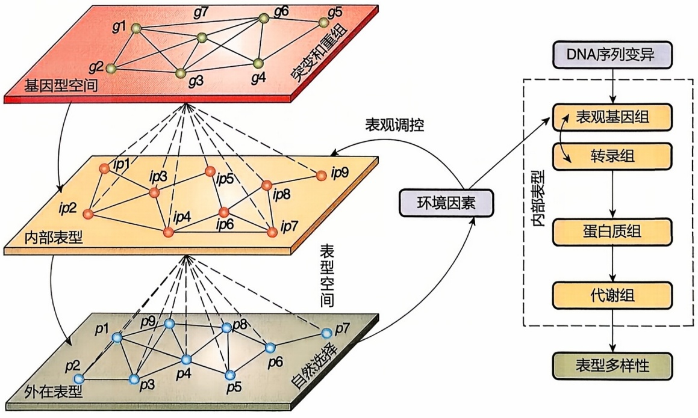

<details>
<summary>flowchart</summary>

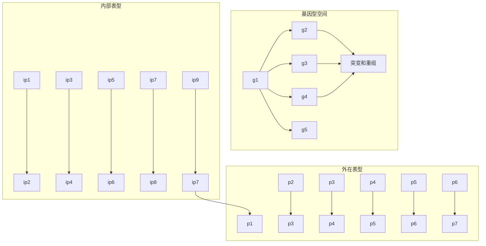
</details>

图 10-1 “基因型-表型”关系图（改绘自 Chen et al., 2013）

---

10.1 表型组学概述

367

## 10.1.2 表型组学研究领域

表型组学的研究通过大规模表型全景精密测量与数据系统解析，贯穿和破解基因-表型-环境、宏观表型-微观表型之间以及宏观表型之间的关联与调控机制，从而全面理解生物系统，最终推动疾病与健康的精准干预、牲畜精准管理和改良、农作物产量和品质提高等。表型组学研究有助于进一步揭示人类健康、生物技术、农业和生命科学其他领域的基本理论和功能基础。

表型包括微观表型和宏观表型。微观表型包括转录组、蛋白质组和代谢组，细胞免疫等特征，微生物等；宏观表型生物体整体可观察或可测量的表型特征，如影像学表征、体貌特征、疾病病症、健康生理状态、环境适应能力等。基于研究对象，表型组学可以分为人类表型组学、植物表型组学、动物表型组学、生态与环境表型组学等。基于表型数据类型，可以分为分子表型组学、细胞表型组学、图像表型组学、功能表型组学等。

## 10.1.2.1 基于研究对象分类

## (1) 人类表型组学

人类表型组学（human phenomics）是描述和分类人类个体在形态、生理、行为和疾病等方面的可观察特征的集合。它涵盖了从分子水平到整个个体的各个方面，旨在为理解人类的生理学、行为学、遗传学等提供一个全面的框架。人类表型组学研究包含以下几个关键方面:首先，运用多种先进技术对人体各类表型进行精准测量，包括基因组测序、蛋白质组分析、代谢组学、表观遗传学等。其次，旨在构建一个多维度、跨尺度、全周期的人类表型参考图谱，从系统全面的角度来描述和理解人类表型。另外，通过构建表型网络，揭示不同表型之间的关联和相互作用，进一步理解表型共性、功能关联和疾病复杂性之间的关系。

## (2) 动物表型组学

2010年，大卫·霍尔（David Houle）等将动物表型组学（animal phenomics）定义为在动物范围内获取高维表型数据的过程。后来保罗·格林伍德（Paul Greenwood）等将这个定义扩展为对高密度行为和生理输入实时获取，并与描述生产环境的数据相结合而产生指导实际生产的措施。作为一门生物学领域的新兴分支，动物表型组学旨在研究动物的表型特征，从分子、细胞、器官到整体生物体水平，揭示遗传背景和环境之间的相互作用对生物体表现的影响，它代表了对个体动物测量的性状、获取这些性状的方法以及分析数据所需算法的集合，识别准确且可重复的性状测量或表型有助于精确的牲畜管理和遗传改良。

动物表型组学的表型数据包括生长速度、体重、饮食习惯、运动行为、生殖特性、免疫反应等。通过使用分子生物学和基因组学技术，识别与特定表型相关的基因，探索遗传背后的机制。动物表型组学研究还关注环境因素对动物表型的影响，包括了解环境条件对生长、行为和生殖的影响，以及如何适应和应对不同的环境挑战。另外，通过比较不同物种或不同个体的表型，提供关于进化过程的见解，有助

---

368

10 表型组学

于理解为什么不同物种在表型上有不同的特征和适应性。

## (3) 植物表型组学

植物表型组学（plant phenomics）是一门研究植物的可观测特征和性状的学科。利用先进的高通量技术和数据分析方法，植物表型组学系统性地描述、量化和分析植物的生物学特性，包括形态、结构、生长、发育、生理、代谢、抗性等各方面的性状，理解植物如何响应环境条件、生物胁迫、遗传变异以及其他因素，以及如何提高植物的适应性、生产效率和品质。

植物表型组学的研究范围包括从单一植物个体到植物种群和生态系统的多个层次，以及从基因组到生态系统水平的多个尺度。植物表型组研究包括研究植物形态和结构特征，如植物的植株形状、叶片的大小和形状、花朵和果实的外观等；探究植物的生长和发育过程，如生长速率、生长期的长度、生长的分布在植物各部分的方式；测量影响植物生长的因素，包括光、温度和水分等；了解植物的生理过程，如光合作用、呼吸作用、水分及养分吸收和运输等。此外，研究植物对生物和非生物胁迫的反应也很重要，包括植物的抗病性、抗虫性、耐盐性、耐旱性等，有助于改进农作物品种，使其更能抵抗各种生长条件下的压力。最后，通过研究植物的遗传信息和表型数据，可以识别与特定性状相关的基因，有助于植物育种工作，使其更加精确和高效。

## （4）生态与环境表型组学

生态与环境表型组学（ecological and environmental phenomics）关注自然环境中物种表型的多样性及其生态和进化意义，探讨生物在面对环境压力时表型可塑性的表现及其适应性价值。生态与环境表型组学是一门研究生物体在其自然环境中如何表现出不同的表型特征，并探索这些表型特征如何帮助生物适应环境变化的科学。这一领域利用高通量技术，测量生物在多种环境条件下的表型，分析这些表型数据来解释生态系统中的生物多样性和生态动态。研究表型特征如何帮助生物适应其生态位，包括食物获取、捕食者避避、繁殖策略等。利用表型组数据监测环境变化的生物学效应，并预测未来环境变化对生物多样性的潜在影响。生态与环境表型组学揭示了表型在自然环境中的形成机制以及表型变异如何影响生物的生存和繁殖成功，进而对生态系统功能和稳定性产生影响。

## 10.1.2.2 基于表型数据类型分类

表型组的研究涵盖分子、细胞/组织、图像以及功能等不同类型，跨越了微观和宏观的多个层面，全面揭示了个体的发育过程、生理状态、心理特征等方面，有助于构建表型组研究的全景图和深入掌握个体的生物特性。

## (1) 分子表型组学

分子表型组学（molecular phenomics）关注生物大分子的表型特征，包括但不限于:转录组表型，即在特定条件下个体的基因表达模式，揭示生物学过程和疾病的发病机制；代谢组表型，研究关注个体内各种代谢产物的相对含量，通过分析代谢物的变化，可以了解个体的代谢活动、营养状态和代谢途径的调节；蛋白质组表

---

10.1 表型组学概述

369

型，关注个体内蛋白质的表达模式，对了解蛋白质在细胞功能、信号传导和疾病发展中的角色至关重要；宏基因组表型，研究探究微生物群落的组成和功能，特别是肠道微生物群落，对个体的健康和疾病具有深远的影响；表观遗传组表型，研究关注基因组中的表观遗传修饰，如DNA甲基化和组蛋白修饰，这些修饰可以影响基因表达和细胞功能，对疾病和环境因素的响应具有重要意义。

## (2) 细胞表型组学

细胞表型组学（cellular phenomics）通过高通量技术和系统生物学的方法，全面分析和表征细胞的表型特征和行为，包括细胞的形态、结构、功能、动态变化和响应环境刺激等。利用自动化显微镜、流式细胞仪和高内涵筛选等技术，能够在短时间内从大量细胞中获取丰富的表型数据，捕捉细胞在时间、空间和不同环境条件下的表型变化。先进的成像技术和图像分析算法可以精确测量细胞的形态、运动、增殖、凋亡和分化等特征，结合计算机视觉和机器学习技术，自动化处理和分析大规模图像数据。通过整合基因组学、转录组学、蛋白质组学和代谢组学的数据，细胞表型组学构建多层次的细胞表型网络，理解细胞功能和调控机制。该领域广泛应用于药物筛选和开发、疾病研究、基因功能研究、个性化医学和发育生物学等方面，能够通过高通量筛选快速识别潜在药物，分析病变细胞的表型变化，探索基因与细胞功能的关系，并根据患者细胞的表型特征制定个性化治疗方案。组织和器官表型组学则关注各器官和组织的形态学、组成和功能学特征。观察到组织的大小、形状、结构排列等外观信息，以及各种细胞类型、细胞外基质以及其三维空间组织关系。这些特征与组织的生理功能密切相关。研究类器官表型就通过体外模型模拟器官或组织的功能和结构，深入理解器官发育和疾病机制。

## (3) 图像表型组学

图像表型组学（image-based phenomics）主要利用高通量图像分析技术来获取和分析生物体的表型数据，这些表型一般指生物体的可观察特征或特性，包括形态、发育、行为和生理等方面。通过显微镜、磁共振成像（magnetic resonance imaging, MRI）、X射线或计算机断层扫描（computed tomography, CT）、超声波和光学成像等技术，图像表型组学捕捉生物体在不同条件下的表型变化，从而进行深入的表型分析和研究。其主要特点和优势包括:高通量数据采集，利用自动化成像设备在短时间内采集大量高分辨率图像数据；多维数据分析，捕捉时间、空间、光谱等多个维度的信息，提供全面和详细的表型数据；高精度和高分辨率，捕捉细微的表型变化；计算机视觉和机器学习，通过先进的图像处理算法和机器学习技术对海量图像数据进行分析，提取关键特征和模式；非侵入性，不破坏样本即可获取大量信息。图像表型组学广泛应用于农业（监测作物的生长、发育、健康状况及其对环境变化的响应）、医学（通过图像分析检测疾病的表型特征辅助诊断和治疗）和生态学（研究不同环境条件下生物群体的表型变化和适应机制）等领域，通过高效、精确和非侵入性的图像分析技术，能够更全面地理解生物体的复杂表型特征，为研究生物体功能提供重要数据信息。

---

370

10 表型组学

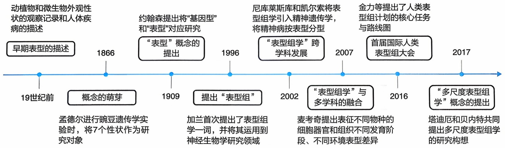

<details>
<summary>flowchart</summary>


</details>

图10-2 表型组学发展历程

## (4) 功能表型组学

功能表型组学（functional phenomics）关注个体的形态学特征、生理特征、心理和行为特征等。形态学特征包括个体面部结构和五官特征、皮肤特征、毛发特征、手足特征、牙齿形态、身体对称性特征等。生理表型涵盖生物电信号、血氧、体温、激素水平、心跳和血压等生理指标，以及代谢表型、免疫反应特征、内分泌功能、神经功能、运动功能、心血管功能、呼吸功能等复杂生理表型。心理和行为特征表型包括智力和认知能力、人格特质、情绪和情感调节、心理应激反应、心理健康和精神疾病、社交行为、冲动控制等。此外，还可以研究睡眠表型，包括睡眠时间、质量和结构，语言和语音表型，包括语言流利度、语音音质和音量等特征，以及中医表型，反映疾病外在表现和内在本质的一组特定表型的集合，如发热、恶寒、气短、心悸、舌象、脉象、体味等，为中医诊断和治疗提供综合评估和辨识。

## 10.1.3 表型组学的发展历程

表型组学的发展历史是一个承载着科学技术进步、交叉学科合作和生物学研究新范式演变的故事。从最早的表型描述到今天的高通量数据分析，表型组学已跨越了数个发展阶段（图10-2）。

## (1) 第一阶段: 早期表型的描述

表型组学的历史可以追溯到古代，当时的自然历史学家、植物学家、动物学家（如亚里士多德、普林尼大帝、希波克拉底）通过观察和记录植物、动物和微生物的外观性状，为表型描述奠定了基础。随着时间的推移，物种分类学逐渐成为早期表型描述的一个重要领域。卡尔·林奈（Carl Linnaeus）是分类学领域的重要人物，他开创了现代生物分类学，通过命名和分类物种，将表型描述系统化，并创立了生物学中使用的命名法规（拉丁学名）。这一举措标志着对生物多样性进行系统化描述的开始。自然历史学的早期探险家和科学家，如查尔斯·达尔文（Charles Darwin）、阿尔弗雷德·华莱士（Alfred Wallace）和亨利·贝茨（Henry Bates），在全球范围内进行探险和野外观察，记录了大量生物物种的表型特征，为理解生物多样性的地理分布和适应性提供了关键信息。

---

10.1 表型组学概述

371

## (2) 第二阶段: 遗传学的兴起

19世纪末至20世纪初，遗传学开始崭露头角，为表型研究提供了新的理论基础。格雷戈尔·孟德尔（Gregor Mendel）通过豌豆的性状遗传研究，把豌豆的7个性状作为“表型”研究“遗传因子”，将遗传因子与表型之间的关系引入生物学研究，提出了遗传学的基本定律，包括隐性和显性性状、基因的分离定律等。这些定律奠定了遗传学的基础，为基因型和表型之间的关系提供了关键见解。1909年，丹麦生物学家威廉·约翰森（Wilhelm Johannsen）将孟德尔提出的遗传因子定义为“基因”，正式提出了“表型”（phenotype）这一概念。他强调，不同的基因型可能导致不同的表型，同一个表型也可能由不同的基因型所决定。

## （3）第三阶段:表型组学的崛起

20世纪中叶，分子生物学的兴起推动了基因和生物表型的深入研究。DNA的结构解析和基因的功能研究使得科学家们能够更深入地了解基因如何影响生物体的表型特征。进入20世纪90年代，基因组学的飞速发展带动了从基因到基因表达各环节的研究，伴随着新技术和新方法的涌现，形成了包括基因组学、蛋白质组学、转录组学、代谢组学等在内的多种组学研究方向。在这一背景下，表型组学应时而生。1996年，史蒂文·加兰（Steven Garan）在滑铁卢大学的一次应邀演讲上首次提出了表型组学一词，并将其运用到人类神经生物学研究领域。同期，针对植物单一或系列表型的研究开始受到广泛关注，并逐渐发展成为生物学研究中的一个重要分支。这个时期的研究重点是探究单个性状是如何受遗传与环境因素共同影响的。

## （4）第四阶段:表型组学的蓬勃发展

随着表型组学的兴起，科学家们开始意识到要全面理解生物体的特性，需要将多个学科领域的知识和技术整合起来。表型组学不仅涵盖了生物学，还包括统计学、计算生物学、生物信息学、工程学等多个领域的交叉合作，这一跨学科整合推动了表型组学的快速发展。例如，2002年，约翰·凯尔索（John Kelsoe）和亚历山大·尼库莱斯库（Alexander Niculescu）将表型组学这一概念引进精神遗传学，在精神病表型的实验研究中，将精神病按照表型进行分型，认为表型组学是基因组与表型之间的重要桥梁；2007年，美国康奈尔大学植物分子遗传育种学家苏珊·麦考奇（Susan McCouch）认为，表型组学研究应与高分辨率连锁图谱、全基因组关联分析和基因组选择模型等技术紧密结合，通过建立强大的表型分型系统，精确表征不同物种的细胞、器官和组织在不同发育阶段、不同环境中的表型差异，将表型组学研究逐渐从细胞层面上升到群体层面。

随着技术的不断进步和国际合作的深化，人类表型组学取得了快速的发展。2003年，纳尔逊·弗莱默（Nelson Freimer）和基亚拉·萨巴蒂（Chiara Sabatti）在Nature Genetics杂志上首次提出了“人类表型组计划”的概念，并倡导全球科研力量共建表型组数据库、共享数据，开发新的分析技术。2012年，美国人类遗传学年会召开主题“为人类表型组计划做准备”的分论坛，强调了合作、数据共享和数据互操作性

---

372

10 表型组学

的重要性，以推动遗传变异与疾病关系的研究。2020年，英国颁布政策文件《基因组英国》（Genome UK），强调基因组学基础设施结合深度表型测量和临床表型数据的重要意义。2021年，约书亚·丹尼（Joshua Denny）和弗朗西斯·柯林斯（Francis Collins）在Cell杂志上探讨了精准医学未来十年的七大发展趋势，特别提到了建立大规模可互操作的纵向队列以及收集更丰富表型组和环境暴露数据的必要性。多国启动了相关的科研计划并建立了研究平台。2019年，澳大利亚成立了国家表型组中心。2021年，美国建立了表型组健康组织并启动了超越人类基因组计划（Beyond the Human Genome Project, BHG）。2022年，国际人类表型组计划的共同发起人、国际人类表型组研究联盟（International Human Phenome Consortium, IHPC）共同主席、美国四院院士勒罗伊·胡德（Leroy Hood）启动了美国人类表型组倡议（US Human Phenome Initiative）。该倡议由美国系统生物学研究所（Institute for Systems Biology, ISB）和谷歌等多个合作伙伴支持，旨在10年内建立100万人的纵向表型数据库。同年，英国启动了健康研究项目“Our Future Health”试验阶段，计划纳入500万名参与者，希望对国家人口的健康状况有一个广泛的认识，同时开发新的预防和治疗疾病和健康状况的方法，包括癌症、老年痴呆症、心脏病、关节炎、糖尿病和中风等。新加坡启动了SG100K纵向研究项目，计划在未来几十年里，对10万名新加坡居民进行研究，以识别与新加坡高发疾病（如糖尿病、高血压和癌症）相关的社会、环境、生活方式和遗传因素。

中国在推进国际人类表型组计划方面发挥着重要作用。2015年，中国科学家金力院士、王辰院士、徐涛院士为代表发起并组织了“国际人类表型组研究”香山科学会议，标志着国际人类表型组计划的起步。2016年，复旦大学在上海举办了“首届国际人类表型组大会”，会议上金力院士首次明确提出了人类表型组计划的核心使命与实施路线图，旨在通过全球范围内的“分布式”协同测量与数据协同分析，创建全球人类表型组参比图谱。2018年10月，IHPC在上海成立。同年，上海建设了全球首个跨尺度多维度人类表型精准测量平台和表型组大数据平台，为全球表型组研究提供了重要的技术支持和数据资源。2019年，上海国际人类表型组研究院成立。2020年，中国推出“一带一路”人类表型组研究平台，加强与共建国家的合作，促进人类表型组学的国际交流与发展。在学术交流方面，复旦大学与施普林格·自然出版集团合作创办了表型组学期刊Phenomics，作为IHPC的官方会刊和人类表型组国际大科学计划的旗舰期刊，已收录于PubMed Central（PMC）、ESCI、Scopus等数据库，具有一定的学术话语权和国际影响力。至2022年，IHPC已汇集了来自20个国家、24个科研机构的成员，包括14位国际院士和10位领军科学家。

动植物表型组学在全球范围内同样发展迅速。欧美澳国家投入了大量的时间和经费来建设可共享的植物表型研究中心，并成立了相关表型学术组织，如澳大利亚植物表型研究中心（Australian Plant Phenomics Facility, APPF）、德国 Jülich 植物表型研究中心（Jülich Plant Phenotyping Centre, JPPC）、德国植物遗传和作物

---

10.1 表型组学概述

373

## 知识窗

## 国际人类表型组研讨会和中国人类表型组大会

“人类表型组计划”在“人类基因组计划”之后成为生命科学的新战略高地，推动生物医学研究、精准医学和大健康产业的革新与发展。国际人类表型组研讨会和中国人类表型组大会作为此计划的核心交流平台，汇聚全球专家探讨表型组学的前沿进展和实际应用，加速全球范围内的科技合作与创新。

自 2016 年起，国际人类表型组研讨会每两年举行一次，中国人类表型组大会从 2019 年开始，每年召开一次。最近的一次活动，即“第四届国际人类表型组研讨会暨第五届中国人类表型组大会”，于 2023 年 10 月 31 日至 11 月 4 日在上海成功举行。本次大会的主题为“Human Phenomics: New Frontiers of Life Science”（人类表型组学:生命科学的新前沿），吸引了18位院士和众多学者，共举行了70场精彩报告。

大会设有主旨报告、跨界对话以及八个专题分论坛。这些论坛涵盖了从表型组学在新冠病毒长期防治中的应用，到分子表型组学的最新进展，再到分子影像技术、时空组学新技术、表型组学的临床转化应用、质量控制与标准化的创新、生物大数据与人工智能的融合应用，以及大型队列与深度表型组队列的研究。这些广泛的讨论促进了表型组学在全球科学研究和应用领域的深入发展。

研究所（the Leibniz Institute of Plant Genetics and Crop Plant Research, IPK）、荷兰植物生态表型研究中心（Netherlands Plant Eco-phenotyping Centre, NPEC）、英国国家植物表型研究中心（National Plant Phenomics Center, NPPC）、加拿大植物表型与影像研究中心（Plant Phenotyping and Imaging Research Center, P2IRC）等，比较活跃的学术组织包括国际植物表型协会（International Plant Phenotyping Network, IPPN）、欧洲植物表型协会（European Plant Phenotyping Network, EPPN）和德国植物表型协会（Deutschland Plant Phenotyping Network, DPPN）等。在国内，多个研究单位也先后建立了植物表型研究平台，如华中农业大学作物表型中心、南京农业大学植物表型学研究中心等，大大加速了作物表型组学的应用和发展。2017年，法国植物表型协会主席、法国国家农业研究院（INRA）作物生理生态学家弗朗索瓦·塔迪厄（Francois Tardieu）和英国诺丁汉大学植物学家马尔科姆·贝内特（Malcolm Bennett）共同提出多尺度表型组学（multiscale phenomics）研究的构想。从概念提出至今，表型组学以其强大的数据获取和解析能力持续致力于研究环境、基因和表型之间的相互作用，广泛应用于基础研究和应用基础研究。

表型组学的发展历史反映了科学研究的演进，从最初基于观察的表型描述到当下的高度自动化与数据驱动研究。这一过程不仅彰显了生物学丰富的多样性和内在复杂性，而且提供了深入探究生物特性与适应机制的关键工具，为生命科学领域未来的发展开辟了新的视野。表型组学的进步，特别强调了理解基因、环境与表型相互作用的重要性，对于揭示生命现象的本质具有不可替代的作用。

拓展阅读10-1

Phenotype-Genotype Integrator (PheGenI) 简介

---

374

10

表型组学

## 10.2 表型组学数据

## 10.2.1 表型组学的数据来源

表型组数据主要通过高通量和自动化表型测量技术获取，以提升表型测量的效率、准确性和可重复性，为深入开展表型组学研究提供了坚实的基础。以下是部分生成分子、细胞与类器官、图像和功能表型数据的主要技术和方法（表10-1）。利

表 10-1 部分表型测量的技术及方法

| 相关技术/维度 | 研究方法 |
| --- | --- |
| 分子水平 | ·转录组学:基因表达、可变剪接等高通量定量分析 ·高级质谱:蛋白质的高通量定量分析 ·蛋白质芯片技术:连续动态监测蛋白质的状态变化 ·代谢组学:结合核磁共振和质谱技术,精确测定代谢物种类和浓度,探索代谢途径 ·微生物组:全面描绘人体微生态系统成分 ·表观组学:包括全基因组甲基化分析、染色质免疫沉淀以及单细胞表观组学等高分辨率下检测表观遗传学变化 |
| 细胞/组织水平 | 流式细胞术:同时对数万个细胞的多个特征进行定量和定性评估,深入分析细胞表型和信号通路 ·高通量微电极阵列:同时记录多细胞电信号,提供高时空分辨率数据 单细胞测序:分析单细胞基因表达特征,揭示细胞间异质性 ·空间转录组:结合空间信息,研究组织内基因表达的空间模式和细胞间相互作用 高通量筛选:快速识别和分析大规模样本中的目标分子或细胞,应用于药物发现和基因分析 O2k能量代谢分析:通过测量氧气消耗率实时评估细胞呼吸和能量产生,用于能量代谢研究 |
| 图像水平 | ·高分辨率显微镜:如荧光显微镜、共聚焦显微镜,用于观察细胞和微观结构,深入了解细胞功能和疾病机制 三维细胞成像:利用共聚焦和多光子显微镜获取三维高分辨率图像,揭示细胞结构和相互关系 医学影像技术:如核磁共振成像、电子发射断层扫描等,提供深层次组织结构的清晰、精确视图,用于疾病早期诊断和病理研究 ·可见光成像:用于监测动物的行为、生活习性及生命周期,或者捕捉植物外观和结构信息,观察植物生长发育和形态变化 ·红外成像:利用红外光波段捕捉热辐射或反射信号,以研究植物的生理、健康和化学状态,或者监测动物体温分布、活动模式和生理适应性 荧光成像:基于植物组织中荧光素分子的光能吸收和荧光发射,通过特定设备转化为图像,研究植物的生物过程 |
| 功能水平 | 传感系统:包括可穿戴设备和非接触式设备,如智能手环、红外成像技术,实时监测人或者动物的生理、行为信号及环境互动 心理测量工具:通过问卷、量表和任务测验等检测认知、人格、幸福感、心理应激,以及焦虑、抑郁状态等个体在心理特征和行为模式上的可观察表现中医生理特征:对体质、病症、脉象、舌象等方面进行系统的描述和分类 脑电波检测:分析计算信号在不同频率上的功率分布,识别不同频段的脑电活动 皮肤及附属物检测:测量皮肤基础生理指标,如温度、pH、油脂含量、色素沉着、肤质、表皮含水量、厚度、纹理、弹性,以及附属器指甲、毛发等的形态、功能等特征。以及对皮肤附属器表型测量,如脱发、毛发性状、粗细、密度、汗腺密度及功能、指甲形态、指甲厚度、指甲纹理及甲襞微循环等 |

---

10.2 表型组学数据

375

用这些方法，科学家们迅速且精确地获取和分析海量数据，探索和理解生物体的表型特征，以及它们是如何相互作用、对环境变化做出反应的。

## 10.2.2 表型组学的数据特点

表型组学覆盖的数据类型极为广泛，涉及从观察到的各类信息到精确测量的结果。这些数据包括但不限于:通过生物化学分析得到的代谢物浓度、利用成像技术捕获的组织结构与细胞形态、记录的行为与运动模式，以及测量得到的生物标志物和健康指标等。表10-2详述了表型组学数据的主要特征。

表 10-2 表型组学的数据特点

| 特点 | 描述 |
| --- | --- |
| 多样性 | 涵盖从人类到微生物的各种生物体的形态学、生理学等表型特征 |
| 高维度 | 包含多种类型的特征或变量（数值型、分类型、文本型等），导致数据结构高维复杂 |
| 大规模 | 涉及成千上万乃至数百万的样本，对计算能力和存储资源要求极高 |
| 时序性 | 包含随时间变化的数据，如生长曲线、代谢活性等，要求跟踪时序变化 |
| 异质性 | 数据来源多样和技术差异带来的质量、精度、可信度差异，需要仔细清洗和标准化 |
| 数据关联性 | 特征间存在密切关联，如基因型与表型、环境因素的相互作用 |
| 复杂性 | 表型特征受基因型、环境等多因素影响，分析时需要考虑这些综合因素 |

## 10.2.3 表型组学的数据编码系统

标准、通用的编码系统可以标准化和统一表型特征的描述，对于数据交流与共享、数据比对与基础，以及临床应用等方面至关重要。首先，这些系统确保了数据在不同研究机构、数据库和平台之间的互操作性和一致性，这促进了数据共享、知识交流和跨学科合作。其次，它们确保数据集之间的相容性和可比性，促进不同来源表型数据的整合。最后，它们有助于帮助医生和临床研究人员更准确地记录和描述患者的表型特征，支持表型与疾病之间的关联分析，为精准诊断、治疗和预防提供了重要参考。以人类表型组为例，国际上广泛使用的编码系统见表10-3。

表 10-3 常用人类表型组编码系统的比较

| 编码系统 | 主要用途 | 主要实体种类 | 规模 | 使用许可 |
| --- | --- | --- | --- | --- |
| 人类表型本体论(human phenotype ontology, HPO) | 标准化描述人类表型异常,支持临床诊断和生物医学研究 | 人类表型异常的描述,包括症状、体征、异常实验室结果等 | 约16000个概念,13000个表型条目 | 开源 |
| 国际疾病分类(international classification of disease, ICD) | 国际通用的疾病分类方法,用于流行病学、健康管理和临床工作 | 疾病、伤害、死因 | 约55000个编码,分为22个章节 | 开源 |

---

376

10 表型组学

续表

| 编码系统 | 主要用途 | 主要实体种类 | 规模 | 使用许可 |
| --- | --- | --- | --- | --- |
| 医学系统术语标准化命名:临床术语(systematized nomenclature of medicine-clinical terms, SNOMED-CT) | 提供临床术语标准,支持电子健康记录和临床决策 | 疾病、过程、观察结果等临床概念 | 约340000个活跃概念,超过1360000个概念关系 | 需要许可 |
| 疾病本体论(disease ontology, DO) | 提供疾病分类框架,支持生物医学研究 | 人类疾病 | 约7000种疾病概念 | 开源 |
| Orphanet罕见病数据库 | 提供罕见病信息,支持诊断和研究 | 罕见病及相关基因 | 约7000种罕见病,3700种基因 | 部分开源 |

## 10.2.4 表型组数据的标准物质

标准物质通常是经过精确测定并广泛认可的参考材料，为不同实验室和平台提供可比较的基准，用于表型组学实验中的质量控制和方法验证。它们用于校准实验设备、验证分析方法的准确性，并作为不同实验或实验室之间的对比参照，以确保数据的一致性和可比性。

复旦大学与中国计量科学研究院共同研发了首批国家一级标准物质——“中华家系1号”（Chinese Quartet）。这一标准物质来源于同卵双胞胎家庭（人源）永生化B淋巴母细胞系，涵盖了DNA、RNA、蛋白质和代谢物等多种生物分子，是全球首套具备多组学特性的生物学标准物质。项目牵头人石乐明教授参与了上海市标准化创新中心（国际人类表型组）的标准化研究，围绕“数据产生、数据分析、数据解读”等研究阶段，进行人类表型组研究数据的全方位质量控制，提升了人类表型组数据的“准确性、溯源性、一致性”，有利于深度挖掘和利用人群的生物样本和表型组学数据，促进人类表型组学的系统思维设计，支持全表型关联分析，推动精准医学的发展。“中华家系1号”将助力提升生命科学创新的源头质量，为高质量、高可靠性的多组学研究提供保障，同时为全球人类表型组计划的推进奠定坚实的标准基础。

“中国人群运动与认知功能定量参数正常值数据库”基于两项多中心临床研究，提供了中国正常成人的运动与认知功能定量常模。该数据库包含来自12个省（自治区、直辖市）的约1800名成年人样本，涵盖运动功能和认知功能的多项定量评估指标，并按年龄、性别、受教育程度分层。其中，运动功能测量涵盖了一系列动作，包括上肢运动、姿势控制、一字步行走和自然行走等，评估的参数包括完成动作时间、摇晃程度、步速、步高、步宽、步频和步幅等，还包括基于多项运动量表的半定量评分。认知功能测量则涵盖注意力、记忆力、定向力、执行能力、视空间构建能力、语言推理等。这些数据为研究人员提供了可靠的参考基线，有助于深入理解神经功能与脑功能的复杂关系。

---

10.3 表型组学的数据分析

377

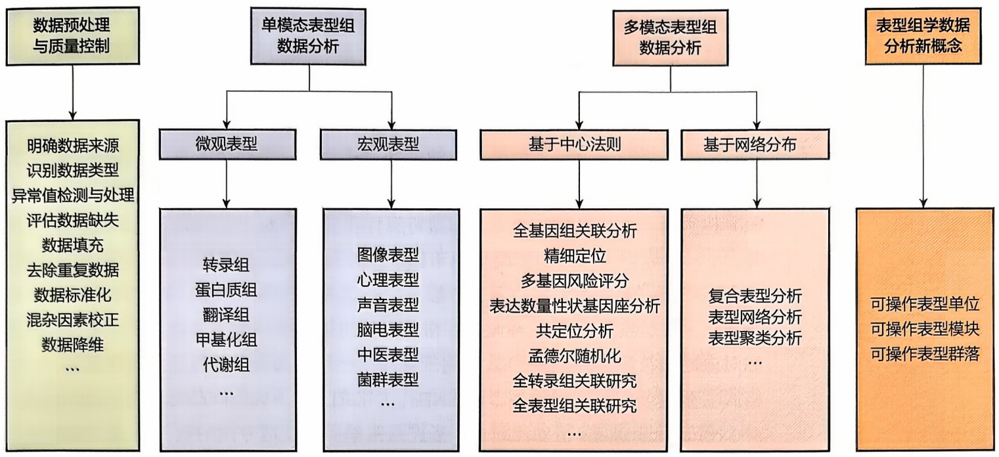

<details>
<summary>flowchart</summary>

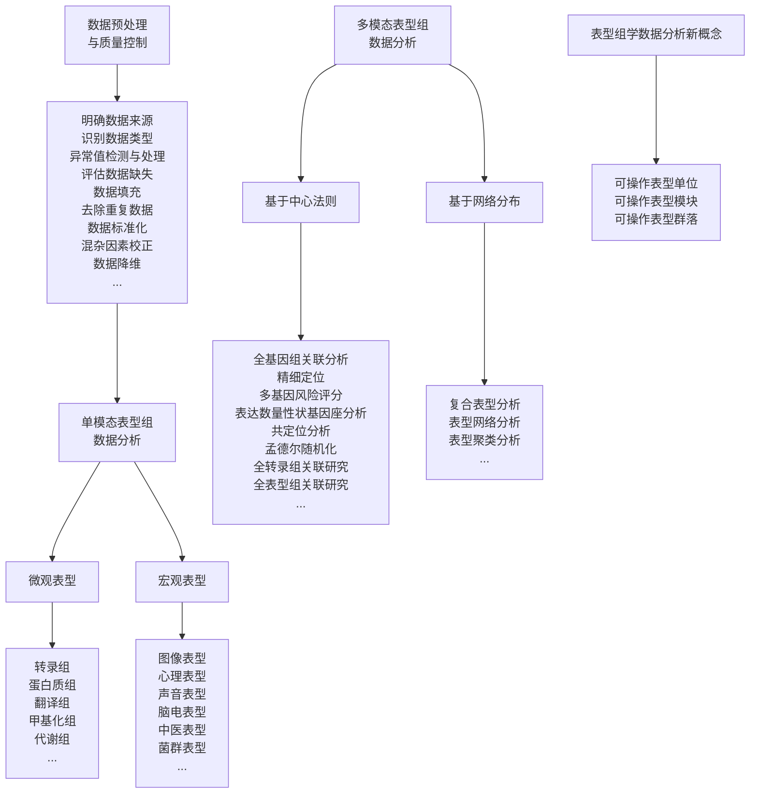
</details>

图10-3 表型组的数据分析流程图（利用BioRender软件绘制）

## 10.3 表型组学的数据分析

数据分析是表型组学的核心工具。生物信息学家的一个重要任务是在庞大的数据海洋中挖掘和识别有价值的信息。本节提供了表型组数据的整体框架（图10-3），将首先介绍表型组学数据的预处理与质量控制流程，随后详细讲解常用的分析方法。单模态表型组微观表型的数据分析已在前面的章节进行了详尽讨论，本节将不再赘述。本节着重介绍几种宏观表型，如图像、声音、菌群和心理表型的分析方法，以及深入探讨两种或以上不同模态数据的联合分析。最后，引入表型组学数据分析新概念，为未来的研究提供新的分析思路。

## 10.3.1 表型组数据的预处理与质量控制

随着表型数据量的爆炸性增长，来自不同来源和实验室的数据变得日益丰富且多样化。为了确保数据收集的准确性和一致性，数据整合和标准化成了必不可少的步骤。如上一节介绍，采用标准化的科学术语和本体，确保描述的统一性和清晰性；开发参考材料，为不同实验室和平台提供可比的基准，以确保测量结果的一致性；制定标准操作程序，为实验和数据分析过程设立明确的指导方针和步骤，确保所有研究者都遵循相同或相似的方法进行操作；此外，还应在不同学科领域之间制定通用的测量和分析标准，确保跨领域的协调和数据的一致性。

在表型组学的数据分析中，预处理与质量控制应重点关注以下几个方面。

## （1）明确数据来源

这一步要求对数据的原始来源进行全面了解和记录，涉及数据的类型、实验流程、技术平台和批次等多方面信息。例如，在处理公共数据库的 RNA 表达数据或自行实验

---

378

10 表型组学

产生的数据时，不仅要记录实验设计、参与者信息、样本处理方法等，还要注意采集时间、设备、试剂批次、测序平台等细节。对于公共数据库的数据，还应明确记录数据来源、检索时间和使用的筛选标准，以确保后续分析的准确性和研究结果的有效性。

## (2) 识别数据类型

识别数据的种类对于选择合适的处理方法和分析策略至关重要。表型组数据覆盖了诸如遗传数据、表观遗传数据、生物化学数据、生理数据、行为数据等多种多源异构数据。了解每种数据类型的独特属性和变异性对于正确处理这些数据至关重要。不同的数据类型可能需要采用不同的预处理方法，如数据标准化、处理缺失值、检测离群值等。数据类型的识别依赖于审查实验文档和元数据，而文件格式的分析也提供了关键线索。例如，FASTQ格式通常用于存储原始测序数据，包括测序读段和对应的质量评分；BAM格式常用于保存已经比对到参考基因组的测序读段；VCF格式主要用于存储变异数据，如SNPs、INDELs和SVs。DICOM（digital imaging and communications in medicine）格式是医学影像领域专用的数据格式，包括图像数组信息以及拍摄日期、拍摄条件、患者信息等；FCS（flow cytometry standard）是流式细胞仪数据的标准文件格式，用于记录细胞的物理和化学特性。

## （3）离群值检测与处理

离群值，或异常值，是指显著偏离其他数据点的值，它们可能对数据集的统计指标（如均值、方差及相关性）产生显著影响。离群值的产生可能由测量错误、输入误差、数据污染，或实际的统计离群现象等多种原因导致。为了识别这些值，可以采用多种方法，包括计算并分析基本统计指标（如均值、中位数、标准差），通过直方图和箱线图可视化数据分布识别数据集中的异常区域，运用聚类分析和Z-score方法等高级技术准确找出离群值。在处理离群值时，根据它们的来源及对研究目标的潜在影响，可以选择删除、修正、替换或保留这些值。值得注意的是，虽然离群值有时是错误或噪声，但它们也可能携带重要信息，尤其是在研究异常现象或新趋势时，因此在处理这些值时应谨慎考虑。例如，在一个数据集中，绝大多数值集中在 $10\sim 20$ ，而只有极少数值在50以上，这些高值可能是离群值。在处理这些值时，可以选择删除它们，或进一步分析它们的成因，以决定它们是否是数据录入错误或反映了某种重要的、未被注意到的现象。

## （4）评估数据缺失

数据缺失，即数据集中某些信息或数值的不完整，对分析和结论的准确性可能产生显著影响。评估数据缺失首先涉及统计缺失的数据量和比例。对于关键字段的高缺失率（如超过 $50\%$），需要采取特殊处理措施或进行额外的数据收集；相对地，如果缺失比例较低（如不超过 $5\%$），可能选择简单地剔除这些缺失值，因为它们对总体数据集的影响较小。其次，需要区分缺失数据的类型，包括完全随机缺失（missing completely at random, MCAR）、随机缺失（missing at random, MAR）和非随机缺失（missing not at random, MNAR）。例如，在一个包括患者姓名、年龄、性别和疾病诊断的数据集中，如果疾病诊断的缺失与其他信息无关，则属于完全随

---

10.3 表型组学的数据分析

379

机缺失。若诊断信息的缺失主要出现在某个特定年龄段，这种缺失虽与年龄相关，但在已知年龄的条件下可视为随机。而若疾病较为严重的患者诊断记录缺失，这说明缺失与疾病的严重度（一个未观测变量）相关，即为非随机缺失。在这一评估过程中，利用缺失热图等可视化工具能有效辅助识别缺失值的分布模式和趋势。

## (5) 数据填充

数据填充是处理缺失信息的过程，旨在维持数据集的完整性和可用性。面对数据集中的空缺，常见的填充方法包括均值/中位数填充、回归填充和多重插补，具体选择取决于缺失值的数量、随机性和数据间的关系。均值/中位数填充是简单的方法，适用于随机且数量不多的缺失情况。当变量间存在相关性时，通过建立回归模型预测缺失值更为合适。这种方法利用已有数据间的关系来估算缺失值。多重插补是一种处理多变量复杂缺失模式的高级方法，其基本思想是:对每一个缺失值，不简单地填充一个单一估计值，而是生成多个不同的预测值，从而创建出多个“完整”版本的数据集。然后对每个“完整”数据集分别进行后续的分析，最后综合这些分析结果，得到关于原始数据的最终分析推断。以细胞样本数据集为例，对于随机少量缺失的酪氨酸表达量，可采用均值或中位数进行填充。而对于同时缺失ACTIN和Tublin表达值的细胞B，通过建立基于其他蛋白质表达量的回归模型，预测ACTIN和Tublin的表达量区间，随后应用多重插补生成多个候选值以填补缺失，从而允许在考虑变量间复杂关系的同时，提供更加可靠的分析结果。

## (6) 去除重复数据

去除重复数据是通过识别和删除数据集中的重复记录，以确保数据的唯一性和准确性。常用的去重方法有查重编码法、样本比对法和主成分分析法。查重编码法通过为每条记录生成一个独特的标识符或编码来识别重复记录。这种方法在处理大规模数据集时特别有效，但它并不能直接解决数据重复的根本问题。相比之下，样本比对法通过设定相似度阈值，直接比较不同记录之间的差异性来判断是否存在重复。这种方法简单直接，但其效果很大程度上取决于阈值的设定。主成分分析法则采用无监督学习技术，将高维数据投影到低维空间进行比较，考虑各特征的权重，但这可能导致一定程度的信息损失。例如，在肿瘤临床研究中，同一患者因更换医院可能产生重复的治疗记录。解决这一问题的策略包括:首先检查患者是否有唯一标识码（如身份证号），用于识别潜在的重复记录；其次，应用样本比对法，通过比较病例的年龄、性别等特征相似度来进一步判断记录是否重复；最后，考虑使用主成分分析法，在综合各特征权重的基础上计算记录之间的相似度。

## (7) 数据标准化

数据标准化是改善数据质量的关键过程，旨在确保数据在不同环境下保持一致性和可比性。它涉及多个方面，如调整数据的结构、单位、精度和数值缩放。标准化的手段包括最大-最小规范化、Z-score标准化、对数转化和分箱等，各适用于不同的场景。最大-最小规范化通常用于将数据映射到[0,1]范围内，消除量纲差异，实现不同特征间的比较。Z-score标准化将数据转化为均值为0、标准差为1的分布，

---

380

10 表型组学

适用于数据分布近似正态的情况。对数转化针对数据分布明显偏斜的情况，通过取对数减小偏斜性，使数据更接近正态分布。分箱方法将连续数据划分为几个不同的水平或类别，如将基因表达量分为低、中、高三个水平，以简化数据分析和理解。

## (8) 混杂因素校正

混杂因素是对主要变量分析产生重要影响的因素，可以是定性的，也可以是定量因素。混杂因素有可能是生物学因素，如年龄、体重、性别等；也可能是技术因素，如实验的不同批次、研究中心或操作人员的差异等。混杂因素往往会带来对主要变量评价的偏倚，需要设计随机对照实验进行控制。然而实际操作中很难完全保证混杂变量的平衡，尤其是实验的样本含量较小，或需要考虑的混杂因素较多时。此时就需要对混杂因素进行事后控制，根据因素的性质和数目的不同，需要采用不同的方法进行校正:当主要结果变量为连续变量时，可采用协方差分析进行校正；当是分类变量时，可采用分层分析；当存在多个混杂因素时，常采用线性回归模型或广义线性回归模型进行校正。

混杂变量分析（surrogate variable analysis，SVA）是一种常用的统计模型，用于校正混杂因素的影响。SVA通常应用于高维数据分析，如微阵列或RNA-Seq实验中的基因表达数据分析，目的是解释除了研究中的生物条件以外的变异因素。具体操作时，SVA模型首先识别出数据中的潜在替代变量或隐藏变量，然后在后续的统计学分析中将这些替代变量作为协变量加入，以实现对混杂因素的控制。SVA的公式如下:

$$
\begin{array}{l} x _ {i j} = \mu_ {i} + f _ {i} (y _ {i}) + \sum_ {l = 1} ^ {L} \gamma_ {l i} g _ {l j} + e _ {i j} ^ {*} \\ = \mu_ {i} + f _ {i} (y _ {i}) + \sum_ {k = 1} ^ {K} \lambda_ {k i} h _ {k j} + e _ {i j} ^ {*} \tag {10-1} \\ \end{array}
$$

其中，观测数据 $x_{ij}$ 可以表征为基因 $i$ 在样本 $j$ 下的基因表达水平。它由几部分构成:基因 $i$ 的平均表达水平 $\mu_{i}$；基因 $i$ 的表达值 $y_{i}$ 的函数 $f_{i}(y_{i})$；$\gamma_{li}$ 是混杂变量 $l$ 对基因 $i$ 表达的影响系数；$g_{lj}$ 是基因 $i$ 对混杂变量 $l$ 的响应；以及随机误差项 $e_{ij}$，表示模型未能解释的变异。

$\gamma_{li}$ 在简化模型中，并不直接估计每个 $g_{lj}$，而是用一组较小的正交向量 $h_{kj}$ 来近似这些替代变量的效应。这些正交向量可以通过奇异值分解（singular value decomposition，SVD）得到，它们捕获了原始替代变量中的主要变异。在这里，$h_{kj}$ 是通过奇异值分解提取的 $k$ 个主要正交向量，这些向量构成了原始替代变量空间的一个有效子空间。$\lambda_{ki}$ 是这些新向量对基因 $i$ 表达的影响系数。

## (9) 数据降维

表型组学数据的特征数量可达数十万至百万级别，这些数据集常含有大量冗余信息和高度相关性特征，并受到技术产生的噪声影响。此外，样本数量通常远少于变量数量，增加了统计分析的复杂度。因此，数据降维技术成为应对这些挑战的关

---

10.3 表型组学的数据分析

381

键策略。

数据降维旨在减少数据维度的同时尽可能保留关键信息，通过转换或投影原始数据，以简化数据结构、提升计算效率，并减轻噪声数据的影响。常见的数据降维技术，如主成分分析、因子分析、独立成分分析、多维尺度分析、t分布式随机邻域嵌入、局部线性嵌入和线性判别分析等，都被广泛应用于表型组的数据分析。本书第2章2.4详细介绍了这些方法及其在数据分析中的应用。

## 10.3.2 表型组数据的常用分析方法

表型组学的数据分析涵盖了单模态表型组数据和多模态表型组数据分析。本节将介绍数个宏观层面的单模态表型组数据分析，以及涵盖两种及以上表型类型的多模态数据分析。

## 10.3.2.1 单模态表型组数据分析

## (1) 图像表型

图像是最常见的表型数据类型之一，图像数据分析利用计算机视觉技术从图像中提取具有生物学意义的特征。这些特征可以帮助科学家和研究人员理解生物过程、诊断疾病、评估治疗效果等，包括了解剖结构、组织器官功能、细胞代谢与生物化学过程等，从宏观到微观的各种层次。日常生活中常见人脸识别、指纹识别中用到的图像表型是生物特征识别领域的重要组成部分，通过对独特生物特征的图像表型进行高精度分析，从而实现身份认证或差异性分析。X射线、超声、CT、正电子发射体层仪（positron emission tomography, PET）、MRI等成像技术，正以其无创、实时、高分辨率等特点推动着医学影像组学的快速发展。例如，利用医学MRI图像分析可以检测脑部肿瘤的位置、大小和形态等信息；从细胞图像数据中不仅可以提取形态特征，如细胞的大小、形状和结构，还可以提取纹理特征（细胞内外的纹理模式）和颜色特征（如组织染色的颜色分布）等。在高通量植物表型分析中，可以使用可见光、红外、荧光、多光谱和高光谱等多种成像技术获取植物的形态、颜色和健康状况信息，还可以利用激光雷达（LiDAR）、近红外光谱（near infrared spectrum, NIR）和超声波传感器等技术测量植物的高度、密度和生物量等。接下来以高通量植物表型分析为例，介绍图像数据处理与分析的流程及方法。

图像表型数据的分析一般要经过图像预处理，如图像去噪、增强、分割等步骤，再提取各种表型特征，如大小、形状、体积等定量表型，以及结构、形态等定性表型，进而对提取的表型特征进行挖掘，如一般统计分析、机器学习或组学间关联分析等（图10-4）。图像预处理的目的是减少不同成像系统带来的影响，使条件下捕获的图像更具可比性。需要考虑的关键问题包括:图像的方向和对齐不一致、图像亮度不均匀、

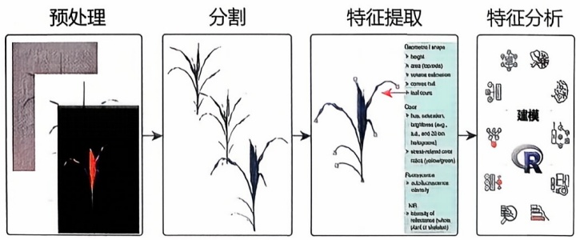

<details>
<summary>flowchart</summary>


</details>

图10-4 图像数据分析基本步骤（改绘自Klukas et al., 2014）

---

382

10 表型组学

图像缩放变化等问题。通过预处理步骤，可以有效提高图像数据的一致性和可比性，为后续的生物学特征提取和分析奠定基础。

图像分割通常用于将图像划分为有意义的对象（如植物部分和背景对象，如花盆、支架和笼子），并识别它们的边界。在分割过程中，图像被分为前景（标记为植物）和背景部分，通常使用不含植物的背景图像（参考图像）进行初始背景减除。图像分割是计算机视觉和图像处理中的一个重要任务，常见的图像分割算法包括以下几种。

① 阈值分割 对于给定的图像 $I(x,y)$，阈值分割（thresholding）方法通过设定阈值 $T$ 来实现前景与背景的分离。例如，如果前景和背景的像素具有两种不同的灰度值，可以通过比较像素值与阈值 $T$ 来决定它们的归属。

$$
S (x, y) = \left\{ \begin{array}{l l} 1, & I (x, y) \geqslant T \\ 0, & I (x, y) <   T \end{array} \right. \tag {10-2}
$$

其中， $S(x,y)$ 是分割后的图像，值为1表示像素属于前景区域，而值为0表示像素属于背景区域。

② K-均值聚类 K-均值聚类（K-means clustering）算法通过最小化样本点到簇中心的平方距离来进行分割。

$$
J = \sum_ {i = 1} ^ {k} \sum_ {x \in C _ {i}} \| x - \mu_ {i} \| ^ {2} \tag {10-3}
$$

其中，J 是目标函数， $C_{i}$  是第 i 个簇， $\mu_{i}$  是簇  $C_{i}$  的中心。

③ 图割算法 图割算法（graph cut）将图像建模为一个图结构，其中像素被表示为图的节点，边的权重表示像素之间的相似性。该算法通过求解最小割（minimum cut）问题来实现图像分割。

$$
\text {minimize} = \sum_ {(i, j) \in e d g e s} w _ {i j} \cdot c u t _ {i j} \tag {10-4}
$$

其中， $w_{ij}$ 是边的权重， $\mathrm{cut}_{ij}$ 表示是否切断边 $(i,j)$ 。

④ 均值漂移算法 均值漂移算法（mean shift segmentation）是一种基于密度的分割方法。它通过在特征空间中对数据点进行均值漂移来寻找分割。假设 $x$ 是特征空间中的点，均值漂移公式为:

$$
\boldsymbol {x} _ {n e w} = \boldsymbol {x} + \frac {\sum_ {i} K (\boldsymbol {x} - \boldsymbol {x} _ {i}) (\boldsymbol {x} _ {i} - \boldsymbol {x})}{\sum_ {i} K (\boldsymbol {x} - \boldsymbol {x} _ {i})} \tag {10-5}
$$

其中，K 是核函数， $x_{i}$  是附近的点。

⑤ 分水岭变换 分水岭变换（watershed transformation）将图像视作地形图，从局部极小值处“注水”以分割图像。公式涉及梯度图像  $\nabla I$ :

$$
\text {Watershed} (I) = \operatorname{argmin} _ {\text {Region}} [ \text {Integral} (\nabla I) ] \tag {10-6}
$$

这里，积分是指对梯度图像的累积计算。

---

10.3 表型组学的数据分析

383

⑥ 边缘检测 常用的边缘检测（edge detection）算子有 Canny 算子、Sobel 算子等。以 Canny 算子为例，公式涉及以下步骤:

首先，计算图像的梯度 G:

$$
G (x, y) = \sqrt {\left(\frac {\partial I}{\partial x}\right) ^ {2} + \left(\frac {\partial I}{\partial y}\right) ^ {2}} \tag {10-7}
$$

从而，进行非极大值抑制（non-maximum suppression，NMS）和双阈值处理以检测边缘。

此外，也可以利用深度学习方法（deep learning-based methods）进行复杂分割:U-Net 用于医学图像分割的神经网络，其结构包括编码器和解码器，具有跳跃连接。Mask R-CNN 是一种基于区域卷积神经网络（convolutional neural network，CNN）的方法，可以同时进行目标检测和实例分割。

基于分割结果，可以提取不同类型的特征，常见的特征包括形态特征（高度、宽度、面积、体积、周长、形状、叶片数等）、纹理特征、颜色特征和几何特征（边缘、叶夹角等）。这些特征一般具有直观的生物学意义。

## (2) 声音表型

声音表型（vocal phenotype）是指通过声学特征描述生物体声音的方式。它涉及对生物体发声行为的定量分析，通常用于研究不同物种的交流方式、行为模式和演化过程。声音表型研究不仅应用于动物行为学和生态学，还广泛用于医学诊断和语言学研究。

声音表型在采集、去噪、归一化等处理后，会进行包括声音的持续时间、间隔时间、幅度变化等时域特征，基频、谐波成分、共振峰等频域特征，以及信号随时间变化的时频特征。同样可以通过短时傅里叶变换（short-time Fourier transform, STFT）对每个特定窗口内的信号进行傅里叶变换，得到一系列随时间变化的频谱。结果通常以声谱图（spectrogram）的形式表示，其中时间轴表示时间，频率轴表示频率，颜色或灰度表示信号强度。

STFT 将信号分段并对每段进行傅里叶变换，适合分析信号在不同时间窗口内的频率变化。STFT 的主要计算公式如下:

$$
X (t, f) = \int_ {- \infty} ^ {\infty} x (\tau) \cdot w (\tau - t) \cdot e ^ {- j 2 \pi f \tau} d \tau \tag {10-8}
$$

其中， $X(t,f)$ 是在时间 $t$ 和频率 $f$ 上的STFT结果。 $x(\tau)$ 是原始信号。 $w(\tau - t)$ 是时间 $t$ 上的窗口函数，通常是一个高斯函数或汉明窗等。 $e^{-j2\pi f\tau}$ 是复指数函数，用于傅里叶变换。STFT通过将信号乘以一个窗口函数，然后对窗口内的信号进行傅里叶变换，从而得到信号在该窗口内的频率成分。通过移动窗口，可以得到信号在不同时间点上的频率成分。

随后使用统计方法和机器学习算法对提取的声学特征进行分析和模式识别。常用的方法包括聚类分析、分类算法（如支持向量机、随机森林）和回归分析等。通过训练机器学习模型，对声音数据进行模式识别和分类。例如，可以使用CNN对

---

384

10 表型组学

鸟类叫声进行分类，识别不同种类的鸟类。

## (3) 菌群表型

菌群表型（microbial phenotype）主要关注微生物群落在不同环境和条件下表现出的特征，如人的肠道微生物菌群、土壤和水体的微生物评估污染状况等。通常通过物种多样性和丰度、菌群结构与功能、共现网络等特征进行计算。

物种多样性和丰度包括 $\alpha$ 多样性和 $\beta$ 多样性。$\alpha$ 多样性是衡量一个样本内部的物种多样性，常用指标包括香农多样性指数（Shannon diversity index）和辛普森指数（Simpson's index）。$\beta$ 多样性是比较不同样本之间的物种多样性。详见本书第6章6.4的介绍。

## (4) 心理表型

心理表型是一个广泛的概念，涵盖了个体的情绪、情感、认知和行为特征。情绪通常是对特定事件的短暂反应，如心理应激、快乐、愤怒、厌恶、恐惧和内疚等，而情感则是对生活经验更持久和深刻的心理体验，包括道德感、理智感和美感等。理解这些情绪和情感如何体验和表达对诊断情绪障碍、提升情绪智力和制定有效的情绪调节策略至关重要。此外，心理健康状态的评估常用于流行病学研究和精神健康评估，帮助揭示潜在的心理健康问题。人格作为心理表型的核心部分，体现了个体在多种心理维度上的稳定特征，对其健康和行为产生重要影响。主要的人格模型包括大五人格模型（big five model），该模型包含开放性、尽责性、外向性、宜人性和神经质五个维度；另一主要模型是卡尔·荣格（Carl Jung）的心理类型理论，它将人格分为八种类型，这些类型基于内倾和外倾两种心理态度，以及思维、感觉、直觉和情感四种心理功能。表10-4列出了常见的心理表型测评量表。

结构方程模型（structural equation model，SEM），亦称作潜在变量结构模型、线性结构关系模型或协变量结构模型，是心理学研究中常用的一种高级统计技术。它允许研究者同时分析多个变量之间的复杂关系，非常适用于探索和确认心理表型的复杂结构和内在联系。SEM融合了因子分析、路径分析和多变量回归分析的优势，使研究者能够在理论模型中测试变量间的直接和间接效应，深入解析心理表型的多层次结构特征。

在执行SEM之前，研究者首先需要基于理论或先行研究成果构建假设模型，明确规定变量间的预期关系。心理表型常涉及无法直接观测的潜在变量（latent variables），而这些潜在变量可以通过观测变量（也称为显变量，指的是量表的各个条目）进行估算。例如，在研究心理应激时，模型可能包括基本生理需求、安全需求、爱与归属需求（内在需求变量），以及来自社会、家庭、工作等方面的要求（外在需求变量）。在此模型中，一级潜变量，基本生理需求、安全需求、爱与归属需求及来自社会、家庭、工作的要求，通过与之相关的一个或多个量表条目间接测量。例如，基本生理需求可能通过量表中关于食物、水、空气和温度的感知条目来评估。这些定义潜变量与观测变量间关系的模型称为测量模型（measurement model）。而二级潜变量，如内在需求和外在要求，则基于这些一级潜变量构建，它们不直接

---

10.3 表型组学的数据分析

385

表 10-4 常见的心理表型测评量表

<table><tr><td>测验类型</td><td>测验名称</td><td>测验描述</td><td>维度/因子或条目</td><td>评估形式</td></tr><tr><td rowspan="5">情绪测验</td><td>正负性情绪量表(positive and negative affect schedule, PANAS)</td><td>主要用于评估个体的正性和负性情绪</td><td>2个维度:积极情绪和消极情绪</td><td>自评</td></tr><tr><td>感知压力量表(perceived stress scale, PSS)</td><td>主要用于评估个体对日常生活中压力的主观感受</td><td>2个维度:紧张感和失控感</td><td>自评</td></tr><tr><td>状态-特质焦虑量表(state-trait anxiety inventory, STAI)</td><td>主要用于评定应激情况下的状态焦虑和经常的情绪体验</td><td>2个维度:状态焦虑和特质焦虑</td><td>自评</td></tr><tr><td>汉密尔顿焦虑量表(Hamilton anxiety scale, HAMA)</td><td>主要用于评估个体的焦虑症状及其严重程度</td><td>14个条目:1焦虑心境,2紧张,3害怕,4失眠,5认知功能,6抑郁心境,7躯体性焦虑/肌肉系统,8躯体性焦虑/感觉系统,9心血管系统症状,10呼吸系统症状,11胃肠系统症状,12生殖泌尿系统症状,13植物神经系统症状,14会谈时行为表现</td><td>他评</td></tr><tr><td>汉密尔顿抑郁量表(Hamilton depression scale, HAMD)</td><td>主要用于评估个体抑郁症状的严重程度</td><td>20个条目:1抑郁心境,2内疚感,3自杀观念,4早醒,5中期失眠,6晚期失眠,7工作与兴趣丧失,8迟缓,9激越,10精神性焦虑,11躯体性焦虑,12胃肠道症状,13全身症状,14性症状,15体重下降,16自知力,17日间变化,18虚弱感,19疑病症,20丧失体力感</td><td>他评</td></tr><tr><td rowspan="2">心理健康测验</td><td>一般健康问卷(general health questionnaire, GHQ)</td><td>主要用于筛查个体的一般心理健康状况</td><td>4个维度:躯体症状、焦虑和失眠、社会功能障碍、抑郁症状</td><td>自评</td></tr><tr><td>症状自评量表(symptom checklist 90, SCI-90)</td><td>主要用于评估个体存在的多种心理健康症状</td><td>9个维度:1躯体化,2强迫症状,3人际关系敏感,4抑郁,5焦虑,6敌对,7恐怖,8偏执,9精神病性症状</td><td>自评</td></tr><tr><td rowspan="2">人格测验</td><td>大五人格量表,即NEO人格量表(NEO personality inven-tory, NEO-PI)</td><td>主要用于评估个体在五个核心人格维度上的表现</td><td>5个维度:开放性、尽责性、外向性、宜人性、神经质</td><td>自评</td></tr><tr><td>迈尔斯-布里格斯类型指标(Myers-Briggs type indicator, MBTI)</td><td>主要用于评估个体的心理类型和性格特征</td><td>4个维度:外倾与内倾、感觉与直觉、思维与情感、判断与知觉</td><td>自评</td></tr></table>

与具体的量表条目相连。同时，潜变量之间还可能存在相互关系。例如，模型中可能假设基本生理需求与安全需求，安全需求与爱和归属需求存在影响关系。这些定义潜变量间关系的模型称为结构模型（structural model）。

更复杂一点的情况是，在模型的理论构建涉及内生（潜在）变量和外生（预测）

---

386

10 表型组学

变量的设定。内生变量是指在模型中既受其他变量的影响，又对其他变量产生影响的变量。例如，安全需求可能受到基本心理需求的影响，并同时对爱和归属需求产生作用。外生变量则是在模型中只对其他变量产生影响，而不受其他变量影响的变量。例如，假设在模型中，基本心理需求仅影响其他潜变量，而不受其他潜变量的影响，这使得基本心理需求成为一个典型的外生变量。

对于内生变量的测量模型:

$$
Y = \Lambda_ {y} \eta + \epsilon \tag {10-9}
$$

其中， $Y$ 是内生显变量， $\Lambda_y$ 是内生显变量与内生潜变量 $\eta$ 之间的因子载荷矩阵， $\epsilon$ 是内生显变量的误差项。

对于外生变量的测量模型:

$$
X = \Lambda_ {x} \xi + \delta \tag {10-10}
$$

其中， $X$ 是外生显变量， $\Lambda_{x}$ 是外生显变量与外生潜变量 $\xi$ 之间的因子载荷矩阵， $\delta$ 是外生显变量的误差项。

结构模型:

$$
\eta = B \eta + \Gamma \xi + \zeta \tag {10-11}
$$

其中，$\eta$ 是内生潜变量，$B$ 是内生潜变量之间的效应矩阵（通常表示潜变量间的直接效应），$\Gamma$ 是外生潜变量 $\xi$ 对内生潜变量 $\eta$ 的影响矩阵，$\zeta$ 是内生潜变量的误差项。

将外生变量测量模型、内生变量测量模型和结构模型等各部分组合起来即得到一个完整的结构方程模型。在执行 SEM 分析时，常用的软件工具包括 LISREL、SAS、MPLUS、AMOS、EQS，以及 R 语言中的 “lavaan” 包。

## 10.3.2.2 多模态表型组数据分析

通过分析多模态数据的交互作用及其模式响应，能揭示不同表型之间的内在联系，理解生物系统的网络动态及其功能的相互依存性，以实现对生物系统的精确预测和深刻洞察。面对数据量的急剧增长和复杂度的提升，分析多模态高维数据显得尤为关键。

## （1）全基因组关联分析研究

在揭开生命复杂性的旅程中，精细的分析方法将破译基因到表型的转换。一切起始于DNA——生物特征的遗传密码所在。高通量测序技术的进步极大地丰富了基因数据，而全基因组关联分析（genome-wide association study，GWAS）研究能够识别特定遗传变异与表型特征的关联。自2005年首篇GWAS研究发表以来，根据2023年7月GWAS Catalog的数据，共有6459项研究被发表，揭示了537476个遗传变异与表型特征之间的联系。GWAS分析的线性回归模型表达式为:

$$
Y = W \alpha + X _ {s} \beta_ {s} + g + e \tag {10-12}
$$

$$
g \sim N (0, \sigma_ {A} ^ {2} \psi)
$$

$$
e \sim N (0, \sigma_ {e} ^ {2} I)
$$

---

10.3 表型组学的数据分析

387

在此模型中，Y 表示表型值，如疾病的状态或者生理特征的量化度量；W 是包含截距项在内的协变量矩阵，这些协变量可能包括年龄、性别、主要的环境因素等。 $\alpha$  是与协变量矩阵相对应的效应量向量，表示协变量对表型值的影响大小。 $X_{s}$  是 SNPs 下所有个体的基因型值的向量。 $\beta_{s}$  是遗传变异 s 对应的固定效应量，也就是 SNP 效应的大小。

$g$ 是捕获其他SNP多基因效应的随机效应，代表除了 $X_{s}$ 以外的所有遗传变异对表型的加性影响， $\sigma_A^2$ 表示表型的加性遗传变异， $\psi$ 是标准遗传关系矩阵。
$e$ 是剩余误差的随机效应， $\sigma_e^2$ 表示剩余方差， $I$ 是一个单位矩阵，用于在模型中加入剩余误差效应。

## (2) 精细定位

连锁不平衡（linkage disequilibrium，LD）描述了基因座之间非随机组合的遗传现象，通常表现为相邻基因座形成的 LD 模块。一方面，LD 模块的存在提高了 GWAS 发现因果 SNP 的可能性。当一个真正具有因果关系的位点位于 LD 模块内时，该模块内的所有 SNP 都会与表型表现出关联。这使得 GWAS 能够通过检测多个 SNP 的关联信号，更有效地识别致病或影响表型的基因区域。另一方面，LD 也可能导致 GWAS 无法直接鉴定出真正的因果 SNP。由于 LD 模块内 SNP 之间存在连锁关系，即使只有一个 SNP 与表型存在因果关系，其他 SNP 也会表现出关联信号。精细定位（fine mapping）分析旨在缩小 LD 模块的范围，区分真正具有因果关系的 SNP 和那些仅仅由于 LD 而表现出关联的 SNP。常用的精细定位方法包括:启发式 LD 算法、惩罚回归，以及贝叶斯精细定位。

① 启发式 LD 算法 启发式 LD 算法利用 GWAS 中具有显著关联信号的 SNPs，即 Tag SNPs，以及周围与其紧密连锁的 SNPs 来定位与疾病或特定性状相关的遗传变异。操作步骤包括:首先评估每个 SNP 与特定表型的相关性，通常采用 $\beta$ 值和 $p$ 值等统计指标；其次，根据既定的显著性水平，筛选出重要的 Tag SNPs；随后，以这些 Tag SNPs 为中心，延展搜索附近的 SNPs，通过连锁不平衡程度（$r^2$）定义 LD 模块，直到 $r^2$ 值下降至预设的阈值；最终，在每个 LD 模块中进行详细的关联分析，以确定与表型最紧密相关的 SNP，这些 SNP 有可能是致病的潜在因素。启发式 LD 算法的局限在于，它没有考虑多个 SNP 间可能存在的联合影响，也未能充分评价各 SNP 的生物学功能。
② 惩罚回归 在 GWAS 中，多个 SNPs 之间存在强相关性，导致传统回归模型在参数估计上不稳定。为了克服这一挑战，在精细定位分析中，惩罚回归模型如岭回归、LASSO 回归和弹性网络回归，通过加入惩罚项提高模型的稳健性。这些方法通过约束估计系数的大小，促使模型压缩不重要的变量系数至零，从而排除对预测没有贡献的变量，并增强模型的预测能力和解释力。LASSO 回归通过添加 $\mathrm{L}_1$ 正则化项，将系数的绝对值之和限制在一定阈值以下，推动模型生成一个稀疏解，即多数系数值为零的解，从而进行特征选择。岭回归通过添加 $\mathrm{L}_2$ 正则化项，将系数的平方和进行约束，使得模型中的所有系数被均匀压缩，而不是直接减少到零，这

---

388

10 表型组学

有助于处理多重共线性问题，但不会选择特征。弹性网络回归结合了 $\mathrm{L}_1$ 正则化和$\mathrm{L}_2$ 正则化，既能够产生稀疏模型，也能够处理变量间的高度相关性。然而，惩罚回归无法排除与Tag SNP强LD相关的非因果SNPs。

LASSO 回归公式:

$$
\min _ {\omega} \sum_ {i = 1} ^ {m} \left(y _ {i} - \sum_ {j = 1} ^ {d} x _ {i j} \omega_ {j}\right) ^ {2} + \lambda \sum_ {j = 1} ^ {d} | \omega_ {j} | \tag {10-13}
$$

岭回归公式:

$$
\min _ {\omega} \sum_ {i = 1} ^ {m} \left(y _ {i} - \sum_ {j = 1} ^ {d} x _ {i j} \omega_ {j}\right) ^ {2} + \lambda \sum_ {j = 1} ^ {d} \omega_ {j} ^ {2} \tag {10-14}
$$

弹性网络回归公式:

$$
\min _ {\omega} \sum_ {i = 1} ^ {m} \left(y _ {i} - \sum_ {j = 1} ^ {d} x _ {i j} \omega_ {j}\right) ^ {2} + \lambda \sum_ {j = 1} ^ {d} | \omega_ {j} | + \lambda \sum_ {j = 1} ^ {d} \omega_ {j} ^ {2} \tag {10-15}
$$

其中， $y_{i}$ 是第 $i$ 个样本的真实值， $x_{ij}$ 是第 $i$ 个样本的第 $j$ 个特征值。 $\omega_{j}$ 是第 $j$ 个特征值的回归系数。 $\lambda$ 是正则化参数，控制惩罚的强度。 $m$ 是样本的数量。 $d$ 是特征的数量。

③ 贝叶斯精细定位 贝叶斯精细定位方法基于贝叶斯统计学原理，结合先验知识估计SNPs与特定性状之间的关系强度。这些先验信息包括特定的基因组区域特性（如编码区、内含子、启动子和增强子区域）、染色质活跃度状态、组蛋白修饰标记（如甲基化和乙酰化）、进化上的保守性、连锁状态（如重组率）等。在此方法中，每个SNP被赋予一个后验包含概率（posterior inclusion probability, PIP），反映它是真正影响该表型的因果SNP的概率。基于PIP值，可以确定一个所谓的“可信集”（credible set），这是一个包含了潜在因果SNPs的最小集合，被认为在统计上有高概率包含至少一个真正的因果变异。贝叶斯方法能有效综合多种信息进行分析，但它的准确性依赖于先验信息的质量；如果依赖的信息来源有偏或不完整，结果可能受到影响。

此外，跨族群精细定位是一种集成多个族群样本的分析方法，旨在更准确地识别与表型真正相关的因果遗传变异。这种方法的前提假设是，不同人群之间疾病或表型的生物学基础是相同的，即真正的因果变异一致，但由于不同族群之间存在遗传背景的差异，同一等位基因标记与真实因果变异之间的LD模式不尽相同。通过对不同族群中与表型显著相关的标记SNP的LD模块取交集，可以缩小真实因果变异的可能区域范围。那些在多个族群中持续表现出统计关联的遗传信号，更大概率为真正的因果变异。

## (3) 多基因风险评分

多基因风险评分（polygenic risk score，PRS）是一种评估个体患病风险的多因素风险评分模型。它基于GWAS的结果，通过加权计算与疾病相关的多个基因位

---

10.3 表型组学的数据分析

389

点效应值的总和，从而估计个体的遗传易感性。PRS 的计算公式如下:

$$
S = \sum_ {k = i} ^ {m} \beta_ {k} x _ {k} \tag {10-16}
$$

其中，$S$ 表示个体的基因多态性风险评分，$m$ 表示 SNP 的数量，$x_{k}$ 代表第 $k$ 个 SNP 的风险等位基因的个数（0、1 或 2），$\beta_{k}$ 是该 SNP 与疾病风险相关的效应值（如回归系数）。

一般来说，PRS得分越高，表明个体的患病风险越大。PRS模型可采用线性模型（如线性回归）或非线性模型（如神经网络）等方法来建立SNP特征与疾病风险之间的关系。常见的PRS工具包括PRSice、LDpred、PRS-CS、plink等。

PRS 计算存在两个主要的挑战，第一个挑战是 SNP 独立性问题。由于 GWAS 通常是对每个 SNP 单独进行关联检验，而 SNP 之间存在连锁不平衡现象，因此很难获得真正独立的 SNP 效应值估计。解决这个问题有两种主要的方法。第一种方法是聚集 + 阈值法（clumping + thresholding）。该方法首先选择 GWAS 中 p 值最小的那个 SNP，随后在一个固定距离的窗口内，排除与其 LD 值高于设定阈值的所有 SNP，这样保留下来的 SNP 在很大程度上是相互独立的了。接下来，根据预设的 p 值阈值进一步筛选出最终纳入 PRS 计算的 SNP 集合。另一种方法是  $\beta$  缩减法。该类方法的原理是考虑所有的 SNP，并基于它们之间的连锁不平衡情况调整 SNP 权重，如使用基于 LASSO 回归的 lassosum 方法或基于贝叶斯方法的 LDpred 算法。第二个主要的挑战是高维度问题，由于基因组数据中 SNP 位点的数量通常在百万量级，而样本数量远远少于此，这很容易导致模型过拟合。因此，对基因组数据进行合理的降维处理是 PRS 计算的一个关键环节，也是目前研究的一个重点和难点所在。

深度神经网络模型能够综合考虑遗传数据、生活习惯、临床指标等多种因素来预测个体发展疾病的风险。这种模型包括多个隐藏层，每层有多个神经元，以及合适的激活函数，如ReLU或Sigmoid。通过训练神经网络，模型通过反向传播和梯度下降算法调整权重和偏差，以减小预测误差。完成训练和验证后，得到的深度神经网络模型能够根据输入的遗传和临床数据预测个体发展疾病的风险。神经网络方法介绍请见本书第3章。

对于各类风险预测模型，模型评估和优化也很重要，这是确保模型性能和泛化能力的关键。评估模型通常采用交叉验证中的 K 折验证，具体方法请参见本书第 2 章 2.4 节。

## （4）表达数量性状基因座分析

GWAS 结果中大多数显著遗传风险变异位于非编码区域，不会直接影响编码蛋白的基因，为了阐明这些非编码区域风险变异的作用机制，可以通过表达数量性状基因座（expression quantitative trait locus, eQTL）分析，研究个体的基因型与基因表达水平之间的关联，系统鉴定出与基因表达水平显著相关的遗传变异。这

---

390

10 表型组学

些变异可能位于基因的调控区域，如启动子、增强子等，影响转录因子结合或染色质重塑等过程，进而调控基因的表达水平。因此，eQTL分析能够帮助解释这些非编码区变异的潜在功能意义，将疾病相关的遗传风险变异与其潜在的调控靶基因联系起来。eQTL分析常采用线性回归模型:

$$
Y = \beta_ {0} + \beta_ {1} X + \beta_ {2} C + \epsilon \tag {10-17}
$$

其中，Y 代表基因表达水平； $\beta_{0}$  代表截距项；X 代表基因型，通常编码为 0、1、2； $\beta_{1}$  是基因型的回归系数，表示基因型对基因表达水平的效应；C 表示协变量矩阵， $\beta_{2}$  是协变量的回归系数； $\epsilon$  代表残差项。

除了个体的基因型与基因表达水平之间的eQTL分析，还能将基因型与DNA甲基化水平、可变剪切比例、蛋白质表达水平等多种分子表型相关联，鉴定与其显著相关的遗传变异。

## (5) 共定位分析

共定位（colocalization）分析通过计算GWAS（表型1）显著位点和eQTL（表型2）显著位点共同定位在同一基因组区域的后验概率，来估计GWAS信号上的位点通过改变基因表达的生物学过程从而影响疾病的可能性。SNP是否与所选表型相关可能的配置共有5个，这里用 $S_0$ ， $S_{1}$ ， $S_{2}$ ， $S_{3}$ ， $S_{4}$ 来代表，对应5种假设分别为:

$H_{0}$ :表型1和表型2与某个基因组区域的所有SNP位点无显著相关。

$H_{1}/H_{2}$ :表型 1 或表型 2 与某个基因组区域的 SNP 位点显著相关。

$H_{3}$ :表型1和表型2与某个基因组区域SNP位点显著相关，但由不同因果变异位点驱动。

$H_{4}$ :表型1和表型2与某个基因组区域SNP位点显著相关，且由同一因果变异位点驱动。

接下来，在每个表型只有一个因果变异的假设下计算不同因果变异组合的后验概率，在给定观测数据 $D$ 的情况下，探究假设 $H_{h}(h = 1,2,3,4)$，根据贝叶斯公式，则有:

$$
P \left(H _ {h} | D\right) \propto \sum_ {S \in S _ {h}} P (D | S) P (S) \tag {10-18}
$$

其中， $P(H_{h}|D)$ 是给定观测数据 $D$ 后，假设 $H_{h}$ 的后验概率； $P(D|S)$ 是在假设 $H_{h}$ 成立的条件下观测到数据 $D$ 的似然； $P(S)$ 是假设 $H_{h}$ 或配置 $S$ 的先验概率。

该公式的解释为后验概率  $P(H_{h}|D)$  正比于每一个配置 S 的先验概率  $P(S)$  乘以它出现对应的似然，这里只是一个比例（而不是等式）。

例如，计算  $H_{4}$  成立的后验概率:

$$
\begin{array}{l} P P 4 = P \left(H _ {4} | D\right) \\ = \frac {P \left(H _ {4} | D\right)}{P \left(H _ {0} | D\right) + P \left(H _ {1} | D\right) + P \left(H _ {2} | D\right) + P \left(H _ {3} | D\right) + P \left(H _ {4} | D\right)} \\ \end{array}
$$

---

10.3 表型组学的数据分析

391

$$
= \frac {\frac {P (H _ {4} | D)}{P (H _ {0} | D)}}{1 + \frac {P (H _ {1} | D)}{P (H _ {0} | D)} + \frac {P (H _ {2} | D)}{P (H _ {0} | D)} + \frac {P (H _ {3} | D)}{P (H _ {0} | D)} + \frac {P (H _ {4} | D)}{P (H _ {0} | D)}} \tag {10-19}
$$

在这里计算了条件概率  $P(H_{4}|D)$  与所有可能的配置 S 出现的条件概率之和的比例。接下来，将每一项除以基线  $P(H_{0}|D)$ ，将后验概率表示为相对概率，而不是绝对概率。

该式中的分子和分母之比为:

$$
\frac {P (H _ {h} | D)}{P (H _ {0} | D)} = \sum_ {S \in S _ {h}} \frac {P (D | S)}{P (D | S _ {0})} \times \frac {P (S)}{P (S _ {0})} \tag {10-20}
$$

该等式中总和的第一个比例是每个配置的贝叶斯因子（bayes factor，BF），第二个比例是配置与基线配置相比的先验赔率（prior odds）。可以使用 Wakefield 方法从 $p$ 值或估计回归系数和方差计算每个变量的 BF。通过总结所有配置，可以有效地比较数据对一种备择假设与零假设的支持。

在贝叶斯共定位中，最关键的设想是第四种（$H_4$），即假设一个遗传位点同时影响GWAS中的疾病特征和eQTL中的基因表达。$H_4$的后验概率越高，就越能确信某个遗传位点在改变基因表达的过程中，对疾病有影响。PP4值的范围为 $0\sim 1$。通常，当后验概率大于0.75时，认为该位点很可能是一个共定位位点，指出了一个强有力的遗传关联信号。

## (6) 孟德尔随机化

孟德尔随机化（mendelian randomization，MR）是工具变量法（见本书第2章2.2节）在生物信息学中的重要应用，其基本思想为孟德尔遗传第二定律（自由组合定律），即在形成配子时，等位基因彼此分离，非等位基因自由组合，这一过程类似于随机对照实验中的随机分组。受孟德尔遗传第二定律的启发，研究人员发现SNP位点不仅符合因果时序关系（先因后果），而且不会受到后天环境等混杂因素的干扰，因此可以选择一组特定的SNP位点作为工具变量，从而对观察性研究中的因果关系进行推断。选择的SNP位点同样需要满足工具变量的三个条件，而在实际应用中往往不容易被满足。

单样本 MR（one-sample MR）是指在同一个研究中同时获得了样本的 SNP、暴露以及结果信息，但这对数据具有较高的要求，应用场景较为局限。在 MR 研究中，广泛应用的为两样本 MR 方法。两样本 MR 是指 SNP-暴露和 SNP-疾病间的关联信息分别来源于两个独立样本。

① 逆方差加权 逆方差加权（inverse variance weighted, IVW）法是孟德尔随机化分析中常用的一种方法，主要用于处理多个 SNP 位点作为工具变量的情况。其基本思想是根据每个 SNP 位点的估计方差对每个 SNP 估计的因果效应进行加权，使得估计方差较小（即估计更精确）的工具变量在最终的因果估计中占有更大的权重。记 $G = \{G_1, G_2, \cdots, G_m\}$ 为作为工具变量的 SNP，$T$ 为暴露因素，$Y$ 为结果变

---

392

10 表型组学

量。并假设第 $i$ 个工具变量 $G_{i}$ 对暴露和结果的因果效应估计分别为 $\widehat{b}_i^x$ 和 $\widehat{b}_i^y$ ，其对应的方差为 $\mathrm{Var}(\widehat{b}_i^x)$ 和 $\mathrm{Var}(\widehat{b}_i^y)$ ，可得 $G_{i}$ 对应的 $T - Y$ 因果效应估计值为:

$$
\widehat {a} _ {i} = \frac {\widehat {b} _ {i} ^ {y}}{\widehat {b} _ {i} ^ {x}} \tag {10-21}
$$

其标准误为:

$$
s e (\widehat {a} _ {i}) = \frac {\sqrt {\operatorname{Var} (\widehat {b} _ {i} ^ {y})}}{\widehat {b} _ {i} ^ {x}} \tag {10-22}
$$

对得到的多个因果效应估计  $\widehat{a}_{i} (i = 1, \cdots, m)$  应用逆方差加权法进行整合，建立加权线性回归模型

$$
\widehat {b} _ {i} ^ {y} = a _ {I V W} \widehat {b} _ {i} ^ {x} + \varepsilon_ {i} \tag {10-23}
$$

$$
\varepsilon_ {i} \sim N [ 0, \sigma^ {2} \operatorname{Var} (\widehat {b} _ {i} ^ {y}) ]
$$

其中， $a_{IVW}$ 为整合后的因果效应，得到IVW估计为:

$$
\hat {a} _ {I V W} = [ (\hat {b} ^ {x}) ^ {\prime} \Omega^ {- 1} \hat {b} ^ {x} ] ^ {- 1} (\hat {b} ^ {x}) ^ {\prime} \Omega^ {- 1} \hat {b} ^ {x} \tag {10-24}
$$

其中，$\Omega$ 为工具变量之间的协方差矩阵，相应的标准误为:

$$
s e \left(\hat {a} _ {I V W}\right) = \sqrt {\left[ \left(\hat {b} ^ {x}\right) ^ {\prime} \Omega^ {- 1} \hat {b} ^ {x} \right] ^ {- 1}} \tag {10-25}
$$

② MR-Egger 然而，当工具变量存在多效性（即遗传变异通过暴露以外的途径影响结果）问题时，使用 IVW 方法得到的因果效应估计值将会出现一定的偏差。MR-Egger 通过截距项来衡量工具变量间的平均多效性，其加权回归方程如下:

$$
\widehat {b} _ {i} ^ {y} = a _ {0} + a _ {E} \widehat {b} _ {i} ^ {x} + \varepsilon_ {i} \tag {10-26}
$$

$$
\varepsilon_ {i} \sim N [ 0, \sigma^ {2} \operatorname{Var} (\widehat {b} _ {i} ^ {y}) ]
$$

其中，$a_0$ 是截距项，$a_E$ 是感兴趣的因果效应参数，$\varepsilon_i$ 是误差项。与 IVW 不同，该模型弱化了工具变量的第二个条件，将其替换为 InSIDE（instrument strength independent of direct effect）假设，即每个 SNP 与暴露的关联（$\widehat{b}_i^x$）独立于 SNP 和结果的直接效应。在满足该假设的情况下，MR-Egger 回归可以提供一致性的因果效应估计。注意，当截距项 $a_0$ 等于 0 时，MR-Egger 退化为 IVW；当 $a_0$ 不等于 0 时，则说明模型中存在多效性问题。因此可以通过检验截距项 $a_0$ 是否显著，对所选的 SNP 位点是否满足工具变量的第二个条件（排他性限制）进行检验。

基于汇总数据的孟德尔随机化（summary-data-based mendelian randomization, SMR）是一种特定形式的 MR 分析，主要利用公开的 GWAS 汇总数据。它主要被用来检测遗传变异对某个表型的影响是否通过特定的中介表型（如某个基因表达水平）来实现。通过整合 eQTL 数据和 GWAS 数据，SMR 方法使研究者能够使用遗传变异作为工具变量，估计基因表达水平对疾病风险的因果影响。

---

10.3 表型组学的数据分析

393

以精神分裂症为例，研究人员利用精神分裂症 GWAS 汇总数据，以及遗传变异与脑组织转录组数据 eQTL 分析结果整合，开展共定位分析，鉴定在两者中均显著的共享位点，从而确定影响基因表达的非编码风险变异。随后，研究人员利用与基因表达相关的变异作为工具变量开展孟德尔随机化分析，通过将其基因结果关联除以基因暴露关联，评估基因表达水平对疾病风险的因果影响，厘清基因表达与疾病之间的因果关联。

$$
\widehat {\beta} _ {M R} = \frac {\beta_ {g Y}}{\beta_ {g X}} \tag {10-27}
$$

其中， $\beta_{gX}$  代表遗传变异对基因表达效应的估计； $\beta_{gY}$  代表遗传变异对精神分裂症效应的估计； $\widehat{\beta}_{MR}$  代表基因表达对精神分裂症因果关系的估计。

通过SMR分析，研究人员确定神经调节蛋白1（neuregulin 1，NRG1）是精神分裂症的因果效应基因。该基因在神经发育和突触形成过程中起关键作用。通过进一步的功能实验，研究人员阐明了NRG1如何增加精神分裂症发病风险的分子机制。此外，研究者还可能使用其他生物信息学工具，探索SNP如何影响可变剪切的变化、DNA甲基化水平、蛋白质表达水平和代谢组变化等，可以更深入理解这些遗传变异如何影响分子层面的不同表型而增加患病风险。

## (7) 全转录组关联研究

GWAS 分析遗传变异与表型的关联，而全转录组关联研究（transcriptome-wide association study，TWAS）通过对受到遗传变异显著调控的基因进行表型关联性检测，识别出那些可能通过遗传变异影响相关表型的基因。TWAS 方法首先利用多个 eQTL 数据集来训练基因表达预测模型，建立遗传变异与基因表达之间的遗传调控权重。接下来，这些带有遗传调控权重的模型被应用于预测更大 GWAS 群体中个体的基因表达水平。最后，通过建立预测基因表达与表型之间的关联，以确定基因与表型之间的调控关系。

考虑到组织特异性的转录调控，TWAS 会针对每个不同的组织分别进行基因表达的预测。PrediXcan 采用线性回归模型来拟合多个顺式 SNP（即位于基因周围 1 Mb 范围内的 SNP）与目标基因表达水平之间的关系。对于特定的基因 g，在包含 n 个个体的参考样本中，其表达水平与多个 SNP 变体之间的关系可以表示为:

$$
E _ {g} = \beta_ {0} + \beta_ {1} X + \epsilon
$$

其中， $E_{g}$  表示校正混杂因素（如年龄、性别和基因型主成分等）后的基因表达水平； $\beta_{0}$  表示截距项；X 代表基因型，通常编码为 0、1、2； $\beta_{1}$  是 SNP 权重的向量； $\epsilon$  表示误差项。

由于样本数量通常少于变量数量，直接使用传统的线性回归模型容易导致过度拟合和统计效能不足。为了解决这个问题，通常采用弹性网络回归模型来筛选重要的SNP并防止过度拟合。该模型通过以下优化公式估计系:

---

394

10 表型组学

$$
\widehat {\beta} = \underset {\beta} {\mathrm{argmin}} \left\{\| E _ {g} - X \beta \| _ {2} ^ {2} + \lambda \left[ \alpha \| \beta \| _ {1} + \frac {1}{2} (1 - \alpha) \| \beta \| _ {2} ^ {2} \right] \right\} \tag {10-28}
$$

其中，$\widehat{\beta}$ 是线性组合的估计系数。$\|Eg - X\beta\|_2^2$ 是残差平方和项，用于最小化预测误差。$\alpha \| \beta \|_1$ 是 $\mathrm{L}_1$ 惩罚项，有助于模型的系数稀疏化；$\frac{1}{2}(1 - \alpha)\| \beta \|_2^2$ 是 $\mathrm{L}_2$ 惩罚项，用于收缩系数的大小以减少过拟合。$\alpha$ 是在 $\mathrm{L}_1$ 和 $\mathrm{L}_2$ 惩罚之间平衡的参数。$\lambda$ 是控制整体惩罚强度的参数，通过交叉验证的方式进行估计。

在弹性网络模型基础上，利用回归系数来估计GWAS样本中个体的基因表达水平。具体的预测公式为:

$$
\widehat {E} _ {i} = \sum_ {j = 1} ^ {m} \beta_ {j} G _ {i j} \tag {10-29}
$$

其中，$\widehat{E}_i$ 是第 $i$ 个个体的预测基因表达水平，$\beta_j$ 是上一步预测的第 $j$ 个SNP的回归系数。$G_{ij}$ 是第 $i$ 个个体在第 $j$ 个SNP上的基因型。

最后，将预测得到的基因表达水平与表型数据进行关联分析，通常采用线性回归模型来评估两者之间的关系。具体的回归模型如下:

$$
Y = \beta_ {0} + \beta_ {1} \widehat {E} + \beta_ {2} C + \epsilon \tag {10-30}
$$

其中， $Y$ 表示表型； $\beta_0$ 表示截距项； $\widehat{E}$ 表示基因表达水平； $\beta_{1}$ 是基因表达水平的回归系数，表示基因表达水平对表型的影响； $C$ 表示协变量矩阵； $\beta_{2}$ 是协变量的回归系数； $\epsilon$ 表示误差项。

## (8) 全表型组关联研究

若将 GWAS 视作寻找与特定表型相关的未知遗传变异的过程，那么全表型组关联研究则专注于从已知遗传变异出发，探索其与多种表型特征之间的复杂联系，是一种反向遗传学分析方法（图 10-5）。全表型组关联研究（phenome-wide association study，PheWAS）通常基于已有的生物学机制或遗传学背景，关注某种表型，应用该表型相关的特定遗传变异作为工具变量来分析其与大量疾病表型结局的关联，体现了它从“基因型或其他变量”到“表型”的反向遗传学研究特征。这些表型可能包括不同的疾病状态、定量生物标志物或药物反应性。以心血管疾病的 PheWAS 为例，假定已经鉴定了一个与心脏病发病率相关 SNP。在 PheWAS 研究中，研究人员以该 SNP 为研究对象，探究其与多种心血管相关表型，如心血管疾病本身、血压、血清胆固醇水平等的相关性。

对于分类表型，可以通过构建列联表并计算  $\chi^{2}$  统计量来应用卡方检验，以此评估基因型频率分布与表型类别之间的关联程度，同时计算出相应的比值比（odds ratio，OR）和 p 值，以量化基因型与表型之间的关联强度和统计显著性。

$$
\mathrm{logit} (p) \equiv \beta_ {0} + \beta_ {1} X + \beta_ {2} C \tag {10-31}
$$

其中，p 表示特定表型（如某种疾病）的概率； $\logit(p)$  表示 p 的对数概率； $\beta_{0}$  表示截距项；X 代表基因型，通常编码为 0、1、2， $\beta_{1}$  是基因型的回归系数；C 表示协

---

10.3 表型组学的数据分析

395

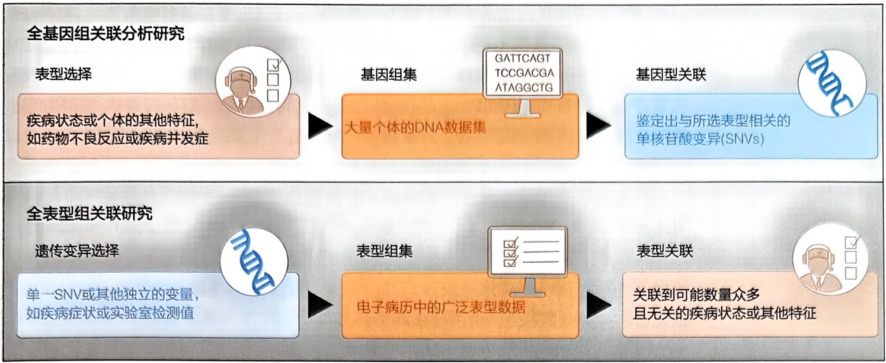

<details>
<summary>flowchart</summary>

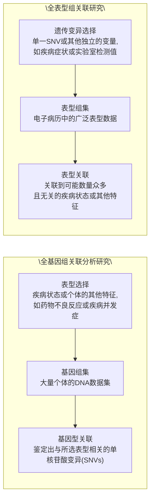
</details>

图 10-5 全基因组关联分析研究与全表型组关联研究的对比（改绘自Bastarache et al., 2022）

变量矩阵， $\beta_{2}$  是协变量的回归系数。

对于连续表型，则可以采用方差分析来比较不同基因型组别间表型平均值的差异，或者使用线性回归分析来评估基因型对表型的影响，同时估计其效应大小和方向。在某些情况下，可以应用广义线性模型来处理表型数据的非正态分布特性。

$$
Y = \beta_ {0} + \beta_ {1} X + \beta_ {2} C + \epsilon \tag {10-32}
$$

其中，Y 表示表型值； $\beta_{0}$  表示截距项；X 代表基因型，通常编码为 0、1、2； $\beta_{1}$  是基因型的回归系数，表示基因型对表型的效应；C 表示协变量矩阵， $\beta_{2}$  是协变量的回归系数； $\epsilon$  是误差项。

在使用 PheWAS 时应谨慎对待假阳性发现。使用 Bonferroni 校正等方法可以调整统计显著性阈值，以适应在 PheWAS 中测试的表型数量。新的关联应通过在独立数据集或完全不同的人类、动物或细胞研究中的复制来验证。

## (9) 复合表型分析

复合表型（composite phenotype）是指由多个单独的表型特征或指标组合而成的综合特征。这种复合特征通常用于描述复杂的生物学现象或多维度的生物特性，能够提供比单一表型更全面和系统的信息。复合表型概念被应用于人类指纹花纹的研究，探讨个体的同一套基因组是如何影响不同十指上指纹花纹的形成，为“指纹模块现象”（中间三枚手指指纹高度相关）提供了表型组学和遗传学解释。Li等通过结合偏最小二乘路径建模和光谱聚类的策略定义复合表型，揭示了不同个体在高海拔驯化中的生理异质性。在模型适应度性能的评估中，基于复合表型的模型在高海拔适应过程中的氧饱和度变化建模方面比基于单一性状的模型更适合。由此可见，基于复合表型的新策略可能成为表型组学分析研究的一般策略。

光谱聚类（spectral clustering）是一种基于图论的聚类方法，通过对数据点构建相似度矩阵，进行特征值分解，以此将数据点投影到低维空间，再在低维空间中进行聚类。在复合表型分析中，光谱聚类可以用于将具有相似特征的样本（如具有相

---

396

10 表型组学

似基因表达谱或代谢谱的个体）归为一类，从而识别出潜在的复合表型亚群。同时，偏最小二乘路径建模（partial least squares path modeling，PLSPM）是一种SEM技术，用于研究变量之间的复杂关系，特别适用于小样本量和多重共线性的情况。在复合表型分析中，PLSPM可用于整合多种生物标志物（如基因表达、代谢产物、临床指标等），构建路径模型，探索这些生物标志物与复合表型之间的因果关系。以Li等的工作为例，具体步骤包括:

相似度矩阵构建，定义不同表型之间的相似度 $S_{ij}$，常用的相似度度量包括高斯核函数:

$$
S _ {i j} = \exp \left(- \frac {\| x _ {i} - x _ {j} \| ^ {2}}{2 \sigma^ {2}}\right) \tag {10-33}
$$

其中，$\| x_{i} - x_{j}\|^{2}$ 表示样本 $i$ 和 $j$ 间的欧氏距离，$\sigma$ 是带宽参数。

构建拉普拉斯矩阵 L，

$$
L = D - S \tag {10-34}
$$

其中，D 是对角矩阵，其对角元素  $D_{ii}$  是第 i 个样本的度（即相似度矩阵 S 中第 i 行元素之和）。

对拉普拉斯矩阵 $L$ 进行特征值分解，得到前 $k$ 个最小的特征值及其对应的特征向量，将样本投影到由这些特征向量构成的低维空间中。根据光谱聚类的结果，将28个生理特征分为14个组，这些组构成了复合表型的初步结构。在此基础上，进一步应用PLSPM来构建复合表型。

PLSPM 用于分析多个变量组之间的多重关系，并定义了 14 个潜在变量，每个潜在变量代表一个复合表型，通过计算潜在变量得分估计复合表型。

随后，通过将得分矩阵中的值与另一个权重矩阵相乘来计算潜在变量的得分，迭代求解潜变量得分和路径系数，目标是最大化潜变量与其观测指标之间的协方差。

最后，通过载荷矩阵和潜在变量得分来解释模型。载荷矩阵显示了每个指标变量对每个潜在变量的贡献程度，而潜在变量得分被用于定义复合表型，代表了高海拔适应过程中的不同生理方面。例如，某个潜在变量可能代表了与氧合相关的一系列生理特征，而另一个潜在变量可能代表了与心血管功能相关的特征。

## (10) 表型网络分析

表型数据的分析中，网络分析扮演着至关重要的角色。这是基于一种假设:表型数据之间存在着复杂的相互依赖和调控网络。网络分析的应用范围广泛，它被用来研究不同表型之间的相互关系和作用，揭示表型间的模式、集群以及关键节点。这种分析方法特别适用于识别与疾病相关的表型模式，预测疾病的风险和进展路径，揭示疾病的潜在生物学机制。此外，表型网络分析还有助于发现新的治疗靶点和药物响应标记物，为深入探索和理解生物系统中表型组学的内部关系及其间的相互作用提供了一个强大的分析工具。在网络分析方法中，加权基因共表达网络分析、蛋白质之间的相互作用网络分析和代谢网络分析等成了多组学研究中的关键方法。网络的基本概念、拓扑属性、网络分析中的具体算法等，详见第11章11.3节。

---

10.3 表型组学的数据分析

397

## 10.3.2.3 表型组学分析的新概念

在人类表型组项目中确立了其三个核心构成要素:可操作表型单位（operational phenotypic unit, OPU）、可操作表型模块（operational phenotypic module, OPM）和可操作表型群落（operational phenotypic community, OPC）。

## (1) 可操作表型单位 (OPU)

作为表型分析的基础单元，每个 OPU 代表一个独立的表型特征，如遗传特征或临床指标。OPU 之间的关系可以表现为不同的方向性和强度，揭示了各个表型特征之间的复杂相互作用。

## (2) 可操作表型模块 (OPM)

OPM 由相互作用的 OPU 集合构成，形成了群体级别的特征模块。每个 OPM 表示在特定组学表型下具有相似表型模式的个体群体。OPM 之间的关系不仅反映了不同方向和强度的相互作用，而且可能体现了不同生物学过程的协同或相互抑制。在多模块网络中，OPM 之间的相互作用进一步影响整体表型表现，对于理解复杂疾病和生物学特性的形成至关重要。

## (3) 可操作表型群落 (OPC)

OPC 代表了更高层面的特征模块，是由相互作用的 OPM 集合组成的。通常涉及多个跨组学平台，OPC 反映了不同层次的表型数据之间的关联性和动态相互作用。

从 OPU 到 OPM，再到 OPC，这个层次化的框架逐步深入，从单一表型特征的作用分析扩展到更广泛的生物学网络中的相互作用（图 10-6），打通了微观表型到宏观表型的壁垒。这种多层次的关系揭示了生物体内表型特征的复杂交互，为深入理解生物体的功能和行为提供了新的视角。在解析这些表型间复杂的相互依赖和调控关系方面，网络分析发挥着不可替代的作用。

通过解析 OPU-OPM-OPC 表型间关系，筛选相关性网络中的关键特征和枢纽节点，对从庞大的生物学数据中识别出有生物学意义的模块，揭示生物分子之间的紧密相互作用和功能联系具有重要作用。常规分析流程如下:

① 基于单一表型特征水平的 Spearman 秩相关系数检验分析，将相关性强 [如 abs(r)>0.95] 的表型记为一个表型簇，并对表型簇进行二次正则化主成分分析，其中第一个主成分得分定义为一个 OPU。
② 对 OPUs 进行两两相关性分析，建立 OPU 间的加权相邻矩阵 $abs(r) \times I(P\_FDR < 0.05)$，并使用 Newman's Community Detection 对同组学平台的 OPUs 聚类，每个 OPU 簇构成一个群体级别的特征模块 OPM。
③ 计算两个 OPMs 中所有 OPUs 的相关系数，并使用 Newman's Community Detection 社区检测方法对跨组学平台的 OPMs 聚类，每个 OPM 簇代表一个跨组学平台的 OPC。

---

398

10 表型组学

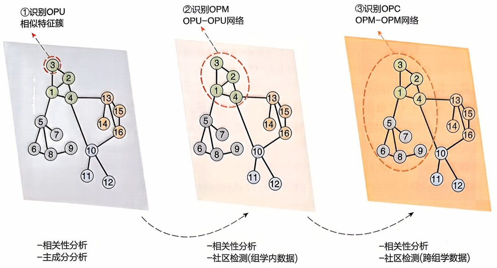

<details>
<summary>flowchart</summary>

```mermaid
graph TD
  subgraph Top_OPU_n["Top_①[\"①识别OPU\n相似特征簇\"]"]
  Node1["3"] --> Node2["2"]
  Node2 --> Node3["1"]
  Node3 --> Node4["4"]
  Node4 --> Node5["5"]
  Node5 --> Node6["6"]
  Node6 --> Node7["7"]
  Node7 --> Node8["8"]
  Node8 --> Node9["9"]
  Node9 --> Node10["10"]
  Node10 --> Node11["11"]
  Node11 --> Node12["12"]
  end

  subgraph Middle_OPM_nOPU_OPU["Middle_②[\"②识别OPM\nOPU-OPU网络\"]"]
  Node3["3"] --> Node4["2"]
  Node4 --> Node5["1"]
  Node5 --> Node6["6"]
  Node6 --> Node7["7"]
  Node7 --> Node8["8"]
  Node8 --> Node9["9"]
  Node9 --> Node10["10"]
  Node10 --> Node11["11"]
  Node11 --> Node12["12"]
  Node12 --> Node13["13"]
  Node13 --> Node14["14"]
  Node14 --> Node15["15"]
  Node15 --> Node16["16"]
  end

  subgraph Bottom_OPC_nOPM_OPM["Bottom_③[\"③识别OPC\nOPM-OPM网络\"]"]
  Node3["3"] --> Node4["2"]
  Node4 --> Node5["1"]
  Node5 --> Node6["5"]
  Node6 --> Node7["7"]
  Node7 --> Node8["8"]
  Node8 --> Node9["9"]
  Node9 --> Node10["10"]
  Node10 --> Node11["11"]
  Node11 --> Node12["12"]
  Node12 --> Node13["13"]
  Node13 --> Node14["14"]
  Node14 --> Node15["15"]
  end

  subgraph Bottom_n["Bottom_④[\"相关性分析\n主成分分析\"]"]
    Node3
    Node4
    Node5
    Node6
    Node7
    Node8
    Node9
    Node10
    Node11
    Node12
  end
```
</details>

图10-6 表型-表型交互作用网络构建框架（图中所列方法可进一步拓展）

在上述例子中可以看出，社区检测在了解整个网络结构和功能中具有重要作用，是图论中的一个重要问题，旨在发现图中具有紧密连接的节点群体。同社区经常对应着功能相同或者关系比较紧密的节点集合，网络节点组内连接紧密，组间连接稀疏。社区结构是大规模网络中普遍存在的基本结构，经典社区结构检测方法包括基于图分割的K-L（Kernighan-Lin）算法、聚类算法；基于模块度优化的Louvain算法、动态标签传递算法（label propagation algorithm，LPA）等。

马克·纽曼（Mark Newman）在2003年首次提出了模块度（modularity）这一概念，并在2004年给出了其正式定义。模块度用于量化网络中的社区划分。例子中所使用的Girvan-Newman（GN）算法是一种用于识别网络社区结构的经典方法，也可以看作是一种聚类算法。GN算法通过迭代地移除图中具有最高边介数（betweenness）值的边，从而揭示网络中的社区结构。

GN算法的核心思想是利用边介数来评估边的重要性。边介数是指通过某条边的最短路径的数量，反映了该边在网络中作为桥梁的作用。具有高边介数的边通常位于社区之间的边界上，移除这些边可以有效地分割网络，揭示出社区结构。

边介数的计算公式如下:

$$
B (e) = \sum_ {s \neq t} \frac {\sigma_ {s t} (e)}{\sigma_ {s t}} \tag {10-35}
$$

其中，s 和 t 是两个节点； $\sigma_{st}$  表示从节点 s 到节点 t 的最短路径的总数； $\sigma_{st}(e)$  表示从节点 s 到节点 t 经过边 e 的最短路径数量。

算法步骤:

① 计算边介数 首先，计算图中每条边的介数。边介数是通过图中的最短路径算法计算得到的。

---

10.4 表型组学的应用

399

②移除最高介数的边 找到介数值最高的边，并将其从图中移除。
③ 重新计算边介数 每次移除边后，重新计算剩余图中每条边的介数。
④ 迭代重复 重复步骤2和步骤3，直到图中的所有边都被移除或达到预期的社区划分。

通过 GN 算法，可以生成一个层次结构的社区树（dendrogram），表示社区分裂的过程。在分析社区结构时，可以根据需要选择适当的层次来确定社区划分。例如，在树的某个层次剪断树干，就能得到相应规模的社区结构。

## 10.4 表型组学的应用

## 10.4.1 细胞与类器官表型组的应用

细胞表型的观察始于17世纪，罗伯特·胡克（Robert Hooke）首次使用显微镜对植物组织进行观察，并将观察到的结构称为“cellulae”，即细胞。在19世纪，马蒂亚斯·施莱登（Matthias Schleiden）和西奥多·施旺（Theodor Schwann）两位提出了细胞学说，他们认为所有生命体都由细胞组成。此后，科学家们开始对细胞进行更深入的研究。类器官（organoid）是指一种体外培养的三维细胞模型，其特点是具有某种特定器官的一些组织结构和功能特征。其培养过程为从多能干细胞或者成体细胞中获取干细胞，通过一系列的特定培养和分化的步骤，最后使这些细胞组成与真实器官相似的微型结构。类器官表型组学（phenomics of organoids）则是指旨在通过对类器官的结构、功能和分子特征等进行分析研究，来探索和理解类器官的特性和与之相关的生物学过程的一种研究方法（图10-7）。类器官表型组学的应用可以有助于深入理解类器官的形成、结构、功能等方面的信息，并且有助于筛选、评估药物的效果和了解药物对类器官的作用和影响。

## 10.4.1.1 生物学领域的应用

## (1) 研究细胞发育、分化等功能

利用细胞与类器官表型组技术，能够在不同时间点对细胞进行高分辨率的成像和详尽的表型分析，从而实现了对细胞发育过程的精准动态跟踪，包括细胞体积和形态的演变、细胞骨架和细胞极性的精细重构，以及细胞信号通路和互作网络的动态变化。例如，通过单细胞数据的降维、聚类、差异表达分析，可以识别关键的基因表达模式，鉴定不同亚群。对空间基因表达模式进行分析，可以揭示不同区域的基因表达差异，有助于了解组织中的细胞类型和相互作用。这些分析手段能够深入挖掘细胞命运决定的关键因素，揭示发育过程中的精妙分子机制，从而为细胞的发育与分化提供深入而全面的认识。

---

400

10 表型组学

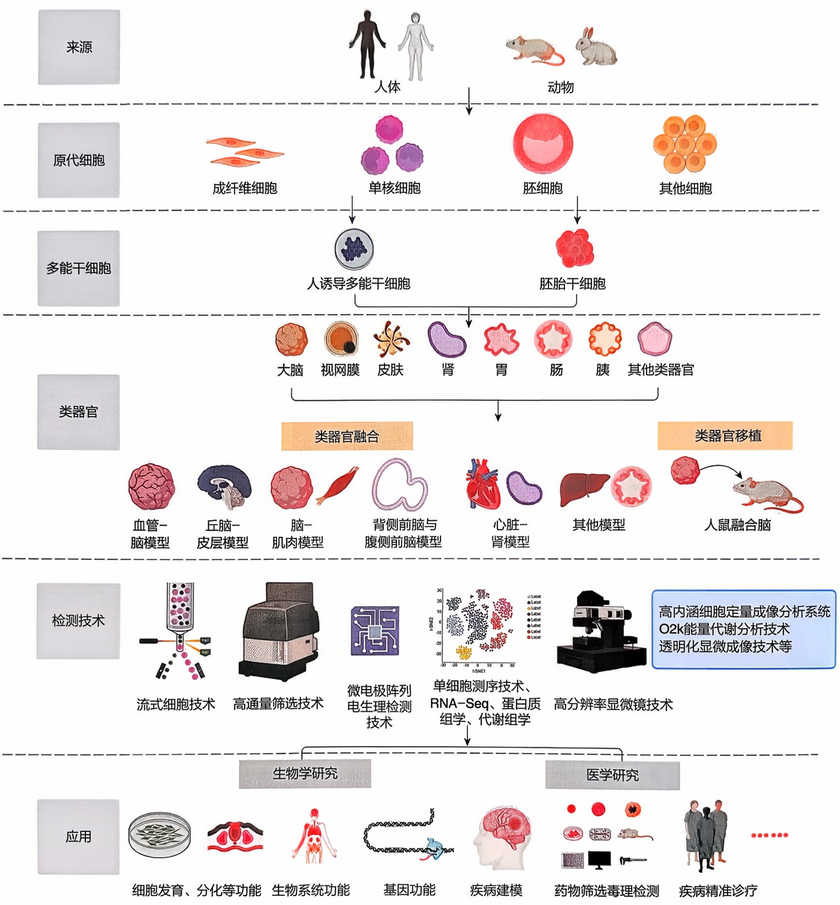

<details>
<summary>flowchart</summary>

```mermaid
graph TD
  subgraph Sources
  A["Human"] --> B["Animal"]
  A --> C["Animal"]
  D["Mouse"] --> E["Mouse"]
  F["Mouse"] --> G["Mouse"]
  H["Mouse"] --> I["Mouse"]
  J["Mouse"] --> K["Mouse"]
  L["Mouse"] --> M["Mouse"]
  N["Mouse"] --> O["Mouse"]
  P["Mouse"] --> Q["Mouse"]
  R["Mouse"] --> S["Mouse"]
  T["Mouse"] --> U["Mouse"]
  V["Mouse"] --> W["Mouse"]
  X["Mouse"] --> Y["Mouse"]
  Z["Mouse"] --> AA["Mouse"]
  AB["Mouse"] --> AC["Mouse"]
  AD["Mouse"] --> AE["Mouse"]
  AF["Mouse"] --> AG["Mouse"]
  AH["Mouse"] --> AI["Mouse"]
  AJ["Mouse"] --> AK["Mouse"]
  AL["Mouse"] --> AM["Mouse"]
  AN["Mouse"] --> AO["Mouse"]
  AP["Mouse"] --> AQ["Mouse"]
  AR["Mouse"] --> AS["Mouse"]
  AT["Mouse"] --> AU["Mouse"]
  AV["Mouse"] --> AW["Mouse"]
  AX["Mouse"] --> AY["Mouse"]
  AZ["Mouse"] --> BA["Mouse"]
  BB["Mouse"] --> BC["Mouse"]
  BD["Mouse"] --> BE["Mouse"]
  BF["Mouse"] --> BG["Mouse"]
  BH["Mouse"] --> BI["Mouse"]
  BJ["Mouse"] --> BK["Mouse"]
  BL["Mouse"] --> BM["Mouse"]
  BN["Mouse"] --> BO["Mouse"]
  BP["Mouse"] --> BR["Mouse"]
  BW["Mouse"] --> BX["Mouse"]
  BYD["Mouse"] --> BDQ["Mouse"]
  DBQ["Mouse"] --> DBQ
  end

  subgraph OriginalCells
  C1["Fibroblast Cell"] --> C2["Single Nuclear Cells"]
  C3["Purkinocytes"] --> C4["Purkinocytes"]
  C5["Other Cells"] --> C6["Other Cells"]
  end

  subgraph Fibroblasts
  F1["Fibroblast Cell"] --> F2["Fibroblast Cell"]
  F3["Purkinocytes"] --> F4["Purkinocytes"]
  F5["Other Cells"] --> F6["Other Cells"]
  end

  subgraph DendriticCells
  D1["Dendritic Cell"] --> D2["Dendritic Cell"]
  D3["Dendritic Cell"] --> D4["Dendritic Cell"]
  D5["Dendritic Cell"] --> D6["Dendritic Cell"]
  D7["Dendritic Cell"] --> D8["Dendritic Cell"]
  end

  subgraph LongTermCells
  L1["Long Term Cell"] --> L2["Long Term Cell"]
  L3["Long Term Cell"] --> L4["Long Term Cell"]
  L5["Long Term Cell"] --> L6["Long Term Cell"]
  L7["Long Term Cell"] --> L8["Long Term Cell"]
  L9["Long Term Cell"] --> L10["Long Term Cell"]
  end

  subgraph Organisms
  M1["Molecular Complex"] --> M2["Molecular Complex"]
  M3["Molecular Complex"] --> M4["Molecular Complex"]
  M5["Molecular Complex"] --> M6["Molecular Complex"]
  M7["Molecular Complex"] --> M8["Molecular Complex"]
  M9["Molecular Complex"] --> M10["Molecular Complex"]
  M11["Molecular Complex"] --> M12["Molecular Complex"]
  M13["Molecular Complex"] --> M14["Molecular Complex"]
  M15["Molecular Complex"] --> M16["Molecular Complex"]
  M17["Molecular Complex"] --> M18["Molecular Complex"]
  M19["Molecular Complex"] --> M20["Molecular Complex"]
  end

  subgraph Organometers
  O1A1["Anterior"] --> O2A1["Brain"]
  O2B1["Buscida"] --> O2C1["Brain"]
  O2D1["Dendritic"] --> O2E1["Brain"]
  O2F1["Gesophage"] --> O2G1["Brain"]
  O2H1["Ileum"] --> O2I1["Brain"]
  O2J1["Kervix"] --> O2K1["Brain"]
  O2L1["Brain"] --> O2M1["Brain"]
  O2N1["Sedentary"] --> O2O1["Brain"]
  O2P1["Brain"] --> O2Q1["Brain"]
  O2R1["Brain"] --> O2S1["Brain"]
  O2T1["Brain"] --> O2U1["Brain"]
  O2V1["Brain"] --> O2W1["Brain"]
  O2X1["Brain"] --> O2Y1["Brain"]
  O2Z1["Brain"] --> O2W2["Brain"]
  end

  subgraph Organometers
  OM1["Autectic"] --> OM2["Autectic"]
  OM3["Autectic"] --> OM4["Autectic"]
  OM5["Autectic"] --> OM6["Autectic"]
  OM7["Autectic"] --> OM8["Autectic"]
  OM9["Autectic"] --> OM10["Autectic"]
  OM11["Autectic"] --> OM12["Autectic"]
  OM13["Autectic"] --> OM14["Autectic"]
  OM15["Autectic"] --> OM16["Autectic"]
  OM17["Autectic"] --> OM18["Autectic"]
  OM19["Autectic"] --> OM20["Autectic"]
  OM21["Autectic"] --> OM22["Autectic"]
  OM23["Autectic"] --> OM24["Autectic"]
  OM25["Autectic"] --> OM26["Autectic"]
  OM27["Autectic"] --> OM28["Autectic"]
  OM29["Autectic"] --> OM30["Autectic"]
  end

  subgraph Organometers
  O3A1["Acumen"] --> O3B["Acumen"]
  O3C["Acumen"] --> O3D["Acumen"]
  O3E["Acumen"] --> O3F["Acumen"]
  O3G["Acumen"] --> O3H["Acumen"]
  O3I["Acumen"] --> O3J["Acumen"]
  O3K["Acumen"] --> O3L["Acumen"]
  O3M["Acumen"] --> O3N["Acumen"]
  O3O["Acumen"] --> O3P["Acumen"]
  O3Q["Acumen"] --> O3R["Acumen"]
  O3S["Acumen"] --> O3T["Acumen"]
  O3U["Acumen"] --> O3V["Acumen"]
  O3W["Acumen"] --> O3X["Acumen"]
  O3Y["Acumen"] --> O3Z["Acumen"]
  end

  subgraph Organometers
  OM5["Acumen融合"] --> OM6["Acumen融合"]
  OM7["Acumen融合"] --> OM8["Acumen融合"]
  OM9["Acumen融合"] --> OM10["Acumen融合"]
  end

  subgraph Organometers
  OM6["Acumen融合融合"] --> OM7["Acumen融合"]
  OM8["Acumen融合"] --> OM9["Acumen融合"]
  end

  subgraph TestingMethods
    EM1["Muscle Model: Heart Model"] -.-> EM2["Muscle Model: Heart Model"]
  end

  subgraph Methods
    EM3["Muscle Model: Heart Model"] -.-> EM4["Muscle Model: Heart Model"]
  end

  subgraph Methods
    EM5["Muscle Model: Heart Model"] -.-> EM6["Muscle Model: Heart Model"]
  end

  subgraph Methods
    EM7["Muscle Model: Heart Model"] -.-> EM8["Muscle Model: Heart Model"]
  end

  subgraph Methods
    EM9["Muscle Model: Heart Model"] -.-> EM10["Muscle Model: Heart Model"]
  end

  subgraph Methods
  EM10["Muscle Model: Heart Model"] -.-> EM11["Muscle Model: Heart Model"]
  end

  subgraph Methods
  EM12["Muscle Model: Heart Model"] -.-> EM13["Muscle Model: Heart Model"]
  end

  subgraph Methods
  EM14["Muscle Model: Heart Model"] -.-> EM15["Muscle Model: Heart Model"]
  end

  subgraph Methods
  EM16["Muscle Model: Heart Model"] -.-> EM17["Muscle Model: Heart Model"]
  end

  subgraph Methods
  EM18["Muscle Model: Heart Model"] -.-> EM19["Muscle Model: Heart Model"]
  end

  subgraph Methods
  EM20["Muscle Model: Heart Model"] -.-> EM21["Muscle Model: Heart Model"]
  end

  subgraph Methods
  EM22["Muscle Model: Heart Model"] -.-> EM23["Muscle Model: Heart Model"]
  end

  subgraph Methods
  EM24["Muscle Model: Heart Model"] -.-> EM25["Muscle Model: Heart Model"]
  end

  subgraph Methods
  EM26["Muscle Model: Heart Model"] -.-> EM27["Muscle Model: Heart Model"]
  end

  subgraph Methods
  EM28["Muscle Model: Heart Model"] -.-> EM29["Muscle Model: Heart Model"]
  end

  subgraph Methods
  EM30["Muscle Model: Heart Model"] -.-> EM31["Muscle Model: Heart Model"]
  end

  subgraph Methods
  EM32["Muscle Model: Heart Model"] -.-> EM33["Muscle Model: Heart Model"]
  end

  subgraph Methods
  EM34["Muscle Model: Heart Model"] -.-> EM35["Muscle Model: Heart Model"]
  end

  subgraph Methods
  EM36["Muscle Model: Heart Model"] -.-> EM37["Muscle Model: Heart Model"]
  end

  subgraph Methods
  EM38["Muscle Model: Heart Model"] -.-> EM39["Muscle Model: Heart Model"]
  end

  subgraph Methods
  EM40["Muscle Model: Heart Model"] -.-> EM41["Muscle Model: Heart Model"]
  end

  subgraph Methods
  EM42["Muscle Model: Heart Model"] -.-> EM43["Muscle Model: Heart Model"]
  end

  subgraph Methods
  EM44["Muscle Model: Heart Model"] -.-> EM45["Muscle Model: Heart Model"]
  end

  subgraph Methods
  EM46["Muscle Model: Heart Model"] -.-> EM47["Muscle Model: Heart Model"]
  end

  subgraph Methods
  EM48["Muscle Model: Heart Model"] -.-> EM49["Muscle Model: Heart Model"]
  end

  subgraph Methods
  EM50["Muscle Model: Heart Model"] -.-> EM51["Muscle Model: Heart Model"]
  end

  subgraph Methods
  EM52["Muscle Model: Heart Model"] -.-> EM53["Muscle Model: Heart Model"]
  end

  subgraph Methods
  EM54["Muscle Model: Heart Model"] -.-> EM55["Muscle Model: Heart Model"]
  end

  subgraph Methods
  EM56["Muscle Model: Heart Model"] -.-> EM57["Muscle Model: Heart Model"]
  end

  subgraph Methods
  EM58["Muscle Model: Heart Model"] -.-> EM59["Muscle Model: Heart Model"]
  end

  subgraph Methods
  EM60["Muscle Model: Heart Model"] -.-> EM61["Muscle Model: Heart Model"]
  end

  subgraph Methods
  EM62["Muscle Model: Heart Model"] -.-> EM63["Muscle Model: Heart Model"]
  end

  subgraph Methods
  EM64["Muscle Model: Heart Model"] -.-> EM65["Muscle Model: Heart Model"]
  end

  subgraph Methods
  EM66["Muscle Model: Heart Model"] -.-> EM67["Muscle Model: Heart Model"]
  end

  subgraph Methods
  EM68["Muscle Model: Heart Model"] -.-> EM69["Muscle Model: Heart Model"]
  end

  subgraph Methods
  EM70["Muscle Model: Heart Model"] -.-> EM71["Muscle Model: Heart Model"]
  end

  subgraph Methods
  EM72["Muscle Model: Heart Model"] -.-> EM73["Muscle Model: Heart Model"]
  end

  subgraph Methods
  EM74["Muscle Model: Heart Model"] -.-> EM75["Muscle Model: Heart Model"]
  end

  subgraph Methods
  EM76["Muscle Model: Heart Model"] -.-> EM77["Muscle Model: Heart Model"]
  end

  subgraph Methods
  EM78["Muscle Model: Heart Model"] -.-> EM79["Muscle Model: Heart Model"]
  end

  subgraph Methods
  EM80[Muscle Model: Heart Models/Groups/Models/Models/Models/Models/Models/Models/Models/Models/Models/Models/Models/Models/Models/Models/Models/Models/Models/Models/Models/Models/Models/Models/Models/Models/Models/Models/Models/Models/Models/Models/Models/Models/Models/Models/Models/Models/Models/Models/Models/Models/Models/Models/Models/Models/Models/Models/Models/Models/Models/Models/ Models

  subgraph Applications
    A_Phosphorylation [Cellular Development, Differentiation, Biological System Function, Gene Function, Genetic Function, Cancer Function, Cancer Machine Function, Cancer Screening Technology, Cancer Guidance, Cancer Diagnosis, Cancer Improvement, Cancer Improvement, Cancer Improvement, Cancer Improvement, Cancer Improvement, Cancer Improvement, Cancer Improvement, Cancer Improvement, Cancer Improvement, Cancer Improvement, Cancer Improvement, Cancer Improvement, Cancer Improvement, Cancer Improvement, Cancer Improvement, Cancer Improvement, Cancer Improvement, Cancer Improvement, Cancer Improvement, Cancer Improvement, Cancer Improvement, Cancer Improvement, Cancer Improvement, Cancer Improvement, Cancer Improvement, Cancer Improvement, Cancer Improvement, Cancer Improvement, Cancer Improvement, Cancer Improvement, Cancer Improvement, Cancer Improvement, Cancer Improvement, Cancer Improvement
```
</details>

图 10-7 细胞与类器官表型组研究总结示意图（改绘自 Zhang et al., 2024）

## (2) 研究生物系统功能

细胞与类器官表型组学研究能在体外重新构建系统模型，实现对系统的持久动态观测，进而深入探究生命系统的优化策略。通过模拟不同的环境条件和生理状态，能够更准确地理解生命系统如何在多样性挑战下实现协调与适应。此外，细胞与类器官表型组学也为揭示系统功能失衡的机制提供了理论基础，为开发针对系统性疾

---

10.4 表型组学的应用

401

病的干预方法提供了新的思路，从而有效引导干预治疗措施。

## (3) 研究基因功能

细胞与类器官表型组学在揭示基因功能中发挥重要作用。例如，通过比较正常基因与突变基因在细胞和类器官层面的表型差异，准确地界定基因突变对生物体的影响。可以运用高效的基因编辑技术，在细胞模型中对目标基因进行敲除或激活，然后借助表型组学的手段来评估这些基因的改变对细胞功能的影响。通过观察基因敲除或过度表达对细胞响应的影响，也可以评估这些基因作为潜在药物靶点的可行性。

## 10.4.1.2 医学领域的应用

## （1）疾病建模与揭示致病机制

利用细胞与类器官表型组学技术可以实现精准的疾病建模，这为深入解析疾病机制和开发新药提供了强有力的支持。一方面，可以通过引入特定的基因突变来模拟遗传性疾病，揭示突变基因在疾病过程中的作用；另一方面，也可以使用患者自身疾病细胞建立模型。前者可以根据目标疾病类型，选择合适的细胞或组织模型，使用基因编辑或病毒载体等方式导入疾病相关突变或使特定基因异常表达，从多个层面开展表型组学分析，评估疾病导致的细胞形态变化、代谢途径改变、信号通路活性变化等，从而深入解析疾病机制。近期，中南大学的研究团队运用细胞和3D人脑类器官模型，对疾病机制进行了深入研究，揭示了GNL3基因的遗传调控和生物学功能。该研究发现，GNL3基因的异常表达可能导致细胞增殖和神经元分化异常，为理解双相情感障碍的遗传学基础和致病机制提供了重要依据。

## （2）药物筛选与毒理检测

通过观察药物处理后的细胞或类器官表型变化结合表型组学技术，可以对药效进行全面评估，实现对药物副作用的预测。借助高通量筛选技术产生大量的生物活性或化合物筛选数据，利用生物信息学工具和算法同时测试多个候选药物对细胞及类器官的影响，对筛选结果进行统计学分析，可以识别到具有生物学活性的分子，高效筛选出潜在的药物，加速药物的研发过程。同时，器官毒性问题一直是导致药物开发失败和批准后撤回的主要原因。类器官的出现可能为毒性预测提供更加精准的手段。通过模拟人体组织和脏器的三维细胞培养系统，如皮肤、肝、心肌等，可以在更接近体内环境的条件下对药物进行毒理检测。这些类器官模型保留了体内细胞和组织结构的多样性。通过观察药物处理后类器官的表型变化，能够更准确地预测药物在体内的毒性作用。

## （3）疾病精准诊疗

细胞与类器官表型组学在疾病精准诊疗方面表现出了显著的优势，从治疗前的分子诊断标志物鉴定，到治疗过程中的药物选择、效果监测、病情进展预测，再到治疗后的抵抗性分析，相关技术都扮演着关键角色。以白血病的治疗为例，利用细胞与类器官表型组学的方法，可以深入分析白血病患者样本的基因表达谱。这不仅可以帮助准确诊断白血病的类型，还有助于预测疾病的预后情况。更重要的是，这些信息还可以指导后续的治疗方案选择，使得治疗更加个体化、针对性更强。通过

拓展阅读10-2 3D人脑类器官模型虚拟仿真实验介绍

---

402

10

表型组学

对患者细胞的分析，能够更好地了解疾病的分子机制，识别出可能的治疗靶点，并且及早发现患者对药物的抵抗性，从而调整治疗方案，最大限度地提高治疗的效果。

## 10.4.1.3 细胞与类器官表型组数据库和资源

细胞和类器官表型组学的研究需要大量的数据和资源来支持，以下是一些常用的细胞和类器官表型组数据库和资源（表10-5）。

表 10-5 细胞与类器官表型组数据库和资源

| 数据库名称 | 资源类型 |
| --- | --- |
| CellMarker | 提供不同细胞类型的标记基因信息 |
| Allen Cell Explorer | 提供大量细胞图像和数据 |
| ExPASy - Proteomics Server | 提供与蛋白质组学相关的工具和资源 |
| Human Cell Atlas | 提供关于细胞组成和功能的全面信息 |
| Organelle Genome Resources | 提供不同细胞器基因组的数据 |
| CellFishing.jl | 提供用于处理高维细胞数据的 Julia 软件包 |
| Human Protein Atlas | 提供人类蛋白质在组织和细胞水平上的表达信息 |
| CellProfiler | 开源的图像分析工具,用于高通量细胞成像数据的分析和处理 |
| the Cell Image Library of Digital Anatomist Project | 提供关于细胞、细胞器和组织的三维模型和图像 |
| CellMiner | 提供肿瘤细胞系的分子特征、基因表达数据和药物敏感性信息 |
| BioGPS | 提供基因注释和表达数据的在线平台 |
| Allen Brain Atlas | 提供关于大脑组织中基因表达的空间信息 |
| CellPhoneDB | 提供细胞-细胞相互作用的信息 |
| the Cell Ontology | 提供描述细胞类型和细胞组分的资源 |
| the Cell Image Library (CIL) | 提供关于细胞成像数据的在线资源 |
| EMDataBank | 提供收集和存储的电子显微镜图像和结构数据 |
| Cytoscape | 提供一个用于分析和可视化细胞网络和通路的工具 |
| CellXgene | 该工具用于单细胞 RNA 测序数据的交互式分析和可视化 |
| Gene Expression Omnibus (GEO) | 提供大量的基因表达数据,包括细胞和组织样本的表达谱 |
| OrganoidDB | 提供类器官转录组测序和单细胞测序数据等内容 |
| Gene Expression in Cortical Organoids (GECO) | 提供脑皮层类器官不同培养时期基因表达数据 |
| Organoid Cell Atlas | 建立类器官的综合单细胞图谱 |
| OrganoidBase | 患者来源的肿瘤衍生类器官及其所有相关的组织病理学、IC50、基因组、转录组和单细胞分析数据 |
| Huborganoids | HUB 类器官是活生物库的一部分,提供类器官基因组测序、表达谱分析、对已知药物和实验药物的敏感性分析等信息的数据库 |
| OrganoidDB | 提供类器官转录组测序和单细胞测序数据等内容 |
| CellSys | 提供关于细胞生物学、细胞信号传导、细胞分裂等方面的模型和数据 |

---

10.4 表型组学的应用

403

## 10.4.2 人类表型组的应用

人类表型组学的研究为深入了解个体差异以及疾病的预测、诊断和治疗提供了全新的思路和方法。这一领域的研究有助于理解人类健康和疾病的机制，推动个体化医疗的发展，以及研究人类进化和种群遗传学。

人类表型组数据的收集既包括了个体在各个时间点上静态特征的全面记录，也涉及对其动态变化进行的连续、纵向追踪。数据收集方法主要有三种:主观测量、客观测量和临床诊断。主观测量主要依赖个体的自我报告，如通过调查问卷、生活质量评估和疼痛程度记录等；客观测量则通过如实验室测试、医学影像和生物传感器等设备和方法直接获取，涵盖血压、血糖、心率等生理指标；临床诊断则是综合主观测量和客观测量的结果，由医生基于患者的病史、症状、体征和辅助检查进行综合判断。为提高数据的准确性和全面性，实际的数据收集过程中通常需要综合使用这些方法。

通过整合和分析人类表型组数据，可以构建一个以表型为核心的知识图谱。这一知识图谱的重要性在于，它能够综合多个信息维度，为表型组研究提供全面而系统的视角。同时，这种组织和管理方式可以提高表型组研究的效率和效益。例如，2021年11月，中国科学家宣布初步完成了全球首张人类表型组参考导航图1.0版本（图10-8），整合了超过150万条表型之间的关系，为生物学研究提供了宝贵的资源。图谱的构建依托于上海国际人类表型组研究院的人类表型精密测量平台，对年龄在 $20\sim 60$ 岁的上海居民进行为期2天1夜的全面表型测量，覆盖从微观的基

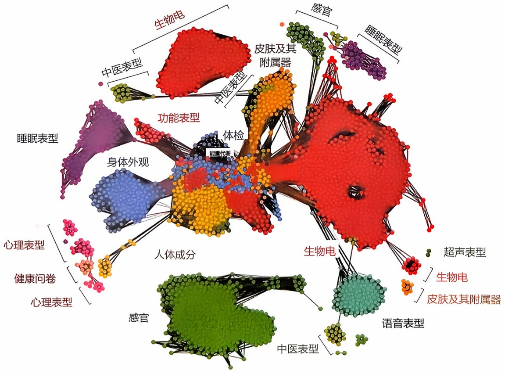

<details>
<summary>flowchart</summary>

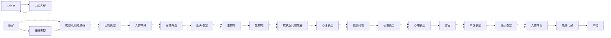
</details>

图10-8 人类表型组全景导航图（改绘自Tian et al.,2022）

---

404

10 表型组学

因组学、转录组学、蛋白质组学、代谢组学、细胞到宏观的生物医学影像、身体外观、皮肤及其附属器、睡眠、生物电、心理等 15 大类不同尺度的表型组测量。每位志愿者产生了超过 2 万个指标，总数据量超过 3 PB。

## 10.4.2.1 疾病发生发展中的应用

人类表型组将个体全面的表型特征和临床疾病特征结合起来，对理解疾病具有重要的科学价值。首先，它有助于实现疾病的早期诊断。例如，在阿尔茨海默病的研究中，研究者通过分析患者的认知功能表现和大脑影像学特征，成功地识别出了疾病的早期表型指标，如轻微的记忆损失和大脑特定区域的体积缩小。这些早期表型指标使得医生能够在明显症状出现前对疾病进行诊断，从而实现更早的治疗介入。其次，它有助于鉴定疾病的风险因素。在纵向追踪研究或回溯性研究中，通过整合个体的日常生活方式（如饮食习惯和体育活动频率）、生理表型（如体重、身体质量指数、血压和血糖）以及心理表型（如心理应激、认知风格、认知偏差）等，可以识别出潜在的疾病风险因素，这对早期干预和预防具有重要意义。此外，在研究如孤独症谱系障碍和双相情感障碍这类具有显著个体差异的疾病时，通过细致分析患者的行为、认知和影像表型，并将这些数据与遗传信息相结合，可以实现更精确的患者分组。这不仅有助于更全面地理解疾病的复杂性，还能为优化治疗方案和管理策略提供关键信息。

## 10.4.2.2 药物疗效、安全性和新药开发中的应用

在临床试验和药物研发中，人类表型组学的应用主要涉及探索药物的作用机制、优化个体化治疗方案以及识别潜在的药物靶点等方面。例如，针对首发精神分裂症的治疗，考虑利培酮疗效的个体差异，研究者分析了患者用药前后的DNA甲基化变化。他们发现，这些甲基化的改变可以作为预测治疗效果的生物标志物，进一步揭示了遗传变异如何通过DNA甲基化调节利培酮的临床疗效（通过阳性和阴性症状量表的减分率来量化）。为了实现个性化医疗，研究者能够结合遗传风险评分（如多基因风险评分、多甲基化评分）、影像表型、心理表型等多种人类表型组学数据来构建一个综合的药物疗效预测模型。这种模型能够综合分析患者的遗传背景和其他表型组学特征，从而预测药物的效果，优化治疗方案。此外，在设计临床试验时，通过根据受试者的表型特征进行分层，研究者能够更准确地揭示个体间的差异对药物响应的影响，对药物疗效和安全性有重要的提示作用。

## 10.4.2.3 公共卫生和流行病学领域中的应用

人类表型组学通过跨时空、多尺度和多维度的测量方法，为疾病预防、控制和健康政策的制定提供了关键支持。这一领域的深度表型测量包括广泛的数据类型，如社会人口学特征、人体体质指标、生活方式习惯、医疗历史和体育活动记录，以及基因组、转录组、代谢组、蛋白质组和微生物组等多组学数据。这些数据的集成，有助于全面解析表型组，从而揭示人群健康状况的全貌以及不同表型特征间的相互作用。通过构建表型关联网络，表型组学不仅可以帮助识别健康和疾病状态下的关键生物标志物，还能深入理解这些因素如何共同作用影响疾病的发展，为公共健康

---

10.4 表型组学的应用

405

干预提供科学依据。

## 10.4.2.4 人类表型组数据库

人类表型组数据库整合了人类受试者相关的临床资料、生理指标、心理和行为特征、功能和结构影像，以及DNA、RNA、蛋白质、代谢物等数据。关于人类受试者的生物大分子数据库，请参见本书第3章。表10-6列出了常见的环境暴露与疾病表型数据库。

表 10-6 常见人类表型数据库的比较

| 数据库名称 | 样本量 | 人群 | 地区 | 年代 | 描述 |
| --- | --- | --- | --- | --- | --- |
| 英国生物样本库(UK Biobank, UKB) | 50万人 | 50岁以上成人 | 英国 | 2006年起 | 提供人口统计学信息、身体检查数据和生物样本，旨在分析影响健康和疾病的因素 |
| 美国“全民健康”百万人群队列(All of US, AoU) | 40万人 | 不同地区种族、年龄、性别、社会经济背景和健康状况的人群 | 美国 | 2018年起 | 包括人口统计学信息、身体检查数据和生物样本。旨在探索影响健康和疾病的机制，为预防、诊断和治疗提供个性化方案 |
| 美国围产协作计划(Collaborative Perinatal Project, CPP) | 5.8万对 | 孕妇及新生儿 | 美国 | 1959—1974年 | 包括产科、儿科、病理、血清学、社会经济和家庭、遗传史、心理、语言和听力等多方面信息。研究围产期因素对胎儿和新生儿健康的影响，特别关注神经系统的发育和功能 |
| 社区动脉粥样硬化风险队列(the Atherosclerosis Risk in Communities Study, ARIC) | 1.6万人 | 45~64岁成人 | 美国 | 1987年起 | 包括医疗、社会和统计学信息，用于研究动脉粥样硬化的病因学和自然史，临床动脉粥样硬化疾病的病因学，以及心血管危险因素、医疗保健和疾病的种族、性别、地点和日期的变化 |
| 欧洲癌症与营养前瞻性调查队列(European Prospective Investigation into Cancer and Nutrition, EPIC) | 52.1万人 | 10个国家 | 欧洲 | 1992年起 | 包括饮食习惯、身体测量数据、生物标志物、医疗历史和生物样本等信息，旨在调查饮食、营养状况、生活方式和环境因素与癌症和其他慢性疾病发病率之间的关系 |

## 10.4.3 植物表型组的应用

表型组学在植物领域的研究非常广泛，这得益于植物具有丰富的表型差异，例如，植物会根据生长发育和对环境的适应表现出叶形、花色、抗性的不同表型。同时植物的遗传操作和育种也较为方便。更加关键的是，植物大部分生长发育周期是固定在土壤中处于静止状态，适合进行连续的表型记录。植物表型组学提供了一系列先进技术，加速了对基因功能和环境响应的理解，帮助育种专家开发新的农业种质资源，以支持未来的农业生产。植物表型组学主要关注植物的形态、结构、生理

---

406

10 表型组学

和生化特征，并通过高通量的技术和数据分析方法来测量和分析这些特征，在植物育种和农业生产等方面有广泛应用价值。植物表型组学的主要目标是了解植物如何在不同环境条件下表现出不同的性状，并揭示基因型与表型之间的关系。通过对植物的表型特征进行全面的分析和理解，植物表型组学有助于提高农作物产量、品质和抗性，推动生态系统的研究和保护，以及促进可持续农业和食品安全的发展。

植物表型组学技术包括先进的数据收集、处理和分析方法。数据收集方面，成像技术如数字成像、激光扫描和红外成像用于捕捉植物的形态和生理特征，同时环境传感器、气体交换系统和生理测量仪器记录植物在不同条件下的表现。在数据处理上，计算机视觉和机器学习技术用于图像处理，提取植物的形态特征，并通过数据融合和数据库管理整合来自不同设备的数据。数据分析则通过统计分析和数据挖掘方法研究植物表型与环境因素或基因型之间的关系，识别数据中的模式和趋势。这些技术的综合应用使植物表型组学能够提供深入的植物生长和发育数据，支持作物改良、环境适应性研究和农业生产优化（图10-9）。其中，LemnaTec是一个领先的植物表型组学平台，集成自动化成像系统、图像处理和统计建模工具、数据库和可视化工具等功能模块，提供全面的植物表型数据采集和分析解决方案。

## 10.4.3.1 植物生长研究

植物表型组能够显著提高对植物生长过程的理解，由于其非侵入性特点，高通量图像采集和分析技术使实时监测植物的生长动态成为可能，包括植株高度、叶面积和干重等指标，这些数据可用于建立和验证植物生长模型（图10-10）。通过在不同环境条件下分析植物的生长响应，可以筛选出适应性强的品种。其次，表型数据与遗传数据的结合有助于识别影响植物生长的关键基因，并建立植物生长模型以优化农业管理措施。此外，测量叶片特征和光合作用效率可以揭示光合作用与生长的关系，进一步研究生长调控机制，包括激素水平、营养需求和信号传导路径。最后，这些技术在作物育种过程中可以加速筛选具有优良生长特性的个体，提高作物生产力。

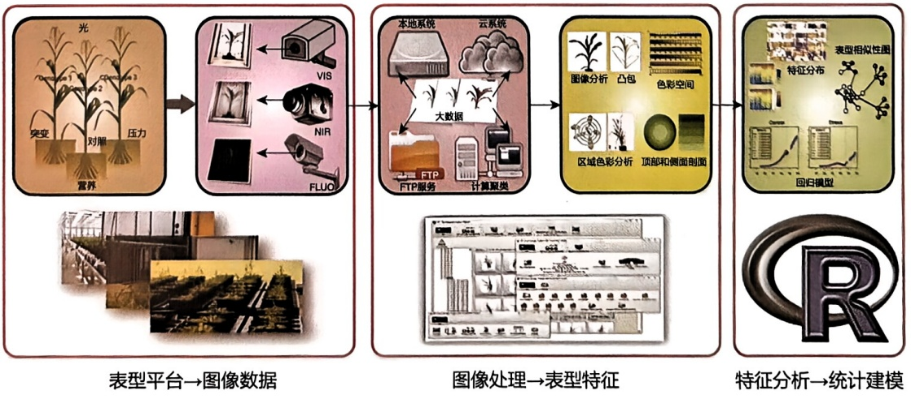

<details>
<summary>flowchart</summary>

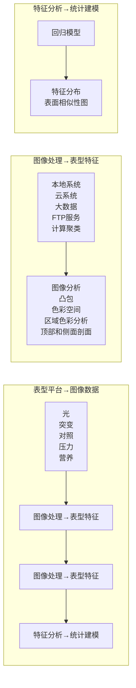
</details>

图10-9 植物表型组的技术框架（改绘自Chen et al., 2014）

---

10.4 表型组学的应用

407

## 植物生长曲线

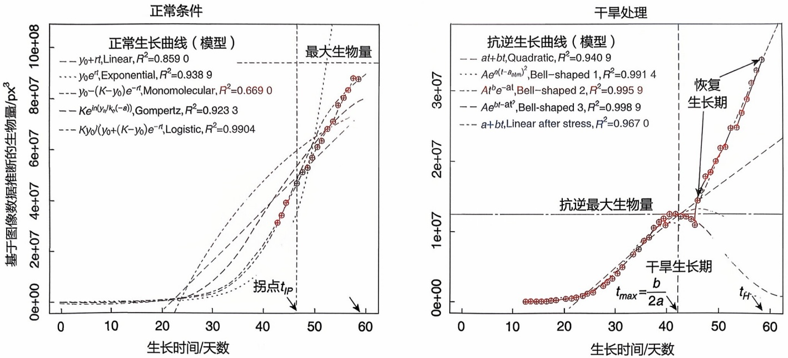

图10-10 图像表型特征用于建立植物在正常条件和抗逆条件下的生长曲线（改绘自Chen et al., 2014）

## 10.4.3.2 植物根系研究

了解根系的结构及其发育过程对解析植物适应性机制和应答机制的分子遗传机制具有重要作用。特殊的长通滤波器可以对在透明培养皿表面生长的根部进行近红外成像监测其根系生长，通过使用近红外滤光片则可以避免光效应，适合无干扰地开展黑暗中的根系研究。CT 可以对根系进行高通量、无损检测，增加根与土壤的对比度，再利用中值滤波和边缘算法分离根段。通过这些高精度成像技术和自动化分析平台，不仅可以实时监测根系的生长动态、分布模式和形态特征，深入研究根系在不同土壤条件和环境压力下的适应机制，还帮助识别与优良根系性状相关的基因，从而指导育种工作，培育出更具抗逆性和高效养分吸收能力的作物品种。此外，表型组学在根系微生物互作研究中也发挥重要作用，揭示微生物对根系生长和健康的影响，促进植物健康和生产力的提升。这些应用不仅加深了对根系生物学的理解，还为提高作物产量和可持续农业发展提供了新的途径。

## 10.4.3.3 作物复杂性状解析

作物产量是由多个性状共同决定的复杂性状。通过大规模的表型数据分析，可以深入解析复杂性状，了解哪些具体性状对产量有显著影响。例如，表型组数据分析表明，生长速度、叶片大小、茎的粗细等表型性状与作物的产量性状密切相关。进一步，结合表型组学数据和基因组数据（如GWAS），可以识别与产量相关的遗传变异。这有助于找到影响产量的关键基因和基因型。此外，表型组学帮助解析复杂的产量性状，了解哪些具体性状对产量有显著影响，并通过对不同品种或变异体的表型分析，研究性状在遗传上的变异。它还可以研究作物在不同环境条件下的表现，如土壤类型和气候条件，以筛选出在特定环境下表现更好的品种。利用表型数据建立的预测模型有助于预测不同种植条件下的产量，从而优化种植策略。最后，表型组学支持精准育种，指导选择具有优良产量性状的品种进行繁育，提升作物的

---

408

10 表型组学

整体产量。

## 10.4.3.4 作物受生物胁迫研究

生物胁迫指的是由生物因素引起的植物压力，这些因素包括病原体（如细菌、真菌、病毒）和害虫（如昆虫、螨类、线虫等）。这些生物胁迫会影响植物的正常生长、发育和产量，甚至可能导致植物死亡。其中，病虫害的发生是造成作物产量损失和品质下降的重要因素之一。植物表型组学在应对生物胁迫方面具有重要的应用价值。例如，利用无人机、遥感和成像技术等表型组学技术，可以通过分析不同植物在病原体感染下的表型变化，筛选和鉴定出具有抗病性状的植株或者基因，也能够有效监测和评估病害的严重程度和扩展情况。其次，表型组学技术还可以用于研究植物与害虫之间的互作机制。通过对不同品种植物在害虫侵袭下的表型变化进行分析，可以揭示植物的抗虫机制。例如，对不同玉米品种在玉米螟（Ostrinia nubilalis）侵袭下的表型变化进行研究，可以发现某些品种具有较强的抗虫性，并进一步分析其抗性基因。此外，表型组学技术还可以在病虫害发生初期进行预警，采用可见近红外高光谱成像仪采集感染水稻白叶枯病后不同时间的叶片光谱图像，根据光谱指数简单算式的计算结果，对不同基因型水稻品种在不同染病时间的病害等级，利用光谱特征进行了快速定性评价。

## 10.4.3.5 作物受非生物胁迫研究

非生物胁迫包括干旱、盐分、高温、低温、光照、重金属和营养缺乏等因素，对植物生长和生存有显著影响，是影响作物丰产稳产性的重要因素之一。通过高通量手段测量植物在不同环境条件下的表型特征，植物表型组学可用于研究植物对环境变化的响应。例如，在抗旱研究中，通过高通量表型平台，可以在不同水分条件下对大量大麦品种进行监测和分析，区分不同品种的抗逆反应，也可以捕捉不同表型性状的基因型效应、处理（环境）效应以及基因型-环境互作效应（图10-11）。在盐碱胁迫研究中，可以在控制条件下详细观察植物的生长状态、叶片颜色变化、根系发育等表型特征，实时监测植物在盐胁迫下的生长动态，并通过计算机图像分析技术，精确量化植物的表型变化。此外，通过集成多种表型数据，如形态、色素含量、生理指标等，研究者可以构建植物在多种逆境条件下的表型响应网络。这种综合分析方法不仅可以揭示植物对单一逆境的适应策略，还能提供植物在复合逆境条件下的系统响应图谱，从而为全面提升植物抗逆性提供新的思路。总之，植物表型组学通过高效、精准的数据采集与分析，为植物抗逆性研究提供了强有力的工具和方法。随着表型组学技术的不断发展和应用，未来在植物抗逆育种和作物改良中必将发挥越来越重要的作用。

## 10.4.3.6 农业智能化

植物表型组学在农业智能化中的应用日益广泛，涵盖了精准农业、农业机器人、智能农机、农业大数据分析和农业生态监测等领域。在精准农业中，表型组学技术通过高通量监测实现了精确施肥、灌溉和作物健康监测，优化资源利用，提高生产效率。农业机器人集成表型组学技术，实现自动播种、收割和田间管理，提升作业

---

10.4 表型组学的应用

409

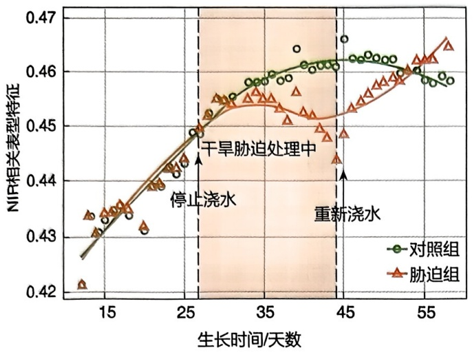

<details>
<summary>line</summary>

| 生长时间/天数 | 对照组 (NIR相关表型特征) | 胁迫组 (NIR相关表型特征) |
| --- | --- | --- |
| ~12 | ~0.426 | ~0.421 |
| ~13 | ~0.431 | ~0.434 |
| ~14 | ~0.433 | ~0.431 |
| ~15 | ~0.434 | ~0.434 |
| ~16 | ~0.435 | ~0.435 |
| ~17 | ~0.434 | ~0.436 |
| ~18 | ~0.439 | ~0.439 |
| ~19 | ~0.439 | ~0.439 |
| ~20 | ~0.442 | ~0.442 |
| ~21 | ~0.442 | ~0.442 |
| ~22 | ~0.443 | ~0.443 |
| ~23 | ~0.448 | ~0.448 |
| ~24 | ~0.452 | ~0.452 |
| ~25 | ~0.455 | ~0.455 |
| ~26 | ~0.458 | ~0.455 |
| ~27 | ~0.458 | ~0.456 |
| ~28 | ~0.459 | ~0.456 |
| ~29 | ~0.459 | ~0.456 |
| ~30 | ~0.460 | ~0.456 |
| ~31 | ~0.461 | ~0.456 |
| ~32 | ~0.461 | ~0.456 |
| ~33 | ~0.461 | ~0.456 |
| ~34 | ~0.461 | ~0.456 |
| ~35 | ~0.461 | ~0.456 |
| ~36 | ~0.461 | ~0.456 |
| ~37 | ~0.461 | ~0.456 |
| ~38 | ~0.461 | ~0.456 |
| ~39 | ~0.461 | ~0.456 |
| ~40 | ~0.461 | ~0.456 |
| ~41 | ~0.461 | ~0.456 |
| ~42 | ~0.461 | ~0.456 |
| ~43 | ~0.461 | ~0.456 |
| ~44 | ~0.461 | ~0.456 |
| ~45 | ~0.461 | ~0.456 |
| ~46 | ~0.461 | ~0.456 |
| ~47 | ~0.461 | ~0.456 |
| ~48 | ~0.461 | ~0.456 |
| ~49 | ~0.461 | ~0.456 |
| ~50 | ~0.461 | ~0.456 |
| ~51 | ~0.461 | ~0.456 |
| ~52 | ~0.461 | ~0.456 |
| ~53 | ~0.461 | ~0.456 |
| ~54 | ~0.461 | ~0.456 |
| ~55 | ~0.461 | ~0.456 |
| ~56 | ~0.461 | ~0.456 |
| ~57 | ~0.461 | ~0.456 |
| ~58 | ~0.461 | ~0.456 |
| ~59 | ~0.461 | ~0.456 |
| 1~29 (停止浇水) | — | — |
| 39~59 (重新浇水) | — | — |

注：图中虚线框标注了“干旱胁迫处理中”和“重新浇水”两个阶段，分别对应不同的时间段。
</details>

(a) 抗逆响应相关表型特征

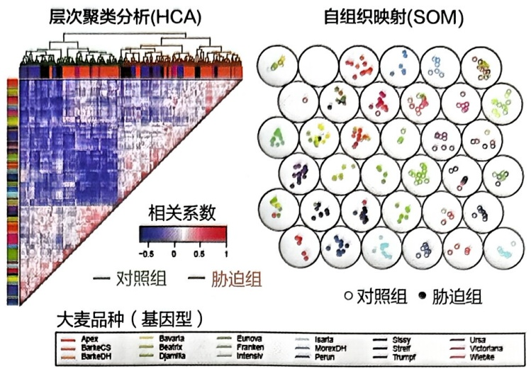

<details>
<summary>flowchart</summary>

```mermaid
graph LR
  subgraph HCA["层次聚类分析(HCA)"]
  A1["Aptex"] --> A2["BarkeCS"]
  A1 --> A3["BarkeDH"]
  A2 --> A4["Bavaria"]
  A3 --> A5["Beatrix"]
  A4 --> A6["Djamika"]
  A5 --> A7["Eurova"]
  A6 --> A8["Franken"]
  A7 --> A9["Intensiv"]
  end

  subgraph SOM["自组织映射(SOM)"]
  B1["Isarta"] --> B2["MoraxDH"]
  B2 --> B3["Perun"]
  B3 --> B4["Streif"]
  B4 --> B5["Turmpf"]
  B5 --> B6["Ursa"]
  B6 --> B7["Victoriana"]
  B7 --> B8["Wielcke"]
  end

  subgraph Legend["Legend:"]
  H1["大麦品种（基因型）"]
  H2["对照组 (对照组)"]
  H3["胁迫组 (胁迫组)"]
```
</details>

(b) 基于高通量表型特征的无监督学习

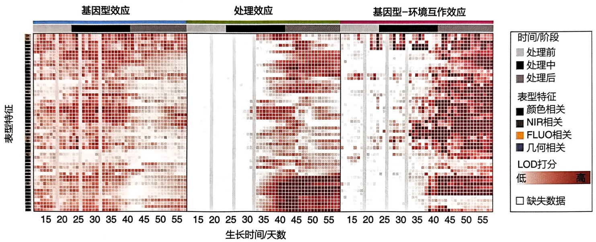

<details>
<summary>heatmap</summary>

| 生长时间/天数 | 处理效应::处理前 | 处理效应::处理中 | 处理效应::处理后 |
| --- | --- | --- | --- |
| 15~30 | 颜色相关 (红色) | N/A | N/A |
| 30~45 | NIR相关 (深红) | N/A | N/A |
| 45~55 | FLUO相关 (橙) | N/A | N/A |
| 55~60 | 几何相关 (深蓝) | N/A | N/A |
| 60~70 | N/A | 颜色相关 (深红) | N/A |
| 70~80 | N/A | N/A | 黑色相关 (深红) |
| 80~90 | N/A | N/A | 黑色相关 (深红) |
| 90~100 | N/A | 黑色相关 (深红) | 黑色相关 (深红) |
| 100~110 | N/A | 黑色相关 (深红) | 黑色相关 (深红) |
| 110~120 | 黑色相关 (深红) | 黑色相关 (深红) | 黑色相关 (深红) |
| 120~130 | 黑色相关 (深红) | 黑色相关 (深红) | 黑色相关 (深红) |
| 130~140 | 黑色相关 (深红) | 黑色相关 (深红) | 黑色相关 (深红) |
| 140~150 | 黑色相关 (深红) | 黑色相关 (深红) | 黑色相关 (深红) |
| 150~160 | 黑色相关 (深红) | 黑色相关 (深红) | 黑色相关 (深红) |
| 160~170 | 黑色相关 (深红) | 黑色相关 (深红) | 黑色相关 (深红) |
| 170~180 | 黑色相关 (深红) | 黑色相关 (深红) | 黑色相关 (深红) |
| 180~190 | 黑色相关 (深红) | 黑色相关 (深红) | 黑色相关 (深红) |
| 190~200 | 黑色相关 (深红) | 黑色相关 (深红) | 黑色相关 (深红) |
| 200~210 | 黑色相关 (深红) | 黑色相关 (深红) | 黑色相关 (深红) |
| 210~220 | 黑色相关 (深红) | 黑色相关 (深红) | 黑色相关 (深红) |
| 220~230 | 黑色相关 (深红) | 黑色相关 (深红) | 黑色相关 (深红) |
| 230~240 | 黑色相关 (深红) | 黑色相关 (深红) | 黑色相关 (深红) |
| 240~250 | 黑色相关 (深红) | 黑色相关 (深红) | 黑色相关 (深红) |
| 250~260 | 黑色相关 (深红) | 黑色相关 (深红) | 黑色相关 (深红) |
| 260~270 | 黑色相关 (深红) | 黑色相关 (深红) | 黑色相关 (深红) |
| 270~280 | 黑色相关 (深红) | 黑色相关 (深红) | 黑色相关 (深红) |
| 280~290 | 黑色相关 (深红) | 黑色相关 (深红) | 黑色相关 (深红) |
| 290~300 | 黑色相关 (深红) | 黑色相关 (深红) | 黑色相关 (深红) |
| 300~310 | 黑色相关 (深红) | 黑色相关 (深红) | 黑色相关 (深红) |
| 310~320 | 黑色相关 (深红) | 黑色相关 (深红) | 黑色相关 (深红) |
| 320~330 | 黑色相关 (深红) | 黑色相关 (深红) | 黑色相关 (深红) |
| 330~340 | 黑色相关 (深红) | 黑色相关 (深红) | 黑色相关 (深红) |
| 340~350 | 黑色相关 (深红) | 黑色相关 (深红) | 黑色相关 (深红) |
| 350~360 | 黑色相关 (深红) | 黑色相关 (深红) | 黑色相关 (深红) |
| 360~370 | 黑色相关 (深红) | 黑色相关 (深红) | 黑色相关 (深红) |
| 370~380 | 黑色相关 (深红) | 黑色相关 (深红) | 黑色相关 (深红) |
| 380~390 | 黑色相关 (深红) | 黑色相关 (深红) | 黑色相关 (深红) |
| 390~400 | 黑色相关 (深红) | 黑色相关 (深红) | 黑色相关 (深红) |
| 400~410 | 黑色相关 (深红) | 黑色相关 (深红) | 黑色相关 (深红) |
| 410~420 | 黑色相关 (深红) | 黑色相关 (深红) | 黑色相关 (深红) |
| 420~430 | 黑色相关 (深红) | 黑色相关 (深红) | 黑色相关 (深红) |
| 430~440 | 黑色相关 (深红) | 黑色相关 (深红) | 黑色相关 (深红) |
| 440~450 | 黑色相关 (深红) | 黑色相关 (深红) | 黑色相关 (深红) |
| 450~460 | 黑色相关 (深红) | 黑色相关 (深红) | 黑色相关 (深红) |
| 460~470 | 黑色相关 (深红) | 黑色相关 (深红) | 黑色相关 (深红) |
| 470~480 | 黑色相关 (深红) | 黑色相关 (深红) | 黑色相关 (深红) |
| 480~490 | 黑色相关 (深红) | 黑色相关 (深红) | 黑色相关 (深红) |
| 490~500 | 黑色相关 (深红) | 黑色相关 (深红) | 黑色相关 (深红) |
| 500~510 | 黑色相关 (深红) | 黑色相关 (深红) | 黑色相关 (深红) |
| 510~520 | 黑色相关 (深红) | 黑色相关 (深红) | 黑色相关 (深红) |
| 520~530 | 黑色相关 (深红) | 黑色相关 (深红) | 黑色相关 (深红) |
| 530~540 | 黑色相关 (深红) | 黑色相关 (深红) | 黑色相关 (深红) |
</details>

(c) 混合线性模型分析表型动态变化特征

图 10-11 表型组在作物抗逆中的应用（改绘自 Chen et al., 2014）

效率和作物产量。智能农机设备通过表型数据，精确控制药剂和肥料的使用，减少环境污染。农业大数据分析结合表型组学技术，为产量预测和品种优化提供数据支持，提升作物产量和质量。在农业生态监测方面，表型组学技术帮助监测土壤健康和评估气候变化对作物的影响，制定科学的管理策略，促进农业的可持续发展。这些应用可以显著提高农业生产效率，减少了资源浪费，推动农业技术的发展。

## 10.4.4 动物表型组的应用

牲畜的频繁活动给动物表型组的表型连续记录带来了一定的挑战。然而随着新技术的发展，有社会高度需求的动物表型逐渐被评估，如与动物福利、动物适应性、疾病发生或资源利用相关的表型。美国农业部在2020年成立了“农业基因组到表型组计划”（Agricultural Genome to Phenome Initiative, AG2PI），旨在更好地了解基因型和环境如何影响对农业具有经济效益的作物和牲畜的复杂性状表型。

---

410

10 表型组学

## 10.4.4.1 生物标志物检测

表型组学在生物标志物检测中的应用十分广泛，通过多种方法和设备，能够有效监测和改善动物福利与生产性能。首先，为了减少动物应激，可使用非侵入性的方法测定糖皮质激素水平，如唾液、尿液、排泄物、毛发/羽毛和蛋中的激素或其代谢产物。血液中的生物标志物如三碘甲状腺素、5-羟色胺和色氨酸也可通过血液采样监测，以评估动物的行为特征和健康状态。此外，对于奶制品动物，中红外光谱分析可用于监测代谢问题和疾病，如乳腺炎、酮症、脂肪-蛋白质比例等，从而提高生产系统中的动物福利。针对放养生产系统中的动物，血清或乳汁抗体水平以及排泄物中的虫卵计数可作为遗传选择的指标，以提高动物对内寄生虫的抵抗力。

## 10.4.4.2 牲畜行为监测

表型组学在牲畜行为监测中的应用主要以机器视觉对牲畜实施行为监测为主，包括确定体况评分、检测攻击行为、行走模式和跛行，以及泌乳期间的姿势和行为等。例如，分析动物的整体姿势，以检测跛行问题，并进行基因选择以改善蹄部健康。尼古拉·布莱基（Nicola Blackie）等评估了不同跛行状态下奶牛的步幅特征、关节弯曲和脊柱姿势。使用 Microsoft Kinect Kinect 深度摄像头（通常用于检测人体骨架、面部表情、声音等信息）等设备还可以进行畜牧身体形状建模，从而用于自动记录动物的体况，指导养殖户对畜牧行为实时检测和评估健康状况。热成像技术用于非侵入性评估动物的生理和生存状态，包括皮肤温度、特定部位的炎症（如乳腺炎）、步态障碍和呼吸道疾病等。这种技术还被用于识别猪的攻击行为、识别群养猪中的激烈行为，以及定量评估肉牛体表寄生虫数量等。

## 10.4.4.3 牲畜饲喂系统设计

牲畜饲喂系统针对牲畜不同生理生长阶段对养分的动态需求,综合考虑产品性质、用途、价格和销量，设计开发了犊牛精准牛奶饲喂机、奶牛分群管理精准饲喂系统、自走式精准撒料机、母猪小群养智能饲喂站、智能化奶羊饲喂站等，实现对牲畜进食频率、时间和饲料摄入量的精准管理。这些设备通常有一个射频识别天线来识别正在进食的动物以及其进食行为特征，除了消耗率（即单位时间的饲料摄入量）外，还可以提取各种其他变量，如进餐的频率、进餐的持续时间、饲养时间、饲养模式，甚至是牲畜每日对饲养器的访问次数、每次访问的饲养时间和持续时间以及每日总饲养器持续时间都可以被记录，从而更好地用于饲料投喂，实现更高的经济效益。

## 10.4.4.4 牲畜肠道微生物组分析

表型组学在牲畜肠道微生物组分析中的应用主要关注微生物组与宿主的相互关系，以及如何通过微生物组的分析来改善动物福利和生产性能。通过选择宿主、调整饮食以及管理方法，可以改变肠道微生物组，影响宿主的免疫系统、生长、代谢、行为、神经生理和情绪健康，从而改善牲畜的福祉。例如，不同的鸡系在相同的饲养条件下拥有不同的微生物组成，这表明基因型、性别和宿主基因型与性别交互作用对微生物组具有影响。还有研究探讨了微生物移植对福祉和行为特征的影响，发现具有不同拔毛遗传优势的鸡系拥有不同的微生物组成，并且微生物移植对宿主的

---

10.5 表型组学的总结与展望

411

行为和免疫特性产生了影响，这些影响还与宿主的基因型有关。

## 10.5 表型组学的总结与展望

表型组学的研究为生命科学和个性化医学领域提供了重要支持。细胞和类器官表型组学的研究为深入理解生物系统的功能提供了坚实基础，并在疾病模型构建、药物开发，以及疾病的精准诊断和治疗方面实现了革命性的进展。研究利用患者来源的类器官模拟发育过程，开展药物筛选和毒理学研究，并在组织工程与再生医学领域中发挥着显著的应用优势。人类表型组学通过深入了解个体的表型特征，为疾病的预防、诊断和治疗提供更为精准的策略。同时，随着环境因素对健康和疾病的影响越来越受到重视，环境表型组学将成为一个备受关注的研究方向，它将探讨环境与个体表型之间的相互作用，为环境健康和生态学研究提供新的视角。跨尺度与多维度数据的整合在这一过程中显得尤为重要，它使我们能够捕捉生命过程中的动态变化与适应性反应，实现对个体生理状态的全面洞察，从而深刻理解生物的生命历程和生物多样性。考虑个体差异性和种群多样性也是表型组学研究的重要方面，这需要全面考虑并解释这些差异，以获得更准确的研究结果。在可预见的未来，表型组学的研究成果将为公共卫生政策和健康管理提供重要参考，帮助制定更加精准的和个性化的干预策略。

表型组学研究虽然取得了重大突破，但也面临一系列挑战。首先，该研究领域产生了大量复杂的数据，如何高效地进行数据分析和处理依然是一个重大挑战。未来，需要持续投入资源以研发新的人类表型组学方法，实现在数据分析算法和模型构建等方面的创新，从而提高数据的质量和解释能力。其次，需要建立表型组学研究的数据获取、存储、分配和使用等方面的标准化操作规范和流程方法。例如，在类器官的培养方面，尚缺乏广泛认可的标准化培养流程，这对研究结果的可靠性和可重复性构成了巨大挑战。建立人类表型组数据库，遵循《人类表型组测量指南》和支持《共建全球人类表型组数据库倡议》等措施，便于跨机构、跨国界的数据合作。第三，科研监管方面的规范和指导相对不足，因此需要建立健全的监管机制，以确保研究的可信度和质量。人类表型组研究、类器官研究等涉及大量个人数据，因此需要高度重视隐私保护和伦理原则，以确保研究的合法性和伦理性。第四，国际科研合作将极大地促进科学家之间的合作和交流，加速研究进展，构建大规模研究中心和大力发展国际合作。最后，表型组学研究成果向临床应用的转化仍面临许多挑战。为了克服这些困难，需要解决技术和方法上的难题，包括开发标准化的诊断工具、优化治疗策略以及实现个性化医疗。

表型组学领域将在未来呈现出许多令人瞩目的发展趋势。目前，收集表型组数据既昂贵又耗时，技术进步可以提高表型组数据的处理速度并降低成本。针对细胞、人、动物和植物，表型数据的采集方法会有所不同，因为它们具有不同的特征和研究需求。未来，表型数据的采集应当朝着更快速、精准和全面的方向发展。同时，表

---

412

10 表型组学

型组学的发展将依赖于不同学科领域的知识融合，跨学科合作将成为关键趋势。例如，芯片类器官的培养中，涉及物理学的流体控制、影像学的类器官成像、化学学科的小分子诱导物质合成和使用、计算机科学的高通量数据分析和生物学的细胞培养，也正是因为多学科的交叉和联合使用，使得类器官表型组研究得到飞速的发展，为使用类器官研究生物系统发育、分化和疾病机制等提供了保障和基础。随着数据规模的持续增长，如何充分利用这些庞大的数据来发现更多、更准确的生物学机制一直是一个巨大的挑战。大数据技术和人工智能在表型组学中的角色将日益重要，先进算法将助力研究人员在海量表型数据中挖掘有用的信息，进而得到更加准确的结果。总的来说，表型组学将在技术创新、跨学科合作、大数据应用等方面取得显著的进展，为生物学、医学和环境科学等领域带来新的突破和发展机遇。

## ※ 推荐阅读

1. Freimer N, Sabatti C. The human phenome project [J]. Nature genetics, 2003, 34(1): 15-21.

点评:该文提出了“人类表型组计划”的构想，强调了建立全面表型数据库和开发新数据分析方法的重要性。该提议对当前和未来的表型组学研究具有深远的影响，为如何利用表型数据提供了前瞻性的视角和方法。

2. Hancock J M. Phenomics [M]. Boca Raton: CRC Press, 2014.

点评:该书是表型组学研究领域的重要资源，提供了关于表型数据收集、分析及其在现代生物学中应用的全面指南。书中详细讨论了从分子层面到生态系统层面的表型测量技术，并探讨了这些数据在遗传学、进化生物学和生态学中的应用。该书通过介绍表型组学的基本概念、技术工具和案例，为研究人员提供了实施表型组学研究的基础。此外，书中还涉及高通量表型分析技术和大数据处理方法，这些内容对于在基因组学时代背景下的科学研究尤为重要。同时，该书还展示了表型数据在植物和动物育种、疾病研究以及环境科学中的实际应用，突显了表型组学在解决现实问题中的潜力。

3. Meng X, Yao D, Imaizumi K, et al. Assembloid CRISPR screens reveal impact of disease genes in human neurodevelopment [J]. Nature, 2023, 622(7982): 359-566.

点评:该项研究展示了如何结合 3D 类器官模型和 CRISPR 技术来阐释人类发育中的关键调控环节，突显了 3D 类器官模型在研究复杂遗传和发育过程中的应用潜力，为未来的疾病模型和治疗策略开发提供了新的方向和工具。

---

参考文献

413

## ※ 思考与练习题

1. 假设你已获得抑郁障碍表型的 GWAS 结果，请描述如何进行后续分析。
2. 探讨特定环境因素（如气候、饮食、生活习惯）对人类某一表型（如身高、体重、血压）的影响。设计一个实验方案，描述如何收集相关的环境和表型数据，并阐述使用的统计方法来分析环境因素与表型之间的相关性。
3. 请设计一个用于描述人类头发颜色、质地和形态的表型编码系统。详细说明如何分类这些特征，并讨论这种编码系统在实际应用中的潜在利益和挑战。

## ※ 讨论题

1. 随着生物技术的发展，表型数据的数量和复杂性不断增加。AI 和机器学习技术如何帮助解决表型数据的分析和解释问题？讨论这些技术在表型数据挖掘、特征识别和模式预测中的潜力和挑战。
2. 表型数据往往包含敏感的个人信息，尤其是涵盖遗传信息的人类表型数据研究，其中的伦理与法律问题格外关键。在采集与共享这类数据过程中，如何妥善处理个人隐私和数据安全的问题？需要考虑哪些关键环节和具体问题？请讨论相关的伦理标准、法律规定以及实施的最佳实践，特别是在进行人类研究时的应用场景。

## ※ 参考文献

1. 中国人类表型组研究协作组. 人类表型组研究进展报告 2022 [R]. 2023.
2. Bastarache L, Denny J C, Roden D M. Phenome-wide association studies [J]. JAMA, 2022, 327(1):75-76.
3. Chen D, Chen M, Altmann T, et al. Bridging genomics and phenomics [M]// Approaches in integrative bioinformatics. Heidelberg: Springer, 2013.
4. Chen D, Neumann K, Friedel S, et al. Dissecting the phenotypic components of crop plant growth and drought responses based on high-throughput image analysis [J]. Plant cell, 2014, 26(12): 4636-4655.
5. Denny J C, Collins F S. Precision medicine in 2030: seven ways to transform healthcare [J]. Cell, 2021, 184(6): 1415-1419.
6. Furbank R T, Tester M. Phenomics-technologies to relieve the phenotyping bottleneck [J]. Trends in plant science, 2011, 16(12): 635-644.
7. Greenwood P L, Bishop-Hurley G J, González L A, et al. Development and application of a livestock phenomics platform to enhance productivity and efficiency at pasture [J]. Animal production science, 2016, 56(8): 1299-1311.

---

414

10 表型组学

8. Han X, Shen Q, Hou C, et al. Disease clusters subsequent to anxiety and stress-related disorders and their genetic determinants [J]. Nature communications, 2024, 15(1): 1-3.
9. Houle D, Govindaraju D, Omholt S. Phenomics: the next challenge [J]. Nature reviews genetics, 2010, 11(12): 855-866.
10. Klukas C, Chen D, Pape J M. Integrated analysis platform: an open-source information system for high-throughput plant phenotyping [J]. Plant physiology, 2014, 165(2):506-518.
11. Li J, Glover J D, Zhang H, et al. Limb development genes underlie variation in human fingerprint patterns [J]. Cell, 2022, 185(1): 95-112.
12. Li Y, Ma Y, Wang K, et al. Using composite phenotypes to reveal hidden physiological heterogeneity in high-altitude acclimatization in a Chinese Han longitudinal cohort [J]. Phenomics, 2021, 1: 3-14.
13. Meng Q, Wang L, Dai R, et al. Integrative analyses prioritize GNL3 as a risk gene for bipolar disorder [J]. Molecular psychiatry, 2020, 25: 2672-2684.
14. Tardieu F, Cabrera-Bosquet L, Pridmore T, et al. Plant phenomics, from sensors to knowledge [J]. Current biology, 2017, 27(R15): R770-R783.
15. Tian M, Liu H, Chen S, et al. Report on the 3rd board meeting of the international human phenome consortium [J]. Phenomics, 2023, 3(1): 77-82.
16. Wang L, Xia Y, Chen Y, et al. Brain banks spur new frontiers in neuropsychiatric research and strategies for analysis and validation [J]. Genomics, proteomics & bioinformatics, 2019, 17(4): 402-414.
17. Zhang W, Yin X, Gu H, et al. Advancements and prospects in human organoid phenomics: a comprehensive review [J]. Scientia sinica vitae, 2024, 54: 2125-2142.

编者:陈超（中南大学）

陈迪俊（南京大学）

蒋杭进（浙江大学）

黄涛（中国科学院上海营养与健康研究所）

审读:何顺民（中国科学院生物物理研究所）
