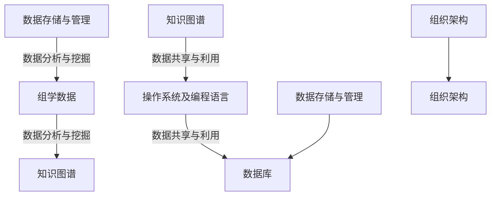
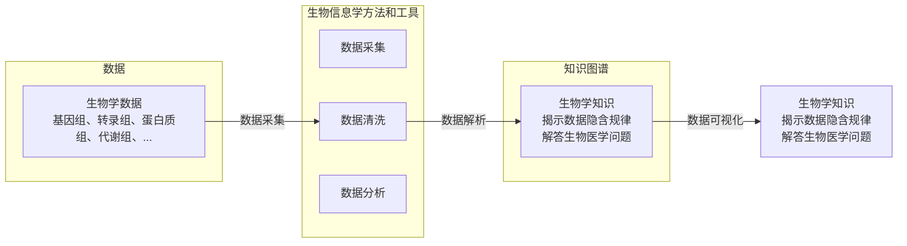
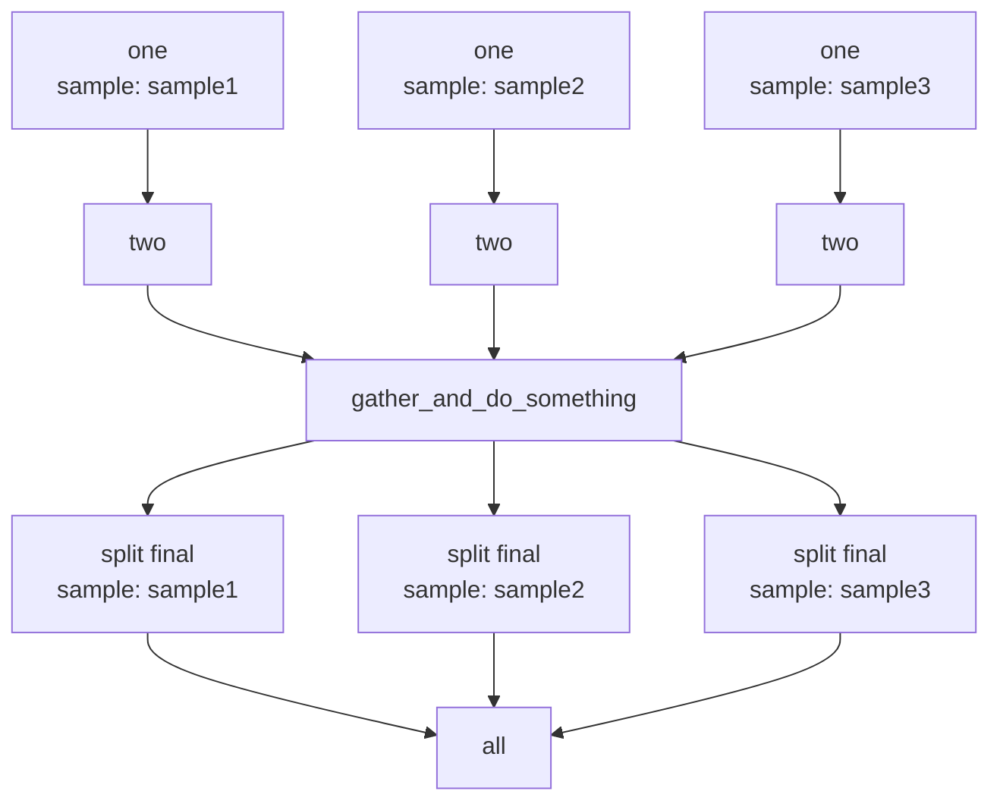
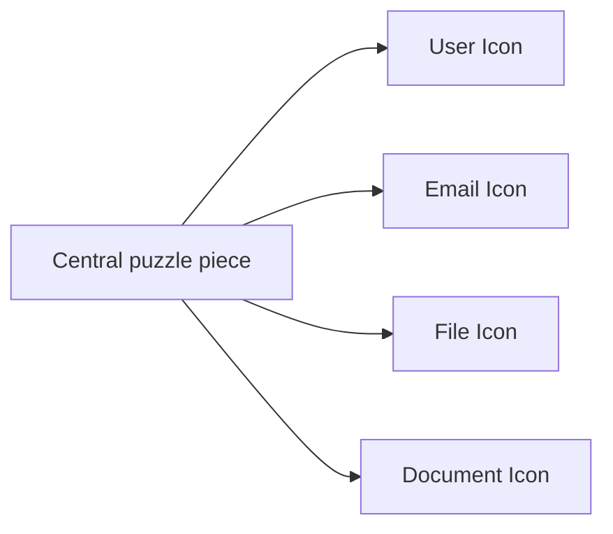
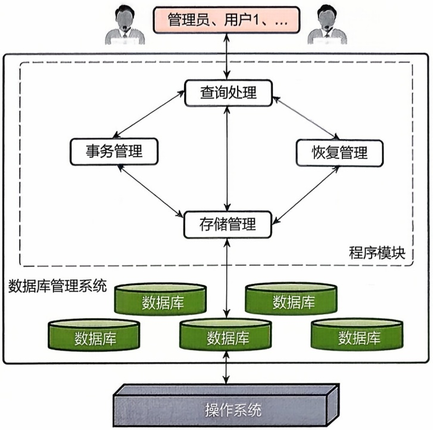
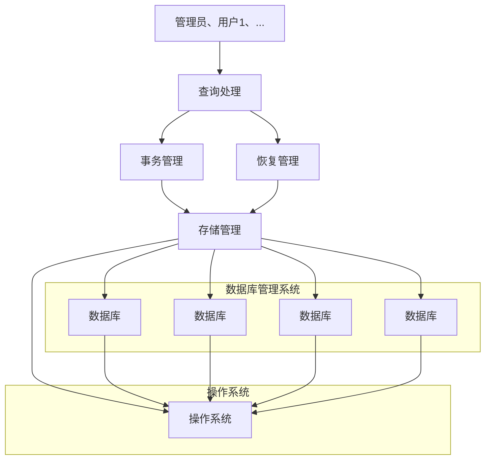
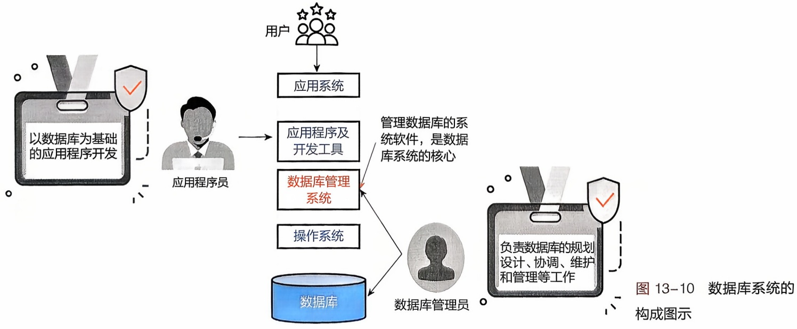
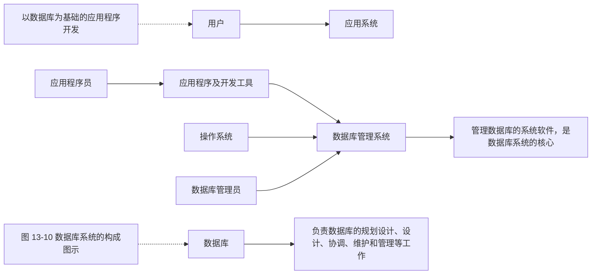
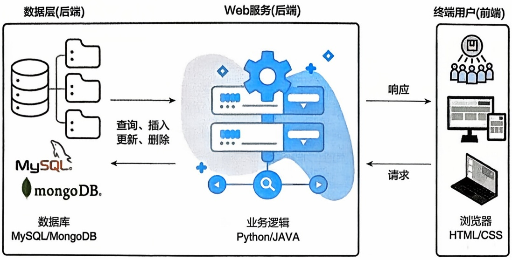
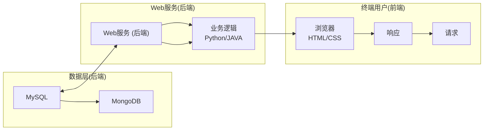

# 13 生物信息学实验基础

原始 PDF 第 548–617 页。

## 生物信息学实验基础

生物信息学实验的主要目的是利用计算工具和算法（通过编程实现）来处理和分析生物学数据，以解答生物学问题和推动生物科学的发展。本章将首先简要介绍常用的生物信息学编程语言，然后从技术和原理角度重点介绍两个在生物信息学学习和研究中经常涉及的核心主题:其一是建立生物信息学数据分析流程，旨在将大量生物数据转化为有意义的知识图谱；其二是开发生物学数据库，有效地将生物数据和知识图谱呈现给终端用户。这些内容将帮助读者掌握如何利用编程技术高效处理生物数据，实现从数据到知识的转化和应用。同时，本章还将帮助读者更好地理解和应用前面章节中介绍的生物信息学案例，并结合相关编程技术应用于生物信息学研究中。

## 13

---

534

13 生物信息学实验基础

## 13.1 生物信息学实验概述

生物信息学是一门跨学科的科学领域，它将生物学、计算机科学和数学等学科相结合，旨在利用计算机技术处理、分析和理解生物学数据。生物信息学实验就是利用计算和数据分析的方法来解决生物学问题的一类实验。和传统的“湿实验”（wet experiment，如分子克隆、蛋白质电泳等）不同，生物信息学实验通常称为“干实验”（dry experiment），主要依赖计算机、算法和数据库。在生物信息学实验过程中，编程技术扮演着举足轻重的角色，它是实验的重要组成部分，为研究人员提供了强大的工具和方法来解决生物学中的复杂问题。生物信息学编程的目的是将复杂的生物问题转化为可以用信息化方法（包括代码和模型）表示并进行计算和分析从而发现新规律（图13-1），主要用于以下几个方面:①处理和分析大量的生物数据，帮助知识发现；②构建数学模型和计算模型，模拟生物系统的行为和变化；③推动新方法和工具的开发，可以提高数据分析的准确性和效率；④实现自动化流程搭建，提高数据处理和分析的效率；⑤搭建在线数据库和分析平台，为研究人员提供便捷的数据访问和分析工具。

随着生物学研究的不断深入和技术的飞速发展，生物信息学编程技术也在不断地演变和改进。实际上，在生物信息学的整个发展进程中，计算机技术的发展历程与生物技术的革新相辅相成（图13-2），生物技术的革新推动了生物学数据的产生和积累，而计算机技术的发展则为处理和分析这些数据提供了必要的工具和方法。

生物信息学编程技术的发展可以追溯到20世纪70年代。随着DNA测序技术的发展，生物学家们开始面临大量的生物数据。传统的人工计算方法无法高效地处理这些数据，于是科学家们开始转向计算机技术。早期的生物信息学编程技术主要集中在序列比对、基因预测和蛋白质结构预测等方面，使用的主要编程语言包括Perl和C等。

随着时间的推移，生物信息学编程技术得到了迅速的发展和普及。1990年前后，随着人类基因组计划的启动，生物信息学编程技术迎来了一个爆发式的增长期。生物学家们需要处理大量的基因组数据，这促进了生物信息学编程技术的快速发展。在这个阶段，生物信息学编程技术的应用领域不断扩展，包括基因组序列分析、蛋白质结构预测、基因表达分析、系统生物学建模等。


<details>
<summary>flowchart</summary>


</details>

图13-1 生物问题的信息表示

21世纪初，随着高通量测序技术的发展，生物信息学编程技术又迎来了一个重要的转折点。高通量测序技术使得科学家们能够以前所未有的速度和成本获得大量的生物数据，这进一步推动了生物信息学编程技术的发展。在这个阶段，生物信息学编程技术开始融合更多的数据科学技术，如机器学习和深度学习等，以处理和分析这些大规模的生物数据。

---

13.1 生物信息学实验概述

535


<details>
<summary>state_timeline</summary>

| Time Period | Technologies |
| --- | --- |
| 1950—1970 | Fortran: Backus J(1957)<br>LISP: McCarthy J(1958)<br>BASIC:Gates B等(1964)<br>PASCAL:Wirth N(1970) |
| 1970—1980 | 分子进化理论:Pauling L(1962)<br>第一个生物序列数据库 Atlas of Protein Sequences: Dayhoff M (1965)<br>第一个生物信息学软件 COMPROTEIN: Dayhoff M 和 Ledley RS(1958—1962)<br>Needleman-Wunsch 序列比对算法: Needleman SB和Wunsch CD(1970)<br>PAM矩阵: Dayhoff M及其同事(1978) |
| 1980—1990 | R: GentlemanR和Ihaka R(~1980)<br>C++: Stroustrup B(1983)<br>Objective C: Cox B和Love T(1983)<br>GNU 协议: Stallman R(1985)<br Perl: Wall L(1987)<br>Python: Rossum G(1989)<br>WWW技术: Berners-LeeT(~1990) |
| 1990—2000 | Scala: Odersky M (2003)<br>云计算 (cloud computing)<br>○亚马逊 AWS(2006)<br>○Google App Engln(2008)<br>○微软 Azure(2009)<br>区块链(Blockchain, 2008)<br>Go: Google(2009) |
| 2000—2010 | 生物信息成熟期: 高通量时代<br>二代测序技术(~2005)<br>○Roche/454、Illumina Solexa、ABI SOLID<br>功能基因组计划<br>○HapMap 计划(2002)<br>○ENCODE 计划(2003)<br>○表观基因组计划(2003)<br>○癌症基因组计划(TCGA, 2006)<br>○宏基因组计划(HMP, 2007)<br>○1000基因组计划(2008) |
| 2010至今 | 生物信息学编程技术 |
| 2010至今 | 整合生物学系统生物学 |
| 2010至今 | 生物信息黄金期: 大数据时代<br>二代测序技术(2010)<br>○PacBio(2010)、ONT(2014)<br>生物大数据科学计划<br>○英国10万人基因组计划(2012)<br>○精准医疗(2015)、人类表型组计划(2017)<br>国家基因组科学数据中心成立(2016)<br>AlphaFold(2018)、AlphaFold3(2024) GeneFormer、scGPT、scFoundation (2023) |
| 2010至今 | 生物信息学编程技术 |
| 2010至今 | 计算机技术 |
| 2010至今 | 生物信息学编程技术 |
| 2010至今 | 计算机技术 |
| 2010至今 | 生物信息学编程技术 |
| 2010至今 | 计算机技术 |
| 2010至今 | 计算机技术 |
| 2010至今 | 计算机技术 |
| 2010至今 | 计算机技术 |
| 2010至今 | 计算机技术 |
| 2010至今 | 计算机技术 |
| 2010至今 | 计算机技术 |
| 2010至今 | 计算机技术 |
</details>

到了当今，生物信息学编程技术已经成为生物学研究中不可或缺的一部分，大语言模型的发展也让生物信息学编程技术进入新的阶段。它在基因组学、转录组学、蛋白质组学、代谢组学等多个领域发挥着重要作用。生物信息学编程技术不仅能够帮助科学家们处理和分析生物数据，还能够提供生物学模型的构建和模拟等功能。随着技术的不断进步，生物信息学编程技术也在不断地演进和改进，为生物学研究提供了更强大的工具和方法。

在生物信息学编程技术的发展过程中，有几个关键的技术和方法对其起到了重要的推动作用。首先是早期的序列比对和基因预测方法，这些方法的发展和广泛使用为生物信息学编程技术的发展奠定了基础。其次是机器学习和深度学习等数据科学技术的应用。随着生物数据规模的不断增大，传统的生物信息学方法已经无法有效处理这些数据。因此，科学家们开始将机器学习和深度学习等数据科学技术引入生物信息学编程技术中，以提高数据处理和分析的效率和准确性。这些技术的应用使得生物信息学编程技术更加强大和灵活。此外，开源软件和开放数据资源的出现也极大地促进了生物信息学编程技术的发展。越来越多的生物信息学工具和数据库成了开源软件，科学家们可以自由地获取和使用这些工具和数据资源，从而加速了

图13-2 生物信息学编程技术与计算机技术的发展历程

---

536

13 生物信息学实验基础

生物信息学编程技术的应用和发展。

总的来说，从早期的序列比对和基因预测到如今的机器学习和深度学习等数据科学技术的应用，生物信息学编程技术的发展经历了多个阶段。随着生物学研究的不断深入和技术的不断进步，生物信息学编程技术将继续发挥着重要的作用，推动着生物学研究的不断发展。生物信息学常用的编程语言主要包括以下几种。

① C/C++ C/C++ 是一种高性能的编程语言，在生物信息学领域通常用于开发性能要求较高的生物信息学工具和算法。一些序列比对、蛋白质结构预测等底层任务的工具可能是用 C 或 C++ 编写的。
② Perl Perl 曾经是生物信息学中最流行的编程语言之一，在生物信息学领域有着较长的历史。Perl 是一种灵活、强大的编程语言。许多经典的生物信息学工具和软件都是用 Perl 语言编写的，尤其在早期序列分析任务中都可以找到 Perl 的身影，如 BioPerl、EMBOSS、GBrowse、RepeatMasker 等，不过现在基本被 Python 所替代。
③ Python Python 是一种简单易学、功能强大的编程语言，在生物信息学领域得到了广泛应用。它拥有丰富的生物信息学相关的库和工具，如 BioPython、Pandas、NumPy 等，可以用于处理生物序列、进行数据分析和可视化等任务。
④ R R 语言是一种专门用于统计学和数据分析的编程语言, 因为免费开源和拓展性等优点, 在生物信息学的统计分析和可视化中得到广泛应用。其中, Bioconductor 是一个专门为生物信息学开发的 R 包生态系统, 提供了丰富的生物信息学工具。
⑤ Java Java 是一种跨平台的编程语言，在生物信息学中也有一定的应用。Java 语言的特点是稳定、可靠，适合开发大型的生物信息学软件和系统。一些生物信息学工具和平台，如 BioJava、Cytoscape、Picard、GATK、InterProScan 等，主要是用 Java 编写的。
⑥ Julia Julia 是一种新兴的高性能编程语言，被设计用于高性能科学计算，具有动态类型、高性能和易于编写的特点，在生物信息学中也有一些应用。
⑦ MATLAB MATLAB 是一种用于数学建模和工程计算的语言，生物信息学中在数学建模和仿真方面有时会使用 MATLAB。但是，MATLAB 是一款商业软件，需要购买许可证才能使用，限制了其使用范围。
⑧ Bash/Shell 脚本 Bash 是一种 Unix 和 Linux 操作系统中常用的命令行解释器，而 Shell 是一种用于与操作系统内核进行交互的命令语言，也是一种脚本语言。在生物信息学中，它常用于处理文件、运行一系列命令以及批量处理任务。
⑨ Web 技术 在生物信息学研究中，Web 技术被广泛应用于构建在线工具、数据库查询界面和数据可视化平台等，为生物学研究提供了便捷的访问和使用方式。常见的 Web 应用框架如 Django、Flask 和 Ruby on Rails 等，被用于构建生物信息学数据库查询界面和在线工具。
⑩ 数据库技术 数据库技术在生物信息学中也起着关键作用，根据类型的不同可分为关系型数据库（RDBMS）、非关系型数据库（NoSQL）和分布式数据库。利

---

13.2 Linux系统及常用编程语言简介

537

用数据库技术,可以为生物学研究设计专用数据库,通常包含特定类型的生物学数据和相应的查询接口。生物学数据库的开发常涉及数据库技术和 Web 技术的融合应用,前面章节提到的生物学数据库都是通过类似方式构建而成的。

生物信息实验要求读者具备一定的编程基础。虽然选择合适的编程语言或技术取决于具体的应用场景、任务需求以及个人偏好，但是不同编程语言在语法及功能方面具有较高的相似性，掌握其中一门编程语言之后，很容易拓展学习其他编程语言。特别需要指出的是，借助 ChatGPT 和 DeepSeek 等大语言模型的代码生成、测试和解读能力，只要给出正确的提示，这些大语言模型就可以协助完成特定的编码任务。在生物信息学实践中，读者不需要从头开始构


<details>
<summary>flowchart</summary>


</details>

图13-3 本章主要章节之间的关系

建完整的应用程序，而是可以在 ChatGPT 或 DeepSeek 生成的代码基础上进行补充和完善。ChatGPT 或 DeepSeek 能够提供初步的代码框架、解决方案和具体实现，读者则可以根据实际需求进行调整和优化。此外，大语言模型还可以生成和执行单元测试，帮助识别和修复潜在的错误，确保代码的稳定性和可靠性。因此，在生物信息学实验中，合理使用大语言模型不仅可以加速写代码过程、提高代码质量，还能实现不同语言之间的代码转换，使得生物信息学编程更加高效和精确。

在接下来的章节中，首先介绍当前常用的生物信息学编程语言，包括Linux系统及Shell脚本语言、Python编程语言和R编程语言（13.2）；再分别介绍生物信息学数据分析流程搭建（目的是将数据转化为知识图谱；13.3）和生物学数据库开发（将生物数据/知识图谱呈现给终端用户；13.4），这两个主题在日常的生物信息学学习和研究中经常涉及。本章主要章节的关系如图13-3所示。需要说明的是，生物信息学实验涉及大量的学习内容，由于篇幅所限，本章节不能囊括所有的主题内容，对生物信息学实践感兴趣的读者可以进一步学习本书对应的实验教材。

## 13.2 Linux 系统及常用编程语言简介

Linux是生物信息学实验的首选操作系统之一。由于其开源性、稳定性和强大的命令行工具，Linux成了生物信息学研究人员开展实验的理想平台。Shell脚本语言是一种在Linux操作系统中由Shell（命令解释器）执行的编程语言，用于实现自动化任务、批处理操作以及系统管理等功能。R是一种专为统计分析和数据可视化设计的编程语言，广泛用于生物信息学等数据科学领域。Python是一种通用编程语言，以其简洁易用的语法和丰富的库生态系统而闻名，广泛应用于数据科学、机器学习（包括深度学习）、Web开发等领域。

---

538

13 生物信息学实验基础

## 13.2.1 Linux 操作系统

操作系统通常分为 Windows、Linux 和 Mac OS 等几种。其中，Linux 操作系统在生物信息学领域得到了广泛的应用，主要因为它具备开放性、灵活性、强大的命令行界面、免费开源、出色的稳定性以及高度的可定制性等特点。越来越多的生物信息学软件和工具都支持在 Linux 系统上运行，选用 Linux 系统进行生物信息学实验有以下 6 个主要优势。

## (1) 稳定性和性能

Linux 系统以其稳定性和高效性能而著称，特别适合处理大型生物信息学数据集和进行复杂计算。许多高性能计算集群和超级计算机都运行 Linux 操作系统，这为生物信息学研究提供了强大的计算支持。

## (2) 开源软件生态系统

Linux 拥有丰富的开源软件资源，这对于生物信息学研究尤为重要。大量的生物信息学工具和软件包都是在 Linux 环境下开发和优化的，如 BLAST、Bowtie 和 GATK 等。这些工具在 Linux 上通常具有更好的性能和兼容性。

## （3）强大的命令行工具

Linux 提供了强大的命令行界面（command line interface，CLI），允许用户通过脚本和命令行工具高效地处理和分析数据。常用的命令行工具如 grep、awk、sed 和 sort 等，可以轻松地进行数据筛选、处理和格式转换。此外，Linux 的 Shell 脚本编程（如 bash 脚本）使得自动化数据处理和分析成为可能，大大提高了工作效率。

## （4）软件包管理和更新

Linux 系统通常配备了强大的包管理器（如 apt、yum、dnf 和 pacman 等），方便用户安装、更新和管理软件包。这使得生物信息学研究人员能够轻松获取最新的软件版本和更新，确保他们的研究工具保持最新版本。

## (5) 社区和支持

Linux 拥有庞大的用户社区和丰富的在线资源，研究人员可以通过论坛、邮件列表和文档快速找到问题的解决方案。此外，许多生物信息学工具和软件的开发者社区也主要集中在 Linux 平台上，这使得用户能够获得及时的支持和帮助。

## (6) 自定义和灵活性

Linux 系统的高度可定制性允许用户根据自己的需求配置和优化系统环境。研究人员可以选择合适的发行版（如 Ubuntu、CentOS、Debian 等）以及特定的内核和软件配置，以满足特定的研究需求。这些发行版在 Linux 的基础上添加了一些额外的软件和设置，以使它们更适合不同的用途，如桌面计算、服务器管理等。Linux 作为一个强大的操作系统，被广泛用于各种用途，包括个人电脑、服务器、嵌入式系统、超级计算机等。它具有稳定性、安全性和可定制性等优点，因此受到了许多人的喜爱和使用。

虽然 Windows 在日常办公中广受欢迎，Linux 因其稳定性、性能、丰富的开源

---

13.2 Linux系统及常用编程语言简介

539

软件资源、强大的命令行工具和灵活性，成了生物信息学实验的理想平台。无论是在数据处理、分析，还是在高性能计算和自动化工作流程方面，Linux 都为生物信息学研究提供了强有力的支持（表 13-1）。对于新手来说，Linux 可能需要一些时间来学习，但一旦掌握了基本概念，它可以成为一个强大的工具，用于完成各种计算机任务。

## 13.2.1.1 Linux 系统的安装

Linux本身是免费的，读者可以在各个Linux发行版的官方网站上找到安装包。下载的iso光盘映像文件可以刻录成光盘或制作成U盘启动盘，从而在安装Linux操作系统时使用，具体的安装过程读者可以自行查阅资料，这里不再赘述。关于

表 13-1 Linux 与 Windows 系统之间的比较

| 比较 | Linux | Windows |
| --- | --- | --- |
| 用户界面 | 主要依赖命令行界面(CLI),学习曲线较陡 | 图形用户界面(GUI),用户友好,易于操作 |
| 软件生态系统 | 广泛的开源软件支持,如BLAST、Bowtie、GATK | 支持许多商业软件,如Geneious、CLC Genomics Workbench |
| 命令行工具 | 强大的命令行工具和脚本支持,如awk、sed、grep | 命令行工具功能有限,PowerShell虽强大但不及Linux |
| 高性能计算支持 | 支持高性能计算集群和并行计算框架,如MPI、Hadoop | 对高性能计算集群的支持不如Linux,主要依赖第三方解决方案 |
| 硬件兼容性 | 部分硬件驱动支持较弱,需要手动配置 | 驱动支持全面,设备兼容性好 |
| 系统稳定性 | 高稳定性,适合长时间运行计算任务 | 较高稳定性,但系统更新可能影响长时间运行的任务 |
| 安全性 | 权限管理和安全机制完善,开源使得安全漏洞修复迅速 | 安全机制较完善,但需要依赖定期的系统更新和杀毒软件 |
| 成本 | 开源和免费,软件采购成本低 | 商业授权需要费用,增加软件采购成本 |
| 开发工具 | 支持多种开发工具和编程语言,如GCC、Python、R | 强大的集成开发环境(IDE)如Visual Studio,广泛的编程语言支持 |
| 文献管理和写作 | 支持LaTeX等科学写作工具,也支持文献管理工具Zotero、Mendeley、LibreOffice等 | 支持Microsoft Office、EndNote、Mendeley、Zotero等文献管理和写作工具 |
| 数据可视化和分析 | 支持强大的数据分析能力,但是图形化工具比较少 | 支持Excel、GraphPad Prism、OriginLab等图形用户界面的数据可视化和分析工具 |
| 学习曲线 | 需要掌握一定的系统管理和命令行操作知识 | 用户界面友好,适合不熟悉命令行操作的用户 |
| 网络共享和远程访问 | 通过SSH、NFS、Samba等实现高效的网络共享和远程访问 | 通过远程桌面、Samba等实现网络共享和远程访问,但配置较复杂 |
| 开源工具支持 | 广泛的开源工具和库,性能和兼容性较好 | 部分开源工具在Windows上的兼容性和性能不如Linux |
| 数据处理和自动化 | 强大的数据处理和自动化能力,通过脚本实现复杂任务 | 数据处理和自动化能力有限,依赖第三方工具如PowerShell和批处理脚本 |
| 平台无关性 | 适合高性能计算环境和服务器,广泛用于科学研究和数据分析 | 适合个人电脑和工作站,适合日常办公和商业软件使用 |

---

540

13 生物信息学实验基础

Linux 系统的最低硬件要求，取决于所使用的 Linux 发行版。通常而言，这不是一个需要过多担心的问题。以 Ubuntu 22.04 为例，它的默认安装要求为 2 GHz 双核处理器、4 GB RAM（系统内存）和 25 GB 硬盘空间，对于现代大多数计算机而言，基本上可以满足需求。

当完成上述 Linux 发行版的安装后，在开机时就可以选择进入 Linux 系统了。随着技术的发展，产生了更简便的 Linux 系统进入方式。在 2016 年，微软也开发了适用于 Linux 的 Windows 子系统（Windows Subsystem for Linux, WSL），可以在 Windows 计算机上同时访问 Windows 和 Linux 两个操作系统。通过 WSL，开发人员可以安装 Linux 发行版（如 Ubuntu、OpenSUSE、Kali、Debian、Arch Linux 等），并直接在 Windows 上使用 Linux 应用程序和 Bash 命令行等工具，不用进行任何修改，也无须承担传统虚拟机或双启动设置带来的资源占用问题。因此，读者只需要在 Windows 上安装 WSL（或 WSL2）加任意 Linux 发行版就可以在 Windows 上体验 Linux 操作系统，极大地方便了用户需求，同时对上述的 25 GB 硬盘空间的需求也降低了很多，通常只需要占用 1 GB 即可。而且，通过 WSL 启动的 Linux 系统可以和 Windows 共享文件，对于生物信息学研究中频繁的文件读写和查看有很大帮助。

当然，如果不想在自己的计算机上同时安装两个操作系统，另一种选择是使用虚拟机技术。虚拟机是安装在主机操作系统上，但可以模拟整个硬件环境，允许在虚拟环境中安装另一个操作系统的一款软件，其中主机操作系统称为宿主操作系统，而虚拟化的操作系统称为客户操作系统。使用虚拟机的主要优点是，对客户操作系统的任何更改都不会影响宿主操作系统，因为它们依赖于虚拟环境中的模拟硬件。最终，虚拟机在硬盘上只留下一系列文件，不会对物理硬件做出实际更改。其中，最常用的虚拟机软件是 VMware，其中 VMware Server 可以免费使用。这种方法对 Windows 和 Mac OS 用户都是可以实现的。

## 13.2.1.2 Linux系统的配置

在生物信息学的研究中，配置 Linux 系统是非常常见的，因为 Linux 系统在生物信息学研究中具有广泛的应用。不过随着 Linux 桌面的日趋成熟和人性化，这种所谓的“基本配置”已经越来越少了。这里选择入门用户最常问到的一些问题，以便读者能够尽快上手。

① 基本工具安装 安装基本的 Linux 命令行工具，如文本编辑器（如 nano、vim 或 emacs）、文件管理器（如 Nautilus 或 Thunar）等。
② 包管理器 了解和使用 Linux 的包管理器，如 APT、YUM、DNF 等，以便安装和更新软件包。
③ 终端模拟器 使用合适的终端模拟器, 如 GNOME Terminal 或 KDE Konsole, 以便在命令行界面上工作。
④ 用户权限管理 了解如何管理用户和权限，以确保研究数据的安全性和隐私性。

---

13.2 Linux系统及常用编程语言简介

541

⑤ 软件环境管理 使用虚拟环境管理工具，如 Conda、virtualenv 等，以隔离不同项目的依赖关系和软件包。
⑥ 生物信息学工具安装 安装常用的生物信息学工具，如 BLAST、Bowtie、Samtools、BEDTools 等，以及相关的依赖项。

⑦ 编程环境 设置合适的编程环境，如 Python、R 或 Perl，以便进行数据分析和脚本编写。

⑧ 数据库管理 了解在 Linux 系统中管理生物信息学数据库，如 MySQL、PostgreSQL 数据库管理软件等。

⑨ 版本控制 使用版本控制系统, 如 Git, 来管理和跟踪研究项目的代码和数据。

⑩ 数据备份和存储 建立有效的数据备份和存储策略，以防止数据丢失或损坏。

⑪ 网络连接 配置网络连接，以便在需要时下载数据、更新软件包或与其他研究人员合作。
⑫ 安全性 采取必要的安全措施，如防火墙配置、定期更新系统和软件包、限制对系统的远程访问等，以确保系统的安全性。

这些是在 Linux 系统上进行生物信息学研究时的一些基本配置方面。根据具体的研究需求和工作流程，可能还需要进一步定制和配置系统。此外，随着技术和工具的不断发展，配置可能需要不断更新和调整。

## 13.2.1.3 Linux系统的组成

Linux 系统由多个部分组成，这些组件协同工作以提供完整的操作系统环境。以下是 Linux 系统的主要组成部分。

① 内核（Kernel） Linux 内核是操作系统的核心部分，它负责管理硬件资源，包括处理器、内存、设备驱动程序、文件系统等。内核控制着计算机的基本功能，并提供了用户空间程序与硬件之间的接口。
② Shell Shell 是用户与 Linux 系统之间的交互界面。它接受用户的命令并将其传递给内核执行。Linux 系统支持多种不同的 Shell，如 Bash（Bourne Again Shell）、Zsh、Fish 等。Bash 是最常见的 Shell。

③ 文件系统 Linux 使用文件系统来组织和管理文件和目录。常见的文件系统包括 Ext4、XFS、Btrfs 等。文件系统是用于存储和访问文件的关键组成部分。
④ 系统库 系统库包含一组共享的代码和函数，用于支持应用程序的开发和运行。这些库包括 C 标准库（libc）以及其他用于网络、图形、多媒体等功能的库。
⑤ 用户空间工具和应用程序 Linux 系统提供了大量的命令行工具和图形应用程序，用于执行各种任务，包括文件管理、文本编辑、网络通信、编程开发等。一些常见的用户空间工具包括 ls、cp、mv、grep、sed、awk 等。
⑥ 服务和守护进程 Linux 系统可以运行各种服务和守护进程，如 Web 服务器（如 Apache、Nginx）、数据库服务器（如 MySQL、PostgreSQL）、邮件服务器（如 Postfix、Exim）、日志服务（如 syslogd）等。这些服务在后台运行并提供特定功能。
⑦ 图形用户界面（可选） 虽然 Linux 系统通常以命令行界面为主，但也可以

---

542

13 生物信息学实验基础

安装图形用户界面（graphical user interface，GUI）来提供更友好的桌面环境。常见的 Linux 桌面环境包括 GNOME、KDE、Xfce 等。

⑧ 网络协议栈 Linux 系统包含了完整的网络协议栈，支持各种网络通信，包括 TCP/IP 协议、HTTP、FTP、SSH 等。这使得 Linux 成为网络服务器和网络设备的理想选择。
⑨ 设备驱动程序 Linux 内核支持许多不同类型的硬件设备，但某些硬件可能需要特定的设备驱动程序来与操作系统协同工作。这些驱动程序通常以内核模块的形式提供。
⑩ 包管理器 大多数 Linux 发行版都提供了包管理器，用于方便地安装、更新和卸载软件包。常见的包管理器包括 APT（Debian/Ubuntu）、YUM/DNF（Red Hat/CentOS）、Pacman（Arch Linux）等。

这些组成部分协同工作，构成了一个完整的 Linux 操作系统，提供了稳定、灵活和可定制的计算环境。用户可以根据自己的需求和偏好对 Linux 系统进行定制和配置。在生物信息学的研究中，对于 Linux 系统层面的更改和操作较少，因此，读者可以首先将重心放在后文的介绍中，学有余力的话，可以再次了解 Linux 的系统构造。

## 13.2.1.4 Linux常用命令介绍

在生物信息学中,使用 Linux 系统是非常常见的,因为 Linux 提供了强大的命令行工具和环境,适用于数据分析、文件处理、脚本编写等任务。表 13-2 是一些常用的 Linux 命令(其中,\$为命令提示符,#为注释符号),它们在生物信息学中经常使用。限于篇幅,在这里主要介绍命令用途,具体用法参考在线资源。

表 13-2 Linux 基础命令

| 命令 | 功能 | 示例 | 输出 |
| --- | --- | --- | --- |
| echo | 在终端输出文本 | $ echo "Hello, Bioinformatics!" | Hello, Bioinformatics! |
| cd | 切换工作目录 | $ cd ~/bioinformatics/data | 切换到 ~bioinformatics/data |
| ls | 列出当前目录中的文件和文件夹 | $ ls | 如:data1.fasta data2.fasta results/ |
| pwd | 显示当前工作目录的路径 | $ pwd | 如:/home/user/bioinformatics |
| mkdir | 创建新的目录 | $ mkdir project1 | 创建 project1 目录 |
| touch | 创建空文件 | $ touch results.txt | 创建 results.txt 文件 |
| mv | 移动文件或重命名文件 | $ mv data1.fasta data/$ mv results.txt new_results.txt | 文件移动或重命名 |
| cp | 复制文件或目录 | $ cp data2.fasta data_backup/ | 复制 data2.fasta 到 data_backup/ |
| rm | 删除文件或目录 | $ rm unwanted_file.txt | 删除 unwanted_file.txt 文件 |
| ln | 创建链接文件 | $ ln -s /path/to/data1.fasta data1_link.fasta | 创建符号链接 data1_link.fasta |
| cat | 查看文件内容 | $ cat sequence.fasta | 显示 sequence.fasta 内容 |

---

13.2 Linux 系统及常用编程语言简介

543

续表

<table><tr><td>命令</td><td>功能</td><td>示例</td><td>输出</td></tr><tr><td>wc</td><td>计算文件的行数、字数和字符数</td><td>$ wc sequence.fasta</td><td>1000 5000 30000 sequence.fasta</td></tr><tr><td>sort</td><td>对文本文件进行排序</td><td>$ sort expression.txt&gt; sorted_expression.txt</td><td>排序并输出到 sorted_expression.txt</td></tr><tr><td>uniq</td><td>从排序后的文件中删除重复行</td><td>$ uniq sorted_data.txt &gt; unique_data.txt</td><td>删除重复行</td></tr><tr><td>less more</td><td>查看长文本文件的内容</td><td>$ less annotation.txt</td><td>分页显示文件内容,特别适用于长文本</td></tr><tr><td>head tail</td><td>查看文件的前几行或后几行</td><td>$ head -n 10 data.txt $ tail -n 20 data.txt</td><td>显示 data.txt 的前 10 行或后 20 行</td></tr><tr><td>gzip</td><td rowspan="4">压缩和解压缩文件</td><td rowspan="4">$ gzip data.txt $ gunzip data.txt.gz $ bzip2 data.txt $ bunzip2 data.txt.bz2</td><td rowspan="4">压缩或解压缩文件</td></tr><tr><td>gunzip</td></tr><tr><td>bzip2</td></tr><tr><td>bunzip2</td></tr><tr><td>tar</td><td>创建和解压缩归档文件</td><td>$ tar -cvf project_data.tar data/ $ tar -czvf project_data.tar.gz data/ $ tar -xvf project_data.tar</td><td>创建或解压缩归档文件</td></tr><tr><td>df</td><td>显示磁盘空间使用情况</td><td>$ df -h</td><td>显示磁盘使用情况</td></tr><tr><td>which</td><td>查找可执行文件的路径</td><td>$ which blastp</td><td>显示 blastp 的路径</td></tr><tr><td>top</td><td>监视系统的进程和资源使用情况</td><td>$ top</td><td>显示系统进程信息,按&#x27;q&#x27;退</td></tr><tr><td>vim</td><td>强大的文本编辑器,适用于编辑配置文件和脚本</td><td>$ vim script.py</td><td>编辑 script.py 文件</td></tr><tr><td>grep</td><td>在文本中查找模式</td><td>$ grep &quot;gene_name&quot; sequence.fasta</td><td>搜索 sequence.fasta 中的 gene_name</td></tr><tr><td>sed</td><td>文本替换和编辑</td><td>$ sed &#x27;s/old_gene/new_gene/g&#x27; data.txt</td><td>替换 data.txt 中的 old_gene 为 new_gene</td></tr><tr><td>awk</td><td>文本处理</td><td>$ awk &#x27;{print $2}&#x27; data.txt</td><td>输出 data.txt 的第二列</td></tr></table>

这些是在生物信息学中经常使用的一些基本 Linux 命令，而这些命令还有更加丰富的参数可以追加以实现更加完善的功能。通过熟练掌握这些命令，读者可以更有效地处理生物信息学数据和进行分析。根据具体的需求，还可以使用更多高级的命令和工具来执行特定任务。

## 13.2.2 Shell 脚本编程

## 13.2.2.1 Shell 简介

Shell 是一个用 C 语言编写的程序，它是用户使用 Linux 的桥梁。Shell 既是一种命令语言，又是一种程序设计语言。Shell 提供了一个界面，用户可以通过这个界面访问 Linux 操作系统内核的服务。通过使用 Shell 编写的脚本称为 Shell 脚本（Shell

---

544

13 生物信息学实验基础

script)，计算机界所说的 Shell 通常都是指 Shell 脚本，但 Shell 和 Shell script 是两个不同的概念，习惯上 “Shell 编程” 一般是指 Shell 脚本编程，不是指开发 Shell 自身。对于 Shell 编程所依赖的环境而言跟后面介绍的 Python、R 编程一样，只要有一个能编写代码的文本编辑器和一个能解释执行的脚本解释器就可以了。其中 Shell 脚本解释器种类众多，常见的有:

- Bourne Shell (/usr/bin/sh 或/bin/sh)
- Bourne Again Shell (/bin/bash)
- C Shell (/usr/bin/csh)
- K Shell (/usr/bin/ksh)
- Shell for Root (/sbin/sh)

本书中关注的是 Bash，也就是 Bourne Again Shell，由于易用和免费，Bash 在日常工作中被广泛使用。同时，Bash 也是大多数 Linux 系统默认的 Shell。但是在一般情况下，编写 Shell 脚本并不区分 Bourne Shell 和 Bourne Again Shell，所以，像 #!/bin/sh，它同样也可以改为 #!/bin/bash。其中，#! 告诉系统其后路径所指定的程序即是 Shell 脚本解释器的具体种类。

## 13.2.2.2 Shell 脚本

打开文本编辑器（可以使用 vi/vim 命令来创建文件），新建一个文件 test.sh，扩展名为 sh（sh 代表 shell），扩展名并不影响脚本执行，见名知意即可。输入一些代码，第一行一般是这样:

```shell
#!/bin/bash
```

提醒:#! 是一个约定的标记，它告诉系统这个脚本需要什么解释器来执行，即使用哪一种 Shell。

运行 Shell 脚本有两种方法:

① 作为可执行程序使用 “chmod +x./test.sh” 命令使脚本 test.sh 具有可执行权限，利用 “./test.sh” 执行脚本:

注意，一定要写成./test.sh，而不是 test.sh，运行其他二进制的程序也一样，直接写 test.sh，Linux 系统会去环境变量（PATH）里寻找有没有叫 test.sh 的，而只有 /bin, /sbin, /usr/bin, /usr/sbin 等在 PATH 里，当前目录通常不在 PATH 里，所以写成 test.sh 是会找不到命令的，要用./test.sh 告诉系统说，就在当前目录找。

② 作为解释器参数，这种运行方式是直接运行解释器，其参数就是 Shell 脚本的文件名，如 “/bin/sh test.sh”。

这种方式运行的脚本，不需要在第一行指定解释器信息，其实写了也不会起作用的。以上就是对 Shell 脚本的初次尝试，在生物信息学中，Shell 编程是一项重要的技能，它允许研究人员自动化数据分析流程、处理大量文件和执行复杂的任务。下面是一些其他常见的 Shell 编程概念和示例，以帮助读者了解 Shell 编程在生物信息学中的应用。

---

13.2 Linux系统及常用编程语言简介

545

## 13.2.2.3 Shell 变量

在 Shell 编程中，变量是用来存储数据值的符号名称。这些数据值可以是文本、数字、文件路径、命令的输出结果等。变量的使用允许在脚本中存储和操作数据，使得脚本更加灵活和可定制。下面是有关变量和赋值的详细说明。

## (1) 变量命名规则

① 变量名称由字母、数字和下划线组成。
② 变量名称必须以字母或下划线开头。
③ 变量名称通常区分大小写（例如，myVar 和 myvar 是不同的变量）。
④ 一些特殊字符（如空格、标点符号等）通常不被允许，因此最好避免使用它们。

## (2) 变量的赋值

要将一个值赋给变量，使用等号 = 运算符。如 myVar="Hello, World!", 将创建一个名为 myVar 的变量，其值为 “Hello, World!”

## (3) 引用变量

在后续的命令中,可以使用 \$符号引用变量的值。myVar 变量的引用方式为\$myVar。

## (4) 重新赋值变量

可以随时重新赋值一个已存在的变量。如 myVar="New Value", 这将更新 myVar 的值为 "New Value"。

## (5) 删除变量

要删除一个变量，可以使用 unset 命令。如 unset myVar，这将删除 myVar 变量，使其不再可用。

## (6) 变量的替换

将变量的值嵌入其他字符串中。

## (7) 双引号和单引号

在字符串中使用双引号 "会允许变量替换，而单引号" 会将整个字符串视为纯文本。

## (8) 特殊变量

Shell 还定义了一些特殊的变量，如 \$0（脚本名称）、\$1、\$2 等（命令行参数）以及 \$#（命令行参数的数量）等。

变量的使用是 Shell 编程中的关键概念之一，它允许脚本中存储和操作数据，使得脚本可以根据不同的情况执行不同的操作。在生物信息学中，读者可以使用变量来存储文件路径、工具参数、分析结果等，以实现数据处理和分析的自动化。

## 13.2.2.4 Shell 条件循环语句

条件和循环语句是 Shell 编程中的两个重要概念，它们在生物信息学中经常用于处理和分析数据。以下是关于这两个概念的详细说明。

---

546

13 生物信息学实验基础

## (1) 条件语句 (if 语句)

条件语句可以根据条件执行不同的操作。在生物信息学中，读者可以使用条件语句来检查文件是否存在、数据是否符合特定标准，以及执行与数据质量控制、过滤或选择相关的操作。

## (2) 循环 (for 或 while 循环)

循环允许重复执行一组操作，通常用于遍历文件列表、批量处理多个文件或运行相同的命令多次。在生物信息学中，循环经常用于对多个样本、数据文件或基因进行分析。

在生物信息学中，这些条件语句和循环结构可以用于自动化数据分析、质量控制、比对、序列分析和生成报告等任务。通过结合条件语句和循环，可以根据特定的条件或需要，自动处理大量的生物信息学数据，并生成统计信息或可视化结果。这有助于提高工作效率和准确性，特别是在处理大规模生物数据集时。例如:

```shell
$ if [ -e data.txt ]; then
    echo "Data file exists."
else
    echo "Data file does not exist."
fi

$ for file in *.fasta; do
    echo "Processing $file..."
    # 执行一些分析操作
done

$ while [ -f data.txt ]; do
    echo "Data file still exists."
    sleep 3600  # 等待1小时
done
```

## 13.2.2.5 Shell 传递参数

命令行参数是通过命令行传递给 Shell 脚本或可执行程序的参数，它们允许用户在运行脚本或程序时提供输入数据或配置选项。在生物信息学中，命令行参数通常用于指定输入文件、输出目录、参数值等，以控制分析流程的行为。在 Shell 脚本中，可以使用 $1$、$2$、$3$ 等特殊变量来引用传递给脚本的命令行参数。这些变量表示第一个、第二个、第三个参数，依此类推。

## 13.2.2.6 Shell函数

函数在 Shell 编程中用于封装一组相关的命令和操作，以便于重复使用和组织代码。在生物信息学中，函数通常用于执行特定的生物信息学任务，如数据处理、序列分析、比对、统计等。在 Shell 脚本中，可以使用 function 关键字或者简单地使用函数名来定义一个函数。函数可以接受参数，并且可以返回一个值。函数使代

---

13.2 Linux系统及常用编程语言简介

547

码更加模块化和可维护，有助于提高生物信息学工作的效率。

## 13.2.2.7 Shell 管道

管道是 Shell 编程中非常实用的概念，它允许将多个命令连接在一起，将一个命令的输出传递给另一个命令的输入，从而实现数据流的处理、转换和过滤。在生物信息学中，管道通常用于处理和分析大规模的生物数据，如 DNA 序列、蛋白质序列、测序数据等。以下是一些关于管道的详细说明和示例。

## (1) 管道的语法

在 Shell 中，管道使用竖线符号 | 连接两个或多个命令，将第一个命令的输出传递给下一个命令的输入。语法如下:

```txt
$ command1 | command2
```

## (2) 管道的应用

① FASTQ 文件处理 假设有一个包含测序数据的 FASTQ 文件，可以使用管道来处理和分析数据。以下示例演示如何使用 zcat 解压缩压缩的 FASTQ 文件，然后使用 grep 查找特定的序列，最后使用 wc 统计匹配的序列数量:

```shell
$ zcat data.fastq.gz | grep -c "ACGT" | wc -l
```

② 序列比对和过滤 在生物信息学中，通常需要将测序数据与参考基因组比对，并过滤匹配的序列。以下示例演示如何使用 bowtie2 进行比对，然后使用 samtools 过滤和处理 SAM 文件，并使用 bedtools 从比对结果中提取感兴趣的区域（注意:在命令的末尾使用 \ 表示命令还没结束，可以换行继续写）。

```shell
$ bowtie2 -x reference_index -U data.fastq | \
samtools view -bS - | bedtools intersect -a - \
-b regions_of_interest.bed > filtered.bam
```

③ 数据处理和统计 在生物信息学中, 常常需要对数据进行各种处理和统计。以下示例演示如何使用 awk 和 sort 来处理并统计一个包含基因表达数据的文本文件:

```shell
$ cat gene_expression.txt | \
awk '{if ($2 >= 10) print $1}' | \
sort | uniq -c > high_expression_genes.txt
```

④ 多步骤分析流程 生物信息学中的复杂分析通常涉及多个步骤，每个步骤都可以通过管道连接起来。例如，RNA测序数据的预处理可能包括质量控制、剪切适配、比对等多个步骤，这些步骤可以通过管道一次性完成。
⑤ 数据可视化 管道还可以用于生成图表和可视化结果。例如，可以使用一系列命令将数据转换为图形数据，然后使用绘图工具如 ggplot 来绘制图表。

总之，管道是 Shell 编程中的强大工具，可以将多个命令组合在一起，以快速、高效地处理和分析生物信息学数据。它们使得复杂的分析流程变得可管理和可重复，有助于加快研究进展。

---

548

13 生物信息学实验基础

## 13.2.2.8 Shell输入/输出重定向

Shell 输入/输出重定向是一种强大的技术，允许控制命令如何处理输入和输出。在生物信息学中，它可以用于从文件中读取数据、将输出保存到文件，以及管道操作的数据流重定向。以下是 Shell 输入/输出重定向的详细说明和示例（表 13-3）。

表 13-3 Shell 输入/输出重定向的详细说明

| 命令 | 说明 |
| --- | --- |
| command > file | 将命令的输出重定向到 file |
| command &lt; file | 将 file 内容重定向为命令的输入 |
| command >> file | 将输出以追加的方式重定向到 file |
| n > file | 将文件描述符为 n 的文件重定向到 file |
| n >> file | 将文件描述符为 n 的文件以追加的方式重定向到 file |
| n >&amp; m | 将输出文件 m 和 n 合并 |
| n &lt;&amp; m | 将输入文件 m 和 n 合并 |
| &lt;&lt; tag | 将开始标记 tag 和结束标记 tag 之间的内容作为输入 |

需要注意的是, 文件描述符 (file descriptor) 用不同的数字表示不同的标准流: 0通常是标准输入 (STDIN), 1 是标准输出 (STDOUT), 2 是标准错误 (STDERR)。

① 标准输入（STDIN）通过将输入从键盘改为来自文件或另一个命令的输出，可以使用 $<$ 符号来实现。
② 标准输出（STDOUT） 通过将输出从屏幕改为写入文件，可以使用 > 符号来实现。
③ 标准错误（STDERR）通常，错误信息会输出到屏幕，但可以使用 $2>$ 符号将错误信息重定向到文件。
④ 组合输入/输出 可以同时重定向标准输入、标准输出和标准错误，以便更好地控制命令的输入和输出。

示例:运行生物信息学工具，将输入从文件中读取，将标准输出和标准错误保存到不同文件中。

```txt
$ # 从"input.fasta"读取数据，将标准输出保存到"output.txt"，将
    标准错误保存到"error.txt"
$ bioinformatics_tool < input.fasta > output.txt 2> error.txt
```

输入/输出重定向使生物信息学研究人员能够更有效地处理大量数据和跟踪命令的执行情况。它们对于数据分析、错误记录和自动化任务都非常有用。通过组合这些技术，可以构建复杂的分析流程，以满足特定的研究需求。

以上这些示例演示了 Shell 编程在生物信息学中的一些常见应用。Shell 脚本可以根据具体的研究需求进行定制，用于自动化分析流程、数据处理、文件管理和任务调度等任务。它们使研究人员能够更有效地处理和分析生物信息学数据，这也是每一位生物信息学研究者应该具备的基础技能。

---

13.2 Linux系统及常用编程语言简介

549

## 13.2.3 R 编程语言

R 语言是一个统计计算和可视化的语言和环境，它的起源可以追溯到贝尔实验室的统计学家约翰·钱伯斯（John Chambers）于 1976 年开发的 S 语言。R 语言与 C 语言诞生于同一时代，语法很不一样，现代主流语言多数是基于 C 语言的语法，导致 R 语言的语法初学起来会觉得有些奇怪。S-PLUS 和 R 语言分别是基于 S 语言的商业和开源实现版本。R 语言的创始人罗斯·伊哈卡（Ross Ihaka）和罗伯特·杰特曼（Robert Gentleman）于 1993 年开始开发 R 语言。他们的目标是创建一个开源的、可扩展的数据分析和统计计算环境，以满足不同领域的数据科学需求。R 语言的名称取自他们名字的首字母，自诞生以来，取得了长足的发展，应该说是基于 S 语言，又超越 S 语言的一门编程语言，特别是有着活跃的社区，为其开发了面向不同领域的扩展包，包括农业、计算物理、经济、流行病学、医学图像处理、生态环境等。面对大数据时代，R 语言拥有以 tidyverse 为代表的一系列软件包，以统一的数据操作方式，提供数据导入（readr 包）、数据整理（tidyr 包）、数据处理（dplyr 和 forcats 包）和数据可视化（ggplot2 包）一系列的支持。在生物信息学领域，拥有最大的生信开源社区 Bioconductor，提供了超过 2000 个软件包，提供了快速访问公共数据资源、高通量数据处理分析和可视化，大大地降低了生信科研人员分析数据的门槛。

## 13.2.3.1 R 语言的安装

Windows 和 Mac OS 用户可通过 CRAN 下载 R 语言并安装，其他平台可通过包管理系统（如 Ubuntu 可通过 apt-get，RedHat 可通过 yum 安装）或者通过下载源码进行编译安装。R 语言作为一门编程语言，用户可以通过写脚本然后通过 Rscript 来执行。同时 R 语言还提供了可交互的终端，用户可通过终端执行指令进行数据的操作、分析和可视化。此外有多种集成开发环境（integrated development environment，IDE）支持 R 语言，包括 RStudio、RCode、Eclipse 等，也有多款文本编辑器（Vim、Emacs 和 VSCode 等）可通过安装插件支持 R 语言。最广为流行的是 RStudio，它提供了友好的用户界面便于用户进行代码编辑、数据分析、管理项目乃至生成报告。RStudio 支持跨平台，可在 Windows、Mac OS 和 Linux 系统上运行。RStudio 默认界面提供了 4 个区域。

① 代码编辑器 代码编辑器位于左上角，用户可创建新的脚本或打开已有的脚本文件，代码可发送到终端进行运行。
② 终端 终端位于左下角，是 R 运行代码的地方，用户可以直接在此处键入代码并回车运行。一般情况下，用户会把代码写在代码编辑器中，再发送到终端进行执行，这样也有利于保存代码。
③ 数据浏览器 数据浏览器位于右上角，可在此处浏览运行环境中的变量、代码执行历史和外部数据连接等。
④ 文件浏览器 文件浏览器位于右下角，包括几个标签页，包括文件（files）用

---

550

13 生物信息学实验基础

于浏览本地文件，图形（plots）用于显示出图，包（packages）用于浏览安装包，帮助（help）用于显示帮助文档。RStudio 同时还内置了一个网络浏览器，所以 html 文档和可交互的 Web 图形均可在此区域展示。帮助也是一个很重要的功能，用户需要更深入地了解某个指令，可以在终端键入？和相应的指令，如在终端执行?list，会显示 list 的帮助文档。

## 13.2.3.2 R包的管理

R 包的安装一般可通过 install.packages() 指令, 它支持来自 CRAN、Bioconductor 和 R-Forge 这几个软件仓库的 R 包。它默认使用 CRAN 作为软件仓库来搜索安装 R 包, 用户可通过 repos 参数, 或者是 setRepositories() 函数设定 install.packages() 使用的软件仓库。一般不使用它来安装 Bioconductor 包, 而是使用 CRAN 包 BiocManager 来安装 Bioconductor 软件包, 它提供 install() 指令来完成安装。因为 Bioconductor 每半年发布一次, 使用 BiocManager 来安装, 可以有效地杜绝混淆不同发行版本包的安装, 这对于软件包的稳健运行是必要的。

```javascript
> # 安装R包
> install.packages("BiocManager")
```

安装之后，可通过 library() 函数加载包，然后就可以运行包所提供的功能。如使用 BiocMaanger 包来安装 DESeq2 包，可使用以下指令:

```txt
> library(BiocManager)
> install("DESeq2")
```

当前有更多的软件存放在 GitHub 上，没有正式发布于 CRAN 或 Bioconductor 上，安装此类 R 包，可以通过 remotes 包所提供的 install\_github() 函数来实现。例如，提供多种单细胞数据下载功能的 seurat-data 包，可以通过以下指令下载安装:

```txt
> library(remotes)
> install_github("satijalab/seurat-data")
```

R 包 rvcheck 提供了一系列更新 R 包的函数，check\_r() 函数可用于检查是否有新的 R 版本，check\_cran() 函数用于检查 CRAN 包的更新，check\_bioc() 函数用于检查 Bioconductor 包的更新，check\_github() 用于检查 GitHub 包的更新，并且提供了一站式更新所有 R 包的函数 update\_all()。如用户想一次性更新所有 R 包，可执行以下指令:

```txt
> library(rvcheck)
> update_all()
```

R 包的删除，可以使用 remove.packages() 函数来完成，如删除 ggplot2 包，可以使用以下指令:

```txt
> remove.packages('ggplot2')
```

---

13.2 Linux系统及常用编程语言简介

551

## 13.2.3.3 数据类型和数据结构

R 语言基本的数据类型主要有数值型（numeric）、字符型（character）、逻辑型（logical）等，这些基本数据类型可以组成复杂的数据结构，包括向量（vector）、矩阵（matrix）、列表（list）和数据框（data.frame）等（表 13-4）。

表 13-4 R 基本数据类型和数据结构

| 数据类型 | 说明 | 示例 | 解释 |
| --- | --- | --- | --- |
| numeric | 数值类型,包括整数和实数 | x&lt;-42y&lt;-3.14 | x是整数,y是实数,都是numeric类型 |
| integer | 整数类型,通过L后缀指定 | z&lt;-42L | z是整数类型,使用L后缀标识为integer |
| character | 字符串类型,文本数据 | gene&lt;- "AP1" | gene是字符类型,表示一个基因的名字 |
| logical | 布尔类型,真或假 | flag&lt;-TRUEstatus&lt;-FALSE | flag和status是布尔类型,分别表示真和假 |
| complex | 复数类型,包括实部和虚部 | comp&lt;-2+3i | comp是复数类型,包含实部2和虚部3 |
| factor | 因子类型,用于分类数据 | gender&lt;--factor(c("male","female", "male")) | gender是因子类型,用于表示分类数据,包含两个类别 |
| vector | 向量类型,同一类型元素的有序集合 | vec&lt;-c(1, 2, 3, 4) | vec是一个数值向量,包含4个数值 |
| list | 列表类型,可以包含不同类型的数据 | lst&lt;-list(name="AP1", group=2, expression=9.5) | lst是一个列表,包含字符、数值和实数类型的元素 |
| matrix | 矩阵类型,二维数组,所有元素类型相同 | mat&lt;-matrix(1:6, nrow=2, ncol=3) | mat是一个数值矩阵,包含两行三列 |
| array | 数组类型,多维数组,所有元素类型相同 | arr&lt;-array(1:8, dim=c(2, 2, 2)) | arr是一个三维数组,每维度包含2个元素 |
| data.frame | 数据框类型,类似于数据库中的表格,可以包含不同类型的列 | df&lt;-data.frame(id=1:3, name=c("A", "B", "C"), score=c(9.5, 8.0, 7.5)) | df是一个数据框,包含id、name和score三列 |

不同数据类型之间可以进行转换，R 内部实现了 as 系列函数用于进行类型转换（表 13-5）。

表 13-5 R 数据类型转换函数

| 函数 | 说明 | 示例 | 输出 |
| --- | --- | --- | --- |
| as.numeric | 转换为数值 | x&lt;- "42"; as.numeric(x) | 42(将字符"42"转换为数值42) |
| as.integer | 转换为整数 | y&lt;- 3.14; as.integer(y) | 3(将数值3.14转换为整数3) |
| as.character | 转换为字符 | z&lt;- 42; as.character(z) | "42"(将数值42转换为字符"42") |
| as.logical | 转换为布尔 | a&lt;- 1; as.logical(a) | TRUE(将数值1转换为布尔值TRUE) |
| as.complex | 转换为复数 | b&lt;- 2; as.complex(b) | 2+0i(将数值2转换为复数2+0i) |
| as.factor | 转换为因子 | c&lt;- c("male", "female", "male"); as.factor(c) | 将字符向量转换为因子类型 |

---

552

13 生物信息学实验基础

续表

| 函数 | 说明 | 示例 | 输出 |
| --- | --- | --- | --- |
| as.vector | 转换为向量 | d &lt;- matrix(1:4, nrow=2); as.vector(d) | c(1, 2, 3, 4)(将矩阵转换为向量) |
| as.list | 转换为列表 | e &lt;- c(1, 2, 3); as.list(e) | list(1, 2, 3)(将向量转换为列表) |
| as.matrix | 转换为矩阵 | f &lt;- c(1, 2, 3, 4); as.matrix(f) | 矩阵形式的对象 |
| as.array | 转换为数组 | g &lt;- 1:8; as.array(g, dim=c(2, 2, 2)) | 三维数组 |
| as.data.frame | 转换为数据框 | h &lt;- list(a=1:3, b=4:6); as.data.frame(h) | 数据框形式的对象 |

storage.mode() 函数可以查看对象数据的存储模式，object.size() 函数查看对象的分配空间。

```r
storage.mode(2)
storage.mode(as.integer(2))
storage.mode(2L)
x <- sample(c('apple', 'cherry', 'apple', 'watermelon'), 1000,
    replace=TRUE)
y <- as.factor(x)
object.size(x)
object.size(y)
```

## 13.2.3.4 R语言基本语法

R 语言的语法简洁而灵活，特别适用于统计分析和数据科学。在 R 终端环境下，不同 R 命令或者语句以 “>” 为提示符（参考一下例子），输入完一条语句之后按回车键，将执行本条语句，输出结果信息并提示输入下一条语句。也可以将所有命令存放在一个以 .R 或者 .r 为后缀的文件中，在 R 中通过 source() 函数或者在 Bash 中通过 Rscript 程序来执行文件中的所有语句。R 语言的基本语法汇总于表 13-6。

表 13-6 R 语言基本语法汇总

| 类别 | 描述 | 示例代码 |
| --- | --- | --- |
| 注释 | R 语言使用 # 符号进行单行注释,注释内容在 #之后 | # 这是一个单行注释 |
| 赋值 | R 语言使用&lt;-和=进行赋值,推荐使用&lt;- | x&lt;-5;y=10 |
| 算术操作符 | 包括加法、减法、乘法、除法、幂运算、取余和取整 | 5+3;5-3;5*3;5/35^3;5%%3;5%/%3 |
| 逻辑操作符 | 包括等于、不等于、大于、小于、大于等于、小于等于、逻辑与、逻辑或、逻辑非 | 5==3;5!=3;5>3;5&lt;3;5>=3;5&lt;=3;TRUE&amp;FALSE;TRUE\|FALSE;!TRUE; |

---

13.2 Linux系统及常用编程语言简介

553

续表

| 类别 | 描述 | 示例代码 |
| --- | --- | --- |
| 条件语句 | if 语句和 ifelse 函数用于条件判断 | x &lt;- 5if(x > 0) { print("x 是正数")} else if (x &lt; 0) { print("x 是负数")} else { print("x 是零")}# 使用 ifelse 函数y &lt;- ifelse(x > 0, " 正数", " 非正数")print(y) |
| 循环语句 | 包括 for 循环、while 循环和 repeat 循环 | # for 循环for(i in 1:5) { print(i)}# while 循环count &lt;- 1while(count &lt;= 5) { print(count) count &lt;- count + 1}# repeat 循环count &lt;- 1repeat { print(count) count &lt;- count + 1 if(count > 5) { break }} |
| 函数定义 | 创建和调用函数 | # 定义函数read_fasta &lt;- function(file) { con &lt;- readLines(file) i &lt;- grep(">", con) res &lt;- data.frame( descrtioon = con[i], sequence = con[i + 1]) return(res)}# 调用函数f &lt;- textConnection(">abc\\nACGTACGTACGT\\n> def\\nAAATTTGGGCCC\\n")read_fasta(f) |
| 数据排序 | 按特定列排序数据框 | # 按年龄排序sorted_data &lt;- df[order(df$age), ] |
| 数据过滤 | 根据条件过滤数据框中的行 | # 过滤年龄大于 30 的数据filtered_data &lt;- subset(df, age > 30) |

---

554

13 生物信息学实验基础

续表

<table><tr><td>类别</td><td>描述</td><td>示例代码</td></tr><tr><td rowspan="2">读取数据</td><td rowspan="2">读取 CSV 文件和 Excel文件</td><td># 读取 CSV 文件data &lt;- read.csv(&quot;data.csv&quot;)</td></tr><tr><td># 读取 Excel 文件library(readxl)data &lt;- read_excel(&quot;data.xlsx&quot;)</td></tr><tr><td rowspan="2">写入数据</td><td rowspan="2">写入 CSV 文件和 Excel文件</td><td># 写入 CSV 文件write.csv(data_frame, &quot;output.csv&quot;)</td></tr><tr><td># 写入 Excel 文件library(writexl)write.xlsx(data_frame, &quot;output.xlsx&quot;)</td></tr></table>

## 13.2.3.5 数据选择与操作

R 语言中使用中括号（[]）进行数据的提取，它支持所有基本的数据结构，向量和列表可通过中括号提取相应位置的子集。如果是命名向量或列表，可以使用名字来提取子集。

```txt
n <- 1:5
names(n) <- letters[1:5]
n[c(1,3)]
n[c("a", "d")]
y <- list(num=n, char = LETTERS[1:3], f = sum)
y[1:2]
y['f']
```

同样地中括号也支持矩阵和数据框，两者都是表格样的数据，中括号中可以指定行和列来获取相应位置的元素，如果只指定行或列，则会抽取出整行或整列。

```r
# 创建数据框
df <- data.frame(
    name = c("Alice", "Bob", "Charlie"),
    age = c(25, 30, 35),
    score = c(90, 85, 88)
)
# 选择列
name_column <- df\$name
# 选择行
first_row <- df[1, ]
# 选择特定元素
element <- df[1, "name"]
```

另一方面，矩阵是以向量为基础的，可以使用向量的形式来提取数据，而数据框是以列表来实现的，可以使用列表的方式来提取数据:

```txt
df [2]
```

---

13.2 Linux系统及常用编程语言简介

555

列表的数据较为复杂，使用中括号提取得到的仍是列表，如果想要提取列表某一元素的具体值，则可以使用双中括号（[[]]），例如:

```json
y[2]
y[[2]]
```

此处使用中括号,提取子集,即长度为1的列表,而使用双中括号,则返回这一元素的具体值,即一个向量。如果列表是命名的,中括号和双中括号均支持使用名字来提取数据,名字必须是完美匹配,不然会返回NULL值。命名列表还可以使用美元符号\$来提取数据,作用与双中括号一样,但名字支持部分匹配。

```txt
y[['num']]
y[['n']]
y$num
y$n
```

需要注意的是，在R语言中，数值运算（加、减、乘、除等）、关系运算（大于、小于和等于）、逻辑运算（与、或、非等）均支持向量化运算，运算的优先级是先进行数值运算，再进行关系运算，最后进行逻辑运算，使用括号来明确运算顺序，会让代码的可读性更强一些，也更不容易出错。

下面以一个例子来展示，假如需要求100以内可整除3或5数值的加和，不使用向量化运算的情况下，可以使用for循环:

```r
x <- 1:100
total <- 0
for (i in x) {
    if (i %% 3 == 0 || i %% 5 == 0) {
        total = total + i
    }
}
total
```

如果使用向量化运算，代码会变得非常简洁:

```erlang
sum(x[x %% 3 == 0 | x %% 5 == 0])
```

这个代码首先进行数值运算，x%%3对1～100的数值进行求模计算，再进行关系运算，判断所得到的模是否等于0，得到TRUE或FALSE的逻辑值，此处得到的是数值是否能整除3。以同样的方式得到数值是否能整除5。最后对这两个长度为100的逻辑向量进行逻辑运算，此处使用|求或，也是向量化运算，为TRUE的位置相应的数值要么能整除3，要么能整除5。通过[]把相应位置的数值抽取出来，用sum()函数进行求和。

---

556

13 生物信息学实验基础

## 13.2.3.6 管道操作符

R 从 4.1.0 版本开始支持原生管道操作符 ( $|>$ )。在此之前，管道操作通常通过 dplyr 包的 “%>%” 运算符来实现。学习了前面 Shell 编程，对这一概念应该不陌生，它能够将管道操作符左边函数的输出重定向为右边函数的输入，这样可以减少嵌套函数调用，或者是减少定义中间变量，有助于提高代码的可读性。

```txt
x |> sqrt() |> log2() |> sum()
```

这一例子对 $1 \sim 100$ 的整数进行开方，再取对数，最后进行加和。使用管道的可读性更强，更符合人的思维逻辑。

使用原生管道操作符的一个好处是避免了对外部包的依赖，这在需要简化环境配置和提高代码兼容性时非常有用。而 dplyr 的管道操作符则提供了丰富的操作功能，并在 R 社区中得到广泛应用。

```r
# 安装并加载dplyr包
install.packages("dplyr")
library(dplyr)

# dplyr管道操作符示例
result <- mtcars %>%                      # 管道操作
select(mpg, cyl, disp) %>%          # 选择特征
subset(cyl == 4) %>%                  # 筛选数据
summarise(mean_mpg = mean(mpg)) # 汇总统计
print(result)
```

## 13.2.3.7 强大统计分析能力

R 语言以专业的统计分析能力著称，提供了强大的统计计算和数据分析工具，广泛用于各类统计分析任务，包括描述性统计、假设检验、相关分析、回归分析、聚类分析、时间序列分析等（表 13-7）。

表 13-7 R 统计分析功能

<table><tr><td>统计分析类型</td><td>功能描述</td><td>示例代码</td></tr><tr><td>描述性统计</td><td>计算基本的描述性统计量,如均值、中位数、标准差等</td><td>data &lt;- mtcarssummary(data)mean(data$mpg)median(data$mpg)sd(data$mpg)</td></tr><tr><td rowspan="2">假设检验</td><td rowspan="2">进行t检验、卡方检验等假设检验</td><td># t 检验t.test(mpg ~ am, data = mtcars)</td></tr><tr><td># 卡方检验chisq.test(table(mtcars$cyl, mtcars$gear))</td></tr><tr><td>相关分析</td><td>计算变量之间的相关系数,并进行相关检验</td><td>cor(mtcars$mpg, mtcars$wt)cor.test(mtcars$mpg, mtcars$wt)</td></tr></table>

---

13.2 Linux系统及常用编程语言简介

557

续表

| 统计分析类型 | 功能描述 | 示例代码 |
| --- | --- | --- |
| 回归分析 | 进行线性回归、多元回归等回归分析 | # 线性回归lm_model &lt;- lm(mpg ~ wt + hp, data = mtcars)summary(lm_model) |
| 聚类分析 | 进行层次聚类、K-均值聚类等聚类分析 | # K-均值聚类kmeans_result &lt;- kmeans(scale(mtcars[, c("mpg", "hp")]), centers = 3)kmeans_result# 层次聚类dist_matrix &lt;- dist(scale(mtcars[, c("mpg", "hp")]))hclust_result &lt;- hclust(dist_matrix)plot(hclust_result) |
| 时间序列分析 | 进行时间序列建模、分解等分析 | # 时间序列分解ts_data &lt;- ts(AirPassengers, frequency = 12)decomposed_ts &lt;- decompose(ts_data)plot(decomposed_ts)# ARIMA 建模library(forecast)arima_model &lt;- auto.arima(AirPassengers)forecast_result &lt;- forecast(arima_model)plot(forecast_result) |

## 13.2.3.8 丰富的数据可视化功能

数据可视化是生物信息研究中非常重要的一个环节。所谓“一图胜千言”，好的数据可视化可以更加清晰地将生物学数据呈现出来，从而讲好生物学故事。R语言的另外一个优势在于它提供丰富的数据可视化功能。前面介绍的基本数据结构基本上都可以通过plot()等相关函数进行图形化展示，R语言的绘图包也非常多样化，包括lattice、grid、gridExtra和plotly等。

当前最流行的是基于图形语法的 ggplot2 包及其大量扩展包，ggplot2 是基于 grid 绘图包的一种图形语法的实现，可以绘制各式各样的图形。ggplot2 可视化的基本元素主要有 3 个:数据、几何对象和坐标系统。数据默认支持数据框，当然可以扩展为其他的数据类型，如在 ggtree 包中，扩展了 ggplot() 接受树对象作为输入。坐标系统一般也是使用默认的笛卡尔坐标系，少数情况会转换为极坐标进行可视化。几何对象则定义了可视化的图形，如 geom\_point() 画散点图、geom\_text() 画出文本、geom\_boxplot() 画出箱式图，而 geom\_violin() 画出小提琴图等。ggplot2 定义了许多几何对象，使用相应的几何对象就可以画图相应的图形。几何对象中最主要的特征是美学映射和标尺，这也是诸多几何对象所拥有的共性。美学映射描述了变量到可视化特征的映射，如数据中某个变量拿来映射为点的大小，另外一个变量拿来映射为点的颜色等，包括坐标轴的映射，都是属于美学映射的范畴。而标尺描述了可视化特征（颜色、大小等）到具体数值上的转换。

以 R 内置数据集 iris（鸢尾花）为例，这个数据集包括 3 种鸢尾花，各 50 组

---

558

13 生物信息学实验基础

数据，包括萼片的长和宽以及花瓣的长和宽。下面的例子画出萼片和花瓣长度的散点图:

```txt
library(ggplot2)
ggplot(data = iris) + geom_point(mapping = aes(x = Sepal.
    Length, y = Petal.Length, color=Species))
```

这里传入 iris 数据集到 ggplot() 函数中，使用 geom\_point() 画散点图，在这一几何对象中传入美学映射，将萼片长度映射为 x 轴，花瓣长度映射为 y 轴，用物种映射为点的颜色。通过这样的指令，就画出了散点图。

从图中可以看出不同物种的萼片和花瓣长度的大小差别明显，可以使用 geom\_boxplot() 来画出箱式图呈现数据分布:

```r
p <- ggplot(iris, aes(Species, Sepal.Length, fill=Species)) +
    geom_boxplot()
p
```

美学映射如果放在图层中，是图层所特有的映射，如果映射是多个图层中共有的，可以放到 ggplot() 函数中，这样相当于是全局设定。ggplot 画的图，可以存为对象，打印的时候，会渲染出相应的图。而这个 ggplot 对象，可以后续使用指令添加图层，更换标尺、应用主题等。标尺描述了可视化特征（如这里的颜色）到具体数值的转换，ggplot2 提供了一系列预设的标尺可以直接应用于图像中。例如，可以使用 viridis 配色方案来给上图上色:

```txt
p + scale_fill_viridis_d()
```

用户也可以手工指定标尺所对应的范围，如此处可以指定3种颜色来为3个物种上色。

```txt
p + scale_fill_manual(values = c("darkgreen", "blue",
        "firebrick"))
```

通用调用不同的图层，可以画出不同类型的图形，而复杂的图形，可以通过图层的叠加来实现，如下面的例子，在箱式图上把原始数据给加上去:

```txt
p + geom_jitter()
```

geom\_jitter() 相比于 geom\_point()，为数据点添加了随机位移，相当于抖动了一个数据，以避免相同值的数据互相覆盖。

ggplot2 还提供了强大的主题系统，把呈现数据和画图细节给分离开来，这样用户可以专注于呈现数据，随后有需要才调整画图的细节。并且 ggplot2 和扩展包提供了许多预设的主题，可以直接应用。此处使用 ggthemes 包中的华尔街日报主题。

```r
library(ggthemes)
p <- p + scale_fill_wsj() + theme_wsj()
p
```

---

13.2 Linux系统及常用编程语言简介

559

用户可以基于预设的主题作为起点，在此基础上继续调整一些细节:

```python
p + theme(axis.text.x = element_text(angle=45, hjust=1,
    color='blue'))
```

这一指令调整了 x 轴的文本，设置了角度、对齐方式和颜色。

## 13.2.3.9 常用的生物信息学软件包

到目前为止，有大量的生物信息学软件包都是基于 R 语言开发的，用于处理各种复杂的生物学数据。下面举例其中几例。

① Bioconductor Bioconductor 是一个开放资源，为生物信息学和基因组学研究提供了丰富的软件工具和数据集。它包含了众多相关软件包，涵盖了从序列分析到基因表达分析的各种应用。
② 序列数据处理 Biostrings 包可以快速地处理生物序列信息，包括计算 GC 含量、查找 motif 等。并且 Bioconductor 还提供了一些物种的全基因序列数据包，这些数据都是基于 Biostrings 构建，称之为 BSgenome 包。使用统一的数据结构来存储，也方便使用统一的方式来处理数据。
③ 基因组区间计算 基因组区间的表征和计算是非常重要的，二代测序读长比对到参考基因组，得到读长在基因组上的匹配位置，结合基因在基因组上的位置信息，这是转录组数据进行基因表达定量的基础，表观基因组也依赖于修饰位点、结合区间、上下游注释等区间信息的运算。Bioconductor 提供了 3 个核心包 IRanges、GenomicRanges 和 GenomicFeatures 用于表征基因组区间数据，以及提供了相应的操作（如求重叠区域）。
④ FASTQ 和 BAM 文件操作 针对短序列读长二代测序，Bioconductor 也提供了一系列的包进行数据的操作，Rsamtools 提供了 BAM 文件的读取而 ShortRead 则提供了 FASTAQ 文件的读取，GenomicAlignments 包提供了数据结构用于表征基因组比对的结果，以及提供了相应的一些操作。
⑤ 基因差异表达分析 DESeq2 用于转录组 RNA-Seq 数据的差异表达分析, 采用基于负二项分布的统计方法进行精确的差异基因表达检测。
⑥ 数据可视化 ComplexHeatmap 包用于生成复杂的组学数据热图，支持多种注释和自定义功能，适合展示复杂的数据矩阵。

## 13.2.4 Python 编程语言

Python 是一种广泛使用的高级编程语言，以其简洁和易读的语法而闻名，它由吉多·范·罗苏姆（Guido van Rossum）于 1991 年首次发布（首个版本为 0.9.0）。自 2004 年以后，Python 的使用率呈线性增长。2011 年 1 月，它被 TIOBE 编程语言排行榜评为 2010 年度语言。2017 年，IEEE Spectrum 发布的研究报告显示，在 2016 年排名第三的 Python 在 2017 年已经成为世界上最受欢迎的语言。在 2019 年 9 月发布的 PYPL（PopularitY of Programming Language，编程语言流行指数）排

---

560

13 生物信息学实验基础

行榜中，Python 一枝独秀。Python 的版本持续更新和迭代，最新版本是 3.12.4。实际上，Python 2 和 Python 3 共存的时间较长，过渡期从 Python 3.0 发布开始（2008 年 12 月 3 日），到 Python 2.7 的支持结束（2020 年 1 月 1 日），历时约 12 年。鼓励大家采用 Python 3 的版本进行学习和实践，以便享受最新功能和安全性。以下是 Python 的一些关键特点。

① 易于学习和使用 Python 的语法简洁明了，容易上手，适合初学者和经验丰富的程序员。
② 广泛的应用领域 Python 可以用于网站开发、数据分析、人工智能、机器学习、自动化脚本、科学计算、网络编程等多个领域。
③ 丰富的标准库和第三方库 Python 提供了大量的标准库，同时也有许多第三方库和框架，如 NumPy、Pandas、Django、Flask 等，能够大大简化开发过程。
④ 跨平台支持 Python 是一种跨平台语言，能够在各种操作系统上运行，包括 Windows、Mac OS 和 Linux。
⑤ 解释型语言 Python 代码在执行前不需要编译，可以直接运行，这使得开发和调试过程更加高效。
⑥ 动态类型 Python 使用动态类型，这意味着变量在运行时才确定类型，使得编程更加灵活。
⑦ 社区支持 Python 有一个活跃的开发者社区，提供了丰富的学习资源、文档和支持。

如今，Python 在数据科学、人工智能和网络开发等领域表现尤为突出，在生物信息学中也广泛使用。

## 13.2.4.1 Python 安装与使用

安装 Python 通常很容易，现在许多 Linux 和 UNIX 发行版都包含了最新的 Python。甚至有些 Windows 系统自带安装了 Python。建议大家通过 Anaconda 来安装并管理 Python 环境，Anaconda 是一款广泛使用的开源 Python 发行版，支持 Windows、Mac OS 和 Linux 等系统，安装非常容易。Anaconda 集成了 Python 解释器和许多常用的库和工具，包括 NumPy、Pandas、Matplotlib、SciPy、Scikit-learn 等。用户无须单独安装每个组件，只需要一次安装即可拥有一个功能齐全的工作环境，因此，特别适合数据科学、机器学习和大数据处理等领域。Anaconda 提供了强大的环境管理工具 Conda，用户可以轻松创建、切换和管理多个 Python 环境。这使得在不同项目中使用不同版本的 Python 和库变得非常方便，避免了依赖冲突问题。

重要的是，Anaconda 集成了 JupyterLab、Jupyter Notebook、Spyder、PyCharm 等常用的开发工具，用户可以直接使用这些工具进行开发和分析。推荐大家采用 Jupyter 作为 Python 开发工具，Jupyter 是一个开源的交互式计算环境，支持多种编程语言，尽管最初是为 Python 设计的，Jupyter 现在支持超过 40 种编程语言，包括 R、Julia、JavaScript 和 Scala。其核心组件是 Jupyter Notebook 和 Jupyter Lab，这两个工具为数据科学、学术研究和教育提供了一个强大的平台。Jupyter 支持用

---

13.2 Linux系统及常用编程语言简介

561

户在浏览器中创建和分享包含代码、文本、方程式和可视化内容的文档，非常适合探究式学习。此外，运行代码的输出结果，包括图像、表格和交互式图表，可以直接显示在文档中，非常适合数据分析和报告。

## 13.2.4.2 Python包的安装与使用

在 Python 中，模块（module）和包（package）是组织和管理代码的重要概念，有助于提高代码的可维护性和重用性。模块是一个 Python 文件，其中包含函数、类和变量的定义以及可执行代码。包是一个包含多个模块的目录，可以避免模块名冲突问题。一个包就是一个文件夹，包名就是文件夹名。Python 2 要求包名文件夹下必须包含一个 \_\_init\_\_.py 文件来表示该目录是一个包，Python3 摒弃了这个要求。

Python 包可以通过包管理器（如 pip 和 Conda）来安装。pip 是 Python 的标准包管理器，适用于安装和管理 Python 包；而 Conda 是 Anaconda 发行版中的包管理器，适用于 Python 和其他语言的包管理。例如，要安装 NumPy 和 Pandas 包，可以运行:

```txt
pip install numpy # 通过pip命令安装
conda install numpy # 通过conda命令安装
```

模块可以通过 import 语句在其他 Python 程序中使用，也可以使用 “from ...import...” 语句从模块中导入特定的函数或类。例如，导入 NumPy，创建数组并计算均值:

```python
import numpy as np
# 创建一个NumPy数组
arr = np.array([1, 2, 3, 4, 5])
# 计算数组的均值
mean = np.mean(arr)
print(f'均值: {mean}')
```

使用 pip uninstall &lt;package_name&gt; 或者 conda remove &lt;package_name&gt; 命令卸载包。此外，如果遇到版本冲突问题，可以尝试创建 Conda 虚拟环境来隔离项目环境。

## 13.2.4.3 Python基本语法

## (1) Python 注释

在 Python 编程中，注释是代码中的解释性文字，不会被解释器执行。注释的主要目的是帮助开发者理解代码逻辑，提供有关代码用途和功能的信息，以及在调试和维护代码时提供指导。Python 支持单行注释和多行注释，其中，单行注释以 # 符号开始，注释内容从 # 符号后开始，直到行末；多行字符串注释通常用三重引号''' 或"'""包围。多行字符串注释在函数或类定义中也经常用作文档字符串（docstring），用于提供函数、类或模块的说明。

---

562

13 生物信息学实验基础

## (2) 代码缩进

在 Python 编程中，代码缩进是一个非常重要的概念。Python 使用缩进来表示代码块，而不是像其他编程语言那样使用花括号 {} 或关键字 begin 和 end。正确的缩进不仅使代码更具可读性，而且是 Python 语法的强制要求。Python 强制要求在同一级别的代码块中使用一致的缩进，而控制结构（如 if 语句、循环、函数和类定义）要求后续的代码块进行缩进。尽量避免在同一个项目中混合使用空格和制表符进行缩进。最好选择一种方式并保持一致。PEP 8（Python 增强提案）推荐使用 4 个空格进行缩进，而不是制表符。

## (3) 对象与变量

在Python中，一切都是对象。对象包含数据（称为属性或成员变量）和可以操作这些数据的方法（称为成员函数或方法），每个对象都属于某个类（类型）。变量是指向对象的名称，用于存储和操作数据。变量通过赋值操作符 $=$ 进行定义和赋值。Python中的对象可以分为可变对象和不可变对象。可变对象是可以在原地修改的对象，如列表、字典、集合等。不可变对象是指不可以在原地修改的对象，如字符串、整数、元组等。

## (4) 常用数据结构

与 R 类似，Python 的常用数据结构包括:数字（number）、字符串（string）、列表（list）、元组（tuple）、字典（dictionary）和集合（set）等 6 种（表 13-8）。

表 13-8 Python 常用数据结构

<table><tr><td>数据结构</td><td>特点</td><td>操作示例</td></tr><tr><td rowspan="4">数字</td><td rowspan="4">有序且不可变,用于存储数值,包括整数类型(int)、浮点数类型(float)、布尔类型(bool)、复数类型(complex)</td><td># 整数 (int)my_int = 42print(type(my_int)) # 输出:</td></tr><tr><td># 浮点数 (float)my_float = 3.14print(type(my_float)) # 输出:</td></tr><tr><td># 复数 (complex)my_complex = 1 + 2jprint(type(my_complex)) # 输出:</td></tr><tr><td># 数学操作sum = my_int + my_floatproduct = my_int * my_complexprint(sum) # 输出: 45.14print(product) # 输出: (42+84j)</td></tr><tr><td>字符串</td><td>有序且不可变,用于存储字符,可以使用单引号(&#x27;)、双引号(&#x27;&#x27;)和三引号(&#x27;&#x27;)指定,使用“+”号连接两个字符串</td><td># 创建字符串my_str = &quot;Hello, World!&quot;# 访问字符串元素print(my_str[0]) # 输出: Hprint(my_str[-1]) # 输出: !# 字符串切片print(my_str[7:12]) # 输出: World</td></tr></table>

---

13.2 Linux系统及常用编程语言简介

563

续表

<table><tr><td>数据结构</td><td>特点</td><td>操作示例</td></tr><tr><td rowspan="3"></td><td rowspan="3"></td><td># 字符串连接new_str = my_str + &quot;How are you?&quot;print(new_str) # 输出: Hello, World! How are you?</td></tr><tr><td># 字符串分割words = my_str.split(&quot;, &quot;)print(words) # 输出: [&#x27;Hello&#x27;, &#x27;World!&#x27;]</td></tr><tr><td># 字符串格式化name = &quot;Alice&quot;age = 25info = f&quot;My name is {name} and I am {age} years old.&quot;print(info) # 输出: My name is Alice and I am 25 years old.</td></tr><tr><td rowspan="6">列表</td><td rowspan="6">有序且可变,用于存储任意类型的对象,使用“[]”标识</td><td># 创建列表my_list = [1, 2, 3, 4, 5]</td></tr><tr><td># 访问列表元素print(my_list[0]) # 输出: 1print(my_list[-1]) # 输出: 5</td></tr><tr><td># 修改列表元素my_list[0] = 10print(my_list) # 输出: [10, 2, 3, 4, 5]</td></tr><tr><td># 添加元素my_list.append(6)print(my_list) # 输出: [10, 2, 3, 4, 5, 6]</td></tr><tr><td># 删除元素my_list.remove(3)print(my_list) # 输出: [10, 2, 4, 5, 6]</td></tr><tr><td># 列表切片print(my_list[1:4]) # 输出: [2, 4, 5]</td></tr><tr><td rowspan="3">元组</td><td rowspan="3">有序且不可变,用于存储任意类型的对象,使用“()”标识</td><td># 创建元组my_tuple = (1, 2, 3, 4, 5)</td></tr><tr><td># 访问元组元素print(my_tuple[0]) # 输出: 1print(my_tuple[-1]) # 输出: 5</td></tr><tr><td># 元组切片print(my_tuple[1:4]) # 输出: (2, 3, 4)</td></tr><tr><td rowspan="3">字典</td><td rowspan="3">无序且可变,用于存储键值对,其中键值都是Python对象,使用“{}”标识</td><td># 创建字典my_dict = {&quot;name&quot;:&quot;Alice&quot;, &quot;age&quot;:25, &quot;city&quot;:&quot;New York&quot;}</td></tr><tr><td># 访问字典元素print(my_dict[&quot;name&quot;]) # 输出: Alice</td></tr><tr><td># 修改字典元素my_dict[&quot;age&quot;] = 25print(my_dict) # 输出: {&#x27;name&#x27;:&#x27;Alice&#x27;, &#x27;age&#x27;:25, &#x27;city&#x27;:&#x27;New York&#x27;}</td></tr></table>

---

564

13 生物信息学实验基础

续表

| 数据结构 | 特点 | 操作示例 |
| --- | --- | --- |
| 集合 | 无序且可变,用于存储不重复的元素,可以看作只有键没有值的字典,使用“{}”或者set()函数创建集合 | # 添加字典元素my_dict["email"] = "alice@example.com"print(my_dict) # 输出: {'name':'Alice', 'age':25,'city':'New York', 'email':'alice@example.com'}# 删除字典元素del my_dict["city"]print(my_dict) # 输出: {'name':'Alice', 'age':25,'email':'alice@example.com'}# 遍历字典for key, value in my_dict.items():print(f"{key}:{value}")# 创建集合my_set = {1, 2, 3, 4, 5}# 添加元素my_set.add(6)print(my_set) # 输出: {1, 2, 3, 4, 5, 6}# 删除元素my_set.remove(3)print(my_set) # 输出: {1, 2, 4, 5, 6}# 集合操作set1 = {1, 2, 3}set2 = {3, 4, 5}# 交集print(set1 &amp; set2) # 输出: {3}# 并集print(set1 \| set2) # 输出: {1, 2, 3, 4, 5}# 差集print(set1 - set2) # 输出: {1, 2} |

## (5) Python 控制语句

和其他语言类似，Python 控制语句用于控制程序的执行流程，包括条件判断、循环以及跳转等。其中在条件判断语句中，if、elif、else 用于基于条件选择执行路径；在循环语句中，for 和 while 用于重复执行代码块，break 和 continue 用于控制循环流程。

## (6) 函数定义与调用

def 关键字用于定义函数，函数是一组可以重复使用的代码块。return 语句用于返回函数的结果。

## (7) 异常处理

try、except 和 finally 语句用于捕获和处理可能发生的异常，确保程序的健壮性。

---

13.2 Linux系统及常用编程语言简介

565

## 13.2.4.4 Python 数据操作

Python 提供了丰富的运算符和操作符来执行各种常见的数据分析，包括算术运算（用于执行基本的数学运算）、比较运算（用于比较两个值，结果为布尔值 True 或 False）、逻辑运算（用于组合布尔表达式或反转布尔值）、位运算（用于对整数的二进制位进行操作）、成员运算（用于检查某个值是否在序列中存在）、身份运算（用于比较两个对象是否是同一个对象）。此外，Python 还提供了标准函数库（包）用于特定功能的数据运算，常见的包括 math 库、random 库、statistics 库。此外，还有诸如 NumPy 包、SciPy 包、Pandas 包等第三方库用于执行特定功能的数据操作和探索分析（表 13-9）。

表 13-9 Python 常用数据操作函数库

| 库/包 | 主要功能 | 示例代码 |
| --- | --- | --- |
| math | 提供数学函数,如三角函数、对数函数、幂函数等 | import mathprint(math.sqrt(16)) # 输出: 4.0print(math.factorial(5)) # 输出: 120print(math.pi) # 输出: 3.141592653589793 |
| random | 提供随机数生成、随机选择、打乱序列等功能 | import randomprint(random.randint(1,10)) # 输出: 1 ~ 10 随机整数print(random.choice('apple', 'banana', 'cherry'))# 输出: 从列表中随机选择一个元素 |
| statistics | 提供统计计算功能,如均值、中位数、方差等 | import statisticsdata = [1, 2, 3, 4, 5]print(statistics.mean(data)) # 输出: 3print(statistics.median(data)) # 输出: 3print(statistics.stdev(data))# 输出: 1.5811388300841898 |
| NumPy | 支持大型、多维数组和矩阵的数学运算 | import numpy as nparray = np.array([1, 2, 3, 4, 5])print(np.mean(array)) # 输出: 3.0print(np.sqrt(array)) # 输出: [1. 1.414213561.73205081 2. 2.23606798] |
| SciPy | 提供科学计算功能,如优化、插值、积分等 | from scipy import optimizedef f(x):return x**2 + 5*x + 6 |
|  |  | result = optimize.minimize(f, 0)print(result.x) # 输出: 优化后的最小值位置 |
| Pandas | 高效的数据处理和分析,适合处理结构化数据(数据框) | import pandas as pddata = {'Name':['Alice', 'Bob', 'Charlie'], 'Age':[25, 30, 35]}df = pd.DataFrame(data)print(df) |
| statsmodels | 提供统计模型和计量经济学工具 | import statsmodels.api as smimport numpy as npimport pandas as pd# 创建示例数据np.random.seed(0)X = np.random.rand(100) * 10y = 2.5 * X + np.random.randn(100) * 2 |

---

566

13 生物信息学实验基础

续表

| 库/包 | 主要功能 | 示例代码 |
| --- | --- | --- |
|  |  | # 将数据转换为 DataFrame data = pd.DataFrame({'X':X, 'y':y}) # 添加常数列用于回归模型的截距 X_with_const = sm.add_constant(data['X']) # 创建和拟合线性回归模型 model = sm.OLS(data['y'], X_with_const) results = model.fit() # 输出回归结果摘要 print(results.summary()) |
| scikit-learn | 机器学习库,提供分类、回归、聚类等算法 | from sklearn.datasets import load_iris from sklearn.model_selection import train_test_split from sklearn.svm import SVC from sklearn.metrics import accuracy_score # 加载数据集 iris = load_iris() X, y = iris.data, iris.target # 划分数据集 X_train, X_test, y_train, y_test = train_test_split (X, y, test_size=0.3, random_state=42) # 训练模型 model = SVC() model.fit(X_train, y_train) # 预测和评估 y_pred = model.predict(X_test) accuracy = accuracy_score(y_test, y_pred) print(f"Accuracy: {accuracy}") |
| TensorFlow | 深度学习框架,支持大规模机器学习和神经网络 | import tensorflow as tf # 创建一个简单的模型 model = tf.keras.Sequential([tf.keras.layers.Dense(10, activation='relu', input_shape=(4,)), tf.keras.layers.Dense(3, activation='softmax')]) # 编译模型 model.compile(optimizer='adam', loss='sparse_categorical_crossentropy', metrics=['accuracy']) print("Model summary:") model.summary() |
| Keras | 高级深度学习 API,基于 TensorFlow,简化模型构建 | from keras.models import Sequential from keras.layers import Dense # 创建一个简单的模型 model = Sequential([Dense(10, activation='relu', input_shape=(4,)), Dense(3, activation='softmax')) # 编译模型 model.compile(optimizer='adam', loss='sparse_categorical_crossentropy', metrics=['accuracy']) print("Model summary:") model.summary() |

---

13.2 Linux系统及常用编程语言简介

567

续表

<table><tr><td>库/包</td><td>主要功能</td><td>示例代码</td></tr><tr><td rowspan="2">PyTorch</td><td rowspan="2">深度学习框架,支持动态图和张量计算</td><td>import torchimport torch.nn as nnimport torch.optim as optim# 创建一个简单的模型class SimpleNN(nn.Module):def __init__(self):super(SimpleNN,self).__init__()self.fc1 = nn.Linear(4, 10)self.fc2 = nn.Linear(10, 3)def forward(self, x):x = torch.relu(self.fc1(x))x = self.fc2(x)return x</td></tr><tr><td>model = SimpleNN()# 打印模型结构print(model)</td></tr><tr><td>BeautifulSoup</td><td>用于从网页抓取数据的库,支持HTML 和 XML解析</td><td>from bs4 import BeautifulSoupimport requests# 获取网页内容response = requests.get(&#x27;https://ngdc.cncb.ac.cn&#x27;)soup = BeautifulSoup(response.content,&#x27;html.parser&#x27;)# 提取网页标题title = soup.title.stringprint(f&quot;Webpage title: {title}&quot;)</td></tr></table>

这里重点介绍一下 NumPy（Numerical Python），它是一个开源 Python 库，几乎应用于科学和工程的所有领域。它是在 Python 中处理数值数据的通用标准，也是科学 Python 和 PyData 生态系统的核心。从初学者到经验丰富的研究人员都在利用 NumPy 从事最先进的科学和工业研发工作。NumPy API 广泛用于 Pandas、SciPy、Matplotlib、scikit-learn、scikit-image 以及其他大多数数据科学和科学 Python 软件包。

NumPy 库包含多维数组和矩阵数据结构。NumPy 提供了 ndarray（一个同构的 $n$ 维数组对象），并提供了对其进行高效操作的方法。NumPy 可用于对数组执行各种数学运算。它为 Python 增加了功能强大的数据结构，保证了数组和矩阵的高效计算，并提供了一个庞大的高级数学函数库，从而可以对这些数组和矩阵进行操作（图 13-4）。

## 13.2.4.5 Python 可视化

Python 常用的可视化库包括 Matplotlib、Seaborn 和 Plotly 等。其中，Matplotlib 是一个强大的 2D 绘图库，可以创建各种类型的图表。Seaborn 是基于 Matplotlib 的高级可视化库，提供了更丰富的统计图表和更美观的默认样式，可以通过极简的代码，做出具有分析价值而又十分美观的图形。Seaborn 可以实现 Python 环境下的绝大部分探索性分析的任务，而且对 Python 的其他库（如 Numpy、Pandas 和 SciPy）有很好的支持。Plotly 提供了交互式图表，适用于网页应用和交互式数据分析（表 13-10）。

---

568

13 生物信息学实验基础


<details>
<summary>flowchart</summary>

```mermaid
graph LR
  subgraph Data_Structure ["数据结构"]
  A["x="] --> B["data type: 8-byte integer\nshape (4, 3)\nstrides (24, 8)"]
  B --> C["0 1 2 3 4 5 6 7 8 9 10 11"]
  C --> D["8 bytes per element"]
  D --> E["3x8=24 bytes to jump one row down"]
  end

  subgraph Quantization_Olning ["向量化运算"]
  F["0 1\n3 4\n6 7\n9 10"] --> G["1 1\n1 1\n1 1\n1 1"]
  G --> H["1 2\n4 5\n7 8\n10 11"]
  end

  subgraph Broadcast_Mechanism ["广播机制"]
  I["0\n3\n6\n9"] --> J{"x"}
  J --> K["0\n3\n6\n9"]
  K --> L["1 2\n3 6\n6 12\n9 18"]
  end

  subgraph Archiving_Management ["归约制作"]
  M["0 1 2\n3 4 5\n6 7 8\n9 10 11"] --> N{"sum axis 1\n21\n30"}
  N --> O["3\n12\n21\n30"]
  O --> P["sum axis 0\naxis(0,1)\n66"]
  P --> Q["66"]
  end

  subgraph Output_Out_of_Limit ["实例说明"]
    R["&quot;In [1"]: import numpy as np"]
    S["&quot;In [2"]: x=np.arange(12)"]
    T["&quot;In [3"]: x=x.reshape(4, 3)"]
    U["&quot;In [4"]: x\nOut["4"]: array([[0, 1, 2],[3, 4, 5],[6, 7, 8],[9, 10, 11]])"]
    V["&quot;In [5"]: np.mean(x, axis=0)\nOut["5"]: array([4.5, 5.5, 6.5])"]
    W["&quot;In [6"]: x=x-np.mean(x, axis=0)"]
    X["&quot;In [7"]: x\nOut["7"]: array([[-4.5, -4.5, -4.5],[-1.5, -1.5, -1.5],[1.5, 1.5, 1.5],[4.5, 4.5, 4.5]])"]
  end

  %% Connections between steps
  A -.-> B
  B -.-> C
  C -.-> D
  D -.-> E
  E -.-> F
  F -.-> G
  G -.-> H
  H -.-> I
  I -.-> J
  J -.-> K
  K -.-> L
  L -.-> M
  M -.-> N
  N -.-> O
  O -.-> P
  P -.-> Q
  Q -.-> R
  R -.-> S
  S -.-> T
  T -.-> U
  U -.-> V
  V -.-> W
  W -.-> X
```
</details>

图13-4 NumPy库的功能

表 13-10 Python 常用可视化包

| 库/包 | Matplotlib | Seaborn | Plotly |
| --- | --- | --- | --- |
| 示例代码 | import matplotlib.pyplot as pltimport numpy as np# 创建示例数据x = np.linspace(0, 10, 100)y = np.sin(x)# 创建图形和轴plt.figure(figsize=(10, 6))# 绘制线图plt.plot(x, y, label='Sine Wave', color='b',linestyle='-', marker='o')# 添加标题和标签plt.title('Sine Wave Example')plt.xlabel('x-axis')plt.ylabel('y-axis')# 添加图例plt.legend()# 显示图形plt.grid(True)plt.show() | import seaborn as sns import pandas as pd# 创建示例数据data = pd.DataFrame({'x':np.arange(10),'y':np.random.rand(10)*100,'category':['A', 'B']*5})# 创建散点图sns.scatterplot(data=data, x='x', y='y',hue='category',style='category')# 添加标题plt.title('Seaborn Scatter Plot')# 显示图形plt.show() | import plotly.graph_objects as goimport numpy as np# 创建示例数据x = np.linspace(0, 10, 100)y = np.cos(x)# 创建图形对象fig = go.Figure()# 添加线图fig.add_trace(go.Scatter (x=x, y=y, mode='lines+markers', name='Cosine Wave'))# 添加标题和轴标签fig.update_layout(title='Cosine Wave Example',xaxis_title='x-axis',yaxis_title='y-axis')# 显示图形fig.show() |

## (1) Matplotlib

Matplotlib 作为 Python 中最受欢迎的数据可视化库之一，为数据科学家和研究人员提供了丰富而灵活的工具，用于创建引人入胜的图形和图表。其强大的功能

---

13.2 Linux系统及常用编程语言简介

569

和直观的接口使得图形可视化变得更加简单，同时为用户提供了极大的自定义和控制权。

Matplotlib 支持各种图形类型，包括线图、散点图、柱状图、饼图等，以及 3D 图形的绘制。用户可以轻松创建具有各种格式和样式的图形，以满足不同的需求。通过简单的 API 调用，Matplotlib 使得生成高质量的图表成为一项轻松而富有创造性的任务。Matplotlib 的可视化不仅仅局限于静态图形，它还支持动画和交互性可视化。通过嵌入式绘图和交互式工具包，用户能够创建交互式图表，使得数据探索和解释更加直观和深入。

总的来说，Matplotlib 作为一个功能强大而灵活的图形可视化库，不仅适用于初学者，也深受专业用户的喜爱。其丰富的功能、清晰的文档和强大的社区支持使得 Matplotlib 成为数据科学和可视化领域不可或缺的工具，为用户提供了展示数据、理解趋势和传达发现的有效手段。

## (2) Seaborn

Seaborn 是一个基于 Matplotlib 的 Python 数据可视化库，专注于提供各种吸引人且信息丰富的统计图形。其设计灵感来自 R 语言中的 ggplot2，旨在让用户能够通过简单的方法创建美观而又有力的可视化图表。下面是对 Seaborn 图形可视化的简要说明。Seaborn 提供了一系列高级接口，使得绘制统计图形变得轻松而直观。通过 Seaborn，用户可以利用少量的代码轻松创建各种图形，包括散点图、折线图、直方图、箱线图等，以及更高级的统计图形，如核密度估计图和小提琴图。其中一项显著特征是 Seaborn 的配色方案和图形样式，这些都经过精心设计，使得生成的图形在审美上更具吸引力。用户可以通过简单的命令更改整体图形的外观，而不必深入研究每个绘图元素。

Seaborn 的功能强大之处在于其与 Pandas 数据框架的良好集成。用户可以直接使用 Pandas 数据框架中的列来绘制图形，而不必进行复杂的数据准备。这种无缝集成简化了数据可视化的流程，使得从数据探索到图形呈现更加流畅。

在创建图形方面, Seaborn 提供了一些高级函数, 如 'relplot' 和 'catplot', 这些函数允许用户根据数据集中的变量关系轻松创建多个子图, 从而更全面地理解数据。此外, Seaborn 还支持在单个图形中绘制多个子图, 以便比较不同方面的数据。对于统计关系的可视化, Seaborn 提供了 'lmplot' 函数, 该函数支持绘制线性回归模型的散点图, 并在图形中展示回归线的拟合情况。这有助于直观地了解两个变量之间的关系及其拟合程度。

总体而言，Seaborn 作为一个强大而灵活的数据可视化工具，为用户提供了轻松绘制各种统计图形的能力，使得数据的探索和解释变得更加直观和高效。其出色的设计和简单易用的接口使得它成为数据科学家和分析师们首选的可视化库之一。

---

570

13 生物信息学实验基础

## 13.2.4.6 Python生物信息学软件包

在生物信息学中，有大量基于Python语言开发的软件包用于处理特定类型的生物学数据，下面列举几例来说明。

① Biopython Biopython 是一个开源的、非商业性质的 Python 包，用于计算生物学和生物信息学领域。Biopython 能处理各种生物学数据，如 DNA、RNA 和蛋白质序列，同时也允许用户通过编程的方式访问在线生物信息数据库（如 NCBI）。Biopython 包含的模块涉及序列处理和比对、数据库查询、蛋白质结构、基因结构等，大大拓展了其功能。
② Pysam Pysam 是一个与 SAM/BAM 格式（用于存储 DNA 测序数据）交互的 Python 库，为生物信息学和基因组学领域提供了强大的功能。主要功能包括读取和写入 SAM/BAM 文件，提供对测序比对数据的灵活访问，以及执行各种基因组学分析任务，如覆盖深度计算、变异检测和序列比对统计。Pysam 的接口设计使得用户能够方便地操作和分析大规模 DNA 测序数据，为生物信息学研究提供了高效而可扩展的工具。
③ Scanpy Scanpy 是与 Anndata（一种数据结构）联合开发的用于分析单细胞基因表达数据的可扩展工具包。它包括预处理、可视化、聚类、轨迹推断和差异表达测试。基于 Python 的实现可高效处理超过 100 万个细胞的数据集。
④ PyDESeq2 PyDESeq2 是 DESeq2 方法在 Python 上的实现，用于对大量 RNA-Seq 数据进行差异表达分析（differential expression analysis, DEA），最初是用 R 语言实现的。目前还处在持续开放阶段，后续还会添加很多功能。
⑤ Pybedtools Pybedtools 是著名基因组研究工具 Bedtools 的 Python 版, Pybedtools 封装并扩展了 BEDTools, 可在 Python 中进行特征级操作。
⑥ PySCeS PySCeS 是一个用于细胞系统科学计算和仿真的 Python 库。它为复杂系统的数据分析、可视化和仿真提供了多种工具。利用 PySCeS，用户可以以交互和直观的方式执行仿真、分析数据和可视化结果。
⑦ NetworkX NetworkX 是一个用于创建、操作和研究复杂网络的结构、动态和功能的 Python 软件包。

## 13.3 数据分析流程搭建

随着生物数据量和复杂性的增加，数据分析流程的可扩展性与可重复性变得至关重要。在生物信息学数据分析中，将数据转化为有用的信息涉及多种工具的组合使用、参数的优化及复杂数据集的管理。为了解决这些挑战，工作流管理系统应运而生。它们简化管道开发、优化资源利用、管理软件安装和版本，并能在多种计算平台上运行，从而实现分析流程的可移植性和共享性。

---

13.3 数据分析流程搭建

571


<details>
<summary>flowchart</summary>


</details>

图13-5 生物信息学数据分析基本过程

## 13.3.1 生物信息分析流程搭建简介

生物信息学数据分析流程的搭建旨在建立一个系统化的方法来处理生物学数据，包括一系列数据处理、分析和解释步骤，旨在从生物学实验中产生的原始数据中提取有用的生物学信息（图13-5）。

以下是一个简要的生物信息分析流程搭建过程。

## (1) 数据采集和预处理

针对某个问题，获取相关数据、进行质控和可能的格式转换。

① 数据获取 收集生物学实验生成的数据，如基因组测序数据（DNA 测序、RNA 测序）、蛋白质质谱数据、表型数据等。
② 质量控制 检查数据的质量，识别并处理潜在的质量问题，如测序错误、低质量读数等。
③ 数据格式转换 将原始数据转换为常用的生物信息学数据格式，如 FASTQ、SAM/BAM、BED、VCF 等，以便进一步的分析。

## (2) 数据分析

针对不同类型的数据，采用的分析方法和工具也不一样。

① 序列比对 对测序数据进行序列比对，将测序片段与参考基因组或转录组进行比对，以确定它们的位置和变异。
② 差异表达分析 对 RNA 测序数据进行差异表达分析，识别在不同条件下基因表达的差异。
③ 通路和功能富集分析 将差异表达基因集合映射到生物通路和功能注释数据库，以了解这些基因的生物学意义。
④ 蛋白质鉴定和定量 对质谱数据进行蛋白质鉴定和定量，识别蛋白质并测量其表达水平。
⑤ 突变分析 对 DNA 测序数据进行突变分析，识别基因突变、单核苷酸多态性（SNP）等变异。

---

572

13 生物信息学实验基础

## (3) 数据可视化

利用不同的方法或者工具对不同类型的结果数据进行可视化展示。

① 生成图表 使用数据可视化工具（如 ggplot2、matplotlib 等）创建图表和图形，以展示分析结果。
② 绘制热图 用于可视化基因表达、蛋白质表达或其他多维数据。
③ 制作通路图 展示通路和功能富集分析结果的图表。
④ 制作基因组浏览器图 可视化基因、变异和注释在基因组上的位置。

## （4）结果解释和报告

根据图表结果，解释数据中隐含的生物学意义。

① 解释生物学意义 解释分析结果，理解差异表达基因的生物学功能和潜在的生物学意义。
② 生成报告 创建报告文档，将分析结果以可理解的方式呈现给其他研究人员或利益相关者。

## (5) 结果验证和实验设计优化

对分析结果进行进一步实验验证或者优化分析流程。

① 根据分析结果，设计验证实验以确认潜在生物学发现。
② 根据实验结果和反馈，优化实验设计和生物信息分析流程。

## (6) 文献综述和科研交流

将分析结果呈现到论文或者报告中。

① 撰写和发表研究论文，以分享发现和方法。
② 参与学术会议和研讨会，与同行分享研究成果和经验。

## (7) 持续优化和改进

根据新的需求，持续优化分析流程。

① 持续融合新的生物信息学工具、技术和方法。
② 参与生物信息学社区，与其他研究人员交流并分享经验，从用户获取反馈信息。

以上是生物信息分析流程的一般概述。具体的分析流程将取决于研究问题和数据类型。传统的分析流程通常使用定制脚本或 Make 文件进行开发，可以简化数据的重复分析过程。然而，这些传统流程通常与本地计算基础设施高度耦合，且缺乏充分的文档、参数跟踪和工具版本控制。在运行到其他设备时，传统管道需要手动安装，难以共享和维护，结果的复现性也常常受到影响。因此，对于数据密集型任务，可以使用工作流管理软件来处理复杂的数据分析工作流程。目前正在使用和开发中的工作流管理软件超过 150 种，包括 Nextflow、Snakemake 等。不同工作流管理软件之间的一个主要区别在于易用性、灵活性和功能丰富性之间的权衡。随着生物信息学领域的不断发展，分析工具和方法也在不断演进，因此持续学习和改进是非常重要的。生物信息学家通常需要具备数据分析、统计学和编程等多方面的技能，以便有效地进行生物学数据分析。以下以基因表达量化分析为例，分别介绍经典的

---

13.3 数据分析流程搭建

573


分析流程和基于工作流管理软件 Snakemake 的使用方法（图 13-6）。为了在 Linux 系统上实践这两个分析流程，需要预先安装好相关软件和程序包。如果已经安装好 Anaconda 环境，可以很方便地利用下面 Conda 命令来安装依赖软件包:

图13-6 生物信息学数据分析流程的比较（以基因表达量化分析为例）

```txt
# 安装fastQC、Salmon、Snakemake软件
conda install bioconda::fastqc
conda install bioconda::salmon
conda install snakemake
```

## 13.3.2 基于 Shell 的分析流程搭建

## 13.3.2.1 基于 Shell 的流程简介

基于 Shell 的分析流程搭建可以帮助用户自动化执行一系列命令和任务，使数据处理、分析和报告生成过程更加高效，这对于处理大规模数据分析和批处理任务尤其有用。下面是搭建基于 Shell 的分析流程的一般步骤。

## （1）明确任务和目标

确定要执行的任务和分析的目标。这可以包括数据清洗、统计分析、可视化、报告生成等各种任务。

## (2) 准备工作环境

创建一个适当的工作目录，将数据和分析脚本放在其中，并确保有适当的权限来执行所需要的操作。

---

574

13 生物信息学实验基础

## (3) 编写 Shell 脚本

使用文本编辑器创建一个 Shell 脚本（通常以 .sh 为文件扩展名），在其中编写一系列 Shell 命令和任务。以下是一些常见的 Shell 命令示例:

① 数据清洗 使用 awk、sed 或 grep 等命令来处理和过滤数据。
② 统计分析 调用 R、Python 或其他统计软件的命令来执行数据分析。
③ 数据可视化 使用命令行绘图工具或调用可视化库来生成图表。
④ 报告生成 使用 echo 命令和文本操作来创建报告文本。

## 13.3.2.2 基于 Shell 的实例分析

以下是一个使用 Shell 脚本实现图 13-6 中基因表达量化分析的示例:这个脚本首先利用 fastQC 进行质量控制，然后利用 Salmon 创建索引基因表达量化分析。

```shell
#!/bin/bash
```

# 设置变量

```shell
FASTQ_DIR="/path/to/fastq/files"
TRANSCRIPTOME_FASTA="/path/to/transcriptome.fa.gz" # 转录组
    FASTA 文件路径
OUTPUT_DIR="/path/to/output"
FASTQC_OUTPUT="\${OUTPUT_DIR}/fastqc_results"
SALMON_INDEX_DIR="\${OUTPUT_DIR}/salmon_index"
SALMON_OUTPUT="\${OUTPUT_DIR}/salmon_quant"
```

# 创建输出目录

```shell
mkdir -p ${FASTQC_OUTPUT}
mkdir -p ${SALMON_INDEX_DIR}
mkdir -p ${SALMON_OUTPUT}
```

# 第1步:质量控制（FastQC）

```shell
echo "Running FastQC..."
for file in \${FASTQ_DIR}/*.fastq.gz; do
    fastqc -o \${FASTQC_OUTPUT} \${file}
done
echo "FastQC complete."
```

# 第2步:创建 Salmon 索引

```shell
echo "Creating Salmon index..."
salmon index -t ${TRANSCRIPTOME_FASTA} -i ${SALMON_INDEX_DIR}
-p 8
echo "Salmon index created at ${SALMON_INDEX_DIR}."
```

# 第3步:转录组数据比对和定量（Salmon）

```batch
echo "Running Salmon..."
```

---

13.3 数据分析流程搭建

575

```shell
for file in \${FASTQ_DIR}/*_R1_*.fastq.gz; do
    SAMPLE_NAME=\$(basename \${file} | sed
's/_R1_.*.fastq.gz//')
    R1=\${file}
    R2=\${FASTQ_DIR}/\${SAMPLE_NAME}_R2_*.fastq.gz

    salmon quant -i \${SALMON_INDEX_DIR} -l A \
    -1 \${R1} -2 \${R2} \textbackslash{}
    -p 8 --validateMappings -o \${SALMON_OUTPUT}/\${SAMPLE_NAME}
done
echo "Salmon quantification complete."

# 输出完成消息
echo "Analysis complete. Results are in \${OUTPUT_DIR."
```

将以上代码保存在名为 runRNAquant.sh 的 Shell 脚本文件中。该脚本的代码详细解释如下:

## (1) 设置变量

① FASTQ\_DIR 输入的 FASTQ 文件所在目录。
② OUTPUT\_DIR 分析结果的输出目录。
③ FASTQC\_OUTPUT FastQC 分析结果的输出目录。
④ SALMON\_INDEX\_DIR Salmon 索引的输出目录。
⑤ SALMON\_OUTPUT Salmon 定量分析结果的输出目录。
⑥ TRANSCRIPTOME\_FASTA 转录组 FASTA 文件的路径。

## (2) 创建输出目录

使用 mkdir -p 命令创建输出目录，如果目录不存在则创建。

## （3）质量控制（FastQC）

对每个 FASTQ 文件运行 FastQC，并将结果输出到指定目录。

## (4) 创建 Salmon 索引

使用 salmon index 命令根据转录组 FASTA 文件创建索引，指定输出目录和线程数。

## (5) 转录组数据比对和定量（Salmon）

① 对每个样本运行 Salmon 定量分析，指定索引、输入文件和输出目录。
② -1 A 参数指定自动检测文库类型。
③ -p 8 指定使用的线程数，可以根据实际情况调整。
④ -validateMappings 选项用于启用映射验证，提高定量精度。

## (6) 输出完成消息

脚本运行完成后，输出提示信息。

---

576

13 生物信息学实验基础

## (7) 注意事项

① 运行此脚本前，请确保已安装 FastQC 和 Salmon，并将其可执行文件路径添加到系统环境变量中。
② 确保指定的文件路径和目录存在并且正确。
③ 根据计算资源和数据量调整 -p 参数，以优化性能。
④ 使用 echo 命令输出有关每个步骤的消息，以便在运行脚本时了解进展情况。
⑤ 在分析完成后，可以使用 rm 命令删除不再需要的中间文件，以节省存储空间。

以上步骤完成了自动化和管理数据分析流程。利用该流程有助于确保分析的一致性，减少手动干预的需要，并提高了工作效率。要在 Shell 终端中运行这个示例脚本，需要:

① 为脚本添加执行权限 使用 chmod 命令为 Shell 脚本添加执行权限:

```batch
chmod +x runRNAquant.sh
```

② 执行脚本 运行 Shell 脚本以启动整个分析流程:

```txt
./runRNAquant.sh
```

③ 自动化和调度 根据需要，可以将 Shell 脚本与自动化工具（如 cron 任务）结合使用，以按计划自动执行分析任务。
④ 日志记录和错误处理 在 Shell 脚本中添加适当的日志记录和错误处理，以便跟踪分析的进展并识别问题。
⑤ 结果保存和报告 将分析结果保存到适当的位置，并生成报告或图表，以便进一步解释和分享。
⑥ 维护和改进 定期维护和改进 Shell 脚本，以适应新的需求和数据。

## 13.3.2.3 基于 Snakemake 的分析流程搭建

## (1) Snakemake 简介

Snakemake 是一个基于 Python 的用于创建可重复和可扩展数据分析工作流程的免费工具。通过 Snakemake 可以定义一系列任务以及这些任务之间的依赖关系，构建一个可重复、可维护和可扩展的工作流程，从而无须人工干预即可执行数千至数万个数据集。Snakemake 还拥有强大的并行处理能力，它可以根据任务之间的依赖关系，有效利用任何计算平台，智能地并行执行任务，从而加快整个工作流程的运行速度（图 13-7）。

简单来说，Snakemake 有以下优点:

① 可读性强（readability） 使用 Snakemake 时，数据分析工作流程是通过 Python 上一种易读、适应性强且功能强大的规范语言来定义的。每个规则（rule）描述分析中的一个步骤，定义如何从输入文件获取输出文件，规则之间的依赖关系会自动确定。
② 易移植（portability） 通过与 Conda 软件包管理器和容器虚拟化的集成，

---

13.3 数据分析流程搭建

577

## 声明式工作流


<details>
<summary>text_image</summary>

rule convert_to-pdf:
input:
"(prefix).svg"
output:
"(prefix).pdf"
log:
"logs/convert-to-pdf/(prefix).log"
wrapper:
"0.47.0/utils/cairosvg"

rule plot histogram:
input:
"results/by-country/(country).csv"
output:
"results/plots/(country) .hist.svg"
container :
"docker://faizanbashir/python-datascience
log :
"logs/plot-hist/(country).log"
script:
"scripts/plot-hist.py"
</details>

## 自动化任务调度


<details>
<summary>flowchart</summary>


</details>

## 并行和分布式执行


<details>
<summary>flowchart</summary>

This diagram illustrates a process flow with multiple nodes and directional arrows, showing how inputs are processed through intermediate stages to produce final outputs.
</details>


可扩展性


<details>
<summary>flowchart</summary>


</details>


每个流程步骤的所有软件依赖关系都会在执行时自动部署。

③ 模块化管理（modularization） 通过直接将脚本和 Jupyter notebook 集成，快速实施分析步骤。轻松创建和使用可重复使用的工具包装器，并将数据分析拆分成独立的模块。
④ 透明（transparency） 自动、交互、独立的报告确保了从结果到所用步骤、参数、代码和软件的完全透明。
⑤ 可扩展（scalability）结合 Conda，工作流可以被无缝扩展到服务器、集群、网格和云环境，当整理好流程以后，只需要简单替换几个参数，就能快速开始分析一个新的数据。

最后，Snakemake 可包含对所需要软件的描述，这些软件将自动部署到任何执行环境中。

## (2) Snakemake 使用方法介绍

① Snakemake 的基本用法 在 Snakemake 中，可以使用类似于 Python 的语法来描述任务和规则，根据 Snakefile 中指定的规则来定义数据分析流程。Snakemake 的基本组成单位叫 “rule”，即 “规则”。每个规则（rule）定义了一个任务，规定了输入（input）、输出（output）以及执行任务所需要的命令（action），形成一个完整的工作流。语法如下:

```txt
rule Name:
    input:
        "path/to/inputfile", "path/to/other/inputfile"
    output:
```

图13-7 Snakemake的主要特点

---

578

13 生物信息学实验基础

```txt
"path/to/outputfile", "path/to/another/outputfile"
shell:
    "somecommand {input} {output}"
```

Snakemake 可以根据这些规则自动解析依赖关系，确保任务按照正确的顺序执行，且仅执行需要的任务，从而最大限度地提高效率。默认情况下，Shell 命令将使用 bash shell 调用。

例如，如果需要对文件进行排序，可以在 Shell 中使用 sort 函数来实现:

```batch
sort dataset.txt > dataset.sorted.txt
```

上述任务可以使用 Snakemake 来进行定义:

```yaml
rule sort:
  input:
    "path/to/dataset.txt"
  output:
    "dataset.sorted.txt"
  shell:
    "sort {input} > {output}"
```

在这个示例中，定义了一个名为 sort 的规则，input 指令将 dataset.txt 作为输入文件，path/to/dataset.txt 指定了输入文件的路径，output 指令将 dataset.sorted.txt 作为输出文件。

在 Shell 命令字符串中,可以通过大括号表示法引用命令的元素。通过指定 {input} 来引用输入文件,通过指定 {output} 来引用输出文件。换句话说,Snakemake 会在执行命令之前将 {input} 替换为 path/to/dataset.txt,进行排序操作后,输出排序后的内容存储在 dataset.sorted.txt 文件中。

对于执行的命令部分，也可以用Python语法实现:

```python
rule sort:
  input:
    "path/to/{dataset}.txt"
  output:
    "{dataset}.sorted.txt"
  run:
    with open(output[0],"w")as out:
      for l in sorted(open(input[0])):
        print(l,file=out)
```

为了让代码更简洁，也可以把执行命令的部分封装到外部脚本中（Python、R、Julia、Rust、Bash等）。例如，在下面示例中，把执行的命令封装到一个名为myscript.py的Python脚本中:

---

13.3 数据分析流程搭建

579

```yaml
rule sort:
  input:
    "path/to/{dataset}.txt"
  output:
    "{dataset}.sorted.txt"
  script:
    "scripts/myscript.py"
```

② Snakemake 的高级功能 通常情况下，将一条规则概括为适用于多个数据集是非常有用的。为此，可以使用通配符。自动解决多个命名通配符是 Snakemake 的主要特点和优势。如下示例:

```yaml
rule sort:
  input:
    "path/to/{dataset}.txt"
  output:
    "{dataset}.sorted.txt"
  shell:
    "sort {input} > {output}"
```

假设 dataset 变量被指定为 test，则这段代码指定的文件名为 path/to/test.txt 和 test.sorted.txt。值得注意的是，输入和输出中的通配符名称必须完全相同。通常情况下，输入和输出中都会出现相同的通配符，当然也可以只在输出中使用通配符，而不在输入部分使用。在一个文件名中使用多个通配符可能会造成歧义，例如，output:“{dataset}.{group}.txt”假设有一个名为 101.B.normal.txt 的文件，难以判断它应该是 dataset=101.B 和 group=normal，还是 dataset=101 和 group=B.normal。

因此，通配符可以用正则表达式来进行限制。在这里，可以使用\d+作为相应的正则表达式，将通配符数据集限制为只包含数字。在Snakemake 3.8.0以上版本，有3种限制通配符的方法。

首先，通配符可以通过添加一个用逗号分隔的正则表达式在文件模式中进行限制:

```javascript
output: "{dataset,\d+}.{group}.txt"
```

其次，可以通过关键字 wildcard\_constraints 在规则中对通配符进行限制:

```yaml
rule sort:
  input:
    "path/to/{dataset}.txt"
  output:
    "{dataset}/file.{group}.txt"
  wildcard_constraints:
```

---

580

13

生物信息学实验基础

```snap
dataset="\\d+" shell:
    "sort --group {wildcards.group} < {input} > {output}"
```

最后，还可以定义适用于所有规则的全局通配符约束:

```yaml
wildcard_constraints:
  dataset="\d+"

rule a:
  ...

rule b:
  ...
```

如果命令有多个输入或输出文件，可通过索引 {input[0]} 和 {input[1]} 引用:

```python
rule sort_and_annotate:
  input:
    "path/to/{dataset}.txt",
    "path/to/annotation.txt"
  output:
    "{dataset}.sorted.txt"
  shell:
    "paste <(sort {input[0]}) {input[1]} > {output}"
```

也可以为这些文件指定一个名字（如a和b），并通过名字对它们进行引用:

```txt
rule sort_and_annotate:
  input:
    a="path/to/{dataset}.txt",
    b="path/to/annotation.txt"
  output:
    "{dataset}.sorted.txt"
  shell:
    "paste <(sort {input.a}) {input.b} > {output}"
```

输入文件可以是 Python 列表，这样就可以轻松汇总参数或样本:

```python
rule aggregate:
  input:
    ["{dataset}/a.txt".format(dataset=dataset) for dataset in
      DATASETS]
  output:
```

---

13.3 数据分析流程搭建

581

```txt
"aggregated.txt"
shell:
...
```

上述表达式有两种简化方法。首先，第一种方法，可以使用 expand 函数:

```python
rule aggregate:
  input:
    expand("{dataset}/a.txt", dataset=DATASETS)
  output:
    "aggregated.txt"
  shell:
    ...
```

注意，这里的 dataset 并不是通配符，因为 Snakemake 已通过展开语句解决了这个问题。expand 函数还允许组合不同的变量，例如:

```txt
rule aggregate:
  input:
    expand("{dataset}/a.{ext}", dataset=DATASETS, ext=FORMATS)
  output:
    "aggregated.txt"
  shell:
    ...
```

如果FORMATS=[“txt”，“csv”]包含所需要的输出格式列表，那么expand将自动合并任何带有这些扩展名的数据集。

此外，第一个参数也可以是字符串列表。在这种情况下，转换将应用于列表中的所有元素。例如:

```txt
expand(["{{dataset}/a.{ext}", "{dataset}/b.{ext}"], dataset=
    DATASETS, ext=FORMATS)
```

结果为:

```json
["ds1/a.txt","ds1/b.txt","ds2/a.txt","ds2/b.txt","ds1/a.csv","
    ds1/b.csv","ds2/a.csv","ds2/b.csv"]
```

默认情况下，expand 使用 Python 中的 itertools 函数 product，该函数可生成所提供通配符值的所有组合。不过，通过插入第二个位置参数，可以用任何组合函数（如 zip）来替代:

```txt
expand(["{{dataset}/a.{ext}", "{dataset}/b.{ext}"], zip,
    dataset=DATASETS, ext=FORMATS)
```

---

582

13 生物信息学实验基础

结果为:

```json
["ds1/a.txt","ds1/b.txt","ds2/a.csv","ds2/b.csv"]
```

也可以在展开时屏蔽通配符表达式,这样它就会被保留,如 expand("{{dataset}}/a.{ext}",ext=FORMATS)将创建包含所有 ext 值的字符串,但以通配符“{dataset}"开头。

第二种方式是利用 multiext 函数。multiext 提供了扩展的简化变体，允许定义一组输出或输入文件，它们只是扩展名不同而已:

```yaml
rule plot:
  input:
    ...
  output:
    multiext("some/plot", ".pdf", ".svg", ".png")
  shell:
    ...
```

其效果与编写 expand（“some/plot{ext}”，ext=[“.pdf”“.svg”“.png”]）相同，但使用的语法更简单。此外，使用 multiext 定义输出是对具有多个输出文件的规则使用工作流缓存的唯一方法。

默认情况下，Snakemake 会执行 Snakefile 文件中的第一条规则。这就在文件开头产生了伪规则，可用于定义类似于 GNU Make 的编译目标，在流程中一个添加目标规则，定义了工作流成功完成时应生成的文件或结果，通常定义为 “all”。

```python
rule all:
    input:
        "D1.sorted.txt",
        "D2.sorted.txt",
        "D3.sorted.txt"

rule sort:
    input:
        "path/to/{dataset}.txt"
    output:
        "{dataset}.sorted.txt"
    shell:
        "sort {input} > {output}"
```

对于 all 规则，也可以使用 Python 代码定义:

```python
DATASETS = ["D1", "D2", "D3"]

rule all:
```

---

13.3 数据分析流程搭建

583

```python
input:
  ["{dataset}.sorted.txt".format(dataset=ds)
    for ds in DATASETS]
```

或者:

```txt
rule all:
  input:
    expand("{dataset}.sorted.txt", dataset=DATASETS)
```

这里，对于之前定义的 Python 列表 DATASETS 中的每个数据集，都会请求 {dataset}/file.A.txt 文件。在此示例中，Snakemake 会自动识别这些数据集是由上述 sort 规则的多个应用创建的。除此之外，也可以通过 default\_target 指令显式地将一条规则标记为默认目标，从而覆盖这一行为，将第一条规则作为默认目标。该指令在组合多个已存在的工作流程时特别有用:

```python
rule all:
  input:
    expand("{dataset}.sorted.txt", dataset=DATASETS)
    default_target: true
```

需要注意的是，无论这条规则出现在 Snakefile 文件的哪个位置，它都将是默认目标。通常情况下，建议将默认目标规则（以及所有其他可作为可选目标的规则）放在文件顶部，以便于查找。

③ Snakemake 的运行参数 Snakemake 的运行参数非常多, 常用的有以下几个:

- p: 打印运行的 Shell 命令。
- n: 只展示需要完成的步骤，不运行。
- F: 强制运行所有步骤。
- j: 并行运行多个任务。

假设，在同一目录下的 Snakefile 中定义了工作流程，在没有目标的情况下执行工作流程，将第一条规则定义目标。也可以指定目标（如 D1.sorted.txt）执行工作流程:

```batch
snakemake D1.sorted.txt
```

Snakemake 可以将整个工作流程组织成有向无环图（directed acyclic graph, DAG），并可视化输出（需要借助 dot 命令）:

```batch
snakemake --dag | dot -Tsvg > dag.svg
```

## 13.3.2.4 Snakemake 实例分析

以下仍然以图 13-6 中基因表达量化分析为例，说明如何使用 Snakemake 来实现分析流程搭建。需要编写一个 Snakemake 工作流文件（Snakefile）和一个配置文件（config.yaml）。以下是如何实现这一流程的详细步骤。

---

584

13 生物信息学实验基础

## (1) 目录结构前

首先，创建一个项目目录结构，如下所示:

```txt
project/
|---- Snakefile
|---- config.yaml
|---- data/
| |---- fastq_files/          # 放置 FASTQ 文件
| |---- transcriptome.fa.gz  # 转录组 FASTA 文件
|---- results/
|---- logs/
```

## (2) config.yaml 配置文件

创建一个 config.yaml 文件来存储路径和其他配置信息:

```yaml
fastq_dir: "data/fastq_files"
output_dir: "results"
fastqc_output: "results/fastqc_results"
salmon_index_dir: "results/salmon_index"
salmon_output: "results/salmon_quant"
transcriptome_fasta: "data/transcriptome.fa.gz"
threads: 8
```

## (3) Snakefile 工作流文件

编写 Snakefile，定义工作流规则:

```python
import os

# 读取配置文件
configfile: "config.yaml"

# 获取样本列表
samples = [os.path.basename(f).split('_R1_')[0] for f in glob_wildcards(os.path.join(config["fastq_dir"],
"{sample}_R1_*.fastq.gz")).sample]
```

```python
# 定义工作流的最终目标，即所有样本的FastQC报告和Salmon定量结果
rule all:
    input:
        expand(os.path.join(config["fastqc_output"],
"{sample}_R1_fastqc.zip"), sample=samples),
        expand(os.path.join(config["fastqc_output"],
"{sample}_R2_fastqc.zip"), sample=samples),
        os.path.join(config["salmon_index_dir"],
```

---

13.3 数据分析流程搭建

585

```python
"versionInfo.json"),
expand(os.path.join(config["salmon_output"],
"{sample}", "quant.sf"), sample=samples)

# 定义FastQC质量控制步骤，对R1和R2 FASTQ文件分别运行FastQC
rule fastqc:
input:
    R1 = os.path.join(config["fastq_dir"],
        "{sample}_R1_*.fastq.gz"),
    R2 = os.path.join(config["fastq_dir"],
        "{sample}_R2_*.fastq.gz")
output:
    R1 = os.path.join(config["fastqc_output"],
        "{sample}_R1_fastqc.zip"),
    R2 = os.path.join(config["fastqc_output"],
        "{sample}_R2_fastqc.zip")
log:
    os.path.join("logs", "{sample}_fastqc.log")
shell:
    """
    fastqc {input.R1} -o {config[fastqc_output]} > {log} 2>&1
    fastqc {input.R2} -o {config[fastqc_output]} >> {log} 2>&1
    """
```

\# 定义Salmon索引创建步骤，根据转录组FASTA文件创建索引
rule salmon\_index:

```python
input:
  transcriptome = config["transcriptome_fasta"]
output:
  index_dir = directory(config["salmon_index_dir"])
log:
  os.path.join("logs", "salmon_index.log")
shell:
    """
    salmon index -t {input.transcriptome} \
    -i {output.index_dir} \
    -p {config[threads]} \
    > {log} 2>&1
    """
```

\# 定义Salmon定量分析步骤，对每个样本运行Salmon定量分析

---

586

13 生物信息学实验基础

```python
rule salmon_quant:
  input:
    index = os.path.join(config["salmon_index_dir"],
      "versionInfo.json"),
    R1 = os.path.join(config["fastq_dir"],
      "{sample}_R1_*.fastq.gz"),
    R2 = os.path.join(config["fastq_dir"],
"{sample}_R2_*.fastq.gz")
  output:
    quant = os.path.join(config["salmon_output"], "{sample}",
      "quant.sf")
  log:
    os.path.join("logs", "{sample}_salmon_quant.log")
  shell:
    """
    salmon quant -i {config[salmon_index_dir]} -l A \
    -1 {input.R1} -2 {input.R2} \
    -p {config[threads]} --validateMappings \
    -o {config[salmon_output]}/{wildcards.sample} \
    > {log} 2>&1
    """
```

## (4) 运行 Snakemake 工作流

在项目目录下运行以下命令启动工作流:

```txt
snakemake --cores 8
```

其中 --cores 8 指定使用的线程数，可以根据实际情况调整。

至此，完成了一个自动化的、可重复执行的分析流程，方便管理和执行质量控制和基因表达量化分析。

## 13.4 数据库开发基础

在生物信息学中，数据库开发是指设计、创建和维护用于存储生物学数据的数据库系统的过程。这些数据库可能包含基因组序列、蛋白质结构、基因表达数据、遗传变异信息等。生物信息学数据库开发人员需要熟悉生物信息学中常用的数据格式，如 FASTA、BED、GFF 等，以及了解生物信息学领域常用的数据分析工具和算法。针对特定生物学数据，需要设计数据库的结构，创建适当的数据表，定义数据之间的关系，并确保数据存储和检索的高效性和准确性。生物信息学数据库开发对于生物学研究和生物信息学应用的发展起着至关重要的作用，它为科学家们提供了一个有效管理和利用生物学数据的平台。

---

13.4 数据库开发基础

587

## 13.4.1 数据库概述

数据库在各种信息系统、应用程序以及软件中扮演着核心和关键的角色，也是信息科学技术的重要组成部分。数据库技术解决了信息处理过程中大量数据的组织、存储、管理、查询和统计等应用问题，从而减少数据冗余，实现数据共享，保障数据一致性，并实现数据的快速检索和统计分析等功能。这一技术不仅在通用信息管理中具有广泛应用，还在生物信息学领域发挥了关键作用。

生物信息学作为一门跨学科的科学领域，其目标是利用计算机科学和信息技术的方法来处理和分析生物学数据。以下是一些关于生物信息学中不同类型数据库的描述以及一些常见的数据库示例。

① 基因组数据库 这些数据库包含各种生物物种的基因组序列信息，允许研究人员查找和比对基因，以深入了解基因的功能、结构和演化。常见的基因组数据库包括 GenBank、Ensembl、Phytozome、Genome Warehouse（GWH）等。
② 蛋白质数据库 这些数据库存储了大量蛋白质的序列和结构信息，帮助科研人员寻找蛋白质相互作用、功能和结构相关信息。著名的蛋白质数据库包括 UniProt、Protein Data Bank（PDB）等。
③ 序列比对数据库 这些数据库包含多种生物物种的 DNA、RNA 和蛋白质序列比对信息，用于识别相似序列并推测新基因的功能或进化关系。最常用的工具之一是 BLAST。
④ 生物信息工具数据库 这类数据库提供各种生物信息学工具和软件的资源，用于进行序列分析、结构预测、通路分析等生物信息学任务。Bioconda、Bioconductor 和 EMBOSS 是常见的工具集合。
⑤ 药物数据库 这些数据库包含大量药物分子的信息，帮助研究人员发现新的药物候选物和了解药物的作用机制。常见的药物数据库包括 DrugBank、ChEMBL 等。
⑥ 代谢通路数据库 这类数据库记录了生物体内代谢通路的信息，有助于理解细胞代谢过程以及与疾病相关的代谢途径。KEGG 和 Reactome 是常用的代谢通路数据库。
⑦ 基因表达数据库 这些数据库记录了基因在不同生理和病理条件下的表达水平, 有助于研究基因的调控机制和与疾病的关联。Gene Expression Omnibus (GEO) 是其中一个广泛使用的资源。

生物信息学数据库的建立和维护对于推动生命科学和医学领域的研究进展至关重要。它们为科研人员提供了丰富的数据资源，有助于更好地理解生物系统的运作方式和疾病的发病机制。此外，这些数据库促进了数据共享、多学科合作，从而加速了科学研究的进展。可以看出，生物信息学中数据库应用非常广泛，因此，有必要去了解数据库的基本概念，从而更好地指导开发高性能，综合性强的生物信息学数据库平台。

---

588

13 生物信息学实验基础


<details>
<summary>flowchart</summary>


</details>

图 13-8 数据、数据库、数据库管理系统、数据库系统的关系

## 13.4.1.1 数据库的四个基本概念

在数据库领域，有四个基本概念不容忽视，它们分别是数据（data）、数据库（database，DB）、数据库管理系统（database management system，DBMS）以及数据库系统（database system，DBS），四者关系如图13-8所示。

数据是数据库中存储的基本对象, 用于记录符号

化的信息以描述事物。数据的表现形式多种多样，包括文本、图片、音频和视频等，都可以以数字化方式存储在计算机中。此外，数据的含义（数据语义）与数据的结构密切相关，它涉及对数据进行解释和说明的过程。数据的结构，如采用树状结构或哈希表，也对数据的管理和存储方式产生影响。

数据库类似于一个永久储存数据的仓库，具有三个主要特征:永久储存、有组织性和共享性。永久储存意味着数据一直存在且不会随时间改变。有组织性指数据之间存在特定的关联和组织方式，这可能涉及数据的存储结构和连接方式。共享性表示多个应用程序可以从数据库中检索数据，实现数据共享。

数据库管理系统是一种用于数据库管理的系统平台，由相互关联数据的集合和管理数据的程序模块组成。数据库管理系统设计的主要目的是方便、高效地管理海量数据，极大地提高了数据使用和维护的效率，不仅可以根据实际需求创建或删除数据库，还可对数据库对象进行管理。随着数据管理技术的不断发展，出现了多种数据库管理系统，较为常用的有MySQL、PostgreSQL、SQL Server、SQLite、Oracle等。数据库管理系统程序模块主要由存储管理程序、查询处理程序、事务管理程序、恢复管理程序组成。存储管理程序用于存储空间分配和数据存储，可自动分配服务器硬盘空间，将数据存入服务器的数据库中。查询处理程序主要用于处理用户输入的查询语句，一般为SQL语句。通常一个事务对应一个具体的工作任务，如银行的面向用户的储蓄业务，事务管理程序主要用于数据库的事务处理，可控制和管理事务并发问题，有效保障数据库管理系统事务执行。恢复管理程序主要用于数据库管理系统操作日志管理，可记录用户在数据库上进行的操作，当发生异常情况时，可将数据库中的数据恢复到发生异常情况前的状态。DBMS架构如图13-9所示。

数据库系统是指引入数据库后的计算机应用系统。数据库系统通常包括硬件和软件，由数据库、数据库管理系统、应用程序及开发工具、数据库管理员（database administrator，DBA）、用户等组成（图13-10）。数据库系统有以下一些特点。

① 数据结构化 数据库系统通过整体数据结构化来管理数据，这是数据库与文件系统的关键区别之一。整体结构化意味着数据库不再仅仅为单个应用程序提供数据支持，而是为整个组织或企业提供支持。这涉及数据如何连接以及采用何种结构来满足各个应用程序的需求。
② 数据的共享性高、冗余度低且易扩充 数据库系统允许多个应用程序共享相同的数据，而不需要冗余存储。这减少了数据存储的空间占用。此外，扩充数据库

---

13.4 数据库开发基础

589

系统的容量相对容易，与扩充多个独立的数据“仓库”相比更加便捷。

③ 数据的独立性高 数据库系统的独立性意味着更改数据的物理存储结构不会影响外部应用程序对数据的访问。这种独立性有助于保持逻辑独立性，使用户应用程序与数据的物理存储分离。
④ 数据由数据库管理系统统一管理 数据库管理系统负责数据的加载、卸载和管理，统一控制数据库的操作。

## 13.4.1.2 数据库中的 SQL 语言

结构化查询语言（structured query language, SQL）是一种用于程序设计以及数据查询、存取、更新的语言。它具有多种特点，包括操作一体化、使用方式灵活、非过程化，以及简洁的语言和简单的语法格式。SQL 语言主要由以下 6 部分组成。



<details>
<summary>flowchart</summary>


</details>

图13-9 DBMS架构

① 数据定义语言（DDL） DDL 包括 CRE-

ATE、ALTER 和 DROP 等语句，用于操作数据库和表的结构。它主要用于创建和修改数据库，增加或删除表，以及修改表的列或字段等。

② 数据操作语言（DML） DML 包括 SELECT、INSERT、UPDATE 和 DELETE 等语句，用于操作表中的数据。INSERT 语句用于向表中插入数据，UPDATE 语句用于修改表中数据，DELETE 语句用于删除表中的一行、多行或全部数据。
③ 数据控制语言（DCL） DCL 包括 REVOKE、DENY 和 GRANT 等语句，用于管理数据库用户的权限。REVOKE 语句用于回收用户或角色的权限，DENY 语句用于禁止用户或角色的权限，GRANT 语句用于分配用户或角色的权限。



<details>
<summary>flowchart</summary>


</details>

---

590

13 生物信息学实验基础

④ 数据查询语言（DQL） DQL 主要包含 SELECT 语句，通常与 FROM 和 WHERE 子句组合使用，用于查询表中的数据。
⑤ 指针控制语言（CCL） CCL 包括 DECLARE CURSOR、FETCH INTO 和 UPDATE WHERE CURRENT 等语句，用于对一个或多个表进行单独的操作。
⑥ 事务处理语言（TPL） TPL 包括 BEGIN TRANSACTION、COMMIT 和 ROLLBACK 等语句，主要用于确保每一条 DML 语句成功执行，以确保事务的完整性。

这些不同部分组成了 SQL 语言的核心，使其成为广泛用于管理和操作数据库的强大工具。

## 13.4.1.3 数据库中的数据模型

数据模型是数据库系统的核心，它在数据库管理系统的设计中扮演着关键角色。数据模型通常包括三个主要部分:数据结构、数据操作和完整性约束条件。这些组成部分在描述数据库的不同方面起着重要作用。

## (1) 数据结构

数据结构涉及数据的类型、内容、特性以及数据之间的关系。它主要用于描述数据库的静态特性。数据模型通过数据结构来定义数据库中存储信息的形式和组织方式。

## (2) 数据操作

数据操作指的是数据库中的对象可以执行的操作，如对数据表执行查询、删除、新增、修改等操作。这方面规定了数据库的动态行为，即对存储的数据如何进行操作和处理。

## (3) 完整性约束条件

为了确保数据的准确性和相容性，完整性约束条件规定了数据库的状态以及状态变化时所必须满足的条件。这有助于维护数据的一致性和完整性。

根据数据模型的特性，可以将数据模型分为以下主要类型:

① 网状型数据模型 最早用于数据库管理系统的数据模型之一。它采用网状结构来表示实体以及实体之间的联系，这些联系通常是多对多的关系（m:n）。网状型数据模型常用于处理节点之间复杂的关系。
② 层次型数据模型 位于网状型数据模型之后，采用树状结构来表示实体之间的联系，通常是一对多的关系（1:n）。层次型数据模型包含一个根节点以及多个子节点和叶节点，其中每个节点代表一个实体。删除根节点会导致子节点和叶节点的数据也被删除。
③ 关系型数据模型 目前最常用的数据模型之一，它使用数据表来表示实体之间的联系，操作对象是二维表。关系型数据模型被广泛应用于数据库管理系统，如MySQL、Oracle、SQL Server等。
④ 面向对象型数据模型 这种数据模型以面向对象的方式设计数据库系统，包括类和继承等特性。它的数据结构面向对象，以对象为单位进行存储，每个对象包

---

13.4 数据库开发基础

591

含属性和联系信息。

这些不同类型的数据模型为数据库系统提供了不同的工具和方法，以满足各种不同的应用需求。关系型数据模型因其广泛的应用和灵活性而成为最常见的选择，但其他模型在特定情况下也有其用武之地。

## 13.4.2 关系型数据库介绍

在生物信息学的广阔领域中，数据的收集、存储和分析是关键的任务之一。随着生物学研究的不断发展，日益积累了大量的生物学数据，涵盖了基因组、蛋白质、基因表达、代谢通路等众多方面。这些数据不仅对基础生物学的研究至关重要，还在药物研发、疾病理解和医疗决策等领域发挥着关键作用。

为了有效地管理和利用这些海量生物信息学数据，关系型数据库成了不可或缺的工具之一。本章将介绍关系型数据库为生物信息学研究提供的强大支持。

## 13.4.2.1 关系型数据库概念

关系型数据库是指采用了关系模型来组织数据的数据库，其以行和列的形式存储数据，以便于用户理解。关系型数据库这一系列的行和列被称为表，一组表组成了数据库。用户通过查询来检索数据库中的数据，而查询是一个用于限定数据库中某些区域的执行代码。关系模型可以简单理解为二维表格模型，而一个关系型数据库就是由二维表及其之间的关系组成的一个数据组织，如图13-11所示。

同样，关系型数据库作为一种常用于存储和管理结构化数据的数据库系统，除了表格外，它还包括以下要点:

① 主键（primary key） 每个表格通常有一个主键，用于唯一标识表中的每一行记录。主键确保数据的唯一性和一致性。

学生信息表

| 学号 | 姓名 | 性别 | 联系电话 | &lt;其他> |
| --- | --- | --- | --- | --- |
| 2409001 | 张一 | 男 | 025-1256 | ... |
| 2409002 | 王二 | 男 | 025-1268 | ... |
| 2409003 | 李三 | 女 | 025-1279 | ... |
| 2409004 | 刘四 | 女 | 025-1272 | ... |

教师信息表

| 工号 | 姓名 | 性别 | 联系电话 | &lt;其他> |
| --- | --- | --- | --- | --- |
| 1706007 | 陈一 | 男 | 025-1299 | ... |
| 1909005 | 杨二 | 男 | 025-1243 | ... |
| 2003004 | 朱三 | 女 | 025-1280 | ... |
| 2205014 | 卢四 | 男 | 025-1277 | ... |

成绩表

| 学号 | 课程编号 | 成绩 | 是否及格 | &lt;其他> |
| --- | --- | --- | --- | --- |
| 2409001 | 1001 | 90 | 是 | ... |
| 2409001 | 1002 | 88 | 是 | ... |
| 2409001 | 1003 | 95 | 是 | ... |
| 2409002 | 1001 | 75 | 是 | ... |
| 2409002 | 1006 | 56 | 否 | ... |
| 2409003 | 1006 | 78 | 是 | ... |

课程表

| 课程编号 | 课程名称 | 工号 | &lt;其他> |
| --- | --- | --- | --- |
| 1001 | 生物信息学 | 2205014 | ... |
| 1002 | 生物统计学 | 1909005 | ... |
| 1003 | Linux基础 | 2101008 | ... |
| 1004 | R语言编程 | 2003004 | ... |
| 1005 | Python语言 | 1810006 |  |
| 1006 | 基因组学 | 2205014 |  |

图13-11 关系型数据库中表的设计和联系

---

592

13 生物信息学实验基础

② 外键（foreign key） 外键用于建立表格之间的关联关系。它指向其他表格的主键，用于在不同表格之间建立关系，从而支持数据的引用完整性。
③ SQL SQL 是一种用于管理关系型数据库的标准查询语言。它允许用户执行各种操作，包括数据查询、插入、更新和删除。

从未来发展的角度来看，关系型数据库在生物信息学领域的优势显而易见。首先，它提供了操作方便的界面，通过应用程序和后台连接，使用户能够轻松地对生物信息学数据进行操作。这种操作便捷性对于生物信息学研究人员来说至关重要，因为需要频繁地查询、分析和更新大量的遗传信息。其次，关系型数据库在数据维护方面表现出色，具有良好的完整性，包括实体完整性、参照完整性和用户定义完整性。这有助于降低生物信息学数据中的冗余和不一致性，确保数据的质量和可靠性。第三，关系型数据库提供了多种便于访问数据的工具和对象，如视图、存储过程、触发器和索引。这些功能有助于研究人员更轻松地检索和分析复杂的生物信息学数据集。另外，关系型数据库在安全性方面也有显著优势。通过权限分配和管理，它们能够提供更高级别的数据保护，确保只有授权用户可以访问敏感的生物信息。此外，关系型数据库还具有较低的成本，因为它们允许根据业务需求即时开通所需要的资源，无须在业务初期采购昂贵的硬件。这有助于降低生物信息学项目的初始资本投入，同时避免资源的浪费。最后，关系型数据库具备高性能，能够快速高效地处理数据库查询和事务。这对于处理大规模生物信息学数据和应对高并发需求非常重要。此外，它们支持快速部署和弹性扩展，有助于加速生物信息学项目的上线，缩短项目周期。

因此，关系型数据库在生物信息学中扮演着不可或缺的角色，为研究人员提供了强大的数据管理和分析工具，可以帮助更好地理解和利用生物学数据。

## 13.4.2.2 关系型数据库中的数据检索和分析

在生物信息学研究中，使用关系型数据库进行数据检索和分析是一项关键任务。SQL是一种强大的工具，用于从数据库中提取所需要的信息。下面首先介绍一些关于如何进行生物信息学数据检索和分析的基础示例。

① 基本数据检索 使用 SQL 进行基本的数据检索非常简单。例如，要查找特定基因的序列信息，可以执行以下 SQL 查询:

```sql
SELECT sequence
FROM genes
WHERE gene_name = 'YOUR_GENE_NAME';
```

这将返回指定基因的序列信息。

② 多条件查询 生物信息学研究通常需要根据多个条件来检索数据。例如，可能需要查找在特定组织中高表达的基因。以下是一个示例查询:

```sql
SELECT gene_name, expression_level
FROM gene_expression
WHERE tissue = 'brain' AND expression_level > 100;
```

---

13.4 数据库开发基础

593

这将返回在大脑组织中表达水平超过 100 的基因列表。

③ 连接表格 数据库中的数据通常分布在多个表格中，可以使用 SQL 的连接操作来检索相关信息。例如，要获取基因和蛋白质信息，可以执行以下查询:

```sql
SELECT genes.gene_name, proteins.protein_name
FROM genes
JOIN proteins ON genes.gene_id = proteins.gene_id;
```

这将返回基因和与之相关的蛋白质信息。

④ 聚合函数 在生物信息学中，可能需要计算数据的统计信息。SQL 提供了各种聚合函数，如 SUM、AVG、COUNT 等。例如，要计算某个基因表达水平的平均值，可以执行以下查询:

```sql
SELECT AVG(expression_level)
FROM gene_expression
WHERE gene_name = 'YOUR_GENE_NAME';
```

这将返回该基因的平均表达水平。

⑤ 子查询 子查询允许在一个查询中嵌套另一个查询，以便更复杂的数据检索和分析。例如，可以使用子查询查找在多个组织中高表达的基因:

```sql
SELECT gene_name
FROM gene_expression
WHERE expression_level > (SELECT AVG(expression_level) FROM gene_expression);
```

这将返回表达水平高于平均水平的基因列表。

以上示例说明了如何使用 SQL 进行生物信息学数据的检索和分析。根据具体的研究需求，可以进一步扩展和自定义查询以获得所需要的信息。掌握 SQL 查询技能对于生物信息学研究非常重要，因为它可以帮助有效地挖掘和分析大量的生物数据，同样可以和前端工程师一起开发更加快速和便捷的生物信息学平台。

## 13.4.2.3 关系型数据库中的数据管理和维护

在处理生物信息学数据时，必须认识到数据库的动态性。科学研究不断取得新的突破，实验结果也不断涌现，因此数据库的数据需要定期更新以反映最新的科学进展。这可能涉及基因组序列的更新、蛋白质注释的修订以及新的基因表达数据的添加。只有保持数据的及时性，数据库才能为研究人员提供有价值的信息。

数据丢失或损坏可能会带来灾难性的后果，因此定期备份数据库是维护数据完整性的关键。备份策略应该包括完全备份和增量备份，以确保数据可以在需要时进行可靠的还原。这样可以最大限度地减少因硬件故障、数据错误或其他问题导致的风险。当不可避免地发生数据损坏或丢失时，需要建立可靠的数据恢复机制。这包括使用备份进行数据还原，或者采用其他数据修复方法，以最小化数据不可用的时间。数据库性能对于生物信息学研究至关重要，因为这些数据库通常包含大量数据。性能优化可以

---

594

13 生物信息学实验基础

通过各种方式实现，包括索引的优化、查询性能的改进和硬件升级。这确保了用户可以快速、高效地访问所需要的数据。数据安全性是不可忽视的因素，特别是在处理敏感信息，如个体基因组数据时。访问控制、数据加密和审计机制是确保数据不被未经授权的访问和泄漏的关键工具。最后，合规性和长期数据存储也是数据库管理的重要方面。确保数据库遵守相关法规，如 HIPAA、GDPR 等，以及制定适当的数据归档策略，以确保数据的长期访问性，有助于维护数据库的可靠性和合法性。

综合来看，数据库管理和维护是生物信息学研究的基础，它们确保了数据库的数据质量、可用性和安全性，为科研人员和医疗专业人员提供了可靠的数据资源，促进了生物信息学领域的不断进步。

## 13.4.2.4 关系型数据库管理系统

在生物信息学领域，合适的数据库管理系统对于存储、管理和分析海量生物学数据至关重要。不同的数据库管理系统具有各自的特点和适用场景，因此在选择合适的数据库时，需要考虑项目的规模、性能需求以及预算等因素。表13-11是关于常见的关系型数据库管理系统在生物信息学中的应用以及其优点和缺点的综合性讨论。

表 13-11 关系型数据库之间的比较

| 数据库管理系统 | 适用场景在生物信息学中的联系 | 优点 | 缺点 |
| --- | --- | --- | --- |
| MySQL | 存储和查询生物信息学数据,如基因组序列、蛋白质信息、实验数据等。适用于小型生物信息学项目,如基因分析和小规模实验数据的管理 | 高性能、易用简单、开发者社区活跃 | 数据安全性不够牢固、不支持分布式数据库实现、部分功能不如商用数据库完善 |
| Oracle | 支持大规模生物信息学项目的管理,包括基因组数据的存储、生物通路分析和大规模生物数据库的维护。适用于大型生物信息学研究中,如生物医学研究和大规模基因组学项目 | 丰富的特性、高性能、支持大型企业应用程序 | 昂贵的价格、不适用于小规模项目、性能不如某些开源数据库 |
| SQL Server | 用于中等规模生物信息学项目,如生物数据仓库的建设、实验室数据管理和生物信息学工具的支持。适用于中等规模的生物信息学应用,如教育、生物医学研究等 | 易于部署和使用、良好的数据恢复能力 | 适用范围较窄,不太适用于大规模企业 |
| PostgreSQL | 提供数据存储和管理的系统,适用于中大型的生物信息学应用,如生物信息学工具的开发和数据集成。适用于需要多版本并发控制和完整事务支持的生物信息学项目 | 开源商业集成、完整的事务支持、多版本并发控制 | 性能稍逊于某些其他数据库 |

总而言之，选择适合项目需求的数据库管理系统对于生物信息学研究的成功至关重要。不同的数据库系统具有不同的优势和劣势，因此，在想搭建生物信息学平台要做出选择时，需要根据具体情况仔细权衡各方面的因素。

## 13.4.3 非关系型数据库介绍

传统的关系型数据库（如 MySQL）以表格形式存储数据，并使用结构化查询语言（SQL）来管理和检索数据。然而，随着数据的不断增长和多样化，非关系型

---

13.4 数据库开发基础

595

数据库（NoSQL）应运而生。非关系型数据库是一种更加灵活的数据存储方法，通常不要求固定的模式，适用于大规模数据和半结构化数据。非关系型数据库主要包括以下几种类型。

## (1) 文档数据库

① 概述 文档数据库以类似于 JSON 或 XML 的文档格式存储数据。
② 应用 用于存储和查询半结构化数据，如日志、博客帖子、文章内容等。
③例子 MongoDB、CouchDB。

## (2) 列族数据库

① 概述 列族数据库以列簇的形式存储数据，适用于高写入和高可扩展性的场景。
② 应用 用于时间序列数据、日志、传感器数据等。
③例子 Apache Cassandra、HBase。

## (3) 键值存储

① 概述 键值存储将数据存储为键值对，适用于快速的键值查找和存储。
② 应用 用于缓存、用户会话管理、用户偏好设置等。
③例子 Redis、Amazon DynamoDB。

## (4) 图数据库

① 概述 图数据库用于存储和查询图形数据结构，适用于关系复杂的数据。
② 应用 用于社交网络分析、生物信息学中的蛋白质相互作用网络等。
③例子 Neo4j、Amazon Neptune。

非关系型数据库在生物信息学中也有一定的潜在应用，包括:① 存储和查询生物学数据，如基因组序列、蛋白质结构、生物通路等。② 处理大规模的实验数据，如基因表达数据、DNA 测序数据。③ 构建生物信息学工具和平台，支持研究人员进行生物学研究和分析。

尽管本节不深入讨论非关系型数据库的细节，但非关系型数据库为生物信息学提供了灵活、可扩展、高性能的数据存储和查询解决方案，能够更好地应对生物信息学领域的数据特点和挑战。这些数据库系统在帮助研究人员存储、管理和分析生物学数据方面发挥了关键作用，推动生物信息学研究的进展。同时，读者也可以根据自己的兴趣和需要进一步学习有关特定数据库类型的深入信息。

## 13.4.4 生物信息学数据库应用开发

## 13.4.4.1 数据库开发简介

生物信息学数据库应用开发是一个综合性的领域，涵盖了数据库设计、前后端框架的构建以及可视化系统的开发等多个方面（图13-12）。在这里，将简要介绍生物信息学数据库应用开发的主要内容和流程，以帮助读者朋友更好地理解这一领域。

---

596

13 生物信息学实验基础

图13-12 生物信息学数据库开发基本组成部分



<details>
<summary>flowchart</summary>


</details>

① 数据采集与处理 生物信息学数据库通常需要整合各种来源的数据，包括基因组数据、蛋白质信息、生物通路等。数据采集和处理包括数据获取、清洗、转换和标准化，确保数据的质量和一致性。
② 数据库设计 生物信息学数据库的设计是整个应用的基础。在这一阶段，开发者需要考虑数据的结构化和组织，以及如何存储和管理生物信息数据。常见的数据库类型包括关系型数据库（如 MySQL、PostgreSQL）和非关系型数据库（如 MongoDB），选择适合项目需求的数据库类型非常重要。
③ 后端框架 开发一个稳健的后端框架是关键。这包括选择合适的编程语言和框架来构建应用程序的逻辑部分。常用的编程语言包括 Python、Java 和 Ruby，而框架如 Django、Flask、Ruby on Rails 等可加速开发过程。
④ API 开发 提供合适的 API 接口，以便前端和其他应用能够与数据库交互。这些 API 应该能够支持数据查询、检索和更新等操作，同时保护数据的安全性和隐私。
⑤ 前端开发 前端开发负责创建用户界面，使用户能够轻松地访问和操作数据库中的数据。使用 HTML、CSS 和 JavaScript 等技术来构建交互式的界面，以提供用户友好的体验。
⑥ 可视化系统 生物信息学数据库通常包括图表、数据可视化和报告生成功能，以帮助研究人员更好地理解数据。使用图形库和可视化工具，将数据以可视化的方式呈现出来，有助于数据的解释和分析。
⑦ 在线分析软件 一些生物信息学数据库还提供在线分析工具，允许用户对数据进行实时分析和处理。这需要集成合适的分析算法和工具，并确保计算资源的可用性和性能。
⑧ 安全性和维护 确保数据库应用的安全性对于生物信息学非常关键。实施身份验证、授权和数据加密措施，同时定期备份和监测系统以保持应用的稳定性和可用性。

---

13.4 数据库开发基础

597

在开发生物信息学数据库应用时，理解生物信息学领域的特点和需求非常重要。这包括对基因组学、蛋白质组学和分子生物学等领域的基本知识，以便更好地满足研究人员和科学家的需求。总之，生物信息学数据库应用开发涉及多个关键步骤，从数据库设计到前端界面的构建，都需要仔细考虑。通过合理的规划和开发，可以为生物信息学研究提供强大的工具和平台，促进该领域的发展和创新。

## 13.4.4.2 数据库开发实践

下面以鸢尾花数据集 iris 为例，实现一个简单的在线数据库（只包含一个表格）展示鸢尾花数据信息。数据库端选用 MySQL、业务端和用户端采用 Shiny 技术。需要考虑数据库设计、数据处理和可视化三个主要部分。以下是一个基本的设计思路。

## (1) 数据收集

iris 数据集由英国统计学家和生物学家罗纳德·费希尔（Ronald Fisher）收集提供，包含 150 个记录，每条记录都有 4 个特征（萼片长度:sepal length；萼片宽度:sepal width；花瓣长度:petal length；花瓣宽度:petal width；均以 cm 为单位）和 1 个物种类别标签。

## (2) 数据库设计

首先，在MySQL中创建一个数据库和一个表来存储iris数据集。以下是创建表的SQL脚本:

```sql
CREATE DATABASE iris_db;
USE iris_db;
CREATE TABLE iris (
  id INT AUTO_INCREMENT PRIMARY KEY,
  sepal_length FLOAT,
  sepal_width FLOAT,
  petal_length FLOAT,
  petal_width FLOAT,
  species VARCHAR(50)
);
```

其次，使用 R 包将 iris 数据集导入 MySQL 数据库。以下是具体的 R 包代码:

\# 安装并加载必要的R包

```r
install.packages("DBI")
install.packages("RMySQL")

library(DBI)
library(RMySQL)
```

\# 连接到MySQL数据库

```txt
con<- dbConnect(RMySQL::MySQL(), user = 'root',
```

---

598

13 生物信息学实验基础

```python
password = 'root', dbname = 'iris_db', host = 'localhost')

# 加载 iris 数据集
data(iris)

# 写入 iris 数据到 MySQL 表中
dbWriteTable(con, "iris", iris, row.names = FALSE,
    append = TRUE)

# 断开连接
dbDisconnect(con)
```

## (3) 构建 Shiny 应用

使用 Shiny 构建一个简单的交互式数据库，用表格和图表方式展示和分析 iris 数据集。数据库包括 UI 和 Server 两部分内容。

① UI 部分

```r
library(shiny)

ui <- fluidPage(
  titlePanel("Iris 数据集展示"),
  sidebarLayout(
    sidebarPanel(
      selectInput("species", "选择物种",
      choices = unique(iris\$Species)),
      actionButton("search", "搜索")
  ),
  mainPanel(
    tableOutput("iris_table"),
    plotOutput("sepal_plot"),
    plotOutput("petal_plot")
  )
)
)
```

② Server 部分

```r
library(shiny)
library(DBI)
library(RMySQL)
```

---

13.4 数据库开发基础

599

```r
server <- function(input, output) {
    con <- dbConnect(RMySQL::MySQL(), user = 'root',
        password = 'root', dbname = 'iris_db',
        host = 'localhost')

    observeEvent(input\$search, {
        species <- input\$species
        query <- paste("SELECT * FROM iris WHERE species = '',
            species, "", sep = "")
        iris_data <- dbGetQuery(con, query)

        output\$iris_table <- renderTable({
            iris_data
        })

        output\$sepal_plot <- renderPlot({
            plot(iris_data\$sepal_length, iris_data\$sepal_width,
                main = "Sepal Length vs Width",
                xlab = "Sepal Length", ylab = "Sepal Width",
                col = iris_data\$species)
        })

        output\$petal_plot <- renderPlot({
            plot(iris_data\$petal_length, iris_data\$petal_width,
                main = "Petal Length vs Width",
                xlab = "Petal Length", ylab = "Petal Width",
                col = iris_data\$species)
        })
    })

    onSessionEnded(function() {
        dbDisconnect(con)
    })
}

shinyApp(ui = ui, server = server)
```

## (4) 部署

将 Shiny 应用部署到 Shiny Server 或其他支持 R Shiny 的服务器上，以便用户可以通过浏览器访问和使用该应用。

---

600

13 生物信息学实验基础

## ※ 推荐阅读

1. Alser M, Lawlor B, Abdill R J, et al. Packaging and containerization of computational methods [J]. Nature protocols, 2024, 19: 2529-2539.
点评:该文系统介绍了在计算生物学和生物信息学领域中，打包（packaging）和容器化（containerization）技术的应用与实践。这些技术通过整合软件工具及其依赖环境，简化了复杂计算方法的安装与部署，极大地提升了工具的可用性和可重复性。
2. Gentleman R, Carey V J, Huber W, et al. Bioinformatics and computational biology solutions using R and Bioconductor [M]. Heidelberg: Springer, 2021.

点评:该书深入讲解了如何利用 R 语言及 Bioconductor 工具进行生物信息学数据分析。书中涵盖了基因组学、转录组学和蛋白质组学的常见数据处理流程，着重介绍了标准化分析工作流的设计和实现，特别适合生物信息学领域初学者和中级研究人员参考。

3. Ma X K, Yu Y, Huang T, et al. Bioinformatics software development: principles and future directions [J]. The innovation life, 2024, 2(3): 100083.

点评:该文系统阐述了生物信息学软件开发的原则和未来的发展方向，强调了人工智能（AI）在加速和增强生物信息学软件开发过程中的重要性，并展望了AI增强的云计算如何为自主研究铺平道路。

4. Younens-Clark K. Mastering Python for bioinformatics: how to write flexible, documented, tested Python code for research computing [M]. California: O'Reilly Media, 2021.

点评:该书介绍使用Python进行生物信息学编程，除了编程本身，还涵盖了文档、测试可重复性等话题，并通过实例如解析FASTA/FASTQ文件来学习生物信息学编程技巧。

## ※ 思考与练习题

1. 为什么编程在生物信息学中扮演了重要角色？
2. 生物信息学数据分析流程的核心要素有哪些？
3. 构建生物学数据库时需要考虑哪些设计原则？
4. 思考如何将不同的组学数据类型存储在 R 或者 Python 对应的数据结构中。分别使用 R 和 Python 代码实现这些数据的存储和简单操作（如子集提取、聚合统计或可视化）。
5. 如何为大规模组学数据（如单细胞转录组数据）选择更高效的存储和处理工具（如 R 中的 Seurat 对象、SingleCellExperiment 或 Python 中的 AnnData 对象）?

---

讨论题

601

讨论其优缺点，并实现一个简单的例子。

6. 结合 ChatGPT 或 DeepSeek 以及本章的编程基础知识，综合使用 Shell、R 和 Python 编程技术，尝试实现本书前面的章节中不同组学的基本分析流程搭建。
7. 借助 ChatGPT 或 DeepSeek 的代码生成能力，针对某个具体分析任务（如基因表达量化分析），实现一个 Nextflow 分析流程。
8. 基于 MySQL 和 Python 技术，尝试开发一个涉及多个表格的生物信息学数据库（辅助使用 ChatGPT）。
9. 在生物信息学数据分析中，常常需要使用不同的算法（如聚类、分类、降维等）来处理复杂的生物数据。请分析并讨论以下问题:

(1) 如何选择适合不同类型组学数据的算法?
（2）对于高维数据（如基因表达数据），常用的降维算法有哪些？请分别简述它们的优缺点。
(3) 实现一个基于 PCA 或 t-SNE 的降维过程, 使用 R 或 Python 对基因表达数据进行降维并可视化。

10. 数据清洗和预处理是生物信息学分析中的重要步骤。请完成以下任务:

（1）选择一个常见的组学数据类型（如基因表达数据、甲基化数据等），进行数据清洗和预处理（如去除缺失值、标准化、去除低表达基因等）。
（2）使用R或Python代码实现数据清洗和预处理过程，并对结果进行可视化（例如，绘制标准化后的基因表达热图）。

## ※ 讨论题

1. R 和 Python 在生物信息学中的应用都很广泛。请分析两者在生物信息学中的优缺点，特别是在数据处理、可视化和算法实现方面的表现。在实际的生物学研究中，哪种语言更为适合？为什么？
2. 在生物信息学研究中，数据质量对分析结果的影响非常大。请讨论在基因组学和转录组学数据处理中，常见的数据质量控制步骤（如数据去除、过滤、归一化等）。哪些步骤是必不可少的，哪些步骤可以根据具体情况灵活调整？
3. 随着多组学技术的广泛应用，如何将来自不同组学（如基因组学、转录组学、蛋白质组学等）的数据进行有效整合和分析，成为一个重要的研究方向。请讨论多组学数据整合的挑战、方法和潜在的应用前景。
4. 开放源代码的生物信息学工具（如 Bioconductor 等）和封闭源代码的商业软件（如 GeneSpring 等）各有优缺点。请讨论它们在使用中的不同之处，包括其可访问性、可定制性、成本和性能等方面。哪种工具更适合大规模生物数据分析？

---

602

13 生物信息学实验基础

## ※ 参考文献

1. Di T P, Chatzou M, Floden E, et al. Nextflow enables reproducible computational workflows [J]. Nature biotechnology, 2017, 35: 316-319.
2. Gentleman R C, Carey V J, Bates D M, et al. Bioconductor: open software development for computational biology and bioinformatics [J]. Genome biology, 2004, 5: R80.
3. Harris C R, Millman K J, van der Walt S J, et al. Array programming with NumPy [J]. Nature, 2020, 585: 357-362.
4. Köster J, Rahmann S. Snakemake: a scalable bioinformatics workflow engine [J]. Bioinformatics, 2012, 28(19): 2520-2522.
5. Wratten L, Wilm A, Göke J. Reproducible, scalable, and shareable analysis pipelines with bioinformatics workflow managers [J]. Nature methods, 2021, 18: 1161-1168.

编者:陈迪俊（南京大学）

余光创（南方医科大学）

审读:章 张（中国科学院北京基因组研究所）
