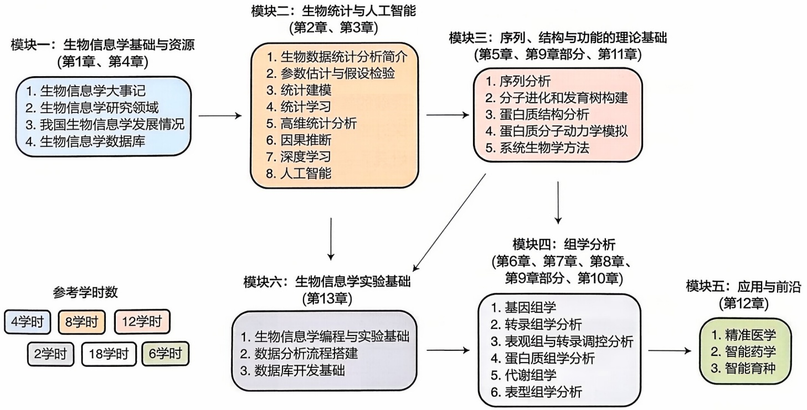
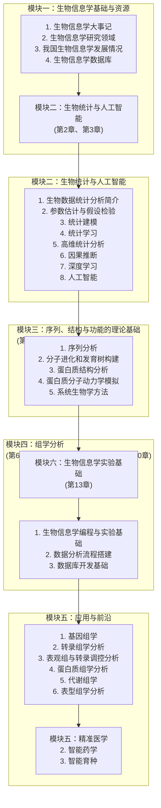
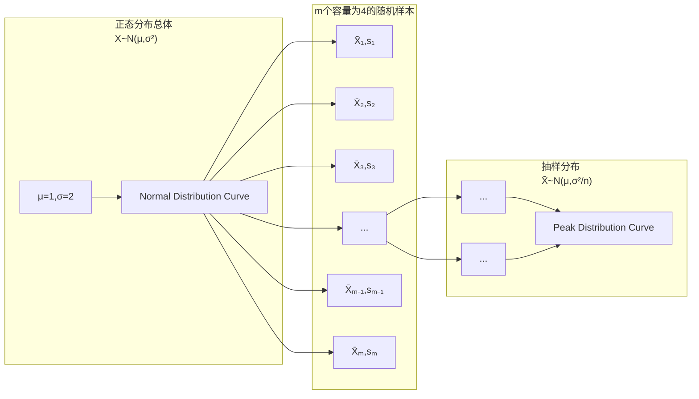

## 1.4.2 聚类算法

生物信息学进入大数据时代所带来的一个显著问题是高昂的数据标注成本，我们难以获得足够高质量的有标签数据集进行监督学习。聚类常用于无监督学习，按照数据内在的相似性将未标注的数据集划分为多个类别，同一类别内的数据相似度较高，不同类别的数据相似度较低。在生物信息学中，聚类可以用于基因表达谱的样本分组、蛋白质序列的家族分类等多种任务。

常见的聚类算法包括以下 5 种。① 划分聚类:将数据集划分为不同的聚簇；② 层次聚类:构建一棵聚类树来创建多层次的分层结构；③ 密度聚类:将聚簇定义为高密度区域之间的低密度区域；④ 网格聚类:将数据空间划分为网格，然后将数据分配到对应的网格中；⑤ 混合聚类:将多个聚类算法结合起来，以便更好地捕捉不同数据结构。

## 1.4.3 分类算法

与聚类不同，分类属于监督学习的范畴，它要求在训练过程中提供一些已知类别的样本（即有标签数据），以便计算机能够学习如何将未知类别的样本分类到预定义的类别或标签中。在生物信息学中，分类常用于疾病诊断、基因预测等任务。

以下是一些常见的分类算法，它们适用于不同类型的数据和问题，在对离散型随机变量进行建模和预测时发挥着重要作用，包括以下7种。①决策树分类法:决策树通过一系列的判断和分支来将数据划分成不同的类别；②基于规则的分类器:这类分类器使用一系列的规则来描述数据的不同类别；③朴素贝叶斯分类算法:基于贝叶斯定理，假设特征之间相互独立；④支持向量机:在高维空间中寻找能够最大化不同类别样本间隔的最优超平面；⑤深度学习:通过多层神经元和权重来建模数据的复杂关系，适用于处理非线性关系和大规模数据；⑥ $K$ -最近邻法:根据样本的邻居进行分类，找到与给定未知样本最近的 $k$ 个已知样本，根据这些样本的类别来预测未知样本的类别；⑦模糊分类法:模糊分类考虑数据可能属于不同类别的程度，给出样本的类别隶属度。

## 1.4.4 回归算法

与分类相似，回归也是监督学习的一种方法，但回归算法专注于对数值型连续随机变量进行建模和预测，产生的结果通常也是数值型的。在回归任务中，标注的数据集包含了数值型的目标变量，每个观察样本都对应着一个数值型的标注真值，用以监督算法的训练和评估。

以下是一些常见的回归算法，它们在处理连续型数值预测问题（如基因表达水平、蛋白质结构等）中具有重要意义，包括以下4种。①线性回归:在特征空间中拟合一条使得目标变量的预测值与实际值的误差最小化的直线；②回归树:将特征空间划分为多个区域，并在每个区域中拟合一个回归模型；③深度学习:深度学习适合多种任务；④最近邻算法:对于一个新的样本，最近邻算法会找到与其最相似的已知样本，并使用这些样本的目标值来进行预测。

## 1.4.5 统计学分析

基于统计比较的相关分析（correlation analysis）在生物信息学中被广泛应用，用于判断两个或多个变量（如基因、蛋白质等）之间是否存在相关性，及相关性的正负和强弱关系。需要注意的是，相关性不等同于因果性。这些分析有助于我们理解生物分子之间的相互作用，探究生物体系中的潜在调控路径。

在进行相关性分析时，根据变量的不同数据类型，我们可以采用不同的统计检验方法。例如，①连续变量:常用的方法如Pearson相关系数，它衡量线性关系的强度和方向；②二分类变量:使用点二列联表来计算phi系数或Cramer's V系数等，度量两个变量之间的关联性；③无序分类变量:可以采用卡方检验来检验两个无序分类变量间的相关性；④有序分类变量:可使用斯皮尔曼等级相关系数来判断变量之间的单调关系；⑤其他统计分析方法。

在生物数据的统计分析中，统计学显著性与生物学显著性之间的差异是一个重要的问题，采用不同的方法和标准，可能会产生不同的结果，因此需要考虑数据的特征和分布。如在差异分析中，常常使用 $p$ 值（$p$ value）来衡量观察结果是否显著；在特定任务如差异表达分析时，倍数法（fold-change）与非严格的 $p$ 值结合使用，结果的可重复性更强，因为倍数法关注了变化的幅度。在生物学研究中，假阴性的影响可能比假阳性更为显著，因此在选择基因或变量时，需要综合考虑 $p$ 值和倍数变化。

统计学结果的滥用是一个常见问题，只有当样本能够充分代表总体时，统计结果才能被视为可信且精确的。为了预防统计滥用，我们需要使用适当的图表和可视化工具，规避样本偏差。在生物数据分析中，更全面地评估统计显著性和生物学显著性之间的差异，需要综合考虑多种因素，包括 $p$ 值、倍数变化、样本偏差等。通过合适的统计分析方法和有效的数据可视化，我们可以更好地理解和解释生物数据，挖掘内在的因果关系和生物学机制，从而获得更准确和可靠的研究结果。

## 1.5 生物信息学的机遇与挑战

近年来，生物信息学家已经取得了多项研究成果，获得了海量的生物数据，确定了数千个基因的功能，其中包括搜索碱基对序列匹配的有效方法、统计学工具、利用新的计算机工具组装整个基因组等。但生物信息学作为一个快速发展的领域，面临着许多新的机遇与挑战，迫切需要新的研究手段和研究方法。

## 1.5.1 生物信息学的机遇

## （1）数据爆炸与生物信息学的崭新机遇

近年来，高通量测序技术的突破性进展使得生物数据的产生呈爆发式增长。这为生物信息学提供了丰富的数据资源，促使研究者可以更深入地研究基因组、蛋白质组等生物分子的功能和相互作用。不仅如此，不同组学技术的兴起，如单细胞组学和空间组学技术的应用，更进一步拓展了我们的研究视野。生物信息学可以利用大数据分析技术来深入研究生物系统，揭示更多生命的奥秘。

## (2) 人工智能与算法创新的催化作用

人工智能技术的不断发展，尤其是深度学习等算法的应用，使得生物信息学研究在数据挖掘、模式识别、预测分析等方面取得了突破。这些创新算法有望进一步加速生物信息学的研究进程。

## （3）跨学科合作的加强

生物信息学作为多学科交叉领域，促使生物学、计算机科学、数学、统计学等学科之间的合作更加紧密。这种跨学科的合作有助于深化对生物现象的理解，同时也为其他领域的发展带来新的思路和方法。

## 1.5.2 生物信息学的挑战

## （1）数据管理与分析的复杂性

生物信息学面临海量数据的管理和分析问题，有效处理这些数据需要高效的存储、处理和分析方法。生物数据库的建立为生物信息学研究提供了丰富的数据资源，但也面临着数据质量的问题。测量技术的局限性和操作错误导致数据库中存在错误数据是不可避免的。随着时间的推移，这些错误数据可能不断积累，而数据量的增长使得数据校验和更新变得更加困难。此外，数据来源本身的问题也会影响数据的准确性，如组学数据的测量值与实际值之间的偏差。因此，数据的质量和标准化也是一个挑战，需要确保数据的可靠性和可比性。

## （2）常用工具与创新方法

多年来，生物信息学家开发了许多方法和工具，用于解决生命科学中的各种问题。然而，只有少数几种工具被广泛采用，常常是因为研究人员难以全面比较所有工具，从而选择使用常见的工具。不断增加的使用者数量促使常用工具的改进，使其易于使用并得到权威认可，从而成了经典工具。然而，这种情况也可能阻碍了更适合和更先进方法的广泛应用。我们应该鼓励尝试新的方法和工具，以推动生物信息学的创新和发展。

## (3) 多尺度数据的整合分析

生物学研究涉及多种尺度的数据，如基因组、蛋白质组、代谢组等，生命系统的复杂性要求我们在研究中使用假设来简化条件，以建立模型。然而，生物信息学所涉及的数据往往来自不同条件下、基于不同技术手段和假设获得，这可能导致不同假设之间的矛盾。将这些数据进行整合并进行交叉分析，需要开发更为复杂的方法和工具。如今的生物信息学家，需要同时具备数学建模能力和扎实的生物学基础，以应对日益复杂多样的生物信息数据。

## 1.5.3 结语

《第三次技术革命》中有这样的描述:“一场与工业革命和以计算机为基础的革命有相同影响力的变化正在开始。下一个伟大时代将是基因组革命时代，它现在处于初期阶段”。当前，生命科学与生物信息学的发展已然迈入又一个技术革命的时代——人工智能时代。生物信息学的新方法与新技术正在蓬勃发展，必将对生物学、医学、药学、农业科学等诸多领域产生极为巨大的影响，生命科学的研究范式也正在经历深刻变革。总体而言，从过去单纯的问题驱动研究，逐步转变为问题驱动与数据驱动并行的研究模式。生物信息学应始终秉持“从生物学中来到生物学中去”的理念，积极探索从“认知科学”迈向“工程创造”的有效发展路径，实现从单一理科向理工并存发展的全新转变。我们有充分的理由相信，在人工智能时代，生物信息学必定能够有力地推动各种生命现象奥秘的揭示，带动多个学科实现飞跃式发展，甚至极有可能引发一场全新的产业革命。此外，生物信息学所倡导的全球范围的资源共享，也必将对整个自然科学乃至人类社会的发展产生深远而持久的影响。

本教材共 13 章，构成 6 个内容模块（图 1-4），可以对相应章节和参考学时数进行按需优化组合和学习。

flowchart

图1-4 本教材内容总体结构框架

## ※ 推荐阅读

1. 生物科学领域本科教育教学改革试点工作计划工作组. 高等学校生物科学类专业人才培养战略研究报告暨核心课程体系 [M]. 北京:高等教育出版社，2025.
点评:该书综合介绍了生物科学“101计划”专业人才培养战略研究、核心课程体系、拔尖创新人才培养典型案例、人才培养方案等内容。
2. “中国学科及前沿领域发展战略研究（2021—2035）”项目组. 中国生物信息学 2035 发展战略 [M]. 北京:科学出版社，2024.

点评:该书探讨了国际生物信息学的前沿发展趋势，深入阐述了生物信息学所涵盖的不同研究分支的发展历史、国内基础、发展态势，凝练了生物信息学的发展思路和发展方向，并提出了我国相应的发展领域和政策建议。

## ※ 思考与练习题

1. 简述生物信息学发展的必然性与科技史。
2. 如何理解生物信息学 “从生物学中来到生物学中去”？
3. 我国科学家在生物信息学发展过程中的历史贡献有哪些？
4. 简述生物信息学的研究内容及其前沿发展趋势。

## ※ 讨论题

1. 生物信息学历史演进的内在逻辑与中国角色转型的战略路径:从学科发展史视角分析生物信息学诞生与迭代的必然性，结合国际竞争格局演变，探讨中国从“跟跑者”向“引领者”跃迁需要突破的核心要素。
2. 从学科交叉角度出发，探讨数学、计算机科学与生物学知识在生物信息学研究中的融合方式。以当前热点研究为例，分析多学科知识的协同机制，以及跨学科思维培养路径。
3. 生物信息学赋能国家战略的路径与青年学者的时代使命:结合“精准医疗”“生物育种”“合成生物学”等国家战略需求，探讨生物信息学在解决重大社会问题、支撑产业升级中的具体赋能路径，以及作为学习者在其中发挥的作用。

## ※ 参考文献

1. 陈铭. 后基因组时代的生物信息学 [J]. 生物信息学, 2004, 2 (2): 29-34.
2. 陈铭. 大数据时代的整合生物信息学 [J]. 生物信息学, 2022, 20(2): 75-83.

3. 陈铭. 人工智能时代生物信息学学科发展和人才培养模式研究 [J]. 人民论坛·学术前沿, 2024, 16: 4.
4. Chen R. A historic retrospective on the early bioinformatics research in China [J]. Genomics, proteomics & bioinformatics, 2023, 21(5): 897-899.
5. Chen R. Early bioinformatics research in China [J]. Quantitative biology, 2021, 9(3): 242-250.
6. Dong W, Qiang B, Yang H. The international human genome project: a milestone for life sciences and humanity: the three stages and three major impacts of the HGP, and three contributions by China [J]. Quantitative biology, 2021, 9(3): 229-241.
7. Gauthier J, Vincent A T, Charette S J, et al. A brief history of bioinformatics [J]. Briefings in bioinformatics, 20(6): 1981-1996.
8. Hogeweg P. The roots of bioinformatics in theoretical biology [J]. PLoS computational biology, 2011, 7(3): e1002021.
9. Luo J. Professor Gu Xiaocheng and the center for bioinformatics at Peking University [J]. Scientia sinica vitae, 2022, 52(10): 1555-1560.
10. Wei L, Yu J. Bioinformatics in China: a personal perspective [J]. PLoS computational biology, 2008, 4(4): e1000020.

编者:陈铭（浙江大学）

审读:张勇（同济大学）

## 生物统计学基础

生物信息学是处理和分析生物数据的学科，统计学是数据分析的基础学科，生物统计学则是限定于生物数据的统计学，是生物信息学的数学基础和统计基础。本章将详细介绍生物统计学的基础理论和方法、基本的统计模型、统计学习的主要思想、高维统计推断和统计因果推断，帮助读者更好地理解本书后续章节中涉及的生物数据分析方法，为自主研究生物信息学算法打好基础。

## 2

## 2.1 生物统计简介

在生物学领域，科研人员能够通过各种科学实验、临床试验、田野调查、仪器测量等，获得各种类型的研究数据。统计学（statistics）是一门研究如何有效地收集、分析和解释数据的学科，能够将数学语言引入各个学科领域，把具体的研究问题抽象为统计学问题并解决。生物统计学（biostatistics）是统计学在生物学领域中的应用，属于应用统计学的一个分支，它运用统计学理论和方法来收集生物学数据，并分析和解释其中的各种现象和问题。一些常见的生物统计学应用包括以下6方面。

① 实验设计 统计学在确定实验设计方面发挥重要作用。合理的实验设计可以减少偏倚，确保结果具有代表性和可推广性。
② 数据分析与展示 应用描述统计学方法（如均值、标准差、频率分布等），可以对数据进行总结和描述，并通过合适的图形（如箱线图、直方图、折线图等）进行数据展示。
③ 统计推断 通过区间估计和假设检验等方法，从样本数据中推断总体特征，从而评估实验结果之间的差异是否由生物学本质决定的。
④ 相关性分析 统计学方法可用于分析生物数据之间的相关性。例如，通过计算相关系数（如皮尔逊相关系数），可以确定两个变量之间的线性相关程度。
⑤ 数据建模与预测 统计学方法可以用于生物数据的建模和预测。例如，回归分析可以用于建立变量之间的关系模型，并用于预测未来的结果。
⑥ 实验结果验证与重复 统计学方法可用于验证实验结果的可靠性和重复性。通过进行重复实验和运用统计学方法，可以确定实验结果是否具有一致性，并评估结果的稳定性。

## 2.1.1 总体与样本

## 2.1.1.1 总体与个体

对于一个生物统计学问题，我们将感兴趣的所有研究对象所构成的集合称为总体（population），该集合的每一个元素称为个体（individual）。一些总体的例子

如某个植物园内的所有柏树、国内所有的乳腺癌患者。

## 2.1.1.2 样本与随机抽样

在实际研究中，由于成本、时间等限制，通常无法观测到所有个体，因此不能获得总体的所有数据，例如所有乳腺癌患者的各项生理指标和治疗效果。为了研究总体的性质，我们只能使用合适的方法从中抽取一部分个体作为总体的代表（图2-1）。总体中抽出的若干个体所构成的集合（即构成总体的集合中的一个子集）称为样本（sample），包含的个体数目称为样本容量（sample size），通常记为 n。样本能够用于估计总体的性质，例如某个临床试验中招募的 100 位乳腺癌患者，是所有乳腺癌患者总体的一个样本（n = 100），能够用于研究某个药物是否对治疗乳腺癌具有显著效果。

flowchart

图2-1 总体与样本的关系

从总体进行随机抽样的方法包括简单随机抽样、系统抽样、分层抽样、整群抽样等。其中最常用的抽样方法是简单随机抽样（simple random sampling），即对于容量为 $n$ 的样本，总体中每个个体都有相同的概率被抽取入样，并且每个个体之间相互独立（即某一个体被抽取到的概率与其他个体无关）。因此简单随机抽样保证样本具有代表性和独立性，能够很好地代表总体。基于随机抽样方法得到的所有随机样本，构成随机抽样模型（random sampling model），它是假设检验、参数估计、相关性分析等统计学方法和模型的理论基础。

## 2.1.2 数据特征及描述

## 2.1.2.1 数据类型

数据集中包括描述或量化个体的各种属性。一个人的特点可以用身高、体重、性别等来表示，生物学数据同样包括各种与每个个体相关的信息。在统计学中，这些以数值或类型表示观测个体的属性称为变量（variable）。

在统计学中，数据类型（data type）决定了我们可以使用哪些统计方法进行分析，每个变量都属于一个数据类型，掌握数据各个变量及其数据类型有助于确定最适合的分析方法和模型。常见的数据类型如表2-1所示。

表 2-1 常见数据类型

<table><tr><td colspan="2">数据类型</td><td>定义</td><td>示例</td></tr><tr><td rowspan="2">数值型(numeric)</td><td>连续型(continuous)</td><td>表示在一定范围内可以取任意数值的数据</td><td>身高、体重、温度等</td></tr><tr><td>离散型(discrete)</td><td>表示在有限或可数数值集合中取值的数据</td><td>体检次数、家庭人数等</td></tr><tr><td colspan="2">分类型(categorical/nominal)</td><td>表示不同类别或属性的数据,没有数值意义,只表示不同的类别</td><td>性别、血型等</td></tr><tr><td colspan="2">顺序型(ordinal)</td><td>表示按照一定顺序排列的数据,但不能进行精确的数值计算</td><td>肿瘤分期、烧伤程度等</td></tr></table>

## 2.1.2.2 数据特征

数据特征（data feature），即数据的统计特性，通常指的是描述数据分布或数据集总体特点的一些测量值。这些测量值可以帮助我们了解数据的主要特性，包括数据的集中趋势、分布形状、离散程度等。

在统计学中,样本的数据特征(均值、标准差、中位数等)可以称为统计量(statistic)。设 $X_{1},X_{2},\cdots,X_{n}$ 为总体X中抽取的样本,若某一函数 $T=T(X_{1},X_{2},\cdots,X_{n})$

不含有未知参数，那么 T 称为统计量。

理论上，总体中的每个个体都可以视为一个数据点，有些数据点出现的次数多，有些数据点出现的次数少，当我们从中抽取样本来研究总体时，可以理解为不同的数据点被抽取到的概率不同，因此使用一个合适的概率分布来描述总体的特征是合理的。类似于样本的数据特征称为统计量，总体的数据特征称为参数（parameter），一些常用的统计量和参数记号见表2-2。

表 2-2 一些常用的统计量和参数记号

| 特征 | 样本-统计量 | 总体-参数 |
| --- | --- | --- |
| 均值 | $\overline{X}$ | $\mu$ |
| 中位数 | $\widetilde{X}$ | $\widetilde{\mu}$ |
| 方差(标准差) | $s^{2}(s)$ | $\sigma^{2}(\sigma)$ |
| 比例 | $\widehat{p}$ | $p$ |
| 众数 | $\widehat{Mo}$ | $Mo$ |
| 极差 | $r$ | $R$ |
| 四分位距 | IQR | — |
| 变异系数 | $s/\overline{X}$ | $\sigma/\mu$ |
| 偏度 | $g_{1}$ | $\gamma$ |
| 峰度 | $g_{2}$ | $\kappa$ |

进一步，总体就是一个分布，推断总体的特征就是确定总体分布的参数；样本与总体属于相同的分布，利用统计量来推断总体分布的未知参数，从而研究总体的性质是统计推断的经典任务。描述数据分布的概括性指标包括集中趋势（均值、中位数、众数等）、离散程度（极差、方差、四分位距、变异系数等）和分布形状（偏度、峰度等）。展示数据的常用图表包括频数频率表、直方图、散点图、折线图、箱线图等。

表 2-2 所示的常用样本统计量的定义如下:

## (1) 均值

均值（mean）是某组数据的总和除以该组数据的数量，是用来表示数据集的集中趋势的一种度量。样本均值定义为

$$
\overline {{X}} = \frac {X _ {1} + X _ {2} + \cdots + X _ {n}}{n} = \frac {1}{n} \sum_ {i = 1} ^ {n} X _ {i} \tag {2-1}
$$

## (2) 中位数

中位数（median）是将数据按照从小到大的顺序排列后，处于中间位置的数值，用于表示数据的中心位置。当数据集有奇数个数据时，中位数是排序后中间的值；当数据集有偶数个数据时，中位数是排序后中间两个数的均值。

将样本  $X_{1}, X_{2}, \cdots, X_{n}$  从小到大排列后，记  $X_{i}$  表示第 i 个最小观测值，则样本的中位数定义为

$$
\widetilde {X} = \left\{ \begin{array}{l l} {{X _ {\frac {n + 1}{2}}}} & {{(n \text {为奇数})}} \\ {{\frac {1}{2} \left(X _ {\frac {n}{2}} + X _ {\frac {n}{2} + 1}\right)}} & {{(n \text {为偶数})}} \end{array} \right. \tag {2-2}
$$

## (3) 众数

众数（mode）是数据中出现频率最高的值，代表了数据集中最常见值的集合。对于离散型数据样本，选择具有最高频数的一个或多个数值或类别作为样本的众数；对于连续型数据样本，一般将数据进行分组或分区间计算频数，选择具有最高频数的一个或多个区间作为样本的众数。

## (4) 极差

极差（range）是数据中最大值与最小值之间的差值，表示了数据的全局范围。计算极差的方法是将最大值减去最小值。

## (5) 方差

方差（variance）是每个数据点与均值之间差值的平方和除以样本量，用来衡量一组数据的离散程度。标准差（standard deviation）是方差的平方根。

样本的方差和标准差分别定义为

$$
s ^ {2} = \frac {1}{n - 1} \sum_ {i = 1} ^ {n} (X _ {i} - \overline {{X}}) ^ {2}, \quad s = \sqrt {s ^ {2}} \tag {2-3}
$$

## (6) 四分位距

四分位距（interquartile range，IQR）是数据的上四分位数减去下四分位数之间的差值，其中上四分位数和下四分位数分别为数据按从小到大的顺序四等分后，较大四分之一数据的分界数值和较小四分之一数据的分界数值，分别记为 $Q_{3}$ 和 $Q_{1}$ （图2-2）。

## (7) 变异系数

变异系数（coefficient of variation）是标准差与均值的比值的百分数表示，即 $s/\overline{X} \times 100\%$，用来衡量数据相对于其均值的离散程度。变异系数较低表示数据相对于均值的离散程度较小，而较高的变异系数表示数据相对于均值的离散程度较大。

## (8) 偏度

衡量数据分布的不对称程度，用于测量数据分布尾部的相对长度和方向。当数据分布呈现左偏态时，尾部偏向左侧；当数据分布呈现右偏态时，尾部偏向右侧；当数据分布基本对称时，偏度（skewness）接近于0。

样本的偏度定义为

$$
g _ {1} = \frac {\frac {1}{n} \sum_ {i = 1} ^ {n} \left(X _ {i} - \overline {{X}}\right) ^ {3}}{\left[ \frac {1}{n} \sum_ {i = 1} ^ {n} \left(X _ {i} - \overline {{X}}\right) ^ {2} \right] ^ {3 / 2}} \tag {2-4}
$$

text_image

四分位距
最小值 下四分位数 Q₁ 中位数 上四分位数 Q₃ 最大值

图2-2 四分位数及四分位距示意

## (9) 峰度

衡量数据分布的峰态，反映数据分布的尖峭或扁平程度，以及离群值的数量。如果数据分布与正态分布的形状相同，那么峰度（kurtosis）为0；如果峰度大于0，那么数据分布比正态分布更尖峭，即数据更集中，或者说离群值更多；如果峰度小于0，那么数据分布比正态分布更扁平，即数据更分散，或者说离群值较少。

样本的峰度定义为

$$
g _ {2} = \frac {\frac {1}{n} \sum_ {i = 1} ^ {n} \left(X _ {i} - \overline {{X}}\right) ^ {4}}{\left[ \frac {1}{n} \sum_ {i = 1} ^ {n} \left(X _ {i} - \overline {{X}}\right) ^ {2} \right] ^ {2}} - 3 \tag {2-5}
$$

## 2.1.2.3 常用图表

## (1) 频数频率表

频数频率表（frequency and relative frequency table）是一种将数据分成不同区间或类别，然后列出每个区间内的观测频数和相对频率的表格（表2-3）。它可以用来总结和呈现数据的分布情况，显示不同区间中的观测频数和比例，帮助了解数据的范围、集中趋势和分散程度。

表 2-3 一个频数频率表的例子

| 物种 | A | B | C | D | 总和 |
| --- | --- | --- | --- | --- | --- |
| 频数 | 55 | 38 | 87 | 20 | 200 |
| 频率 | 0.275 | 0.190 | 0.435 | 0.100 | 1.000 |

## (2) 折线图

折线图（line chart）是一种通过连接数据点来显示随时间、顺序或其他连续变量变化趋势的图形。它常用于显示连续变量的变化趋势，帮助观察数据随时间或其他变量的变化情况，探索趋势和周期性（图2-3）。

line

| 时间 | 某物种总数/只 |
| --- | --- |
| 2010 | ~80 |
| 2010 | ~128 |
| 2010 | ~90 |
| 2010 | ~140 |
| 2010 | ~145 |
| 2010 | ~55 |
| 2010 | ~138 |
| 2010 | ~98 |
| 2010 | ~145 |
| 2010 | ~97 |
| 2010 | ~115 |
| 2010 | ~108 |
| 2010 | ~62 |
| 2010 | ~138 |
| 2010 | ~55 |
| 2011 | ~85 |
| 2011 | ~145 |
| 2011 | ~140 |
| 2011 | ~115 |
| 2011 | ~150 |
| 2011 | ~115 |
| 2011 | ~120 |
| 2011 | ~105 |
| 2011 | ~110 |
| 2011 | ~65 |
| 2011 | ~145 |
| 2012 | ~140 |
| 2012 | ~120 |
| 2012 | ~130 |
| 2012 | ~52 |
| 2012 | ~125 |
| 2012 | ~72 |
| 2012 | ~82 |
| 2012 | ~65 |
| 2013 | ~90 |
| 2013 | ~90 |
| 2013 | ~65 |
| 2013 | ~63 |
| 2013 | ~95 |
| 2013 | ~78 |
| 2013 | ~55 |
| 2013 | ~135 |
| 2014 | ~62 |
| 2014 | ~130 |
| 2014 | ~63 |
| 2014 | ~63 |
| 2014 | ~138 |
| 2014 | ~88 |
| 2014 | ~60 |
| 2014 | ~88 |
| 2014 | ~78 |
| 2014 | ~95 |
| 2014 | ~130 |
| 2014 | ~95 |
| 2014 | ~130 |
| 2014 | ~95 |
| 2014 | ~95 |
| 2014 | ~125 |
| 2014 | ~95 |
| 2014 | ~115 |

图2-3 一个折线图的例子

## (3) 直方图

直方图（histogram）是一种将数据分成一系列的区间（或称为柱），绘制每个区间内的观测频数或相对频率的图形（图2-4）。它可以更直观地显示数据的分布情况，包括数据的峰值、对称性、偏态等，帮助了解数据的分布形态以及在不同区间中的集中程度。

## (4) 散点图

散点图（scatter plot）是在坐标平面上绘制每个观测点来显示两个连续变量之间关系的图形（图2-5）。它可以用于探索变量之间的关系、趋势以及可能的离群值，帮助判断两个变量是否有线性或非线性关系，以及变量之间的相关性。

## (5) 箱线图

箱线图（box-plot）是展示数据的中位数、四分位数、离群值和分布范围来表示数据分布情况的图形。它可以帮助了解数据的分布形态、集中趋势、离群值等，

图2-4 一个直方图的例子

图2-5 一个散点图的例子

图2-6 箱线图的基本组成

图2-7 一个箱线图的例子

从而更好地理解数据的统计特征。箱线图包括箱体、延伸线和离群值点（图2-6），箱体上边界和下边界分别是上四分位数 $Q_{3}$ 和下四分位数 $Q_{1}$，箱体中间横线是中位数，延伸线向上延伸到 $(Q_{3} + 1.5 \times IQR)$，向下延伸到 $(Q_{1} - 1.5 \times IQR)$，离群值点是位于上下延伸线以外的数据点（图2-7）。

## 2.2 参数估计和假设检验

统计推断（statistical inference）是根据样本信息对总体分布或总体特征进行推断。统计推断主要包括参数估计和假设检验。参数估计（parameter estimation）是使用样本来估计总体分布中包含的未知参数或参数函数的方法。假设检验（hypothesis testing）是在抽样分布和小概率原理的基础上，使用样本对总体的分布或分布中所含参数的假设进行检查的方法和过程。很多生物学问题都可以直接或者间接地转化为统计推断问题。例如，基因 $X$ 的高表达是否会导致表型 $Y$ 的变化，转化成统计语言就是要检验基因 $X$ 与表型 $Y$ 是否相关；差异表达的基因是否富集在某一条KEGG（Kyoto Encyclopedia of Genes and Genomes）通路上，本质上就是要检验这些差异表达的基因是否与该KEGG通路相关。因此，充分理解生物学问题的本质是熟练运用统计学工具或方法的重要前提。

## 2.2.1 抽样分布

## 2.2.1.1 抽样分布的定义

生物统计学分析的关键在于区分数据特征是由真正的生物学本质所决定的，还是偶然效应所造成的。随机抽样模型为解决这一问题提供了理论基础，如果将得到的数据看作是来自总体的随机样本，那么偶然效应就等同于抽样误差，即样本与总体之间由于抽样的随机性带来的差异。基于样本构造统计量的分布称为抽样分布（sampling distribution）。

## 2.2.1.2 样本均值的分布

对于不同的数据特征（如均值、中位数等），抽样分布的形状、集中趋势和离散程度并不相同。本章中，我们关注最常用的样本均值  $\overline{X}$  的分布（图 2-8）。

从均值为 $\mu$ ，标准差为 $\sigma$ 的总体中，抽取样本容量为 $n$ 随机样本，其均值 $\overline{X}$ 的分布具有以下性质:

①  $\mu_{\overline{X}} = \mu$ ，即  $\overline{X}$  的均值等于总体均值。
②  $\sigma_{\overline{X}} = \sigma / \sqrt{n}$ ，即  $\overline{X}$  的标准差等于总体标准差除以样本容量的平方根。
③ 如果总体服从正态分布 $X \sim N(\mu, \sigma^2)$，那么 $\overline{X} \sim N(\mu, \sigma^2 / n)$；如果总体不服从正态分布，依据中心极限定理，当 $n$ 足够大时，$\overline{X}$ 也近似服从该正态分布。

## 2.2.2 区间估计

在统计推断中，参数估计是一个重要的任务，其目标是利用可观测的数据来估计总体的参数，并评估这些估计的准确性。

## 2.2.2.1 标准误差及置信区间

假设总体 X 均值为  $\mu$ ，标准差为  $\sigma$ ，并且  $X_{1}, X_{2}, \cdots, X_{n}$  是来自该总体的一个随机样本。我们已知样本均值  $\overline{X}$  的抽样分布的均值为  $\mu$ ，标准差为  $\sigma_{\overline{X}} = \sigma / \sqrt{n}$ 。将

flowchart

图2-8 样本均值 $\overline{X}$ 的抽样分布示意