

scatter

| 运动时间 (range) | 睡眠时间 (range) |
| --- | --- |
| 0~100 | 0~100 |

(a)

scatter

| 年龄 | 运动时间 (range) | 睡眠时间 (range) |
| --- | --- | --- |
| 20 | ~15 ~45 | ~35 ~75 |
| 30 | ~20 ~55 | ~30 ~65 |
| 40 | ~30 ~65 | ~25 ~55 |
| 50 | ~35 ~70 | ~20 ~45 |
| 60 | ~45 ~80 | ~15 ~35 |

(b)

图2-18 辛普森悖论

text_image

Diagram illustrating sunlight heating with ice cream and water, showing sun entering ice cream and water entering ice.

(a)

flowchart

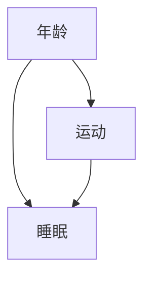

(b)

图2-19 混杂因素的干扰

段的亚组内进行分析。

关联并不等同于因果，是发展因果推断方法的出发点。与关联分析不同，在进行因果推断时，识别并控制混杂因素是非常重要的。未被控制的混杂因素可能会导致我们得到错误的因果关系，做出错误决策。近些年来因果推断受到越来越多的关注，在不同学科中都具有重要价值，相关的理论方法也在不断完善。此时此刻，我们正在经历一场“因果革命”。

## 2.6.3 因果效应的定义与识别

目前，因果推断主要存在两大模型:一个是唐纳德·鲁宾（Donald Rubin）在1978年提出的潜在结果模型（potential outcome model, POM）；另一个是朱迪亚·珀尔（Judea Pearl）在1995年提出的结构因果模型（structural causal model, SCM）。这两个模型提供了理解因果关系的不同视角，POM基于反事实（counterfactual）的概念用潜在结果定义因果效应，而SCM以因果图为基础引入“do”算子来定义因果效应。两种模型并非互斥，而是相互联系的，珀尔在2000年说明了这两个模型的等价性。POM广泛应用于流行病学和生物统计学等领域，本节主要介绍POM相关概念和内容，从POM的角度来介绍主要的因果效应估计方法。

## 2.6.3.1 潜在结果

潜在结果是因果推断中的一个重要概念，因果效应便是利用潜在结果来进行定义的。在这一小节，我们通过一个例子来说明什么是潜在结果。假如我们正在进行一项阿司匹林是否能够缓解头痛的研究，二分类变量 $T$ 表示接受的干预措施，$T = 1$ 表示服用阿司匹林，$T = 0$ 表示服用安慰剂。连续变量 $Y$ 表示头痛程度的评分，$X$ 表示协变量（受试者的基线信息）。我们将 $Y_{i}(1)$ 表示为假如个体 $i$ 服用阿司匹林$(T = 1)$ 后的头痛程度，类似地，$Y_{i}(0)$ 表示假如个体 $i$ 服用安慰剂（$T = 0$）后的头痛程度，$Y_{i}(1)$ 和 $Y_{i}(0)$ 被称为潜在结果。显然，在研究中个体 $i$ 只能接受其中一种干预措施（服用阿司匹林或者安慰剂），不可能同时接受两种干预措施，因此对于个体 $i$ 的两种潜在结果 $[Y_{i}(1)$ 和 $Y_{i}(0)]$ 我们仅能观测到其中一个，要么是服用阿司匹林后的结果，要么是服用安慰剂后的结果。最终，本研究全部受试者的观测结果如表2-25。

表 2-25 受试者的观测结果

| 个体 | T | Y(1) | Y(0) |
| --- | --- | --- | --- |
| James | 1 | 12 | * |
| Sarah | 1 | 10 | * |
| Emily | 1 | 9 | * |
| Michael | 0 | * | 13 |
| David | 0 | * | 16 |
| Elizabeth | 0 | * | 14 |

从表2-25中不难看出，对于任何一个观测个体，我们在现实世界中只能观测到其中一个潜在结果。如果一个人服用了阿司匹林，我们就只能观测到他在服用阿司匹林后的状况，而我们无法得知他如果服用安慰剂的状况会是怎样的。不可观测的那部分潜在结果被称为反事实结果（counterfactual outcome）。

## 2.6.3.2 因果效应的识别

有了潜在结果后, 我们便可以定义因果效应。个体因果效应（individual causal effect, ICE）定义为

$$
I C E _ {i} \triangleq Y _ {i} (1) - Y _ {i} (0) \tag {2-46}
$$

ICE 被定义为特定个体在接受不同干预下的潜在结果之间的差异。然而，对每个个体我们只能观测到一种潜在结果，另一种潜在结果必然缺失，因此 ICE 是不可识别的。除了个体水平上的因果效应之外，我们也感兴趣一组个体的平均因果效应（average causal effect, ACE），ACE 定义为

$$
A C E \triangleq \mathbb {E} \left[ Y _ {i} (1) - Y _ {i} (0) \right] = \mathbb {E} \left[ Y _ {i} (1) \right] - \mathbb {E} \left[ Y _ {i} (0) \right] = \mathbb {E} \left[ Y (1) \right] - \mathbb {E} \left[ Y (0) \right] \tag {2-47}
$$

ACE表示为研究中的所有个体ICE的平均值。同样，由于反事实结果不可观测，ACE也面临着不可识别的问题。为了解决这一问题，我们通过引入3个假设来使得ACE可识别。3个重要假设如下。

## 2.6.3.3 可忽略性假设

可忽略性（ignorability）假设是因果推断中的一个核心假设，也为随机对照试验提供了理论基础，其核心思想是干预与潜在结果相互独立。即

$$
[ Y (1), Y (0) ] \perp T \tag {2-48}
$$

该假设的含义为干预 $T$ 是随机分配的，与潜在结果无关。这一假设允许我们从

观测数据中计算 ACE

$$
\begin{array}{l} A C E = \mathbb {E} \left[ Y (1) \right] - \mathbb {E} \left[ Y (0) \right] \\ = \mathbb {E} [ Y (1) | T = 1 ] - \mathbb {E} [ Y (0) | T = 0 ] \\ = \mathbb {E} [ Y | T = 1 ] - \mathbb {E} [ Y | T = 0 ] \tag {2-49} \\ \end{array}
$$

式(2-49)说明在假设满足的情况下，ACE可从观测数据中通过计算条件期望得到。这一假设也说明了随机化试验能够进行因果推断的理论基础——随机化保证了干预 $T$ 和潜在结果是相互独立的，因此RCT是因果效应估计的金标准。然而在观察性研究中，$T$ 往往不是随机化的，故可忽略性假设往往得不到满足。为此我们引入更弱化的条件可忽略性（conditional ignorability）假设

$$
[ Y (1), Y (0) ] \perp T | X \tag {2-50}
$$

假设要求在给定一组协变量 $X$ 后，干预与潜在结果相互独立。此时，ACE可以从观测数据中计算得到:

$$
\begin{array}{l} A C E = \mathbb {E} \left[ Y (1) \right] - \mathbb {E} \left[ Y (0) \right] \\ = \mathbb {E} _ {x} \left\{\mathbb {E} \left[ Y (1) | X \right] - \mathbb {E} \left[ Y (0) | X \right] \right\} \\ = \mathbb {E} _ {x} \left\{\mathbb {E} [ Y (1) | T = 1, X ] - \mathbb {E} [ Y (0) | T = 0, X ] \right\} \\ = \mathbb {E} _ {x} \left\{\mathbb {E} [ Y | T = 1, X ] - \mathbb {E} [ Y | T = 0, X ] \right\} \tag {2-51} \\ \end{array}
$$

条件可忽略性假设告诉我们，在观察性研究中，应尽可能多地收集协变量 $X$ ，让该假设尽可能被满足。根据前面混杂因素的定义可知，混杂因素会破坏该假设，所以当 $X$ 包含了所有的混杂因素时，该假设严格成立，这也是在因果推断中需要矫正混杂因素的理论基础。

## 2.6.3.4 正性假设

正性假设（positivity）为

$$
0 <   P (T = 1 | X = x) <   1 \tag {2-52}
$$

为什么需要正性假设？我们从推导上来进行解释，根据式(2-51)

$$
\begin{array}{l} A C E = \mathbb {E} _ {x} \left\{\mathbb {E} \left[ Y | T = 1, X \right] - \mathbb {E} \left[ Y | T = 0, X \right] \right\} \\ = \sum_ {x} P (X = x) \left[ \sum_ {y} y P (Y = y | T = 1, X = x) - \sum_ {y} y P (Y = y | T = 0, X = x) \right] \\ = \sum_ {x} P (X = x) \left[ \sum_ {y} y \frac {P (Y = y , T = 1 , X = x)}{P (T = 1 | X = x) P (X = x)} - \sum_ {y} y \frac {P (Y = y , T = 0 , X = x)}{P (T = 0 | X = x) P (X = x)} \right] \tag {2-53} \\ \end{array}
$$

由式(2-53)可以看出， $P(T = 1|X = x)$ 位于分母，正性假设保证了分母不为0，否则无法定义 $\mathrm{ACE}$ 。类似的， $P(T = 0|X = x)$ 位于分母， $P(T = 1|X = x) < 1$保证了 $P(T = 0|X = x) \neq 0$ 。直观上理解，正性假设目的是保证我们在进行因果效应估计时有足够的数据进行比较。例如，如果在给定协变量 $X$ 的某个值的情况下，当所有的样本都接受了 $T = 1$ （或者都接受 $T = 0$），那么我们就无法通过比较 $T = 1$ 和 $T = 0$ 的样本来估计 $T$ 的因果效应。

## 2.6.3.5 个体处理稳定性假设

个体处理稳定性假设（stable unit treatment value assumption, SUTVA）一般分为两个部分:无干扰性和一致性。

无干扰性是指给定个体的干预结果不会受到其他个体是否接受干预的影响，每个个体的潜在结果不依赖于其他个体的干预状态。简单地说，个体服用阿司匹林后的效果，不应受到其他人是否服用阿司匹林的影响。一致性是指个体之间的干预水平是相同的。例如，对于干预组的个体，服用阿司匹林的规格应当是相同的。SUTVA假设保证了

$$
\mathbb {E} \left[ Y (1) | T = 1, X \right] = \mathbb {E} \left[ Y | T = 1, X \right] \tag {2-54}
$$

然而，SUTVA 假设在许多实际情况下并不成立，例如，在传染性疾病的例子中，一个人是否接种疫苗是会影响其他人的。对于这些情况，我们需要更复杂的方法来处理。

最后，ACE 的识别过程可以总结如下，帮助大家理解以上 3 个假设是如何在识别过程中发挥作用的。

$$
\begin{array}{l} A C E = \mathbb {E} \left[ Y (1) - Y (0) \right] \\ = \mathbb {E} \left[ Y (1) \right] - \mathbb {E} \left[ Y (0) \right] \\ = \mathbb {E} _ {x} \left\{\mathbb {E} \left[ Y (1) | X \right] - \mathbb {E} \left[ Y (0) | X \right] \right\} \\ = \mathbb {E} _ {x} \left\{\mathbb {E} \left[ Y (1) | T = 1, X \right] - \mathbb {E} \left[ Y (0) | T = 0, X \right] \right\} \quad (\text {条件可忽略性和正性}) \\ = \mathbb {E} _ {x} \left\{\mathbb {E} \left[ Y | T = 1, X \right] - \mathbb {E} \left[ Y | T = 0, X \right] \right\} \tag {SUTVA} \\ \end{array}
$$

以上介绍了什么是潜在结果，如何用潜在结果定义因果效应以及ACE的识别过程。在基于3个假设保证ACE可识别后，我们接下来介绍ACE常见的3种估计方法。

## 2.6.4 因果效应的估计

## 2.6.4.1 逆倾向得分加权

2.6.3 小节中我们提到，ACE 的识别公式为

$$
A C E = \mathbb {E} _ {x} \left\{\mathbb {E} \left[ Y | T = 1, X \right] - \mathbb {E} \left[ Y | T = 0, X \right] \right\} \tag {2-55}
$$

如果协变量 $X$ 仅是一个二值变量（如性别），那ACE的估计变得简单，在$X = 0$ 和 $X = 1$ 两个亚组内分别计算 $ACE_0$ 和 $ACE_{1}$ ，再根据 $X = 1$ 和 $X = 0$ 的比例进行加权求和即可。然而，很多情况下 $X$ 是高维的，根据 $X$ 进行分层时会得到很多亚组，有的亚组会出现没有样本的情况，并且部分 $X$ 可能是连续值，无法进行分层。针对这个问题，Rosenbaum 和 Rubin (1983) 提出来倾向得分的方法，倾向得分定义为

$$
e (X) \triangleq P (T = 1 | X) \tag {2-56}
$$

由定义可以看出，倾向得分可由拟合逻辑回归模型估计得到。这样，我们可以得到 ACE 的逆倾向得分加权（inverse propensity score weighting, IPW）估计量:

$$
\widehat {A C E} _ {I P W} = \frac {1}{n} \sum_ {i = 1} ^ {n} \left[ \frac {Y _ {i} T _ {i}}{\widehat {e} (X _ {i})} + \frac {Y _ {i} (1 - T _ {i})}{1 - \widehat {e} (X _ {i})} \right] \tag {2-57}
$$

其中， $\widehat{e}(X_{i})$  为通过拟合逻辑回归模型  $P(T=1|X)$  得到的倾向得分。

## 2.6.4.2 结果回归

在结果回归（outcome regression，OR）中，我们通过回归模型来估计因果效应。我们构建如下回归模型

$$
Y = \beta_ {0} + \beta_ {t} T + \beta_ {x} X + \varepsilon \tag {2-58}
$$

其中，$\varepsilon$ 为随机项，$\mathbb{E}(\varepsilon) = 0$，$X$ 为可能的混杂因素。有

$$
\mathbb {E} \left[ Y | T, X \right] = \beta_ {0} + \beta_ {t} T + \beta_ {x} X \tag {2-59}
$$

故可得

$$
\begin{array}{l} A C E = \mathbb {E} _ {x} \left\{\mathbb {E} \left[ Y | T = 1, X \right] - \mathbb {E} \left[ Y | T = 0, X \right] \right\} \\ = \mathbb {E} _ {x} \left[ \beta_ {0} + \beta_ {t} + \beta_ {x} X - \beta_ {0} - \beta_ {x} X \right] \\ = \beta_ {t} \tag {2-60} \\ \end{array}
$$

因此，回归模型中的偏回归系数 $\beta_{t}$ 便是ACE。在实际应用时，可以通过求解上述回归模型，得到 $\widehat{\beta}_t$ 作为ACE的估计。所以

$$
\widehat {A C E} _ {O R} = \widehat {\beta} _ {t} \tag {2-61}
$$

## 2.6.4.3 双稳健估计

双稳健估计（doubly robust, DR）其实是IPW和结果回归的结合。IPW的关键在于正确的估计倾向分数 $e(X)$，而结果回归方法的关键在于正确的构造回归模型，两种方法均有可能造成偏差。为了让估计更加稳健，两种方法进行结合，便得到双稳健估计

$$
A C E = \mathbb {E} \left[ \frac {Y T}{e (X)} - \frac {T - e (X)}{e (X)} m _ {1} (X) \right] - \mathbb {E} \left[ \frac {Y (1 - T)}{1 - e (X)} + \frac {T - e (X)}{1 - e (X)} m _ {0} (X) \right] \tag {2-62}
$$

其中， $e(X)$ 为IPW中的倾向分数， $m_{1}(X)$ 和 $m_0(X)$ 分别为回归模型中的 $\mathbb{E}[Y|T = 1,X]$ 和 $\mathbb{E}[Y|T = 0,X]$ 。双稳健估计量具有良好的理论性质，IPW和OR估计量只要有一个具有一致性，则双稳健估计便是一致估计。关于双稳健估计的更多理论性质我们不在此进行阐述。

## 2.6.5 工具变量

以上介绍的几种因果效应的估计方法，均要求我们观测到了所有的混杂因素 $X$ ，并在模型中对混杂因素进行了有效控制。然而，在观察性研究中经常存在未被观测的混杂因素，因此这一要求往往得不到满足。当存在未被观测的混

杂因素时，我们该如何去估计 ACE 呢？对此，敏感性分析（sensitivity analysis）提供了一种可能的解决方案，它通过评估所用方法对违反假设的敏感程度，使我们能认识到所得结果的稳健性。除了敏感性分析方法，使用工具变量也是处理这一问题的有效途径。

flowchart

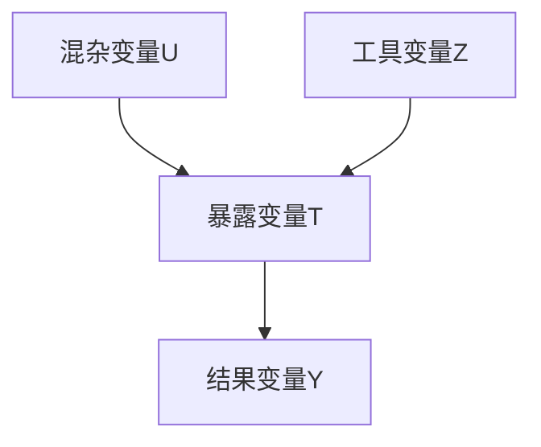

图2-20 工具变量模型

## 2.6.5.1 工具变量的概念

工具变量指的是与暴露变量有关联，但对结果没有直接作用的变量（图2-20）。其背后的核心思想是，如果工具变量与暴露变量以及工具变量与结果变量之间均不存在混杂因素时，即使在没有观测到混杂因素的情况下，我们也可以借助工具变量来计算暴露对结果的因果效应。需要注意的是，一个变量能够作为工具变量，需要满足以下3个条件。

① 相关性（relevance） 工具变量 Z 与暴露变量 T 具有显著的统计关联，即  $Z \not\perp T$ 。
② 排他性限制（exclusive restriction） 在给定暴露变量 T 和混杂变量 U 的条件下，工具变量 Z 对结果变量 Y 没有直接作用，即  $Y \perp Z |T, U$ 。
③ 无混杂性（unconfoundedness） 工具变量 Z 与混杂变量 U 相互独立，即  $Z \perp U$ 。

在实际应用中，通常根据不同的研究领域和不同的场景来选择合适的工具变量。例如，在经济学研究中，工具变量通常是政策变化、地理位置或历史事件等。在遗传学研究中，则将基因组上的某些变异位点作为工具变量，以探索暴露变量（生活方式、环境因素等）对疾病的影响，这也就是孟德尔随机化方法，该方法我们会在后面做进一步介绍。

## 2.6.5.2 工具变量的识别与估计

工具变量法在不做任何模型假设的情况下因果效应是无法识别，下面我们在线性模型假设下，即变量之间为线性关系，讨论工具变量的识别问题。

## (1) 二分类工具变量下 ACE 的识别

首先我们考虑工具变量 $Z$ 为二分类情况，并假设结果 $Y$ 是暴露变量 $T$ 和未被观测的混杂变量 $U$ 的线性函数，即

$$
Y = \alpha T + \beta U + \varepsilon \tag {2-63}
$$

其中，$\alpha$ 即为我们感兴趣的因果效应。根据上述工具变量所要满足的3个条件，我们可以证明

$$
\begin{array}{l} \mathbb {E} (Y | Z = 1) - \mathbb {E} (Y | Z = 0) = \mathbb {E} (\alpha T + \beta U + \varepsilon | Z = 1) - \mathbb {E} (\alpha T + \beta U + \varepsilon | Z = 0) \\ = \alpha [ \mathbb {E} (T | Z = 1) - \mathbb {E} (T | Z = 0) ] + \beta [ \mathbb {E} (U | Z = 1) \\ \left. - \mathbb {E} (U | Z = 0) \right] + \left[ \mathbb {E} (\varepsilon | Z = 1) - \mathbb {E} (\varepsilon | Z = 0) \right] \\ = \alpha [ \mathbb {E} (T | Z = 1) - \mathbb {E} (T | Z = 0) ] \tag {2-64} \\ \end{array}
$$

进一步则可以得到

$$
\alpha = \frac {\mathbb {E} (Y | Z = 1) - \mathbb {E} (Y | Z = 0)}{\mathbb {E} (T | Z = 1) - \mathbb {E} (T | Z = 0)} \tag {2-65}
$$

其中，分子部分为工具变量 $Z$ 与结果变量 $Y$ 的关联，分母部分为工具变量 $Z$ 与暴露变量 $T$ 的关联。

## (2) 连续型工具变量下 ACE 的识别

接下来，我们考虑工具变量为连续型变量时 ACE 的识别。与二分类情况类似，在线性模型假设下可以得到

$$
\begin{array}{l} \operatorname{Cov} (Y, Z) = \mathbb {E} (Y Z) - \mathbb {E} (Y) \mathbb {E} (Z) \\ = \mathbb {E} \left[ (\alpha T + \beta U + \varepsilon) Z \right] - \mathbb {E} (\alpha T + \beta U + \varepsilon) \mathbb {E} (Z) \\ = \alpha \left[ \mathbb {E} (T Z) - \mathbb {E} (T) \mathbb {E} (Z) \right] + \beta \left[ \mathbb {E} (U Z) - \mathbb {E} (U) \mathbb {E} (Z) \right] + \left[ \mathbb {E} (\varepsilon Z) - \mathbb {E} (\varepsilon) \mathbb {E} (Z) \right] \\ = \alpha \operatorname{Cov} (T, Z) + \beta \operatorname{Cov} (U, Z) + \operatorname{Cov} (\varepsilon , Z) \\ = \alpha \operatorname{Cov} (T, Z) \tag {2-66} \\ \end{array}
$$

因此

$$
\alpha = \frac {\mathrm{Cov} (Y , Z)}{\mathrm{Cov} (T , Z)} \tag {2-67}
$$

无论工具变量为二分类还是连续型，我们可以看到识别公式中均不包含 $U$ ，因此工具变量法可以实现在不观测混杂变量 $U$ 的情况下来估计ACE。

## (3) 两阶段最小二乘法估计

我们得到工具变量的识别公式后，便可以根据识别公式来估计因果效应。常用的估计方法为两阶段最小二乘法（two stage least squares, 2SLS），2SLS 还可以帮助我们从另外一个视角理解工具变量。在 2SLS 中，第一阶段为使用暴露变量 T 对工具变量 Z 进行回归

$$
T = \gamma Z + \varepsilon_ {T} \tag {2-68}
$$

并得到预测的暴露变量 $\hat{T}$

$$
\widehat {T} = \widehat {\gamma} Z \tag {2-69}
$$

此时 $\hat{T}$ 只与 $Z$ 有关，而与 $U$ 无关（图2-20）。第二阶段，研究者使用结果变量 $Y$ 对第一阶段预测的 $\hat{T}$ 进行回归，

$$
Y = \alpha \widehat {T} + \beta U + \varepsilon_ {Y} \tag {2-70}
$$

求解得到因果效应的估计值 $\hat{\alpha}$ 。这两步过程将消除混杂变量的影响，提供 $T$ 和 $Y$ 之间因果效应的无偏估计。然而如果工具变量不满足与暴露变量相关（即工具变量有效）并且与误差项不相关（即工具变量外生）的条件，那么两阶段最小二乘法将会产生有偏的结果（图2-21）。

flowchart

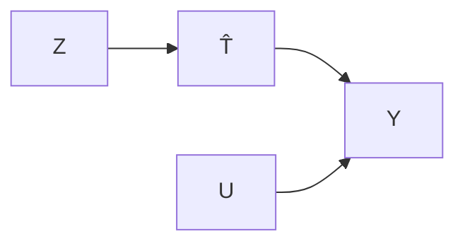

图2-21 两阶段最小二乘法

值得注意的是，上述 ACE 的识别均需要依赖线性参数化的假设，在借助工具变量估计 ACE 时如果不做任何模型假设，ACE 是无法识别的。然而，线性假设暗含一个内容，即对于所有个体的处理效应均是完全相同的。这个条件在真实研究中往往难以满足。除了线性假设外，在工具变量的分析中我们也可以做单调性假定，即假设随着工具变量水平的增加，结果水平也会随之增加。在单调性假设下，ACE 同样也是可识别的。

## ※ 推荐阅读

1. Hastie T, Tibshirani R, Friedman J. The elements of statistical learning [M]. 2nd ed. Berlin: Springer, 2009.
点评:该书详细介绍了统计学习的重要内容，有助于扩展相关内容的知识面。
2. Pearl J, Mackenzie D. The book of why: the new science of cause and effect [M]. New York: Basic Books, 2018.
点评:该书详细介绍了因果推断的重要思想和发展历史。

## ※ 思考与练习题

1. 极大似然估计方法和最小二乘法的区别是什么？
2. 贝叶斯极大后验估计与极大似然估计之间是什么关系？
3. 请在理解 I 型与 II 型错误的基础上，思考如何权衡二者。
4. 在哪些场景下中位数比均值更为可靠？
5. 如何理解双因素方差分析中的交互效应。
6. 为什么 Benjamini-Hochberg 方法可以控制 FDR?
7. 思考参数方法和非参数方法的优缺点，并举例说明各自的适用场景。
8. 分析随机区组设计如何帮助减轻实验中未知混杂变量的影响。
9. 当工具变量与暴露变量的相关性比较弱时，会出现弱工具变量问题。请思考弱工具变量会对因果推断造成哪些影响，如何检测和处理弱工具变量问题？
10. 为什么随机化实验被认为是因果推断的金标准？请结合可忽略性假设进行阐述。

## ※ 讨论题

1. 试论述描述性统计学在数据分析中的作用及其重要性。
2. 通过实际案例，解释单侧和双侧检验的区别和应用。
3. 探讨对比不同的图表（如箱线图、散点图、直方图）在数据展示中的作用和优势。
4. 比较 Bonferroni 校正与 Benjamini-Hochberg 校正的优缺点，并举例说明。
5. 为什么传统的 Bonferroni 校正方法可能不适用于基因表达数据的多重检验？
6. 探讨在生物信息大规模数据分析中，如何选择合适的多重检验校正方法。

## ※ 参考文献

1. Fan J, Li R. Variable selection via nonconcave penalized likelihood and its oracle properties [J]. Journal of the American statistical association, 2002, 96(456): 1348-1360.
2. Ishwaran H, Rao S. SPIKE and SLAB variable selection: frequentist and Bayesian strategies [J]. The annals of statistics, 2005, 33(2): 730-773.
3. LeCun Y, Bengio Y, Hinton G. Deep learning [J]. Nature, 2015, 521(7553): 436-444.
4. Park T, Casella G. The Bayesian LASSO [J]. Journal of the American statistical association, 2008, 103(482): 681-686.
5. Scott S L. Bayesian methods for hidden Markov models [J]. Journal of the American statistical association, 2002, 97(457): 337-351.
6. Tibshirani R. Regression shrinkage and selection via the LASSO [J]. Journal of the royal statistical society series B: statistical methodology, 1996, 58(1): 267-288.
7. Zou H, Hastie T. Regularization and variable selection via the elastic net [J]. Journal of the royal statistical society series B: statistical methodology, 2005, 67(2): 301-320.

编者:蒋杭进（浙江大学）

王涛（上海交通大学）

审读:李婧（上海交通大学）

## 深度学习和人工智能

第2章介绍了生物信息学中涉及的生物统计基础知识，本章主要介绍近年来发展迅速，且在生物信息学中广泛应用的深度学习技术。2024年的诺贝尔物理学奖颁发给了人工智能算法开发，化学奖颁发给运用人工智能技术进行蛋白质结构预测。本章将介绍人工智能技术的基本框架和基础算法。机器学习是实现人工智能的途径之一，而深度学习是机器学习的一种，3.1节将对此简要讨论。之后3.2、3.3、3.4节将分别介绍深度学习的基本原理、常见模型、进阶模型。3.5节将介绍人工智能算法在生物信息学中的应用范式。最后3.6节对相关技术的未来进行展望。本章目标是给读者提供后续章节的技术基础。

## 3

## 3.1 从人工智能到深度学习

## 3.1.1 人工智能

机器能够像人类一样进行思考是很多科幻电影对未来的常见想象，而其背后的人工智能（artificial intelligence, AI）技术也一直吸引着人类的目光。1950年，计算机科学与人工智能之父艾伦·图灵（Alan Turing）发表论文《计算机器与智能》，尝试回答“机器能否思考”这一问题。图灵设计了一个思维实验，即我们现在熟知的“图灵测试”。如果人类提问者在提出一些问题并得到机器回答后无法判断回答来自人还是机器，那么就可以认为机器具有人类智能。这一测试成了后来人们对人工智能的最初设想。在1956年的达特茅斯会议上，研究者首次提出了人工智能这一概念。其目的是“让机器像人那样认知、思考和学习”，人工智能领域也由此诞生。

根据对智能的定义不同，人工智能可以被分为“强人工智能”和“弱人工智能”。强人工智能希望机器能够像人类一样具有学习推理能力，能够解决通用任务。科幻电影中动辄毁灭世界、统治人类的机器人就是这类人工智能的代表。而弱人工智能针对特定任务进行处理，这类人工智能不具备人类的完整认知能力，但在特定任务上甚至可以拥有超越人类的能力。如阿尔法围棋（AlphaGo）在围棋比赛中多次打败职业棋手，但它也仅仅只能解决围棋比赛这一特定问题。尽管强人工智能是人类对人工智能领域的最终追求，但目前取得巨大成功，并在实践中广泛应用的都是弱人工智能，其应用场景包括自然语言处理、计算机视觉、语音识别等领域。

自人工智能这一概念被提出以来，该领域发展出了多个不同的流派，主要包括符号主义、联结主义、行为主义等。符号主义是早期人工智能的主流派别，该派别认为智能来源于数理逻辑，人的认知可以被抽象为符号，认知过程即为符号的操作过程。符号主义专注逻辑推理和构建专家系统，在人工智能的发展早期做出了重要贡献。联结主义又称仿生学派，该学派通过仿生神经元连接方式构建人工神经网络模型，模拟生物神经系统对真实世界做出的交互反应，从而实现人工智能。行为主义强调对生物体行为和反馈的研究，主张利用训练和奖惩机制实现人工智能的学习，认为控制论以及感知-动作型控制系统才是人工智能的关键。

上述三个学派代表着不同的思想来源和技术流派。符号主义的优势在于逻辑规则的清晰和易解释性，但为复杂领域构建专家系统往往是非常困难的，这类人工智能系统往往只能应用在相对朴素且形式化的领域（如象棋、数学证明），而很难被拓展到日常生活中常见的各种应用问题中，因为现实世界充满了模糊和不确定性。联结主义可以在一定程度上模拟人脑处理信息的过程，但这类人工智能系统的可解释性较差，另外其训练往往需要大量的时间和计算资源。行为主义系统能够实时处理环境信息，但应用范围主要局限于自动控制、机器人等领域，而且需要大量的数据和计算资源进行训练。随着新算法的开发、数据的积累和算力的提升，联结主义学派和行为主义学派正逐渐成为人工智能研究的主流。

人工智能是人类追求的一个宏大愿景，如何实现这一目标是研究人员关注的核心问题。在谈到具体用何种技术实现人工智能时，最常提及的就是机器学习和深度学习技术（图3-1）。简单来说，与传统的为特定问题编写显式规则的程序不同，机器学习旨在利用计算机模拟人类的学习行为，通过算法从数据中找出规律并做出决策。目前已经开发了很多机器学习算法让机器从数据中学习，包括逻辑回归、决策树、神经网络、支持向量机等。近年来，基于深度神经网络的机器学习展现出巨大的发展

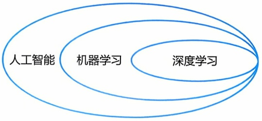

flowchart

图3-1 人工智能、机器学习与深度学习的关系

潜力，这一类机器学习方法被称为深度学习。深度学习技术的突破掀起了人工智能的新一轮发展浪潮，如今已经被运用于包括自然语言处理、计算机视觉、语音识别、科学计算在内的多个领域，并对社会的发展产生着深远的影响。生物医学领域积累了基因组、蛋白质、基因表达调控、医学图像和诊断等大量数据，非常适合用人工智能技术进行挖掘和分析，后面章节会介绍在生物信息学的不同领域取得突破性进展的深度学习方法。

## 3.1.2 机器学习

机器学习（machine learning，ML）是人工智能研究领域中最有活力，发展最为迅速的分支之一。1997年，汤姆·米切尔（Tom Mitchell）在其著作《机器学习》（Machine Learning）中，将机器学习的过程定义为“计算机程序通过经验来提升其在一些任务上的表现”。定义中的“经验”可以以不同的形式存在，而在我们通常描述的机器学习中，“经验”以数据的形式存在（图3-2）。

| 样品名称 | 特征1 | 特征2 | 特征3 | 标签 |
| --- | --- | --- | --- | --- |
| 1 | Yes | Large | -110 | No |
| 2 | Yes | Medium | 20 | No |
| 3 | No | Small | 50 | No |
| 4 | No | Large | 230 | Yes |
| 5 | Yes | Large | 70 | Yes |
| 6 | No | Small | 80 | No |
| 7 | Yes | Medium | 160 | Yes |
| 8 | Yes | Large | -60 | No |
| 9 | No | Medium | -80 | No |
| 10 | No | Large | 120 | Yes |
| 11 | Yes | Small | -50 | ? |
| 12 | Yes | Medium | 230 | ? |
| 13 | Yes | Large | 110 | ? |
| 14 | No | Large | -70 | ? |
| 15 | No | Small | 150 | ? |

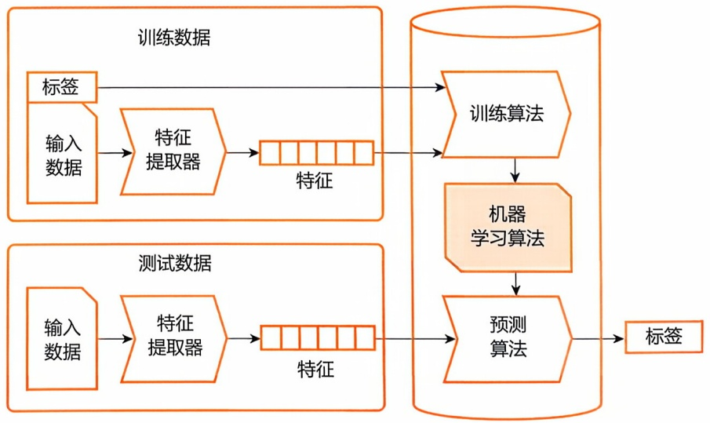

flowchart

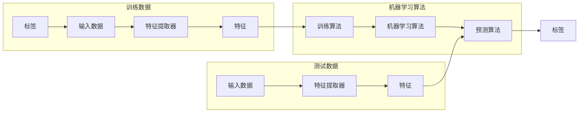

图3-2 机器学习的基本流程

左边是训练数据集和测试数据集，每一行代表一个样本（sample），第一列是样本名称，最后一列是标签（label），其他每一列代表一个特征（feature）。中间是特征提取，即从原始特征经过一些变换后构造出新的特征。右边是机器学习模型，用训练数据集的标签监督训练之后，模型就可以预测出测试数据集的标签

本节涉及的许多方法在第2章生物统计学基础中已经介绍过了，这里一方面在机器学习的框架下搭建知识体系，另一方面在机器学习的语境中梳理一遍概念和术语。至于特定方法的细节就不再重复说明，请读者自行查阅前文。

在完成原始数据清洗、筛选和特征提取等预处理后，我们需要将数据集划分为训练集（training set）、验证集（validation set）和测试集（test set）。然后根据问题的类型和数据的特点，选择合适的机器学习模型（model），并使用训练集来优化模型的参数（parameter），使其能够从数据中学习到准确的规律和模式，这个过程称为训练（training）。我们可以用一个简单的函数来表示模型:

$$
\hat {y} = f (x) \tag {3-1}
$$

$f$ 接受 $x$ （输入数据）并输出 $\hat{y}$ （预测标签）。在训练过程中通常使用优化算法（如梯度下降）不断更新模型参数，最小化 $\hat{y}$ 与 $y$ （真实标签）之间的误差（也称为损失函数），以获得准确的预测。另外，还有一类参数，在训练前事先给定，不在训练中更新，称为超参数（hyperparameter），如模型大小、迭代次数等。超参数对模型的性能和训练过程有重要影响，需要仔细调整和选择，一般在验证集上进行。最终，用最好的超参数完成模型训练之后，在测试集上使用模型进行预测，评估模型的性能和泛化能力。

根据学习方式的不同，机器学习可以分为监督学习（supervised learning）、无监督学习（unsupervised learning）、强化学习（reinforcement learning）等，下面分别进行介绍（图3-3）。

## (1) 监督学习

监督学习是机器学习中最常见的一种学习方式，其依赖于有标签的训练数据集，根据输入数据预测相应的输出标签，即构建自变量 $x$ 与因变量 $y$ 之间的关系。回归（regression）和分类（classification）是监督学习的两种常见任务类型。回归任务学习连续值类型的标签，如身高、体重、基因表达量等；而分类任务学习离散值类型的标签，如“健康”与“患病”，$\alpha$ 螺旋、$\beta$ 折叠与无规卷曲。在机器学习的发展历程中诞生了很多模型和算法来解决这两种任务，其中线性回归、逻辑回归、决策树、随机森林、支持向量机在第2章已经介绍过，这里补充一下 $K$-最近邻和朴素贝叶斯。$K$-最近邻（$K$-nearest neighbor，KNN）算法基于特定的距离度量，在特征空间中找到最接近测试样本的 $K$ 个训练样本，然后根据这 $K$ 个最近邻居的信息，通过投票或平均来进行分类或回归。朴素贝叶斯（naive Bayes）基于贝叶斯定理和特征之间的独立性假设进行分类。其先为每个特征估计条件概率，然后为测试样本计算每种标签的后验概率，并选择概率最大的标签作为预测结果。

## (2) 无监督学习

无监督学习旨在从无标注数据中学习数据的内在特征和规律，为下一步的数据分析提供基础。其中降维是降低数据的特征维度，从而解决高维数据面临的诸多问题，包括数据稀疏、距离计算困难、冗余和噪声、难以可视化等，最终在低维空间准确地从有限样本中捕捉数据的分布和特征；聚类是从数据中发现内在的模式、结构或分布，进而将样本划分到若干个不相交的子集，称为簇（clusters），使得同一簇内的样本相似度较高，而不同簇之间的样本相似度较低。第2章2.5已经介绍过用于降维的PCA、MDS、t-SNE、UMAP和用于聚类的 $K$ -均值、层次聚类等算法，这里补充一下高斯混合模型（Gaussian mixture models，GMM）。GMM是一种概率密度模型，其假设数据集由多个高斯分布组成，每一个高斯分布对应一个簇，不同簇分配不同的均值向量和协方差矩阵；GMM使用多元高斯分布对每个样本进行建模，通过最大化似然函数找到能够最好地解释训练数据的簇参数。

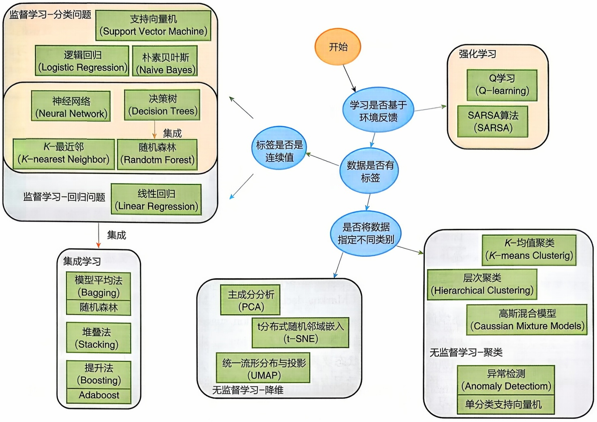

flowchart

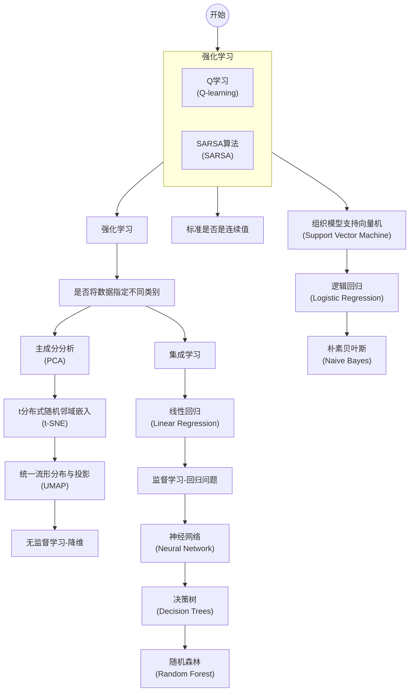

图3-3 机器学习的分类及代表方法

无监督学习也可以看成是学习样本的“最佳”表示，即比原本的表示更简单或更易访问，同时尽可能多地保存样本的原始信息。有很多种方式定义“简单”的表示，最常见的三种是低维表示、稀疏表示和独立表示。低维表示就是上文介绍的降维；稀疏表示则是增加数据维度、但大多数特征为零，这会使样本倾向于分布在表示空间的坐标轴上；独立表示则强调表示的维度是统计独立的。这三个标准其实是相互关联的，如PCA既是低维表示，也是独立表示。表示的概念是深度学习的核心主题之一，读者可参阅伊恩·古德费洛（Ian Goodfellow）、约书亚·本吉奥（Yoshua Bengio）和亚伦·库维尔（Aaron Courville）合著的《深度学习》（Deep Learning）。

首先，基于环境反馈的学习称为强化学习。随后，根据数据是否有标签，可以分为监督学习与无监督学习。对于监督学习，可以根据标签是否为连续值分为分类问题与回归问题；而对于无监督学习，又可以根据是否为数据指定类别区分为降维与聚类。另外，我们可以将几类弱监督模型组合为强监督模型，这种方法被称为集成学习

还有人认为聚类和降维本质上都是对数据的内在结构进行学习，而这些结构与数据的生成机制存在很强的因果关系，可以将两者统一成因子学习，即对产生数据的因子进行分析，包括因子与数据间的关系和因子与因子间的复杂相关性。因子学习的根本目的是发掘数据背后的深层原因，这种抽象是模型具备泛化能力的基础，也是人类进行归纳学习的典型方法。

## (3) 强化学习

强化学习的概念起源于心理学，也称再励学习或增强学习，是一种模拟人和动物行为学习（behavior learning）的延迟回报学习。强化学习不需要输入特征-标签的成对数据和关于环境的先验知识，而是通过不断试错、与环境交互获得反馈，并在探索未知（explore）和利用已知（exploit）之间寻找平衡，逐步形成对环境奖惩激励的预期，最终产生能够获得最大累积收益的习惯性行为，即最优决策。具体来讲，在强化学习中智能体（agent）在观察环境（environment）的状态（state）后，选择一个动作（action），环境再根据智能体的动作给予一个奖励（reward）和新的状态，智能体根据奖励来调整动作策略，以获得最高的累积奖励。强化学习通常用马尔可夫决策过程（Markov decision process, MDP）来建模，包含四个要素，即状态空间（state space）、动作空间（action space）、状态转移概率（state transition probability）和奖励函数（reward function）。其基本假设是智能体下一步状态只与当前状态以及当前状态要采取的行动有关。

除了以上三类学习方式之外，还有介于监督学习与无监督学习之间的半监督学习（semi-supervised learning），通过输入数据本身生成标签的自监督学习（self-supervised learning）等，读者可自行查阅相关资料。

## 3.1.3 深度学习

深度学习（deep learning，DL）是机器学习的一种。可能和大部分人以为的不一样，其实早在20世纪50年代人工智能的概念被提出时，深度学习就已经在控制论中初露雏形。随着20世纪80年代到21世纪初期机器学习的蓬勃发展，人工神经网络作为机器学习中的代表性方法也得到了迅速发展。在此阶段，深度学习被称为联结主义。但是，一直到2006年，深度学习之父杰弗里·辛顿（Geoffrey Hinton）正式提出了深度学习这一概念，才真正开启了深度学习在学术界和产业界革命的浪潮。这一时期，深度学习的发展进入了一个全新的阶段，伴随着算力的快速增强，引发了广泛的关注和研究（图3-4）。

深度学习的发展是一个螺旋上升的过程，依赖于多个领域之间的相互支持和促进，其中三个主导因素分别是数据（data）、算法（algorithm）和算力（computing power）（图3-5）。事实上，深度学习重要的几大算法在20世纪后半叶已经具备了完整的理论形式，但受限于数据和技术瓶颈，并没有发挥其巨大的潜力。直到21世纪初期，随着信息技术迅速发展，大量数据涌现出来，包含丰富的信息可供挖掘。

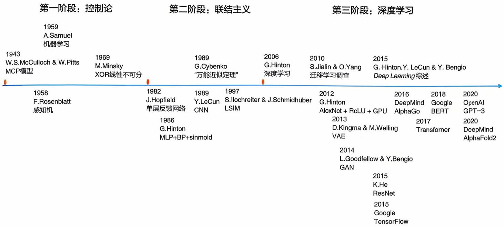

state_timeline

| Year | Phase | Key Milestones |
| --- | --- | --- |
| 1943 | 第一阶段：控制论 | W.S.McCulloch & W.Pitts MCP模型 |
| 1958 | 第一阶段：控制论 | F.Rosenblatt 感知机 |
| 1959 | 第一阶段：控制论 | A.Samuel 机器学习 |
| 1969 | 第二阶段：联结主义 | M.Minsky XOR线性不可分 |
| 1982 | 第二阶段：联结主义 | J.Hopfield 单层反馈网络 |
| 1986 | 第二阶段：联结主义 | G.Hinton MLP+BP+sinmoid |
| 1989 | 第二阶段：联结主义 | G.Cybenko "万能近似定理" |
| 1989 | 第二阶段：联结主义 | Y.LeCun CNN |
| 1997 | 第二阶段：联结主义 | S.Ilochreiter & J.Schmidhuber LSIM |
| 2006 | 第二阶段：联结主义 | G.Hinton 深度学习 |
| 2010 | 第三阶段：深度学习 | S.Jialin & O.Yang 迁移学习调查 |
| 2012 | 第三阶段：深度学习 | G.Hinton AlcxNct + RcLU + GPU |
| 2013 | 第三阶段：深度学习 | D.Kingma & M.Welling VAE |
| 2014 | 第三阶段：深度学习 | L.Goodfellow & Y.Bengio GAN |
| 2015 | 第三阶段：深度学习 | K.He ResNet |
| 2015 | 第三阶段：深度学习 | Google TensorFlow |
| 2016 | 第三阶段：深度学习 | DeepMind AlphaGo |
| 2017 | 第三阶段：深度学习 | Transformer |
| 2018 | 第三阶段：深度学习 | Google BERT |
| 2018 | 第三阶段：深度学习 | Google BERT |
| 2019 | 第三阶段：深度学习 | OpenAI GPT-3 |
| 2020 | 第三阶段：深度学习 | DeepMind AlphaFold2 |

同时，图形处理器（graphics processing unit, GPU）等硬件的出现进一步加速了深度学习模型的训练过程，推动深度学习达到了新的高潮。

由于深度学习的策略和算法逐渐增多，研究人员在使用和开发过程中需要进行的环境安装、部署、测试和调优变得越来越烦琐而复杂。学术界和产业界积极开发了一系列通用的平台和工具，称为深度学习框架（图3-6），其中最为人所熟知的是TensorFlow和PyTorch。这些框架不仅提供了高级的应用程序编程接口（application programming interface, API）和抽象层，使得开发者可以轻松地构建和训练深度学习模型；还有庞大的用户社区，为用户提供了丰富的开源文档、讨论和调试支持。

图3-4 深度学习发展历史

图中主要分为三个阶段，轴线上方为深度学习相关的理论进展，轴线下方为深度学习相关的算法和实现进展

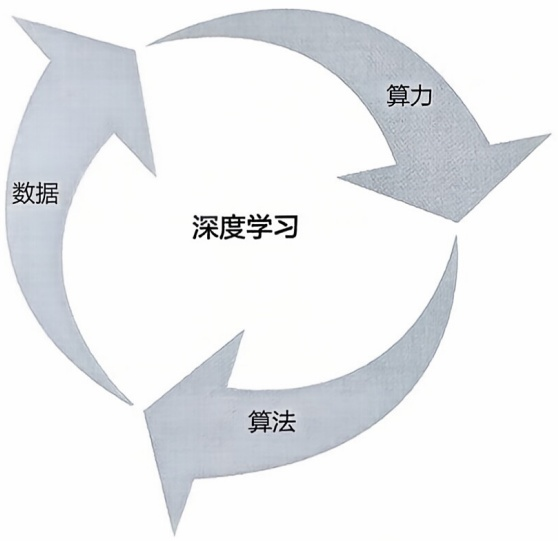

flowchart

图3-5 深度学习发展的三个主导因素

其中数据主要来自现实的生产需求，算力受益于产业界的硬件更新，算法则是深度学习理论发展的重要组成部分

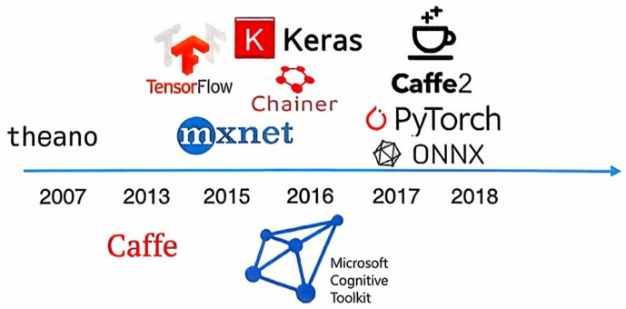

text_image

theano
TensorFlow
Keras
Chainer
Caffe2
mxnet
PyTorch
ONNX
2007
2013
2015
2016
2017
2018
Caffe
Microsoft Cognitive Toolkit

图3-6 深度学习框架及其发展史