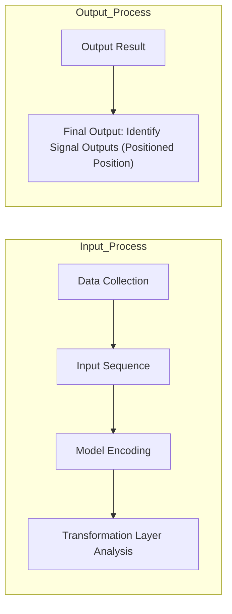
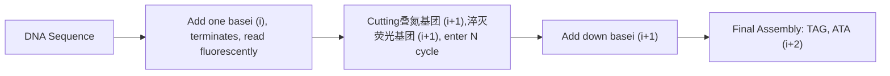
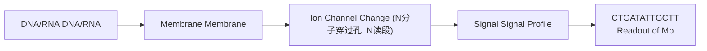

给定序列与其他输入序列的关系，因此能更好地刻画多个输入序列的全局关联并确保最终得到的进化树各个分支的总长度最小。

例如，针对序列A、B、C、D、E、F、G，已知它们彼此的距离 $d$ 如下:

|  | A | B | C | D | E | F |
| --- | --- | --- | --- | --- | --- | --- |
| B | 63 |  |  |  |  |  |
| C | 94 | 79 |  |  |  |  |
| D | 111 | 96 | 47 |  |  |  |
| E | 67 | 16 | 83 | 100 |  |  |
| F | 23 | 58 | 89 | 106 | 62 |  |
| G | 107 | 92 | 43 | 20 | 96 | 102 |

以此为基础，可以计算每个序列到其他序列的平均距离 r:

$$
r _ {i} = \frac {1}{N - 1} \sum_ {k \neq i} d _ {i k}
$$

| $r_{A}$ | $r_{B}$ | $r_{C}$ | $r_{D}$ | $r_{E}$ | $r_{F}$ | $r_{G}$ |
| --- | --- | --- | --- | --- | --- | --- |
| 93 | 80.8 | 87 | 96 | 84.8 | 88 | 92 |

接下来，通过综合考虑序列之间的直接距离  $d_{ij}$  与  $r_{i}$ 、 $r_{j}$ ，可以计算邻接距离  $D_{ij}$ :

$$
D _ {i j} = d _ {i j} - r _ {i} - r _ {j}
$$

|  | A | B | C | D | E | F |
| --- | --- | --- | --- | --- | --- | --- |
| B | -110.8 |  |  |  |  |  |
| C | -86 | -88.8 |  |  |  |  |
| D | -78 | -80.8 | -136 |  |  |  |
| E | -110.8 | -149.6 | -88.8 | -80.8 |  |  |
| F | -158 | -110.8 | -86 | -78 | -110.8 |  |
| G | -78 | -80.8 | -136 | -168 | -80.8 | -78 |

从中可以看到 D、G 之间的邻接距离最小（-168），为最近的“邻居”，可以首先合并:

text_image

G
DG
D
F
A
B
C
E

值得注意的是，这里需要重新计算 D、G 到合并后节点 DG 的距离:

$$
d _ {i, (i j)} = \frac {1}{2} d _ {i j} + \frac {1}{2} \left(r _ {i} - r _ {j}\right)
$$

$$
d _ {j, (i j)} = \frac {1}{2} d _ {i j} + \frac {1}{2} \left(r _ {j} - r _ {i}\right)
$$

即:

$$
d _ {\mathrm{D,DG}} = \frac {1}{2} d _ {\mathrm{D,G}} + \frac {1}{2} (r _ {\mathrm{D}} - r _ {\mathrm{G}}) = \frac {1}{2} \times 2 0 + \frac {1}{2} (9 6 - 9 2) = 1 2
$$

$$
d _ {\mathrm{G,DG}} = \frac {1}{2} d _ {\mathrm{D,G}} + \frac {1}{2} (r _ {\mathrm{G}} - r _ {\mathrm{D}}) = \frac {1}{2} \times 2 0 + \frac {1}{2} (9 2 - 9 6) = 8
$$

由此，可以重新计算 $d$ 矩阵:

|  | A | B | C | DG | F |
| --- | --- | --- | --- | --- | --- |
| B | 63 |  |  |  |  |
| C | 94 | 79 |  |  |  |
| E | 67 | 16 | 83 |  |  |
| F | 23 | 58 | 89 | 62 |  |
| DG | 99 | 84 | 35 | 88 | 94 |

平均距离 $r$ :

| $r_{A}$ | $r_{B}$ | $r_{C}$ | $r_{E}$ | $r_{F}$ | $r_{DG}$ |
| --- | --- | --- | --- | --- | --- |
| 86.5 | 75 | 95 | 79 | 81.5 | 100 |

以及邻接距离 d:

|  | A | B | C | E | F | DG |
| --- | --- | --- | --- | --- | --- | --- |
| B | -98.5 |  |  |  |  |  |
| C | -87.5 | -91 |  |  |  |  |
| E | -98.5 | -138 | -91 | -80.8 |  |  |
| F | -145 | -98.5 | -87.5 | -78 | -98.5 |  |
| DG | -87.5 | -91 | -160 | -168 | -91 | -87.5 |

由此，可以继续迭代直至整个建树完成:

chemical

Chemical structure diagram with labeled atoms including A, B, C, D, E, F, G, AF, BE, CDG, DG

基于距离的方法计算效率高，在简单性和准确性之间提供了良好的平衡，特别适合处理包含成千上万序列的大数据集，已在流行病学、保护生物学等领域获得了广泛应用。

值得一提的是，基于距离的方法将序列数据简化为成对距离，这虽然有效提升了处理效率，但也导致了序列组成等细节的丢失。因此，如果需要对演化细节进行解析，可以考虑采用如基于最大简约法（maximum parsimony, MP）、最大似然法（maximum likelihood, ML）等基于序列特征的建树方法。

## 5.4 序列比对与分析的总结与展望

序列比对与分析不仅是早期经典生物信息学研究的核心问题，也在当今组学研究中发挥着不可替代的核心作用。

序列比对在组学研究中，最常见的就是将测序数据比对到参考基因组。不论是基因组研究中的全基因组测序（whole genome sequencing，WGS）、全外显子组测序（whole exome sequencing，WES）和靶向测序；还是在转录组研究中的 RNA-Seq、microRNA-Seq 和 circRNA-Seq；或是在表观组学和三维基因组学中，比对到参考基因组几乎都是首要的分析环节。一般来说，比对的类型可以基于测序技术的差异分为两大类，一类是高通量的短读长测序技术，另一类是三代的长读长测序技术。关于短读长测序的序列比对，传统的双序列比对算法如动态规划和 BLAST 并不能很好地应对其海量的序列比对需求。一种高性能的序列比对算法 BWA，被广泛用于基因组二代测序数据的参考基因组比对。BWA 算法的核心是 Burrows-Wheeler 变换（Burrows-Wheeler transform，BWT）和创建查找表（graph FM-index），通过 BWT 将参考基因组和测序数据转化为可高效搜索的一种压缩格式，再使用 FM-index 高效地在基因组中搜索匹配的序列。相比基因组数据的比对，转录组数据比对的需求更加多样，如需要考虑剪接位点对测定序列分段比对的影响。HISAT2 是一种专门用于 RNA-Seq 数据快速比对的工具，它在基因组比对中引入了查找表来提高速度，具有较低的内存占用和高效的多线程处理能力。

最基本的生物分子序列表示方法是使用标准的IUPAC代码:对于DNA和RNA序列，我们使用“A”“C”“G”和“T/U”来表示核苷酸；对于蛋白质序列，我们使用单个字母代码来表示氨基酸。近年来，深度学习模型在生物信息学领域取得了重大进展。通过将生物序列编码为高维向量可以有效刻画序列中的复杂模式，从而为序列比对与分析提供了新的机遇与可能。具体来说，在人工智能大语言模型中可以用one hot等多种编码形式表示特定序列、序列比对及其集合，然后使用向量相似度度量（如余弦相似度）来评估它们的相似性。在此过程中，通过将传统的线性序列表示更换为高维空间的向量表示，不仅可以提升对测序错误等噪声的稳健性，更使得千万级别的超大规模序列分析成为可能。值得一提的是，通过将DNA、RNA、蛋白质等不同类型的序列向量表示投射到同一空间，可以实现跨序列类型的统一整合分析，从而为后续多组学整合提供了统一的框架（图5-9）。

flowchart

图5-9 跨序列类型的统一整合分析

line

| X | Y | Z |
| --- | --- | --- |
| ~0 | ~5 | ~-2 |
| ~5 | ~5 | ~-8 |
| ~10 | ~5 | ~-12 |
| ~15 | ~5 | ~-15 |
| ~20 | ~5 | ~-18 |
| ~0 | ~10 | ~-30 |
| ~5 | ~10 | ~-32 |
| ~10 | ~10 | ~-35 |
| ~15 | ~10 | ~-38 |
| ~20 | ~10 | ~-40 |
| ~0 | ~15 | ~-45 |
| ~5 | ~15 | ~-48 |
| ~10 | ~15 | ~-50 |
| ~15 | ~15 | ~-52 |
| ~20 | ~15 | ~-55 |
| ~0 | ~20 | ~-60 |
| ~5 | ~20 | ~-62 |
| ~10 | ~20 | ~-65 |
| ~15 | ~20 | ~-68 |
| ~20 | ~20 | ~-70 |
| ~0 | ~25 | ~-72 |
| ~5 | ~25 | ~-73 |
| ~10 | ~25 | ~-75 |
| ~15 | ~25 | ~-78 |
| ~20 | ~25 | ~-80 |

图5-10 基于大肠杆菌k-12菌株构建的 $Z$ 曲线

值得一提的是，我国生物信息学家张春霆教授于1994年提出DNA序列的 $Z$ 曲线理论，证明任一核酸序列均可用唯一的一条三维空间曲线表示。具体来说，$Z$ 曲线表示使用3个正交坐标轴 $(x,y,z)$ 来描述不同类型碱基沿序列的分布，每个子序列都对应一个三维坐标点，通过连接这些点就可以得到一条连续的空间曲线。这种表示方法将一维序列映射到三维空间曲线，可以捕捉核酸序列中的周期性、对称性等特征，也开创了一条用几何学方法分析核酸序列的新途径（图5-10）。

$$
x _ {n} = (A _ {n} + G _ {n}) - (C _ {n} + T _ {n})
$$

$$
y _ {n} = (A _ {n} + C _ {n}) - (G _ {n} + T _ {n})
$$

$$
z _ {n} = (A _ {n} + T _ {n}) - (C _ {n} + G _ {n})
$$

$$
n = 0, 1, 2, \dots N
$$

## ※ 推荐阅读

1. Durbin R, Eddy S R, Krogh A, et al. Biological sequence analysis: probabilistic models of proteins and nucleic acids [M]. Cambridge: Cambridge University Press, 1998.

点评:该书以核酸/蛋白质序列分析为核心，系统介绍了基于概率模型对核酸与蛋白质序列进行建模解析的核心概念、思路、方法与应用。

2. Pevsner J. Bioinformatics and functional genomics [M]. 3rd ed. New Jersey: Wiley-Blackwell Publishing, 2015.

点评:该书基于大量实例全面介绍了多种序列分析方法的实现与应用过程。

## ※ 思考与练习题

1. 基于人类基因组数据训练得到的剪切位点 HMM 可以用于在果蝇基因组中鉴定新剪切位点吗？为什么？
2. 全局比对与局部比对的应用场景分别是什么？试解释其原理。
3. BLASTx 和 tBLASTn 的应用场景分别是什么？
4. 是否可以将一组序列根据序列相似性分成若干组，确保每组内部序列的相似性小于某一个阈值，且不同组序列的相似性大于某一个阈值？为什么？
5. UPGMA 法和 NJ 法的区别是什么？具体在算法步骤中的体现是什么？

## ※ 讨论题

1. 一个 $E = 10$ 的 BLAST 检索结果有意义吗？为什么？

2. 不同于UPGMA法构建的进化树总有唯一根（即最终合并的根节点），NJ法构建的进化树无法简单确定一个根，你认为这合理吗？为什么？

## ※ 参考文献

1. Altschul S F, Gish W, Miller W, et al. Basic local alignment search tool [J]. Journal of molecular biology, 1990, 215(3):403-410.
2. Burge C, Karlin S. Prediction of complete gene structures in human genomic DNA [J]. Journal of molecular biology, 1997, 268(1): 78-94.
3. Dayhoff M O, Schwartz R M, Orcutt B C. A model of evolutionary change in proteins [M].//Atlas of protein sequence and structure. Maryland: National Biomedi-

cal Research Foundation, 1978: 345-352.

4. Henikoff S, Henikoff J G. Amino acid substitution matrices from protein blocks [J]. Proceedings of the national academy of sciences of the United States of America, 1992, 89(22): 10915-10919.
5. Katoh K, Standley D M. MAFFT multiple sequence alignment software version 7: improvements in performance and usability [J]. Molecular biology and evolution, 2013, 30(4): 772-780.
6. Needleman S B, Wunsch C D. A general method applicable to the search for similarities in the amino acid sequence of two proteins [J]. Journal of molecular biology, 1970, 48(3): 443-453.
7. Saitou N, Nei M. The neighbor-joining method: a new method for reconstructing phylogenetic trees [J]. Molecular biology and evolution, 1987, 4(4): 406-425.
8. Smith T F, Waterman M S. Identification of common molecular subsequences [J]. Journal of molecular biology, 1981, 147(1): 195-197.
9. Steinegger M, Söding J. Clustering huge protein sequence sets in linear time [J]. Nature communications, 2018, 9(1): 2542.
10. Thompson J D, Higgins D G, Gibson T J. CLUSTAL W: improving the sensitivity of progressive multiple sequence alignment through sequence weighting, position-specific gap penalties and weight matrix choice [J]. Nucleic acids research, 1994, 22(22): 4673-4680.

编者:高歌（北京大学）

胡德华（中南大学）

石铁流（华东师范大学）

田卫东（复旦大学）

王明钰（山东大学）

审读:曹志伟（复旦大学）

## 基因组学

本章对基因组学和宏基因组学领域进行全面概述，涵盖了从基本概念到前沿技术与应用的内容。首先定义了基因组学，并讨论了获得和解读基因组序列的方法，以及如何将这些知识应用于实践。接着，介绍了高通量测序技术在动植物和微生物DNA测序中的应用，并探讨了遗传信息数据分析和基因组学数据可视化的策略。在基因组组装、预测和注释方面，详细讨论了基因组组装的算法、基因预测技术和基因组注释的方法。此外，还深入探讨了序列变异检测的基本原理和技术，包括单碱基替换、短插入缺失和结构变异的检测技术。宏基因组学部分概述了微生物组学的概念、数据分析方法，以及在健康和环境领域的应用，并对未来的发展方向进行了展望。本章结合基础知识与实际案例，提供了对基因组学和宏基因组学研究过程及其相关数据库、分析方法和软件的综合理解，旨在为读者在该领域的研究和应用提供指导。

## 6

## 6.1 基因组学概述

## 6.1.1 基因组学的概念

基因组学（genomics），简单来说就是研究基因组（genome）的科学。基因组是生物体内所有遗传物质的总和，包括所有染色体、线粒体、叶绿体（植物）等DNA序列或RNA序列（RNA病毒）。这些基因组序列均由A/C/G/T（U）组成，有些位置的碱基可能带有不同修饰（如5mC、 $m^{6}A$ 等）。不同物种的基因组大小（DNA序列总长）和复杂性（重复序列多样性和数目）千差万别。这些基因组序列编码了重要的遗传信息，构成了我们生命的蓝图。基因组学是对生物体所有基因进行集体表征、定量研究及不同基因组比较研究的一门交叉生物学学科，主要研究基因组的结构、功能、进化、合成/编辑等，以及它们对生物体的影响。

在基因组学中所研究的问题主要分为三类:如何获得基因组序列；如何解读/解码基因组；如何重写/编写新的基因组。第一类问题的解决方案随着 DNA 测序技术的发展越来越成熟，第二和第三类问题是目前生命科学基础研究中的前沿领域，而生物信息学在其中都扮演着非常重要的角色。

获得一个物种的高质量基因组序列是其相关科学研究的基础，具有重要的科学意义。基因组测序之前，我们通常需要估计其基因组大小，而在得到大量的基因组片段的序列后，我们需要进行基因组序列的拼接和组装。近年来，许多生物信息学算法和工具被设计和开发出来解决此方面的问题，如 Hifiasm、Verkko、NextDenovo、Canu、Flye 等。

在获得基因组序列后，我们需要对其进行解读，理解基因组和表型，这是基因组学中重要的研究内容，也是非常有挑战的系列科学问题。这些内容可以概括为多个层次的研究，如 DNA 序列层次的基因组注释，RNA 序列层次的转录组及其调控，表观遗传信息层次的调控，基因组三维结构层次的调控，跨物种层次的基因组进化研究等。基于单细胞测序技术的发展，这些研究又都在步入单细胞层次。

生物信息学在这些研究中都发挥着重要的作用。例如，基因组注释包括在基因组 DNA 序列上寻找编码基因、微 RNA 基因、长非编码 RNA 基因等，以及鉴定重要的调控元件。很多的生物信息工具被开发出来解决这些问题，主要是基于编码基因、非编码 RNA 的序列和结构特点，结合机器学习等方法来训练预测器。在转录和表观遗传调控方面，高通量的组学技术不断被建立，如 RNA-Seq 及变体技术，ChIP-Seq 及变体技术等，这些技术产生的组学数据需要更好的算法和工具去分析。单细胞测序技术产生的新型组学数据也催生了很多生物信息工具的开发。

## 6.1.2 高通量测序技术

生物信息学作为现代生命科学的重要分支, 随着科技的不断进步与创新, 为我们揭示了许多生命的奥秘。在过去几十年里, 测序技术的迅速发展极大地推动了基因组学、转录组学、蛋白质组学等领域的进步, 为深入了解生命分子机制提供了基础。

## 6.1.2.1 一代测序技术原理及其应用

作为第一代 DNA 测序技术的代表，弗雷德里克·桑格（Frederick Sanger）于 20 世纪 70 年代基于 DNA 复制的自然过程提出了双脱氧链终止法（dideoxy chain-termination method，也称桑格测序法）来快速确定 DNA 序列。

脱氧核苷三磷酸（deoxynucleotide triphosphate，dNTP）是DNA的基本单位，每个dNTP都可以通过五碳糖3'处的羟基与下一个dNTP的磷酸形成磷酸二酯键，从而连接对应碱基形成DNA长链。桑格测序法的关键思想是在DNA合成反应中掺入双脱氧核苷三磷酸（dideoxynucleotides，ddNTP）。与dNTP不同，在ddNTP的五碳糖结构中，3'碳上的羟基（—OH）被氢原子（—H）取代，这使其无法提供形成磷酸二酯键所需要的反应位点，因此无法继续与下一个dNTP或ddNTP正常形成磷酸二酯键，从而终止了DNA链的延伸。通过在DNA合成反应中随机掺入ddNTP（分为A/C/G/T四个反应）就可以得到一系列不同长度的DNA片段，这些片段的3'端都是与原始模板DNA对应位置碱基互补的一个双脱氧的核苷酸残基。通过DNA片段5'端的放射性标记在PAGE凝胶上对四个反应中不同长度的DNA片段进行显影，可依次从小到大直接读出DNA的序列。

基于桑格测序法，美国应用生物系统公司（Applied Biosystems）于1987年推出第一台自动化DNA测序仪。在自动DNA测序中不再使用放射性脱氧核苷酸，而是将四种不同类型的ddNTP用不同的荧光染料标记，从而可以使所有反应都在单个管中完成。测序仪自动读取每个DNA片段上 $3^{\prime}$ 端碱基上的荧光标签（对应于模板链上特定位置的碱基）来确定模板DNA片段中的核苷酸序列（图6-1）。

桑格测序法每次可以测序 100～1000 个碱基，为了满足对更大基因组的测序需求，鸟枪测序法（shotgun sequencing）问世，其基本思想是通过将长 DNA 序列随机打断成小片段，通过对大量小片段进行 DNA 测序，然后通过末端重叠的原理将小片段逐步拼接成更长片段以至获得基因组序列。桑格法和鸟枪测序法的改进使科学家能够对多样化且结构复杂生物体的基因组进行测序。

人类基因组计划（Human Genome Project，HGP）的国际合作项目于1990年启动，目标是在15年内确定整个人类基因组的DNA序列。该计划采用层次测序策略，通过构建DNA大片段克隆文库以及重叠克隆群和物理图谱，再进行逐个克隆鸟枪法测序，即将单个克隆片段分别打断成小片段构建亚克隆后测序，然后逐步拼接和组装出基因组序列。该策略的基本思想是将复杂问题化整为零、分而治之。HGP系统地将人类基因组的染色体克隆测序任务分配给各参与国和研究机构并行推进完成，实现共需共为。1999年9月8日，Celera Genomics公司宣布开展人类基

图6-1 一代和二代测序技术原理示意图

(a) Sanger 测序法基本原理及其毛细管电泳自动化；(b) 二代高通量并行测序原理。

Sanger测序法/双脱氧链终止法

text_image

一个测序：4个反应，4条泳道
模板 引物(32P标记)
DNA
聚合酶
A
G
T
T
T
T
A
A
A
A
A
A
A
A
A
A
A
A
A
A
A
A
A
A
A
A
A
A
A
A
A
A
A
A
A
A
A
A
A
A
A
A
A
A
A
A
A
A
A
A
A
A
A
A
A
A
1②③④
dATP : ddATP=10 : 1
反应A
+ddATP +ddTTP +ddGTP +ddCTP 3'
④ A
③ A
② A
① A
凝胶放射自显影图
↑↑↑↑↑↑↑↑↑↑↑↑↑↑↑↑↑↑↑↑↑↑↑↑↑↑↑↑↑↑↑↑↑↑↑↑↑↑↑↑↑↑↑↑↑↑↑↑↑↑↑↑↑↑↑↑↑↑↑↑↑↑↑↑↑↑↑↑↑↑↑↑↑↑↑↑↑↑↑↑↑↑↑↑↑↑↑↑↑↑↑↑↑↑↑↑↑↑↑↑↓
直接互补链
荧光标记
● ddGTP
● ddCTP
● ddATP
● ddTTP
→ 自动化毛细管电泳 → N根毛细管N个测序

(a)

flowchart

(b)

因组测序项目，不同于 HGP 的技术路线，该公司主要采用全基因组鸟枪法进行测序，并通过计算机完成组装。Celera Genomics 的加入及其与国际人类基因组计划的合作加速了整个测序工作的进程。2001 年，国际人类基因组计划测序联盟和 Celara Genomics 公司分别在《自然》（Nature）和《科学》（Science）杂志上公布了人类基因组草图序列。此后，联盟继续对测序草图进行细致的校对和查漏补缺。这个由来自美国、英国、法国、德国、日本和中国 20 个机构的 2800 多名研究人员组成的国际团队于 2003 年 4 月提前两年交付了人类基因组精细序列图谱，覆盖人类基因组的 93% 以上区域，碱基准确率在 99.99% 以上，这是 21 世纪初生命科学最伟大的成就之一。

state_timeline

| Year | Milestone |
| --- | --- |
| 1953 | 发现DNA双螺旋结构 |
| 1975 | Sanger发明DNA双脱氧链终止法测序 |
| 1980 | 首次得到人类线粒体基因组序列 |
| 1986 | ABI公司发布第一台平板电泳自动测序仪 |
| 1990 | 人类基因组计划HGP启动 |
| 1985 | Roche发布第一台二代测序仪454 GS20 |
| 1995 | 首次得到完整细菌基因组嗜血流感菌 |
| 1996 | 首次得到完整真核生物基因组酿酒酵母 |
| 1990 | Illumina发布二代测序仪GA2 |
| 1995 | 单细胞测序技术问世 |
| 2001 | 人类基因组计划草图完成 |
| 2003 | HGP完成ENCODE计划启动 |
| 2005 | PacBio公司发布三代测序仪PacBio RS |
| 2008 | 人类微生物组计划启动 |
| 2010 | 华大发布二代测序仪BGISEQ-1000 |
| 2014 | ONT公司发布纳米孔测序平台MinION |
| 2017 | 人类细胞图谱计划HCA启动 |
| 2015 | T2T联盟发布首个完整无间隙人类基因组序列 |
| 2019 | 人类微生物组计划第二阶段iHMP完成 |
| 2020 | 转录组技术Stereo-Seq |
| 2021 | 华大首次发布空间转录组技术Stereo-Seq |

图6-2 基因组学研究和测序技术发展的时间轴

中国科学家在人类基因组计划中承担了 $1\%$ 的测序任务，成功完成了人类3号染色体端部的约3000万个碱基对的DNA测序工作。通过参与该计划，中国科学家得以在较短时间内学习和跟进世界先进测序技术，推动了国内测序仪的研发以及生物信息学软件的开发。基因组学的发展很大程度上是由HGP推动的，而HGP的进展又推动了DNA测序技术和生物信息学的发展。HGP完成之后测序技术得到了进一步的发展，从二代高通量并行测序，到三代单分子长读长测序。图6-2列举了基因组学和测序技术发展历程中的一些代表性重要事件。

## 6.1.2.2 二代测序技术原理及其应用

二代测序技术，又称下一代测序技术（next generation sequencing，NGS）或高通量测序技术（high throughput sequencing，HTS），是一类革命性的DNA测序方法，以其高效、快速、成本效益显著等特点在生物信息学和基因组研究领域引发了革命性的变革。相比传统的桑格测序法，二代测序技术不仅能够同时测序数百万条DNA片段，而且还显著降低了测序的成本和时间。这一技术的迅猛发展，使得我们能够在更多层面上揭示基因组结构、变异、表达以及其他生物学过程，从而加速了生命科学研究的进展。

第二代测序平台，以其显著降低的成本和巨大的数据通量，结合高效的计算分析工具，使得对基于测序的实验数据进行大规模分析成为可能。然而，较短的读长意味着重复的DNA区域（如着丝粒）会比桑格测序时代产生更大的问题:这些重复序列可能导致序列拼装错误，甚至会连接两个不属于彼此的染色体区域而产生嵌合体。

目前 Illumina 公司的 Solexa 和 HiSeq 技术是全球使用量最大的二代测序技术。Solexa 和 HiSeq 技术的核心原理是一致的，都采用了桥式 PCR 扩增（bridge PCR amplification）和边合成边测序（sequencing by synthesis, SBS）两个关键步骤。其流程包括:① DNA 文库制备；② Flow Cell 杂交；③ 桥式 PCR 扩增，以增加模板分子拷贝数目从而增强荧光信号；④ 边合成边测序，循环可逆地（掺入终止碱基/读取信号/去除终止基团和信号）对百千万甚至上亿的模板分子进行并行测序。

相较于 Solexa，HiSeq 在测序效率、通量和数据质量等方面都取得了显著突破。HiSeq 在核心原理上延续了 Solexa 的荧光标记可逆终止方法，但进行了一些优化。首先，HiSeq 引入了双端测序（paired-end sequencing）的方法，通过在两端分别进行测序，提高了序列读长和数据生成的速率。其次，HiSeq 采用了全新的光学系统，包括更先进的荧光探测器和光学组件。这些改进大幅提高了荧光信号的检测精度和稳定性，进一步提高了数据质量。最后，HiSeq 技术实现了更高的通量，每次运行可以产生数百万到数十亿条序列。类似于 Illumina 测序技术，我国的华大基因在收购 Complete Genomics 的基础上，基于边合成边测序技术原理，通过自主创新研发了 BGISEQ 测序技术。BGISEQ 技术采用了联合探针锚定和滚环扩增（combinational probe-anchor synthesis and rolling circle replication，cPAS）技术来生成高质量的测序数据。cPAS 是一种新型的测序方法，结合了 DNA 纳米球（DNA nano ball，DNB）技术和 $\varphi29$ 聚合酶滚环扩增技术。cPAS 技术的工作过程大致如下。

① 文库制备 首先，输入的 DNA 样本被分解成小片段，然后通过末端修复和接头连接，生成一个带有特定接头的文库。
② 生成 DNA 纳米球（DNB） 接着，通过滚环扩增，每个 DNA 片段会在  $\varphi29$  DNA 聚合酶的作用下复制成约 500 个拷贝，形成一个紧密的 DNA 纳米球。
③ 测序 最后，DNA 纳米球被固定在光学芯片上进行测序。每一个 DNB 都被锚定在一种特殊的探针上，然后通过测序引物和四种荧光标记的 dNTPs 进行测序反应。在 DNB 的多个拷贝序列上，每次同步加入一个 dNTP，DNB 就会发出特定的荧光，通过检测这种荧光，就可以确定相应的碱基。

## (1) 测序数据的格式

测序数据通常会保存为 FASTQ 格式的文件，然后通过不同工具进行后续质控和处理，见于多种基因组学研究的分析场景。获得的基因组序列通常按染色体命名或编号保存为 FASTA 格式。相关文件格式如下:

① FASTA 文件格式 FASTA 文件主要用于存储核酸序列和氨基酸序列，每条记录包含两个部分。第一部分为一行，以 “>” 开始，主要存储序列的 ID 和描述信息。第二部分为序列本身，可分行储存，直到下一个 “>” 出现为止。
② FASTQ 文件格式 FASTQ 格式是测序数据下机的格式，每条记录包含四个部分。

第一行以 “@” 开头，后面是测序序列或读段（read）的基本信息，包括 ID 和可选的描述信息，中间以空格分隔。ID 部分是每条读段的唯一标识，它包含多个字段，每个字段之间用冒号分隔；描述区域是可选的，用来保存一些自定义的信息，如测序时用到的引物序列信息、读段长度信息等。

第二行是碱基序列（分 ATCGN 五种情况，N 代表不确定碱基类型）。

第三行以 “+” 开头，随后为测序标识符，为占位行。

第四行为对应碱基序列的测序质量（以 ASCII 码形式储存，与第二行的碱基序列一一对应），在测序后续的分析阶段中会使用该质量值，如数据质控、序列比对、

变异检测等步骤。

## (2) 测序覆盖度和测序深度

测序获得的序列占整个基因组的比例称为覆盖度（coverage），它反映了基因组中至少被检测到一次的区域所占整个基因组的比例。由于基因组中存在高GC含量和重复序列等复杂结构，经测序、拼接和组装获得的序列通常无法覆盖基因组全部区域，这些未被覆盖的区域被称为空位（gap）。例如，对一个细菌基因组测序，如果覆盖度是 $97\%$ 则有 $3\%$ 的序列区域没有被测序获得。测序深度（depth）指测序获得的总碱基数与待测基因组大小的比值，通常用来表示基因组中每个碱基被测到的平均次数。如果一个基因组大小为2GB，测序获得的总碱基数为 $20\mathrm{G}$，则测序深度为 $10\mathrm{X}$。

## (3) 基因组大小的估计

在从头测序组装一个未知基因组之前，可以通过 $k$-mer分析来粗略估计基因组大小。$k$-mer指长度为 $k$ 的短DNA序列，如 $k = 17$ 表示长度为17个碱基的序列。对于一定测序深度的基因组二代测序数据，通过统计不同 $k$-mers在这些测序数据中的频率，可以对基因组大小进行估计。假设一个读段读长为 $l$，则这条读段能取出 $l - k + 1$ 个相互重叠的 $k$-mers。每个 $k$-mer在读段总数中的出现次数为 $k$-mer的深度，统计同样深度的 $k$-mer占全部 $k$-mer总数的比例，可以画出 $k$-mer深度频数分布曲线。$k$-mer深度频数分布服从泊松分布，可将峰值对应深度作为 $k$-mer期望深度，而基因组大小可由 $k$-mer总数/$k$-mer期望深度估计得到。

## 6.1.2.3 三代测序技术原理及其应用

第三代测序技术，以其单分子实时（single molecule real-time，SMRT）长读长测序能力著称，代表了测序领域的又一次技术革新。与第二代测序技术相比，第三代测序技术提供了更长的DNA序列信息，提供更高的覆盖度。太平洋生命科学有限公司（PacBio）是第三代测序技术的先驱，与桑格法不同的是，PacBio测序方法在4种dNTP的磷酸基团结合四色荧光标记基团，实现了在纳米井（nano well）中对单个DNA分子进行直接测序。这样，当DNA聚合酶在单个DNA模板上合成新链并掺入特定的dNTP时，即可产生对应的荧光信号，这些荧光信号形成的图像经计算分析即可得到模板DNA的对应序列（图6-3）。

PacBio 改造了 DNA 聚合酶，使其具有很长的持续 DNA 合成能力，因此在测序读长方面较前期测序技术有较大改进，一次可以测序 15000～20000 bp 的长片段，因此该技术擅长于异构体（isomer）的识别和定量，包括 mRNA 转录本异构体、基因组中结构变异的识别等。值得注意的是，在此过程中不涉及 PCR 过程，因此可直接测序富含 AT 或 GC 的区域、高度重复序列、回文序列甚至碱基修饰等。

牛津纳米孔技术（Oxford nanopore technologies，ONT）是第一家提供纳米孔测序仪的公司，第一个原型 MinION 于 2014 年发布。Nanopore 测序技术的核心原理是将核酸分子通过动力蛋白引导通过特殊的纳米孔，核酸通过时会引发电阻膜上电流的微小变化，基于 ATCG 每个碱基的带电性质不同产生不同的电流信号，从而推导确定碱基序列。ONT 测序可提供长度超过 300 kb 的超长读长，其纳米孔平台 MinION 是一个小型移动平台手机大小的可移动 USB 设备，已被用于生成细菌基因组参考序列和靶向扩增子。值得注意的是，MinION 快速的运行时间和紧凑的设计特性也提供了现场测序的机会。在几内亚埃博拉病毒暴发期间，MinION 平台成功地在现场对采集的样本进行了实时测序，证明了其在紧急公共卫生响应中的实用性和便捷性。Nanopore 测序技术的一个独特优点是它可以直接测定 RNA 序列以及 RNA 上的特定修饰。

text_image

PacBio三代测序
DNA
四色荧光标记
dNTPs
DNA聚合酶
激发光
荧光
零模波导孔
ZMW孔
强度
T A C G m A T
N个孔，N个读段
……
时间，读长达20 kb

(a)

flowchart

(b)

图6-3 三代测序技术原理示意图

(a) PacBio 长读长测序技术的基本原理；(b) Nanopore 长读长测序技术的基本原理

PacBio 和 ONT 平台都具有读取长度长的优势，PacBio 的 Sequel II 技术可以产生约 20 kb 的读段，而 ONT 则可以产生大于 2 Mb 的超长读段。但它们也有类似的缺点:首先，制备 DNA 文库需要新鲜材料或完整的细胞，处理超长高分子量 DNA 的方案需要进一步改进。其次，三代测序技术面临着更高的测序错误率和系统误差的挑战，特别是纳米孔技术的错误率达到 15%，近期得到大幅改进，但仍高于短读长测序技术。纳米孔技术的高错误率主要源于无法控制 DNA 分子通过孔的速度，导致信号的采集存在偏差（这些都是系统误差）。此外，DNA 聚合酶分子活性在测序过程中逐渐衰竭导致加入错误核苷酸的概率升高，影响测序的准确性。这种高错误率给单核苷酸的识别分析带来了挑战，如转录本的准确测序、剪接位点的鉴定和 SNP 识别。另外，与高通量的二代测序技术相比，第三代测序技术的低通量也影响定量分析，如基因/异构体丰度估计。尽管 PacBio 的 CCS 和 ONT 的双端共识策略可以降低错误率，但相应的读段长度会变短，通量会变低。最后，三代测序技术的成本仍然远高于二代短读长的测序技术。综上所述，尽管第三代测序技术在长读长方面具有明显优势，但为了实现其在科研和临床中的广泛应用，仍需要在提高准确性、增加通量以及降低成本等方面进行持续的技术创新和改进。

为了克服以上缺陷，整合三代测序和二代测序数据的混合测序“Hybrid-Seq”已成为一种在二代短测序数据的帮助下解决与三代测序数据分析相关的局限性的方法。例如，二代测序的短读段对PacBio或ONT长读段进行纠错，可提高长读段的准确性和可映射性。混合测序可应用于基因组组装和转录组表征，提高整体性能和分辨率。虽然错误率很高，但多种算法和多模板拷贝的测序深度将准确率几何级数地提高到了 $99.99\%$ 以上。

一代、二代、三代测序技术的共同点在于基于在 DNA 复制中对掺入的 A/C/G/T 引入标记信号，通过不同的方法读出 DNA 序列:一代测序技术通过按片段大小依次读出末端终止碱基；二代测序技术并行、循环可逆地边合成边读取信号（掺入终止碱基/读取信号/去除终止基团和信号）；三代测序技术并行、以单分子实时读取掺入的碱基信号。它们的主要区别在于:一代测序技术通量最低、读长稍长于二代测序技术；二代测序技术读长最短，但通量最大；三代测序技术读长最长，但通量低于二代测序技术。

## 6.1.3 基因组测序新策略

目前很多已测序基因组还存在很多没有测出来的空缺区域，即空位（gap），并不是基因组的完全图（complete map）。为更全面地研究基因组，我们期望获得更多动植物和微生物的无空位（gap-free）的基因组完全图。端粒到端粒（telomere-to-telomere，T2T）联盟整合利用了PacBio和Nanopore平台的长读长测序技术、高深度二代测序、Hi-C等多种技术，实现了一种高质量的基因组测序，从染色体的端粒（telomere）到另一端的端粒，覆盖整个基因组。2022年，针对人类基因组尚未解析的 $8\%$ 区域，T2T联盟对完整的葡萄胎细胞系（complete hydatidiform mole, CHM）进行测序，绘制了人类基因组30.55亿碱基对的序列T2T-CHM13，实现了除Y染色体部分区域外所有染色体的无空缺组装。2023年，T2T联盟组装了Y染色体的伪常染色体区（pseudo-autosome region, PAR）、扩增和回文序列区、着丝粒卫星和q臂异染色质的序列，绘制了Y染色体的完整序列T2T-Y，并将其与之前的T2T-CHM13组装结合起来，整合群体遗传变异、临床变异和功能基因组学数据，提出了人类24条染色体的完整全面的参考序列图T2T-CHM13+Y，为科研人员提供了一个全面准确的基因组资源。

## 6.1.4 基因组学数据可视化

将基因组学及蛋白质组学、代谢组学等多组学数据进行有效可视化，可以便于研究人员查看、检索和分析，也是发现新的现象、模式和规律的关键途径之一。

## 6.1.4.1 基因组浏览器简介

基因组浏览器（genome browser）是一种用于可视化和分析基因组数据的生物信息学工具。它使得科研人员可以很方便地查看基因组上相关信息，如 DNA 序列、基因结构、转录异构体、RNA 表达、表观遗传学修饰、序列保守性、重复元件、疾病突变等，有助于深入理解基因组的结构和功能。

常见的基于网络的集成基因组浏览器包括:UCSC Genome Browser、Ensembl Genome Browser、NCBI Genome Data Viewer 等，提供了涵盖多个物种的基因组数据和工具。本地基因组浏览器包括 IGV（Integrative Genomics Viewer）、IGB（Integrated Genome Browser）等。用户可下载安装包在个人电脑上安装并在本地查