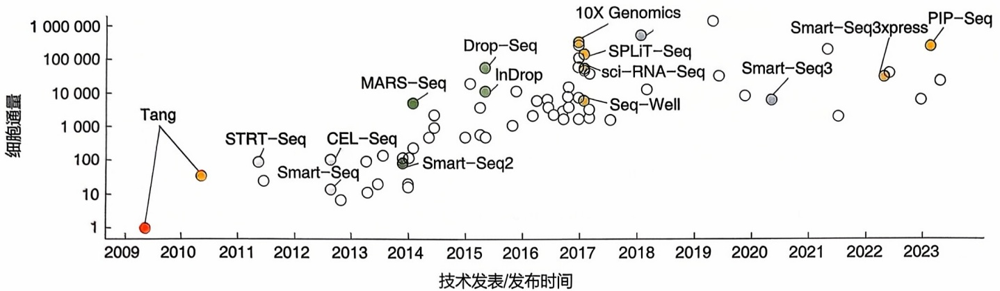
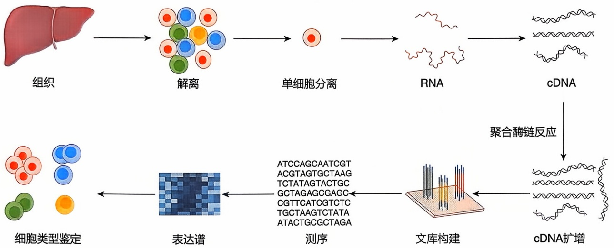
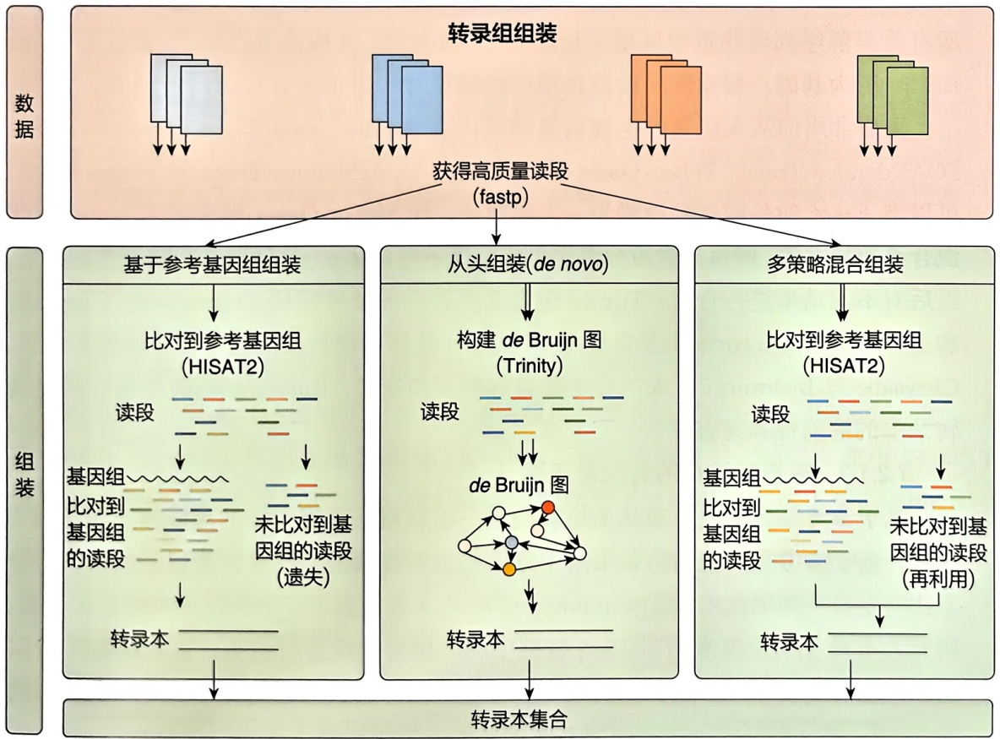
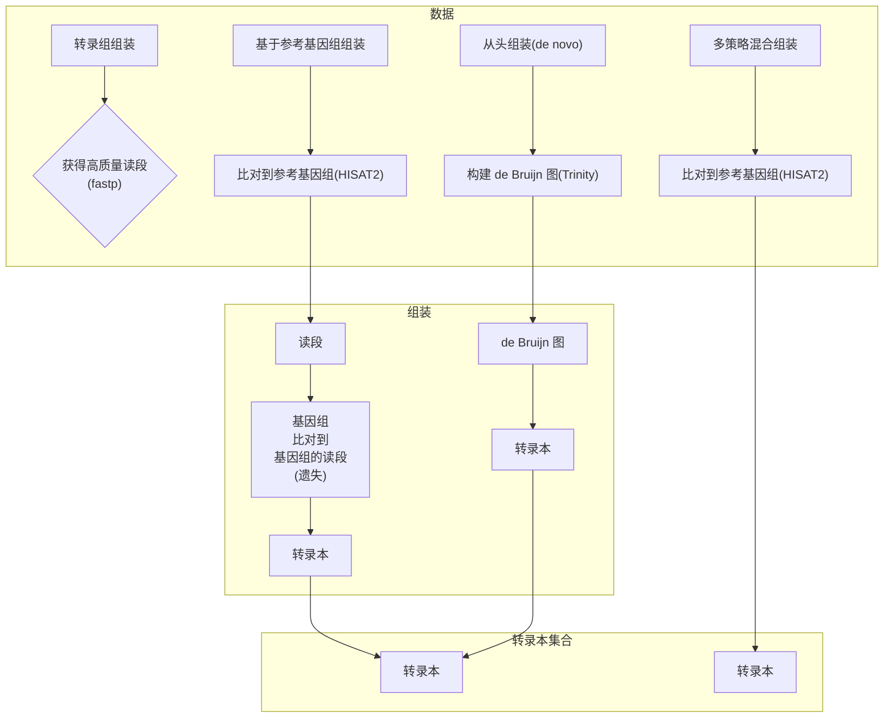
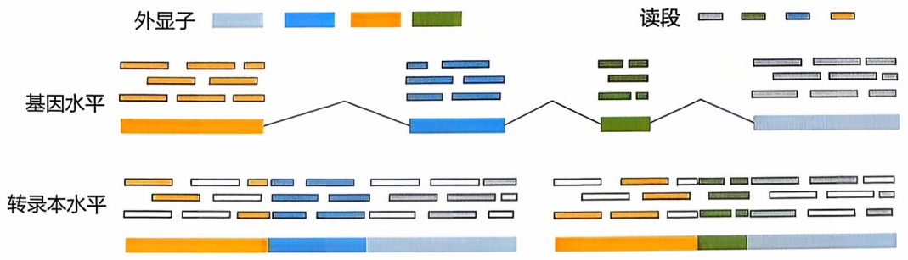
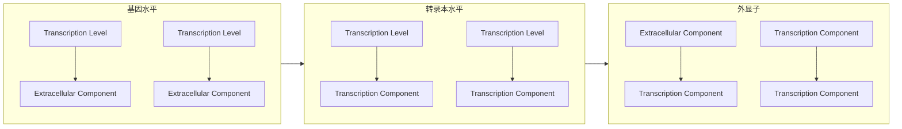
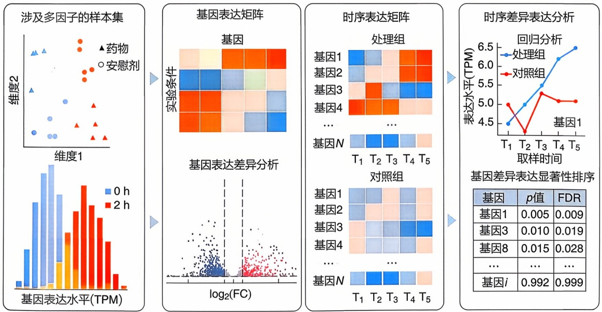

## 转录组学

转录组学是在整体水平上研究细胞中基因转录的情况及转录调控规律的科学，包括解析信使RNA（mRNA）、非编码RNA（non-coding RNA，ncRNA）等各种转录产物的生物合成、转运、降解等生物学过程；注释基因的转录本结构组成和剪接模式；构建与分析转录调控网络；以及探索RNA剪接、修饰与调控的机制等。通过转录组学的研究，可以深入了解细胞的生理状态、疾病机制以及对环境刺激的反应，同时有助于鉴定生物标志物，为疾病的诊断和治疗提供重要线索。RNA-Seq是转录组学常用的研究方法。随着高通量测序技术的快速发展，从常规的bulk RNA-Seq到单细胞RNA-Seq（scRNA-Seq）和空间转录组（spatial transcriptomics，ST），使得单个细胞的基因表达数据和细胞空间位置信息相结合，为研究细胞亚群功能、微环境互作、谱系演化以及疾病病理等提供了重要方法。本章重点以近年来广泛使用的RNA-Seq及scRNA-Seq为例，介绍转录组学数据的生物信息学基本分析策略、算法原理与常用软件，为读者深度挖掘转录组大数据中蕴含的生物学知识奠定基础。

## 7

## 7.1 转录组学概述

## 7.1.1 转录组学的研究对象

转录组学是在整体水平上研究细胞中基因转录的状态及转录调控规律的科学。转录组广义上指在相同环境（或生理条件）下的一个细胞或一群细胞中所能转录出的所有RNA的总和，包括转录过程各层次未成熟的RNA（pre-RNA等）、信使RNA（mRNA）、核糖体RNA（rRNA）、转运RNA（tRNA）及非编码RNA（ncRNA）等；狭义上则指细胞所能转录出的所有mRNA。

## 7.1.1.1 编码 mRNA 及功能

mRNA 主体是由 5' 端上游非编码区（5'UTR）、编码区（coding region，从起始密码子 AUG 开始经一连串编码氨基酸的密码子直至终止密码子）、3' 端下游非编码区（3'UTR）组成，负责将 DNA 中存储的遗传信息翻译成功能性蛋白质。

在转录过程中，核内 mRNA 前体分子与一系列酶或复合物结合，以进行后续加工和处理。这些步骤包括 mRNA 的 5' 端加帽、RNA 编辑、 $m^{6}A$  修饰、伪尿苷酸化、可变剪接、3' 端加工和聚腺苷酸化，以便共同确保 mRNA 转录的稳定性，调节 mRNA 核输出并通过核糖体进行蛋白质翻译。可变剪接是指将同一基因的外显子以不同方式组合，使一个基因在不同时间、不同环境中能够表达出不同的蛋白质，从而进行基因表达调控。可变剪接可以增加生理状况下系统的复杂性或适应性，可用于制造抗体。mRNA 于 1989 年首次被提出作为一种治疗方法，可用于治疗自身免疫、代谢和呼吸道炎症以及癌症等疾病。

## 7.1.1.2 非编码RNA及分类

非编码 RNA（non-coding RNA，ncRNA）是指任何不翻译成蛋白质发挥作用的 RNA 分子。非编码 RNA 主要分为两种类型:基础结构型和调控型。基础结构型 ncRNA 也称经典的管家 ncRNA，在翻译和剪接中起着类似管家基因的作用，包括核糖体 RNA（ribosomal RNA, rRNA）、转运 RNA（transfer RNA, tRNA）、核内小 RNA（small nuclear RNA, snRNA）、核仁小 RNA（small nucleolar RNA, snoRNA）以及端粒相关 RNA（telomeric repeat-containing RNA, TERRA）。ncRNA 根据形状以及长度可分为环状 RNA（circular RNA, circRNA）、长非编码 RNA（long non-coding RNA, lncRNA）和小非编码 RNA（small non-coding RNA, sncRNA）。sncRNA 主要包含微 RNA（microRNA, miRNA）、干扰小 RNA（small interfering RNA, siRNA）和 PIWI 相互作用 RNA（PIWI-interacting RNA, piRNA）等（表 7-1）。

基因表达是生命的中心过程，其调控影响了所有细胞的发育和稳态。这一过程中剪接和翻译都需要管家 ncRNA 来发挥作用，如 snRNA 主要参与 mRNA 的剪接；tRNA 转运氨基酸，将 mRNA 序列解码为肽或蛋白质；rRNA 形成了核糖体的框架，是蛋白质翻译所必需的大分子结构。

除了以上这些细胞行使正常功能所必需的管家 RNA 外，许多 ncRNA 也是基因表达的关键调控因子，这些功能分子在染色质动力学、转录因子（transcription factor，TF）结合、可变剪接、转录本稳定和 RNA 合成、加工或降解等方面发挥关键作用。例如，miRNA 通过靶向结合 mRNA 进行翻译抑制、脱腺苷化和降解来调控基因表达；PIWI/piRNA 复合物可以通过异染色质的形成在基因组水平上调节转座子的活性以沉默转录；circRNA 可以特异性吸附 miRNA 或 RNA 结合蛋白，从而调节转录以及蛋白质翻译等多种生物学功能；lncRNA 除了参与转录调控外，还参与表观基因调控过程等。

表 7-1 非编码 RNA 的类型

| 类别 | 长度 | 结构 | 特征 |
| --- | --- | --- | --- |
| rRNA | 5S: 121 nt,5.8S: 156 nt,28S: 5070 nt,18S: 1869 nt | 单链,有双链结构 | 有广泛的双链区域,组成核糖体。在双链区,碱基以氢键相连,呈发夹式螺旋 |
| tRNA | 76~90 nt | 单链,有双链结构 | 三叶草形,识别 mRNA 的三核苷酸序列,并以正确的顺序招募氨基酸到核糖体 |
| snRNA | 100~215 nt | 单链,有双链结构 | 剪接 mRNA |
| snoRNA | 50~250 nt | 单链,有双链结构 | 有两类 snoRNA,它们是 C/D box snoRNA 和 H/ACA box snoRNA。C/D box snoRNA 与甲基化相关,H/ACA box snoRNA 与假尿苷化相关 |
| circRNA | 由于类型的复杂性,范围从&lt;100到>4000 nt | 单链 | 共价闭合首尾相接,对核酸外切酶不敏感,比线性 RNA 更为稳定,半衰期长 |
| lncRNA | >200 nt | 单链 | 通常含有一个 poly(A) 尾,可以被剪接,很少有共有的结构、功能或机制特征。它是以 RNA 的形式在多种层面上(表观遗传调控、转录调控以及转录后调控等)调控基因的表达水平 |
| miRNA | 20~25 nt | 单链 | Dicer 加工成熟的 miRNA,通过与 Argonaute (AGO) 蛋白一起装载到 RNA 诱导的沉默复合物(RISC)中 |
| siRNA | 20~25 nt | 双链 | 可被 Dicer 加载到 AGO 蛋白,形成 RISC |
| piRNA | 25~33 nt | 单链 | 与 PIWI 蛋白结合形成复合物 |

注:nt 表示核苷酸（nucleotide），核酸的基本单位

sncRNA 和 lncRNA 都发挥着重要的基因调控作用。在 7.3 节，将阐明几个主要类别 ncRNA 的功能特征以及生物信息学鉴定定量方法，并根据 Database Commons 的高引用高质量数据库排名对各类别 ncRNA 的数据库进行介绍。

## 7.1.2 转录组学的研究方法

自 20 世纪 90 年代至今, 研究人员研发出基于杂交、测序等多种转录组学研究方法和技术。微阵列（microarray）技术是基于杂交的转录组高通量技术的代表，包括 cDNA 微阵列、寡聚核苷酸阵列等。其通过与转录本互补的特定探针进行杂交来测量转录本丰度，能够以较低的成本分析成千上万条转录本。表达序列标签（expressed sequence tag, EST）、基因表达系列分析（serial analysis of gene expression, SAGE）技术以及大规模平行标签测序（massively parallel signature sequencing, MPSS）技术是较早对 RNA 高通量测序的转录组技术。EST 技术对随机选择的 cDNA 克隆进行 5' 端或 3' 端测序，进而获得 cDNA 序列片段；SAGE 技术通过对短核苷酸序列（如 9～10 个碱基）标签的识别与拼接提高了转录本的检测能力，其可依据标签出现频率对转录本进行量化分析；MPSS 技术相较于 SAGE 使用了更长的序列标签，并且基于酶消化和杂交，利用新的克隆和专属的平行测序方案进一步提升了转录本检测的特异性和通量。

作为新一代测序技术，RNA 测序（RNA sequencing，RNA-Seq）技术在测序通量、速度、成本等方面较传统转录组技术更具优势，得到了广泛关注与快速发展。RNA-Seq 是一种利用高通量测序技术来研究转录组的方法，主要用于分析细胞中所有 RNA 分子的数量和序列。这种技术可以揭示基因表达的动态变化，以及在不同环境条件下或疾病状态下基因的调控机制。虽然可以对 RNA 分子进行直接测序，但基于 DNA 测序的商业仪器的技术已趋成熟，大多数 RNA-Seq 实验都是在对 DNA 分子进行测序的仪器上进行的。因此，构建 cDNA 文库是 RNA-Seq 的必要步骤。下文将具体介绍 RNA-Seq 的实验流程。

## 7.1.2.1 细胞解离

起始材料的准备至关重要，一般细胞是从新鲜或者冷冻的细胞或组织样本中获取的。对于培养的细胞系，大多数细胞应当处于相同的生长阶段，而对于组织的特异性基因分析，应最大限度地从待研究组织中纯化出细胞，如贴壁细胞可以使用胰蛋白酶消化细胞，然后通过离心收集细胞；而悬浮细胞可直接通过离心收集细胞。对于不同的细胞系，应当选择合适的处理方法。

## 7.1.2.2 RNA 提取

从待测样本中提取 RNA，需要使用合适的 RNA 提取试剂盒（如 TRIzol 试剂）。一般情况下，RNA 中会混杂 DNA，因此需要采用 DNase I 降解基因组 DNA，随后对 RNA 进行质量检查，可以使用纳米滴定光度计（如 NanoDrop）或 Qubit 定量仪测定 RNA 浓度，以及使用琼脂糖凝胶电泳或 Bioanalyzer 评估 RNA 完整性，RIN 值应大于 7。

## 7.1.2.3 RNA 富集或其他 RNA 去除

一般生物体中的 RNA, rRNA 占绝大多数。在人体中, mRNA 一般只占 $2\% \sim 3\%$。因此，需要根据研究目的进行 RNA 类型的筛选。如果对总体转录水平感兴趣，只需要消除 rRNA 即可；而其他类型如成熟 mRNA 和长非编码 RNA，或者小非编码 RNA，则需要额外的步骤。使用 rRNA 去除试剂盒（如 RiboMinus Eukaryote System）去除 rRNA，保留其他类型的 RNA；或者使用 poly（A）富集试剂盒（如 Dynabeads mRNA Purification Kit 或纤维素珠）捕获 poly（A）+ RNA；以及通过凝胶过滤或亲和层析进行大小选择，把小非编码 RNA 单独分离出来。

## 7.1.2.4 片段化与 cDNA 合成

与 miRNA、piRNA、siRNA 和许多其他可以在接头连接后直接测序的小非编码 RNA 不同，较大的 RNA 分子必须片段化为较小的片段（200～500 bp）才能与大多数深度测序技术兼容。对于不同测序技术，要处理成不同长度的片段。常见的片段化方法包括 RNA 片段化（RNA 水解或雾化）和 cDNA 片段化（DNase 处理或超声处理）。每种方法都会造成不同的结果偏差。例如，cDNA 片段化通常强烈偏好于鉴定转录本 3' 端的序列。无论是 RNA 片段化还是 cDNA 片段化，都要进行片段选择，评估片段大小分布。以下是 RNA 片段化和 cDNA 合成的方法之一:使用随机打断试剂（如 Fragmentation Buffer）将 mRNA 打断成 200～300 bp 的小片段，随后使用随机引物和反转录酶将 RNA 反转录为单链 cDNA，然后使用 RNase H 和 DNA 聚合酶 I 将 cDNA 转化为双链 cDNA。

## 7.1.2.5 建库与文库质检

一旦合成 cDNA，就可以按照 DNA 建库流程进行文库制备和质检。建库的方式需要按照各测序平台的要求和测序方式（单端测序或双端测序）进行，总体上可以分为以下几点:①末端修复和加 poly（A）:使用末端修复试剂盒（如 End Repair Kit）修复 cDNA 末端，使用加 poly（A）试剂盒（如 dA-Tailing Kit）在 cDNA 末端加 poly（A）；②接头连接:使用接头连接试剂盒（如 Adapter Ligation Kit）将接头连接到 cDNA 末端；③PCR 扩增:使用 PCR 试剂盒（如 High-Fidelity DNA Polymerase）对 DNA 进行 PCR 扩增，以增加文库量；④文库质检:使用 Qubit 定量仪测定文库浓度，使用 Bioanalyzer 评估文库片段大小分布，使用 gPCR 评估文库质量和定量。

单端测序和双端测序在文库构建的初始步骤是相似的，但在接头连接过程有所区别。单端测序建库时引物序列连接到 DNA 片段的一端，然后末端加上接头，而双端测序在构建待测 DNA 文库时，会在两端的接头上都加上测序引物结合位点。因此两者在测序过程中有所不同，导致它们在数据量、覆盖度和信息量方面有显著差异。

## 7.1.2.6 平台测序

按照各测序平台提供的建库方法建立好文库，便可以送入测序仪进行测序。每种测序平台有自己独特的优势，如以短读长测序为代表的Illumina平台，其桥式扩增技术保证了高准确性和高通量，适合大规模基因组测序、转录组测序和表观遗传学研究；PacBio平台的单分子实时测序（single-molecule real time sequencing，SMRT）可生成非常长的读段，非常适合复杂基因组解析、基因组组装和表观遗传学修饰解码等研究。测序结束后的下机文件一般为fastq格式，便于数据分析的上游处理。

## 7.1.3 特殊测序建库方法

RNA-Seq 作为转录组学常用的研究方法，是研究基因表达和识别新的转录异构体的首选方法。除了用于基因表达的一般分析外，已演绎出针对新生 RNA、环状

RNA、非编码 RNA、微 RNA 等不同类型 RNA 分子的高通量测序技术，还有几种特定应用的 RNA-Seq 方法，包括链特异性测序、靶向 RNA 测序等。

## 7.1.3.1 链特异性测序建库

链特异性测序是指能够保留 RNA 或 DNA 分子原始链方向信息的测序方法。这种技术允许研究者区分转录本的正负链，从而更精确地分析基因表达，尤其是在存在大量反义转录或重叠基因的区域。链特异性测序与通常的 RNA-Seq 流程相似，但其区别在于，在 cDNA 的合成过程中，通过使用特殊处理的引物或酶来保留链信息。

最常用的方法是在第二链 cDNA 合成中使用脱氧尿苷三磷酸（deoxyuridine triphosphate, dUTP）代替脱氧胸苷三磷酸（deoxythymidine triphosphate, dTTP），之后利用酶，如尿嘧啶-DNA 糖苷酶（uracil-DNA glycosylase, UDG）消化含有 U 的 DNA 链，从而保留一条链的信息。

## 7.1.3.2 靶向 RNA 测序建库

靶向 RNA 测序专门用于分析特定基因或基因组区域的表达，而不是像传统的全转录组测序那样分析整个转录组。这种方法在资源有限或只关注特定基因组区域表达的研究中非常有用。靶向 RNA 测序在 RNA 富集步骤中有所不同，最常见的是使用专门设计的、与目标 RNA 互补的探针捕获特定的 mRNA 或 lncRNA，这些探针可以是进行生物素标记的，使得目标 RNA 可以通过亲和柱（如磁珠）轻松分离。另一种方法通常在目标区域较短时使用，通过设计特异性的引物直接对这些区域进行 PCR 扩增，这些引物将特异性地结合到目标 cDNA 的两端，用于扩增特定的基因或转录本区域。

## 7.1.3.3 非编码特异性测序建库

## (1) lncRNA 的测序建库

利用生物信息学鉴定 lncRNA 最主要的方法是通过 RNA-Seq 数据的分析。由于常规 RNA-Seq 以检测 mRNA 为主，只关注携带 poly（A）的转录本，会丢失不含 poly（A）的 lncRNA。因此，为了便于 lncRNA 的研究，发展了专门的测序技术尽可能完整地检测各类 lncRNA，如去除核糖体 RNA 等提取手段。另外，链特异性的 RNA-Seq 能保留 RNA 的链方向信息，可以更准确地鉴定 lncRNA，并且更好地与反义链重叠的编码基因进行区分。

## (2) circRNA 测序建库

常规的 RNA-Seq 建库方法通常只能捕获少量的 circRNA，针对 circRNA 的特异性建库通过核酸外切酶（如 RNase R）去除核糖体 RNA 及线性 RNA 分子或去除多聚腺苷酸化的 RNA，对 circRNA 进行富集，并结合深度测序，广泛用于 circRNA 的系统检测。

## (3) sncRNA 测序建库

高通量测序技术省去了 sncRNA 克隆文库的构建过程，可以一次性获得大量 sncRNA 序列，快速鉴定已知 sncRNA 并发现新的 sncRNA，研究不同条件下 sncRNA 的表达差异，或联合转录组测序得到的表达谱数据进行分析。sncRNA 测序的主要流程如下:提取样本的 RNA 并进行质控；选择长度为  $17 \sim 25$  nt 的 RNA；加接头；进行扩增和测序；对得到的测序数据进行质控和 sncRNA 鉴定。

## 7.1.4 单细胞和空间转录组学技术

除了以组织样本为对象的转录组测序技术（又称为 bulk RNA-Seq），近年来还发展了单细胞转录组测序（single-cell transcriptomics sequencing, scRNA-Seq）和空间转录组测序（spatial transcriptomics sequencing）技术，助力研究在单细胞和空间分辨率下的基因表达模式，从而更好地探究生物体的生命机制和作用机制。

## 7.1.4.1 单细胞转录组

## （1）单细胞转录组学技术发展

在前面章节中，我们了解到RNA-Seq能够快速地测定组织的基因表达水平，然而这种以整块组织为研究对象的转录组测序技术仍存在很大的局限性。首先，多细胞组织中不同细胞类型及其亚型的基因表达水平不同，bulk RNA-Seq丢失了组织内细胞异质性的信息；其次，组织基因表达水平是所有细胞基因表达的平均值，bulk RNA-Seq不能描述组织发育或病变过程中特定细胞类型的基因表达变化。因此，研究者们开发了单细胞转录组测序技术来研究同一组织不同细胞间或不同组织同一细胞类型的基因表达模式。

2009年，研究者在Nature Methods杂志首次报道了单细胞转录组测序技术。此后，许多更为新颖、灵敏、准确的单细胞转录组测序技术相继被开发和应用，以更快的速度和更低的成本提供了丰富的单细胞层面生物学信息。例如，2012年，科学家基于对目标RNA扩增、测序的SMART（switching mechanism at $5^{\prime}$ end of the RNA transcript）技术，开发了Smart-Seq，后改良为Smart-Seq2、Smart-Seq3和Smart-Seq3xpress。此外，基于线性扩增的单细胞测序方法CEL-Seq（cell expression by linear amplification and sequencing）和MARS-Seq（massively parallel single-cell RNA sequencing）陆续被开发。2022年，研究者开发了活细胞转录组测序技术（Live-Seq），实现了在保持细胞活力的同时进行单细胞转录组测序。

低通量的单细胞测序技术主要通过物理手段如显微切割、流式分选等方法将单细胞分离出来进行单细胞测序，因此最初的单细胞转录组研究涉及的细胞数量有限。随着技术的不断进步，尤其是微流控系统的引入，单细胞测序技术的通量大大提高。这些基于微流控的代表性单细胞测序技术包括 $10 \times$ Genomics、Drop-Seq、InDrop等。$10 \times$ Genomics单细胞转录组测序平台利用微流控、油滴包裹和条形码（barcode）标记等技术实现高通量的细胞捕获，能够一次性分离并标记 $500 \sim 10000$ 个单细胞，从而获得每个细胞的转录组信息，具有细胞通量高、建库成本低、捕获周期短等优势。总体来讲，当前的单细胞测序技术具有高分辨率、高通量、低成本的特点，这为全面解析单细胞异质性提供了更多机会（图7-1）。



<details>
<summary>scatter</summary>

| Category | Year | Cell Volume |
| --- | --- | --- |
| Tang | ~2009.5 | 1 |
| Tang | ~2010.5 | ~40 |
| STRT-Seq | ~2011.5 | ~100 |
| Smart-Seq | ~2012.5 | ~10 |
| CEL-Seq | ~2013.5 | ~100 |
| Smart-Seq2 | ~2014.5 | ~100 |
| MARS-Seq | ~2014.5 | ~5000 |
| InDrop | ~2015.5 | ~6000 |
| Drop-Seq | ~2015.5 | ~10000 |
| 10X Genomics | ~2017 | ~300000 |
| SPLiT-Seq | ~2017 | ~150000 |
| sci-RNA-Seq | ~2017 | ~60000 |
| Seq-Well | ~2017.5 | ~8000 |
| Smart-Seq3 | ~2020.5 | ~8000 |
| Smart-Seq3xpress | ~2022.5 | ~40000 |
| PIP-Seq | ~2023 | ~300000 |
</details>

图7-1 单细胞转录组测序技术的发展



<details>
<summary>flowchart</summary>

```mermaid
graph LR
  A["组织"] --> B["解离"]
  B --> C["单细胞分离"]
  C --> D["RNA"]
  D --> E["cDNA"]
  
  subgraph Process_1
  F["细胞类型鉴定"] --> G["表达谱"]
  G --> H["测序"]
  H --> I["文库构建"]
  I --> J["cDNA扩增"]
  end
  
  %% Processing Steps
  K["聚合酶链反应"] -.-> L["cDNA扩增"]
  M["ATCCAGCAATCGT\nACGTAGTGCTAAG\nTCTATAGTACTGC\nGCTAGAGCGAGC\nCGTTCATCGTCTC\nTGCTAAGTCTATA\nATACTGCGCTAGA"] -.-> G
  end
```
</details>

图7-2 单细胞转录组测序流程

## （2）代表性单细胞测序技术介绍

单细胞测序的一般流程包括单细胞悬液制备、单细胞分离、cDNA扩增、文库构建和测序等步骤（图7-2）。其中，3'端单细胞转录组方法是最早被广泛采用的单细胞RNA测序技术之一。在3'端单细胞转录组测序中，RNA测序反应从mRNA的3'端开始，通过附加短引物（称为“oligo-dT”引物）来引导反转录反应。2016年， $10 \times$ Genomics发布的Chromium Single Cell 3'Solution，是一种在单个细胞水平对mRNA进行高通量测序的新技术。该方法采用基于微滴的微流控系统来分选细胞，实现了在每个微滴中同时测定多个基因的3'端转录本信息。单细胞全长转录组测序方法可以在单细胞水平上获取从5'端到3'端全长转录本信息，以更全面地了解细胞内的基因表达和转录调控。单细胞全长转录组的代表性测序技术包括Smart-Seq及SCAN-Seq。Smart-Seq技术通过随机引物和反转录来合成cDNA获得全长转录本信息。2023年，研究者开发了基于第三代测序（third generation sequencing，TGS）平台的新型单细胞转录组测序技术，即SCAN-Seq2（single cell amplification and sequencing of full-length RNAs by Nanopore platform 2），该技术通过纳米孔平台对全长RNA进行单细胞扩增和测序，高精度地检测单细胞中的全长转录本。

下面以 $10 \times$ Genomics 和 Smart-Seq2 为例，简要介绍单细胞转录组测序技术流程。

① $10 \times$ Genomics $10 \times$ Genomics $3'$ 端单细胞转录组测序采用 Chromium 平台, 利用微流控和液滴技术将单个细胞和带有细胞条形码 (cell barcode)、唯一分子标识符 (unique molecular index, UMI) 和引物的凝胶珠 (gel beads) 包裹到微液滴中分隔成 GEM (gel bead in emulsion), 从而完成单个细胞的捕获。首先对组织样本进行单细胞悬液制备, 并将细胞和带有条形码的微珠共同加载到 $10 \times$ Genomics Chromium 芯片上, 这些条形码可识别每个转录本的细胞来源; 细胞和凝胶珠包裹到微液滴中形成 GEM, 随后细胞裂解, 凝胶珠溶解, 在每个凝胶 GEM 内进行反转录反应; 反转录完成后油滴破裂, 对 cDNA 产物进行收集和扩增构建测序文库进行测序。$10 \times$ Genomics 的 $3'$ 端和 $5'$ 端建库方案的主要区别在于捕获探针序列和反转录引物不同。在 $3'$ 端建库方案中, 凝胶珠的末端序列是 poly (dT), 用于和转录组 $3'$ 端的 poly (A) 结构互补配对。而在 $5'$ 端建库方案中, 凝胶珠的末端序列是模板转换寡核苷酸 (template-switching oligos, TSOs), 其末端有 poly (G) 的结构。转录本会在酶的作用下在其 $5'$ 端加上 poly (C) 的结构, 由此完成配对。T 细胞受体 (T cell receptor, TCR) 和 B 细胞受体 (B cell receptor, BCR) 变异性主要存在于它们的 V、D、J 区域。V 区域位于转录本的 $5'$ 端, 因此, 通过 $5'$ 端测序来获取 TCR 和 BCR 的 V 区域序列更具操作性, 从而更准确地鉴定和分析它们的多样性和克隆扩增情况。

② Smart-Seq2 Smart-Seq2 是一种用于获得每个细胞全长 cDNA 文库的测序技术，可实现全转录本扩增，因此可以进行选择性剪接和 SNV 检测。相比于 3' 端或 5' 端测序，全长转录本测序在转录本的覆盖率上没有 3' 端或 5' 端偏向性。该技术在研究低丰度和可变剪接转录本时尤其有效。

Smart-Seq2 的技术特色体现在其模板置换过程中。在细胞裂解液中加入 M-MLV 反转录酶、游离的脱氧核苷酸三磷酸（dNTPs）、oligo（dT）引物、甜菜碱及氯化镁等组分，利用 oligo（dT）引物启动 mRNA 的反转录过程，从而获得 cDNA 的第一条链。当反转录酶到达 mRNA 5' 端时，会在新合成的 cDNA 3' 端多出几个胞嘧啶（C）碱基。然后引入 TSOs，与第一条链 poly（C）杂交促进模板转换，并利用 M-MLV 反转录酶进行后续 PCR 扩增，获得双链 cDNA。这些特点使得 Smart-Seq2 技术能够高效地获得全长 cDNA。

## 7.1.4.2 空间转录组

常规的单细胞转录组学技术在进行测序前需要将细胞解离成单细胞悬液，然后利用单细胞分离技术（微孔、微板、微液滴等方法）进行单细胞建库，在这个过程中细胞失去了在组织中原本的空间信息。然而在一些研究中，如探究细胞命运机制及细胞谱系发生时，空间位置信息尤为重要。所以需要在单细胞的基础上，联合空间转录组，两者相互印证，才能获取更真实的信息。空间转录组学为生物学家们研究细胞生物学提供了独特的视角。本章将简要介绍空间转录组学的代表性技术。

不同的空间转录组学方法涵盖了检测到的基因数量、分辨率和整个转录组分析的各个方面。以靶标的最终读数以及如何获得空间内容为依据，可以分为以下几种:① 基于测序的方法；② 基于探针的方法；③ 基于成像的方法；④ 原位和体内成像引导的空间分辨率单细胞测序方法（Image-Seq）。基于测序的方法依赖于基于空间条形码 DNA 的全转录组/基因组测序；基于探针的方法需要对已知目标的条形码探针进行计数；基于成像的方法依赖于重复的成像周期来获得已知目标的最终读数；基于显微图像的 Image-Seq 方法能够选择和分离感兴趣区（region of interest, ROI）中的单细胞。

基于测序或二代测序（next generation sequencing，NGS）的方法通常被认为较少受到技术偏倚的影响，不依赖于事先选择的目标区域，能够全局捕获转录本，从而能够发现新的差异基因或生物学机制。该类方法的应用有 $10 \times$ Genomics Visium、Slide-Seq、Stereo-Seq 和 Light-Seq 等。与基于测序的空间转录组学方法相比，基于寡核苷酸探针的方法（如 NanoString 的数字空间分析系统）通常用于捕获手动选择的感兴趣区中的靶向转录本。基于成像的方法和基于探针的空间转录组学方法类似，都是依赖原位杂交，但前者使用互补的荧光探针进行检测。常用的基于成像的方法有 NanoString 的新型系统 CosMx™ 空间分子成像仪（CosMx SMI）、MERFISH（multiplexed error-robust fluorescence in situ hybridization）等。Image-Seq 可以选择空间上不同的细胞或感兴趣区，从而保留其天然空间信息并进行深入分析。最早的例子是激光捕获显微切割（laser capture microdissection，LCM），通过紫外光或红外光对组织切片的感兴趣区进行物理显微解剖。

随着空间转录组学技术分辨率和灵敏度的提高，与其他组学模式整合可用于提供有关组织表征更广泛和更全面的信息。例如，空间基因组测序与原位转录组学分析结合可用于加深对基因组组织和功能编程的理解，如 Slide-DNA-Seq 是一种从组织切片中捕获空间分辨 DNA 序列的方法，能够用于发现不同的肿瘤克隆及其拷贝数的变化。该方法已与空间转录组学相结合，用于挖掘与克隆特异性遗传畸变和局部肿瘤微环境相关的基因。

## 7.2 转录组学数据的基础分析

## 7.2.1 转录组的组装

转录组的组装旨在将高通量测序产生的短读段（reads）拼接成完整的转录序列。转录组组装质量的好坏直接影响下游分析结果的可靠性。为此，在组装前常需要对测序数据进行质量控制和预处理，并选择合适的算法拼接测序数据。利用FastQC、PRINSEQ等软件，可从测序通量、碱基质量、序列长度、接头序列等多个角度检查测序数据的质量。对于低质量的测序数据，可利用 Trimmomatic、fastp、Picard 等软件进行去除或修剪。根据待分析物种是否有参考基因组序列以及是否为长读长数据，可选择合适的转录组组装策略，例如，基于参考基因组序列的转录组组装（genome-guided）、从头组装（de novo assembly）以及多策略混合组装（hybrid assembly）（图 7-3）。

## 7.2.1.1 基于参考基因组序列的转录组组装

基于参考基因组序列的转录组组装，首先将 RNA-Seq 数据比对到待分析物种或其近缘物种的基因组序列上，最后拼接出对应的基因和转录本序列（图 7-3）。目前主流的比对算法有 Bowtie2、HISAT2 和 STAR 等。

Bowtie2 为基因组序列建立 BWT（Burrows-Wheeler Transform）索引，考虑匹配、错配、测序读段的质量和插入/删除惩罚等多种因素进行比对打分，并进一步利用字符串压缩和搜索方法，实现测序读段在全基因组范围内的快速定位与最佳匹配搜寻。Bowtie2 能够处理包含低复杂度和重复序列的参考序列，支持短、长读段数据与基因组序列的快速比对。HISAT2（Hierarchical Indexing for Spliced Alignment of Transcripts）通过结合 BWT 索引和轻量级图形遍历，内置剪接模型能够更准确地处理转录本的剪接事件，提供更精确的读段定位，从而得到更准确的基因和转录本表达量估计。STAR（Spliced Transcripts Alignment to a Reference）是一种基于散列索引和基因剪接信息感知的比对算法，可以精确地定位读段在参考基因组上的外显子和内含子边界，从而能够提供更准确的基因表达量估计和剪接事件检测。总体来说，Bowtie2 可以快速处理大规模的测序数据，但在处理 RNA-Seq 数据时对剪接位点的感知能力不够强。同 Bowtie2 相比，STAR 具有更高的比对准确性，但比对速度相对较慢。HISAT2 用于 RNA-Seq 数据与基因组序列比对时，兼具速度快和精度高的优势。



<details>
<summary>flowchart</summary>


</details>

图7-3 三种组装策略示意图

基于测序数据与参考基因组的比对结果，可利用 Cufflinks、StringTie、Scallop 等软件进行转录本的组装。以 StringTie 为例，使用比对结果和参考基因组注释文件构建选择性剪接图（alternative splice graph，ASG），图中以不同路径（path）的形式代表不同的转录本。进行转录本组装时，首先找到读段覆盖度最高的一条路径，将其作为该区域的第一条转录本，利用该路径中的所有读段计算该转录本的表达水平后，移除这些读段；接着更新 ASG，继续寻找下一条读段覆盖度较高的路径，直至用尽该区域内的所有读段；最后，StringTie 以相同方法鉴定其他区域内的转录本，逐步组装并计算其表达水平。对于短测序数据的组装结果，往往需要利用 Cuffmerge 等软件进一步合并组装结果，生成更完整的转录本序列。

## 7.2.1.2 转录组的从头组装

从头组装（de novo assembly）是指在不依赖于参考基因组序列的情况下，直接根据测序数据之间的重叠情况进行转录本的拼接（图7-3）。主要包括四个步骤:①将测序得到的读段打断为指定长度（如 $k\mathrm{bp}$ ）的短片段 $k$-mer；②将出现频率最高的 $k$-mer作为种子序列，向两端比对延伸，最终生成不同的叠连群序列；③对所有叠连群序列寻找重叠区域（长度为 $k - 1\mathrm{bp}$），并构建de Bruijn图；④以de Bruijn图为基础，搜索测序读段在图中的路径并构建出所有可能的转录本。

目前常用的从头组装的生物信息学软件有 Trinity、rnaSPAdes、Trans-ABySS、SOAPdenovo-Trans、Velvet-Oases 等。Trinity、SOAPdenovo-Trans 和 Trans-ABySS 可以将 k-mer 的长度参数设置为一个固定值，而 Velvet-Oases 则采用多 k-mer 长度混合组装的方式，即每条读段分多次生成长度不等的 k-mer，分别进行转录本的组装，最后对不同结果进行合并。Trinity 包含 3 个独立的软件模块:Inchworm、Chrysalis 和 Butterfly。Inchworm 主要负责将 RNA-Seq 数据中的短读段进行初步的图形组装，Chrysalis 对 Inchworm 生成的叠连群进行组装和连接，Butterfly 则负责进一步提高转录本的准确性和完整性。

## 7.2.1.3 多策略混合的转录组组装

基于参考基因组组装或从头组装的单一组装策略具有一定的局限性（表7-2）。例如，基于参考基因组的组装策略十分依赖参考基因组的完整性和组装质量。部分未比对至参考基因组的读段（unmapped reads）常被忽视，导致转录本信息的丢失。研究人员对171组玉米RNA-Seq数据中的未比对读段进行组装，鉴定出数千条以前未被注释的转录本。从头组装策略容易受到测序错误的影响，可能会产生复杂的de Bruijn图；难以区分来自同源基因的读段，导致转录本的错误组装。

表 7-2 不同组装策略的优缺点比较

| 组装策略 | 优点 | 缺点 |
| --- | --- | --- |
| 基于参考基因组组装 | 可靠度高;所需计算资源较少;能注释出新的转录本等 | 必须依赖已知基因组信息;组装结果受基因组组装质量、序列比对软件的性能等因素影响 |
| 从头组装 | 不需要提供参考基因组序列,直接从测序数据本身入手,可以避免低质量基因组组装等带来的误差和错误 | 受测序错误、测序偏差、同源序列高度相似等因素影响,组装结果存在片段化、错误率高等问题 |
| 多策略混合组装 | 更高的转录本覆盖度;有助于发现新的、未知的基因 | 组装过程变得更加复杂,计算和存储需求高,结果的解释更加困难 |

使用多策略混合组装的方法进行转录组组装（图7-3），既考虑到参考基因组和注释中所包含的基因模型先验知识，又使用了从测序数据本身中提取的相关基因信息，在降低从头组装复杂性的同时，可以更大限度地减少由参考序列引入的偏差。因此，整合基于参考基因组序列的组装结果和从头组装结果，可进一步提高转录组组装的准确性和完整性，得到更为全面的转录组图谱。

## 7.2.2 转录组的定量

转录组定量分析常以测序数据与基因组的比对结果为基础，量化基因、转录本、外显子等水平上的表达量。常见的软件有 HTSeq、BEDTools、FeatureCounts、StringTie、Qualimap 等。

## 7.2.2.1 基因水平的表达定量

基因水平的表达定量有多种算法，包括 RPKM（Reads Per Kilobase per Million mapped reads）、FPKM（Fragments Per Kilobase of transcript per Million mapped reads）和 TPM（Transcripts Per Million）等。目前，常采用 TPM 算法估算基因水平的表达值（图 7-4），其计算公式如下:

$$
T P M = \frac {N _ {i} / L _ {i} \times 1 0 ^ {6}}{N _ {1} / L _ {1} + N _ {2} / L _ {2} + \cdots + N _ {n} / L _ {n}} \tag {7-1}
$$

其中， $N_{i}$ 代表比对到基因 $i$ 的读段数量， $L_{i}$ 代表基因 $i$ 的长度。

近年来, 研究人员还提出了一种无须基因组比对的表达定量方法（alignment-free 或 pseudo-alignment），研发出 Sailfish、Kallisto、Salmon 等软件。Sailfish 使用 k-mer 统计方法量化基因表达；Kallisto 基于最大期望算法来计算基因表达水平；Salmon基于概率模型使用聚类索引结构快速实现基因表达定量。通过比较基于比对和无须比对的表达定量方法，研究人员发现无须比对的方法对长度更长、表达丰度更高的转录本定量结果更为准确。



<details>
<summary>flowchart</summary>


</details>

图7-4 基因水平和转录本水平表达定量示意图

## 7.2.2.2 转录本水平的表达定量

基因水平的表达分析常常忽略了同一基因不同转录本的表达差异。为此，可采用 Cufflinks、StringTie、Salmon、Kallisto 等软件实现转录本水平的表达定量。以 StringTie 为例，其使用最优插入位置算法寻找剪接位点（junction），通过分析读段在剪接位点上的分布模式来推断转录本是否存在和相对丰度。这种方法能够处理多比对和重叠比对的读段，更准确地识别转录本。

## 7.2.2.3 转录组定量结果的质量控制

在对转录组定量后，部分基因的定量结果可能存在离群值（outlier）。离群值的处理通常基于统计学方法，如离群值检测算法，或根据特定实验设计和样本特征对离群值进行检测。然后通过删除、替换离群值等对离群值进行处理。此外，对整个数据进行对数转换或归一化有助于缓解部分离群值对分析的影响。

值得注意的是，在研究中由于不同实验时间、不同实验室条件、不同批次的试剂等因素带来的实验误差，反映到转录组数据上就是批次效应（batch effect）。limma R 软件包提供的 removeBatchEffect 函数可一定程度地消除批次效应。该函数首先为每个基因的表达值拟合一个包含批次结构阻断项的线性模型。然后，将每个阻断项的系数设为零，并从剩余项和残差中计算表达值，从而得到一个消减批次效应的新表达矩阵。ComBat 方法使用了类似的策略，但在此过程中增加了对阻断系数估计值进行经验贝叶斯收缩。除此之外，RUVseq 和 svaseq 也经常用于批次校正，但主要关注识别未知的变异因素，如那些由于未记录的差异引起的批次效应。

在批次校正之后，可以使用 RLE（relative log expression）等指标来评估不同批次样本的相似性。RLE 基于每个基因在各个样本中的相对表达量来比较各个样本中的基因表达情况，从而评估样本间的相似性。理论上讲，消除批次效应后的数据，其 RLE 分布应接近于零。表达量对数分布（expression log distribution）通过比较标准化前后的表达量对数分布，来判断批次效应校正的效果。这些评估指标在基因表达数据分析中具有重要作用，有助于获得更可靠的生物学结论。

## 7.2.3 转录组差异表达分析

## 7.2.3.1 配对样本的转录组差异表达分析

从定量策略的角度来看，差异表达分析可分为两种方案:基于读段计数的差异表达分析和基于数值归一化的差异表达分析。

基于读段计数的差异表达分析首先要得到比对至基因的读段数目，进而得到读段计数矩阵（reads count matrix）并利用广义线性模型分析基因的差异表达情况，计算出组间差异。常用的差异表达分析软件包括DESeq2、edgeR、limma等。基于数值归一化的差异表达分析常用软件有 CuffDiff、Ballgown 等。在进行差异表达基因/转录本鉴定时，通常采用两个指标进行筛选:① 表达值的差异倍数（fold change, FC）；② 错误发现率（false discovery rate, FDR），经统计学方法校正后的 p 值。

若实验涉及多个突变体、多种药物剂量或多个时间点等因素，可利用 edgeR 等软件进行多因子（multiple factor）基因差异表达分析（图 7-5）。例如，在比较药物（drug）和安慰剂（placebo）的影响时，分别在施药/安慰剂0 h 和2 h 进行取样。在比较2 h 后药物和安慰剂的差异情况时，需要考虑多因子的比较方法，即（Drug.2h-Drug.0h）-(Placebo.2h-Placebo.0h)。

## 7.2.3.2 时序样本的转录组差异表达分析

在研究动态生物过程（如生长发育、病原侵染或药物反应）时，需要在多个时间点进行时序（time course，TC）采样，以便捕获其所涉及的动态生物学过程。基于时序数据鉴定差异表达基因的分析策略可分为局部分析与全局分析。

局部分析是将每个时间点视为不同条件，捕获在特定时间点之间或单个时间点的不同条件间发生变化的基因集合。此类分析策略忽略了基因表达的时序依赖性信息，在长时间序列分析上很难获得一致性的统计学检验结果。全局分析则考虑基因在时序数据上的全局表达模式，捕获基因随着时间推移的表达变化模式。目前常用的时序差异表达分析软件有 ImpulseDE2、maSigPro（Next maSigPro）和 splineTC 等。

maSigPro 是基于基因芯片技术研发的时序数据分析软件，通过建立基因表达量、组别和时间之间的关系，利用最小二乘法选取最优参数，进而构建最具有统计学意义的基因回归模型。Next maSigPro 通过将广义线性模型整合到 maSigPro 软件包中，用于处理 RNA-Seq 的读段计数矩阵。

在时序差异表达分析的基础上，可进一步利用STEM、Mfuzz等软件对基因的时序表达数据进行聚类分析（图7-5），从而揭示基因表达的动态模式和变化趋势。



图7-5 差异表达分析示意图