## 7.2.4 转录组聚类分析

常用于转录组聚类分析的生物信息学流程如图7-6所示。对于一个给定的基因表达矩阵，可进行样本聚类（sample clustering）、基因聚类（gene clustering）、双聚类（biclustering）、集成聚类（integrative clustering）等不同角度的聚类分析。样本聚类将不同实验条件或不同时间状态下的样本依据基因表达模式进行聚类，常用于发现样本之间的相似性及差异性，R stats软件包中hclust和 $K$ -means函数可分别依据层次聚类（hierarchical clustering）和 $K$ -均值聚类（$K$ -means clustering）算法对样本进行聚类。基因聚类可将表达模式高度相似的基因聚为一簇，有助于探究特定信号通路中的共同调节基因。双聚类可同时对基因和样本进行聚类，以识别在特定生物条件下共同表达的基因集合和样本集合，此过程可用pheatmap包来实现。集成聚类则是将多种聚类算法整合起来，用于将来源于不同平台、不同类型特点的组学数据信息进行聚类，以更全面、更系统的角度深入理解组学数据之间的关联与互作。依据所使用算法的不同，集成聚类又可细分为贝叶斯一致性聚类，基于矩阵分解的聚类和基于网络的多组学聚类等，目前用于集成聚类的R软件包有bayesCC和iCluster。

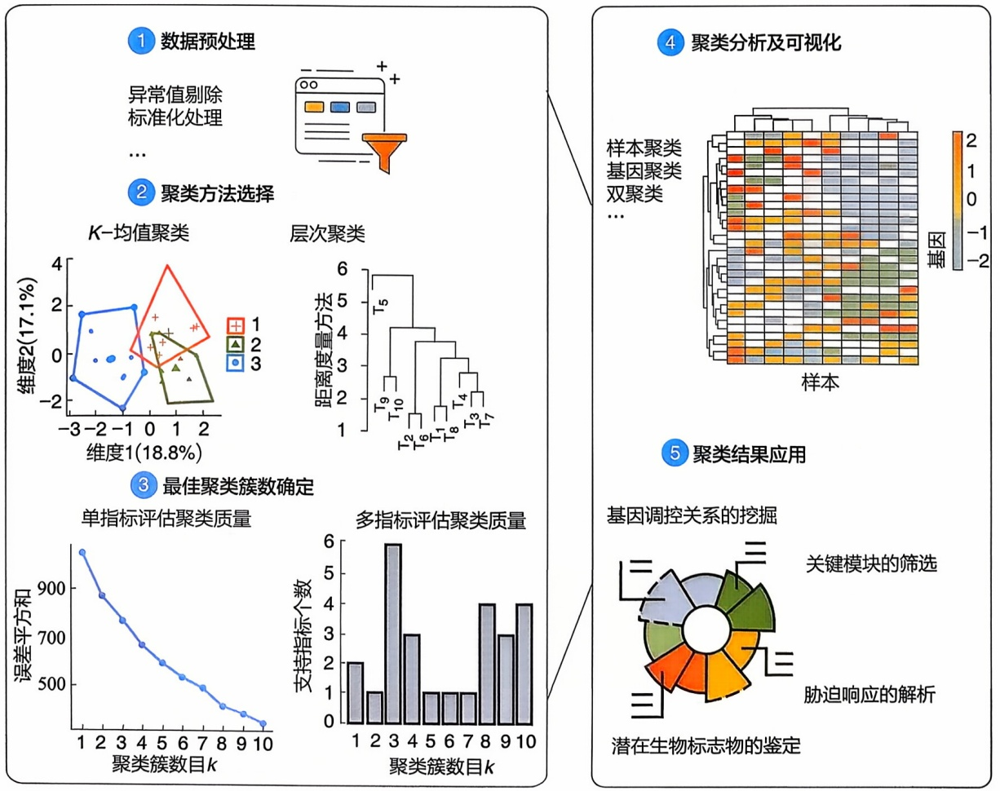

flowchart

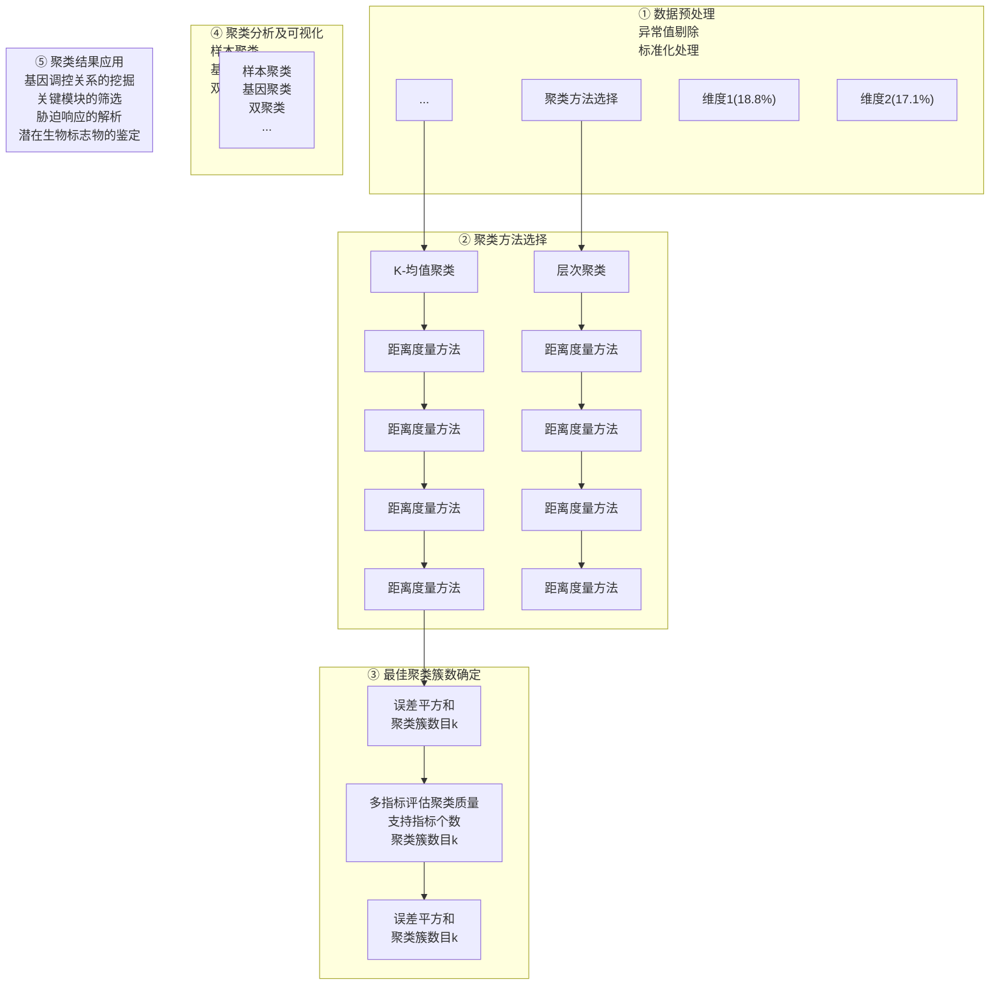

图7-6 转录组聚类分析流程图

聚类簇数的设置对转录组聚类分析的结果影响很大。如何确定最佳聚类簇数是转录组聚类分析的重要问题。对 K-均值等聚类算法，常通过 R 软件包 NbClust 计算不同聚类簇数下的簇内平均距离（误差平方和），并绘制关系图。图中误差平方和显著减少的拐点，其所对应的聚类簇数通常被视为最佳簇数。转录组聚类分析后，可使用 R 软件包 pheatmap 进行结果可视化。对于聚类的结果，可应用于挖掘参与特定生物学过程的功能基因、探索生物系统在不同环境条件下的适应机制等。

## 7.2.5 转录组降维分析

降维分析是通过线性或者非线性变换将高维数据映射到低维空间，在尽量保留原有数据的信息基础上，通过减少特征变量数目和降低数据复杂度，为后续的聚类、分类和可视化分析提供基础。

PCA、ICA、MDS、t-SNE 和 UMAP 等是常见的降维算法，处理不同来源的数据需要选择合适的降维方法。常用于降维生物学数据的算法及其对应的工具有 PCA（prcomp 和 princomp 函数），NMF（CoGAPS 包）和 t-SNE（Rtsne 包）。与 PCA 分解要求主成分正交不同，非负矩阵分解（non-negative matrix factorization，NMF）要求分解之后的矩阵都非负。easyMF 将 PCA、ICA、NMF 这几种利用矩阵分解来降维的方法整合为一体，能够满足不同层面的数据分析需求（图 7-7）。

图 7-8 展示的是 PCA 降维之后的样本可视化结果。对于降维之后的数据分组，需要判断数据划分的效果，评估分组是否有意义。检验分组的显著性，可用相似性分析（analysis of similarities, ANOSIM）、多重响应置换过程分析（multiple response permutation procedure, MRPP）、非参数多因素方差分析（permutational multivariate analysis of variance, PERMANOVA）等方法判断降维之后的组别是否存在显著差异。ANOSIM 依据样品之间的距离排序来判断数据组间差异是否显著大于组内差异；MRPP 利用置换检验对分组进行显著性分析；PERMANOVA 又称为置换多因素方差分析，通过计算样品之间的距离对分组进行统计学检验。

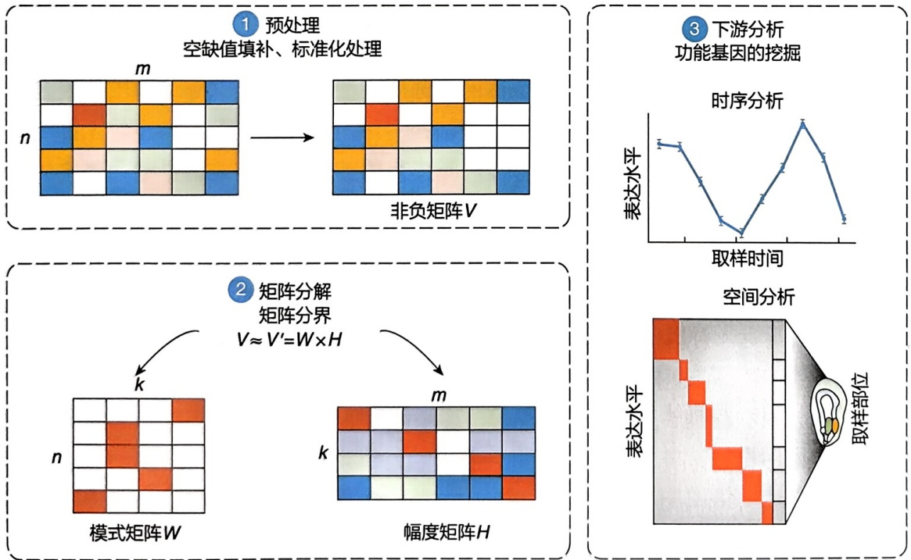

图7-7 NMF矩阵分解原理

图7-8 PCA降维数据的分组

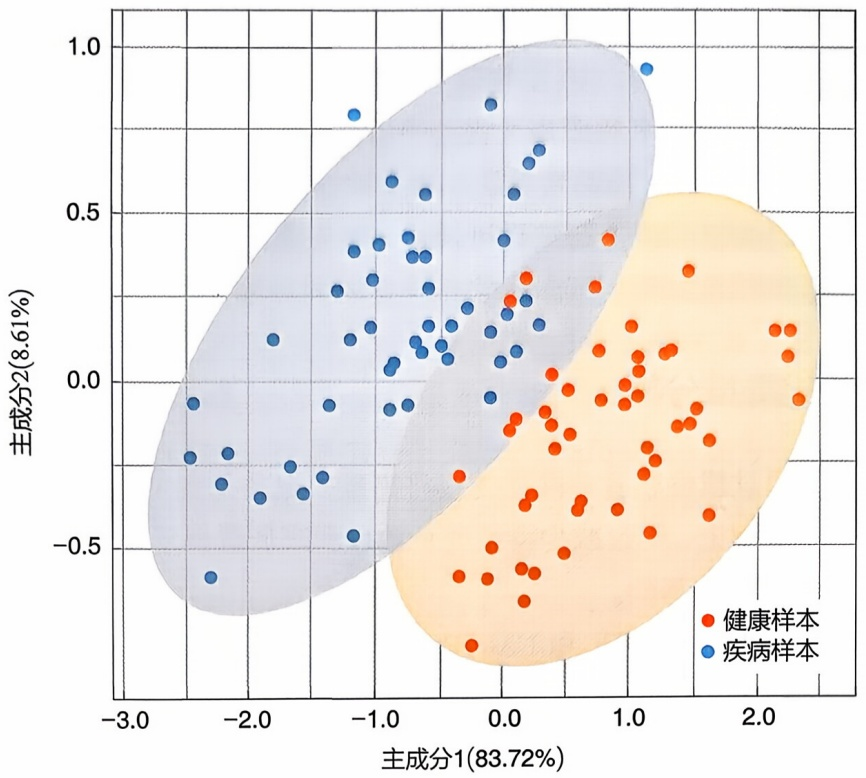

scatter

| Series | 主成分1 (83.72%) (range) | 主成分2 (8.61%) (range) |
| --- | --- | --- |
| 健康样本 | -0.5~2.5 | -0.8~0.4 |
| 疾病样本 | -2.5~1.5 | -0.6~0.9 |

## 7.2.6 共表达网络分析

基因共表达网络分析（gene co-expression network analysis，GCNA）是一种用于解析基因表达关联模式的系统生物学分析方法。通过构建基因共表达网络，研究人员可以识别具有相似表达模式的基因模块，探索基因网络与表型的关联，挖掘网络中的核心基因。加权基因共表达网络分析（weighted gene co-expression network analysis，WGCNA）是最常见的共表达网络分析方法之一。WGCNA 利用基因之间的加权相关性来构建网络，使网络的拓扑结构尽可能呈无标度分布特征。无标度网络由少数关键节点（hub 节点）和与其广泛连接的其他节点构成，更贴合真实的生物学网络（可参阅第 11 章内容）。

WGCNA 主要包含 4 个步骤:网络构建、基因模块分类、基因模块分析、核心基因鉴定。WGCNA 首先计算基因间的相关性系数，通过加权处理，构建无标度网络。然后，基于无标度网络的相异度使用聚类算法建树，进而划分具有相似表达模式的基因模块。随后，进行模块与外部样本特征的关联分析（计算模块与性状、模块与模块、模块与样本之间的相关性）、富集分析进一步解析网络模块中基因的功能，确定目标模块。最后，依据网络关系筛选目标模块中的 hub 基因。

在共表达网络图中（图7-9），每一个节点代表一个基因，每一条线代表一个统计学上显著的共表达关系，节点的大小表示网络中与该基因相连的基因数量，即基因连接度。在进行基因共表达网络分析时，需要注意以下 5 点。

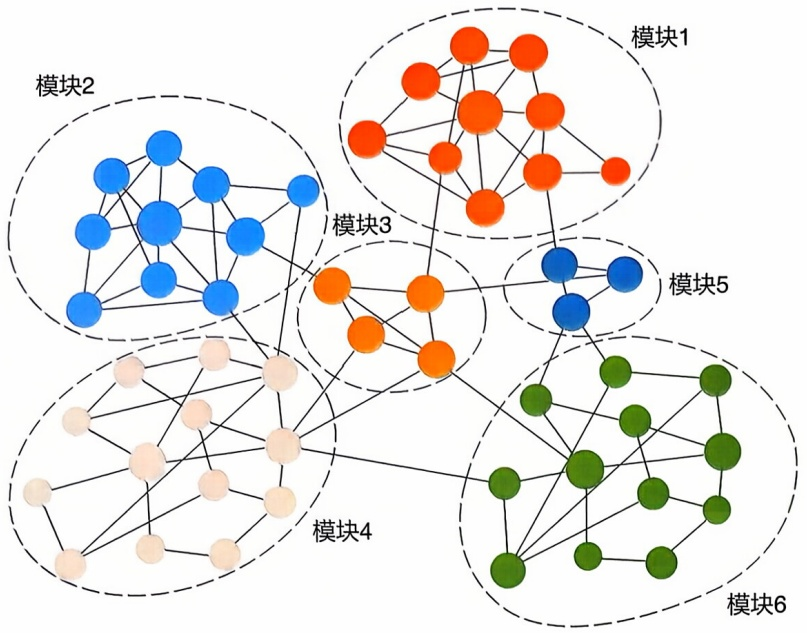

flowchart

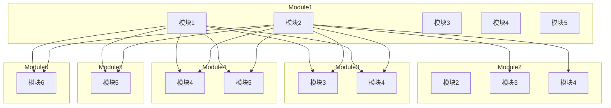

图7-9 共表达网络分析模块示例图

① 基因表达数据质量控制 为了确保分析的准确性，需要进行基因表达数据的质量控制。通过对缺失值较多的基因进行去除、过滤离群样本、筛选表达变化大的基因，进而减少表达数据中的噪声以及共表达分析中的假阳性结果。
② 样本数量 WGCNA 适用于分析大量样本的复杂数据模式，减少样本数量会影响相关性计算、增大网络噪声、降低网络可靠性。因此，建议在样本数达到 15 个或以上（可包含生物学重复）时，使用 WGCNA 进行分析，以获得更可靠的结果。
③ 基因共表达的量化方法 WGCNA 通过基因表达的相关性建立基因之间的联系，需要选取合适的方法量化基因表达的相关性。常用的基因共表达量化方法包括皮尔逊相关系数（Pearson correlation coefficient, PCC）、斯皮尔曼相关系数（Spearman correlation coefficient, SCC）和互信息（mutual information, MI）等。这些方法分别基于线性关系、秩次关系和变量之间的非线性依赖关系量化基因表达的相似性。除了 PCC、SCC 和 MI, R 软件包 rsgcc 中还提供了基尼相关系数（Gini correlation coefficient, GCC）用于基因共表达分析。GCC 能够有效地降低样本数目、表达数据分布以及离群值等因素对共表达分析结果的影响，能够发掘基因间非线性转录调控关系以及组织（或者发育阶段）特异的转录调控关系。
④ 网络构建的软阈值设定 软阈值的设定影响网络的连接密度、拓扑结构。软阈值的选择可根据样本数量和网络类型进行调整。拟合拓扑指数（fit index）可用于评估选定软阈值所构建的网络拓扑结构与无标度网络模型的拟合程度。如果拟合拓扑指数不符合无标度网络模型，可通过样本聚类分析检查是否存在表达异常样本。
⑤ 网络模块的分析 在相关性网络中，通常会重点关注“key module”和“hub gene”。“key module”可以通过功能分析、性状相关性分析确定；“hub gene”是模块中高度关联的基因，可以通过计算KME值（module eigengene-based connectivity）或模块内连接度（kWithin）筛选hub基因。

## 7.2.7 转录调控网络分析

转录调控网络（transcriptional regulatory network, TRN）是一类以转录因子及其靶基因为节点、基因间调控关系为边的生物学网络。全基因组层面的转录调控网络构建有助于获取新的基因交互作用，帮助研究人员理解特定实验条件下的基因调控规律（图7-10）。

根据使用数据的不同，转录调控网络推断方法可分为两类:①基于静态基因表达数据的 TRN 推断；②基于动态基因表达数据的 TRN 推断。前者利用单一时间点或实验条件下的基因表达数据来推断基因调控关系，适用于研究稳态条件下的基因调控机制；后者则利用时间序列数据或不同实验条件下的基因表达数据来推断基因调控关系，揭示基因调控的动态变化和因果关系。受实验采样时间、测序仪器性能等因素的影响，上述两类方法构建的 TRN 中都会包含一定比例的假阳性结果。除此之外，重复数据的合并、缺失数据的填补等不同数据的处理过程也会对 TRN 的质量产生影响。

根据计算角度的不同，TRN 构建的模型可分为两类:离散变量模型和连续变量模型。离散变量模型主要包括贝叶斯网络（Bayesian network）模型和布尔网络（Boolean network）模型等；连续变量模型主要包括微分方程（differential equation）模型和神经网络（neural network）模型等。布尔网络把生物体内的遗传功能和相互作用简单地理解为逻辑规则。微分方程则是一种更为精细的数学模型，可以描述基因调控的因果关系，且基因间相互可以明确表示，但模型对数据的要求较高，模型的参数设置和估计较为困难。动态贝叶斯模型（dynamical Bayesian model）具有强大的知识表达能力和概率推理能力，它的负反馈性、非线性以及随机不确定性与真实的生物系统相似，但存在计算量较大的问题。因此，结合不同模型构建转录调控网络，可以充分利用各模型的优势，提高网络推断的准确性（表7-3）。

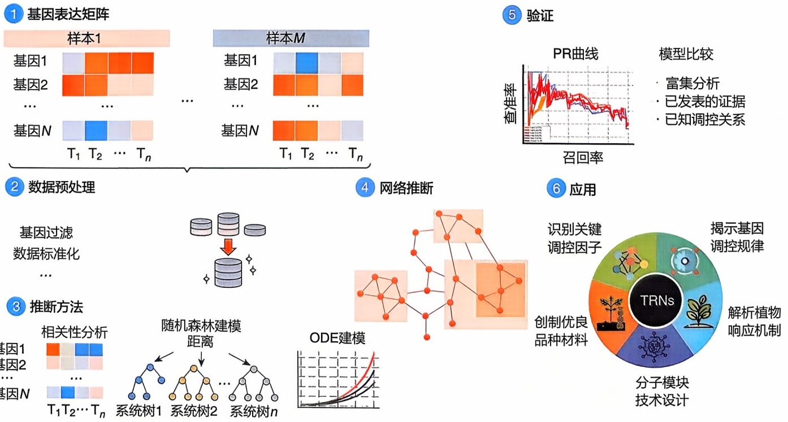

图7-10 基于转录组学数据的基因调控网络分析

表 7-3 基于时间序列转录组学数据的基因调控网络推理工具

| 工具 | 方法 | 编程语言 |
| --- | --- | --- |
| Time-delayed ARACNE | 互信息 | R |
| Jump3 | 回归 | MATLAB |
| TSNI | 常微分方程 | MATLAB |
| dynGENIE3 | 回归 + 常微分方程 | R |
| BETS | Granger 因果关系 | Python |
| SWING-RF | Granger 因果关系 + 回归 | Python |
| CGC-2SPR | Granger 因果关系 | R/MATLAB |
| scanBMA | 动态贝叶斯模型 | R |
| Package GeneNet | 动态贝叶斯模型 | R |
| Package G1DBN | 动态贝叶斯模型 | R |
| PROB | 动态贝叶斯模型 | MATLAB |
| MERLIN | 动态贝叶斯模型 | C |
| REVEAL | 布尔网络 + 互信息 | C |
| BoolNet | 布尔网络 | R |
| ATEN | 布尔网络 + 回归 | R |
| Inferelator | 常微分方程 | R |
| DryNetMC | 常微分方程 | R |

在基于转录组数据推断 TRN 的分析中，评估所推断网络的准确性是一个关键且必要的步骤（图 7-10）。常用的评估方法是将推断出的边与公共数据库中注释的转录因子—靶点相互作用进行比较。然而，数据库中包含的参考数据数量相对有限，使得评估实验只能针对推断网络中的一个子集开展。另一种评估方法是利用模拟数据。虽然可以对不同实验条件下的 TRN 进行模拟分析，但是依然存在模拟数据难以覆盖所有真实网络的问题。除了网络准确性的评估外，TRN 推断中的另一个重点是在相同数据集上比较不同推断方法之间的网络差异。这种比较可以评判不同方法在相同数据集上是否得到一致的结果，进而评估推断网络的鲁棒性。

基于转录组数据的 TRN 分析可在多个领域展开应用研究（图 7-10）。在疾病研究中，可用于构建分子疾病图谱、确定预后生物标志物、发掘癌症进展和药物抵抗中的驱动基因等。在细胞命运决定研究中，可用于识别影响细胞命运的关键调节因子等。

## 7.2.8 基因的功能富集分析

基因的功能信息主要包括结构域、功能分类以及所在的生物通路等信息。常用的基因功能注释数据库有:GO（Gene Ontology）、KEGG（Kyoto Encyclopedia of

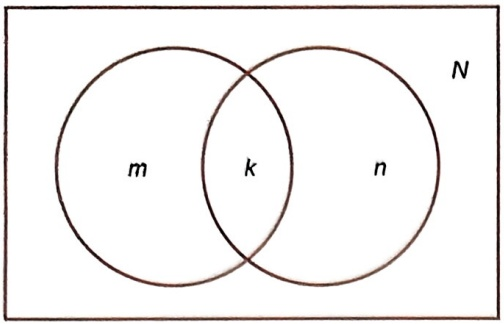

text_image

m
k
n
N

图 7-11 超几何分布

Genes and Genomes）、MSigDB（Molecular Signatures Database）等。GO 注释信息可利用 Blast2GO、eggNOG 等软件自动获取。

对于差异表达基因、聚于同一簇/模块的基因，可利用功能富集分析挖掘其所涉及的生物学过程、细胞组成和分子功能。常用于富集分析的软件有 clusterProfiler、DAVID、KOBAS 等。其中 clusterProfiler 支持对基因进行 GO、KEGG、DO（Disease Ontology）、MSigDB 等层面的富集分析。在进行富集分析前，需要选择合适的背景数据集，查询 Bioconductor 库和 AnnotationHub 中是否有分析物种的 OrgDb，若都

没有，则需要准备物种的基因功能注释，进一步利用 AnnotationForge 创建 OrgDb 包以及函数 “enricher” 进行富集分析。根据数据来源和算法的不同可将基因功能富集分析方法分为四类:过表达分析（over-representation analysis, ORA）、功能集打分（functional class scoring, FCS）、基于通路拓扑结构（pathway topology, PT）和网络拓扑结构（network topology, NT）。其中 ORA 和 FCS 是 clusterProfiler 使用的两种基因集富集分析（gene set enrichment analysis, GSEA）方式。从统计学角度看，富集分析的目的是发现显著富集的基因功能集。假定 N 是所有表达的基因数目，n 是读者感兴趣的基因（如差异表达基因）数目，m 是某一 GO 条目中包含的基因数目，k 是该 GO 条目中差异表达基因的数目，利用超几何分布（hypergeometric distribution）（图 7-11），可以计算出这组差异表达基因是否显著富集于该 GO 条目。富集概率计算如下:

$$
p = 1 - \sum_ {i = 0} ^ {k - 1} \frac {\mathrm{C} _ {N - m} ^ {n - i} \times \mathrm{C} _ {m} ^ {i}}{\mathrm{C} _ {N} ^ {n}} \tag {7-2}
$$

对于农作物的基因功能富集分析, 可以利用 PlantGSEA、agriGO 和 PlantGSAD 等系列软件。需要注意的是, 如果关注多个 GO 条目, 需要利用多重检验校正 (如 Benjamini-Hochberg 方法) 对 $p$ 值进行校正, 以降低分析结果中的假阳性率; 除了 GO 富集分析, 还可以针对生物学通路、基因家族等进行富集分析; 富集结果可以用 R 软件包 “enrichplot” 进行可视化。

## 7.3 非编码 RNA

## 7.3.1 长非编码 RNA

长非编码 RNA 是指长度大于 200 个核苷酸的单链非编码 RNA。它们形式上与 mRNA 类似，可以有多个外显子，但并不编码蛋白质，而是以 RNA 的形式在多种层面上（表观遗传调控、转录调控以及转录后调控等）发挥调控功能。

## (1) 长非编码 RNA 的分类和功能

lncRNA 最主要的分类方式是根据其在基因组上的相对位置，主要可以分为正义（sense）lncRNA:与蛋白质编码基因区域有重叠且方向一致；反义（antisense）lncRNA:与蛋白质编码基因区域有重叠且方向相反；内含子（intronic）lncRNA:主要产生于编码基因的内含子区域；基因间（intergenic）lncRNA:位于两个编码基因之间的非编码区域。

根据 lncRNA 的转录方式, 还可以定义一些 lncRNA 类型, 如趋异 (divergence) lncRNA: 在编码基因上游, 共用一个启动子, 反向转录的 lncRNA; 增强子 (enhancer) lncRNA: 增强子区域转录出来的 lncRNA; 启动子 (promoter) lncRNA: 启动子区域转录出来的 lncRNA。lncRNA 可能由 RNA 聚合酶 II (RNAP II) 或者 RNA 聚合酶 III (RNAP III) 转录, 由 RNAP II 转录的 lncRNA 通常包含 5' 端帽 (5' capping) 和 3' 端多聚腺苷酸尾 [poly(A)]。另外, 假基因是在演化过程中丧失了蛋白质编码功能而废弃的基因, 其转录本也可以认为是 lncRNA。

lncRNA 的功能机制十分复杂，已报道的功能包括:基因转录的激活与抑制、影响组蛋白修饰、染色质相互作用、可变剪接、转录后/翻译调控、作为海绵吸附miRNA、作为内源 sncRNA 前体、调控蛋白质的功能活性、相互作用和细胞定位、参与形成核结构等。lncRNA 在胚胎发育、细胞分化、衰老等生物学过程以及多种复杂疾病中均发挥重要作用。

## (2) 长非编码 RNA 的鉴定与定量

基于 RNA-Seq 数据鉴定新的 lncRNA 属于转录组组装，相关方法在前面的章节已有介绍，主要包括以下两种策略:一是基于参考基因组，二是从头组装（de novo assembly）（图 7-12）。另外需要确认得到的转录本是否为已知的 lncRNA 或 mRNA，软件可能会基于用户提供的已知转录本注释文件进行初步判断，但可能存在注释不全。新发现的 lncRNA 包括全新的 lncRNA 和已知 lncRNA 的新可变剪接转录本。对于确认为新发现的 lncRNA，再用转录本编码能力评估软件（如 CPAT、CPC、CNIT 等）判断该转录本是否有编码蛋白质的能力。

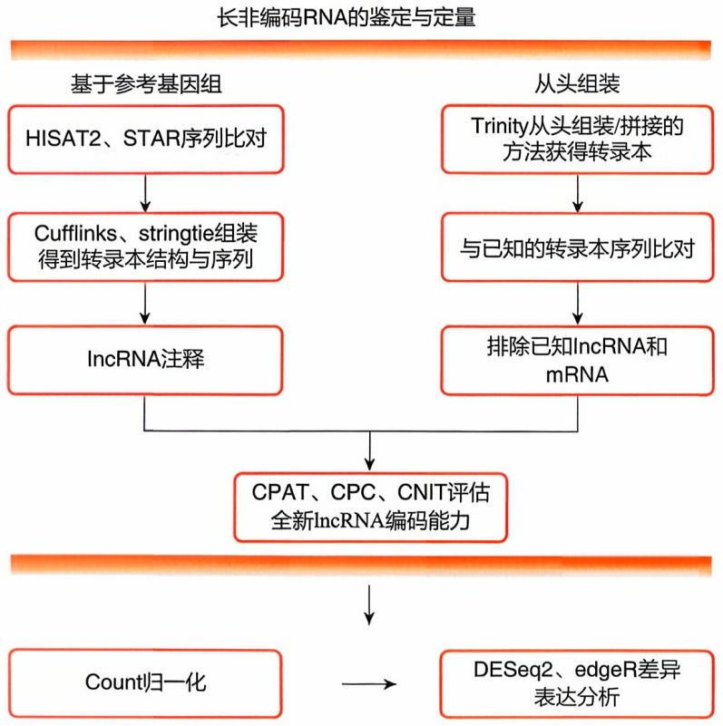

flowchart

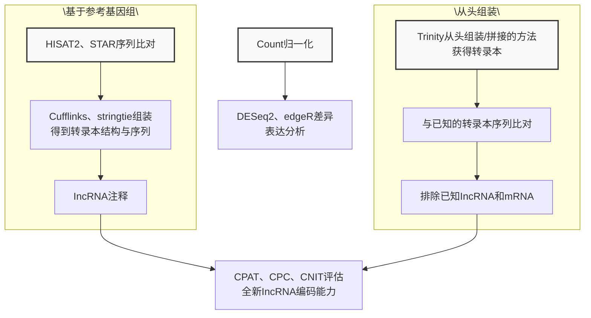

图7-12 长非编码RNA的鉴定与定量

lncRNA 的定量方法与 mRNA 转录组分析类似，都是基于读长计数再进行归一化处理（主要包括 RPKM、TPM 和标度因子等）。对于 RNA-Seq 这种同时检测 lncRNA 与 mRNA 的情况，可以采用相同归一化流程，差异表达分析也可以用同一个分析流程（如 DESeq2、edgeR 等）。

## (3) 长非编码 RNA 代表性数据库

随着测序技术的不断发展, 人们对 lncRNA 的兴趣日益浓厚, 在 lncRNA 的研究上也取得了丰富的成果。表 7-4 列举了几个具有代表性的长非编码 RNA 相关数据库。

表 7-4 长非编码 RNA 的代表性数据库

| 数据库名称 | 内容与特点 |
| --- | --- |
| RNAcentral | RNAcentral(国际 RNA 数据库联盟)是一个非编码 RNA 序列数据库,收集了来自多物种所有类型的 ncRNA。通过精选多个专家数据库中全面且及时更新的非编码 RNA 数据,进行整合并统一访问 |
| NONCODE | 一个收集和注释各类非编码 RNA,特别是 lncRNA 的综合性数据库。于 2006 年创建,包含 16 种动物和 23 种植物的共 644510 个 lncRNA,其中人类 lncRNA 数量为 173112 个。数据库提供了 ncRNA 定位、序列、表达谱、外泌体表达谱、保守信息、功能预测、疾病关联、RNA 结构,以及 Blast 分析等。还引入人类 lncRNA 和疾病间的关系 |
| lncBook | 整合人类 lncRNA 及多组学注释的数据库,并鉴定了疾病和不同环境中的特征 lncRNA。现已升级到第二版,包含 95243 个 lncRNA 基因和 323950 个转录本的高质量集合和多组学水平上丰富的注释 |
| NPInter | 对非编码 RNA 分子多维度的相互作用以及相关分子进行了详细的注释以及可视化,提供了一个全面、系统的非编码 RNA 相互作用的研究平台。最近关注非编码 RNA 相互作用在肿瘤生物学和新冠病毒中的研究 |
| LncBase | 实验支持的非编码 RNA 上 miRNA 靶点的数据库,包含 24 万组织和细胞类型特异的 miRNA-lncRNA 相互作用。相互作用由 15 种不同的低/高通量方法定义,来自 243 种不同的细胞类型/组织和 162 种实验条件 |
| Lnc2Cancer | 提供全面的 lncRNA 或 circRNA 与人类癌症之间实验支持的关联。从 1500 多篇论文中整理了 2659 个人类 lncRNA、743 个 circRNA 与 216 个人类癌症亚型之间的 10303 个关联条目。还提供了实验支持的 lncRNA 和 circRNA 在人类癌症中的调节机制、生物学功能和临床应用 |
| lncRNASNP | 提供包括人在内的 8 个物种 lncRNA 中 SNP 的数据库,包括 SNP 对 lncRNA 结构、lncRNA-miRNA 结合与表达的影响以及 lncRNA 的 eQTL。最新版中 SNPs 数量达到 67513785,其中人类 SNP 数量达到 2387685 |

## 7.3.2 环状 RNA

## (1) 环状 RNA 的产生和生物学功能

环状 RNA（circular RNA，circRNA）是一种新型的内源性非编码 RNA 分子。与传统线性 RNA（具有 5' 端和 3' 端）不同，circRNA 的结构主要是通过反向剪接（back-splicing）形成，即由线性 RNA 的 5' 端和 3' 端经共价结合，形成一个首尾闭合的单链转录本。circRNA 的环化合成途径一般包括:剪接体依赖的环化途径、蛋白质因子结合的环化途径、内含子配对驱动的环化途径以及套索驱动的环化途径（图7-13），且根据circRNA的基因组结构分成了外显子（exonic）circRNA、内含子（intronic）circRNA、外显子-内含子（exonic-intronic）circRNA以及可变外显子（alternative exonic）circRNA等不同亚型。

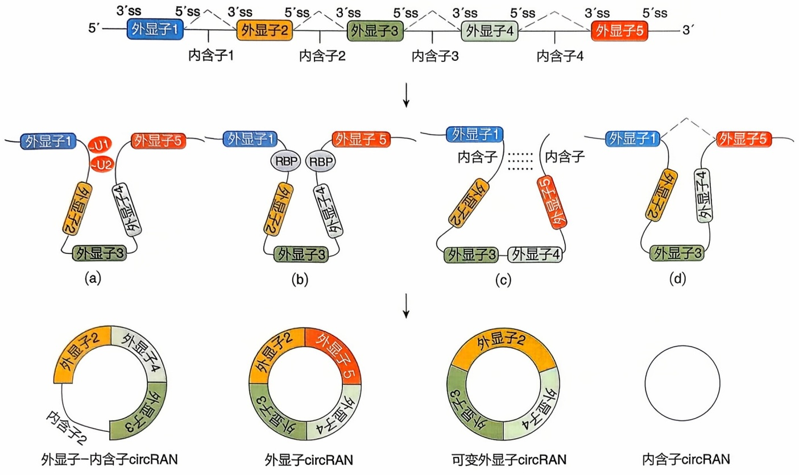

flowchart

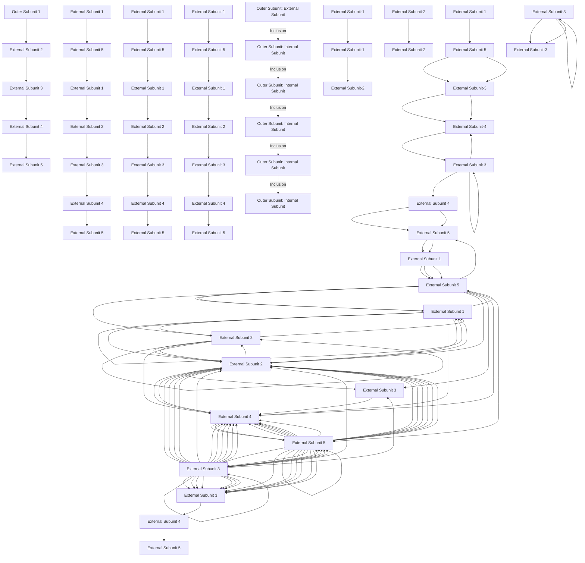

图7-13 circRNA的4种环化途径

circRNA在生物体中发挥许多潜在功能，其中充当miRNA的海绵是circRNA最为普遍的功能之一。circRNA的二级结构可能具有特定的RNA结构域，这些结构域可以和RNA结合蛋白或其他RNA分子相互作用，影响基因的转录和剪接。circRNA可以通过在细胞核和细胞质之间转运蛋白质来影响蛋白质功能。circRNA可以与多种蛋白质结合，充当“脚手架”的角色，影响蛋白质-蛋白质相互作用。circRNA不仅可以调控基因转录，还可以翻译产生蛋白质。

## (2) 环状 RNA 的鉴定与定量

目前鉴定 circRNA 的方法可以大致分为以下三类。

① 候选分子方法 该算法根据注释信息构建出基因组上理论存在的 circRNA，然后将 RNA-Seq 的读段比对到这些可能存在的 circRNA 上，如果读段正好比对到反向剪接的切口处，则认为此 circRNA 是存在的。
② 子序列比对方法 通过剪接读段（junction reads）来识别 circRNA（图 7-14）。在参考基因组比对中，将比对不上的读段分成两段分别比对，得到反向剪接（back-spliced junction，BSJ）配对的情况。这种方法的代表工具是 find\_circ、CIRI 等。
③ 机器学习类方法 首先从转录本中提取不同的特征，如保守性分数、序列组成、Alu 和串联重复序列、SNP 密度和转录本的开放阅读框（open reading frame,

（a）剪接体依赖的环化途径；（b）蛋白质因子结合环化途径；（c）内含子配对驱动的环化途径；（d）套索驱动的环化途径

图7-14 通过识别剪接读段来预测circRNA

（a）读段覆盖了反向剪接位点；（b）成对的读段包含了反向剪接位点、且比对的位置是相反的

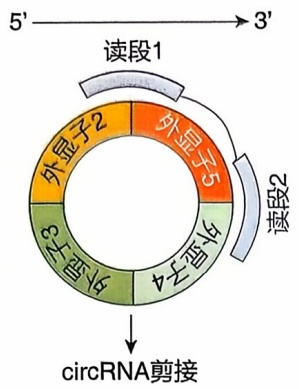

flowchart

This diagram illustrates a circRNA editing workflow, showing the sequence of reads (Read 1 and Read 2) and their corresponding chromatin states (Outer Chromatin 2, Outer Chromatin 3, Outer Chromatin 4, Outer Chromatin 5).

(a)

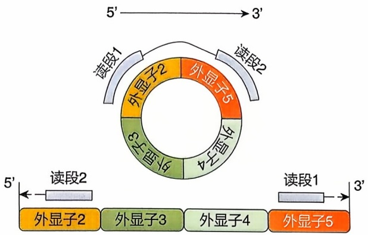

flowchart

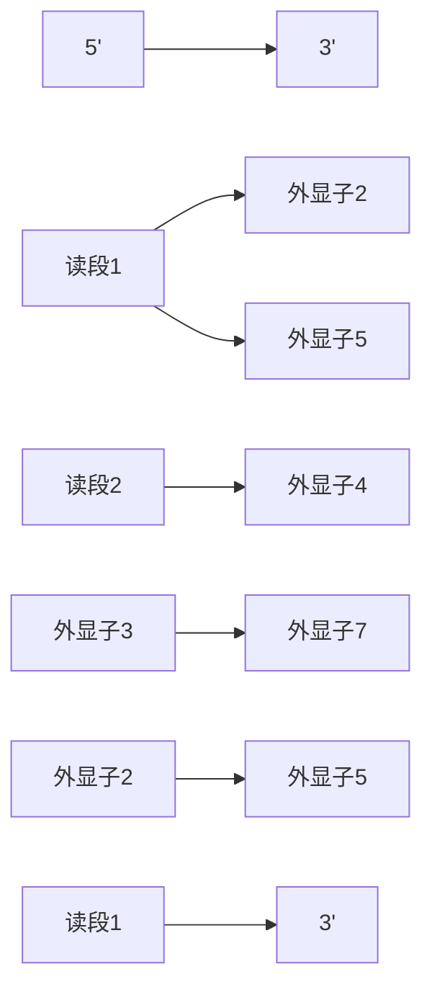

(b)

ORF）等，然后使用不同的机器学习分类器和统计方法整合这些特征构建分类模型，来对 circRNA 进行预测。这类方法的代表工具有 DeepCirCode、PredcircRNA、H-ELM、CirRNAPL 等。

随着测序技术的发展, 目前已经出现了 circRNA 全长测序技术, 用于对 circRNA 的全长识别以及可变剪接事件的检测。

circRNA 的定量主要基于反向剪接读段的个数，也有一些研究以反向剪接和正向剪接读段的比例为基础，获得归一化的表达量矩阵，进行差异表达分析，分析流程具体可参考 DESeq2、edgeR 等。

## (3) 环状 RNA 的主要数据库

目前，已经发现的 circRNA 已超过 10 万种类型（涵盖了多个物种，主要以人、鼠为主），表 7-5 列举了一些 circRNA 常见的数据库及其特点。

表 7-5 circRNA 的主要数据库及其特点

| 数据库 | 特点 |
| --- | --- |
| circAtlas | circAtlas v3.0 涵盖了 10 个物种(人类、猕猴、小鼠、大鼠、猪、鸡、狗、绵羊、猫、兔子)以及 33 种组织,共收集了超过 300 万个 circRNAs 数据,是一个全面综合的 circRNA 信息资源 |
| CircNet | 专注于癌症中 circRNA 调控网络的数据库。收录了 circRNA 的基本信息,提供了 circRNA 在不同组织中的表达谱数据,以及 circRNA-miRNA-gene 的调控网络,允许用户通过搜索具有显著表达的癌症相关 circRNA 进行癌症特异性分析 |
| circRNADb | 专注于编码蛋白的 circRNA 数据库,包含 32914 个具有详细注释的外显子 circ-RNA,并预测了 circRNA 中可能的 ORF |
| circBase | 收集了多个物种的 circRNA 信息,包括人类、小鼠、秀丽线虫和黑腹果蝇等,提供在线查询比对功能 |
| CIRCpedia | CIRCpedia v2 是一个综合数据库,包含来自 6 个物种的 180 多个 RNA-Seq 数据集的 circRNA 注释。数据库支持用户搜索、浏览和下载各种细胞类型或组织中具有表达特征的 circRNA。同时包含了人类和小鼠 circRNA 的保守性分析,并集成了计算工具来比较样本之间 circRNA 表达量 |
| CSCD | 专注于癌症特异性 circRNA 的数据库,收集了超过 1000 个癌症和正常样本中可用的 RNA-Seq 数据集,并提供一个集成的 circRNA 数据库,包括预测的 circRNA-miRNA 和 circRNA-RBP 相互作用,同时提供了 circRNA 的全长序列和 ORF 序列信息 |
| circBank | 专注于人类 circRNA 的综合性数据库,共收录了 140790 条人类 circRNA 的记录,每条记录包括详细序列、与小鼠的同源性、miRNA 结合位点的预测分析、ORF 预测、COSMIC 数据库中的突变和多态性位点汇总,以及 m6A 修饰信息等内容 |

## 7.3.3 小非编码 RNA

小非编码 RNA 是长度为 15 \~ 200 nt 的非编码转录本，主要包括 miRNA、piRNA、siRNA 等多种类型，具有广泛的多样性。小非编码 RNA 是生命活动重要的调控因子，在基因表达调控、个体发育、生物代谢等生理过程中起重要作用，并且与多种疾病的发生发展有关。小非编码 RNA 的生物信息学分析有助于监测疾病发生过程，预测疾病发展趋势，发现新的调控靶点，促进疾病的早期诊断和精准治疗。

## 7.3.3.1 小非编码 RNA 的主要类型及其功能

## (1) miRNA

miRNA 是一类内源性小非编码 RNA，存在于大多数真核生物中，长度为 20～25 nt。miRNA 通常位于基因间或内含子区，作为编码其他类型基因的一部分被转录。miRNA 发挥调控功能的机制在不同生物的发育过程中是高度保守的。miRNA 与 AGO 蛋白形成复合体，通过碱基互补配对识别靶基因并与靶基因 3'UTR 结合，导致 RNA 诱导的沉默复合物（RNA-induced silencing complex, RISC）降解靶 mRNA 或抑制靶 mRNA 的翻译，从而特异性调控基因的表达。

## (2) piRNA

PIWI 相互作用 RNA（PIWI-interacting RNA，piRNA）是长度为 25～33 nt 的 RNA 分子，主要存在于动物的生殖细胞和干细胞中。piRNA 主要来源于基因组上的 piRNA 簇（piRNA cluster），产生的成熟 piRNA 具有 5' 端 1U 偏好性和 3' 端 2'-O-甲基化修饰的特征。piRNA 发挥调控作用的机制是与 PIWI 亚家族蛋白结合形成复合物，进而在转录或转录后水平发挥调控作用。piRNA 系统能够沉默转座元件（transposable element，TE），与生殖细胞基因组的稳定性和完整性维持和胚胎发育密切相关。研究发现，PIWI 蛋白在精原细胞瘤、胃癌等多种癌症中可能充当致癌因子或抑癌因子，piRNA 系统与癌症、生殖系统疾病、心脏病、神经系统疾病等的发生发展有关。piRNA 还发挥着抗病毒防御和体细胞转座子抑制等多种功能。

## (3) 其他小非编码 RNA

还有一些其他小非编码 RNA，如干扰小 RNA（small interfering RNA, siRNA），也称为短干扰 RNA（short interfering RNA）或沉默 RNA（silencing RNA）；转运-信使 RNA（transfer-messenger RNA, tmRNA）是具有类似 tRNA 和 mRNA 双重功能的小分子 RNA，存在于细菌中；核内小 RNA（small nuclear RNA, snRNA）和核仁小 RNA（small nucleolar RNA, snoRNA）等。

## 7.3.3.2 小非编码RNA的鉴定

目前计算识别未知 miRNA 的原理主要有以下几种。

① 基于同源比对 根据已知保守的 miRNA 在不同物种间的序列相似性，以已知 miRNA 序列为索引，基因组序列作为搜索库，使用 BLAST 算法进行比对。
② 基于 miRNA 的二级结构特征 对已知 miRNA 附近区域进行茎环结构预测，从而发现成簇存在的 miRNA，如 MIRcheck 软件。使用此类方法进行预测时，由于tRNA和反转座子等元件也能形成发夹结构，因此需要在筛选结果时去除。

③ 基于比较基因组学 在亲缘关系很近的生物之间，利用基因组的编码顺序和结构的同源性，通过已知基因组的信息推测未知基因组中的信息。
④ 基于碱基配对原则 寻找 miRNA/miRNA\* 二聚中间体。
⑤ 基于最小自由能原则 预测新 miRNA 及其二级结构。
⑥ 基于 miRNA 的合成和作用特点 根据 miRNA 的加工依赖 Dicer 或 DCL1 酶，以及 miRNA 在 AGO 蛋白中富集的特点进行预测。

由于 piRNA 缺乏保守的序列和结构特征，从小非编码 RNA 数据中识别 piRNA 具有很大的挑战性。许多鉴定 piRNA 的方法是依赖于提取复杂的特征，或者主要针对转座子相关的 piRNA 进行预测。例如，piRNApred 基于 RNA 序列、结构、热动力学和理化性质预测 piRNA。近年来，也有一些基于深度学习算法的工具用于 piRNA 鉴定。例如，piRNN 应用卷积神经网络分类器进行 piRNA 的预测。此外，还有一些工具能够预测 piRNA 聚类簇，如 piClust 和 proTRAC。

## 7.3.3.3 小非编码 RNA 的靶基因预测

准确预测 miRNA 的靶基因是研究 miRNA 生物学功能和作用机制的关键。识别 miRNA 靶基因的方法主要是基于 miRNA 的种子序列与 mRNA 的 3' UTR 的互补性、靶序列在多个物种之间的序列保守性、miRNA 与 mRNA 形成的双链结构的自由能、位点的可结合性、UTR 碱基分布、miRNA 与靶基因组织分布的相关性等原则。然而，这些方法大多依赖于预先定义的特征。近年来，一些应用深度学习模型的 miRNA 靶基因预测工具被开发，能够以更高的精度预测 miRNA 靶标（表 7-6）。

表 7-6 小非编码 RNA 靶基因预测工具举例

| 工具名称 | 工具原理与特点 |
| --- | --- |
| miRanda | 结合 miRNA 和 mRNA 的序列互补匹配程度以及形成双链的自由能进行靶基因预测,并对潜在的杂交位点进行打分 |
| RNAhybrid | 经典 RNA 二级结构预测算法的延伸,考虑热动力学因素,采取动态规划算法,计算 miRNA 和靶 mRNA 间形成的双链二级结构的最小自由能,预测 miRNA 的靶基因 |
| targetScan | 收录了人和小鼠、大鼠等物种的靶基因信息,主要考虑物种间保守的靶 mRNA 序列,搜索与每条 miRNA 种子区域匹配的保守 8mer 和 7mer 位点,来预测靶基因 |
| PicTar | 基于 miRNA 或 miRNA-靶标联合作用等特征,预测 miRNA 的靶基因 |
| RNA22 | 预测 miRNA 的靶基因以及 miRNA 与 mRNA、lncRNA、circRNA 等分子的互作靶点 |
| DMISO | 基于深度学习方法捕获 miRNA/isomiR(miRNA 异构体)与 mRNA 相互作用的复杂特征 |
| piRScan | 提供在线平台,通过综合评估各种信息识别 piRNA 的靶位点,包括预测的和实验识别的靶位点 |

## 7.3.3.4 小非编码 RNA 数据库简介

各类小非编码 RNA 的数据库涵盖小非编码 RNA 的序列、命名、表达、靶基因以及疾病相关性等多方面的特征，对于辅助小非编码 RNA 的生物学研究具有重要意义。表 7-7 列举了一些具有代表性的小非编码 RNA 相关数据库。

表 7-7 小非编码 RNA 相关数据库举例

| 数据库名称 | 数据库内容与特点 |
| --- | --- |
| miRBase | 存储 miRNA 相关信息的最主要公共数据库之一,包含 miRNA 序列注释信息和预测的靶基因数据,提供 miRNA 序列以及注释查询、定位、预测基因靶基因、查询发卡序列和命名服务 |
| miRNASNP | 人类 miRNA 相关 SNP 的综合资源,包括它们对靶标获得和丧失的影响。涵盖了人类 miRNA 前体中的 SNP 和基因 3'UTR 中的 SNP 信息,并且在其中发现了来自 GWAS、ClinVar 和 COSMIC 的疾病相关变异,还提供了通过 miRNA 种子区域的变异进行的靶标获得/丧失的基因富集分析 |
| TarBase | 目前使用最广泛的真实 miRNA 与靶基因关系的数据库之一,涵盖多种实验方法检测到的 miRNA-靶标相互作用 |
| starBase | 高通量实验数据 CLIP-Seq 和 mRNA 降解组测序数据支持的 miRNA-靶标数据库。整合了多个流行的靶标预测软件的交集和调控关系,提供了 miRNA-lncRNA、miRNA-假基因、miRNA-sncRNA 和 miRNA-mRNA 相互作用的泛癌网络,涵盖了数百万个 RBP-RNA 和 RNA-RNA 相互作用 |
| HMDD | 实验支持的人类 miRNA 和疾病相关性证据的数据库。还包含了外泌体 miRNA 和病毒编码的 miRNA 与人类疾病的关联,并且整合了基于疾病相关 miRNA 的疾病网络分析 |
| microRNA.org | 主要包括 miRNA 表达谱数据和 miRanda 算法预测得到的 miRNA 靶基因信息 |
| piRBase | 国际 RNA 联盟收录的唯一 piRNA 专业数据库。最新版本涵盖了 1.81 亿个 piRNA 序列,包括来自 44 个物种的 440 个数据集。包含 piRNA 的变异、表达、靶基因等信息,还提供了 piRNA 聚类簇、剪接 piRNA、疾病相关的 piRNA 信息 |
| piRNAClusterDB | 关注跨组织和物种的 piRNA 聚类簇的调节和进化研究。网页提供了交互式系统发育树,包含物种分类、piRNA 聚类簇数量和 piRNA 序列总量的信息。网站支持用户自定义数据集,生成跨不同数据集、组织或发育阶段的 piRNA 聚类簇表达情况的视图 |

## 7.3.4 非编码 RNA 的结构预测

## (1) RNA 的二级和三级结构

RNA的二级结构（secondary structure）是指RNA可以通过碱基互补配对（base pairing）形成不同的单链区域（loop）和双链区域（duplex）（图7-15），碱基互补配对主要包括A—U、G—C、G—U三种配对方式。这种特异的配对结构，具有很稳定的能量，是RNA区别于蛋白质的一个很大的特点，也决定了RNA尤其是非编码RNA在生命体系中的独特作用。

RNA 一级序列（primary sequence）在单链和双链区域组成的二级结构基础上，能进一步形成更高层次的复杂的三级结构（tertiary structure）（图 7-15）。由于 RNA 三级结构的复杂性和多变性，这些长的 RNA 分子很可能难以形成稳定的三级结构并通过其行使功能。很多研究发现，RNA 的二级结构相对于三级结构更稳定，而且与三级结构之间有很好的对应关系，因此，RNA 二级结构的信息可以辅助 RNA 三级结构的预测。

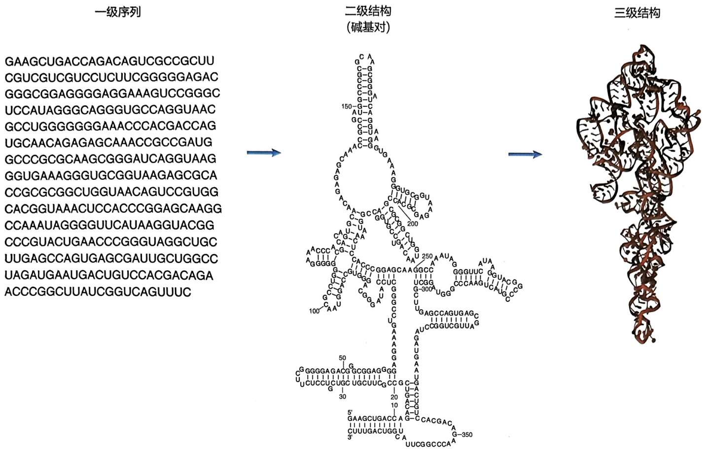

chemical

RNA secondary structure diagram showing DNA base pairing and nucleotide sequence with labeled positions

图7-15 RNA一级序列、二级结构与三级结构

## (2) RNA 二级结构的计算预测方法

预测 RNA 二级结构的计算方法常常用于大规模及快速的结构分析，计算方法比实验成本低、速度快。不过需要注意的是，这些计算预测方法在已知结构的预测上只能达到 $70\%$ 左右的灵敏度。预测准确度随着 RNA 序列长度增加而逐步降低，可能是因为长序列结构更加多变以及计算模型误差的积累。而且大部分的 RNA 结构预测工具不能预测假结（pseudoknot），主要原因是计算复杂度过高，无法应用于长序列。

RNA 二级结构预测常用的方法主要基于能量模型，例如，可以通过最小自由能模型和动态规划算法预测一个最优的 RNA 二级结构，主要代表是 RNAfold、RNAstructure。除了预测单个的最优结构（能量最低的结构），我们还可以基于配分函数（partition function）的方法，预测在多种可能结构中碱基互补配对的概率，或者给出最大的期望准确度（maximum expected accuracy）。

我们可以把实验测定数据和计算模型结合起来进行 RNA 二级结构的预测（图 7-16）。与单独的实验测定或单独的计算预测相比，两者的结合可以达到优势互补的作用。已有 SeqFold、RNAstructure、RNApbfold、RME 等方法可以利用一维的实验测定数据修正能量模型中的参数，从而预测出与原有能量模型和实验数据都比较一致的二级结构。这样预测出的 RNA 二级结构模型可以反映某种条件下 RNA 结构的真实状态，又不会与能量模型相差太远。

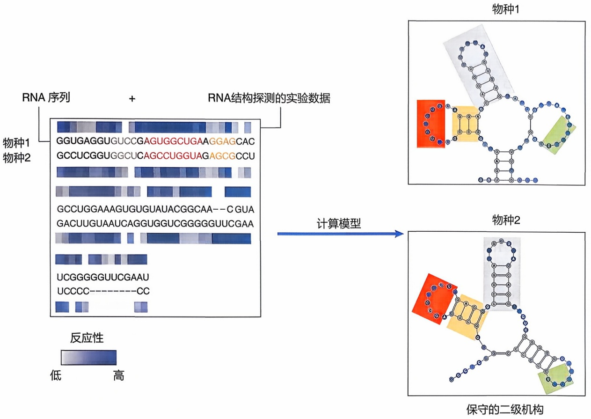

flowchart

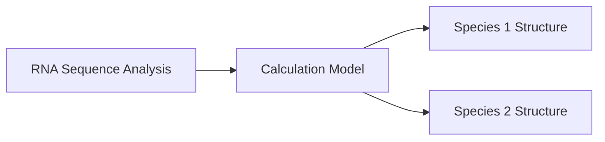

图7-16 结合RNA结构实验测定数据和计算模型进行RNA二级结构预测

除了基于能量模型的预测，还可以通过序列比对利用RNA二级结构在不同物种中的保守性来进行二级结构预测。例如，Rfam数据库中利用随机上下文无关语法（stochastic context-free grammar，SCFG）进行RNA二级结构的预测、描述和归类。除了基于能量模型和比较序列进行RNA二级结构预测，近年来，很多深度学习方法和迁移学习方法等新型AI技术也开始被用来进行RNA二级结构的预测（AI技术和方法可以参考本书的其他相关章节）。

综上所述，常用的 RNA 二级结构预测方法基本包括以下 3 类。

① 基于能量最小化的预测（free energy minimization）这种方法基于的观点是，在一定的条件下，RNA的结构总是趋向于取其可能的最稳定状态，即自由能最低的状态。一些工具如RNAfold和RNAstructure就是基于此原理工作的。
② 比较序列的预测（comparative analysis）这种方法基于的观点是，在进化过程中，功能相关的 RNA 结构比序列更保守。因此，将相关物种中的同源 RNA 序列进行比较，通过寻找保守的、协同变异的配对模式（如两个碱基同时从 A—U 协同变异为 G—C）来预测 RNA 结构。Rfam 数据库就提供了这样的比对模式。
③ 机器学习和 AI 方法（machine learning and AI） 近年来，随着深度学习、迁移学习等机器学习和 AI 技术的发展，也有一些新的 RNA 结构预测方法出现，这些方法往往需要大量已知的 RNA 序列和结构作为训练数据。