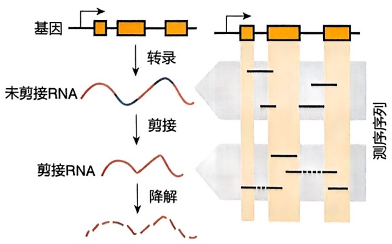
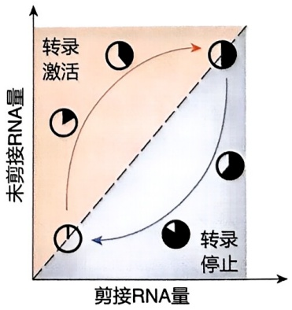
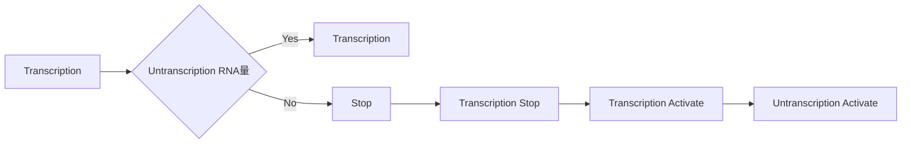
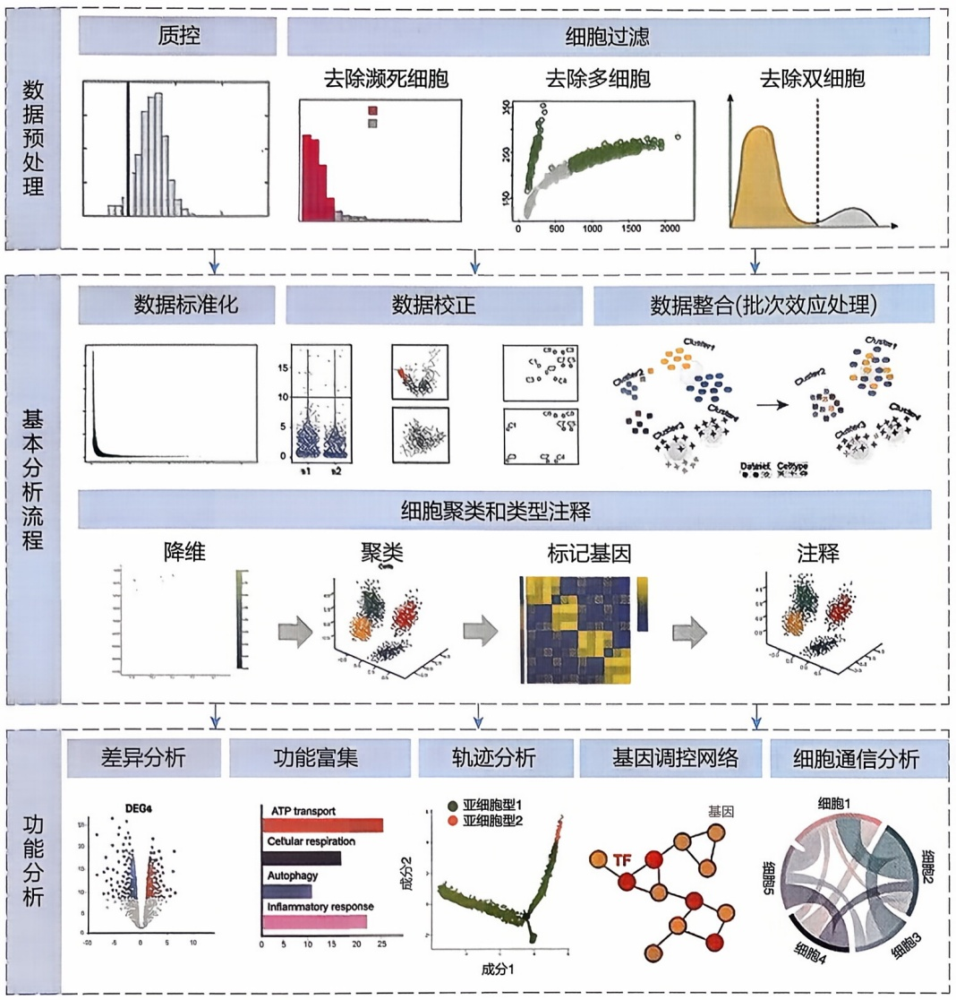
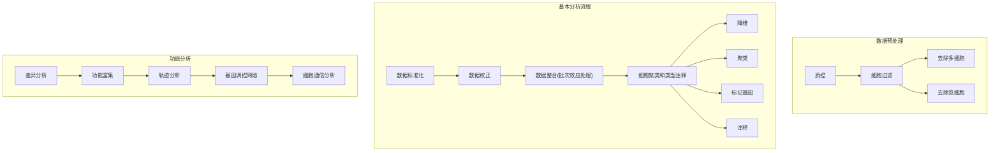

RNA 的三级结构也就是三维结构的预测原理和蛋白质等大分子的三维结构预测原理类似，可以参考本书的其他相关章节。

## 7.3.5 新非编码 RNA 的预测、发现和鉴定

预测和鉴定新的非编码 RNA 需要综合利用生物信息学分析、实验验证等多种方法，从而尽可能准确地识别和鉴定非编码 RNA 分子并研究其潜在的生物学功能，这些方法和技术主要包括以下 4 种。

## (1) 转录组测序技术

RNA-Seq 通过测序全转录组，可以发现新的非编码 RNA 分子，还可以通过 Small RNA-Seq 针对小非编码 RNA 分子进行测序，可以鉴定出新的 microRNA 等小非编码 RNA。

## (2) 生物信息学预测方法

基于序列特征的预测，利用机器学习模型，根据碱基组成、二级结构等特征预测新的非编码 RNA；基于保守性的预测，利用进化保守性分析，鉴定在不同物种中保守的非编码 RNA 序列；基于功能注释的预测，根据已知非编码 RNA 的功能特征，预测新的功能相关非编码 RNA。

## (3) 实验验证方法

① RNA 印迹（Northern blot） 利用探针检测新非编码 RNA 的表达。
② 实时荧光 PCR（real-time PCR） 定量检测新非编码 RNA 的表达水平。
③ 原位杂交 检测新非编码 RNA 在组织或细胞中的定位。
④ 功能实验 过表达或敲低新非编码 RNA，观察其生物学功能。

## (4) 高通量实验技术

① Ribo-Seq 通过测序核糖体结合的 RNA 片段, 鉴定 RNA 转录本的编码潜能。
② HAPE-Seq 利用化学探针鉴定和预测 RNA 二级结构。
③ CLIP-Seq 结合免疫亲和层析和测序技术，鉴定 RNA 与蛋白质的相互作用。

综合应用上述这些方法，可以有效地鉴定出非编码 RNA 分子，并探讨其生物学功能。这些方法的基本原理和相关软件归纳如下:

① 序列和结构特征分析 核酸碱基组成特征, 非编码 RNA 通常具有较高的 GC 含量, 以及特殊的核酸组成模式; 二级结构特征, 非编码 RNA 倾向于形成稳定的二级结构, 如茎环结构。涉及的软件包括 RNAstructure、RNAfold 等。
② 比对和保守性分析 功能性非编码 RNA 在进化过程中往往表现出较高的序列保守性，可以通过跨物种多序列比对，比较不同物种中保守的非编码 RNA 序列，可发现新的非编码 RNA；因为非编码 RNA 往往序列上不保守，因此也可以比较新序列与已知非编码 RNA 的二级/三级结构，识别相似的结构域。涉及的软件包括 BLAST、Rfam 等。
③ 转录组分析 表达特征分析，非编码 RNA 通常具有特定的时空表达模式，往往和一些重要的 mRNAs 共表达，可利用转录组数据进行预测；差异分析，比较不同样本或条件下新转录本的差异表达，推测其功能。涉及的软件包括 WGCNA、EdgeR、DEseq2 等。

④ 综合预测模型 整合多种特征，如序列、结构、表达、保守性等多个特征的组合预测，并通过机器学习方法利用监督或无监督学习算法构建预测模型。涉及的软件包括 COME、CPAT 等。

总的来说，新的非编码 RNA 的预测、发现和鉴定是一个复杂的生物信息学问题，需要综合利用多种信息和方法进行分析和预测。

## 7.3.6 非编码 RNA 研究展望

非编码 RNA（noncoding RNA，ncRNA）在许多生物过程中发挥关键作用，涵盖了基因调控、蛋白质合成、细胞间通信等。研究非编码 RNA 有助于我们更好地理解生命的复杂性和生物系统的精细调控，对未来非编码 RNA 的研究应有更广泛的展望。

## （1）新的非编码 RNA 类型的发现

随着测序技术的进步，尤其是单细胞、单分子水平的测序技术的发展和成熟，我们有能力从更多物种、更多组织、更多细胞类型中发现新的非编码RNA。例如，我们可以从纷繁复杂的微生物群落的宏转录组中发现和研究不同环境和条件下的新非编码RNA。

## (2) 非编码 RNA 结构预测方法的研究

除了进一步提高结构预测算法的速度和准确率，还包括预测假结（pseudoknot），整合各种实验数据，利用日益增长的数据库以及最新的 AI 技术、大模型等方法进行 RNA 结构预测。

## (3) 非编码 RNA 的调控和功能研究

虽然已经发现了大量的非编码 RNA，但大部分的调控和功能还不清楚。理解这些 RNA 如何通过与 DNA、RNA、蛋白质等分子相互作用来调控生物过程，将是未来的一个重要研究方向。

## （4）非编码 RNA 在疾病中的角色

越来越多的证据显示非编码RNA在许多疾病中，包括癌症、自身免疫疾病、神经退行性疾病、心血管疾病等，都发挥重要作用。例如，很多非编码RNA因为其特殊的二级结构或者结合蛋白的保护而稳定存在于循环血液以及其中的外泌体中，这些细胞外RNA很可能可以作为很多疾病的无创检测的分子标志物，直接通过抽血化验即可检测疾病状态。

## (5) 非编码 RNA 的疗法开发

利用非编码 RNA 进行疾病治疗是一个有前景的研究方向。例如，基于 siRNA 的 RNA 干扰（RNA interference，RNAi）系统已经被用于开发新的基因治疗方法。

除了 mRNA，人们也开始利用环状 RNA（circular RNA）制作 RNA 疫苗，在 RNA 疫苗设计中，RNA 结构、密码子和修饰的设计都是非常重要的研究方向。另外，提高 RNA 在存储和运输中的稳定性，递送到细胞和人体内的有效性和靶向性。

在未来，我们可以期待非编码 RNA 研究将继续深化我们对生物系统的理解，并为疾病诊断和治疗带来新的可能性。

## 7.4 单细胞转录组学

## 7.4.1 单细胞转录组数据预处理和质控

单细胞转录组数据分析的第一步是生成基因表达矩阵。对得到的原始测序数据，可通过使用 Cell Ranger 等数据处理软件进行分析得到单细胞表达矩阵。Cell Ranger 是  $10 \times Genomics$  公司为其单细胞测序分析量身打造的数据分析软件。运行 Cell Ranger 中的 “cellranger count” 命令可将测序数据与参考基因组比对并完成基因表达定量，生成单细胞基因表达矩阵。其运行结果主要包括两部分:网页版报告文件和各种文本文件。其中，filtered\_feature\_bc\_matrix 文件夹下的 3 个文件包含过滤后的单细胞表达矩阵，可用于下游 Seurat 或者 Scanpy 分析；网页报告 web\_summary 文件主要包括异常结果警告、测序样本中细胞数统计和基因中位数统计、测序结果统计、比对结果统计、样本信息和饱和度评估等信息，可用于帮助评估数据质量。

对于测序得到的单细胞转录组数据，它不仅包含高质量的真实细胞，还可能包含一些低质量的濒死细胞、双细胞（doublets）及多细胞（multiplets）等异常细胞，因此在数据分析过程中需要对数据进行质量控制（quality control, QC），将这些异常细胞进行过滤。在单细胞分选过程中，理想情况为每个细胞条形码标记单个细胞，但一个细胞条形码也可能会错误地标记双细胞、多细胞或者未标记任何细胞。在微流控单细胞分选时，如果单个微滴或者微反应室中两个或多个细胞同时被捕获，会导致双细胞或多细胞形成，其转录本信息是两个或多个细胞的转录本总和；而未封装细胞的液滴则称为空液滴（empty droplet），其转录本信息缺失。

为了实现对这些异常细胞的过滤，通常可通过Seurat或Scanpy软件基于以下3个指标对细胞进行质量控制及过滤:每个细胞UMI数，每个细胞基因数以及每个细胞中线粒体基因来源UMI占总UMI比例。通过检查这些指标分布情况并设置阈值可识别并过滤掉异常细胞。其中，检测基因数量少和线粒体UMI比例高的细胞一般代表膜破裂的濒死细胞，而基因数量过多细胞可能为双细胞或多细胞。

双细胞检测及过滤是单细胞数据质量控制中的一个重要环节。除了基于双细胞、多细胞中检测到的基因和 UMI 数量异常多的特性设定阈值进行过滤外，还可以基于算法模拟生成双细胞数据集并将其与真实数据集中的细胞进行比较来识别双细胞。DoubletFinder、Scrublet、scDblFinder 等软件基于该方法实现双细胞检测。

DoubletFinder 是目前去除双细胞常用的 R 软件包之一，其原理是从矩阵细胞中根据定义的细胞类型模拟生成双细胞数据集，并将模拟双细胞和原始矩阵数据合并进行降维聚类，对模拟双细胞数据集与原单细胞数据进行比较，通过计算每个单细胞与其最近邻细胞相似度或距离来鉴定潜在双细胞。

## 7.4.2 数据标准化、校正及整合

单细胞表达矩阵中的每个计数代表了细胞内 mRNA 成功捕获、反转录和测序等多个步骤综合的结果。因此，每个步骤固有的可变性使得即使相同类型细胞的 UMI 深度也可能不同，进而影响细胞之间基因表达的比较。标准化（normalization）旨在消除这些技术差异，使它们不干扰细胞之间基因表达的比较，确保在细胞群体中观察到的异质性或差异表达来源于生物学因素而非技术偏倚。R 软件包 Seurat 中 NormalizeData 函数可以实现标准化，它将每个基因的 UMI 数除以该细胞的总 UMI 数并乘以 scale.factor（默认 10000），再使用 log1p 对这些值进行对数转换，从而实现单细胞转录组数据的标准化处理，解决每个细胞测序深度差异对基因表达造成的影响，使基因表达在不同细胞中具有可比性。

数据校正（correction）对象包括技术和生物因素，例如，不同批次、不同线粒体基因百分比、不同细胞周期等，这些都可能对后续分析产生影响，因此需要对其进行校正。常见生物因素如细胞周期校正可以通过Seurat或Scanpy对细胞周期评分进行简单线性回归来实现。另外，该方法也能用于去除其他已知的生物因素，如线粒体基因百分比。去噪（denoising）也是单细胞转录组数据校正的一种类型。单细胞数据的一个特点就是含有许多噪声来源，其中一个就是捕获失败（dropout），即表达基因因极低RNA捕获率导致其表达计数错误地检测为0。捕获失败导致后续分析中增加了细胞间变异，同时也使基因表达分析失去真实性，使基因调控网络分析存在误差。一些工具可以用来推断捕获失败，并用适当表达量来替代0值，如MAGIC（Markov affinity-based graph imputation of cells）、DCA（deep count autoencoder）、scVI（single cell variational inference）等。MAGIC方法基于马尔可夫亲和力的细胞图插补法，通过数据扩散方式在相似细胞之间共享信息，插补每个细胞中可能的基因表达，从而实现缺失基因表达的恢复。

当前，单细胞转录组一般需要对多样本进行整合（integration）分析，整合过程需要去除批次效应。不同样本、不同送样时间、不同建库方法及测序平台、不同实验室等因素均可能造成不同批次的数据误差，即批次效应（batch effect）。批次效应影响基因表达定量、细胞聚类、细胞群鉴定准确性以及下游的所有分析。为了解决样本整合过程中的批次效应，目前研究者已经开发了多种方法，常用方法主要包括Seurat软件的CCA（canonical correlation analysis）和Harmony等。其中，CCA通过寻找不同数据集之间的共同变量，即所谓的“锚点”来整合来自不同条件或物种的单细胞数据。Harmony需要输入低维空间的坐标值（embedding），一般使用

PCA 的降维结果，该方法运行速度快，节省内存。

## 7.4.3 降维、聚类和细胞注释

单细胞转录组测序可检测成百上千个基因在上万个细胞中的表达情况，因此单细胞测序数据属于高维复杂数据。为了便于解读这些数据需要降低单细胞表达矩阵的维度，即降维（dimensionality reduction），常用的降维方法包括 PCA、t-SNE、UMAP、diffusion maps 等。这些方法将表达矩阵嵌入低维空间中，旨在以尽可能低的维度捕获数据的内部结构。PCA 是一种线性降维方法，它可将高维数据映射到低维空间从而减少特征数量。t-SNE 和 UMAP 是非线性降维方法，可以直接将高维空间的结构特征投影到低维空间（二维、三维）中。虽然 t-SNE 和 UMAP 在算法整体思路上相似，但又有所区别，主要体现在以下两点。① 计算高维距离方式不同:t-SNE 计算所有点间距离，将距离转换为概率，若两个点距离较近，它所对应概率较大。t-SNE 通过困惑度（perplexity）参数对全局结构和局部结构间的软边界进行调整，而 UMAP 只计算各个点与最近 $k$ 个点之间距离。② 信息损失计算方法不同:t-SNE 使用 KL 散度衡量信息损失，在全局结构保留上存在失真可能，而 UMAP 通过使用二元交叉熵作为成本函数，在保留全局和局部结构方面表现更佳。

聚类（clustering）是指根据细胞基因表达谱相似性对细胞进行分组而获得细胞簇（clusters）。表达谱相似性通常将降维结果作为输入，通过距离度量来确定。目前根据相似性生成细胞簇的方法主要有两种:聚类算法（clustering algorithms）和社区检测算法（community detection methods）。聚类算法是一种经典的无监督机器学习方法，直接基于距离矩阵。社区检测算法是一种图聚类算法（graph clustering algorithms），依赖于单细胞数据的图表示。图的表示使用 $K-$ 最近邻（$K$-nearest neighbor, KNN）图来实现。KNN 图通过将表达空间中密集区域表示为图中密集连接区域（densely connected regions）。在 KNN 图中，节点（node）反映了数据集中的细胞。首先需要在主成分降维的表达空间上计算所有细胞的欧几里得距离矩阵，并将每个细胞连接到其 $k$ 个最相似细胞。通常，$k$ 设置在 $5 \sim 100$，具体取决于数据集大小。在获得细胞邻域图后，根据细胞的图结构利用图聚类算法将相似细胞进行聚类。在单细胞转录组数据分析中，通常使用 Louvain 和 Leiden 算法。Leiden 算法是 Louvain 算法的改进版本，通过考虑聚类中细胞间连接数与数据集中整体预定义连接权重比例来创建聚类，有助于得到更合理的聚类结果。R 软件包 Seurat 采用的是谱聚类（spectral clustering）方法，是基于共享最近邻（shared nearest neighbour, SNN）图和模块化优化的聚类算法来识别细胞簇。它首先计算 $K-$ 最近邻并构造 SNN 图，然后优化模块化功能以确定具体细胞群。

聚类能够将基因表达相似的细胞聚在一起，理论上这些聚在一起的细胞属于同类细胞。但聚类结果并不能直观地呈现各细胞簇所对应的细胞类型，因此需要通过多种方法来进行细胞注释（annotation）以识别聚类的细胞簇所对应细胞类型。常用的细胞注释方法包括手动注释和自动注释两类。手动注释是指基于已知的细胞特异性标记基因（marker gene）来识别各细胞簇的身份。近年来，多种自动化细胞注释方法被开发并用于注释细胞簇对应细胞类型，如 singleR、scmap、Azimuth 等工具，它们基于预注释的单细胞数据集作为参考或训练集对未定义细胞类型的细胞簇或单个细胞分配细胞身份。这些自动化注释方法多依赖于精确的注释参考数据。

## 7.4.4 差异细胞比例和差异表达基因分析

单细胞转录组数据差异分析通常包括差异细胞比例和差异表达基因分析。细胞比例研究主要关注不同细胞类型的相对丰度。在发育和疾病中经常观察到细胞比例变化或特异的细胞类型，但细胞比例分析方法缺乏独立的基准。单变量统计模型单独分析每种细胞类型的丰度变化，可能会将一些细胞类型的群体变化视为统计学上的合理效应，尽管它们纯粹是由数据的组合性引起的统计学假象，导致FDR值升高。专门为单细胞数据中细胞组成分析而设计的方法包括scDC、scCODA和tascCODA等，这些方法可以纳入分层细胞类型信息。scDC通过bootstrap重采样和GLM（generalized linear model）及GLMM（generalized linear mixed model）模型对单细胞转录组数据进行差异细胞类型组成分析。scCODA是一种用于细胞类型组成差异丰度分析的贝叶斯模型，它使用分层Dirichlet-Multinomial分布对细胞类型计数进行建模，能以简约的方式估计二元（或连续）协变量对细胞类型比例的影响。tascCODA是scCODA的扩展。

单细胞转录组数据的差异表达分析目前主要从两个角度进行。

## (1) 样本层面

可将单细胞数据聚合为伪批量（pseudo-bulk）数据，对每个样本中细胞的基因表达求和，从而得到与每个样本对应的伪批量表达量，并使用软件包DESeq2、edgeR或limma进行样本间差异表达分析。

## (2) 细胞群层面

Seurat 软件包提供了多种计算差异表达基因的方法，可以通过 FindMarkers 函数中的 test.use 参数设置检验差异表达基因的方法。默认情况下，FindMarkers 函数使用非参数 Wilcoxon 秩和检验（Wilcoxon rank-sum test）进行差异表达分析。此外，Seurat 软件包提供的差异表达分析方法还包括 bimod、roc、t-test、poisson、MAST、DESeq2 等。差异表达基因根据设置差异倍数和 p 值或 FDR 值进行筛选。

同时，为了准确地揭示特定细胞群体的功能偏倚和生物学意义，有必要对目标差异表达基因集进行基因集富集分析，该分析可以将差异表达基因集总结为可解释的术语，如功能通路等。常见的数据库包括 GO、KEGG、MSigDB 和 Reactome。这一概念的延伸是加权基因集，包括用于信号通路分析的 PROGENy 和用于转录因子（transcription factor，TF）活性推断的 DoRothEA。常用的富集方法包括超几何分布、GSEA 和 GSVA 等，7.2 节已经介绍。

## 7.4.5 细胞发育轨迹推断

单细胞测序捕获了单细胞在静止状态的 RNA 丰度，为了分析细胞特征随时间变化的动态过程，得到细胞发育轨迹，研究人员开发了基于基因表达模式相似性排序细胞的拟时序（pseudotime）分析方法，以及基于 RNA 剪接动力学的 RNA 速率（RNA velocity）分析方法。

拟时序分析根据不同细胞亚群基因表达量随时间的变化情况来构建细胞谱系发育。这个“时间”并非真实时间，而是一个虚拟时间序列，反映了细胞间转化的顺序及轨迹。它根据细胞中基因表达模式将每个细胞按照拟时间排列在对应轨迹上，并根据基因表达特征把细胞分成多个分化状态下的细胞群，生成直观的谱系发育树状图，可预测细胞分化及发育轨迹。最早用于构建发育轨迹且应用广泛的拟时序分析工具之一是Monocle，它借鉴显式主图（如t-SNE和UMAP）来展示细胞转录特征相似性关系，并通过嵌入反向图来重建单细胞轨迹，将细胞按照拟时序排列在相应轨迹上，有较高的稳健性和准确性。其中，Monocle2使用DDRTree降维图，Monocle3使用UMAP降维图。Monocle通过学习每个细胞经历的基因表达变化序列，根据拟时间对每个细胞进行排序，模拟出时间发育过程的动态变化。同时，单细胞发育轨迹通常包括分支，分支产生是由于细胞具有不同的基因表达特征，Monocle可以通过分支表达分析建模（branched expression analysis modeling，BEAM）对不同分支时间进行分析，鉴定在基因表达上受分支依赖的基因。Monocle提供了算法自动推断起始点，同时用户也可以利用先验知识指定轨迹的“起始点”或“根”，即假设的最早期细胞状态，从而生成有向的单细胞发育轨迹。

RNA 速率是一种可以预测单细胞未来状态的高维矢量，通过估计基因的未剪接 RNA（前体 RNA，pre-mRNA）与已剪接 RNA（成熟 RNA，mature mRNA）的比例来推断基因的转录状态和预测细胞的发育轨迹（图 7-17）。mRNA 在细胞内经历了转录、剪接、降解 3 个过程。当基因处于转录活跃状态时（图 7-17 中橙色区），细胞会产生大量的未剪接 RNA，同时剪接和降解过程也随之激活，在这个过程中，RNA 总量（前体 RNA 和已剪接 RNA）不断上升，而剪接 RNA 的比例也会上升；当 RNA 转录停止时（图 7-17 中蓝色区），新的前体 RNA 不再产生，已存在的 RNA 会继续被剪接和降解，在这个过程中，RNA总量开始下降，但剪接RNA比例可能仍然会短暂上升，直到所有未剪接RNA都被剪接并降解，剪接RNA的比例会开始下降。RNA速率分析可以推断细胞的RNA剪接动力学，并以矢量形式预测不同阶段单细胞的未来状态。目前常用的分析工具包括Velocyto、scVelo、CellRank等。

flowchart

(a)

flowchart

(b)

图7-17 RNA速率原理

## 7.4.6 基因调控网络

基因表达受到转录以及转录后调控多个层面的调节。转录因子及其下游靶基因形成的基因调控网络（gene regulatory network，GRN）在基因表达调控中发挥重要作用。基因调控网络参与细胞稳态的维持和细胞异质性的形成。单细胞转录组层面的基因调控网络分析方法主要有SCENIC（single-cell regulatory network inference and clustering）和hdWGCNA（high dimensional weighted gene co-expression network analysis）。

SCENIC 基于共表达和 DNA 调控基序（motif）分析来推断单细胞转录组基因调控网络。SCENIC 分析主要包括以下步骤:① 利用 GENIE3（gene network inference with ensemble of trees 3）或 GRNBoost（gradient boosting）基于共表达推测转录因子与候选靶基因之间的共表达模块。② 由于共表达分析会存在假阳性和间接靶标，为识别转录因子的直接结合靶标（direct-binding targets），使用 RcisTarget 对每个共表达模块进行顺式调控基序（cis-regulatory motif）分析，识别转录因子的直接靶基因。每个 TF 及其潜在的直接靶基因被称为一个调节子（regulon）。③ 通过 AUCell 对每个细胞的每个调节子活性进行评分，生成调节子活性矩阵。SCENIC 通过为每个调节子设置 AUC 阈值，将该矩阵进行二值化（0|1, off|on），以确定调节子在哪些细胞中处于“打开”状态。2023 年，相关研究团队进一步开发了用于推断增强子驱动基因调控网络的方法 SCENIC+，可以预测基因组增强子以及候选上游转录因子，并将这些增强子与候选目标基因联系起来，在基因组水平上分析转录因子潜在结合的增强子序列、结合模式及其调控的靶基因。

hdWGCNA 建立在 WGCNA 基础上，扩展了其在单细胞和空间转录组学领域的应用，可用于分析高维转录组学（单细胞和空间转录组学）数据中的共表达网络。hdWGCNA 提供网络推断、基因模块识别、基因富集分析和数据可视化等功能。由于单细胞转录组数据具有严重稀疏性，即每个细胞中大多数基因表达值为 0，而 WGCNA 分析对数据稀疏性非常敏感，因此需要构建 metacell 来代替原始表达矩阵。hdWGCNA 通过 K-最近邻算法识别基因表达相似细胞，并将这些相似细胞合并成一个 metacell，这个 metacell 的基因表达量就是合并前细胞的基因表达量均值或总表达量，从而产生 metacell 基因表达矩阵。metacell 表达矩阵的稀疏性与原始表达矩阵相比大大降低，因此更适用于后续分析。在构建好 metacell 之后，hdWGCNA 分析和普通转录组常规 WGCNA 分析内容相近。对于 WGCNA 分析细节，7.2 节已经介绍。

## 7.4.7 细胞通信分析

组织和器官的发育、功能、再生和稳态是由细胞通信或细胞间信号转导介导的。推断细胞通信的方法通常使用配体、受体及其相互作用库来预测不同细胞类型之间的相互作用，常见的分析工具包括 CellPhoneDB、CellChat、NicheNet、SingleCellSignalR、Cytotalk 和 iTalk 等。

在细胞通信分析算法中，CellPhoneDB是应用最广泛的细胞通信分析算法之一，它通过表达量和显著性两个层面来检测细胞通信关系和相应配受体对，以此辅助细胞通信研究。通过计算配体和受体细胞类型中配受体基因的平均表达量来反映细胞互作可能性，通常配受体表达量越高，细胞对间互作可能性越大。同时，该方法通过随机置换细胞标签来生成配体-受体对平均表达水平的零分布，并与实际表达水平进行比较，得到置换检验 $p$ 值，以确定特定细胞类型间的配体-受体对互作显著性。CellPhoneDB包含数据库注释的受体和配体，以及人工注释的参与细胞通信的蛋白质家族，并考虑了受体和配体的亚基结构，可对细胞通信分子进行全面系统分析，同时它有着较强的扩展性，用户可以自定义或更新数据库，引入新的相互作用分子，使得CellPhoneDB能够适应新的研究。

CellChat 软件自开发以来也得到了广泛使用。它可以定量推断和分析单个或多个样本的细胞通信网络，通过网络分析和模式识别方法预测细胞的主要信号输入和输出，以及这些细胞类型和信号如何协调发挥功能。除了配受体层面分析，它还可对各种感兴趣通路进行细胞类型间通路互作的配受体对进行分析，在配受体分析基础上获得通路相关调控信息。为了解释细胞通信网络，CellChat 通过从图论、模式识别和流形学习中抽象出来的方法对网络进行定量测量。它可以使用网络分析的中心性度量来确定信号网络内的主要信号源和目标以及中介和影响者，利用模式识别方法预测特定细胞类型的关键传入和传出信号及不同细胞类型间的协调反应。CellChat 具备用于不同分析任务的强大可视化功能，包括层次图、弦图、热图和气泡图等。

与 CellPhoneDB 和 CellChat 不同，NicheNet 通过收集配体-受体配对信息、信号通路、基因调控网络等信息，整合了配体主导的权重配体-靶基因调控模型，基于该模型和单细胞表达数据，它可有效地预测细胞配体活性并推测与之匹配受体、靶基因及下游信号网络等信息。2023 年，NicheNet 开发团队推出了 MultiNicheNet，它可以分析不同样本及不同条件下的差异细胞通信，推断差异表达和活性配受体对，并预测这些配受体对可能的下游靶基因。

## 7.4.8 单细胞转录组数据分析总结

单细胞转录组数据分析包括多个步骤，它主要涉及以下几个环节（图 7-18）。① 数据预处理:在对原始测序数据分析生成基因表达矩阵之后，需要通过细胞基因数、UMI 数、细胞线粒体 UMI 占总 UMI 比例等指标对细胞进行质控，将濒死细胞、双细胞、多细胞等异常细胞进行过滤，在此基础上对数据进行标准化，校正及整合，消除各种技术和生物因素对数据分析造成的偏差。②降维、细胞聚类和类型注释:对于高维单细胞转录组数据，通过降维将高维空间特征投影到低维空间（二维、三维），并基于基因表达相似性对细胞进行聚类，通过手动和自动注释方法完成细胞群及细胞亚群注释。③细胞及基因层面多维度分析:在细胞注释后，可以开展细胞群或亚群细胞比例和差异表达基因分析，并对差异表达基因进行功能富集分析等；对于不同细胞亚群，通过拟时序或RNA速率方法对它们进行细胞发育轨迹推断；在细胞群或亚群内，通过SCENIC和WGCNA等解析细胞内基因调控网络；在细胞群或亚群间，通过CellPhoneDB、CellChat、NicheNet等方法推断细胞通信。

flowchart

图7-18 单细胞转录组数据分析

## 7.4.9 单细胞转录组应用

单细胞转录组测序技术能够以前所未有的高分辨率准确且快速地鉴定组织中的稀有和新型细胞，能够揭示单个细胞内RNA转录本的异质性和复杂性及组织、器官和生物体中各类型细胞功能。单细胞转录组测序技术的应用非常广泛，我们将在本节内容中简要介绍其在发育、肿瘤和免疫这三个方面的应用，并以免疫为例展开单细胞转录组在免疫相关应用领域取得的科研突破。

## 7.4.9.1 单细胞转录组与发育

胚胎发育是人类最重要的生命过程之一。在胚胎发育过程中，细胞会经历复杂的形态发生运动，之后通过组织分化发育为成体器官。器官发育的调控机制一直是发育生物学中一个重要的科学问题。

胚胎发育早期的细胞数量有限，传统的转录组测序技术不能对其进行系统解析。当前，单细胞转录组测序技术广泛应用到早期胚胎发育研究中，加深了对人类胚胎早期发育过程基因表达时空特异性模式的理解。同时，近年来单细胞转录组测序在多种组织器官发育领域也得到了广泛应用，包括人类大脑多个部位（额叶皮层、丘脑、小脑等）、心脏、消化道器官（食管、胃、小肠、大肠等）、肾、肺等。总之，单细胞转录组在深入了解胚胎发育过程中各个时期、各个器官不同细胞群的功能，揭示胚胎发育中的分子机制和调控网络上发挥了重要作用。

## 7.4.9.2 单细胞转录组与肿瘤

在肿瘤中，肿瘤细胞（tumor cell）和肿瘤微环境（tumor micro-environment, TME）共同构成一个复杂的肿瘤生态系统。单细胞转录组测序技术不仅能鉴别肿瘤中各类型细胞的不同状态及其功能差异，还能表征肿瘤细胞与其微环境之间的相互作用，使得在单细胞分辨率水平研究肿瘤异质性及其影响成为现实。

在肿瘤研究中，单细胞技术被广泛应用于肿瘤细胞及肿瘤微环境的异质性以及肿瘤转移和治疗抵抗（耐药性）等方面。单细胞测序技术能够准确地识别肿瘤中的不同细胞类型及其基因表达特征，为肿瘤诊疗提供新的思路。当前，多数癌症的肿瘤细胞图谱被绘制，并进行了精细的肿瘤亚群划分，多个与肿瘤发生、转移、耐药等相关的肿瘤细胞亚群被发现。此外，对于成纤维细胞、内皮细胞以及多种免疫细胞，研究者通过单细胞测序技术也揭示了多种与肿瘤发生、转移及耐药相关的细胞亚群。这些细胞群可作为肿瘤诊疗的重要靶标。

## 7.4.9.3 单细胞转录组与免疫

单细胞转录组在免疫学领域的研究涵盖了感染性疾病、自身免疫疾病、肿瘤免疫和免疫治疗等多个方面，在揭示免疫应答机制、发展新型治疗策略以及优化现有疗法方面发挥着重要作用。

## (1) 感染性疾病

感染性疾病是指由病原微生物（病毒、细菌、真菌等）和寄生虫等感染所导致的疾病，是引起人类死亡的主要因素。单细胞转录组可用于分析病原体感染期间人类免疫细胞的组成变化，鉴定感染诱发的新型免疫细胞亚群。此外，单细胞转录组可检测感染性疾病发生过程中人类多种免疫细胞的免疫响应和炎症反应，从而揭示重要的分子致病机制。单细胞转录组和免疫组库（immune repertoire，IR）联用可鉴定有效的中和抗体，并用于测试感染性疾病疫苗接种的功效。总之，单细胞转录组对感染性疾病机制解析和后续治疗策略开发具有重要价值。

## (2) 自身免疫疾病

自身免疫疾病是指人体对自身抗原发生免疫反应导致自身组织发生损害的疾病，它的发生发展与免疫系统功能紊乱密切有关。单细胞转录组可用于鉴定自身免疫疾病的致病免疫细胞类型，阐明致病免疫细胞的发育谱系，揭示免疫细胞的基因表达变化，分析异常免疫反应的调控机制，有助于疾病的发病机制阐明和治疗策略开发。目前，单细胞转录组已广泛应用于多种自身免疫性疾病研究，如通过单细胞转录组揭示系统性红斑狼疮特定细胞类型的基因表达变化，绘制狼疮性肾炎患者肾免疫细胞图谱，阐明原发性干燥综合征患者外周血免疫细胞的表达和调控特征，识别系统性硬化症中的皮肤特异性T细胞反应等。

## (3) 肿瘤免疫

单细胞转录组已广泛应用于肿瘤免疫微环境的研究，它可以精确地绘制肿瘤微环境中的免疫细胞图谱，揭示肿瘤浸润免疫细胞的异质性和动态变化，使我们更全面地理解肿瘤免疫逃逸机制和免疫微环境的复杂性。同时，通过与肿瘤细胞的单细胞转录组相结合，可揭示肿瘤微环境中的不同免疫细胞群体及其功能状态与肿瘤细胞间的相互作用。单细胞转录组在肿瘤免疫中的应用不仅促进了对肿瘤浸润免疫细胞的深入了解，还有助于鉴定新的免疫治疗靶点，为开发新型免疫疗法提供了重要科学依据。

当前，单细胞转录组在肿瘤免疫中的研究包括对T细胞、B细胞、NK细胞及其他多种免疫细胞的动态组成和功能变化解析等。伴随着单细胞数据的积累，研究者在泛癌症层面对多种类型免疫细胞进行了图谱绘制和功能解析。T细胞是肿瘤免疫治疗的关键角色，研究者通过结合单细胞基因表达谱和T细胞受体序列，在泛癌层面系统地刻画了肿瘤浸润性T细胞的异质性和动态性，并系统地比较了其在多种癌症类型之间的异同，加深了对肿瘤浸润T细胞的认识，也将进一步促进新的癌症免疫治疗方法开发。研究发现了多种肿瘤反应性T细胞群体，且它们的状态在不同肿瘤类型微环境中高度变化。NK细胞在肿瘤中是一种重要的先天性免疫应答细胞，通过对涵盖多癌种单细胞转录组数据进行整合分析，研究揭示了NK细胞在肿瘤微环境中表型以及功能多样性。此外，对于肿瘤浸润髓系细胞（肥大细胞、树突状细胞、中性粒细胞以及肿瘤相关巨噬细胞等）和B细胞，研究者对它们均在泛癌种层面开展了系统性研究，发现了多种可用于肿瘤治疗的免疫细胞亚群。

## (4) 免疫治疗

免疫治疗（immunotherapy）是指针对机体低下或亢进的免疫状态，人为地增强或抑制机体的免疫功能以达到治疗疾病目的的治疗方法，现已成为一种有效的治疗手段。当前肿瘤免疫治疗的成功率大约 $20\%$ ，单细胞转录组可揭示肿瘤对免疫治疗产生抵抗性的分子机制。以黑色素瘤为例，研究者通过单细胞转录组鉴定到在免疫治疗抵抗性患者的恶性肿瘤细胞存在一种免疫抵抗性程序，其可预测黑色素瘤患者对免疫治疗的有效性。CDK4/6抑制剂可抑制这种免疫抵抗性程序，实现患者对免疫治疗的敏感性。因此，单细胞转录组为肿瘤免疫治疗方案的制定提供了有力支持，有望显著提高癌症治疗的成功率和患者的生存率。此外，单细胞转录组还可以明确免疫治疗在细胞层面的具体作用机制。单细胞转录组可揭示在免疫治疗过程中免疫细胞的表型和功能变化，阐明免疫细胞和其他细胞间的相互作用，解析免疫治疗重塑微环境的分子机制。

## 7.4.10 空间转录组分析

相比于单细胞转录组技术，空间转录组技术增加了两种额外的信息:空间位置信息和组织图像信息。前者有利于解析细胞所处的微环境及其功能依赖，后者可以帮助鉴定细胞的形态信息及识别变化的空间模式。因此，空间转录组数据需要专门的分析算法和工具。空间转录组学的特色分析包括单细胞空间数据获取、空间基因表达预测、空间域（spatial domain）鉴定以及空间细胞相互作用等方面。

目前，无论是基于阵列（array）还是基于图像的空间转录组学数据，都需要特定的工具将测量的分子分配给单个细胞。对于低分辨率空间数据，需要使用专门的算法进行去卷积分析，常用的算法包括 Cell2location、SpatialDWLS、RCTD、STRIDE 和 DestVI 等。基准测试结果显示 Cell2location、SpatialDWLS 和 RCTD 在总体性能上表现最佳。Cell2location 利用贝叶斯模型并结合单细胞转录组数据中细胞亚群的基因表达特征，来估计空间数据中每个检测点的细胞类型丰度。对于高分辨率空间数据，可以通过对组织图像学数据进行细胞分割来实现。常用的细胞分割算法包括分水岭算法以及一些基于深度学习的方法，如 DeepCell、Cellpose 和 Stardist。另外，也可以使用无分割的方法，如 SSAM 和 Baysor，这类方法直接将邻近的转录本归属到同一个细胞中。

基于原位杂交的空间转录组学方法（如 seqFISH 和 MERFISH 等）具有分辨率高和灵敏度高的优点，但它们能够检测的 RNA 转录本数量有限。因此，研究者设计了一系列算法，通过整合单细胞转录组数据和空间数据来预测在空间数据中未检出的转录本表达水平。例如，gimVI 采用深度生成模型来推断未检测到的转录本的空间分布；SpaGE 使用域自适应算法 PRECISE 和 K-最近邻回归来预测未检测到的转录本的空间分布；Tangram 则使用非凸优化和深度学习框架将单细胞转录组数据映射到空间上。基准测试结果显示，Tangram、gimVI 和 SpaGE 在预测未检出空间基因表达方面具有最佳表现。

空间转录组数据还允许研究人员超越单细胞转录组中细胞聚类的概念，通过利用空间基因表达或空间细胞类型组成来鉴定空间域，从而研究复杂组织的空间架构。常用的空间域识别算法包括 SpaGCN、SPACEL、BayesSpace 和 STAGATE 等。例如，SpaGCN 通过图神经网络聚合每个检测点与其相邻点的基因表达，并结合组织学图像信息来鉴定空间域。基于空间域，可以进一步通过基因差异表达分析研究空间域的基因表达模式。SPACEL 算法则先通过整合单细胞转录组数据和空间数据进行去卷积，得到细胞类型的空间组成分布，然后再基于该细胞组成分布利用图卷积网络和对抗学习算法进行空间域的鉴定。

在上述介绍中，单细胞转录组数据可以利用 CellPhoneDB、CellChat 和 NicheNet 等方法推断亚群之间的细胞相互作用，了解细胞所受到的分子信号影响与细胞状态的关系。然而，单细胞转录组技术需要解离细胞，这些方法忽略了组织的底层空间结构，这可能导致大量假阳性结果。因此，空间转录组学数据所具有的空间信息为精确研究组织局部的细胞相互作用提供了天然优势。这类算法包括 Giotto、COMMOT、SpatialDM、stLearn 和 MISTy 等。例如，Giotto 通过构建空间邻近图来识别膜结合的配体-受体相互作用；COMMOT 则利用一种空间约束的最优传输算法来推断细胞间的相互作用，该算法的特点是同时考虑不同配体和受体之间的竞争关系以及空间距离，将配体传输到相应的受体上，从而更准确地模拟和预测细胞间的信号传递过程。

总体而言，空间转录组学的技术和分析方法的发展不仅深化了我们对细胞间复杂交互作用的理解，也为研究疾病机理和开发新疗法开辟了新的视角。

## 7.5 转录组学的总结与展望

本章概述了转录组学的理论与实践，涵盖了转录组学的基本概念、测序建库方法、转录定量及差异分析，以及RNA序列结构预测等内容。我们还探讨了近年来兴起的单细胞与空间转录组测序技术，以及它们相较于传统方法在应用方面的优势。同时，介绍了非编码RNA的序列特征，为开展特定类型非编码RNA的鉴定，深入理解其结构与调控规律奠定基础。我们强调了机器学习技术在转录组学分析中的应用，讨论了RNA结构预测、单细胞数据聚类及非编码RNA预测方法。考虑篇幅限制，相关数据库和分析工具的特点已通过表格形式进行总结，读者可查阅相关文献以获取更详细信息。

展望未来，转录组学将迎来多个重要发展方向。随着第三代测序技术的进步，对基因表达调控区域的理解将加深，尤其是在非编码区域的复杂结构变异及长距离调控元件方面。这将促进基因表达调控网络的完善，并推动转录组学的进一步发展。T2T（telomere-to-telomere）参考基因组的应用将深化对转录本多样性及剪接异构体的理解，并优化基因表达分析流程。单细胞RNA测序技术的发展将提高其通量与准确性，从而在多个生命科学领域展现优势。转录组学将逐步与基因组学、蛋白质组学及代谢组学等多组学数据结合，建立更全面的生物网络模型，发掘复杂生物过程中的基因相互作用，揭示细胞功能的全貌。人工智能和机器学习的快速发展将提升转录组数据分析效率，助力复杂生物系统的建模与新生物标志物的发现。转录组学的应用领域将不断扩展，从基础生物学到临床应用，为农业、环境科学及药物开发等提供重要数据支持。转录组学不仅为理解生命基本机制提供了重要工具，也为疾病的诊断和治疗开辟了新路径，未来将在生命科学研究中继续发挥关键作用。

## ※ 推荐阅读

1. Chen Q, Meng X, Liao Q, et al. Versatile interactions and bioinformatics analysis of noncoding RNAs [J]. Briefings in bioinformatics, 2019, 20(5): 1781-1794.
点评:该综述全面介绍了 ncRNA（非编码 RNA）的分类及其多样化功能，重点探讨了 ncRNA 与其他生物分子之间的复杂互作形式。文章明确了进行 ncRNA 综合性分析的关键需求，并梳理了现有的 ncRNA 识别与功能注释工具、数据库及平台，为深入开展系统性研究提供了重要参考。
2. Lotfollahi M, Hao Y, Theis F J, et al. The future of rapid and automated single-cell data analysis using reference mapping [J]. Cell, 2024, 187(10): 2343-2358.

点评:该文总结了参考映射（reference mapping）策略在单细胞数据分析（single-cell data analysis）领域的核心地位，并阐述了其多样化的应用场景。文章深入剖析了构建权威参考图谱面临的巨大挑战，并主张采用开源图谱（open source atlasing）的方法，以实现参考高效且可靠的更新，从而更好地应对新数据的涌现。
3. Stark R, Grzelak M, Hadfield J. RNA sequencing: the teenage years [J]. Nature reviews genetics, 2019, 20(11): 631-656.

点评:该文总结了RNA-Seq（RNA测序）在过去十余年的发展历程，系统梳理了不同测序技术的发展脉络，并展望了RNA-Seq在单细胞转录组和空间转录组分析中的广阔潜力。文章通过解析不同测序技术的技术特点，阐释了长读长技术有望成为未来主流测序方式，推动转录组学迈向高精度与大通量的新时代。

## ※ 思考与练习题

1. 常用的转录组组装策略有哪些？各种策略的优缺点是什么？
2. 转录组测序数据可用于基因和转录本水平的定量分析。基因和转录本定量受哪些因素的影响？如何克服这些因素的影响？
3. 各类非编码 RNA 之间的关系是什么？请举例说明。
4. scRNA-Seq 数据预处理过程去除了哪些低质量细胞？
5. 试比较 scRNA-Seq 和 bulk RNA-Seq 的差异分析方法有何异同？

## ※ 讨论题

1. 目前公共数据库中已积累了大量的 RNA-Seq 数据集，试围绕一个科学问题，设计相应的生物信息学分析流程进行转录组数据的整合与分析。
2. 试比较各类非编码 RNA 数据分析流程和 mRNA 数据分析流程的异同。
3. 相比于 scRNA-Seq，空间转录组学技术具有什么独特的特点？

## ※ 参考文献

1. Herman A B, Tsitsipatis D, Gorospe M. Integrated lncRNA function upon genomic and epigenomic regulation [J]. Molecular cell, 2022, 82(12): 2252-2266.
2. Heumos L, Schaar A C, Lance C, et al. Best practices for single-cell analysis across modalities [J]. Nature reviews genetics, 2023, 24(8): 550-572.
3. Hombach S, Kretz M. Non-coding RNAs: classification, biology and functioning [J]. Advances in experimental medicine and biology, 2016, (937): 3-17.
4. Luecken M D, Theis F J. Current best practices in single-cell RNA-Seq analysis: a tutorial [J]. Molecular systems biology, 2019, 15(6): e8746.
5. Pertea M, Kim D, Pertea G M, et al. Transcript-level expression analysis of RNA-Seq experiments with HISAT, StringTie and Ballgown [J]. Nature protocols, 2016, 11(9): 1650-1667.
6. Ramírez-González R H, Borrill P, Lang D, et al. The transcriptional landscape of polyploid wheat [J]. Science, 2018, 361(6403): eaar6089.
7. Rao A, Barkley D, França G S, et al. Exploring tissue architecture using spatial transcriptomics [J]. Nature, 2021, 596(7871): 211-220.
8. St Laurent G, Wahlestedt C, Kapranov P. The landscape of long noncoding RNA classification [J]. Trends in genetics. 2015, 31(5): 239-251.
9. Svensson V, Vento-Tormo R, Teichmann S A. Exponential scaling of single-cell RNA-Seq in the past decade [J]. Nature protocols, 2018, 13(4): 599-604.
10. Trapnell C, Williams B A, Pertea G, et al. Transcript assembly and quantification by RNA-Seq reveals unannotated transcripts and isoform switching during cell differentiation [J]. Nature biotechnology, 2010, 28(5): 511-515.

编者:瞿昆（中国科学技术大学）

何顺民（中国科学院生物物理研究所）

马闯（西北农林科技大学）

鲁志（清华大学）

孙宝发（南开大学）

审读:李婧（上海交通大学）