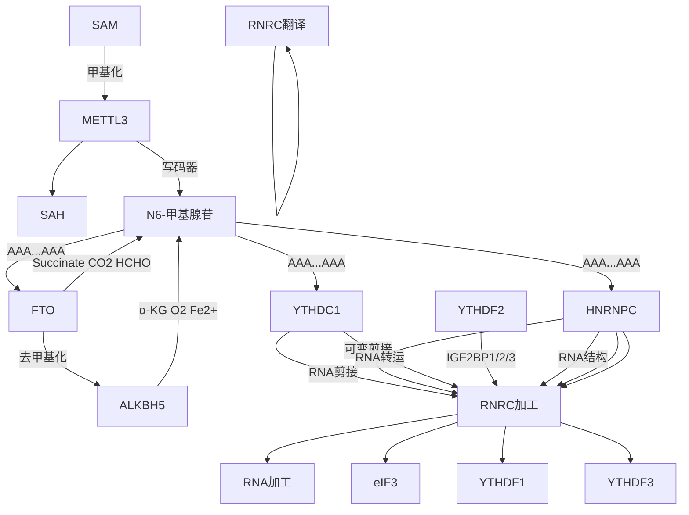
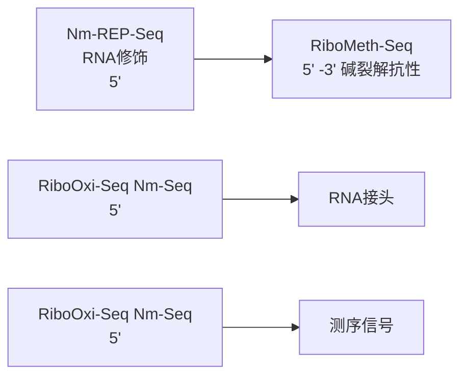
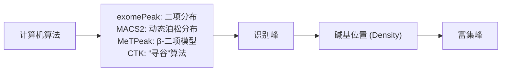
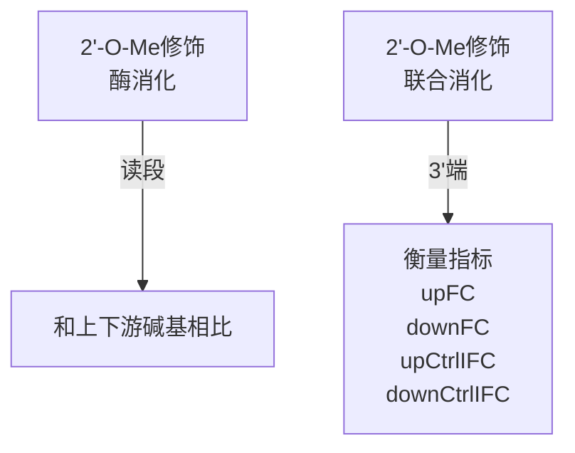
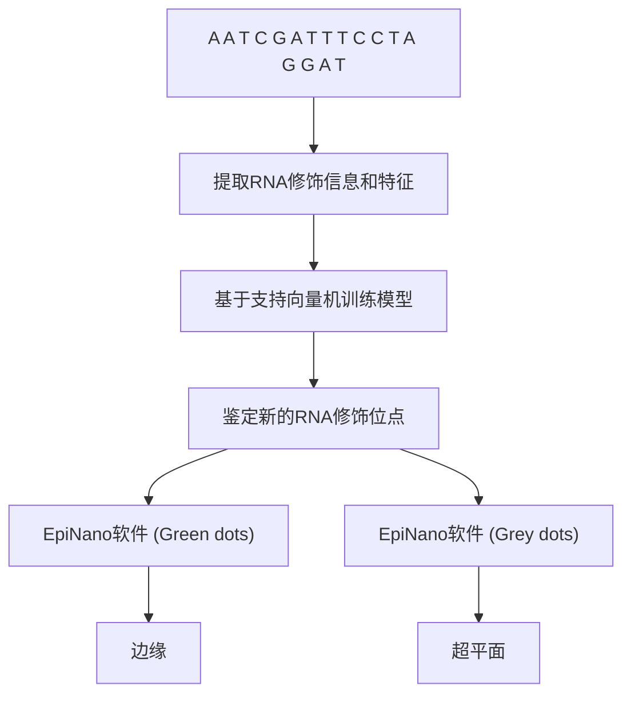
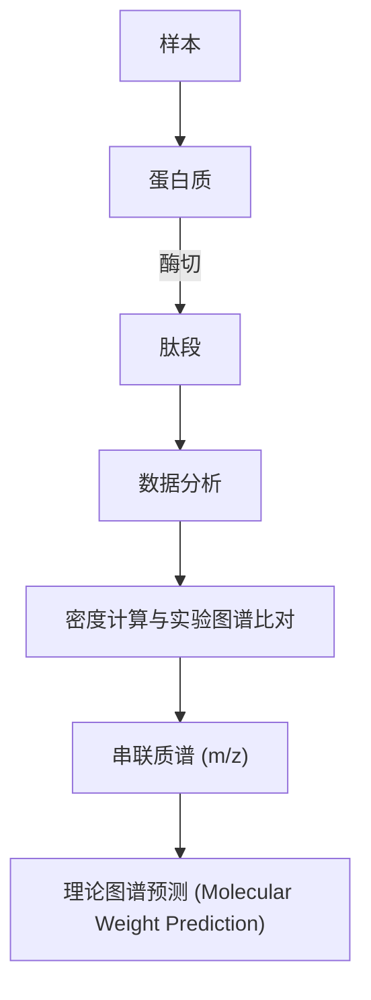

bar

| Region | Direction Index (Range) |
| --- | --- |
| Top-Left | ~50 to ~60 |
| Middle-Left | ~-40 to ~-20 |
| Middle-Right | ~-30 to ~-10 |
| Bottom-Right | ~-70 to ~-50 |

图8-24 使用方向指数识别染色质拓扑结构域的示例

定义为 A，对下游 2 Mb 内的相互作用数目定义为 B，A 和 B 的均值为 E，则方向指数的公式为:

$$
D I = \frac {B - A}{| B - A |} \left[ \frac {(A - E) ^ {2}}{E} + \frac {(B - E) ^ {2}}{E} \right] \tag {8-11}
$$

从公式中可以看出，假如某个区间与其上游的相互作用比与下游的相互作用大很多，则 DI 会呈现较大的负值，反之则会出现较大的正值，如果 A 与 B 比较接近，则 DI 趋近于 0。拓扑结构域的边界通常会出现 DI 值从负值到正值的跳转。根据 DI 值，利用隐马可夫模型可以识别拓扑结构域的

左边界和右边界，并且通过同样的方法，可以进一步分辨出更细粒度的亚 TAD 结构。

## (5) 识别染色质环

染色质环是位于基因组上两个线性距离较远，但是在三维空间上距离较近的区间之间的相互作用，这两个区间之间的相互作用要比它们周围其他区间之间的相互作用更高。识别染色质环最常见的算法是 HiCCUPS，其检验一个最基本的假设:两个区间的相互作用是否比周围其他区间的相互作用更强（图 8-25）。HiCCUPS 首先将要检验的相互作用周围的区域分为几个区域，分别取它们的均值作为背景，然后将中心的相互作用值作为峰值。由于测序数据符合负二项分布，可以通过统计检验峰值是否显著高于其周围的背景 $50\%$ 以上来识别该峰值区域是否为染色质环。

## （6）基因组组装和识别染色体重排

由于 Hi-C 数据中绝大多数读长对来自相同的染色体，Hi-C 数据可以用来帮助基因组组装（详细内容见基因组组装的章节）。另外，Hi-C 矩阵中的相互作用频率随着 DNA 线性距离的增加会呈现单调下降的趋势，然而在发生染色体重排的基因组中，Hi-C 热图会呈现出违反这种趋势的特异性的布局（图 8-26）。基于这种现象，研究人员可以通过图像识别和深度学习的方法来识别染色体重排现象。

## 8.5.3.2 ChIA-PET 数据分析方法

ChIA-PET 数据分析的主要步骤如下: 对双末端标签读段进行接头过滤, 并将其比对到参考基因组。然后唯一比对的双末端标签进一步分类为自连接、间连接和其他双末端标签，其中前两类为有效标签。此外，可以将 ChIA-PET 数据的相互作用信息忽略，将其视作 ChIP-Seq 数据并识别信号峰，并将区域作为给定的锚定位点，以检测信号簇和识别特定的染色质相互作用。ChIA-PET Tools 是常用的 ChIA-PET 数据分析软件。

text_image

背景值(左下)=35
背景值(纵轴)=32
背景值(横轴)=54
背景值(四周)=46
峰值(中心)=325

图8-25 HiCCUPS识别染色质环的方法

text_image

Image showing a red pixelated heatmap with two inset images highlighting specific regions, likely from a scientific or technical document.

图8-26 识别染色体重排的图像示例

## 8.6 表观转录组学数据分析

表观转录组学（epitranscriptomics），也称为 RNA 表观遗传学（RNA epigenetics），是指不涉及 RNA 序列改变的转录组水平上功能相关变化的集合，研究的核心焦点在于 RNA 分子上的化学修饰（RNA 修饰）。目前，已知的 RNA 修饰超过 170 种，它们存在于真核生物、细菌和古细菌这三个系统发育域中，还广泛分布在 mRNA、tRNA 和 rRNA 等多种类型 RNA 中。RNA 修饰可能引发 RNA 分子的碱基配对性质、热力学特性以及三维结构性能的变化，从而影响 RNA 的剪接、翻译、定位、稳定性以及与蛋白质的相互作用。RNA 修饰在许多生命活动中都具有关键作用，包括细胞命运的决定、性别分化的调控，以及细胞分化过程中的调节等过程。此外，动态可逆性也是  $m^{6}A$  等 RNA 修饰的一个重要特点，这意味着细胞可以在 RNA 的生命周期内通过添加或者去除这些修饰来实现更为直接、瞬时的基因表达调控，从而更快速地应对外界环境的变化。

由于 RNA 表观遗传信息的多样性以及表观转录组学技术的原理差异，相应的数据分析方法和思路也各异。本节将从 4 个主要方向入手，即数据预处理、基因组比对、RNA 修饰的鉴定以及 RNA 修饰图谱的可视化，分别介绍有代表性的表观转录组学技术的原理、数据特点、分析工具以及关键要点。

## 8.6.1 RNA 修饰概述

## 8.6.1.1 RNA 修饰的定义及类型

RNA 分子中的 4 种碱基以及核糖都可以成为被修饰的目标。根据发生修饰的位置，可以将 RNA 修饰分为碱基修饰、核糖修饰和混合型修饰。其中，碱基修饰包括甲基化修饰、假尿嘧啶化修饰、次黄嘌呤修饰等。甲基化修饰涵盖了 N$^{6}$-甲基腺苷修饰（N$^{6}$-methyladenosine, m$^{6}$A）、N$^{1}$-甲基腺苷修饰（N$^{1}$-methyladenosine, m$^{1}$A）、N$^{5}$-甲基胞苷修饰（N$^{5}$-methylcytidine, m$^{5}$C）和 N$^{7}$-甲基鸟苷修饰（N$^{7}$-methylguanosine, m$^{7}$G）等（图 8-27）。假尿苷（pseudouridine, Ψ）修饰由尿苷（U）异构化生成，尿嘧啶通过 C1'-C5 而不是 C1'-N1 与核糖结合。次黄嘌呤修饰是指由腺苷（A）发生脱氨作用生成含次黄嘌呤的肌苷（I），是 RNA 编辑的一种类型（A-I）。由于 I 优先于与胞苷（C）配对，从而有效地使其与鸟苷（G）等同。核糖修饰主要包括 2'-O-核糖甲基化修饰（2'-O ribose methylation modification, 2'-O-Me, Nm），分为 2'-O-甲基腺苷（2'-O-methyladenosine, Am）、2'-O-甲基胞苷（2'-O-methylcytidine, Cm）、

chemical

Chemical structure of a nucleoside analog with labeled carbon positions and hydroxyl groups

$N^{6}$ -甲基腺苷

chemical

Chemical structure of a nucleoside analog with hydroxyl and amino substituents

$N^{1}$ -甲基腺苷

chemical

Chemical structure of a nucleoside analog with labeled atoms and bonds

$N^{5}$ -甲基胞苷

chemical

Chemical structure of a nucleoside analog with labeled atoms and bonds

$N^{7}$ -甲基鸟苷

假尿苷

chemical

Chemical structure of a nucleoside analog with labeled carbon positions and functional groups

次黄嘌呤

chemical

Chemical structure of a nucleoside analog with labeled atoms and bonds

2'-O-甲基胞苷

chemical

Chemical structure of a nucleoside derivative with hydroxyl and methyl substituents

2'-O-甲基尿苷

chemical

Molecular structure of a nucleoside analog with labeled atoms and bonds

2'-O-甲基尿苷

chemical

Chemical structure of a nucleoside analog with labeled atoms and bonds

2'-O-甲基鸟苷

图8-27 不同类型RNA中的转录后RNA修饰

2'-O-甲基鸟苷（2'-O-methylguanosine，Gm）和 2'-O-甲基尿苷（2'-O-methyluridine，Um）四种类型等。混合型修饰则是指在同一个核苷上发生多种不同类型的修饰。例如，混合型甲基化修饰 N$^{6}$-腺苷和 2'-O-甲基腺苷（N$^{6}$，2'-O-dimethyladenosine，m$^{6}$Am）在腺苷的第 6 位和核糖的 2' 位上均发生了甲基化。

## 8.6.1.2 RNA修饰的生成机制

现有研究发现，RNA 修饰的生成机制有两种主要方式，一种是只在特异性酶的催化下形成，另一种是在核仁小 RNA（small nucleolar RNA, snoRNA）的指导下完成特定酶的催化生成。目前已经发现了超过 150 种与 RNA 修饰相关的酶。在仅依赖特异性酶催化生成的修饰中， $m^{6}A$  修饰是被研究得最为广泛的。 $m^{6}A$  甲基转移酶复合体使用 S-腺苷甲硫氨酸（SAM）作为底物，将其中的甲基基团转移到腺苷中的  $N^{6}$  位，从而引发  $m^{6}A$  修饰的发生。近年来，在动物基因组中  $m^{6}A$  甲基转移酶（METTL3、METTL14、WTAP 等）、 $m^{6}A$  去甲基酶（FTO、ALKBH5）和  $m^{6}A$  结合蛋白（YTHDF1/2/3、YTHDC1/2、IGF2BP1/2/3）的发现及其功能研究还揭示了 RNA 甲基化修饰同 DNA 甲基化修饰一样是动态可逆的（图 8-28）。依赖 snoRNA 指导完成的修饰，包括有 2'-O-Me 修饰和  $\Psi$  修饰。snoRNA 与相应的蛋白结合形成核仁小核糖核蛋白（small nucleolar ribonucleoprotein, snoRNP）复合物。snoRNP 复合物可以分为两类，包括 C/D box snoRNP 和 H/ACA box snoRNP。前者由 C/D snoRNA 与甲基转移酶 FBL、NOP56、NOP58 和 15.5 K 结合组成，指导 rRNA、snRNA 和 tRNA 等 RNA 实现特异性的 2'-O-Me 修饰。后者由 H/ACA snoRNA 与  $\Phi$  修饰合成酶 DKC1、GAR1、NHP2 和 NOP10 结合组成，指导 rRNA 和 tRNA 等 RNA 发生位点特异性  $\Psi$  修饰。这种催化功能的 snoRNP 在真核生物、细菌和古细菌中都是保守的。

## 8.6.1.3 RNA修饰的生物学功能

RNA修饰极大地增强了结构与功能的多样性，并在一系列生物过程中发挥着重要的调控作用。RNA 分子中的化学修饰具有改变电荷、碱基配对电位、二级结构和蛋白质-RNA 相互作用等特性，并进一步影响 RNA 的加工、运输、翻译和降解，从而影响基因表达和细胞过程。RNA 修饰在干细胞的增殖和分化、精子细胞的增殖和运动、卵母细胞的增殖和成熟、下丘脑的昼夜调节、果蝇的性别决定以及拟南芥的生长发育等过程中都扮演着重要的角色。 $m^{6}A$  修饰在多个生物学领域都有广泛的功能研究；其他修饰如  $m^{5}C$ 、 $m^{1}A$ 、 $\Psi$  等也在 RNA 代谢及翻译调节中发挥作用。多种组蛋白修饰（如 H3K36me3）可以与 mRNA 上  $m^{6}A$  修饰形成互作网络从而调控 RNA 修饰的生物生成和影响细胞的生物学功能。tRNA 是拥有最多 RNA 修饰的分子之一，通过选择性保护编码框、提高解码能力以及调整密码子-反密码子配对等方式来调控分子机制。此外，疾病相关的各种生物学过程受到多种 RNA 修饰（如  $m^{6}A$ 、 $m^{5}C$  和 A-I 编辑）及其互作的 RNA 修饰蛋白的调控。

flowchart

图8-28 RNA甲基化的建立、维持与去除机制和生物学功能

## 8.6.2 表观转录组学数据类型

RNA 修饰的种类较多，鉴定这些修饰的表观转录组实验方法大致可分为四类:基于亲和纯化的方法、基于反转录诊断事件的方法、基于对化学或酶消化抗性的方法和基于第三代测序技术的方法。

## 8.6.2.1 基于亲和纯化的方法

$\mathrm{m^6A}$ 修饰是一种常见的RNA修饰类型，在转录组内检测 $\mathrm{m^6A}$ 修饰最常见的方法是RNA免疫沉淀（RNA immunoprecipitation，RIP）（图8-29）。 $\mathrm{m^6A - Seq}$ 和MeRIP-Seq是常用的RIP方法，它们利用 $\mathrm{m^6A}$ 特异性识别抗体富集含有 $\mathrm{m^6A}$ 修饰的RNA片段。然而，这些方法的分辨率较低，精度约为200核苷酸（nt）。$\mathrm{m^6A - label - Seq}$ 方法使用一种特殊的代谢标记物Se-烯丙基-L-硒基同型半胱氨酸替代$\mathrm{m^6A}$ 修饰，形成 $\mathrm{N^6 - }$ 烯丙基腺苷（ $\mathrm{N^6 - }$ allyladenosine， $\mathrm{a^6A}$ ）， $\mathrm{a^6A}$ 能够被抗体富集，并在碘诱导下发生环化。$\mathrm{m^6A - label - Seq}$ 方法可通过在反转录过程中检测环化后的$\mathrm{a}^{6}\mathrm{A}$ 产生的碱基错配，实现对 $\mathrm{m}^{6}\mathrm{A}$ 修饰的单碱基分辨率鉴定。然而，该方法所使用的Se-烯丙基-L-硒基同型半胱氨酸的代谢只能在细胞内发生，限制了其在组织中的使用。亲和纯化的方法不仅广泛用于 $\mathrm{m}^{6}\mathrm{A}$ 修饰，还被应用于各种RNA修饰类型（如 $\Psi$ 、ac4C）的全转录组的鉴定。

flowchart

图8-29 基于亲和纯化的测序技术原理

flowchart

图8-30 基于反转录诊断事件的测序技术原理

## 8.6.2.2 基于反转录诊断事件的方法

一些检测 RNA 修饰的测序方法利用在建库的反转录过程中产生的诊断事件（diagnostic event），如在 RNA 修饰位点引入截断、缺失或突变，来定位 RNA 修饰的位置（图 8-30）。例如，PA-m$^{6}$A-Seq 方法通过将 4-硫脲（4SU）整合到 mRNA 中，并在 365 nm 的紫外照射下使 4SU 与 m$^{6}$A 抗体附近的芳香氨基酸残基发生共价交联，在后续的反转录过程中，会将 m$^{6}$A 修饰附近的 U 碱基误判为 C，从而以大约 20 nt 的分辨率鉴定 m$^{6}$A 修饰位点。miCLIP 则利用 254 nm 的紫外照射，将 RNA 与 m$^{6}$A 抗体交联，从而在反转录过程中使 m$^{6}$A 位点附近的核苷酸发生错配或截断，以单碱基的分辨率鉴定 m$^{6}$A 修饰。然而，由于交联效率低，该方法只能鉴定到有限数量的 m$^{6}$A 修饰位点。

对于 $\mathrm{m}^5\mathrm{C}$ 修饰，可以使用经过亚硫酸盐处理的RNA高通量测序（RNA-BisSeq）进行检测。该测序将所有未修饰的C转化为U，只有修饰的C不受影响。假尿嘧啶修饰的检测则利用化学试剂羧甲基纤维素（carboxymethyl cellulose，CMC）或CMC衍生物，在修饰处引入一个庞大的基团，导致反转录提前终止，如 $\Psi$ -Seq、PSI-Seq、Pseudo-Seq和CeU-Seq。RBS-Seq则通过亚硫酸盐处理RNA，导致在 $\Psi$ 修饰位点处缺失反转录碱基，从而高效地鉴定 $\Psi$ 。某些RNA修饰本身也可以影响反转录过程，如 $\mathrm{m}^1\mathrm{A}$ -MAP和 $\mathrm{m}^1\mathrm{A}$ -Seq-TGIRT这两种方法，基于 $\mathrm{m}^1\mathrm{A}$ 修饰在反转录过程中诱导碱基错配的原理。同时，它们利用了耐高温的Ⅱ型内含子反转录酶TGIRT，以增加 $\mathrm{m}^1\mathrm{A}$ 修饰导致的错配率。

## 8.6.2.3 基于对化学或酶消化抗性的方法

一些检测方法基于 RNA 修饰对化学或酶消化的抗性，可在单碱基精度鉴定各种 RNA 修饰，本节主要介绍运用于鉴定 2'-O-Me 修饰的测序方法。

RiboMeth-Seq 技术的原理如下:2'-O-Me 修饰几乎可以完全消除 2'-OH 氧原子的亲核性，极大地增强了 3'-邻近的磷酸二酯键对碱水解的抗性。当 2'-O-Me 出现在 3' 端核苷酸上时，可以阻止末端被氧化从而保护末端核糖，而没有发生 2'-O-Me 修饰的 3' 端会发生碱水解而降解成短的 RNA 片段。在分析测序数据时将读段（read）比对到基因组，可确定 RNA 片段 3' 端或 5' 端的准确位置，通过检测被保护的末端从而以单核苷酸精度鉴定出 2'-O-Me 修饰位点。然而，该方法背景噪声高，需要高的测序深度，无法检测低丰度的 RNA，并依赖于 RNA 片段的大小。

Nm-Seq 是基于 2'-O-Me 对高碘酸盐（NaIO₄）降解的抗性开发的技术。RNA 片段 3' 端核苷酸无 2'-O-Me 修饰时，其顺-二醇核糖易被高碘酸盐氧化生成二醛，进一步的 β-消除反应后，水解 3' 端核苷酸，生成 3' 端带磷酸基团的 RNA 片段，此端不能连接 3' 接头；而 RNA 片段 3' 端核苷酸有 2'-O-Me 修饰时，RNA 片段可以与 3' 接头连接。因此，文库中富集的都是 3' 端含有发生 2'-O-Me 修饰的 RNA 片段，从而通过分析很容易得到转录组范围内的 2'-O-Me 修饰位点。但这种方法用到的碎片化试剂对序列具有偏好性，导致 RNA 的裂解不是真正随机发生的。而且在 2'-O-Me 修饰位点处发生裂解的效率非常低，因此该方法需要进行多次的氧化、β-消除、去磷酸化的循环，从而导致 RNA 损耗量大，且其效果依赖于 RNA 片段大小，无法保证恰能够暴露 2'-O-Me 位点。

Nm-REP-Seq 技术结合了化学与酶处理, 可以在单核苷酸精度下鉴定出 2'-O-Me 修饰位点 (图 8-31)。Nm-REP-Seq 技术的原理如下: 由于生殖衣原体 RNase R (MgR) 消化至 2'-O-Me 修饰位点前一位会发生显著的停顿, 而氧化消除去磷酸化 (oxidation elimination dephosphorylation, OED) 的化学处理则消化至 2'-O-Me 修饰位点处发生停顿。Nm-REP-Seq 结合化学与酶处理的方法, 不仅提供了更高的精确性, 还减少了背景信号, 大大降低了鉴定的假阳性率。

## 8.6.2.4 基于第三代测序技术的方法

与检测 DNA 甲基化类似，ONT 测序技术（详见本章 8.2）可以有效鉴定  $m^{6}A$ 、 $\Phi$  和 2'-O-Me 修饰。未来，第三代测序方法有望得到广泛应用，同时绘制多种 RNA 修饰类型的信息。

## 8.6.3 表观转录组学数据分析方法

表观转录组学数据的分析是从原始组学数据出发，获取 RNA 修饰水平图谱，并进一步通过分析获得相关生物学结论的过程。在处理不同实验方法获得的 RNA 修饰数据时，其处理流程和分析手段存在一定的差异。主要的分析方法包括鉴定 RNA 修饰富集区域、鉴定 RNA 修饰位点，以及对 RNA 修饰位点进行注释。

flowchart

图8-31 结合化学与酶处理的高通量测序方法

text_image

m⁶A抗体
m⁶A修饰
非m⁶A修饰
测序读段

图8-32 识别RNA修饰富集区域原理

flowchart

## 8.6.3.1 基于亲和纯化数据识别 RNA 修饰富集区域

基于亲和纯化的测序方法所产生的测序数据通常只能获得经过抗体富集的RNA修饰区域，无法实现单碱基的分辨率。在此背景下，用于鉴定RNA修饰富集区域的分析方法起到了关键作用。一些常用的分析工具包括exomePeak、MACS、MeTPeak和CTK等。这些软件在鉴定修饰富集区域时，大致遵循如图8-32所示的原理。例如，exomePeak通过将抗体富集的读长数（IP read）除以抗体富集的读长数加上无抗体富集对照组的读长数（IP read + input read）来计算总体修饰的程度。它使用C检验（C test）来确定修饰的位点，其假设特定位置所有的抗体富集的读长数符合相同的二项分布，该分布由整体修饰程度进行参数化，由此将两个泊松分布的比较转换为基于二项分布的检验。在此基础上，MeTPeak软件采用了分层 $\beta$-二项模型来模拟读长富集的方差，并使用隐马尔可夫模型来解释相邻富集的依赖性，从而可以更有效地鉴定RNA修饰的富集区域。

由于用于测定 RNA 修饰的 CLIP 测序文库的复杂性和测序深度的增加，多个读长簇或峰可能无法明确分离，尤其是在转录本富集的情况下。为了解决这个问题，CTK 软件使用一种新的“寻谷”算法进行峰值判定。简单来说，CTK 计算每个基因组位置重叠的读长数量，以找到局部最大值。只有当两个相邻的局部最大值的峰高度分别为 $h_1$ 和 $h_2$，并且由深度为 $d = h - v$ 的谷分隔时，才被认为是两个不同的峰，其中 $h = \min(h_1, h_2)$，$v$ 为谷位置的读长覆盖率。用户需要指定相对谷深（如 $v / h \geqslant 0.9$），以适应不同丰度的转录本。为了定义更严格的 CLIP 标签峰值子集，CTK 使用不同的背景模型和扫描统计数据，评估观察到的峰值高度是否超过了偶然预期。

## 8.6.3.2 基于反转录诊断事件识别RNA修饰单位点

CTK工具包不仅可以用于获取RNA修饰富集的区域，还可以根据反转录诊断事件的测序数据来鉴定诊断事件，从而实现对RNA修饰位点的单核苷酸分辨率鉴定，其基本原理如图8-33所示。不同测序原理的测序方法需要关注不同的诊断事件，如miCLIP关注 $\mathrm{m^6A}$ 模体“GGAC”中的C到T的突变。首先，针对每种类型的诊断事件，如突变，根据基因组坐标对读段进行聚类。如果修饰引起的突变存在足够的测序深度，那么多个读段应该能够重复地支持该突变。相反，由于测序或比对误差或其他噪声源引入的突变应该是随机分布的。因此，通过统计分析可以识别由修饰引起的突变，其发生频率高于偶然预期。衡量真实的由修饰引起的突变的两个重要参数是每个突变位点重叠的读段总数（ $k$ ）和该位点上具有特定类型突变的读段数量（ $m$ ）。可以使用基于排列的方法来评估在特定位置上观察到具有突变的$m$ 个标签是否在总共与该位置重叠的 $k$ 个标签上具有统计学意义。在排列中，将每个突变插入随机选择的CLIP标签中，其相对于读段 $5^{\prime}$ 端的偏移与原始标签中观察到的偏移相同。因此，这种排列保留了转录组中CLIP标签的分布，以及观察到的测序错误的位置偏差。根据实际数据和排列数据中 $k$ 和 $m$ 这两个参数的比较，可以为每个突变位点分配经验FDR。

图8-33 识别RNA修饰单位点原理

此外，还有其他的一系列软件能够以单核苷酸精度来鉴定 RNA 修饰位点。例如，PARalyzer 可以用于分析用户指定的突变事件。此外，对于突变，还可以通过排除与已知单核苷酸多态性（single nucleotide polymorphism，SNP）重叠的突变来降低检测的假阳性率。另外，由于  $m^{6}A$  修饰发生在明显的 “RRAC” 模体中，因此最终还可以在 miCLIP 数据中通过模式匹配判断 C 到 T 突变位点是否位于 “RRAC” 模体中，而  $m^{6}A$  修饰位点则位于 C 到 T 突变位点上游 1 nt 的位置。

## 8.6.3.3 基于对化学或酶消化的抗性的数据鉴定 RNA 修饰位点

基于反转录截断事件识别 RNA 修饰单位点，主要利用了读段的 5' 端信号；与

此不同的是, 基于对化学或酶消化的抗性的数据鉴定 RNA 修饰, 往往利用读段的 3' 端信号 (图 8-34)。本节以同时结合了化学与酶处理的 Nm-REP-Seq 测序方法为例, 若 RNA 上带有 2'-O-Me (Nm) 修饰, 酶消化至修饰位点前一位会发生显著的停顿, 而化学处理则消化至修饰位点处发生停顿, 即两种处理均形成显著的 3' 端信号。利用 endSeeker 软件可以高效地对 3' 端信号进行鉴定。为了确定显著富集的 3' 端信号, endSeeker 计算了所有注释转录本中每个位置测序读段 3' 端的覆盖度。显著富集的 3' 端信号位点的覆盖度应该明显高于上游和下游的一个核苷酸, 也高于空白对照组 (未经过酶或化学处理的测序样本) 中的对应位置, 空白对照组的设置有利于降低鉴定的假阳性。endSeeker 进一步计算位点的倍数变化（fold change, FC）: upFC = 候选位点处的覆盖度/上游一位碱基的覆盖度; downFC = 候选位点处的覆盖度/下游一位碱基的覆盖度; upCtrlFC = 修饰位点的 upFC/对照组同一位点的 upFC; downCtrlFC = 修饰位点的 downFC/对照组同一位点的 downFC。结合上述产生的 4 个变量（upFC、downFC、upCtrlFC、downCtrlFC）可筛选精确的 2'-O-Me 修饰位点。

flowchart

图8-34 endSeeker的计算原理

图8-35 EpiNano-SVM计算原理

flowchart

## 8.6.3.4 基于第三代测序技术的方法鉴定RNA修饰

目前，主要使用 EpiNano 软件对纳米孔测序产生的数据进行 RNA 修饰的鉴定。该软件包含两种模式，即 EpiNano-Error 和 EpiNano-SVM，用于在纳米孔测序数据中识别 RNA 修饰。EpiNano-Error 模式专注于成对样本的分析，即将敲除或敲低 RNA 修饰相关的酶后的样本与未经处理的样本进行比较。在 EpiNano-Error 模式下，该软件可分析成对样本中碱基识别错误（包括突变、删除、插入）的频率，以及每个碱基识别质量的变化。RNA 修饰的预测是基于在这两个匹配样本中观察到的错误模式的差异。EpiNano-SVM 模式则使用基于支持向量机（support vector machine, SVM）训练的模型来鉴定特定的 RNA 修饰位点，其原理如图 8-35 所示。EpiNano-SVM 根据已知的修饰信息和特征，识别出纳米孔测序数据中可能的 RNA 修饰位点。目前，EpiNano 软件可以用于分析纳米孔技术测序的 $\mathrm{m}^6\mathrm{A}$、$\Psi$ 和 $2'$-O-Me 等修饰的数据。

## 8.6.3.5 绘制 RNA 修饰位点的分布特征

鉴定出候选的 RNA 修饰位点后，一个重要问题是研究这些修饰位点在转录本

text_image

GGACo
5'非编码区 编码区 3'非编码区
RNA修饰

图 8-36 ${\mathrm{m}}^{6}\mathrm{\;A}$ 的元基因图谱

中的分布特征。元基因图谱（metagene profile）呈现了在转录本模型上的位点频率图，包括 5' 非编码区、编码区和 3' 非编码区（图 8-36）。MetaPlotR 软件能够生成针对 mRNA 的元基因图谱，揭示出 RNA 修饰的特征，如  $m^{6}A$  修饰的峰值位于终止密码子附近。MetaPlotR 使用了归一化的概念，将 RNA 修饰位点所在的转录本区域的坐标转换为元坐标。这相当于将转录组坐标映射到一个简化的转录模型上。例如，出现在 5' 非编码区中的位点在元基因图谱中的位置从 0 到 1，其中 0 和 1 分别代表 $5^{\prime}$ 非编码区的 $5^{\prime}$ 端和 $3^{\prime}$ 端。类似地，编码区中位点的值从1到2，而 $3^{\prime}$ 非编码区的值从2到3。

## 8.7 转录调控和表观遗传的总结与展望

高通量组学技术的发展及其在转录调控和表观遗传研究中的应用，产生了大量转录调控和表观遗传组学数据。为了有效利用转录调控和表观遗传组数据，生物信息学研究人员开发了多种生物信息学算法、模型、数据库及软件，为解析海量转录调控及表观遗传组学数据以及克服数据存在的异质性作出了重要贡献。转录调控和表观遗传内容众多，由于篇幅所限，本章着重介绍了转录因子结合模体分析、转录因子ChIP-Seq数据特点及分析方法、几种最常见的表观遗传信息类型的组学数据特点及分析方法。考虑本书作为生物信息学教材的定位，本章对涉及的每一种表观遗传信息的建立机制及生物学功能仅作简要描述，有兴趣的读者可以扩展阅读相关的表观遗传学参考书。绘制不同表观遗传信息的基因组分布所需的技术原理不同，对应的分析方法及思路也不同。本章围绕“组学技术决定数据特点，数据特点决定分析思路”的理念，为每种表观遗传信息概述了代表性的表观遗传组学技术基本原理，并对一些组学技术所产生数据的典型特点及分析方法进行着重阐述。本章提及的每一个分析方法，目前均有多种生物信息学软件或在线服务器可用于实现。为便于课程教学，本章仅列出个别工具的名称，建议涉及这些分析方法的读者，可以扩展阅读相关综述及工具性能比较文章。

新的组学技术不断涌现，单细胞、长读长、多维度是转录调控和表观遗传组学技术进一步发展的方向。在研究工作中，读者若接触到新的组学技术，期冀可以举一反三，根据实验原理来理解其数据特点，进而确定分析思路，并视具体情况选择已有的分析工具或开发新的工具。

## ※ 推荐阅读

1. 于文强，徐国良. 表观遗传学 [M]. 北京:科学出版社. 2023.

点评:表观遗传学是一个内容繁多的研究领域，该书较为全面地涵盖了表观遗传学基础、应用及方法学。鉴于该书篇幅庞大，不宜通读，建议读者根据自己的兴趣，有选择性地阅读相关章节。
2. Landt S G, Marinov G K, Kundaje A, et al. ChIP-Seq guidelines and practices of the ENCODE and modENCODE consortia [J]. Genome research, 2012, 22(9): 1813-1831.

点评:ChIP-Seq 技术作为第二代测序技术的最早应用，其数据质量控制和分析策略的制定深受数据特点的影响。通过阅读该文，去理解那些虽然实用但不优雅的策略是如何制定的，为将来面对全新的生物信息问题时如何在实用与优雅之间进行选择提供历史的借鉴。

## ※ 思考与练习题

1. 基于已知模体预测转录因子结合位点时用位置权重矩阵代替位置频率矩阵的原因是什么？
2. 为什么可以用互相关分析评估 ChIP-Seq 数据的质量？对于宽峰类型的 ChIP-Seq 数据仍适用吗？
3. 组蛋白修饰 ChIP-Seq 和转录因子 ChIP-Seq 数据分析上有哪些主要异同点？
4. 为什么 WGBS 技术是目前检测全基因组 DNA 甲基化状态的 “金标准”？
5. 为什么在 Hi-C 数据预处理时需要进行矩阵校准？该步骤会对下游的分析产生哪些影响？

## ※ 讨论题

1. 表观遗传信息存在复杂的交互，若能开发出同时捕获同一段染色质片段的多种表观遗传信息的技术，将有助于深入理解这些复杂的交互。请基于本章的内容，设计可以同时检测两种或两种以上表观遗传信息的实验。同时，请对这些技术可能产生的数据特点进行预测和讨论。
2. 第三代测序技术具有长读长的优势，请根据其技术特点（详见第6章），讨论哪些类型的表观遗传信息可以直接利用该技术进行检测。对于不能直接适用的表观遗传信息，请设计实验，通过信息的转化，使其能够适用于第三代测序技术。同时，请思考并讨论这些信息转化过程中可能遇到的挑战和解决方案。
3. 随着转录因子全基因组结合位点数据和表观遗传组数据的日益丰富，可以通过整合和深入挖掘这些数据来解决新的生物学问题。请选择一个感兴趣的与转录调控或表观遗传学相关的生物学问题，思考并讨论如何利用现有的组学数据资源开展研究？通过设计怎样的数据整合策略来有效推动对所选问题的解决？
4. 染色质可及性（即局部染色质开放程度）是一种与转录调控紧密相关的重要表观遗传信息，有研究者开发了 ATAC-Seq 技术，用于描述染色质可及性。ATAC-Seq 数据是通过富集局部开放染色质区域的 DNA 片段并对其进行测序获得的，请参照转录因子 ChIP-Seq 数据分析方法，并阅读本章参考文献 4 了解 ATAC-Seq 数据的特点，设计 ATAC-Seq 数据的分析方法。

## ※ 参考文献

1. 李婷婷，蒋博，汪小我, 等. 转录因子结合位点的计算分析方法 [J]. 生物物理学报, 2008, 24(5): 334-347.
2. Ay F, Noble W S. Analysis methods for studying the 3D architecture of the genome [J]. Genome biology, 2015, 16: 183.
3. Bock C. Analysing and interpreting DNA methylation data [J]. Nature reviews genetics, 2012, 13: 705-719.
4. Buenrostro J D, Giresi P G, Zaba L C, et al. Transposition of native chromatin for fast and sensitive epigenomic profiling of open chromatin, DNA-binding proteins and nucleosome position [J]. Nature methods, 2013, 10(12): 1213-1218.
5. Li X, Xiong X, Yi C. Epitranscriptome sequencing technologies: decoding RNA modifications [J]. Nature methods. 2016, 14(1): 23-31.
6. Schmitt A D, Hu M, Ren B. Genome-wide mapping and analysis of chromosome architecture [J]. Nature reviews molecular cell biology, 2016, 17(12): 743-755.
7. Schones D E, Zhao K. Genome-wide approaches to studying chromatin modifications [J]. Nature reviews genetics, 2008, 9(3): 179-191.
8. Zhang Y, Liu T, Meyer C A, et al. Model-based analysis of ChIP-Seq (MACS) [J]. Genome biology, 2008, 9(9): R137.

编者:张勇（同济大学）

杨建华（中山大学）

张延晓（西湖大学）

孙宝发（南开大学）

黄佳良（厦门大学）

李兴旺（华中农业大学）

审读:田卫东（复旦大学）

## 蛋白质组学和代谢组学

蛋白质是由氨基酸组成的生物大分子，是生命活动的主要承担者。蛋白质直接参与每一个细胞的生物进程，具有结构、代谢、运输、免疫、信号和调节等许多作用。蛋白质组学是研究细胞、组织或生物体蛋白质组成及其变化规律的科学。代谢组学是对某一生物或细胞在特定生理时期内所有低分子量代谢产物同时进行定性和定量分析的一门学科。蛋白质组学和代谢组学是生命组学的重要研究内容，为基因组学和转录组学提供了重要的补充信息。随着基因组学、蛋白质组学以及结构生物学研究的深入开展，我们已经积累了大量的蛋白质序列、结构和功能数据。近年来，以深度学习为代表的人工智能技术在蛋白质生物信息学中的应用也取得了重大突破。本章将对蛋白质组学、蛋白质生物信息学和代谢组学提供全景式的介绍，为读者深度挖掘和理解蛋白质组学和代谢组学大数据中蕴含的生物学规律奠定基础。

## 9

## 9.1 蛋白质组学概述

蛋白质组学（proteomics）这个词语源于蛋白质（protein）与基因组（genome）两个词的组合，最早由马克·威尔金斯（Marc Wilkins）在1994年提出，指一种细胞乃至一种生物所表达的全部蛋白质。蛋白质组学的研究内容是在大规模水平上研究蛋白质的特征，包括蛋白质在不同时空、生理、病理状态下的结构、表达水平、氨基酸变异、翻译后修饰、蛋白质之间的相互作用以及蛋白质功能等，由此获得蛋白质水平上的关于疾病发生、细胞代谢等过程的整体而全面的认识。

根据研究目的和研究方法的不同，蛋白质组学可以分为表达蛋白质组学、结构蛋白质组学和功能蛋白质组学。表达蛋白质组学，也称为高通量蛋白质组学，是指在高通量水平研究分析鉴定生物体中所有的蛋白质是否表达及其表达丰度。结构蛋白质组学是通过实验与理论研究检测或计算推导预测蛋白质的空间结构，或者探索蛋白质动态结构变化，全面了解蛋白质结构信息。功能蛋白质组学以细胞内蛋白质的功能及其蛋白质之间的相互作用为研究目的，对选定的蛋白质组进行研究和描述，能够提供有关蛋白质的翻译后修饰、蛋白质信号转导通路、疾病机制或蛋白质-药物之间的相互作用等重要信息。

高通量蛋白质组学是基于串联质谱的蛋白质组研究，以“自底向上”（bottom-up）和“自顶向下”（top-down）两种方法为主要研究策略，对蛋白质的表达实现大规模定性与定量研究。“自底向上”方法也称为鸟枪（shotgun）法，将蛋白质用蛋白酶水解产生肽段混合物，再通过液相色谱等技术将肽段分离并轰击碎裂，根据碎裂的碎片离子在质谱仪中形成谱图离子峰，结合数据库搜索鉴定肽段，再对肽段进行蛋白质组装或搜库即可推断出样本中的蛋白质；“自顶向下”方法则不再需要蛋白酶水解蛋白质，以完整的蛋白质混合物为分析对象，通过串联质谱技术对其进行碎裂以直接获取蛋白质水平的鉴定结果。“自底向上”的鸟枪法因可以在短时间内获得大量的鉴定结果而在蛋白质组学研究中被广泛应用。

21 世纪以来，以人类基因组计划（Human Genome Project, HGP）为开端，生命科学领域飞速发展。随着人类基因组计划的完成，生命科学的研究进入了“后基因组”时代，蛋白质组学则成为该时代的研究重点。2001 年 Nature 和 Science 公布人类基因组草图，同时发布“And Now for the Proteome”和“Proteomics in the Genomeland”的评述，由此拉开蛋白质组学的序幕。同年即成立人类蛋白质组组织（Human Proteome Organization, HUPO），旨在通过国际合作来研究人类蛋白质组，次年启动人类蛋白质组计划（Human Proteome Project, HPP）。Science 将蛋白质组学列为当年的六大研究热点之一。

人类的基因组共有 2 万多个基因，理论上可能编码约 10 万种蛋白质形式，鉴定每一种形式的具体功能将会是巨大的挑战。全基因组测序的完成很大程度上帮推动了生物学不同领域的研究，包括蛋白质组学。长期以来，蛋白质组学技术在深度和广度上都无法与基因组测序技术相媲美，而在人类基因组计划完成的十几年后，

2014 年 Nature 发表两篇封面文章，发布了人类蛋白质草图。蛋白质组学的发展受新技术的驱动，包括蛋白质的分离技术、质谱分析技术、同位素标记定量技术和生物信息学的数据分析技术。串联质谱技术的出现与发展使其成了高通量蛋白质分析的主要工具，在过去的 20 多年里，用于分析蛋白质的质谱仪在分辨率、质量精度、敏感性和扫描率上都得到了很大程度的提高。

## 9.1.1 蛋白质高通量检测技术

## 9.1.1.1 质谱技术原理

质谱鉴定技术在有机分子的鉴定方面发挥着非常重要的作用。它能快速而准确地测定生物大分子的分子量，使蛋白质组研究从蛋白质鉴定深入到高级结构研究以及各种蛋白质之间的相互作用研究。由于具有迅速、灵敏、准确的优点，并能进行蛋白质序列分析和翻译后修饰分析，生物质谱已经无可争议地成为蛋白质组学中分析与鉴定肽和蛋白质的最重要的手段。质谱分析法是通过测定被测样品离子的质荷比进行分析的方法。被分析的样品首先要离子化，然后利用不同离子在电场或磁场的运动行为的不同，把离子按质荷比（即离子质量与离子所带电荷之比）分开而得到质谱，通过样品的质谱和相关信息，可以得到样品的定性定量结果。质谱仪一般由样品导入系统、离子源、质量分析器、检测器、数据处理系统等部分组成。质谱仪种类非常多，工作原理和应用范围也有很大的不同。从应用角度来讲，蛋白质组学用到的质谱仪属于有机质谱仪。有机质谱仪包括气相色谱-质谱联用仪

(GC-MS)、液相色谱-质谱联用仪（LC-MS）、基质辅助激光解吸飞行时间质谱仪（MALDI-TOF-MS）和傅里叶变换质谱仪（FT-MS）等。蛋白质组学主要利用的是 LC-MS 和 MALDI-TOF 的分析，最终得到蛋白质的分子量和氨基酸序列。

## 9.1.1.2 蛋白质的质谱高通量鉴定

蛋白质组的鸟枪法质谱技术流程包括实验和计算两部分（图9-1），实验部分包括提取分离蛋白质、蛋白酶水解蛋白质为肽段[一般使用胰蛋白酶（trypsin）]、液相色谱法分离肽段、串联质谱分析多肽序列并获得肽段质量谱图；计算部分包括肽段-谱图匹配、肽段-蛋白质匹配、蛋白质鉴定。其中，在蛋白质水解为肽段后，可根据定量实验设计需求对肽段进行标记（TMT-labeled、iTRAQ-labeled）或者不进行标记（label-free）处理。我们以液相

flowchart

图9-1 “自底向上”（鸟枪法）蛋白质组学的实验流程