键和角度的势能中，还包含描述相邻键、角度和二面角之间耦合的交叉项。高阶项和交叉项可以更好地描述相互作用，从而更准确地再现键和角振动。这类力场包括MMFF94、UFF等。

此外，有的力场会考虑有机化学的特殊效果，如极化、立体电子效应、电负性等。这类力场包括 AMOEBA、DRUDE 等。

## 9.3.5.3 数据分析工具

正如之前所提到的，模拟轨迹分析就是从实验结果中提取信息的过程，很自然地，研究者会开发各种工具，去满足不同的分析需求。轨迹数据的分析软件实际上是一个工具库，通过整合并优化多种分析工具，简化了轨迹分析的操作流程。在使用常见方法分析轨迹时，使用分析软件可以省去寻找工具或是自行开发的麻烦，提升工作效率。这里介绍 MDAnalysis 和 PLUMED 两个轨迹分析工具。

MDAnalysis 是一个开源 Python 包，用于读取分子动力学轨迹数据并进行分析。MDAnalysis 作为一款面向对象的软件，对每一类对象（如原子、原子簇、轨迹）有一套属性和操作方法的定义，这形成了其开发和使用的规则。MDAnalysis 为不同格式的模拟轨迹提供了通用接口，并对用户以统一界面展示，这使得用户可以轻松地以相同的逻辑处理不同软件产生的轨迹。MDAnalysis 可以处理来自 NAMD、Amber、Gromacs、Charmm、LAMMPS 等几乎所有格式的输入轨迹文件，处理轨迹文件大小可以达到 TB 级。自 2011 年发布以来，由于 MDAnalysis 对模拟软件的普适性，其更新得到了世界各地开发者的支持，这也使得其成为目前最重要的专业分子动力学轨迹分析软件。

PLUMED 是一款开源插件，旨在插入分子动力学模拟软件中并拓展其功能。其可以支持 NAMD、GROMACS、Amber 等软件。PLUMED 可以支持模拟后的轨迹分析，也可以在模拟过程中实时分析。PLUMED 具有编码形式简单，灵活性高，开发社区活跃等优势。除此之外，PLUMED 也是一个强大的增强采样插件，其可以通过与主流 MD 软件核心代码的对接，实现多种增强采样算法。

## 9.4 蛋白质功能预测与分析

## 9.4.1 蛋白质功能概述

在后基因组时代（post-genomic era），我们被海量的蛋白质序列数据所淹没。相比较之下，功能已知的蛋白质数目非常有限。如何采用计算的手段，从已有的数据出发加快蛋白质功能的鉴定和分析是生物信息学家最重要的任务之一。

蛋白质功能是生命科学中常见的一个概念，每个人似乎都对其有直观的理解。但是随着对蛋白质功能的深入研究，我们发现蛋白质功能具有复杂性和多层次性，难以归纳概括。因此，我们迫切需要一套统一的体系去综合刻画不同蛋白质的功能。基因本体（Gene Ontology，GO）就是为实现这一目的而设计的。作为一个全球性的生物信息学项目，基因本体旨在提供一个标准的词汇（也称为术语）体系来描述基因和蛋白质（或其他基因产物，如非编码 RNA）的功能属性。

广义上讲，与蛋白质功能相关的生物信息学预测问题都属于蛋白质功能预测，包括蛋白质功能属性预测、功能家族预测、功能位点预测。近年来，基因本体在蛋白质功能注释应用越来越多。狭义上讲，功能预测通常指的是未知蛋白质的 GO 注释预测。由于基因本体可以提供标准化的语言用于描述蛋白质功能，这使得研究人员可以更容易地理解和评估他人的数据和方法，从而加速了蛋白质功能预测算法开发的进程，也催生了著名的蛋白质功能预测 CAFA 竞赛（Critical Assessment of Functional Annotation）。借鉴蛋白质结构预测 CASP 竞赛，CAFA 是一个定期举行的蛋白质功能预测竞赛，于 2010 年第一次举办，随后又在 2013 年、2016 年、2017 年、2019 年、2023 年举办了五次。通过与实验科学家合作，CAFA 使用一个由未注释蛋白质序列组成的数据集作为评估的基础。CAFA 的主要目标是评估不同蛋白质功能注释方法和工具的性能，进而推动功能注释领域的发展。

本节主要介绍蛋白质功能预测与分析，由于功能涉及的内容太广，我们无法对所有的功能预测问题进行一一介绍。相反，我们主要关注蛋白质功能预测的一些普遍性原理和策略。一般来讲，蛋白质的序列和结构信息常常用于预测蛋白质功能，蛋白质的分子网络数据以及相关的组学数据也可用于蛋白质功能预测。本节主要从蛋白质序列、结构和网络角度来介绍蛋白质功能预测（图9-17）。

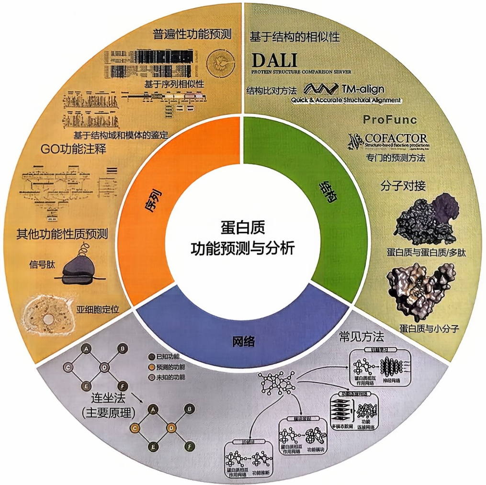

flowchart

```mermaid
graph TD
  subgraph Sequence
  A["普遍性功能预测"] --> B["基于序列相似性"]
  B --> C["GO功能注释"]
  C --> D["其他功能性质预测"]
  D --> E["信号肽"]
  E --> F["亚细胞定位"]
  end

  subgraph Network
  G["常见方法"] --> H["神经网络"]
  H --> I["功能模块"]
  I --> J["蛋白质与多肽"]
  J --> K["蛋白质与小分子"]
  end

  subgraph Average Method
  L["已知功能"] --> M["连接法 (主要原理)"]
  M --> N["预测的功能"]
  N --> O["未知的功能"]
  end

  subgraph General Methods
  P["功能推断"] --> Q["蛋白质和核苷作用网络"]
  Q --> R["功能模块"]
  R --> S["连接网络"]
  S --> T["神经网络"]
  T --> U["功能模块"]
  U --> V["连接网络"]
  end

  subgraph DALI
  W["基于结构的相似性"] --> X["PROTEIN STRUCTURE COMPARISON SERVER"]
  X --> Y["结构比对方法"]
  Y --> Z["TM-align\nQuick & Accurate Structural Alignment"]
  end

  subgraph ProFunc
  AA["ProFunc"] --> AB["COFACTOR\nStructure-based function production\n专门的预测方法"]
  end

  subgraph Network
  AC["蛋白质与蛋白质/多肽"] --> AD["蛋白质与蛋白质/多肽"]
  end
```

图9-17 本节涉及的蛋白质功能的预测与分析的主要内容

## 9.4.2 基于序列的蛋白质功能分析

## 9.4.2.1 基于序列相似性的普遍性功能预测

从蛋白质序列出发预测蛋白质功能仍然是目前蛋白质功能预测的最常规的手段，其原理是蛋白质的序列相似，结构也相似，发挥的功能亦相似。因此，通过序列相似性搜索工具，可以快速搜索到与待分析蛋白质同源的功能已知的蛋白质，进而推断待分析蛋白质可能发挥的功能。常用的生物信息学序列分析工具BLAST就频繁用于蛋白质功能预测与分析。除此以外，还有一些更加敏感的序列相似性搜索方法，如PSI-BLAST也可用于蛋白质功能预测。蛋白质行使功能往往和其含有的结构域和模体息息相关。因此，除关注蛋白质序列全长分析外，往往我们必须关注蛋白质结构域和模体这两层次的序列分析。表9-3列出了一些常见的基于序列的蛋白质功能预测方法。

表 9-3 常见的基于序列和结构的蛋白质功能预测方法

| 名称 | 类型 |
| --- | --- |
| PFP | GO 功能注释工具 |
| ESG | GO 功能注释工具 |
| PANNZER | GO 功能注释工具 |
| GOLabeler | GO 功能注释工具 |
| SignalP | 信号肽预测工具 |
| PrediSi | 信号肽预测工具 |
| PSORT | 亚细胞定位预测工具 |
| TargetP | 亚细胞定位预测工具 |
| WoLF PSORT | 亚细胞定位预测工具 |
| DeepLoc | 亚细胞定位预测工具 |
| ProFunc | 基于结构的功能预测工具 |
| COFACTOR | 基于结构的功能预测工具 |

结构域（domain）是蛋白质多肽链中的一部分，一般具有独立折叠单元并能执行某些特定的功能。结构域的存在和划分使得蛋白质具有模块化的特征，是蛋白质功能分析的重要切入点。InterPro数据库是代表性的蛋白质结构域数据库资源。模体（motif）是指在蛋白质序列中具有一定模式或共享特征的短片段。模体可能是保守的氨基酸残基序列、功能位点或其他重要的序列模式。通过鉴定蛋白质序列中潜在的模体，可以用于分析和识别蛋白质的特定功能或结构。模体一般可以表示为一个短字符串，采用正则表达式来描述。例如，序列模体“L-x(2,3)-L-x(2,3)-[IV]”表示具有一个保守的亮氨酸（L）残基，随后是2～3个非特定的残基，然后是另一个亮氨酸，接着是2～3个非特定的残基，最后是异构亮氨酸（I）或缬氨酸（V）。代表性的模体数据库有ELM（Eukaryotic Linear Motif），它收集了大量已知的真核生物模体的数据，并提供了详细的注释和功能信息。

## 9.4.2.2 基于序列的 GO 功能注释

基于待测蛋白与功能已知蛋白的序列同源性，可以实现对待测蛋白的功能注释。目前基于序列的 GO 功能注释主要就是利用这个原理，实现对功能未知蛋白自动化高通量的功能注释。已相继有一系列方法开发（表 9-3），在历届 CAFA 竞赛中取得很好的预测效果。以下介绍几种常见的基于序列的 GO 功能注释方法。

PFP 通过对待测蛋白进行 PSI-BLAST 搜索，综合考虑搜索得到 E-value 小于一定阈值的所有序列，计算出每个可能 GO 注释的分数，最终获得 GO 功能注释。与传统 PSI-BLAST 搜索仅仅依赖一个严格的阈值（如 E-value < 0.001）进行功能预测相比，PFP 也考虑了更多的弱同源序列，这些序列里共同出现的 GO 条目，有可能被合理地预测出来。进一步，PFP 的作者还开发了 ESG 方法，用于增强注释的特异性。其主要策略是每一次 PSI-BLAST 迭代搜索到的序列对应的 GO 注释都加以考虑，用来预测待测蛋白的功能。换言之，一个 GO 条目如果频繁出现在多轮迭代的同源序列中，将赋予更高的分数，并预测为待测蛋白的功能。相比较之下，ESG 比 PFP 预测得到更少的 GO 条目。在早期的 CAFA 竞赛中，PFP 和 ESG 均表现优异。

PANNZER 是一款流行的、全自动的未知蛋白功能注释工具。对每一个待测蛋白，它主要通过 UniProt 数据库进行序列同源性搜索，采用带权重的 KNN 算法找到若干相似性显著同源蛋白，并对同源蛋白的 GO 条目进行富集和打分，最终实现对待测蛋白进行 GO 注释。此外，PANNZER 还基于同源蛋白的功能描述，通过聚类和统计，实现对待测蛋白的总体功能描述。新版的 PANNZER 采用了 SANSparallel 进行同源性搜索，具有比 BLAST 更快的搜索速度，这使得 PANNZER 可以同时对成千上万条的蛋白质序列进行功能注释。目前该方法已广泛应用于许多原核和真核生物的全蛋白质组范围内的 GO 功能注释。

虽然基于同源性搜索的方法仍然是主流的 GO 注释方法，但对于那些找不到同源蛋白的待测蛋白难以获得可靠的功能注释。为解决这个问题，除了考虑同源信息外，还需要整合其他序列信息进行功能推断。例如，GOLabeler 采用 LTR（Learn to Rank）方法整合了基于序列的多分类器实现对蛋白质功能全自动预测。在 CAFA3 竞赛中，GOLabeler 取得了优异的表现。

## 9.4.2.3 基于序列的其他蛋白质功能性质预测

有许多针对蛋白质特定功能性质的预测，包括信号肽预测、亚细胞定位、蛋白质特定功能家族预测、蛋白质功能位点预测等。总体上，仍然可以采用基于序列相似性的原理进行预测。许多情况下，具有相同功能性质的蛋白质并不具有明显的序列相似性，因此必须采用基于其他序列特征的统计和机器学习方法。由于篇幅所限，下面仅介绍信号肽预测和亚细胞定位预测。

信号肽（signal peptide）是蛋白质序列中一段特殊序列，通常位于蛋白质的氨基端，长度为 $5\sim 30$ 个氨基酸。信号肽在蛋白质的合成过程中首先被翻译出来，其主要功能是指导新合成的蛋白质到达正确的细胞器或者细胞位置。信号肽发挥功能后通常会被蛋白酶剪切掉，从而释放出成熟的蛋白质。信号肽的识别和分析也有相当成熟的生物信息学软件。SignalP 是一款广泛使用的信号肽预测工具，具有友好的用户交互界面。它基于蛋白质序列的氨基酸特性和模式，使用神经网络或隐马尔可夫模型进行预测。PrediSi 是一个基于序列特性的信号肽预测工具，它使用决策树进行预测。

对于蛋白质功能的分析，蛋白质的亚细胞定位注释也是不可或缺的一环。细胞中主要的蛋白质亚细胞定位包括:细胞质、细胞核、线粒体、内质网、高尔基体、溶酶体、过氧化物酶体、核糖体、中心粒、微管和微丝，以及可能存在的叶绿体、液泡；如果是分泌蛋白，还可能处于囊泡或细胞外基质。Uniprot数据库中有许多经过实验验证（文献判读）的蛋白质亚细胞定位信息，这为蛋白质亚细胞定位的生物信息学算法开发提供了重要数据基础。在过去的几十年中，已经开发了许多基于蛋白质序列特征的亚细胞定位预测方法。例如，PSORT是一种基于序列的亚细胞定位预测方法，它利用蛋白质序列中的各种特征（如信号肽、跨膜螺旋等）来预测蛋白质的亚细胞定位；TargetP同样是一种基于序列的预测方法，它主要通过识别蛋白质序列中的信号肽和跨膜区来预测蛋白质的亚细胞定位；WoLF PSORT是一个基于序列和蛋白质特性的亚细胞定位预测方法，它结合了多种预测方法的优点，提供了更准确的预测结果；DeepLoc是一种基于深度学习的亚细胞定位预测方法，它可以自动学习和识别蛋白质序列中的复杂模式，从而进行亚细胞定位预测。这些方法在预测蛋白质的亚细胞定位时，都需要考虑蛋白质序列的各种特性，如氨基酸组成、二级结构、疏水性、电荷等。同时，它们也都利用了机器学习或统计模型来进行预测，这使得预测结果更加准确和可靠。

## 9.4.3 基于结构的蛋白质功能分析

蛋白质通过其特定的三维结构来行使其生物学功能。毫无疑问，蛋白质空间结构的信息对深入了解蛋白质的生物学功能是非常有帮助的。例如，蛋白质催化功能域的结构可以用来研究酶催化机制；蛋白质四级结构可以用来研究蛋白质不同亚基之间的互作界面，可以从分子机器的角度来研究蛋白质实现其功能的分子机制。从生物信息学角度，蛋白质结构信息的获得，大大加快了蛋白质功能的预测和注释。

## 9.4.3.1 基于结构相似性的功能预测

当我们能够得到待分析蛋白质的结构时，可以利用结构比对进行功能预测。结构比对能够发现许多序列比对无法发现的特征，如有一些蛋白质在序列上不相似，但是结构上非常相似，发挥的功能也很相似，从而拓宽基于序列相似性的功能预测。常用的结构比对方法，如 DALI 和 TM-align，均可用来开展基于结构的功能注释。蛋白质功能存在趋同进化，也就是两个蛋白质总体结构不同，但它们存在相关的功能位点，仍有可能行使相同的生物学功能。可以将已知功能位点的空间结构（如酶催化位点）作为模板，查找待测蛋白中与已知功能位点空间结构相似的子结构，进而预测待测蛋白可能的功能。

基于以上原理，一些专门的基于结构的功能预测工具已相继开发（表9-3），代表性的方法有ProFunc和COFACTOR。

ProFunc 整合一系列蛋白质序列和结构分析方法，从待测蛋白的序列和空间结构出发，实现对待测蛋白功能全方位的预测。首先，该方法对待测蛋白序列进行标准的序列分析，以鉴定其与已有蛋白质结构同源性、残基保守性以及功能位点。其次，该方法还利用待测蛋白的空间结构三维坐标开展结构相似性搜索，进一步得到待测蛋白可能的功能；通过鉴定待测蛋白的结合口袋发现待测蛋白可能的功能位点；进一步，该方法还通过与已知蛋白功能位点三维模板，包括酶活性位点，DNA 结合位点和配基结合位点，进行局部结构相似性比较来推断待测蛋白潜在的功能及功能位点。最终，ProFunc 可以将以上序列和结构分析的结果汇总得到对待测蛋白质综合的功能注释。

COFACTOR 是一个基于结构的蛋白质功能注释系统。从实验测定或预测得到的蛋白质空间结构出发，COFACTOR 首先将待测蛋白结构比对（包括全局和局部结构比较）到功能已知的代表性蛋白质结构模板库，构建打分函数，将已知蛋白的三个方面的功能信息（配基结合位点、酶分子 EC 号、GO 条目）迁移到待测蛋白上，从而实现待测蛋白的功能注释。经过大规模的测试，COFACTOR 展示出优越的预测性能，特别是在配体结合位点预测方面。

## 9.4.3.2 分子对接用于研究蛋白质与其他分子的相互作用

一旦蛋白质的空间结构获得解析，可以采用分子模拟手段研究蛋白质行使功能的分子机制。本章前一节介绍的分子动力学模拟就是通过模拟蛋白质在不同条件下空间构象的动态变化来理解蛋白质的功能。除了分子动力学模拟外，分子对接也是一个重要的分子模拟手段，它主要是通过计算的手段来研究蛋白质和配体分子的相互作用。从蛋白质和配体分子三维结构出发，分子对接就是要找到它们的结合模式并预测其亲和力。根据配体分子不同，可以将分子对接分为蛋白质-小分子对接、蛋白质-蛋白质对接和蛋白质-多肽对接等。分子对接方法根据分子结构的处理通常又可以分为三类:刚性对接、半柔性对接和柔性对接。刚性对接固定了受体和配体的构象，主要用于蛋白质-蛋白质或蛋白质-核酸等大分子对接。半柔性对接允许小分子的构象变化，而受体蛋白保持刚性，通常用于蛋白质-小分子对接。柔性对接允许受体和配体的构象均发生变化，用于研究分子之间的精确结合方式，精度高但计算成本也比较高。

分子对接方法可用于模拟小分子和蛋白质在原子水平上的相互作用（图9-18），这使我们能够深入了解小分子与靶蛋白的结合模式，并阐明基本的生化过程。蛋白质-小分子对接流程如下。

## (1) 小分子处理

大部分小分子结构可以从 Pubchem/Chemspider 等数据库里面下载到 sdf 或者 pdb 格式的 2D/3D 结构文件，此外对于新合成的化合物没有收录进数据库，可以使用 ChemDraw 进行绘制，并对小分子化合物进行结构建模和优化。

图9-18 蛋白质与小分子对接示意图

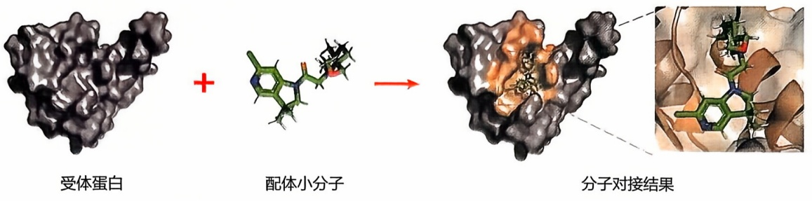

chemical

Molecular docking process diagram showing interaction between receptor protein and small molecule with molecular structure, followed by final molecular binding.

## (2) 蛋白质受体处理

大部分蛋白质的结构可以从 PDB 数据库获取，并进行预处理，主要是加氢、加电荷、二硫键和质子化状态方面的处理；对于三维结构未知的蛋白质受体，可以使用同源模拟和 AlphaFold2 等方法进行建模获取目标蛋白结构。

## （3）寻找潜在的结合位点（口袋）

分子对接的关键步骤之一是先要找到受体分子的活性口袋。可以参照文献或实验数据进行口袋选择，对于没有活性位点报道的蛋白质受体，也可以用cavityplus等工具进行口袋预测。如果无法获得口袋信息，还可以默认对蛋白质进行全局对接。

## (4) 建立对接盒子

选择受体中口袋的残基作为盒子中心，调整盒子的大小，盒子需要足够大，能把口袋完全包裹住，且可以完全容纳配体分子。

## （5）选择对接精度，完成对接

分子对接的过程主要是寻找配体在受体对接口袋中可能存在的最佳结合构象。通常关于构象的搜索方法有片段生长法、系统搜索法、Monte Carlo 模拟法和遗传算法等。对于单个的小分子一般选取精度最高的选项完成对接，获得对接后蛋白质和小分子的结合构象以及对应的对接打分。

蛋白质与小分子对接也是计算机辅助药物设计的重要手段，可以用于高通量药物分子虚拟筛选。虚拟筛选的主要原理是将大型化合物数据库中的所有分子与特定靶标蛋白进行对接，以便筛选出最具结合力的候选分子，其优势是短时间内处理数千种化合物，获得具有结构多样性的潜在先导化合物，从而降低了药物研发成本。

与蛋白质-小分子对接类似，蛋白质-蛋白质对接的目的就是要模拟已知三维结构的两个蛋白质的最佳结合模式，可以分为自由对接和基于模板的对接。自由对接主要包括四个步骤:第一步，通过刚性对接或简单的几何形状互补搜索两个蛋白质所有可能的结合模式；第二步，根据能量或聚类大小等评价标准过滤掉不合理的结合模式；第三步，对剩余构象进行能量优化，允许主链骨架和残基侧链的运动，同时移除侧链冲突的结合模式；第四步，利用精细的打分函数排序结合模式并挑选少数几个最接近天然状态的构象，其中，打分函数对最终预测结果的准确性有至关重要的影响。打分函数通常考虑了几何形状、范德华相互作用、静电相互作用、统计势能、去溶剂化能、溶剂化能、蛋白质相互作用界面面积等因素，可分为基于力场的打分函数、基于知识的打分函数和基于经验的打分函数。尽管以上蛋白质-蛋白质对接方法可以用于预测蛋白质复合物的三维结构，但其计算量较大且不会给出每一对蛋白质复合物唯一的三维结构，总体上蛋白质复合体结构预测精度还有待提高。迄今为止，已有不少蛋白质-蛋白质自由对接方法，包括ZDOCK、GRAMM-X和HADDOCK等。相比之下，基于模板的对接方法准确性更高。顾名思义，基于模板的对接是指以实验方法解析的蛋白质复合体结构为模板，推断两个目标蛋白的结合模式，即构建目标蛋白复合体的三维结构，该方法最重要的一个步骤是构建模板库。近年来，随着解析蛋白复合体结构的实验方法的日益成熟，PDB数据库中可用的模板不断增加，进一步加快了基于模板的对接方法的发展。目前，已有很多基于模板的对接方法被开发。

生物体内还广泛存在蛋白质和多肽之间的相互作用。揭示蛋白质-多肽复合物的结构细节对于理解蛋白质-多肽识别的分子机制和多肽药物研发至关重要。然而，由于蛋白质与多肽相互作用的高度动态和瞬时性质，实验解析蛋白质-多肽复合物结构受到了极大的阻碍。因此，作为补充实验技术的重要替代方法，已经开发了各种蛋白质-多肽对接方法，用于预测蛋白质-多肽复合物的三维结构。同样，蛋白质-肽段对接算法大致可分为两类:基于模板的对接和无模板的对接。基于模板的对接方法使用类似复合物的结构作为模板来预测蛋白质-肽段复合物的结合结构，如 GalaxyPepDock。尽管取得了一些成功，但基于模板的对接方法受限于已知模板的数量，因此在一般应用中存在固有的限制。相比之下，无模板对接不需要任何模板，根据结合位点是否已知，可以细分为全局对接和局部对接。全局对接在蛋白质的整个表面上执行详尽搜索，以捕获肽段的结合位点和结合模式，如 pepATTRACT、MDockPeP、CABS-dock、ClusPro PeptiDock、PIPER-FlexPepDock 和 HPEPDOCK。局部对接则是在用户定义的结合位点周围搜索肽段的结合姿势。典型的局部对接方法包括 HADDOCK peptide docking、PEP-FOLD 3、DINC 和 AutoDock CrankPep (ADCP)。此外，值得一提的是，ADCP 还可以处理环状肽段的对接。

一般情况下，分子对接软件都会给出蛋白质与配体的打分，总体上能反映蛋白质和配体的结合力，但准确性往往不够。为更准确地评估两者之间的结合力，需要计算蛋白质与配体之间的结合自由能（$\Delta G_{\mathrm{bind}}$）来确定。目前，已经开发了多种方法来预测结合自由能，包括分子力学-泊松玻尔兹曼表面积（molecular mechanics-poisson boltzmann surface area, MM-PBSA）、分子力学-广义波恩表面积（molecular mechanics-generalized born surface area, MM-GBSA）、热力学积分（thermodynamics integration, TI）和自由能微扰（free energy perturbation, FEP）。其中，MM-PBSA 和 MM-GBSA 是近年来使用最广泛的方法。

## 9.4.4 基于网络的蛋白质功能分析

基于序列同源性或结构相似性的预测方法利用已知蛋白质的同源关系或结构相似性，具有较高的预测精度。然而，这种方法依赖于已知蛋白质的同源信息，对于没有已知同源物的蛋白质功能预测效果不佳。近年来，丰富的组学数据不断涌现，包括转录组学和蛋白质互作组学数据等。这些数据可以表征成生物分子网络。生物分子网络是系统生物学研究的重要内容，在本书的第11章将详细介绍常见的生物分子网络构建方法，重要的网络拓扑参数定义及复杂网络分析方法。这些生物分子网络的获得为系统层面理解基因/蛋白质功能提供了重要视角。以蛋白质-蛋白质相互作用（protein-protein interaction，PPI）网络为例，高连接度的“枢纽”蛋白质通常在生物过程中起关键作用，互作的两个蛋白质往往倾向于行使相似的生物学功能，而网络模块化结构则有助于识别共同参与特定生物过程的蛋白质集合。当前，以PPI网络为代表的生物分子网络已广泛应用于蛋白质的功能预测。总体上，基于网络来推测未知蛋白功能的核心思想是“连坐法”（guilt-by-association），其主要原理是两个蛋白质如果在网络中具有相似的网络拓扑特征，其功能也具有相似性。

## 9.4.4.1 基于邻域的蛋白质功能预测方法

基于网络的蛋白质功能预测方法中，邻域法（neighborhood method）最为简单直接。其核心假设是网络中距离较近的蛋白质可能具有相似的功能。邻居计数法是其中最直接的方法，即将邻居节点中出现频率最高的功能直接分配给目标蛋白。另外一些方法则使用  $\chi^{2}$  检验等方法来确定邻居蛋白中显著富集的功能，并仅将这些功能分配给目标蛋白。邻居扩展法则通过将邻居蛋白扩展到包括其一阶邻居的近邻蛋白，然后使用富集显著性检验等方法来预测目标蛋白的功能。

更复杂的模型则考虑了网络的全局拓扑结构。例如，马尔可夫随机场（Markov random field, MRF）方法通过建模蛋白质相互作用网络中节点之间的依赖关系，然后利用吉布斯抽样或变分推断等方法进行概率推断，以预测未注释蛋白质的功能状态。这种方法不仅考虑了局部邻域的信息，还能够利用全局网络拓扑结构对功能预测进行更精确和可靠的推断，从而提高了预测的准确性和可靠性。

## 9.4.4.2 基于网络模块划分的预测方法

基于网络模块划分的预测方法不直接预测单个节点的功能，而是先识别网络中的紧密连接节点群（即模块），然后根据模块内部的功能分布来预测未注释蛋白质的功能。目前存在多种模块识别方法，包括基于层次聚类、随机游走、模块度和图分割等策略。

## （1）基于层次聚类的模块发现方法

该方法关键在于如何利用网络信息来衡量蛋白质对之间的相似度。一种直观的方法是通过计算网络中蛋白质对之间的距离，然后基于这些距离进行层次聚类。然而，许多蛋白质对之间的网络距离相同，这对聚类方法构成挑战。解决这一问题的方法之一是增加相似度度量的多样性，如结合节点度、介数中心性、邻域重叠度等网络拓扑特征，以提高相似度度量的区分度。另一种策略是利用边的强度、可靠性或生物学相关性等加权信息来丰富距离度量，使其更具区分性，或者采用多种距离度量的加权组合以获得更精确的相似度评估。此外，引入随机性可以避免算法陷入局部最优解而提高聚类效果。这些策略为解决蛋白质相互作用网络中距离相同问题

提供了理论和应用基础。

## (2) 基于随机游走的模块发现方法

在复杂网络中，模块内部节点之间的连接通常更为密集。这意味着，如果从模块内的任一节点开始进行随机游走（random walks），到达相邻节点的概率远高于离开当前模块的概率。通过多次随机游走，我们有可能发现网络中的模块或社区结构，这是利用随机游走来识别网络功能模块的基本思想。

马尔可夫聚类算法（Markov cluster algorithm，MCL）是一种经典的基于随机游走的算法，其核心思想是模拟信息在网络中的流动，通过反复的扩展（expansion）和膨胀（inflation），加强模块内部的连接并削弱模块之间的连接，从而识别出网络中的模块。下面以一个简单的网络为例，展示 MCL 算法的计算过程:

在图9-19所示的网络中，节点A、B、C相互连接，节点E仅与D连接，节点D仅与B、E连接。MCL算法的第一步是在网络的邻接矩阵中添加每个节点的自环，允许节点可以作为自身的邻居。第二步是对矩阵进行归一化处理，生成概率转移矩阵，该矩阵表示了从一个节点随机游走到其邻居节点的转移概率。例如，从节点A随机游走到A、B、C的概率均为0.3333。第三步是进行矩阵扩展操作，即通过多步马尔可夫过程计算随机游走路径的概率转移。例如，从A经过两步随机游走到A、B、C、D的概率分别为0.3056、0.3056、0.3056、0.0833。第四步是矩阵膨胀操作，通过平方化矩阵元素并按列归一化，加强高概率转移路径的权重，减弱低概率转移路径的权重。此时，从A到A、B、C、D的转移概率分别为0.3253、

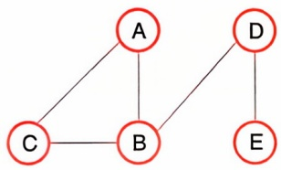

flowchart

(a) 一个简单的网络及其邻接矩阵

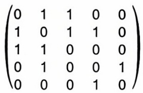

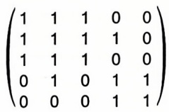

(b) 第一步: 添加自连接

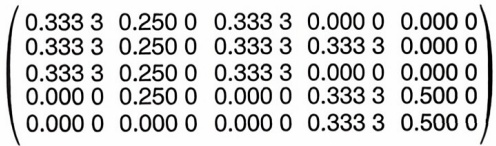

flowchart

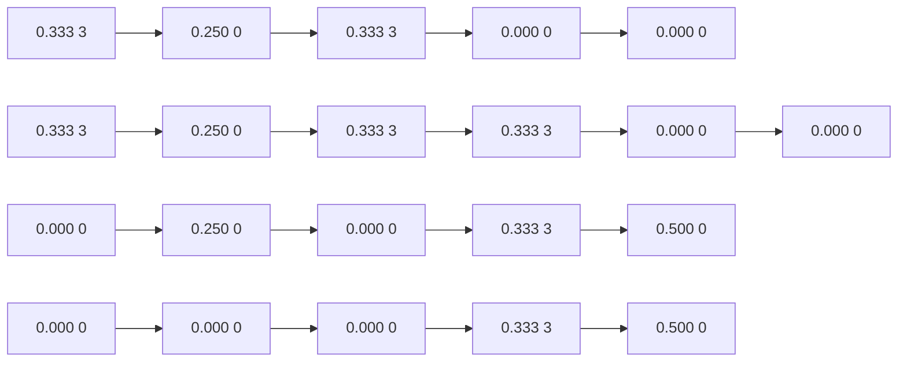

(c) 第二步:矩阵归一化(列)

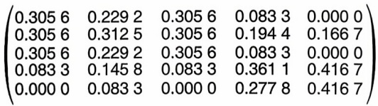

text_image

(0.305 6 0.229 2 0.305 6 0.083 3 0.000 0
0.305 6 0.312 5 0.305 6 0.194 4 0.166 7
0.305 6 0.229 2 0.305 6 0.083 3 0.000 0
0.083 3 0.145 8 0.083 3 0.361 1 0.416 7
0.000 0 0.083 3 0.000 0 0.277 8 0.416 7)

(d) 第三步:矩阵扩展(矩阵平方)

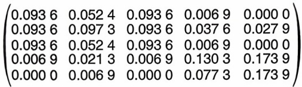

text_image

(0.093 6 0.052 4 0.093 6 0.006 9 0.000 0
0.093 6 0.097 3 0.093 6 0.037 6 0.027 9
0.093 6 0.052 4 0.093 6 0.006 9 0.000 0
0.006 9 0.021 3 0.006 9 0.130 3 0.173 9
0.000 0 0.006 9 0.000 0 0.077 3 0.173 9)

(e) 第四步: 矩阵膨胀——矩阵元素平方化

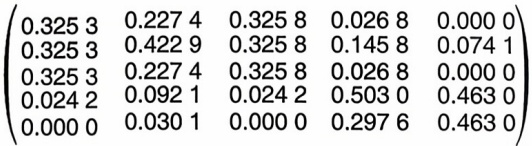

flowchart

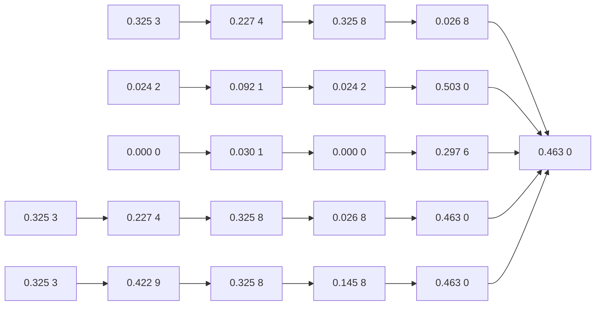

(f) 第四步: 矩阵膨胀——按列归一化

$$
\left( \begin{array}{c c c c c} 0 & 0 & 0 & 0 & 0 \\ 1 & 1 & 1 & 0 & 0 \\ 0 & 0 & 0 & 0 & 0 \\ 0 & 0 & 0 & 1 & 1 \\ 0 & 0 & 0 & 0 & 0 \end{array} \right)
$$

(g) 重复第三、四步, 得到最终收敛的矩阵图9-19 MCL算法示意图

0.325 3、0.325 3、0.024 2。通过反复进行扩展和膨胀操作，最终使矩阵收敛，并形成对角块结构，其中每个块内的节点即为网络中的紧密连接子群（模块）。在例子中，可以看到（A，B，C）形成一个紧密模块，而（D、E）则形成另一个模块。

随机游走重启（random walk with restart，RWR）是一种常见的随机游走算法。它允许从已知的种子节点开始随机游走，并在每一步中以一定的概率返回到种子节点，这样的设计保证了算法能够同时探索网络的局部和全局结构。通过 RWR 算法，我们可以量化其他节点与种子节点之间的关联程度。举例来说，RWR 算法可应用于疾病基因研究中，从已知的疾病基因出发，利用网络信息识别与这些基因密切相关的潜在疾病基因。

## （3）基于模块度的模块发现方法

模块度（modularity）的概念最早由马克·纽曼（Mark Newman）和米歇尔·吉尔凡（Michelle Girvan）于2004年提出。他们在研究社会网络和互联网拓扑结构时，引入了一种可量化网络内部模块化程度的指标 $Q$ :

$$
Q = \frac {1}{2 m} \sum_ {i j} \left(A _ {i j} - \frac {k _ {i} k _ {j}}{2 m}\right) \delta (i j) \tag {9-25}
$$

其中，$m$ 为图中所有节点的度数之和，$k_{i}$ 和 $k_{j}$ 为节点 $i$ 和 $j$ 在网络中的度数。符 $\sigma(ij)$ 表示节点 $i$ 和 $j$ 是否属于同一个模块，为1表示属于同一模块，否则为0。$A_{ij}$ 为节点 $i$ 和 $j$ 在网络中的实际连接强度，而 $\frac{k_i k_j}{2m}$ 则是它们在一个随机网络中的期望连接强度。模块度 $Q$ 的取值范围为 $-1 \sim 1$，越接近1则表示网络模块结构越清晰。

Newman 也提出了一个基于最大化 $Q$ 指标的算法来划分模块。该算法的核心是通过不断迭代来优化节点的分组，使得网络内部连接更密集，而不同模块之间的连接较少。Louvain 算法是另一种基于模块度的算法，它是一种基于贪心的启发式算法，在每一步迭代中通过将节点移动到新的模块中，以增加当前网络的模块度。由于采用高效的近似方法，Louvain 算法特别适合处理大规模网络，能够在短时间内找到相对较好的解。

## （4）基于图分割的模块发现方法

基于图分割（graph partitioning method）的模块划分算法利用图的特性，将图分割成多个子图（模块），使得子图内部连接密集，而子图之间连接稀疏。其中，一类代表性算法是最小化跨子图的边数或权重总和，如 Kernighan-Lin 算法。该算法首先将图随机分成两个子集，然后计算每对节点交换后的跨子集边的权重收益，并选择收益最大的节点对进行交换。通过反复交换两个子集中的节点，逐步最小化跨子集的边权重。此过程持续进行，直至收益不再增加，从而优化图的分割。

另一类算法则利用图的拓扑结构和特征进行分割，其中谱聚类算法（spectral clustering）是一个典型例子。谱聚类算法利用图的拉普拉斯矩阵的特征向量来实现图的划分。具体而言，该方法首先计算图的拉普拉斯矩阵。对于一个给定的图，拉普拉斯矩阵定义为 $L = D - A$，$D$ 为图的度矩阵，$A$ 是图的邻接矩阵。然后，通过计算标准化拉普拉斯矩阵的特征值和特征向量，将图的节点映射到这些特征向量构成的低维特征空间。最后，在此特征空间中利用 $K$-means 等聚类算法进行节点的划分，以实现高效的模块化划分。谱聚类方法适用于处理大型网络，并且能够有效应对稀疏图的挑战，尽管其计算复杂度较高。

## （5）网络模块识别后的蛋白质功能预测方法

在网络中识别模块后，可以通过几种方法来预测蛋白质功能。一种简单的方法是直接将模块内已注释蛋白质的功能分配给模块内的每一个未注释蛋白质。更为可靠的办法是使用  $\chi^{2}$  检验或 Fisher 精确检验对模块内部的功能进行富集分析，以确定模块内是否显著富集某些特定的功能或生物过程，再进行功能注释。此外，还可以通过训练机器学习模型，结合网络拓扑特征（如节点度、介数中心性、聚类系数等）和已知功能蛋白质的信息，来预测未知蛋白质的功能。总体而言，识别网络模块后的蛋白质功能预测方法多种多样，每种方法都有其特定的应用场景和优缺点。通过结合这些方法，可以更准确和全面地推测蛋白质的功能。

## 9.4.4.3 基于网络整合的蛋白质功能预测方法

整合多种组学数据网络以预测基因功能是生物信息学和系统生物学中的关键研究领域。该方法旨在有效利用高通量技术生成的大量数据，揭示基因之间的功能和相互关系。核心思想是结合不同类型的生物学数据，如蛋白质-蛋白质相互作用、基因共表达、遗传相互作用、代谢通路和基因本体注释等，构建多个网络，并通过算法将这些网络整合，从而提高基因功能预测的准确性和覆盖范围。随着技术和数据的不断进步，这种方法为理解基因功能和生物系统复杂性提供了强大的工具。

两个典型的算法例子是 GeneMANIA 和基于贝叶斯网络的方法（如 GAIN）。GeneMANIA 采用监督学习方法，通过线性回归学习每个网络的权重，然后利用这些权重创建一个加权整合网络。该整合网络的邻接矩阵结合了多个网络的信息，更准确地反映了基因之间的功能关联性。GeneMANIA 接着使用标签传播算法在整合网络上进行蛋白质功能预测，为每个未注释基因分配一个与已知功能基因集合相关性的功能得分。

而基于贝叶斯网络的方法（如 GAIN），则采用概率图模型的框架。它将每个数据网络视为独立的证据，利用条件概率表示基于每个网络证据的情况下蛋白质具有特定功能的概率。然后，通过贝叶斯规则将这些证据整合，推断蛋白质具有特定功能的后验概率。贝叶斯方法保持每个网络的独立性，通过概率推理进行整合，直接输出蛋白质具有特定功能的概率估计。

## 9.4.4.4 基于机器学习的网络预测方法

序列、结构和网络信息可以分别预测蛋白质的功能，一个非常自然的想法是将这几种不同的数据整合进一步提升预测精度，通常整合采用的是机器学习算法。例如，GOLabeler的改进方法NetGO通过整合蛋白质序列和蛋白质-蛋白质相互作用网络信息用于全自动的蛋白质功能注释。除了传统的浅层机器学习模型，基于深度学习的网络预测方法已经在生物信息学领域广泛应用。在处理如蛋白质-蛋白质相互作用网络等生物网络时，深度学习模型通常需要将网络中的节点映射到低维向量空间中，以便于捕捉节点及其邻域的结构信息。以下介绍几种典型的网络嵌入方法及其相关的功能预测方法。

DeepWalk 是一种经典的网络嵌入算法，其核心思想是通过随机游走策略在网络中生成大量节点序列，模拟局部邻域结构。然后，利用这些序列训练神经网络模型，学习每个节点的低维向量表示。这些向量保留了节点在整个图结构中的语义和关系信息，可用于节点分类、连接预测等图分析任务，成为图机器学习领域的重要工具。

DeepGO 是一个基于深度学习的蛋白质功能预测模型。它首先利用 DeepWalk 方法生成 PPI 网络中每个节点的 256 维网络拓扑特征。同时，它对蛋白质序列进行 3-mer 编码，并通过 1D 卷积和最大池化层提取序列特征。DeepGO 通过整合网络和序列特征，设计了一个分层神经网络模型来预测功能，确保结果符合 GO 分类结构的从属关系。

图神经网络（graph convolutional network，GCN）直接对网络进行图卷积操作，从中提取节点的特征表示。每个蛋白质节点的特征由其邻居节点的特征聚合得到，多层卷积叠加可以捕捉更高阶的邻域信息。DeepGraphGO 是一个端到端的功能预测模型。它首先构建了一个 17 个物种的 PPI 网络，进而利用 GCN 提取多物种 PPI 网络的网络特征。然后，将蛋白质序列特征与网络特征融合，构建图神经网络来预测蛋白质功能。

## 9.5 代谢组学

## 9.5.1 代谢组学概述

代谢组学（metabonomics）是对生物体内代谢产物的组成及其变化进行系统性研究的新兴组学领域，是系统生物学的重要组成部分。

代谢组学是研究处于特定时期（如不同发育状态等）或受到特殊扰动（如伤病、给药等）的生物体内所有代谢物组成及其变化的学科。代谢组学主要针对的是分子量小于1000的内源性分子，包括糖类、脂质、氨基酸、芳香烃等。代谢物在不同物种中数量存在差异，一般动物约有2500种、微生物约有1500种，植物约有20万种。

作为基因表达的下游产物，代谢物在生理过程中的作用不可忽视。生物机体中的生理活动由基因、蛋白质以及代谢物共同调节，而上游大分子（核酸、蛋白质等）的变化大多最终会体现在代谢物层面，如细胞间通信、激素调控、受体作用效应等。值得注意的是，虽然代谢物处于基因调控网络和蛋白互作网络的下游，但其也能够通过与上游基因、蛋白质进行相互作用，实现对上游生命活动网络的反馈，参与众多生理过程的调控。

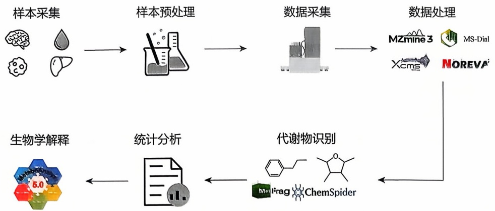

flowchart

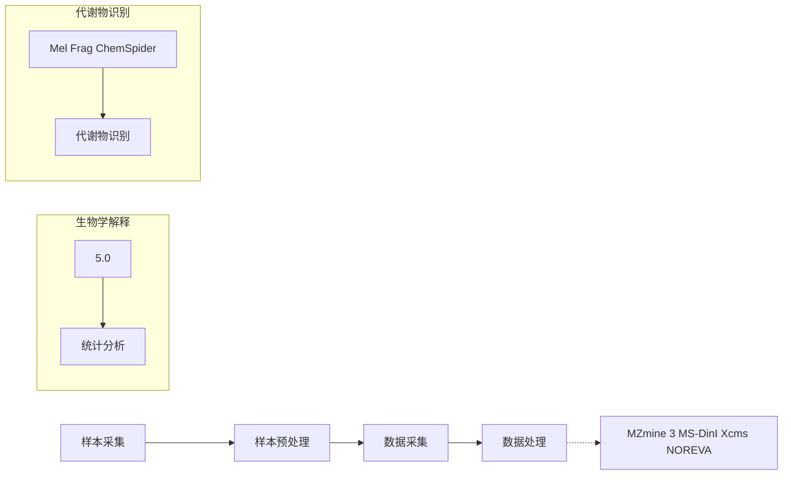

图9-20 代谢组学研究中的主要环节

本节将对代谢组学进行简要介绍，包括其发展历程、样本制备、主要实验技术平台、数据处理以及下游分析等（图9-20）。重点强调了代谢组学研究中的一些注意事项，并给出了数据处理过程的详细讲解，以帮助读者理解如何获得高质量的代谢组学数据。

## 9.5.1.1 代谢组学发展历程

代谢组学相关的研究起源于20世纪70年代的代谢谱分析，而代谢组学的概念在20世纪90年代首次被英国帝国理工大学杰里米·尼科尔森（Jeremy Nicholson）教授提出。在代谢组学发展的早期，人们通常使用核磁共振技术（NMR）来检测代谢物，然而这种方法存在样本需求量大、灵敏度低等问题，不能满足对人体代谢物全面、定量分析的需求。随着质谱（MS）技术的发展，质谱与气相、液相色谱技术的联用被广泛用于代谢组学的数据获取，通过质荷比、相对丰度等信息反映代谢物的结构和丰度。到21世纪，代谢组学检测技术已经有了巨大的进步，三维荧光液相色谱、同位素示踪等方法得到了广泛应用。而随着近几年单细胞技术的发展，研究者能够检测单个细胞中的代谢物含量及其变化，单细胞代谢组学正在兴起。

## 9.5.1.2 代谢组学的样本制备

由于代谢物能够随着体液被排出机体，因此代谢组学样本的获取相较其他组学更加便捷。尿液、血液、动物粪便提取物、植物组织提取物等能够快速获取的生物体液是代谢组学研究中最常用的样本。正是因为代谢组学研究的生物样本易获取，其在医疗诊断领域具有极大的应用前景。此外，代谢组学研究的对象也可以是各种临床上或动植物实验中取得的实体组织样本等较复杂的生物样本。

需要注意的是，收集代谢组学样本的过程需要进行严格的把控。收集样本时应该根据实验设计综合考虑采样时间、样本保存条件以及保存时间等实验因素的一致性。在收集临床生物样本时，还有必要尽量保证实验组与对照组之间的年龄、性别、膳食、生活作息、病史、用药状况等多方面因素的一致性。这些与实验目的无关的外在因素均可能导致代谢组学数据的变化，影响最终的实验结果。

生物样本中的代谢物容易受到环境中众多因素的影响（如由于样本中残留酶活性而降解原有代谢物、产生新的代谢物），因此通常需要对样本尽快进行淬灭，并且进行合适的提取。不同的代谢组学技术平台的样本提取方法不同，需要根据实际使用的技术平台以及实验目的来确定使用的提取方法。

相较于基因和蛋白质，代谢物处于生命活动的下游，动态波动性大。因此需要更多生物学重复来增加数据的可靠性和说服力，一般情况，不同类型的样本生物学重复如下:

① 植物样本 至少 6 次生物学重复，建议 8 次以上；
② 模式动物及微生物样本 至少 8 次生物学重复，建议 10 次以上；
③ 临床样本 至少 30 次生物学重复，建议 50 次以上。

## 9.5.1.3 代谢组学的实验技术

完成样本收集和提取后，研究者应当根据样本性质、实验目的以及目标代谢物的理化性质，选择合适的实验技术平台。目前在代谢组学中最常用的样品分析平台可以根据核心检测仪器的不同分为两种类别:基于核磁共振的技术平台、基于质谱的技术平台。

## (1) 基于核磁共振 (NMR) 的技术平台

基于NMR的技术平台对生物样本中所有化合物的灵敏度都一致，并没有与代谢物相关的偏向性，不需要复杂的前处理并且可以进行实时动态的数据监测。最关键的优势是基于NMR的代谢组学检测不会对样本造成损伤，不会改变生物样本的结构和性质。如果计划在代谢组学后继续对样本进行其他的检测分析，基于NMR的技术平台是较好的选择。

然而，需要注意的是，基于 NMR 的技术平台灵敏度较低（相较基于 MS 的技术平台低几个数量级），难以检测到样本中低丰度的代谢物，且研究者需要根据核磁共振结果提供的结构片段信息进行代谢物的身份推断，这通常比较困难。

## （2）基于质谱（MS）的技术平台

在基于MS的代谢组学数据获取中，通常将MS与色谱联合使用，利用色谱对代谢物进行分离，将样本分别送入MS，然后借助MS的分子身份识别能力对样本中的代谢物进行定性或定量分析。得益于质谱极高的灵敏度，基于质谱的技术平台通常能够获得更多低丰度代谢物的信息，这在生理病理过程的机制探究中至关重要。最常用的基于MS的技术平台包括液相色谱-质谱联用（LC-MS）技术平台以及气相色谱-质谱联用（GC-MS）技术平台。

LC-MS是一种广泛使用的物质分离分析技术，具有灵敏度较高、动态范围较宽、无须衍生化等优点。LC-MS通常被用于GC-MS难以分析的强极性、难挥发、热不稳定性代谢物的检测分析。

GC-MS 主要用于挥发性物质的代谢组学研究,得益于有 NIST（National Institute of Standards and Technology）数据库提供相对完善的小分子电子电离质谱（EI-MS）信息，在代谢物身份识别方面较为便利，目前已经在植物样本代谢组学研究中得到广泛的应用。在动物样本代谢组学研究中，由于动物的内源性代谢物多为不挥发性代谢物，很大程度上限制了 GC-MS 的使用。但值得注意的是，随着衍生化方法的创新，GC-MS 也逐渐在动物样本的代谢组学研究中得到广泛应用。与 LC-MS 相比，GC-MS 所检测的化合物主要集中在极性程度低，分子量相对小的代谢物（<300）。

## 9.5.1.4 代谢组学数据分析流程概况

代谢组学研究产生大量的数据首先需要进行提取、峰对齐、去噪等处理，然后进行数据处理，最终进行模式识别、多元统计分析等下游数据分析，从海量的数据中获得关键信息。代谢组学数据分析通常包含三个环节:①生成数据矩阵，基于MS/NMR技术平台获得的原始数据图谱，使用相应软件平台转换为定量的数据矩阵；②数据处理，去除数据中的低质量数据并减少非生物变异，调整数据分布，为后续数据分析做准备；③下游分析，对经过合适处理的数据进行差异分析、聚类分析、时序分析等，挑选出能够有效鉴别不同类别、不同时期生物样本的关键差异代谢物，或寻找到不同类别间代谢物的特定表达模式。经过上述数据处理，找到关键的代谢物之后，通过代谢通路网站的搜索，结合代谢通路等信息探究它们代表的生物学意义，从而将实验数据结果和体内的生物学变化结合起来。

## 9.5.1.5 代谢组学数据库

HMDB数据库是由加拿大代谢组学创新中心于2007年开发并长期维护的一个综合的代谢组学数据库网站，其中主要收录人体内源性代谢产物并提供代谢物相关的信息，包括代谢物的化学式、化学分类、理化性质、代谢通路、部分MS/MS图谱等。该数据库目前支持化合物名字搜索、分子量搜索、分子结构搜索，MS/MS搜索；该数据库目前不支持批量搜索，仅限于单个代谢产物搜索，搜索效率较低。不支持代谢通路搜索、代谢化合物浓度搜索等。

KEGG 数据库是由日本京都大学于 1995 年创立，是世界上最大、最全的生物信息学数据库之一。含有部分代谢组学信息。主要偏重代谢通路和整合代谢、基因和蛋白质通路信息。目前含有 372 条代谢通路和超过 15000 个各类代谢产物（动物、植物和细菌等）。该数据库最大特点是收录全，包括基因、蛋白质和代谢产物等信息，但是缺少这些代谢产物在生物体内的浓度、功能和疾病相关信息。

Metlin 数据库是由 The Scripps Institute Gary Siuzdak 组创立，主要侧重应用于非靶向代谢组学（non-targeted metabolomics）代谢产物鉴定。网站的主要特征是具有大量代谢产物的 MS/MS 图谱，而且每个化合物都有不同的碰撞能。用户还可以获得分子量、化学结构式、化学结构等信息。该数据库的主要缺陷是没有代谢产物在生物体中的浓度、代谢通路等信息，没有临床相关的信息，偏重化学分析。

MetaboLights 数据库是由欧洲生物信息学研究所开发和维护的一个开放的代谢组学数据库，旨在存储、共享和分析代谢组学实验数据。收集和整理了来自各种代谢组学研究的实验数据，包括质谱和核磁共振等技术生成的代谢物谱图、代谢物注释信息、样品和实验设计等相关数据。这些数据可以通过 MetaboLights 网站进行搜索和访问。MetaboLights 提供了一系列功能，使用户能够浏览、搜索和下载代谢组学数据。用户可以根据关键词、实验类型、物种等条件进行搜索，并查看与特定